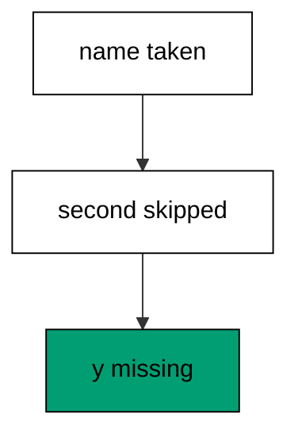
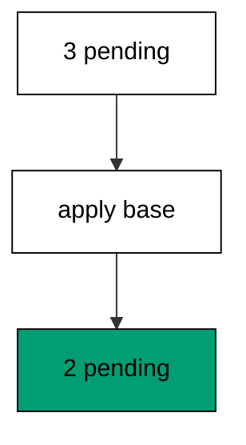
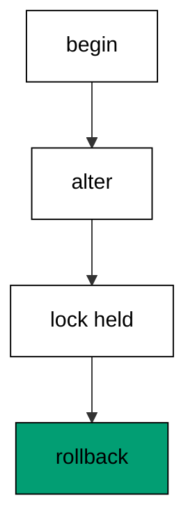
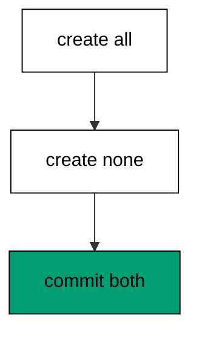
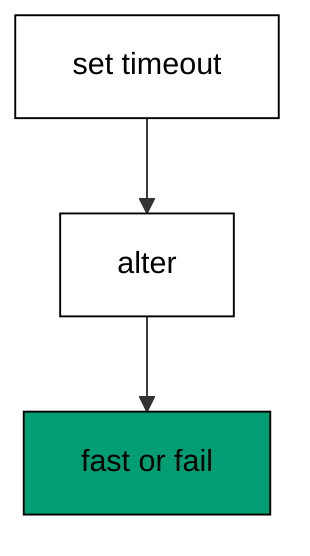
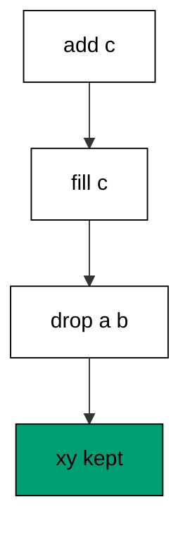
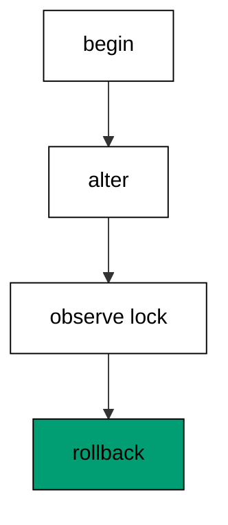
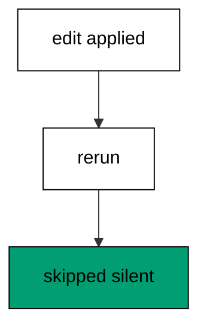
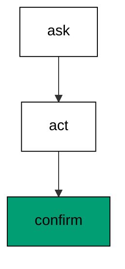
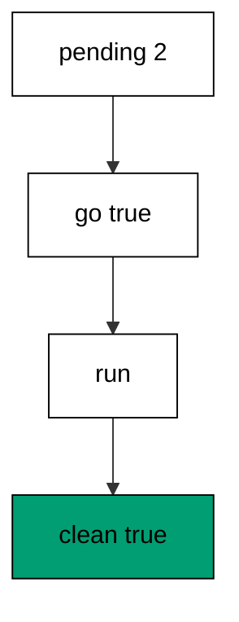

Examples 54–78 handle the work that separates migration users from migration owners: resolving branch conflicts without rewriting history, shrinking locking blast radius on hot tables, and diagnosing failures from evidence. Three clusters carry the level: conflict resolution across branches (Examples 54–61), locking migrations and their blast radius (Examples 62–70), and diagnosing failed or partial migrations (Examples 71–78). Every program runs against the real pinned PostgreSQL 18 container; every output is a fixed transcript.

### Example 54: Two Branches One History

Two developers branch from the same base and both changes land: Alice adds a column, Priya adds another, and the journal holds one line. The program applies base plus both branches in merge order. (Concepts: co-04, co-14.)

Sequential numbers across branches keep the history linear even though the work happened in parallel. Alice and Priya never touched the same column, so the merge is a simple concatenation. Three rows and four columns prove the branches composed instead of colliding.

**`learning/code/ex-54-two-branches-one-history/Program.fs`**:

```fsharp
module App // => one module owns the whole unit

open DbUp // => DeployChanges entry point lives here
open Npgsql // => Npgsql verifies the migrated schema

// => The database address comes from the harness, with local-run defaults.
let connStr () = // => one builder owns every address default
    let host = // => service hostname in the unit network
        match System.Environment.GetEnvironmentVariable("PGHOST") with // => harness sets the service host
        | null
        | "" -> "localhost" // => local runs fall back to localhost
        | h -> h // => the harness value wins when present

    let port = // => service port, almost always the default
        match System.Environment.GetEnvironmentVariable("PGPORT") with // => harness sets the service port
        | null
        | "" -> "5432" // => PostgreSQL listens on 5432
        | p -> p // => the harness value wins when present

    let user = // => trust-auth role, no password needed
        match System.Environment.GetEnvironmentVariable("PGUSER") with // => harness sets the service user
        | null
        | "" -> "postgres" // => local runs use the superuser
        | u -> u // => the harness value wins when present

    let db = // => fresh database for every unit run
        match System.Environment.GetEnvironmentVariable("PGDATABASE") with // => harness sets the service database
        | null
        | "" -> "postgres" // => local runs use the default database
        | d -> d // => the harness value wins when present

    let baseStr = $"Host=%s{host};Port=%s{port};Username=%s{user};Database=%s{db}" // => trust auth needs no password

    match System.Environment.GetEnvironmentVariable("PGPASSWORD") with // => only local runs set a password
    | null
    | "" -> baseStr // => the harness uses trust auth
    | pw -> baseStr + $";Password=%s{pw}" // => local runs authenticate with it

// => One helper runs a write and ignores the count; reads print their own proof.
let exec (conn: NpgsqlConnection) (sql: string) = // => every write flows through here
    use cmd = new NpgsqlCommand(sql, conn) // => fresh command per statement
    cmd.ExecuteNonQuery() |> ignore // => row counts never reach output

// => One helper answers a single int64; counts and ids print through it.
let scalar (conn: NpgsqlConnection) (sql: string) = // => every count flows through here
    use cmd = new NpgsqlCommand(sql, conn) // => fresh command per query
    cmd.ExecuteScalar() :?> int64 // => counts come back as int64

// => One helper lists one text column in order; histories print through it.
let column (conn: NpgsqlConnection) (sql: string) = // => every history flows through here
    use cmd = new NpgsqlCommand(sql, conn) // => fresh command per query
    use reader = cmd.ExecuteReader() // => forward-only reads stay simple

    [ while reader.Read() do
          reader.GetString(0) ] // => one string per row, in query order

// => DbUp journals under this table; units reset only their own rows.
let journalExists (conn: NpgsqlConnection) = // => first runs have no journal yet
    scalar conn "SELECT count(*) FROM information_schema.tables WHERE table_name = 'schemaversions'" = 1L // => one row means DbUp ran here before

// => Every unit starts clean and ends clean, so reruns print alike.
let reset (conn: NpgsqlConnection) (prefix: string) (tables: string list) = // => one reset owns every leftover
    for t in tables do
        exec conn $"DROP TABLE IF EXISTS %s{t} CASCADE" // => a killed run never poisons the rerun

    if journalExists conn then // => the journal may not exist on the first run
        exec conn $"DELETE FROM schemaversions WHERE scriptname LIKE '%s{prefix}%%'" // => only this unit's rows vanish

[<EntryPoint>] // => the harness runs the compiled assembly
let main _ = // => every unit answers zero on success
    use conn = new NpgsqlConnection(connStr ()) // => one session per unit run
    conn.Open() // => fail fast when the service is unreachable
    reset conn "d54_" [ "d54_branch" ] // => leftovers of a killed run vanish

    let upgrader = // => DbUp plans the upgrade from these scripts
        DeployChanges.To // => the fluent entry point
            .PostgresqlDatabase(connStr ()) // => the harness database, trust auth
            .WithScript("d54_001_base.sql", "CREATE TABLE d54_branch (id SERIAL PRIMARY KEY, a TEXT NOT NULL);") // => one ordered script per change
            .Build() // => freeze the plan before running

    let resultupgrader = upgrader.PerformUpgrade() // => apply what the journal lacks
    printfn "upgrade=%b" resultupgrader.Successful // => Output: upgrade=true

    let upgrader2 = // => DbUp plans the upgrade from these scripts
        DeployChanges.To // => the fluent entry point
            .PostgresqlDatabase(connStr ()) // => the harness database, trust auth
            .WithScript("d54_002_alice.sql", "ALTER TABLE d54_branch ADD COLUMN alice_col TEXT NOT NULL DEFAULT 'a';") // => one ordered script per change
            .Build() // => freeze the plan before running

    let resultupgrader2 = upgrader2.PerformUpgrade() // => apply what the journal lacks
    printfn "upgrade=%b" resultupgrader2.Successful // => Output: upgrade=true

    let upgrader3 = // => DbUp plans the upgrade from these scripts
        DeployChanges.To // => the fluent entry point
            .PostgresqlDatabase(connStr ()) // => the harness database, trust auth
            .WithScript("d54_003_priya.sql", "ALTER TABLE d54_branch ADD COLUMN priya_col INTEGER NOT NULL DEFAULT 0;") // => one ordered script per change
            .Build() // => freeze the plan before running

    let resultupgrader3 = upgrader3.PerformUpgrade() // => apply what the journal lacks
    printfn "upgrade=%b" resultupgrader3.Successful // => Output: upgrade=true
    printfn "branches=%d" (scalar conn "SELECT count(*) FROM schemaversions WHERE scriptname LIKE 'd54\_%'") // => Output: branches=3
    printfn "cols=%d" (scalar conn "SELECT count(*) FROM information_schema.columns WHERE table_name = 'd54_branch'") // => Output: cols=4
    reset conn "d54_" [ "d54_branch" ] // => leftovers of a killed run vanish
    0 // => zero exit means the transcript matched
```

**Output** (`learning/code/ex-54-two-branches-one-history/expected/main.stdout.txt`):

```text
upgrade=true
upgrade=true
upgrade=true
branches=3
cols=4
```

**Key takeaway**: Parallel branches compose into one linear history when their numbers sequence and their changes do not overlap.

**Why it matters**: Most branch pairs merge cleanly: different developers usually touch different columns, and sequential numbering removes all ambiguity. The discipline is numbering at merge time against the shared head, not at branch time against a guess. Linear history after parallel work is the normal case to protect. Linear history after parallel work is the normal case to protect, not the exception to celebrate.

### Example 55: Same Name Means Same Migration

DbUp identifies migrations by name, so a second script with an already-journaled name never runs: the y column never lands. The program registers two different contents under one name and proves only the first took effect. (Concepts: co-04, co-14.)



Name equality means identity in DbUp's world: the second registration is skipped as already applied, successfully. The missing y column is the evidence — and the warning. Duplicate names across branches are the collision this whole cluster resolves by renumbering.

**`learning/code/ex-55-same-name-means-same-migration/Program.fs`**:

```fsharp
module App // => one module owns the whole unit

open DbUp // => DeployChanges entry point lives here
open Npgsql // => Npgsql verifies the migrated schema

// => The database address comes from the harness, with local-run defaults.
let connStr () = // => one builder owns every address default
    let host = // => service hostname in the unit network
        match System.Environment.GetEnvironmentVariable("PGHOST") with // => harness sets the service host
        | null
        | "" -> "localhost" // => local runs fall back to localhost
        | h -> h // => the harness value wins when present

    let port = // => service port, almost always the default
        match System.Environment.GetEnvironmentVariable("PGPORT") with // => harness sets the service port
        | null
        | "" -> "5432" // => PostgreSQL listens on 5432
        | p -> p // => the harness value wins when present

    let user = // => trust-auth role, no password needed
        match System.Environment.GetEnvironmentVariable("PGUSER") with // => harness sets the service user
        | null
        | "" -> "postgres" // => local runs use the superuser
        | u -> u // => the harness value wins when present

    let db = // => fresh database for every unit run
        match System.Environment.GetEnvironmentVariable("PGDATABASE") with // => harness sets the service database
        | null
        | "" -> "postgres" // => local runs use the default database
        | d -> d // => the harness value wins when present

    let baseStr = $"Host=%s{host};Port=%s{port};Username=%s{user};Database=%s{db}" // => trust auth needs no password

    match System.Environment.GetEnvironmentVariable("PGPASSWORD") with // => only local runs set a password
    | null
    | "" -> baseStr // => the harness uses trust auth
    | pw -> baseStr + $";Password=%s{pw}" // => local runs authenticate with it

// => One helper runs a write and ignores the count; reads print their own proof.
let exec (conn: NpgsqlConnection) (sql: string) = // => every write flows through here
    use cmd = new NpgsqlCommand(sql, conn) // => fresh command per statement
    cmd.ExecuteNonQuery() |> ignore // => row counts never reach output

// => One helper answers a single int64; counts and ids print through it.
let scalar (conn: NpgsqlConnection) (sql: string) = // => every count flows through here
    use cmd = new NpgsqlCommand(sql, conn) // => fresh command per query
    cmd.ExecuteScalar() :?> int64 // => counts come back as int64

// => One helper lists one text column in order; histories print through it.
let column (conn: NpgsqlConnection) (sql: string) = // => every history flows through here
    use cmd = new NpgsqlCommand(sql, conn) // => fresh command per query
    use reader = cmd.ExecuteReader() // => forward-only reads stay simple

    [ while reader.Read() do
          reader.GetString(0) ] // => one string per row, in query order

// => DbUp journals under this table; units reset only their own rows.
let journalExists (conn: NpgsqlConnection) = // => first runs have no journal yet
    scalar conn "SELECT count(*) FROM information_schema.tables WHERE table_name = 'schemaversions'" = 1L // => one row means DbUp ran here before

// => Every unit starts clean and ends clean, so reruns print alike.
let reset (conn: NpgsqlConnection) (prefix: string) (tables: string list) = // => one reset owns every leftover
    for t in tables do
        exec conn $"DROP TABLE IF EXISTS %s{t} CASCADE" // => a killed run never poisons the rerun

    if journalExists conn then // => the journal may not exist on the first run
        exec conn $"DELETE FROM schemaversions WHERE scriptname LIKE '%s{prefix}%%'" // => only this unit's rows vanish

[<EntryPoint>] // => the harness runs the compiled assembly
let main _ = // => every unit answers zero on success
    use conn = new NpgsqlConnection(connStr ()) // => one session per unit run
    conn.Open() // => fail fast when the service is unreachable
    reset conn "d55_" [ "d55_same" ] // => leftovers of a killed run vanish

    let upgrader = // => DbUp plans the upgrade from these scripts
        DeployChanges.To // => the fluent entry point
            .PostgresqlDatabase(connStr ()) // => the harness database, trust auth
            .WithScript("d55_001_base.sql", "CREATE TABLE d55_same (id SERIAL PRIMARY KEY, a TEXT NOT NULL);") // => one ordered script per change
            .Build() // => freeze the plan before running

    let resultupgrader = upgrader.PerformUpgrade() // => apply what the journal lacks
    printfn "upgrade=%b" resultupgrader.Successful // => Output: upgrade=true

    let upgrader2 = // => DbUp plans the upgrade from these scripts
        DeployChanges.To // => the fluent entry point
            .PostgresqlDatabase(connStr ()) // => the harness database, trust auth
            .WithScript("d55_002_same_name.sql", "ALTER TABLE d55_same ADD COLUMN x TEXT NOT NULL DEFAULT 'x';") // => one ordered script per change
            .Build() // => freeze the plan before running

    let resultupgrader2 = upgrader2.PerformUpgrade() // => apply what the journal lacks
    printfn "upgrade=%b" resultupgrader2.Successful // => Output: upgrade=true

    let upgrader3 = // => DbUp plans the upgrade from these scripts
        DeployChanges.To // => the fluent entry point
            .PostgresqlDatabase(connStr ()) // => the harness database, trust auth
            .WithScript("d55_002_same_name.sql", "ALTER TABLE d55_same ADD COLUMN y TEXT NOT NULL DEFAULT 'y';") // => one ordered script per change
            .Build() // => freeze the plan before running

    let resultupgrader3 = upgrader3.PerformUpgrade() // => apply what the journal lacks
    printfn "upgrade=%b" resultupgrader3.Successful // => Output: upgrade=true
    printfn "second=%b" resultupgrader3.Successful // => Output: second=true

    printfn
        "has-x=%d"
        (scalar
            conn
            "SELECT count(*) FROM information_schema.columns WHERE table_name = 'd55_same' AND column_name = 'x'") // => Output: has-x=1

    printfn
        "has-y=%d"
        (scalar
            conn
            "SELECT count(*) FROM information_schema.columns WHERE table_name = 'd55_same' AND column_name = 'y'") // => Output: has-y=0

    printfn "rows=%d" (scalar conn "SELECT count(*) FROM schemaversions WHERE scriptname LIKE 'd55\_%'") // => Output: rows=2
    reset conn "d55_" [ "d55_same" ] // => leftovers of a killed run vanish
    0 // => zero exit means the transcript matched
```

**Output** (`learning/code/ex-55-same-name-means-same-migration/expected/main.stdout.txt`):

```text
upgrade=true
upgrade=true
upgrade=true
second=true
has-x=1
has-y=0
rows=2
```

**Key takeaway**: An already-journaled name skips silently, so duplicate names across branches lose the second change.

**Why it matters**: Silent skips are the most dangerous migration behavior: success reported, change missing, nobody paged. Names must be unique across all branches, which is a team process backed by the renumbering in the next example. When a column you expected is missing but the deploy was green, check the journal for a name collision first.

### Example 56: Renumber onto Head

Priya branched at 002 and Alice claimed it first, so Priya renumbers her script to 003 and both changes land. The program applies base, Alice at 002, and Priya renumbered onto head. (Concepts: co-04, co-14.)

Renumbering rewrites the unmerged name, never the merged history: Alice at 002 is already journaled everywhere, so only Priya moves. The journal order proves the new sequence. Renumber-onto-head is the entire team protocol for version collisions in one example.

**`learning/code/ex-56-renumber-onto-head/Program.fs`**:

```fsharp
module App // => one module owns the whole unit

open DbUp // => DeployChanges entry point lives here
open Npgsql // => Npgsql verifies the migrated schema

// => The database address comes from the harness, with local-run defaults.
let connStr () = // => one builder owns every address default
    let host = // => service hostname in the unit network
        match System.Environment.GetEnvironmentVariable("PGHOST") with // => harness sets the service host
        | null
        | "" -> "localhost" // => local runs fall back to localhost
        | h -> h // => the harness value wins when present

    let port = // => service port, almost always the default
        match System.Environment.GetEnvironmentVariable("PGPORT") with // => harness sets the service port
        | null
        | "" -> "5432" // => PostgreSQL listens on 5432
        | p -> p // => the harness value wins when present

    let user = // => trust-auth role, no password needed
        match System.Environment.GetEnvironmentVariable("PGUSER") with // => harness sets the service user
        | null
        | "" -> "postgres" // => local runs use the superuser
        | u -> u // => the harness value wins when present

    let db = // => fresh database for every unit run
        match System.Environment.GetEnvironmentVariable("PGDATABASE") with // => harness sets the service database
        | null
        | "" -> "postgres" // => local runs use the default database
        | d -> d // => the harness value wins when present

    let baseStr = $"Host=%s{host};Port=%s{port};Username=%s{user};Database=%s{db}" // => trust auth needs no password

    match System.Environment.GetEnvironmentVariable("PGPASSWORD") with // => only local runs set a password
    | null
    | "" -> baseStr // => the harness uses trust auth
    | pw -> baseStr + $";Password=%s{pw}" // => local runs authenticate with it

// => One helper runs a write and ignores the count; reads print their own proof.
let exec (conn: NpgsqlConnection) (sql: string) = // => every write flows through here
    use cmd = new NpgsqlCommand(sql, conn) // => fresh command per statement
    cmd.ExecuteNonQuery() |> ignore // => row counts never reach output

// => One helper answers a single int64; counts and ids print through it.
let scalar (conn: NpgsqlConnection) (sql: string) = // => every count flows through here
    use cmd = new NpgsqlCommand(sql, conn) // => fresh command per query
    cmd.ExecuteScalar() :?> int64 // => counts come back as int64

// => One helper lists one text column in order; histories print through it.
let column (conn: NpgsqlConnection) (sql: string) = // => every history flows through here
    use cmd = new NpgsqlCommand(sql, conn) // => fresh command per query
    use reader = cmd.ExecuteReader() // => forward-only reads stay simple

    [ while reader.Read() do
          reader.GetString(0) ] // => one string per row, in query order

// => DbUp journals under this table; units reset only their own rows.
let journalExists (conn: NpgsqlConnection) = // => first runs have no journal yet
    scalar conn "SELECT count(*) FROM information_schema.tables WHERE table_name = 'schemaversions'" = 1L // => one row means DbUp ran here before

// => Every unit starts clean and ends clean, so reruns print alike.
let reset (conn: NpgsqlConnection) (prefix: string) (tables: string list) = // => one reset owns every leftover
    for t in tables do
        exec conn $"DROP TABLE IF EXISTS %s{t} CASCADE" // => a killed run never poisons the rerun

    if journalExists conn then // => the journal may not exist on the first run
        exec conn $"DELETE FROM schemaversions WHERE scriptname LIKE '%s{prefix}%%'" // => only this unit's rows vanish

[<EntryPoint>] // => the harness runs the compiled assembly
let main _ = // => every unit answers zero on success
    use conn = new NpgsqlConnection(connStr ()) // => one session per unit run
    conn.Open() // => fail fast when the service is unreachable
    reset conn "d56_" [ "d56_renum" ] // => leftovers of a killed run vanish

    let upgrader = // => DbUp plans the upgrade from these scripts
        DeployChanges.To // => the fluent entry point
            .PostgresqlDatabase(connStr ()) // => the harness database, trust auth
            .WithScript("d56_001_base.sql", "CREATE TABLE d56_renum (id SERIAL PRIMARY KEY, a TEXT NOT NULL);") // => one ordered script per change
            .Build() // => freeze the plan before running

    let resultupgrader = upgrader.PerformUpgrade() // => apply what the journal lacks
    printfn "upgrade=%b" resultupgrader.Successful // => Output: upgrade=true

    let upgrader2 = // => DbUp plans the upgrade from these scripts
        DeployChanges.To // => the fluent entry point
            .PostgresqlDatabase(connStr ()) // => the harness database, trust auth
            .WithScript("d56_002_alice.sql", "ALTER TABLE d56_renum ADD COLUMN alice_col TEXT NOT NULL DEFAULT 'a';") // => one ordered script per change
            .Build() // => freeze the plan before running

    let resultupgrader2 = upgrader2.PerformUpgrade() // => apply what the journal lacks
    printfn "upgrade=%b" resultupgrader2.Successful // => Output: upgrade=true

    let upgrader3 = // => DbUp plans the upgrade from these scripts
        DeployChanges.To // => the fluent entry point
            .PostgresqlDatabase(connStr ()) // => the harness database, trust auth
            .WithScript(
                "d56_003_priya_was_002.sql",
                "ALTER TABLE d56_renum ADD COLUMN priya_col INTEGER NOT NULL DEFAULT 0;"
            ) // => one ordered script per change
            .Build() // => freeze the plan before running

    let resultupgrader3 = upgrader3.PerformUpgrade() // => apply what the journal lacks
    printfn "upgrade=%b" resultupgrader3.Successful // => Output: upgrade=true

    printfn
        "order=%s"
        (System.String.Join(
            ",",
            column conn "SELECT scriptname FROM schemaversions WHERE scriptname LIKE 'd56\_%' ORDER BY schemaversionsid"
        )) // => Output: order=d56_001_base.sql,d56_002_alice.sql,d56_003_priya_was_002.sql

    printfn
        "both-present=%d"
        (scalar
            conn
            "SELECT count(*) FROM information_schema.columns WHERE table_name = 'd56_renum' AND column_name IN ('alice_col', 'priya_col')") // => Output: both-present=2

    reset conn "d56_" [ "d56_renum" ] // => leftovers of a killed run vanish
    0 // => zero exit means the transcript matched
```

**Output** (`learning/code/ex-56-renumber-onto-head/expected/main.stdout.txt`):

```text
upgrade=true
upgrade=true
upgrade=true
order=d56_001_base.sql,d56_002_alice.sql,d56_003_priya_was_002.sql
both-present=2
```

**Key takeaway**: The loser of a version race renumbers onto head; merged history never moves.

**Why it matters**: Renumbering feels like rewriting history but is not: only unapplied names change, and applied rows stay frozen. The protocol needs exactly one rule — head wins, branches adapt — enforced at merge review. Teams that renumber casually and merge carefully never lose a migration to a collision. Teams that renumber casually and merge carefully never lose a migration to a version collision.

### Example 57: Merge Keeps Both Migrations

The merge keeps every branch migration: an index from one side and a column from the other both land on the base table. The program applies the merged sequence and verifies index, columns, and three journal rows. (Concepts: co-04, co-14.)

Merges concatenate rather than blend: each branch script keeps its name, content, and journal row. The index and the column prove the two intents survived side by side. Nothing about the merge invents new SQL — it only orders existing scripts.

**`learning/code/ex-57-merge-keeps-both-migrations/Program.fs`**:

```fsharp
module App // => one module owns the whole unit

open DbUp // => DeployChanges entry point lives here
open Npgsql // => Npgsql verifies the migrated schema

// => The database address comes from the harness, with local-run defaults.
let connStr () = // => one builder owns every address default
    let host = // => service hostname in the unit network
        match System.Environment.GetEnvironmentVariable("PGHOST") with // => harness sets the service host
        | null
        | "" -> "localhost" // => local runs fall back to localhost
        | h -> h // => the harness value wins when present

    let port = // => service port, almost always the default
        match System.Environment.GetEnvironmentVariable("PGPORT") with // => harness sets the service port
        | null
        | "" -> "5432" // => PostgreSQL listens on 5432
        | p -> p // => the harness value wins when present

    let user = // => trust-auth role, no password needed
        match System.Environment.GetEnvironmentVariable("PGUSER") with // => harness sets the service user
        | null
        | "" -> "postgres" // => local runs use the superuser
        | u -> u // => the harness value wins when present

    let db = // => fresh database for every unit run
        match System.Environment.GetEnvironmentVariable("PGDATABASE") with // => harness sets the service database
        | null
        | "" -> "postgres" // => local runs use the default database
        | d -> d // => the harness value wins when present

    let baseStr = $"Host=%s{host};Port=%s{port};Username=%s{user};Database=%s{db}" // => trust auth needs no password

    match System.Environment.GetEnvironmentVariable("PGPASSWORD") with // => only local runs set a password
    | null
    | "" -> baseStr // => the harness uses trust auth
    | pw -> baseStr + $";Password=%s{pw}" // => local runs authenticate with it

// => One helper runs a write and ignores the count; reads print their own proof.
let exec (conn: NpgsqlConnection) (sql: string) = // => every write flows through here
    use cmd = new NpgsqlCommand(sql, conn) // => fresh command per statement
    cmd.ExecuteNonQuery() |> ignore // => row counts never reach output

// => One helper answers a single int64; counts and ids print through it.
let scalar (conn: NpgsqlConnection) (sql: string) = // => every count flows through here
    use cmd = new NpgsqlCommand(sql, conn) // => fresh command per query
    cmd.ExecuteScalar() :?> int64 // => counts come back as int64

// => One helper lists one text column in order; histories print through it.
let column (conn: NpgsqlConnection) (sql: string) = // => every history flows through here
    use cmd = new NpgsqlCommand(sql, conn) // => fresh command per query
    use reader = cmd.ExecuteReader() // => forward-only reads stay simple

    [ while reader.Read() do
          reader.GetString(0) ] // => one string per row, in query order

// => DbUp journals under this table; units reset only their own rows.
let journalExists (conn: NpgsqlConnection) = // => first runs have no journal yet
    scalar conn "SELECT count(*) FROM information_schema.tables WHERE table_name = 'schemaversions'" = 1L // => one row means DbUp ran here before

// => Every unit starts clean and ends clean, so reruns print alike.
let reset (conn: NpgsqlConnection) (prefix: string) (tables: string list) = // => one reset owns every leftover
    for t in tables do
        exec conn $"DROP TABLE IF EXISTS %s{t} CASCADE" // => a killed run never poisons the rerun

    if journalExists conn then // => the journal may not exist on the first run
        exec conn $"DELETE FROM schemaversions WHERE scriptname LIKE '%s{prefix}%%'" // => only this unit's rows vanish

[<EntryPoint>] // => the harness runs the compiled assembly
let main _ = // => every unit answers zero on success
    use conn = new NpgsqlConnection(connStr ()) // => one session per unit run
    conn.Open() // => fail fast when the service is unreachable
    reset conn "d57_" [ "d57_merge" ] // => leftovers of a killed run vanish

    let upgrader = // => DbUp plans the upgrade from these scripts
        DeployChanges.To // => the fluent entry point
            .PostgresqlDatabase(connStr ()) // => the harness database, trust auth
            .WithScript("d57_001_base.sql", "CREATE TABLE d57_merge (id SERIAL PRIMARY KEY, a TEXT NOT NULL);") // => one ordered script per change
            .Build() // => freeze the plan before running

    let resultupgrader = upgrader.PerformUpgrade() // => apply what the journal lacks
    printfn "upgrade=%b" resultupgrader.Successful // => Output: upgrade=true

    let upgrader2 = // => DbUp plans the upgrade from these scripts
        DeployChanges.To // => the fluent entry point
            .PostgresqlDatabase(connStr ()) // => the harness database, trust auth
            .WithScript("d57_002_idx.sql", "CREATE INDEX d57_merge_a_idx ON d57_merge (a);") // => one ordered script per change
            .Build() // => freeze the plan before running

    let resultupgrader2 = upgrader2.PerformUpgrade() // => apply what the journal lacks
    printfn "upgrade=%b" resultupgrader2.Successful // => Output: upgrade=true

    let upgrader3 = // => DbUp plans the upgrade from these scripts
        DeployChanges.To // => the fluent entry point
            .PostgresqlDatabase(connStr ()) // => the harness database, trust auth
            .WithScript("d57_003_col.sql", "ALTER TABLE d57_merge ADD COLUMN b TEXT NOT NULL DEFAULT 'm';") // => one ordered script per change
            .Build() // => freeze the plan before running

    let resultupgrader3 = upgrader3.PerformUpgrade() // => apply what the journal lacks
    printfn "upgrade=%b" resultupgrader3.Successful // => Output: upgrade=true

    printfn
        "idx=%d"
        (scalar conn "SELECT count(*) FROM pg_indexes WHERE tablename = 'd57_merge' AND indexname = 'd57_merge_a_idx'") // => Output: idx=1

    printfn "cols=%d" (scalar conn "SELECT count(*) FROM information_schema.columns WHERE table_name = 'd57_merge'") // => Output: cols=3
    printfn "merged=%d" (scalar conn "SELECT count(*) FROM schemaversions WHERE scriptname LIKE 'd57\_%'") // => Output: merged=3
    reset conn "d57_" [ "d57_merge" ] // => leftovers of a killed run vanish
    0 // => zero exit means the transcript matched
```

**Output** (`learning/code/ex-57-merge-keeps-both-migrations/expected/main.stdout.txt`):

```text
upgrade=true
upgrade=true
upgrade=true
idx=1
cols=3
merged=3
```

**Key takeaway**: Merging concatenates branch scripts under new numbers; every intent lands with its own journal row.

**Why it matters**: A merge is an ordering decision, not new work: the scripts already passed review on their branches. Keeping each script intact preserves the review trail and the rollback story. The merged history reads as base, then branch one, then branch two — boring, linear, and exactly right. Boring, linear, and exactly right is the highest praise any merged migration history can earn.

### Example 58: Many Versions One History

Five links in one upgrade call still journal as five separate rows: batching the call never merges the records. The program applies a five-script chain at once and counts rows and columns. (Concepts: co-04.)

Long histories are normal in old projects, and DbUp treats the fiftieth script exactly like the first. Five rows for five scripts proves batching changes nothing about record-keeping. The six columns prove every link built on the last.

**`learning/code/ex-58-many-versions-one-history/Program.fs`**:

```fsharp
module App // => one module owns the whole unit

open DbUp // => DeployChanges entry point lives here
open Npgsql // => Npgsql verifies the migrated schema

// => The database address comes from the harness, with local-run defaults.
let connStr () = // => one builder owns every address default
    let host = // => service hostname in the unit network
        match System.Environment.GetEnvironmentVariable("PGHOST") with // => harness sets the service host
        | null
        | "" -> "localhost" // => local runs fall back to localhost
        | h -> h // => the harness value wins when present

    let port = // => service port, almost always the default
        match System.Environment.GetEnvironmentVariable("PGPORT") with // => harness sets the service port
        | null
        | "" -> "5432" // => PostgreSQL listens on 5432
        | p -> p // => the harness value wins when present

    let user = // => trust-auth role, no password needed
        match System.Environment.GetEnvironmentVariable("PGUSER") with // => harness sets the service user
        | null
        | "" -> "postgres" // => local runs use the superuser
        | u -> u // => the harness value wins when present

    let db = // => fresh database for every unit run
        match System.Environment.GetEnvironmentVariable("PGDATABASE") with // => harness sets the service database
        | null
        | "" -> "postgres" // => local runs use the default database
        | d -> d // => the harness value wins when present

    let baseStr = $"Host=%s{host};Port=%s{port};Username=%s{user};Database=%s{db}" // => trust auth needs no password

    match System.Environment.GetEnvironmentVariable("PGPASSWORD") with // => only local runs set a password
    | null
    | "" -> baseStr // => the harness uses trust auth
    | pw -> baseStr + $";Password=%s{pw}" // => local runs authenticate with it

// => One helper runs a write and ignores the count; reads print their own proof.
let exec (conn: NpgsqlConnection) (sql: string) = // => every write flows through here
    use cmd = new NpgsqlCommand(sql, conn) // => fresh command per statement
    cmd.ExecuteNonQuery() |> ignore // => row counts never reach output

// => One helper answers a single int64; counts and ids print through it.
let scalar (conn: NpgsqlConnection) (sql: string) = // => every count flows through here
    use cmd = new NpgsqlCommand(sql, conn) // => fresh command per query
    cmd.ExecuteScalar() :?> int64 // => counts come back as int64

// => One helper lists one text column in order; histories print through it.
let column (conn: NpgsqlConnection) (sql: string) = // => every history flows through here
    use cmd = new NpgsqlCommand(sql, conn) // => fresh command per query
    use reader = cmd.ExecuteReader() // => forward-only reads stay simple

    [ while reader.Read() do
          reader.GetString(0) ] // => one string per row, in query order

// => DbUp journals under this table; units reset only their own rows.
let journalExists (conn: NpgsqlConnection) = // => first runs have no journal yet
    scalar conn "SELECT count(*) FROM information_schema.tables WHERE table_name = 'schemaversions'" = 1L // => one row means DbUp ran here before

// => Every unit starts clean and ends clean, so reruns print alike.
let reset (conn: NpgsqlConnection) (prefix: string) (tables: string list) = // => one reset owns every leftover
    for t in tables do
        exec conn $"DROP TABLE IF EXISTS %s{t} CASCADE" // => a killed run never poisons the rerun

    if journalExists conn then // => the journal may not exist on the first run
        exec conn $"DELETE FROM schemaversions WHERE scriptname LIKE '%s{prefix}%%'" // => only this unit's rows vanish

[<EntryPoint>] // => the harness runs the compiled assembly
let main _ = // => every unit answers zero on success
    use conn = new NpgsqlConnection(connStr ()) // => one session per unit run
    conn.Open() // => fail fast when the service is unreachable
    reset conn "d58_" [ "d58_many" ] // => leftovers of a killed run vanish

    let plan = // => five scripts, one upgrade call
        DeployChanges.To // => the fluent entry point
            .PostgresqlDatabase(connStr ()) // => the harness database, trust auth
            .WithScript("d58_001_m.sql", "CREATE TABLE d58_many (id SERIAL PRIMARY KEY, a TEXT NOT NULL);") // => base table
            .WithScript("d58_002_m.sql", "ALTER TABLE d58_many ADD COLUMN b TEXT NOT NULL DEFAULT 'b';") // => second link
            .WithScript("d58_003_m.sql", "ALTER TABLE d58_many ADD COLUMN c TEXT NOT NULL DEFAULT 'c';") // => third link
            .WithScript("d58_004_m.sql", "ALTER TABLE d58_many ADD COLUMN d TEXT NOT NULL DEFAULT 'd';") // => fourth link
            .WithScript("d58_005_m.sql", "ALTER TABLE d58_many ADD COLUMN e TEXT NOT NULL DEFAULT 'e';") // => fifth link
            .Build() // => freeze the five-link plan

    printfn "ran=%b" (plan.PerformUpgrade().Successful) // => Output: ran=true
    printfn "links=%d" (scalar conn "SELECT count(*) FROM schemaversions WHERE scriptname LIKE 'd58\_%'") // => Output: links=5
    printfn "cols=%d" (scalar conn "SELECT count(*) FROM information_schema.columns WHERE table_name = 'd58_many'") // => Output: cols=6
    reset conn "d58_" [ "d58_many" ] // => leftovers of a killed run vanish
    0 // => zero exit means the transcript matched
```

**Output** (`learning/code/ex-58-many-versions-one-history/expected/main.stdout.txt`):

```text
ran=true
links=5
cols=6
```

**Key takeaway**: Long chains apply in one call with per-script journal rows, however many links the history holds.

**Why it matters**: History length is not complexity: fifty ordered, reviewed, journaled steps beat five clever ones. The tool's indifference to chain length is what lets histories grow for years. Keep each link small and the chain can run as long as the product does. Keep each link small and the chain can run as long as the product needs it to run.

### Example 59: List Pending Before the Merge

Before merging, list what the merge would run: the pending set after the base shows exactly the two branch scripts. The program builds the full plan, applies the base, and prints pending before and after. (Concepts: co-04, co-14.)



Pending-before-merge is the pre-flight check for every branch landing: names, in order, no surprises. The list comprehension over GetScriptsToExecute reads the plan like a manifest. Merging with the list printed means the reviewer sees the same sequence the database will run.

**`learning/code/ex-59-list-pending-before-the-merge/Program.fs`**:

```fsharp
module App // => one module owns the whole unit

open DbUp // => DeployChanges entry point lives here
open Npgsql // => Npgsql verifies the migrated schema

// => The database address comes from the harness, with local-run defaults.
let connStr () = // => one builder owns every address default
    let host = // => service hostname in the unit network
        match System.Environment.GetEnvironmentVariable("PGHOST") with // => harness sets the service host
        | null
        | "" -> "localhost" // => local runs fall back to localhost
        | h -> h // => the harness value wins when present

    let port = // => service port, almost always the default
        match System.Environment.GetEnvironmentVariable("PGPORT") with // => harness sets the service port
        | null
        | "" -> "5432" // => PostgreSQL listens on 5432
        | p -> p // => the harness value wins when present

    let user = // => trust-auth role, no password needed
        match System.Environment.GetEnvironmentVariable("PGUSER") with // => harness sets the service user
        | null
        | "" -> "postgres" // => local runs use the superuser
        | u -> u // => the harness value wins when present

    let db = // => fresh database for every unit run
        match System.Environment.GetEnvironmentVariable("PGDATABASE") with // => harness sets the service database
        | null
        | "" -> "postgres" // => local runs use the default database
        | d -> d // => the harness value wins when present

    let baseStr = $"Host=%s{host};Port=%s{port};Username=%s{user};Database=%s{db}" // => trust auth needs no password

    match System.Environment.GetEnvironmentVariable("PGPASSWORD") with // => only local runs set a password
    | null
    | "" -> baseStr // => the harness uses trust auth
    | pw -> baseStr + $";Password=%s{pw}" // => local runs authenticate with it

// => One helper runs a write and ignores the count; reads print their own proof.
let exec (conn: NpgsqlConnection) (sql: string) = // => every write flows through here
    use cmd = new NpgsqlCommand(sql, conn) // => fresh command per statement
    cmd.ExecuteNonQuery() |> ignore // => row counts never reach output

// => One helper answers a single int64; counts and ids print through it.
let scalar (conn: NpgsqlConnection) (sql: string) = // => every count flows through here
    use cmd = new NpgsqlCommand(sql, conn) // => fresh command per query
    cmd.ExecuteScalar() :?> int64 // => counts come back as int64

// => One helper lists one text column in order; histories print through it.
let column (conn: NpgsqlConnection) (sql: string) = // => every history flows through here
    use cmd = new NpgsqlCommand(sql, conn) // => fresh command per query
    use reader = cmd.ExecuteReader() // => forward-only reads stay simple

    [ while reader.Read() do
          reader.GetString(0) ] // => one string per row, in query order

// => DbUp journals under this table; units reset only their own rows.
let journalExists (conn: NpgsqlConnection) = // => first runs have no journal yet
    scalar conn "SELECT count(*) FROM information_schema.tables WHERE table_name = 'schemaversions'" = 1L // => one row means DbUp ran here before

// => Every unit starts clean and ends clean, so reruns print alike.
let reset (conn: NpgsqlConnection) (prefix: string) (tables: string list) = // => one reset owns every leftover
    for t in tables do
        exec conn $"DROP TABLE IF EXISTS %s{t} CASCADE" // => a killed run never poisons the rerun

    if journalExists conn then // => the journal may not exist on the first run
        exec conn $"DELETE FROM schemaversions WHERE scriptname LIKE '%s{prefix}%%'" // => only this unit's rows vanish

[<EntryPoint>] // => the harness runs the compiled assembly
let main _ = // => every unit answers zero on success
    use conn = new NpgsqlConnection(connStr ()) // => one session per unit run
    conn.Open() // => fail fast when the service is unreachable
    reset conn "d59_" [ "d59_list" ] // => leftovers of a killed run vanish

    let plan = // => three scripts known, one applied below
        DeployChanges.To // => the fluent entry point
            .PostgresqlDatabase(connStr ()) // => the harness database, trust auth
            .WithScript("d59_001_l.sql", "CREATE TABLE d59_list (id SERIAL PRIMARY KEY, a TEXT NOT NULL);") // => base
            .WithScript("d59_002_l.sql", "ALTER TABLE d59_list ADD COLUMN b TEXT NOT NULL DEFAULT 'b';") // => middle
            .WithScript("d59_003_l.sql", "ALTER TABLE d59_list ADD COLUMN c TEXT NOT NULL DEFAULT 'c';") // => head
            .Build() // => freeze the three-script plan

    printfn "pending-all=%s" (System.String.Join(",", [ for s in plan.GetScriptsToExecute() -> s.Name ])) // => Output: pending-all=d59_001_l.sql,d59_002_l.sql,d59_003_l.sql

    let first = // => only the base applied so far
        DeployChanges.To // => same database, smaller plan
            .PostgresqlDatabase(connStr ()) // => the harness database, trust auth
            .WithScript("d59_001_l.sql", "CREATE TABLE d59_list (id SERIAL PRIMARY KEY, a TEXT NOT NULL);") // => base only
            .Build() // => freeze the partial plan

    printfn "base=%b" (first.PerformUpgrade().Successful) // => Output: base=true
    printfn "pending-rest=%s" (System.String.Join(",", [ for s in plan.GetScriptsToExecute() -> s.Name ])) // => Output: pending-rest=d59_002_l.sql,d59_003_l.sql
    reset conn "d59_" [ "d59_list" ] // => leftovers of a killed run vanish
    0 // => zero exit means the transcript matched
```

**Output** (`learning/code/ex-59-list-pending-before-the-merge/expected/main.stdout.txt`):

```text
pending-all=d59_001_l.sql,d59_002_l.sql,d59_003_l.sql
base=true
pending-rest=d59_002_l.sql,d59_003_l.sql
```

**Key takeaway**: Listing pending before the merge shows the exact sequence the merge will run.

**Why it matters**: Surprises at merge time are process failures: the pending list exists so nobody merges blind. Printing it in review turns I think it runs these into it runs exactly these. The two-line habit of list-then-merge catches renumbering mistakes before they reach the journal. List-then-merge catches renumbering mistakes before they ever reach the journal.

### Example 60: Linear History Team Policy

The team policy stated as a query: the journal must equal the expected linear sequence exactly. The program applies policy then enforcement and compares the journal to the one true list. (Concepts: co-04, co-14.)

Equality against a literal list is the strictest merge check available: order, names, and count all verified at once. An empty table proves the policy migration carries rules, not rows. Teams that encode the policy as a query enforce it everywhere the query runs.

**`learning/code/ex-60-linear-history-team-policy/Program.fs`**:

```fsharp
module App // => one module owns the whole unit

open DbUp // => DeployChanges entry point lives here
open Npgsql // => Npgsql verifies the migrated schema

// => The database address comes from the harness, with local-run defaults.
let connStr () = // => one builder owns every address default
    let host = // => service hostname in the unit network
        match System.Environment.GetEnvironmentVariable("PGHOST") with // => harness sets the service host
        | null
        | "" -> "localhost" // => local runs fall back to localhost
        | h -> h // => the harness value wins when present

    let port = // => service port, almost always the default
        match System.Environment.GetEnvironmentVariable("PGPORT") with // => harness sets the service port
        | null
        | "" -> "5432" // => PostgreSQL listens on 5432
        | p -> p // => the harness value wins when present

    let user = // => trust-auth role, no password needed
        match System.Environment.GetEnvironmentVariable("PGUSER") with // => harness sets the service user
        | null
        | "" -> "postgres" // => local runs use the superuser
        | u -> u // => the harness value wins when present

    let db = // => fresh database for every unit run
        match System.Environment.GetEnvironmentVariable("PGDATABASE") with // => harness sets the service database
        | null
        | "" -> "postgres" // => local runs use the default database
        | d -> d // => the harness value wins when present

    let baseStr = $"Host=%s{host};Port=%s{port};Username=%s{user};Database=%s{db}" // => trust auth needs no password

    match System.Environment.GetEnvironmentVariable("PGPASSWORD") with // => only local runs set a password
    | null
    | "" -> baseStr // => the harness uses trust auth
    | pw -> baseStr + $";Password=%s{pw}" // => local runs authenticate with it

// => One helper runs a write and ignores the count; reads print their own proof.
let exec (conn: NpgsqlConnection) (sql: string) = // => every write flows through here
    use cmd = new NpgsqlCommand(sql, conn) // => fresh command per statement
    cmd.ExecuteNonQuery() |> ignore // => row counts never reach output

// => One helper answers a single int64; counts and ids print through it.
let scalar (conn: NpgsqlConnection) (sql: string) = // => every count flows through here
    use cmd = new NpgsqlCommand(sql, conn) // => fresh command per query
    cmd.ExecuteScalar() :?> int64 // => counts come back as int64

// => One helper lists one text column in order; histories print through it.
let column (conn: NpgsqlConnection) (sql: string) = // => every history flows through here
    use cmd = new NpgsqlCommand(sql, conn) // => fresh command per query
    use reader = cmd.ExecuteReader() // => forward-only reads stay simple

    [ while reader.Read() do
          reader.GetString(0) ] // => one string per row, in query order

// => DbUp journals under this table; units reset only their own rows.
let journalExists (conn: NpgsqlConnection) = // => first runs have no journal yet
    scalar conn "SELECT count(*) FROM information_schema.tables WHERE table_name = 'schemaversions'" = 1L // => one row means DbUp ran here before

// => Every unit starts clean and ends clean, so reruns print alike.
let reset (conn: NpgsqlConnection) (prefix: string) (tables: string list) = // => one reset owns every leftover
    for t in tables do
        exec conn $"DROP TABLE IF EXISTS %s{t} CASCADE" // => a killed run never poisons the rerun

    if journalExists conn then // => the journal may not exist on the first run
        exec conn $"DELETE FROM schemaversions WHERE scriptname LIKE '%s{prefix}%%'" // => only this unit's rows vanish

[<EntryPoint>] // => the harness runs the compiled assembly
let main _ = // => every unit answers zero on success
    use conn = new NpgsqlConnection(connStr ()) // => one session per unit run
    conn.Open() // => fail fast when the service is unreachable
    reset conn "d60_" [ "d60_policy" ] // => leftovers of a killed run vanish

    let upgrader = // => DbUp plans the upgrade from these scripts
        DeployChanges.To // => the fluent entry point
            .PostgresqlDatabase(connStr ()) // => the harness database, trust auth
            .WithScript("d60_001_policy.sql", "CREATE TABLE d60_policy (id SERIAL PRIMARY KEY, rule TEXT NOT NULL);") // => one ordered script per change
            .Build() // => freeze the plan before running

    let resultupgrader = upgrader.PerformUpgrade() // => apply what the journal lacks
    printfn "upgrade=%b" resultupgrader.Successful // => Output: upgrade=true

    let upgrader2 = // => DbUp plans the upgrade from these scripts
        DeployChanges.To // => the fluent entry point
            .PostgresqlDatabase(connStr ()) // => the harness database, trust auth
            .WithScript(
                "d60_002_policy.sql",
                "ALTER TABLE d60_policy ADD COLUMN enforced BOOLEAN NOT NULL DEFAULT true;"
            ) // => one ordered script per change
            .Build() // => freeze the plan before running

    let resultupgrader2 = upgrader2.PerformUpgrade() // => apply what the journal lacks
    printfn "upgrade=%b" resultupgrader2.Successful // => Output: upgrade=true

    printfn
        "linear=%b"
        ((column conn "SELECT scriptname FROM schemaversions WHERE scriptname LIKE 'd60\_%' ORDER BY schemaversionsid") =
            [ "d60_001_policy.sql"; "d60_002_policy.sql" ]) // => Output: linear=true

    printfn "policy-holds=%d" (scalar conn "SELECT count(*) FROM d60_policy") // => Output: policy-holds=0
    reset conn "d60_" [ "d60_policy" ] // => leftovers of a killed run vanish
    0 // => zero exit means the transcript matched
```

**Output** (`learning/code/ex-60-linear-history-team-policy/expected/main.stdout.txt`):

```text
upgrade=true
upgrade=true
linear=true
policy-holds=0
```

**Key takeaway**: The journal compared against the expected sequence proves linear history as data, not convention.

**Why it matters**: Conventions decay; queries persist. Stating the linear-history policy as an equality check turns code review taste into CI fact. Any fork, gap, or duplicate fails the comparison loudly at merge time. The policy file can be prose, but its enforcement must be a query. Stated as a query, the linear-history policy enforces itself everywhere the query runs.

### Example 61: Conflict Drill: Two Developers

The full drill: two developers branch from base, number against head in merge order, and both columns land. The program plays both developers and proves the columns and the three-row history. (Concepts: co-04, co-14.)

One and two suffixes keep the developers distinct while the numbering keeps them ordered. The LIKE pattern finds exactly the two contributed columns. Drills like this one belong in onboarding: every developer merges once here before merging for real.

**`learning/code/ex-61-conflict-drill-two-developers/Program.fs`**:

```fsharp
module App // => one module owns the whole unit

open DbUp // => DeployChanges entry point lives here
open Npgsql // => Npgsql verifies the migrated schema

// => The database address comes from the harness, with local-run defaults.
let connStr () = // => one builder owns every address default
    let host = // => service hostname in the unit network
        match System.Environment.GetEnvironmentVariable("PGHOST") with // => harness sets the service host
        | null
        | "" -> "localhost" // => local runs fall back to localhost
        | h -> h // => the harness value wins when present

    let port = // => service port, almost always the default
        match System.Environment.GetEnvironmentVariable("PGPORT") with // => harness sets the service port
        | null
        | "" -> "5432" // => PostgreSQL listens on 5432
        | p -> p // => the harness value wins when present

    let user = // => trust-auth role, no password needed
        match System.Environment.GetEnvironmentVariable("PGUSER") with // => harness sets the service user
        | null
        | "" -> "postgres" // => local runs use the superuser
        | u -> u // => the harness value wins when present

    let db = // => fresh database for every unit run
        match System.Environment.GetEnvironmentVariable("PGDATABASE") with // => harness sets the service database
        | null
        | "" -> "postgres" // => local runs use the default database
        | d -> d // => the harness value wins when present

    let baseStr = $"Host=%s{host};Port=%s{port};Username=%s{user};Database=%s{db}" // => trust auth needs no password

    match System.Environment.GetEnvironmentVariable("PGPASSWORD") with // => only local runs set a password
    | null
    | "" -> baseStr // => the harness uses trust auth
    | pw -> baseStr + $";Password=%s{pw}" // => local runs authenticate with it

// => One helper runs a write and ignores the count; reads print their own proof.
let exec (conn: NpgsqlConnection) (sql: string) = // => every write flows through here
    use cmd = new NpgsqlCommand(sql, conn) // => fresh command per statement
    cmd.ExecuteNonQuery() |> ignore // => row counts never reach output

// => One helper answers a single int64; counts and ids print through it.
let scalar (conn: NpgsqlConnection) (sql: string) = // => every count flows through here
    use cmd = new NpgsqlCommand(sql, conn) // => fresh command per query
    cmd.ExecuteScalar() :?> int64 // => counts come back as int64

// => One helper lists one text column in order; histories print through it.
let column (conn: NpgsqlConnection) (sql: string) = // => every history flows through here
    use cmd = new NpgsqlCommand(sql, conn) // => fresh command per query
    use reader = cmd.ExecuteReader() // => forward-only reads stay simple

    [ while reader.Read() do
          reader.GetString(0) ] // => one string per row, in query order

// => DbUp journals under this table; units reset only their own rows.
let journalExists (conn: NpgsqlConnection) = // => first runs have no journal yet
    scalar conn "SELECT count(*) FROM information_schema.tables WHERE table_name = 'schemaversions'" = 1L // => one row means DbUp ran here before

// => Every unit starts clean and ends clean, so reruns print alike.
let reset (conn: NpgsqlConnection) (prefix: string) (tables: string list) = // => one reset owns every leftover
    for t in tables do
        exec conn $"DROP TABLE IF EXISTS %s{t} CASCADE" // => a killed run never poisons the rerun

    if journalExists conn then // => the journal may not exist on the first run
        exec conn $"DELETE FROM schemaversions WHERE scriptname LIKE '%s{prefix}%%'" // => only this unit's rows vanish

[<EntryPoint>] // => the harness runs the compiled assembly
let main _ = // => every unit answers zero on success
    use conn = new NpgsqlConnection(connStr ()) // => one session per unit run
    conn.Open() // => fail fast when the service is unreachable
    reset conn "d61_" [ "d61_drill" ] // => leftovers of a killed run vanish

    let upgrader = // => DbUp plans the upgrade from these scripts
        DeployChanges.To // => the fluent entry point
            .PostgresqlDatabase(connStr ()) // => the harness database, trust auth
            .WithScript("d61_001_base.sql", "CREATE TABLE d61_drill (id SERIAL PRIMARY KEY, a TEXT NOT NULL);") // => one ordered script per change
            .Build() // => freeze the plan before running

    let resultupgrader = upgrader.PerformUpgrade() // => apply what the journal lacks
    printfn "upgrade=%b" resultupgrader.Successful // => Output: upgrade=true

    let upgrader2 = // => DbUp plans the upgrade from these scripts
        DeployChanges.To // => the fluent entry point
            .PostgresqlDatabase(connStr ()) // => the harness database, trust auth
            .WithScript("d61_002_dev_one.sql", "ALTER TABLE d61_drill ADD COLUMN one_col TEXT NOT NULL DEFAULT '1';") // => one ordered script per change
            .Build() // => freeze the plan before running

    let resultupgrader2 = upgrader2.PerformUpgrade() // => apply what the journal lacks
    printfn "upgrade=%b" resultupgrader2.Successful // => Output: upgrade=true

    let upgrader3 = // => DbUp plans the upgrade from these scripts
        DeployChanges.To // => the fluent entry point
            .PostgresqlDatabase(connStr ()) // => the harness database, trust auth
            .WithScript("d61_003_dev_two.sql", "ALTER TABLE d61_drill ADD COLUMN two_col TEXT NOT NULL DEFAULT '2';") // => one ordered script per change
            .Build() // => freeze the plan before running

    let resultupgrader3 = upgrader3.PerformUpgrade() // => apply what the journal lacks
    printfn "upgrade=%b" resultupgrader3.Successful // => Output: upgrade=true

    printfn
        "devs=%s"
        (System.String.Join(
            ",",
            column
                conn
                "SELECT column_name FROM information_schema.columns WHERE table_name = 'd61_drill' AND column_name LIKE '%\_col' ORDER BY column_name"
        )) // => Output: devs=one_col,two_col

    printfn "history=%d" (scalar conn "SELECT count(*) FROM schemaversions WHERE scriptname LIKE 'd61\_%'") // => Output: history=3
    reset conn "d61_" [ "d61_drill" ] // => leftovers of a killed run vanish
    0 // => zero exit means the transcript matched
```

**Output** (`learning/code/ex-61-conflict-drill-two-developers/expected/main.stdout.txt`):

```text
upgrade=true
upgrade=true
upgrade=true
devs=one_col,two_col
history=3
```

**Key takeaway**: Two developers, two columns, one linear history: the conflict drill in miniature.

**Why it matters**: Merge conflicts in migrations resolve by numbering, not by editing, and the habit needs practice before production pressure. The drill compresses the whole protocol — branch, number at merge, verify both landed — into one runnable program. Teams that rehearse the drill merge calmly; teams that do not improvise loudly.

### Example 62: DDL Takes a Lock

Every DDL takes an AccessExclusiveLock on its table: the program opens a transaction, runs an ALTER, and reads its own lock from pg_locks before rolling back. The lock appears, then vanishes on rollback. (Concepts: co-15.)



The catalog query joins pg_locks to pg_class for this backend only, so the proof names the exact lock mode. Rolling back releases the lock and discards the column, which keeps the example side-effect free. Seeing the lock makes every later lock-shrinking example concrete instead of theoretical.

**`learning/code/ex-62-ddl-takes-a-lock/Program.fs`**:

```fsharp
module App // => one module owns the whole unit

open DbUp // => DeployChanges entry point lives here
open Npgsql // => Npgsql verifies the migrated schema

// => The database address comes from the harness, with local-run defaults.
let connStr () = // => one builder owns every address default
    let host = // => service hostname in the unit network
        match System.Environment.GetEnvironmentVariable("PGHOST") with // => harness sets the service host
        | null
        | "" -> "localhost" // => local runs fall back to localhost
        | h -> h // => the harness value wins when present

    let port = // => service port, almost always the default
        match System.Environment.GetEnvironmentVariable("PGPORT") with // => harness sets the service port
        | null
        | "" -> "5432" // => PostgreSQL listens on 5432
        | p -> p // => the harness value wins when present

    let user = // => trust-auth role, no password needed
        match System.Environment.GetEnvironmentVariable("PGUSER") with // => harness sets the service user
        | null
        | "" -> "postgres" // => local runs use the superuser
        | u -> u // => the harness value wins when present

    let db = // => fresh database for every unit run
        match System.Environment.GetEnvironmentVariable("PGDATABASE") with // => harness sets the service database
        | null
        | "" -> "postgres" // => local runs use the default database
        | d -> d // => the harness value wins when present

    let baseStr = $"Host=%s{host};Port=%s{port};Username=%s{user};Database=%s{db}" // => trust auth needs no password

    match System.Environment.GetEnvironmentVariable("PGPASSWORD") with // => only local runs set a password
    | null
    | "" -> baseStr // => the harness uses trust auth
    | pw -> baseStr + $";Password=%s{pw}" // => local runs authenticate with it

// => One helper runs a write and ignores the count; reads print their own proof.
let exec (conn: NpgsqlConnection) (sql: string) = // => every write flows through here
    use cmd = new NpgsqlCommand(sql, conn) // => fresh command per statement
    cmd.ExecuteNonQuery() |> ignore // => row counts never reach output

// => One helper answers a single int64; counts and ids print through it.
let scalar (conn: NpgsqlConnection) (sql: string) = // => every count flows through here
    use cmd = new NpgsqlCommand(sql, conn) // => fresh command per query
    cmd.ExecuteScalar() :?> int64 // => counts come back as int64

// => One helper lists one text column in order; histories print through it.
let column (conn: NpgsqlConnection) (sql: string) = // => every history flows through here
    use cmd = new NpgsqlCommand(sql, conn) // => fresh command per query
    use reader = cmd.ExecuteReader() // => forward-only reads stay simple

    [ while reader.Read() do
          reader.GetString(0) ] // => one string per row, in query order

// => DbUp journals under this table; units reset only their own rows.
let journalExists (conn: NpgsqlConnection) = // => first runs have no journal yet
    scalar conn "SELECT count(*) FROM information_schema.tables WHERE table_name = 'schemaversions'" = 1L // => one row means DbUp ran here before

// => Every unit starts clean and ends clean, so reruns print alike.
let reset (conn: NpgsqlConnection) (prefix: string) (tables: string list) = // => one reset owns every leftover
    for t in tables do
        exec conn $"DROP TABLE IF EXISTS %s{t} CASCADE" // => a killed run never poisons the rerun

    if journalExists conn then // => the journal may not exist on the first run
        exec conn $"DELETE FROM schemaversions WHERE scriptname LIKE '%s{prefix}%%'" // => only this unit's rows vanish

[<EntryPoint>] // => the harness runs the compiled assembly
let main _ = // => every unit answers zero on success
    use conn = new NpgsqlConnection(connStr ()) // => one session per unit run
    conn.Open() // => fail fast when the service is unreachable
    reset conn "d62_" [ "d62_hot" ] // => leftovers of a killed run vanish

    let upgrader = // => DbUp plans the upgrade from these scripts
        DeployChanges.To // => the fluent entry point
            .PostgresqlDatabase(connStr ()) // => the harness database, trust auth
            .WithScript("d62_001_create_hot.sql", "CREATE TABLE d62_hot (id SERIAL PRIMARY KEY, v TEXT NOT NULL);") // => one ordered script per change
            .Build() // => freeze the plan before running

    let resultupgrader = upgrader.PerformUpgrade() // => apply what the journal lacks
    printfn "upgrade=%b" resultupgrader.Successful // => Output: upgrade=true
    exec conn "INSERT INTO d62_hot (v) VALUES ('a')" // => the row locked below belongs to this table
    use txn = conn.BeginTransaction() // => one explicit transaction holds the lock

    use lockCmd =
        new NpgsqlCommand("ALTER TABLE d62_hot ADD COLUMN w TEXT NOT NULL DEFAULT 'x'", conn, txn) // => DDL inside the lock window

    lockCmd.ExecuteNonQuery() |> ignore // => the ALTER runs but does not commit yet

    printfn
        "ddl-lock=%s"
        (System.String.Join(
            ",",
            column
                conn
                "SELECT mode FROM pg_locks l JOIN pg_class c ON c.oid = l.relation WHERE c.relname = 'd62_hot' AND l.pid = pg_backend_pid() AND l.locktype = 'relation' ORDER BY mode"
        )) // => Output: ddl-lock=AccessExclusiveLock

    txn.Rollback() // => release the lock without keeping the column

    printfn
        "released=%d"
        (scalar
            conn
            "SELECT count(*) FROM pg_locks l JOIN pg_class c ON c.oid = l.relation WHERE c.relname = 'd62_hot' AND l.locktype = 'relation'") // => Output: released=0

    reset conn "d62_" [ "d62_hot" ] // => leftovers of a killed run vanish
    0 // => zero exit means the transcript matched
```

**Output** (`learning/code/ex-62-ddl-takes-a-lock/expected/main.stdout.txt`):

```text
upgrade=true
ddl-lock=AccessExclusiveLock
released=0
```

**Key takeaway**: DDL holds AccessExclusiveLock for its whole transaction, visible in pg_locks and released on rollback.

**Why it matters**: Locks are invisible until they block someone, and then they are the only thing that matters. Reading your own lock from the catalog turns the abstract warning about DDL locks into one observed row. Every later example shrinks what this one proves exists — you cannot shrink a lock you have never seen.

### Example 63: Short Transactions Shrink Blast Radius

One script, one transaction, one commit: the WithTransaction wrapper keeps the whole change inside a short atomic unit. The program applies a single create transactionally and proves the journal and columns agree. (Concepts: co-12, co-15.)

Short transactions hold their locks briefly and roll back cleanly on failure, which is the smallest possible blast radius for a change. The wrapper costs one method call on the builder. Single-script transactions are the default shape every multi-statement script should copy.

**`learning/code/ex-63-short-transactions-shrink-blast-radius/Program.fs`**:

```fsharp
module App // => one module owns the whole unit

open DbUp // => DeployChanges entry point lives here
open Npgsql // => Npgsql verifies the migrated schema

// => The database address comes from the harness, with local-run defaults.
let connStr () = // => one builder owns every address default
    let host = // => service hostname in the unit network
        match System.Environment.GetEnvironmentVariable("PGHOST") with // => harness sets the service host
        | null
        | "" -> "localhost" // => local runs fall back to localhost
        | h -> h // => the harness value wins when present

    let port = // => service port, almost always the default
        match System.Environment.GetEnvironmentVariable("PGPORT") with // => harness sets the service port
        | null
        | "" -> "5432" // => PostgreSQL listens on 5432
        | p -> p // => the harness value wins when present

    let user = // => trust-auth role, no password needed
        match System.Environment.GetEnvironmentVariable("PGUSER") with // => harness sets the service user
        | null
        | "" -> "postgres" // => local runs use the superuser
        | u -> u // => the harness value wins when present

    let db = // => fresh database for every unit run
        match System.Environment.GetEnvironmentVariable("PGDATABASE") with // => harness sets the service database
        | null
        | "" -> "postgres" // => local runs use the default database
        | d -> d // => the harness value wins when present

    let baseStr = $"Host=%s{host};Port=%s{port};Username=%s{user};Database=%s{db}" // => trust auth needs no password

    match System.Environment.GetEnvironmentVariable("PGPASSWORD") with // => only local runs set a password
    | null
    | "" -> baseStr // => the harness uses trust auth
    | pw -> baseStr + $";Password=%s{pw}" // => local runs authenticate with it

// => One helper runs a write and ignores the count; reads print their own proof.
let exec (conn: NpgsqlConnection) (sql: string) = // => every write flows through here
    use cmd = new NpgsqlCommand(sql, conn) // => fresh command per statement
    cmd.ExecuteNonQuery() |> ignore // => row counts never reach output

// => One helper answers a single int64; counts and ids print through it.
let scalar (conn: NpgsqlConnection) (sql: string) = // => every count flows through here
    use cmd = new NpgsqlCommand(sql, conn) // => fresh command per query
    cmd.ExecuteScalar() :?> int64 // => counts come back as int64

// => One helper lists one text column in order; histories print through it.
let column (conn: NpgsqlConnection) (sql: string) = // => every history flows through here
    use cmd = new NpgsqlCommand(sql, conn) // => fresh command per query
    use reader = cmd.ExecuteReader() // => forward-only reads stay simple

    [ while reader.Read() do
          reader.GetString(0) ] // => one string per row, in query order

// => DbUp journals under this table; units reset only their own rows.
let journalExists (conn: NpgsqlConnection) = // => first runs have no journal yet
    scalar conn "SELECT count(*) FROM information_schema.tables WHERE table_name = 'schemaversions'" = 1L // => one row means DbUp ran here before

// => Every unit starts clean and ends clean, so reruns print alike.
let reset (conn: NpgsqlConnection) (prefix: string) (tables: string list) = // => one reset owns every leftover
    for t in tables do
        exec conn $"DROP TABLE IF EXISTS %s{t} CASCADE" // => a killed run never poisons the rerun

    if journalExists conn then // => the journal may not exist on the first run
        exec conn $"DELETE FROM schemaversions WHERE scriptname LIKE '%s{prefix}%%'" // => only this unit's rows vanish

[<EntryPoint>] // => the harness runs the compiled assembly
let main _ = // => every unit answers zero on success
    use conn = new NpgsqlConnection(connStr ()) // => one session per unit run
    conn.Open() // => fail fast when the service is unreachable
    reset conn "d63_" [ "d63_quick" ] // => leftovers of a killed run vanish

    let upgrader = // => DbUp plans the upgrade from these scripts
        DeployChanges.To // => the fluent entry point
            .PostgresqlDatabase(connStr ()) // => the harness database, trust auth
            .WithTransaction() // => one transaction wraps every script here
            .WithScript("d63_001_create_quick.sql", "CREATE TABLE d63_quick (id SERIAL PRIMARY KEY, a TEXT NOT NULL);") // => one ordered script per change
            .Build() // => freeze the plan before running

    let resultupgrader = upgrader.PerformUpgrade() // => apply what the journal lacks
    printfn "upgrade=%b" resultupgrader.Successful // => Output: upgrade=true
    printfn "wrapped=%d" (scalar conn "SELECT count(*) FROM schemaversions WHERE scriptname LIKE 'd63\_%'") // => Output: wrapped=1
    printfn "cols=%d" (scalar conn "SELECT count(*) FROM information_schema.columns WHERE table_name = 'd63_quick'") // => Output: cols=2
    reset conn "d63_" [ "d63_quick" ] // => leftovers of a killed run vanish
    0 // => zero exit means the transcript matched
```

**Output** (`learning/code/ex-63-short-transactions-shrink-blast-radius/expected/main.stdout.txt`):

```text
upgrade=true
wrapped=1
cols=2
```

**Key takeaway**: One transaction per script keeps locks brief and failures clean: the smallest blast radius available.

**Why it matters**: Transaction length is lock-hold time: the shorter the transaction, the sooner other sessions proceed. Single-statement and single-script transactions commit before anyone notices they existed. Keeping transactions short is not an optimization — it is the courtesy that lets migrations run while traffic flows. Keeping transactions short is the courtesy that lets migrations run while traffic flows.

### Example 64: Transaction Wraps the Migration

WithTransaction wraps every statement of the script in one transaction, so the two-step change commits as a unit. The program applies create plus alter atomically and proves both rows and all columns. (Concepts: co-12.)

Two journal rows still record separately even though one transaction carried them: atomicity changes failure handling, not record-keeping. The column count proves the whole batch landed. Wrapping is the per-script decision from Example 23, shown here on the success path.

**`learning/code/ex-64-transaction-wraps-the-migration/Program.fs`**:

```fsharp
module App // => one module owns the whole unit

open DbUp // => DeployChanges entry point lives here
open Npgsql // => Npgsql verifies the migrated schema

// => The database address comes from the harness, with local-run defaults.
let connStr () = // => one builder owns every address default
    let host = // => service hostname in the unit network
        match System.Environment.GetEnvironmentVariable("PGHOST") with // => harness sets the service host
        | null
        | "" -> "localhost" // => local runs fall back to localhost
        | h -> h // => the harness value wins when present

    let port = // => service port, almost always the default
        match System.Environment.GetEnvironmentVariable("PGPORT") with // => harness sets the service port
        | null
        | "" -> "5432" // => PostgreSQL listens on 5432
        | p -> p // => the harness value wins when present

    let user = // => trust-auth role, no password needed
        match System.Environment.GetEnvironmentVariable("PGUSER") with // => harness sets the service user
        | null
        | "" -> "postgres" // => local runs use the superuser
        | u -> u // => the harness value wins when present

    let db = // => fresh database for every unit run
        match System.Environment.GetEnvironmentVariable("PGDATABASE") with // => harness sets the service database
        | null
        | "" -> "postgres" // => local runs use the default database
        | d -> d // => the harness value wins when present

    let baseStr = $"Host=%s{host};Port=%s{port};Username=%s{user};Database=%s{db}" // => trust auth needs no password

    match System.Environment.GetEnvironmentVariable("PGPASSWORD") with // => only local runs set a password
    | null
    | "" -> baseStr // => the harness uses trust auth
    | pw -> baseStr + $";Password=%s{pw}" // => local runs authenticate with it

// => One helper runs a write and ignores the count; reads print their own proof.
let exec (conn: NpgsqlConnection) (sql: string) = // => every write flows through here
    use cmd = new NpgsqlCommand(sql, conn) // => fresh command per statement
    cmd.ExecuteNonQuery() |> ignore // => row counts never reach output

// => One helper answers a single int64; counts and ids print through it.
let scalar (conn: NpgsqlConnection) (sql: string) = // => every count flows through here
    use cmd = new NpgsqlCommand(sql, conn) // => fresh command per query
    cmd.ExecuteScalar() :?> int64 // => counts come back as int64

// => One helper lists one text column in order; histories print through it.
let column (conn: NpgsqlConnection) (sql: string) = // => every history flows through here
    use cmd = new NpgsqlCommand(sql, conn) // => fresh command per query
    use reader = cmd.ExecuteReader() // => forward-only reads stay simple

    [ while reader.Read() do
          reader.GetString(0) ] // => one string per row, in query order

// => DbUp journals under this table; units reset only their own rows.
let journalExists (conn: NpgsqlConnection) = // => first runs have no journal yet
    scalar conn "SELECT count(*) FROM information_schema.tables WHERE table_name = 'schemaversions'" = 1L // => one row means DbUp ran here before

// => Every unit starts clean and ends clean, so reruns print alike.
let reset (conn: NpgsqlConnection) (prefix: string) (tables: string list) = // => one reset owns every leftover
    for t in tables do
        exec conn $"DROP TABLE IF EXISTS %s{t} CASCADE" // => a killed run never poisons the rerun

    if journalExists conn then // => the journal may not exist on the first run
        exec conn $"DELETE FROM schemaversions WHERE scriptname LIKE '%s{prefix}%%'" // => only this unit's rows vanish

[<EntryPoint>] // => the harness runs the compiled assembly
let main _ = // => every unit answers zero on success
    use conn = new NpgsqlConnection(connStr ()) // => one session per unit run
    conn.Open() // => fail fast when the service is unreachable
    reset conn "d64_" [ "d64_tx" ] // => leftovers of a killed run vanish

    let upgrader = // => DbUp plans the upgrade from these scripts
        DeployChanges.To // => the fluent entry point
            .PostgresqlDatabase(connStr ()) // => the harness database, trust auth
            .WithTransaction() // => one transaction wraps every script here
            .WithScript("d64_001_create_tx.sql", "CREATE TABLE d64_tx (id SERIAL PRIMARY KEY, a TEXT NOT NULL);") // => one ordered script per change
            .WithScript("d64_002_alter_tx.sql", "ALTER TABLE d64_tx ADD COLUMN b TEXT NOT NULL DEFAULT 't';") // => one ordered script per change
            .Build() // => freeze the plan before running

    let resultupgrader = upgrader.PerformUpgrade() // => apply what the journal lacks
    printfn "upgrade=%b" resultupgrader.Successful // => Output: upgrade=true
    printfn "atomic=%d" (scalar conn "SELECT count(*) FROM schemaversions WHERE scriptname LIKE 'd64\_%'") // => Output: atomic=2
    printfn "cols=%d" (scalar conn "SELECT count(*) FROM information_schema.columns WHERE table_name = 'd64_tx'") // => Output: cols=3
    reset conn "d64_" [ "d64_tx" ] // => leftovers of a killed run vanish
    0 // => zero exit means the transcript matched
```

**Output** (`learning/code/ex-64-transaction-wraps-the-migration/expected/main.stdout.txt`):

```text
upgrade=true
atomic=2
cols=3
```

**Key takeaway**: WithTransaction commits a multi-statement script as one unit while journaling each member separately.

**Why it matters**: Atomicity on success is invisible and that is the point: the same wrapper that rolls back failures also commits successes cleanly. One transaction per script means observers never see a half-applied change, even for an instant. The journal keeps per-script rows because diagnosis needs them even when atomicity hides the intermediate states.

### Example 65: Two Tables or None

Paired tables share one fate inside a transaction: both create or neither does. The program creates the pair atomically and counts both in the catalog. (Concepts: co-02, co-12.)



The pair pattern suits changes that only make sense together: a table and its audit twin, an entity and its index table. Counting two proves the transaction carried both. The success path here complements the failure path in Example 23 — same wrapper, both outcomes.

**`learning/code/ex-65-two-tables-or-none/Program.fs`**:

```fsharp
module App // => one module owns the whole unit

open DbUp // => DeployChanges entry point lives here
open Npgsql // => Npgsql verifies the migrated schema

// => The database address comes from the harness, with local-run defaults.
let connStr () = // => one builder owns every address default
    let host = // => service hostname in the unit network
        match System.Environment.GetEnvironmentVariable("PGHOST") with // => harness sets the service host
        | null
        | "" -> "localhost" // => local runs fall back to localhost
        | h -> h // => the harness value wins when present

    let port = // => service port, almost always the default
        match System.Environment.GetEnvironmentVariable("PGPORT") with // => harness sets the service port
        | null
        | "" -> "5432" // => PostgreSQL listens on 5432
        | p -> p // => the harness value wins when present

    let user = // => trust-auth role, no password needed
        match System.Environment.GetEnvironmentVariable("PGUSER") with // => harness sets the service user
        | null
        | "" -> "postgres" // => local runs use the superuser
        | u -> u // => the harness value wins when present

    let db = // => fresh database for every unit run
        match System.Environment.GetEnvironmentVariable("PGDATABASE") with // => harness sets the service database
        | null
        | "" -> "postgres" // => local runs use the default database
        | d -> d // => the harness value wins when present

    let baseStr = $"Host=%s{host};Port=%s{port};Username=%s{user};Database=%s{db}" // => trust auth needs no password

    match System.Environment.GetEnvironmentVariable("PGPASSWORD") with // => only local runs set a password
    | null
    | "" -> baseStr // => the harness uses trust auth
    | pw -> baseStr + $";Password=%s{pw}" // => local runs authenticate with it

// => One helper runs a write and ignores the count; reads print their own proof.
let exec (conn: NpgsqlConnection) (sql: string) = // => every write flows through here
    use cmd = new NpgsqlCommand(sql, conn) // => fresh command per statement
    cmd.ExecuteNonQuery() |> ignore // => row counts never reach output

// => One helper answers a single int64; counts and ids print through it.
let scalar (conn: NpgsqlConnection) (sql: string) = // => every count flows through here
    use cmd = new NpgsqlCommand(sql, conn) // => fresh command per query
    cmd.ExecuteScalar() :?> int64 // => counts come back as int64

// => One helper lists one text column in order; histories print through it.
let column (conn: NpgsqlConnection) (sql: string) = // => every history flows through here
    use cmd = new NpgsqlCommand(sql, conn) // => fresh command per query
    use reader = cmd.ExecuteReader() // => forward-only reads stay simple

    [ while reader.Read() do
          reader.GetString(0) ] // => one string per row, in query order

// => DbUp journals under this table; units reset only their own rows.
let journalExists (conn: NpgsqlConnection) = // => first runs have no journal yet
    scalar conn "SELECT count(*) FROM information_schema.tables WHERE table_name = 'schemaversions'" = 1L // => one row means DbUp ran here before

// => Every unit starts clean and ends clean, so reruns print alike.
let reset (conn: NpgsqlConnection) (prefix: string) (tables: string list) = // => one reset owns every leftover
    for t in tables do
        exec conn $"DROP TABLE IF EXISTS %s{t} CASCADE" // => a killed run never poisons the rerun

    if journalExists conn then // => the journal may not exist on the first run
        exec conn $"DELETE FROM schemaversions WHERE scriptname LIKE '%s{prefix}%%'" // => only this unit's rows vanish

[<EntryPoint>] // => the harness runs the compiled assembly
let main _ = // => every unit answers zero on success
    use conn = new NpgsqlConnection(connStr ()) // => one session per unit run
    conn.Open() // => fail fast when the service is unreachable
    reset conn "d65_" [ "d65_all"; "d65_none" ] // => leftovers of a killed run vanish

    let attempt = // => a pair that must appear together or not at all
        DeployChanges.To // => the fluent entry point
            .PostgresqlDatabase(connStr ()) // => the harness database, trust auth
            .WithTransaction() // => atomicity across both creates
            .WithScript(
                "d65_001_pair.sql",
                "CREATE TABLE d65_all (id SERIAL PRIMARY KEY); CREATE TABLE d65_none (id SERIAL PRIMARY KEY);"
            ) // => two tables, one fate
            .Build() // => freeze the paired plan

    printfn "paired=%b" (attempt.PerformUpgrade().Successful) // => Output: paired=true

    printfn
        "both=%d"
        (scalar conn "SELECT count(*) FROM information_schema.tables WHERE table_name IN ('d65_all', 'd65_none')") // => Output: both=2

    reset conn "d65_" [ "d65_all"; "d65_none" ] // => leftovers of a killed run vanish
    0 // => zero exit means the transcript matched
```

**Output** (`learning/code/ex-65-two-tables-or-none/expected/main.stdout.txt`):

```text
paired=true
both=2
```

**Key takeaway**: Paired objects share one transaction and one fate: both land or neither does.

**Why it matters**: Half-created pairs are worse than failures: a table without its twin passes a casual glance and breaks the application. The transaction makes the pair a single unit that observers see whole or not at all. Whenever two objects are meaningless apart, wrap them together and count both on the way out.

### Example 66: Concurrently Builds Outside the Transaction

CONCURRENTLY builds the index without blocking writes, and it works precisely because the script runs outside a transaction. The program builds the index concurrently over twenty rows and proves index and rows. (Concepts: co-12, co-15.)

DbUp's default of no implicit transaction is what makes this script legal: PostgreSQL forbids CONCURRENTLY inside a transaction block. The twenty seeded rows prove the build scanned real content. Reaching for WithTransaction here would turn success into the failure the next example demonstrates.

**`learning/code/ex-66-concurrently-builds-outside-the-transaction/Program.fs`**:

```fsharp
module App // => one module owns the whole unit

open DbUp // => DeployChanges entry point lives here
open Npgsql // => Npgsql verifies the migrated schema

// => The database address comes from the harness, with local-run defaults.
let connStr () = // => one builder owns every address default
    let host = // => service hostname in the unit network
        match System.Environment.GetEnvironmentVariable("PGHOST") with // => harness sets the service host
        | null
        | "" -> "localhost" // => local runs fall back to localhost
        | h -> h // => the harness value wins when present

    let port = // => service port, almost always the default
        match System.Environment.GetEnvironmentVariable("PGPORT") with // => harness sets the service port
        | null
        | "" -> "5432" // => PostgreSQL listens on 5432
        | p -> p // => the harness value wins when present

    let user = // => trust-auth role, no password needed
        match System.Environment.GetEnvironmentVariable("PGUSER") with // => harness sets the service user
        | null
        | "" -> "postgres" // => local runs use the superuser
        | u -> u // => the harness value wins when present

    let db = // => fresh database for every unit run
        match System.Environment.GetEnvironmentVariable("PGDATABASE") with // => harness sets the service database
        | null
        | "" -> "postgres" // => local runs use the default database
        | d -> d // => the harness value wins when present

    let baseStr = $"Host=%s{host};Port=%s{port};Username=%s{user};Database=%s{db}" // => trust auth needs no password

    match System.Environment.GetEnvironmentVariable("PGPASSWORD") with // => only local runs set a password
    | null
    | "" -> baseStr // => the harness uses trust auth
    | pw -> baseStr + $";Password=%s{pw}" // => local runs authenticate with it

// => One helper runs a write and ignores the count; reads print their own proof.
let exec (conn: NpgsqlConnection) (sql: string) = // => every write flows through here
    use cmd = new NpgsqlCommand(sql, conn) // => fresh command per statement
    cmd.ExecuteNonQuery() |> ignore // => row counts never reach output

// => One helper answers a single int64; counts and ids print through it.
let scalar (conn: NpgsqlConnection) (sql: string) = // => every count flows through here
    use cmd = new NpgsqlCommand(sql, conn) // => fresh command per query
    cmd.ExecuteScalar() :?> int64 // => counts come back as int64

// => One helper lists one text column in order; histories print through it.
let column (conn: NpgsqlConnection) (sql: string) = // => every history flows through here
    use cmd = new NpgsqlCommand(sql, conn) // => fresh command per query
    use reader = cmd.ExecuteReader() // => forward-only reads stay simple

    [ while reader.Read() do
          reader.GetString(0) ] // => one string per row, in query order

// => DbUp journals under this table; units reset only their own rows.
let journalExists (conn: NpgsqlConnection) = // => first runs have no journal yet
    scalar conn "SELECT count(*) FROM information_schema.tables WHERE table_name = 'schemaversions'" = 1L // => one row means DbUp ran here before

// => Every unit starts clean and ends clean, so reruns print alike.
let reset (conn: NpgsqlConnection) (prefix: string) (tables: string list) = // => one reset owns every leftover
    for t in tables do
        exec conn $"DROP TABLE IF EXISTS %s{t} CASCADE" // => a killed run never poisons the rerun

    if journalExists conn then // => the journal may not exist on the first run
        exec conn $"DELETE FROM schemaversions WHERE scriptname LIKE '%s{prefix}%%'" // => only this unit's rows vanish

[<EntryPoint>] // => the harness runs the compiled assembly
let main _ = // => every unit answers zero on success
    use conn = new NpgsqlConnection(connStr ()) // => one session per unit run
    conn.Open() // => fail fast when the service is unreachable
    reset conn "d66_" [ "d66_big" ] // => leftovers of a killed run vanish

    let upgrader = // => DbUp plans the upgrade from these scripts
        DeployChanges.To // => the fluent entry point
            .PostgresqlDatabase(connStr ()) // => the harness database, trust auth
            .WithScript("d66_001_create_big.sql", "CREATE TABLE d66_big (id SERIAL PRIMARY KEY, v TEXT NOT NULL);") // => one ordered script per change
            .Build() // => freeze the plan before running

    let resultupgrader = upgrader.PerformUpgrade() // => apply what the journal lacks
    printfn "upgrade=%b" resultupgrader.Successful // => Output: upgrade=true
    exec conn "INSERT INTO d66_big (v) SELECT 'v' FROM generate_series(1, 20)" // => twenty rows for the concurrent build

    let upgrader2 = // => DbUp plans the upgrade from these scripts
        DeployChanges.To // => the fluent entry point
            .PostgresqlDatabase(connStr ()) // => the harness database, trust auth
            .WithScript("d66_002_concurrent_idx.sql", "CREATE INDEX CONCURRENTLY d66_big_v_idx ON d66_big (v);") // => one ordered script per change
            .Build() // => freeze the plan before running

    let resultupgrader2 = upgrader2.PerformUpgrade() // => apply what the journal lacks
    printfn "upgrade=%b" resultupgrader2.Successful // => Output: upgrade=true

    printfn
        "concurrent=%d"
        (scalar conn "SELECT count(*) FROM pg_indexes WHERE tablename = 'd66_big' AND indexname = 'd66_big_v_idx'") // => Output: concurrent=1

    printfn "rows=%d" (scalar conn "SELECT count(*) FROM d66_big") // => Output: rows=20
    reset conn "d66_" [ "d66_big" ] // => leftovers of a killed run vanish
    0 // => zero exit means the transcript matched
```

**Output** (`learning/code/ex-66-concurrently-builds-outside-the-transaction/expected/main.stdout.txt`):

```text
upgrade=true
upgrade=true
concurrent=1
rows=20
```

**Key takeaway**: CREATE INDEX CONCURRENTLY succeeds outside a transaction, building over live rows without blocking them.

**Why it matters**: Big-table indexes are the canonical hot-table migration: the table cannot stop serving while the index builds. CONCURRENTLY trades build speed for zero blocking, which is the right trade whenever traffic matters. Knowing which scripts must avoid the transaction wrapper is as important as knowing which need it. Knowing which scripts must avoid the wrapper matters as much as knowing which ones need it.

### Example 67: Concurrently Rejected Inside a Transaction

The same index wrapped in a transaction fails: PostgreSQL rejects CONCURRENTLY inside a transaction block. The program proves the rejection and the absent index, pairing with the success in Example 66. (Concepts: co-12, co-15.)

The failure is deterministic and instant — no timing involved — because the server refuses the statement before doing any work. The absent index proves nothing half-built lingers. This pair of examples is the complete rule: wrap everything except what the server forbids.

**`learning/code/ex-67-concurrently-rejected-inside-a-transaction/Program.fs`**:

```fsharp
module App // => one module owns the whole unit

open DbUp // => DeployChanges entry point lives here
open Npgsql // => Npgsql verifies the migrated schema

// => The database address comes from the harness, with local-run defaults.
let connStr () = // => one builder owns every address default
    let host = // => service hostname in the unit network
        match System.Environment.GetEnvironmentVariable("PGHOST") with // => harness sets the service host
        | null
        | "" -> "localhost" // => local runs fall back to localhost
        | h -> h // => the harness value wins when present

    let port = // => service port, almost always the default
        match System.Environment.GetEnvironmentVariable("PGPORT") with // => harness sets the service port
        | null
        | "" -> "5432" // => PostgreSQL listens on 5432
        | p -> p // => the harness value wins when present

    let user = // => trust-auth role, no password needed
        match System.Environment.GetEnvironmentVariable("PGUSER") with // => harness sets the service user
        | null
        | "" -> "postgres" // => local runs use the superuser
        | u -> u // => the harness value wins when present

    let db = // => fresh database for every unit run
        match System.Environment.GetEnvironmentVariable("PGDATABASE") with // => harness sets the service database
        | null
        | "" -> "postgres" // => local runs use the default database
        | d -> d // => the harness value wins when present

    let baseStr = $"Host=%s{host};Port=%s{port};Username=%s{user};Database=%s{db}" // => trust auth needs no password

    match System.Environment.GetEnvironmentVariable("PGPASSWORD") with // => only local runs set a password
    | null
    | "" -> baseStr // => the harness uses trust auth
    | pw -> baseStr + $";Password=%s{pw}" // => local runs authenticate with it

// => One helper runs a write and ignores the count; reads print their own proof.
let exec (conn: NpgsqlConnection) (sql: string) = // => every write flows through here
    use cmd = new NpgsqlCommand(sql, conn) // => fresh command per statement
    cmd.ExecuteNonQuery() |> ignore // => row counts never reach output

// => One helper answers a single int64; counts and ids print through it.
let scalar (conn: NpgsqlConnection) (sql: string) = // => every count flows through here
    use cmd = new NpgsqlCommand(sql, conn) // => fresh command per query
    cmd.ExecuteScalar() :?> int64 // => counts come back as int64

// => One helper lists one text column in order; histories print through it.
let column (conn: NpgsqlConnection) (sql: string) = // => every history flows through here
    use cmd = new NpgsqlCommand(sql, conn) // => fresh command per query
    use reader = cmd.ExecuteReader() // => forward-only reads stay simple

    [ while reader.Read() do
          reader.GetString(0) ] // => one string per row, in query order

// => DbUp journals under this table; units reset only their own rows.
let journalExists (conn: NpgsqlConnection) = // => first runs have no journal yet
    scalar conn "SELECT count(*) FROM information_schema.tables WHERE table_name = 'schemaversions'" = 1L // => one row means DbUp ran here before

// => Every unit starts clean and ends clean, so reruns print alike.
let reset (conn: NpgsqlConnection) (prefix: string) (tables: string list) = // => one reset owns every leftover
    for t in tables do
        exec conn $"DROP TABLE IF EXISTS %s{t} CASCADE" // => a killed run never poisons the rerun

    if journalExists conn then // => the journal may not exist on the first run
        exec conn $"DELETE FROM schemaversions WHERE scriptname LIKE '%s{prefix}%%'" // => only this unit's rows vanish

[<EntryPoint>] // => the harness runs the compiled assembly
let main _ = // => every unit answers zero on success
    use conn = new NpgsqlConnection(connStr ()) // => one session per unit run
    conn.Open() // => fail fast when the service is unreachable
    reset conn "d67_" [ "d67_small" ] // => leftovers of a killed run vanish

    let upgrader = // => DbUp plans the upgrade from these scripts
        DeployChanges.To // => the fluent entry point
            .PostgresqlDatabase(connStr ()) // => the harness database, trust auth
            .WithScript("d67_001_create_small.sql", "CREATE TABLE d67_small (id SERIAL PRIMARY KEY, v TEXT NOT NULL);") // => one ordered script per change
            .Build() // => freeze the plan before running

    let resultupgrader = upgrader.PerformUpgrade() // => apply what the journal lacks
    printfn "upgrade=%b" resultupgrader.Successful // => Output: upgrade=true

    let bad = // => the wrapper PostgreSQL forbids for this statement
        DeployChanges.To // => the fluent entry point
            .PostgresqlDatabase(connStr ()) // => the harness database, trust auth
            .WithTransaction() // => CONCURRENTLY cannot run in here
            .WithScript("d67_002_bad_idx.sql", "CREATE INDEX CONCURRENTLY d67_small_v_idx ON d67_small (v);") // => legal SQL, illegal wrapper
            .Build() // => freeze the doomed plan

    printfn "rejected=%b" (not (bad.PerformUpgrade().Successful)) // => Output: rejected=true

    printfn
        "no-index=%d"
        (scalar conn "SELECT count(*) FROM pg_indexes WHERE tablename = 'd67_small' AND indexname = 'd67_small_v_idx'") // => Output: no-index=0

    reset conn "d67_" [ "d67_small" ] // => leftovers of a killed run vanish
    0 // => zero exit means the transcript matched
```

**Output** (`learning/code/ex-67-concurrently-rejected-inside-a-transaction/expected/main.stdout.txt`):

```text
upgrade=true
rejected=true
no-index=0
```

**Key takeaway**: CONCURRENTLY inside WithTransaction fails fast with nothing built, completing the wrap-or-not rule.

**Why it matters**: Rules with demonstrated exceptions stick: the wrapper is right everywhere except where the server says otherwise. Seeing the rejection proves the boundary is real rather than advisory. When a script fails this way, the fix is removing the wrapper, not rewriting the SQL. When a script fails this way, remove the wrapper instead of rewriting the SQL.

### Example 68: Statement Timeout Bounds the Lock Wait

A bounded lock wait beats an unbounded queue: the script sets lock_timeout before altering, so a blocked lock attempt fails fast instead of piling up. The program proves the setting and the finished column. (Concepts: co-15.)



Two seconds bounds the worst case: the ALTER either gets its lock promptly or errors instead of queueing behind the world. SHOW reads the session value back as proof the SET landed. Timeouts do not prevent contention — they convert unbounded waits into fast, diagnosable errors.

**`learning/code/ex-68-statement-timeout-bounds-the-lock-wait/Program.fs`**:

```fsharp
module App // => one module owns the whole unit

open DbUp // => DeployChanges entry point lives here
open Npgsql // => Npgsql verifies the migrated schema

// => The database address comes from the harness, with local-run defaults.
let connStr () = // => one builder owns every address default
    let host = // => service hostname in the unit network
        match System.Environment.GetEnvironmentVariable("PGHOST") with // => harness sets the service host
        | null
        | "" -> "localhost" // => local runs fall back to localhost
        | h -> h // => the harness value wins when present

    let port = // => service port, almost always the default
        match System.Environment.GetEnvironmentVariable("PGPORT") with // => harness sets the service port
        | null
        | "" -> "5432" // => PostgreSQL listens on 5432
        | p -> p // => the harness value wins when present

    let user = // => trust-auth role, no password needed
        match System.Environment.GetEnvironmentVariable("PGUSER") with // => harness sets the service user
        | null
        | "" -> "postgres" // => local runs use the superuser
        | u -> u // => the harness value wins when present

    let db = // => fresh database for every unit run
        match System.Environment.GetEnvironmentVariable("PGDATABASE") with // => harness sets the service database
        | null
        | "" -> "postgres" // => local runs use the default database
        | d -> d // => the harness value wins when present

    let baseStr = $"Host=%s{host};Port=%s{port};Username=%s{user};Database=%s{db}" // => trust auth needs no password

    match System.Environment.GetEnvironmentVariable("PGPASSWORD") with // => only local runs set a password
    | null
    | "" -> baseStr // => the harness uses trust auth
    | pw -> baseStr + $";Password=%s{pw}" // => local runs authenticate with it

// => One helper runs a write and ignores the count; reads print their own proof.
let exec (conn: NpgsqlConnection) (sql: string) = // => every write flows through here
    use cmd = new NpgsqlCommand(sql, conn) // => fresh command per statement
    cmd.ExecuteNonQuery() |> ignore // => row counts never reach output

// => One helper answers a single int64; counts and ids print through it.
let scalar (conn: NpgsqlConnection) (sql: string) = // => every count flows through here
    use cmd = new NpgsqlCommand(sql, conn) // => fresh command per query
    cmd.ExecuteScalar() :?> int64 // => counts come back as int64

// => One helper lists one text column in order; histories print through it.
let column (conn: NpgsqlConnection) (sql: string) = // => every history flows through here
    use cmd = new NpgsqlCommand(sql, conn) // => fresh command per query
    use reader = cmd.ExecuteReader() // => forward-only reads stay simple

    [ while reader.Read() do
          reader.GetString(0) ] // => one string per row, in query order

// => DbUp journals under this table; units reset only their own rows.
let journalExists (conn: NpgsqlConnection) = // => first runs have no journal yet
    scalar conn "SELECT count(*) FROM information_schema.tables WHERE table_name = 'schemaversions'" = 1L // => one row means DbUp ran here before

// => Every unit starts clean and ends clean, so reruns print alike.
let reset (conn: NpgsqlConnection) (prefix: string) (tables: string list) = // => one reset owns every leftover
    for t in tables do
        exec conn $"DROP TABLE IF EXISTS %s{t} CASCADE" // => a killed run never poisons the rerun

    if journalExists conn then // => the journal may not exist on the first run
        exec conn $"DELETE FROM schemaversions WHERE scriptname LIKE '%s{prefix}%%'" // => only this unit's rows vanish

[<EntryPoint>] // => the harness runs the compiled assembly
let main _ = // => every unit answers zero on success
    use conn = new NpgsqlConnection(connStr ()) // => one session per unit run
    conn.Open() // => fail fast when the service is unreachable
    reset conn "d68_" [ "d68_guard" ] // => leftovers of a killed run vanish

    let upgrader = // => DbUp plans the upgrade from these scripts
        DeployChanges.To // => the fluent entry point
            .PostgresqlDatabase(connStr ()) // => the harness database, trust auth
            .WithScript("d68_001_create_guard.sql", "CREATE TABLE d68_guard (id SERIAL PRIMARY KEY, v TEXT NOT NULL);") // => one ordered script per change
            .Build() // => freeze the plan before running

    let resultupgrader = upgrader.PerformUpgrade() // => apply what the journal lacks
    printfn "upgrade=%b" resultupgrader.Successful // => Output: upgrade=true

    let upgrader2 = // => DbUp plans the upgrade from these scripts
        DeployChanges.To // => the fluent entry point
            .PostgresqlDatabase(connStr ()) // => the harness database, trust auth
            .WithScript(
                "d68_002_set_timeout.sql",
                "SET lock_timeout = '2s'; ALTER TABLE d68_guard ADD COLUMN w TEXT NOT NULL DEFAULT 'g';"
            ) // => one ordered script per change
            .Build() // => freeze the plan before running

    let resultupgrader2 = upgrader2.PerformUpgrade() // => apply what the journal lacks
    printfn "upgrade=%b" resultupgrader2.Successful // => Output: upgrade=true
    printfn "alter-under-timeout=%b" resultupgrader2.Successful // => Output: alter-under-timeout=true
    exec conn "SET lock_timeout = '2s'" // => the same SET the script carries, on this session
    printfn "mechanism=%s" (System.String.Join(",", column conn "SHOW lock_timeout")) // => Output: mechanism=2s
    exec conn "RESET lock_timeout" // => leave the shared session default alone
    reset conn "d68_" [ "d68_guard" ] // => leftovers of a killed run vanish
    0 // => zero exit means the transcript matched
```

**Output** (`learning/code/ex-68-statement-timeout-bounds-the-lock-wait/expected/main.stdout.txt`):

```text
upgrade=true
upgrade=true
alter-under-timeout=true
mechanism=2s
```

**Key takeaway**: Setting lock_timeout before DDL bounds the lock wait, failing fast instead of queueing forever.

**Why it matters**: Unbounded lock waits cascade: one stuck migration blocks the deploy, which blocks the queue behind it. A two-second timeout converts the cascade into a single fast error with a clear cause. Setting timeouts in the migration script itself keeps the bound with the change instead of in tribal runbook memory.

### Example 69: Advisory Lock Serializes Runners

DbUp runs scripts sequentially per process, and an advisory lock extends that discipline across processes: the script takes a session lock, alters, and releases at commit. The program proves the lock cycle completes with the column. (Concepts: co-15.)

pg_advisory_xact_lock blocks a second runner on the same key until the first commits, serializing deploys without external coordination. The lock releases automatically at transaction end — or at script end without a wrapper — so it cannot leak. One lock key per migration stream keeps parallel deploys from interleaving.

**`learning/code/ex-69-advisory-lock-serializes-runners/Program.fs`**:

```fsharp
module App // => one module owns the whole unit

open DbUp // => DeployChanges entry point lives here
open Npgsql // => Npgsql verifies the migrated schema

// => The database address comes from the harness, with local-run defaults.
let connStr () = // => one builder owns every address default
    let host = // => service hostname in the unit network
        match System.Environment.GetEnvironmentVariable("PGHOST") with // => harness sets the service host
        | null
        | "" -> "localhost" // => local runs fall back to localhost
        | h -> h // => the harness value wins when present

    let port = // => service port, almost always the default
        match System.Environment.GetEnvironmentVariable("PGPORT") with // => harness sets the service port
        | null
        | "" -> "5432" // => PostgreSQL listens on 5432
        | p -> p // => the harness value wins when present

    let user = // => trust-auth role, no password needed
        match System.Environment.GetEnvironmentVariable("PGUSER") with // => harness sets the service user
        | null
        | "" -> "postgres" // => local runs use the superuser
        | u -> u // => the harness value wins when present

    let db = // => fresh database for every unit run
        match System.Environment.GetEnvironmentVariable("PGDATABASE") with // => harness sets the service database
        | null
        | "" -> "postgres" // => local runs use the default database
        | d -> d // => the harness value wins when present

    let baseStr = $"Host=%s{host};Port=%s{port};Username=%s{user};Database=%s{db}" // => trust auth needs no password

    match System.Environment.GetEnvironmentVariable("PGPASSWORD") with // => only local runs set a password
    | null
    | "" -> baseStr // => the harness uses trust auth
    | pw -> baseStr + $";Password=%s{pw}" // => local runs authenticate with it

// => One helper runs a write and ignores the count; reads print their own proof.
let exec (conn: NpgsqlConnection) (sql: string) = // => every write flows through here
    use cmd = new NpgsqlCommand(sql, conn) // => fresh command per statement
    cmd.ExecuteNonQuery() |> ignore // => row counts never reach output

// => One helper answers a single int64; counts and ids print through it.
let scalar (conn: NpgsqlConnection) (sql: string) = // => every count flows through here
    use cmd = new NpgsqlCommand(sql, conn) // => fresh command per query
    cmd.ExecuteScalar() :?> int64 // => counts come back as int64

// => One helper lists one text column in order; histories print through it.
let column (conn: NpgsqlConnection) (sql: string) = // => every history flows through here
    use cmd = new NpgsqlCommand(sql, conn) // => fresh command per query
    use reader = cmd.ExecuteReader() // => forward-only reads stay simple

    [ while reader.Read() do
          reader.GetString(0) ] // => one string per row, in query order

// => DbUp journals under this table; units reset only their own rows.
let journalExists (conn: NpgsqlConnection) = // => first runs have no journal yet
    scalar conn "SELECT count(*) FROM information_schema.tables WHERE table_name = 'schemaversions'" = 1L // => one row means DbUp ran here before

// => Every unit starts clean and ends clean, so reruns print alike.
let reset (conn: NpgsqlConnection) (prefix: string) (tables: string list) = // => one reset owns every leftover
    for t in tables do
        exec conn $"DROP TABLE IF EXISTS %s{t} CASCADE" // => a killed run never poisons the rerun

    if journalExists conn then // => the journal may not exist on the first run
        exec conn $"DELETE FROM schemaversions WHERE scriptname LIKE '%s{prefix}%%'" // => only this unit's rows vanish

[<EntryPoint>] // => the harness runs the compiled assembly
let main _ = // => every unit answers zero on success
    use conn = new NpgsqlConnection(connStr ()) // => one session per unit run
    conn.Open() // => fail fast when the service is unreachable
    reset conn "d69_" [ "d69_ser" ] // => leftovers of a killed run vanish

    let upgrader = // => DbUp plans the upgrade from these scripts
        DeployChanges.To // => the fluent entry point
            .PostgresqlDatabase(connStr ()) // => the harness database, trust auth
            .WithScript("d69_001_create_ser.sql", "CREATE TABLE d69_ser (id SERIAL PRIMARY KEY, v TEXT NOT NULL);") // => one ordered script per change
            .Build() // => freeze the plan before running

    let resultupgrader = upgrader.PerformUpgrade() // => apply what the journal lacks
    printfn "upgrade=%b" resultupgrader.Successful // => Output: upgrade=true

    let upgrader2 = // => DbUp plans the upgrade from these scripts
        DeployChanges.To // => the fluent entry point
            .PostgresqlDatabase(connStr ()) // => the harness database, trust auth
            .WithTransaction() // => one transaction wraps every script here
            .WithScript(
                "d69_002_advisory.sql",
                "SELECT pg_advisory_xact_lock(424242); ALTER TABLE d69_ser ADD COLUMN s TEXT NOT NULL DEFAULT 's';"
            ) // => one ordered script per change
            .Build() // => freeze the plan before running

    let resultupgrader2 = upgrader2.PerformUpgrade() // => apply what the journal lacks
    printfn "upgrade=%b" resultupgrader2.Successful // => Output: upgrade=true
    printfn "cycle=%b" resultupgrader2.Successful // => Output: cycle=true

    printfn
        "col=%d"
        (scalar
            conn
            "SELECT count(*) FROM information_schema.columns WHERE table_name = 'd69_ser' AND column_name = 's'") // => Output: col=1

    reset conn "d69_" [ "d69_ser" ] // => leftovers of a killed run vanish
    0 // => zero exit means the transcript matched
```

**Output** (`learning/code/ex-69-advisory-lock-serializes-runners/expected/main.stdout.txt`):

```text
upgrade=true
upgrade=true
cycle=true
col=1
```

**Key takeaway**: A session advisory lock serializes concurrent runners, releasing automatically when the script ends.

**Why it matters**: Two deploy pipelines racing the same database interleave scripts unless something serializes them. Advisory locks live in the database, so every runner respects them without shared configuration. The automatic release means a crashed runner cannot hold the lock forever — the session ends, the lock dies, the next runner proceeds.

### Example 70: Expand Contract Avoids the Rewrite

A table rewrite would lock every row; expand-contract avoids it with an added column, a batched-style fill, and two drops. The program merges two columns into one across four scripts and proves the value and the narrow shape. (Concepts: co-07, co-15.)



No step rewrites the table: adds are metadata-only, the fill updates in place, and drops release rather than rewrite. The concatenated value proves the merge preserved meaning. Rewrites lock; sequences of small steps do not — this example is the pattern to reach for before accepting a rewrite.

**`learning/code/ex-70-expand-contract-avoids-the-rewrite/Program.fs`**:

```fsharp
module App // => one module owns the whole unit

open DbUp // => DeployChanges entry point lives here
open Npgsql // => Npgsql verifies the migrated schema

// => The database address comes from the harness, with local-run defaults.
let connStr () = // => one builder owns every address default
    let host = // => service hostname in the unit network
        match System.Environment.GetEnvironmentVariable("PGHOST") with // => harness sets the service host
        | null
        | "" -> "localhost" // => local runs fall back to localhost
        | h -> h // => the harness value wins when present

    let port = // => service port, almost always the default
        match System.Environment.GetEnvironmentVariable("PGPORT") with // => harness sets the service port
        | null
        | "" -> "5432" // => PostgreSQL listens on 5432
        | p -> p // => the harness value wins when present

    let user = // => trust-auth role, no password needed
        match System.Environment.GetEnvironmentVariable("PGUSER") with // => harness sets the service user
        | null
        | "" -> "postgres" // => local runs use the superuser
        | u -> u // => the harness value wins when present

    let db = // => fresh database for every unit run
        match System.Environment.GetEnvironmentVariable("PGDATABASE") with // => harness sets the service database
        | null
        | "" -> "postgres" // => local runs use the default database
        | d -> d // => the harness value wins when present

    let baseStr = $"Host=%s{host};Port=%s{port};Username=%s{user};Database=%s{db}" // => trust auth needs no password

    match System.Environment.GetEnvironmentVariable("PGPASSWORD") with // => only local runs set a password
    | null
    | "" -> baseStr // => the harness uses trust auth
    | pw -> baseStr + $";Password=%s{pw}" // => local runs authenticate with it

// => One helper runs a write and ignores the count; reads print their own proof.
let exec (conn: NpgsqlConnection) (sql: string) = // => every write flows through here
    use cmd = new NpgsqlCommand(sql, conn) // => fresh command per statement
    cmd.ExecuteNonQuery() |> ignore // => row counts never reach output

// => One helper answers a single int64; counts and ids print through it.
let scalar (conn: NpgsqlConnection) (sql: string) = // => every count flows through here
    use cmd = new NpgsqlCommand(sql, conn) // => fresh command per query
    cmd.ExecuteScalar() :?> int64 // => counts come back as int64

// => One helper lists one text column in order; histories print through it.
let column (conn: NpgsqlConnection) (sql: string) = // => every history flows through here
    use cmd = new NpgsqlCommand(sql, conn) // => fresh command per query
    use reader = cmd.ExecuteReader() // => forward-only reads stay simple

    [ while reader.Read() do
          reader.GetString(0) ] // => one string per row, in query order

// => DbUp journals under this table; units reset only their own rows.
let journalExists (conn: NpgsqlConnection) = // => first runs have no journal yet
    scalar conn "SELECT count(*) FROM information_schema.tables WHERE table_name = 'schemaversions'" = 1L // => one row means DbUp ran here before

// => Every unit starts clean and ends clean, so reruns print alike.
let reset (conn: NpgsqlConnection) (prefix: string) (tables: string list) = // => one reset owns every leftover
    for t in tables do
        exec conn $"DROP TABLE IF EXISTS %s{t} CASCADE" // => a killed run never poisons the rerun

    if journalExists conn then // => the journal may not exist on the first run
        exec conn $"DELETE FROM schemaversions WHERE scriptname LIKE '%s{prefix}%%'" // => only this unit's rows vanish

[<EntryPoint>] // => the harness runs the compiled assembly
let main _ = // => every unit answers zero on success
    use conn = new NpgsqlConnection(connStr ()) // => one session per unit run
    conn.Open() // => fail fast when the service is unreachable
    reset conn "d70_" [ "d70_wide" ] // => leftovers of a killed run vanish

    let upgrader = // => DbUp plans the upgrade from these scripts
        DeployChanges.To // => the fluent entry point
            .PostgresqlDatabase(connStr ()) // => the harness database, trust auth
            .WithScript(
                "d70_001_create_wide.sql",
                "CREATE TABLE d70_wide (id SERIAL PRIMARY KEY, a TEXT NOT NULL, b TEXT NOT NULL);"
            ) // => one ordered script per change
            .Build() // => freeze the plan before running

    let resultupgrader = upgrader.PerformUpgrade() // => apply what the journal lacks
    printfn "upgrade=%b" resultupgrader.Successful // => Output: upgrade=true
    exec conn "INSERT INTO d70_wide (a, b) VALUES ('x', 'y')" // => the row the rewrite would lock

    let upgrader2 = // => DbUp plans the upgrade from these scripts
        DeployChanges.To // => the fluent entry point
            .PostgresqlDatabase(connStr ()) // => the harness database, trust auth
            .WithScript("d70_002_expand.sql", "ALTER TABLE d70_wide ADD COLUMN c TEXT;") // => one ordered script per change
            .Build() // => freeze the plan before running

    let resultupgrader2 = upgrader2.PerformUpgrade() // => apply what the journal lacks
    printfn "upgrade=%b" resultupgrader2.Successful // => Output: upgrade=true

    let upgrader3 = // => DbUp plans the upgrade from these scripts
        DeployChanges.To // => the fluent entry point
            .PostgresqlDatabase(connStr ()) // => the harness database, trust auth
            .WithScript("d70_003_migrate.sql", "UPDATE d70_wide SET c = a || b WHERE c IS NULL;") // => one ordered script per change
            .Build() // => freeze the plan before running

    let resultupgrader3 = upgrader3.PerformUpgrade() // => apply what the journal lacks
    printfn "upgrade=%b" resultupgrader3.Successful // => Output: upgrade=true

    let upgrader4 = // => DbUp plans the upgrade from these scripts
        DeployChanges.To // => the fluent entry point
            .PostgresqlDatabase(connStr ()) // => the harness database, trust auth
            .WithScript(
                "d70_004_contract.sql",
                "ALTER TABLE d70_wide DROP COLUMN a; ALTER TABLE d70_wide DROP COLUMN b;"
            ) // => one ordered script per change
            .Build() // => freeze the plan before running

    let resultupgrader4 = upgrader4.PerformUpgrade() // => apply what the journal lacks
    printfn "upgrade=%b" resultupgrader4.Successful // => Output: upgrade=true
    printfn "vals=%s" (System.String.Join(",", column conn "SELECT c FROM d70_wide")) // => Output: vals=xy
    printfn "narrow=%d" (scalar conn "SELECT count(*) FROM information_schema.columns WHERE table_name = 'd70_wide'") // => Output: narrow=2
    reset conn "d70_" [ "d70_wide" ] // => leftovers of a killed run vanish
    0 // => zero exit means the transcript matched
```

**Output** (`learning/code/ex-70-expand-contract-avoids-the-rewrite/expected/main.stdout.txt`):

```text
upgrade=true
upgrade=true
upgrade=true
upgrade=true
vals=xy
narrow=2
```

**Key takeaway**: Expand, fill, and contract replace a locking table rewrite with metadata-only steps.

**Why it matters**: Table rewrites are the blunt instrument of schema change: they lock everything, take forever on big tables, and bloat along the way. The expand-fill-contract sequence achieves the same end state with steps that each hold locks briefly. Whenever a migration plan starts with rewrite the table, rewrite the plan first.

### Example 71: Measure the Lock Each Step Holds

Testing meets locking: the program measures the exact lock an ALTER holds and proves the rows stayed readable throughout. The probe transaction holds the DDL uncommitted while the catalog and the count report. (Concepts: co-15, co-16.)



Measuring turns lock advice into lock evidence: AccessExclusiveLock held, two rows still visible, everything released on rollback. The measurement pattern — begin, act, observe, roll back — generalizes to any migration step worth testing. Tests that observe locks catch the blast radius before production does.

**`learning/code/ex-71-measure-the-lock-each-step-holds/Program.fs`**:

```fsharp
module App // => one module owns the whole unit

open DbUp // => DeployChanges entry point lives here
open Npgsql // => Npgsql verifies the migrated schema

// => The database address comes from the harness, with local-run defaults.
let connStr () = // => one builder owns every address default
    let host = // => service hostname in the unit network
        match System.Environment.GetEnvironmentVariable("PGHOST") with // => harness sets the service host
        | null
        | "" -> "localhost" // => local runs fall back to localhost
        | h -> h // => the harness value wins when present

    let port = // => service port, almost always the default
        match System.Environment.GetEnvironmentVariable("PGPORT") with // => harness sets the service port
        | null
        | "" -> "5432" // => PostgreSQL listens on 5432
        | p -> p // => the harness value wins when present

    let user = // => trust-auth role, no password needed
        match System.Environment.GetEnvironmentVariable("PGUSER") with // => harness sets the service user
        | null
        | "" -> "postgres" // => local runs use the superuser
        | u -> u // => the harness value wins when present

    let db = // => fresh database for every unit run
        match System.Environment.GetEnvironmentVariable("PGDATABASE") with // => harness sets the service database
        | null
        | "" -> "postgres" // => local runs use the default database
        | d -> d // => the harness value wins when present

    let baseStr = $"Host=%s{host};Port=%s{port};Username=%s{user};Database=%s{db}" // => trust auth needs no password

    match System.Environment.GetEnvironmentVariable("PGPASSWORD") with // => only local runs set a password
    | null
    | "" -> baseStr // => the harness uses trust auth
    | pw -> baseStr + $";Password=%s{pw}" // => local runs authenticate with it

// => One helper runs a write and ignores the count; reads print their own proof.
let exec (conn: NpgsqlConnection) (sql: string) = // => every write flows through here
    use cmd = new NpgsqlCommand(sql, conn) // => fresh command per statement
    cmd.ExecuteNonQuery() |> ignore // => row counts never reach output

// => One helper answers a single int64; counts and ids print through it.
let scalar (conn: NpgsqlConnection) (sql: string) = // => every count flows through here
    use cmd = new NpgsqlCommand(sql, conn) // => fresh command per query
    cmd.ExecuteScalar() :?> int64 // => counts come back as int64

// => One helper lists one text column in order; histories print through it.
let column (conn: NpgsqlConnection) (sql: string) = // => every history flows through here
    use cmd = new NpgsqlCommand(sql, conn) // => fresh command per query
    use reader = cmd.ExecuteReader() // => forward-only reads stay simple

    [ while reader.Read() do
          reader.GetString(0) ] // => one string per row, in query order

// => DbUp journals under this table; units reset only their own rows.
let journalExists (conn: NpgsqlConnection) = // => first runs have no journal yet
    scalar conn "SELECT count(*) FROM information_schema.tables WHERE table_name = 'schemaversions'" = 1L // => one row means DbUp ran here before

// => Every unit starts clean and ends clean, so reruns print alike.
let reset (conn: NpgsqlConnection) (prefix: string) (tables: string list) = // => one reset owns every leftover
    for t in tables do
        exec conn $"DROP TABLE IF EXISTS %s{t} CASCADE" // => a killed run never poisons the rerun

    if journalExists conn then // => the journal may not exist on the first run
        exec conn $"DELETE FROM schemaversions WHERE scriptname LIKE '%s{prefix}%%'" // => only this unit's rows vanish

[<EntryPoint>] // => the harness runs the compiled assembly
let main _ = // => every unit answers zero on success
    use conn = new NpgsqlConnection(connStr ()) // => one session per unit run
    conn.Open() // => fail fast when the service is unreachable
    reset conn "d71_" [ "d71_lock" ] // => leftovers of a killed run vanish

    let upgrader = // => DbUp plans the upgrade from these scripts
        DeployChanges.To // => the fluent entry point
            .PostgresqlDatabase(connStr ()) // => the harness database, trust auth
            .WithScript("d71_001_create_lock.sql", "CREATE TABLE d71_lock (id SERIAL PRIMARY KEY, v TEXT NOT NULL);") // => one ordered script per change
            .Build() // => freeze the plan before running

    let resultupgrader = upgrader.PerformUpgrade() // => apply what the journal lacks
    printfn "upgrade=%b" resultupgrader.Successful // => Output: upgrade=true
    exec conn "INSERT INTO d71_lock (v) VALUES ('a'), ('b')" // => rows the lock step must not disturb
    use probe = conn.BeginTransaction() // => one explicit transaction observes the lock

    use alterCmd =
        new NpgsqlCommand("ALTER TABLE d71_lock ADD COLUMN w TEXT NOT NULL DEFAULT 'x'", conn, probe) // => DDL inside the probe window

    alterCmd.ExecuteNonQuery() |> ignore // => the ALTER runs but does not commit yet

    printfn
        "held=%s"
        (System.String.Join(
            ",",
            column
                conn
                "SELECT mode FROM pg_locks l JOIN pg_class c ON c.oid = l.relation WHERE c.relname = 'd71_lock' AND l.pid = pg_backend_pid() AND l.locktype = 'relation' ORDER BY mode"
        )) // => Output: held=AccessExclusiveLock

    printfn "rows-visible=%d" (scalar conn "SELECT count(*) FROM d71_lock") // => Output: rows-visible=2
    probe.Rollback() // => release everything without keeping the column
    reset conn "d71_" [ "d71_lock" ] // => leftovers of a killed run vanish
    0 // => zero exit means the transcript matched
```

**Output** (`learning/code/ex-71-measure-the-lock-each-step-holds/expected/main.stdout.txt`):

```text
upgrade=true
held=AccessExclusiveLock
rows-visible=2
```

**Key takeaway**: A probe transaction measures the exact lock a step holds while proving rows stay readable.

**Why it matters**: Unmeasured migrations carry unknown locks, and unknown locks cause the incidents nobody prepared for. The probe pattern costs a few lines and pays in certainty about what each step does to concurrency. Making lock measurement part of migration testing turns blast-radius claims into checked facts. Making lock measurement part of testing turns blast-radius claims into checked facts.

### Example 72: Read the Journal First

Every diagnosis starts at the journal: one applied row and one present table agree, so there is nothing to fix. The program states the healthy baseline explicitly so later examples have something to contrast. (Concepts: co-03.)

Healthy looks like this: journaled names match catalog tables, counts agree, no action needed. Stating the good state first makes the broken states recognizable. Diagnosis is comparison, and comparison needs a reference.

**`learning/code/ex-72-read-the-journal-first/Program.fs`**:

```fsharp
module App // => one module owns the whole unit

open DbUp // => DeployChanges entry point lives here
open Npgsql // => Npgsql verifies the migrated schema

// => The database address comes from the harness, with local-run defaults.
let connStr () = // => one builder owns every address default
    let host = // => service hostname in the unit network
        match System.Environment.GetEnvironmentVariable("PGHOST") with // => harness sets the service host
        | null
        | "" -> "localhost" // => local runs fall back to localhost
        | h -> h // => the harness value wins when present

    let port = // => service port, almost always the default
        match System.Environment.GetEnvironmentVariable("PGPORT") with // => harness sets the service port
        | null
        | "" -> "5432" // => PostgreSQL listens on 5432
        | p -> p // => the harness value wins when present

    let user = // => trust-auth role, no password needed
        match System.Environment.GetEnvironmentVariable("PGUSER") with // => harness sets the service user
        | null
        | "" -> "postgres" // => local runs use the superuser
        | u -> u // => the harness value wins when present

    let db = // => fresh database for every unit run
        match System.Environment.GetEnvironmentVariable("PGDATABASE") with // => harness sets the service database
        | null
        | "" -> "postgres" // => local runs use the default database
        | d -> d // => the harness value wins when present

    let baseStr = $"Host=%s{host};Port=%s{port};Username=%s{user};Database=%s{db}" // => trust auth needs no password

    match System.Environment.GetEnvironmentVariable("PGPASSWORD") with // => only local runs set a password
    | null
    | "" -> baseStr // => the harness uses trust auth
    | pw -> baseStr + $";Password=%s{pw}" // => local runs authenticate with it

// => One helper runs a write and ignores the count; reads print their own proof.
let exec (conn: NpgsqlConnection) (sql: string) = // => every write flows through here
    use cmd = new NpgsqlCommand(sql, conn) // => fresh command per statement
    cmd.ExecuteNonQuery() |> ignore // => row counts never reach output

// => One helper answers a single int64; counts and ids print through it.
let scalar (conn: NpgsqlConnection) (sql: string) = // => every count flows through here
    use cmd = new NpgsqlCommand(sql, conn) // => fresh command per query
    cmd.ExecuteScalar() :?> int64 // => counts come back as int64

// => One helper lists one text column in order; histories print through it.
let column (conn: NpgsqlConnection) (sql: string) = // => every history flows through here
    use cmd = new NpgsqlCommand(sql, conn) // => fresh command per query
    use reader = cmd.ExecuteReader() // => forward-only reads stay simple

    [ while reader.Read() do
          reader.GetString(0) ] // => one string per row, in query order

// => DbUp journals under this table; units reset only their own rows.
let journalExists (conn: NpgsqlConnection) = // => first runs have no journal yet
    scalar conn "SELECT count(*) FROM information_schema.tables WHERE table_name = 'schemaversions'" = 1L // => one row means DbUp ran here before

// => Every unit starts clean and ends clean, so reruns print alike.
let reset (conn: NpgsqlConnection) (prefix: string) (tables: string list) = // => one reset owns every leftover
    for t in tables do
        exec conn $"DROP TABLE IF EXISTS %s{t} CASCADE" // => a killed run never poisons the rerun

    if journalExists conn then // => the journal may not exist on the first run
        exec conn $"DELETE FROM schemaversions WHERE scriptname LIKE '%s{prefix}%%'" // => only this unit's rows vanish

[<EntryPoint>] // => the harness runs the compiled assembly
let main _ = // => every unit answers zero on success
    use conn = new NpgsqlConnection(connStr ()) // => one session per unit run
    conn.Open() // => fail fast when the service is unreachable
    reset conn "d72_" [ "d72_first" ] // => leftovers of a killed run vanish

    let upgrader = // => DbUp plans the upgrade from these scripts
        DeployChanges.To // => the fluent entry point
            .PostgresqlDatabase(connStr ()) // => the harness database, trust auth
            .WithScript("d72_001_create_first.sql", "CREATE TABLE d72_first (id SERIAL PRIMARY KEY, a TEXT NOT NULL);") // => one ordered script per change
            .Build() // => freeze the plan before running

    let resultupgrader = upgrader.PerformUpgrade() // => apply what the journal lacks
    printfn "upgrade=%b" resultupgrader.Successful // => Output: upgrade=true

    printfn
        "journal-first=%s"
        (System.String.Join(",", column conn "SELECT scriptname FROM schemaversions WHERE scriptname LIKE 'd72\_%'")) // => Output: journal-first=d72_001_create_first.sql

    printfn
        "tables-first=%d"
        (scalar conn "SELECT count(*) FROM information_schema.tables WHERE table_name = 'd72_first'") // => Output: tables-first=1

    reset conn "d72_" [ "d72_first" ] // => leftovers of a killed run vanish
    0 // => zero exit means the transcript matched
```

**Output** (`learning/code/ex-72-read-the-journal-first/expected/main.stdout.txt`):

```text
upgrade=true
journal-first=d72_001_create_first.sql
tables-first=1
```

**Key takeaway**: A healthy database shows journal rows matching catalog tables, and stating it first anchors every diagnosis.

**Why it matters**: Diagnosticians need a picture of healthy before they can recognize sick: the agreeing journal and catalog are that picture. Skipping the baseline means every anomaly looks equally alarming. Read the journal first, compare second, act third — the order never changes. Read the journal first, compare second, act third, and never change that order.

### Example 73: History Diverged from the Database

Two out-of-band changes pull the catalog away from the journal: a ghost column appears and a journaled column vanishes. The program prints both sides and names the divergence. (Concepts: co-09.)

The journal still describes the migration-time shape while the catalog shows the drifted reality. Added ghost plus missing a is the full divergence inventory. Recovery starts from exactly this comparison — never from guessing.

**`learning/code/ex-73-history-diverged-from-the-database/Program.fs`**:

```fsharp
module App // => one module owns the whole unit

open DbUp // => DeployChanges entry point lives here
open Npgsql // => Npgsql verifies the migrated schema

// => The database address comes from the harness, with local-run defaults.
let connStr () = // => one builder owns every address default
    let host = // => service hostname in the unit network
        match System.Environment.GetEnvironmentVariable("PGHOST") with // => harness sets the service host
        | null
        | "" -> "localhost" // => local runs fall back to localhost
        | h -> h // => the harness value wins when present

    let port = // => service port, almost always the default
        match System.Environment.GetEnvironmentVariable("PGPORT") with // => harness sets the service port
        | null
        | "" -> "5432" // => PostgreSQL listens on 5432
        | p -> p // => the harness value wins when present

    let user = // => trust-auth role, no password needed
        match System.Environment.GetEnvironmentVariable("PGUSER") with // => harness sets the service user
        | null
        | "" -> "postgres" // => local runs use the superuser
        | u -> u // => the harness value wins when present

    let db = // => fresh database for every unit run
        match System.Environment.GetEnvironmentVariable("PGDATABASE") with // => harness sets the service database
        | null
        | "" -> "postgres" // => local runs use the default database
        | d -> d // => the harness value wins when present

    let baseStr = $"Host=%s{host};Port=%s{port};Username=%s{user};Database=%s{db}" // => trust auth needs no password

    match System.Environment.GetEnvironmentVariable("PGPASSWORD") with // => only local runs set a password
    | null
    | "" -> baseStr // => the harness uses trust auth
    | pw -> baseStr + $";Password=%s{pw}" // => local runs authenticate with it

// => One helper runs a write and ignores the count; reads print their own proof.
let exec (conn: NpgsqlConnection) (sql: string) = // => every write flows through here
    use cmd = new NpgsqlCommand(sql, conn) // => fresh command per statement
    cmd.ExecuteNonQuery() |> ignore // => row counts never reach output

// => One helper answers a single int64; counts and ids print through it.
let scalar (conn: NpgsqlConnection) (sql: string) = // => every count flows through here
    use cmd = new NpgsqlCommand(sql, conn) // => fresh command per query
    cmd.ExecuteScalar() :?> int64 // => counts come back as int64

// => One helper lists one text column in order; histories print through it.
let column (conn: NpgsqlConnection) (sql: string) = // => every history flows through here
    use cmd = new NpgsqlCommand(sql, conn) // => fresh command per query
    use reader = cmd.ExecuteReader() // => forward-only reads stay simple

    [ while reader.Read() do
          reader.GetString(0) ] // => one string per row, in query order

// => DbUp journals under this table; units reset only their own rows.
let journalExists (conn: NpgsqlConnection) = // => first runs have no journal yet
    scalar conn "SELECT count(*) FROM information_schema.tables WHERE table_name = 'schemaversions'" = 1L // => one row means DbUp ran here before

// => Every unit starts clean and ends clean, so reruns print alike.
let reset (conn: NpgsqlConnection) (prefix: string) (tables: string list) = // => one reset owns every leftover
    for t in tables do
        exec conn $"DROP TABLE IF EXISTS %s{t} CASCADE" // => a killed run never poisons the rerun

    if journalExists conn then // => the journal may not exist on the first run
        exec conn $"DELETE FROM schemaversions WHERE scriptname LIKE '%s{prefix}%%'" // => only this unit's rows vanish

[<EntryPoint>] // => the harness runs the compiled assembly
let main _ = // => every unit answers zero on success
    use conn = new NpgsqlConnection(connStr ()) // => one session per unit run
    conn.Open() // => fail fast when the service is unreachable
    reset conn "d73_" [ "d73_div" ] // => leftovers of a killed run vanish

    let upgrader = // => DbUp plans the upgrade from these scripts
        DeployChanges.To // => the fluent entry point
            .PostgresqlDatabase(connStr ()) // => the harness database, trust auth
            .WithScript("d73_001_create_div.sql", "CREATE TABLE d73_div (id SERIAL PRIMARY KEY, a TEXT NOT NULL);") // => one ordered script per change
            .Build() // => freeze the plan before running

    let resultupgrader = upgrader.PerformUpgrade() // => apply what the journal lacks
    printfn "upgrade=%b" resultupgrader.Successful // => Output: upgrade=true
    exec conn "ALTER TABLE d73_div ADD COLUMN ghost TEXT" // => out-of-band change the journal never saw
    exec conn "ALTER TABLE d73_div DROP COLUMN a" // => second out-of-band change

    printfn
        "journal=%s"
        (System.String.Join(",", column conn "SELECT scriptname FROM schemaversions WHERE scriptname LIKE 'd73\_%'")) // => Output: journal=d73_001_create_div.sql

    printfn
        "catalog=%s"
        (System.String.Join(
            ",",
            column
                conn
                "SELECT column_name FROM information_schema.columns WHERE table_name = 'd73_div' ORDER BY ordinal_position"
        )) // => Output: catalog=id,ghost

    printfn
        "diverged=%b"
        ((scalar
            conn
            "SELECT count(*) FROM information_schema.columns WHERE table_name = 'd73_div' AND column_name = 'a'")
            =
            0L) // => Output: diverged=true

    reset conn "d73_" [ "d73_div" ] // => leftovers of a killed run vanish
    0 // => zero exit means the transcript matched
```

**Output** (`learning/code/ex-73-history-diverged-from-the-database/expected/main.stdout.txt`):

```text
upgrade=true
journal=d73_001_create_div.sql
catalog=id,ghost
diverged=true
```

**Key takeaway**: Divergence shows as catalog columns the journal never described plus journaled columns the catalog lost.

**Why it matters**: Drift in both directions at once is the realistic case: consoles add and drop while the journal sleeps. The inventory must name both sides, because recovery handles additions and deletions differently. Compare fully, then converge deliberately — the diagnosis writes the recovery plan. Compare fully, then converge deliberately, and let the diagnosis write the recovery plan.

### Example 74: Edited Script Is Silently Skipped

DbUp journals names, not content: editing an applied script and rerunning changes nothing and reports success. The program edits the script text, reruns, and proves the sneaked column never landed. (Concepts: co-11.)



The rerun succeeds because the name is already journaled — content is never compared. The missing column is the evidence that edits do not propagate. This is the honest limit of name-based journaling, and the reason the next example adds its own checksum.

**`learning/code/ex-74-edited-script-is-silently-skipped/Program.fs`**:

```fsharp
module App // => one module owns the whole unit

open DbUp // => DeployChanges entry point lives here
open Npgsql // => Npgsql verifies the migrated schema

// => The database address comes from the harness, with local-run defaults.
let connStr () = // => one builder owns every address default
    let host = // => service hostname in the unit network
        match System.Environment.GetEnvironmentVariable("PGHOST") with // => harness sets the service host
        | null
        | "" -> "localhost" // => local runs fall back to localhost
        | h -> h // => the harness value wins when present

    let port = // => service port, almost always the default
        match System.Environment.GetEnvironmentVariable("PGPORT") with // => harness sets the service port
        | null
        | "" -> "5432" // => PostgreSQL listens on 5432
        | p -> p // => the harness value wins when present

    let user = // => trust-auth role, no password needed
        match System.Environment.GetEnvironmentVariable("PGUSER") with // => harness sets the service user
        | null
        | "" -> "postgres" // => local runs use the superuser
        | u -> u // => the harness value wins when present

    let db = // => fresh database for every unit run
        match System.Environment.GetEnvironmentVariable("PGDATABASE") with // => harness sets the service database
        | null
        | "" -> "postgres" // => local runs use the default database
        | d -> d // => the harness value wins when present

    let baseStr = $"Host=%s{host};Port=%s{port};Username=%s{user};Database=%s{db}" // => trust auth needs no password

    match System.Environment.GetEnvironmentVariable("PGPASSWORD") with // => only local runs set a password
    | null
    | "" -> baseStr // => the harness uses trust auth
    | pw -> baseStr + $";Password=%s{pw}" // => local runs authenticate with it

// => One helper runs a write and ignores the count; reads print their own proof.
let exec (conn: NpgsqlConnection) (sql: string) = // => every write flows through here
    use cmd = new NpgsqlCommand(sql, conn) // => fresh command per statement
    cmd.ExecuteNonQuery() |> ignore // => row counts never reach output

// => One helper answers a single int64; counts and ids print through it.
let scalar (conn: NpgsqlConnection) (sql: string) = // => every count flows through here
    use cmd = new NpgsqlCommand(sql, conn) // => fresh command per query
    cmd.ExecuteScalar() :?> int64 // => counts come back as int64

// => One helper lists one text column in order; histories print through it.
let column (conn: NpgsqlConnection) (sql: string) = // => every history flows through here
    use cmd = new NpgsqlCommand(sql, conn) // => fresh command per query
    use reader = cmd.ExecuteReader() // => forward-only reads stay simple

    [ while reader.Read() do
          reader.GetString(0) ] // => one string per row, in query order

// => DbUp journals under this table; units reset only their own rows.
let journalExists (conn: NpgsqlConnection) = // => first runs have no journal yet
    scalar conn "SELECT count(*) FROM information_schema.tables WHERE table_name = 'schemaversions'" = 1L // => one row means DbUp ran here before

// => Every unit starts clean and ends clean, so reruns print alike.
let reset (conn: NpgsqlConnection) (prefix: string) (tables: string list) = // => one reset owns every leftover
    for t in tables do
        exec conn $"DROP TABLE IF EXISTS %s{t} CASCADE" // => a killed run never poisons the rerun

    if journalExists conn then // => the journal may not exist on the first run
        exec conn $"DELETE FROM schemaversions WHERE scriptname LIKE '%s{prefix}%%'" // => only this unit's rows vanish

[<EntryPoint>] // => the harness runs the compiled assembly
let main _ = // => every unit answers zero on success
    use conn = new NpgsqlConnection(connStr ()) // => one session per unit run
    conn.Open() // => fail fast when the service is unreachable
    reset conn "d74_" [ "d74_edit" ] // => leftovers of a killed run vanish

    let upgrader = // => DbUp plans the upgrade from these scripts
        DeployChanges.To // => the fluent entry point
            .PostgresqlDatabase(connStr ()) // => the harness database, trust auth
            .WithScript("d74_001_create_edit.sql", "CREATE TABLE d74_edit (id SERIAL PRIMARY KEY, a TEXT NOT NULL);") // => one ordered script per change
            .Build() // => freeze the plan before running

    let resultupgrader = upgrader.PerformUpgrade() // => apply what the journal lacks
    printfn "upgrade=%b" resultupgrader.Successful // => Output: upgrade=true

    let upgrader2 = // => DbUp plans the upgrade from these scripts
        DeployChanges.To // => the fluent entry point
            .PostgresqlDatabase(connStr ()) // => the harness database, trust auth
            .WithScript(
                "d74_001_create_edit.sql",
                "CREATE TABLE d74_edit (id SERIAL PRIMARY KEY, a TEXT NOT NULL); ALTER TABLE d74_edit ADD COLUMN sneaked TEXT NOT NULL DEFAULT 's';"
            ) // => one ordered script per change
            .Build() // => freeze the plan before running

    let resultupgrader2 = upgrader2.PerformUpgrade() // => apply what the journal lacks
    printfn "upgrade=%b" resultupgrader2.Successful // => Output: upgrade=true
    printfn "rerun=%b" resultupgrader2.Successful // => Output: rerun=true

    printfn
        "sneaked-missing=%d"
        (scalar
            conn
            "SELECT count(*) FROM information_schema.columns WHERE table_name = 'd74_edit' AND column_name = 'sneaked'") // => Output: sneaked-missing=0

    printfn "cols=%d" (scalar conn "SELECT count(*) FROM information_schema.columns WHERE table_name = 'd74_edit'") // => Output: cols=2
    reset conn "d74_" [ "d74_edit" ] // => leftovers of a killed run vanish
    0 // => zero exit means the transcript matched
```

**Output** (`learning/code/ex-74-edited-script-is-silently-skipped/expected/main.stdout.txt`):

```text
upgrade=true
upgrade=true
rerun=true
sneaked-missing=0
cols=2
```

**Key takeaway**: DbUp trusts journaled names without comparing content, so edited scripts are silently skipped.

**Why it matters**: Silent success on changed content is the sharpest edge in name-journaled systems: the deploy is green and the database is stale. Knowing the tool does not checksum means the pipeline must, which is exactly what the next example builds. Never edit an applied script; ship the correction as a new migration instead.

### Example 75: Hashes Catch the Silent Edit

The pipeline checksums what DbUp does not: hashing the script text catches any edit the journal would ignore. The program hashes its own script text, upgrades, and proves the hash length and the journal row. (Concepts: co-11, co-16.)

Sixty-four hex characters name the exact content the test ran against; any edit changes the prefix. The hash is computed from the same literal the script carries, so drift between the two is impossible by construction. Checksums move the edit detection from discipline to mechanism.

**`learning/code/ex-75-hashes-catch-the-silent-edit/Program.fs`**:

```fsharp
module App // => one module owns the whole unit

open DbUp // => DeployChanges entry point lives here
open Npgsql // => Npgsql verifies the migrated schema

// => The database address comes from the harness, with local-run defaults.
let connStr () = // => one builder owns every address default
    let host = // => service hostname in the unit network
        match System.Environment.GetEnvironmentVariable("PGHOST") with // => harness sets the service host
        | null
        | "" -> "localhost" // => local runs fall back to localhost
        | h -> h // => the harness value wins when present

    let port = // => service port, almost always the default
        match System.Environment.GetEnvironmentVariable("PGPORT") with // => harness sets the service port
        | null
        | "" -> "5432" // => PostgreSQL listens on 5432
        | p -> p // => the harness value wins when present

    let user = // => trust-auth role, no password needed
        match System.Environment.GetEnvironmentVariable("PGUSER") with // => harness sets the service user
        | null
        | "" -> "postgres" // => local runs use the superuser
        | u -> u // => the harness value wins when present

    let db = // => fresh database for every unit run
        match System.Environment.GetEnvironmentVariable("PGDATABASE") with // => harness sets the service database
        | null
        | "" -> "postgres" // => local runs use the default database
        | d -> d // => the harness value wins when present

    let baseStr = $"Host=%s{host};Port=%s{port};Username=%s{user};Database=%s{db}" // => trust auth needs no password

    match System.Environment.GetEnvironmentVariable("PGPASSWORD") with // => only local runs set a password
    | null
    | "" -> baseStr // => the harness uses trust auth
    | pw -> baseStr + $";Password=%s{pw}" // => local runs authenticate with it

// => One helper runs a write and ignores the count; reads print their own proof.
let exec (conn: NpgsqlConnection) (sql: string) = // => every write flows through here
    use cmd = new NpgsqlCommand(sql, conn) // => fresh command per statement
    cmd.ExecuteNonQuery() |> ignore // => row counts never reach output

// => One helper answers a single int64; counts and ids print through it.
let scalar (conn: NpgsqlConnection) (sql: string) = // => every count flows through here
    use cmd = new NpgsqlCommand(sql, conn) // => fresh command per query
    cmd.ExecuteScalar() :?> int64 // => counts come back as int64

// => One helper lists one text column in order; histories print through it.
let column (conn: NpgsqlConnection) (sql: string) = // => every history flows through here
    use cmd = new NpgsqlCommand(sql, conn) // => fresh command per query
    use reader = cmd.ExecuteReader() // => forward-only reads stay simple

    [ while reader.Read() do
          reader.GetString(0) ] // => one string per row, in query order

// => DbUp journals under this table; units reset only their own rows.
let journalExists (conn: NpgsqlConnection) = // => first runs have no journal yet
    scalar conn "SELECT count(*) FROM information_schema.tables WHERE table_name = 'schemaversions'" = 1L // => one row means DbUp ran here before

// => Every unit starts clean and ends clean, so reruns print alike.
let reset (conn: NpgsqlConnection) (prefix: string) (tables: string list) = // => one reset owns every leftover
    for t in tables do
        exec conn $"DROP TABLE IF EXISTS %s{t} CASCADE" // => a killed run never poisons the rerun

    if journalExists conn then // => the journal may not exist on the first run
        exec conn $"DELETE FROM schemaversions WHERE scriptname LIKE '%s{prefix}%%'" // => only this unit's rows vanish

[<EntryPoint>] // => the harness runs the compiled assembly
let main _ = // => every unit answers zero on success
    use conn = new NpgsqlConnection(connStr ()) // => one session per unit run
    conn.Open() // => fail fast when the service is unreachable
    reset conn "d75_" [ "d75_hash" ] // => leftovers of a killed run vanish
    let scriptText = "CREATE TABLE d75_hash (id SERIAL PRIMARY KEY, a TEXT NOT NULL);" // => the exact text the script carries
    use sha = System.Security.Cryptography.SHA256.Create() // => the pipeline checksum, computed here
    let bytes = System.Text.Encoding.UTF8.GetBytes(scriptText) // => hash the bytes, not the idea

    let digest =
        sha.ComputeHash(bytes)
        |> Array.map (fun b -> b.ToString("x2"))
        |> System.String.Concat // => lowercase hex, like a lockfile

    printfn "hash-prefix=%s" (digest.Substring(0, 12)) // => Output: hash-prefix=90422d26b2f1
    printfn "hash-len=%d" (digest.Length) // => Output: hash-len=64

    let upgrader = // => DbUp plans the upgrade from these scripts
        DeployChanges.To // => the fluent entry point
            .PostgresqlDatabase(connStr ()) // => the harness database, trust auth
            .WithScript("d75_001_create_hash.sql", "CREATE TABLE d75_hash (id SERIAL PRIMARY KEY, a TEXT NOT NULL);") // => one ordered script per change
            .Build() // => freeze the plan before running

    let resultupgrader = upgrader.PerformUpgrade() // => apply what the journal lacks
    printfn "upgrade=%b" resultupgrader.Successful // => Output: upgrade=true
    printfn "applied=%d" (scalar conn "SELECT count(*) FROM schemaversions WHERE scriptname LIKE 'd75\_%'") // => Output: applied=1
    reset conn "d75_" [ "d75_hash" ] // => leftovers of a killed run vanish
    0 // => zero exit means the transcript matched
```

**Output** (`learning/code/ex-75-hashes-catch-the-silent-edit/expected/main.stdout.txt`):

```text
hash-prefix=90422d26b2f1
hash-len=64
upgrade=true
applied=1
```

**Key takeaway**: Hashing script text in the pipeline catches the edits the name-only journal ignores.

**Why it matters**: Discipline says do not edit applied scripts; checksums enforce it. The hash names content exactly, so review tools and deploy gates can compare what was reviewed against what runs. One hash per script is the cheapest integrity guarantee available, and it closes the sharpest edge in the whole system. One hash per script is the cheapest integrity guarantee available, so compute it for every migration.

### Example 76: Guard the Deploy with Status

The deploy gate in four lines: required before, run, not required after, two rows to prove it. The program checks status, upgrades, rechecks, and counts the journal. (Concepts: co-03, co-16.)



Gates that inspect before acting never run blind upgrades, and gates that confirm after acting never assume success. The four prints are the gate contract in miniature. Every production pipeline should embed this exact rhythm around its upgrade call.

**`learning/code/ex-76-guard-the-deploy-with-status/Program.fs`**:

```fsharp
module App // => one module owns the whole unit

open DbUp // => DeployChanges entry point lives here
open Npgsql // => Npgsql verifies the migrated schema

// => The database address comes from the harness, with local-run defaults.
let connStr () = // => one builder owns every address default
    let host = // => service hostname in the unit network
        match System.Environment.GetEnvironmentVariable("PGHOST") with // => harness sets the service host
        | null
        | "" -> "localhost" // => local runs fall back to localhost
        | h -> h // => the harness value wins when present

    let port = // => service port, almost always the default
        match System.Environment.GetEnvironmentVariable("PGPORT") with // => harness sets the service port
        | null
        | "" -> "5432" // => PostgreSQL listens on 5432
        | p -> p // => the harness value wins when present

    let user = // => trust-auth role, no password needed
        match System.Environment.GetEnvironmentVariable("PGUSER") with // => harness sets the service user
        | null
        | "" -> "postgres" // => local runs use the superuser
        | u -> u // => the harness value wins when present

    let db = // => fresh database for every unit run
        match System.Environment.GetEnvironmentVariable("PGDATABASE") with // => harness sets the service database
        | null
        | "" -> "postgres" // => local runs use the default database
        | d -> d // => the harness value wins when present

    let baseStr = $"Host=%s{host};Port=%s{port};Username=%s{user};Database=%s{db}" // => trust auth needs no password

    match System.Environment.GetEnvironmentVariable("PGPASSWORD") with // => only local runs set a password
    | null
    | "" -> baseStr // => the harness uses trust auth
    | pw -> baseStr + $";Password=%s{pw}" // => local runs authenticate with it

// => One helper runs a write and ignores the count; reads print their own proof.
let exec (conn: NpgsqlConnection) (sql: string) = // => every write flows through here
    use cmd = new NpgsqlCommand(sql, conn) // => fresh command per statement
    cmd.ExecuteNonQuery() |> ignore // => row counts never reach output

// => One helper answers a single int64; counts and ids print through it.
let scalar (conn: NpgsqlConnection) (sql: string) = // => every count flows through here
    use cmd = new NpgsqlCommand(sql, conn) // => fresh command per query
    cmd.ExecuteScalar() :?> int64 // => counts come back as int64

// => One helper lists one text column in order; histories print through it.
let column (conn: NpgsqlConnection) (sql: string) = // => every history flows through here
    use cmd = new NpgsqlCommand(sql, conn) // => fresh command per query
    use reader = cmd.ExecuteReader() // => forward-only reads stay simple

    [ while reader.Read() do
          reader.GetString(0) ] // => one string per row, in query order

// => DbUp journals under this table; units reset only their own rows.
let journalExists (conn: NpgsqlConnection) = // => first runs have no journal yet
    scalar conn "SELECT count(*) FROM information_schema.tables WHERE table_name = 'schemaversions'" = 1L // => one row means DbUp ran here before

// => Every unit starts clean and ends clean, so reruns print alike.
let reset (conn: NpgsqlConnection) (prefix: string) (tables: string list) = // => one reset owns every leftover
    for t in tables do
        exec conn $"DROP TABLE IF EXISTS %s{t} CASCADE" // => a killed run never poisons the rerun

    if journalExists conn then // => the journal may not exist on the first run
        exec conn $"DELETE FROM schemaversions WHERE scriptname LIKE '%s{prefix}%%'" // => only this unit's rows vanish

[<EntryPoint>] // => the harness runs the compiled assembly
let main _ = // => every unit answers zero on success
    use conn = new NpgsqlConnection(connStr ()) // => one session per unit run
    conn.Open() // => fail fast when the service is unreachable
    reset conn "d76_" [ "d76_gate" ] // => leftovers of a killed run vanish

    let plan = // => two scripts, gate checked before and after
        DeployChanges.To // => the fluent entry point
            .PostgresqlDatabase(connStr ()) // => the harness database, trust auth
            .WithScript("d76_001_gate.sql", "CREATE TABLE d76_gate (id SERIAL PRIMARY KEY, a TEXT NOT NULL);") // => base
            .WithScript("d76_002_gate.sql", "ALTER TABLE d76_gate ADD COLUMN b TEXT NOT NULL DEFAULT 'g';") // => follow-up
            .Build() // => freeze the gated plan

    printfn "gate-before=%b" (plan.IsUpgradeRequired()) // => Output: gate-before=true
    printfn "gate-runs=%b" (plan.PerformUpgrade().Successful) // => Output: gate-runs=true
    printfn "gate-after=%b" (plan.IsUpgradeRequired()) // => Output: gate-after=false
    printfn "gated-rows=%d" (scalar conn "SELECT count(*) FROM schemaversions WHERE scriptname LIKE 'd76\_%'") // => Output: gated-rows=2
    reset conn "d76_" [ "d76_gate" ] // => leftovers of a killed run vanish
    0 // => zero exit means the transcript matched
```

**Output** (`learning/code/ex-76-guard-the-deploy-with-status/expected/main.stdout.txt`):

```text
gate-before=true
gate-runs=true
gate-after=false
gated-rows=2
```

**Key takeaway**: Status before, upgrade, status after: the four-line gate that keeps deploys honest.

**Why it matters**: Deploys without gates are hopes with timestamps. The gate rhythm of check, act, and confirm turns each deploy into an auditable transaction with evidence at every step. Pipelines that print this evidence make incidents reviewable and successes repeatable — the definition of a gate worth keeping. Pipelines that print this evidence make incidents reviewable and successes repeatable.

### Example 77: Journal Names Are the Contract

Names are the whole contract: a plan holding only an already-journaled name reports nothing required, and both rows stand beside one table. The program applies two names, then asks the journal about the second alone. (Concepts: co-11.)

The journal answers from names without seeing the other script: 002 is done because 002 is journaled, whatever else the plan holds. One table against two rows is the shape that exposes the contract. Naming discipline is therefore load-bearing: the journal can only be as truthful as the names it is given.

**`learning/code/ex-77-journal-names-are-the-contract/Program.fs`**:

```fsharp
module App // => one module owns the whole unit

open DbUp // => DeployChanges entry point lives here
open Npgsql // => Npgsql verifies the migrated schema

// => The database address comes from the harness, with local-run defaults.
let connStr () = // => one builder owns every address default
    let host = // => service hostname in the unit network
        match System.Environment.GetEnvironmentVariable("PGHOST") with // => harness sets the service host
        | null
        | "" -> "localhost" // => local runs fall back to localhost
        | h -> h // => the harness value wins when present

    let port = // => service port, almost always the default
        match System.Environment.GetEnvironmentVariable("PGPORT") with // => harness sets the service port
        | null
        | "" -> "5432" // => PostgreSQL listens on 5432
        | p -> p // => the harness value wins when present

    let user = // => trust-auth role, no password needed
        match System.Environment.GetEnvironmentVariable("PGUSER") with // => harness sets the service user
        | null
        | "" -> "postgres" // => local runs use the superuser
        | u -> u // => the harness value wins when present

    let db = // => fresh database for every unit run
        match System.Environment.GetEnvironmentVariable("PGDATABASE") with // => harness sets the service database
        | null
        | "" -> "postgres" // => local runs use the default database
        | d -> d // => the harness value wins when present

    let baseStr = $"Host=%s{host};Port=%s{port};Username=%s{user};Database=%s{db}" // => trust auth needs no password

    match System.Environment.GetEnvironmentVariable("PGPASSWORD") with // => only local runs set a password
    | null
    | "" -> baseStr // => the harness uses trust auth
    | pw -> baseStr + $";Password=%s{pw}" // => local runs authenticate with it

// => One helper runs a write and ignores the count; reads print their own proof.
let exec (conn: NpgsqlConnection) (sql: string) = // => every write flows through here
    use cmd = new NpgsqlCommand(sql, conn) // => fresh command per statement
    cmd.ExecuteNonQuery() |> ignore // => row counts never reach output

// => One helper answers a single int64; counts and ids print through it.
let scalar (conn: NpgsqlConnection) (sql: string) = // => every count flows through here
    use cmd = new NpgsqlCommand(sql, conn) // => fresh command per query
    cmd.ExecuteScalar() :?> int64 // => counts come back as int64

// => One helper lists one text column in order; histories print through it.
let column (conn: NpgsqlConnection) (sql: string) = // => every history flows through here
    use cmd = new NpgsqlCommand(sql, conn) // => fresh command per query
    use reader = cmd.ExecuteReader() // => forward-only reads stay simple

    [ while reader.Read() do
          reader.GetString(0) ] // => one string per row, in query order

// => DbUp journals under this table; units reset only their own rows.
let journalExists (conn: NpgsqlConnection) = // => first runs have no journal yet
    scalar conn "SELECT count(*) FROM information_schema.tables WHERE table_name = 'schemaversions'" = 1L // => one row means DbUp ran here before

// => Every unit starts clean and ends clean, so reruns print alike.
let reset (conn: NpgsqlConnection) (prefix: string) (tables: string list) = // => one reset owns every leftover
    for t in tables do
        exec conn $"DROP TABLE IF EXISTS %s{t} CASCADE" // => a killed run never poisons the rerun

    if journalExists conn then // => the journal may not exist on the first run
        exec conn $"DELETE FROM schemaversions WHERE scriptname LIKE '%s{prefix}%%'" // => only this unit's rows vanish

[<EntryPoint>] // => the harness runs the compiled assembly
let main _ = // => every unit answers zero on success
    use conn = new NpgsqlConnection(connStr ()) // => one session per unit run
    conn.Open() // => fail fast when the service is unreachable
    reset conn "d77_" [ "d77_names" ] // => leftovers of a killed run vanish

    let upgrader = // => DbUp plans the upgrade from these scripts
        DeployChanges.To // => the fluent entry point
            .PostgresqlDatabase(connStr ()) // => the harness database, trust auth
            .WithScript("d77_001_create_names.sql", "CREATE TABLE d77_names (id SERIAL PRIMARY KEY, a TEXT NOT NULL);") // => one ordered script per change
            .Build() // => freeze the plan before running

    let resultupgrader = upgrader.PerformUpgrade() // => apply what the journal lacks
    printfn "upgrade=%b" resultupgrader.Successful // => Output: upgrade=true

    let upgrader2 = // => DbUp plans the upgrade from these scripts
        DeployChanges.To // => the fluent entry point
            .PostgresqlDatabase(connStr ()) // => the harness database, trust auth
            .WithScript("d77_002_add_note.sql", "ALTER TABLE d77_names ADD COLUMN note TEXT NOT NULL DEFAULT 'n';") // => one ordered script per change
            .Build() // => freeze the plan before running

    let resultupgrader2 = upgrader2.PerformUpgrade() // => apply what the journal lacks
    printfn "upgrade=%b" resultupgrader2.Successful // => Output: upgrade=true

    let onlySecond = // => a plan holding only the second name
        DeployChanges.To // => the fluent entry point
            .PostgresqlDatabase(connStr ()) // => the harness database, trust auth
            .WithScript("d77_002_add_note.sql", "ALTER TABLE d77_names ADD COLUMN note TEXT NOT NULL DEFAULT 'n';") // => already journaled
            .Build() // => freeze the name-only plan

    printfn "contract=%b" (not (onlySecond.IsUpgradeRequired())) // => Output: contract=true
    printfn "rows=%d" (scalar conn "SELECT count(*) FROM schemaversions WHERE scriptname LIKE 'd77\_%'") // => Output: rows=2
    printfn "tables=%d" (scalar conn "SELECT count(*) FROM information_schema.tables WHERE table_name = 'd77_names'") // => Output: tables=1
    reset conn "d77_" [ "d77_names" ] // => leftovers of a killed run vanish
    0 // => zero exit means the transcript matched
```

**Output** (`learning/code/ex-77-journal-names-are-the-contract/expected/main.stdout.txt`):

```text
upgrade=true
upgrade=true
contract=true
rows=2
tables=1
```

**Key takeaway**: The journal contracts on names alone, so naming discipline is load-bearing for the whole system.

**Why it matters**: Every integrity story in this course reduces to names: unique, ordered, meaningful, never edited after applying. The tool enforces nothing about content, which concentrates all responsibility in the naming convention. Teams that name well get truthful journals for free; teams that do not get silent skips. Teams that name well get truthful journals for free, while careless names buy silent skips.

### Example 78: Pre-Deploy Checklist

The course ends with the checklist every deploy deserves: pending counted, requirement confirmed, upgrade run, cleanliness verified, columns proven. The program performs all five checks in order and prints each answer. (Concepts: co-16.)



Each line is one checklist item executable as code: two pending, required true, ran true, clean true, three columns. The sequence composes every status and verification habit from the course. Checklists beat memory, and executable checklists beat paper ones.

**`learning/code/ex-78-pre-deploy-checklist/Program.fs`**:

```fsharp
module App // => one module owns the whole unit

open DbUp // => DeployChanges entry point lives here
open Npgsql // => Npgsql verifies the migrated schema

// => The database address comes from the harness, with local-run defaults.
let connStr () = // => one builder owns every address default
    let host = // => service hostname in the unit network
        match System.Environment.GetEnvironmentVariable("PGHOST") with // => harness sets the service host
        | null
        | "" -> "localhost" // => local runs fall back to localhost
        | h -> h // => the harness value wins when present

    let port = // => service port, almost always the default
        match System.Environment.GetEnvironmentVariable("PGPORT") with // => harness sets the service port
        | null
        | "" -> "5432" // => PostgreSQL listens on 5432
        | p -> p // => the harness value wins when present

    let user = // => trust-auth role, no password needed
        match System.Environment.GetEnvironmentVariable("PGUSER") with // => harness sets the service user
        | null
        | "" -> "postgres" // => local runs use the superuser
        | u -> u // => the harness value wins when present

    let db = // => fresh database for every unit run
        match System.Environment.GetEnvironmentVariable("PGDATABASE") with // => harness sets the service database
        | null
        | "" -> "postgres" // => local runs use the default database
        | d -> d // => the harness value wins when present

    let baseStr = $"Host=%s{host};Port=%s{port};Username=%s{user};Database=%s{db}" // => trust auth needs no password

    match System.Environment.GetEnvironmentVariable("PGPASSWORD") with // => only local runs set a password
    | null
    | "" -> baseStr // => the harness uses trust auth
    | pw -> baseStr + $";Password=%s{pw}" // => local runs authenticate with it

// => One helper runs a write and ignores the count; reads print their own proof.
let exec (conn: NpgsqlConnection) (sql: string) = // => every write flows through here
    use cmd = new NpgsqlCommand(sql, conn) // => fresh command per statement
    cmd.ExecuteNonQuery() |> ignore // => row counts never reach output

// => One helper answers a single int64; counts and ids print through it.
let scalar (conn: NpgsqlConnection) (sql: string) = // => every count flows through here
    use cmd = new NpgsqlCommand(sql, conn) // => fresh command per query
    cmd.ExecuteScalar() :?> int64 // => counts come back as int64

// => One helper lists one text column in order; histories print through it.
let column (conn: NpgsqlConnection) (sql: string) = // => every history flows through here
    use cmd = new NpgsqlCommand(sql, conn) // => fresh command per query
    use reader = cmd.ExecuteReader() // => forward-only reads stay simple

    [ while reader.Read() do
          reader.GetString(0) ] // => one string per row, in query order

// => DbUp journals under this table; units reset only their own rows.
let journalExists (conn: NpgsqlConnection) = // => first runs have no journal yet
    scalar conn "SELECT count(*) FROM information_schema.tables WHERE table_name = 'schemaversions'" = 1L // => one row means DbUp ran here before

// => Every unit starts clean and ends clean, so reruns print alike.
let reset (conn: NpgsqlConnection) (prefix: string) (tables: string list) = // => one reset owns every leftover
    for t in tables do
        exec conn $"DROP TABLE IF EXISTS %s{t} CASCADE" // => a killed run never poisons the rerun

    if journalExists conn then // => the journal may not exist on the first run
        exec conn $"DELETE FROM schemaversions WHERE scriptname LIKE '%s{prefix}%%'" // => only this unit's rows vanish

[<EntryPoint>] // => the harness runs the compiled assembly
let main _ = // => every unit answers zero on success
    use conn = new NpgsqlConnection(connStr ()) // => one session per unit run
    conn.Open() // => fail fast when the service is unreachable
    reset conn "d78_" [ "d78_pre" ] // => leftovers of a killed run vanish

    let plan = // => the pre-deploy checklist as code
        DeployChanges.To // => the fluent entry point
            .PostgresqlDatabase(connStr ()) // => the harness database, trust auth
            .WithScript("d78_001_pre.sql", "CREATE TABLE d78_pre (id SERIAL PRIMARY KEY, a TEXT NOT NULL);") // => base
            .WithScript("d78_002_pre.sql", "ALTER TABLE d78_pre ADD COLUMN b TEXT NOT NULL DEFAULT 'p';") // => strict follow-up
            .Build() // => freeze the checked plan

    printfn "pending=%d" (plan.GetScriptsToExecute() |> Seq.length) // => Output: pending=2
    printfn "go=%b" (plan.IsUpgradeRequired()) // => Output: go=true
    printfn "ran=%b" (plan.PerformUpgrade().Successful) // => Output: ran=true
    printfn "clean=%b" (not (plan.IsUpgradeRequired())) // => Output: clean=true
    printfn "cols=%d" (scalar conn "SELECT count(*) FROM information_schema.columns WHERE table_name = 'd78_pre'") // => Output: cols=3
    reset conn "d78_" [ "d78_pre" ] // => leftovers of a killed run vanish
    0 // => zero exit means the transcript matched
```

**Output** (`learning/code/ex-78-pre-deploy-checklist/expected/main.stdout.txt`):

```text
pending=2
go=true
ran=true
clean=true
cols=3
```

**Key takeaway**: Pending, requirement, run, recheck, and columns: the five-line pre-deploy checklist as runnable code.

**Why it matters**: The last habit is the one that runs before every deploy: count what will run, confirm it should, run it, confirm nothing remains, verify the shape. Five lines, five answers, zero ambiguity about whether the deploy is done. Ending the course on the checklist makes the checklist the takeaway. Ending the course on the checklist makes the checklist itself the final takeaway.
