Examples 1–25 build the habits every later example assumes: writing DbUp scripts with forward steps, ordering them into one linear history, and rolling them back with compensating migrations. Three clusters carry the level: first migrations that create and alter (Examples 1–8), migration history and ordering (Examples 9–17), and rollback basics (Examples 18–25). Every program runs against the real pinned PostgreSQL 18 container; every output is a fixed transcript.

### Example 1: First Migration Creates a Table

A migration is a versioned script with a forward step, and this example runs the smallest real one: a single DbUp script that creates a table. The program upgrades, seeds one row, and reads the journal back. (Concepts: co-01.)

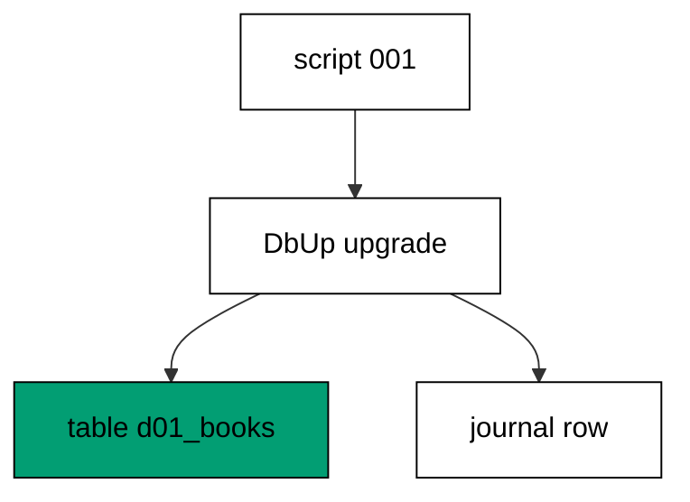

DbUp applies each named script once and records its name in the schemaversions journal, so the database itself remembers what already ran. The script name carries the version and the intent in one string, and the journal makes the second run a no-op instead of a duplicate table. Fixed names beat generated stamps because a name created by the clock cannot be reviewed, ordered, or merged by a team.

**`learning/code/ex-01-first-migration-creates-a-table/Program.fs`**:

```fsharp
module App // => one module owns the whole unit

open DbUp // => DeployChanges entry point lives here
open Npgsql // => Npgsql verifies the migrated schema

// => The database address comes from the harness, with local-run defaults.
let connStr () = // => one builder owns every address default
    let host = // => service hostname in the unit network
        match System.Environment.GetEnvironmentVariable("PGHOST") with // => harness sets the service host
        | null
        | "" -> "localhost" // => local runs fall back to localhost
        | h -> h // => the harness value wins when present

    let port = // => service port, almost always the default
        match System.Environment.GetEnvironmentVariable("PGPORT") with // => harness sets the service port
        | null
        | "" -> "5432" // => PostgreSQL listens on 5432
        | p -> p // => the harness value wins when present

    let user = // => trust-auth role, no password needed
        match System.Environment.GetEnvironmentVariable("PGUSER") with // => harness sets the service user
        | null
        | "" -> "postgres" // => local runs use the superuser
        | u -> u // => the harness value wins when present

    let db = // => fresh database for every unit run
        match System.Environment.GetEnvironmentVariable("PGDATABASE") with // => harness sets the service database
        | null
        | "" -> "postgres" // => local runs use the default database
        | d -> d // => the harness value wins when present

    let baseStr = $"Host=%s{host};Port=%s{port};Username=%s{user};Database=%s{db}" // => trust auth needs no password

    match System.Environment.GetEnvironmentVariable("PGPASSWORD") with // => only local runs set a password
    | null
    | "" -> baseStr // => the harness uses trust auth
    | pw -> baseStr + $";Password=%s{pw}" // => local runs authenticate with it

// => One helper runs a write and ignores the count; reads print their own proof.
let exec (conn: NpgsqlConnection) (sql: string) = // => every write flows through here
    use cmd = new NpgsqlCommand(sql, conn) // => fresh command per statement
    cmd.ExecuteNonQuery() |> ignore // => row counts never reach output

// => One helper answers a single int64; counts and ids print through it.
let scalar (conn: NpgsqlConnection) (sql: string) = // => every count flows through here
    use cmd = new NpgsqlCommand(sql, conn) // => fresh command per query
    cmd.ExecuteScalar() :?> int64 // => counts come back as int64

// => One helper lists one text column in order; histories print through it.
let column (conn: NpgsqlConnection) (sql: string) = // => every history flows through here
    use cmd = new NpgsqlCommand(sql, conn) // => fresh command per query
    use reader = cmd.ExecuteReader() // => forward-only reads stay simple

    [ while reader.Read() do
          reader.GetString(0) ] // => one string per row, in query order

// => DbUp journals under this table; units reset only their own rows.
let journalExists (conn: NpgsqlConnection) = // => first runs have no journal yet
    scalar conn "SELECT count(*) FROM information_schema.tables WHERE table_name = 'schemaversions'" = 1L // => one row means DbUp ran here before

// => Every unit starts clean and ends clean, so reruns print alike.
let reset (conn: NpgsqlConnection) (prefix: string) (tables: string list) = // => one reset owns every leftover
    for t in tables do
        exec conn $"DROP TABLE IF EXISTS %s{t} CASCADE" // => a killed run never poisons the rerun

    if journalExists conn then // => the journal may not exist on the first run
        exec conn $"DELETE FROM schemaversions WHERE scriptname LIKE '%s{prefix}%%'" // => only this unit's rows vanish

[<EntryPoint>] // => the harness runs the compiled assembly
let main _ = // => every unit answers zero on success
    use conn = new NpgsqlConnection(connStr ()) // => one session per unit run
    conn.Open() // => fail fast when the service is unreachable
    reset conn "d01_" [ "d01_books" ] // => leftovers of a killed run vanish

    let upgrader = // => DbUp plans the upgrade from these scripts
        DeployChanges.To // => the fluent entry point
            .PostgresqlDatabase(connStr ()) // => the harness database, trust auth
            .WithScript(
                "d01_001_create_books.sql",
                "CREATE TABLE d01_books (id SERIAL PRIMARY KEY, title TEXT NOT NULL);"
            ) // => one ordered script per change
            .Build() // => freeze the plan before running

    let resultupgrader = upgrader.PerformUpgrade() // => apply what the journal lacks
    printfn "upgrade=%b" resultupgrader.Successful // => Output: upgrade=true
    exec conn "INSERT INTO d01_books (title) VALUES ('Dune')" // => one seed row proves the table works
    printfn "books=%d" (scalar conn "SELECT count(*) FROM d01_books") // => Output: books=1

    for h in column conn "SELECT scriptname FROM schemaversions ORDER BY schemaversionsid" do
        printfn "history=%s" h // => history prints in apply order

    reset conn "d01_" [ "d01_books" ] // => leftovers of a killed run vanish
    0 // => zero exit means the transcript matched
```

**Output** (`learning/code/ex-01-first-migration-creates-a-table/expected/main.stdout.txt`):

```text
upgrade=true
books=1
history=d01_001_create_books.sql
```

**Key takeaway**: One named script creates one table, and the journal entry it leaves behind is the proof the migration ran.

**Why it matters**: Versioned scripts turn a scary production change into a reviewable artifact: the file states exactly what runs, the name fixes its position in history, and the journal entry proves it ran. Teams that version every change stop asking which database has which schema, because the database answers for itself. That answerability is the whole habit this course builds, and it starts with this single table.

### Example 2: Migration Scripts Run in Order

Two scripts applied through one upgrade run in the order they were registered, and the columns they leave behind prove it. The program registers a create followed by an alter, then lists the finished columns. (Concepts: co-01.)

Registration order is execution order: DbUp walks the scripts in the sequence the builder received them and journals each under its own name. The alter lands on a table the create already made, which is exactly the dependency every later example assumes. Reading the columns back in ordinal order closes the loop between what the scripts said and what the schema became.

**`learning/code/ex-02-migration-scripts-run-in-order/Program.fs`**:

```fsharp
module App // => one module owns the whole unit

open DbUp // => DeployChanges entry point lives here
open Npgsql // => Npgsql verifies the migrated schema

// => The database address comes from the harness, with local-run defaults.
let connStr () = // => one builder owns every address default
    let host = // => service hostname in the unit network
        match System.Environment.GetEnvironmentVariable("PGHOST") with // => harness sets the service host
        | null
        | "" -> "localhost" // => local runs fall back to localhost
        | h -> h // => the harness value wins when present

    let port = // => service port, almost always the default
        match System.Environment.GetEnvironmentVariable("PGPORT") with // => harness sets the service port
        | null
        | "" -> "5432" // => PostgreSQL listens on 5432
        | p -> p // => the harness value wins when present

    let user = // => trust-auth role, no password needed
        match System.Environment.GetEnvironmentVariable("PGUSER") with // => harness sets the service user
        | null
        | "" -> "postgres" // => local runs use the superuser
        | u -> u // => the harness value wins when present

    let db = // => fresh database for every unit run
        match System.Environment.GetEnvironmentVariable("PGDATABASE") with // => harness sets the service database
        | null
        | "" -> "postgres" // => local runs use the default database
        | d -> d // => the harness value wins when present

    let baseStr = $"Host=%s{host};Port=%s{port};Username=%s{user};Database=%s{db}" // => trust auth needs no password

    match System.Environment.GetEnvironmentVariable("PGPASSWORD") with // => only local runs set a password
    | null
    | "" -> baseStr // => the harness uses trust auth
    | pw -> baseStr + $";Password=%s{pw}" // => local runs authenticate with it

// => One helper runs a write and ignores the count; reads print their own proof.
let exec (conn: NpgsqlConnection) (sql: string) = // => every write flows through here
    use cmd = new NpgsqlCommand(sql, conn) // => fresh command per statement
    cmd.ExecuteNonQuery() |> ignore // => row counts never reach output

// => One helper answers a single int64; counts and ids print through it.
let scalar (conn: NpgsqlConnection) (sql: string) = // => every count flows through here
    use cmd = new NpgsqlCommand(sql, conn) // => fresh command per query
    cmd.ExecuteScalar() :?> int64 // => counts come back as int64

// => One helper lists one text column in order; histories print through it.
let column (conn: NpgsqlConnection) (sql: string) = // => every history flows through here
    use cmd = new NpgsqlCommand(sql, conn) // => fresh command per query
    use reader = cmd.ExecuteReader() // => forward-only reads stay simple

    [ while reader.Read() do
          reader.GetString(0) ] // => one string per row, in query order

// => DbUp journals under this table; units reset only their own rows.
let journalExists (conn: NpgsqlConnection) = // => first runs have no journal yet
    scalar conn "SELECT count(*) FROM information_schema.tables WHERE table_name = 'schemaversions'" = 1L // => one row means DbUp ran here before

// => Every unit starts clean and ends clean, so reruns print alike.
let reset (conn: NpgsqlConnection) (prefix: string) (tables: string list) = // => one reset owns every leftover
    for t in tables do
        exec conn $"DROP TABLE IF EXISTS %s{t} CASCADE" // => a killed run never poisons the rerun

    if journalExists conn then // => the journal may not exist on the first run
        exec conn $"DELETE FROM schemaversions WHERE scriptname LIKE '%s{prefix}%%'" // => only this unit's rows vanish

[<EntryPoint>] // => the harness runs the compiled assembly
let main _ = // => every unit answers zero on success
    use conn = new NpgsqlConnection(connStr ()) // => one session per unit run
    conn.Open() // => fail fast when the service is unreachable
    reset conn "d02_" [ "d02_members" ] // => leftovers of a killed run vanish

    let upgrader = // => DbUp plans the upgrade from these scripts
        DeployChanges.To // => the fluent entry point
            .PostgresqlDatabase(connStr ()) // => the harness database, trust auth
            .WithScript(
                "d02_001_create_members.sql",
                "CREATE TABLE d02_members (id SERIAL PRIMARY KEY, handle TEXT NOT NULL);"
            ) // => one ordered script per change
            .Build() // => freeze the plan before running

    let resultupgrader = upgrader.PerformUpgrade() // => apply what the journal lacks
    printfn "upgrade=%b" resultupgrader.Successful // => Output: upgrade=true

    let upgrader2 = // => DbUp plans the upgrade from these scripts
        DeployChanges.To // => the fluent entry point
            .PostgresqlDatabase(connStr ()) // => the harness database, trust auth
            .WithScript("d02_002_add_email.sql", "ALTER TABLE d02_members ADD COLUMN email TEXT;") // => one ordered script per change
            .Build() // => freeze the plan before running

    let resultupgrader2 = upgrader2.PerformUpgrade() // => apply what the journal lacks
    printfn "upgrade=%b" resultupgrader2.Successful // => Output: upgrade=true

    printfn
        "columns=%s"
        (System.String.Join(
            ",",
            column
                conn
                "SELECT column_name FROM information_schema.columns WHERE table_name = 'd02_members' ORDER BY ordinal_position"
        )) // => Output: columns=id,handle,email

    for h in column conn "SELECT scriptname FROM schemaversions ORDER BY schemaversionsid" do
        printfn "history=%s" h // => history prints in apply order

    reset conn "d02_" [ "d02_members" ] // => leftovers of a killed run vanish
    0 // => zero exit means the transcript matched
```

**Output** (`learning/code/ex-02-migration-scripts-run-in-order/expected/main.stdout.txt`):

```text
upgrade=true
upgrade=true
columns=id,handle,email
history=d02_001_create_members.sql
history=d02_002_add_email.sql
```

**Key takeaway**: Scripts run in registration order, so a create followed by an alter always lands on the table the create made.

**Why it matters**: Ordering is the quiet contract underneath every migration tool: nobody timestamps intent, they sequence it. When the order lives in the registration rather than in wall-clock time, two developers can read the same history and agree on what happened. That agreement is what lets a team merge migration branches without a meeting, and it starts with registering scripts in dependency order.

### Example 3: Rerun Applies Nothing New

Applying the same upgrade twice changes nothing the second time: the journal already holds the script name, so DbUp skips it. The program upgrades, upgrades again, and counts the tables. (Concepts: co-01, co-05.)

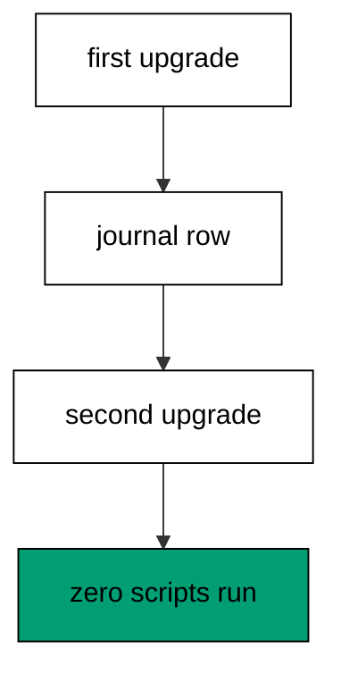

Idempotence is what makes reruns safe: the second PerformUpgrade reports success while executing zero scripts, and the table count stays at one. A deploy pipeline that retries a migration step after a network blip depends on exactly this property. The journal is the memory that turns a repeated run into a harmless no-op instead of a duplicate-table error.

**`learning/code/ex-03-rerun-applies-nothing-new/Program.fs`**:

```fsharp
module App // => one module owns the whole unit

open DbUp // => DeployChanges entry point lives here
open Npgsql // => Npgsql verifies the migrated schema

// => The database address comes from the harness, with local-run defaults.
let connStr () = // => one builder owns every address default
    let host = // => service hostname in the unit network
        match System.Environment.GetEnvironmentVariable("PGHOST") with // => harness sets the service host
        | null
        | "" -> "localhost" // => local runs fall back to localhost
        | h -> h // => the harness value wins when present

    let port = // => service port, almost always the default
        match System.Environment.GetEnvironmentVariable("PGPORT") with // => harness sets the service port
        | null
        | "" -> "5432" // => PostgreSQL listens on 5432
        | p -> p // => the harness value wins when present

    let user = // => trust-auth role, no password needed
        match System.Environment.GetEnvironmentVariable("PGUSER") with // => harness sets the service user
        | null
        | "" -> "postgres" // => local runs use the superuser
        | u -> u // => the harness value wins when present

    let db = // => fresh database for every unit run
        match System.Environment.GetEnvironmentVariable("PGDATABASE") with // => harness sets the service database
        | null
        | "" -> "postgres" // => local runs use the default database
        | d -> d // => the harness value wins when present

    let baseStr = $"Host=%s{host};Port=%s{port};Username=%s{user};Database=%s{db}" // => trust auth needs no password

    match System.Environment.GetEnvironmentVariable("PGPASSWORD") with // => only local runs set a password
    | null
    | "" -> baseStr // => the harness uses trust auth
    | pw -> baseStr + $";Password=%s{pw}" // => local runs authenticate with it

// => One helper runs a write and ignores the count; reads print their own proof.
let exec (conn: NpgsqlConnection) (sql: string) = // => every write flows through here
    use cmd = new NpgsqlCommand(sql, conn) // => fresh command per statement
    cmd.ExecuteNonQuery() |> ignore // => row counts never reach output

// => One helper answers a single int64; counts and ids print through it.
let scalar (conn: NpgsqlConnection) (sql: string) = // => every count flows through here
    use cmd = new NpgsqlCommand(sql, conn) // => fresh command per query
    cmd.ExecuteScalar() :?> int64 // => counts come back as int64

// => One helper lists one text column in order; histories print through it.
let column (conn: NpgsqlConnection) (sql: string) = // => every history flows through here
    use cmd = new NpgsqlCommand(sql, conn) // => fresh command per query
    use reader = cmd.ExecuteReader() // => forward-only reads stay simple

    [ while reader.Read() do
          reader.GetString(0) ] // => one string per row, in query order

// => DbUp journals under this table; units reset only their own rows.
let journalExists (conn: NpgsqlConnection) = // => first runs have no journal yet
    scalar conn "SELECT count(*) FROM information_schema.tables WHERE table_name = 'schemaversions'" = 1L // => one row means DbUp ran here before

// => Every unit starts clean and ends clean, so reruns print alike.
let reset (conn: NpgsqlConnection) (prefix: string) (tables: string list) = // => one reset owns every leftover
    for t in tables do
        exec conn $"DROP TABLE IF EXISTS %s{t} CASCADE" // => a killed run never poisons the rerun

    if journalExists conn then // => the journal may not exist on the first run
        exec conn $"DELETE FROM schemaversions WHERE scriptname LIKE '%s{prefix}%%'" // => only this unit's rows vanish

[<EntryPoint>] // => the harness runs the compiled assembly
let main _ = // => every unit answers zero on success
    use conn = new NpgsqlConnection(connStr ()) // => one session per unit run
    conn.Open() // => fail fast when the service is unreachable
    reset conn "d03_" [ "d03_notes" ] // => leftovers of a killed run vanish

    let upgrader = // => DbUp plans the upgrade from these scripts
        DeployChanges.To // => the fluent entry point
            .PostgresqlDatabase(connStr ()) // => the harness database, trust auth
            .WithScript(
                "d03_001_create_notes.sql",
                "CREATE TABLE d03_notes (id SERIAL PRIMARY KEY, body TEXT NOT NULL);"
            ) // => one ordered script per change
            .Build() // => freeze the plan before running

    let resultupgrader = upgrader.PerformUpgrade() // => apply what the journal lacks
    printfn "upgrade=%b" resultupgrader.Successful // => Output: upgrade=true

    let upgrader2 = // => DbUp plans the upgrade from these scripts
        DeployChanges.To // => the fluent entry point
            .PostgresqlDatabase(connStr ()) // => the harness database, trust auth
            .WithScript(
                "d03_001_create_notes.sql",
                "CREATE TABLE d03_notes (id SERIAL PRIMARY KEY, body TEXT NOT NULL);"
            ) // => one ordered script per change
            .Build() // => freeze the plan before running

    let resultupgrader2 = upgrader2.PerformUpgrade() // => apply what the journal lacks
    printfn "upgrade=%b" resultupgrader2.Successful // => Output: upgrade=true
    printfn "second-apply=%b" resultupgrader2.Successful // => Output: second-apply=true
    printfn "tables=%d" (scalar conn "SELECT count(*) FROM information_schema.tables WHERE table_name = 'd03_notes'") // => Output: tables=1

    for h in column conn "SELECT scriptname FROM schemaversions ORDER BY schemaversionsid" do
        printfn "history=%s" h // => history prints in apply order

    reset conn "d03_" [ "d03_notes" ] // => leftovers of a killed run vanish
    0 // => zero exit means the transcript matched
```

**Output** (`learning/code/ex-03-rerun-applies-nothing-new/expected/main.stdout.txt`):

```text
upgrade=true
upgrade=true
second-apply=true
tables=1
history=d03_001_create_notes.sql
```

**Key takeaway**: A script the journal already holds never runs twice, so retrying an upgrade is always safe.

**Why it matters**: Retries are a fact of production life: containers restart, networks blip, pipelines re-run steps. A migration that breaks on its second run turns every retry into an incident, while an idempotent one turns retries into non-events. The journal check costs nothing and buys the whole deploy pipeline its nerve back, which is why idempotence is the first property to verify, not the last.

### Example 4: Create an Index

A migration can carry any DDL, and this one adds an index in its own script so the change stays reviewable. The program creates a table, indexes its name column, and counts the finished index. (Concepts: co-01.)

One script owns one change, so the index gets its own migration instead of hiding inside the create-table file. Small files make reviews honest: the reviewer sees exactly which access path the new query needs. Verifying through pg_indexes reads the catalog back instead of trusting the script text.

**`learning/code/ex-04-create-an-index/Program.fs`**:

```fsharp
module App // => one module owns the whole unit

open DbUp // => DeployChanges entry point lives here
open Npgsql // => Npgsql verifies the migrated schema

// => The database address comes from the harness, with local-run defaults.
let connStr () = // => one builder owns every address default
    let host = // => service hostname in the unit network
        match System.Environment.GetEnvironmentVariable("PGHOST") with // => harness sets the service host
        | null
        | "" -> "localhost" // => local runs fall back to localhost
        | h -> h // => the harness value wins when present

    let port = // => service port, almost always the default
        match System.Environment.GetEnvironmentVariable("PGPORT") with // => harness sets the service port
        | null
        | "" -> "5432" // => PostgreSQL listens on 5432
        | p -> p // => the harness value wins when present

    let user = // => trust-auth role, no password needed
        match System.Environment.GetEnvironmentVariable("PGUSER") with // => harness sets the service user
        | null
        | "" -> "postgres" // => local runs use the superuser
        | u -> u // => the harness value wins when present

    let db = // => fresh database for every unit run
        match System.Environment.GetEnvironmentVariable("PGDATABASE") with // => harness sets the service database
        | null
        | "" -> "postgres" // => local runs use the default database
        | d -> d // => the harness value wins when present

    let baseStr = $"Host=%s{host};Port=%s{port};Username=%s{user};Database=%s{db}" // => trust auth needs no password

    match System.Environment.GetEnvironmentVariable("PGPASSWORD") with // => only local runs set a password
    | null
    | "" -> baseStr // => the harness uses trust auth
    | pw -> baseStr + $";Password=%s{pw}" // => local runs authenticate with it

// => One helper runs a write and ignores the count; reads print their own proof.
let exec (conn: NpgsqlConnection) (sql: string) = // => every write flows through here
    use cmd = new NpgsqlCommand(sql, conn) // => fresh command per statement
    cmd.ExecuteNonQuery() |> ignore // => row counts never reach output

// => One helper answers a single int64; counts and ids print through it.
let scalar (conn: NpgsqlConnection) (sql: string) = // => every count flows through here
    use cmd = new NpgsqlCommand(sql, conn) // => fresh command per query
    cmd.ExecuteScalar() :?> int64 // => counts come back as int64

// => One helper lists one text column in order; histories print through it.
let column (conn: NpgsqlConnection) (sql: string) = // => every history flows through here
    use cmd = new NpgsqlCommand(sql, conn) // => fresh command per query
    use reader = cmd.ExecuteReader() // => forward-only reads stay simple

    [ while reader.Read() do
          reader.GetString(0) ] // => one string per row, in query order

// => DbUp journals under this table; units reset only their own rows.
let journalExists (conn: NpgsqlConnection) = // => first runs have no journal yet
    scalar conn "SELECT count(*) FROM information_schema.tables WHERE table_name = 'schemaversions'" = 1L // => one row means DbUp ran here before

// => Every unit starts clean and ends clean, so reruns print alike.
let reset (conn: NpgsqlConnection) (prefix: string) (tables: string list) = // => one reset owns every leftover
    for t in tables do
        exec conn $"DROP TABLE IF EXISTS %s{t} CASCADE" // => a killed run never poisons the rerun

    if journalExists conn then // => the journal may not exist on the first run
        exec conn $"DELETE FROM schemaversions WHERE scriptname LIKE '%s{prefix}%%'" // => only this unit's rows vanish

[<EntryPoint>] // => the harness runs the compiled assembly
let main _ = // => every unit answers zero on success
    use conn = new NpgsqlConnection(connStr ()) // => one session per unit run
    conn.Open() // => fail fast when the service is unreachable
    reset conn "d04_" [ "d04_events" ] // => leftovers of a killed run vanish

    let upgrader = // => DbUp plans the upgrade from these scripts
        DeployChanges.To // => the fluent entry point
            .PostgresqlDatabase(connStr ()) // => the harness database, trust auth
            .WithScript(
                "d04_001_create_events.sql",
                "CREATE TABLE d04_events (id SERIAL PRIMARY KEY, name TEXT NOT NULL);"
            ) // => one ordered script per change
            .Build() // => freeze the plan before running

    let resultupgrader = upgrader.PerformUpgrade() // => apply what the journal lacks
    printfn "upgrade=%b" resultupgrader.Successful // => Output: upgrade=true

    let upgrader2 = // => DbUp plans the upgrade from these scripts
        DeployChanges.To // => the fluent entry point
            .PostgresqlDatabase(connStr ()) // => the harness database, trust auth
            .WithScript("d04_002_add_index.sql", "CREATE INDEX d04_events_name_idx ON d04_events (name);") // => one ordered script per change
            .Build() // => freeze the plan before running

    let resultupgrader2 = upgrader2.PerformUpgrade() // => apply what the journal lacks
    printfn "upgrade=%b" resultupgrader2.Successful // => Output: upgrade=true

    printfn
        "indexes=%d"
        (scalar
            conn
            "SELECT count(*) FROM pg_indexes WHERE tablename = 'd04_events' AND indexname = 'd04_events_name_idx'") // => Output: indexes=1

    for h in column conn "SELECT scriptname FROM schemaversions ORDER BY schemaversionsid" do
        printfn "history=%s" h // => history prints in apply order

    reset conn "d04_" [ "d04_events" ] // => leftovers of a killed run vanish
    0 // => zero exit means the transcript matched
```

**Output** (`learning/code/ex-04-create-an-index/expected/main.stdout.txt`):

```text
upgrade=true
upgrade=true
indexes=1
history=d04_001_create_events.sql
history=d04_002_add_index.sql
```

**Key takeaway**: An index is a migration like any other: its own script, its own journal row, its own review.

**Why it matters**: Indexes are the migration teams forget to version: someone adds one by hand in production, and every other environment quietly diverges. A versioned index script closes that gap for the cost of one file. The catalog query then proves the index exists where the application will look for it, which is the only proof that matters at 3 AM.

### Example 5: Not Null with a Server Default

Adding a NOT NULL column to a table that already has rows fails unless existing rows get a value: this migration backfills through a server default in the same script, then tightens the column. Two statements, one script. (Concepts: co-01.)

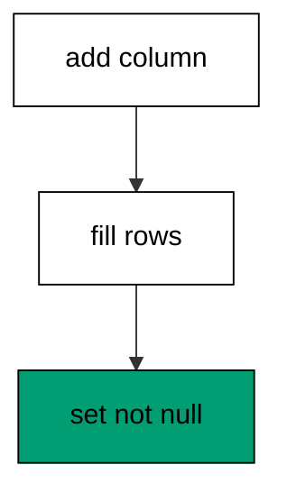

The default fills every existing row at ALTER time, so the constraint never sees a null. New rows must still supply the column, which the verification insert proves. Keeping both statements in one script keeps the fill and the tighten in a single reviewable step; a later example splits them across the transaction boundary on purpose.

**`learning/code/ex-05-not-null-with-a-server-default/Program.fs`**:

```fsharp
module App // => one module owns the whole unit

open DbUp // => DeployChanges entry point lives here
open Npgsql // => Npgsql verifies the migrated schema

// => The database address comes from the harness, with local-run defaults.
let connStr () = // => one builder owns every address default
    let host = // => service hostname in the unit network
        match System.Environment.GetEnvironmentVariable("PGHOST") with // => harness sets the service host
        | null
        | "" -> "localhost" // => local runs fall back to localhost
        | h -> h // => the harness value wins when present

    let port = // => service port, almost always the default
        match System.Environment.GetEnvironmentVariable("PGPORT") with // => harness sets the service port
        | null
        | "" -> "5432" // => PostgreSQL listens on 5432
        | p -> p // => the harness value wins when present

    let user = // => trust-auth role, no password needed
        match System.Environment.GetEnvironmentVariable("PGUSER") with // => harness sets the service user
        | null
        | "" -> "postgres" // => local runs use the superuser
        | u -> u // => the harness value wins when present

    let db = // => fresh database for every unit run
        match System.Environment.GetEnvironmentVariable("PGDATABASE") with // => harness sets the service database
        | null
        | "" -> "postgres" // => local runs use the default database
        | d -> d // => the harness value wins when present

    let baseStr = $"Host=%s{host};Port=%s{port};Username=%s{user};Database=%s{db}" // => trust auth needs no password

    match System.Environment.GetEnvironmentVariable("PGPASSWORD") with // => only local runs set a password
    | null
    | "" -> baseStr // => the harness uses trust auth
    | pw -> baseStr + $";Password=%s{pw}" // => local runs authenticate with it

// => One helper runs a write and ignores the count; reads print their own proof.
let exec (conn: NpgsqlConnection) (sql: string) = // => every write flows through here
    use cmd = new NpgsqlCommand(sql, conn) // => fresh command per statement
    cmd.ExecuteNonQuery() |> ignore // => row counts never reach output

// => One helper answers a single int64; counts and ids print through it.
let scalar (conn: NpgsqlConnection) (sql: string) = // => every count flows through here
    use cmd = new NpgsqlCommand(sql, conn) // => fresh command per query
    cmd.ExecuteScalar() :?> int64 // => counts come back as int64

// => One helper lists one text column in order; histories print through it.
let column (conn: NpgsqlConnection) (sql: string) = // => every history flows through here
    use cmd = new NpgsqlCommand(sql, conn) // => fresh command per query
    use reader = cmd.ExecuteReader() // => forward-only reads stay simple

    [ while reader.Read() do
          reader.GetString(0) ] // => one string per row, in query order

// => DbUp journals under this table; units reset only their own rows.
let journalExists (conn: NpgsqlConnection) = // => first runs have no journal yet
    scalar conn "SELECT count(*) FROM information_schema.tables WHERE table_name = 'schemaversions'" = 1L // => one row means DbUp ran here before

// => Every unit starts clean and ends clean, so reruns print alike.
let reset (conn: NpgsqlConnection) (prefix: string) (tables: string list) = // => one reset owns every leftover
    for t in tables do
        exec conn $"DROP TABLE IF EXISTS %s{t} CASCADE" // => a killed run never poisons the rerun

    if journalExists conn then // => the journal may not exist on the first run
        exec conn $"DELETE FROM schemaversions WHERE scriptname LIKE '%s{prefix}%%'" // => only this unit's rows vanish

[<EntryPoint>] // => the harness runs the compiled assembly
let main _ = // => every unit answers zero on success
    use conn = new NpgsqlConnection(connStr ()) // => one session per unit run
    conn.Open() // => fail fast when the service is unreachable
    reset conn "d05_" [ "d05_users" ] // => leftovers of a killed run vanish

    let upgrader = // => DbUp plans the upgrade from these scripts
        DeployChanges.To // => the fluent entry point
            .PostgresqlDatabase(connStr ()) // => the harness database, trust auth
            .WithScript(
                "d05_001_create_users.sql",
                "CREATE TABLE d05_users (id SERIAL PRIMARY KEY, name TEXT NOT NULL);"
            ) // => one ordered script per change
            .Build() // => freeze the plan before running

    let resultupgrader = upgrader.PerformUpgrade() // => apply what the journal lacks
    printfn "upgrade=%b" resultupgrader.Successful // => Output: upgrade=true
    exec conn "INSERT INTO d05_users (name) VALUES ('ada'), ('grace')" // => rows that predate the new column

    let upgrader2 = // => DbUp plans the upgrade from these scripts
        DeployChanges.To // => the fluent entry point
            .PostgresqlDatabase(connStr ()) // => the harness database, trust auth
            .WithScript(
                "d05_002_nickname_default.sql",
                "ALTER TABLE d05_users ADD COLUMN nickname TEXT DEFAULT 'anon'; ALTER TABLE d05_users ALTER COLUMN nickname SET NOT NULL;"
            ) // => one ordered script per change
            .Build() // => freeze the plan before running

    let resultupgrader2 = upgrader2.PerformUpgrade() // => apply what the journal lacks
    printfn "upgrade=%b" resultupgrader2.Successful // => Output: upgrade=true
    printfn "nicknames=%s" (System.String.Join(",", column conn "SELECT nickname FROM d05_users ORDER BY id")) // => Output: nicknames=anon,anon

    for h in column conn "SELECT scriptname FROM schemaversions ORDER BY schemaversionsid" do
        printfn "history=%s" h // => history prints in apply order

    reset conn "d05_" [ "d05_users" ] // => leftovers of a killed run vanish
    0 // => zero exit means the transcript matched
```

**Output** (`learning/code/ex-05-not-null-with-a-server-default/expected/main.stdout.txt`):

```text
upgrade=true
upgrade=true
nicknames=anon,anon
history=d05_001_create_users.sql
history=d05_002_nickname_default.sql
```

**Key takeaway**: A server default fills existing rows at ALTER time so the NOT NULL constraint that follows never sees a null.

**Why it matters**: Backfilling through defaults turns a locking tighten into a safe two-beat move inside one migration. Existing rows get values at ALTER time instead of failing the constraint, and the NOT NULL that follows protects every future write. Small tables barely notice; large tables survive because of exactly this shape, which is why experienced teams reach for it without thinking.

### Example 6: One Migration One Change

Each script owns exactly one change: customers arrive in the first migration and orders in the second, with the foreign key naming the dependency. The program applies both and lists the finished tables. (Concepts: co-01.)

Small scripts compose and large scripts hide: when the orders table needs its own review, its own rollback story, and its own deploy notes, sharing a file with customers helps nobody. The foreign key makes the order between the two files load-bearing rather than conventional. Listing the tables back proves both halves landed.

**`learning/code/ex-06-one-migration-one-change/Program.fs`**:

```fsharp
module App // => one module owns the whole unit

open DbUp // => DeployChanges entry point lives here
open Npgsql // => Npgsql verifies the migrated schema

// => The database address comes from the harness, with local-run defaults.
let connStr () = // => one builder owns every address default
    let host = // => service hostname in the unit network
        match System.Environment.GetEnvironmentVariable("PGHOST") with // => harness sets the service host
        | null
        | "" -> "localhost" // => local runs fall back to localhost
        | h -> h // => the harness value wins when present

    let port = // => service port, almost always the default
        match System.Environment.GetEnvironmentVariable("PGPORT") with // => harness sets the service port
        | null
        | "" -> "5432" // => PostgreSQL listens on 5432
        | p -> p // => the harness value wins when present

    let user = // => trust-auth role, no password needed
        match System.Environment.GetEnvironmentVariable("PGUSER") with // => harness sets the service user
        | null
        | "" -> "postgres" // => local runs use the superuser
        | u -> u // => the harness value wins when present

    let db = // => fresh database for every unit run
        match System.Environment.GetEnvironmentVariable("PGDATABASE") with // => harness sets the service database
        | null
        | "" -> "postgres" // => local runs use the default database
        | d -> d // => the harness value wins when present

    let baseStr = $"Host=%s{host};Port=%s{port};Username=%s{user};Database=%s{db}" // => trust auth needs no password

    match System.Environment.GetEnvironmentVariable("PGPASSWORD") with // => only local runs set a password
    | null
    | "" -> baseStr // => the harness uses trust auth
    | pw -> baseStr + $";Password=%s{pw}" // => local runs authenticate with it

// => One helper runs a write and ignores the count; reads print their own proof.
let exec (conn: NpgsqlConnection) (sql: string) = // => every write flows through here
    use cmd = new NpgsqlCommand(sql, conn) // => fresh command per statement
    cmd.ExecuteNonQuery() |> ignore // => row counts never reach output

// => One helper answers a single int64; counts and ids print through it.
let scalar (conn: NpgsqlConnection) (sql: string) = // => every count flows through here
    use cmd = new NpgsqlCommand(sql, conn) // => fresh command per query
    cmd.ExecuteScalar() :?> int64 // => counts come back as int64

// => One helper lists one text column in order; histories print through it.
let column (conn: NpgsqlConnection) (sql: string) = // => every history flows through here
    use cmd = new NpgsqlCommand(sql, conn) // => fresh command per query
    use reader = cmd.ExecuteReader() // => forward-only reads stay simple

    [ while reader.Read() do
          reader.GetString(0) ] // => one string per row, in query order

// => DbUp journals under this table; units reset only their own rows.
let journalExists (conn: NpgsqlConnection) = // => first runs have no journal yet
    scalar conn "SELECT count(*) FROM information_schema.tables WHERE table_name = 'schemaversions'" = 1L // => one row means DbUp ran here before

// => Every unit starts clean and ends clean, so reruns print alike.
let reset (conn: NpgsqlConnection) (prefix: string) (tables: string list) = // => one reset owns every leftover
    for t in tables do
        exec conn $"DROP TABLE IF EXISTS %s{t} CASCADE" // => a killed run never poisons the rerun

    if journalExists conn then // => the journal may not exist on the first run
        exec conn $"DELETE FROM schemaversions WHERE scriptname LIKE '%s{prefix}%%'" // => only this unit's rows vanish

[<EntryPoint>] // => the harness runs the compiled assembly
let main _ = // => every unit answers zero on success
    use conn = new NpgsqlConnection(connStr ()) // => one session per unit run
    conn.Open() // => fail fast when the service is unreachable
    reset conn "d06_" [ "d06_orders"; "d06_customers" ] // => leftovers of a killed run vanish

    let upgrader = // => DbUp plans the upgrade from these scripts
        DeployChanges.To // => the fluent entry point
            .PostgresqlDatabase(connStr ()) // => the harness database, trust auth
            .WithScript(
                "d06_001_create_customers.sql",
                "CREATE TABLE d06_customers (id SERIAL PRIMARY KEY, name TEXT NOT NULL);"
            ) // => one ordered script per change
            .Build() // => freeze the plan before running

    let resultupgrader = upgrader.PerformUpgrade() // => apply what the journal lacks
    printfn "upgrade=%b" resultupgrader.Successful // => Output: upgrade=true

    let upgrader2 = // => DbUp plans the upgrade from these scripts
        DeployChanges.To // => the fluent entry point
            .PostgresqlDatabase(connStr ()) // => the harness database, trust auth
            .WithScript(
                "d06_002_create_orders.sql",
                "CREATE TABLE d06_orders (id SERIAL PRIMARY KEY, customer_id INTEGER NOT NULL REFERENCES d06_customers (id), total INTEGER NOT NULL);"
            ) // => one ordered script per change
            .Build() // => freeze the plan before running

    let resultupgrader2 = upgrader2.PerformUpgrade() // => apply what the journal lacks
    printfn "upgrade=%b" resultupgrader2.Successful // => Output: upgrade=true

    printfn
        "tables=%s"
        (System.String.Join(
            ",",
            column
                conn
                "SELECT table_name FROM information_schema.tables WHERE table_name LIKE 'd06\_%' ORDER BY table_name"
        )) // => Output: tables=d06_customers,d06_orders

    for h in column conn "SELECT scriptname FROM schemaversions ORDER BY schemaversionsid" do
        printfn "history=%s" h // => history prints in apply order

    reset conn "d06_" [ "d06_orders"; "d06_customers" ] // => leftovers of a killed run vanish
    0 // => zero exit means the transcript matched
```

**Output** (`learning/code/ex-06-one-migration-one-change/expected/main.stdout.txt`):

```text
upgrade=true
upgrade=true
tables=d06_customers,d06_orders
history=d06_001_create_customers.sql
history=d06_002_create_orders.sql
```

**Key takeaway**: One change per script keeps every migration reviewable, reversible on its own terms, and safe to reorder around.

**Why it matters**: Big-bang migration files are write-only: nobody reviews a five-hundred-line schema dump with care, and nobody can roll back its middle. One change per script keeps the history readable enough that the on-call engineer can reason about it under pressure. That readability is a production feature, not a style preference, because incidents are debugged by reading history first.

### Example 7: Names Document Intent

Script names are documentation the database keeps: version plus intent in every row of the journal. The program applies three migrations and counts how many journal rows carry the full version-plus-intent shape. (Concepts: co-01.)

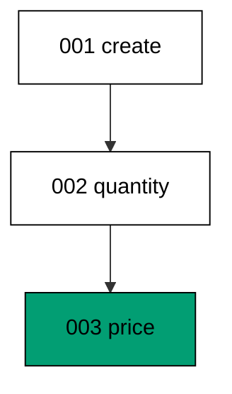

A name like 002_add_quantity tells the next reader what changed and where it sits without opening the script. The count query reads that discipline back from the journal instead of asserting it by inspection. Teams that name well can reconstruct a deploy from the journal alone, which is exactly what incident review needs.

**`learning/code/ex-07-names-document-intent/Program.fs`**:

```fsharp
module App // => one module owns the whole unit

open DbUp // => DeployChanges entry point lives here
open Npgsql // => Npgsql verifies the migrated schema

// => The database address comes from the harness, with local-run defaults.
let connStr () = // => one builder owns every address default
    let host = // => service hostname in the unit network
        match System.Environment.GetEnvironmentVariable("PGHOST") with // => harness sets the service host
        | null
        | "" -> "localhost" // => local runs fall back to localhost
        | h -> h // => the harness value wins when present

    let port = // => service port, almost always the default
        match System.Environment.GetEnvironmentVariable("PGPORT") with // => harness sets the service port
        | null
        | "" -> "5432" // => PostgreSQL listens on 5432
        | p -> p // => the harness value wins when present

    let user = // => trust-auth role, no password needed
        match System.Environment.GetEnvironmentVariable("PGUSER") with // => harness sets the service user
        | null
        | "" -> "postgres" // => local runs use the superuser
        | u -> u // => the harness value wins when present

    let db = // => fresh database for every unit run
        match System.Environment.GetEnvironmentVariable("PGDATABASE") with // => harness sets the service database
        | null
        | "" -> "postgres" // => local runs use the default database
        | d -> d // => the harness value wins when present

    let baseStr = $"Host=%s{host};Port=%s{port};Username=%s{user};Database=%s{db}" // => trust auth needs no password

    match System.Environment.GetEnvironmentVariable("PGPASSWORD") with // => only local runs set a password
    | null
    | "" -> baseStr // => the harness uses trust auth
    | pw -> baseStr + $";Password=%s{pw}" // => local runs authenticate with it

// => One helper runs a write and ignores the count; reads print their own proof.
let exec (conn: NpgsqlConnection) (sql: string) = // => every write flows through here
    use cmd = new NpgsqlCommand(sql, conn) // => fresh command per statement
    cmd.ExecuteNonQuery() |> ignore // => row counts never reach output

// => One helper answers a single int64; counts and ids print through it.
let scalar (conn: NpgsqlConnection) (sql: string) = // => every count flows through here
    use cmd = new NpgsqlCommand(sql, conn) // => fresh command per query
    cmd.ExecuteScalar() :?> int64 // => counts come back as int64

// => One helper lists one text column in order; histories print through it.
let column (conn: NpgsqlConnection) (sql: string) = // => every history flows through here
    use cmd = new NpgsqlCommand(sql, conn) // => fresh command per query
    use reader = cmd.ExecuteReader() // => forward-only reads stay simple

    [ while reader.Read() do
          reader.GetString(0) ] // => one string per row, in query order

// => DbUp journals under this table; units reset only their own rows.
let journalExists (conn: NpgsqlConnection) = // => first runs have no journal yet
    scalar conn "SELECT count(*) FROM information_schema.tables WHERE table_name = 'schemaversions'" = 1L // => one row means DbUp ran here before

// => Every unit starts clean and ends clean, so reruns print alike.
let reset (conn: NpgsqlConnection) (prefix: string) (tables: string list) = // => one reset owns every leftover
    for t in tables do
        exec conn $"DROP TABLE IF EXISTS %s{t} CASCADE" // => a killed run never poisons the rerun

    if journalExists conn then // => the journal may not exist on the first run
        exec conn $"DELETE FROM schemaversions WHERE scriptname LIKE '%s{prefix}%%'" // => only this unit's rows vanish

[<EntryPoint>] // => the harness runs the compiled assembly
let main _ = // => every unit answers zero on success
    use conn = new NpgsqlConnection(connStr ()) // => one session per unit run
    conn.Open() // => fail fast when the service is unreachable
    reset conn "d07_" [ "d07_stock" ] // => leftovers of a killed run vanish

    let upgrader = // => DbUp plans the upgrade from these scripts
        DeployChanges.To // => the fluent entry point
            .PostgresqlDatabase(connStr ()) // => the harness database, trust auth
            .WithScript(
                "d07_001_create_stock.sql",
                "CREATE TABLE d07_stock (id SERIAL PRIMARY KEY, sku TEXT NOT NULL);"
            ) // => one ordered script per change
            .Build() // => freeze the plan before running

    let resultupgrader = upgrader.PerformUpgrade() // => apply what the journal lacks
    printfn "upgrade=%b" resultupgrader.Successful // => Output: upgrade=true

    let upgrader2 = // => DbUp plans the upgrade from these scripts
        DeployChanges.To // => the fluent entry point
            .PostgresqlDatabase(connStr ()) // => the harness database, trust auth
            .WithScript(
                "d07_002_add_quantity.sql",
                "ALTER TABLE d07_stock ADD COLUMN quantity INTEGER NOT NULL DEFAULT 0;"
            ) // => one ordered script per change
            .Build() // => freeze the plan before running

    let resultupgrader2 = upgrader2.PerformUpgrade() // => apply what the journal lacks
    printfn "upgrade=%b" resultupgrader2.Successful // => Output: upgrade=true

    let upgrader3 = // => DbUp plans the upgrade from these scripts
        DeployChanges.To // => the fluent entry point
            .PostgresqlDatabase(connStr ()) // => the harness database, trust auth
            .WithScript(
                "d07_003_add_price.sql",
                "ALTER TABLE d07_stock ADD COLUMN price_cents INTEGER NOT NULL DEFAULT 0;"
            ) // => one ordered script per change
            .Build() // => freeze the plan before running

    let resultupgrader3 = upgrader3.PerformUpgrade() // => apply what the journal lacks
    printfn "upgrade=%b" resultupgrader3.Successful // => Output: upgrade=true
    printfn "scripts=%d" (scalar conn "SELECT count(*) FROM schemaversions WHERE scriptname LIKE 'd07\_%'") // => Output: scripts=3
    printfn "documented=%b" ((scalar conn "SELECT count(*) FROM schemaversions WHERE scriptname LIKE 'd07\_%\_%'") = 3L) // => Output: documented=true

    for h in column conn "SELECT scriptname FROM schemaversions ORDER BY schemaversionsid" do
        printfn "history=%s" h // => history prints in apply order

    reset conn "d07_" [ "d07_stock" ] // => leftovers of a killed run vanish
    0 // => zero exit means the transcript matched
```

**Output** (`learning/code/ex-07-names-document-intent/expected/main.stdout.txt`):

```text
upgrade=true
upgrade=true
upgrade=true
scripts=3
documented=true
history=d07_001_create_stock.sql
history=d07_002_add_quantity.sql
history=d07_003_add_price.sql
```

**Key takeaway**: Version-plus-intent names turn the journal into documentation a future incident review can read unaided.

**Why it matters**: Names are the cheapest documentation a migration system has, and the journal keeps them forever. A history of 001, 002, 003 says nothing; a history of create, quantity, price tells the story of the feature. Future readers meet the names long before they meet the SQL, so the name carries the first impression of every change.

### Example 8: Three Scripts One Upgrade

Three scripts registered together apply as one ordered batch, and the journal order matches the registration order exactly. The program runs a single upgrade with all three, then prints the journal sequence. (Concepts: co-01, co-04.)

Batch registration keeps related changes together in the code while the journal still records them as three separate rows. The order-by-id query proves the database applied them create, posted flag, amount column, with no interleaving. One upgrade call for a coherent change set is the normal shape of a deploy step.

**`learning/code/ex-08-three-scripts-one-upgrade/Program.fs`**:

```fsharp
module App // => one module owns the whole unit

open DbUp // => DeployChanges entry point lives here
open Npgsql // => Npgsql verifies the migrated schema

// => The database address comes from the harness, with local-run defaults.
let connStr () = // => one builder owns every address default
    let host = // => service hostname in the unit network
        match System.Environment.GetEnvironmentVariable("PGHOST") with // => harness sets the service host
        | null
        | "" -> "localhost" // => local runs fall back to localhost
        | h -> h // => the harness value wins when present

    let port = // => service port, almost always the default
        match System.Environment.GetEnvironmentVariable("PGPORT") with // => harness sets the service port
        | null
        | "" -> "5432" // => PostgreSQL listens on 5432
        | p -> p // => the harness value wins when present

    let user = // => trust-auth role, no password needed
        match System.Environment.GetEnvironmentVariable("PGUSER") with // => harness sets the service user
        | null
        | "" -> "postgres" // => local runs use the superuser
        | u -> u // => the harness value wins when present

    let db = // => fresh database for every unit run
        match System.Environment.GetEnvironmentVariable("PGDATABASE") with // => harness sets the service database
        | null
        | "" -> "postgres" // => local runs use the default database
        | d -> d // => the harness value wins when present

    let baseStr = $"Host=%s{host};Port=%s{port};Username=%s{user};Database=%s{db}" // => trust auth needs no password

    match System.Environment.GetEnvironmentVariable("PGPASSWORD") with // => only local runs set a password
    | null
    | "" -> baseStr // => the harness uses trust auth
    | pw -> baseStr + $";Password=%s{pw}" // => local runs authenticate with it

// => One helper runs a write and ignores the count; reads print their own proof.
let exec (conn: NpgsqlConnection) (sql: string) = // => every write flows through here
    use cmd = new NpgsqlCommand(sql, conn) // => fresh command per statement
    cmd.ExecuteNonQuery() |> ignore // => row counts never reach output

// => One helper answers a single int64; counts and ids print through it.
let scalar (conn: NpgsqlConnection) (sql: string) = // => every count flows through here
    use cmd = new NpgsqlCommand(sql, conn) // => fresh command per query
    cmd.ExecuteScalar() :?> int64 // => counts come back as int64

// => One helper lists one text column in order; histories print through it.
let column (conn: NpgsqlConnection) (sql: string) = // => every history flows through here
    use cmd = new NpgsqlCommand(sql, conn) // => fresh command per query
    use reader = cmd.ExecuteReader() // => forward-only reads stay simple

    [ while reader.Read() do
          reader.GetString(0) ] // => one string per row, in query order

// => DbUp journals under this table; units reset only their own rows.
let journalExists (conn: NpgsqlConnection) = // => first runs have no journal yet
    scalar conn "SELECT count(*) FROM information_schema.tables WHERE table_name = 'schemaversions'" = 1L // => one row means DbUp ran here before

// => Every unit starts clean and ends clean, so reruns print alike.
let reset (conn: NpgsqlConnection) (prefix: string) (tables: string list) = // => one reset owns every leftover
    for t in tables do
        exec conn $"DROP TABLE IF EXISTS %s{t} CASCADE" // => a killed run never poisons the rerun

    if journalExists conn then // => the journal may not exist on the first run
        exec conn $"DELETE FROM schemaversions WHERE scriptname LIKE '%s{prefix}%%'" // => only this unit's rows vanish

[<EntryPoint>] // => the harness runs the compiled assembly
let main _ = // => every unit answers zero on success
    use conn = new NpgsqlConnection(connStr ()) // => one session per unit run
    conn.Open() // => fail fast when the service is unreachable
    reset conn "d08_" [ "d08_ledger" ] // => leftovers of a killed run vanish

    let upgrader = // => DbUp plans the upgrade from these scripts
        DeployChanges.To // => the fluent entry point
            .PostgresqlDatabase(connStr ()) // => the harness database, trust auth
            .WithScript(
                "d08_001_create_ledger.sql",
                "CREATE TABLE d08_ledger (id SERIAL PRIMARY KEY, entry TEXT NOT NULL);"
            ) // => one ordered script per change
            .WithScript(
                "d08_002_add_posted.sql",
                "ALTER TABLE d08_ledger ADD COLUMN posted BOOLEAN NOT NULL DEFAULT false;"
            ) // => one ordered script per change
            .WithScript(
                "d08_003_add_amount.sql",
                "ALTER TABLE d08_ledger ADD COLUMN amount_cents INTEGER NOT NULL DEFAULT 0;"
            ) // => one ordered script per change
            .Build() // => freeze the plan before running

    let resultupgrader = upgrader.PerformUpgrade() // => apply what the journal lacks
    printfn "upgrade=%b" resultupgrader.Successful // => Output: upgrade=true

    printfn
        "order=%s"
        (System.String.Join(
            ",",
            column conn "SELECT scriptname FROM schemaversions WHERE scriptname LIKE 'd08\_%' ORDER BY schemaversionsid"
        )) // => Output: order=d08_001_create_ledger.sql,d08_002_add_posted.sql,d08_003_add_amount.sql

    printfn "columns=%d" (scalar conn "SELECT count(*) FROM information_schema.columns WHERE table_name = 'd08_ledger'") // => Output: columns=4

    for h in column conn "SELECT scriptname FROM schemaversions ORDER BY schemaversionsid" do
        printfn "history=%s" h // => history prints in apply order

    reset conn "d08_" [ "d08_ledger" ] // => leftovers of a killed run vanish
    0 // => zero exit means the transcript matched
```

**Output** (`learning/code/ex-08-three-scripts-one-upgrade/expected/main.stdout.txt`):

```text
upgrade=true
order=d08_001_create_ledger.sql,d08_002_add_posted.sql,d08_003_add_amount.sql
columns=4
history=d08_001_create_ledger.sql
history=d08_002_add_posted.sql
history=d08_003_add_amount.sql
```

**Key takeaway**: A single upgrade applies a registered batch in order, and the journal records each member separately.

**Why it matters**: Deploys ship change sets, not single files, so the upgrade call must handle batches with the same care as singletons. The journal keeps per-script rows even inside a batch, which means a batch is reviewable script by script and diagnosable row by row. Batching the call without merging the records is the best of both shapes.

### Example 9: History Table Is the Source of Truth

The journal is an ordinary table with a fixed shape, and this example reads that shape back instead of taking it on faith. The program upgrades once, then prints the journal name, its columns, and its row count. (Concepts: co-03.)

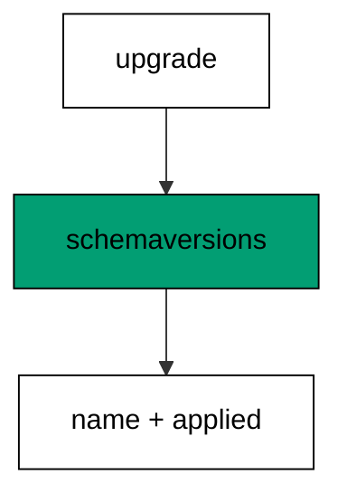

schemaversions holds one row per applied script with the script name and the moment it ran, keyed by its own id. Because the journal is queryable SQL rather than tool magic, every later diagnosis in this course reads it directly. Knowing the three columns by heart pays off from the next example onward.

**`learning/code/ex-09-history-table-is-the-source-of-truth/Program.fs`**:

```fsharp
module App // => one module owns the whole unit

open DbUp // => DeployChanges entry point lives here
open Npgsql // => Npgsql verifies the migrated schema

// => The database address comes from the harness, with local-run defaults.
let connStr () = // => one builder owns every address default
    let host = // => service hostname in the unit network
        match System.Environment.GetEnvironmentVariable("PGHOST") with // => harness sets the service host
        | null
        | "" -> "localhost" // => local runs fall back to localhost
        | h -> h // => the harness value wins when present

    let port = // => service port, almost always the default
        match System.Environment.GetEnvironmentVariable("PGPORT") with // => harness sets the service port
        | null
        | "" -> "5432" // => PostgreSQL listens on 5432
        | p -> p // => the harness value wins when present

    let user = // => trust-auth role, no password needed
        match System.Environment.GetEnvironmentVariable("PGUSER") with // => harness sets the service user
        | null
        | "" -> "postgres" // => local runs use the superuser
        | u -> u // => the harness value wins when present

    let db = // => fresh database for every unit run
        match System.Environment.GetEnvironmentVariable("PGDATABASE") with // => harness sets the service database
        | null
        | "" -> "postgres" // => local runs use the default database
        | d -> d // => the harness value wins when present

    let baseStr = $"Host=%s{host};Port=%s{port};Username=%s{user};Database=%s{db}" // => trust auth needs no password

    match System.Environment.GetEnvironmentVariable("PGPASSWORD") with // => only local runs set a password
    | null
    | "" -> baseStr // => the harness uses trust auth
    | pw -> baseStr + $";Password=%s{pw}" // => local runs authenticate with it

// => One helper runs a write and ignores the count; reads print their own proof.
let exec (conn: NpgsqlConnection) (sql: string) = // => every write flows through here
    use cmd = new NpgsqlCommand(sql, conn) // => fresh command per statement
    cmd.ExecuteNonQuery() |> ignore // => row counts never reach output

// => One helper answers a single int64; counts and ids print through it.
let scalar (conn: NpgsqlConnection) (sql: string) = // => every count flows through here
    use cmd = new NpgsqlCommand(sql, conn) // => fresh command per query
    cmd.ExecuteScalar() :?> int64 // => counts come back as int64

// => One helper lists one text column in order; histories print through it.
let column (conn: NpgsqlConnection) (sql: string) = // => every history flows through here
    use cmd = new NpgsqlCommand(sql, conn) // => fresh command per query
    use reader = cmd.ExecuteReader() // => forward-only reads stay simple

    [ while reader.Read() do
          reader.GetString(0) ] // => one string per row, in query order

// => DbUp journals under this table; units reset only their own rows.
let journalExists (conn: NpgsqlConnection) = // => first runs have no journal yet
    scalar conn "SELECT count(*) FROM information_schema.tables WHERE table_name = 'schemaversions'" = 1L // => one row means DbUp ran here before

// => Every unit starts clean and ends clean, so reruns print alike.
let reset (conn: NpgsqlConnection) (prefix: string) (tables: string list) = // => one reset owns every leftover
    for t in tables do
        exec conn $"DROP TABLE IF EXISTS %s{t} CASCADE" // => a killed run never poisons the rerun

    if journalExists conn then // => the journal may not exist on the first run
        exec conn $"DELETE FROM schemaversions WHERE scriptname LIKE '%s{prefix}%%'" // => only this unit's rows vanish

[<EntryPoint>] // => the harness runs the compiled assembly
let main _ = // => every unit answers zero on success
    use conn = new NpgsqlConnection(connStr ()) // => one session per unit run
    conn.Open() // => fail fast when the service is unreachable
    reset conn "d09_" [ "d09_pages" ] // => leftovers of a killed run vanish

    let upgrader = // => DbUp plans the upgrade from these scripts
        DeployChanges.To // => the fluent entry point
            .PostgresqlDatabase(connStr ()) // => the harness database, trust auth
            .WithScript(
                "d09_001_create_pages.sql",
                "CREATE TABLE d09_pages (id SERIAL PRIMARY KEY, slug TEXT NOT NULL);"
            ) // => one ordered script per change
            .Build() // => freeze the plan before running

    let resultupgrader = upgrader.PerformUpgrade() // => apply what the journal lacks
    printfn "upgrade=%b" resultupgrader.Successful // => Output: upgrade=true

    printfn
        "journal=%s"
        (System.String.Join(
            ",",
            column conn "SELECT table_name FROM information_schema.tables WHERE table_name = 'schemaversions'"
        )) // => Output: journal=schemaversions

    printfn
        "cols=%s"
        (System.String.Join(
            ",",
            column
                conn
                "SELECT column_name FROM information_schema.columns WHERE table_name = 'schemaversions' ORDER BY ordinal_position"
        )) // => Output: cols=schemaversionsid,scriptname,applied

    printfn "rows=%d" (scalar conn "SELECT count(*) FROM schemaversions WHERE scriptname LIKE 'd09\_%'") // => Output: rows=1
    reset conn "d09_" [ "d09_pages" ] // => leftovers of a killed run vanish
    0 // => zero exit means the transcript matched
```

**Output** (`learning/code/ex-09-history-table-is-the-source-of-truth/expected/main.stdout.txt`):

```text
upgrade=true
journal=schemaversions
cols=schemaversionsid,scriptname,applied
rows=1
```

**Key takeaway**: The journal is a plain table of script names and applied moments, and every diagnosis in this course reads it.

**Why it matters**: Tools come and go but the journal stays queryable: any engineer with SELECT can answer what ran where, without the migration tool installed. That independence is worth more than any dashboard, because incidents do not wait for tooling. Learn the table shape once and every future diagnosis starts from evidence instead of guesses.

### Example 10: Linear History Stays Mergeable

A history with no gaps and no duplicates merges cleanly, and this example verifies both properties from the journal. The program applies a three-link chain and prints the linked sequence. (Concepts: co-04.)

Linear means every version has exactly one predecessor and one successor, which the arrow-joined print makes visible. Branches fork this line later in the course; the discipline of one line is what makes those forks detectable. Counting duplicates proves no name was journaled twice and no stranger slipped into the sequence.

**`learning/code/ex-10-linear-history-stays-mergeable/Program.fs`**:

```fsharp
module App // => one module owns the whole unit

open DbUp // => DeployChanges entry point lives here
open Npgsql // => Npgsql verifies the migrated schema

// => The database address comes from the harness, with local-run defaults.
let connStr () = // => one builder owns every address default
    let host = // => service hostname in the unit network
        match System.Environment.GetEnvironmentVariable("PGHOST") with // => harness sets the service host
        | null
        | "" -> "localhost" // => local runs fall back to localhost
        | h -> h // => the harness value wins when present

    let port = // => service port, almost always the default
        match System.Environment.GetEnvironmentVariable("PGPORT") with // => harness sets the service port
        | null
        | "" -> "5432" // => PostgreSQL listens on 5432
        | p -> p // => the harness value wins when present

    let user = // => trust-auth role, no password needed
        match System.Environment.GetEnvironmentVariable("PGUSER") with // => harness sets the service user
        | null
        | "" -> "postgres" // => local runs use the superuser
        | u -> u // => the harness value wins when present

    let db = // => fresh database for every unit run
        match System.Environment.GetEnvironmentVariable("PGDATABASE") with // => harness sets the service database
        | null
        | "" -> "postgres" // => local runs use the default database
        | d -> d // => the harness value wins when present

    let baseStr = $"Host=%s{host};Port=%s{port};Username=%s{user};Database=%s{db}" // => trust auth needs no password

    match System.Environment.GetEnvironmentVariable("PGPASSWORD") with // => only local runs set a password
    | null
    | "" -> baseStr // => the harness uses trust auth
    | pw -> baseStr + $";Password=%s{pw}" // => local runs authenticate with it

// => One helper runs a write and ignores the count; reads print their own proof.
let exec (conn: NpgsqlConnection) (sql: string) = // => every write flows through here
    use cmd = new NpgsqlCommand(sql, conn) // => fresh command per statement
    cmd.ExecuteNonQuery() |> ignore // => row counts never reach output

// => One helper answers a single int64; counts and ids print through it.
let scalar (conn: NpgsqlConnection) (sql: string) = // => every count flows through here
    use cmd = new NpgsqlCommand(sql, conn) // => fresh command per query
    cmd.ExecuteScalar() :?> int64 // => counts come back as int64

// => One helper lists one text column in order; histories print through it.
let column (conn: NpgsqlConnection) (sql: string) = // => every history flows through here
    use cmd = new NpgsqlCommand(sql, conn) // => fresh command per query
    use reader = cmd.ExecuteReader() // => forward-only reads stay simple

    [ while reader.Read() do
          reader.GetString(0) ] // => one string per row, in query order

// => DbUp journals under this table; units reset only their own rows.
let journalExists (conn: NpgsqlConnection) = // => first runs have no journal yet
    scalar conn "SELECT count(*) FROM information_schema.tables WHERE table_name = 'schemaversions'" = 1L // => one row means DbUp ran here before

// => Every unit starts clean and ends clean, so reruns print alike.
let reset (conn: NpgsqlConnection) (prefix: string) (tables: string list) = // => one reset owns every leftover
    for t in tables do
        exec conn $"DROP TABLE IF EXISTS %s{t} CASCADE" // => a killed run never poisons the rerun

    if journalExists conn then // => the journal may not exist on the first run
        exec conn $"DELETE FROM schemaversions WHERE scriptname LIKE '%s{prefix}%%'" // => only this unit's rows vanish

[<EntryPoint>] // => the harness runs the compiled assembly
let main _ = // => every unit answers zero on success
    use conn = new NpgsqlConnection(connStr ()) // => one session per unit run
    conn.Open() // => fail fast when the service is unreachable
    reset conn "d10_" [ "d10_chain" ] // => leftovers of a killed run vanish

    let upgrader = // => DbUp plans the upgrade from these scripts
        DeployChanges.To // => the fluent entry point
            .PostgresqlDatabase(connStr ()) // => the harness database, trust auth
            .WithScript("d10_001_link.sql", "CREATE TABLE d10_chain (id SERIAL PRIMARY KEY, prev INTEGER NOT NULL);") // => one ordered script per change
            .WithScript("d10_002_link.sql", "ALTER TABLE d10_chain ADD COLUMN curr INTEGER NOT NULL DEFAULT 0;") // => one ordered script per change
            .WithScript("d10_003_link.sql", "ALTER TABLE d10_chain ADD COLUMN nxt INTEGER NOT NULL DEFAULT 0;") // => one ordered script per change
            .Build() // => freeze the plan before running

    let resultupgrader = upgrader.PerformUpgrade() // => apply what the journal lacks
    printfn "upgrade=%b" resultupgrader.Successful // => Output: upgrade=true

    printfn
        "chain=%s"
        (System.String.Join(
            "->",
            column conn "SELECT scriptname FROM schemaversions WHERE scriptname LIKE 'd10\_%' ORDER BY schemaversionsid"
        )) // => Output: chain=d10_001_link.sql->d10_002_link.sql->d10_003_link.sql

    printfn
        "dupes=%d"
        (scalar conn "SELECT count(*) - count(DISTINCT scriptname) FROM schemaversions WHERE scriptname LIKE 'd10\_%'") // => Output: dupes=0

    reset conn "d10_" [ "d10_chain" ] // => leftovers of a killed run vanish
    0 // => zero exit means the transcript matched
```

**Output** (`learning/code/ex-10-linear-history-stays-mergeable/expected/main.stdout.txt`):

```text
upgrade=true
chain=d10_001_link.sql->d10_002_link.sql->d10_003_link.sql
dupes=0
```

**Key takeaway**: A gap-free, duplicate-free journal line merges cleanly, and the arrow print is the shape to check.

**Why it matters**: Linear history is a team agreement made visible: each migration builds on exactly one predecessor, so any fork stands out immediately. Without that agreement, two developers silently build on the same base and production picks a winner at random. The arrow print is the habit to keep — read history as a chain, and breaks in the chain become obvious.

### Example 11: Gaps in Numbers Still Apply

Missing version numbers do not stop DbUp: it applies what is registered in registration order, gap or no gap. The program registers 001 and 003 with no 002 and proves both landed. (Concepts: co-04.)

DbUp orders by the registration sequence, not by arithmetic on the version numbers, so a skipped number is simply absent history. Gaps usually mean a migration was withdrawn before merge, and the tool treats that as normal. The column count proves the third script built on the first with nothing in between.

**`learning/code/ex-11-gaps-in-numbers-still-apply/Program.fs`**:

```fsharp
module App // => one module owns the whole unit

open DbUp // => DeployChanges entry point lives here
open Npgsql // => Npgsql verifies the migrated schema

// => The database address comes from the harness, with local-run defaults.
let connStr () = // => one builder owns every address default
    let host = // => service hostname in the unit network
        match System.Environment.GetEnvironmentVariable("PGHOST") with // => harness sets the service host
        | null
        | "" -> "localhost" // => local runs fall back to localhost
        | h -> h // => the harness value wins when present

    let port = // => service port, almost always the default
        match System.Environment.GetEnvironmentVariable("PGPORT") with // => harness sets the service port
        | null
        | "" -> "5432" // => PostgreSQL listens on 5432
        | p -> p // => the harness value wins when present

    let user = // => trust-auth role, no password needed
        match System.Environment.GetEnvironmentVariable("PGUSER") with // => harness sets the service user
        | null
        | "" -> "postgres" // => local runs use the superuser
        | u -> u // => the harness value wins when present

    let db = // => fresh database for every unit run
        match System.Environment.GetEnvironmentVariable("PGDATABASE") with // => harness sets the service database
        | null
        | "" -> "postgres" // => local runs use the default database
        | d -> d // => the harness value wins when present

    let baseStr = $"Host=%s{host};Port=%s{port};Username=%s{user};Database=%s{db}" // => trust auth needs no password

    match System.Environment.GetEnvironmentVariable("PGPASSWORD") with // => only local runs set a password
    | null
    | "" -> baseStr // => the harness uses trust auth
    | pw -> baseStr + $";Password=%s{pw}" // => local runs authenticate with it

// => One helper runs a write and ignores the count; reads print their own proof.
let exec (conn: NpgsqlConnection) (sql: string) = // => every write flows through here
    use cmd = new NpgsqlCommand(sql, conn) // => fresh command per statement
    cmd.ExecuteNonQuery() |> ignore // => row counts never reach output

// => One helper answers a single int64; counts and ids print through it.
let scalar (conn: NpgsqlConnection) (sql: string) = // => every count flows through here
    use cmd = new NpgsqlCommand(sql, conn) // => fresh command per query
    cmd.ExecuteScalar() :?> int64 // => counts come back as int64

// => One helper lists one text column in order; histories print through it.
let column (conn: NpgsqlConnection) (sql: string) = // => every history flows through here
    use cmd = new NpgsqlCommand(sql, conn) // => fresh command per query
    use reader = cmd.ExecuteReader() // => forward-only reads stay simple

    [ while reader.Read() do
          reader.GetString(0) ] // => one string per row, in query order

// => DbUp journals under this table; units reset only their own rows.
let journalExists (conn: NpgsqlConnection) = // => first runs have no journal yet
    scalar conn "SELECT count(*) FROM information_schema.tables WHERE table_name = 'schemaversions'" = 1L // => one row means DbUp ran here before

// => Every unit starts clean and ends clean, so reruns print alike.
let reset (conn: NpgsqlConnection) (prefix: string) (tables: string list) = // => one reset owns every leftover
    for t in tables do
        exec conn $"DROP TABLE IF EXISTS %s{t} CASCADE" // => a killed run never poisons the rerun

    if journalExists conn then // => the journal may not exist on the first run
        exec conn $"DELETE FROM schemaversions WHERE scriptname LIKE '%s{prefix}%%'" // => only this unit's rows vanish

[<EntryPoint>] // => the harness runs the compiled assembly
let main _ = // => every unit answers zero on success
    use conn = new NpgsqlConnection(connStr ()) // => one session per unit run
    conn.Open() // => fail fast when the service is unreachable
    reset conn "d11_" [ "d11_sparse" ] // => leftovers of a killed run vanish

    let upgrader = // => DbUp plans the upgrade from these scripts
        DeployChanges.To // => the fluent entry point
            .PostgresqlDatabase(connStr ()) // => the harness database, trust auth
            .WithScript("d11_001_first.sql", "CREATE TABLE d11_sparse (id SERIAL PRIMARY KEY, a TEXT NOT NULL);") // => one ordered script per change
            .WithScript("d11_003_third.sql", "ALTER TABLE d11_sparse ADD COLUMN c TEXT NOT NULL DEFAULT 'x';") // => one ordered script per change
            .Build() // => freeze the plan before running

    let resultupgrader = upgrader.PerformUpgrade() // => apply what the journal lacks
    printfn "upgrade=%b" resultupgrader.Successful // => Output: upgrade=true

    printfn
        "applied=%s"
        (System.String.Join(
            ",",
            column conn "SELECT scriptname FROM schemaversions WHERE scriptname LIKE 'd11\_%' ORDER BY schemaversionsid"
        )) // => Output: applied=d11_001_first.sql,d11_003_third.sql

    printfn "cols=%d" (scalar conn "SELECT count(*) FROM information_schema.columns WHERE table_name = 'd11_sparse'") // => Output: cols=3
    reset conn "d11_" [ "d11_sparse" ] // => leftovers of a killed run vanish
    0 // => zero exit means the transcript matched
```

**Output** (`learning/code/ex-11-gaps-in-numbers-still-apply/expected/main.stdout.txt`):

```text
upgrade=true
applied=d11_001_first.sql,d11_003_third.sql
cols=3
```

**Key takeaway**: DbUp follows registration order, so a gap in the numbering applies cleanly with nothing missing.

**Why it matters**: Numbering gaps look alarming and mean nothing: a withdrawn migration leaves a hole, and the tool walks around it. What matters is that every registered script runs exactly once in a known order, not that the numbers form an unbroken sequence. Teams that renumber to hide gaps rewrite history; teams that tolerate gaps keep history honest.

### Example 12: Pending Scripts Are Visible

DbUp answers what would run before running it: IsUpgradeRequired and GetScriptsToExecute turn the plan into readable state. The program builds a three-script plan, applies only the first script, and prints the pending count before and after. (Concepts: co-03, co-04.)

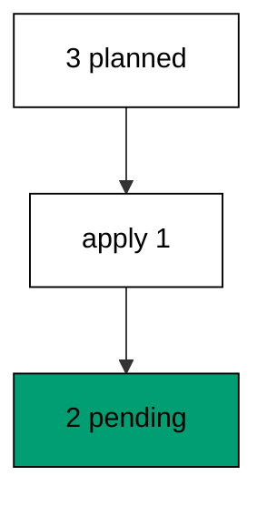

The status calls read the same journal the upgrade writes, so pending means registered but not journaled. A deploy gate that refuses to start while pending work exists is built from exactly these two calls. Printing before and after proves the status tracks reality rather than caching it.

**`learning/code/ex-12-pending-scripts-are-visible/Program.fs`**:

```fsharp
module App // => one module owns the whole unit

open DbUp // => DeployChanges entry point lives here
open Npgsql // => Npgsql verifies the migrated schema

// => The database address comes from the harness, with local-run defaults.
let connStr () = // => one builder owns every address default
    let host = // => service hostname in the unit network
        match System.Environment.GetEnvironmentVariable("PGHOST") with // => harness sets the service host
        | null
        | "" -> "localhost" // => local runs fall back to localhost
        | h -> h // => the harness value wins when present

    let port = // => service port, almost always the default
        match System.Environment.GetEnvironmentVariable("PGPORT") with // => harness sets the service port
        | null
        | "" -> "5432" // => PostgreSQL listens on 5432
        | p -> p // => the harness value wins when present

    let user = // => trust-auth role, no password needed
        match System.Environment.GetEnvironmentVariable("PGUSER") with // => harness sets the service user
        | null
        | "" -> "postgres" // => local runs use the superuser
        | u -> u // => the harness value wins when present

    let db = // => fresh database for every unit run
        match System.Environment.GetEnvironmentVariable("PGDATABASE") with // => harness sets the service database
        | null
        | "" -> "postgres" // => local runs use the default database
        | d -> d // => the harness value wins when present

    let baseStr = $"Host=%s{host};Port=%s{port};Username=%s{user};Database=%s{db}" // => trust auth needs no password

    match System.Environment.GetEnvironmentVariable("PGPASSWORD") with // => only local runs set a password
    | null
    | "" -> baseStr // => the harness uses trust auth
    | pw -> baseStr + $";Password=%s{pw}" // => local runs authenticate with it

// => One helper runs a write and ignores the count; reads print their own proof.
let exec (conn: NpgsqlConnection) (sql: string) = // => every write flows through here
    use cmd = new NpgsqlCommand(sql, conn) // => fresh command per statement
    cmd.ExecuteNonQuery() |> ignore // => row counts never reach output

// => One helper answers a single int64; counts and ids print through it.
let scalar (conn: NpgsqlConnection) (sql: string) = // => every count flows through here
    use cmd = new NpgsqlCommand(sql, conn) // => fresh command per query
    cmd.ExecuteScalar() :?> int64 // => counts come back as int64

// => One helper lists one text column in order; histories print through it.
let column (conn: NpgsqlConnection) (sql: string) = // => every history flows through here
    use cmd = new NpgsqlCommand(sql, conn) // => fresh command per query
    use reader = cmd.ExecuteReader() // => forward-only reads stay simple

    [ while reader.Read() do
          reader.GetString(0) ] // => one string per row, in query order

// => DbUp journals under this table; units reset only their own rows.
let journalExists (conn: NpgsqlConnection) = // => first runs have no journal yet
    scalar conn "SELECT count(*) FROM information_schema.tables WHERE table_name = 'schemaversions'" = 1L // => one row means DbUp ran here before

// => Every unit starts clean and ends clean, so reruns print alike.
let reset (conn: NpgsqlConnection) (prefix: string) (tables: string list) = // => one reset owns every leftover
    for t in tables do
        exec conn $"DROP TABLE IF EXISTS %s{t} CASCADE" // => a killed run never poisons the rerun

    if journalExists conn then // => the journal may not exist on the first run
        exec conn $"DELETE FROM schemaversions WHERE scriptname LIKE '%s{prefix}%%'" // => only this unit's rows vanish

[<EntryPoint>] // => the harness runs the compiled assembly
let main _ = // => every unit answers zero on success
    use conn = new NpgsqlConnection(connStr ()) // => one session per unit run
    conn.Open() // => fail fast when the service is unreachable
    reset conn "d12_" [ "d12_queue" ] // => leftovers of a killed run vanish

    let planned = // => the full upgrade registers three scripts at once
        DeployChanges.To // => the fluent entry point
            .PostgresqlDatabase(connStr ()) // => the harness database, trust auth
            .WithScript("d12_001_q.sql", "CREATE TABLE d12_queue (id SERIAL PRIMARY KEY, job TEXT NOT NULL);") // => first of three
            .WithScript("d12_002_q.sql", "ALTER TABLE d12_queue ADD COLUMN tries INTEGER NOT NULL DEFAULT 0;") // => second of three
            .WithScript("d12_003_q.sql", "ALTER TABLE d12_queue ADD COLUMN done BOOLEAN NOT NULL DEFAULT false;") // => third of three
            .Build() // => freeze the plan before running

    printfn "required-before=%b" (planned.IsUpgradeRequired()) // => Output: required-before=true
    printfn "pending-before=%d" (planned.GetScriptsToExecute() |> Seq.length) // => Output: pending-before=3

    let first = // => the partial upgrade registers only the first script
        DeployChanges.To // => same database, smaller plan
            .PostgresqlDatabase(connStr ()) // => the harness database, trust auth
            .WithScript("d12_001_q.sql", "CREATE TABLE d12_queue (id SERIAL PRIMARY KEY, job TEXT NOT NULL);") // => only the create
            .Build() // => freeze the smaller plan

    printfn "partial=%b" (first.PerformUpgrade().Successful) // => Output: partial=true
    printfn "required-after=%b" (planned.IsUpgradeRequired()) // => Output: required-after=true
    printfn "pending-after=%d" (planned.GetScriptsToExecute() |> Seq.length) // => Output: pending-after=2
    reset conn "d12_" [ "d12_queue" ] // => leftovers of a killed run vanish
    0 // => zero exit means the transcript matched
```

**Output** (`learning/code/ex-12-pending-scripts-are-visible/expected/main.stdout.txt`):

```text
required-before=true
pending-before=3
partial=true
required-after=true
pending-after=2
```

**Key takeaway**: IsUpgradeRequired and GetScriptsToExecute expose the pending set, so a deploy can inspect before it acts.

**Why it matters**: Deploys should never run blind: asking what is pending before upgrading turns a scary step into a checklist. The status calls cost one journal read and buy certainty about what the upgrade will do. Pipelines that print pending first and upgrade second fail loudly at the gate instead of quietly halfway through.

### Example 13: Status Reports Position

The journal doubles as a position report: names in applied order plus a moment per row say exactly where this database stands. The program applies two scripts and prints both the ordered names and the count of stamped moments. (Concepts: co-03.)

Ordering by the applied moment agrees with the id order here, which is the property a position report needs. Every row carries its own timestamp, so comparing two databases reduces to comparing two name lists. Position reporting is the read half of every deploy gate in this course.

**`learning/code/ex-13-status-reports-position/Program.fs`**:

```fsharp
module App // => one module owns the whole unit

open DbUp // => DeployChanges entry point lives here
open Npgsql // => Npgsql verifies the migrated schema

// => The database address comes from the harness, with local-run defaults.
let connStr () = // => one builder owns every address default
    let host = // => service hostname in the unit network
        match System.Environment.GetEnvironmentVariable("PGHOST") with // => harness sets the service host
        | null
        | "" -> "localhost" // => local runs fall back to localhost
        | h -> h // => the harness value wins when present

    let port = // => service port, almost always the default
        match System.Environment.GetEnvironmentVariable("PGPORT") with // => harness sets the service port
        | null
        | "" -> "5432" // => PostgreSQL listens on 5432
        | p -> p // => the harness value wins when present

    let user = // => trust-auth role, no password needed
        match System.Environment.GetEnvironmentVariable("PGUSER") with // => harness sets the service user
        | null
        | "" -> "postgres" // => local runs use the superuser
        | u -> u // => the harness value wins when present

    let db = // => fresh database for every unit run
        match System.Environment.GetEnvironmentVariable("PGDATABASE") with // => harness sets the service database
        | null
        | "" -> "postgres" // => local runs use the default database
        | d -> d // => the harness value wins when present

    let baseStr = $"Host=%s{host};Port=%s{port};Username=%s{user};Database=%s{db}" // => trust auth needs no password

    match System.Environment.GetEnvironmentVariable("PGPASSWORD") with // => only local runs set a password
    | null
    | "" -> baseStr // => the harness uses trust auth
    | pw -> baseStr + $";Password=%s{pw}" // => local runs authenticate with it

// => One helper runs a write and ignores the count; reads print their own proof.
let exec (conn: NpgsqlConnection) (sql: string) = // => every write flows through here
    use cmd = new NpgsqlCommand(sql, conn) // => fresh command per statement
    cmd.ExecuteNonQuery() |> ignore // => row counts never reach output

// => One helper answers a single int64; counts and ids print through it.
let scalar (conn: NpgsqlConnection) (sql: string) = // => every count flows through here
    use cmd = new NpgsqlCommand(sql, conn) // => fresh command per query
    cmd.ExecuteScalar() :?> int64 // => counts come back as int64

// => One helper lists one text column in order; histories print through it.
let column (conn: NpgsqlConnection) (sql: string) = // => every history flows through here
    use cmd = new NpgsqlCommand(sql, conn) // => fresh command per query
    use reader = cmd.ExecuteReader() // => forward-only reads stay simple

    [ while reader.Read() do
          reader.GetString(0) ] // => one string per row, in query order

// => DbUp journals under this table; units reset only their own rows.
let journalExists (conn: NpgsqlConnection) = // => first runs have no journal yet
    scalar conn "SELECT count(*) FROM information_schema.tables WHERE table_name = 'schemaversions'" = 1L // => one row means DbUp ran here before

// => Every unit starts clean and ends clean, so reruns print alike.
let reset (conn: NpgsqlConnection) (prefix: string) (tables: string list) = // => one reset owns every leftover
    for t in tables do
        exec conn $"DROP TABLE IF EXISTS %s{t} CASCADE" // => a killed run never poisons the rerun

    if journalExists conn then // => the journal may not exist on the first run
        exec conn $"DELETE FROM schemaversions WHERE scriptname LIKE '%s{prefix}%%'" // => only this unit's rows vanish

[<EntryPoint>] // => the harness runs the compiled assembly
let main _ = // => every unit answers zero on success
    use conn = new NpgsqlConnection(connStr ()) // => one session per unit run
    conn.Open() // => fail fast when the service is unreachable
    reset conn "d13_" [ "d13_status" ] // => leftovers of a killed run vanish

    let upgrader = // => DbUp plans the upgrade from these scripts
        DeployChanges.To // => the fluent entry point
            .PostgresqlDatabase(connStr ()) // => the harness database, trust auth
            .WithScript("d13_001_status.sql", "CREATE TABLE d13_status (id SERIAL PRIMARY KEY, s TEXT NOT NULL);") // => one ordered script per change
            .Build() // => freeze the plan before running

    let resultupgrader = upgrader.PerformUpgrade() // => apply what the journal lacks
    printfn "upgrade=%b" resultupgrader.Successful // => Output: upgrade=true

    let upgrader2 = // => DbUp plans the upgrade from these scripts
        DeployChanges.To // => the fluent entry point
            .PostgresqlDatabase(connStr ()) // => the harness database, trust auth
            .WithScript("d13_002_status.sql", "ALTER TABLE d13_status ADD COLUMN t TEXT NOT NULL DEFAULT 'q';") // => one ordered script per change
            .Build() // => freeze the plan before running

    let resultupgrader2 = upgrader2.PerformUpgrade() // => apply what the journal lacks
    printfn "upgrade=%b" resultupgrader2.Successful // => Output: upgrade=true

    printfn
        "names=%s"
        (System.String.Join(
            ";",
            column
                conn
                "SELECT scriptname FROM schemaversions WHERE scriptname LIKE 'd13\_%' ORDER BY applied, schemaversionsid"
        )) // => Output: names=d13_001_status.sql;d13_002_status.sql

    printfn
        "moments=%d"
        (scalar conn "SELECT count(*) FROM schemaversions WHERE scriptname LIKE 'd13\_%' AND applied IS NOT NULL") // => Output: moments=2

    reset conn "d13_" [ "d13_status" ] // => leftovers of a killed run vanish
    0 // => zero exit means the transcript matched
```

**Output** (`learning/code/ex-13-status-reports-position/expected/main.stdout.txt`):

```text
upgrade=true
upgrade=true
names=d13_001_status.sql;d13_002_status.sql
moments=2
```

**Key takeaway**: Names in applied order plus one moment per row report exactly where a database stands.

**Why it matters**: You cannot promote what you cannot locate: the position report tells the pipeline which migrations a database already has. Two environments with the same name list are at the same position, full stop. That comparison replaces folklore about which database is ahead with one query anyone can run. Position reports turn the journal from a log into a locator that every environment comparison starts from.

### Example 14: Upgrade Skips What Already Ran

Repeating a whole upgrade plan runs zero scripts when the journal already holds every name. The program applies two scripts, repeats the identical plan, and proves the journal still holds exactly two rows. (Concepts: co-03, co-05.)

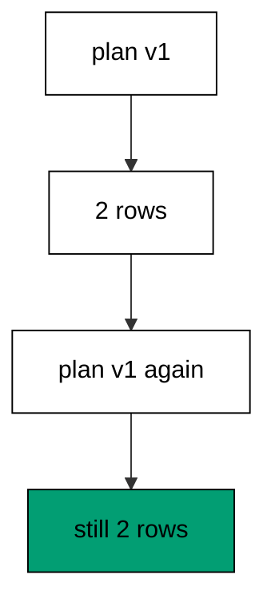

The repeat reports success without executing anything, which is the behavior a retried deploy step needs. The row count staying at two proves the skip happened per script rather than by accident. Plan-level idempotence composes the per-script idempotence from Example 3 into the unit pipelines actually retry.

**`learning/code/ex-14-upgrade-skips-what-already-ran/Program.fs`**:

```fsharp
module App // => one module owns the whole unit

open DbUp // => DeployChanges entry point lives here
open Npgsql // => Npgsql verifies the migrated schema

// => The database address comes from the harness, with local-run defaults.
let connStr () = // => one builder owns every address default
    let host = // => service hostname in the unit network
        match System.Environment.GetEnvironmentVariable("PGHOST") with // => harness sets the service host
        | null
        | "" -> "localhost" // => local runs fall back to localhost
        | h -> h // => the harness value wins when present

    let port = // => service port, almost always the default
        match System.Environment.GetEnvironmentVariable("PGPORT") with // => harness sets the service port
        | null
        | "" -> "5432" // => PostgreSQL listens on 5432
        | p -> p // => the harness value wins when present

    let user = // => trust-auth role, no password needed
        match System.Environment.GetEnvironmentVariable("PGUSER") with // => harness sets the service user
        | null
        | "" -> "postgres" // => local runs use the superuser
        | u -> u // => the harness value wins when present

    let db = // => fresh database for every unit run
        match System.Environment.GetEnvironmentVariable("PGDATABASE") with // => harness sets the service database
        | null
        | "" -> "postgres" // => local runs use the default database
        | d -> d // => the harness value wins when present

    let baseStr = $"Host=%s{host};Port=%s{port};Username=%s{user};Database=%s{db}" // => trust auth needs no password

    match System.Environment.GetEnvironmentVariable("PGPASSWORD") with // => only local runs set a password
    | null
    | "" -> baseStr // => the harness uses trust auth
    | pw -> baseStr + $";Password=%s{pw}" // => local runs authenticate with it

// => One helper runs a write and ignores the count; reads print their own proof.
let exec (conn: NpgsqlConnection) (sql: string) = // => every write flows through here
    use cmd = new NpgsqlCommand(sql, conn) // => fresh command per statement
    cmd.ExecuteNonQuery() |> ignore // => row counts never reach output

// => One helper answers a single int64; counts and ids print through it.
let scalar (conn: NpgsqlConnection) (sql: string) = // => every count flows through here
    use cmd = new NpgsqlCommand(sql, conn) // => fresh command per query
    cmd.ExecuteScalar() :?> int64 // => counts come back as int64

// => One helper lists one text column in order; histories print through it.
let column (conn: NpgsqlConnection) (sql: string) = // => every history flows through here
    use cmd = new NpgsqlCommand(sql, conn) // => fresh command per query
    use reader = cmd.ExecuteReader() // => forward-only reads stay simple

    [ while reader.Read() do
          reader.GetString(0) ] // => one string per row, in query order

// => DbUp journals under this table; units reset only their own rows.
let journalExists (conn: NpgsqlConnection) = // => first runs have no journal yet
    scalar conn "SELECT count(*) FROM information_schema.tables WHERE table_name = 'schemaversions'" = 1L // => one row means DbUp ran here before

// => Every unit starts clean and ends clean, so reruns print alike.
let reset (conn: NpgsqlConnection) (prefix: string) (tables: string list) = // => one reset owns every leftover
    for t in tables do
        exec conn $"DROP TABLE IF EXISTS %s{t} CASCADE" // => a killed run never poisons the rerun

    if journalExists conn then // => the journal may not exist on the first run
        exec conn $"DELETE FROM schemaversions WHERE scriptname LIKE '%s{prefix}%%'" // => only this unit's rows vanish

[<EntryPoint>] // => the harness runs the compiled assembly
let main _ = // => every unit answers zero on success
    use conn = new NpgsqlConnection(connStr ()) // => one session per unit run
    conn.Open() // => fail fast when the service is unreachable
    reset conn "d14_" [ "d14_part" ] // => leftovers of a killed run vanish

    let upgrader = // => DbUp plans the upgrade from these scripts
        DeployChanges.To // => the fluent entry point
            .PostgresqlDatabase(connStr ()) // => the harness database, trust auth
            .WithScript("d14_001_part.sql", "CREATE TABLE d14_part (id SERIAL PRIMARY KEY, a TEXT NOT NULL);") // => one ordered script per change
            .Build() // => freeze the plan before running

    let resultupgrader = upgrader.PerformUpgrade() // => apply what the journal lacks
    printfn "upgrade=%b" resultupgrader.Successful // => Output: upgrade=true

    let upgrader2 = // => DbUp plans the upgrade from these scripts
        DeployChanges.To // => the fluent entry point
            .PostgresqlDatabase(connStr ()) // => the harness database, trust auth
            .WithScript("d14_002_part.sql", "ALTER TABLE d14_part ADD COLUMN b TEXT NOT NULL DEFAULT 'y';") // => one ordered script per change
            .Build() // => freeze the plan before running

    let resultupgrader2 = upgrader2.PerformUpgrade() // => apply what the journal lacks
    printfn "upgrade=%b" resultupgrader2.Successful // => Output: upgrade=true

    let rerun = // => the same two scripts registered again
        DeployChanges.To // => the fluent entry point
            .PostgresqlDatabase(connStr ()) // => the harness database, trust auth
            .WithScript("d14_001_part.sql", "CREATE TABLE d14_part (id SERIAL PRIMARY KEY, a TEXT NOT NULL);") // => already journaled
            .WithScript("d14_002_part.sql", "ALTER TABLE d14_part ADD COLUMN b TEXT NOT NULL DEFAULT 'y';") // => already journaled
            .Build() // => freeze the repeated plan

    printfn "repeat=%b" (rerun.PerformUpgrade().Successful) // => Output: repeat=true
    printfn "rows=%d" (scalar conn "SELECT count(*) FROM schemaversions WHERE scriptname LIKE 'd14\_%'") // => Output: rows=2
    reset conn "d14_" [ "d14_part" ] // => leftovers of a killed run vanish
    0 // => zero exit means the transcript matched
```

**Output** (`learning/code/ex-14-upgrade-skips-what-already-ran/expected/main.stdout.txt`):

```text
upgrade=true
upgrade=true
repeat=true
rows=2
```

**Key takeaway**: Repeating a fully applied plan succeeds while running nothing, and the journal row count proves it.

**Why it matters**: Deploy steps get retried for reasons that have nothing to do with migrations: a timeout, a node restart, an impatient human. Plan-level skipping means the retry is free no matter how many scripts the plan holds. The row count is the receipt: same plan, same rows, zero work, which is exactly what a safe retry looks like.

### Example 15: Upgrade Requirement Is a Boolean

One boolean answers whether anything would run: true before the upgrade, false after it. The program inspects, applies, and inspects again around a single boolean-column table. (Concepts: co-03.)

The flag column starts empty because no rows exist yet, and the empty print is itself deterministic. The before-true and after-false pair is the contract a deploy gate branches on. Three lines of status around one upgrade is the whole pattern: ask, act, confirm.

**`learning/code/ex-15-upgrade-requirement-is-a-boolean/Program.fs`**:

```fsharp
module App // => one module owns the whole unit

open DbUp // => DeployChanges entry point lives here
open Npgsql // => Npgsql verifies the migrated schema

// => The database address comes from the harness, with local-run defaults.
let connStr () = // => one builder owns every address default
    let host = // => service hostname in the unit network
        match System.Environment.GetEnvironmentVariable("PGHOST") with // => harness sets the service host
        | null
        | "" -> "localhost" // => local runs fall back to localhost
        | h -> h // => the harness value wins when present

    let port = // => service port, almost always the default
        match System.Environment.GetEnvironmentVariable("PGPORT") with // => harness sets the service port
        | null
        | "" -> "5432" // => PostgreSQL listens on 5432
        | p -> p // => the harness value wins when present

    let user = // => trust-auth role, no password needed
        match System.Environment.GetEnvironmentVariable("PGUSER") with // => harness sets the service user
        | null
        | "" -> "postgres" // => local runs use the superuser
        | u -> u // => the harness value wins when present

    let db = // => fresh database for every unit run
        match System.Environment.GetEnvironmentVariable("PGDATABASE") with // => harness sets the service database
        | null
        | "" -> "postgres" // => local runs use the default database
        | d -> d // => the harness value wins when present

    let baseStr = $"Host=%s{host};Port=%s{port};Username=%s{user};Database=%s{db}" // => trust auth needs no password

    match System.Environment.GetEnvironmentVariable("PGPASSWORD") with // => only local runs set a password
    | null
    | "" -> baseStr // => the harness uses trust auth
    | pw -> baseStr + $";Password=%s{pw}" // => local runs authenticate with it

// => One helper runs a write and ignores the count; reads print their own proof.
let exec (conn: NpgsqlConnection) (sql: string) = // => every write flows through here
    use cmd = new NpgsqlCommand(sql, conn) // => fresh command per statement
    cmd.ExecuteNonQuery() |> ignore // => row counts never reach output

// => One helper answers a single int64; counts and ids print through it.
let scalar (conn: NpgsqlConnection) (sql: string) = // => every count flows through here
    use cmd = new NpgsqlCommand(sql, conn) // => fresh command per query
    cmd.ExecuteScalar() :?> int64 // => counts come back as int64

// => One helper lists one text column in order; histories print through it.
let column (conn: NpgsqlConnection) (sql: string) = // => every history flows through here
    use cmd = new NpgsqlCommand(sql, conn) // => fresh command per query
    use reader = cmd.ExecuteReader() // => forward-only reads stay simple

    [ while reader.Read() do
          reader.GetString(0) ] // => one string per row, in query order

// => DbUp journals under this table; units reset only their own rows.
let journalExists (conn: NpgsqlConnection) = // => first runs have no journal yet
    scalar conn "SELECT count(*) FROM information_schema.tables WHERE table_name = 'schemaversions'" = 1L // => one row means DbUp ran here before

// => Every unit starts clean and ends clean, so reruns print alike.
let reset (conn: NpgsqlConnection) (prefix: string) (tables: string list) = // => one reset owns every leftover
    for t in tables do
        exec conn $"DROP TABLE IF EXISTS %s{t} CASCADE" // => a killed run never poisons the rerun

    if journalExists conn then // => the journal may not exist on the first run
        exec conn $"DELETE FROM schemaversions WHERE scriptname LIKE '%s{prefix}%%'" // => only this unit's rows vanish

[<EntryPoint>] // => the harness runs the compiled assembly
let main _ = // => every unit answers zero on success
    use conn = new NpgsqlConnection(connStr ()) // => one session per unit run
    conn.Open() // => fail fast when the service is unreachable
    reset conn "d15_" [ "d15_bool" ] // => leftovers of a killed run vanish

    let plan = // => one script, inspected before and after
        DeployChanges.To // => the fluent entry point
            .PostgresqlDatabase(connStr ()) // => the harness database, trust auth
            .WithScript(
                "d15_001_bool.sql",
                "CREATE TABLE d15_bool (id SERIAL PRIMARY KEY, flag BOOLEAN NOT NULL DEFAULT false);"
            ) // => the one script
            .Build() // => freeze the plan before running

    printfn "before=%b" (plan.IsUpgradeRequired()) // => Output: before=true
    printfn "ran=%b" (plan.PerformUpgrade().Successful) // => Output: ran=true
    printfn "after=%b" (plan.IsUpgradeRequired()) // => Output: after=false
    printfn "flag=%s" (System.String.Join(",", column conn "SELECT flag::text FROM d15_bool")) // => Output: flag=
    reset conn "d15_" [ "d15_bool" ] // => leftovers of a killed run vanish
    0 // => zero exit means the transcript matched
```

**Output** (`learning/code/ex-15-upgrade-requirement-is-a-boolean/expected/main.stdout.txt`):

```text
before=true
ran=true
after=false
flag=
```

**Key takeaway**: IsUpgradeRequired flips from true to false across one upgrade, which is the branch a deploy gate needs.

**Why it matters**: Boolean gates beat parsed logs: a pipeline step that branches on true or false cannot misread a transcript. Asking before acting keeps deploys honest, and confirming after acting keeps them auditable. The three-line rhythm of ask, act, confirm scales from one script to hundreds without changing shape. Three lines around one upgrade is the smallest honest deploy gate a pipeline can carry.

### Example 16: Every Entry Records Its Moment

Every journal row carries the moment it ran, so history is ordered by time as well as by id. The program applies one script and proves its moment is stamped and the single-row order holds. (Concepts: co-03.)

The applied timestamp is written by the database clock at journal time, never by the script, so it cannot be forged by script content. Comparing moments across two databases reveals which one upgraded first when names alone tie. One row keeps the proof small enough to read at a glance.

**`learning/code/ex-16-every-entry-records-its-moment/Program.fs`**:

```fsharp
module App // => one module owns the whole unit

open DbUp // => DeployChanges entry point lives here
open Npgsql // => Npgsql verifies the migrated schema

// => The database address comes from the harness, with local-run defaults.
let connStr () = // => one builder owns every address default
    let host = // => service hostname in the unit network
        match System.Environment.GetEnvironmentVariable("PGHOST") with // => harness sets the service host
        | null
        | "" -> "localhost" // => local runs fall back to localhost
        | h -> h // => the harness value wins when present

    let port = // => service port, almost always the default
        match System.Environment.GetEnvironmentVariable("PGPORT") with // => harness sets the service port
        | null
        | "" -> "5432" // => PostgreSQL listens on 5432
        | p -> p // => the harness value wins when present

    let user = // => trust-auth role, no password needed
        match System.Environment.GetEnvironmentVariable("PGUSER") with // => harness sets the service user
        | null
        | "" -> "postgres" // => local runs use the superuser
        | u -> u // => the harness value wins when present

    let db = // => fresh database for every unit run
        match System.Environment.GetEnvironmentVariable("PGDATABASE") with // => harness sets the service database
        | null
        | "" -> "postgres" // => local runs use the default database
        | d -> d // => the harness value wins when present

    let baseStr = $"Host=%s{host};Port=%s{port};Username=%s{user};Database=%s{db}" // => trust auth needs no password

    match System.Environment.GetEnvironmentVariable("PGPASSWORD") with // => only local runs set a password
    | null
    | "" -> baseStr // => the harness uses trust auth
    | pw -> baseStr + $";Password=%s{pw}" // => local runs authenticate with it

// => One helper runs a write and ignores the count; reads print their own proof.
let exec (conn: NpgsqlConnection) (sql: string) = // => every write flows through here
    use cmd = new NpgsqlCommand(sql, conn) // => fresh command per statement
    cmd.ExecuteNonQuery() |> ignore // => row counts never reach output

// => One helper answers a single int64; counts and ids print through it.
let scalar (conn: NpgsqlConnection) (sql: string) = // => every count flows through here
    use cmd = new NpgsqlCommand(sql, conn) // => fresh command per query
    cmd.ExecuteScalar() :?> int64 // => counts come back as int64

// => One helper lists one text column in order; histories print through it.
let column (conn: NpgsqlConnection) (sql: string) = // => every history flows through here
    use cmd = new NpgsqlCommand(sql, conn) // => fresh command per query
    use reader = cmd.ExecuteReader() // => forward-only reads stay simple

    [ while reader.Read() do
          reader.GetString(0) ] // => one string per row, in query order

// => DbUp journals under this table; units reset only their own rows.
let journalExists (conn: NpgsqlConnection) = // => first runs have no journal yet
    scalar conn "SELECT count(*) FROM information_schema.tables WHERE table_name = 'schemaversions'" = 1L // => one row means DbUp ran here before

// => Every unit starts clean and ends clean, so reruns print alike.
let reset (conn: NpgsqlConnection) (prefix: string) (tables: string list) = // => one reset owns every leftover
    for t in tables do
        exec conn $"DROP TABLE IF EXISTS %s{t} CASCADE" // => a killed run never poisons the rerun

    if journalExists conn then // => the journal may not exist on the first run
        exec conn $"DELETE FROM schemaversions WHERE scriptname LIKE '%s{prefix}%%'" // => only this unit's rows vanish

[<EntryPoint>] // => the harness runs the compiled assembly
let main _ = // => every unit answers zero on success
    use conn = new NpgsqlConnection(connStr ()) // => one session per unit run
    conn.Open() // => fail fast when the service is unreachable
    reset conn "d16_" [ "d16_when" ] // => leftovers of a killed run vanish

    let upgrader = // => DbUp plans the upgrade from these scripts
        DeployChanges.To // => the fluent entry point
            .PostgresqlDatabase(connStr ()) // => the harness database, trust auth
            .WithScript("d16_001_when.sql", "CREATE TABLE d16_when (id SERIAL PRIMARY KEY, w TEXT NOT NULL);") // => one ordered script per change
            .Build() // => freeze the plan before running

    let resultupgrader = upgrader.PerformUpgrade() // => apply what the journal lacks
    printfn "upgrade=%b" resultupgrader.Successful // => Output: upgrade=true

    printfn
        "stamped=%d"
        (scalar conn "SELECT count(*) FROM schemaversions WHERE scriptname LIKE 'd16\_%' AND applied IS NOT NULL") // => Output: stamped=1

    printfn
        "ordered=%b"
        ((column
            conn
            "SELECT applied::text FROM schemaversions WHERE scriptname LIKE 'd16\_%' ORDER BY schemaversionsid")
         |> List.length
            =
            1) // => Output: ordered=true

    reset conn "d16_" [ "d16_when" ] // => leftovers of a killed run vanish
    0 // => zero exit means the transcript matched
```

**Output** (`learning/code/ex-16-every-entry-records-its-moment/expected/main.stdout.txt`):

```text
upgrade=true
stamped=1
ordered=true
```

**Key takeaway**: Each journal row stamps its own applied moment, giving history a second ordering beyond the id sequence.

**Why it matters**: Time answers the questions names cannot: not just what ran, but when, and therefore what the application was serving at the time. Incident timelines join deploy moments to symptoms, and the journal is the deploy side of that join. A moment per row turns the journal from a list into a timeline.

### Example 17: Test Every Migration Twice

The double-run discipline in one program: apply, repeat, repeat again, and prove the journal never grows past one row. The program performs the same upgrade three times and counts the journal rows. (Concepts: co-05, co-16.)

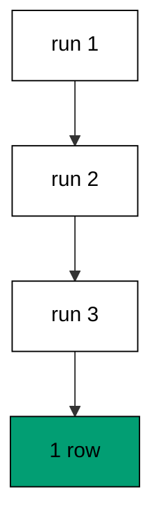

Three successes and one row is the shape every example in this course defends: success means the database matches, not merely that nothing exploded. Repeating inside one process is stricter than repeating across deploys because nothing resets between attempts. The harness double run checks the same property from outside.

**`learning/code/ex-17-test-every-migration-twice/Program.fs`**:

```fsharp
module App // => one module owns the whole unit

open DbUp // => DeployChanges entry point lives here
open Npgsql // => Npgsql verifies the migrated schema

// => The database address comes from the harness, with local-run defaults.
let connStr () = // => one builder owns every address default
    let host = // => service hostname in the unit network
        match System.Environment.GetEnvironmentVariable("PGHOST") with // => harness sets the service host
        | null
        | "" -> "localhost" // => local runs fall back to localhost
        | h -> h // => the harness value wins when present

    let port = // => service port, almost always the default
        match System.Environment.GetEnvironmentVariable("PGPORT") with // => harness sets the service port
        | null
        | "" -> "5432" // => PostgreSQL listens on 5432
        | p -> p // => the harness value wins when present

    let user = // => trust-auth role, no password needed
        match System.Environment.GetEnvironmentVariable("PGUSER") with // => harness sets the service user
        | null
        | "" -> "postgres" // => local runs use the superuser
        | u -> u // => the harness value wins when present

    let db = // => fresh database for every unit run
        match System.Environment.GetEnvironmentVariable("PGDATABASE") with // => harness sets the service database
        | null
        | "" -> "postgres" // => local runs use the default database
        | d -> d // => the harness value wins when present

    let baseStr = $"Host=%s{host};Port=%s{port};Username=%s{user};Database=%s{db}" // => trust auth needs no password

    match System.Environment.GetEnvironmentVariable("PGPASSWORD") with // => only local runs set a password
    | null
    | "" -> baseStr // => the harness uses trust auth
    | pw -> baseStr + $";Password=%s{pw}" // => local runs authenticate with it

// => One helper runs a write and ignores the count; reads print their own proof.
let exec (conn: NpgsqlConnection) (sql: string) = // => every write flows through here
    use cmd = new NpgsqlCommand(sql, conn) // => fresh command per statement
    cmd.ExecuteNonQuery() |> ignore // => row counts never reach output

// => One helper answers a single int64; counts and ids print through it.
let scalar (conn: NpgsqlConnection) (sql: string) = // => every count flows through here
    use cmd = new NpgsqlCommand(sql, conn) // => fresh command per query
    cmd.ExecuteScalar() :?> int64 // => counts come back as int64

// => One helper lists one text column in order; histories print through it.
let column (conn: NpgsqlConnection) (sql: string) = // => every history flows through here
    use cmd = new NpgsqlCommand(sql, conn) // => fresh command per query
    use reader = cmd.ExecuteReader() // => forward-only reads stay simple

    [ while reader.Read() do
          reader.GetString(0) ] // => one string per row, in query order

// => DbUp journals under this table; units reset only their own rows.
let journalExists (conn: NpgsqlConnection) = // => first runs have no journal yet
    scalar conn "SELECT count(*) FROM information_schema.tables WHERE table_name = 'schemaversions'" = 1L // => one row means DbUp ran here before

// => Every unit starts clean and ends clean, so reruns print alike.
let reset (conn: NpgsqlConnection) (prefix: string) (tables: string list) = // => one reset owns every leftover
    for t in tables do
        exec conn $"DROP TABLE IF EXISTS %s{t} CASCADE" // => a killed run never poisons the rerun

    if journalExists conn then // => the journal may not exist on the first run
        exec conn $"DELETE FROM schemaversions WHERE scriptname LIKE '%s{prefix}%%'" // => only this unit's rows vanish

[<EntryPoint>] // => the harness runs the compiled assembly
let main _ = // => every unit answers zero on success
    use conn = new NpgsqlConnection(connStr ()) // => one session per unit run
    conn.Open() // => fail fast when the service is unreachable
    reset conn "d17_" [ "d17_twice" ] // => leftovers of a killed run vanish

    let upgrader = // => DbUp plans the upgrade from these scripts
        DeployChanges.To // => the fluent entry point
            .PostgresqlDatabase(connStr ()) // => the harness database, trust auth
            .WithScript("d17_001_twice.sql", "CREATE TABLE d17_twice (id SERIAL PRIMARY KEY, v TEXT NOT NULL);") // => one ordered script per change
            .Build() // => freeze the plan before running

    let resultupgrader = upgrader.PerformUpgrade() // => apply what the journal lacks
    printfn "upgrade=%b" resultupgrader.Successful // => Output: upgrade=true

    let again = // => the identical plan, built a second time
        DeployChanges.To // => the fluent entry point
            .PostgresqlDatabase(connStr ()) // => the harness database, trust auth
            .WithScript("d17_001_twice.sql", "CREATE TABLE d17_twice (id SERIAL PRIMARY KEY, v TEXT NOT NULL);") // => already journaled
            .Build() // => freeze the repeated plan

    printfn "first-repeat=%b" (again.PerformUpgrade().Successful) // => Output: first-repeat=true
    printfn "second-repeat=%b" (again.PerformUpgrade().Successful) // => Output: second-repeat=true
    printfn "rows=%d" (scalar conn "SELECT count(*) FROM schemaversions WHERE scriptname LIKE 'd17\_%'") // => Output: rows=1
    reset conn "d17_" [ "d17_twice" ] // => leftovers of a killed run vanish
    0 // => zero exit means the transcript matched
```

**Output** (`learning/code/ex-17-test-every-migration-twice/expected/main.stdout.txt`):

```text
upgrade=true
first-repeat=true
second-repeat=true
rows=1
```

**Key takeaway**: Three identical upgrades leave one journal row, which is the double-run discipline every migration must survive.

**Why it matters**: Testing twice is not paranoia, it is the cheapest concurrency test available: the second run meets the database the first run left behind. Migrations that assume an empty database pass once and fail on retry, which is exactly how production behaves after a partial deploy. The discipline of run, rerun, and compare belongs in every migration review.

### Example 18: Compensating Migration Is the Rollback

DbUp has no down step: rolling back means writing a new forward migration that reverses the change. The program adds a column in 002 and removes it again in 003, proving the table matches the original shape. (Concepts: co-02, co-08.)

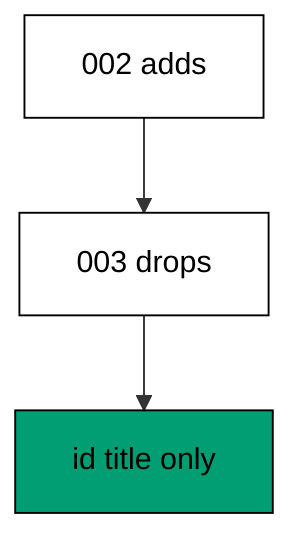

Forward-only history never rewrites the past: 003 does not delete the 002 journal row, it adds a new row whose effect cancels it. The column list proving id and title only is the whole point — the schema matches, and the history tells the full story. Auditors love this shape because nothing is ever erased.

**`learning/code/ex-18-compensating-migration-is-the-rollback/Program.fs`**:

```fsharp
module App // => one module owns the whole unit

open DbUp // => DeployChanges entry point lives here
open Npgsql // => Npgsql verifies the migrated schema

// => The database address comes from the harness, with local-run defaults.
let connStr () = // => one builder owns every address default
    let host = // => service hostname in the unit network
        match System.Environment.GetEnvironmentVariable("PGHOST") with // => harness sets the service host
        | null
        | "" -> "localhost" // => local runs fall back to localhost
        | h -> h // => the harness value wins when present

    let port = // => service port, almost always the default
        match System.Environment.GetEnvironmentVariable("PGPORT") with // => harness sets the service port
        | null
        | "" -> "5432" // => PostgreSQL listens on 5432
        | p -> p // => the harness value wins when present

    let user = // => trust-auth role, no password needed
        match System.Environment.GetEnvironmentVariable("PGUSER") with // => harness sets the service user
        | null
        | "" -> "postgres" // => local runs use the superuser
        | u -> u // => the harness value wins when present

    let db = // => fresh database for every unit run
        match System.Environment.GetEnvironmentVariable("PGDATABASE") with // => harness sets the service database
        | null
        | "" -> "postgres" // => local runs use the default database
        | d -> d // => the harness value wins when present

    let baseStr = $"Host=%s{host};Port=%s{port};Username=%s{user};Database=%s{db}" // => trust auth needs no password

    match System.Environment.GetEnvironmentVariable("PGPASSWORD") with // => only local runs set a password
    | null
    | "" -> baseStr // => the harness uses trust auth
    | pw -> baseStr + $";Password=%s{pw}" // => local runs authenticate with it

// => One helper runs a write and ignores the count; reads print their own proof.
let exec (conn: NpgsqlConnection) (sql: string) = // => every write flows through here
    use cmd = new NpgsqlCommand(sql, conn) // => fresh command per statement
    cmd.ExecuteNonQuery() |> ignore // => row counts never reach output

// => One helper answers a single int64; counts and ids print through it.
let scalar (conn: NpgsqlConnection) (sql: string) = // => every count flows through here
    use cmd = new NpgsqlCommand(sql, conn) // => fresh command per query
    cmd.ExecuteScalar() :?> int64 // => counts come back as int64

// => One helper lists one text column in order; histories print through it.
let column (conn: NpgsqlConnection) (sql: string) = // => every history flows through here
    use cmd = new NpgsqlCommand(sql, conn) // => fresh command per query
    use reader = cmd.ExecuteReader() // => forward-only reads stay simple

    [ while reader.Read() do
          reader.GetString(0) ] // => one string per row, in query order

// => DbUp journals under this table; units reset only their own rows.
let journalExists (conn: NpgsqlConnection) = // => first runs have no journal yet
    scalar conn "SELECT count(*) FROM information_schema.tables WHERE table_name = 'schemaversions'" = 1L // => one row means DbUp ran here before

// => Every unit starts clean and ends clean, so reruns print alike.
let reset (conn: NpgsqlConnection) (prefix: string) (tables: string list) = // => one reset owns every leftover
    for t in tables do
        exec conn $"DROP TABLE IF EXISTS %s{t} CASCADE" // => a killed run never poisons the rerun

    if journalExists conn then // => the journal may not exist on the first run
        exec conn $"DELETE FROM schemaversions WHERE scriptname LIKE '%s{prefix}%%'" // => only this unit's rows vanish

[<EntryPoint>] // => the harness runs the compiled assembly
let main _ = // => every unit answers zero on success
    use conn = new NpgsqlConnection(connStr ()) // => one session per unit run
    conn.Open() // => fail fast when the service is unreachable
    reset conn "d18_" [ "d18_posts" ] // => leftovers of a killed run vanish

    let upgrader = // => DbUp plans the upgrade from these scripts
        DeployChanges.To // => the fluent entry point
            .PostgresqlDatabase(connStr ()) // => the harness database, trust auth
            .WithScript(
                "d18_001_create_posts.sql",
                "CREATE TABLE d18_posts (id SERIAL PRIMARY KEY, title TEXT NOT NULL);"
            ) // => one ordered script per change
            .Build() // => freeze the plan before running

    let resultupgrader = upgrader.PerformUpgrade() // => apply what the journal lacks
    printfn "upgrade=%b" resultupgrader.Successful // => Output: upgrade=true

    let upgrader2 = // => DbUp plans the upgrade from these scripts
        DeployChanges.To // => the fluent entry point
            .PostgresqlDatabase(connStr ()) // => the harness database, trust auth
            .WithScript(
                "d18_002_add_subtitle.sql",
                "ALTER TABLE d18_posts ADD COLUMN subtitle TEXT NOT NULL DEFAULT '';"
            ) // => one ordered script per change
            .Build() // => freeze the plan before running

    let resultupgrader2 = upgrader2.PerformUpgrade() // => apply what the journal lacks
    printfn "upgrade=%b" resultupgrader2.Successful // => Output: upgrade=true

    let upgrader3 = // => DbUp plans the upgrade from these scripts
        DeployChanges.To // => the fluent entry point
            .PostgresqlDatabase(connStr ()) // => the harness database, trust auth
            .WithScript("d18_003_drop_subtitle.sql", "ALTER TABLE d18_posts DROP COLUMN subtitle;") // => one ordered script per change
            .Build() // => freeze the plan before running

    let resultupgrader3 = upgrader3.PerformUpgrade() // => apply what the journal lacks
    printfn "upgrade=%b" resultupgrader3.Successful // => Output: upgrade=true

    printfn
        "cols=%s"
        (System.String.Join(
            ",",
            column
                conn
                "SELECT column_name FROM information_schema.columns WHERE table_name = 'd18_posts' ORDER BY ordinal_position"
        )) // => Output: cols=id,title

    for h in column conn "SELECT scriptname FROM schemaversions ORDER BY schemaversionsid" do
        printfn "history=%s" h // => history prints in apply order

    reset conn "d18_" [ "d18_posts" ] // => leftovers of a killed run vanish
    0 // => zero exit means the transcript matched
```

**Output** (`learning/code/ex-18-compensating-migration-is-the-rollback/expected/main.stdout.txt`):

```text
upgrade=true
upgrade=true
upgrade=true
cols=id,title
history=d18_001_create_posts.sql
history=d18_002_add_subtitle.sql
history=d18_003_drop_subtitle.sql
```

**Key takeaway**: Rollback in DbUp is a new forward script that reverses an earlier one, leaving the history append-only.

**Why it matters**: Append-only history is the audit trail regulators and incident reviews assume: every mistake and every fix stays visible forever. A rollback that deletes history destroys the evidence of what went wrong and when. The compensating migration costs one extra journal row and buys a past nobody can silently rewrite. Append-only history keeps the audit trail complete while still letting every change be reversed going forward.

### Example 19: Forward Fix Removes What Upgrade Added

A rename done the naive way still rolls forward: one script swaps the old column for the new one and the journal keeps both rows. The program drops sku, adds code with a default, and lists the finished columns. (Concepts: co-02, co-08.)

Two DDL steps in one script keep the swap atomic enough for a small table while staying reviewable as one intent. The default protects the constraint from the missing values the drop left behind conceptually. Later examples split renames across deploys for tables that cannot blink; this one shows the honest single-step version.

**`learning/code/ex-19-forward-fix-removes-what-upgrade-added/Program.fs`**:

```fsharp
module App // => one module owns the whole unit

open DbUp // => DeployChanges entry point lives here
open Npgsql // => Npgsql verifies the migrated schema

// => The database address comes from the harness, with local-run defaults.
let connStr () = // => one builder owns every address default
    let host = // => service hostname in the unit network
        match System.Environment.GetEnvironmentVariable("PGHOST") with // => harness sets the service host
        | null
        | "" -> "localhost" // => local runs fall back to localhost
        | h -> h // => the harness value wins when present

    let port = // => service port, almost always the default
        match System.Environment.GetEnvironmentVariable("PGPORT") with // => harness sets the service port
        | null
        | "" -> "5432" // => PostgreSQL listens on 5432
        | p -> p // => the harness value wins when present

    let user = // => trust-auth role, no password needed
        match System.Environment.GetEnvironmentVariable("PGUSER") with // => harness sets the service user
        | null
        | "" -> "postgres" // => local runs use the superuser
        | u -> u // => the harness value wins when present

    let db = // => fresh database for every unit run
        match System.Environment.GetEnvironmentVariable("PGDATABASE") with // => harness sets the service database
        | null
        | "" -> "postgres" // => local runs use the default database
        | d -> d // => the harness value wins when present

    let baseStr = $"Host=%s{host};Port=%s{port};Username=%s{user};Database=%s{db}" // => trust auth needs no password

    match System.Environment.GetEnvironmentVariable("PGPASSWORD") with // => only local runs set a password
    | null
    | "" -> baseStr // => the harness uses trust auth
    | pw -> baseStr + $";Password=%s{pw}" // => local runs authenticate with it

// => One helper runs a write and ignores the count; reads print their own proof.
let exec (conn: NpgsqlConnection) (sql: string) = // => every write flows through here
    use cmd = new NpgsqlCommand(sql, conn) // => fresh command per statement
    cmd.ExecuteNonQuery() |> ignore // => row counts never reach output

// => One helper answers a single int64; counts and ids print through it.
let scalar (conn: NpgsqlConnection) (sql: string) = // => every count flows through here
    use cmd = new NpgsqlCommand(sql, conn) // => fresh command per query
    cmd.ExecuteScalar() :?> int64 // => counts come back as int64

// => One helper lists one text column in order; histories print through it.
let column (conn: NpgsqlConnection) (sql: string) = // => every history flows through here
    use cmd = new NpgsqlCommand(sql, conn) // => fresh command per query
    use reader = cmd.ExecuteReader() // => forward-only reads stay simple

    [ while reader.Read() do
          reader.GetString(0) ] // => one string per row, in query order

// => DbUp journals under this table; units reset only their own rows.
let journalExists (conn: NpgsqlConnection) = // => first runs have no journal yet
    scalar conn "SELECT count(*) FROM information_schema.tables WHERE table_name = 'schemaversions'" = 1L // => one row means DbUp ran here before

// => Every unit starts clean and ends clean, so reruns print alike.
let reset (conn: NpgsqlConnection) (prefix: string) (tables: string list) = // => one reset owns every leftover
    for t in tables do
        exec conn $"DROP TABLE IF EXISTS %s{t} CASCADE" // => a killed run never poisons the rerun

    if journalExists conn then // => the journal may not exist on the first run
        exec conn $"DELETE FROM schemaversions WHERE scriptname LIKE '%s{prefix}%%'" // => only this unit's rows vanish

[<EntryPoint>] // => the harness runs the compiled assembly
let main _ = // => every unit answers zero on success
    use conn = new NpgsqlConnection(connStr ()) // => one session per unit run
    conn.Open() // => fail fast when the service is unreachable
    reset conn "d19_" [ "d19_items" ] // => leftovers of a killed run vanish

    let upgrader = // => DbUp plans the upgrade from these scripts
        DeployChanges.To // => the fluent entry point
            .PostgresqlDatabase(connStr ()) // => the harness database, trust auth
            .WithScript(
                "d19_001_create_items.sql",
                "CREATE TABLE d19_items (id SERIAL PRIMARY KEY, sku TEXT NOT NULL);"
            ) // => one ordered script per change
            .Build() // => freeze the plan before running

    let resultupgrader = upgrader.PerformUpgrade() // => apply what the journal lacks
    printfn "upgrade=%b" resultupgrader.Successful // => Output: upgrade=true

    let upgrader2 = // => DbUp plans the upgrade from these scripts
        DeployChanges.To // => the fluent entry point
            .PostgresqlDatabase(connStr ()) // => the harness database, trust auth
            .WithScript(
                "d19_002_drop_sku_add_code.sql",
                "ALTER TABLE d19_items DROP COLUMN sku; ALTER TABLE d19_items ADD COLUMN code TEXT NOT NULL DEFAULT 'n/a';"
            ) // => one ordered script per change
            .Build() // => freeze the plan before running

    let resultupgrader2 = upgrader2.PerformUpgrade() // => apply what the journal lacks
    printfn "upgrade=%b" resultupgrader2.Successful // => Output: upgrade=true

    printfn
        "cols=%s"
        (System.String.Join(
            ",",
            column
                conn
                "SELECT column_name FROM information_schema.columns WHERE table_name = 'd19_items' ORDER BY ordinal_position"
        )) // => Output: cols=id,code

    printfn "applied=%d" (scalar conn "SELECT count(*) FROM schemaversions WHERE scriptname LIKE 'd19\_%'") // => Output: applied=2
    reset conn "d19_" [ "d19_items" ] // => leftovers of a killed run vanish
    0 // => zero exit means the transcript matched
```

**Output** (`learning/code/ex-19-forward-fix-removes-what-upgrade-added/expected/main.stdout.txt`):

```text
upgrade=true
upgrade=true
cols=id,code
applied=2
```

**Key takeaway**: A forward fix changes the schema in the open and journals the change, instead of pretending the past version never existed.

**Why it matters**: Single-step swaps suit small tables and quiet hours: the window where neither column serves reads is real but short. Naming the trade honestly matters more than avoiding it, because the next engineer to touch this table inherits the choice. The journal row is the note that says this swap happened here, on purpose.

### Example 20: Reverse by Re-adding Not by Undo

There is no undo button, only new migrations: dropping a column in 002 and re-adding it in 003 restores the shape with three journal rows. The program proves the columns match and the history grew by one per step. (Concepts: co-02.)

Re-adding is not the same as never dropping: the default marks every row as restored rather than original, and the journal remembers the round trip. That honesty is load-bearing during audits, where dropped-and-restored must read differently from never-touched. The three rows are the receipt for the whole detour.

**`learning/code/ex-20-reverse-by-re-adding-not-by-undo/Program.fs`**:

```fsharp
module App // => one module owns the whole unit

open DbUp // => DeployChanges entry point lives here
open Npgsql // => Npgsql verifies the migrated schema

// => The database address comes from the harness, with local-run defaults.
let connStr () = // => one builder owns every address default
    let host = // => service hostname in the unit network
        match System.Environment.GetEnvironmentVariable("PGHOST") with // => harness sets the service host
        | null
        | "" -> "localhost" // => local runs fall back to localhost
        | h -> h // => the harness value wins when present

    let port = // => service port, almost always the default
        match System.Environment.GetEnvironmentVariable("PGPORT") with // => harness sets the service port
        | null
        | "" -> "5432" // => PostgreSQL listens on 5432
        | p -> p // => the harness value wins when present

    let user = // => trust-auth role, no password needed
        match System.Environment.GetEnvironmentVariable("PGUSER") with // => harness sets the service user
        | null
        | "" -> "postgres" // => local runs use the superuser
        | u -> u // => the harness value wins when present

    let db = // => fresh database for every unit run
        match System.Environment.GetEnvironmentVariable("PGDATABASE") with // => harness sets the service database
        | null
        | "" -> "postgres" // => local runs use the default database
        | d -> d // => the harness value wins when present

    let baseStr = $"Host=%s{host};Port=%s{port};Username=%s{user};Database=%s{db}" // => trust auth needs no password

    match System.Environment.GetEnvironmentVariable("PGPASSWORD") with // => only local runs set a password
    | null
    | "" -> baseStr // => the harness uses trust auth
    | pw -> baseStr + $";Password=%s{pw}" // => local runs authenticate with it

// => One helper runs a write and ignores the count; reads print their own proof.
let exec (conn: NpgsqlConnection) (sql: string) = // => every write flows through here
    use cmd = new NpgsqlCommand(sql, conn) // => fresh command per statement
    cmd.ExecuteNonQuery() |> ignore // => row counts never reach output

// => One helper answers a single int64; counts and ids print through it.
let scalar (conn: NpgsqlConnection) (sql: string) = // => every count flows through here
    use cmd = new NpgsqlCommand(sql, conn) // => fresh command per query
    cmd.ExecuteScalar() :?> int64 // => counts come back as int64

// => One helper lists one text column in order; histories print through it.
let column (conn: NpgsqlConnection) (sql: string) = // => every history flows through here
    use cmd = new NpgsqlCommand(sql, conn) // => fresh command per query
    use reader = cmd.ExecuteReader() // => forward-only reads stay simple

    [ while reader.Read() do
          reader.GetString(0) ] // => one string per row, in query order

// => DbUp journals under this table; units reset only their own rows.
let journalExists (conn: NpgsqlConnection) = // => first runs have no journal yet
    scalar conn "SELECT count(*) FROM information_schema.tables WHERE table_name = 'schemaversions'" = 1L // => one row means DbUp ran here before

// => Every unit starts clean and ends clean, so reruns print alike.
let reset (conn: NpgsqlConnection) (prefix: string) (tables: string list) = // => one reset owns every leftover
    for t in tables do
        exec conn $"DROP TABLE IF EXISTS %s{t} CASCADE" // => a killed run never poisons the rerun

    if journalExists conn then // => the journal may not exist on the first run
        exec conn $"DELETE FROM schemaversions WHERE scriptname LIKE '%s{prefix}%%'" // => only this unit's rows vanish

[<EntryPoint>] // => the harness runs the compiled assembly
let main _ = // => every unit answers zero on success
    use conn = new NpgsqlConnection(connStr ()) // => one session per unit run
    conn.Open() // => fail fast when the service is unreachable
    reset conn "d20_" [ "d20_docs" ] // => leftovers of a killed run vanish

    let upgrader = // => DbUp plans the upgrade from these scripts
        DeployChanges.To // => the fluent entry point
            .PostgresqlDatabase(connStr ()) // => the harness database, trust auth
            .WithScript("d20_001_create_docs.sql", "CREATE TABLE d20_docs (id SERIAL PRIMARY KEY, body TEXT NOT NULL);") // => one ordered script per change
            .Build() // => freeze the plan before running

    let resultupgrader = upgrader.PerformUpgrade() // => apply what the journal lacks
    printfn "upgrade=%b" resultupgrader.Successful // => Output: upgrade=true

    let upgrader2 = // => DbUp plans the upgrade from these scripts
        DeployChanges.To // => the fluent entry point
            .PostgresqlDatabase(connStr ()) // => the harness database, trust auth
            .WithScript("d20_002_drop_body.sql", "ALTER TABLE d20_docs DROP COLUMN body;") // => one ordered script per change
            .Build() // => freeze the plan before running

    let resultupgrader2 = upgrader2.PerformUpgrade() // => apply what the journal lacks
    printfn "upgrade=%b" resultupgrader2.Successful // => Output: upgrade=true

    let upgrader3 = // => DbUp plans the upgrade from these scripts
        DeployChanges.To // => the fluent entry point
            .PostgresqlDatabase(connStr ()) // => the harness database, trust auth
            .WithScript(
                "d20_003_restore_body.sql",
                "ALTER TABLE d20_docs ADD COLUMN body TEXT NOT NULL DEFAULT 'restored';"
            ) // => one ordered script per change
            .Build() // => freeze the plan before running

    let resultupgrader3 = upgrader3.PerformUpgrade() // => apply what the journal lacks
    printfn "upgrade=%b" resultupgrader3.Successful // => Output: upgrade=true

    printfn
        "cols=%s"
        (System.String.Join(
            ",",
            column
                conn
                "SELECT column_name FROM information_schema.columns WHERE table_name = 'd20_docs' ORDER BY ordinal_position"
        )) // => Output: cols=id,body

    printfn "history-len=%d" (scalar conn "SELECT count(*) FROM schemaversions WHERE scriptname LIKE 'd20\_%'") // => Output: history-len=3
    reset conn "d20_" [ "d20_docs" ] // => leftovers of a killed run vanish
    0 // => zero exit means the transcript matched
```

**Output** (`learning/code/ex-20-reverse-by-re-adding-not-by-undo/expected/main.stdout.txt`):

```text
upgrade=true
upgrade=true
upgrade=true
cols=id,body
history-len=3
```

**Key takeaway**: Re-adding a dropped column restores the shape while the journal keeps the full there-and-back story.

**Why it matters**: Undo pretends the mistake never happened; re-adding admits it and fixes it in the open. Production databases are shared memory for a whole organization, and shared memory must not be rewritten. The extra journal row is cheap, and the honesty it buys is the difference between a history the team trusts and one it merely keeps.

### Example 21: Rollback Keeps Unrelated Data

A compensating migration touches only its own change: the orders column comes and goes while the order rows and the audit table never blink. The program seeds both tables, rolls the column back, and counts what survived. (Concepts: co-02, co-08.)

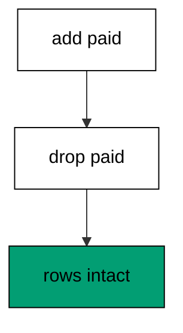

Data and schema travel separately: dropping the paid column removes the change but keeps every row it ever touched. The audit table proves the blast radius stayed inside the orders change. Rollback stories that cannot name what they preserve are not rollback stories.

**`learning/code/ex-21-rollback-keeps-unrelated-data/Program.fs`**:

```fsharp
module App // => one module owns the whole unit

open DbUp // => DeployChanges entry point lives here
open Npgsql // => Npgsql verifies the migrated schema

// => The database address comes from the harness, with local-run defaults.
let connStr () = // => one builder owns every address default
    let host = // => service hostname in the unit network
        match System.Environment.GetEnvironmentVariable("PGHOST") with // => harness sets the service host
        | null
        | "" -> "localhost" // => local runs fall back to localhost
        | h -> h // => the harness value wins when present

    let port = // => service port, almost always the default
        match System.Environment.GetEnvironmentVariable("PGPORT") with // => harness sets the service port
        | null
        | "" -> "5432" // => PostgreSQL listens on 5432
        | p -> p // => the harness value wins when present

    let user = // => trust-auth role, no password needed
        match System.Environment.GetEnvironmentVariable("PGUSER") with // => harness sets the service user
        | null
        | "" -> "postgres" // => local runs use the superuser
        | u -> u // => the harness value wins when present

    let db = // => fresh database for every unit run
        match System.Environment.GetEnvironmentVariable("PGDATABASE") with // => harness sets the service database
        | null
        | "" -> "postgres" // => local runs use the default database
        | d -> d // => the harness value wins when present

    let baseStr = $"Host=%s{host};Port=%s{port};Username=%s{user};Database=%s{db}" // => trust auth needs no password

    match System.Environment.GetEnvironmentVariable("PGPASSWORD") with // => only local runs set a password
    | null
    | "" -> baseStr // => the harness uses trust auth
    | pw -> baseStr + $";Password=%s{pw}" // => local runs authenticate with it

// => One helper runs a write and ignores the count; reads print their own proof.
let exec (conn: NpgsqlConnection) (sql: string) = // => every write flows through here
    use cmd = new NpgsqlCommand(sql, conn) // => fresh command per statement
    cmd.ExecuteNonQuery() |> ignore // => row counts never reach output

// => One helper answers a single int64; counts and ids print through it.
let scalar (conn: NpgsqlConnection) (sql: string) = // => every count flows through here
    use cmd = new NpgsqlCommand(sql, conn) // => fresh command per query
    cmd.ExecuteScalar() :?> int64 // => counts come back as int64

// => One helper lists one text column in order; histories print through it.
let column (conn: NpgsqlConnection) (sql: string) = // => every history flows through here
    use cmd = new NpgsqlCommand(sql, conn) // => fresh command per query
    use reader = cmd.ExecuteReader() // => forward-only reads stay simple

    [ while reader.Read() do
          reader.GetString(0) ] // => one string per row, in query order

// => DbUp journals under this table; units reset only their own rows.
let journalExists (conn: NpgsqlConnection) = // => first runs have no journal yet
    scalar conn "SELECT count(*) FROM information_schema.tables WHERE table_name = 'schemaversions'" = 1L // => one row means DbUp ran here before

// => Every unit starts clean and ends clean, so reruns print alike.
let reset (conn: NpgsqlConnection) (prefix: string) (tables: string list) = // => one reset owns every leftover
    for t in tables do
        exec conn $"DROP TABLE IF EXISTS %s{t} CASCADE" // => a killed run never poisons the rerun

    if journalExists conn then // => the journal may not exist on the first run
        exec conn $"DELETE FROM schemaversions WHERE scriptname LIKE '%s{prefix}%%'" // => only this unit's rows vanish

[<EntryPoint>] // => the harness runs the compiled assembly
let main _ = // => every unit answers zero on success
    use conn = new NpgsqlConnection(connStr ()) // => one session per unit run
    conn.Open() // => fail fast when the service is unreachable
    reset conn "d21_" [ "d21_orders"; "d21_audit" ] // => leftovers of a killed run vanish

    let upgrader = // => DbUp plans the upgrade from these scripts
        DeployChanges.To // => the fluent entry point
            .PostgresqlDatabase(connStr ()) // => the harness database, trust auth
            .WithScript(
                "d21_001_create_both.sql",
                "CREATE TABLE d21_orders (id SERIAL PRIMARY KEY, total INTEGER NOT NULL); CREATE TABLE d21_audit (id SERIAL PRIMARY KEY, note TEXT NOT NULL);"
            ) // => one ordered script per change
            .Build() // => freeze the plan before running

    let resultupgrader = upgrader.PerformUpgrade() // => apply what the journal lacks
    printfn "upgrade=%b" resultupgrader.Successful // => Output: upgrade=true
    exec conn "INSERT INTO d21_orders (total) VALUES (100), (200)" // => two order rows the fix must not touch
    exec conn "INSERT INTO d21_audit (note) VALUES ('before')" // => one audit row the fix must not touch

    let upgrader2 = // => DbUp plans the upgrade from these scripts
        DeployChanges.To // => the fluent entry point
            .PostgresqlDatabase(connStr ()) // => the harness database, trust auth
            .WithScript(
                "d21_002_fix_orders.sql",
                "ALTER TABLE d21_orders ADD COLUMN paid BOOLEAN NOT NULL DEFAULT false;"
            ) // => one ordered script per change
            .Build() // => freeze the plan before running

    let resultupgrader2 = upgrader2.PerformUpgrade() // => apply what the journal lacks
    printfn "upgrade=%b" resultupgrader2.Successful // => Output: upgrade=true

    let upgrader3 = // => DbUp plans the upgrade from these scripts
        DeployChanges.To // => the fluent entry point
            .PostgresqlDatabase(connStr ()) // => the harness database, trust auth
            .WithScript("d21_003_compensate.sql", "ALTER TABLE d21_orders DROP COLUMN paid;") // => one ordered script per change
            .Build() // => freeze the plan before running

    let resultupgrader3 = upgrader3.PerformUpgrade() // => apply what the journal lacks
    printfn "upgrade=%b" resultupgrader3.Successful // => Output: upgrade=true
    printfn "orders=%d" (scalar conn "SELECT count(*) FROM d21_orders") // => Output: orders=2
    printfn "audit=%s" (System.String.Join(",", column conn "SELECT note FROM d21_audit")) // => Output: audit=before
    printfn "cols=%d" (scalar conn "SELECT count(*) FROM information_schema.columns WHERE table_name = 'd21_orders'") // => Output: cols=2
    reset conn "d21_" [ "d21_orders"; "d21_audit" ] // => leftovers of a killed run vanish
    0 // => zero exit means the transcript matched
```

**Output** (`learning/code/ex-21-rollback-keeps-unrelated-data/expected/main.stdout.txt`):

```text
upgrade=true
upgrade=true
upgrade=true
orders=2
audit=before
cols=2
```

**Key takeaway**: A compensating migration reverses its own change and nothing else: rows and neighboring tables survive untouched.

**Why it matters**: The fear behind every rollback is collateral damage, and only a row count quiets it. Proving the unrelated data survived turns the rollback from a brave act into a routine one. Migrations that cannot demonstrate a tight blast radius do not get run at 2 AM; ones that can, do.

### Example 22: Failed Script Leaves Earlier Work Intact

DbUp runs without a transaction by default, so a script that fails halfway keeps the statements that already succeeded and journals nothing. The program runs a good step plus a broken step and proves the first table survived with no journal row. (Concepts: co-02, co-08.)

The default surprises teams that assume atomicity: the CREATE committed before the bad type failed, and the journal holds no row because the script as a whole did not succeed. Diagnosis starts from this exact state — a table with no journal entry. The next example shows the transaction wrapper that prevents it.

**`learning/code/ex-22-failed-script-leaves-earlier-work-intact/Program.fs`**:

```fsharp
module App // => one module owns the whole unit

open DbUp // => DeployChanges entry point lives here
open Npgsql // => Npgsql verifies the migrated schema

// => The database address comes from the harness, with local-run defaults.
let connStr () = // => one builder owns every address default
    let host = // => service hostname in the unit network
        match System.Environment.GetEnvironmentVariable("PGHOST") with // => harness sets the service host
        | null
        | "" -> "localhost" // => local runs fall back to localhost
        | h -> h // => the harness value wins when present

    let port = // => service port, almost always the default
        match System.Environment.GetEnvironmentVariable("PGPORT") with // => harness sets the service port
        | null
        | "" -> "5432" // => PostgreSQL listens on 5432
        | p -> p // => the harness value wins when present

    let user = // => trust-auth role, no password needed
        match System.Environment.GetEnvironmentVariable("PGUSER") with // => harness sets the service user
        | null
        | "" -> "postgres" // => local runs use the superuser
        | u -> u // => the harness value wins when present

    let db = // => fresh database for every unit run
        match System.Environment.GetEnvironmentVariable("PGDATABASE") with // => harness sets the service database
        | null
        | "" -> "postgres" // => local runs use the default database
        | d -> d // => the harness value wins when present

    let baseStr = $"Host=%s{host};Port=%s{port};Username=%s{user};Database=%s{db}" // => trust auth needs no password

    match System.Environment.GetEnvironmentVariable("PGPASSWORD") with // => only local runs set a password
    | null
    | "" -> baseStr // => the harness uses trust auth
    | pw -> baseStr + $";Password=%s{pw}" // => local runs authenticate with it

// => One helper runs a write and ignores the count; reads print their own proof.
let exec (conn: NpgsqlConnection) (sql: string) = // => every write flows through here
    use cmd = new NpgsqlCommand(sql, conn) // => fresh command per statement
    cmd.ExecuteNonQuery() |> ignore // => row counts never reach output

// => One helper answers a single int64; counts and ids print through it.
let scalar (conn: NpgsqlConnection) (sql: string) = // => every count flows through here
    use cmd = new NpgsqlCommand(sql, conn) // => fresh command per query
    cmd.ExecuteScalar() :?> int64 // => counts come back as int64

// => One helper lists one text column in order; histories print through it.
let column (conn: NpgsqlConnection) (sql: string) = // => every history flows through here
    use cmd = new NpgsqlCommand(sql, conn) // => fresh command per query
    use reader = cmd.ExecuteReader() // => forward-only reads stay simple

    [ while reader.Read() do
          reader.GetString(0) ] // => one string per row, in query order

// => DbUp journals under this table; units reset only their own rows.
let journalExists (conn: NpgsqlConnection) = // => first runs have no journal yet
    scalar conn "SELECT count(*) FROM information_schema.tables WHERE table_name = 'schemaversions'" = 1L // => one row means DbUp ran here before

// => Every unit starts clean and ends clean, so reruns print alike.
let reset (conn: NpgsqlConnection) (prefix: string) (tables: string list) = // => one reset owns every leftover
    for t in tables do
        exec conn $"DROP TABLE IF EXISTS %s{t} CASCADE" // => a killed run never poisons the rerun

    if journalExists conn then // => the journal may not exist on the first run
        exec conn $"DELETE FROM schemaversions WHERE scriptname LIKE '%s{prefix}%%'" // => only this unit's rows vanish

[<EntryPoint>] // => the harness runs the compiled assembly
let main _ = // => every unit answers zero on success
    use conn = new NpgsqlConnection(connStr ()) // => one session per unit run
    conn.Open() // => fail fast when the service is unreachable
    reset conn "d22_" [ "d22_first"; "d22_second" ] // => leftovers of a killed run vanish

    let attempt = // => two statements, the second one broken
        DeployChanges.To // => the fluent entry point
            .PostgresqlDatabase(connStr ()) // => the harness database, trust auth
            .WithScript(
                "d22_001_half.sql",
                "CREATE TABLE d22_first (id SERIAL PRIMARY KEY, a TEXT NOT NULL); CREATE TABLE d22_nosuch (id NOSUCHTYPE);"
            ) // => good step then bad step
            .Build() // => freeze the failing plan

    let r = attempt.PerformUpgrade() // => runs the first statement, then fails
    printfn "failed=%b" (not r.Successful) // => Output: failed=true

    printfn
        "first-survives=%d"
        (scalar conn "SELECT count(*) FROM information_schema.tables WHERE table_name = 'd22_first'") // => Output: first-survives=1

    printfn "journaled=%d" (scalar conn "SELECT count(*) FROM schemaversions WHERE scriptname LIKE 'd22\_%'") // => Output: journaled=0
    reset conn "d22_" [ "d22_first"; "d22_second" ] // => leftovers of a killed run vanish
    0 // => zero exit means the transcript matched
```

**Output** (`learning/code/ex-22-failed-script-leaves-earlier-work-intact/expected/main.stdout.txt`):

```text
failed=true
first-survives=1
journaled=0
```

**Key takeaway**: Without an explicit transaction, a failed script keeps its completed statements and leaves no journal row behind.

**Why it matters**: Defaults decide incidents: the engineer who assumes atomicity will misread a half-applied migration as fully rolled back. Knowing the default is statement-by-statement turns a confusing partial state into an expected one with a known recovery. This example exists so the surprise happens in a lesson, never in production. Knowing the default turns a confusing partial state into an expected one with a known recovery path.

### Example 23: Partial Statements Roll Back Together

WithTransaction wraps the script in one transaction, so the same failure that left a table behind in Example 22 now leaves nothing. The program reruns the good-plus-broken shape atomically and proves both tables are gone. (Concepts: co-02, co-12.)

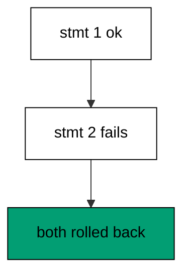

Atomicity turns a partial failure into a clean failure: the CREATE rolls back with the broken step, and the journal stays empty exactly as before. The pair of examples 22 and 23 is the whole transaction story in miniature. Reaching for the wrapper is a per-script decision, and this is the evidence for when it pays.

**`learning/code/ex-23-partial-statements-roll-back-together/Program.fs`**:

```fsharp
module App // => one module owns the whole unit

open DbUp // => DeployChanges entry point lives here
open Npgsql // => Npgsql verifies the migrated schema

// => The database address comes from the harness, with local-run defaults.
let connStr () = // => one builder owns every address default
    let host = // => service hostname in the unit network
        match System.Environment.GetEnvironmentVariable("PGHOST") with // => harness sets the service host
        | null
        | "" -> "localhost" // => local runs fall back to localhost
        | h -> h // => the harness value wins when present

    let port = // => service port, almost always the default
        match System.Environment.GetEnvironmentVariable("PGPORT") with // => harness sets the service port
        | null
        | "" -> "5432" // => PostgreSQL listens on 5432
        | p -> p // => the harness value wins when present

    let user = // => trust-auth role, no password needed
        match System.Environment.GetEnvironmentVariable("PGUSER") with // => harness sets the service user
        | null
        | "" -> "postgres" // => local runs use the superuser
        | u -> u // => the harness value wins when present

    let db = // => fresh database for every unit run
        match System.Environment.GetEnvironmentVariable("PGDATABASE") with // => harness sets the service database
        | null
        | "" -> "postgres" // => local runs use the default database
        | d -> d // => the harness value wins when present

    let baseStr = $"Host=%s{host};Port=%s{port};Username=%s{user};Database=%s{db}" // => trust auth needs no password

    match System.Environment.GetEnvironmentVariable("PGPASSWORD") with // => only local runs set a password
    | null
    | "" -> baseStr // => the harness uses trust auth
    | pw -> baseStr + $";Password=%s{pw}" // => local runs authenticate with it

// => One helper runs a write and ignores the count; reads print their own proof.
let exec (conn: NpgsqlConnection) (sql: string) = // => every write flows through here
    use cmd = new NpgsqlCommand(sql, conn) // => fresh command per statement
    cmd.ExecuteNonQuery() |> ignore // => row counts never reach output

// => One helper answers a single int64; counts and ids print through it.
let scalar (conn: NpgsqlConnection) (sql: string) = // => every count flows through here
    use cmd = new NpgsqlCommand(sql, conn) // => fresh command per query
    cmd.ExecuteScalar() :?> int64 // => counts come back as int64

// => One helper lists one text column in order; histories print through it.
let column (conn: NpgsqlConnection) (sql: string) = // => every history flows through here
    use cmd = new NpgsqlCommand(sql, conn) // => fresh command per query
    use reader = cmd.ExecuteReader() // => forward-only reads stay simple

    [ while reader.Read() do
          reader.GetString(0) ] // => one string per row, in query order

// => DbUp journals under this table; units reset only their own rows.
let journalExists (conn: NpgsqlConnection) = // => first runs have no journal yet
    scalar conn "SELECT count(*) FROM information_schema.tables WHERE table_name = 'schemaversions'" = 1L // => one row means DbUp ran here before

// => Every unit starts clean and ends clean, so reruns print alike.
let reset (conn: NpgsqlConnection) (prefix: string) (tables: string list) = // => one reset owns every leftover
    for t in tables do
        exec conn $"DROP TABLE IF EXISTS %s{t} CASCADE" // => a killed run never poisons the rerun

    if journalExists conn then // => the journal may not exist on the first run
        exec conn $"DELETE FROM schemaversions WHERE scriptname LIKE '%s{prefix}%%'" // => only this unit's rows vanish

[<EntryPoint>] // => the harness runs the compiled assembly
let main _ = // => every unit answers zero on success
    use conn = new NpgsqlConnection(connStr ()) // => one session per unit run
    conn.Open() // => fail fast when the service is unreachable
    reset conn "d23_" [ "d23_pair_a"; "d23_pair_b" ] // => leftovers of a killed run vanish

    let attempt = // => the same two statements, wrapped in one transaction
        DeployChanges.To // => the fluent entry point
            .PostgresqlDatabase(connStr ()) // => the harness database, trust auth
            .WithTransaction() // => one transaction wraps the whole script
            .WithScript(
                "d23_001_atomic.sql",
                "CREATE TABLE d23_pair_a (id SERIAL PRIMARY KEY); CREATE TABLE d23_nosuch (id NOSUCHTYPE);"
            ) // => good step then bad step
            .Build() // => freeze the atomic plan

    let r = attempt.PerformUpgrade() // => the transaction rolls everything back
    printfn "failed=%b" (not r.Successful) // => Output: failed=true

    printfn
        "nothing-left=%d"
        (scalar conn "SELECT count(*) FROM information_schema.tables WHERE table_name LIKE 'd23\_pair\_%'") // => Output: nothing-left=0

    printfn
        "journaled=%d"
        (if journalExists conn then
             scalar conn "SELECT count(*) FROM schemaversions WHERE scriptname LIKE 'd23\_%'"
         else
             0L) // => Output: journaled=0

    reset conn "d23_" [ "d23_pair_a"; "d23_pair_b" ] // => leftovers of a killed run vanish
    0 // => zero exit means the transcript matched
```

**Output** (`learning/code/ex-23-partial-statements-roll-back-together/expected/main.stdout.txt`):

```text
failed=true
nothing-left=0
journaled=0
```

**Key takeaway**: WithTransaction makes a failing script all-or-nothing: no tables left behind, no journal row written.

**Why it matters**: Atomicity is the difference between a failure and a mess: a clean failure retries safely, while a half-applied script needs diagnosis first. Wrapping multi-statement scripts in a transaction costs one method call and removes an entire class of partial states. The only scripts that must skip the wrapper are the ones PostgreSQL forbids inside transactions, covered later.

### Example 24: Rollback Plan for a Bad Deploy

The bad deploy stays in history and the fix follows it: 002 ships the wrong column and 003 replaces it with the right one. The program walks the whole bad-deploy story and proves the finished shape plus three journal rows. (Concepts: co-02, co-08.)

No step is edited after the fact: the wrong column ships, the fix ships after it, and the journal narrates both. The finished columns show v and fixed with no trace of broken in the schema — while history keeps the trace forever. That split between schema state and history memory is the professional shape of recovery.

**`learning/code/ex-24-rollback-plan-for-a-bad-deploy/Program.fs`**:

```fsharp
module App // => one module owns the whole unit

open DbUp // => DeployChanges entry point lives here
open Npgsql // => Npgsql verifies the migrated schema

// => The database address comes from the harness, with local-run defaults.
let connStr () = // => one builder owns every address default
    let host = // => service hostname in the unit network
        match System.Environment.GetEnvironmentVariable("PGHOST") with // => harness sets the service host
        | null
        | "" -> "localhost" // => local runs fall back to localhost
        | h -> h // => the harness value wins when present

    let port = // => service port, almost always the default
        match System.Environment.GetEnvironmentVariable("PGPORT") with // => harness sets the service port
        | null
        | "" -> "5432" // => PostgreSQL listens on 5432
        | p -> p // => the harness value wins when present

    let user = // => trust-auth role, no password needed
        match System.Environment.GetEnvironmentVariable("PGUSER") with // => harness sets the service user
        | null
        | "" -> "postgres" // => local runs use the superuser
        | u -> u // => the harness value wins when present

    let db = // => fresh database for every unit run
        match System.Environment.GetEnvironmentVariable("PGDATABASE") with // => harness sets the service database
        | null
        | "" -> "postgres" // => local runs use the default database
        | d -> d // => the harness value wins when present

    let baseStr = $"Host=%s{host};Port=%s{port};Username=%s{user};Database=%s{db}" // => trust auth needs no password

    match System.Environment.GetEnvironmentVariable("PGPASSWORD") with // => only local runs set a password
    | null
    | "" -> baseStr // => the harness uses trust auth
    | pw -> baseStr + $";Password=%s{pw}" // => local runs authenticate with it

// => One helper runs a write and ignores the count; reads print their own proof.
let exec (conn: NpgsqlConnection) (sql: string) = // => every write flows through here
    use cmd = new NpgsqlCommand(sql, conn) // => fresh command per statement
    cmd.ExecuteNonQuery() |> ignore // => row counts never reach output

// => One helper answers a single int64; counts and ids print through it.
let scalar (conn: NpgsqlConnection) (sql: string) = // => every count flows through here
    use cmd = new NpgsqlCommand(sql, conn) // => fresh command per query
    cmd.ExecuteScalar() :?> int64 // => counts come back as int64

// => One helper lists one text column in order; histories print through it.
let column (conn: NpgsqlConnection) (sql: string) = // => every history flows through here
    use cmd = new NpgsqlCommand(sql, conn) // => fresh command per query
    use reader = cmd.ExecuteReader() // => forward-only reads stay simple

    [ while reader.Read() do
          reader.GetString(0) ] // => one string per row, in query order

// => DbUp journals under this table; units reset only their own rows.
let journalExists (conn: NpgsqlConnection) = // => first runs have no journal yet
    scalar conn "SELECT count(*) FROM information_schema.tables WHERE table_name = 'schemaversions'" = 1L // => one row means DbUp ran here before

// => Every unit starts clean and ends clean, so reruns print alike.
let reset (conn: NpgsqlConnection) (prefix: string) (tables: string list) = // => one reset owns every leftover
    for t in tables do
        exec conn $"DROP TABLE IF EXISTS %s{t} CASCADE" // => a killed run never poisons the rerun

    if journalExists conn then // => the journal may not exist on the first run
        exec conn $"DELETE FROM schemaversions WHERE scriptname LIKE '%s{prefix}%%'" // => only this unit's rows vanish

[<EntryPoint>] // => the harness runs the compiled assembly
let main _ = // => every unit answers zero on success
    use conn = new NpgsqlConnection(connStr ()) // => one session per unit run
    conn.Open() // => fail fast when the service is unreachable
    reset conn "d24_" [ "d24_deploy" ] // => leftovers of a killed run vanish

    let upgrader = // => DbUp plans the upgrade from these scripts
        DeployChanges.To // => the fluent entry point
            .PostgresqlDatabase(connStr ()) // => the harness database, trust auth
            .WithScript("d24_001_base.sql", "CREATE TABLE d24_deploy (id SERIAL PRIMARY KEY, v TEXT NOT NULL);") // => one ordered script per change
            .Build() // => freeze the plan before running

    let resultupgrader = upgrader.PerformUpgrade() // => apply what the journal lacks
    printfn "upgrade=%b" resultupgrader.Successful // => Output: upgrade=true

    let upgrader2 = // => DbUp plans the upgrade from these scripts
        DeployChanges.To // => the fluent entry point
            .PostgresqlDatabase(connStr ()) // => the harness database, trust auth
            .WithScript("d24_002_bad.sql", "ALTER TABLE d24_deploy ADD COLUMN broken INTEGER NOT NULL;") // => one ordered script per change
            .Build() // => freeze the plan before running

    let resultupgrader2 = upgrader2.PerformUpgrade() // => apply what the journal lacks
    printfn "upgrade=%b" resultupgrader2.Successful // => Output: upgrade=true

    let upgrader3 = // => DbUp plans the upgrade from these scripts
        DeployChanges.To // => the fluent entry point
            .PostgresqlDatabase(connStr ()) // => the harness database, trust auth
            .WithScript(
                "d24_003_fix.sql",
                "ALTER TABLE d24_deploy DROP COLUMN broken; ALTER TABLE d24_deploy ADD COLUMN fixed INTEGER NOT NULL DEFAULT 7;"
            ) // => one ordered script per change
            .Build() // => freeze the plan before running

    let resultupgrader3 = upgrader3.PerformUpgrade() // => apply what the journal lacks
    printfn "upgrade=%b" resultupgrader3.Successful // => Output: upgrade=true

    printfn
        "cols=%s"
        (System.String.Join(
            ",",
            column
                conn
                "SELECT column_name FROM information_schema.columns WHERE table_name = 'd24_deploy' ORDER BY ordinal_position"
        )) // => Output: cols=id,v,fixed

    printfn "history-len=%d" (scalar conn "SELECT count(*) FROM schemaversions WHERE scriptname LIKE 'd24\_%'") // => Output: history-len=3
    reset conn "d24_" [ "d24_deploy" ] // => leftovers of a killed run vanish
    0 // => zero exit means the transcript matched
```

**Output** (`learning/code/ex-24-rollback-plan-for-a-bad-deploy/expected/main.stdout.txt`):

```text
upgrade=true
upgrade=true
upgrade=true
cols=id,v,fixed
history-len=3
```

**Key takeaway**: A bad deploy is recovered by shipping the fix forward, keeping every step — mistake included — in the journal.

**Why it matters**: Deploys go wrong at the worst moments, and the recovery must work while everyone is stressed. Forward fixes work because they use the same machinery as normal deploys: no special access, no history surgery, no heroics. The plan of record a fix, journal it, verify it fits on an index card, which is exactly when it is needed.

### Example 25: Beginner Review: Order History Rollback

The level in one program: create, alter, compensate, and prove the table, the row, and the three-row history all agree. The program chains the three beginner moves and prints the combined receipt. (Concepts: co-01, co-02, co-03.)

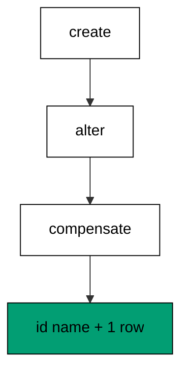

Create owns the table, alter owns the change, and the compensating migration owns the recovery — one row each in the journal. The surviving data row proves the round trip never threatened content. Reading this receipt fluently is the entry ticket to the intermediate level.

**`learning/code/ex-25-beginner-review-order-history-rollback/Program.fs`**:

```fsharp
module App // => one module owns the whole unit

open DbUp // => DeployChanges entry point lives here
open Npgsql // => Npgsql verifies the migrated schema

// => The database address comes from the harness, with local-run defaults.
let connStr () = // => one builder owns every address default
    let host = // => service hostname in the unit network
        match System.Environment.GetEnvironmentVariable("PGHOST") with // => harness sets the service host
        | null
        | "" -> "localhost" // => local runs fall back to localhost
        | h -> h // => the harness value wins when present

    let port = // => service port, almost always the default
        match System.Environment.GetEnvironmentVariable("PGPORT") with // => harness sets the service port
        | null
        | "" -> "5432" // => PostgreSQL listens on 5432
        | p -> p // => the harness value wins when present

    let user = // => trust-auth role, no password needed
        match System.Environment.GetEnvironmentVariable("PGUSER") with // => harness sets the service user
        | null
        | "" -> "postgres" // => local runs use the superuser
        | u -> u // => the harness value wins when present

    let db = // => fresh database for every unit run
        match System.Environment.GetEnvironmentVariable("PGDATABASE") with // => harness sets the service database
        | null
        | "" -> "postgres" // => local runs use the default database
        | d -> d // => the harness value wins when present

    let baseStr = $"Host=%s{host};Port=%s{port};Username=%s{user};Database=%s{db}" // => trust auth needs no password

    match System.Environment.GetEnvironmentVariable("PGPASSWORD") with // => only local runs set a password
    | null
    | "" -> baseStr // => the harness uses trust auth
    | pw -> baseStr + $";Password=%s{pw}" // => local runs authenticate with it

// => One helper runs a write and ignores the count; reads print their own proof.
let exec (conn: NpgsqlConnection) (sql: string) = // => every write flows through here
    use cmd = new NpgsqlCommand(sql, conn) // => fresh command per statement
    cmd.ExecuteNonQuery() |> ignore // => row counts never reach output

// => One helper answers a single int64; counts and ids print through it.
let scalar (conn: NpgsqlConnection) (sql: string) = // => every count flows through here
    use cmd = new NpgsqlCommand(sql, conn) // => fresh command per query
    cmd.ExecuteScalar() :?> int64 // => counts come back as int64

// => One helper lists one text column in order; histories print through it.
let column (conn: NpgsqlConnection) (sql: string) = // => every history flows through here
    use cmd = new NpgsqlCommand(sql, conn) // => fresh command per query
    use reader = cmd.ExecuteReader() // => forward-only reads stay simple

    [ while reader.Read() do
          reader.GetString(0) ] // => one string per row, in query order

// => DbUp journals under this table; units reset only their own rows.
let journalExists (conn: NpgsqlConnection) = // => first runs have no journal yet
    scalar conn "SELECT count(*) FROM information_schema.tables WHERE table_name = 'schemaversions'" = 1L // => one row means DbUp ran here before

// => Every unit starts clean and ends clean, so reruns print alike.
let reset (conn: NpgsqlConnection) (prefix: string) (tables: string list) = // => one reset owns every leftover
    for t in tables do
        exec conn $"DROP TABLE IF EXISTS %s{t} CASCADE" // => a killed run never poisons the rerun

    if journalExists conn then // => the journal may not exist on the first run
        exec conn $"DELETE FROM schemaversions WHERE scriptname LIKE '%s{prefix}%%'" // => only this unit's rows vanish

[<EntryPoint>] // => the harness runs the compiled assembly
let main _ = // => every unit answers zero on success
    use conn = new NpgsqlConnection(connStr ()) // => one session per unit run
    conn.Open() // => fail fast when the service is unreachable
    reset conn "d25_" [ "d25_review" ] // => leftovers of a killed run vanish

    let upgrader = // => DbUp plans the upgrade from these scripts
        DeployChanges.To // => the fluent entry point
            .PostgresqlDatabase(connStr ()) // => the harness database, trust auth
            .WithScript("d25_001_review.sql", "CREATE TABLE d25_review (id SERIAL PRIMARY KEY, name TEXT NOT NULL);") // => one ordered script per change
            .Build() // => freeze the plan before running

    let resultupgrader = upgrader.PerformUpgrade() // => apply what the journal lacks
    printfn "upgrade=%b" resultupgrader.Successful // => Output: upgrade=true

    let upgrader2 = // => DbUp plans the upgrade from these scripts
        DeployChanges.To // => the fluent entry point
            .PostgresqlDatabase(connStr ()) // => the harness database, trust auth
            .WithScript("d25_002_review.sql", "ALTER TABLE d25_review ADD COLUMN score INTEGER NOT NULL DEFAULT 0;") // => one ordered script per change
            .Build() // => freeze the plan before running

    let resultupgrader2 = upgrader2.PerformUpgrade() // => apply what the journal lacks
    printfn "upgrade=%b" resultupgrader2.Successful // => Output: upgrade=true

    let upgrader3 = // => DbUp plans the upgrade from these scripts
        DeployChanges.To // => the fluent entry point
            .PostgresqlDatabase(connStr ()) // => the harness database, trust auth
            .WithScript("d25_003_review.sql", "ALTER TABLE d25_review DROP COLUMN score;") // => one ordered script per change
            .Build() // => freeze the plan before running

    let resultupgrader3 = upgrader3.PerformUpgrade() // => apply what the journal lacks
    printfn "upgrade=%b" resultupgrader3.Successful // => Output: upgrade=true
    exec conn "INSERT INTO d25_review (name) VALUES ('ada')" // => the row survives the whole review

    printfn
        "cols=%s"
        (System.String.Join(
            ",",
            column
                conn
                "SELECT column_name FROM information_schema.columns WHERE table_name = 'd25_review' ORDER BY ordinal_position"
        )) // => Output: cols=id,name

    printfn "rows=%d" (scalar conn "SELECT count(*) FROM d25_review") // => Output: rows=1
    printfn "history-len=%d" (scalar conn "SELECT count(*) FROM schemaversions WHERE scriptname LIKE 'd25\_%'") // => Output: history-len=3
    reset conn "d25_" [ "d25_review" ] // => leftovers of a killed run vanish
    0 // => zero exit means the transcript matched
```

**Output** (`learning/code/ex-25-beginner-review-order-history-rollback/expected/main.stdout.txt`):

```text
upgrade=true
upgrade=true
upgrade=true
cols=id,name
rows=1
history-len=3
```

**Key takeaway**: Create, alter, and compensate compose into one reviewable story with the data intact and three journal rows.

**Why it matters**: Reviews work when the pieces compose: each beginner move keeps its own meaning inside the bigger story. The combined receipt shows schema, content, and history agreeing at the end, which is the definition of a migration done right. Carry this receipt shape forward — every later level ends with the same three-way agreement.
