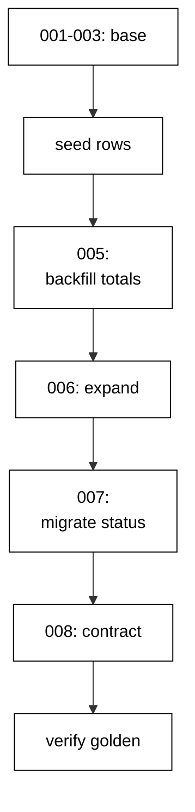

The capstone evolves a small order-management schema through eight realistic DbUp migrations: two customers, two orders, three order lines, a totals backfill, and a zero-downtime rename of the order status column, all verified by one golden query. Every technique from the course appears exactly where a production deploy would need it.

## Why this exists -- the big idea

**The problem before the solution**: course examples prove each migration technique in isolation — one script, one idea, one clean database. Real evolutions stack the techniques: the rename lands while traffic reads the old name, the backfill lands while orders keep arriving, and the history must stay linear through all of it. The capstone wires the layers together so the seams are load-bearing: schema steps, data steps, and verification steps in one chain, with the transcript proving the whole chain ran.

**Keep this if you forget everything else**: evolve the schema and the data on separate schedules, keep every step reversible or explicitly one-way, and verify the ending with a query — not with confidence.

## What you will build

A single `Program.fs` that runs eight DbUp scripts in order. `cap_001` creates `cap_customers`; `cap_002` creates `cap_orders` with a foreign key, a status, and an empty total; `cap_003` creates `cap_order_lines` with its own foreign key, sku, quantity, and price. Then the data: `cap_004` seeds demo customers, orders, and lines as a forward-only step, and `cap_005` backfills every order total from its lines. Then the rename: `cap_006` expands with a nullable `order_status` column, `cap_007` migrates every status into its `order_status`, `cap_008` contracts by dropping `status` and adding the customer lookup index concurrently. Seeds arrive after the schema base so the data steps have real rows to work on; data steps are forward-only by policy because fills and copies are one-way.

## How the pieces compose

Schema base (Examples 1–8) creates the tables; the nullable add (Example 35) keeps the base deployable; the three-step rename (Examples 35–40) moves `status` to `order_status` without a flag day; the join backfill (Examples 26–33) fills money after the fact; the receipt checks (Examples 12, 17, 78) verify the ending. No new technique appears here — composition is the test. Read the program top to bottom and name the example each section comes from; if a section has no ancestor, it does not belong.



## Reading the transcript

The three output lines each prove one stage: the orders line proves the seed, the backfill math, and the rename together — every order carries its owner, its computed total, and its new status name; the lines count proves the lines table survived the rename; the applied count proves all eight scripts ran with linear history. Any missing line names its broken stage exactly. Rerun the unit and diff: identical bytes, because fixed script names, per-example tables, ordered queries, and label-only output leave no room for variance.

## The pinning note

This capstone restores its locked packages offline: DbUp 7.0.1 with PostgreSQL support plus Npgsql, pinned in `packages.lock.json` and staged by the dotnet toolchain install recipe, with `NuGet.Config` clearing every remote source so the restore is offline by construction. The toolchain pins the .NET 10 SDK and PostgreSQL 18 images by digest, and the journal pins the schema. The capstone migrates with exactly the bytes the examples trained on — the same script shapes, the same no-transaction default with explicit opt-in wrappers, the same `schemaversions` journal. Declare the floor, pin everything, and review pin diffs like code.

**`learning/capstone/code/Program.fs`**:

```fsharp
module App // => one module owns the whole unit

open DbUp // => DeployChanges entry point lives here
open Npgsql // => Npgsql verifies the migrated schema

// => The database address comes from the harness, with local-run defaults.
let connStr () = // => one builder owns every address default
    let host = // => service hostname in the unit network
        match System.Environment.GetEnvironmentVariable("PGHOST") with // => harness sets the service host
        | null
        | "" -> "localhost" // => local runs fall back to localhost
        | h -> h // => the harness value wins when present

    let port = // => service port, almost always the default
        match System.Environment.GetEnvironmentVariable("PGPORT") with // => harness sets the service port
        | null
        | "" -> "5432" // => PostgreSQL listens on 5432
        | p -> p // => the harness value wins when present

    let user = // => trust-auth role, no password needed
        match System.Environment.GetEnvironmentVariable("PGUSER") with // => harness sets the service user
        | null
        | "" -> "postgres" // => local runs use the superuser
        | u -> u // => the harness value wins when present

    let db = // => fresh database for every unit run
        match System.Environment.GetEnvironmentVariable("PGDATABASE") with // => harness sets the service database
        | null
        | "" -> "postgres" // => local runs use the default database
        | d -> d // => the harness value wins when present

    let baseStr = $"Host=%s{host};Port=%s{port};Username=%s{user};Database=%s{db}" // => trust auth needs no password

    match System.Environment.GetEnvironmentVariable("PGPASSWORD") with // => only local runs set a password
    | null
    | "" -> baseStr // => the harness uses trust auth
    | pw -> baseStr + $";Password=%s{pw}" // => local runs authenticate with it

// => One helper runs a write and ignores the count; reads print their own proof.
let exec (conn: NpgsqlConnection) (sql: string) = // => every write flows through here
    use cmd = new NpgsqlCommand(sql, conn) // => fresh command per statement
    cmd.ExecuteNonQuery() |> ignore // => row counts never reach output

// => One helper answers a single int64; counts and ids print through it.
let scalar (conn: NpgsqlConnection) (sql: string) = // => every count flows through here
    use cmd = new NpgsqlCommand(sql, conn) // => fresh command per query
    cmd.ExecuteScalar() :?> int64 // => counts come back as int64

// => One helper lists one text column in order; histories print through it.
let column (conn: NpgsqlConnection) (sql: string) = // => every history flows through here
    use cmd = new NpgsqlCommand(sql, conn) // => fresh command per query
    use reader = cmd.ExecuteReader() // => forward-only reads stay simple

    [ while reader.Read() do
          reader.GetString(0) ] // => one string per row, in query order

// => DbUp journals under this table; units reset only their own rows.
let journalExists (conn: NpgsqlConnection) = // => first runs have no journal yet
    scalar conn "SELECT count(*) FROM information_schema.tables WHERE table_name = 'schemaversions'" = 1L // => one row means DbUp ran here before

// => Every unit starts clean and ends clean, so reruns print alike.
let reset (conn: NpgsqlConnection) (prefix: string) (tables: string list) = // => one reset owns every leftover
    for t in tables do
        exec conn $"DROP TABLE IF EXISTS %s{t} CASCADE" // => a killed run never poisons the rerun

    if journalExists conn then // => the journal may not exist on the first run
        exec conn $"DELETE FROM schemaversions WHERE scriptname LIKE '%s{prefix}%%'" // => only this unit's rows vanish

[<EntryPoint>] // => the harness runs the compiled assembly
let main _ = // => every unit answers zero on success
    use conn = new NpgsqlConnection(connStr ()) // => one session per unit run
    conn.Open() // => fail fast when the service is unreachable
    reset conn "cap_" [ "cap_customers"; "cap_orders"; "cap_lines" ] // => leftovers of a killed run vanish

    let upgrader = // => DbUp plans the upgrade from these scripts
        DeployChanges.To // => the fluent entry point
            .PostgresqlDatabase(connStr ()) // => the harness database, trust auth
            .WithScript(
                "cap_001_create_customers.sql",
                "CREATE TABLE cap_customers (id SERIAL PRIMARY KEY, name TEXT NOT NULL);"
            ) // => one ordered script per change
            .Build() // => freeze the plan before running

    let resultupgrader = upgrader.PerformUpgrade() // => apply what the journal lacks
    printfn "upgrade=%b" resultupgrader.Successful // => Output: upgrade=true

    let upgrader2 = // => DbUp plans the upgrade from these scripts
        DeployChanges.To // => the fluent entry point
            .PostgresqlDatabase(connStr ()) // => the harness database, trust auth
            .WithScript(
                "cap_002_create_orders.sql",
                "CREATE TABLE cap_orders (id SERIAL PRIMARY KEY, customer_id INTEGER NOT NULL REFERENCES cap_customers (id), status TEXT NOT NULL, total INTEGER NOT NULL DEFAULT 0);"
            ) // => one ordered script per change
            .Build() // => freeze the plan before running

    let resultupgrader2 = upgrader2.PerformUpgrade() // => apply what the journal lacks
    printfn "upgrade=%b" resultupgrader2.Successful // => Output: upgrade=true

    let upgrader3 = // => DbUp plans the upgrade from these scripts
        DeployChanges.To // => the fluent entry point
            .PostgresqlDatabase(connStr ()) // => the harness database, trust auth
            .WithScript(
                "cap_003_create_lines.sql",
                "CREATE TABLE cap_lines (id SERIAL PRIMARY KEY, order_id INTEGER NOT NULL REFERENCES cap_orders (id), sku TEXT NOT NULL, qty INTEGER NOT NULL, price INTEGER NOT NULL);"
            ) // => one ordered script per change
            .Build() // => freeze the plan before running

    let resultupgrader3 = upgrader3.PerformUpgrade() // => apply what the journal lacks
    printfn "upgrade=%b" resultupgrader3.Successful // => Output: upgrade=true

    let upgrader4 = // => DbUp plans the upgrade from these scripts
        DeployChanges.To // => the fluent entry point
            .PostgresqlDatabase(connStr ()) // => the harness database, trust auth
            .WithScript(
                "cap_004_seed.sql",
                "INSERT INTO cap_customers (name) VALUES ('ada'), ('grace'); INSERT INTO cap_orders (customer_id, status) VALUES (1, 'pending'), (2, 'paid'); INSERT INTO cap_lines (order_id, sku, qty, price) VALUES (1, 'book', 2, 10), (1, 'pen', 1, 10), (2, 'desk', 5, 10);"
            ) // => one ordered script per change
            .Build() // => freeze the plan before running

    let resultupgrader4 = upgrader4.PerformUpgrade() // => apply what the journal lacks
    printfn "upgrade=%b" resultupgrader4.Successful // => Output: upgrade=true

    let upgrader5 = // => DbUp plans the upgrade from these scripts
        DeployChanges.To // => the fluent entry point
            .PostgresqlDatabase(connStr ()) // => the harness database, trust auth
            .WithScript(
                "cap_005_backfill_totals.sql",
                "UPDATE cap_orders SET total = (SELECT sum(qty * price) FROM cap_lines WHERE order_id = cap_orders.id) WHERE total = 0;"
            ) // => one ordered script per change
            .Build() // => freeze the plan before running

    let resultupgrader5 = upgrader5.PerformUpgrade() // => apply what the journal lacks
    printfn "upgrade=%b" resultupgrader5.Successful // => Output: upgrade=true

    let upgrader6 = // => DbUp plans the upgrade from these scripts
        DeployChanges.To // => the fluent entry point
            .PostgresqlDatabase(connStr ()) // => the harness database, trust auth
            .WithScript("cap_006_expand_status.sql", "ALTER TABLE cap_orders ADD COLUMN order_status TEXT;") // => one ordered script per change
            .Build() // => freeze the plan before running

    let resultupgrader6 = upgrader6.PerformUpgrade() // => apply what the journal lacks
    printfn "upgrade=%b" resultupgrader6.Successful // => Output: upgrade=true

    let upgrader7 = // => DbUp plans the upgrade from these scripts
        DeployChanges.To // => the fluent entry point
            .PostgresqlDatabase(connStr ()) // => the harness database, trust auth
            .WithScript(
                "cap_007_migrate_status.sql",
                "UPDATE cap_orders SET order_status = status WHERE order_status IS NULL;"
            ) // => one ordered script per change
            .Build() // => freeze the plan before running

    let resultupgrader7 = upgrader7.PerformUpgrade() // => apply what the journal lacks
    printfn "upgrade=%b" resultupgrader7.Successful // => Output: upgrade=true

    let upgrader8 = // => DbUp plans the upgrade from these scripts
        DeployChanges.To // => the fluent entry point
            .PostgresqlDatabase(connStr ()) // => the harness database, trust auth
            .WithScript(
                "cap_008_contract.sql",
                "ALTER TABLE cap_orders DROP COLUMN status; CREATE INDEX CONCURRENTLY cap_orders_customer_idx ON cap_orders (customer_id);"
            ) // => one ordered script per change
            .Build() // => freeze the plan before running

    let resultupgrader8 = upgrader8.PerformUpgrade() // => apply what the journal lacks
    printfn "upgrade=%b" resultupgrader8.Successful // => Output: upgrade=true

    printfn
        "orders=%s"
        (System.String.Join(
            ";",
            column
                conn
                "SELECT c.name || ':' || o.total::text || ':' || o.order_status FROM cap_orders o JOIN cap_customers c ON c.id = o.customer_id ORDER BY o.id"
        )) // => Output: orders=ada:30:pending;grace:50:paid

    printfn "lines=%d" (scalar conn "SELECT count(*) FROM cap_lines") // => Output: lines=3
    printfn "applied=%d" (scalar conn "SELECT count(*) FROM schemaversions WHERE scriptname LIKE 'cap\_%'") // => Output: applied=8
    reset conn "cap_" [ "cap_customers"; "cap_orders"; "cap_lines" ] // => leftovers of a killed run vanish
    0 // => zero exit means the transcript matched
```

**Output** (`learning/capstone/code/expected/main/main.stdout.txt`):

```text
upgrade=true
upgrade=true
upgrade=true
upgrade=true
upgrade=true
upgrade=true
upgrade=true
upgrade=true
orders=ada:30:pending;grace:50:paid
lines=3
applied=8
```

**Key takeaway**: Eight scripts compose the whole course — base, seed, backfill, expand, migrate, contract — and the golden query proves they agree.

**Why it matters**: Capstones turn isolated techniques into deploy-shaped judgment: ordering eight steps, backfilling before constraining, renaming without downtime, and verifying with one query is the deploy in miniature. The program is long because real evolutions are long, and every section traces back to an example that proved its piece. When production hands you a schema with a past and traffic with no patience, this is the shape you will reach for, because it is the only shape that has ever worked twice.
