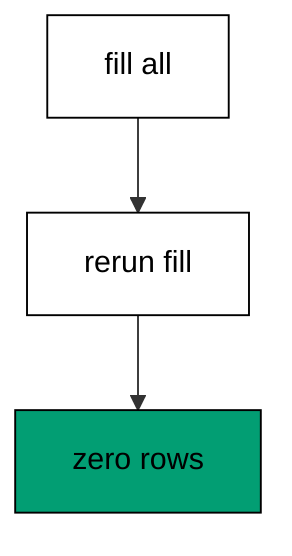
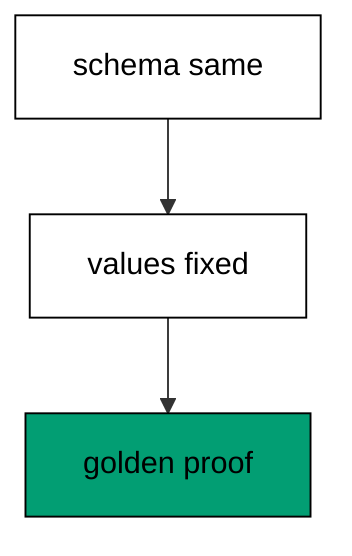
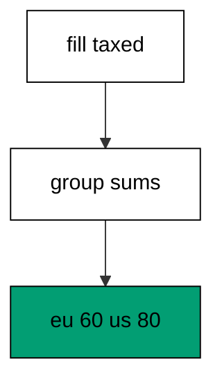
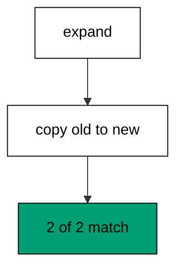
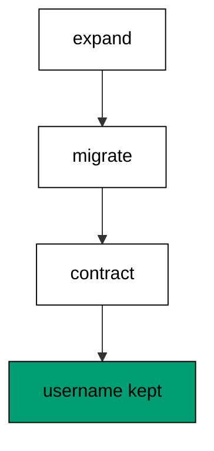
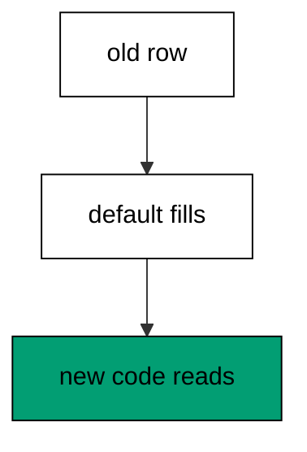
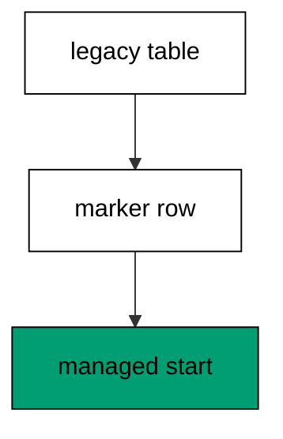
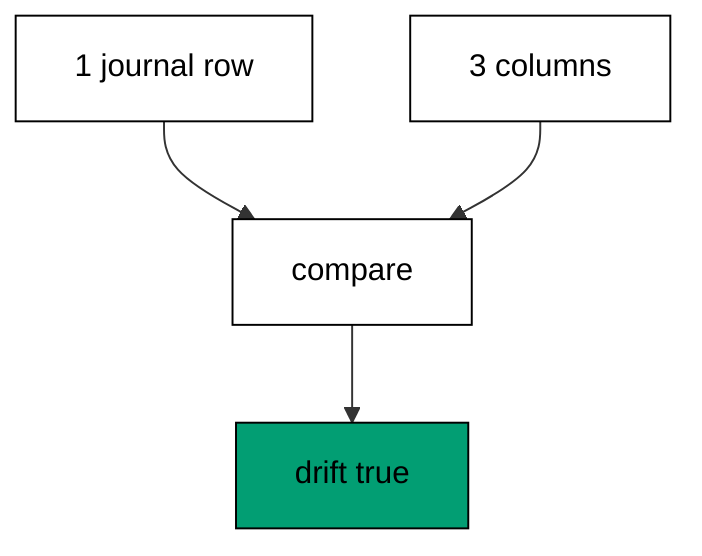
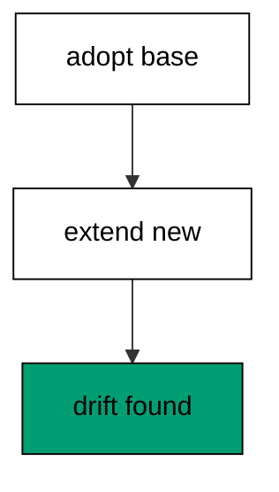

Examples 26–53 move from single-table changes to production realities: filling new columns from old data, splitting breaking changes into zero-downtime steps, and adopting databases that predate their history. Three clusters carry the level: backfills and data migrations (Examples 26–34), zero-downtime migration splitting (Examples 35–44), and baselining an existing database (Examples 45–53). Every program runs against the real pinned PostgreSQL 18 container; every output is a fixed transcript.

### Example 26: Backfill Is a Separate Step

Schema changes and data changes travel in different scripts: the column arrives in 002 and the fill runs in 003. The program seeds three rows, adds a nullable column, and backfills it from existing data. (Concepts: co-06.)

Separating the steps keeps each migration honest about what it does: DDL shapes the table, DML fills it. The WHERE-handle-IS-NULL guard makes the fill safe to repeat, which matters when deploys retry. Reading the three handles back proves every row got its value.

**`learning/code/ex-26-backfill-is-a-separate-step/Program.fs`**:

```fsharp
module App // => one module owns the whole unit

open DbUp // => DeployChanges entry point lives here
open Npgsql // => Npgsql verifies the migrated schema

// => The database address comes from the harness, with local-run defaults.
let connStr () = // => one builder owns every address default
    let host = // => service hostname in the unit network
        match System.Environment.GetEnvironmentVariable("PGHOST") with // => harness sets the service host
        | null
        | "" -> "localhost" // => local runs fall back to localhost
        | h -> h // => the harness value wins when present

    let port = // => service port, almost always the default
        match System.Environment.GetEnvironmentVariable("PGPORT") with // => harness sets the service port
        | null
        | "" -> "5432" // => PostgreSQL listens on 5432
        | p -> p // => the harness value wins when present

    let user = // => trust-auth role, no password needed
        match System.Environment.GetEnvironmentVariable("PGUSER") with // => harness sets the service user
        | null
        | "" -> "postgres" // => local runs use the superuser
        | u -> u // => the harness value wins when present

    let db = // => fresh database for every unit run
        match System.Environment.GetEnvironmentVariable("PGDATABASE") with // => harness sets the service database
        | null
        | "" -> "postgres" // => local runs use the default database
        | d -> d // => the harness value wins when present

    let baseStr = $"Host=%s{host};Port=%s{port};Username=%s{user};Database=%s{db}" // => trust auth needs no password

    match System.Environment.GetEnvironmentVariable("PGPASSWORD") with // => only local runs set a password
    | null
    | "" -> baseStr // => the harness uses trust auth
    | pw -> baseStr + $";Password=%s{pw}" // => local runs authenticate with it

// => One helper runs a write and ignores the count; reads print their own proof.
let exec (conn: NpgsqlConnection) (sql: string) = // => every write flows through here
    use cmd = new NpgsqlCommand(sql, conn) // => fresh command per statement
    cmd.ExecuteNonQuery() |> ignore // => row counts never reach output

// => One helper answers a single int64; counts and ids print through it.
let scalar (conn: NpgsqlConnection) (sql: string) = // => every count flows through here
    use cmd = new NpgsqlCommand(sql, conn) // => fresh command per query
    cmd.ExecuteScalar() :?> int64 // => counts come back as int64

// => One helper lists one text column in order; histories print through it.
let column (conn: NpgsqlConnection) (sql: string) = // => every history flows through here
    use cmd = new NpgsqlCommand(sql, conn) // => fresh command per query
    use reader = cmd.ExecuteReader() // => forward-only reads stay simple

    [ while reader.Read() do
          reader.GetString(0) ] // => one string per row, in query order

// => DbUp journals under this table; units reset only their own rows.
let journalExists (conn: NpgsqlConnection) = // => first runs have no journal yet
    scalar conn "SELECT count(*) FROM information_schema.tables WHERE table_name = 'schemaversions'" = 1L // => one row means DbUp ran here before

// => Every unit starts clean and ends clean, so reruns print alike.
let reset (conn: NpgsqlConnection) (prefix: string) (tables: string list) = // => one reset owns every leftover
    for t in tables do
        exec conn $"DROP TABLE IF EXISTS %s{t} CASCADE" // => a killed run never poisons the rerun

    if journalExists conn then // => the journal may not exist on the first run
        exec conn $"DELETE FROM schemaversions WHERE scriptname LIKE '%s{prefix}%%'" // => only this unit's rows vanish

[<EntryPoint>] // => the harness runs the compiled assembly
let main _ = // => every unit answers zero on success
    use conn = new NpgsqlConnection(connStr ()) // => one session per unit run
    conn.Open() // => fail fast when the service is unreachable
    reset conn "d26_" [ "d26_users" ] // => leftovers of a killed run vanish

    let upgrader = // => DbUp plans the upgrade from these scripts
        DeployChanges.To // => the fluent entry point
            .PostgresqlDatabase(connStr ()) // => the harness database, trust auth
            .WithScript(
                "d26_001_create_users.sql",
                "CREATE TABLE d26_users (id SERIAL PRIMARY KEY, name TEXT NOT NULL);"
            ) // => one ordered script per change
            .Build() // => freeze the plan before running

    let resultupgrader = upgrader.PerformUpgrade() // => apply what the journal lacks
    printfn "upgrade=%b" resultupgrader.Successful // => Output: upgrade=true
    exec conn "INSERT INTO d26_users (name) VALUES ('ada'), ('grace'), ('lin')" // => three rows predate the new column

    let upgrader2 = // => DbUp plans the upgrade from these scripts
        DeployChanges.To // => the fluent entry point
            .PostgresqlDatabase(connStr ()) // => the harness database, trust auth
            .WithScript("d26_002_add_handle.sql", "ALTER TABLE d26_users ADD COLUMN handle TEXT;") // => one ordered script per change
            .Build() // => freeze the plan before running

    let resultupgrader2 = upgrader2.PerformUpgrade() // => apply what the journal lacks
    printfn "upgrade=%b" resultupgrader2.Successful // => Output: upgrade=true

    let upgrader3 = // => DbUp plans the upgrade from these scripts
        DeployChanges.To // => the fluent entry point
            .PostgresqlDatabase(connStr ()) // => the harness database, trust auth
            .WithScript("d26_003_fill_handle.sql", "UPDATE d26_users SET handle = lower(name) WHERE handle IS NULL;") // => one ordered script per change
            .Build() // => freeze the plan before running

    let resultupgrader3 = upgrader3.PerformUpgrade() // => apply what the journal lacks
    printfn "upgrade=%b" resultupgrader3.Successful // => Output: upgrade=true
    printfn "handles=%s" (System.String.Join(",", column conn "SELECT handle FROM d26_users ORDER BY id")) // => Output: handles=ada,grace,lin

    for h in column conn "SELECT scriptname FROM schemaversions ORDER BY schemaversionsid" do
        printfn "history=%s" h // => history prints in apply order

    reset conn "d26_" [ "d26_users" ] // => leftovers of a killed run vanish
    0 // => zero exit means the transcript matched
```

**Output** (`learning/code/ex-26-backfill-is-a-separate-step/expected/main.stdout.txt`):

```text
upgrade=true
upgrade=true
upgrade=true
handles=ada,grace,lin
history=d26_001_create_users.sql
history=d26_002_add_handle.sql
history=d26_003_fill_handle.sql
```

**Key takeaway**: A backfill is its own migration after the schema change, guarded so reruns change nothing.

**Why it matters**: Mixing schema and data in one step hides the riskiest part of a migration inside the safest-looking file. Separate steps let the schema change deploy first and the data fill follow once the shape is proven. That ordering also gives each step its own rollback story, which a combined step can never offer.

### Example 27: Backfill Computes from Existing Rows

The new column derives from data already in the row: display concatenates title and author for every book. The program seeds two books and computes the display values in a dedicated backfill script. (Concepts: co-06.)

Deriving beats inventing: the fill reads title and author rather than hardcoding values, so it stays correct for rows added later. The concatenation operator keeps the whole computation inside SQL where the data lives. Semicolons join the two displays because commas already appear inside book data elsewhere.

**`learning/code/ex-27-backfill-computes-from-existing-rows/Program.fs`**:

```fsharp
module App // => one module owns the whole unit

open DbUp // => DeployChanges entry point lives here
open Npgsql // => Npgsql verifies the migrated schema

// => The database address comes from the harness, with local-run defaults.
let connStr () = // => one builder owns every address default
    let host = // => service hostname in the unit network
        match System.Environment.GetEnvironmentVariable("PGHOST") with // => harness sets the service host
        | null
        | "" -> "localhost" // => local runs fall back to localhost
        | h -> h // => the harness value wins when present

    let port = // => service port, almost always the default
        match System.Environment.GetEnvironmentVariable("PGPORT") with // => harness sets the service port
        | null
        | "" -> "5432" // => PostgreSQL listens on 5432
        | p -> p // => the harness value wins when present

    let user = // => trust-auth role, no password needed
        match System.Environment.GetEnvironmentVariable("PGUSER") with // => harness sets the service user
        | null
        | "" -> "postgres" // => local runs use the superuser
        | u -> u // => the harness value wins when present

    let db = // => fresh database for every unit run
        match System.Environment.GetEnvironmentVariable("PGDATABASE") with // => harness sets the service database
        | null
        | "" -> "postgres" // => local runs use the default database
        | d -> d // => the harness value wins when present

    let baseStr = $"Host=%s{host};Port=%s{port};Username=%s{user};Database=%s{db}" // => trust auth needs no password

    match System.Environment.GetEnvironmentVariable("PGPASSWORD") with // => only local runs set a password
    | null
    | "" -> baseStr // => the harness uses trust auth
    | pw -> baseStr + $";Password=%s{pw}" // => local runs authenticate with it

// => One helper runs a write and ignores the count; reads print their own proof.
let exec (conn: NpgsqlConnection) (sql: string) = // => every write flows through here
    use cmd = new NpgsqlCommand(sql, conn) // => fresh command per statement
    cmd.ExecuteNonQuery() |> ignore // => row counts never reach output

// => One helper answers a single int64; counts and ids print through it.
let scalar (conn: NpgsqlConnection) (sql: string) = // => every count flows through here
    use cmd = new NpgsqlCommand(sql, conn) // => fresh command per query
    cmd.ExecuteScalar() :?> int64 // => counts come back as int64

// => One helper lists one text column in order; histories print through it.
let column (conn: NpgsqlConnection) (sql: string) = // => every history flows through here
    use cmd = new NpgsqlCommand(sql, conn) // => fresh command per query
    use reader = cmd.ExecuteReader() // => forward-only reads stay simple

    [ while reader.Read() do
          reader.GetString(0) ] // => one string per row, in query order

// => DbUp journals under this table; units reset only their own rows.
let journalExists (conn: NpgsqlConnection) = // => first runs have no journal yet
    scalar conn "SELECT count(*) FROM information_schema.tables WHERE table_name = 'schemaversions'" = 1L // => one row means DbUp ran here before

// => Every unit starts clean and ends clean, so reruns print alike.
let reset (conn: NpgsqlConnection) (prefix: string) (tables: string list) = // => one reset owns every leftover
    for t in tables do
        exec conn $"DROP TABLE IF EXISTS %s{t} CASCADE" // => a killed run never poisons the rerun

    if journalExists conn then // => the journal may not exist on the first run
        exec conn $"DELETE FROM schemaversions WHERE scriptname LIKE '%s{prefix}%%'" // => only this unit's rows vanish

[<EntryPoint>] // => the harness runs the compiled assembly
let main _ = // => every unit answers zero on success
    use conn = new NpgsqlConnection(connStr ()) // => one session per unit run
    conn.Open() // => fail fast when the service is unreachable
    reset conn "d27_" [ "d27_books" ] // => leftovers of a killed run vanish

    let upgrader = // => DbUp plans the upgrade from these scripts
        DeployChanges.To // => the fluent entry point
            .PostgresqlDatabase(connStr ()) // => the harness database, trust auth
            .WithScript(
                "d27_001_create_books.sql",
                "CREATE TABLE d27_books (id SERIAL PRIMARY KEY, title TEXT NOT NULL, author TEXT NOT NULL);"
            ) // => one ordered script per change
            .Build() // => freeze the plan before running

    let resultupgrader = upgrader.PerformUpgrade() // => apply what the journal lacks
    printfn "upgrade=%b" resultupgrader.Successful // => Output: upgrade=true
    exec conn "INSERT INTO d27_books (title, author) VALUES ('Dune', 'Herbert'), ('Ender', 'Card')" // => rows the full name derives from

    let upgrader2 = // => DbUp plans the upgrade from these scripts
        DeployChanges.To // => the fluent entry point
            .PostgresqlDatabase(connStr ()) // => the harness database, trust auth
            .WithScript("d27_002_add_display.sql", "ALTER TABLE d27_books ADD COLUMN display TEXT;") // => one ordered script per change
            .Build() // => freeze the plan before running

    let resultupgrader2 = upgrader2.PerformUpgrade() // => apply what the journal lacks
    printfn "upgrade=%b" resultupgrader2.Successful // => Output: upgrade=true

    let upgrader3 = // => DbUp plans the upgrade from these scripts
        DeployChanges.To // => the fluent entry point
            .PostgresqlDatabase(connStr ()) // => the harness database, trust auth
            .WithScript(
                "d27_003_derive_display.sql",
                "UPDATE d27_books SET display = title || ' by ' || author WHERE display IS NULL;"
            ) // => one ordered script per change
            .Build() // => freeze the plan before running

    let resultupgrader3 = upgrader3.PerformUpgrade() // => apply what the journal lacks
    printfn "upgrade=%b" resultupgrader3.Successful // => Output: upgrade=true
    printfn "display=%s" (System.String.Join(";", column conn "SELECT display FROM d27_books ORDER BY id")) // => Output: display=Dune by Herbert;Ender by Card
    reset conn "d27_" [ "d27_books" ] // => leftovers of a killed run vanish
    0 // => zero exit means the transcript matched
```

**Output** (`learning/code/ex-27-backfill-computes-from-existing-rows/expected/main.stdout.txt`):

```text
upgrade=true
upgrade=true
upgrade=true
display=Dune by Herbert;Ender by Card
```

**Key takeaway**: A computed backfill derives the new column from existing row data instead of hardcoding values.

**Why it matters**: Hardcoded fills rot the moment new rows arrive with different data; derived fills stay correct because they read the row they update. Keeping the computation in SQL also keeps it set-based, which is orders of magnitude faster than row-by-row application code. Derive whenever the inputs exist — invent only when they cannot.

### Example 28: Backfill Preserves Every Row

A backfill updates rows without adding or losing any: ten events go in and ten marked events come out. The program seeds with generate_series, fills the flag, and counts both sides. (Concepts: co-06.)

The before-and-after counts are the whole proof: updates never change cardinality, so count equality means no row was duplicated or dropped. generate_series seeds deterministically without hand-writing ten inserts. Counting the marked subset separately proves the fill reached every row.

**`learning/code/ex-28-backfill-preserves-every-row/Program.fs`**:

```fsharp
module App // => one module owns the whole unit

open DbUp // => DeployChanges entry point lives here
open Npgsql // => Npgsql verifies the migrated schema

// => The database address comes from the harness, with local-run defaults.
let connStr () = // => one builder owns every address default
    let host = // => service hostname in the unit network
        match System.Environment.GetEnvironmentVariable("PGHOST") with // => harness sets the service host
        | null
        | "" -> "localhost" // => local runs fall back to localhost
        | h -> h // => the harness value wins when present

    let port = // => service port, almost always the default
        match System.Environment.GetEnvironmentVariable("PGPORT") with // => harness sets the service port
        | null
        | "" -> "5432" // => PostgreSQL listens on 5432
        | p -> p // => the harness value wins when present

    let user = // => trust-auth role, no password needed
        match System.Environment.GetEnvironmentVariable("PGUSER") with // => harness sets the service user
        | null
        | "" -> "postgres" // => local runs use the superuser
        | u -> u // => the harness value wins when present

    let db = // => fresh database for every unit run
        match System.Environment.GetEnvironmentVariable("PGDATABASE") with // => harness sets the service database
        | null
        | "" -> "postgres" // => local runs use the default database
        | d -> d // => the harness value wins when present

    let baseStr = $"Host=%s{host};Port=%s{port};Username=%s{user};Database=%s{db}" // => trust auth needs no password

    match System.Environment.GetEnvironmentVariable("PGPASSWORD") with // => only local runs set a password
    | null
    | "" -> baseStr // => the harness uses trust auth
    | pw -> baseStr + $";Password=%s{pw}" // => local runs authenticate with it

// => One helper runs a write and ignores the count; reads print their own proof.
let exec (conn: NpgsqlConnection) (sql: string) = // => every write flows through here
    use cmd = new NpgsqlCommand(sql, conn) // => fresh command per statement
    cmd.ExecuteNonQuery() |> ignore // => row counts never reach output

// => One helper answers a single int64; counts and ids print through it.
let scalar (conn: NpgsqlConnection) (sql: string) = // => every count flows through here
    use cmd = new NpgsqlCommand(sql, conn) // => fresh command per query
    cmd.ExecuteScalar() :?> int64 // => counts come back as int64

// => One helper lists one text column in order; histories print through it.
let column (conn: NpgsqlConnection) (sql: string) = // => every history flows through here
    use cmd = new NpgsqlCommand(sql, conn) // => fresh command per query
    use reader = cmd.ExecuteReader() // => forward-only reads stay simple

    [ while reader.Read() do
          reader.GetString(0) ] // => one string per row, in query order

// => DbUp journals under this table; units reset only their own rows.
let journalExists (conn: NpgsqlConnection) = // => first runs have no journal yet
    scalar conn "SELECT count(*) FROM information_schema.tables WHERE table_name = 'schemaversions'" = 1L // => one row means DbUp ran here before

// => Every unit starts clean and ends clean, so reruns print alike.
let reset (conn: NpgsqlConnection) (prefix: string) (tables: string list) = // => one reset owns every leftover
    for t in tables do
        exec conn $"DROP TABLE IF EXISTS %s{t} CASCADE" // => a killed run never poisons the rerun

    if journalExists conn then // => the journal may not exist on the first run
        exec conn $"DELETE FROM schemaversions WHERE scriptname LIKE '%s{prefix}%%'" // => only this unit's rows vanish

[<EntryPoint>] // => the harness runs the compiled assembly
let main _ = // => every unit answers zero on success
    use conn = new NpgsqlConnection(connStr ()) // => one session per unit run
    conn.Open() // => fail fast when the service is unreachable
    reset conn "d28_" [ "d28_events" ] // => leftovers of a killed run vanish

    let upgrader = // => DbUp plans the upgrade from these scripts
        DeployChanges.To // => the fluent entry point
            .PostgresqlDatabase(connStr ()) // => the harness database, trust auth
            .WithScript(
                "d28_001_create_events.sql",
                "CREATE TABLE d28_events (id SERIAL PRIMARY KEY, kind TEXT NOT NULL);"
            ) // => one ordered script per change
            .Build() // => freeze the plan before running

    let resultupgrader = upgrader.PerformUpgrade() // => apply what the journal lacks
    printfn "upgrade=%b" resultupgrader.Successful // => Output: upgrade=true
    exec conn "INSERT INTO d28_events (kind) SELECT 'click' FROM generate_series(1, 10)" // => ten rows to preserve exactly

    let upgrader2 = // => DbUp plans the upgrade from these scripts
        DeployChanges.To // => the fluent entry point
            .PostgresqlDatabase(connStr ()) // => the harness database, trust auth
            .WithScript("d28_002_add_seen.sql", "ALTER TABLE d28_events ADD COLUMN seen BOOLEAN;") // => one ordered script per change
            .Build() // => freeze the plan before running

    let resultupgrader2 = upgrader2.PerformUpgrade() // => apply what the journal lacks
    printfn "upgrade=%b" resultupgrader2.Successful // => Output: upgrade=true

    let upgrader3 = // => DbUp plans the upgrade from these scripts
        DeployChanges.To // => the fluent entry point
            .PostgresqlDatabase(connStr ()) // => the harness database, trust auth
            .WithScript("d28_003_mark_seen.sql", "UPDATE d28_events SET seen = true WHERE seen IS NULL;") // => one ordered script per change
            .Build() // => freeze the plan before running

    let resultupgrader3 = upgrader3.PerformUpgrade() // => apply what the journal lacks
    printfn "upgrade=%b" resultupgrader3.Successful // => Output: upgrade=true
    printfn "count=%d" (scalar conn "SELECT count(*) FROM d28_events") // => Output: count=10
    printfn "marked=%d" (scalar conn "SELECT count(*) FROM d28_events WHERE seen = true") // => Output: marked=10
    reset conn "d28_" [ "d28_events" ] // => leftovers of a killed run vanish
    0 // => zero exit means the transcript matched
```

**Output** (`learning/code/ex-28-backfill-preserves-every-row/expected/main.stdout.txt`):

```text
upgrade=true
upgrade=true
upgrade=true
count=10
marked=10
```

**Key takeaway**: Row counts before and after prove a backfill changed values without adding or losing rows.

**Why it matters**: The scariest backfill failure is silent row loss, and only a count comparison catches it. Asserting count equality around every data migration turns that fear into a checked property. Seed deterministically, fill completely, and count both sides — the three beats of any backfill worth shipping. Counting both sides turns the scariest silent failure into a checked property on every data migration.

### Example 29: Backfill Runs Safely Twice

The WHERE-IS-NULL guard makes the second run a no-op: rerunning the fill script changes zero rows. The program applies the backfill twice in a row and proves the counts never move. (Concepts: co-05, co-06.)



Without the guard, a second run would still succeed but waste work and risk non-idempotent expressions; with it, the rerun is provably empty. The journal skips the script on later upgrades, but in-process reruns and retried deploys meet the guard first. Both layers agree: fills must be repeatable.

**`learning/code/ex-29-backfill-runs-safely-twice/Program.fs`**:

```fsharp
module App // => one module owns the whole unit

open DbUp // => DeployChanges entry point lives here
open Npgsql // => Npgsql verifies the migrated schema

// => The database address comes from the harness, with local-run defaults.
let connStr () = // => one builder owns every address default
    let host = // => service hostname in the unit network
        match System.Environment.GetEnvironmentVariable("PGHOST") with // => harness sets the service host
        | null
        | "" -> "localhost" // => local runs fall back to localhost
        | h -> h // => the harness value wins when present

    let port = // => service port, almost always the default
        match System.Environment.GetEnvironmentVariable("PGPORT") with // => harness sets the service port
        | null
        | "" -> "5432" // => PostgreSQL listens on 5432
        | p -> p // => the harness value wins when present

    let user = // => trust-auth role, no password needed
        match System.Environment.GetEnvironmentVariable("PGUSER") with // => harness sets the service user
        | null
        | "" -> "postgres" // => local runs use the superuser
        | u -> u // => the harness value wins when present

    let db = // => fresh database for every unit run
        match System.Environment.GetEnvironmentVariable("PGDATABASE") with // => harness sets the service database
        | null
        | "" -> "postgres" // => local runs use the default database
        | d -> d // => the harness value wins when present

    let baseStr = $"Host=%s{host};Port=%s{port};Username=%s{user};Database=%s{db}" // => trust auth needs no password

    match System.Environment.GetEnvironmentVariable("PGPASSWORD") with // => only local runs set a password
    | null
    | "" -> baseStr // => the harness uses trust auth
    | pw -> baseStr + $";Password=%s{pw}" // => local runs authenticate with it

// => One helper runs a write and ignores the count; reads print their own proof.
let exec (conn: NpgsqlConnection) (sql: string) = // => every write flows through here
    use cmd = new NpgsqlCommand(sql, conn) // => fresh command per statement
    cmd.ExecuteNonQuery() |> ignore // => row counts never reach output

// => One helper answers a single int64; counts and ids print through it.
let scalar (conn: NpgsqlConnection) (sql: string) = // => every count flows through here
    use cmd = new NpgsqlCommand(sql, conn) // => fresh command per query
    cmd.ExecuteScalar() :?> int64 // => counts come back as int64

// => One helper lists one text column in order; histories print through it.
let column (conn: NpgsqlConnection) (sql: string) = // => every history flows through here
    use cmd = new NpgsqlCommand(sql, conn) // => fresh command per query
    use reader = cmd.ExecuteReader() // => forward-only reads stay simple

    [ while reader.Read() do
          reader.GetString(0) ] // => one string per row, in query order

// => DbUp journals under this table; units reset only their own rows.
let journalExists (conn: NpgsqlConnection) = // => first runs have no journal yet
    scalar conn "SELECT count(*) FROM information_schema.tables WHERE table_name = 'schemaversions'" = 1L // => one row means DbUp ran here before

// => Every unit starts clean and ends clean, so reruns print alike.
let reset (conn: NpgsqlConnection) (prefix: string) (tables: string list) = // => one reset owns every leftover
    for t in tables do
        exec conn $"DROP TABLE IF EXISTS %s{t} CASCADE" // => a killed run never poisons the rerun

    if journalExists conn then // => the journal may not exist on the first run
        exec conn $"DELETE FROM schemaversions WHERE scriptname LIKE '%s{prefix}%%'" // => only this unit's rows vanish

[<EntryPoint>] // => the harness runs the compiled assembly
let main _ = // => every unit answers zero on success
    use conn = new NpgsqlConnection(connStr ()) // => one session per unit run
    conn.Open() // => fail fast when the service is unreachable
    reset conn "d29_" [ "d29_flags" ] // => leftovers of a killed run vanish

    let upgrader = // => DbUp plans the upgrade from these scripts
        DeployChanges.To // => the fluent entry point
            .PostgresqlDatabase(connStr ()) // => the harness database, trust auth
            .WithScript(
                "d29_001_create_flags.sql",
                "CREATE TABLE d29_flags (id SERIAL PRIMARY KEY, name TEXT NOT NULL);"
            ) // => one ordered script per change
            .Build() // => freeze the plan before running

    let resultupgrader = upgrader.PerformUpgrade() // => apply what the journal lacks
    printfn "upgrade=%b" resultupgrader.Successful // => Output: upgrade=true
    exec conn "INSERT INTO d29_flags (name) VALUES ('a'), ('b')" // => rows the rerun must not duplicate

    let upgrader2 = // => DbUp plans the upgrade from these scripts
        DeployChanges.To // => the fluent entry point
            .PostgresqlDatabase(connStr ()) // => the harness database, trust auth
            .WithScript("d29_002_add_on.sql", "ALTER TABLE d29_flags ADD COLUMN on_flag BOOLEAN;") // => one ordered script per change
            .Build() // => freeze the plan before running

    let resultupgrader2 = upgrader2.PerformUpgrade() // => apply what the journal lacks
    printfn "upgrade=%b" resultupgrader2.Successful // => Output: upgrade=true

    let upgrader3 = // => DbUp plans the upgrade from these scripts
        DeployChanges.To // => the fluent entry point
            .PostgresqlDatabase(connStr ()) // => the harness database, trust auth
            .WithScript("d29_003_set_on.sql", "UPDATE d29_flags SET on_flag = true WHERE on_flag IS NULL;") // => one ordered script per change
            .Build() // => freeze the plan before running

    let resultupgrader3 = upgrader3.PerformUpgrade() // => apply what the journal lacks
    printfn "upgrade=%b" resultupgrader3.Successful // => Output: upgrade=true

    let upgrader4 = // => DbUp plans the upgrade from these scripts
        DeployChanges.To // => the fluent entry point
            .PostgresqlDatabase(connStr ()) // => the harness database, trust auth
            .WithScript("d29_003_set_on.sql", "UPDATE d29_flags SET on_flag = true WHERE on_flag IS NULL;") // => one ordered script per change
            .Build() // => freeze the plan before running

    let resultupgrader4 = upgrader4.PerformUpgrade() // => apply what the journal lacks
    printfn "upgrade=%b" resultupgrader4.Successful // => Output: upgrade=true
    printfn "rerun=%b" resultupgrader4.Successful // => Output: rerun=true
    printfn "rows=%d" (scalar conn "SELECT count(*) FROM d29_flags") // => Output: rows=2
    printfn "on-count=%d" (scalar conn "SELECT count(*) FROM d29_flags WHERE on_flag = true") // => Output: on-count=2
    reset conn "d29_" [ "d29_flags" ] // => leftovers of a killed run vanish
    0 // => zero exit means the transcript matched
```

**Output** (`learning/code/ex-29-backfill-runs-safely-twice/expected/main.stdout.txt`):

```text
upgrade=true
upgrade=true
upgrade=true
upgrade=true
rerun=true
rows=2
on-count=2
```

**Key takeaway**: A WHERE-IS-NULL guard makes backfills idempotent, so the second run provably changes nothing.

**Why it matters**: Deploy retries do not ask permission: any step may run twice, and data steps must survive it. The null guard is one clause that converts a dangerous rerun into a no-op with identical output. Idempotent data changes compose safely with the journal skipping from earlier examples, giving two independent layers of rerun safety.

### Example 30: Batch Backfills Avoid Long Locks

Large fills run in small batches so no single statement holds the table long: five batches of five rows each. The program loops five bounded updates and proves every row landed in exactly one batch. (Concepts: co-06, co-15.)

Each UPDATE touches five rows by primary-key range, so each holds its locks briefly and commits fast. The batch guard keeps reruns inside unfilled rows only. Counting distinct batches and filled rows proves the partition covered everything exactly once.

**`learning/code/ex-30-batch-backfills-avoid-long-locks/Program.fs`**:

```fsharp
module App // => one module owns the whole unit

open DbUp // => DeployChanges entry point lives here
open Npgsql // => Npgsql verifies the migrated schema

// => The database address comes from the harness, with local-run defaults.
let connStr () = // => one builder owns every address default
    let host = // => service hostname in the unit network
        match System.Environment.GetEnvironmentVariable("PGHOST") with // => harness sets the service host
        | null
        | "" -> "localhost" // => local runs fall back to localhost
        | h -> h // => the harness value wins when present

    let port = // => service port, almost always the default
        match System.Environment.GetEnvironmentVariable("PGPORT") with // => harness sets the service port
        | null
        | "" -> "5432" // => PostgreSQL listens on 5432
        | p -> p // => the harness value wins when present

    let user = // => trust-auth role, no password needed
        match System.Environment.GetEnvironmentVariable("PGUSER") with // => harness sets the service user
        | null
        | "" -> "postgres" // => local runs use the superuser
        | u -> u // => the harness value wins when present

    let db = // => fresh database for every unit run
        match System.Environment.GetEnvironmentVariable("PGDATABASE") with // => harness sets the service database
        | null
        | "" -> "postgres" // => local runs use the default database
        | d -> d // => the harness value wins when present

    let baseStr = $"Host=%s{host};Port=%s{port};Username=%s{user};Database=%s{db}" // => trust auth needs no password

    match System.Environment.GetEnvironmentVariable("PGPASSWORD") with // => only local runs set a password
    | null
    | "" -> baseStr // => the harness uses trust auth
    | pw -> baseStr + $";Password=%s{pw}" // => local runs authenticate with it

// => One helper runs a write and ignores the count; reads print their own proof.
let exec (conn: NpgsqlConnection) (sql: string) = // => every write flows through here
    use cmd = new NpgsqlCommand(sql, conn) // => fresh command per statement
    cmd.ExecuteNonQuery() |> ignore // => row counts never reach output

// => One helper answers a single int64; counts and ids print through it.
let scalar (conn: NpgsqlConnection) (sql: string) = // => every count flows through here
    use cmd = new NpgsqlCommand(sql, conn) // => fresh command per query
    cmd.ExecuteScalar() :?> int64 // => counts come back as int64

// => One helper lists one text column in order; histories print through it.
let column (conn: NpgsqlConnection) (sql: string) = // => every history flows through here
    use cmd = new NpgsqlCommand(sql, conn) // => fresh command per query
    use reader = cmd.ExecuteReader() // => forward-only reads stay simple

    [ while reader.Read() do
          reader.GetString(0) ] // => one string per row, in query order

// => DbUp journals under this table; units reset only their own rows.
let journalExists (conn: NpgsqlConnection) = // => first runs have no journal yet
    scalar conn "SELECT count(*) FROM information_schema.tables WHERE table_name = 'schemaversions'" = 1L // => one row means DbUp ran here before

// => Every unit starts clean and ends clean, so reruns print alike.
let reset (conn: NpgsqlConnection) (prefix: string) (tables: string list) = // => one reset owns every leftover
    for t in tables do
        exec conn $"DROP TABLE IF EXISTS %s{t} CASCADE" // => a killed run never poisons the rerun

    if journalExists conn then // => the journal may not exist on the first run
        exec conn $"DELETE FROM schemaversions WHERE scriptname LIKE '%s{prefix}%%'" // => only this unit's rows vanish

[<EntryPoint>] // => the harness runs the compiled assembly
let main _ = // => every unit answers zero on success
    use conn = new NpgsqlConnection(connStr ()) // => one session per unit run
    conn.Open() // => fail fast when the service is unreachable
    reset conn "d30_" [ "d30_logs" ] // => leftovers of a killed run vanish

    let upgrader = // => DbUp plans the upgrade from these scripts
        DeployChanges.To // => the fluent entry point
            .PostgresqlDatabase(connStr ()) // => the harness database, trust auth
            .WithScript("d30_001_create_logs.sql", "CREATE TABLE d30_logs (id SERIAL PRIMARY KEY, msg TEXT NOT NULL);") // => one ordered script per change
            .Build() // => freeze the plan before running

    let resultupgrader = upgrader.PerformUpgrade() // => apply what the journal lacks
    printfn "upgrade=%b" resultupgrader.Successful // => Output: upgrade=true
    exec conn "INSERT INTO d30_logs (msg) SELECT 'm' || g::text FROM generate_series(1, 25) g" // => twenty-five rows for five batches

    let upgrader2 = // => DbUp plans the upgrade from these scripts
        DeployChanges.To // => the fluent entry point
            .PostgresqlDatabase(connStr ()) // => the harness database, trust auth
            .WithScript("d30_002_add_batch.sql", "ALTER TABLE d30_logs ADD COLUMN batch INTEGER;") // => one ordered script per change
            .Build() // => freeze the plan before running

    let resultupgrader2 = upgrader2.PerformUpgrade() // => apply what the journal lacks
    printfn "upgrade=%b" resultupgrader2.Successful // => Output: upgrade=true

    for b in 1..5 do
        exec
            conn
            $"UPDATE d30_logs SET batch = %d{b} WHERE id BETWEEN %d{(b - 1) * 5 + 1} AND %d{b * 5} AND batch IS NULL" // => five rows per batch

    printfn "batches=%d" (scalar conn "SELECT count(DISTINCT batch) FROM d30_logs") // => Output: batches=5
    printfn "rows=%d" (scalar conn "SELECT count(*) FROM d30_logs WHERE batch IS NOT NULL") // => Output: rows=25
    reset conn "d30_" [ "d30_logs" ] // => leftovers of a killed run vanish
    0 // => zero exit means the transcript matched
```

**Output** (`learning/code/ex-30-batch-backfills-avoid-long-locks/expected/main.stdout.txt`):

```text
upgrade=true
upgrade=true
batches=5
rows=25
```

**Key takeaway**: Key-range batches bound every backfill statement to a few rows, so locks stay short no matter the table size.

**Why it matters**: One giant UPDATE on a hot table blocks writers for its whole duration and risks bloat on rollback; bounded batches turn that cliff into a staircase. Primary-key ranges partition cleanly and resume naturally after interruption. Batch by key, guard by null, and count both sides — the production backfill rhythm.

### Example 31: New Not-Null Needs a Default

A NOT NULL column on a populated table needs a server default or the ALTER fails on existing rows. The program seeds two legacy members, adds a defaulted tier, and proves both rows carry it with nulls forbidden. (Concepts: co-06.)

The default fills at ALTER time, so the constraint never meets a null even though the rows predate the column. Reading is_nullable back from the catalog proves the constraint landed, not just the values. Defaults are the bridge between legacy rows and strict new rules.

**`learning/code/ex-31-new-not-null-needs-a-default/Program.fs`**:

```fsharp
module App // => one module owns the whole unit

open DbUp // => DeployChanges entry point lives here
open Npgsql // => Npgsql verifies the migrated schema

// => The database address comes from the harness, with local-run defaults.
let connStr () = // => one builder owns every address default
    let host = // => service hostname in the unit network
        match System.Environment.GetEnvironmentVariable("PGHOST") with // => harness sets the service host
        | null
        | "" -> "localhost" // => local runs fall back to localhost
        | h -> h // => the harness value wins when present

    let port = // => service port, almost always the default
        match System.Environment.GetEnvironmentVariable("PGPORT") with // => harness sets the service port
        | null
        | "" -> "5432" // => PostgreSQL listens on 5432
        | p -> p // => the harness value wins when present

    let user = // => trust-auth role, no password needed
        match System.Environment.GetEnvironmentVariable("PGUSER") with // => harness sets the service user
        | null
        | "" -> "postgres" // => local runs use the superuser
        | u -> u // => the harness value wins when present

    let db = // => fresh database for every unit run
        match System.Environment.GetEnvironmentVariable("PGDATABASE") with // => harness sets the service database
        | null
        | "" -> "postgres" // => local runs use the default database
        | d -> d // => the harness value wins when present

    let baseStr = $"Host=%s{host};Port=%s{port};Username=%s{user};Database=%s{db}" // => trust auth needs no password

    match System.Environment.GetEnvironmentVariable("PGPASSWORD") with // => only local runs set a password
    | null
    | "" -> baseStr // => the harness uses trust auth
    | pw -> baseStr + $";Password=%s{pw}" // => local runs authenticate with it

// => One helper runs a write and ignores the count; reads print their own proof.
let exec (conn: NpgsqlConnection) (sql: string) = // => every write flows through here
    use cmd = new NpgsqlCommand(sql, conn) // => fresh command per statement
    cmd.ExecuteNonQuery() |> ignore // => row counts never reach output

// => One helper answers a single int64; counts and ids print through it.
let scalar (conn: NpgsqlConnection) (sql: string) = // => every count flows through here
    use cmd = new NpgsqlCommand(sql, conn) // => fresh command per query
    cmd.ExecuteScalar() :?> int64 // => counts come back as int64

// => One helper lists one text column in order; histories print through it.
let column (conn: NpgsqlConnection) (sql: string) = // => every history flows through here
    use cmd = new NpgsqlCommand(sql, conn) // => fresh command per query
    use reader = cmd.ExecuteReader() // => forward-only reads stay simple

    [ while reader.Read() do
          reader.GetString(0) ] // => one string per row, in query order

// => DbUp journals under this table; units reset only their own rows.
let journalExists (conn: NpgsqlConnection) = // => first runs have no journal yet
    scalar conn "SELECT count(*) FROM information_schema.tables WHERE table_name = 'schemaversions'" = 1L // => one row means DbUp ran here before

// => Every unit starts clean and ends clean, so reruns print alike.
let reset (conn: NpgsqlConnection) (prefix: string) (tables: string list) = // => one reset owns every leftover
    for t in tables do
        exec conn $"DROP TABLE IF EXISTS %s{t} CASCADE" // => a killed run never poisons the rerun

    if journalExists conn then // => the journal may not exist on the first run
        exec conn $"DELETE FROM schemaversions WHERE scriptname LIKE '%s{prefix}%%'" // => only this unit's rows vanish

[<EntryPoint>] // => the harness runs the compiled assembly
let main _ = // => every unit answers zero on success
    use conn = new NpgsqlConnection(connStr ()) // => one session per unit run
    conn.Open() // => fail fast when the service is unreachable
    reset conn "d31_" [ "d31_members" ] // => leftovers of a killed run vanish

    let upgrader = // => DbUp plans the upgrade from these scripts
        DeployChanges.To // => the fluent entry point
            .PostgresqlDatabase(connStr ()) // => the harness database, trust auth
            .WithScript(
                "d31_001_create_members.sql",
                "CREATE TABLE d31_members (id SERIAL PRIMARY KEY, name TEXT NOT NULL);"
            ) // => one ordered script per change
            .Build() // => freeze the plan before running

    let resultupgrader = upgrader.PerformUpgrade() // => apply what the journal lacks
    printfn "upgrade=%b" resultupgrader.Successful // => Output: upgrade=true
    exec conn "INSERT INTO d31_members (name) VALUES ('ada'), ('grace')" // => legacy rows with no tier yet

    let upgrader2 = // => DbUp plans the upgrade from these scripts
        DeployChanges.To // => the fluent entry point
            .PostgresqlDatabase(connStr ()) // => the harness database, trust auth
            .WithScript(
                "d31_002_default_tier.sql",
                "ALTER TABLE d31_members ADD COLUMN tier TEXT NOT NULL DEFAULT 'free';"
            ) // => one ordered script per change
            .Build() // => freeze the plan before running

    let resultupgrader2 = upgrader2.PerformUpgrade() // => apply what the journal lacks
    printfn "upgrade=%b" resultupgrader2.Successful // => Output: upgrade=true
    printfn "tiers=%s" (System.String.Join(",", column conn "SELECT tier FROM d31_members ORDER BY id")) // => Output: tiers=free,free

    printfn
        "nullable=%s"
        (System.String.Join(
            ",",
            column
                conn
                "SELECT is_nullable FROM information_schema.columns WHERE table_name = 'd31_members' AND column_name = 'tier'"
        )) // => Output: nullable=NO

    reset conn "d31_" [ "d31_members" ] // => leftovers of a killed run vanish
    0 // => zero exit means the transcript matched
```

**Output** (`learning/code/ex-31-new-not-null-needs-a-default/expected/main.stdout.txt`):

```text
upgrade=true
upgrade=true
tiers=free,free
nullable=NO
```

**Key takeaway**: A server default lets a NOT NULL column land on a populated table with every existing row filled.

**Why it matters**: Strictness without a migration path is just a deploy that fails at 2 AM: the default is the path. Existing rows get a sensible value at ALTER time, and the constraint protects every future write from that moment on. The catalog check closes the loop between intending strictness and actually having it.

### Example 32: Data Only Migration Carries No Schema Change

Some migrations change rows and nothing else: two UPDATEs fix config values while the column count stays at three. The program proves the schema untouched and the values corrected in one script. (Concepts: co-06.)



The column count before and after is identical, which is the definition of data-only. Separating data fixes from schema changes keeps reviews honest about blast radius. The ordered key=value print is the golden proof the fix landed exactly.

**`learning/code/ex-32-data-only-migration-carries-no-schema-change/Program.fs`**:

```fsharp
module App // => one module owns the whole unit

open DbUp // => DeployChanges entry point lives here
open Npgsql // => Npgsql verifies the migrated schema

// => The database address comes from the harness, with local-run defaults.
let connStr () = // => one builder owns every address default
    let host = // => service hostname in the unit network
        match System.Environment.GetEnvironmentVariable("PGHOST") with // => harness sets the service host
        | null
        | "" -> "localhost" // => local runs fall back to localhost
        | h -> h // => the harness value wins when present

    let port = // => service port, almost always the default
        match System.Environment.GetEnvironmentVariable("PGPORT") with // => harness sets the service port
        | null
        | "" -> "5432" // => PostgreSQL listens on 5432
        | p -> p // => the harness value wins when present

    let user = // => trust-auth role, no password needed
        match System.Environment.GetEnvironmentVariable("PGUSER") with // => harness sets the service user
        | null
        | "" -> "postgres" // => local runs use the superuser
        | u -> u // => the harness value wins when present

    let db = // => fresh database for every unit run
        match System.Environment.GetEnvironmentVariable("PGDATABASE") with // => harness sets the service database
        | null
        | "" -> "postgres" // => local runs use the default database
        | d -> d // => the harness value wins when present

    let baseStr = $"Host=%s{host};Port=%s{port};Username=%s{user};Database=%s{db}" // => trust auth needs no password

    match System.Environment.GetEnvironmentVariable("PGPASSWORD") with // => only local runs set a password
    | null
    | "" -> baseStr // => the harness uses trust auth
    | pw -> baseStr + $";Password=%s{pw}" // => local runs authenticate with it

// => One helper runs a write and ignores the count; reads print their own proof.
let exec (conn: NpgsqlConnection) (sql: string) = // => every write flows through here
    use cmd = new NpgsqlCommand(sql, conn) // => fresh command per statement
    cmd.ExecuteNonQuery() |> ignore // => row counts never reach output

// => One helper answers a single int64; counts and ids print through it.
let scalar (conn: NpgsqlConnection) (sql: string) = // => every count flows through here
    use cmd = new NpgsqlCommand(sql, conn) // => fresh command per query
    cmd.ExecuteScalar() :?> int64 // => counts come back as int64

// => One helper lists one text column in order; histories print through it.
let column (conn: NpgsqlConnection) (sql: string) = // => every history flows through here
    use cmd = new NpgsqlCommand(sql, conn) // => fresh command per query
    use reader = cmd.ExecuteReader() // => forward-only reads stay simple

    [ while reader.Read() do
          reader.GetString(0) ] // => one string per row, in query order

// => DbUp journals under this table; units reset only their own rows.
let journalExists (conn: NpgsqlConnection) = // => first runs have no journal yet
    scalar conn "SELECT count(*) FROM information_schema.tables WHERE table_name = 'schemaversions'" = 1L // => one row means DbUp ran here before

// => Every unit starts clean and ends clean, so reruns print alike.
let reset (conn: NpgsqlConnection) (prefix: string) (tables: string list) = // => one reset owns every leftover
    for t in tables do
        exec conn $"DROP TABLE IF EXISTS %s{t} CASCADE" // => a killed run never poisons the rerun

    if journalExists conn then // => the journal may not exist on the first run
        exec conn $"DELETE FROM schemaversions WHERE scriptname LIKE '%s{prefix}%%'" // => only this unit's rows vanish

[<EntryPoint>] // => the harness runs the compiled assembly
let main _ = // => every unit answers zero on success
    use conn = new NpgsqlConnection(connStr ()) // => one session per unit run
    conn.Open() // => fail fast when the service is unreachable
    reset conn "d32_" [ "d32_cfg" ] // => leftovers of a killed run vanish

    let upgrader = // => DbUp plans the upgrade from these scripts
        DeployChanges.To // => the fluent entry point
            .PostgresqlDatabase(connStr ()) // => the harness database, trust auth
            .WithScript(
                "d32_001_create_cfg.sql",
                "CREATE TABLE d32_cfg (id SERIAL PRIMARY KEY, k TEXT NOT NULL, v TEXT NOT NULL);"
            ) // => one ordered script per change
            .Build() // => freeze the plan before running

    let resultupgrader = upgrader.PerformUpgrade() // => apply what the journal lacks
    printfn "upgrade=%b" resultupgrader.Successful // => Output: upgrade=true
    exec conn "INSERT INTO d32_cfg (k, v) VALUES ('timeout', '30'), ('retries', '3')" // => seed rows with old string values

    let upgrader2 = // => DbUp plans the upgrade from these scripts
        DeployChanges.To // => the fluent entry point
            .PostgresqlDatabase(connStr ()) // => the harness database, trust auth
            .WithScript(
                "d32_002_fix_values.sql",
                "UPDATE d32_cfg SET v = '60' WHERE k = 'timeout'; UPDATE d32_cfg SET v = '5' WHERE k = 'retries';"
            ) // => one ordered script per change
            .Build() // => freeze the plan before running

    let resultupgrader2 = upgrader2.PerformUpgrade() // => apply what the journal lacks
    printfn "upgrade=%b" resultupgrader2.Successful // => Output: upgrade=true

    printfn
        "schema-same=%d"
        (scalar conn "SELECT count(*) FROM information_schema.columns WHERE table_name = 'd32_cfg'") // => Output: schema-same=3

    printfn "vals=%s" (System.String.Join(",", column conn "SELECT k || '=' || v FROM d32_cfg ORDER BY k")) // => Output: vals=retries=5,timeout=60
    reset conn "d32_" [ "d32_cfg" ] // => leftovers of a killed run vanish
    0 // => zero exit means the transcript matched
```

**Output** (`learning/code/ex-32-data-only-migration-carries-no-schema-change/expected/main.stdout.txt`):

```text
upgrade=true
upgrade=true
schema-same=3
vals=retries=5,timeout=60
```

**Key takeaway**: A data-only migration changes rows while the schema stays byte-identical, and the proof is a count plus values.

**Why it matters**: Configuration drifts into databases through hotfixes and consoles, and data-only migrations are the disciplined way to correct it. Versioning the correction gives it the same review, journal, and rollback story as any schema change. The schema-unchanged proof is what lets reviewers approve a data fix without fearing a hidden ALTER.

### Example 33: Verify a Backfill with a Golden Query

The backfill proves itself with one aggregation query whose output is fixed: sixty for eu, eighty for us. The program fills a derived column and checks the grouped sums in a single golden line. (Concepts: co-06, co-16.)



Golden queries turn verification into a string comparison: the expected totals are baked into the test, not eyeballed. Grouping by region exercises the fill across partitions rather than one lucky row. This is migration testing in its smallest honest form — assert the business math, not just the row count.

**`learning/code/ex-33-verify-a-backfill-with-a-golden-query/Program.fs`**:

```fsharp
module App // => one module owns the whole unit

open DbUp // => DeployChanges entry point lives here
open Npgsql // => Npgsql verifies the migrated schema

// => The database address comes from the harness, with local-run defaults.
let connStr () = // => one builder owns every address default
    let host = // => service hostname in the unit network
        match System.Environment.GetEnvironmentVariable("PGHOST") with // => harness sets the service host
        | null
        | "" -> "localhost" // => local runs fall back to localhost
        | h -> h // => the harness value wins when present

    let port = // => service port, almost always the default
        match System.Environment.GetEnvironmentVariable("PGPORT") with // => harness sets the service port
        | null
        | "" -> "5432" // => PostgreSQL listens on 5432
        | p -> p // => the harness value wins when present

    let user = // => trust-auth role, no password needed
        match System.Environment.GetEnvironmentVariable("PGUSER") with // => harness sets the service user
        | null
        | "" -> "postgres" // => local runs use the superuser
        | u -> u // => the harness value wins when present

    let db = // => fresh database for every unit run
        match System.Environment.GetEnvironmentVariable("PGDATABASE") with // => harness sets the service database
        | null
        | "" -> "postgres" // => local runs use the default database
        | d -> d // => the harness value wins when present

    let baseStr = $"Host=%s{host};Port=%s{port};Username=%s{user};Database=%s{db}" // => trust auth needs no password

    match System.Environment.GetEnvironmentVariable("PGPASSWORD") with // => only local runs set a password
    | null
    | "" -> baseStr // => the harness uses trust auth
    | pw -> baseStr + $";Password=%s{pw}" // => local runs authenticate with it

// => One helper runs a write and ignores the count; reads print their own proof.
let exec (conn: NpgsqlConnection) (sql: string) = // => every write flows through here
    use cmd = new NpgsqlCommand(sql, conn) // => fresh command per statement
    cmd.ExecuteNonQuery() |> ignore // => row counts never reach output

// => One helper answers a single int64; counts and ids print through it.
let scalar (conn: NpgsqlConnection) (sql: string) = // => every count flows through here
    use cmd = new NpgsqlCommand(sql, conn) // => fresh command per query
    cmd.ExecuteScalar() :?> int64 // => counts come back as int64

// => One helper lists one text column in order; histories print through it.
let column (conn: NpgsqlConnection) (sql: string) = // => every history flows through here
    use cmd = new NpgsqlCommand(sql, conn) // => fresh command per query
    use reader = cmd.ExecuteReader() // => forward-only reads stay simple

    [ while reader.Read() do
          reader.GetString(0) ] // => one string per row, in query order

// => DbUp journals under this table; units reset only their own rows.
let journalExists (conn: NpgsqlConnection) = // => first runs have no journal yet
    scalar conn "SELECT count(*) FROM information_schema.tables WHERE table_name = 'schemaversions'" = 1L // => one row means DbUp ran here before

// => Every unit starts clean and ends clean, so reruns print alike.
let reset (conn: NpgsqlConnection) (prefix: string) (tables: string list) = // => one reset owns every leftover
    for t in tables do
        exec conn $"DROP TABLE IF EXISTS %s{t} CASCADE" // => a killed run never poisons the rerun

    if journalExists conn then // => the journal may not exist on the first run
        exec conn $"DELETE FROM schemaversions WHERE scriptname LIKE '%s{prefix}%%'" // => only this unit's rows vanish

[<EntryPoint>] // => the harness runs the compiled assembly
let main _ = // => every unit answers zero on success
    use conn = new NpgsqlConnection(connStr ()) // => one session per unit run
    conn.Open() // => fail fast when the service is unreachable
    reset conn "d33_" [ "d33_sales" ] // => leftovers of a killed run vanish

    let upgrader = // => DbUp plans the upgrade from these scripts
        DeployChanges.To // => the fluent entry point
            .PostgresqlDatabase(connStr ()) // => the harness database, trust auth
            .WithScript(
                "d33_001_create_sales.sql",
                "CREATE TABLE d33_sales (id SERIAL PRIMARY KEY, region TEXT NOT NULL, amount INTEGER NOT NULL);"
            ) // => one ordered script per change
            .Build() // => freeze the plan before running

    let resultupgrader = upgrader.PerformUpgrade() // => apply what the journal lacks
    printfn "upgrade=%b" resultupgrader.Successful // => Output: upgrade=true
    exec conn "INSERT INTO d33_sales (region, amount) VALUES ('eu', 10), ('eu', 20), ('us', 40)" // => fixed seed for the golden query

    let upgrader2 = // => DbUp plans the upgrade from these scripts
        DeployChanges.To // => the fluent entry point
            .PostgresqlDatabase(connStr ()) // => the harness database, trust auth
            .WithScript("d33_002_add_taxed.sql", "ALTER TABLE d33_sales ADD COLUMN taxed INTEGER;") // => one ordered script per change
            .Build() // => freeze the plan before running

    let resultupgrader2 = upgrader2.PerformUpgrade() // => apply what the journal lacks
    printfn "upgrade=%b" resultupgrader2.Successful // => Output: upgrade=true

    let upgrader3 = // => DbUp plans the upgrade from these scripts
        DeployChanges.To // => the fluent entry point
            .PostgresqlDatabase(connStr ()) // => the harness database, trust auth
            .WithScript("d33_003_fill_taxed.sql", "UPDATE d33_sales SET taxed = amount * 2 WHERE taxed IS NULL;") // => one ordered script per change
            .Build() // => freeze the plan before running

    let resultupgrader3 = upgrader3.PerformUpgrade() // => apply what the journal lacks
    printfn "upgrade=%b" resultupgrader3.Successful // => Output: upgrade=true

    printfn
        "golden=%s"
        (System.String.Join(
            ",",
            column
                conn
                "SELECT region || ':' || sum::text FROM (SELECT region, sum(taxed) FROM d33_sales GROUP BY region ORDER BY region) s"
        )) // => Output: golden=eu:60,us:80

    reset conn "d33_" [ "d33_sales" ] // => leftovers of a killed run vanish
    0 // => zero exit means the transcript matched
```

**Output** (`learning/code/ex-33-verify-a-backfill-with-a-golden-query/expected/main.stdout.txt`):

```text
upgrade=true
upgrade=true
upgrade=true
golden=eu:60,us:80
```

**Key takeaway**: A golden aggregation query proves a backfill correct in business terms, not just row counts.

**Why it matters**: Row counts prove nothing about correctness: a fill can touch every row and still compute garbage. The golden query asserts the actual business math, which is what the application will read. Every backfill deserves one such query, because the fill is only as good as the numbers it leaves behind.

### Example 34: Backfill Then Constrain in Two Steps

Strictness lands in stages: nullable column first, fill second, constraint last. The program walks all three stages and proves the codes filled and the constraint holds. (Concepts: co-06.)

Each step is safe on its own: the nullable add never fails, the fill never violates, and the constraint lands on complete data. Skipping straight to NOT NULL would fail on the legacy rows. The three-step rhythm is the tame version of the zero-downtime splits coming next.

**`learning/code/ex-34-backfill-then-constrain-in-two-steps/Program.fs`**:

```fsharp
module App // => one module owns the whole unit

open DbUp // => DeployChanges entry point lives here
open Npgsql // => Npgsql verifies the migrated schema

// => The database address comes from the harness, with local-run defaults.
let connStr () = // => one builder owns every address default
    let host = // => service hostname in the unit network
        match System.Environment.GetEnvironmentVariable("PGHOST") with // => harness sets the service host
        | null
        | "" -> "localhost" // => local runs fall back to localhost
        | h -> h // => the harness value wins when present

    let port = // => service port, almost always the default
        match System.Environment.GetEnvironmentVariable("PGPORT") with // => harness sets the service port
        | null
        | "" -> "5432" // => PostgreSQL listens on 5432
        | p -> p // => the harness value wins when present

    let user = // => trust-auth role, no password needed
        match System.Environment.GetEnvironmentVariable("PGUSER") with // => harness sets the service user
        | null
        | "" -> "postgres" // => local runs use the superuser
        | u -> u // => the harness value wins when present

    let db = // => fresh database for every unit run
        match System.Environment.GetEnvironmentVariable("PGDATABASE") with // => harness sets the service database
        | null
        | "" -> "postgres" // => local runs use the default database
        | d -> d // => the harness value wins when present

    let baseStr = $"Host=%s{host};Port=%s{port};Username=%s{user};Database=%s{db}" // => trust auth needs no password

    match System.Environment.GetEnvironmentVariable("PGPASSWORD") with // => only local runs set a password
    | null
    | "" -> baseStr // => the harness uses trust auth
    | pw -> baseStr + $";Password=%s{pw}" // => local runs authenticate with it

// => One helper runs a write and ignores the count; reads print their own proof.
let exec (conn: NpgsqlConnection) (sql: string) = // => every write flows through here
    use cmd = new NpgsqlCommand(sql, conn) // => fresh command per statement
    cmd.ExecuteNonQuery() |> ignore // => row counts never reach output

// => One helper answers a single int64; counts and ids print through it.
let scalar (conn: NpgsqlConnection) (sql: string) = // => every count flows through here
    use cmd = new NpgsqlCommand(sql, conn) // => fresh command per query
    cmd.ExecuteScalar() :?> int64 // => counts come back as int64

// => One helper lists one text column in order; histories print through it.
let column (conn: NpgsqlConnection) (sql: string) = // => every history flows through here
    use cmd = new NpgsqlCommand(sql, conn) // => fresh command per query
    use reader = cmd.ExecuteReader() // => forward-only reads stay simple

    [ while reader.Read() do
          reader.GetString(0) ] // => one string per row, in query order

// => DbUp journals under this table; units reset only their own rows.
let journalExists (conn: NpgsqlConnection) = // => first runs have no journal yet
    scalar conn "SELECT count(*) FROM information_schema.tables WHERE table_name = 'schemaversions'" = 1L // => one row means DbUp ran here before

// => Every unit starts clean and ends clean, so reruns print alike.
let reset (conn: NpgsqlConnection) (prefix: string) (tables: string list) = // => one reset owns every leftover
    for t in tables do
        exec conn $"DROP TABLE IF EXISTS %s{t} CASCADE" // => a killed run never poisons the rerun

    if journalExists conn then // => the journal may not exist on the first run
        exec conn $"DELETE FROM schemaversions WHERE scriptname LIKE '%s{prefix}%%'" // => only this unit's rows vanish

[<EntryPoint>] // => the harness runs the compiled assembly
let main _ = // => every unit answers zero on success
    use conn = new NpgsqlConnection(connStr ()) // => one session per unit run
    conn.Open() // => fail fast when the service is unreachable
    reset conn "d34_" [ "d34_acct" ] // => leftovers of a killed run vanish

    let upgrader = // => DbUp plans the upgrade from these scripts
        DeployChanges.To // => the fluent entry point
            .PostgresqlDatabase(connStr ()) // => the harness database, trust auth
            .WithScript(
                "d34_001_create_acct.sql",
                "CREATE TABLE d34_acct (id SERIAL PRIMARY KEY, owner TEXT NOT NULL);"
            ) // => one ordered script per change
            .Build() // => freeze the plan before running

    let resultupgrader = upgrader.PerformUpgrade() // => apply what the journal lacks
    printfn "upgrade=%b" resultupgrader.Successful // => Output: upgrade=true
    exec conn "INSERT INTO d34_acct (owner) VALUES ('ada'), ('grace')" // => rows that predate the strict rule

    let upgrader2 = // => DbUp plans the upgrade from these scripts
        DeployChanges.To // => the fluent entry point
            .PostgresqlDatabase(connStr ()) // => the harness database, trust auth
            .WithScript("d34_002_nullable_code.sql", "ALTER TABLE d34_acct ADD COLUMN code TEXT;") // => one ordered script per change
            .Build() // => freeze the plan before running

    let resultupgrader2 = upgrader2.PerformUpgrade() // => apply what the journal lacks
    printfn "upgrade=%b" resultupgrader2.Successful // => Output: upgrade=true

    let upgrader3 = // => DbUp plans the upgrade from these scripts
        DeployChanges.To // => the fluent entry point
            .PostgresqlDatabase(connStr ()) // => the harness database, trust auth
            .WithScript("d34_003_fill_code.sql", "UPDATE d34_acct SET code = upper(owner) WHERE code IS NULL;") // => one ordered script per change
            .Build() // => freeze the plan before running

    let resultupgrader3 = upgrader3.PerformUpgrade() // => apply what the journal lacks
    printfn "upgrade=%b" resultupgrader3.Successful // => Output: upgrade=true

    let upgrader4 = // => DbUp plans the upgrade from these scripts
        DeployChanges.To // => the fluent entry point
            .PostgresqlDatabase(connStr ()) // => the harness database, trust auth
            .WithScript("d34_004_require_code.sql", "ALTER TABLE d34_acct ALTER COLUMN code SET NOT NULL;") // => one ordered script per change
            .Build() // => freeze the plan before running

    let resultupgrader4 = upgrader4.PerformUpgrade() // => apply what the journal lacks
    printfn "upgrade=%b" resultupgrader4.Successful // => Output: upgrade=true
    printfn "codes=%s" (System.String.Join(",", column conn "SELECT code FROM d34_acct ORDER BY id")) // => Output: codes=ADA,GRACE

    printfn
        "nullable=%s"
        (System.String.Join(
            ",",
            column
                conn
                "SELECT is_nullable FROM information_schema.columns WHERE table_name = 'd34_acct' AND column_name = 'code'"
        )) // => Output: nullable=NO

    reset conn "d34_" [ "d34_acct" ] // => leftovers of a killed run vanish
    0 // => zero exit means the transcript matched
```

**Output** (`learning/code/ex-34-backfill-then-constrain-in-two-steps/expected/main.stdout.txt`):

```text
upgrade=true
upgrade=true
upgrade=true
upgrade=true
codes=ADA,GRACE
nullable=NO
```

**Key takeaway**: Nullable add, backfill, then constrain: three safe steps compose the strictness one risky step cannot.

**Why it matters**: Constraints on legacy data fail unless the data is prepared first, and preparation needs its own migration. The three-step rhythm separates permission from enforcement: first allow the column, then earn the constraint by filling every row. Each step deploys and rolls back independently, which is why the rhythm survives contact with production.

### Example 35: Expand Adds the New Column Safely

Expand is the safe first move: add the new column nullable while the old one keeps serving. The program adds handle beside name and proves both columns live with both rows intact. (Concepts: co-07.)

A nullable add takes only a brief lock and breaks nothing: old code keeps reading name while new code learns handle. Both-live equals two is the expand invariant. Nothing is dropped, nothing is renamed yet — expansion only adds.

**`learning/code/ex-35-expand-adds-the-new-column-safely/Program.fs`**:

```fsharp
module App // => one module owns the whole unit

open DbUp // => DeployChanges entry point lives here
open Npgsql // => Npgsql verifies the migrated schema

// => The database address comes from the harness, with local-run defaults.
let connStr () = // => one builder owns every address default
    let host = // => service hostname in the unit network
        match System.Environment.GetEnvironmentVariable("PGHOST") with // => harness sets the service host
        | null
        | "" -> "localhost" // => local runs fall back to localhost
        | h -> h // => the harness value wins when present

    let port = // => service port, almost always the default
        match System.Environment.GetEnvironmentVariable("PGPORT") with // => harness sets the service port
        | null
        | "" -> "5432" // => PostgreSQL listens on 5432
        | p -> p // => the harness value wins when present

    let user = // => trust-auth role, no password needed
        match System.Environment.GetEnvironmentVariable("PGUSER") with // => harness sets the service user
        | null
        | "" -> "postgres" // => local runs use the superuser
        | u -> u // => the harness value wins when present

    let db = // => fresh database for every unit run
        match System.Environment.GetEnvironmentVariable("PGDATABASE") with // => harness sets the service database
        | null
        | "" -> "postgres" // => local runs use the default database
        | d -> d // => the harness value wins when present

    let baseStr = $"Host=%s{host};Port=%s{port};Username=%s{user};Database=%s{db}" // => trust auth needs no password

    match System.Environment.GetEnvironmentVariable("PGPASSWORD") with // => only local runs set a password
    | null
    | "" -> baseStr // => the harness uses trust auth
    | pw -> baseStr + $";Password=%s{pw}" // => local runs authenticate with it

// => One helper runs a write and ignores the count; reads print their own proof.
let exec (conn: NpgsqlConnection) (sql: string) = // => every write flows through here
    use cmd = new NpgsqlCommand(sql, conn) // => fresh command per statement
    cmd.ExecuteNonQuery() |> ignore // => row counts never reach output

// => One helper answers a single int64; counts and ids print through it.
let scalar (conn: NpgsqlConnection) (sql: string) = // => every count flows through here
    use cmd = new NpgsqlCommand(sql, conn) // => fresh command per query
    cmd.ExecuteScalar() :?> int64 // => counts come back as int64

// => One helper lists one text column in order; histories print through it.
let column (conn: NpgsqlConnection) (sql: string) = // => every history flows through here
    use cmd = new NpgsqlCommand(sql, conn) // => fresh command per query
    use reader = cmd.ExecuteReader() // => forward-only reads stay simple

    [ while reader.Read() do
          reader.GetString(0) ] // => one string per row, in query order

// => DbUp journals under this table; units reset only their own rows.
let journalExists (conn: NpgsqlConnection) = // => first runs have no journal yet
    scalar conn "SELECT count(*) FROM information_schema.tables WHERE table_name = 'schemaversions'" = 1L // => one row means DbUp ran here before

// => Every unit starts clean and ends clean, so reruns print alike.
let reset (conn: NpgsqlConnection) (prefix: string) (tables: string list) = // => one reset owns every leftover
    for t in tables do
        exec conn $"DROP TABLE IF EXISTS %s{t} CASCADE" // => a killed run never poisons the rerun

    if journalExists conn then // => the journal may not exist on the first run
        exec conn $"DELETE FROM schemaversions WHERE scriptname LIKE '%s{prefix}%%'" // => only this unit's rows vanish

[<EntryPoint>] // => the harness runs the compiled assembly
let main _ = // => every unit answers zero on success
    use conn = new NpgsqlConnection(connStr ()) // => one session per unit run
    conn.Open() // => fail fast when the service is unreachable
    reset conn "d35_" [ "d35_users" ] // => leftovers of a killed run vanish

    let upgrader = // => DbUp plans the upgrade from these scripts
        DeployChanges.To // => the fluent entry point
            .PostgresqlDatabase(connStr ()) // => the harness database, trust auth
            .WithScript(
                "d35_001_create_users.sql",
                "CREATE TABLE d35_users (id SERIAL PRIMARY KEY, name TEXT NOT NULL);"
            ) // => one ordered script per change
            .Build() // => freeze the plan before running

    let resultupgrader = upgrader.PerformUpgrade() // => apply what the journal lacks
    printfn "upgrade=%b" resultupgrader.Successful // => Output: upgrade=true
    exec conn "INSERT INTO d35_users (name) VALUES ('ada'), ('grace')" // => rows live through every deploy

    let upgrader2 = // => DbUp plans the upgrade from these scripts
        DeployChanges.To // => the fluent entry point
            .PostgresqlDatabase(connStr ()) // => the harness database, trust auth
            .WithScript("d35_002_expand.sql", "ALTER TABLE d35_users ADD COLUMN handle TEXT;") // => one ordered script per change
            .Build() // => freeze the plan before running

    let resultupgrader2 = upgrader2.PerformUpgrade() // => apply what the journal lacks
    printfn "upgrade=%b" resultupgrader2.Successful // => Output: upgrade=true

    printfn
        "both-live=%d"
        (scalar
            conn
            "SELECT count(*) FROM information_schema.columns WHERE table_name = 'd35_users' AND column_name IN ('name', 'handle')") // => Output: both-live=2

    printfn "rows=%d" (scalar conn "SELECT count(*) FROM d35_users") // => Output: rows=2
    reset conn "d35_" [ "d35_users" ] // => leftovers of a killed run vanish
    0 // => zero exit means the transcript matched
```

**Output** (`learning/code/ex-35-expand-adds-the-new-column-safely/expected/main.stdout.txt`):

```text
upgrade=true
upgrade=true
both-live=2
rows=2
```

**Key takeaway**: Expand adds the replacement column as nullable, so old and new schemas coexist from the first deploy.

**Why it matters**: Coexistence is what makes zero downtime possible: at no point does the schema lack a column some running code needs. The nullable add is the cheapest DDL available and the foundation of every expand-migrate-contract sequence. Start every breaking change here and the rest of the sequence stays boring. Starting every breaking change with a nullable add keeps the rest of the sequence boring and safe.

### Example 36: Dual Write Window

During migrate, application code writes both columns so neither falls behind. The program dual-writes one row, backfills the stragglers, and proves old and new agree. (Concepts: co-07.)

Dual writes keep the columns in sync while old and new code versions overlap in production. The backfill catches rows written before the window opened. Agreement between title and heading is the migrate invariant the contract step will rely on.

**`learning/code/ex-36-dual-write-window/Program.fs`**:

```fsharp
module App // => one module owns the whole unit

open DbUp // => DeployChanges entry point lives here
open Npgsql // => Npgsql verifies the migrated schema

// => The database address comes from the harness, with local-run defaults.
let connStr () = // => one builder owns every address default
    let host = // => service hostname in the unit network
        match System.Environment.GetEnvironmentVariable("PGHOST") with // => harness sets the service host
        | null
        | "" -> "localhost" // => local runs fall back to localhost
        | h -> h // => the harness value wins when present

    let port = // => service port, almost always the default
        match System.Environment.GetEnvironmentVariable("PGPORT") with // => harness sets the service port
        | null
        | "" -> "5432" // => PostgreSQL listens on 5432
        | p -> p // => the harness value wins when present

    let user = // => trust-auth role, no password needed
        match System.Environment.GetEnvironmentVariable("PGUSER") with // => harness sets the service user
        | null
        | "" -> "postgres" // => local runs use the superuser
        | u -> u // => the harness value wins when present

    let db = // => fresh database for every unit run
        match System.Environment.GetEnvironmentVariable("PGDATABASE") with // => harness sets the service database
        | null
        | "" -> "postgres" // => local runs use the default database
        | d -> d // => the harness value wins when present

    let baseStr = $"Host=%s{host};Port=%s{port};Username=%s{user};Database=%s{db}" // => trust auth needs no password

    match System.Environment.GetEnvironmentVariable("PGPASSWORD") with // => only local runs set a password
    | null
    | "" -> baseStr // => the harness uses trust auth
    | pw -> baseStr + $";Password=%s{pw}" // => local runs authenticate with it

// => One helper runs a write and ignores the count; reads print their own proof.
let exec (conn: NpgsqlConnection) (sql: string) = // => every write flows through here
    use cmd = new NpgsqlCommand(sql, conn) // => fresh command per statement
    cmd.ExecuteNonQuery() |> ignore // => row counts never reach output

// => One helper answers a single int64; counts and ids print through it.
let scalar (conn: NpgsqlConnection) (sql: string) = // => every count flows through here
    use cmd = new NpgsqlCommand(sql, conn) // => fresh command per query
    cmd.ExecuteScalar() :?> int64 // => counts come back as int64

// => One helper lists one text column in order; histories print through it.
let column (conn: NpgsqlConnection) (sql: string) = // => every history flows through here
    use cmd = new NpgsqlCommand(sql, conn) // => fresh command per query
    use reader = cmd.ExecuteReader() // => forward-only reads stay simple

    [ while reader.Read() do
          reader.GetString(0) ] // => one string per row, in query order

// => DbUp journals under this table; units reset only their own rows.
let journalExists (conn: NpgsqlConnection) = // => first runs have no journal yet
    scalar conn "SELECT count(*) FROM information_schema.tables WHERE table_name = 'schemaversions'" = 1L // => one row means DbUp ran here before

// => Every unit starts clean and ends clean, so reruns print alike.
let reset (conn: NpgsqlConnection) (prefix: string) (tables: string list) = // => one reset owns every leftover
    for t in tables do
        exec conn $"DROP TABLE IF EXISTS %s{t} CASCADE" // => a killed run never poisons the rerun

    if journalExists conn then // => the journal may not exist on the first run
        exec conn $"DELETE FROM schemaversions WHERE scriptname LIKE '%s{prefix}%%'" // => only this unit's rows vanish

[<EntryPoint>] // => the harness runs the compiled assembly
let main _ = // => every unit answers zero on success
    use conn = new NpgsqlConnection(connStr ()) // => one session per unit run
    conn.Open() // => fail fast when the service is unreachable
    reset conn "d36_" [ "d36_posts" ] // => leftovers of a killed run vanish

    let upgrader = // => DbUp plans the upgrade from these scripts
        DeployChanges.To // => the fluent entry point
            .PostgresqlDatabase(connStr ()) // => the harness database, trust auth
            .WithScript(
                "d36_001_create_posts.sql",
                "CREATE TABLE d36_posts (id SERIAL PRIMARY KEY, title TEXT NOT NULL);"
            ) // => one ordered script per change
            .Build() // => freeze the plan before running

    let resultupgrader = upgrader.PerformUpgrade() // => apply what the journal lacks
    printfn "upgrade=%b" resultupgrader.Successful // => Output: upgrade=true
    exec conn "INSERT INTO d36_posts (title) VALUES ('hello')" // => the row both columns must agree on

    let upgrader2 = // => DbUp plans the upgrade from these scripts
        DeployChanges.To // => the fluent entry point
            .PostgresqlDatabase(connStr ()) // => the harness database, trust auth
            .WithScript("d36_002_expand.sql", "ALTER TABLE d36_posts ADD COLUMN heading TEXT;") // => one ordered script per change
            .Build() // => freeze the plan before running

    let resultupgrader2 = upgrader2.PerformUpgrade() // => apply what the journal lacks
    printfn "upgrade=%b" resultupgrader2.Successful // => Output: upgrade=true
    exec conn "UPDATE d36_posts SET title = 'hi', heading = 'hi'" // => the dual-write window: both columns written together

    let upgrader3 = // => DbUp plans the upgrade from these scripts
        DeployChanges.To // => the fluent entry point
            .PostgresqlDatabase(connStr ()) // => the harness database, trust auth
            .WithScript("d36_003_backfill_heading.sql", "UPDATE d36_posts SET heading = title WHERE heading IS NULL;") // => one ordered script per change
            .Build() // => freeze the plan before running

    let resultupgrader3 = upgrader3.PerformUpgrade() // => apply what the journal lacks
    printfn "upgrade=%b" resultupgrader3.Successful // => Output: upgrade=true
    printfn "agree=%d" (scalar conn "SELECT count(*) FROM d36_posts WHERE title = heading") // => Output: agree=1
    reset conn "d36_" [ "d36_posts" ] // => leftovers of a killed run vanish
    0 // => zero exit means the transcript matched
```

**Output** (`learning/code/ex-36-dual-write-window/expected/main.stdout.txt`):

```text
upgrade=true
upgrade=true
upgrade=true
agree=1
```

**Key takeaway**: Dual writes plus a backfill keep old and new columns identical through the whole migrate window.

**Why it matters**: Overlapping deploys mean two code versions share one database, and dual writes are how the schema serves both. The window is temporary but the discipline is permanent: never drop until every writer has moved. Agreement queries like this one are the proof the move finished. Never drop a column until every writer has moved, and prove the move with agreement queries first.

### Example 37: Backfill the New Column from the Old

The migrate step copies old values into the new column for every row the dual-write window missed. The program expands contact beside email, backfills from email, and proves all rows match. (Concepts: co-07.)



Copying old-to-new is the safest fill because the source is already trusted production data. The match count proves no row diverged during the copy. After this step the new column is a complete replica and readers may start moving.

**`learning/code/ex-37-backfill-the-new-column-from-the-old/Program.fs`**:

```fsharp
module App // => one module owns the whole unit

open DbUp // => DeployChanges entry point lives here
open Npgsql // => Npgsql verifies the migrated schema

// => The database address comes from the harness, with local-run defaults.
let connStr () = // => one builder owns every address default
    let host = // => service hostname in the unit network
        match System.Environment.GetEnvironmentVariable("PGHOST") with // => harness sets the service host
        | null
        | "" -> "localhost" // => local runs fall back to localhost
        | h -> h // => the harness value wins when present

    let port = // => service port, almost always the default
        match System.Environment.GetEnvironmentVariable("PGPORT") with // => harness sets the service port
        | null
        | "" -> "5432" // => PostgreSQL listens on 5432
        | p -> p // => the harness value wins when present

    let user = // => trust-auth role, no password needed
        match System.Environment.GetEnvironmentVariable("PGUSER") with // => harness sets the service user
        | null
        | "" -> "postgres" // => local runs use the superuser
        | u -> u // => the harness value wins when present

    let db = // => fresh database for every unit run
        match System.Environment.GetEnvironmentVariable("PGDATABASE") with // => harness sets the service database
        | null
        | "" -> "postgres" // => local runs use the default database
        | d -> d // => the harness value wins when present

    let baseStr = $"Host=%s{host};Port=%s{port};Username=%s{user};Database=%s{db}" // => trust auth needs no password

    match System.Environment.GetEnvironmentVariable("PGPASSWORD") with // => only local runs set a password
    | null
    | "" -> baseStr // => the harness uses trust auth
    | pw -> baseStr + $";Password=%s{pw}" // => local runs authenticate with it

// => One helper runs a write and ignores the count; reads print their own proof.
let exec (conn: NpgsqlConnection) (sql: string) = // => every write flows through here
    use cmd = new NpgsqlCommand(sql, conn) // => fresh command per statement
    cmd.ExecuteNonQuery() |> ignore // => row counts never reach output

// => One helper answers a single int64; counts and ids print through it.
let scalar (conn: NpgsqlConnection) (sql: string) = // => every count flows through here
    use cmd = new NpgsqlCommand(sql, conn) // => fresh command per query
    cmd.ExecuteScalar() :?> int64 // => counts come back as int64

// => One helper lists one text column in order; histories print through it.
let column (conn: NpgsqlConnection) (sql: string) = // => every history flows through here
    use cmd = new NpgsqlCommand(sql, conn) // => fresh command per query
    use reader = cmd.ExecuteReader() // => forward-only reads stay simple

    [ while reader.Read() do
          reader.GetString(0) ] // => one string per row, in query order

// => DbUp journals under this table; units reset only their own rows.
let journalExists (conn: NpgsqlConnection) = // => first runs have no journal yet
    scalar conn "SELECT count(*) FROM information_schema.tables WHERE table_name = 'schemaversions'" = 1L // => one row means DbUp ran here before

// => Every unit starts clean and ends clean, so reruns print alike.
let reset (conn: NpgsqlConnection) (prefix: string) (tables: string list) = // => one reset owns every leftover
    for t in tables do
        exec conn $"DROP TABLE IF EXISTS %s{t} CASCADE" // => a killed run never poisons the rerun

    if journalExists conn then // => the journal may not exist on the first run
        exec conn $"DELETE FROM schemaversions WHERE scriptname LIKE '%s{prefix}%%'" // => only this unit's rows vanish

[<EntryPoint>] // => the harness runs the compiled assembly
let main _ = // => every unit answers zero on success
    use conn = new NpgsqlConnection(connStr ()) // => one session per unit run
    conn.Open() // => fail fast when the service is unreachable
    reset conn "d37_" [ "d37_acct" ] // => leftovers of a killed run vanish

    let upgrader = // => DbUp plans the upgrade from these scripts
        DeployChanges.To // => the fluent entry point
            .PostgresqlDatabase(connStr ()) // => the harness database, trust auth
            .WithScript(
                "d37_001_create_acct.sql",
                "CREATE TABLE d37_acct (id SERIAL PRIMARY KEY, email TEXT NOT NULL);"
            ) // => one ordered script per change
            .Build() // => freeze the plan before running

    let resultupgrader = upgrader.PerformUpgrade() // => apply what the journal lacks
    printfn "upgrade=%b" resultupgrader.Successful // => Output: upgrade=true
    exec conn "INSERT INTO d37_acct (email) VALUES ('a@x.io'), ('b@x.io')" // => rows the new column derives from

    let upgrader2 = // => DbUp plans the upgrade from these scripts
        DeployChanges.To // => the fluent entry point
            .PostgresqlDatabase(connStr ()) // => the harness database, trust auth
            .WithScript("d37_002_expand.sql", "ALTER TABLE d37_acct ADD COLUMN contact TEXT;") // => one ordered script per change
            .Build() // => freeze the plan before running

    let resultupgrader2 = upgrader2.PerformUpgrade() // => apply what the journal lacks
    printfn "upgrade=%b" resultupgrader2.Successful // => Output: upgrade=true

    let upgrader3 = // => DbUp plans the upgrade from these scripts
        DeployChanges.To // => the fluent entry point
            .PostgresqlDatabase(connStr ()) // => the harness database, trust auth
            .WithScript("d37_003_backfill_contact.sql", "UPDATE d37_acct SET contact = email WHERE contact IS NULL;") // => one ordered script per change
            .Build() // => freeze the plan before running

    let resultupgrader3 = upgrader3.PerformUpgrade() // => apply what the journal lacks
    printfn "upgrade=%b" resultupgrader3.Successful // => Output: upgrade=true
    printfn "filled=%d" (scalar conn "SELECT count(*) FROM d37_acct WHERE contact IS NOT NULL") // => Output: filled=2
    printfn "match=%d" (scalar conn "SELECT count(*) FROM d37_acct WHERE contact = email") // => Output: match=2
    reset conn "d37_" [ "d37_acct" ] // => leftovers of a killed run vanish
    0 // => zero exit means the transcript matched
```

**Output** (`learning/code/ex-37-backfill-the-new-column-from-the-old/expected/main.stdout.txt`):

```text
upgrade=true
upgrade=true
upgrade=true
filled=2
match=2
```

**Key takeaway**: Backfilling new-from-old completes the replica so readers can move with no row left behind.

**Why it matters**: A new column is only as good as its fill: partial fills fork the truth between old and new readers. Copying from the trusted old column guarantees every row has a value before anyone reads it. The match count is the gate — migrate is done when it equals the row count.

### Example 38: Readers Move Before the Drop

Readers switch to the new column while the old one still stands: the program proves reads serve from content with body untouched. The program migrates the value, reads through the new column, and confirms the old column waits. (Concepts: co-07.)

Moving readers before dropping is the order that cannot break: new code reads content, old code can still read body, and both see the same value. The old-still-there check proves the safety net remains. Only after every reader moves does the contract step earn its drop.

**`learning/code/ex-38-readers-move-before-the-drop/Program.fs`**:

```fsharp
module App // => one module owns the whole unit

open DbUp // => DeployChanges entry point lives here
open Npgsql // => Npgsql verifies the migrated schema

// => The database address comes from the harness, with local-run defaults.
let connStr () = // => one builder owns every address default
    let host = // => service hostname in the unit network
        match System.Environment.GetEnvironmentVariable("PGHOST") with // => harness sets the service host
        | null
        | "" -> "localhost" // => local runs fall back to localhost
        | h -> h // => the harness value wins when present

    let port = // => service port, almost always the default
        match System.Environment.GetEnvironmentVariable("PGPORT") with // => harness sets the service port
        | null
        | "" -> "5432" // => PostgreSQL listens on 5432
        | p -> p // => the harness value wins when present

    let user = // => trust-auth role, no password needed
        match System.Environment.GetEnvironmentVariable("PGUSER") with // => harness sets the service user
        | null
        | "" -> "postgres" // => local runs use the superuser
        | u -> u // => the harness value wins when present

    let db = // => fresh database for every unit run
        match System.Environment.GetEnvironmentVariable("PGDATABASE") with // => harness sets the service database
        | null
        | "" -> "postgres" // => local runs use the default database
        | d -> d // => the harness value wins when present

    let baseStr = $"Host=%s{host};Port=%s{port};Username=%s{user};Database=%s{db}" // => trust auth needs no password

    match System.Environment.GetEnvironmentVariable("PGPASSWORD") with // => only local runs set a password
    | null
    | "" -> baseStr // => the harness uses trust auth
    | pw -> baseStr + $";Password=%s{pw}" // => local runs authenticate with it

// => One helper runs a write and ignores the count; reads print their own proof.
let exec (conn: NpgsqlConnection) (sql: string) = // => every write flows through here
    use cmd = new NpgsqlCommand(sql, conn) // => fresh command per statement
    cmd.ExecuteNonQuery() |> ignore // => row counts never reach output

// => One helper answers a single int64; counts and ids print through it.
let scalar (conn: NpgsqlConnection) (sql: string) = // => every count flows through here
    use cmd = new NpgsqlCommand(sql, conn) // => fresh command per query
    cmd.ExecuteScalar() :?> int64 // => counts come back as int64

// => One helper lists one text column in order; histories print through it.
let column (conn: NpgsqlConnection) (sql: string) = // => every history flows through here
    use cmd = new NpgsqlCommand(sql, conn) // => fresh command per query
    use reader = cmd.ExecuteReader() // => forward-only reads stay simple

    [ while reader.Read() do
          reader.GetString(0) ] // => one string per row, in query order

// => DbUp journals under this table; units reset only their own rows.
let journalExists (conn: NpgsqlConnection) = // => first runs have no journal yet
    scalar conn "SELECT count(*) FROM information_schema.tables WHERE table_name = 'schemaversions'" = 1L // => one row means DbUp ran here before

// => Every unit starts clean and ends clean, so reruns print alike.
let reset (conn: NpgsqlConnection) (prefix: string) (tables: string list) = // => one reset owns every leftover
    for t in tables do
        exec conn $"DROP TABLE IF EXISTS %s{t} CASCADE" // => a killed run never poisons the rerun

    if journalExists conn then // => the journal may not exist on the first run
        exec conn $"DELETE FROM schemaversions WHERE scriptname LIKE '%s{prefix}%%'" // => only this unit's rows vanish

[<EntryPoint>] // => the harness runs the compiled assembly
let main _ = // => every unit answers zero on success
    use conn = new NpgsqlConnection(connStr ()) // => one session per unit run
    conn.Open() // => fail fast when the service is unreachable
    reset conn "d38_" [ "d38_docs" ] // => leftovers of a killed run vanish

    let upgrader = // => DbUp plans the upgrade from these scripts
        DeployChanges.To // => the fluent entry point
            .PostgresqlDatabase(connStr ()) // => the harness database, trust auth
            .WithScript("d38_001_create_docs.sql", "CREATE TABLE d38_docs (id SERIAL PRIMARY KEY, body TEXT NOT NULL);") // => one ordered script per change
            .Build() // => freeze the plan before running

    let resultupgrader = upgrader.PerformUpgrade() // => apply what the journal lacks
    printfn "upgrade=%b" resultupgrader.Successful // => Output: upgrade=true
    exec conn "INSERT INTO d38_docs (body) VALUES ('v1')" // => the row readers must keep seeing

    let upgrader2 = // => DbUp plans the upgrade from these scripts
        DeployChanges.To // => the fluent entry point
            .PostgresqlDatabase(connStr ()) // => the harness database, trust auth
            .WithScript("d38_002_expand.sql", "ALTER TABLE d38_docs ADD COLUMN content TEXT;") // => one ordered script per change
            .Build() // => freeze the plan before running

    let resultupgrader2 = upgrader2.PerformUpgrade() // => apply what the journal lacks
    printfn "upgrade=%b" resultupgrader2.Successful // => Output: upgrade=true

    let upgrader3 = // => DbUp plans the upgrade from these scripts
        DeployChanges.To // => the fluent entry point
            .PostgresqlDatabase(connStr ()) // => the harness database, trust auth
            .WithScript("d38_003_migrate.sql", "UPDATE d38_docs SET content = body WHERE content IS NULL;") // => one ordered script per change
            .Build() // => freeze the plan before running

    let resultupgrader3 = upgrader3.PerformUpgrade() // => apply what the journal lacks
    printfn "upgrade=%b" resultupgrader3.Successful // => Output: upgrade=true
    printfn "reads-new=%s" (System.String.Join(",", column conn "SELECT content FROM d38_docs ORDER BY id")) // => Output: reads-new=v1

    printfn
        "old-still-there=%d"
        (scalar
            conn
            "SELECT count(*) FROM information_schema.columns WHERE table_name = 'd38_docs' AND column_name = 'body'") // => Output: old-still-there=1

    reset conn "d38_" [ "d38_docs" ] // => leftovers of a killed run vanish
    0 // => zero exit means the transcript matched
```

**Output** (`learning/code/ex-38-readers-move-before-the-drop/expected/main.stdout.txt`):

```text
upgrade=true
upgrade=true
upgrade=true
reads-new=v1
old-still-there=1
```

**Key takeaway**: Readers move to the new column first while the old column stands by, so no deploy reads a missing column.

**Why it matters**: Read ordering is the whole zero-downtime trick: move readers while both columns exist, drop only when nothing reads the old one. Reversing the order breaks old code the moment the column vanishes. The discipline of readers-first turns a flag day into four boring deploys. Reversing the order breaks old code the moment the column vanishes, so readers always move first.

### Example 39: Contract Drops the Old Column

Contract is the last move: drop the old column only after readers moved and the new column proves complete. The program walks expand, migrate, and contract in four scripts and proves the value survived the drop. (Concepts: co-07.)

The drop is safe because every earlier step earned it: the new column is filled, readers moved, and the kept value proves nothing was lost. Four journal rows narrate the whole rename for future readers. Contract closes the change; the history stays open.

**`learning/code/ex-39-contract-drops-the-old-column/Program.fs`**:

```fsharp
module App // => one module owns the whole unit

open DbUp // => DeployChanges entry point lives here
open Npgsql // => Npgsql verifies the migrated schema

// => The database address comes from the harness, with local-run defaults.
let connStr () = // => one builder owns every address default
    let host = // => service hostname in the unit network
        match System.Environment.GetEnvironmentVariable("PGHOST") with // => harness sets the service host
        | null
        | "" -> "localhost" // => local runs fall back to localhost
        | h -> h // => the harness value wins when present

    let port = // => service port, almost always the default
        match System.Environment.GetEnvironmentVariable("PGPORT") with // => harness sets the service port
        | null
        | "" -> "5432" // => PostgreSQL listens on 5432
        | p -> p // => the harness value wins when present

    let user = // => trust-auth role, no password needed
        match System.Environment.GetEnvironmentVariable("PGUSER") with // => harness sets the service user
        | null
        | "" -> "postgres" // => local runs use the superuser
        | u -> u // => the harness value wins when present

    let db = // => fresh database for every unit run
        match System.Environment.GetEnvironmentVariable("PGDATABASE") with // => harness sets the service database
        | null
        | "" -> "postgres" // => local runs use the default database
        | d -> d // => the harness value wins when present

    let baseStr = $"Host=%s{host};Port=%s{port};Username=%s{user};Database=%s{db}" // => trust auth needs no password

    match System.Environment.GetEnvironmentVariable("PGPASSWORD") with // => only local runs set a password
    | null
    | "" -> baseStr // => the harness uses trust auth
    | pw -> baseStr + $";Password=%s{pw}" // => local runs authenticate with it

// => One helper runs a write and ignores the count; reads print their own proof.
let exec (conn: NpgsqlConnection) (sql: string) = // => every write flows through here
    use cmd = new NpgsqlCommand(sql, conn) // => fresh command per statement
    cmd.ExecuteNonQuery() |> ignore // => row counts never reach output

// => One helper answers a single int64; counts and ids print through it.
let scalar (conn: NpgsqlConnection) (sql: string) = // => every count flows through here
    use cmd = new NpgsqlCommand(sql, conn) // => fresh command per query
    cmd.ExecuteScalar() :?> int64 // => counts come back as int64

// => One helper lists one text column in order; histories print through it.
let column (conn: NpgsqlConnection) (sql: string) = // => every history flows through here
    use cmd = new NpgsqlCommand(sql, conn) // => fresh command per query
    use reader = cmd.ExecuteReader() // => forward-only reads stay simple

    [ while reader.Read() do
          reader.GetString(0) ] // => one string per row, in query order

// => DbUp journals under this table; units reset only their own rows.
let journalExists (conn: NpgsqlConnection) = // => first runs have no journal yet
    scalar conn "SELECT count(*) FROM information_schema.tables WHERE table_name = 'schemaversions'" = 1L // => one row means DbUp ran here before

// => Every unit starts clean and ends clean, so reruns print alike.
let reset (conn: NpgsqlConnection) (prefix: string) (tables: string list) = // => one reset owns every leftover
    for t in tables do
        exec conn $"DROP TABLE IF EXISTS %s{t} CASCADE" // => a killed run never poisons the rerun

    if journalExists conn then // => the journal may not exist on the first run
        exec conn $"DELETE FROM schemaversions WHERE scriptname LIKE '%s{prefix}%%'" // => only this unit's rows vanish

[<EntryPoint>] // => the harness runs the compiled assembly
let main _ = // => every unit answers zero on success
    use conn = new NpgsqlConnection(connStr ()) // => one session per unit run
    conn.Open() // => fail fast when the service is unreachable
    reset conn "d39_" [ "d39_notes" ] // => leftovers of a killed run vanish

    let upgrader = // => DbUp plans the upgrade from these scripts
        DeployChanges.To // => the fluent entry point
            .PostgresqlDatabase(connStr ()) // => the harness database, trust auth
            .WithScript(
                "d39_001_create_notes.sql",
                "CREATE TABLE d39_notes (id SERIAL PRIMARY KEY, txt TEXT NOT NULL);"
            ) // => one ordered script per change
            .Build() // => freeze the plan before running

    let resultupgrader = upgrader.PerformUpgrade() // => apply what the journal lacks
    printfn "upgrade=%b" resultupgrader.Successful // => Output: upgrade=true
    exec conn "INSERT INTO d39_notes (txt) VALUES ('keep me')" // => content the contract must preserve

    let upgrader2 = // => DbUp plans the upgrade from these scripts
        DeployChanges.To // => the fluent entry point
            .PostgresqlDatabase(connStr ()) // => the harness database, trust auth
            .WithScript("d39_002_expand.sql", "ALTER TABLE d39_notes ADD COLUMN note TEXT;") // => one ordered script per change
            .Build() // => freeze the plan before running

    let resultupgrader2 = upgrader2.PerformUpgrade() // => apply what the journal lacks
    printfn "upgrade=%b" resultupgrader2.Successful // => Output: upgrade=true

    let upgrader3 = // => DbUp plans the upgrade from these scripts
        DeployChanges.To // => the fluent entry point
            .PostgresqlDatabase(connStr ()) // => the harness database, trust auth
            .WithScript("d39_003_migrate.sql", "UPDATE d39_notes SET note = txt WHERE note IS NULL;") // => one ordered script per change
            .Build() // => freeze the plan before running

    let resultupgrader3 = upgrader3.PerformUpgrade() // => apply what the journal lacks
    printfn "upgrade=%b" resultupgrader3.Successful // => Output: upgrade=true

    let upgrader4 = // => DbUp plans the upgrade from these scripts
        DeployChanges.To // => the fluent entry point
            .PostgresqlDatabase(connStr ()) // => the harness database, trust auth
            .WithScript("d39_004_contract.sql", "ALTER TABLE d39_notes DROP COLUMN txt;") // => one ordered script per change
            .Build() // => freeze the plan before running

    let resultupgrader4 = upgrader4.PerformUpgrade() // => apply what the journal lacks
    printfn "upgrade=%b" resultupgrader4.Successful // => Output: upgrade=true

    printfn
        "cols=%s"
        (System.String.Join(
            ",",
            column
                conn
                "SELECT column_name FROM information_schema.columns WHERE table_name = 'd39_notes' ORDER BY ordinal_position"
        )) // => Output: cols=id,note

    printfn "kept=%s" (System.String.Join(",", column conn "SELECT note FROM d39_notes")) // => Output: kept=keep me
    reset conn "d39_" [ "d39_notes" ] // => leftovers of a killed run vanish
    0 // => zero exit means the transcript matched
```

**Output** (`learning/code/ex-39-contract-drops-the-old-column/expected/main.stdout.txt`):

```text
upgrade=true
upgrade=true
upgrade=true
upgrade=true
cols=id,note
kept=keep me
```

**Key takeaway**: Contract drops the old column last, after the new column proves complete and readers prove moved.

**Why it matters**: The drop is the point of no return, which is why it comes last and never first. Everything before it exists to make the drop boring: filled values, moved readers, verified agreement. A contract step that surprises anyone means an earlier step was skipped — the sequence is the safety.

### Example 40: Rename in Three Deployable Steps

The classic zero-downtime rename as four scripts: expand with username, migrate the values, contract away handle. The program renames handle to username with no downtime-shaped gap and proves names and history. (Concepts: co-07.)



Each script deploys on its own: expand ships with old code running, migrate ships after dual writes, contract ships after readers move. The four journal rows are the deploy log of the rename. Values prove the rename preserved meaning, not just letters.

**`learning/code/ex-40-rename-in-three-deployable-steps/Program.fs`**:

```fsharp
module App // => one module owns the whole unit

open DbUp // => DeployChanges entry point lives here
open Npgsql // => Npgsql verifies the migrated schema

// => The database address comes from the harness, with local-run defaults.
let connStr () = // => one builder owns every address default
    let host = // => service hostname in the unit network
        match System.Environment.GetEnvironmentVariable("PGHOST") with // => harness sets the service host
        | null
        | "" -> "localhost" // => local runs fall back to localhost
        | h -> h // => the harness value wins when present

    let port = // => service port, almost always the default
        match System.Environment.GetEnvironmentVariable("PGPORT") with // => harness sets the service port
        | null
        | "" -> "5432" // => PostgreSQL listens on 5432
        | p -> p // => the harness value wins when present

    let user = // => trust-auth role, no password needed
        match System.Environment.GetEnvironmentVariable("PGUSER") with // => harness sets the service user
        | null
        | "" -> "postgres" // => local runs use the superuser
        | u -> u // => the harness value wins when present

    let db = // => fresh database for every unit run
        match System.Environment.GetEnvironmentVariable("PGDATABASE") with // => harness sets the service database
        | null
        | "" -> "postgres" // => local runs use the default database
        | d -> d // => the harness value wins when present

    let baseStr = $"Host=%s{host};Port=%s{port};Username=%s{user};Database=%s{db}" // => trust auth needs no password

    match System.Environment.GetEnvironmentVariable("PGPASSWORD") with // => only local runs set a password
    | null
    | "" -> baseStr // => the harness uses trust auth
    | pw -> baseStr + $";Password=%s{pw}" // => local runs authenticate with it

// => One helper runs a write and ignores the count; reads print their own proof.
let exec (conn: NpgsqlConnection) (sql: string) = // => every write flows through here
    use cmd = new NpgsqlCommand(sql, conn) // => fresh command per statement
    cmd.ExecuteNonQuery() |> ignore // => row counts never reach output

// => One helper answers a single int64; counts and ids print through it.
let scalar (conn: NpgsqlConnection) (sql: string) = // => every count flows through here
    use cmd = new NpgsqlCommand(sql, conn) // => fresh command per query
    cmd.ExecuteScalar() :?> int64 // => counts come back as int64

// => One helper lists one text column in order; histories print through it.
let column (conn: NpgsqlConnection) (sql: string) = // => every history flows through here
    use cmd = new NpgsqlCommand(sql, conn) // => fresh command per query
    use reader = cmd.ExecuteReader() // => forward-only reads stay simple

    [ while reader.Read() do
          reader.GetString(0) ] // => one string per row, in query order

// => DbUp journals under this table; units reset only their own rows.
let journalExists (conn: NpgsqlConnection) = // => first runs have no journal yet
    scalar conn "SELECT count(*) FROM information_schema.tables WHERE table_name = 'schemaversions'" = 1L // => one row means DbUp ran here before

// => Every unit starts clean and ends clean, so reruns print alike.
let reset (conn: NpgsqlConnection) (prefix: string) (tables: string list) = // => one reset owns every leftover
    for t in tables do
        exec conn $"DROP TABLE IF EXISTS %s{t} CASCADE" // => a killed run never poisons the rerun

    if journalExists conn then // => the journal may not exist on the first run
        exec conn $"DELETE FROM schemaversions WHERE scriptname LIKE '%s{prefix}%%'" // => only this unit's rows vanish

[<EntryPoint>] // => the harness runs the compiled assembly
let main _ = // => every unit answers zero on success
    use conn = new NpgsqlConnection(connStr ()) // => one session per unit run
    conn.Open() // => fail fast when the service is unreachable
    reset conn "d40_" [ "d40_members" ] // => leftovers of a killed run vanish

    let upgrader = // => DbUp plans the upgrade from these scripts
        DeployChanges.To // => the fluent entry point
            .PostgresqlDatabase(connStr ()) // => the harness database, trust auth
            .WithScript(
                "d40_001_create_members.sql",
                "CREATE TABLE d40_members (id SERIAL PRIMARY KEY, handle TEXT NOT NULL);"
            ) // => one ordered script per change
            .Build() // => freeze the plan before running

    let resultupgrader = upgrader.PerformUpgrade() // => apply what the journal lacks
    printfn "upgrade=%b" resultupgrader.Successful // => Output: upgrade=true
    exec conn "INSERT INTO d40_members (handle) VALUES ('ada'), ('grace')" // => rows the rename must carry over

    let upgrader2 = // => DbUp plans the upgrade from these scripts
        DeployChanges.To // => the fluent entry point
            .PostgresqlDatabase(connStr ()) // => the harness database, trust auth
            .WithScript("d40_002_expand.sql", "ALTER TABLE d40_members ADD COLUMN username TEXT;") // => one ordered script per change
            .Build() // => freeze the plan before running

    let resultupgrader2 = upgrader2.PerformUpgrade() // => apply what the journal lacks
    printfn "upgrade=%b" resultupgrader2.Successful // => Output: upgrade=true

    let upgrader3 = // => DbUp plans the upgrade from these scripts
        DeployChanges.To // => the fluent entry point
            .PostgresqlDatabase(connStr ()) // => the harness database, trust auth
            .WithScript("d40_003_migrate.sql", "UPDATE d40_members SET username = handle WHERE username IS NULL;") // => one ordered script per change
            .Build() // => freeze the plan before running

    let resultupgrader3 = upgrader3.PerformUpgrade() // => apply what the journal lacks
    printfn "upgrade=%b" resultupgrader3.Successful // => Output: upgrade=true

    let upgrader4 = // => DbUp plans the upgrade from these scripts
        DeployChanges.To // => the fluent entry point
            .PostgresqlDatabase(connStr ()) // => the harness database, trust auth
            .WithScript("d40_004_contract.sql", "ALTER TABLE d40_members DROP COLUMN handle;") // => one ordered script per change
            .Build() // => freeze the plan before running

    let resultupgrader4 = upgrader4.PerformUpgrade() // => apply what the journal lacks
    printfn "upgrade=%b" resultupgrader4.Successful // => Output: upgrade=true

    printfn
        "cols=%s"
        (System.String.Join(
            ",",
            column
                conn
                "SELECT column_name FROM information_schema.columns WHERE table_name = 'd40_members' ORDER BY ordinal_position"
        )) // => Output: cols=id,username

    printfn "names=%s" (System.String.Join(",", column conn "SELECT username FROM d40_members ORDER BY id")) // => Output: names=ada,grace
    printfn "steps=%d" (scalar conn "SELECT count(*) FROM schemaversions WHERE scriptname LIKE 'd40\_%'") // => Output: steps=4
    reset conn "d40_" [ "d40_members" ] // => leftovers of a killed run vanish
    0 // => zero exit means the transcript matched
```

**Output** (`learning/code/ex-40-rename-in-three-deployable-steps/expected/main.stdout.txt`):

```text
upgrade=true
upgrade=true
upgrade=true
upgrade=true
cols=id,username
names=ada,grace
steps=4
```

**Key takeaway**: Expand, migrate, and contract rename a column across deploys with values preserved and history narrated.

**Why it matters**: Renames are the breaking change teams fear most because every reader names the column they read. The three-step split converts one scary rename into three safe deploys, each meaningful on its own. The pattern generalizes to every breaking shape: add the new, move the users, remove the old. The pattern generalizes to every breaking shape: add the new, move the users, remove the old.

### Example 41: Zero Downtime Needs Two Deploys

The rename ships across deploys, not inside one: expand and migrate ride the first deploy, contract rides the second. The program proves the serving shape after both halves with four journal rows. (Concepts: co-07, co-13.)

Two deploys bound the blast radius of each half: the first is additive and safe to roll back, the second removes what nothing reads anymore. The journal rows split the same way, so each deploy's history is reviewable alone. Shipping the halves separately is what promotion pipelines do with environments too.

**`learning/code/ex-41-zero-downtime-needs-two-deploys/Program.fs`**:

```fsharp
module App // => one module owns the whole unit

open DbUp // => DeployChanges entry point lives here
open Npgsql // => Npgsql verifies the migrated schema

// => The database address comes from the harness, with local-run defaults.
let connStr () = // => one builder owns every address default
    let host = // => service hostname in the unit network
        match System.Environment.GetEnvironmentVariable("PGHOST") with // => harness sets the service host
        | null
        | "" -> "localhost" // => local runs fall back to localhost
        | h -> h // => the harness value wins when present

    let port = // => service port, almost always the default
        match System.Environment.GetEnvironmentVariable("PGPORT") with // => harness sets the service port
        | null
        | "" -> "5432" // => PostgreSQL listens on 5432
        | p -> p // => the harness value wins when present

    let user = // => trust-auth role, no password needed
        match System.Environment.GetEnvironmentVariable("PGUSER") with // => harness sets the service user
        | null
        | "" -> "postgres" // => local runs use the superuser
        | u -> u // => the harness value wins when present

    let db = // => fresh database for every unit run
        match System.Environment.GetEnvironmentVariable("PGDATABASE") with // => harness sets the service database
        | null
        | "" -> "postgres" // => local runs use the default database
        | d -> d // => the harness value wins when present

    let baseStr = $"Host=%s{host};Port=%s{port};Username=%s{user};Database=%s{db}" // => trust auth needs no password

    match System.Environment.GetEnvironmentVariable("PGPASSWORD") with // => only local runs set a password
    | null
    | "" -> baseStr // => the harness uses trust auth
    | pw -> baseStr + $";Password=%s{pw}" // => local runs authenticate with it

// => One helper runs a write and ignores the count; reads print their own proof.
let exec (conn: NpgsqlConnection) (sql: string) = // => every write flows through here
    use cmd = new NpgsqlCommand(sql, conn) // => fresh command per statement
    cmd.ExecuteNonQuery() |> ignore // => row counts never reach output

// => One helper answers a single int64; counts and ids print through it.
let scalar (conn: NpgsqlConnection) (sql: string) = // => every count flows through here
    use cmd = new NpgsqlCommand(sql, conn) // => fresh command per query
    cmd.ExecuteScalar() :?> int64 // => counts come back as int64

// => One helper lists one text column in order; histories print through it.
let column (conn: NpgsqlConnection) (sql: string) = // => every history flows through here
    use cmd = new NpgsqlCommand(sql, conn) // => fresh command per query
    use reader = cmd.ExecuteReader() // => forward-only reads stay simple

    [ while reader.Read() do
          reader.GetString(0) ] // => one string per row, in query order

// => DbUp journals under this table; units reset only their own rows.
let journalExists (conn: NpgsqlConnection) = // => first runs have no journal yet
    scalar conn "SELECT count(*) FROM information_schema.tables WHERE table_name = 'schemaversions'" = 1L // => one row means DbUp ran here before

// => Every unit starts clean and ends clean, so reruns print alike.
let reset (conn: NpgsqlConnection) (prefix: string) (tables: string list) = // => one reset owns every leftover
    for t in tables do
        exec conn $"DROP TABLE IF EXISTS %s{t} CASCADE" // => a killed run never poisons the rerun

    if journalExists conn then // => the journal may not exist on the first run
        exec conn $"DELETE FROM schemaversions WHERE scriptname LIKE '%s{prefix}%%'" // => only this unit's rows vanish

[<EntryPoint>] // => the harness runs the compiled assembly
let main _ = // => every unit answers zero on success
    use conn = new NpgsqlConnection(connStr ()) // => one session per unit run
    conn.Open() // => fail fast when the service is unreachable
    reset conn "d41_" [ "d41_flags" ] // => leftovers of a killed run vanish

    let upgrader = // => DbUp plans the upgrade from these scripts
        DeployChanges.To // => the fluent entry point
            .PostgresqlDatabase(connStr ()) // => the harness database, trust auth
            .WithScript(
                "d41_001_create_flags.sql",
                "CREATE TABLE d41_flags (id SERIAL PRIMARY KEY, name TEXT NOT NULL);"
            ) // => one ordered script per change
            .Build() // => freeze the plan before running

    let resultupgrader = upgrader.PerformUpgrade() // => apply what the journal lacks
    printfn "upgrade=%b" resultupgrader.Successful // => Output: upgrade=true

    let upgrader2 = // => DbUp plans the upgrade from these scripts
        DeployChanges.To // => the fluent entry point
            .PostgresqlDatabase(connStr ()) // => the harness database, trust auth
            .WithScript("d41_002_expand.sql", "ALTER TABLE d41_flags ADD COLUMN label TEXT;") // => one ordered script per change
            .Build() // => freeze the plan before running

    let resultupgrader2 = upgrader2.PerformUpgrade() // => apply what the journal lacks
    printfn "upgrade=%b" resultupgrader2.Successful // => Output: upgrade=true

    let upgrader3 = // => DbUp plans the upgrade from these scripts
        DeployChanges.To // => the fluent entry point
            .PostgresqlDatabase(connStr ()) // => the harness database, trust auth
            .WithScript("d41_003_migrate.sql", "UPDATE d41_flags SET label = name WHERE label IS NULL;") // => one ordered script per change
            .Build() // => freeze the plan before running

    let resultupgrader3 = upgrader3.PerformUpgrade() // => apply what the journal lacks
    printfn "upgrade=%b" resultupgrader3.Successful // => Output: upgrade=true

    let upgrader4 = // => DbUp plans the upgrade from these scripts
        DeployChanges.To // => the fluent entry point
            .PostgresqlDatabase(connStr ()) // => the harness database, trust auth
            .WithScript("d41_004_contract.sql", "ALTER TABLE d41_flags DROP COLUMN name;") // => one ordered script per change
            .Build() // => freeze the plan before running

    let resultupgrader4 = upgrader4.PerformUpgrade() // => apply what the journal lacks
    printfn "upgrade=%b" resultupgrader4.Successful // => Output: upgrade=true
    printfn "deploys=%d" (scalar conn "SELECT count(*) FROM schemaversions WHERE scriptname LIKE 'd41\_%'") // => Output: deploys=4

    printfn
        "serving=%s"
        (System.String.Join(
            ",",
            column
                conn
                "SELECT column_name FROM information_schema.columns WHERE table_name = 'd41_flags' ORDER BY ordinal_position"
        )) // => Output: serving=id,label

    reset conn "d41_" [ "d41_flags" ] // => leftovers of a killed run vanish
    0 // => zero exit means the transcript matched
```

**Output** (`learning/code/ex-41-zero-downtime-needs-two-deploys/expected/main.stdout.txt`):

```text
upgrade=true
upgrade=true
upgrade=true
upgrade=true
deploys=4
serving=id,label
```

**Key takeaway**: Splitting the rename across two deploys keeps each half independently shippable and reversible.

**Why it matters**: Big-bang renames couple the riskiest DDL with the busiest traffic, and coupling is what causes incidents. Two deploys decouple adding from removing, so each can be verified, monitored, and rolled back on its own. The same split-and-promote rhythm carries changes across dev, staging, and production without surprises. The split-and-promote rhythm carries changes across dev, staging, and production without any surprises.

### Example 42: Same Scripts Every Environment

Promotion means running identical scripts in each environment. The program applies the same two migrations as dev, resets, applies them as prod, and proves both journals match. (Concepts: co-13.)

Same scripts, same order, same journal rows — that equality is the definition of promoted. The reset between the phases simulates the environment boundary honestly inside one database. Databases whose journals diverge have diverged, no matter what anyone claims.

**`learning/code/ex-42-same-scripts-every-environment/Program.fs`**:

```fsharp
module App // => one module owns the whole unit

open DbUp // => DeployChanges entry point lives here
open Npgsql // => Npgsql verifies the migrated schema

// => The database address comes from the harness, with local-run defaults.
let connStr () = // => one builder owns every address default
    let host = // => service hostname in the unit network
        match System.Environment.GetEnvironmentVariable("PGHOST") with // => harness sets the service host
        | null
        | "" -> "localhost" // => local runs fall back to localhost
        | h -> h // => the harness value wins when present

    let port = // => service port, almost always the default
        match System.Environment.GetEnvironmentVariable("PGPORT") with // => harness sets the service port
        | null
        | "" -> "5432" // => PostgreSQL listens on 5432
        | p -> p // => the harness value wins when present

    let user = // => trust-auth role, no password needed
        match System.Environment.GetEnvironmentVariable("PGUSER") with // => harness sets the service user
        | null
        | "" -> "postgres" // => local runs use the superuser
        | u -> u // => the harness value wins when present

    let db = // => fresh database for every unit run
        match System.Environment.GetEnvironmentVariable("PGDATABASE") with // => harness sets the service database
        | null
        | "" -> "postgres" // => local runs use the default database
        | d -> d // => the harness value wins when present

    let baseStr = $"Host=%s{host};Port=%s{port};Username=%s{user};Database=%s{db}" // => trust auth needs no password

    match System.Environment.GetEnvironmentVariable("PGPASSWORD") with // => only local runs set a password
    | null
    | "" -> baseStr // => the harness uses trust auth
    | pw -> baseStr + $";Password=%s{pw}" // => local runs authenticate with it

// => One helper runs a write and ignores the count; reads print their own proof.
let exec (conn: NpgsqlConnection) (sql: string) = // => every write flows through here
    use cmd = new NpgsqlCommand(sql, conn) // => fresh command per statement
    cmd.ExecuteNonQuery() |> ignore // => row counts never reach output

// => One helper answers a single int64; counts and ids print through it.
let scalar (conn: NpgsqlConnection) (sql: string) = // => every count flows through here
    use cmd = new NpgsqlCommand(sql, conn) // => fresh command per query
    cmd.ExecuteScalar() :?> int64 // => counts come back as int64

// => One helper lists one text column in order; histories print through it.
let column (conn: NpgsqlConnection) (sql: string) = // => every history flows through here
    use cmd = new NpgsqlCommand(sql, conn) // => fresh command per query
    use reader = cmd.ExecuteReader() // => forward-only reads stay simple

    [ while reader.Read() do
          reader.GetString(0) ] // => one string per row, in query order

// => DbUp journals under this table; units reset only their own rows.
let journalExists (conn: NpgsqlConnection) = // => first runs have no journal yet
    scalar conn "SELECT count(*) FROM information_schema.tables WHERE table_name = 'schemaversions'" = 1L // => one row means DbUp ran here before

// => Every unit starts clean and ends clean, so reruns print alike.
let reset (conn: NpgsqlConnection) (prefix: string) (tables: string list) = // => one reset owns every leftover
    for t in tables do
        exec conn $"DROP TABLE IF EXISTS %s{t} CASCADE" // => a killed run never poisons the rerun

    if journalExists conn then // => the journal may not exist on the first run
        exec conn $"DELETE FROM schemaversions WHERE scriptname LIKE '%s{prefix}%%'" // => only this unit's rows vanish

[<EntryPoint>] // => the harness runs the compiled assembly
let main _ = // => every unit answers zero on success
    use conn = new NpgsqlConnection(connStr ()) // => one session per unit run
    conn.Open() // => fail fast when the service is unreachable
    reset conn "d42_" [ "d42_env" ] // => leftovers of a killed run vanish

    let upgrader = // => DbUp plans the upgrade from these scripts
        DeployChanges.To // => the fluent entry point
            .PostgresqlDatabase(connStr ()) // => the harness database, trust auth
            .WithScript("d42_001_create_env.sql", "CREATE TABLE d42_env (id SERIAL PRIMARY KEY, stage TEXT NOT NULL);") // => one ordered script per change
            .Build() // => freeze the plan before running

    let resultupgrader = upgrader.PerformUpgrade() // => apply what the journal lacks
    printfn "upgrade=%b" resultupgrader.Successful // => Output: upgrade=true

    let upgrader2 = // => DbUp plans the upgrade from these scripts
        DeployChanges.To // => the fluent entry point
            .PostgresqlDatabase(connStr ()) // => the harness database, trust auth
            .WithScript("d42_002_add_region.sql", "ALTER TABLE d42_env ADD COLUMN region TEXT NOT NULL DEFAULT 'eu';") // => one ordered script per change
            .Build() // => freeze the plan before running

    let resultupgrader2 = upgrader2.PerformUpgrade() // => apply what the journal lacks
    printfn "upgrade=%b" resultupgrader2.Successful // => Output: upgrade=true
    printfn "dev=%s" (System.String.Join(",", column conn "SELECT region FROM d42_env LIMIT 0")) // => Output: dev=
    printfn "journal-dev=%d" (scalar conn "SELECT count(*) FROM schemaversions WHERE scriptname LIKE 'd42\_%'") // => Output: journal-dev=2
    reset conn "d42_" [ "d42_env" ] // => leftovers of a killed run vanish
    reset conn "d42_" [ "d42_env" ] // => leftovers of a killed run vanish

    let upgrader3 = // => DbUp plans the upgrade from these scripts
        DeployChanges.To // => the fluent entry point
            .PostgresqlDatabase(connStr ()) // => the harness database, trust auth
            .WithScript("d42_001_create_env.sql", "CREATE TABLE d42_env (id SERIAL PRIMARY KEY, stage TEXT NOT NULL);") // => one ordered script per change
            .Build() // => freeze the plan before running

    let resultupgrader3 = upgrader3.PerformUpgrade() // => apply what the journal lacks
    printfn "upgrade=%b" resultupgrader3.Successful // => Output: upgrade=true

    let upgrader4 = // => DbUp plans the upgrade from these scripts
        DeployChanges.To // => the fluent entry point
            .PostgresqlDatabase(connStr ()) // => the harness database, trust auth
            .WithScript("d42_002_add_region.sql", "ALTER TABLE d42_env ADD COLUMN region TEXT NOT NULL DEFAULT 'eu';") // => one ordered script per change
            .Build() // => freeze the plan before running

    let resultupgrader4 = upgrader4.PerformUpgrade() // => apply what the journal lacks
    printfn "upgrade=%b" resultupgrader4.Successful // => Output: upgrade=true
    printfn "journal-prod=%d" (scalar conn "SELECT count(*) FROM schemaversions WHERE scriptname LIKE 'd42\_%'") // => Output: journal-prod=2

    printfn
        "same-shape=%b"
        ((scalar conn "SELECT count(*) FROM information_schema.columns WHERE table_name = 'd42_env'") = 3L) // => Output: same-shape=true

    reset conn "d42_" [ "d42_env" ] // => leftovers of a killed run vanish
    0 // => zero exit means the transcript matched
```

**Output** (`learning/code/ex-42-same-scripts-every-environment/expected/main.stdout.txt`):

```text
upgrade=true
upgrade=true
dev=
journal-dev=2
upgrade=true
upgrade=true
journal-prod=2
same-shape=true
```

**Key takeaway**: Running identical scripts per environment keeps every database at the same journaled position.

**Why it matters**: Environment drift starts the day someone hand-tunes staging and forgets production. Identical scripts are the vaccine: the journal comparison replaces trust with a query. Promote the scripts, never the database state, and every environment converges by construction. Promote the scripts, never the database state, and every environment converges by construction.

### Example 43: Old Code Reads the New Schema

Old readers keep working after expand and migrate because the old column still serves identical values. The program proves the legacy read and the new read return the same name. (Concepts: co-07.)

Backward compatibility is a query result, not a hope: selecting old_name after the migrate returns exactly what the old code expects. The dual columns agree, so old and new readers share one truth. This is the property that lets old code run against the new schema during rolling deploys.

**`learning/code/ex-43-old-code-reads-the-new-schema/Program.fs`**:

```fsharp
module App // => one module owns the whole unit

open DbUp // => DeployChanges entry point lives here
open Npgsql // => Npgsql verifies the migrated schema

// => The database address comes from the harness, with local-run defaults.
let connStr () = // => one builder owns every address default
    let host = // => service hostname in the unit network
        match System.Environment.GetEnvironmentVariable("PGHOST") with // => harness sets the service host
        | null
        | "" -> "localhost" // => local runs fall back to localhost
        | h -> h // => the harness value wins when present

    let port = // => service port, almost always the default
        match System.Environment.GetEnvironmentVariable("PGPORT") with // => harness sets the service port
        | null
        | "" -> "5432" // => PostgreSQL listens on 5432
        | p -> p // => the harness value wins when present

    let user = // => trust-auth role, no password needed
        match System.Environment.GetEnvironmentVariable("PGUSER") with // => harness sets the service user
        | null
        | "" -> "postgres" // => local runs use the superuser
        | u -> u // => the harness value wins when present

    let db = // => fresh database for every unit run
        match System.Environment.GetEnvironmentVariable("PGDATABASE") with // => harness sets the service database
        | null
        | "" -> "postgres" // => local runs use the default database
        | d -> d // => the harness value wins when present

    let baseStr = $"Host=%s{host};Port=%s{port};Username=%s{user};Database=%s{db}" // => trust auth needs no password

    match System.Environment.GetEnvironmentVariable("PGPASSWORD") with // => only local runs set a password
    | null
    | "" -> baseStr // => the harness uses trust auth
    | pw -> baseStr + $";Password=%s{pw}" // => local runs authenticate with it

// => One helper runs a write and ignores the count; reads print their own proof.
let exec (conn: NpgsqlConnection) (sql: string) = // => every write flows through here
    use cmd = new NpgsqlCommand(sql, conn) // => fresh command per statement
    cmd.ExecuteNonQuery() |> ignore // => row counts never reach output

// => One helper answers a single int64; counts and ids print through it.
let scalar (conn: NpgsqlConnection) (sql: string) = // => every count flows through here
    use cmd = new NpgsqlCommand(sql, conn) // => fresh command per query
    cmd.ExecuteScalar() :?> int64 // => counts come back as int64

// => One helper lists one text column in order; histories print through it.
let column (conn: NpgsqlConnection) (sql: string) = // => every history flows through here
    use cmd = new NpgsqlCommand(sql, conn) // => fresh command per query
    use reader = cmd.ExecuteReader() // => forward-only reads stay simple

    [ while reader.Read() do
          reader.GetString(0) ] // => one string per row, in query order

// => DbUp journals under this table; units reset only their own rows.
let journalExists (conn: NpgsqlConnection) = // => first runs have no journal yet
    scalar conn "SELECT count(*) FROM information_schema.tables WHERE table_name = 'schemaversions'" = 1L // => one row means DbUp ran here before

// => Every unit starts clean and ends clean, so reruns print alike.
let reset (conn: NpgsqlConnection) (prefix: string) (tables: string list) = // => one reset owns every leftover
    for t in tables do
        exec conn $"DROP TABLE IF EXISTS %s{t} CASCADE" // => a killed run never poisons the rerun

    if journalExists conn then // => the journal may not exist on the first run
        exec conn $"DELETE FROM schemaversions WHERE scriptname LIKE '%s{prefix}%%'" // => only this unit's rows vanish

[<EntryPoint>] // => the harness runs the compiled assembly
let main _ = // => every unit answers zero on success
    use conn = new NpgsqlConnection(connStr ()) // => one session per unit run
    conn.Open() // => fail fast when the service is unreachable
    reset conn "d43_" [ "d43_legacy" ] // => leftovers of a killed run vanish

    let upgrader = // => DbUp plans the upgrade from these scripts
        DeployChanges.To // => the fluent entry point
            .PostgresqlDatabase(connStr ()) // => the harness database, trust auth
            .WithScript(
                "d43_001_create_legacy.sql",
                "CREATE TABLE d43_legacy (id SERIAL PRIMARY KEY, old_name TEXT NOT NULL);"
            ) // => one ordered script per change
            .Build() // => freeze the plan before running

    let resultupgrader = upgrader.PerformUpgrade() // => apply what the journal lacks
    printfn "upgrade=%b" resultupgrader.Successful // => Output: upgrade=true
    exec conn "INSERT INTO d43_legacy (old_name) VALUES ('ada')" // => a reader from before the change

    let upgrader2 = // => DbUp plans the upgrade from these scripts
        DeployChanges.To // => the fluent entry point
            .PostgresqlDatabase(connStr ()) // => the harness database, trust auth
            .WithScript("d43_002_expand.sql", "ALTER TABLE d43_legacy ADD COLUMN new_name TEXT;") // => one ordered script per change
            .Build() // => freeze the plan before running

    let resultupgrader2 = upgrader2.PerformUpgrade() // => apply what the journal lacks
    printfn "upgrade=%b" resultupgrader2.Successful // => Output: upgrade=true

    let upgrader3 = // => DbUp plans the upgrade from these scripts
        DeployChanges.To // => the fluent entry point
            .PostgresqlDatabase(connStr ()) // => the harness database, trust auth
            .WithScript("d43_003_migrate.sql", "UPDATE d43_legacy SET new_name = old_name WHERE new_name IS NULL;") // => one ordered script per change
            .Build() // => freeze the plan before running

    let resultupgrader3 = upgrader3.PerformUpgrade() // => apply what the journal lacks
    printfn "upgrade=%b" resultupgrader3.Successful // => Output: upgrade=true
    printfn "legacy-reads=%s" (System.String.Join(",", column conn "SELECT old_name FROM d43_legacy")) // => Output: legacy-reads=ada
    printfn "new-reads=%s" (System.String.Join(",", column conn "SELECT new_name FROM d43_legacy")) // => Output: new-reads=ada
    reset conn "d43_" [ "d43_legacy" ] // => leftovers of a killed run vanish
    0 // => zero exit means the transcript matched
```

**Output** (`learning/code/ex-43-old-code-reads-the-new-schema/expected/main.stdout.txt`):

```text
upgrade=true
upgrade=true
upgrade=true
legacy-reads=ada
new-reads=ada
```

**Key takeaway**: Old readers keep working through expand and migrate because the old column still serves agreed values.

**Why it matters**: Rolling deploys mix old and new code against one database, and the schema must serve both at once. Proving the legacy read works after the change is the test most teams skip and most incidents need. Compatibility is a property to verify per migration, not a quality the schema has in general.

### Example 44: New Code Reads Old Rows

New code meets old rows through the default: handle reads unknown for the pre-existing row instead of failing on null. The program proves the new column serves every row including ones written before it existed. (Concepts: co-07.)



Forward compatibility is the mirror of backward compatibility: new readers must tolerate rows written by old writers. The server default fills the gap at ALTER time, so no null ever reaches the new code. Zero nulls is the invariant that lets new code deploy before the backfill finishes.

**`learning/code/ex-44-new-code-reads-old-rows/Program.fs`**:

```fsharp
module App // => one module owns the whole unit

open DbUp // => DeployChanges entry point lives here
open Npgsql // => Npgsql verifies the migrated schema

// => The database address comes from the harness, with local-run defaults.
let connStr () = // => one builder owns every address default
    let host = // => service hostname in the unit network
        match System.Environment.GetEnvironmentVariable("PGHOST") with // => harness sets the service host
        | null
        | "" -> "localhost" // => local runs fall back to localhost
        | h -> h // => the harness value wins when present

    let port = // => service port, almost always the default
        match System.Environment.GetEnvironmentVariable("PGPORT") with // => harness sets the service port
        | null
        | "" -> "5432" // => PostgreSQL listens on 5432
        | p -> p // => the harness value wins when present

    let user = // => trust-auth role, no password needed
        match System.Environment.GetEnvironmentVariable("PGUSER") with // => harness sets the service user
        | null
        | "" -> "postgres" // => local runs use the superuser
        | u -> u // => the harness value wins when present

    let db = // => fresh database for every unit run
        match System.Environment.GetEnvironmentVariable("PGDATABASE") with // => harness sets the service database
        | null
        | "" -> "postgres" // => local runs use the default database
        | d -> d // => the harness value wins when present

    let baseStr = $"Host=%s{host};Port=%s{port};Username=%s{user};Database=%s{db}" // => trust auth needs no password

    match System.Environment.GetEnvironmentVariable("PGPASSWORD") with // => only local runs set a password
    | null
    | "" -> baseStr // => the harness uses trust auth
    | pw -> baseStr + $";Password=%s{pw}" // => local runs authenticate with it

// => One helper runs a write and ignores the count; reads print their own proof.
let exec (conn: NpgsqlConnection) (sql: string) = // => every write flows through here
    use cmd = new NpgsqlCommand(sql, conn) // => fresh command per statement
    cmd.ExecuteNonQuery() |> ignore // => row counts never reach output

// => One helper answers a single int64; counts and ids print through it.
let scalar (conn: NpgsqlConnection) (sql: string) = // => every count flows through here
    use cmd = new NpgsqlCommand(sql, conn) // => fresh command per query
    cmd.ExecuteScalar() :?> int64 // => counts come back as int64

// => One helper lists one text column in order; histories print through it.
let column (conn: NpgsqlConnection) (sql: string) = // => every history flows through here
    use cmd = new NpgsqlCommand(sql, conn) // => fresh command per query
    use reader = cmd.ExecuteReader() // => forward-only reads stay simple

    [ while reader.Read() do
          reader.GetString(0) ] // => one string per row, in query order

// => DbUp journals under this table; units reset only their own rows.
let journalExists (conn: NpgsqlConnection) = // => first runs have no journal yet
    scalar conn "SELECT count(*) FROM information_schema.tables WHERE table_name = 'schemaversions'" = 1L // => one row means DbUp ran here before

// => Every unit starts clean and ends clean, so reruns print alike.
let reset (conn: NpgsqlConnection) (prefix: string) (tables: string list) = // => one reset owns every leftover
    for t in tables do
        exec conn $"DROP TABLE IF EXISTS %s{t} CASCADE" // => a killed run never poisons the rerun

    if journalExists conn then // => the journal may not exist on the first run
        exec conn $"DELETE FROM schemaversions WHERE scriptname LIKE '%s{prefix}%%'" // => only this unit's rows vanish

[<EntryPoint>] // => the harness runs the compiled assembly
let main _ = // => every unit answers zero on success
    use conn = new NpgsqlConnection(connStr ()) // => one session per unit run
    conn.Open() // => fail fast when the service is unreachable
    reset conn "d44_" [ "d44_users" ] // => leftovers of a killed run vanish

    let upgrader = // => DbUp plans the upgrade from these scripts
        DeployChanges.To // => the fluent entry point
            .PostgresqlDatabase(connStr ()) // => the harness database, trust auth
            .WithScript(
                "d44_001_create_users.sql",
                "CREATE TABLE d44_users (id SERIAL PRIMARY KEY, name TEXT NOT NULL);"
            ) // => one ordered script per change
            .Build() // => freeze the plan before running

    let resultupgrader = upgrader.PerformUpgrade() // => apply what the journal lacks
    printfn "upgrade=%b" resultupgrader.Successful // => Output: upgrade=true
    exec conn "INSERT INTO d44_users (name) VALUES ('grace')" // => a row written before the new column

    let upgrader2 = // => DbUp plans the upgrade from these scripts
        DeployChanges.To // => the fluent entry point
            .PostgresqlDatabase(connStr ()) // => the harness database, trust auth
            .WithScript(
                "d44_002_expand.sql",
                "ALTER TABLE d44_users ADD COLUMN handle TEXT NOT NULL DEFAULT 'unknown';"
            ) // => one ordered script per change
            .Build() // => freeze the plan before running

    let resultupgrader2 = upgrader2.PerformUpgrade() // => apply what the journal lacks
    printfn "upgrade=%b" resultupgrader2.Successful // => Output: upgrade=true
    printfn "new-reads-old=%s" (System.String.Join(",", column conn "SELECT handle FROM d44_users")) // => Output: new-reads-old=unknown
    printfn "rows=%d" (scalar conn "SELECT count(*) FROM d44_users WHERE handle IS NULL") // => Output: rows=0
    reset conn "d44_" [ "d44_users" ] // => leftovers of a killed run vanish
    0 // => zero exit means the transcript matched
```

**Output** (`learning/code/ex-44-new-code-reads-old-rows/expected/main.stdout.txt`):

```text
upgrade=true
upgrade=true
new-reads-old=unknown
rows=0
```

**Key takeaway**: Server defaults let new code read old rows safely, with nulls impossible from the first moment.

**Why it matters**: Deploys do not happen everywhere at once: new code reads rows written months ago by writers that never knew the column. The default is the compatibility contract between past writes and future reads. Verifying zero nulls after the ALTER proves the contract holds before any new code ships. Verifying zero nulls after the ALTER proves the contract holds before any new code ships.

### Example 45: Baseline Marks an Existing Database

A baseline tells DbUp the starting point: the legacy table stays exactly as it is while the journal records where history begins. The program creates the legacy shape out of band, journals a marker, and proves rows and row agree. (Concepts: co-10.)

The marker script runs no DDL — SELECT 1 changes nothing — so its journal row means adopted, not created. Legacy rows survive because nothing touches the table. Baselines convert an unmanaged database into a managed starting point without migrating a single row.

**`learning/code/ex-45-baseline-marks-an-existing-database/Program.fs`**:

```fsharp
module App // => one module owns the whole unit

open DbUp // => DeployChanges entry point lives here
open Npgsql // => Npgsql verifies the migrated schema

// => The database address comes from the harness, with local-run defaults.
let connStr () = // => one builder owns every address default
    let host = // => service hostname in the unit network
        match System.Environment.GetEnvironmentVariable("PGHOST") with // => harness sets the service host
        | null
        | "" -> "localhost" // => local runs fall back to localhost
        | h -> h // => the harness value wins when present

    let port = // => service port, almost always the default
        match System.Environment.GetEnvironmentVariable("PGPORT") with // => harness sets the service port
        | null
        | "" -> "5432" // => PostgreSQL listens on 5432
        | p -> p // => the harness value wins when present

    let user = // => trust-auth role, no password needed
        match System.Environment.GetEnvironmentVariable("PGUSER") with // => harness sets the service user
        | null
        | "" -> "postgres" // => local runs use the superuser
        | u -> u // => the harness value wins when present

    let db = // => fresh database for every unit run
        match System.Environment.GetEnvironmentVariable("PGDATABASE") with // => harness sets the service database
        | null
        | "" -> "postgres" // => local runs use the default database
        | d -> d // => the harness value wins when present

    let baseStr = $"Host=%s{host};Port=%s{port};Username=%s{user};Database=%s{db}" // => trust auth needs no password

    match System.Environment.GetEnvironmentVariable("PGPASSWORD") with // => only local runs set a password
    | null
    | "" -> baseStr // => the harness uses trust auth
    | pw -> baseStr + $";Password=%s{pw}" // => local runs authenticate with it

// => One helper runs a write and ignores the count; reads print their own proof.
let exec (conn: NpgsqlConnection) (sql: string) = // => every write flows through here
    use cmd = new NpgsqlCommand(sql, conn) // => fresh command per statement
    cmd.ExecuteNonQuery() |> ignore // => row counts never reach output

// => One helper answers a single int64; counts and ids print through it.
let scalar (conn: NpgsqlConnection) (sql: string) = // => every count flows through here
    use cmd = new NpgsqlCommand(sql, conn) // => fresh command per query
    cmd.ExecuteScalar() :?> int64 // => counts come back as int64

// => One helper lists one text column in order; histories print through it.
let column (conn: NpgsqlConnection) (sql: string) = // => every history flows through here
    use cmd = new NpgsqlCommand(sql, conn) // => fresh command per query
    use reader = cmd.ExecuteReader() // => forward-only reads stay simple

    [ while reader.Read() do
          reader.GetString(0) ] // => one string per row, in query order

// => DbUp journals under this table; units reset only their own rows.
let journalExists (conn: NpgsqlConnection) = // => first runs have no journal yet
    scalar conn "SELECT count(*) FROM information_schema.tables WHERE table_name = 'schemaversions'" = 1L // => one row means DbUp ran here before

// => Every unit starts clean and ends clean, so reruns print alike.
let reset (conn: NpgsqlConnection) (prefix: string) (tables: string list) = // => one reset owns every leftover
    for t in tables do
        exec conn $"DROP TABLE IF EXISTS %s{t} CASCADE" // => a killed run never poisons the rerun

    if journalExists conn then // => the journal may not exist on the first run
        exec conn $"DELETE FROM schemaversions WHERE scriptname LIKE '%s{prefix}%%'" // => only this unit's rows vanish

[<EntryPoint>] // => the harness runs the compiled assembly
let main _ = // => every unit answers zero on success
    use conn = new NpgsqlConnection(connStr ()) // => one session per unit run
    conn.Open() // => fail fast when the service is unreachable
    reset conn "d45_" [ "d45_legacy" ] // => leftovers of a killed run vanish
    exec conn "CREATE TABLE d45_legacy (id SERIAL PRIMARY KEY, name TEXT NOT NULL)" // => the legacy table predates migrations
    exec conn "INSERT INTO d45_legacy (name) VALUES ('ada'), ('grace')" // => legacy rows the baseline must keep

    let upgrader = // => DbUp plans the upgrade from these scripts
        DeployChanges.To // => the fluent entry point
            .PostgresqlDatabase(connStr ()) // => the harness database, trust auth
            .WithScript("d45_001_baseline.sql", "SELECT 1;") // => one ordered script per change
            .Build() // => freeze the plan before running

    let resultupgrader = upgrader.PerformUpgrade() // => apply what the journal lacks
    printfn "upgrade=%b" resultupgrader.Successful // => Output: upgrade=true
    printfn "legacy-rows=%d" (scalar conn "SELECT count(*) FROM d45_legacy") // => Output: legacy-rows=2
    printfn "journaled=%d" (scalar conn "SELECT count(*) FROM schemaversions WHERE scriptname LIKE 'd45\_%'") // => Output: journaled=1
    reset conn "d45_" [ "d45_legacy" ] // => leftovers of a killed run vanish
    0 // => zero exit means the transcript matched
```

**Output** (`learning/code/ex-45-baseline-marks-an-existing-database/expected/main.stdout.txt`):

```text
upgrade=true
legacy-rows=2
journaled=1
```

**Key takeaway**: A baseline journals a starting point over an untouched legacy table, converting unmanaged into managed.

**Why it matters**: Databases outlive their migration discipline: production tables created by hand need adoption, not recreation. The baseline marker draws the line between before-history and history without touching a row. That line is what lets every later migration assume a known starting point. That starting line lets every later migration assume a known point instead of guessing at legacy state.

### Example 46: Baseline Keeps Legacy Data

New work starts after the baseline without disturbing what came before: the shop rows survive adoption and the first real migration. The program baselines, adds stock, and proves both items and both steps. (Concepts: co-10.)

Adoption and evolution compose: the baseline row claims the starting point, and 002 builds on it like any other history. The items print proves continuity across the boundary. Legacy data is not second-class — it is the reason the baseline exists.

**`learning/code/ex-46-baseline-keeps-legacy-data/Program.fs`**:

```fsharp
module App // => one module owns the whole unit

open DbUp // => DeployChanges entry point lives here
open Npgsql // => Npgsql verifies the migrated schema

// => The database address comes from the harness, with local-run defaults.
let connStr () = // => one builder owns every address default
    let host = // => service hostname in the unit network
        match System.Environment.GetEnvironmentVariable("PGHOST") with // => harness sets the service host
        | null
        | "" -> "localhost" // => local runs fall back to localhost
        | h -> h // => the harness value wins when present

    let port = // => service port, almost always the default
        match System.Environment.GetEnvironmentVariable("PGPORT") with // => harness sets the service port
        | null
        | "" -> "5432" // => PostgreSQL listens on 5432
        | p -> p // => the harness value wins when present

    let user = // => trust-auth role, no password needed
        match System.Environment.GetEnvironmentVariable("PGUSER") with // => harness sets the service user
        | null
        | "" -> "postgres" // => local runs use the superuser
        | u -> u // => the harness value wins when present

    let db = // => fresh database for every unit run
        match System.Environment.GetEnvironmentVariable("PGDATABASE") with // => harness sets the service database
        | null
        | "" -> "postgres" // => local runs use the default database
        | d -> d // => the harness value wins when present

    let baseStr = $"Host=%s{host};Port=%s{port};Username=%s{user};Database=%s{db}" // => trust auth needs no password

    match System.Environment.GetEnvironmentVariable("PGPASSWORD") with // => only local runs set a password
    | null
    | "" -> baseStr // => the harness uses trust auth
    | pw -> baseStr + $";Password=%s{pw}" // => local runs authenticate with it

// => One helper runs a write and ignores the count; reads print their own proof.
let exec (conn: NpgsqlConnection) (sql: string) = // => every write flows through here
    use cmd = new NpgsqlCommand(sql, conn) // => fresh command per statement
    cmd.ExecuteNonQuery() |> ignore // => row counts never reach output

// => One helper answers a single int64; counts and ids print through it.
let scalar (conn: NpgsqlConnection) (sql: string) = // => every count flows through here
    use cmd = new NpgsqlCommand(sql, conn) // => fresh command per query
    cmd.ExecuteScalar() :?> int64 // => counts come back as int64

// => One helper lists one text column in order; histories print through it.
let column (conn: NpgsqlConnection) (sql: string) = // => every history flows through here
    use cmd = new NpgsqlCommand(sql, conn) // => fresh command per query
    use reader = cmd.ExecuteReader() // => forward-only reads stay simple

    [ while reader.Read() do
          reader.GetString(0) ] // => one string per row, in query order

// => DbUp journals under this table; units reset only their own rows.
let journalExists (conn: NpgsqlConnection) = // => first runs have no journal yet
    scalar conn "SELECT count(*) FROM information_schema.tables WHERE table_name = 'schemaversions'" = 1L // => one row means DbUp ran here before

// => Every unit starts clean and ends clean, so reruns print alike.
let reset (conn: NpgsqlConnection) (prefix: string) (tables: string list) = // => one reset owns every leftover
    for t in tables do
        exec conn $"DROP TABLE IF EXISTS %s{t} CASCADE" // => a killed run never poisons the rerun

    if journalExists conn then // => the journal may not exist on the first run
        exec conn $"DELETE FROM schemaversions WHERE scriptname LIKE '%s{prefix}%%'" // => only this unit's rows vanish

[<EntryPoint>] // => the harness runs the compiled assembly
let main _ = // => every unit answers zero on success
    use conn = new NpgsqlConnection(connStr ()) // => one session per unit run
    conn.Open() // => fail fast when the service is unreachable
    reset conn "d46_" [ "d46_shop" ] // => leftovers of a killed run vanish
    exec conn "CREATE TABLE d46_shop (id SERIAL PRIMARY KEY, item TEXT NOT NULL, price INTEGER NOT NULL)" // => the legacy shop table
    exec conn "INSERT INTO d46_shop (item, price) VALUES ('book', 12), ('pen', 2)" // => real legacy content

    let upgrader = // => DbUp plans the upgrade from these scripts
        DeployChanges.To // => the fluent entry point
            .PostgresqlDatabase(connStr ()) // => the harness database, trust auth
            .WithScript("d46_001_baseline_shop.sql", "SELECT 1;") // => one ordered script per change
            .Build() // => freeze the plan before running

    let resultupgrader = upgrader.PerformUpgrade() // => apply what the journal lacks
    printfn "upgrade=%b" resultupgrader.Successful // => Output: upgrade=true

    let upgrader2 = // => DbUp plans the upgrade from these scripts
        DeployChanges.To // => the fluent entry point
            .PostgresqlDatabase(connStr ()) // => the harness database, trust auth
            .WithScript("d46_002_add_stock.sql", "ALTER TABLE d46_shop ADD COLUMN stock INTEGER NOT NULL DEFAULT 0;") // => one ordered script per change
            .Build() // => freeze the plan before running

    let resultupgrader2 = upgrader2.PerformUpgrade() // => apply what the journal lacks
    printfn "upgrade=%b" resultupgrader2.Successful // => Output: upgrade=true
    printfn "items=%s" (System.String.Join(",", column conn "SELECT item FROM d46_shop ORDER BY id")) // => Output: items=book,pen
    printfn "steps=%d" (scalar conn "SELECT count(*) FROM schemaversions WHERE scriptname LIKE 'd46\_%'") // => Output: steps=2
    reset conn "d46_" [ "d46_shop" ] // => leftovers of a killed run vanish
    0 // => zero exit means the transcript matched
```

**Output** (`learning/code/ex-46-baseline-keeps-legacy-data/expected/main.stdout.txt`):

```text
upgrade=true
upgrade=true
items=book,pen
steps=2
```

**Key takeaway**: Work after the baseline builds on adopted history, with legacy rows intact and new steps journaled.

**Why it matters**: The baseline is a promise that what exists is accepted as-is, and later migrations keep that promise by building forward. Teams inherit databases constantly through acquisitions, handoffs, and archaeology. Baselines turn inheritance into a starting line instead of an excuse to rebuild from scratch. Baselines turn inheritance into a starting line instead of an excuse to rebuild everything from scratch.

### Example 47: Legacy Schema Becomes the First Entry

The baseline row stands in for the whole legacy schema: one journal entry says this exact shape is version one. The program adopts a three-column table and proves columns and marker agree. (Concepts: co-10.)



The marker does not describe the schema — the database itself does — it only claims the starting position. Reading the columns back verifies the claim against reality. One row carries the weight of everything built before migrations began.

**`learning/code/ex-47-legacy-schema-becomes-the-first-entry/Program.fs`**:

```fsharp
module App // => one module owns the whole unit

open DbUp // => DeployChanges entry point lives here
open Npgsql // => Npgsql verifies the migrated schema

// => The database address comes from the harness, with local-run defaults.
let connStr () = // => one builder owns every address default
    let host = // => service hostname in the unit network
        match System.Environment.GetEnvironmentVariable("PGHOST") with // => harness sets the service host
        | null
        | "" -> "localhost" // => local runs fall back to localhost
        | h -> h // => the harness value wins when present

    let port = // => service port, almost always the default
        match System.Environment.GetEnvironmentVariable("PGPORT") with // => harness sets the service port
        | null
        | "" -> "5432" // => PostgreSQL listens on 5432
        | p -> p // => the harness value wins when present

    let user = // => trust-auth role, no password needed
        match System.Environment.GetEnvironmentVariable("PGUSER") with // => harness sets the service user
        | null
        | "" -> "postgres" // => local runs use the superuser
        | u -> u // => the harness value wins when present

    let db = // => fresh database for every unit run
        match System.Environment.GetEnvironmentVariable("PGDATABASE") with // => harness sets the service database
        | null
        | "" -> "postgres" // => local runs use the default database
        | d -> d // => the harness value wins when present

    let baseStr = $"Host=%s{host};Port=%s{port};Username=%s{user};Database=%s{db}" // => trust auth needs no password

    match System.Environment.GetEnvironmentVariable("PGPASSWORD") with // => only local runs set a password
    | null
    | "" -> baseStr // => the harness uses trust auth
    | pw -> baseStr + $";Password=%s{pw}" // => local runs authenticate with it

// => One helper runs a write and ignores the count; reads print their own proof.
let exec (conn: NpgsqlConnection) (sql: string) = // => every write flows through here
    use cmd = new NpgsqlCommand(sql, conn) // => fresh command per statement
    cmd.ExecuteNonQuery() |> ignore // => row counts never reach output

// => One helper answers a single int64; counts and ids print through it.
let scalar (conn: NpgsqlConnection) (sql: string) = // => every count flows through here
    use cmd = new NpgsqlCommand(sql, conn) // => fresh command per query
    cmd.ExecuteScalar() :?> int64 // => counts come back as int64

// => One helper lists one text column in order; histories print through it.
let column (conn: NpgsqlConnection) (sql: string) = // => every history flows through here
    use cmd = new NpgsqlCommand(sql, conn) // => fresh command per query
    use reader = cmd.ExecuteReader() // => forward-only reads stay simple

    [ while reader.Read() do
          reader.GetString(0) ] // => one string per row, in query order

// => DbUp journals under this table; units reset only their own rows.
let journalExists (conn: NpgsqlConnection) = // => first runs have no journal yet
    scalar conn "SELECT count(*) FROM information_schema.tables WHERE table_name = 'schemaversions'" = 1L // => one row means DbUp ran here before

// => Every unit starts clean and ends clean, so reruns print alike.
let reset (conn: NpgsqlConnection) (prefix: string) (tables: string list) = // => one reset owns every leftover
    for t in tables do
        exec conn $"DROP TABLE IF EXISTS %s{t} CASCADE" // => a killed run never poisons the rerun

    if journalExists conn then // => the journal may not exist on the first run
        exec conn $"DELETE FROM schemaversions WHERE scriptname LIKE '%s{prefix}%%'" // => only this unit's rows vanish

[<EntryPoint>] // => the harness runs the compiled assembly
let main _ = // => every unit answers zero on success
    use conn = new NpgsqlConnection(connStr ()) // => one session per unit run
    conn.Open() // => fail fast when the service is unreachable
    reset conn "d47_" [ "d47_twin" ] // => leftovers of a killed run vanish
    exec conn "CREATE TABLE d47_twin (id SERIAL PRIMARY KEY, a TEXT NOT NULL, b INTEGER NOT NULL)" // => legacy shape, built by hand

    let upgrader = // => DbUp plans the upgrade from these scripts
        DeployChanges.To // => the fluent entry point
            .PostgresqlDatabase(connStr ()) // => the harness database, trust auth
            .WithScript("d47_001_baseline_twin.sql", "SELECT 1;") // => one ordered script per change
            .Build() // => freeze the plan before running

    let resultupgrader = upgrader.PerformUpgrade() // => apply what the journal lacks
    printfn "upgrade=%b" resultupgrader.Successful // => Output: upgrade=true

    printfn
        "cols=%s"
        (System.String.Join(
            ",",
            column
                conn
                "SELECT column_name FROM information_schema.columns WHERE table_name = 'd47_twin' ORDER BY ordinal_position"
        )) // => Output: cols=id,a,b

    printfn "adopted=%d" (scalar conn "SELECT count(*) FROM schemaversions WHERE scriptname LIKE 'd47\_%'") // => Output: adopted=1
    reset conn "d47_" [ "d47_twin" ] // => leftovers of a killed run vanish
    0 // => zero exit means the transcript matched
```

**Output** (`learning/code/ex-47-legacy-schema-becomes-the-first-entry/expected/main.stdout.txt`):

```text
upgrade=true
cols=id,a,b
adopted=1
```

**Key takeaway**: One baseline row adopts the entire legacy schema as the managed starting point.

**Why it matters**: Version one is rarely a migration: it is whatever the database looked like when discipline arrived. The marker row makes that implicit starting point explicit and queryable. Every future migration diffs against it, so getting the baseline right pays compound interest across the whole history. Every future migration diffs against the baseline, so getting it right pays compound interest.

### Example 48: New Work Starts After the Baseline

Migrations after the baseline behave like any other history: two real changes land on the adopted core and the seed survives. The program baselines, extends twice, and separates baseline rows from new rows. (Concepts: co-10.)

The baseline is one row among three, and the two real migrations neither know nor care that history started with adoption. The seed print proves continuity. After the baseline, legacy and greenfield are indistinguishable to the tool.

**`learning/code/ex-48-new-work-starts-after-the-baseline/Program.fs`**:

```fsharp
module App // => one module owns the whole unit

open DbUp // => DeployChanges entry point lives here
open Npgsql // => Npgsql verifies the migrated schema

// => The database address comes from the harness, with local-run defaults.
let connStr () = // => one builder owns every address default
    let host = // => service hostname in the unit network
        match System.Environment.GetEnvironmentVariable("PGHOST") with // => harness sets the service host
        | null
        | "" -> "localhost" // => local runs fall back to localhost
        | h -> h // => the harness value wins when present

    let port = // => service port, almost always the default
        match System.Environment.GetEnvironmentVariable("PGPORT") with // => harness sets the service port
        | null
        | "" -> "5432" // => PostgreSQL listens on 5432
        | p -> p // => the harness value wins when present

    let user = // => trust-auth role, no password needed
        match System.Environment.GetEnvironmentVariable("PGUSER") with // => harness sets the service user
        | null
        | "" -> "postgres" // => local runs use the superuser
        | u -> u // => the harness value wins when present

    let db = // => fresh database for every unit run
        match System.Environment.GetEnvironmentVariable("PGDATABASE") with // => harness sets the service database
        | null
        | "" -> "postgres" // => local runs use the default database
        | d -> d // => the harness value wins when present

    let baseStr = $"Host=%s{host};Port=%s{port};Username=%s{user};Database=%s{db}" // => trust auth needs no password

    match System.Environment.GetEnvironmentVariable("PGPASSWORD") with // => only local runs set a password
    | null
    | "" -> baseStr // => the harness uses trust auth
    | pw -> baseStr + $";Password=%s{pw}" // => local runs authenticate with it

// => One helper runs a write and ignores the count; reads print their own proof.
let exec (conn: NpgsqlConnection) (sql: string) = // => every write flows through here
    use cmd = new NpgsqlCommand(sql, conn) // => fresh command per statement
    cmd.ExecuteNonQuery() |> ignore // => row counts never reach output

// => One helper answers a single int64; counts and ids print through it.
let scalar (conn: NpgsqlConnection) (sql: string) = // => every count flows through here
    use cmd = new NpgsqlCommand(sql, conn) // => fresh command per query
    cmd.ExecuteScalar() :?> int64 // => counts come back as int64

// => One helper lists one text column in order; histories print through it.
let column (conn: NpgsqlConnection) (sql: string) = // => every history flows through here
    use cmd = new NpgsqlCommand(sql, conn) // => fresh command per query
    use reader = cmd.ExecuteReader() // => forward-only reads stay simple

    [ while reader.Read() do
          reader.GetString(0) ] // => one string per row, in query order

// => DbUp journals under this table; units reset only their own rows.
let journalExists (conn: NpgsqlConnection) = // => first runs have no journal yet
    scalar conn "SELECT count(*) FROM information_schema.tables WHERE table_name = 'schemaversions'" = 1L // => one row means DbUp ran here before

// => Every unit starts clean and ends clean, so reruns print alike.
let reset (conn: NpgsqlConnection) (prefix: string) (tables: string list) = // => one reset owns every leftover
    for t in tables do
        exec conn $"DROP TABLE IF EXISTS %s{t} CASCADE" // => a killed run never poisons the rerun

    if journalExists conn then // => the journal may not exist on the first run
        exec conn $"DELETE FROM schemaversions WHERE scriptname LIKE '%s{prefix}%%'" // => only this unit's rows vanish

[<EntryPoint>] // => the harness runs the compiled assembly
let main _ = // => every unit answers zero on success
    use conn = new NpgsqlConnection(connStr ()) // => one session per unit run
    conn.Open() // => fail fast when the service is unreachable
    reset conn "d48_" [ "d48_core" ] // => leftovers of a killed run vanish
    exec conn "CREATE TABLE d48_core (id SERIAL PRIMARY KEY, k TEXT NOT NULL)" // => legacy core, adopted as-is
    exec conn "INSERT INTO d48_core (k) VALUES ('seed')" // => the seed the new work inherits

    let upgrader = // => DbUp plans the upgrade from these scripts
        DeployChanges.To // => the fluent entry point
            .PostgresqlDatabase(connStr ()) // => the harness database, trust auth
            .WithScript("d48_001_baseline_core.sql", "SELECT 1;") // => one ordered script per change
            .Build() // => freeze the plan before running

    let resultupgrader = upgrader.PerformUpgrade() // => apply what the journal lacks
    printfn "upgrade=%b" resultupgrader.Successful // => Output: upgrade=true

    let upgrader2 = // => DbUp plans the upgrade from these scripts
        DeployChanges.To // => the fluent entry point
            .PostgresqlDatabase(connStr ()) // => the harness database, trust auth
            .WithScript("d48_002_add_v.sql", "ALTER TABLE d48_core ADD COLUMN v INTEGER NOT NULL DEFAULT 1;") // => one ordered script per change
            .Build() // => freeze the plan before running

    let resultupgrader2 = upgrader2.PerformUpgrade() // => apply what the journal lacks
    printfn "upgrade=%b" resultupgrader2.Successful // => Output: upgrade=true

    let upgrader3 = // => DbUp plans the upgrade from these scripts
        DeployChanges.To // => the fluent entry point
            .PostgresqlDatabase(connStr ()) // => the harness database, trust auth
            .WithScript("d48_003_add_w.sql", "ALTER TABLE d48_core ADD COLUMN w TEXT NOT NULL DEFAULT 'x';") // => one ordered script per change
            .Build() // => freeze the plan before running

    let resultupgrader3 = upgrader3.PerformUpgrade() // => apply what the journal lacks
    printfn "upgrade=%b" resultupgrader3.Successful // => Output: upgrade=true
    printfn "seed=%s" (System.String.Join(",", column conn "SELECT k FROM d48_core")) // => Output: seed=seed

    printfn
        "after-baseline=%d"
        (scalar
            conn
            "SELECT count(*) FROM schemaversions WHERE scriptname LIKE 'd48\_%' AND scriptname <> 'd48_001_baseline_core.sql'") // => Output: after-baseline=2

    reset conn "d48_" [ "d48_core" ] // => leftovers of a killed run vanish
    0 // => zero exit means the transcript matched
```

**Output** (`learning/code/ex-48-new-work-starts-after-the-baseline/expected/main.stdout.txt`):

```text
upgrade=true
upgrade=true
upgrade=true
seed=seed
after-baseline=2
```

**Key takeaway**: Post-baseline migrations build on adopted history exactly like greenfield history.

**Why it matters**: The value of a baseline is measured by what comes after: normal migrations, normal reviews, normal deploys. If adopted history behaved differently, every later change would carry legacy baggage forever. Indistinguishability is the goal — the baseline absorbs the past so the future stays clean. Indistinguishability is the goal: the baseline absorbs the past so the future stays clean.

### Example 49: Baseline History Row Looks Applied

The baseline row is a first-class journal entry: it looks applied, counts as applied, and skips on repeat. The program baselines, verifies the row, repeats the marker, and proves zero rework. (Concepts: co-03, co-10.)

Nothing about the marker is second-class: the journal cannot tell adopted from created, and that blindness is the feature. The repeat succeeds while running nothing. History rows are history rows, whatever their origin.

**`learning/code/ex-49-baseline-history-row-looks-applied/Program.fs`**:

```fsharp
module App // => one module owns the whole unit

open DbUp // => DeployChanges entry point lives here
open Npgsql // => Npgsql verifies the migrated schema

// => The database address comes from the harness, with local-run defaults.
let connStr () = // => one builder owns every address default
    let host = // => service hostname in the unit network
        match System.Environment.GetEnvironmentVariable("PGHOST") with // => harness sets the service host
        | null
        | "" -> "localhost" // => local runs fall back to localhost
        | h -> h // => the harness value wins when present

    let port = // => service port, almost always the default
        match System.Environment.GetEnvironmentVariable("PGPORT") with // => harness sets the service port
        | null
        | "" -> "5432" // => PostgreSQL listens on 5432
        | p -> p // => the harness value wins when present

    let user = // => trust-auth role, no password needed
        match System.Environment.GetEnvironmentVariable("PGUSER") with // => harness sets the service user
        | null
        | "" -> "postgres" // => local runs use the superuser
        | u -> u // => the harness value wins when present

    let db = // => fresh database for every unit run
        match System.Environment.GetEnvironmentVariable("PGDATABASE") with // => harness sets the service database
        | null
        | "" -> "postgres" // => local runs use the default database
        | d -> d // => the harness value wins when present

    let baseStr = $"Host=%s{host};Port=%s{port};Username=%s{user};Database=%s{db}" // => trust auth needs no password

    match System.Environment.GetEnvironmentVariable("PGPASSWORD") with // => only local runs set a password
    | null
    | "" -> baseStr // => the harness uses trust auth
    | pw -> baseStr + $";Password=%s{pw}" // => local runs authenticate with it

// => One helper runs a write and ignores the count; reads print their own proof.
let exec (conn: NpgsqlConnection) (sql: string) = // => every write flows through here
    use cmd = new NpgsqlCommand(sql, conn) // => fresh command per statement
    cmd.ExecuteNonQuery() |> ignore // => row counts never reach output

// => One helper answers a single int64; counts and ids print through it.
let scalar (conn: NpgsqlConnection) (sql: string) = // => every count flows through here
    use cmd = new NpgsqlCommand(sql, conn) // => fresh command per query
    cmd.ExecuteScalar() :?> int64 // => counts come back as int64

// => One helper lists one text column in order; histories print through it.
let column (conn: NpgsqlConnection) (sql: string) = // => every history flows through here
    use cmd = new NpgsqlCommand(sql, conn) // => fresh command per query
    use reader = cmd.ExecuteReader() // => forward-only reads stay simple

    [ while reader.Read() do
          reader.GetString(0) ] // => one string per row, in query order

// => DbUp journals under this table; units reset only their own rows.
let journalExists (conn: NpgsqlConnection) = // => first runs have no journal yet
    scalar conn "SELECT count(*) FROM information_schema.tables WHERE table_name = 'schemaversions'" = 1L // => one row means DbUp ran here before

// => Every unit starts clean and ends clean, so reruns print alike.
let reset (conn: NpgsqlConnection) (prefix: string) (tables: string list) = // => one reset owns every leftover
    for t in tables do
        exec conn $"DROP TABLE IF EXISTS %s{t} CASCADE" // => a killed run never poisons the rerun

    if journalExists conn then // => the journal may not exist on the first run
        exec conn $"DELETE FROM schemaversions WHERE scriptname LIKE '%s{prefix}%%'" // => only this unit's rows vanish

[<EntryPoint>] // => the harness runs the compiled assembly
let main _ = // => every unit answers zero on success
    use conn = new NpgsqlConnection(connStr ()) // => one session per unit run
    conn.Open() // => fail fast when the service is unreachable
    reset conn "d49_" [ "d49_hist" ] // => leftovers of a killed run vanish
    exec conn "CREATE TABLE d49_hist (id SERIAL PRIMARY KEY, s TEXT NOT NULL)" // => legacy table adopted below

    let upgrader = // => DbUp plans the upgrade from these scripts
        DeployChanges.To // => the fluent entry point
            .PostgresqlDatabase(connStr ()) // => the harness database, trust auth
            .WithScript("d49_001_baseline_hist.sql", "SELECT 1;") // => one ordered script per change
            .Build() // => freeze the plan before running

    let resultupgrader = upgrader.PerformUpgrade() // => apply what the journal lacks
    printfn "upgrade=%b" resultupgrader.Successful // => Output: upgrade=true

    printfn
        "row=%s"
        (System.String.Join(";", column conn "SELECT scriptname FROM schemaversions WHERE scriptname LIKE 'd49\_%'")) // => Output: row=d49_001_baseline_hist.sql

    printfn
        "applied-set=%b"
        ((scalar conn "SELECT count(*) FROM schemaversions WHERE scriptname = 'd49_001_baseline_hist.sql'") = 1L) // => Output: applied-set=true

    let upgrader2 = // => DbUp plans the upgrade from these scripts
        DeployChanges.To // => the fluent entry point
            .PostgresqlDatabase(connStr ()) // => the harness database, trust auth
            .WithScript("d49_001_baseline_hist.sql", "SELECT 1;") // => one ordered script per change
            .Build() // => freeze the plan before running

    let resultupgrader2 = upgrader2.PerformUpgrade() // => apply what the journal lacks
    printfn "upgrade=%b" resultupgrader2.Successful // => Output: upgrade=true
    printfn "repeat-runs-zero=%b" (resultupgrader2.Successful) // => Output: repeat-runs-zero=true
    reset conn "d49_" [ "d49_hist" ] // => leftovers of a killed run vanish
    0 // => zero exit means the transcript matched
```

**Output** (`learning/code/ex-49-baseline-history-row-looks-applied/expected/main.stdout.txt`):

```text
upgrade=true
row=d49_001_baseline_hist.sql
applied-set=true
upgrade=true
repeat-runs-zero=true
```

**Key takeaway**: Baseline rows are ordinary journal entries: counted, ordered, and skipped on repeat like any migration.

**Why it matters**: Special cases rot: if baselines behaved differently from migrations, every tool and query would need a carve-out. Uniformity means the status calls, the repeat logic, and the audits all work unchanged on adopted history. The baseline earns its place by being boring in exactly the same way as everything else.

### Example 50: Detect Drift After Baselining

Drift is schema without journal: someone alters the table out of band and the counts stop agreeing. The program migrates once, sneaks a column past the journal, and proves the mismatch. (Concepts: co-09.)



One journal row against three columns is the signature of drift — history and reality disagree. The sneak simulates every hotfix console and emergency ALTER. Detecting drift is a comparison, not a feeling: count journaled changes, count actual columns, differ.

**`learning/code/ex-50-detect-drift-after-baselining/Program.fs`**:

```fsharp
module App // => one module owns the whole unit

open DbUp // => DeployChanges entry point lives here
open Npgsql // => Npgsql verifies the migrated schema

// => The database address comes from the harness, with local-run defaults.
let connStr () = // => one builder owns every address default
    let host = // => service hostname in the unit network
        match System.Environment.GetEnvironmentVariable("PGHOST") with // => harness sets the service host
        | null
        | "" -> "localhost" // => local runs fall back to localhost
        | h -> h // => the harness value wins when present

    let port = // => service port, almost always the default
        match System.Environment.GetEnvironmentVariable("PGPORT") with // => harness sets the service port
        | null
        | "" -> "5432" // => PostgreSQL listens on 5432
        | p -> p // => the harness value wins when present

    let user = // => trust-auth role, no password needed
        match System.Environment.GetEnvironmentVariable("PGUSER") with // => harness sets the service user
        | null
        | "" -> "postgres" // => local runs use the superuser
        | u -> u // => the harness value wins when present

    let db = // => fresh database for every unit run
        match System.Environment.GetEnvironmentVariable("PGDATABASE") with // => harness sets the service database
        | null
        | "" -> "postgres" // => local runs use the default database
        | d -> d // => the harness value wins when present

    let baseStr = $"Host=%s{host};Port=%s{port};Username=%s{user};Database=%s{db}" // => trust auth needs no password

    match System.Environment.GetEnvironmentVariable("PGPASSWORD") with // => only local runs set a password
    | null
    | "" -> baseStr // => the harness uses trust auth
    | pw -> baseStr + $";Password=%s{pw}" // => local runs authenticate with it

// => One helper runs a write and ignores the count; reads print their own proof.
let exec (conn: NpgsqlConnection) (sql: string) = // => every write flows through here
    use cmd = new NpgsqlCommand(sql, conn) // => fresh command per statement
    cmd.ExecuteNonQuery() |> ignore // => row counts never reach output

// => One helper answers a single int64; counts and ids print through it.
let scalar (conn: NpgsqlConnection) (sql: string) = // => every count flows through here
    use cmd = new NpgsqlCommand(sql, conn) // => fresh command per query
    cmd.ExecuteScalar() :?> int64 // => counts come back as int64

// => One helper lists one text column in order; histories print through it.
let column (conn: NpgsqlConnection) (sql: string) = // => every history flows through here
    use cmd = new NpgsqlCommand(sql, conn) // => fresh command per query
    use reader = cmd.ExecuteReader() // => forward-only reads stay simple

    [ while reader.Read() do
          reader.GetString(0) ] // => one string per row, in query order

// => DbUp journals under this table; units reset only their own rows.
let journalExists (conn: NpgsqlConnection) = // => first runs have no journal yet
    scalar conn "SELECT count(*) FROM information_schema.tables WHERE table_name = 'schemaversions'" = 1L // => one row means DbUp ran here before

// => Every unit starts clean and ends clean, so reruns print alike.
let reset (conn: NpgsqlConnection) (prefix: string) (tables: string list) = // => one reset owns every leftover
    for t in tables do
        exec conn $"DROP TABLE IF EXISTS %s{t} CASCADE" // => a killed run never poisons the rerun

    if journalExists conn then // => the journal may not exist on the first run
        exec conn $"DELETE FROM schemaversions WHERE scriptname LIKE '%s{prefix}%%'" // => only this unit's rows vanish

[<EntryPoint>] // => the harness runs the compiled assembly
let main _ = // => every unit answers zero on success
    use conn = new NpgsqlConnection(connStr ()) // => one session per unit run
    conn.Open() // => fail fast when the service is unreachable
    reset conn "d50_" [ "d50_drift" ] // => leftovers of a killed run vanish

    let upgrader = // => DbUp plans the upgrade from these scripts
        DeployChanges.To // => the fluent entry point
            .PostgresqlDatabase(connStr ()) // => the harness database, trust auth
            .WithScript("d50_001_create_drift.sql", "CREATE TABLE d50_drift (id SERIAL PRIMARY KEY, a TEXT NOT NULL);") // => one ordered script per change
            .Build() // => freeze the plan before running

    let resultupgrader = upgrader.PerformUpgrade() // => apply what the journal lacks
    printfn "upgrade=%b" resultupgrader.Successful // => Output: upgrade=true
    exec conn "ALTER TABLE d50_drift ADD COLUMN sneak TEXT" // => out-of-band change, no migration
    printfn "journal-says=%d" (scalar conn "SELECT count(*) FROM schemaversions WHERE scriptname LIKE 'd50\_%'") // => Output: journal-says=1

    printfn
        "table-has=%d"
        (scalar conn "SELECT count(*) FROM information_schema.columns WHERE table_name = 'd50_drift'") // => Output: table-has=3

    printfn
        "drift=%b"
        ((scalar conn "SELECT count(*) FROM information_schema.columns WHERE table_name = 'd50_drift'")
         <> 2L) // => Output: drift=true

    reset conn "d50_" [ "d50_drift" ] // => leftovers of a killed run vanish
    0 // => zero exit means the transcript matched
```

**Output** (`learning/code/ex-50-detect-drift-after-baselining/expected/main.stdout.txt`):

```text
upgrade=true
journal-says=1
table-has=3
drift=true
```

**Key takeaway**: Drift shows as journal rows disagreeing with catalog columns, and the comparison is the detector.

**Why it matters**: Every production database drifts: consoles, hotfixes, and well-meaning humans bypass the pipeline. The detector does not prevent drift — it reveals it, which is the precondition for every recovery. Comparing journal to catalog on a schedule turns silent divergence into a ticket with evidence. Comparing journal to catalog on a schedule turns silent divergence into a ticket with evidence.

### Example 51: Drift Report Column by Column

The drift report names names: the catalog lists sneak_a and misses b while the journal still describes the original three. The program diverges twice and prints both sides of the disagreement. (Concepts: co-09.)

Column-by-column reporting turns drift=true into an actionable list: added sneak_a, missing b. The journal side stays frozen at migration time while the catalog moves with every out-of-band change. Reports like this one are what a drift check emails the team.

**`learning/code/ex-51-drift-report-column-by-column/Program.fs`**:

```fsharp
module App // => one module owns the whole unit

open DbUp // => DeployChanges entry point lives here
open Npgsql // => Npgsql verifies the migrated schema

// => The database address comes from the harness, with local-run defaults.
let connStr () = // => one builder owns every address default
    let host = // => service hostname in the unit network
        match System.Environment.GetEnvironmentVariable("PGHOST") with // => harness sets the service host
        | null
        | "" -> "localhost" // => local runs fall back to localhost
        | h -> h // => the harness value wins when present

    let port = // => service port, almost always the default
        match System.Environment.GetEnvironmentVariable("PGPORT") with // => harness sets the service port
        | null
        | "" -> "5432" // => PostgreSQL listens on 5432
        | p -> p // => the harness value wins when present

    let user = // => trust-auth role, no password needed
        match System.Environment.GetEnvironmentVariable("PGUSER") with // => harness sets the service user
        | null
        | "" -> "postgres" // => local runs use the superuser
        | u -> u // => the harness value wins when present

    let db = // => fresh database for every unit run
        match System.Environment.GetEnvironmentVariable("PGDATABASE") with // => harness sets the service database
        | null
        | "" -> "postgres" // => local runs use the default database
        | d -> d // => the harness value wins when present

    let baseStr = $"Host=%s{host};Port=%s{port};Username=%s{user};Database=%s{db}" // => trust auth needs no password

    match System.Environment.GetEnvironmentVariable("PGPASSWORD") with // => only local runs set a password
    | null
    | "" -> baseStr // => the harness uses trust auth
    | pw -> baseStr + $";Password=%s{pw}" // => local runs authenticate with it

// => One helper runs a write and ignores the count; reads print their own proof.
let exec (conn: NpgsqlConnection) (sql: string) = // => every write flows through here
    use cmd = new NpgsqlCommand(sql, conn) // => fresh command per statement
    cmd.ExecuteNonQuery() |> ignore // => row counts never reach output

// => One helper answers a single int64; counts and ids print through it.
let scalar (conn: NpgsqlConnection) (sql: string) = // => every count flows through here
    use cmd = new NpgsqlCommand(sql, conn) // => fresh command per query
    cmd.ExecuteScalar() :?> int64 // => counts come back as int64

// => One helper lists one text column in order; histories print through it.
let column (conn: NpgsqlConnection) (sql: string) = // => every history flows through here
    use cmd = new NpgsqlCommand(sql, conn) // => fresh command per query
    use reader = cmd.ExecuteReader() // => forward-only reads stay simple

    [ while reader.Read() do
          reader.GetString(0) ] // => one string per row, in query order

// => DbUp journals under this table; units reset only their own rows.
let journalExists (conn: NpgsqlConnection) = // => first runs have no journal yet
    scalar conn "SELECT count(*) FROM information_schema.tables WHERE table_name = 'schemaversions'" = 1L // => one row means DbUp ran here before

// => Every unit starts clean and ends clean, so reruns print alike.
let reset (conn: NpgsqlConnection) (prefix: string) (tables: string list) = // => one reset owns every leftover
    for t in tables do
        exec conn $"DROP TABLE IF EXISTS %s{t} CASCADE" // => a killed run never poisons the rerun

    if journalExists conn then // => the journal may not exist on the first run
        exec conn $"DELETE FROM schemaversions WHERE scriptname LIKE '%s{prefix}%%'" // => only this unit's rows vanish

[<EntryPoint>] // => the harness runs the compiled assembly
let main _ = // => every unit answers zero on success
    use conn = new NpgsqlConnection(connStr ()) // => one session per unit run
    conn.Open() // => fail fast when the service is unreachable
    reset conn "d51_" [ "d51_rpt" ] // => leftovers of a killed run vanish

    let upgrader = // => DbUp plans the upgrade from these scripts
        DeployChanges.To // => the fluent entry point
            .PostgresqlDatabase(connStr ()) // => the harness database, trust auth
            .WithScript(
                "d51_001_create_rpt.sql",
                "CREATE TABLE d51_rpt (id SERIAL PRIMARY KEY, a TEXT NOT NULL, b TEXT NOT NULL);"
            ) // => one ordered script per change
            .Build() // => freeze the plan before running

    let resultupgrader = upgrader.PerformUpgrade() // => apply what the journal lacks
    printfn "upgrade=%b" resultupgrader.Successful // => Output: upgrade=true
    exec conn "ALTER TABLE d51_rpt ADD COLUMN sneak_a TEXT; ALTER TABLE d51_rpt DROP COLUMN b" // => two out-of-band changes

    printfn
        "catalog=%s"
        (System.String.Join(
            ",",
            column
                conn
                "SELECT column_name FROM information_schema.columns WHERE table_name = 'd51_rpt' ORDER BY ordinal_position"
        )) // => Output: catalog=id,a,sneak_a

    printfn
        "journal-knows=%s"
        (System.String.Join(",", column conn "SELECT scriptname FROM schemaversions WHERE scriptname LIKE 'd51\_%'")) // => Output: journal-knows=d51_001_create_rpt.sql

    reset conn "d51_" [ "d51_rpt" ] // => leftovers of a killed run vanish
    0 // => zero exit means the transcript matched
```

**Output** (`learning/code/ex-51-drift-report-column-by-column/expected/main.stdout.txt`):

```text
upgrade=true
catalog=id,a,sneak_a
journal-knows=d51_001_create_rpt.sql
```

**Key takeaway**: A column-by-column report turns drift detection into an actionable added-and-missing list.

**Why it matters**: Knowing that drift exists is half the job; naming the diverged columns is the other half. The report format matters because it becomes the recovery plan: adopt sneak_a deliberately, restore b or journal its removal. Vague drift alerts get ignored; column lists get fixed. Vague drift alerts get ignored, while column-level lists with names get fixed the same day.

### Example 52: Converge Drift with a Compensating Step

Drift converges through new migrations, not history edits: the sneak column is adopted and constrained going forward. The program drifts, then journals a compensating step that brings the column under control. (Concepts: co-09.)

The compensating migration does not rewrite the past — it cannot, the sneak happened out of band — it constrains the future. NOT NULL on the adopted column is the team saying this column is now official. Convergence means history plus reality agree again from this row forward.

**`learning/code/ex-52-converge-drift-with-a-compensating-step/Program.fs`**:

```fsharp
module App // => one module owns the whole unit

open DbUp // => DeployChanges entry point lives here
open Npgsql // => Npgsql verifies the migrated schema

// => The database address comes from the harness, with local-run defaults.
let connStr () = // => one builder owns every address default
    let host = // => service hostname in the unit network
        match System.Environment.GetEnvironmentVariable("PGHOST") with // => harness sets the service host
        | null
        | "" -> "localhost" // => local runs fall back to localhost
        | h -> h // => the harness value wins when present

    let port = // => service port, almost always the default
        match System.Environment.GetEnvironmentVariable("PGPORT") with // => harness sets the service port
        | null
        | "" -> "5432" // => PostgreSQL listens on 5432
        | p -> p // => the harness value wins when present

    let user = // => trust-auth role, no password needed
        match System.Environment.GetEnvironmentVariable("PGUSER") with // => harness sets the service user
        | null
        | "" -> "postgres" // => local runs use the superuser
        | u -> u // => the harness value wins when present

    let db = // => fresh database for every unit run
        match System.Environment.GetEnvironmentVariable("PGDATABASE") with // => harness sets the service database
        | null
        | "" -> "postgres" // => local runs use the default database
        | d -> d // => the harness value wins when present

    let baseStr = $"Host=%s{host};Port=%s{port};Username=%s{user};Database=%s{db}" // => trust auth needs no password

    match System.Environment.GetEnvironmentVariable("PGPASSWORD") with // => only local runs set a password
    | null
    | "" -> baseStr // => the harness uses trust auth
    | pw -> baseStr + $";Password=%s{pw}" // => local runs authenticate with it

// => One helper runs a write and ignores the count; reads print their own proof.
let exec (conn: NpgsqlConnection) (sql: string) = // => every write flows through here
    use cmd = new NpgsqlCommand(sql, conn) // => fresh command per statement
    cmd.ExecuteNonQuery() |> ignore // => row counts never reach output

// => One helper answers a single int64; counts and ids print through it.
let scalar (conn: NpgsqlConnection) (sql: string) = // => every count flows through here
    use cmd = new NpgsqlCommand(sql, conn) // => fresh command per query
    cmd.ExecuteScalar() :?> int64 // => counts come back as int64

// => One helper lists one text column in order; histories print through it.
let column (conn: NpgsqlConnection) (sql: string) = // => every history flows through here
    use cmd = new NpgsqlCommand(sql, conn) // => fresh command per query
    use reader = cmd.ExecuteReader() // => forward-only reads stay simple

    [ while reader.Read() do
          reader.GetString(0) ] // => one string per row, in query order

// => DbUp journals under this table; units reset only their own rows.
let journalExists (conn: NpgsqlConnection) = // => first runs have no journal yet
    scalar conn "SELECT count(*) FROM information_schema.tables WHERE table_name = 'schemaversions'" = 1L // => one row means DbUp ran here before

// => Every unit starts clean and ends clean, so reruns print alike.
let reset (conn: NpgsqlConnection) (prefix: string) (tables: string list) = // => one reset owns every leftover
    for t in tables do
        exec conn $"DROP TABLE IF EXISTS %s{t} CASCADE" // => a killed run never poisons the rerun

    if journalExists conn then // => the journal may not exist on the first run
        exec conn $"DELETE FROM schemaversions WHERE scriptname LIKE '%s{prefix}%%'" // => only this unit's rows vanish

[<EntryPoint>] // => the harness runs the compiled assembly
let main _ = // => every unit answers zero on success
    use conn = new NpgsqlConnection(connStr ()) // => one session per unit run
    conn.Open() // => fail fast when the service is unreachable
    reset conn "d52_" [ "d52_conv" ] // => leftovers of a killed run vanish

    let upgrader = // => DbUp plans the upgrade from these scripts
        DeployChanges.To // => the fluent entry point
            .PostgresqlDatabase(connStr ()) // => the harness database, trust auth
            .WithScript("d52_001_create_conv.sql", "CREATE TABLE d52_conv (id SERIAL PRIMARY KEY, a TEXT NOT NULL);") // => one ordered script per change
            .Build() // => freeze the plan before running

    let resultupgrader = upgrader.PerformUpgrade() // => apply what the journal lacks
    printfn "upgrade=%b" resultupgrader.Successful // => Output: upgrade=true
    exec conn "ALTER TABLE d52_conv ADD COLUMN sneak TEXT" // => the drift to converge

    let upgrader2 = // => DbUp plans the upgrade from these scripts
        DeployChanges.To // => the fluent entry point
            .PostgresqlDatabase(connStr ()) // => the harness database, trust auth
            .WithScript("d52_002_adopt_sneak.sql", "ALTER TABLE d52_conv ALTER COLUMN sneak SET NOT NULL;") // => one ordered script per change
            .Build() // => freeze the plan before running

    let resultupgrader2 = upgrader2.PerformUpgrade() // => apply what the journal lacks
    printfn "upgrade=%b" resultupgrader2.Successful // => Output: upgrade=true

    printfn
        "converged=%s"
        (System.String.Join(
            ",",
            column
                conn
                "SELECT is_nullable FROM information_schema.columns WHERE table_name = 'd52_conv' AND column_name = 'sneak'"
        )) // => Output: converged=NO

    printfn "history-len=%d" (scalar conn "SELECT count(*) FROM schemaversions WHERE scriptname LIKE 'd52\_%'") // => Output: history-len=2
    reset conn "d52_" [ "d52_conv" ] // => leftovers of a killed run vanish
    0 // => zero exit means the transcript matched
```

**Output** (`learning/code/ex-52-converge-drift-with-a-compensating-step/expected/main.stdout.txt`):

```text
upgrade=true
upgrade=true
converged=NO
history-len=2
```

**Key takeaway**: Drift converges when a new migration adopts the drifted shape and constrains it going forward.

**Why it matters**: Erasing drift by editing history compounds the lie; converging it with new migrations restores agreement honestly. The compensating step documents when the team noticed and what they decided, which future audits need. Agree with reality going forward — never rewrite the past to match it. Agree with reality going forward, and never rewrite the past to match what you wish it was.

### Example 53: Intermediate Review: Baseline and Drift

The intermediate level in one program: adopt a legacy table with its seed, extend with a new table, and catch drift on the new arrival. The program proves adoption preserved, extension landed, and drift detected. (Concepts: co-09, co-10.)



Baseline owns the past, the new migration owns the present, and the drift check guards the gap between them. The seed print, the drift flag, and the two journal rows are the three-way receipt. Reading it fluently is the entry ticket to branch conflicts and lock management.

**`learning/code/ex-53-intermediate-review-baseline-and-drift/Program.fs`**:

```fsharp
module App // => one module owns the whole unit

open DbUp // => DeployChanges entry point lives here
open Npgsql // => Npgsql verifies the migrated schema

// => The database address comes from the harness, with local-run defaults.
let connStr () = // => one builder owns every address default
    let host = // => service hostname in the unit network
        match System.Environment.GetEnvironmentVariable("PGHOST") with // => harness sets the service host
        | null
        | "" -> "localhost" // => local runs fall back to localhost
        | h -> h // => the harness value wins when present

    let port = // => service port, almost always the default
        match System.Environment.GetEnvironmentVariable("PGPORT") with // => harness sets the service port
        | null
        | "" -> "5432" // => PostgreSQL listens on 5432
        | p -> p // => the harness value wins when present

    let user = // => trust-auth role, no password needed
        match System.Environment.GetEnvironmentVariable("PGUSER") with // => harness sets the service user
        | null
        | "" -> "postgres" // => local runs use the superuser
        | u -> u // => the harness value wins when present

    let db = // => fresh database for every unit run
        match System.Environment.GetEnvironmentVariable("PGDATABASE") with // => harness sets the service database
        | null
        | "" -> "postgres" // => local runs use the default database
        | d -> d // => the harness value wins when present

    let baseStr = $"Host=%s{host};Port=%s{port};Username=%s{user};Database=%s{db}" // => trust auth needs no password

    match System.Environment.GetEnvironmentVariable("PGPASSWORD") with // => only local runs set a password
    | null
    | "" -> baseStr // => the harness uses trust auth
    | pw -> baseStr + $";Password=%s{pw}" // => local runs authenticate with it

// => One helper runs a write and ignores the count; reads print their own proof.
let exec (conn: NpgsqlConnection) (sql: string) = // => every write flows through here
    use cmd = new NpgsqlCommand(sql, conn) // => fresh command per statement
    cmd.ExecuteNonQuery() |> ignore // => row counts never reach output

// => One helper answers a single int64; counts and ids print through it.
let scalar (conn: NpgsqlConnection) (sql: string) = // => every count flows through here
    use cmd = new NpgsqlCommand(sql, conn) // => fresh command per query
    cmd.ExecuteScalar() :?> int64 // => counts come back as int64

// => One helper lists one text column in order; histories print through it.
let column (conn: NpgsqlConnection) (sql: string) = // => every history flows through here
    use cmd = new NpgsqlCommand(sql, conn) // => fresh command per query
    use reader = cmd.ExecuteReader() // => forward-only reads stay simple

    [ while reader.Read() do
          reader.GetString(0) ] // => one string per row, in query order

// => DbUp journals under this table; units reset only their own rows.
let journalExists (conn: NpgsqlConnection) = // => first runs have no journal yet
    scalar conn "SELECT count(*) FROM information_schema.tables WHERE table_name = 'schemaversions'" = 1L // => one row means DbUp ran here before

// => Every unit starts clean and ends clean, so reruns print alike.
let reset (conn: NpgsqlConnection) (prefix: string) (tables: string list) = // => one reset owns every leftover
    for t in tables do
        exec conn $"DROP TABLE IF EXISTS %s{t} CASCADE" // => a killed run never poisons the rerun

    if journalExists conn then // => the journal may not exist on the first run
        exec conn $"DELETE FROM schemaversions WHERE scriptname LIKE '%s{prefix}%%'" // => only this unit's rows vanish

[<EntryPoint>] // => the harness runs the compiled assembly
let main _ = // => every unit answers zero on success
    use conn = new NpgsqlConnection(connStr ()) // => one session per unit run
    conn.Open() // => fail fast when the service is unreachable
    reset conn "d53_" [ "d53_base"; "d53_new" ] // => leftovers of a killed run vanish
    exec conn "CREATE TABLE d53_base (id SERIAL PRIMARY KEY, k TEXT NOT NULL)" // => legacy base, adopted below
    exec conn "INSERT INTO d53_base (k) VALUES ('keep')" // => the seed adoption must preserve

    let upgrader = // => DbUp plans the upgrade from these scripts
        DeployChanges.To // => the fluent entry point
            .PostgresqlDatabase(connStr ()) // => the harness database, trust auth
            .WithScript("d53_001_baseline_base.sql", "SELECT 1;") // => one ordered script per change
            .Build() // => freeze the plan before running

    let resultupgrader = upgrader.PerformUpgrade() // => apply what the journal lacks
    printfn "upgrade=%b" resultupgrader.Successful // => Output: upgrade=true

    let upgrader2 = // => DbUp plans the upgrade from these scripts
        DeployChanges.To // => the fluent entry point
            .PostgresqlDatabase(connStr ()) // => the harness database, trust auth
            .WithScript("d53_002_add_new.sql", "CREATE TABLE d53_new (id SERIAL PRIMARY KEY, v INTEGER NOT NULL);") // => one ordered script per change
            .Build() // => freeze the plan before running

    let resultupgrader2 = upgrader2.PerformUpgrade() // => apply what the journal lacks
    printfn "upgrade=%b" resultupgrader2.Successful // => Output: upgrade=true
    exec conn "ALTER TABLE d53_new ADD COLUMN sneak INTEGER" // => drift on the new table
    printfn "seed=%s" (System.String.Join(",", column conn "SELECT k FROM d53_base")) // => Output: seed=keep

    printfn
        "drift-found=%b"
        ((scalar conn "SELECT count(*) FROM information_schema.columns WHERE table_name = 'd53_new'")
         <> 2L) // => Output: drift-found=true

    printfn "history=%d" (scalar conn "SELECT count(*) FROM schemaversions WHERE scriptname LIKE 'd53\_%'") // => Output: history=2
    reset conn "d53_" [ "d53_base"; "d53_new" ] // => leftovers of a killed run vanish
    0 // => zero exit means the transcript matched
```

**Output** (`learning/code/ex-53-intermediate-review-baseline-and-drift/expected/main.stdout.txt`):

```text
upgrade=true
upgrade=true
seed=keep
drift-found=true
history=2
```

**Key takeaway**: Adopt, extend, and detect compose the intermediate story: legacy preserved, new work journaled, drift caught.

**Why it matters**: Intermediate work is about databases with a past: adopted tables, extended schemas, and the drift that creeps between them. The three-way receipt of seed, flag, and history generalizes to every legacy rescue. Carry it into the advanced level, where branches and locks complicate the same foundations. Carry this three-way receipt into the advanced level, where branches and locks complicate the foundations.
