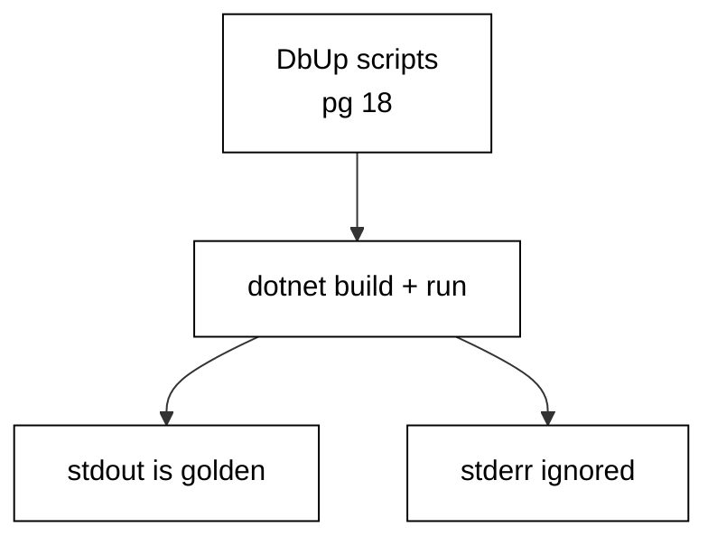

Prerequisites for this course: [just-enough-fsharp](/en/learn/courses/just-enough-fsharp/learning/overview) for F# syntax, projects, and tooling, and [sql-essentials](/en/learn/courses/sql-essentials/learning/overview) for CREATE and ALTER TABLE. Comfort editing and running F# programs from a terminal is assumed throughout, and every example builds only on the primers plus earlier examples in this course.

## Why this exists -- the big idea

**The problem before the solution**: `data-access-orms-and-query-builders` teaches ORM and query-builder concepts generically, but nobody teaches DbUp's own migration-ordering, journaling, and team-workflow model in F# at this depth. Teams without a migration discipline share schema changes as chat messages and ad-hoc SQL scripts: nobody knows which changes ran where, rollbacks are improvised under pressure, and two developers' changes collide in production. DbUp replaces folklore with artifacts: every change is a named script applied in order, and the database itself records which scripts already ran.

**Keep this if you forget everything else**: A migration that cannot be rolled back safely is a migration that will eventually be run in production by accident.

## Tensions and trade-offs -- when NOT to reach for this

- **Small versus strict**: nullable columns land without disturbing traffic; checks, defaults, and constraints land later once data complies. Each example names which side it takes and what the other side would cost, and Examples 34 and 41 collect the three-step and two-deploy shapes for going strict safely.
- **One file versus many**: single-change scripts minimize lock windows and stay reviewable but multiply files; multi-statement scripts read as one story but hold locks longer and fail messier. The course defaults to small scripts and merges steps only when the steps genuinely share a deploy window.
- **When NOT**: throwaway exploration against a scratch database needs no versioning — create, poke, drop, done. Migrations earn their place when the database outlives the session: shared development databases, staging, and anything resembling production.

## Lineage -- where this tool sits

DbUp is the migration companion to the .NET data-access ecosystem, and this course assumes both the F# primer and basic SQL DDL as background. The data-access course teaches data access; this course teaches schema evolution — the versioned history that lets the schema change while the data and the traffic survive. Later data courses assume migrations exist and build pipelines, analytics, and services on top of versioned schemas.

## How this course is organized

[Beginner](/en/learn/courses/database-migrations-with-fsharp-and-dbup/learning/beginner) (Examples 1–25) writes first migrations and rolls them back with compensating scripts: script layout, chain ordering, journal stamps, and rollback basics. [Intermediate](/en/learn/courses/database-migrations-with-fsharp-and-dbup/learning/intermediate) (Examples 26–53) backfills data, splits breaking changes into zero-downtime steps, and adopts legacy databases with baselines and drift checks. [Advanced](/en/learn/courses/database-migrations-with-fsharp-and-dbup/learning/advanced) (Examples 54–78) resolves branch conflicts, shrinks locking blast radius, and diagnoses failures from the journal. The [capstone](/en/learn/courses/database-migrations-with-fsharp-and-dbup/learning/capstone/overview) evolves an order-management schema through eight realistic migrations with a golden verification query, and [drilling](/en/learn/courses/database-migrations-with-fsharp-and-dbup/drilling/overview) turns the sixteen concepts into recall, katas, and checklists.

## About the runtime

Every example runs as a compiled F# assembly in the pinned .NET 10 container against the real pinned PostgreSQL 18 service: no mocks, no fixtures-as-data. Each unit restores its locked packages offline (DbUp 7.0.1 with its PostgreSQL support plus Npgsql, pinned in `packages.lock.json` and staged by the toolchain install recipe), applies its scripts through DbUp's own upgrade engine, and verifies through Npgsql reads. Each example owns its tables (named `dNN_...`), drops leftovers before running, and cleans up after itself, so reruns are byte-stable: programs print labels, counts, and row values — never timings, paths, or revision noise. Standard output is the asserted golden transcript; standard error is ignored. DbUp applies each named script once per database and journals it in `schemaversions`; reruns skip journaled names, which is the idempotence every example relies on.

## Examples by Level

### Beginner (Examples 1–25)

- [Example 1: First Migration Creates a Table](/en/learn/courses/database-migrations-with-fsharp-and-dbup/learning/beginner#example-1-first-migration-creates-a-table)
- [Example 2: Migration Scripts Run in Order](/en/learn/courses/database-migrations-with-fsharp-and-dbup/learning/beginner#example-2-migration-scripts-run-in-order)
- [Example 3: Rerun Applies Nothing New](/en/learn/courses/database-migrations-with-fsharp-and-dbup/learning/beginner#example-3-rerun-applies-nothing-new)
- [Example 4: Create an Index](/en/learn/courses/database-migrations-with-fsharp-and-dbup/learning/beginner#example-4-create-an-index)
- [Example 5: Not Null with a Server Default](/en/learn/courses/database-migrations-with-fsharp-and-dbup/learning/beginner#example-5-not-null-with-a-server-default)
- [Example 6: One Migration One Change](/en/learn/courses/database-migrations-with-fsharp-and-dbup/learning/beginner#example-6-one-migration-one-change)
- [Example 7: Names Document Intent](/en/learn/courses/database-migrations-with-fsharp-and-dbup/learning/beginner#example-7-names-document-intent)
- [Example 8: Three Scripts One Upgrade](/en/learn/courses/database-migrations-with-fsharp-and-dbup/learning/beginner#example-8-three-scripts-one-upgrade)
- [Example 9: History Table Is the Source of Truth](/en/learn/courses/database-migrations-with-fsharp-and-dbup/learning/beginner#example-9-history-table-is-the-source-of-truth)
- [Example 10: Linear History Stays Mergeable](/en/learn/courses/database-migrations-with-fsharp-and-dbup/learning/beginner#example-10-linear-history-stays-mergeable)
- [Example 11: Gaps in Numbers Still Apply](/en/learn/courses/database-migrations-with-fsharp-and-dbup/learning/beginner#example-11-gaps-in-numbers-still-apply)
- [Example 12: Pending Scripts Are Visible](/en/learn/courses/database-migrations-with-fsharp-and-dbup/learning/beginner#example-12-pending-scripts-are-visible)
- [Example 13: Status Reports Position](/en/learn/courses/database-migrations-with-fsharp-and-dbup/learning/beginner#example-13-status-reports-position)
- [Example 14: Upgrade Skips What Already Ran](/en/learn/courses/database-migrations-with-fsharp-and-dbup/learning/beginner#example-14-upgrade-skips-what-already-ran)
- [Example 15: Upgrade Requirement Is a Boolean](/en/learn/courses/database-migrations-with-fsharp-and-dbup/learning/beginner#example-15-upgrade-requirement-is-a-boolean)
- [Example 16: Every Entry Records Its Moment](/en/learn/courses/database-migrations-with-fsharp-and-dbup/learning/beginner#example-16-every-entry-records-its-moment)
- [Example 17: Test Every Migration Twice](/en/learn/courses/database-migrations-with-fsharp-and-dbup/learning/beginner#example-17-test-every-migration-twice)
- [Example 18: Compensating Migration Is the Rollback](/en/learn/courses/database-migrations-with-fsharp-and-dbup/learning/beginner#example-18-compensating-migration-is-the-rollback)
- [Example 19: Forward Fix Removes What Upgrade Added](/en/learn/courses/database-migrations-with-fsharp-and-dbup/learning/beginner#example-19-forward-fix-removes-what-upgrade-added)
- [Example 20: Reverse by Re-adding Not by Undo](/en/learn/courses/database-migrations-with-fsharp-and-dbup/learning/beginner#example-20-reverse-by-re-adding-not-by-undo)
- [Example 21: Rollback Keeps Unrelated Data](/en/learn/courses/database-migrations-with-fsharp-and-dbup/learning/beginner#example-21-rollback-keeps-unrelated-data)
- [Example 22: Failed Script Leaves Earlier Work Intact](/en/learn/courses/database-migrations-with-fsharp-and-dbup/learning/beginner#example-22-failed-script-leaves-earlier-work-intact)
- [Example 23: Partial Statements Roll Back Together](/en/learn/courses/database-migrations-with-fsharp-and-dbup/learning/beginner#example-23-partial-statements-roll-back-together)
- [Example 24: Rollback Plan for a Bad Deploy](/en/learn/courses/database-migrations-with-fsharp-and-dbup/learning/beginner#example-24-rollback-plan-for-a-bad-deploy)
- [Example 25: Beginner Review: Order History Rollback](/en/learn/courses/database-migrations-with-fsharp-and-dbup/learning/beginner#example-25-beginner-review-order-history-rollback)

### Intermediate (Examples 26–53)

- [Example 26: Backfill Is a Separate Step](/en/learn/courses/database-migrations-with-fsharp-and-dbup/learning/intermediate#example-26-backfill-is-a-separate-step)
- [Example 27: Backfill Computes from Existing Rows](/en/learn/courses/database-migrations-with-fsharp-and-dbup/learning/intermediate#example-27-backfill-computes-from-existing-rows)
- [Example 28: Backfill Preserves Every Row](/en/learn/courses/database-migrations-with-fsharp-and-dbup/learning/intermediate#example-28-backfill-preserves-every-row)
- [Example 29: Backfill Runs Safely Twice](/en/learn/courses/database-migrations-with-fsharp-and-dbup/learning/intermediate#example-29-backfill-runs-safely-twice)
- [Example 30: Batch Backfills Avoid Long Locks](/en/learn/courses/database-migrations-with-fsharp-and-dbup/learning/intermediate#example-30-batch-backfills-avoid-long-locks)
- [Example 31: New Not-Null Needs a Default](/en/learn/courses/database-migrations-with-fsharp-and-dbup/learning/intermediate#example-31-new-not-null-needs-a-default)
- [Example 32: Data Only Migration Carries No Schema Change](/en/learn/courses/database-migrations-with-fsharp-and-dbup/learning/intermediate#example-32-data-only-migration-carries-no-schema-change)
- [Example 33: Verify a Backfill with a Golden Query](/en/learn/courses/database-migrations-with-fsharp-and-dbup/learning/intermediate#example-33-verify-a-backfill-with-a-golden-query)
- [Example 34: Backfill Then Constrain in Two Steps](/en/learn/courses/database-migrations-with-fsharp-and-dbup/learning/intermediate#example-34-backfill-then-constrain-in-two-steps)
- [Example 35: Expand Adds the New Column Safely](/en/learn/courses/database-migrations-with-fsharp-and-dbup/learning/intermediate#example-35-expand-adds-the-new-column-safely)
- [Example 36: Dual Write Window](/en/learn/courses/database-migrations-with-fsharp-and-dbup/learning/intermediate#example-36-dual-write-window)
- [Example 37: Backfill the New Column from the Old](/en/learn/courses/database-migrations-with-fsharp-and-dbup/learning/intermediate#example-37-backfill-the-new-column-from-the-old)
- [Example 38: Readers Move Before the Drop](/en/learn/courses/database-migrations-with-fsharp-and-dbup/learning/intermediate#example-38-readers-move-before-the-drop)
- [Example 39: Contract Drops the Old Column](/en/learn/courses/database-migrations-with-fsharp-and-dbup/learning/intermediate#example-39-contract-drops-the-old-column)
- [Example 40: Rename in Three Deployable Steps](/en/learn/courses/database-migrations-with-fsharp-and-dbup/learning/intermediate#example-40-rename-in-three-deployable-steps)
- [Example 41: Zero Downtime Needs Two Deploys](/en/learn/courses/database-migrations-with-fsharp-and-dbup/learning/intermediate#example-41-zero-downtime-needs-two-deploys)
- [Example 42: Same Scripts Every Environment](/en/learn/courses/database-migrations-with-fsharp-and-dbup/learning/intermediate#example-42-same-scripts-every-environment)
- [Example 43: Old Code Reads the New Schema](/en/learn/courses/database-migrations-with-fsharp-and-dbup/learning/intermediate#example-43-old-code-reads-the-new-schema)
- [Example 44: New Code Reads Old Rows](/en/learn/courses/database-migrations-with-fsharp-and-dbup/learning/intermediate#example-44-new-code-reads-old-rows)
- [Example 45: Baseline Marks an Existing Database](/en/learn/courses/database-migrations-with-fsharp-and-dbup/learning/intermediate#example-45-baseline-marks-an-existing-database)
- [Example 46: Baseline Keeps Legacy Data](/en/learn/courses/database-migrations-with-fsharp-and-dbup/learning/intermediate#example-46-baseline-keeps-legacy-data)
- [Example 47: Legacy Schema Becomes the First Entry](/en/learn/courses/database-migrations-with-fsharp-and-dbup/learning/intermediate#example-47-legacy-schema-becomes-the-first-entry)
- [Example 48: New Work Starts After the Baseline](/en/learn/courses/database-migrations-with-fsharp-and-dbup/learning/intermediate#example-48-new-work-starts-after-the-baseline)
- [Example 49: Baseline History Row Looks Applied](/en/learn/courses/database-migrations-with-fsharp-and-dbup/learning/intermediate#example-49-baseline-history-row-looks-applied)
- [Example 50: Detect Drift After Baselining](/en/learn/courses/database-migrations-with-fsharp-and-dbup/learning/intermediate#example-50-detect-drift-after-baselining)
- [Example 51: Drift Report Column by Column](/en/learn/courses/database-migrations-with-fsharp-and-dbup/learning/intermediate#example-51-drift-report-column-by-column)
- [Example 52: Converge Drift with a Compensating Step](/en/learn/courses/database-migrations-with-fsharp-and-dbup/learning/intermediate#example-52-converge-drift-with-a-compensating-step)
- [Example 53: Intermediate Review: Baseline and Drift](/en/learn/courses/database-migrations-with-fsharp-and-dbup/learning/intermediate#example-53-intermediate-review-baseline-and-drift)

### Advanced (Examples 54–78)

- [Example 54: Two Branches One History](/en/learn/courses/database-migrations-with-fsharp-and-dbup/learning/advanced#example-54-two-branches-one-history)
- [Example 55: Same Name Means Same Migration](/en/learn/courses/database-migrations-with-fsharp-and-dbup/learning/advanced#example-55-same-name-means-same-migration)
- [Example 56: Renumber onto Head](/en/learn/courses/database-migrations-with-fsharp-and-dbup/learning/advanced#example-56-renumber-onto-head)
- [Example 57: Merge Keeps Both Migrations](/en/learn/courses/database-migrations-with-fsharp-and-dbup/learning/advanced#example-57-merge-keeps-both-migrations)
- [Example 58: Many Versions One History](/en/learn/courses/database-migrations-with-fsharp-and-dbup/learning/advanced#example-58-many-versions-one-history)
- [Example 59: List Pending Before the Merge](/en/learn/courses/database-migrations-with-fsharp-and-dbup/learning/advanced#example-59-list-pending-before-the-merge)
- [Example 60: Linear History Team Policy](/en/learn/courses/database-migrations-with-fsharp-and-dbup/learning/advanced#example-60-linear-history-team-policy)
- [Example 61: Conflict Drill: Two Developers](/en/learn/courses/database-migrations-with-fsharp-and-dbup/learning/advanced#example-61-conflict-drill-two-developers)
- [Example 62: DDL Takes a Lock](/en/learn/courses/database-migrations-with-fsharp-and-dbup/learning/advanced#example-62-ddl-takes-a-lock)
- [Example 63: Short Transactions Shrink Blast Radius](/en/learn/courses/database-migrations-with-fsharp-and-dbup/learning/advanced#example-63-short-transactions-shrink-blast-radius)
- [Example 64: Transaction Wraps the Migration](/en/learn/courses/database-migrations-with-fsharp-and-dbup/learning/advanced#example-64-transaction-wraps-the-migration)
- [Example 65: Two Tables or None](/en/learn/courses/database-migrations-with-fsharp-and-dbup/learning/advanced#example-65-two-tables-or-none)
- [Example 66: Concurrently Builds Outside the Transaction](/en/learn/courses/database-migrations-with-fsharp-and-dbup/learning/advanced#example-66-concurrently-builds-outside-the-transaction)
- [Example 67: Concurrently Rejected Inside a Transaction](/en/learn/courses/database-migrations-with-fsharp-and-dbup/learning/advanced#example-67-concurrently-rejected-inside-a-transaction)
- [Example 68: Statement Timeout Bounds the Lock Wait](/en/learn/courses/database-migrations-with-fsharp-and-dbup/learning/advanced#example-68-statement-timeout-bounds-the-lock-wait)
- [Example 69: Advisory Lock Serializes Runners](/en/learn/courses/database-migrations-with-fsharp-and-dbup/learning/advanced#example-69-advisory-lock-serializes-runners)
- [Example 70: Expand Contract Avoids the Rewrite](/en/learn/courses/database-migrations-with-fsharp-and-dbup/learning/advanced#example-70-expand-contract-avoids-the-rewrite)
- [Example 71: Measure the Lock Each Step Holds](/en/learn/courses/database-migrations-with-fsharp-and-dbup/learning/advanced#example-71-measure-the-lock-each-step-holds)
- [Example 72: Read the Journal First](/en/learn/courses/database-migrations-with-fsharp-and-dbup/learning/advanced#example-72-read-the-journal-first)
- [Example 73: History Diverged from the Database](/en/learn/courses/database-migrations-with-fsharp-and-dbup/learning/advanced#example-73-history-diverged-from-the-database)
- [Example 74: Edited Script Is Silently Skipped](/en/learn/courses/database-migrations-with-fsharp-and-dbup/learning/advanced#example-74-edited-script-is-silently-skipped)
- [Example 75: Hashes Catch the Silent Edit](/en/learn/courses/database-migrations-with-fsharp-and-dbup/learning/advanced#example-75-hashes-catch-the-silent-edit)
- [Example 76: Guard the Deploy with Status](/en/learn/courses/database-migrations-with-fsharp-and-dbup/learning/advanced#example-76-guard-the-deploy-with-status)
- [Example 77: Journal Names Are the Contract](/en/learn/courses/database-migrations-with-fsharp-and-dbup/learning/advanced#example-77-journal-names-are-the-contract)
- [Example 78: Pre-Deploy Checklist](/en/learn/courses/database-migrations-with-fsharp-and-dbup/learning/advanced#example-78-pre-deploy-checklist)
