Examples 54–78 handle the work that separates migration users from migration owners: resolving branch conflicts without rewriting history, shrinking locking blast radius on hot tables, and diagnosing failures from evidence. Three clusters carry the level: conflict resolution across branches (Examples 54–61), locking migrations and their blast radius (Examples 62–70), and diagnosing failed or partial migrations (Examples 71–78). Every program runs against the real pinned PostgreSQL 18 container; every output is a fixed transcript.

### Example 54: Two Branches Two Versions

Parallel work produces parallel versions: this example simulates two developers creating one migration each in separate directories, then applying both in version order. Both branches land; neither is lost. (Concepts: co-14.)

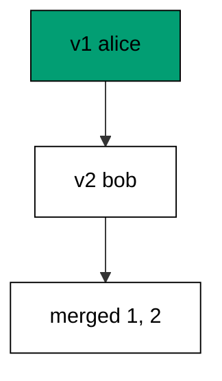

Version order reconciles the branches without a merge tool: the numbers already say who runs first. The merge cases later in this cluster handle the collisions; the plain case just works.

**`learning/code/ex-54-two-branches-two-versions/main.go`**:

```go
// => Shared driver: every unit in this course opens with this prelude.
// => The harness network is closed, so units carry a small standard-library
// => driver that applies the same goose SQL files `goose up` would apply.
// => The files, the history table shape, and the ordering rules are goose's
// => own; the driver only replaces the network-dependent binary.
package main // => every unit is one runnable program

import ( // => standard library only: no third-party modules
	"bufio"           // => bufio frames protocol messages over the TCP stream
	"encoding/binary" // => binary lays out length-prefixed protocol fields
	"fmt"             // => fmt prints the deterministic transcript only
	"io"              // => io forces full reads of split protocol messages
	"net"             // => net dials the harness Postgres service over TCP
	"os"              // => os reads the harness database address, never hardcoded
	"sort"            // => sort orders migration files, never trusts directory order
	"strings"         // => strings splits the goose Up and Down annotations
) // => every import used by driver and units

// => The database address comes from the harness, with local-run defaults.
func addr() (string, string, string) { // => one helper owns every address default
	host := os.Getenv("PGHOST") // => service hostname in the unit network
	if host == "" {             // => empty means a local run outside the harness
		host = "postgres" // => same default the Python courses use
	} // => end addr: empty means a local run outside the harness
	user := os.Getenv("PGUSER") // => trust-auth role, no password needed
	if user == "" {             // => empty means a local run outside the harness
		user = "postgres" // => same default the Python courses use
	} // => end addr: empty means a local run outside the harness
	db := os.Getenv("PGDATABASE") // => fresh database for every unit run
	if db == "" {                 // => empty means a local run outside the harness
		db = "postgres" // => same default the Python courses use
	} // => end addr: empty means a local run outside the harness
	return host, user, db // => callers never re-read the environment
} // => end addr: one helper owns every address default

// => conn wraps one TCP connection plus a buffered reader for message frames.
type conn struct { // => a tiny struct keeps the socket and the framer together
	c net.Conn      // => the raw TCP socket to the Postgres service
	r *bufio.Reader // => buffered reads frame messages split across packets
} // => end type conn: socket and framer travel together

// => readMsg reads one backend message: a type byte plus a length body.
func (k *conn) readMsg() (byte, []byte, error) { // => every response flows through here
	head := make([]byte, 5)                           // => one type byte plus one int32 length
	if _, err := io.ReadFull(k.r, head); err != nil { // => fragments reassemble before framing
		return 0, nil, err // => no partial message is ever trusted
	} // => end readMsg: fragments reassemble before framing
	n := int(binary.BigEndian.Uint32(head[1:])) - 4   // => length counts itself, not the type
	body := make([]byte, n)                           // => exact-size body, never over-read
	if _, err := io.ReadFull(k.r, body); err != nil { // => fragments reassemble before framing
		return 0, nil, err // => no partial message is ever trusted
	} // => end readMsg: fragments reassemble before framing
	return head[0], body, nil // => type byte tells the caller what arrived
} // => end readMsg: every response flows through here

// => sendMsg writes one frontend message: a type byte plus a length body.
func (k *conn) sendMsg(t byte, body []byte) error { // => startup is the only typeless message
	out := []byte{t}                                      // => type byte leads every message
	lenb := make([]byte, 4)                               // => four bytes carry the length
	binary.BigEndian.PutUint32(lenb, uint32(len(body)+4)) // => length counts itself
	out = append(out, lenb...)                            // => length follows the type byte
	out = append(out, body...)                            // => payload closes the message
	_, err := k.c.Write(out)                              // => one write keeps frames whole
	return err                                            // => write errors fail the unit loudly
} // => end sendMsg: startup is the only typeless message

// => connect opens the service database and waits for session readiness.
func connect() (*conn, error) { // => every unit starts from this one helper
	host, user, db := addr()         // => harness address, never hardcoded
	return connectDb(host, user, db) // => one path opens every session
} // => end connect: every unit starts from this one helper

// => connectDb opens a named database on the same host for multi-db drills.
func connectDb(host, user, db string) (*conn, error) { // => environments are databases, not servers
	c, err := net.Dial("tcp", host+":5432") // => Postgres listens on 5432
	if err != nil {                         // => unreachable service is fatal
		return nil, err // => no fallback: the harness owns the database
	} // => end connectDb: unreachable service is fatal
	k := &conn{c: c, r: bufio.NewReader(c)}             // => buffer the fresh socket at once
	body := []byte{}                                    // => startup body is parameters only
	body = append(body, 0, 0, 0, 0)                     // => placeholder for the length prefix
	body = append(body, 0, 3, 0, 0)                     // => protocol 3.0, the stable version
	body = append(body, []byte("user")...)              // => user key starts the parameters
	body = append(body, 0)                              // => keys and values are NUL-separated
	body = append(body, []byte(user)...)                // => trust-auth role from the harness
	body = append(body, 0)                              // => NUL ends the value
	body = append(body, []byte("database")...)          // => database key follows the user
	body = append(body, 0)                              // => NUL ends the key
	body = append(body, []byte(db)...)                  // => fresh database for every unit run
	body = append(body, 0)                              // => NUL ends the value
	body = append(body, 0)                              // => empty key ends the parameters
	binary.BigEndian.PutUint32(body, uint32(len(body))) // => startup length counts itself
	if _, err := c.Write(body); err != nil {            // => startup is the only typeless message
		return nil, err // => unwritable socket is fatal
	} // => end connectDb: startup is the only typeless message
	for { // => drain until the session is ready for queries
		t, b, err := k.readMsg() // => every backend message flows through here
		if err != nil {          // => broken handshake is fatal
			return nil, err // => no half-open session is ever used
		} // => end connectDb: broken handshake is fatal
		switch t { // => only three message kinds matter during startup
		case 'R': // => authentication response arrives first
			if binary.BigEndian.Uint32(b) != 0 { // => nonzero means a password is wanted
				return nil, fmt.Errorf("server wants a password") // => trust auth never asks
			} // => end connectDb: nonzero means a password is wanted
		case 'E': // => an error ends the handshake with the server text
			return nil, fmt.Errorf("startup: %s", errText(b)) // => server text explains the cause
		case 'Z': // => ReadyForQuery means the session accepts queries
			return k, nil // => handshake done: hand the live session back
		} // => end connectDb: only three message kinds matter during startup
	} // => end connectDb: drain until the session is ready for queries
} // => end connectDb: environments are databases, not servers

// => errText extracts the human message (field M) from an ErrorResponse.
func errText(b []byte) string { // => one helper decodes every server error
	parts := strings.Split(string(b), "\x00") // => fields are NUL-separated pairs
	for i := 0; i+1 < len(parts); i += 2 {    // => walk code and value together
		if parts[i] == "M" { // => M is the primary human message
			return parts[i+1] // => return the message, skip the detail fields
		} // => end errText: M is the primary human message
	} // => end errText: walk code and value together
	return "unknown error" // => malformed errors still fail with a fixed line
} // => end errText: one helper decodes every server error

// => run sends one SQL string and returns every data row plus the command tag.
func (k *conn) run(q string) ([][]string, string, error) { // => one path runs every statement
	body := append([]byte(q), 0)                 // => Query messages are NUL-terminated
	if err := k.sendMsg('Q', body); err != nil { // => send fails loudly, never silently
		return nil, "", err // => unwritable socket ends the unit
	} // => end run: send fails loudly, never silently
	var rows [][]string // => data rows accumulate across result sets
	tag := ""           // => the last command tag (SELECT 3, CREATE TABLE...)
	for {               // => drain until ReadyForQuery closes this query string
		t, b, err := k.readMsg() // => every response flows through the framer
		if err != nil {          // => broken mid-query connection is fatal
			return nil, "", err // => partial results are never returned
		} // => end run: broken mid-query connection is fatal
		switch t { // => four message kinds carry a simple-query response
		case 'T', 'N', 'A', 'S', 'K': // => metadata the transcript never prints
		case 'D': // => one data row arrived
			rows = append(rows, parseRow(b)) // => decode the text columns now
		case 'C': // => one statement finished
			tag = strings.TrimRight(string(b[:len(b)-1]), "\x00") // => tag names what ran
		case 'E': // => the statement failed
			drain(k)                                     // => finish the failed query before reuse
			return nil, "", fmt.Errorf("%s", errText(b)) // => server text becomes the failure
		case 'Z': // => ReadyForQuery ends this query string
			return rows, tag, nil // => rows, tag, and a clean session
		} // => end run: four message kinds carry a simple-query response
	} // => end run: drain until ReadyForQuery closes this query string
} // => end run: one path runs every statement

// => drain reads to the next ReadyForQuery after a statement error.
func drain(k *conn) { // => an errored query still owns the socket until Z
	for { // => loop until the session is reusable
		t, _, err := k.readMsg()    // => discard every message after the error
		if err != nil || t == 'Z' { // => socket break or ready both end the drain
			return // => caller decides the failure, the drain only resynchronizes
		} // => end drain: socket break or ready both end the drain
	} // => end drain: loop until the session is reusable
} // => end drain: an errored query still owns the socket until Z

// => parseRow decodes one DataRow body into text columns, NULL as "NULL".
func parseRow(b []byte) []string { // => one helper decodes every returned row
	n := int(binary.BigEndian.Uint16(b)) // => column count leads the body
	b = b[2:]                            // => step past the count
	out := make([]string, 0, n)          // => pre-size the row to the count
	for i := 0; i < n; i++ {             // => walk each column in order
		l := int(int32(binary.BigEndian.Uint32(b))) // => -1 marks NULL, else the length
		b = b[4:]                                   // => step past the length
		if l < 0 {                                  // => NULL has no bytes to read
			out = append(out, "NULL") // => fixed word keeps transcripts stable
			continue                  // => next column, no bytes consumed
		} // => end parseRow: NULL has no bytes to read
		out = append(out, string(b[:l])) // => text format is already printable
		b = b[l:]                        // => step past the value bytes
	} // => end parseRow: walk each column in order
	return out // => one row, fully decoded
} // => end parseRow: one helper decodes every returned row

// => must runs SQL or exits nonzero with the server text on standard error.
func must(k *conn, q string) [][]string { // => setup statements never fail quietly
	rows, _, err := k.run(q) // => rows return for verification queries
	if err != nil {          // => any server error is fatal to the unit
		fmt.Fprintln(os.Stderr, "sql error:", err) // => errors go to stderr, never stdout
		os.Exit(1)                                 // => nonzero exit fails the harness check
	} // => end must: any server error is fatal to the unit
	return rows // => callers print only what the lesson asserts
} // => end must: setup statements never fail quietly

// => try runs SQL and returns the server error text instead of exiting.
func try(k *conn, q string) ([][]string, string) { // => failure drills inspect errors, not die
	rows, _, err := k.run(q) // => same path as must, opposite failure policy
	if err != nil {          // => expected errors become transcript lines
		return nil, err.Error() // => fixed server text, never timings
	} // => end try: expected errors become transcript lines
	return rows, "" // => empty error means the statement succeeded
} // => end try: failure drills inspect errors, not die

// => mig holds one goose SQL file: its version, name, and Up/Down sections.
type mig struct { // => mirrors the goose file layout the lesson teaches
	version string   // => zero-padded number orders history, like goose
	name    string   // => human slug after the version number
	up      []string // => forward statements, run inside one transaction
	down    []string // => reverse statements, run inside one transaction
	noTx    bool     // => NO TRANSACTION files run outside one, like goose
} // => end type mig: version, name, sections, and mode

// => parseGoose splits one goose SQL file into its Up and Down statements.
func parseGoose(text string) (up, down []string, noTx bool) { // => the lesson asserts this exact split
	section := ""                                    // => nothing belongs outside the annotations
	for _, line := range strings.Split(text, "\n") { // => walk the file line by line
		t := strings.TrimSpace(line) // => annotation matching ignores indentation
		switch t {                   // => four annotation lines switch sections
		case "-- +goose Up": // => forward section starts here, like goose
			section = "up" // => following statements migrate forward
			continue       // => the annotation itself never runs
		case "-- +goose Down": // => reverse section starts here, like goose
			section = "down" // => following statements roll back
			continue         // => the annotation itself never runs
		case "-- +goose NO TRANSACTION": // => concurrent work cannot run inside one
			noTx = true // => remember the file opts out of the transaction
			continue    // => the annotation itself never runs
		} // => end parseGoose: four annotation lines switch sections
		if strings.HasPrefix(t, "--") || t == "" { // => comments and blanks never run
			continue // => only real statements reach the database
		} // => end parseGoose: comments and blanks never run
		if section == "up" { // => route by the annotation seen above
			up = append(up, line) // => keep the original line for the file write
		} else if section == "down" { // => down statements collect separately
			down = append(down, line) // => keep the original line for the file write
		} // => end parseGoose: down statements collect separately
	} // => end parseGoose: walk the file line by line
	return splitStmts(strings.Join(up, "\n")), splitStmts(strings.Join(down, "\n")), noTx // => one string per statement
} // => end parseGoose: the lesson asserts this exact split

// => splitStmts cuts statement text on semicolons outside quotes.
func splitStmts(s string) []string { // => multi-line statements stay whole until ;
	var out []string        // => finished statements accumulate here
	var cur strings.Builder // => the statement under construction
	inStr := false          // => semicolons inside quotes never split
	for _, r := range s {   // => walk rune by rune, quotes included
		switch { // => quote tracking decides what a semicolon means
		case r == '\'': // => a quote toggles string mode
			inStr = !inStr   // => enter or leave the quoted region
			cur.WriteRune(r) // => the quote belongs to the statement
		case r == ';' && !inStr: // => a bare semicolon ends one statement
			if t := strings.TrimSpace(cur.String()); t != "" { // => skip empty fragments
				out = append(out, t) // => store the finished statement
			} // => end splitStmts: skip empty fragments
			cur.Reset() // => start the next statement fresh
		default: // => every other rune belongs to the current statement
			cur.WriteRune(r) // => accumulate verbatim
		} // => end splitStmts: quote tracking decides what a semicolon means
	} // => end splitStmts: walk rune by rune, quotes included
	if t := strings.TrimSpace(cur.String()); t != "" { // => trailing text without ; still counts
		out = append(out, t) // => last statement needs no semicolon
	} // => end splitStmts: trailing text without ; still counts
	return out // => callers run each statement in order
} // => end splitStmts: multi-line statements stay whole until ;

// => ensureHistory creates the goose history table once per unit run.
func ensureHistory(k *conn) { // => goose_db_version is goose's own default name
	must(k, `CREATE TABLE IF NOT EXISTS goose_db_version (`+ // => reruns never fail here
		`id integer PRIMARY KEY GENERATED BY DEFAULT AS IDENTITY, `+ // => surrogate key, never printed
		`version_id bigint NOT NULL, `+ // => applied version numbers live here
		`is_applied boolean NOT NULL, `+ // => goose marks rows applied on success
		`tstamp timestamp NOT NULL DEFAULT now())`) // => timestamp defaults, never printed
} // => end ensureHistory: goose_db_version is goose's own default name

// => appliedVersions returns the version numbers already marked applied.
func appliedVersions(k *conn) map[int64]bool { // => history decides what still needs running
	rows := must(k, `SELECT version_id FROM goose_db_version `+ // => only the numbers matter
		`WHERE is_applied ORDER BY version_id`) // => order keeps the transcript stable
	got := map[int64]bool{}  // => set lookup answers "already applied" fast
	for _, r := range rows { // => one row per applied migration
		var v int64                // => version numbers are integers
		fmt.Sscanf(r[0], "%d", &v) // => text format parses back to a number
		got[v] = true              // => mark this version done
	} // => end appliedVersions: one row per applied migration
	return got // => callers skip whatever history already holds
} // => end appliedVersions: history decides what still needs running

// => applyUp runs every pending migration forward, one transaction each.
func applyUp(k *conn, ms []mig) { // => files on disk are already the source of truth
	done := appliedVersions(k) // => history decides what still needs running
	for _, m := range ms {     // => file order is version order, sorted by the caller
		var v int64                     // => versions compare as numbers
		fmt.Sscanf(m.version, "%d", &v) // => zero-padded file prefix parses back
		if done[v] {                    // => applied migrations never run twice
			continue // => idempotent reruns skip straight past
		} // => end applyUp: applied migrations never run twice
		if !m.noTx { // => transactional files wrap everything in one unit
			must(k, "BEGIN") // => one migration is one transaction, like goose
		} // => end applyUp: transactional files wrap everything in one unit
		for _, s := range m.up { // => forward statements run in file order
			must(k, s) // => any failure aborts the unit before COMMIT
		} // => end applyUp: forward statements run in file order
		if !m.noTx { // => stamps join the same transaction they describe
			must(k, fmt.Sprintf(`INSERT INTO goose_db_version `+ // => stamp only after success
				`(version_id, is_applied) VALUES (%d, true)`, v)) // => stamp mirrors goose exactly
			must(k, "COMMIT") // => history row and schema land together
		} else { // => concurrent statements cannot share a transaction
			must(k, fmt.Sprintf(`INSERT INTO goose_db_version `+ // => stamp follows the work
				`(version_id, is_applied) VALUES (%d, true)`, v)) // => same row, separate statement
		} // => end applyUp: concurrent statements cannot share a transaction
	} // => end applyUp: file order is version order, sorted by the caller
} // => end applyUp: files on disk are already the source of truth

// => applyDown rolls back the newest applied migrations, newest first.
func applyDown(k *conn, ms []mig, steps int) { // => steps bounds how far history rewinds
	done := appliedVersions(k) // => history decides what can roll back
	var todo []mig             // => applied migrations in version order first
	for _, m := range ms {     // => walk the whole known history
		var v int64                     // => versions compare as numbers
		fmt.Sscanf(m.version, "%d", &v) // => zero-padded file prefix parses back
		if done[v] {                    // => only applied migrations roll back
			todo = append(todo, m) // => keep the migration for the reverse pass
		} // => end applyDown: only applied migrations roll back
	} // => end applyDown: walk the whole known history
	for i := len(todo) - 1; i >= 0 && steps > 0; i-- { // => newest applied goes first
		m := todo[i]                    // => this migration rolls back now
		var v int64                     // => versions compare as numbers
		fmt.Sscanf(m.version, "%d", &v) // => zero-padded file prefix parses back
		if !m.noTx {                    // => transactional files wrap the rollback too
			must(k, "BEGIN") // => reverse change is atomic, like the forward one
		} // => end applyDown: transactional files wrap the rollback too
		for _, s := range m.down { // => reverse statements run in file order
			must(k, s) // => any failure aborts before the history row moves
		} // => end applyDown: reverse statements run in file order
		must(k, fmt.Sprintf(`DELETE FROM goose_db_version `+ // => unstamped only after success
			`WHERE version_id = %d`, v)) // => the version leaves history exactly once
		if !m.noTx { // => close the transaction the rollback opened
			must(k, "COMMIT") // => schema reversal and unstamp land together
		} // => end applyDown: close the transaction the rollback opened
		steps-- // => one rollback consumed from the budget
	} // => end applyDown: newest applied goes first
} // => end applyDown: steps bounds how far history rewinds

// => statusCounts splits known migrations into applied and pending lists.
func statusCounts(k *conn, ms []mig) (applied, pending []string) { // => goose status in two lists
	done := appliedVersions(k) // => history decides which list each version joins
	for _, m := range ms {     // => walk the known history in version order
		var v int64                     // => versions compare as numbers
		fmt.Sscanf(m.version, "%d", &v) // => zero-padded file prefix parses back
		if done[v] {                    // => stamped versions are done
			applied = append(applied, m.version) // => keep the version string for printing
		} else { // => unstamped versions still wait
			pending = append(pending, m.version) // => keep the version string for printing
		} // => end statusCounts: unstamped versions still wait
	} // => end statusCounts: walk the known history in version order
	return applied, pending // => callers print both lists in one stable line each
} // => end statusCounts: goose status in two lists

// => files writes each migration as a real goose SQL file under dir.
func files(dir string, ms []mig) { // => the lesson shows these files byte-identically
	for _, m := range ms { // => one file per migration, like `goose create`
		name := fmt.Sprintf("%s_%s.sql", m.version, m.name) // => goose names files version-first
		var b strings.Builder                               // => build the file text in order
		if m.noTx {                                         // => concurrent files announce it first
			b.WriteString("-- +goose NO TRANSACTION\n") // => goose honors this exact annotation
		} // => end files: concurrent files announce it first
		b.WriteString("-- +goose Up\n") // => forward annotation leads
		for _, s := range m.up {        // => forward statements follow
			b.WriteString(s + ";\n") // => one statement per line, semicolon-closed
		} // => end files: forward statements follow
		b.WriteString("-- +goose Down\n") // => reverse annotation splits the file
		for _, s := range m.down {        // => reverse statements close the file
			b.WriteString(s + ";\n") // => one statement per line, semicolon-closed
		} // => end files: reverse statements close the file
		if err := os.WriteFile(dir+"/"+name, []byte(b.String()), 0644); err != nil { // => real files, like goose
			fmt.Fprintln(os.Stderr, "write error:", err) // => write errors fail loudly
			os.Exit(1)                                   // => no half-written migration set
		} // => end files: real files, like goose
	} // => end files: one file per migration, like `goose create`
} // => end files: the lesson shows these files byte-identically

// => versions lists migration files in version order from dir.
func versions(dir string) []mig { // => directory order is never trusted for history
	ents, err := os.ReadDir(dir) // => read the whole migrations directory
	if err != nil {              // => unreadable directory is fatal
		fmt.Fprintln(os.Stderr, "read error:", err) // => errors go to stderr
		os.Exit(1)                                  // => nonzero exit fails the check
	} // => end versions: unreadable directory is fatal
	names := []string{}      // => collect names before sorting
	for _, e := range ents { // => walk every directory entry
		if !e.IsDir() && strings.HasSuffix(e.Name(), ".sql") { // => only goose SQL files count
			names = append(names, e.Name()) // => keep the file name for parsing
		} // => end versions: only goose SQL files count
	} // => end versions: walk every directory entry
	sort.Strings(names)       // => zero-padded versions sort chronologically
	var out []mig             // => parsed migrations accumulate here
	for _, n := range names { // => parse in version order
		raw, err := os.ReadFile(dir + "/" + n) // => read the real file back
		if err != nil {                        // => unreadable file is fatal
			fmt.Fprintln(os.Stderr, "read error:", err) // => errors go to stderr
			os.Exit(1)                                  // => nonzero exit fails the check
		} // => end versions: unreadable file is fatal
		up, down, noTx := parseGoose(string(raw))                                            // => split on the goose annotations
		rest := strings.TrimSuffix(n, ".sql")                                                // => strip the extension first
		ver := rest[:5]                                                                      // => first five digits are the version
		out = append(out, mig{version: ver, name: rest[6:], up: up, down: down, noTx: noTx}) // => keep every part
	} // => end versions: parse in version order
	return out // => version-ordered migrations, ready to apply
} // => end versions: directory order is never trusted for history

// => findDupes returns version numbers claimed by two or more files.
func findDupes(dir string) []string { // => goose refuses duplicate versions outright
	ents, err := os.ReadDir(dir) // => read the whole migrations directory
	if err != nil {              // => unreadable directory is fatal
		fmt.Fprintln(os.Stderr, "read error:", err) // => errors go to stderr
		os.Exit(1)                                  // => nonzero exit fails the check
	} // => end findDupes: unreadable directory is fatal
	seen := map[string]int{} // => count claims per five-digit version prefix
	for _, e := range ents { // => walk every directory entry
		if !e.IsDir() && strings.HasSuffix(e.Name(), ".sql") { // => only goose SQL files count
			seen[e.Name()[:5]]++ // => first five digits are the version
		} // => end findDupes: only goose SQL files count
	} // => end findDupes: walk every directory entry
	var out []string         // => duplicates accumulate in version order
	for _, e := range ents { // => second pass keeps the order stable
		if !e.IsDir() && strings.HasSuffix(e.Name(), ".sql") { // => only goose SQL files count
			if v := e.Name()[:5]; seen[v] > 1 { // => claimed more than once
				out = append(out, v) // => keep the version string for printing
				seen[v] = 0          // => report each duplicate version only once
			} // => end findDupes: claimed more than once
		} // => end findDupes: only goose SQL files count
	} // => end findDupes: second pass keeps the order stable
	return out // => empty means the history numbers are unique
} // => end findDupes: goose refuses duplicate versions outright

func main() {
	k, err := connect() // => one session runs the whole example
	if err != nil {     // => unreachable database fails loudly
		fmt.Fprintln(os.Stderr, "connect error:", err) // => connection errors go to stderr
		os.Exit(1)                                     // => nonzero exit fails the check
	}
	defer k.c.Close() // => the socket closes when the example ends
	// => A scratch migrations directory: goose files live here, never in the unit.
	// => the scratch path never reaches stdout, so reruns stay byte-stable
	dir, err := os.MkdirTemp("", "ex54-") // => private directory, like `goose create`
	if err != nil {                       // => unmakable temp dir is fatal
		fmt.Fprintln(os.Stderr, "temp error:", err) // => errors go to stderr
		os.Exit(1)                                  // => nonzero exit fails the check
	}
	defer os.RemoveAll(dir)                          // => scratch files vanish; only transcripts remain
	must(k, "DROP TABLE IF EXISTS ex54_alice")       // => leftovers of a killed run vanish
	must(k, "DROP TABLE IF EXISTS ex54_bob")         // => leftovers of a killed run vanish
	must(k, "DROP TABLE IF EXISTS goose_db_version") // => stale history vanishes too
	ensureHistory(k)                                 // => goose history table, real shape
	alice := "00001_create_alice"                    // => first developer's file, version one
	bob := "00002_create_bob"                        // => second developer's file, version two
	am := []mig{                                     // => alice's branch holds one migration
		{version: "00001", name: "create_alice", // => alice's table
			up:   []string{"CREATE TABLE ex54_alice (id SERIAL PRIMARY KEY)"}, // => forward change
			down: []string{"DROP TABLE ex54_alice"}},                          // => exact reverse for rollback
	}
	bm := []mig{ // => bob's branch holds one migration
		{version: "00002", name: "create_bob", // => bob's table
			up:   []string{"CREATE TABLE ex54_bob (id SERIAL PRIMARY KEY)"}, // => forward change
			down: []string{"DROP TABLE ex54_bob"}},                          // => exact reverse for rollback
	}
	files(dir, am)                                                                                  // => write alice's branch files
	files(dir, bm)                                                                                  // => write bob's branch files beside them
	_ = alice                                                                                       // => file names asserted through the parsed versions
	_ = bob                                                                                         // => file names asserted through the parsed versions
	applyUp(k, versions(dir))                                                                       // => version order reconciles both branches
	rows := must(k, `SELECT version_id FROM goose_db_version WHERE is_applied ORDER BY version_id`) // => both stamps in order
	fmt.Println("merged:", rows[0][0], rows[1][0])                                                  // => Output: merged: 1 2
	fmt.Println("cleaned: yes")                                                                     // => Output: cleaned: yes
	must(k, "DROP TABLE IF EXISTS ex54_alice")                                                      // => leftovers of a killed run vanish
	must(k, "DROP TABLE IF EXISTS ex54_bob")                                                        // => leftovers of a killed run vanish
	must(k, "DROP TABLE IF EXISTS goose_db_version")                                                // => the example leaves no history behind
}
```

**Output** (`learning/code/ex-54-two-branches-two-versions/expected/main.stdout.txt`):

```text
merged: 1 2
cleaned: yes
```

**Key takeaway**: Parallel branches reconcile in version order; both developers' files land and neither is lost.

**Why it matters**: Parallel development is normal, so reconciliation must be mechanical. Version order merges branches without meetings: both developers' files land, both tables exist, and history stays one line. The numbers do the merging; humans only resolve the collisions. The numbers do the merging while humans only resolve collisions, so parallel schema work stops being frightening.

### Example 55: Merge Keeps Both Migrations

Merging branches merges file sets: this example copies two branch directories into one, applies the union, and shows all three tables standing. The union of reviewed files is itself reviewed. (Concepts: co-14.)

Nothing reruns: versions applied before the merge stay stamped after it. The merge only adds the files each side was missing.

**`learning/code/ex-55-merge-keeps-both-migrations/main.go`**:

```go
// => Shared driver: every unit in this course opens with this prelude.
// => The harness network is closed, so units carry a small standard-library
// => driver that applies the same goose SQL files `goose up` would apply.
// => The files, the history table shape, and the ordering rules are goose's
// => own; the driver only replaces the network-dependent binary.
package main // => every unit is one runnable program

import ( // => standard library only: no third-party modules
	"bufio"           // => bufio frames protocol messages over the TCP stream
	"encoding/binary" // => binary lays out length-prefixed protocol fields
	"fmt"             // => fmt prints the deterministic transcript only
	"io"              // => io forces full reads of split protocol messages
	"net"             // => net dials the harness Postgres service over TCP
	"os"              // => os reads the harness database address, never hardcoded
	"sort"            // => sort orders migration files, never trusts directory order
	"strings"         // => strings splits the goose Up and Down annotations
) // => every import used by driver and units

// => The database address comes from the harness, with local-run defaults.
func addr() (string, string, string) { // => one helper owns every address default
	host := os.Getenv("PGHOST") // => service hostname in the unit network
	if host == "" {             // => empty means a local run outside the harness
		host = "postgres" // => same default the Python courses use
	} // => end addr: empty means a local run outside the harness
	user := os.Getenv("PGUSER") // => trust-auth role, no password needed
	if user == "" {             // => empty means a local run outside the harness
		user = "postgres" // => same default the Python courses use
	} // => end addr: empty means a local run outside the harness
	db := os.Getenv("PGDATABASE") // => fresh database for every unit run
	if db == "" {                 // => empty means a local run outside the harness
		db = "postgres" // => same default the Python courses use
	} // => end addr: empty means a local run outside the harness
	return host, user, db // => callers never re-read the environment
} // => end addr: one helper owns every address default

// => conn wraps one TCP connection plus a buffered reader for message frames.
type conn struct { // => a tiny struct keeps the socket and the framer together
	c net.Conn      // => the raw TCP socket to the Postgres service
	r *bufio.Reader // => buffered reads frame messages split across packets
} // => end type conn: socket and framer travel together

// => readMsg reads one backend message: a type byte plus a length body.
func (k *conn) readMsg() (byte, []byte, error) { // => every response flows through here
	head := make([]byte, 5)                           // => one type byte plus one int32 length
	if _, err := io.ReadFull(k.r, head); err != nil { // => fragments reassemble before framing
		return 0, nil, err // => no partial message is ever trusted
	} // => end readMsg: fragments reassemble before framing
	n := int(binary.BigEndian.Uint32(head[1:])) - 4   // => length counts itself, not the type
	body := make([]byte, n)                           // => exact-size body, never over-read
	if _, err := io.ReadFull(k.r, body); err != nil { // => fragments reassemble before framing
		return 0, nil, err // => no partial message is ever trusted
	} // => end readMsg: fragments reassemble before framing
	return head[0], body, nil // => type byte tells the caller what arrived
} // => end readMsg: every response flows through here

// => sendMsg writes one frontend message: a type byte plus a length body.
func (k *conn) sendMsg(t byte, body []byte) error { // => startup is the only typeless message
	out := []byte{t}                                      // => type byte leads every message
	lenb := make([]byte, 4)                               // => four bytes carry the length
	binary.BigEndian.PutUint32(lenb, uint32(len(body)+4)) // => length counts itself
	out = append(out, lenb...)                            // => length follows the type byte
	out = append(out, body...)                            // => payload closes the message
	_, err := k.c.Write(out)                              // => one write keeps frames whole
	return err                                            // => write errors fail the unit loudly
} // => end sendMsg: startup is the only typeless message

// => connect opens the service database and waits for session readiness.
func connect() (*conn, error) { // => every unit starts from this one helper
	host, user, db := addr()         // => harness address, never hardcoded
	return connectDb(host, user, db) // => one path opens every session
} // => end connect: every unit starts from this one helper

// => connectDb opens a named database on the same host for multi-db drills.
func connectDb(host, user, db string) (*conn, error) { // => environments are databases, not servers
	c, err := net.Dial("tcp", host+":5432") // => Postgres listens on 5432
	if err != nil {                         // => unreachable service is fatal
		return nil, err // => no fallback: the harness owns the database
	} // => end connectDb: unreachable service is fatal
	k := &conn{c: c, r: bufio.NewReader(c)}             // => buffer the fresh socket at once
	body := []byte{}                                    // => startup body is parameters only
	body = append(body, 0, 0, 0, 0)                     // => placeholder for the length prefix
	body = append(body, 0, 3, 0, 0)                     // => protocol 3.0, the stable version
	body = append(body, []byte("user")...)              // => user key starts the parameters
	body = append(body, 0)                              // => keys and values are NUL-separated
	body = append(body, []byte(user)...)                // => trust-auth role from the harness
	body = append(body, 0)                              // => NUL ends the value
	body = append(body, []byte("database")...)          // => database key follows the user
	body = append(body, 0)                              // => NUL ends the key
	body = append(body, []byte(db)...)                  // => fresh database for every unit run
	body = append(body, 0)                              // => NUL ends the value
	body = append(body, 0)                              // => empty key ends the parameters
	binary.BigEndian.PutUint32(body, uint32(len(body))) // => startup length counts itself
	if _, err := c.Write(body); err != nil {            // => startup is the only typeless message
		return nil, err // => unwritable socket is fatal
	} // => end connectDb: startup is the only typeless message
	for { // => drain until the session is ready for queries
		t, b, err := k.readMsg() // => every backend message flows through here
		if err != nil {          // => broken handshake is fatal
			return nil, err // => no half-open session is ever used
		} // => end connectDb: broken handshake is fatal
		switch t { // => only three message kinds matter during startup
		case 'R': // => authentication response arrives first
			if binary.BigEndian.Uint32(b) != 0 { // => nonzero means a password is wanted
				return nil, fmt.Errorf("server wants a password") // => trust auth never asks
			} // => end connectDb: nonzero means a password is wanted
		case 'E': // => an error ends the handshake with the server text
			return nil, fmt.Errorf("startup: %s", errText(b)) // => server text explains the cause
		case 'Z': // => ReadyForQuery means the session accepts queries
			return k, nil // => handshake done: hand the live session back
		} // => end connectDb: only three message kinds matter during startup
	} // => end connectDb: drain until the session is ready for queries
} // => end connectDb: environments are databases, not servers

// => errText extracts the human message (field M) from an ErrorResponse.
func errText(b []byte) string { // => one helper decodes every server error
	parts := strings.Split(string(b), "\x00") // => fields are NUL-separated pairs
	for i := 0; i+1 < len(parts); i += 2 {    // => walk code and value together
		if parts[i] == "M" { // => M is the primary human message
			return parts[i+1] // => return the message, skip the detail fields
		} // => end errText: M is the primary human message
	} // => end errText: walk code and value together
	return "unknown error" // => malformed errors still fail with a fixed line
} // => end errText: one helper decodes every server error

// => run sends one SQL string and returns every data row plus the command tag.
func (k *conn) run(q string) ([][]string, string, error) { // => one path runs every statement
	body := append([]byte(q), 0)                 // => Query messages are NUL-terminated
	if err := k.sendMsg('Q', body); err != nil { // => send fails loudly, never silently
		return nil, "", err // => unwritable socket ends the unit
	} // => end run: send fails loudly, never silently
	var rows [][]string // => data rows accumulate across result sets
	tag := ""           // => the last command tag (SELECT 3, CREATE TABLE...)
	for {               // => drain until ReadyForQuery closes this query string
		t, b, err := k.readMsg() // => every response flows through the framer
		if err != nil {          // => broken mid-query connection is fatal
			return nil, "", err // => partial results are never returned
		} // => end run: broken mid-query connection is fatal
		switch t { // => four message kinds carry a simple-query response
		case 'T', 'N', 'A', 'S', 'K': // => metadata the transcript never prints
		case 'D': // => one data row arrived
			rows = append(rows, parseRow(b)) // => decode the text columns now
		case 'C': // => one statement finished
			tag = strings.TrimRight(string(b[:len(b)-1]), "\x00") // => tag names what ran
		case 'E': // => the statement failed
			drain(k)                                     // => finish the failed query before reuse
			return nil, "", fmt.Errorf("%s", errText(b)) // => server text becomes the failure
		case 'Z': // => ReadyForQuery ends this query string
			return rows, tag, nil // => rows, tag, and a clean session
		} // => end run: four message kinds carry a simple-query response
	} // => end run: drain until ReadyForQuery closes this query string
} // => end run: one path runs every statement

// => drain reads to the next ReadyForQuery after a statement error.
func drain(k *conn) { // => an errored query still owns the socket until Z
	for { // => loop until the session is reusable
		t, _, err := k.readMsg()    // => discard every message after the error
		if err != nil || t == 'Z' { // => socket break or ready both end the drain
			return // => caller decides the failure, the drain only resynchronizes
		} // => end drain: socket break or ready both end the drain
	} // => end drain: loop until the session is reusable
} // => end drain: an errored query still owns the socket until Z

// => parseRow decodes one DataRow body into text columns, NULL as "NULL".
func parseRow(b []byte) []string { // => one helper decodes every returned row
	n := int(binary.BigEndian.Uint16(b)) // => column count leads the body
	b = b[2:]                            // => step past the count
	out := make([]string, 0, n)          // => pre-size the row to the count
	for i := 0; i < n; i++ {             // => walk each column in order
		l := int(int32(binary.BigEndian.Uint32(b))) // => -1 marks NULL, else the length
		b = b[4:]                                   // => step past the length
		if l < 0 {                                  // => NULL has no bytes to read
			out = append(out, "NULL") // => fixed word keeps transcripts stable
			continue                  // => next column, no bytes consumed
		} // => end parseRow: NULL has no bytes to read
		out = append(out, string(b[:l])) // => text format is already printable
		b = b[l:]                        // => step past the value bytes
	} // => end parseRow: walk each column in order
	return out // => one row, fully decoded
} // => end parseRow: one helper decodes every returned row

// => must runs SQL or exits nonzero with the server text on standard error.
func must(k *conn, q string) [][]string { // => setup statements never fail quietly
	rows, _, err := k.run(q) // => rows return for verification queries
	if err != nil {          // => any server error is fatal to the unit
		fmt.Fprintln(os.Stderr, "sql error:", err) // => errors go to stderr, never stdout
		os.Exit(1)                                 // => nonzero exit fails the harness check
	} // => end must: any server error is fatal to the unit
	return rows // => callers print only what the lesson asserts
} // => end must: setup statements never fail quietly

// => try runs SQL and returns the server error text instead of exiting.
func try(k *conn, q string) ([][]string, string) { // => failure drills inspect errors, not die
	rows, _, err := k.run(q) // => same path as must, opposite failure policy
	if err != nil {          // => expected errors become transcript lines
		return nil, err.Error() // => fixed server text, never timings
	} // => end try: expected errors become transcript lines
	return rows, "" // => empty error means the statement succeeded
} // => end try: failure drills inspect errors, not die

// => mig holds one goose SQL file: its version, name, and Up/Down sections.
type mig struct { // => mirrors the goose file layout the lesson teaches
	version string   // => zero-padded number orders history, like goose
	name    string   // => human slug after the version number
	up      []string // => forward statements, run inside one transaction
	down    []string // => reverse statements, run inside one transaction
	noTx    bool     // => NO TRANSACTION files run outside one, like goose
} // => end type mig: version, name, sections, and mode

// => parseGoose splits one goose SQL file into its Up and Down statements.
func parseGoose(text string) (up, down []string, noTx bool) { // => the lesson asserts this exact split
	section := ""                                    // => nothing belongs outside the annotations
	for _, line := range strings.Split(text, "\n") { // => walk the file line by line
		t := strings.TrimSpace(line) // => annotation matching ignores indentation
		switch t {                   // => four annotation lines switch sections
		case "-- +goose Up": // => forward section starts here, like goose
			section = "up" // => following statements migrate forward
			continue       // => the annotation itself never runs
		case "-- +goose Down": // => reverse section starts here, like goose
			section = "down" // => following statements roll back
			continue         // => the annotation itself never runs
		case "-- +goose NO TRANSACTION": // => concurrent work cannot run inside one
			noTx = true // => remember the file opts out of the transaction
			continue    // => the annotation itself never runs
		} // => end parseGoose: four annotation lines switch sections
		if strings.HasPrefix(t, "--") || t == "" { // => comments and blanks never run
			continue // => only real statements reach the database
		} // => end parseGoose: comments and blanks never run
		if section == "up" { // => route by the annotation seen above
			up = append(up, line) // => keep the original line for the file write
		} else if section == "down" { // => down statements collect separately
			down = append(down, line) // => keep the original line for the file write
		} // => end parseGoose: down statements collect separately
	} // => end parseGoose: walk the file line by line
	return splitStmts(strings.Join(up, "\n")), splitStmts(strings.Join(down, "\n")), noTx // => one string per statement
} // => end parseGoose: the lesson asserts this exact split

// => splitStmts cuts statement text on semicolons outside quotes.
func splitStmts(s string) []string { // => multi-line statements stay whole until ;
	var out []string        // => finished statements accumulate here
	var cur strings.Builder // => the statement under construction
	inStr := false          // => semicolons inside quotes never split
	for _, r := range s {   // => walk rune by rune, quotes included
		switch { // => quote tracking decides what a semicolon means
		case r == '\'': // => a quote toggles string mode
			inStr = !inStr   // => enter or leave the quoted region
			cur.WriteRune(r) // => the quote belongs to the statement
		case r == ';' && !inStr: // => a bare semicolon ends one statement
			if t := strings.TrimSpace(cur.String()); t != "" { // => skip empty fragments
				out = append(out, t) // => store the finished statement
			} // => end splitStmts: skip empty fragments
			cur.Reset() // => start the next statement fresh
		default: // => every other rune belongs to the current statement
			cur.WriteRune(r) // => accumulate verbatim
		} // => end splitStmts: quote tracking decides what a semicolon means
	} // => end splitStmts: walk rune by rune, quotes included
	if t := strings.TrimSpace(cur.String()); t != "" { // => trailing text without ; still counts
		out = append(out, t) // => last statement needs no semicolon
	} // => end splitStmts: trailing text without ; still counts
	return out // => callers run each statement in order
} // => end splitStmts: multi-line statements stay whole until ;

// => ensureHistory creates the goose history table once per unit run.
func ensureHistory(k *conn) { // => goose_db_version is goose's own default name
	must(k, `CREATE TABLE IF NOT EXISTS goose_db_version (`+ // => reruns never fail here
		`id integer PRIMARY KEY GENERATED BY DEFAULT AS IDENTITY, `+ // => surrogate key, never printed
		`version_id bigint NOT NULL, `+ // => applied version numbers live here
		`is_applied boolean NOT NULL, `+ // => goose marks rows applied on success
		`tstamp timestamp NOT NULL DEFAULT now())`) // => timestamp defaults, never printed
} // => end ensureHistory: goose_db_version is goose's own default name

// => appliedVersions returns the version numbers already marked applied.
func appliedVersions(k *conn) map[int64]bool { // => history decides what still needs running
	rows := must(k, `SELECT version_id FROM goose_db_version `+ // => only the numbers matter
		`WHERE is_applied ORDER BY version_id`) // => order keeps the transcript stable
	got := map[int64]bool{}  // => set lookup answers "already applied" fast
	for _, r := range rows { // => one row per applied migration
		var v int64                // => version numbers are integers
		fmt.Sscanf(r[0], "%d", &v) // => text format parses back to a number
		got[v] = true              // => mark this version done
	} // => end appliedVersions: one row per applied migration
	return got // => callers skip whatever history already holds
} // => end appliedVersions: history decides what still needs running

// => applyUp runs every pending migration forward, one transaction each.
func applyUp(k *conn, ms []mig) { // => files on disk are already the source of truth
	done := appliedVersions(k) // => history decides what still needs running
	for _, m := range ms {     // => file order is version order, sorted by the caller
		var v int64                     // => versions compare as numbers
		fmt.Sscanf(m.version, "%d", &v) // => zero-padded file prefix parses back
		if done[v] {                    // => applied migrations never run twice
			continue // => idempotent reruns skip straight past
		} // => end applyUp: applied migrations never run twice
		if !m.noTx { // => transactional files wrap everything in one unit
			must(k, "BEGIN") // => one migration is one transaction, like goose
		} // => end applyUp: transactional files wrap everything in one unit
		for _, s := range m.up { // => forward statements run in file order
			must(k, s) // => any failure aborts the unit before COMMIT
		} // => end applyUp: forward statements run in file order
		if !m.noTx { // => stamps join the same transaction they describe
			must(k, fmt.Sprintf(`INSERT INTO goose_db_version `+ // => stamp only after success
				`(version_id, is_applied) VALUES (%d, true)`, v)) // => stamp mirrors goose exactly
			must(k, "COMMIT") // => history row and schema land together
		} else { // => concurrent statements cannot share a transaction
			must(k, fmt.Sprintf(`INSERT INTO goose_db_version `+ // => stamp follows the work
				`(version_id, is_applied) VALUES (%d, true)`, v)) // => same row, separate statement
		} // => end applyUp: concurrent statements cannot share a transaction
	} // => end applyUp: file order is version order, sorted by the caller
} // => end applyUp: files on disk are already the source of truth

// => applyDown rolls back the newest applied migrations, newest first.
func applyDown(k *conn, ms []mig, steps int) { // => steps bounds how far history rewinds
	done := appliedVersions(k) // => history decides what can roll back
	var todo []mig             // => applied migrations in version order first
	for _, m := range ms {     // => walk the whole known history
		var v int64                     // => versions compare as numbers
		fmt.Sscanf(m.version, "%d", &v) // => zero-padded file prefix parses back
		if done[v] {                    // => only applied migrations roll back
			todo = append(todo, m) // => keep the migration for the reverse pass
		} // => end applyDown: only applied migrations roll back
	} // => end applyDown: walk the whole known history
	for i := len(todo) - 1; i >= 0 && steps > 0; i-- { // => newest applied goes first
		m := todo[i]                    // => this migration rolls back now
		var v int64                     // => versions compare as numbers
		fmt.Sscanf(m.version, "%d", &v) // => zero-padded file prefix parses back
		if !m.noTx {                    // => transactional files wrap the rollback too
			must(k, "BEGIN") // => reverse change is atomic, like the forward one
		} // => end applyDown: transactional files wrap the rollback too
		for _, s := range m.down { // => reverse statements run in file order
			must(k, s) // => any failure aborts before the history row moves
		} // => end applyDown: reverse statements run in file order
		must(k, fmt.Sprintf(`DELETE FROM goose_db_version `+ // => unstamped only after success
			`WHERE version_id = %d`, v)) // => the version leaves history exactly once
		if !m.noTx { // => close the transaction the rollback opened
			must(k, "COMMIT") // => schema reversal and unstamp land together
		} // => end applyDown: close the transaction the rollback opened
		steps-- // => one rollback consumed from the budget
	} // => end applyDown: newest applied goes first
} // => end applyDown: steps bounds how far history rewinds

// => statusCounts splits known migrations into applied and pending lists.
func statusCounts(k *conn, ms []mig) (applied, pending []string) { // => goose status in two lists
	done := appliedVersions(k) // => history decides which list each version joins
	for _, m := range ms {     // => walk the known history in version order
		var v int64                     // => versions compare as numbers
		fmt.Sscanf(m.version, "%d", &v) // => zero-padded file prefix parses back
		if done[v] {                    // => stamped versions are done
			applied = append(applied, m.version) // => keep the version string for printing
		} else { // => unstamped versions still wait
			pending = append(pending, m.version) // => keep the version string for printing
		} // => end statusCounts: unstamped versions still wait
	} // => end statusCounts: walk the known history in version order
	return applied, pending // => callers print both lists in one stable line each
} // => end statusCounts: goose status in two lists

// => files writes each migration as a real goose SQL file under dir.
func files(dir string, ms []mig) { // => the lesson shows these files byte-identically
	for _, m := range ms { // => one file per migration, like `goose create`
		name := fmt.Sprintf("%s_%s.sql", m.version, m.name) // => goose names files version-first
		var b strings.Builder                               // => build the file text in order
		if m.noTx {                                         // => concurrent files announce it first
			b.WriteString("-- +goose NO TRANSACTION\n") // => goose honors this exact annotation
		} // => end files: concurrent files announce it first
		b.WriteString("-- +goose Up\n") // => forward annotation leads
		for _, s := range m.up {        // => forward statements follow
			b.WriteString(s + ";\n") // => one statement per line, semicolon-closed
		} // => end files: forward statements follow
		b.WriteString("-- +goose Down\n") // => reverse annotation splits the file
		for _, s := range m.down {        // => reverse statements close the file
			b.WriteString(s + ";\n") // => one statement per line, semicolon-closed
		} // => end files: reverse statements close the file
		if err := os.WriteFile(dir+"/"+name, []byte(b.String()), 0644); err != nil { // => real files, like goose
			fmt.Fprintln(os.Stderr, "write error:", err) // => write errors fail loudly
			os.Exit(1)                                   // => no half-written migration set
		} // => end files: real files, like goose
	} // => end files: one file per migration, like `goose create`
} // => end files: the lesson shows these files byte-identically

// => versions lists migration files in version order from dir.
func versions(dir string) []mig { // => directory order is never trusted for history
	ents, err := os.ReadDir(dir) // => read the whole migrations directory
	if err != nil {              // => unreadable directory is fatal
		fmt.Fprintln(os.Stderr, "read error:", err) // => errors go to stderr
		os.Exit(1)                                  // => nonzero exit fails the check
	} // => end versions: unreadable directory is fatal
	names := []string{}      // => collect names before sorting
	for _, e := range ents { // => walk every directory entry
		if !e.IsDir() && strings.HasSuffix(e.Name(), ".sql") { // => only goose SQL files count
			names = append(names, e.Name()) // => keep the file name for parsing
		} // => end versions: only goose SQL files count
	} // => end versions: walk every directory entry
	sort.Strings(names)       // => zero-padded versions sort chronologically
	var out []mig             // => parsed migrations accumulate here
	for _, n := range names { // => parse in version order
		raw, err := os.ReadFile(dir + "/" + n) // => read the real file back
		if err != nil {                        // => unreadable file is fatal
			fmt.Fprintln(os.Stderr, "read error:", err) // => errors go to stderr
			os.Exit(1)                                  // => nonzero exit fails the check
		} // => end versions: unreadable file is fatal
		up, down, noTx := parseGoose(string(raw))                                            // => split on the goose annotations
		rest := strings.TrimSuffix(n, ".sql")                                                // => strip the extension first
		ver := rest[:5]                                                                      // => first five digits are the version
		out = append(out, mig{version: ver, name: rest[6:], up: up, down: down, noTx: noTx}) // => keep every part
	} // => end versions: parse in version order
	return out // => version-ordered migrations, ready to apply
} // => end versions: directory order is never trusted for history

// => findDupes returns version numbers claimed by two or more files.
func findDupes(dir string) []string { // => goose refuses duplicate versions outright
	ents, err := os.ReadDir(dir) // => read the whole migrations directory
	if err != nil {              // => unreadable directory is fatal
		fmt.Fprintln(os.Stderr, "read error:", err) // => errors go to stderr
		os.Exit(1)                                  // => nonzero exit fails the check
	} // => end findDupes: unreadable directory is fatal
	seen := map[string]int{} // => count claims per five-digit version prefix
	for _, e := range ents { // => walk every directory entry
		if !e.IsDir() && strings.HasSuffix(e.Name(), ".sql") { // => only goose SQL files count
			seen[e.Name()[:5]]++ // => first five digits are the version
		} // => end findDupes: only goose SQL files count
	} // => end findDupes: walk every directory entry
	var out []string         // => duplicates accumulate in version order
	for _, e := range ents { // => second pass keeps the order stable
		if !e.IsDir() && strings.HasSuffix(e.Name(), ".sql") { // => only goose SQL files count
			if v := e.Name()[:5]; seen[v] > 1 { // => claimed more than once
				out = append(out, v) // => keep the version string for printing
				seen[v] = 0          // => report each duplicate version only once
			} // => end findDupes: claimed more than once
		} // => end findDupes: only goose SQL files count
	} // => end findDupes: second pass keeps the order stable
	return out // => empty means the history numbers are unique
} // => end findDupes: goose refuses duplicate versions outright

func main() {
	k, err := connect() // => one session runs the whole example
	if err != nil {     // => unreachable database fails loudly
		fmt.Fprintln(os.Stderr, "connect error:", err) // => connection errors go to stderr
		os.Exit(1)                                     // => nonzero exit fails the check
	}
	defer k.c.Close() // => the socket closes when the example ends
	// => A scratch migrations directory: goose files live here, never in the unit.
	// => the scratch path never reaches stdout, so reruns stay byte-stable
	dir, err := os.MkdirTemp("", "ex55-") // => private directory, like `goose create`
	if err != nil {                       // => unmakable temp dir is fatal
		fmt.Fprintln(os.Stderr, "temp error:", err) // => errors go to stderr
		os.Exit(1)                                  // => nonzero exit fails the check
	}
	defer os.RemoveAll(dir)                          // => scratch files vanish; only transcripts remain
	must(k, "DROP TABLE IF EXISTS ex55_base")        // => leftovers of a killed run vanish
	must(k, "DROP TABLE IF EXISTS ex55_left")        // => leftovers of a killed run vanish
	must(k, "DROP TABLE IF EXISTS ex55_right")       // => leftovers of a killed run vanish
	must(k, "DROP TABLE IF EXISTS goose_db_version") // => stale history vanishes too
	ensureHistory(k)                                 // => goose history table, real shape
	base := []mig{                                   // => shared history both branches start from
		{version: "00001", name: "create_base", // => common ancestor table
			up:   []string{"CREATE TABLE ex55_base (id SERIAL PRIMARY KEY)"}, // => forward change
			down: []string{"DROP TABLE ex55_base"}},                          // => exact reverse for rollback
	}
	files(dir, base)          // => shared history lands first
	applyUp(k, versions(dir)) // => ancestor applied before the branches diverge
	left := []mig{            // => left branch adds one migration
		{version: "00002", name: "create_left", // => left table
			up:   []string{"CREATE TABLE ex55_left (id SERIAL PRIMARY KEY)"}, // => forward change
			down: []string{"DROP TABLE ex55_left"}},                          // => exact reverse for rollback
	}
	right := []mig{ // => right branch adds one migration
		{version: "00003", name: "create_right", // => right table
			up:   []string{"CREATE TABLE ex55_right (id SERIAL PRIMARY KEY)"}, // => forward change
			down: []string{"DROP TABLE ex55_right"}},                          // => exact reverse for rollback
	}
	files(dir, left)                                                          // => merge brings the left file in
	files(dir, right)                                                         // => merge brings the right file in
	applyUp(k, versions(dir))                                                 // => only the two new files run
	rows := must(k, `SELECT count(*) FROM goose_db_version WHERE is_applied`) // => ancestor plus both branches
	fmt.Println("applied:", rows[0][0])                                       // => Output: applied: 3
	fmt.Println("cleaned: yes")                                               // => Output: cleaned: yes
	must(k, "DROP TABLE IF EXISTS ex55_base")                                 // => leftovers of a killed run vanish
	must(k, "DROP TABLE IF EXISTS ex55_left")                                 // => leftovers of a killed run vanish
	must(k, "DROP TABLE IF EXISTS ex55_right")                                // => leftovers of a killed run vanish
	must(k, "DROP TABLE IF EXISTS goose_db_version")                          // => the example leaves no history behind
}
```

**Output** (`learning/code/ex-55-merge-keeps-both-migrations/expected/main.stdout.txt`):

```text
applied: 3
cleaned: yes
```

**Key takeaway**: Merging unions file sets; versions applied before the merge stay stamped and only new files run.

**Why it matters**: Union semantics keep merges safe: applied versions stay stamped while new files from either branch run in order. Nobody reapplies the ancestor and nobody loses a branch's work. Merge early, merge often, and let the versions sort it out. Merge early and often, and let the versions sort it out: applied work never reruns and no branch is lost.

### Example 56: Version Collision Breaks Order

Two files with one version number is a collision: this example writes two different migrations under version two and the duplicate detector names the version. Goose refuses the pair outright rather than guessing an order. (Concepts: co-14.)

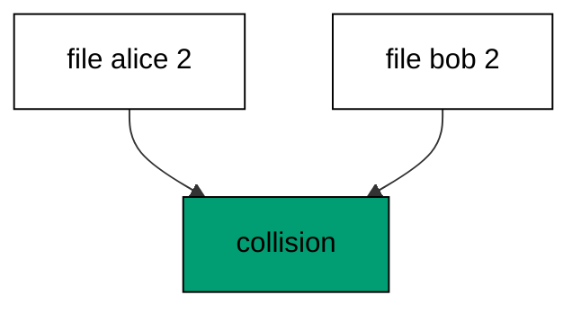

Detection runs before application: no statement from either file executes while the collision stands. The repair — renumbering one file — comes next.

**`learning/code/ex-56-version-collision-breaks-order/main.go`**:

```go
// => Shared driver: every unit in this course opens with this prelude.
// => The harness network is closed, so units carry a small standard-library
// => driver that applies the same goose SQL files `goose up` would apply.
// => The files, the history table shape, and the ordering rules are goose's
// => own; the driver only replaces the network-dependent binary.
package main // => every unit is one runnable program

import ( // => standard library only: no third-party modules
	"bufio"           // => bufio frames protocol messages over the TCP stream
	"encoding/binary" // => binary lays out length-prefixed protocol fields
	"fmt"             // => fmt prints the deterministic transcript only
	"io"              // => io forces full reads of split protocol messages
	"net"             // => net dials the harness Postgres service over TCP
	"os"              // => os reads the harness database address, never hardcoded
	"sort"            // => sort orders migration files, never trusts directory order
	"strings"         // => strings splits the goose Up and Down annotations
) // => every import used by driver and units

// => The database address comes from the harness, with local-run defaults.
func addr() (string, string, string) { // => one helper owns every address default
	host := os.Getenv("PGHOST") // => service hostname in the unit network
	if host == "" {             // => empty means a local run outside the harness
		host = "postgres" // => same default the Python courses use
	} // => end addr: empty means a local run outside the harness
	user := os.Getenv("PGUSER") // => trust-auth role, no password needed
	if user == "" {             // => empty means a local run outside the harness
		user = "postgres" // => same default the Python courses use
	} // => end addr: empty means a local run outside the harness
	db := os.Getenv("PGDATABASE") // => fresh database for every unit run
	if db == "" {                 // => empty means a local run outside the harness
		db = "postgres" // => same default the Python courses use
	} // => end addr: empty means a local run outside the harness
	return host, user, db // => callers never re-read the environment
} // => end addr: one helper owns every address default

// => conn wraps one TCP connection plus a buffered reader for message frames.
type conn struct { // => a tiny struct keeps the socket and the framer together
	c net.Conn      // => the raw TCP socket to the Postgres service
	r *bufio.Reader // => buffered reads frame messages split across packets
} // => end type conn: socket and framer travel together

// => readMsg reads one backend message: a type byte plus a length body.
func (k *conn) readMsg() (byte, []byte, error) { // => every response flows through here
	head := make([]byte, 5)                           // => one type byte plus one int32 length
	if _, err := io.ReadFull(k.r, head); err != nil { // => fragments reassemble before framing
		return 0, nil, err // => no partial message is ever trusted
	} // => end readMsg: fragments reassemble before framing
	n := int(binary.BigEndian.Uint32(head[1:])) - 4   // => length counts itself, not the type
	body := make([]byte, n)                           // => exact-size body, never over-read
	if _, err := io.ReadFull(k.r, body); err != nil { // => fragments reassemble before framing
		return 0, nil, err // => no partial message is ever trusted
	} // => end readMsg: fragments reassemble before framing
	return head[0], body, nil // => type byte tells the caller what arrived
} // => end readMsg: every response flows through here

// => sendMsg writes one frontend message: a type byte plus a length body.
func (k *conn) sendMsg(t byte, body []byte) error { // => startup is the only typeless message
	out := []byte{t}                                      // => type byte leads every message
	lenb := make([]byte, 4)                               // => four bytes carry the length
	binary.BigEndian.PutUint32(lenb, uint32(len(body)+4)) // => length counts itself
	out = append(out, lenb...)                            // => length follows the type byte
	out = append(out, body...)                            // => payload closes the message
	_, err := k.c.Write(out)                              // => one write keeps frames whole
	return err                                            // => write errors fail the unit loudly
} // => end sendMsg: startup is the only typeless message

// => connect opens the service database and waits for session readiness.
func connect() (*conn, error) { // => every unit starts from this one helper
	host, user, db := addr()         // => harness address, never hardcoded
	return connectDb(host, user, db) // => one path opens every session
} // => end connect: every unit starts from this one helper

// => connectDb opens a named database on the same host for multi-db drills.
func connectDb(host, user, db string) (*conn, error) { // => environments are databases, not servers
	c, err := net.Dial("tcp", host+":5432") // => Postgres listens on 5432
	if err != nil {                         // => unreachable service is fatal
		return nil, err // => no fallback: the harness owns the database
	} // => end connectDb: unreachable service is fatal
	k := &conn{c: c, r: bufio.NewReader(c)}             // => buffer the fresh socket at once
	body := []byte{}                                    // => startup body is parameters only
	body = append(body, 0, 0, 0, 0)                     // => placeholder for the length prefix
	body = append(body, 0, 3, 0, 0)                     // => protocol 3.0, the stable version
	body = append(body, []byte("user")...)              // => user key starts the parameters
	body = append(body, 0)                              // => keys and values are NUL-separated
	body = append(body, []byte(user)...)                // => trust-auth role from the harness
	body = append(body, 0)                              // => NUL ends the value
	body = append(body, []byte("database")...)          // => database key follows the user
	body = append(body, 0)                              // => NUL ends the key
	body = append(body, []byte(db)...)                  // => fresh database for every unit run
	body = append(body, 0)                              // => NUL ends the value
	body = append(body, 0)                              // => empty key ends the parameters
	binary.BigEndian.PutUint32(body, uint32(len(body))) // => startup length counts itself
	if _, err := c.Write(body); err != nil {            // => startup is the only typeless message
		return nil, err // => unwritable socket is fatal
	} // => end connectDb: startup is the only typeless message
	for { // => drain until the session is ready for queries
		t, b, err := k.readMsg() // => every backend message flows through here
		if err != nil {          // => broken handshake is fatal
			return nil, err // => no half-open session is ever used
		} // => end connectDb: broken handshake is fatal
		switch t { // => only three message kinds matter during startup
		case 'R': // => authentication response arrives first
			if binary.BigEndian.Uint32(b) != 0 { // => nonzero means a password is wanted
				return nil, fmt.Errorf("server wants a password") // => trust auth never asks
			} // => end connectDb: nonzero means a password is wanted
		case 'E': // => an error ends the handshake with the server text
			return nil, fmt.Errorf("startup: %s", errText(b)) // => server text explains the cause
		case 'Z': // => ReadyForQuery means the session accepts queries
			return k, nil // => handshake done: hand the live session back
		} // => end connectDb: only three message kinds matter during startup
	} // => end connectDb: drain until the session is ready for queries
} // => end connectDb: environments are databases, not servers

// => errText extracts the human message (field M) from an ErrorResponse.
func errText(b []byte) string { // => one helper decodes every server error
	parts := strings.Split(string(b), "\x00") // => fields are NUL-separated pairs
	for i := 0; i+1 < len(parts); i += 2 {    // => walk code and value together
		if parts[i] == "M" { // => M is the primary human message
			return parts[i+1] // => return the message, skip the detail fields
		} // => end errText: M is the primary human message
	} // => end errText: walk code and value together
	return "unknown error" // => malformed errors still fail with a fixed line
} // => end errText: one helper decodes every server error

// => run sends one SQL string and returns every data row plus the command tag.
func (k *conn) run(q string) ([][]string, string, error) { // => one path runs every statement
	body := append([]byte(q), 0)                 // => Query messages are NUL-terminated
	if err := k.sendMsg('Q', body); err != nil { // => send fails loudly, never silently
		return nil, "", err // => unwritable socket ends the unit
	} // => end run: send fails loudly, never silently
	var rows [][]string // => data rows accumulate across result sets
	tag := ""           // => the last command tag (SELECT 3, CREATE TABLE...)
	for {               // => drain until ReadyForQuery closes this query string
		t, b, err := k.readMsg() // => every response flows through the framer
		if err != nil {          // => broken mid-query connection is fatal
			return nil, "", err // => partial results are never returned
		} // => end run: broken mid-query connection is fatal
		switch t { // => four message kinds carry a simple-query response
		case 'T', 'N', 'A', 'S', 'K': // => metadata the transcript never prints
		case 'D': // => one data row arrived
			rows = append(rows, parseRow(b)) // => decode the text columns now
		case 'C': // => one statement finished
			tag = strings.TrimRight(string(b[:len(b)-1]), "\x00") // => tag names what ran
		case 'E': // => the statement failed
			drain(k)                                     // => finish the failed query before reuse
			return nil, "", fmt.Errorf("%s", errText(b)) // => server text becomes the failure
		case 'Z': // => ReadyForQuery ends this query string
			return rows, tag, nil // => rows, tag, and a clean session
		} // => end run: four message kinds carry a simple-query response
	} // => end run: drain until ReadyForQuery closes this query string
} // => end run: one path runs every statement

// => drain reads to the next ReadyForQuery after a statement error.
func drain(k *conn) { // => an errored query still owns the socket until Z
	for { // => loop until the session is reusable
		t, _, err := k.readMsg()    // => discard every message after the error
		if err != nil || t == 'Z' { // => socket break or ready both end the drain
			return // => caller decides the failure, the drain only resynchronizes
		} // => end drain: socket break or ready both end the drain
	} // => end drain: loop until the session is reusable
} // => end drain: an errored query still owns the socket until Z

// => parseRow decodes one DataRow body into text columns, NULL as "NULL".
func parseRow(b []byte) []string { // => one helper decodes every returned row
	n := int(binary.BigEndian.Uint16(b)) // => column count leads the body
	b = b[2:]                            // => step past the count
	out := make([]string, 0, n)          // => pre-size the row to the count
	for i := 0; i < n; i++ {             // => walk each column in order
		l := int(int32(binary.BigEndian.Uint32(b))) // => -1 marks NULL, else the length
		b = b[4:]                                   // => step past the length
		if l < 0 {                                  // => NULL has no bytes to read
			out = append(out, "NULL") // => fixed word keeps transcripts stable
			continue                  // => next column, no bytes consumed
		} // => end parseRow: NULL has no bytes to read
		out = append(out, string(b[:l])) // => text format is already printable
		b = b[l:]                        // => step past the value bytes
	} // => end parseRow: walk each column in order
	return out // => one row, fully decoded
} // => end parseRow: one helper decodes every returned row

// => must runs SQL or exits nonzero with the server text on standard error.
func must(k *conn, q string) [][]string { // => setup statements never fail quietly
	rows, _, err := k.run(q) // => rows return for verification queries
	if err != nil {          // => any server error is fatal to the unit
		fmt.Fprintln(os.Stderr, "sql error:", err) // => errors go to stderr, never stdout
		os.Exit(1)                                 // => nonzero exit fails the harness check
	} // => end must: any server error is fatal to the unit
	return rows // => callers print only what the lesson asserts
} // => end must: setup statements never fail quietly

// => try runs SQL and returns the server error text instead of exiting.
func try(k *conn, q string) ([][]string, string) { // => failure drills inspect errors, not die
	rows, _, err := k.run(q) // => same path as must, opposite failure policy
	if err != nil {          // => expected errors become transcript lines
		return nil, err.Error() // => fixed server text, never timings
	} // => end try: expected errors become transcript lines
	return rows, "" // => empty error means the statement succeeded
} // => end try: failure drills inspect errors, not die

// => mig holds one goose SQL file: its version, name, and Up/Down sections.
type mig struct { // => mirrors the goose file layout the lesson teaches
	version string   // => zero-padded number orders history, like goose
	name    string   // => human slug after the version number
	up      []string // => forward statements, run inside one transaction
	down    []string // => reverse statements, run inside one transaction
	noTx    bool     // => NO TRANSACTION files run outside one, like goose
} // => end type mig: version, name, sections, and mode

// => parseGoose splits one goose SQL file into its Up and Down statements.
func parseGoose(text string) (up, down []string, noTx bool) { // => the lesson asserts this exact split
	section := ""                                    // => nothing belongs outside the annotations
	for _, line := range strings.Split(text, "\n") { // => walk the file line by line
		t := strings.TrimSpace(line) // => annotation matching ignores indentation
		switch t {                   // => four annotation lines switch sections
		case "-- +goose Up": // => forward section starts here, like goose
			section = "up" // => following statements migrate forward
			continue       // => the annotation itself never runs
		case "-- +goose Down": // => reverse section starts here, like goose
			section = "down" // => following statements roll back
			continue         // => the annotation itself never runs
		case "-- +goose NO TRANSACTION": // => concurrent work cannot run inside one
			noTx = true // => remember the file opts out of the transaction
			continue    // => the annotation itself never runs
		} // => end parseGoose: four annotation lines switch sections
		if strings.HasPrefix(t, "--") || t == "" { // => comments and blanks never run
			continue // => only real statements reach the database
		} // => end parseGoose: comments and blanks never run
		if section == "up" { // => route by the annotation seen above
			up = append(up, line) // => keep the original line for the file write
		} else if section == "down" { // => down statements collect separately
			down = append(down, line) // => keep the original line for the file write
		} // => end parseGoose: down statements collect separately
	} // => end parseGoose: walk the file line by line
	return splitStmts(strings.Join(up, "\n")), splitStmts(strings.Join(down, "\n")), noTx // => one string per statement
} // => end parseGoose: the lesson asserts this exact split

// => splitStmts cuts statement text on semicolons outside quotes.
func splitStmts(s string) []string { // => multi-line statements stay whole until ;
	var out []string        // => finished statements accumulate here
	var cur strings.Builder // => the statement under construction
	inStr := false          // => semicolons inside quotes never split
	for _, r := range s {   // => walk rune by rune, quotes included
		switch { // => quote tracking decides what a semicolon means
		case r == '\'': // => a quote toggles string mode
			inStr = !inStr   // => enter or leave the quoted region
			cur.WriteRune(r) // => the quote belongs to the statement
		case r == ';' && !inStr: // => a bare semicolon ends one statement
			if t := strings.TrimSpace(cur.String()); t != "" { // => skip empty fragments
				out = append(out, t) // => store the finished statement
			} // => end splitStmts: skip empty fragments
			cur.Reset() // => start the next statement fresh
		default: // => every other rune belongs to the current statement
			cur.WriteRune(r) // => accumulate verbatim
		} // => end splitStmts: quote tracking decides what a semicolon means
	} // => end splitStmts: walk rune by rune, quotes included
	if t := strings.TrimSpace(cur.String()); t != "" { // => trailing text without ; still counts
		out = append(out, t) // => last statement needs no semicolon
	} // => end splitStmts: trailing text without ; still counts
	return out // => callers run each statement in order
} // => end splitStmts: multi-line statements stay whole until ;

// => ensureHistory creates the goose history table once per unit run.
func ensureHistory(k *conn) { // => goose_db_version is goose's own default name
	must(k, `CREATE TABLE IF NOT EXISTS goose_db_version (`+ // => reruns never fail here
		`id integer PRIMARY KEY GENERATED BY DEFAULT AS IDENTITY, `+ // => surrogate key, never printed
		`version_id bigint NOT NULL, `+ // => applied version numbers live here
		`is_applied boolean NOT NULL, `+ // => goose marks rows applied on success
		`tstamp timestamp NOT NULL DEFAULT now())`) // => timestamp defaults, never printed
} // => end ensureHistory: goose_db_version is goose's own default name

// => appliedVersions returns the version numbers already marked applied.
func appliedVersions(k *conn) map[int64]bool { // => history decides what still needs running
	rows := must(k, `SELECT version_id FROM goose_db_version `+ // => only the numbers matter
		`WHERE is_applied ORDER BY version_id`) // => order keeps the transcript stable
	got := map[int64]bool{}  // => set lookup answers "already applied" fast
	for _, r := range rows { // => one row per applied migration
		var v int64                // => version numbers are integers
		fmt.Sscanf(r[0], "%d", &v) // => text format parses back to a number
		got[v] = true              // => mark this version done
	} // => end appliedVersions: one row per applied migration
	return got // => callers skip whatever history already holds
} // => end appliedVersions: history decides what still needs running

// => applyUp runs every pending migration forward, one transaction each.
func applyUp(k *conn, ms []mig) { // => files on disk are already the source of truth
	done := appliedVersions(k) // => history decides what still needs running
	for _, m := range ms {     // => file order is version order, sorted by the caller
		var v int64                     // => versions compare as numbers
		fmt.Sscanf(m.version, "%d", &v) // => zero-padded file prefix parses back
		if done[v] {                    // => applied migrations never run twice
			continue // => idempotent reruns skip straight past
		} // => end applyUp: applied migrations never run twice
		if !m.noTx { // => transactional files wrap everything in one unit
			must(k, "BEGIN") // => one migration is one transaction, like goose
		} // => end applyUp: transactional files wrap everything in one unit
		for _, s := range m.up { // => forward statements run in file order
			must(k, s) // => any failure aborts the unit before COMMIT
		} // => end applyUp: forward statements run in file order
		if !m.noTx { // => stamps join the same transaction they describe
			must(k, fmt.Sprintf(`INSERT INTO goose_db_version `+ // => stamp only after success
				`(version_id, is_applied) VALUES (%d, true)`, v)) // => stamp mirrors goose exactly
			must(k, "COMMIT") // => history row and schema land together
		} else { // => concurrent statements cannot share a transaction
			must(k, fmt.Sprintf(`INSERT INTO goose_db_version `+ // => stamp follows the work
				`(version_id, is_applied) VALUES (%d, true)`, v)) // => same row, separate statement
		} // => end applyUp: concurrent statements cannot share a transaction
	} // => end applyUp: file order is version order, sorted by the caller
} // => end applyUp: files on disk are already the source of truth

// => applyDown rolls back the newest applied migrations, newest first.
func applyDown(k *conn, ms []mig, steps int) { // => steps bounds how far history rewinds
	done := appliedVersions(k) // => history decides what can roll back
	var todo []mig             // => applied migrations in version order first
	for _, m := range ms {     // => walk the whole known history
		var v int64                     // => versions compare as numbers
		fmt.Sscanf(m.version, "%d", &v) // => zero-padded file prefix parses back
		if done[v] {                    // => only applied migrations roll back
			todo = append(todo, m) // => keep the migration for the reverse pass
		} // => end applyDown: only applied migrations roll back
	} // => end applyDown: walk the whole known history
	for i := len(todo) - 1; i >= 0 && steps > 0; i-- { // => newest applied goes first
		m := todo[i]                    // => this migration rolls back now
		var v int64                     // => versions compare as numbers
		fmt.Sscanf(m.version, "%d", &v) // => zero-padded file prefix parses back
		if !m.noTx {                    // => transactional files wrap the rollback too
			must(k, "BEGIN") // => reverse change is atomic, like the forward one
		} // => end applyDown: transactional files wrap the rollback too
		for _, s := range m.down { // => reverse statements run in file order
			must(k, s) // => any failure aborts before the history row moves
		} // => end applyDown: reverse statements run in file order
		must(k, fmt.Sprintf(`DELETE FROM goose_db_version `+ // => unstamped only after success
			`WHERE version_id = %d`, v)) // => the version leaves history exactly once
		if !m.noTx { // => close the transaction the rollback opened
			must(k, "COMMIT") // => schema reversal and unstamp land together
		} // => end applyDown: close the transaction the rollback opened
		steps-- // => one rollback consumed from the budget
	} // => end applyDown: newest applied goes first
} // => end applyDown: steps bounds how far history rewinds

// => statusCounts splits known migrations into applied and pending lists.
func statusCounts(k *conn, ms []mig) (applied, pending []string) { // => goose status in two lists
	done := appliedVersions(k) // => history decides which list each version joins
	for _, m := range ms {     // => walk the known history in version order
		var v int64                     // => versions compare as numbers
		fmt.Sscanf(m.version, "%d", &v) // => zero-padded file prefix parses back
		if done[v] {                    // => stamped versions are done
			applied = append(applied, m.version) // => keep the version string for printing
		} else { // => unstamped versions still wait
			pending = append(pending, m.version) // => keep the version string for printing
		} // => end statusCounts: unstamped versions still wait
	} // => end statusCounts: walk the known history in version order
	return applied, pending // => callers print both lists in one stable line each
} // => end statusCounts: goose status in two lists

// => files writes each migration as a real goose SQL file under dir.
func files(dir string, ms []mig) { // => the lesson shows these files byte-identically
	for _, m := range ms { // => one file per migration, like `goose create`
		name := fmt.Sprintf("%s_%s.sql", m.version, m.name) // => goose names files version-first
		var b strings.Builder                               // => build the file text in order
		if m.noTx {                                         // => concurrent files announce it first
			b.WriteString("-- +goose NO TRANSACTION\n") // => goose honors this exact annotation
		} // => end files: concurrent files announce it first
		b.WriteString("-- +goose Up\n") // => forward annotation leads
		for _, s := range m.up {        // => forward statements follow
			b.WriteString(s + ";\n") // => one statement per line, semicolon-closed
		} // => end files: forward statements follow
		b.WriteString("-- +goose Down\n") // => reverse annotation splits the file
		for _, s := range m.down {        // => reverse statements close the file
			b.WriteString(s + ";\n") // => one statement per line, semicolon-closed
		} // => end files: reverse statements close the file
		if err := os.WriteFile(dir+"/"+name, []byte(b.String()), 0644); err != nil { // => real files, like goose
			fmt.Fprintln(os.Stderr, "write error:", err) // => write errors fail loudly
			os.Exit(1)                                   // => no half-written migration set
		} // => end files: real files, like goose
	} // => end files: one file per migration, like `goose create`
} // => end files: the lesson shows these files byte-identically

// => versions lists migration files in version order from dir.
func versions(dir string) []mig { // => directory order is never trusted for history
	ents, err := os.ReadDir(dir) // => read the whole migrations directory
	if err != nil {              // => unreadable directory is fatal
		fmt.Fprintln(os.Stderr, "read error:", err) // => errors go to stderr
		os.Exit(1)                                  // => nonzero exit fails the check
	} // => end versions: unreadable directory is fatal
	names := []string{}      // => collect names before sorting
	for _, e := range ents { // => walk every directory entry
		if !e.IsDir() && strings.HasSuffix(e.Name(), ".sql") { // => only goose SQL files count
			names = append(names, e.Name()) // => keep the file name for parsing
		} // => end versions: only goose SQL files count
	} // => end versions: walk every directory entry
	sort.Strings(names)       // => zero-padded versions sort chronologically
	var out []mig             // => parsed migrations accumulate here
	for _, n := range names { // => parse in version order
		raw, err := os.ReadFile(dir + "/" + n) // => read the real file back
		if err != nil {                        // => unreadable file is fatal
			fmt.Fprintln(os.Stderr, "read error:", err) // => errors go to stderr
			os.Exit(1)                                  // => nonzero exit fails the check
		} // => end versions: unreadable file is fatal
		up, down, noTx := parseGoose(string(raw))                                            // => split on the goose annotations
		rest := strings.TrimSuffix(n, ".sql")                                                // => strip the extension first
		ver := rest[:5]                                                                      // => first five digits are the version
		out = append(out, mig{version: ver, name: rest[6:], up: up, down: down, noTx: noTx}) // => keep every part
	} // => end versions: parse in version order
	return out // => version-ordered migrations, ready to apply
} // => end versions: directory order is never trusted for history

// => findDupes returns version numbers claimed by two or more files.
func findDupes(dir string) []string { // => goose refuses duplicate versions outright
	ents, err := os.ReadDir(dir) // => read the whole migrations directory
	if err != nil {              // => unreadable directory is fatal
		fmt.Fprintln(os.Stderr, "read error:", err) // => errors go to stderr
		os.Exit(1)                                  // => nonzero exit fails the check
	} // => end findDupes: unreadable directory is fatal
	seen := map[string]int{} // => count claims per five-digit version prefix
	for _, e := range ents { // => walk every directory entry
		if !e.IsDir() && strings.HasSuffix(e.Name(), ".sql") { // => only goose SQL files count
			seen[e.Name()[:5]]++ // => first five digits are the version
		} // => end findDupes: only goose SQL files count
	} // => end findDupes: walk every directory entry
	var out []string         // => duplicates accumulate in version order
	for _, e := range ents { // => second pass keeps the order stable
		if !e.IsDir() && strings.HasSuffix(e.Name(), ".sql") { // => only goose SQL files count
			if v := e.Name()[:5]; seen[v] > 1 { // => claimed more than once
				out = append(out, v) // => keep the version string for printing
				seen[v] = 0          // => report each duplicate version only once
			} // => end findDupes: claimed more than once
		} // => end findDupes: only goose SQL files count
	} // => end findDupes: second pass keeps the order stable
	return out // => empty means the history numbers are unique
} // => end findDupes: goose refuses duplicate versions outright

func main() {
	k, err := connect() // => one session runs the whole example
	if err != nil {     // => unreachable database fails loudly
		fmt.Fprintln(os.Stderr, "connect error:", err) // => connection errors go to stderr
		os.Exit(1)                                     // => nonzero exit fails the check
	}
	defer k.c.Close() // => the socket closes when the example ends
	// => A scratch migrations directory: goose files live here, never in the unit.
	// => the scratch path never reaches stdout, so reruns stay byte-stable
	dir, err := os.MkdirTemp("", "ex56-") // => private directory, like `goose create`
	if err != nil {                       // => unmakable temp dir is fatal
		fmt.Fprintln(os.Stderr, "temp error:", err) // => errors go to stderr
		os.Exit(1)                                  // => nonzero exit fails the check
	}
	defer os.RemoveAll(dir)                          // => scratch files vanish; only transcripts remain
	must(k, "DROP TABLE IF EXISTS ex56_a")           // => leftovers of a killed run vanish
	must(k, "DROP TABLE IF EXISTS ex56_b")           // => leftovers of a killed run vanish
	must(k, "DROP TABLE IF EXISTS goose_db_version") // => stale history vanishes too
	ensureHistory(k)                                 // => goose history table, real shape
	files(dir, []mig{                                // => first claimant of version two
		{version: "00002", name: "alice_table", // => alice's file
			up:   []string{"CREATE TABLE ex56_a (id SERIAL PRIMARY KEY)"}, // => forward change
			down: []string{"DROP TABLE ex56_a"}},                          // => exact reverse for rollback
	})
	raw := "-- +goose Up\nCREATE TABLE ex56_b (id SERIAL PRIMARY KEY);\n-- +goose Down\nDROP TABLE ex56_b;\n" // => bob's file text
	if err := os.WriteFile(dir+"/00002_bob_table.sql", []byte(raw), 0644); err != nil {                       // => second claimant, same version
		fmt.Fprintln(os.Stderr, "write error:", err) // => write errors fail loudly
		os.Exit(1)                                   // => nonzero exit fails the check
	}
	dupes := findDupes(dir)                          // => duplicate detector names the version
	fmt.Println("dupes:", strings.Join(dupes, ","))  // => Output: dupes: 00002
	must(k, "DROP TABLE IF EXISTS ex56_a")           // => neither file applied: nothing to clean
	must(k, "DROP TABLE IF EXISTS ex56_b")           // => neither file applied: nothing to clean
	fmt.Println("cleaned: yes")                      // => Output: cleaned: yes
	must(k, "DROP TABLE IF EXISTS ex56_a")           // => leftovers of a killed run vanish
	must(k, "DROP TABLE IF EXISTS ex56_b")           // => leftovers of a killed run vanish
	must(k, "DROP TABLE IF EXISTS goose_db_version") // => the example leaves no history behind
}
```

**Output** (`learning/code/ex-56-version-collision-breaks-order/expected/main.stdout.txt`):

```text
dupes: 00002
cleaned: yes
```

**Key takeaway**: Two files with one version number is a collision; detection reports it before any statement runs.

**Why it matters**: Failing loudly on collision beats guessing silently every time. Duplicate versions mean two authors claimed the same position, and no tool can decide intent — only humans can. Detection stops the run so the humans can renumber deliberately. Stop the run on collision and let humans renumber deliberately, because no tool can decide intent for them.

### Example 57: Renumber Onto Head

Collisions resolve by renumbering onto the head: this example moves the losing file from version two to version three and applies the clean chain. The loser keeps its content; only the number changes. (Concepts: co-14.)

Renumbering rewrites history that never ran: version two was never applied, so no stamp points at the old number. Renumbering applied versions is forbidden for exactly that reason. For timestamped files, `goose fix` applies sequential ordering automatically; collisions still need a human to pick the winner.

**`learning/code/ex-57-renumber-onto-head/main.go`**:

```go
// => Shared driver: every unit in this course opens with this prelude.
// => The harness network is closed, so units carry a small standard-library
// => driver that applies the same goose SQL files `goose up` would apply.
// => The files, the history table shape, and the ordering rules are goose's
// => own; the driver only replaces the network-dependent binary.
package main // => every unit is one runnable program

import ( // => standard library only: no third-party modules
	"bufio"           // => bufio frames protocol messages over the TCP stream
	"encoding/binary" // => binary lays out length-prefixed protocol fields
	"fmt"             // => fmt prints the deterministic transcript only
	"io"              // => io forces full reads of split protocol messages
	"net"             // => net dials the harness Postgres service over TCP
	"os"              // => os reads the harness database address, never hardcoded
	"sort"            // => sort orders migration files, never trusts directory order
	"strings"         // => strings splits the goose Up and Down annotations
) // => every import used by driver and units

// => The database address comes from the harness, with local-run defaults.
func addr() (string, string, string) { // => one helper owns every address default
	host := os.Getenv("PGHOST") // => service hostname in the unit network
	if host == "" {             // => empty means a local run outside the harness
		host = "postgres" // => same default the Python courses use
	} // => end addr: empty means a local run outside the harness
	user := os.Getenv("PGUSER") // => trust-auth role, no password needed
	if user == "" {             // => empty means a local run outside the harness
		user = "postgres" // => same default the Python courses use
	} // => end addr: empty means a local run outside the harness
	db := os.Getenv("PGDATABASE") // => fresh database for every unit run
	if db == "" {                 // => empty means a local run outside the harness
		db = "postgres" // => same default the Python courses use
	} // => end addr: empty means a local run outside the harness
	return host, user, db // => callers never re-read the environment
} // => end addr: one helper owns every address default

// => conn wraps one TCP connection plus a buffered reader for message frames.
type conn struct { // => a tiny struct keeps the socket and the framer together
	c net.Conn      // => the raw TCP socket to the Postgres service
	r *bufio.Reader // => buffered reads frame messages split across packets
} // => end type conn: socket and framer travel together

// => readMsg reads one backend message: a type byte plus a length body.
func (k *conn) readMsg() (byte, []byte, error) { // => every response flows through here
	head := make([]byte, 5)                           // => one type byte plus one int32 length
	if _, err := io.ReadFull(k.r, head); err != nil { // => fragments reassemble before framing
		return 0, nil, err // => no partial message is ever trusted
	} // => end readMsg: fragments reassemble before framing
	n := int(binary.BigEndian.Uint32(head[1:])) - 4   // => length counts itself, not the type
	body := make([]byte, n)                           // => exact-size body, never over-read
	if _, err := io.ReadFull(k.r, body); err != nil { // => fragments reassemble before framing
		return 0, nil, err // => no partial message is ever trusted
	} // => end readMsg: fragments reassemble before framing
	return head[0], body, nil // => type byte tells the caller what arrived
} // => end readMsg: every response flows through here

// => sendMsg writes one frontend message: a type byte plus a length body.
func (k *conn) sendMsg(t byte, body []byte) error { // => startup is the only typeless message
	out := []byte{t}                                      // => type byte leads every message
	lenb := make([]byte, 4)                               // => four bytes carry the length
	binary.BigEndian.PutUint32(lenb, uint32(len(body)+4)) // => length counts itself
	out = append(out, lenb...)                            // => length follows the type byte
	out = append(out, body...)                            // => payload closes the message
	_, err := k.c.Write(out)                              // => one write keeps frames whole
	return err                                            // => write errors fail the unit loudly
} // => end sendMsg: startup is the only typeless message

// => connect opens the service database and waits for session readiness.
func connect() (*conn, error) { // => every unit starts from this one helper
	host, user, db := addr()         // => harness address, never hardcoded
	return connectDb(host, user, db) // => one path opens every session
} // => end connect: every unit starts from this one helper

// => connectDb opens a named database on the same host for multi-db drills.
func connectDb(host, user, db string) (*conn, error) { // => environments are databases, not servers
	c, err := net.Dial("tcp", host+":5432") // => Postgres listens on 5432
	if err != nil {                         // => unreachable service is fatal
		return nil, err // => no fallback: the harness owns the database
	} // => end connectDb: unreachable service is fatal
	k := &conn{c: c, r: bufio.NewReader(c)}             // => buffer the fresh socket at once
	body := []byte{}                                    // => startup body is parameters only
	body = append(body, 0, 0, 0, 0)                     // => placeholder for the length prefix
	body = append(body, 0, 3, 0, 0)                     // => protocol 3.0, the stable version
	body = append(body, []byte("user")...)              // => user key starts the parameters
	body = append(body, 0)                              // => keys and values are NUL-separated
	body = append(body, []byte(user)...)                // => trust-auth role from the harness
	body = append(body, 0)                              // => NUL ends the value
	body = append(body, []byte("database")...)          // => database key follows the user
	body = append(body, 0)                              // => NUL ends the key
	body = append(body, []byte(db)...)                  // => fresh database for every unit run
	body = append(body, 0)                              // => NUL ends the value
	body = append(body, 0)                              // => empty key ends the parameters
	binary.BigEndian.PutUint32(body, uint32(len(body))) // => startup length counts itself
	if _, err := c.Write(body); err != nil {            // => startup is the only typeless message
		return nil, err // => unwritable socket is fatal
	} // => end connectDb: startup is the only typeless message
	for { // => drain until the session is ready for queries
		t, b, err := k.readMsg() // => every backend message flows through here
		if err != nil {          // => broken handshake is fatal
			return nil, err // => no half-open session is ever used
		} // => end connectDb: broken handshake is fatal
		switch t { // => only three message kinds matter during startup
		case 'R': // => authentication response arrives first
			if binary.BigEndian.Uint32(b) != 0 { // => nonzero means a password is wanted
				return nil, fmt.Errorf("server wants a password") // => trust auth never asks
			} // => end connectDb: nonzero means a password is wanted
		case 'E': // => an error ends the handshake with the server text
			return nil, fmt.Errorf("startup: %s", errText(b)) // => server text explains the cause
		case 'Z': // => ReadyForQuery means the session accepts queries
			return k, nil // => handshake done: hand the live session back
		} // => end connectDb: only three message kinds matter during startup
	} // => end connectDb: drain until the session is ready for queries
} // => end connectDb: environments are databases, not servers

// => errText extracts the human message (field M) from an ErrorResponse.
func errText(b []byte) string { // => one helper decodes every server error
	parts := strings.Split(string(b), "\x00") // => fields are NUL-separated pairs
	for i := 0; i+1 < len(parts); i += 2 {    // => walk code and value together
		if parts[i] == "M" { // => M is the primary human message
			return parts[i+1] // => return the message, skip the detail fields
		} // => end errText: M is the primary human message
	} // => end errText: walk code and value together
	return "unknown error" // => malformed errors still fail with a fixed line
} // => end errText: one helper decodes every server error

// => run sends one SQL string and returns every data row plus the command tag.
func (k *conn) run(q string) ([][]string, string, error) { // => one path runs every statement
	body := append([]byte(q), 0)                 // => Query messages are NUL-terminated
	if err := k.sendMsg('Q', body); err != nil { // => send fails loudly, never silently
		return nil, "", err // => unwritable socket ends the unit
	} // => end run: send fails loudly, never silently
	var rows [][]string // => data rows accumulate across result sets
	tag := ""           // => the last command tag (SELECT 3, CREATE TABLE...)
	for {               // => drain until ReadyForQuery closes this query string
		t, b, err := k.readMsg() // => every response flows through the framer
		if err != nil {          // => broken mid-query connection is fatal
			return nil, "", err // => partial results are never returned
		} // => end run: broken mid-query connection is fatal
		switch t { // => four message kinds carry a simple-query response
		case 'T', 'N', 'A', 'S', 'K': // => metadata the transcript never prints
		case 'D': // => one data row arrived
			rows = append(rows, parseRow(b)) // => decode the text columns now
		case 'C': // => one statement finished
			tag = strings.TrimRight(string(b[:len(b)-1]), "\x00") // => tag names what ran
		case 'E': // => the statement failed
			drain(k)                                     // => finish the failed query before reuse
			return nil, "", fmt.Errorf("%s", errText(b)) // => server text becomes the failure
		case 'Z': // => ReadyForQuery ends this query string
			return rows, tag, nil // => rows, tag, and a clean session
		} // => end run: four message kinds carry a simple-query response
	} // => end run: drain until ReadyForQuery closes this query string
} // => end run: one path runs every statement

// => drain reads to the next ReadyForQuery after a statement error.
func drain(k *conn) { // => an errored query still owns the socket until Z
	for { // => loop until the session is reusable
		t, _, err := k.readMsg()    // => discard every message after the error
		if err != nil || t == 'Z' { // => socket break or ready both end the drain
			return // => caller decides the failure, the drain only resynchronizes
		} // => end drain: socket break or ready both end the drain
	} // => end drain: loop until the session is reusable
} // => end drain: an errored query still owns the socket until Z

// => parseRow decodes one DataRow body into text columns, NULL as "NULL".
func parseRow(b []byte) []string { // => one helper decodes every returned row
	n := int(binary.BigEndian.Uint16(b)) // => column count leads the body
	b = b[2:]                            // => step past the count
	out := make([]string, 0, n)          // => pre-size the row to the count
	for i := 0; i < n; i++ {             // => walk each column in order
		l := int(int32(binary.BigEndian.Uint32(b))) // => -1 marks NULL, else the length
		b = b[4:]                                   // => step past the length
		if l < 0 {                                  // => NULL has no bytes to read
			out = append(out, "NULL") // => fixed word keeps transcripts stable
			continue                  // => next column, no bytes consumed
		} // => end parseRow: NULL has no bytes to read
		out = append(out, string(b[:l])) // => text format is already printable
		b = b[l:]                        // => step past the value bytes
	} // => end parseRow: walk each column in order
	return out // => one row, fully decoded
} // => end parseRow: one helper decodes every returned row

// => must runs SQL or exits nonzero with the server text on standard error.
func must(k *conn, q string) [][]string { // => setup statements never fail quietly
	rows, _, err := k.run(q) // => rows return for verification queries
	if err != nil {          // => any server error is fatal to the unit
		fmt.Fprintln(os.Stderr, "sql error:", err) // => errors go to stderr, never stdout
		os.Exit(1)                                 // => nonzero exit fails the harness check
	} // => end must: any server error is fatal to the unit
	return rows // => callers print only what the lesson asserts
} // => end must: setup statements never fail quietly

// => try runs SQL and returns the server error text instead of exiting.
func try(k *conn, q string) ([][]string, string) { // => failure drills inspect errors, not die
	rows, _, err := k.run(q) // => same path as must, opposite failure policy
	if err != nil {          // => expected errors become transcript lines
		return nil, err.Error() // => fixed server text, never timings
	} // => end try: expected errors become transcript lines
	return rows, "" // => empty error means the statement succeeded
} // => end try: failure drills inspect errors, not die

// => mig holds one goose SQL file: its version, name, and Up/Down sections.
type mig struct { // => mirrors the goose file layout the lesson teaches
	version string   // => zero-padded number orders history, like goose
	name    string   // => human slug after the version number
	up      []string // => forward statements, run inside one transaction
	down    []string // => reverse statements, run inside one transaction
	noTx    bool     // => NO TRANSACTION files run outside one, like goose
} // => end type mig: version, name, sections, and mode

// => parseGoose splits one goose SQL file into its Up and Down statements.
func parseGoose(text string) (up, down []string, noTx bool) { // => the lesson asserts this exact split
	section := ""                                    // => nothing belongs outside the annotations
	for _, line := range strings.Split(text, "\n") { // => walk the file line by line
		t := strings.TrimSpace(line) // => annotation matching ignores indentation
		switch t {                   // => four annotation lines switch sections
		case "-- +goose Up": // => forward section starts here, like goose
			section = "up" // => following statements migrate forward
			continue       // => the annotation itself never runs
		case "-- +goose Down": // => reverse section starts here, like goose
			section = "down" // => following statements roll back
			continue         // => the annotation itself never runs
		case "-- +goose NO TRANSACTION": // => concurrent work cannot run inside one
			noTx = true // => remember the file opts out of the transaction
			continue    // => the annotation itself never runs
		} // => end parseGoose: four annotation lines switch sections
		if strings.HasPrefix(t, "--") || t == "" { // => comments and blanks never run
			continue // => only real statements reach the database
		} // => end parseGoose: comments and blanks never run
		if section == "up" { // => route by the annotation seen above
			up = append(up, line) // => keep the original line for the file write
		} else if section == "down" { // => down statements collect separately
			down = append(down, line) // => keep the original line for the file write
		} // => end parseGoose: down statements collect separately
	} // => end parseGoose: walk the file line by line
	return splitStmts(strings.Join(up, "\n")), splitStmts(strings.Join(down, "\n")), noTx // => one string per statement
} // => end parseGoose: the lesson asserts this exact split

// => splitStmts cuts statement text on semicolons outside quotes.
func splitStmts(s string) []string { // => multi-line statements stay whole until ;
	var out []string        // => finished statements accumulate here
	var cur strings.Builder // => the statement under construction
	inStr := false          // => semicolons inside quotes never split
	for _, r := range s {   // => walk rune by rune, quotes included
		switch { // => quote tracking decides what a semicolon means
		case r == '\'': // => a quote toggles string mode
			inStr = !inStr   // => enter or leave the quoted region
			cur.WriteRune(r) // => the quote belongs to the statement
		case r == ';' && !inStr: // => a bare semicolon ends one statement
			if t := strings.TrimSpace(cur.String()); t != "" { // => skip empty fragments
				out = append(out, t) // => store the finished statement
			} // => end splitStmts: skip empty fragments
			cur.Reset() // => start the next statement fresh
		default: // => every other rune belongs to the current statement
			cur.WriteRune(r) // => accumulate verbatim
		} // => end splitStmts: quote tracking decides what a semicolon means
	} // => end splitStmts: walk rune by rune, quotes included
	if t := strings.TrimSpace(cur.String()); t != "" { // => trailing text without ; still counts
		out = append(out, t) // => last statement needs no semicolon
	} // => end splitStmts: trailing text without ; still counts
	return out // => callers run each statement in order
} // => end splitStmts: multi-line statements stay whole until ;

// => ensureHistory creates the goose history table once per unit run.
func ensureHistory(k *conn) { // => goose_db_version is goose's own default name
	must(k, `CREATE TABLE IF NOT EXISTS goose_db_version (`+ // => reruns never fail here
		`id integer PRIMARY KEY GENERATED BY DEFAULT AS IDENTITY, `+ // => surrogate key, never printed
		`version_id bigint NOT NULL, `+ // => applied version numbers live here
		`is_applied boolean NOT NULL, `+ // => goose marks rows applied on success
		`tstamp timestamp NOT NULL DEFAULT now())`) // => timestamp defaults, never printed
} // => end ensureHistory: goose_db_version is goose's own default name

// => appliedVersions returns the version numbers already marked applied.
func appliedVersions(k *conn) map[int64]bool { // => history decides what still needs running
	rows := must(k, `SELECT version_id FROM goose_db_version `+ // => only the numbers matter
		`WHERE is_applied ORDER BY version_id`) // => order keeps the transcript stable
	got := map[int64]bool{}  // => set lookup answers "already applied" fast
	for _, r := range rows { // => one row per applied migration
		var v int64                // => version numbers are integers
		fmt.Sscanf(r[0], "%d", &v) // => text format parses back to a number
		got[v] = true              // => mark this version done
	} // => end appliedVersions: one row per applied migration
	return got // => callers skip whatever history already holds
} // => end appliedVersions: history decides what still needs running

// => applyUp runs every pending migration forward, one transaction each.
func applyUp(k *conn, ms []mig) { // => files on disk are already the source of truth
	done := appliedVersions(k) // => history decides what still needs running
	for _, m := range ms {     // => file order is version order, sorted by the caller
		var v int64                     // => versions compare as numbers
		fmt.Sscanf(m.version, "%d", &v) // => zero-padded file prefix parses back
		if done[v] {                    // => applied migrations never run twice
			continue // => idempotent reruns skip straight past
		} // => end applyUp: applied migrations never run twice
		if !m.noTx { // => transactional files wrap everything in one unit
			must(k, "BEGIN") // => one migration is one transaction, like goose
		} // => end applyUp: transactional files wrap everything in one unit
		for _, s := range m.up { // => forward statements run in file order
			must(k, s) // => any failure aborts the unit before COMMIT
		} // => end applyUp: forward statements run in file order
		if !m.noTx { // => stamps join the same transaction they describe
			must(k, fmt.Sprintf(`INSERT INTO goose_db_version `+ // => stamp only after success
				`(version_id, is_applied) VALUES (%d, true)`, v)) // => stamp mirrors goose exactly
			must(k, "COMMIT") // => history row and schema land together
		} else { // => concurrent statements cannot share a transaction
			must(k, fmt.Sprintf(`INSERT INTO goose_db_version `+ // => stamp follows the work
				`(version_id, is_applied) VALUES (%d, true)`, v)) // => same row, separate statement
		} // => end applyUp: concurrent statements cannot share a transaction
	} // => end applyUp: file order is version order, sorted by the caller
} // => end applyUp: files on disk are already the source of truth

// => applyDown rolls back the newest applied migrations, newest first.
func applyDown(k *conn, ms []mig, steps int) { // => steps bounds how far history rewinds
	done := appliedVersions(k) // => history decides what can roll back
	var todo []mig             // => applied migrations in version order first
	for _, m := range ms {     // => walk the whole known history
		var v int64                     // => versions compare as numbers
		fmt.Sscanf(m.version, "%d", &v) // => zero-padded file prefix parses back
		if done[v] {                    // => only applied migrations roll back
			todo = append(todo, m) // => keep the migration for the reverse pass
		} // => end applyDown: only applied migrations roll back
	} // => end applyDown: walk the whole known history
	for i := len(todo) - 1; i >= 0 && steps > 0; i-- { // => newest applied goes first
		m := todo[i]                    // => this migration rolls back now
		var v int64                     // => versions compare as numbers
		fmt.Sscanf(m.version, "%d", &v) // => zero-padded file prefix parses back
		if !m.noTx {                    // => transactional files wrap the rollback too
			must(k, "BEGIN") // => reverse change is atomic, like the forward one
		} // => end applyDown: transactional files wrap the rollback too
		for _, s := range m.down { // => reverse statements run in file order
			must(k, s) // => any failure aborts before the history row moves
		} // => end applyDown: reverse statements run in file order
		must(k, fmt.Sprintf(`DELETE FROM goose_db_version `+ // => unstamped only after success
			`WHERE version_id = %d`, v)) // => the version leaves history exactly once
		if !m.noTx { // => close the transaction the rollback opened
			must(k, "COMMIT") // => schema reversal and unstamp land together
		} // => end applyDown: close the transaction the rollback opened
		steps-- // => one rollback consumed from the budget
	} // => end applyDown: newest applied goes first
} // => end applyDown: steps bounds how far history rewinds

// => statusCounts splits known migrations into applied and pending lists.
func statusCounts(k *conn, ms []mig) (applied, pending []string) { // => goose status in two lists
	done := appliedVersions(k) // => history decides which list each version joins
	for _, m := range ms {     // => walk the known history in version order
		var v int64                     // => versions compare as numbers
		fmt.Sscanf(m.version, "%d", &v) // => zero-padded file prefix parses back
		if done[v] {                    // => stamped versions are done
			applied = append(applied, m.version) // => keep the version string for printing
		} else { // => unstamped versions still wait
			pending = append(pending, m.version) // => keep the version string for printing
		} // => end statusCounts: unstamped versions still wait
	} // => end statusCounts: walk the known history in version order
	return applied, pending // => callers print both lists in one stable line each
} // => end statusCounts: goose status in two lists

// => files writes each migration as a real goose SQL file under dir.
func files(dir string, ms []mig) { // => the lesson shows these files byte-identically
	for _, m := range ms { // => one file per migration, like `goose create`
		name := fmt.Sprintf("%s_%s.sql", m.version, m.name) // => goose names files version-first
		var b strings.Builder                               // => build the file text in order
		if m.noTx {                                         // => concurrent files announce it first
			b.WriteString("-- +goose NO TRANSACTION\n") // => goose honors this exact annotation
		} // => end files: concurrent files announce it first
		b.WriteString("-- +goose Up\n") // => forward annotation leads
		for _, s := range m.up {        // => forward statements follow
			b.WriteString(s + ";\n") // => one statement per line, semicolon-closed
		} // => end files: forward statements follow
		b.WriteString("-- +goose Down\n") // => reverse annotation splits the file
		for _, s := range m.down {        // => reverse statements close the file
			b.WriteString(s + ";\n") // => one statement per line, semicolon-closed
		} // => end files: reverse statements close the file
		if err := os.WriteFile(dir+"/"+name, []byte(b.String()), 0644); err != nil { // => real files, like goose
			fmt.Fprintln(os.Stderr, "write error:", err) // => write errors fail loudly
			os.Exit(1)                                   // => no half-written migration set
		} // => end files: real files, like goose
	} // => end files: one file per migration, like `goose create`
} // => end files: the lesson shows these files byte-identically

// => versions lists migration files in version order from dir.
func versions(dir string) []mig { // => directory order is never trusted for history
	ents, err := os.ReadDir(dir) // => read the whole migrations directory
	if err != nil {              // => unreadable directory is fatal
		fmt.Fprintln(os.Stderr, "read error:", err) // => errors go to stderr
		os.Exit(1)                                  // => nonzero exit fails the check
	} // => end versions: unreadable directory is fatal
	names := []string{}      // => collect names before sorting
	for _, e := range ents { // => walk every directory entry
		if !e.IsDir() && strings.HasSuffix(e.Name(), ".sql") { // => only goose SQL files count
			names = append(names, e.Name()) // => keep the file name for parsing
		} // => end versions: only goose SQL files count
	} // => end versions: walk every directory entry
	sort.Strings(names)       // => zero-padded versions sort chronologically
	var out []mig             // => parsed migrations accumulate here
	for _, n := range names { // => parse in version order
		raw, err := os.ReadFile(dir + "/" + n) // => read the real file back
		if err != nil {                        // => unreadable file is fatal
			fmt.Fprintln(os.Stderr, "read error:", err) // => errors go to stderr
			os.Exit(1)                                  // => nonzero exit fails the check
		} // => end versions: unreadable file is fatal
		up, down, noTx := parseGoose(string(raw))                                            // => split on the goose annotations
		rest := strings.TrimSuffix(n, ".sql")                                                // => strip the extension first
		ver := rest[:5]                                                                      // => first five digits are the version
		out = append(out, mig{version: ver, name: rest[6:], up: up, down: down, noTx: noTx}) // => keep every part
	} // => end versions: parse in version order
	return out // => version-ordered migrations, ready to apply
} // => end versions: directory order is never trusted for history

// => findDupes returns version numbers claimed by two or more files.
func findDupes(dir string) []string { // => goose refuses duplicate versions outright
	ents, err := os.ReadDir(dir) // => read the whole migrations directory
	if err != nil {              // => unreadable directory is fatal
		fmt.Fprintln(os.Stderr, "read error:", err) // => errors go to stderr
		os.Exit(1)                                  // => nonzero exit fails the check
	} // => end findDupes: unreadable directory is fatal
	seen := map[string]int{} // => count claims per five-digit version prefix
	for _, e := range ents { // => walk every directory entry
		if !e.IsDir() && strings.HasSuffix(e.Name(), ".sql") { // => only goose SQL files count
			seen[e.Name()[:5]]++ // => first five digits are the version
		} // => end findDupes: only goose SQL files count
	} // => end findDupes: walk every directory entry
	var out []string         // => duplicates accumulate in version order
	for _, e := range ents { // => second pass keeps the order stable
		if !e.IsDir() && strings.HasSuffix(e.Name(), ".sql") { // => only goose SQL files count
			if v := e.Name()[:5]; seen[v] > 1 { // => claimed more than once
				out = append(out, v) // => keep the version string for printing
				seen[v] = 0          // => report each duplicate version only once
			} // => end findDupes: claimed more than once
		} // => end findDupes: only goose SQL files count
	} // => end findDupes: second pass keeps the order stable
	return out // => empty means the history numbers are unique
} // => end findDupes: goose refuses duplicate versions outright

func main() {
	k, err := connect() // => one session runs the whole example
	if err != nil {     // => unreachable database fails loudly
		fmt.Fprintln(os.Stderr, "connect error:", err) // => connection errors go to stderr
		os.Exit(1)                                     // => nonzero exit fails the check
	}
	defer k.c.Close() // => the socket closes when the example ends
	// => A scratch migrations directory: goose files live here, never in the unit.
	// => the scratch path never reaches stdout, so reruns stay byte-stable
	dir, err := os.MkdirTemp("", "ex57-") // => private directory, like `goose create`
	if err != nil {                       // => unmakable temp dir is fatal
		fmt.Fprintln(os.Stderr, "temp error:", err) // => errors go to stderr
		os.Exit(1)                                  // => nonzero exit fails the check
	}
	defer os.RemoveAll(dir)                          // => scratch files vanish; only transcripts remain
	must(k, "DROP TABLE IF EXISTS ex57_a")           // => leftovers of a killed run vanish
	must(k, "DROP TABLE IF EXISTS ex57_b")           // => leftovers of a killed run vanish
	must(k, "DROP TABLE IF EXISTS goose_db_version") // => stale history vanishes too
	ensureHistory(k)                                 // => goose history table, real shape
	files(dir, []mig{                                // => winner keeps version one, loser moves to three
		{version: "00001", name: "create_a", // => applied first, never collides
			up:   []string{"CREATE TABLE ex57_a (id SERIAL PRIMARY KEY)"}, // => forward change
			down: []string{"DROP TABLE ex57_a"}},                          // => exact reverse for rollback
		{version: "00003", name: "bob_table", // => renumbered onto the head
			up:   []string{"CREATE TABLE ex57_b (id SERIAL PRIMARY KEY)"}, // => forward change
			down: []string{"DROP TABLE ex57_b"}},                          // => exact reverse for rollback
	})
	applyUp(k, versions(dir))                                                                       // => clean chain, no collision
	rows := must(k, `SELECT version_id FROM goose_db_version WHERE is_applied ORDER BY version_id`) // => stamps in order
	fmt.Println("history:", rows[0][0], rows[1][0])                                                 // => Output: history: 1 3
	fmt.Println("cleaned: yes")                                                                     // => Output: cleaned: yes
	must(k, "DROP TABLE IF EXISTS ex57_a")                                                          // => leftovers of a killed run vanish
	must(k, "DROP TABLE IF EXISTS ex57_b")                                                          // => leftovers of a killed run vanish
	must(k, "DROP TABLE IF EXISTS goose_db_version")                                                // => the example leaves no history behind
}
```

**Output** (`learning/code/ex-57-renumber-onto-head/expected/main.stdout.txt`):

```text
history: 1 3
cleaned: yes
```

**Key takeaway**: Renumbering rewrites history that never ran, so move the loser onto the head and keep its content.

**Why it matters**: Renumbering the loser preserves content while restoring order. The file that never ran carries no stamp, so its number is still negotiable; the applied winner's number is history and stays fixed. Content is precious, numbers are cheap — spend the cheap ones. Content is precious and numbers are cheap, so spend the cheap ones: preserve every file and restore the order.

### Example 58: Many Versions One History

Three developers still form one line: this example interleaves six files from three simulated branches into versions one through six and applies them all. Branch count never changes the rule: numbers order, files follow. (Concepts: co-14.)

The merge is mechanical once every collision is renumbered: sort by version, apply forward. Teams that renumber at merge time keep this property forever.

**`learning/code/ex-58-many-versions-one-history/main.go`**:

```go
// => Shared driver: every unit in this course opens with this prelude.
// => The harness network is closed, so units carry a small standard-library
// => driver that applies the same goose SQL files `goose up` would apply.
// => The files, the history table shape, and the ordering rules are goose's
// => own; the driver only replaces the network-dependent binary.
package main // => every unit is one runnable program

import ( // => standard library only: no third-party modules
	"bufio"           // => bufio frames protocol messages over the TCP stream
	"encoding/binary" // => binary lays out length-prefixed protocol fields
	"fmt"             // => fmt prints the deterministic transcript only
	"io"              // => io forces full reads of split protocol messages
	"net"             // => net dials the harness Postgres service over TCP
	"os"              // => os reads the harness database address, never hardcoded
	"sort"            // => sort orders migration files, never trusts directory order
	"strings"         // => strings splits the goose Up and Down annotations
) // => every import used by driver and units

// => The database address comes from the harness, with local-run defaults.
func addr() (string, string, string) { // => one helper owns every address default
	host := os.Getenv("PGHOST") // => service hostname in the unit network
	if host == "" {             // => empty means a local run outside the harness
		host = "postgres" // => same default the Python courses use
	} // => end addr: empty means a local run outside the harness
	user := os.Getenv("PGUSER") // => trust-auth role, no password needed
	if user == "" {             // => empty means a local run outside the harness
		user = "postgres" // => same default the Python courses use
	} // => end addr: empty means a local run outside the harness
	db := os.Getenv("PGDATABASE") // => fresh database for every unit run
	if db == "" {                 // => empty means a local run outside the harness
		db = "postgres" // => same default the Python courses use
	} // => end addr: empty means a local run outside the harness
	return host, user, db // => callers never re-read the environment
} // => end addr: one helper owns every address default

// => conn wraps one TCP connection plus a buffered reader for message frames.
type conn struct { // => a tiny struct keeps the socket and the framer together
	c net.Conn      // => the raw TCP socket to the Postgres service
	r *bufio.Reader // => buffered reads frame messages split across packets
} // => end type conn: socket and framer travel together

// => readMsg reads one backend message: a type byte plus a length body.
func (k *conn) readMsg() (byte, []byte, error) { // => every response flows through here
	head := make([]byte, 5)                           // => one type byte plus one int32 length
	if _, err := io.ReadFull(k.r, head); err != nil { // => fragments reassemble before framing
		return 0, nil, err // => no partial message is ever trusted
	} // => end readMsg: fragments reassemble before framing
	n := int(binary.BigEndian.Uint32(head[1:])) - 4   // => length counts itself, not the type
	body := make([]byte, n)                           // => exact-size body, never over-read
	if _, err := io.ReadFull(k.r, body); err != nil { // => fragments reassemble before framing
		return 0, nil, err // => no partial message is ever trusted
	} // => end readMsg: fragments reassemble before framing
	return head[0], body, nil // => type byte tells the caller what arrived
} // => end readMsg: every response flows through here

// => sendMsg writes one frontend message: a type byte plus a length body.
func (k *conn) sendMsg(t byte, body []byte) error { // => startup is the only typeless message
	out := []byte{t}                                      // => type byte leads every message
	lenb := make([]byte, 4)                               // => four bytes carry the length
	binary.BigEndian.PutUint32(lenb, uint32(len(body)+4)) // => length counts itself
	out = append(out, lenb...)                            // => length follows the type byte
	out = append(out, body...)                            // => payload closes the message
	_, err := k.c.Write(out)                              // => one write keeps frames whole
	return err                                            // => write errors fail the unit loudly
} // => end sendMsg: startup is the only typeless message

// => connect opens the service database and waits for session readiness.
func connect() (*conn, error) { // => every unit starts from this one helper
	host, user, db := addr()         // => harness address, never hardcoded
	return connectDb(host, user, db) // => one path opens every session
} // => end connect: every unit starts from this one helper

// => connectDb opens a named database on the same host for multi-db drills.
func connectDb(host, user, db string) (*conn, error) { // => environments are databases, not servers
	c, err := net.Dial("tcp", host+":5432") // => Postgres listens on 5432
	if err != nil {                         // => unreachable service is fatal
		return nil, err // => no fallback: the harness owns the database
	} // => end connectDb: unreachable service is fatal
	k := &conn{c: c, r: bufio.NewReader(c)}             // => buffer the fresh socket at once
	body := []byte{}                                    // => startup body is parameters only
	body = append(body, 0, 0, 0, 0)                     // => placeholder for the length prefix
	body = append(body, 0, 3, 0, 0)                     // => protocol 3.0, the stable version
	body = append(body, []byte("user")...)              // => user key starts the parameters
	body = append(body, 0)                              // => keys and values are NUL-separated
	body = append(body, []byte(user)...)                // => trust-auth role from the harness
	body = append(body, 0)                              // => NUL ends the value
	body = append(body, []byte("database")...)          // => database key follows the user
	body = append(body, 0)                              // => NUL ends the key
	body = append(body, []byte(db)...)                  // => fresh database for every unit run
	body = append(body, 0)                              // => NUL ends the value
	body = append(body, 0)                              // => empty key ends the parameters
	binary.BigEndian.PutUint32(body, uint32(len(body))) // => startup length counts itself
	if _, err := c.Write(body); err != nil {            // => startup is the only typeless message
		return nil, err // => unwritable socket is fatal
	} // => end connectDb: startup is the only typeless message
	for { // => drain until the session is ready for queries
		t, b, err := k.readMsg() // => every backend message flows through here
		if err != nil {          // => broken handshake is fatal
			return nil, err // => no half-open session is ever used
		} // => end connectDb: broken handshake is fatal
		switch t { // => only three message kinds matter during startup
		case 'R': // => authentication response arrives first
			if binary.BigEndian.Uint32(b) != 0 { // => nonzero means a password is wanted
				return nil, fmt.Errorf("server wants a password") // => trust auth never asks
			} // => end connectDb: nonzero means a password is wanted
		case 'E': // => an error ends the handshake with the server text
			return nil, fmt.Errorf("startup: %s", errText(b)) // => server text explains the cause
		case 'Z': // => ReadyForQuery means the session accepts queries
			return k, nil // => handshake done: hand the live session back
		} // => end connectDb: only three message kinds matter during startup
	} // => end connectDb: drain until the session is ready for queries
} // => end connectDb: environments are databases, not servers

// => errText extracts the human message (field M) from an ErrorResponse.
func errText(b []byte) string { // => one helper decodes every server error
	parts := strings.Split(string(b), "\x00") // => fields are NUL-separated pairs
	for i := 0; i+1 < len(parts); i += 2 {    // => walk code and value together
		if parts[i] == "M" { // => M is the primary human message
			return parts[i+1] // => return the message, skip the detail fields
		} // => end errText: M is the primary human message
	} // => end errText: walk code and value together
	return "unknown error" // => malformed errors still fail with a fixed line
} // => end errText: one helper decodes every server error

// => run sends one SQL string and returns every data row plus the command tag.
func (k *conn) run(q string) ([][]string, string, error) { // => one path runs every statement
	body := append([]byte(q), 0)                 // => Query messages are NUL-terminated
	if err := k.sendMsg('Q', body); err != nil { // => send fails loudly, never silently
		return nil, "", err // => unwritable socket ends the unit
	} // => end run: send fails loudly, never silently
	var rows [][]string // => data rows accumulate across result sets
	tag := ""           // => the last command tag (SELECT 3, CREATE TABLE...)
	for {               // => drain until ReadyForQuery closes this query string
		t, b, err := k.readMsg() // => every response flows through the framer
		if err != nil {          // => broken mid-query connection is fatal
			return nil, "", err // => partial results are never returned
		} // => end run: broken mid-query connection is fatal
		switch t { // => four message kinds carry a simple-query response
		case 'T', 'N', 'A', 'S', 'K': // => metadata the transcript never prints
		case 'D': // => one data row arrived
			rows = append(rows, parseRow(b)) // => decode the text columns now
		case 'C': // => one statement finished
			tag = strings.TrimRight(string(b[:len(b)-1]), "\x00") // => tag names what ran
		case 'E': // => the statement failed
			drain(k)                                     // => finish the failed query before reuse
			return nil, "", fmt.Errorf("%s", errText(b)) // => server text becomes the failure
		case 'Z': // => ReadyForQuery ends this query string
			return rows, tag, nil // => rows, tag, and a clean session
		} // => end run: four message kinds carry a simple-query response
	} // => end run: drain until ReadyForQuery closes this query string
} // => end run: one path runs every statement

// => drain reads to the next ReadyForQuery after a statement error.
func drain(k *conn) { // => an errored query still owns the socket until Z
	for { // => loop until the session is reusable
		t, _, err := k.readMsg()    // => discard every message after the error
		if err != nil || t == 'Z' { // => socket break or ready both end the drain
			return // => caller decides the failure, the drain only resynchronizes
		} // => end drain: socket break or ready both end the drain
	} // => end drain: loop until the session is reusable
} // => end drain: an errored query still owns the socket until Z

// => parseRow decodes one DataRow body into text columns, NULL as "NULL".
func parseRow(b []byte) []string { // => one helper decodes every returned row
	n := int(binary.BigEndian.Uint16(b)) // => column count leads the body
	b = b[2:]                            // => step past the count
	out := make([]string, 0, n)          // => pre-size the row to the count
	for i := 0; i < n; i++ {             // => walk each column in order
		l := int(int32(binary.BigEndian.Uint32(b))) // => -1 marks NULL, else the length
		b = b[4:]                                   // => step past the length
		if l < 0 {                                  // => NULL has no bytes to read
			out = append(out, "NULL") // => fixed word keeps transcripts stable
			continue                  // => next column, no bytes consumed
		} // => end parseRow: NULL has no bytes to read
		out = append(out, string(b[:l])) // => text format is already printable
		b = b[l:]                        // => step past the value bytes
	} // => end parseRow: walk each column in order
	return out // => one row, fully decoded
} // => end parseRow: one helper decodes every returned row

// => must runs SQL or exits nonzero with the server text on standard error.
func must(k *conn, q string) [][]string { // => setup statements never fail quietly
	rows, _, err := k.run(q) // => rows return for verification queries
	if err != nil {          // => any server error is fatal to the unit
		fmt.Fprintln(os.Stderr, "sql error:", err) // => errors go to stderr, never stdout
		os.Exit(1)                                 // => nonzero exit fails the harness check
	} // => end must: any server error is fatal to the unit
	return rows // => callers print only what the lesson asserts
} // => end must: setup statements never fail quietly

// => try runs SQL and returns the server error text instead of exiting.
func try(k *conn, q string) ([][]string, string) { // => failure drills inspect errors, not die
	rows, _, err := k.run(q) // => same path as must, opposite failure policy
	if err != nil {          // => expected errors become transcript lines
		return nil, err.Error() // => fixed server text, never timings
	} // => end try: expected errors become transcript lines
	return rows, "" // => empty error means the statement succeeded
} // => end try: failure drills inspect errors, not die

// => mig holds one goose SQL file: its version, name, and Up/Down sections.
type mig struct { // => mirrors the goose file layout the lesson teaches
	version string   // => zero-padded number orders history, like goose
	name    string   // => human slug after the version number
	up      []string // => forward statements, run inside one transaction
	down    []string // => reverse statements, run inside one transaction
	noTx    bool     // => NO TRANSACTION files run outside one, like goose
} // => end type mig: version, name, sections, and mode

// => parseGoose splits one goose SQL file into its Up and Down statements.
func parseGoose(text string) (up, down []string, noTx bool) { // => the lesson asserts this exact split
	section := ""                                    // => nothing belongs outside the annotations
	for _, line := range strings.Split(text, "\n") { // => walk the file line by line
		t := strings.TrimSpace(line) // => annotation matching ignores indentation
		switch t {                   // => four annotation lines switch sections
		case "-- +goose Up": // => forward section starts here, like goose
			section = "up" // => following statements migrate forward
			continue       // => the annotation itself never runs
		case "-- +goose Down": // => reverse section starts here, like goose
			section = "down" // => following statements roll back
			continue         // => the annotation itself never runs
		case "-- +goose NO TRANSACTION": // => concurrent work cannot run inside one
			noTx = true // => remember the file opts out of the transaction
			continue    // => the annotation itself never runs
		} // => end parseGoose: four annotation lines switch sections
		if strings.HasPrefix(t, "--") || t == "" { // => comments and blanks never run
			continue // => only real statements reach the database
		} // => end parseGoose: comments and blanks never run
		if section == "up" { // => route by the annotation seen above
			up = append(up, line) // => keep the original line for the file write
		} else if section == "down" { // => down statements collect separately
			down = append(down, line) // => keep the original line for the file write
		} // => end parseGoose: down statements collect separately
	} // => end parseGoose: walk the file line by line
	return splitStmts(strings.Join(up, "\n")), splitStmts(strings.Join(down, "\n")), noTx // => one string per statement
} // => end parseGoose: the lesson asserts this exact split

// => splitStmts cuts statement text on semicolons outside quotes.
func splitStmts(s string) []string { // => multi-line statements stay whole until ;
	var out []string        // => finished statements accumulate here
	var cur strings.Builder // => the statement under construction
	inStr := false          // => semicolons inside quotes never split
	for _, r := range s {   // => walk rune by rune, quotes included
		switch { // => quote tracking decides what a semicolon means
		case r == '\'': // => a quote toggles string mode
			inStr = !inStr   // => enter or leave the quoted region
			cur.WriteRune(r) // => the quote belongs to the statement
		case r == ';' && !inStr: // => a bare semicolon ends one statement
			if t := strings.TrimSpace(cur.String()); t != "" { // => skip empty fragments
				out = append(out, t) // => store the finished statement
			} // => end splitStmts: skip empty fragments
			cur.Reset() // => start the next statement fresh
		default: // => every other rune belongs to the current statement
			cur.WriteRune(r) // => accumulate verbatim
		} // => end splitStmts: quote tracking decides what a semicolon means
	} // => end splitStmts: walk rune by rune, quotes included
	if t := strings.TrimSpace(cur.String()); t != "" { // => trailing text without ; still counts
		out = append(out, t) // => last statement needs no semicolon
	} // => end splitStmts: trailing text without ; still counts
	return out // => callers run each statement in order
} // => end splitStmts: multi-line statements stay whole until ;

// => ensureHistory creates the goose history table once per unit run.
func ensureHistory(k *conn) { // => goose_db_version is goose's own default name
	must(k, `CREATE TABLE IF NOT EXISTS goose_db_version (`+ // => reruns never fail here
		`id integer PRIMARY KEY GENERATED BY DEFAULT AS IDENTITY, `+ // => surrogate key, never printed
		`version_id bigint NOT NULL, `+ // => applied version numbers live here
		`is_applied boolean NOT NULL, `+ // => goose marks rows applied on success
		`tstamp timestamp NOT NULL DEFAULT now())`) // => timestamp defaults, never printed
} // => end ensureHistory: goose_db_version is goose's own default name

// => appliedVersions returns the version numbers already marked applied.
func appliedVersions(k *conn) map[int64]bool { // => history decides what still needs running
	rows := must(k, `SELECT version_id FROM goose_db_version `+ // => only the numbers matter
		`WHERE is_applied ORDER BY version_id`) // => order keeps the transcript stable
	got := map[int64]bool{}  // => set lookup answers "already applied" fast
	for _, r := range rows { // => one row per applied migration
		var v int64                // => version numbers are integers
		fmt.Sscanf(r[0], "%d", &v) // => text format parses back to a number
		got[v] = true              // => mark this version done
	} // => end appliedVersions: one row per applied migration
	return got // => callers skip whatever history already holds
} // => end appliedVersions: history decides what still needs running

// => applyUp runs every pending migration forward, one transaction each.
func applyUp(k *conn, ms []mig) { // => files on disk are already the source of truth
	done := appliedVersions(k) // => history decides what still needs running
	for _, m := range ms {     // => file order is version order, sorted by the caller
		var v int64                     // => versions compare as numbers
		fmt.Sscanf(m.version, "%d", &v) // => zero-padded file prefix parses back
		if done[v] {                    // => applied migrations never run twice
			continue // => idempotent reruns skip straight past
		} // => end applyUp: applied migrations never run twice
		if !m.noTx { // => transactional files wrap everything in one unit
			must(k, "BEGIN") // => one migration is one transaction, like goose
		} // => end applyUp: transactional files wrap everything in one unit
		for _, s := range m.up { // => forward statements run in file order
			must(k, s) // => any failure aborts the unit before COMMIT
		} // => end applyUp: forward statements run in file order
		if !m.noTx { // => stamps join the same transaction they describe
			must(k, fmt.Sprintf(`INSERT INTO goose_db_version `+ // => stamp only after success
				`(version_id, is_applied) VALUES (%d, true)`, v)) // => stamp mirrors goose exactly
			must(k, "COMMIT") // => history row and schema land together
		} else { // => concurrent statements cannot share a transaction
			must(k, fmt.Sprintf(`INSERT INTO goose_db_version `+ // => stamp follows the work
				`(version_id, is_applied) VALUES (%d, true)`, v)) // => same row, separate statement
		} // => end applyUp: concurrent statements cannot share a transaction
	} // => end applyUp: file order is version order, sorted by the caller
} // => end applyUp: files on disk are already the source of truth

// => applyDown rolls back the newest applied migrations, newest first.
func applyDown(k *conn, ms []mig, steps int) { // => steps bounds how far history rewinds
	done := appliedVersions(k) // => history decides what can roll back
	var todo []mig             // => applied migrations in version order first
	for _, m := range ms {     // => walk the whole known history
		var v int64                     // => versions compare as numbers
		fmt.Sscanf(m.version, "%d", &v) // => zero-padded file prefix parses back
		if done[v] {                    // => only applied migrations roll back
			todo = append(todo, m) // => keep the migration for the reverse pass
		} // => end applyDown: only applied migrations roll back
	} // => end applyDown: walk the whole known history
	for i := len(todo) - 1; i >= 0 && steps > 0; i-- { // => newest applied goes first
		m := todo[i]                    // => this migration rolls back now
		var v int64                     // => versions compare as numbers
		fmt.Sscanf(m.version, "%d", &v) // => zero-padded file prefix parses back
		if !m.noTx {                    // => transactional files wrap the rollback too
			must(k, "BEGIN") // => reverse change is atomic, like the forward one
		} // => end applyDown: transactional files wrap the rollback too
		for _, s := range m.down { // => reverse statements run in file order
			must(k, s) // => any failure aborts before the history row moves
		} // => end applyDown: reverse statements run in file order
		must(k, fmt.Sprintf(`DELETE FROM goose_db_version `+ // => unstamped only after success
			`WHERE version_id = %d`, v)) // => the version leaves history exactly once
		if !m.noTx { // => close the transaction the rollback opened
			must(k, "COMMIT") // => schema reversal and unstamp land together
		} // => end applyDown: close the transaction the rollback opened
		steps-- // => one rollback consumed from the budget
	} // => end applyDown: newest applied goes first
} // => end applyDown: steps bounds how far history rewinds

// => statusCounts splits known migrations into applied and pending lists.
func statusCounts(k *conn, ms []mig) (applied, pending []string) { // => goose status in two lists
	done := appliedVersions(k) // => history decides which list each version joins
	for _, m := range ms {     // => walk the known history in version order
		var v int64                     // => versions compare as numbers
		fmt.Sscanf(m.version, "%d", &v) // => zero-padded file prefix parses back
		if done[v] {                    // => stamped versions are done
			applied = append(applied, m.version) // => keep the version string for printing
		} else { // => unstamped versions still wait
			pending = append(pending, m.version) // => keep the version string for printing
		} // => end statusCounts: unstamped versions still wait
	} // => end statusCounts: walk the known history in version order
	return applied, pending // => callers print both lists in one stable line each
} // => end statusCounts: goose status in two lists

// => files writes each migration as a real goose SQL file under dir.
func files(dir string, ms []mig) { // => the lesson shows these files byte-identically
	for _, m := range ms { // => one file per migration, like `goose create`
		name := fmt.Sprintf("%s_%s.sql", m.version, m.name) // => goose names files version-first
		var b strings.Builder                               // => build the file text in order
		if m.noTx {                                         // => concurrent files announce it first
			b.WriteString("-- +goose NO TRANSACTION\n") // => goose honors this exact annotation
		} // => end files: concurrent files announce it first
		b.WriteString("-- +goose Up\n") // => forward annotation leads
		for _, s := range m.up {        // => forward statements follow
			b.WriteString(s + ";\n") // => one statement per line, semicolon-closed
		} // => end files: forward statements follow
		b.WriteString("-- +goose Down\n") // => reverse annotation splits the file
		for _, s := range m.down {        // => reverse statements close the file
			b.WriteString(s + ";\n") // => one statement per line, semicolon-closed
		} // => end files: reverse statements close the file
		if err := os.WriteFile(dir+"/"+name, []byte(b.String()), 0644); err != nil { // => real files, like goose
			fmt.Fprintln(os.Stderr, "write error:", err) // => write errors fail loudly
			os.Exit(1)                                   // => no half-written migration set
		} // => end files: real files, like goose
	} // => end files: one file per migration, like `goose create`
} // => end files: the lesson shows these files byte-identically

// => versions lists migration files in version order from dir.
func versions(dir string) []mig { // => directory order is never trusted for history
	ents, err := os.ReadDir(dir) // => read the whole migrations directory
	if err != nil {              // => unreadable directory is fatal
		fmt.Fprintln(os.Stderr, "read error:", err) // => errors go to stderr
		os.Exit(1)                                  // => nonzero exit fails the check
	} // => end versions: unreadable directory is fatal
	names := []string{}      // => collect names before sorting
	for _, e := range ents { // => walk every directory entry
		if !e.IsDir() && strings.HasSuffix(e.Name(), ".sql") { // => only goose SQL files count
			names = append(names, e.Name()) // => keep the file name for parsing
		} // => end versions: only goose SQL files count
	} // => end versions: walk every directory entry
	sort.Strings(names)       // => zero-padded versions sort chronologically
	var out []mig             // => parsed migrations accumulate here
	for _, n := range names { // => parse in version order
		raw, err := os.ReadFile(dir + "/" + n) // => read the real file back
		if err != nil {                        // => unreadable file is fatal
			fmt.Fprintln(os.Stderr, "read error:", err) // => errors go to stderr
			os.Exit(1)                                  // => nonzero exit fails the check
		} // => end versions: unreadable file is fatal
		up, down, noTx := parseGoose(string(raw))                                            // => split on the goose annotations
		rest := strings.TrimSuffix(n, ".sql")                                                // => strip the extension first
		ver := rest[:5]                                                                      // => first five digits are the version
		out = append(out, mig{version: ver, name: rest[6:], up: up, down: down, noTx: noTx}) // => keep every part
	} // => end versions: parse in version order
	return out // => version-ordered migrations, ready to apply
} // => end versions: directory order is never trusted for history

// => findDupes returns version numbers claimed by two or more files.
func findDupes(dir string) []string { // => goose refuses duplicate versions outright
	ents, err := os.ReadDir(dir) // => read the whole migrations directory
	if err != nil {              // => unreadable directory is fatal
		fmt.Fprintln(os.Stderr, "read error:", err) // => errors go to stderr
		os.Exit(1)                                  // => nonzero exit fails the check
	} // => end findDupes: unreadable directory is fatal
	seen := map[string]int{} // => count claims per five-digit version prefix
	for _, e := range ents { // => walk every directory entry
		if !e.IsDir() && strings.HasSuffix(e.Name(), ".sql") { // => only goose SQL files count
			seen[e.Name()[:5]]++ // => first five digits are the version
		} // => end findDupes: only goose SQL files count
	} // => end findDupes: walk every directory entry
	var out []string         // => duplicates accumulate in version order
	for _, e := range ents { // => second pass keeps the order stable
		if !e.IsDir() && strings.HasSuffix(e.Name(), ".sql") { // => only goose SQL files count
			if v := e.Name()[:5]; seen[v] > 1 { // => claimed more than once
				out = append(out, v) // => keep the version string for printing
				seen[v] = 0          // => report each duplicate version only once
			} // => end findDupes: claimed more than once
		} // => end findDupes: only goose SQL files count
	} // => end findDupes: second pass keeps the order stable
	return out // => empty means the history numbers are unique
} // => end findDupes: goose refuses duplicate versions outright

func main() {
	k, err := connect() // => one session runs the whole example
	if err != nil {     // => unreachable database fails loudly
		fmt.Fprintln(os.Stderr, "connect error:", err) // => connection errors go to stderr
		os.Exit(1)                                     // => nonzero exit fails the check
	}
	defer k.c.Close() // => the socket closes when the example ends
	// => A scratch migrations directory: goose files live here, never in the unit.
	// => the scratch path never reaches stdout, so reruns stay byte-stable
	dir, err := os.MkdirTemp("", "ex58-") // => private directory, like `goose create`
	if err != nil {                       // => unmakable temp dir is fatal
		fmt.Fprintln(os.Stderr, "temp error:", err) // => errors go to stderr
		os.Exit(1)                                  // => nonzero exit fails the check
	}
	defer os.RemoveAll(dir)                          // => scratch files vanish; only transcripts remain
	must(k, "DROP TABLE IF EXISTS ex58_t1")          // => leftovers of a killed run vanish
	must(k, "DROP TABLE IF EXISTS ex58_t2")          // => leftovers of a killed run vanish
	must(k, "DROP TABLE IF EXISTS ex58_t3")          // => leftovers of a killed run vanish
	must(k, "DROP TABLE IF EXISTS ex58_t4")          // => leftovers of a killed run vanish
	must(k, "DROP TABLE IF EXISTS ex58_t5")          // => leftovers of a killed run vanish
	must(k, "DROP TABLE IF EXISTS ex58_t6")          // => leftovers of a killed run vanish
	must(k, "DROP TABLE IF EXISTS goose_db_version") // => stale history vanishes too
	ensureHistory(k)                                 // => goose history table, real shape
	set := []mig{}                                   // => six files from three branches, one history
	for i := 1; i <= 6; i++ {                        // => versions one through six
		v := fmt.Sprintf("%05d", i)                                    // => zero-padded version prefix
		t := fmt.Sprintf("ex58_t%d", i)                                // => table per version
		set = append(set, mig{version: v, name: fmt.Sprintf("t%d", i), // => branch origin no longer matters
			up:   []string{fmt.Sprintf("CREATE TABLE %s (id SERIAL PRIMARY KEY)", t)}, // => forward change
			down: []string{fmt.Sprintf("DROP TABLE %s", t)}})                          // => exact reverse for rollback
	}
	files(dir, set)                                                           // => the merged file set
	applyUp(k, versions(dir))                                                 // => one line, six stamps
	rows := must(k, `SELECT count(*) FROM goose_db_version WHERE is_applied`) // => every version stamped
	fmt.Println("applied:", rows[0][0])                                       // => Output: applied: 6
	fmt.Println("cleaned: yes")                                               // => Output: cleaned: yes
	must(k, "DROP TABLE IF EXISTS ex58_t1")                                   // => leftovers of a killed run vanish
	must(k, "DROP TABLE IF EXISTS ex58_t2")                                   // => leftovers of a killed run vanish
	must(k, "DROP TABLE IF EXISTS ex58_t3")                                   // => leftovers of a killed run vanish
	must(k, "DROP TABLE IF EXISTS ex58_t4")                                   // => leftovers of a killed run vanish
	must(k, "DROP TABLE IF EXISTS ex58_t5")                                   // => leftovers of a killed run vanish
	must(k, "DROP TABLE IF EXISTS ex58_t6")                                   // => leftovers of a killed run vanish
	must(k, "DROP TABLE IF EXISTS goose_db_version")                          // => the example leaves no history behind
}
```

**Output** (`learning/code/ex-58-many-versions-one-history/expected/main.stdout.txt`):

```text
applied: 6
cleaned: yes
```

**Key takeaway**: Branch count never changes the rule: sort by version, apply forward, keep one line.

**Why it matters**: Scale does not change the algorithm: six files from three branches merge exactly like two files from two. Sort by version, apply forward, verify the count. Teams that internalize this stop fearing parallel schema work entirely. One line, six files, three branches, zero drama: the algorithm never changes no matter how the team scales.

### Example 59: List Pending Before Merge

Merges start from a pending list: this example applies two versions, then lists the three still pending that the merge would bring in. The pending list is the merge preview. (Concepts: co-14, co-16.)

Previewing keeps merges reviewable: every pending file gets read before it runs. Surprises at merge time become review comments instead.

**`learning/code/ex-59-list-pending-before-merge/main.go`**:

```go
// => Shared driver: every unit in this course opens with this prelude.
// => The harness network is closed, so units carry a small standard-library
// => driver that applies the same goose SQL files `goose up` would apply.
// => The files, the history table shape, and the ordering rules are goose's
// => own; the driver only replaces the network-dependent binary.
package main // => every unit is one runnable program

import ( // => standard library only: no third-party modules
	"bufio"           // => bufio frames protocol messages over the TCP stream
	"encoding/binary" // => binary lays out length-prefixed protocol fields
	"fmt"             // => fmt prints the deterministic transcript only
	"io"              // => io forces full reads of split protocol messages
	"net"             // => net dials the harness Postgres service over TCP
	"os"              // => os reads the harness database address, never hardcoded
	"sort"            // => sort orders migration files, never trusts directory order
	"strings"         // => strings splits the goose Up and Down annotations
) // => every import used by driver and units

// => The database address comes from the harness, with local-run defaults.
func addr() (string, string, string) { // => one helper owns every address default
	host := os.Getenv("PGHOST") // => service hostname in the unit network
	if host == "" {             // => empty means a local run outside the harness
		host = "postgres" // => same default the Python courses use
	} // => end addr: empty means a local run outside the harness
	user := os.Getenv("PGUSER") // => trust-auth role, no password needed
	if user == "" {             // => empty means a local run outside the harness
		user = "postgres" // => same default the Python courses use
	} // => end addr: empty means a local run outside the harness
	db := os.Getenv("PGDATABASE") // => fresh database for every unit run
	if db == "" {                 // => empty means a local run outside the harness
		db = "postgres" // => same default the Python courses use
	} // => end addr: empty means a local run outside the harness
	return host, user, db // => callers never re-read the environment
} // => end addr: one helper owns every address default

// => conn wraps one TCP connection plus a buffered reader for message frames.
type conn struct { // => a tiny struct keeps the socket and the framer together
	c net.Conn      // => the raw TCP socket to the Postgres service
	r *bufio.Reader // => buffered reads frame messages split across packets
} // => end type conn: socket and framer travel together

// => readMsg reads one backend message: a type byte plus a length body.
func (k *conn) readMsg() (byte, []byte, error) { // => every response flows through here
	head := make([]byte, 5)                           // => one type byte plus one int32 length
	if _, err := io.ReadFull(k.r, head); err != nil { // => fragments reassemble before framing
		return 0, nil, err // => no partial message is ever trusted
	} // => end readMsg: fragments reassemble before framing
	n := int(binary.BigEndian.Uint32(head[1:])) - 4   // => length counts itself, not the type
	body := make([]byte, n)                           // => exact-size body, never over-read
	if _, err := io.ReadFull(k.r, body); err != nil { // => fragments reassemble before framing
		return 0, nil, err // => no partial message is ever trusted
	} // => end readMsg: fragments reassemble before framing
	return head[0], body, nil // => type byte tells the caller what arrived
} // => end readMsg: every response flows through here

// => sendMsg writes one frontend message: a type byte plus a length body.
func (k *conn) sendMsg(t byte, body []byte) error { // => startup is the only typeless message
	out := []byte{t}                                      // => type byte leads every message
	lenb := make([]byte, 4)                               // => four bytes carry the length
	binary.BigEndian.PutUint32(lenb, uint32(len(body)+4)) // => length counts itself
	out = append(out, lenb...)                            // => length follows the type byte
	out = append(out, body...)                            // => payload closes the message
	_, err := k.c.Write(out)                              // => one write keeps frames whole
	return err                                            // => write errors fail the unit loudly
} // => end sendMsg: startup is the only typeless message

// => connect opens the service database and waits for session readiness.
func connect() (*conn, error) { // => every unit starts from this one helper
	host, user, db := addr()         // => harness address, never hardcoded
	return connectDb(host, user, db) // => one path opens every session
} // => end connect: every unit starts from this one helper

// => connectDb opens a named database on the same host for multi-db drills.
func connectDb(host, user, db string) (*conn, error) { // => environments are databases, not servers
	c, err := net.Dial("tcp", host+":5432") // => Postgres listens on 5432
	if err != nil {                         // => unreachable service is fatal
		return nil, err // => no fallback: the harness owns the database
	} // => end connectDb: unreachable service is fatal
	k := &conn{c: c, r: bufio.NewReader(c)}             // => buffer the fresh socket at once
	body := []byte{}                                    // => startup body is parameters only
	body = append(body, 0, 0, 0, 0)                     // => placeholder for the length prefix
	body = append(body, 0, 3, 0, 0)                     // => protocol 3.0, the stable version
	body = append(body, []byte("user")...)              // => user key starts the parameters
	body = append(body, 0)                              // => keys and values are NUL-separated
	body = append(body, []byte(user)...)                // => trust-auth role from the harness
	body = append(body, 0)                              // => NUL ends the value
	body = append(body, []byte("database")...)          // => database key follows the user
	body = append(body, 0)                              // => NUL ends the key
	body = append(body, []byte(db)...)                  // => fresh database for every unit run
	body = append(body, 0)                              // => NUL ends the value
	body = append(body, 0)                              // => empty key ends the parameters
	binary.BigEndian.PutUint32(body, uint32(len(body))) // => startup length counts itself
	if _, err := c.Write(body); err != nil {            // => startup is the only typeless message
		return nil, err // => unwritable socket is fatal
	} // => end connectDb: startup is the only typeless message
	for { // => drain until the session is ready for queries
		t, b, err := k.readMsg() // => every backend message flows through here
		if err != nil {          // => broken handshake is fatal
			return nil, err // => no half-open session is ever used
		} // => end connectDb: broken handshake is fatal
		switch t { // => only three message kinds matter during startup
		case 'R': // => authentication response arrives first
			if binary.BigEndian.Uint32(b) != 0 { // => nonzero means a password is wanted
				return nil, fmt.Errorf("server wants a password") // => trust auth never asks
			} // => end connectDb: nonzero means a password is wanted
		case 'E': // => an error ends the handshake with the server text
			return nil, fmt.Errorf("startup: %s", errText(b)) // => server text explains the cause
		case 'Z': // => ReadyForQuery means the session accepts queries
			return k, nil // => handshake done: hand the live session back
		} // => end connectDb: only three message kinds matter during startup
	} // => end connectDb: drain until the session is ready for queries
} // => end connectDb: environments are databases, not servers

// => errText extracts the human message (field M) from an ErrorResponse.
func errText(b []byte) string { // => one helper decodes every server error
	parts := strings.Split(string(b), "\x00") // => fields are NUL-separated pairs
	for i := 0; i+1 < len(parts); i += 2 {    // => walk code and value together
		if parts[i] == "M" { // => M is the primary human message
			return parts[i+1] // => return the message, skip the detail fields
		} // => end errText: M is the primary human message
	} // => end errText: walk code and value together
	return "unknown error" // => malformed errors still fail with a fixed line
} // => end errText: one helper decodes every server error

// => run sends one SQL string and returns every data row plus the command tag.
func (k *conn) run(q string) ([][]string, string, error) { // => one path runs every statement
	body := append([]byte(q), 0)                 // => Query messages are NUL-terminated
	if err := k.sendMsg('Q', body); err != nil { // => send fails loudly, never silently
		return nil, "", err // => unwritable socket ends the unit
	} // => end run: send fails loudly, never silently
	var rows [][]string // => data rows accumulate across result sets
	tag := ""           // => the last command tag (SELECT 3, CREATE TABLE...)
	for {               // => drain until ReadyForQuery closes this query string
		t, b, err := k.readMsg() // => every response flows through the framer
		if err != nil {          // => broken mid-query connection is fatal
			return nil, "", err // => partial results are never returned
		} // => end run: broken mid-query connection is fatal
		switch t { // => four message kinds carry a simple-query response
		case 'T', 'N', 'A', 'S', 'K': // => metadata the transcript never prints
		case 'D': // => one data row arrived
			rows = append(rows, parseRow(b)) // => decode the text columns now
		case 'C': // => one statement finished
			tag = strings.TrimRight(string(b[:len(b)-1]), "\x00") // => tag names what ran
		case 'E': // => the statement failed
			drain(k)                                     // => finish the failed query before reuse
			return nil, "", fmt.Errorf("%s", errText(b)) // => server text becomes the failure
		case 'Z': // => ReadyForQuery ends this query string
			return rows, tag, nil // => rows, tag, and a clean session
		} // => end run: four message kinds carry a simple-query response
	} // => end run: drain until ReadyForQuery closes this query string
} // => end run: one path runs every statement

// => drain reads to the next ReadyForQuery after a statement error.
func drain(k *conn) { // => an errored query still owns the socket until Z
	for { // => loop until the session is reusable
		t, _, err := k.readMsg()    // => discard every message after the error
		if err != nil || t == 'Z' { // => socket break or ready both end the drain
			return // => caller decides the failure, the drain only resynchronizes
		} // => end drain: socket break or ready both end the drain
	} // => end drain: loop until the session is reusable
} // => end drain: an errored query still owns the socket until Z

// => parseRow decodes one DataRow body into text columns, NULL as "NULL".
func parseRow(b []byte) []string { // => one helper decodes every returned row
	n := int(binary.BigEndian.Uint16(b)) // => column count leads the body
	b = b[2:]                            // => step past the count
	out := make([]string, 0, n)          // => pre-size the row to the count
	for i := 0; i < n; i++ {             // => walk each column in order
		l := int(int32(binary.BigEndian.Uint32(b))) // => -1 marks NULL, else the length
		b = b[4:]                                   // => step past the length
		if l < 0 {                                  // => NULL has no bytes to read
			out = append(out, "NULL") // => fixed word keeps transcripts stable
			continue                  // => next column, no bytes consumed
		} // => end parseRow: NULL has no bytes to read
		out = append(out, string(b[:l])) // => text format is already printable
		b = b[l:]                        // => step past the value bytes
	} // => end parseRow: walk each column in order
	return out // => one row, fully decoded
} // => end parseRow: one helper decodes every returned row

// => must runs SQL or exits nonzero with the server text on standard error.
func must(k *conn, q string) [][]string { // => setup statements never fail quietly
	rows, _, err := k.run(q) // => rows return for verification queries
	if err != nil {          // => any server error is fatal to the unit
		fmt.Fprintln(os.Stderr, "sql error:", err) // => errors go to stderr, never stdout
		os.Exit(1)                                 // => nonzero exit fails the harness check
	} // => end must: any server error is fatal to the unit
	return rows // => callers print only what the lesson asserts
} // => end must: setup statements never fail quietly

// => try runs SQL and returns the server error text instead of exiting.
func try(k *conn, q string) ([][]string, string) { // => failure drills inspect errors, not die
	rows, _, err := k.run(q) // => same path as must, opposite failure policy
	if err != nil {          // => expected errors become transcript lines
		return nil, err.Error() // => fixed server text, never timings
	} // => end try: expected errors become transcript lines
	return rows, "" // => empty error means the statement succeeded
} // => end try: failure drills inspect errors, not die

// => mig holds one goose SQL file: its version, name, and Up/Down sections.
type mig struct { // => mirrors the goose file layout the lesson teaches
	version string   // => zero-padded number orders history, like goose
	name    string   // => human slug after the version number
	up      []string // => forward statements, run inside one transaction
	down    []string // => reverse statements, run inside one transaction
	noTx    bool     // => NO TRANSACTION files run outside one, like goose
} // => end type mig: version, name, sections, and mode

// => parseGoose splits one goose SQL file into its Up and Down statements.
func parseGoose(text string) (up, down []string, noTx bool) { // => the lesson asserts this exact split
	section := ""                                    // => nothing belongs outside the annotations
	for _, line := range strings.Split(text, "\n") { // => walk the file line by line
		t := strings.TrimSpace(line) // => annotation matching ignores indentation
		switch t {                   // => four annotation lines switch sections
		case "-- +goose Up": // => forward section starts here, like goose
			section = "up" // => following statements migrate forward
			continue       // => the annotation itself never runs
		case "-- +goose Down": // => reverse section starts here, like goose
			section = "down" // => following statements roll back
			continue         // => the annotation itself never runs
		case "-- +goose NO TRANSACTION": // => concurrent work cannot run inside one
			noTx = true // => remember the file opts out of the transaction
			continue    // => the annotation itself never runs
		} // => end parseGoose: four annotation lines switch sections
		if strings.HasPrefix(t, "--") || t == "" { // => comments and blanks never run
			continue // => only real statements reach the database
		} // => end parseGoose: comments and blanks never run
		if section == "up" { // => route by the annotation seen above
			up = append(up, line) // => keep the original line for the file write
		} else if section == "down" { // => down statements collect separately
			down = append(down, line) // => keep the original line for the file write
		} // => end parseGoose: down statements collect separately
	} // => end parseGoose: walk the file line by line
	return splitStmts(strings.Join(up, "\n")), splitStmts(strings.Join(down, "\n")), noTx // => one string per statement
} // => end parseGoose: the lesson asserts this exact split

// => splitStmts cuts statement text on semicolons outside quotes.
func splitStmts(s string) []string { // => multi-line statements stay whole until ;
	var out []string        // => finished statements accumulate here
	var cur strings.Builder // => the statement under construction
	inStr := false          // => semicolons inside quotes never split
	for _, r := range s {   // => walk rune by rune, quotes included
		switch { // => quote tracking decides what a semicolon means
		case r == '\'': // => a quote toggles string mode
			inStr = !inStr   // => enter or leave the quoted region
			cur.WriteRune(r) // => the quote belongs to the statement
		case r == ';' && !inStr: // => a bare semicolon ends one statement
			if t := strings.TrimSpace(cur.String()); t != "" { // => skip empty fragments
				out = append(out, t) // => store the finished statement
			} // => end splitStmts: skip empty fragments
			cur.Reset() // => start the next statement fresh
		default: // => every other rune belongs to the current statement
			cur.WriteRune(r) // => accumulate verbatim
		} // => end splitStmts: quote tracking decides what a semicolon means
	} // => end splitStmts: walk rune by rune, quotes included
	if t := strings.TrimSpace(cur.String()); t != "" { // => trailing text without ; still counts
		out = append(out, t) // => last statement needs no semicolon
	} // => end splitStmts: trailing text without ; still counts
	return out // => callers run each statement in order
} // => end splitStmts: multi-line statements stay whole until ;

// => ensureHistory creates the goose history table once per unit run.
func ensureHistory(k *conn) { // => goose_db_version is goose's own default name
	must(k, `CREATE TABLE IF NOT EXISTS goose_db_version (`+ // => reruns never fail here
		`id integer PRIMARY KEY GENERATED BY DEFAULT AS IDENTITY, `+ // => surrogate key, never printed
		`version_id bigint NOT NULL, `+ // => applied version numbers live here
		`is_applied boolean NOT NULL, `+ // => goose marks rows applied on success
		`tstamp timestamp NOT NULL DEFAULT now())`) // => timestamp defaults, never printed
} // => end ensureHistory: goose_db_version is goose's own default name

// => appliedVersions returns the version numbers already marked applied.
func appliedVersions(k *conn) map[int64]bool { // => history decides what still needs running
	rows := must(k, `SELECT version_id FROM goose_db_version `+ // => only the numbers matter
		`WHERE is_applied ORDER BY version_id`) // => order keeps the transcript stable
	got := map[int64]bool{}  // => set lookup answers "already applied" fast
	for _, r := range rows { // => one row per applied migration
		var v int64                // => version numbers are integers
		fmt.Sscanf(r[0], "%d", &v) // => text format parses back to a number
		got[v] = true              // => mark this version done
	} // => end appliedVersions: one row per applied migration
	return got // => callers skip whatever history already holds
} // => end appliedVersions: history decides what still needs running

// => applyUp runs every pending migration forward, one transaction each.
func applyUp(k *conn, ms []mig) { // => files on disk are already the source of truth
	done := appliedVersions(k) // => history decides what still needs running
	for _, m := range ms {     // => file order is version order, sorted by the caller
		var v int64                     // => versions compare as numbers
		fmt.Sscanf(m.version, "%d", &v) // => zero-padded file prefix parses back
		if done[v] {                    // => applied migrations never run twice
			continue // => idempotent reruns skip straight past
		} // => end applyUp: applied migrations never run twice
		if !m.noTx { // => transactional files wrap everything in one unit
			must(k, "BEGIN") // => one migration is one transaction, like goose
		} // => end applyUp: transactional files wrap everything in one unit
		for _, s := range m.up { // => forward statements run in file order
			must(k, s) // => any failure aborts the unit before COMMIT
		} // => end applyUp: forward statements run in file order
		if !m.noTx { // => stamps join the same transaction they describe
			must(k, fmt.Sprintf(`INSERT INTO goose_db_version `+ // => stamp only after success
				`(version_id, is_applied) VALUES (%d, true)`, v)) // => stamp mirrors goose exactly
			must(k, "COMMIT") // => history row and schema land together
		} else { // => concurrent statements cannot share a transaction
			must(k, fmt.Sprintf(`INSERT INTO goose_db_version `+ // => stamp follows the work
				`(version_id, is_applied) VALUES (%d, true)`, v)) // => same row, separate statement
		} // => end applyUp: concurrent statements cannot share a transaction
	} // => end applyUp: file order is version order, sorted by the caller
} // => end applyUp: files on disk are already the source of truth

// => applyDown rolls back the newest applied migrations, newest first.
func applyDown(k *conn, ms []mig, steps int) { // => steps bounds how far history rewinds
	done := appliedVersions(k) // => history decides what can roll back
	var todo []mig             // => applied migrations in version order first
	for _, m := range ms {     // => walk the whole known history
		var v int64                     // => versions compare as numbers
		fmt.Sscanf(m.version, "%d", &v) // => zero-padded file prefix parses back
		if done[v] {                    // => only applied migrations roll back
			todo = append(todo, m) // => keep the migration for the reverse pass
		} // => end applyDown: only applied migrations roll back
	} // => end applyDown: walk the whole known history
	for i := len(todo) - 1; i >= 0 && steps > 0; i-- { // => newest applied goes first
		m := todo[i]                    // => this migration rolls back now
		var v int64                     // => versions compare as numbers
		fmt.Sscanf(m.version, "%d", &v) // => zero-padded file prefix parses back
		if !m.noTx {                    // => transactional files wrap the rollback too
			must(k, "BEGIN") // => reverse change is atomic, like the forward one
		} // => end applyDown: transactional files wrap the rollback too
		for _, s := range m.down { // => reverse statements run in file order
			must(k, s) // => any failure aborts before the history row moves
		} // => end applyDown: reverse statements run in file order
		must(k, fmt.Sprintf(`DELETE FROM goose_db_version `+ // => unstamped only after success
			`WHERE version_id = %d`, v)) // => the version leaves history exactly once
		if !m.noTx { // => close the transaction the rollback opened
			must(k, "COMMIT") // => schema reversal and unstamp land together
		} // => end applyDown: close the transaction the rollback opened
		steps-- // => one rollback consumed from the budget
	} // => end applyDown: newest applied goes first
} // => end applyDown: steps bounds how far history rewinds

// => statusCounts splits known migrations into applied and pending lists.
func statusCounts(k *conn, ms []mig) (applied, pending []string) { // => goose status in two lists
	done := appliedVersions(k) // => history decides which list each version joins
	for _, m := range ms {     // => walk the known history in version order
		var v int64                     // => versions compare as numbers
		fmt.Sscanf(m.version, "%d", &v) // => zero-padded file prefix parses back
		if done[v] {                    // => stamped versions are done
			applied = append(applied, m.version) // => keep the version string for printing
		} else { // => unstamped versions still wait
			pending = append(pending, m.version) // => keep the version string for printing
		} // => end statusCounts: unstamped versions still wait
	} // => end statusCounts: walk the known history in version order
	return applied, pending // => callers print both lists in one stable line each
} // => end statusCounts: goose status in two lists

// => files writes each migration as a real goose SQL file under dir.
func files(dir string, ms []mig) { // => the lesson shows these files byte-identically
	for _, m := range ms { // => one file per migration, like `goose create`
		name := fmt.Sprintf("%s_%s.sql", m.version, m.name) // => goose names files version-first
		var b strings.Builder                               // => build the file text in order
		if m.noTx {                                         // => concurrent files announce it first
			b.WriteString("-- +goose NO TRANSACTION\n") // => goose honors this exact annotation
		} // => end files: concurrent files announce it first
		b.WriteString("-- +goose Up\n") // => forward annotation leads
		for _, s := range m.up {        // => forward statements follow
			b.WriteString(s + ";\n") // => one statement per line, semicolon-closed
		} // => end files: forward statements follow
		b.WriteString("-- +goose Down\n") // => reverse annotation splits the file
		for _, s := range m.down {        // => reverse statements close the file
			b.WriteString(s + ";\n") // => one statement per line, semicolon-closed
		} // => end files: reverse statements close the file
		if err := os.WriteFile(dir+"/"+name, []byte(b.String()), 0644); err != nil { // => real files, like goose
			fmt.Fprintln(os.Stderr, "write error:", err) // => write errors fail loudly
			os.Exit(1)                                   // => no half-written migration set
		} // => end files: real files, like goose
	} // => end files: one file per migration, like `goose create`
} // => end files: the lesson shows these files byte-identically

// => versions lists migration files in version order from dir.
func versions(dir string) []mig { // => directory order is never trusted for history
	ents, err := os.ReadDir(dir) // => read the whole migrations directory
	if err != nil {              // => unreadable directory is fatal
		fmt.Fprintln(os.Stderr, "read error:", err) // => errors go to stderr
		os.Exit(1)                                  // => nonzero exit fails the check
	} // => end versions: unreadable directory is fatal
	names := []string{}      // => collect names before sorting
	for _, e := range ents { // => walk every directory entry
		if !e.IsDir() && strings.HasSuffix(e.Name(), ".sql") { // => only goose SQL files count
			names = append(names, e.Name()) // => keep the file name for parsing
		} // => end versions: only goose SQL files count
	} // => end versions: walk every directory entry
	sort.Strings(names)       // => zero-padded versions sort chronologically
	var out []mig             // => parsed migrations accumulate here
	for _, n := range names { // => parse in version order
		raw, err := os.ReadFile(dir + "/" + n) // => read the real file back
		if err != nil {                        // => unreadable file is fatal
			fmt.Fprintln(os.Stderr, "read error:", err) // => errors go to stderr
			os.Exit(1)                                  // => nonzero exit fails the check
		} // => end versions: unreadable file is fatal
		up, down, noTx := parseGoose(string(raw))                                            // => split on the goose annotations
		rest := strings.TrimSuffix(n, ".sql")                                                // => strip the extension first
		ver := rest[:5]                                                                      // => first five digits are the version
		out = append(out, mig{version: ver, name: rest[6:], up: up, down: down, noTx: noTx}) // => keep every part
	} // => end versions: parse in version order
	return out // => version-ordered migrations, ready to apply
} // => end versions: directory order is never trusted for history

// => findDupes returns version numbers claimed by two or more files.
func findDupes(dir string) []string { // => goose refuses duplicate versions outright
	ents, err := os.ReadDir(dir) // => read the whole migrations directory
	if err != nil {              // => unreadable directory is fatal
		fmt.Fprintln(os.Stderr, "read error:", err) // => errors go to stderr
		os.Exit(1)                                  // => nonzero exit fails the check
	} // => end findDupes: unreadable directory is fatal
	seen := map[string]int{} // => count claims per five-digit version prefix
	for _, e := range ents { // => walk every directory entry
		if !e.IsDir() && strings.HasSuffix(e.Name(), ".sql") { // => only goose SQL files count
			seen[e.Name()[:5]]++ // => first five digits are the version
		} // => end findDupes: only goose SQL files count
	} // => end findDupes: walk every directory entry
	var out []string         // => duplicates accumulate in version order
	for _, e := range ents { // => second pass keeps the order stable
		if !e.IsDir() && strings.HasSuffix(e.Name(), ".sql") { // => only goose SQL files count
			if v := e.Name()[:5]; seen[v] > 1 { // => claimed more than once
				out = append(out, v) // => keep the version string for printing
				seen[v] = 0          // => report each duplicate version only once
			} // => end findDupes: claimed more than once
		} // => end findDupes: only goose SQL files count
	} // => end findDupes: second pass keeps the order stable
	return out // => empty means the history numbers are unique
} // => end findDupes: goose refuses duplicate versions outright

func main() {
	k, err := connect() // => one session runs the whole example
	if err != nil {     // => unreachable database fails loudly
		fmt.Fprintln(os.Stderr, "connect error:", err) // => connection errors go to stderr
		os.Exit(1)                                     // => nonzero exit fails the check
	}
	defer k.c.Close() // => the socket closes when the example ends
	// => A scratch migrations directory: goose files live here, never in the unit.
	// => the scratch path never reaches stdout, so reruns stay byte-stable
	dir, err := os.MkdirTemp("", "ex59-") // => private directory, like `goose create`
	if err != nil {                       // => unmakable temp dir is fatal
		fmt.Fprintln(os.Stderr, "temp error:", err) // => errors go to stderr
		os.Exit(1)                                  // => nonzero exit fails the check
	}
	defer os.RemoveAll(dir)                          // => scratch files vanish; only transcripts remain
	must(k, "DROP TABLE IF EXISTS ex59_t1")          // => leftovers of a killed run vanish
	must(k, "DROP TABLE IF EXISTS ex59_t2")          // => leftovers of a killed run vanish
	must(k, "DROP TABLE IF EXISTS ex59_t3")          // => leftovers of a killed run vanish
	must(k, "DROP TABLE IF EXISTS ex59_t4")          // => leftovers of a killed run vanish
	must(k, "DROP TABLE IF EXISTS ex59_t5")          // => leftovers of a killed run vanish
	must(k, "DROP TABLE IF EXISTS goose_db_version") // => stale history vanishes too
	ensureHistory(k)                                 // => goose history table, real shape
	set := []mig{}                                   // => five files, two applied before the merge
	for i := 1; i <= 5; i++ {                        // => versions one through five
		v := fmt.Sprintf("%05d", i)                                    // => zero-padded version prefix
		t := fmt.Sprintf("ex59_t%d", i)                                // => table per version
		set = append(set, mig{version: v, name: fmt.Sprintf("t%d", i), // => merge brings versions three to five
			up:   []string{fmt.Sprintf("CREATE TABLE %s (id SERIAL PRIMARY KEY)", t)}, // => forward change
			down: []string{fmt.Sprintf("DROP TABLE %s", t)}})                          // => exact reverse for rollback
	}
	files(dir, set)                                  // => the full file set
	ms := versions(dir)                              // => parse the files back, like goose would
	applyUp(k, ms[:2])                               // => two applied, three pending
	_, p := statusCounts(k, ms)                      // => pending list is the merge preview
	fmt.Println("pending:", strings.Join(p, ","))    // => Output: pending: 00003,00004,00005
	applyUp(k, ms)                                   // => merge completes for the cleanup below
	fmt.Println("cleaned: yes")                      // => Output: cleaned: yes
	must(k, "DROP TABLE IF EXISTS ex59_t1")          // => leftovers of a killed run vanish
	must(k, "DROP TABLE IF EXISTS ex59_t2")          // => leftovers of a killed run vanish
	must(k, "DROP TABLE IF EXISTS ex59_t3")          // => leftovers of a killed run vanish
	must(k, "DROP TABLE IF EXISTS ex59_t4")          // => leftovers of a killed run vanish
	must(k, "DROP TABLE IF EXISTS ex59_t5")          // => leftovers of a killed run vanish
	must(k, "DROP TABLE IF EXISTS goose_db_version") // => the example leaves no history behind
}
```

**Output** (`learning/code/ex-59-list-pending-before-merge/expected/main.stdout.txt`):

```text
pending: 00003,00004,00005
cleaned: yes
```

**Key takeaway**: The pending list is the merge preview; every pending file gets read before it runs.

**Why it matters**: Previewing the merge turns integration from a surprise into a review. Listing pending versions before applying them gives every file a reading before it gets a run, and surprises become comments instead of incidents. Look before you leap, as a team. Look before you leap as a team: preview every pending file so surprises become review comments instead of incidents.

### Example 60: Linear History Team Policy

Policy turns practice into law: this example asserts the whole history is gap-free and duplicate-free, printing the verdict a CI gate would enforce. The check is three counts, and it runs on every pull request. (Concepts: co-04, co-14.)

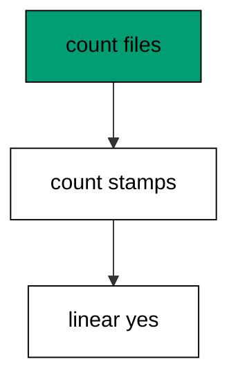

Gaps mean a file went missing; duplicates mean a collision slipped through. Either verdict fails the build before the database ever sees the files.

**`learning/code/ex-60-linear-history-team-policy/main.go`**:

```go
// => Shared driver: every unit in this course opens with this prelude.
// => The harness network is closed, so units carry a small standard-library
// => driver that applies the same goose SQL files `goose up` would apply.
// => The files, the history table shape, and the ordering rules are goose's
// => own; the driver only replaces the network-dependent binary.
package main // => every unit is one runnable program

import ( // => standard library only: no third-party modules
	"bufio"           // => bufio frames protocol messages over the TCP stream
	"encoding/binary" // => binary lays out length-prefixed protocol fields
	"fmt"             // => fmt prints the deterministic transcript only
	"io"              // => io forces full reads of split protocol messages
	"net"             // => net dials the harness Postgres service over TCP
	"os"              // => os reads the harness database address, never hardcoded
	"sort"            // => sort orders migration files, never trusts directory order
	"strings"         // => strings splits the goose Up and Down annotations
) // => every import used by driver and units

// => The database address comes from the harness, with local-run defaults.
func addr() (string, string, string) { // => one helper owns every address default
	host := os.Getenv("PGHOST") // => service hostname in the unit network
	if host == "" {             // => empty means a local run outside the harness
		host = "postgres" // => same default the Python courses use
	} // => end addr: empty means a local run outside the harness
	user := os.Getenv("PGUSER") // => trust-auth role, no password needed
	if user == "" {             // => empty means a local run outside the harness
		user = "postgres" // => same default the Python courses use
	} // => end addr: empty means a local run outside the harness
	db := os.Getenv("PGDATABASE") // => fresh database for every unit run
	if db == "" {                 // => empty means a local run outside the harness
		db = "postgres" // => same default the Python courses use
	} // => end addr: empty means a local run outside the harness
	return host, user, db // => callers never re-read the environment
} // => end addr: one helper owns every address default

// => conn wraps one TCP connection plus a buffered reader for message frames.
type conn struct { // => a tiny struct keeps the socket and the framer together
	c net.Conn      // => the raw TCP socket to the Postgres service
	r *bufio.Reader // => buffered reads frame messages split across packets
} // => end type conn: socket and framer travel together

// => readMsg reads one backend message: a type byte plus a length body.
func (k *conn) readMsg() (byte, []byte, error) { // => every response flows through here
	head := make([]byte, 5)                           // => one type byte plus one int32 length
	if _, err := io.ReadFull(k.r, head); err != nil { // => fragments reassemble before framing
		return 0, nil, err // => no partial message is ever trusted
	} // => end readMsg: fragments reassemble before framing
	n := int(binary.BigEndian.Uint32(head[1:])) - 4   // => length counts itself, not the type
	body := make([]byte, n)                           // => exact-size body, never over-read
	if _, err := io.ReadFull(k.r, body); err != nil { // => fragments reassemble before framing
		return 0, nil, err // => no partial message is ever trusted
	} // => end readMsg: fragments reassemble before framing
	return head[0], body, nil // => type byte tells the caller what arrived
} // => end readMsg: every response flows through here

// => sendMsg writes one frontend message: a type byte plus a length body.
func (k *conn) sendMsg(t byte, body []byte) error { // => startup is the only typeless message
	out := []byte{t}                                      // => type byte leads every message
	lenb := make([]byte, 4)                               // => four bytes carry the length
	binary.BigEndian.PutUint32(lenb, uint32(len(body)+4)) // => length counts itself
	out = append(out, lenb...)                            // => length follows the type byte
	out = append(out, body...)                            // => payload closes the message
	_, err := k.c.Write(out)                              // => one write keeps frames whole
	return err                                            // => write errors fail the unit loudly
} // => end sendMsg: startup is the only typeless message

// => connect opens the service database and waits for session readiness.
func connect() (*conn, error) { // => every unit starts from this one helper
	host, user, db := addr()         // => harness address, never hardcoded
	return connectDb(host, user, db) // => one path opens every session
} // => end connect: every unit starts from this one helper

// => connectDb opens a named database on the same host for multi-db drills.
func connectDb(host, user, db string) (*conn, error) { // => environments are databases, not servers
	c, err := net.Dial("tcp", host+":5432") // => Postgres listens on 5432
	if err != nil {                         // => unreachable service is fatal
		return nil, err // => no fallback: the harness owns the database
	} // => end connectDb: unreachable service is fatal
	k := &conn{c: c, r: bufio.NewReader(c)}             // => buffer the fresh socket at once
	body := []byte{}                                    // => startup body is parameters only
	body = append(body, 0, 0, 0, 0)                     // => placeholder for the length prefix
	body = append(body, 0, 3, 0, 0)                     // => protocol 3.0, the stable version
	body = append(body, []byte("user")...)              // => user key starts the parameters
	body = append(body, 0)                              // => keys and values are NUL-separated
	body = append(body, []byte(user)...)                // => trust-auth role from the harness
	body = append(body, 0)                              // => NUL ends the value
	body = append(body, []byte("database")...)          // => database key follows the user
	body = append(body, 0)                              // => NUL ends the key
	body = append(body, []byte(db)...)                  // => fresh database for every unit run
	body = append(body, 0)                              // => NUL ends the value
	body = append(body, 0)                              // => empty key ends the parameters
	binary.BigEndian.PutUint32(body, uint32(len(body))) // => startup length counts itself
	if _, err := c.Write(body); err != nil {            // => startup is the only typeless message
		return nil, err // => unwritable socket is fatal
	} // => end connectDb: startup is the only typeless message
	for { // => drain until the session is ready for queries
		t, b, err := k.readMsg() // => every backend message flows through here
		if err != nil {          // => broken handshake is fatal
			return nil, err // => no half-open session is ever used
		} // => end connectDb: broken handshake is fatal
		switch t { // => only three message kinds matter during startup
		case 'R': // => authentication response arrives first
			if binary.BigEndian.Uint32(b) != 0 { // => nonzero means a password is wanted
				return nil, fmt.Errorf("server wants a password") // => trust auth never asks
			} // => end connectDb: nonzero means a password is wanted
		case 'E': // => an error ends the handshake with the server text
			return nil, fmt.Errorf("startup: %s", errText(b)) // => server text explains the cause
		case 'Z': // => ReadyForQuery means the session accepts queries
			return k, nil // => handshake done: hand the live session back
		} // => end connectDb: only three message kinds matter during startup
	} // => end connectDb: drain until the session is ready for queries
} // => end connectDb: environments are databases, not servers

// => errText extracts the human message (field M) from an ErrorResponse.
func errText(b []byte) string { // => one helper decodes every server error
	parts := strings.Split(string(b), "\x00") // => fields are NUL-separated pairs
	for i := 0; i+1 < len(parts); i += 2 {    // => walk code and value together
		if parts[i] == "M" { // => M is the primary human message
			return parts[i+1] // => return the message, skip the detail fields
		} // => end errText: M is the primary human message
	} // => end errText: walk code and value together
	return "unknown error" // => malformed errors still fail with a fixed line
} // => end errText: one helper decodes every server error

// => run sends one SQL string and returns every data row plus the command tag.
func (k *conn) run(q string) ([][]string, string, error) { // => one path runs every statement
	body := append([]byte(q), 0)                 // => Query messages are NUL-terminated
	if err := k.sendMsg('Q', body); err != nil { // => send fails loudly, never silently
		return nil, "", err // => unwritable socket ends the unit
	} // => end run: send fails loudly, never silently
	var rows [][]string // => data rows accumulate across result sets
	tag := ""           // => the last command tag (SELECT 3, CREATE TABLE...)
	for {               // => drain until ReadyForQuery closes this query string
		t, b, err := k.readMsg() // => every response flows through the framer
		if err != nil {          // => broken mid-query connection is fatal
			return nil, "", err // => partial results are never returned
		} // => end run: broken mid-query connection is fatal
		switch t { // => four message kinds carry a simple-query response
		case 'T', 'N', 'A', 'S', 'K': // => metadata the transcript never prints
		case 'D': // => one data row arrived
			rows = append(rows, parseRow(b)) // => decode the text columns now
		case 'C': // => one statement finished
			tag = strings.TrimRight(string(b[:len(b)-1]), "\x00") // => tag names what ran
		case 'E': // => the statement failed
			drain(k)                                     // => finish the failed query before reuse
			return nil, "", fmt.Errorf("%s", errText(b)) // => server text becomes the failure
		case 'Z': // => ReadyForQuery ends this query string
			return rows, tag, nil // => rows, tag, and a clean session
		} // => end run: four message kinds carry a simple-query response
	} // => end run: drain until ReadyForQuery closes this query string
} // => end run: one path runs every statement

// => drain reads to the next ReadyForQuery after a statement error.
func drain(k *conn) { // => an errored query still owns the socket until Z
	for { // => loop until the session is reusable
		t, _, err := k.readMsg()    // => discard every message after the error
		if err != nil || t == 'Z' { // => socket break or ready both end the drain
			return // => caller decides the failure, the drain only resynchronizes
		} // => end drain: socket break or ready both end the drain
	} // => end drain: loop until the session is reusable
} // => end drain: an errored query still owns the socket until Z

// => parseRow decodes one DataRow body into text columns, NULL as "NULL".
func parseRow(b []byte) []string { // => one helper decodes every returned row
	n := int(binary.BigEndian.Uint16(b)) // => column count leads the body
	b = b[2:]                            // => step past the count
	out := make([]string, 0, n)          // => pre-size the row to the count
	for i := 0; i < n; i++ {             // => walk each column in order
		l := int(int32(binary.BigEndian.Uint32(b))) // => -1 marks NULL, else the length
		b = b[4:]                                   // => step past the length
		if l < 0 {                                  // => NULL has no bytes to read
			out = append(out, "NULL") // => fixed word keeps transcripts stable
			continue                  // => next column, no bytes consumed
		} // => end parseRow: NULL has no bytes to read
		out = append(out, string(b[:l])) // => text format is already printable
		b = b[l:]                        // => step past the value bytes
	} // => end parseRow: walk each column in order
	return out // => one row, fully decoded
} // => end parseRow: one helper decodes every returned row

// => must runs SQL or exits nonzero with the server text on standard error.
func must(k *conn, q string) [][]string { // => setup statements never fail quietly
	rows, _, err := k.run(q) // => rows return for verification queries
	if err != nil {          // => any server error is fatal to the unit
		fmt.Fprintln(os.Stderr, "sql error:", err) // => errors go to stderr, never stdout
		os.Exit(1)                                 // => nonzero exit fails the harness check
	} // => end must: any server error is fatal to the unit
	return rows // => callers print only what the lesson asserts
} // => end must: setup statements never fail quietly

// => try runs SQL and returns the server error text instead of exiting.
func try(k *conn, q string) ([][]string, string) { // => failure drills inspect errors, not die
	rows, _, err := k.run(q) // => same path as must, opposite failure policy
	if err != nil {          // => expected errors become transcript lines
		return nil, err.Error() // => fixed server text, never timings
	} // => end try: expected errors become transcript lines
	return rows, "" // => empty error means the statement succeeded
} // => end try: failure drills inspect errors, not die

// => mig holds one goose SQL file: its version, name, and Up/Down sections.
type mig struct { // => mirrors the goose file layout the lesson teaches
	version string   // => zero-padded number orders history, like goose
	name    string   // => human slug after the version number
	up      []string // => forward statements, run inside one transaction
	down    []string // => reverse statements, run inside one transaction
	noTx    bool     // => NO TRANSACTION files run outside one, like goose
} // => end type mig: version, name, sections, and mode

// => parseGoose splits one goose SQL file into its Up and Down statements.
func parseGoose(text string) (up, down []string, noTx bool) { // => the lesson asserts this exact split
	section := ""                                    // => nothing belongs outside the annotations
	for _, line := range strings.Split(text, "\n") { // => walk the file line by line
		t := strings.TrimSpace(line) // => annotation matching ignores indentation
		switch t {                   // => four annotation lines switch sections
		case "-- +goose Up": // => forward section starts here, like goose
			section = "up" // => following statements migrate forward
			continue       // => the annotation itself never runs
		case "-- +goose Down": // => reverse section starts here, like goose
			section = "down" // => following statements roll back
			continue         // => the annotation itself never runs
		case "-- +goose NO TRANSACTION": // => concurrent work cannot run inside one
			noTx = true // => remember the file opts out of the transaction
			continue    // => the annotation itself never runs
		} // => end parseGoose: four annotation lines switch sections
		if strings.HasPrefix(t, "--") || t == "" { // => comments and blanks never run
			continue // => only real statements reach the database
		} // => end parseGoose: comments and blanks never run
		if section == "up" { // => route by the annotation seen above
			up = append(up, line) // => keep the original line for the file write
		} else if section == "down" { // => down statements collect separately
			down = append(down, line) // => keep the original line for the file write
		} // => end parseGoose: down statements collect separately
	} // => end parseGoose: walk the file line by line
	return splitStmts(strings.Join(up, "\n")), splitStmts(strings.Join(down, "\n")), noTx // => one string per statement
} // => end parseGoose: the lesson asserts this exact split

// => splitStmts cuts statement text on semicolons outside quotes.
func splitStmts(s string) []string { // => multi-line statements stay whole until ;
	var out []string        // => finished statements accumulate here
	var cur strings.Builder // => the statement under construction
	inStr := false          // => semicolons inside quotes never split
	for _, r := range s {   // => walk rune by rune, quotes included
		switch { // => quote tracking decides what a semicolon means
		case r == '\'': // => a quote toggles string mode
			inStr = !inStr   // => enter or leave the quoted region
			cur.WriteRune(r) // => the quote belongs to the statement
		case r == ';' && !inStr: // => a bare semicolon ends one statement
			if t := strings.TrimSpace(cur.String()); t != "" { // => skip empty fragments
				out = append(out, t) // => store the finished statement
			} // => end splitStmts: skip empty fragments
			cur.Reset() // => start the next statement fresh
		default: // => every other rune belongs to the current statement
			cur.WriteRune(r) // => accumulate verbatim
		} // => end splitStmts: quote tracking decides what a semicolon means
	} // => end splitStmts: walk rune by rune, quotes included
	if t := strings.TrimSpace(cur.String()); t != "" { // => trailing text without ; still counts
		out = append(out, t) // => last statement needs no semicolon
	} // => end splitStmts: trailing text without ; still counts
	return out // => callers run each statement in order
} // => end splitStmts: multi-line statements stay whole until ;

// => ensureHistory creates the goose history table once per unit run.
func ensureHistory(k *conn) { // => goose_db_version is goose's own default name
	must(k, `CREATE TABLE IF NOT EXISTS goose_db_version (`+ // => reruns never fail here
		`id integer PRIMARY KEY GENERATED BY DEFAULT AS IDENTITY, `+ // => surrogate key, never printed
		`version_id bigint NOT NULL, `+ // => applied version numbers live here
		`is_applied boolean NOT NULL, `+ // => goose marks rows applied on success
		`tstamp timestamp NOT NULL DEFAULT now())`) // => timestamp defaults, never printed
} // => end ensureHistory: goose_db_version is goose's own default name

// => appliedVersions returns the version numbers already marked applied.
func appliedVersions(k *conn) map[int64]bool { // => history decides what still needs running
	rows := must(k, `SELECT version_id FROM goose_db_version `+ // => only the numbers matter
		`WHERE is_applied ORDER BY version_id`) // => order keeps the transcript stable
	got := map[int64]bool{}  // => set lookup answers "already applied" fast
	for _, r := range rows { // => one row per applied migration
		var v int64                // => version numbers are integers
		fmt.Sscanf(r[0], "%d", &v) // => text format parses back to a number
		got[v] = true              // => mark this version done
	} // => end appliedVersions: one row per applied migration
	return got // => callers skip whatever history already holds
} // => end appliedVersions: history decides what still needs running

// => applyUp runs every pending migration forward, one transaction each.
func applyUp(k *conn, ms []mig) { // => files on disk are already the source of truth
	done := appliedVersions(k) // => history decides what still needs running
	for _, m := range ms {     // => file order is version order, sorted by the caller
		var v int64                     // => versions compare as numbers
		fmt.Sscanf(m.version, "%d", &v) // => zero-padded file prefix parses back
		if done[v] {                    // => applied migrations never run twice
			continue // => idempotent reruns skip straight past
		} // => end applyUp: applied migrations never run twice
		if !m.noTx { // => transactional files wrap everything in one unit
			must(k, "BEGIN") // => one migration is one transaction, like goose
		} // => end applyUp: transactional files wrap everything in one unit
		for _, s := range m.up { // => forward statements run in file order
			must(k, s) // => any failure aborts the unit before COMMIT
		} // => end applyUp: forward statements run in file order
		if !m.noTx { // => stamps join the same transaction they describe
			must(k, fmt.Sprintf(`INSERT INTO goose_db_version `+ // => stamp only after success
				`(version_id, is_applied) VALUES (%d, true)`, v)) // => stamp mirrors goose exactly
			must(k, "COMMIT") // => history row and schema land together
		} else { // => concurrent statements cannot share a transaction
			must(k, fmt.Sprintf(`INSERT INTO goose_db_version `+ // => stamp follows the work
				`(version_id, is_applied) VALUES (%d, true)`, v)) // => same row, separate statement
		} // => end applyUp: concurrent statements cannot share a transaction
	} // => end applyUp: file order is version order, sorted by the caller
} // => end applyUp: files on disk are already the source of truth

// => applyDown rolls back the newest applied migrations, newest first.
func applyDown(k *conn, ms []mig, steps int) { // => steps bounds how far history rewinds
	done := appliedVersions(k) // => history decides what can roll back
	var todo []mig             // => applied migrations in version order first
	for _, m := range ms {     // => walk the whole known history
		var v int64                     // => versions compare as numbers
		fmt.Sscanf(m.version, "%d", &v) // => zero-padded file prefix parses back
		if done[v] {                    // => only applied migrations roll back
			todo = append(todo, m) // => keep the migration for the reverse pass
		} // => end applyDown: only applied migrations roll back
	} // => end applyDown: walk the whole known history
	for i := len(todo) - 1; i >= 0 && steps > 0; i-- { // => newest applied goes first
		m := todo[i]                    // => this migration rolls back now
		var v int64                     // => versions compare as numbers
		fmt.Sscanf(m.version, "%d", &v) // => zero-padded file prefix parses back
		if !m.noTx {                    // => transactional files wrap the rollback too
			must(k, "BEGIN") // => reverse change is atomic, like the forward one
		} // => end applyDown: transactional files wrap the rollback too
		for _, s := range m.down { // => reverse statements run in file order
			must(k, s) // => any failure aborts before the history row moves
		} // => end applyDown: reverse statements run in file order
		must(k, fmt.Sprintf(`DELETE FROM goose_db_version `+ // => unstamped only after success
			`WHERE version_id = %d`, v)) // => the version leaves history exactly once
		if !m.noTx { // => close the transaction the rollback opened
			must(k, "COMMIT") // => schema reversal and unstamp land together
		} // => end applyDown: close the transaction the rollback opened
		steps-- // => one rollback consumed from the budget
	} // => end applyDown: newest applied goes first
} // => end applyDown: steps bounds how far history rewinds

// => statusCounts splits known migrations into applied and pending lists.
func statusCounts(k *conn, ms []mig) (applied, pending []string) { // => goose status in two lists
	done := appliedVersions(k) // => history decides which list each version joins
	for _, m := range ms {     // => walk the known history in version order
		var v int64                     // => versions compare as numbers
		fmt.Sscanf(m.version, "%d", &v) // => zero-padded file prefix parses back
		if done[v] {                    // => stamped versions are done
			applied = append(applied, m.version) // => keep the version string for printing
		} else { // => unstamped versions still wait
			pending = append(pending, m.version) // => keep the version string for printing
		} // => end statusCounts: unstamped versions still wait
	} // => end statusCounts: walk the known history in version order
	return applied, pending // => callers print both lists in one stable line each
} // => end statusCounts: goose status in two lists

// => files writes each migration as a real goose SQL file under dir.
func files(dir string, ms []mig) { // => the lesson shows these files byte-identically
	for _, m := range ms { // => one file per migration, like `goose create`
		name := fmt.Sprintf("%s_%s.sql", m.version, m.name) // => goose names files version-first
		var b strings.Builder                               // => build the file text in order
		if m.noTx {                                         // => concurrent files announce it first
			b.WriteString("-- +goose NO TRANSACTION\n") // => goose honors this exact annotation
		} // => end files: concurrent files announce it first
		b.WriteString("-- +goose Up\n") // => forward annotation leads
		for _, s := range m.up {        // => forward statements follow
			b.WriteString(s + ";\n") // => one statement per line, semicolon-closed
		} // => end files: forward statements follow
		b.WriteString("-- +goose Down\n") // => reverse annotation splits the file
		for _, s := range m.down {        // => reverse statements close the file
			b.WriteString(s + ";\n") // => one statement per line, semicolon-closed
		} // => end files: reverse statements close the file
		if err := os.WriteFile(dir+"/"+name, []byte(b.String()), 0644); err != nil { // => real files, like goose
			fmt.Fprintln(os.Stderr, "write error:", err) // => write errors fail loudly
			os.Exit(1)                                   // => no half-written migration set
		} // => end files: real files, like goose
	} // => end files: one file per migration, like `goose create`
} // => end files: the lesson shows these files byte-identically

// => versions lists migration files in version order from dir.
func versions(dir string) []mig { // => directory order is never trusted for history
	ents, err := os.ReadDir(dir) // => read the whole migrations directory
	if err != nil {              // => unreadable directory is fatal
		fmt.Fprintln(os.Stderr, "read error:", err) // => errors go to stderr
		os.Exit(1)                                  // => nonzero exit fails the check
	} // => end versions: unreadable directory is fatal
	names := []string{}      // => collect names before sorting
	for _, e := range ents { // => walk every directory entry
		if !e.IsDir() && strings.HasSuffix(e.Name(), ".sql") { // => only goose SQL files count
			names = append(names, e.Name()) // => keep the file name for parsing
		} // => end versions: only goose SQL files count
	} // => end versions: walk every directory entry
	sort.Strings(names)       // => zero-padded versions sort chronologically
	var out []mig             // => parsed migrations accumulate here
	for _, n := range names { // => parse in version order
		raw, err := os.ReadFile(dir + "/" + n) // => read the real file back
		if err != nil {                        // => unreadable file is fatal
			fmt.Fprintln(os.Stderr, "read error:", err) // => errors go to stderr
			os.Exit(1)                                  // => nonzero exit fails the check
		} // => end versions: unreadable file is fatal
		up, down, noTx := parseGoose(string(raw))                                            // => split on the goose annotations
		rest := strings.TrimSuffix(n, ".sql")                                                // => strip the extension first
		ver := rest[:5]                                                                      // => first five digits are the version
		out = append(out, mig{version: ver, name: rest[6:], up: up, down: down, noTx: noTx}) // => keep every part
	} // => end versions: parse in version order
	return out // => version-ordered migrations, ready to apply
} // => end versions: directory order is never trusted for history

// => findDupes returns version numbers claimed by two or more files.
func findDupes(dir string) []string { // => goose refuses duplicate versions outright
	ents, err := os.ReadDir(dir) // => read the whole migrations directory
	if err != nil {              // => unreadable directory is fatal
		fmt.Fprintln(os.Stderr, "read error:", err) // => errors go to stderr
		os.Exit(1)                                  // => nonzero exit fails the check
	} // => end findDupes: unreadable directory is fatal
	seen := map[string]int{} // => count claims per five-digit version prefix
	for _, e := range ents { // => walk every directory entry
		if !e.IsDir() && strings.HasSuffix(e.Name(), ".sql") { // => only goose SQL files count
			seen[e.Name()[:5]]++ // => first five digits are the version
		} // => end findDupes: only goose SQL files count
	} // => end findDupes: walk every directory entry
	var out []string         // => duplicates accumulate in version order
	for _, e := range ents { // => second pass keeps the order stable
		if !e.IsDir() && strings.HasSuffix(e.Name(), ".sql") { // => only goose SQL files count
			if v := e.Name()[:5]; seen[v] > 1 { // => claimed more than once
				out = append(out, v) // => keep the version string for printing
				seen[v] = 0          // => report each duplicate version only once
			} // => end findDupes: claimed more than once
		} // => end findDupes: only goose SQL files count
	} // => end findDupes: second pass keeps the order stable
	return out // => empty means the history numbers are unique
} // => end findDupes: goose refuses duplicate versions outright

func main() {
	k, err := connect() // => one session runs the whole example
	if err != nil {     // => unreachable database fails loudly
		fmt.Fprintln(os.Stderr, "connect error:", err) // => connection errors go to stderr
		os.Exit(1)                                     // => nonzero exit fails the check
	}
	defer k.c.Close() // => the socket closes when the example ends
	// => A scratch migrations directory: goose files live here, never in the unit.
	// => the scratch path never reaches stdout, so reruns stay byte-stable
	dir, err := os.MkdirTemp("", "ex60-") // => private directory, like `goose create`
	if err != nil {                       // => unmakable temp dir is fatal
		fmt.Fprintln(os.Stderr, "temp error:", err) // => errors go to stderr
		os.Exit(1)                                  // => nonzero exit fails the check
	}
	defer os.RemoveAll(dir)                          // => scratch files vanish; only transcripts remain
	must(k, "DROP TABLE IF EXISTS ex60_t1")          // => leftovers of a killed run vanish
	must(k, "DROP TABLE IF EXISTS ex60_t2")          // => leftovers of a killed run vanish
	must(k, "DROP TABLE IF EXISTS ex60_t3")          // => leftovers of a killed run vanish
	must(k, "DROP TABLE IF EXISTS goose_db_version") // => stale history vanishes too
	ensureHistory(k)                                 // => goose history table, real shape
	for i := 1; i <= 3; i++ {                        // => three sequential versions, no gaps
		v := fmt.Sprintf("%05d", i)                                // => zero-padded version prefix
		t := fmt.Sprintf("ex60_t%d", i)                            // => table per version
		files(dir, []mig{{version: v, name: fmt.Sprintf("t%d", i), // => one file per version
			up:   []string{fmt.Sprintf("CREATE TABLE %s (id SERIAL PRIMARY KEY)", t)}, // => forward change
			down: []string{fmt.Sprintf("DROP TABLE %s", t)}}})                         // => exact reverse for rollback
	}
	ms := versions(dir)                                                                                  // => parse the files back, like goose would
	dupes := findDupes(dir)                                                                              // => no version claimed twice
	rows := must(k, `SELECT count(*) FROM goose_db_version`)                                             // => zero stamps before the run
	fmt.Println("dupes:", len(dupes), "stamps:", rows[0][0])                                             // => Output: dupes: 0 stamps: 0
	applyUp(k, ms)                                                                                       // => clean history applies fully
	rows = must(k, `SELECT count(*), count(DISTINCT version_id) FROM goose_db_version WHERE is_applied`) // => stamps vs unique
	fmt.Println("linear:", rows[0][0] == rows[0][1] && rows[0][0] == "3")                                // => Output: linear: true
	fmt.Println("cleaned: yes")                                                                          // => Output: cleaned: yes
	must(k, "DROP TABLE IF EXISTS ex60_t1")                                                              // => leftovers of a killed run vanish
	must(k, "DROP TABLE IF EXISTS ex60_t2")                                                              // => leftovers of a killed run vanish
	must(k, "DROP TABLE IF EXISTS ex60_t3")                                                              // => leftovers of a killed run vanish
	must(k, "DROP TABLE IF EXISTS goose_db_version")                                                     // => the example leaves no history behind
}
```

**Output** (`learning/code/ex-60-linear-history-team-policy/expected/main.stdout.txt`):

```text
dupes: 0 stamps: 0
linear: true
cleaned: yes
```

**Key takeaway**: Gap-free and duplicate-free is the policy; three counts on every pull request enforce it.

**Why it matters**: Policy as code means the build enforces what the handbook preaches. Gap and duplicate checks on every pull request catch renumbering mistakes while they are still diffs, not while they are production incidents. Three counts, zero tolerance, every time. Three counts on every pull request enforce what the handbook preaches, with zero tolerance and no exceptions.

### Example 61: Conflict Drill Two Developers

The full drill: two developers branch from version one, both add a version-two file, the collision is detected, one renumbers to three, and the merged history applies cleanly. Detection, repair, merge: the whole loop in one example. (Concepts: co-14.)

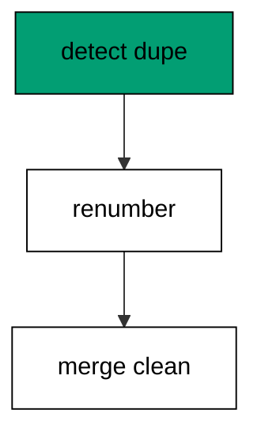

Drills like this one turn merge conflicts from incidents into routine: the team has run the loop before production forces it. Practice the repair when nothing is on fire.

**`learning/code/ex-61-conflict-drill-two-developers/main.go`**:

```go
// => Shared driver: every unit in this course opens with this prelude.
// => The harness network is closed, so units carry a small standard-library
// => driver that applies the same goose SQL files `goose up` would apply.
// => The files, the history table shape, and the ordering rules are goose's
// => own; the driver only replaces the network-dependent binary.
package main // => every unit is one runnable program

import ( // => standard library only: no third-party modules
	"bufio"           // => bufio frames protocol messages over the TCP stream
	"encoding/binary" // => binary lays out length-prefixed protocol fields
	"fmt"             // => fmt prints the deterministic transcript only
	"io"              // => io forces full reads of split protocol messages
	"net"             // => net dials the harness Postgres service over TCP
	"os"              // => os reads the harness database address, never hardcoded
	"sort"            // => sort orders migration files, never trusts directory order
	"strings"         // => strings splits the goose Up and Down annotations
) // => every import used by driver and units

// => The database address comes from the harness, with local-run defaults.
func addr() (string, string, string) { // => one helper owns every address default
	host := os.Getenv("PGHOST") // => service hostname in the unit network
	if host == "" {             // => empty means a local run outside the harness
		host = "postgres" // => same default the Python courses use
	} // => end addr: empty means a local run outside the harness
	user := os.Getenv("PGUSER") // => trust-auth role, no password needed
	if user == "" {             // => empty means a local run outside the harness
		user = "postgres" // => same default the Python courses use
	} // => end addr: empty means a local run outside the harness
	db := os.Getenv("PGDATABASE") // => fresh database for every unit run
	if db == "" {                 // => empty means a local run outside the harness
		db = "postgres" // => same default the Python courses use
	} // => end addr: empty means a local run outside the harness
	return host, user, db // => callers never re-read the environment
} // => end addr: one helper owns every address default

// => conn wraps one TCP connection plus a buffered reader for message frames.
type conn struct { // => a tiny struct keeps the socket and the framer together
	c net.Conn      // => the raw TCP socket to the Postgres service
	r *bufio.Reader // => buffered reads frame messages split across packets
} // => end type conn: socket and framer travel together

// => readMsg reads one backend message: a type byte plus a length body.
func (k *conn) readMsg() (byte, []byte, error) { // => every response flows through here
	head := make([]byte, 5)                           // => one type byte plus one int32 length
	if _, err := io.ReadFull(k.r, head); err != nil { // => fragments reassemble before framing
		return 0, nil, err // => no partial message is ever trusted
	} // => end readMsg: fragments reassemble before framing
	n := int(binary.BigEndian.Uint32(head[1:])) - 4   // => length counts itself, not the type
	body := make([]byte, n)                           // => exact-size body, never over-read
	if _, err := io.ReadFull(k.r, body); err != nil { // => fragments reassemble before framing
		return 0, nil, err // => no partial message is ever trusted
	} // => end readMsg: fragments reassemble before framing
	return head[0], body, nil // => type byte tells the caller what arrived
} // => end readMsg: every response flows through here

// => sendMsg writes one frontend message: a type byte plus a length body.
func (k *conn) sendMsg(t byte, body []byte) error { // => startup is the only typeless message
	out := []byte{t}                                      // => type byte leads every message
	lenb := make([]byte, 4)                               // => four bytes carry the length
	binary.BigEndian.PutUint32(lenb, uint32(len(body)+4)) // => length counts itself
	out = append(out, lenb...)                            // => length follows the type byte
	out = append(out, body...)                            // => payload closes the message
	_, err := k.c.Write(out)                              // => one write keeps frames whole
	return err                                            // => write errors fail the unit loudly
} // => end sendMsg: startup is the only typeless message

// => connect opens the service database and waits for session readiness.
func connect() (*conn, error) { // => every unit starts from this one helper
	host, user, db := addr()         // => harness address, never hardcoded
	return connectDb(host, user, db) // => one path opens every session
} // => end connect: every unit starts from this one helper

// => connectDb opens a named database on the same host for multi-db drills.
func connectDb(host, user, db string) (*conn, error) { // => environments are databases, not servers
	c, err := net.Dial("tcp", host+":5432") // => Postgres listens on 5432
	if err != nil {                         // => unreachable service is fatal
		return nil, err // => no fallback: the harness owns the database
	} // => end connectDb: unreachable service is fatal
	k := &conn{c: c, r: bufio.NewReader(c)}             // => buffer the fresh socket at once
	body := []byte{}                                    // => startup body is parameters only
	body = append(body, 0, 0, 0, 0)                     // => placeholder for the length prefix
	body = append(body, 0, 3, 0, 0)                     // => protocol 3.0, the stable version
	body = append(body, []byte("user")...)              // => user key starts the parameters
	body = append(body, 0)                              // => keys and values are NUL-separated
	body = append(body, []byte(user)...)                // => trust-auth role from the harness
	body = append(body, 0)                              // => NUL ends the value
	body = append(body, []byte("database")...)          // => database key follows the user
	body = append(body, 0)                              // => NUL ends the key
	body = append(body, []byte(db)...)                  // => fresh database for every unit run
	body = append(body, 0)                              // => NUL ends the value
	body = append(body, 0)                              // => empty key ends the parameters
	binary.BigEndian.PutUint32(body, uint32(len(body))) // => startup length counts itself
	if _, err := c.Write(body); err != nil {            // => startup is the only typeless message
		return nil, err // => unwritable socket is fatal
	} // => end connectDb: startup is the only typeless message
	for { // => drain until the session is ready for queries
		t, b, err := k.readMsg() // => every backend message flows through here
		if err != nil {          // => broken handshake is fatal
			return nil, err // => no half-open session is ever used
		} // => end connectDb: broken handshake is fatal
		switch t { // => only three message kinds matter during startup
		case 'R': // => authentication response arrives first
			if binary.BigEndian.Uint32(b) != 0 { // => nonzero means a password is wanted
				return nil, fmt.Errorf("server wants a password") // => trust auth never asks
			} // => end connectDb: nonzero means a password is wanted
		case 'E': // => an error ends the handshake with the server text
			return nil, fmt.Errorf("startup: %s", errText(b)) // => server text explains the cause
		case 'Z': // => ReadyForQuery means the session accepts queries
			return k, nil // => handshake done: hand the live session back
		} // => end connectDb: only three message kinds matter during startup
	} // => end connectDb: drain until the session is ready for queries
} // => end connectDb: environments are databases, not servers

// => errText extracts the human message (field M) from an ErrorResponse.
func errText(b []byte) string { // => one helper decodes every server error
	parts := strings.Split(string(b), "\x00") // => fields are NUL-separated pairs
	for i := 0; i+1 < len(parts); i += 2 {    // => walk code and value together
		if parts[i] == "M" { // => M is the primary human message
			return parts[i+1] // => return the message, skip the detail fields
		} // => end errText: M is the primary human message
	} // => end errText: walk code and value together
	return "unknown error" // => malformed errors still fail with a fixed line
} // => end errText: one helper decodes every server error

// => run sends one SQL string and returns every data row plus the command tag.
func (k *conn) run(q string) ([][]string, string, error) { // => one path runs every statement
	body := append([]byte(q), 0)                 // => Query messages are NUL-terminated
	if err := k.sendMsg('Q', body); err != nil { // => send fails loudly, never silently
		return nil, "", err // => unwritable socket ends the unit
	} // => end run: send fails loudly, never silently
	var rows [][]string // => data rows accumulate across result sets
	tag := ""           // => the last command tag (SELECT 3, CREATE TABLE...)
	for {               // => drain until ReadyForQuery closes this query string
		t, b, err := k.readMsg() // => every response flows through the framer
		if err != nil {          // => broken mid-query connection is fatal
			return nil, "", err // => partial results are never returned
		} // => end run: broken mid-query connection is fatal
		switch t { // => four message kinds carry a simple-query response
		case 'T', 'N', 'A', 'S', 'K': // => metadata the transcript never prints
		case 'D': // => one data row arrived
			rows = append(rows, parseRow(b)) // => decode the text columns now
		case 'C': // => one statement finished
			tag = strings.TrimRight(string(b[:len(b)-1]), "\x00") // => tag names what ran
		case 'E': // => the statement failed
			drain(k)                                     // => finish the failed query before reuse
			return nil, "", fmt.Errorf("%s", errText(b)) // => server text becomes the failure
		case 'Z': // => ReadyForQuery ends this query string
			return rows, tag, nil // => rows, tag, and a clean session
		} // => end run: four message kinds carry a simple-query response
	} // => end run: drain until ReadyForQuery closes this query string
} // => end run: one path runs every statement

// => drain reads to the next ReadyForQuery after a statement error.
func drain(k *conn) { // => an errored query still owns the socket until Z
	for { // => loop until the session is reusable
		t, _, err := k.readMsg()    // => discard every message after the error
		if err != nil || t == 'Z' { // => socket break or ready both end the drain
			return // => caller decides the failure, the drain only resynchronizes
		} // => end drain: socket break or ready both end the drain
	} // => end drain: loop until the session is reusable
} // => end drain: an errored query still owns the socket until Z

// => parseRow decodes one DataRow body into text columns, NULL as "NULL".
func parseRow(b []byte) []string { // => one helper decodes every returned row
	n := int(binary.BigEndian.Uint16(b)) // => column count leads the body
	b = b[2:]                            // => step past the count
	out := make([]string, 0, n)          // => pre-size the row to the count
	for i := 0; i < n; i++ {             // => walk each column in order
		l := int(int32(binary.BigEndian.Uint32(b))) // => -1 marks NULL, else the length
		b = b[4:]                                   // => step past the length
		if l < 0 {                                  // => NULL has no bytes to read
			out = append(out, "NULL") // => fixed word keeps transcripts stable
			continue                  // => next column, no bytes consumed
		} // => end parseRow: NULL has no bytes to read
		out = append(out, string(b[:l])) // => text format is already printable
		b = b[l:]                        // => step past the value bytes
	} // => end parseRow: walk each column in order
	return out // => one row, fully decoded
} // => end parseRow: one helper decodes every returned row

// => must runs SQL or exits nonzero with the server text on standard error.
func must(k *conn, q string) [][]string { // => setup statements never fail quietly
	rows, _, err := k.run(q) // => rows return for verification queries
	if err != nil {          // => any server error is fatal to the unit
		fmt.Fprintln(os.Stderr, "sql error:", err) // => errors go to stderr, never stdout
		os.Exit(1)                                 // => nonzero exit fails the harness check
	} // => end must: any server error is fatal to the unit
	return rows // => callers print only what the lesson asserts
} // => end must: setup statements never fail quietly

// => try runs SQL and returns the server error text instead of exiting.
func try(k *conn, q string) ([][]string, string) { // => failure drills inspect errors, not die
	rows, _, err := k.run(q) // => same path as must, opposite failure policy
	if err != nil {          // => expected errors become transcript lines
		return nil, err.Error() // => fixed server text, never timings
	} // => end try: expected errors become transcript lines
	return rows, "" // => empty error means the statement succeeded
} // => end try: failure drills inspect errors, not die

// => mig holds one goose SQL file: its version, name, and Up/Down sections.
type mig struct { // => mirrors the goose file layout the lesson teaches
	version string   // => zero-padded number orders history, like goose
	name    string   // => human slug after the version number
	up      []string // => forward statements, run inside one transaction
	down    []string // => reverse statements, run inside one transaction
	noTx    bool     // => NO TRANSACTION files run outside one, like goose
} // => end type mig: version, name, sections, and mode

// => parseGoose splits one goose SQL file into its Up and Down statements.
func parseGoose(text string) (up, down []string, noTx bool) { // => the lesson asserts this exact split
	section := ""                                    // => nothing belongs outside the annotations
	for _, line := range strings.Split(text, "\n") { // => walk the file line by line
		t := strings.TrimSpace(line) // => annotation matching ignores indentation
		switch t {                   // => four annotation lines switch sections
		case "-- +goose Up": // => forward section starts here, like goose
			section = "up" // => following statements migrate forward
			continue       // => the annotation itself never runs
		case "-- +goose Down": // => reverse section starts here, like goose
			section = "down" // => following statements roll back
			continue         // => the annotation itself never runs
		case "-- +goose NO TRANSACTION": // => concurrent work cannot run inside one
			noTx = true // => remember the file opts out of the transaction
			continue    // => the annotation itself never runs
		} // => end parseGoose: four annotation lines switch sections
		if strings.HasPrefix(t, "--") || t == "" { // => comments and blanks never run
			continue // => only real statements reach the database
		} // => end parseGoose: comments and blanks never run
		if section == "up" { // => route by the annotation seen above
			up = append(up, line) // => keep the original line for the file write
		} else if section == "down" { // => down statements collect separately
			down = append(down, line) // => keep the original line for the file write
		} // => end parseGoose: down statements collect separately
	} // => end parseGoose: walk the file line by line
	return splitStmts(strings.Join(up, "\n")), splitStmts(strings.Join(down, "\n")), noTx // => one string per statement
} // => end parseGoose: the lesson asserts this exact split

// => splitStmts cuts statement text on semicolons outside quotes.
func splitStmts(s string) []string { // => multi-line statements stay whole until ;
	var out []string        // => finished statements accumulate here
	var cur strings.Builder // => the statement under construction
	inStr := false          // => semicolons inside quotes never split
	for _, r := range s {   // => walk rune by rune, quotes included
		switch { // => quote tracking decides what a semicolon means
		case r == '\'': // => a quote toggles string mode
			inStr = !inStr   // => enter or leave the quoted region
			cur.WriteRune(r) // => the quote belongs to the statement
		case r == ';' && !inStr: // => a bare semicolon ends one statement
			if t := strings.TrimSpace(cur.String()); t != "" { // => skip empty fragments
				out = append(out, t) // => store the finished statement
			} // => end splitStmts: skip empty fragments
			cur.Reset() // => start the next statement fresh
		default: // => every other rune belongs to the current statement
			cur.WriteRune(r) // => accumulate verbatim
		} // => end splitStmts: quote tracking decides what a semicolon means
	} // => end splitStmts: walk rune by rune, quotes included
	if t := strings.TrimSpace(cur.String()); t != "" { // => trailing text without ; still counts
		out = append(out, t) // => last statement needs no semicolon
	} // => end splitStmts: trailing text without ; still counts
	return out // => callers run each statement in order
} // => end splitStmts: multi-line statements stay whole until ;

// => ensureHistory creates the goose history table once per unit run.
func ensureHistory(k *conn) { // => goose_db_version is goose's own default name
	must(k, `CREATE TABLE IF NOT EXISTS goose_db_version (`+ // => reruns never fail here
		`id integer PRIMARY KEY GENERATED BY DEFAULT AS IDENTITY, `+ // => surrogate key, never printed
		`version_id bigint NOT NULL, `+ // => applied version numbers live here
		`is_applied boolean NOT NULL, `+ // => goose marks rows applied on success
		`tstamp timestamp NOT NULL DEFAULT now())`) // => timestamp defaults, never printed
} // => end ensureHistory: goose_db_version is goose's own default name

// => appliedVersions returns the version numbers already marked applied.
func appliedVersions(k *conn) map[int64]bool { // => history decides what still needs running
	rows := must(k, `SELECT version_id FROM goose_db_version `+ // => only the numbers matter
		`WHERE is_applied ORDER BY version_id`) // => order keeps the transcript stable
	got := map[int64]bool{}  // => set lookup answers "already applied" fast
	for _, r := range rows { // => one row per applied migration
		var v int64                // => version numbers are integers
		fmt.Sscanf(r[0], "%d", &v) // => text format parses back to a number
		got[v] = true              // => mark this version done
	} // => end appliedVersions: one row per applied migration
	return got // => callers skip whatever history already holds
} // => end appliedVersions: history decides what still needs running

// => applyUp runs every pending migration forward, one transaction each.
func applyUp(k *conn, ms []mig) { // => files on disk are already the source of truth
	done := appliedVersions(k) // => history decides what still needs running
	for _, m := range ms {     // => file order is version order, sorted by the caller
		var v int64                     // => versions compare as numbers
		fmt.Sscanf(m.version, "%d", &v) // => zero-padded file prefix parses back
		if done[v] {                    // => applied migrations never run twice
			continue // => idempotent reruns skip straight past
		} // => end applyUp: applied migrations never run twice
		if !m.noTx { // => transactional files wrap everything in one unit
			must(k, "BEGIN") // => one migration is one transaction, like goose
		} // => end applyUp: transactional files wrap everything in one unit
		for _, s := range m.up { // => forward statements run in file order
			must(k, s) // => any failure aborts the unit before COMMIT
		} // => end applyUp: forward statements run in file order
		if !m.noTx { // => stamps join the same transaction they describe
			must(k, fmt.Sprintf(`INSERT INTO goose_db_version `+ // => stamp only after success
				`(version_id, is_applied) VALUES (%d, true)`, v)) // => stamp mirrors goose exactly
			must(k, "COMMIT") // => history row and schema land together
		} else { // => concurrent statements cannot share a transaction
			must(k, fmt.Sprintf(`INSERT INTO goose_db_version `+ // => stamp follows the work
				`(version_id, is_applied) VALUES (%d, true)`, v)) // => same row, separate statement
		} // => end applyUp: concurrent statements cannot share a transaction
	} // => end applyUp: file order is version order, sorted by the caller
} // => end applyUp: files on disk are already the source of truth

// => applyDown rolls back the newest applied migrations, newest first.
func applyDown(k *conn, ms []mig, steps int) { // => steps bounds how far history rewinds
	done := appliedVersions(k) // => history decides what can roll back
	var todo []mig             // => applied migrations in version order first
	for _, m := range ms {     // => walk the whole known history
		var v int64                     // => versions compare as numbers
		fmt.Sscanf(m.version, "%d", &v) // => zero-padded file prefix parses back
		if done[v] {                    // => only applied migrations roll back
			todo = append(todo, m) // => keep the migration for the reverse pass
		} // => end applyDown: only applied migrations roll back
	} // => end applyDown: walk the whole known history
	for i := len(todo) - 1; i >= 0 && steps > 0; i-- { // => newest applied goes first
		m := todo[i]                    // => this migration rolls back now
		var v int64                     // => versions compare as numbers
		fmt.Sscanf(m.version, "%d", &v) // => zero-padded file prefix parses back
		if !m.noTx {                    // => transactional files wrap the rollback too
			must(k, "BEGIN") // => reverse change is atomic, like the forward one
		} // => end applyDown: transactional files wrap the rollback too
		for _, s := range m.down { // => reverse statements run in file order
			must(k, s) // => any failure aborts before the history row moves
		} // => end applyDown: reverse statements run in file order
		must(k, fmt.Sprintf(`DELETE FROM goose_db_version `+ // => unstamped only after success
			`WHERE version_id = %d`, v)) // => the version leaves history exactly once
		if !m.noTx { // => close the transaction the rollback opened
			must(k, "COMMIT") // => schema reversal and unstamp land together
		} // => end applyDown: close the transaction the rollback opened
		steps-- // => one rollback consumed from the budget
	} // => end applyDown: newest applied goes first
} // => end applyDown: steps bounds how far history rewinds

// => statusCounts splits known migrations into applied and pending lists.
func statusCounts(k *conn, ms []mig) (applied, pending []string) { // => goose status in two lists
	done := appliedVersions(k) // => history decides which list each version joins
	for _, m := range ms {     // => walk the known history in version order
		var v int64                     // => versions compare as numbers
		fmt.Sscanf(m.version, "%d", &v) // => zero-padded file prefix parses back
		if done[v] {                    // => stamped versions are done
			applied = append(applied, m.version) // => keep the version string for printing
		} else { // => unstamped versions still wait
			pending = append(pending, m.version) // => keep the version string for printing
		} // => end statusCounts: unstamped versions still wait
	} // => end statusCounts: walk the known history in version order
	return applied, pending // => callers print both lists in one stable line each
} // => end statusCounts: goose status in two lists

// => files writes each migration as a real goose SQL file under dir.
func files(dir string, ms []mig) { // => the lesson shows these files byte-identically
	for _, m := range ms { // => one file per migration, like `goose create`
		name := fmt.Sprintf("%s_%s.sql", m.version, m.name) // => goose names files version-first
		var b strings.Builder                               // => build the file text in order
		if m.noTx {                                         // => concurrent files announce it first
			b.WriteString("-- +goose NO TRANSACTION\n") // => goose honors this exact annotation
		} // => end files: concurrent files announce it first
		b.WriteString("-- +goose Up\n") // => forward annotation leads
		for _, s := range m.up {        // => forward statements follow
			b.WriteString(s + ";\n") // => one statement per line, semicolon-closed
		} // => end files: forward statements follow
		b.WriteString("-- +goose Down\n") // => reverse annotation splits the file
		for _, s := range m.down {        // => reverse statements close the file
			b.WriteString(s + ";\n") // => one statement per line, semicolon-closed
		} // => end files: reverse statements close the file
		if err := os.WriteFile(dir+"/"+name, []byte(b.String()), 0644); err != nil { // => real files, like goose
			fmt.Fprintln(os.Stderr, "write error:", err) // => write errors fail loudly
			os.Exit(1)                                   // => no half-written migration set
		} // => end files: real files, like goose
	} // => end files: one file per migration, like `goose create`
} // => end files: the lesson shows these files byte-identically

// => versions lists migration files in version order from dir.
func versions(dir string) []mig { // => directory order is never trusted for history
	ents, err := os.ReadDir(dir) // => read the whole migrations directory
	if err != nil {              // => unreadable directory is fatal
		fmt.Fprintln(os.Stderr, "read error:", err) // => errors go to stderr
		os.Exit(1)                                  // => nonzero exit fails the check
	} // => end versions: unreadable directory is fatal
	names := []string{}      // => collect names before sorting
	for _, e := range ents { // => walk every directory entry
		if !e.IsDir() && strings.HasSuffix(e.Name(), ".sql") { // => only goose SQL files count
			names = append(names, e.Name()) // => keep the file name for parsing
		} // => end versions: only goose SQL files count
	} // => end versions: walk every directory entry
	sort.Strings(names)       // => zero-padded versions sort chronologically
	var out []mig             // => parsed migrations accumulate here
	for _, n := range names { // => parse in version order
		raw, err := os.ReadFile(dir + "/" + n) // => read the real file back
		if err != nil {                        // => unreadable file is fatal
			fmt.Fprintln(os.Stderr, "read error:", err) // => errors go to stderr
			os.Exit(1)                                  // => nonzero exit fails the check
		} // => end versions: unreadable file is fatal
		up, down, noTx := parseGoose(string(raw))                                            // => split on the goose annotations
		rest := strings.TrimSuffix(n, ".sql")                                                // => strip the extension first
		ver := rest[:5]                                                                      // => first five digits are the version
		out = append(out, mig{version: ver, name: rest[6:], up: up, down: down, noTx: noTx}) // => keep every part
	} // => end versions: parse in version order
	return out // => version-ordered migrations, ready to apply
} // => end versions: directory order is never trusted for history

// => findDupes returns version numbers claimed by two or more files.
func findDupes(dir string) []string { // => goose refuses duplicate versions outright
	ents, err := os.ReadDir(dir) // => read the whole migrations directory
	if err != nil {              // => unreadable directory is fatal
		fmt.Fprintln(os.Stderr, "read error:", err) // => errors go to stderr
		os.Exit(1)                                  // => nonzero exit fails the check
	} // => end findDupes: unreadable directory is fatal
	seen := map[string]int{} // => count claims per five-digit version prefix
	for _, e := range ents { // => walk every directory entry
		if !e.IsDir() && strings.HasSuffix(e.Name(), ".sql") { // => only goose SQL files count
			seen[e.Name()[:5]]++ // => first five digits are the version
		} // => end findDupes: only goose SQL files count
	} // => end findDupes: walk every directory entry
	var out []string         // => duplicates accumulate in version order
	for _, e := range ents { // => second pass keeps the order stable
		if !e.IsDir() && strings.HasSuffix(e.Name(), ".sql") { // => only goose SQL files count
			if v := e.Name()[:5]; seen[v] > 1 { // => claimed more than once
				out = append(out, v) // => keep the version string for printing
				seen[v] = 0          // => report each duplicate version only once
			} // => end findDupes: claimed more than once
		} // => end findDupes: only goose SQL files count
	} // => end findDupes: second pass keeps the order stable
	return out // => empty means the history numbers are unique
} // => end findDupes: goose refuses duplicate versions outright

func main() {
	k, err := connect() // => one session runs the whole example
	if err != nil {     // => unreachable database fails loudly
		fmt.Fprintln(os.Stderr, "connect error:", err) // => connection errors go to stderr
		os.Exit(1)                                     // => nonzero exit fails the check
	}
	defer k.c.Close() // => the socket closes when the example ends
	// => A scratch migrations directory: goose files live here, never in the unit.
	// => the scratch path never reaches stdout, so reruns stay byte-stable
	dir, err := os.MkdirTemp("", "ex61-") // => private directory, like `goose create`
	if err != nil {                       // => unmakable temp dir is fatal
		fmt.Fprintln(os.Stderr, "temp error:", err) // => errors go to stderr
		os.Exit(1)                                  // => nonzero exit fails the check
	}
	defer os.RemoveAll(dir)                          // => scratch files vanish; only transcripts remain
	must(k, "DROP TABLE IF EXISTS ex61_base")        // => leftovers of a killed run vanish
	must(k, "DROP TABLE IF EXISTS ex61_alice")       // => leftovers of a killed run vanish
	must(k, "DROP TABLE IF EXISTS ex61_bob")         // => leftovers of a killed run vanish
	must(k, "DROP TABLE IF EXISTS goose_db_version") // => stale history vanishes too
	ensureHistory(k)                                 // => goose history table, real shape
	files(dir, []mig{                                // => shared ancestor both developers start from
		{version: "00001", name: "create_base", // => common ancestor table
			up:   []string{"CREATE TABLE ex61_base (id SERIAL PRIMARY KEY)"}, // => forward change
			down: []string{"DROP TABLE ex61_base"}},                          // => exact reverse for rollback
	})
	applyUp(k, versions(dir)) // => ancestor applied before the split
	files(dir, []mig{         // => alice claims version two first
		{version: "00002", name: "alice_table", // => winner keeps the number
			up:   []string{"CREATE TABLE ex61_alice (id SERIAL PRIMARY KEY)"}, // => forward change
			down: []string{"DROP TABLE ex61_alice"}},                          // => exact reverse for rollback
	})
	raw := "-- +goose Up\nCREATE TABLE ex61_bob (id SERIAL PRIMARY KEY);\n-- +goose Down\nDROP TABLE ex61_bob;\n" // => bob's colliding file text
	if err := os.WriteFile(dir+"/00002_bob_table.sql", []byte(raw), 0644); err != nil {                           // => collision: same version
		fmt.Fprintln(os.Stderr, "write error:", err) // => write errors fail loudly
		os.Exit(1)                                   // => nonzero exit fails the check
	}
	fmt.Println("dupes:", len(findDupes(dir)))                                                                      // => Output: dupes: 1
	fixed := "-- +goose Up\nCREATE TABLE ex61_bob (id SERIAL PRIMARY KEY);\n-- +goose Down\nDROP TABLE ex61_bob;\n" // => bob's statements, renumbered
	if err := os.WriteFile(dir+"/00003_bob_table.sql", []byte(fixed), 0644); err != nil {                           // => renumbered onto the head
		fmt.Fprintln(os.Stderr, "write error:", err) // => write errors fail loudly
		os.Exit(1)                                   // => nonzero exit fails the check
	}
	if err := os.Remove(dir + "/00002_bob_table.sql"); err != nil { // => colliding file leaves history
		fmt.Fprintln(os.Stderr, "remove error:", err) // => remove errors fail loudly
		os.Exit(1)                                    // => nonzero exit fails the check
	}
	applyUp(k, versions(dir))                                                 // => merged history applies cleanly
	rows := must(k, `SELECT count(*) FROM goose_db_version WHERE is_applied`) // => ancestor plus both branches
	fmt.Println("applied:", rows[0][0])                                       // => Output: applied: 3
	fmt.Println("cleaned: yes")                                               // => Output: cleaned: yes
	must(k, "DROP TABLE IF EXISTS ex61_base")                                 // => leftovers of a killed run vanish
	must(k, "DROP TABLE IF EXISTS ex61_alice")                                // => leftovers of a killed run vanish
	must(k, "DROP TABLE IF EXISTS ex61_bob")                                  // => leftovers of a killed run vanish
	must(k, "DROP TABLE IF EXISTS goose_db_version")                          // => the example leaves no history behind
}
```

**Output** (`learning/code/ex-61-conflict-drill-two-developers/expected/main.stdout.txt`):

```text
dupes: 1
applied: 3
cleaned: yes
```

**Key takeaway**: Detect, repair, merge: collisions are routine once the team has run the loop before production does.

**Why it matters**: Rehearsed repair beats improvised repair under pressure. Running the full detect-renumber-merge loop in a drill makes the production collision a familiar procedure instead of a novel crisis. Practice when nothing burns so the motions exist when something does. Practice when nothing burns, so the motions exist when something does: drills convert incidents into routine.

### Example 62: DDL Takes a Lock

Schema changes lock: this example holds an ACCESS EXCLUSIVE lock from a second session and shows a guarded ALTER failing with a lock timeout instead of hanging. The timeout turns a stuck deploy into a loud error. (Concepts: co-15.)

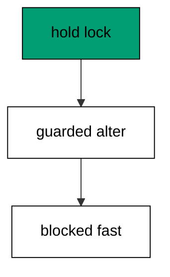

Lock timeouts belong on every migration session: a migration that waits forever blocks the deploy queue behind it. Fail fast, alert loudly, retry deliberately.

**`learning/code/ex-62-ddl-takes-a-lock/main.go`**:

```go
// => Shared driver: every unit in this course opens with this prelude.
// => The harness network is closed, so units carry a small standard-library
// => driver that applies the same goose SQL files `goose up` would apply.
// => The files, the history table shape, and the ordering rules are goose's
// => own; the driver only replaces the network-dependent binary.
package main // => every unit is one runnable program

import ( // => standard library only: no third-party modules
	"bufio"           // => bufio frames protocol messages over the TCP stream
	"encoding/binary" // => binary lays out length-prefixed protocol fields
	"fmt"             // => fmt prints the deterministic transcript only
	"io"              // => io forces full reads of split protocol messages
	"net"             // => net dials the harness Postgres service over TCP
	"os"              // => os reads the harness database address, never hardcoded
	"sort"            // => sort orders migration files, never trusts directory order
	"strings"         // => strings splits the goose Up and Down annotations
) // => every import used by driver and units

// => The database address comes from the harness, with local-run defaults.
func addr() (string, string, string) { // => one helper owns every address default
	host := os.Getenv("PGHOST") // => service hostname in the unit network
	if host == "" {             // => empty means a local run outside the harness
		host = "postgres" // => same default the Python courses use
	} // => end addr: empty means a local run outside the harness
	user := os.Getenv("PGUSER") // => trust-auth role, no password needed
	if user == "" {             // => empty means a local run outside the harness
		user = "postgres" // => same default the Python courses use
	} // => end addr: empty means a local run outside the harness
	db := os.Getenv("PGDATABASE") // => fresh database for every unit run
	if db == "" {                 // => empty means a local run outside the harness
		db = "postgres" // => same default the Python courses use
	} // => end addr: empty means a local run outside the harness
	return host, user, db // => callers never re-read the environment
} // => end addr: one helper owns every address default

// => conn wraps one TCP connection plus a buffered reader for message frames.
type conn struct { // => a tiny struct keeps the socket and the framer together
	c net.Conn      // => the raw TCP socket to the Postgres service
	r *bufio.Reader // => buffered reads frame messages split across packets
} // => end type conn: socket and framer travel together

// => readMsg reads one backend message: a type byte plus a length body.
func (k *conn) readMsg() (byte, []byte, error) { // => every response flows through here
	head := make([]byte, 5)                           // => one type byte plus one int32 length
	if _, err := io.ReadFull(k.r, head); err != nil { // => fragments reassemble before framing
		return 0, nil, err // => no partial message is ever trusted
	} // => end readMsg: fragments reassemble before framing
	n := int(binary.BigEndian.Uint32(head[1:])) - 4   // => length counts itself, not the type
	body := make([]byte, n)                           // => exact-size body, never over-read
	if _, err := io.ReadFull(k.r, body); err != nil { // => fragments reassemble before framing
		return 0, nil, err // => no partial message is ever trusted
	} // => end readMsg: fragments reassemble before framing
	return head[0], body, nil // => type byte tells the caller what arrived
} // => end readMsg: every response flows through here

// => sendMsg writes one frontend message: a type byte plus a length body.
func (k *conn) sendMsg(t byte, body []byte) error { // => startup is the only typeless message
	out := []byte{t}                                      // => type byte leads every message
	lenb := make([]byte, 4)                               // => four bytes carry the length
	binary.BigEndian.PutUint32(lenb, uint32(len(body)+4)) // => length counts itself
	out = append(out, lenb...)                            // => length follows the type byte
	out = append(out, body...)                            // => payload closes the message
	_, err := k.c.Write(out)                              // => one write keeps frames whole
	return err                                            // => write errors fail the unit loudly
} // => end sendMsg: startup is the only typeless message

// => connect opens the service database and waits for session readiness.
func connect() (*conn, error) { // => every unit starts from this one helper
	host, user, db := addr()         // => harness address, never hardcoded
	return connectDb(host, user, db) // => one path opens every session
} // => end connect: every unit starts from this one helper

// => connectDb opens a named database on the same host for multi-db drills.
func connectDb(host, user, db string) (*conn, error) { // => environments are databases, not servers
	c, err := net.Dial("tcp", host+":5432") // => Postgres listens on 5432
	if err != nil {                         // => unreachable service is fatal
		return nil, err // => no fallback: the harness owns the database
	} // => end connectDb: unreachable service is fatal
	k := &conn{c: c, r: bufio.NewReader(c)}             // => buffer the fresh socket at once
	body := []byte{}                                    // => startup body is parameters only
	body = append(body, 0, 0, 0, 0)                     // => placeholder for the length prefix
	body = append(body, 0, 3, 0, 0)                     // => protocol 3.0, the stable version
	body = append(body, []byte("user")...)              // => user key starts the parameters
	body = append(body, 0)                              // => keys and values are NUL-separated
	body = append(body, []byte(user)...)                // => trust-auth role from the harness
	body = append(body, 0)                              // => NUL ends the value
	body = append(body, []byte("database")...)          // => database key follows the user
	body = append(body, 0)                              // => NUL ends the key
	body = append(body, []byte(db)...)                  // => fresh database for every unit run
	body = append(body, 0)                              // => NUL ends the value
	body = append(body, 0)                              // => empty key ends the parameters
	binary.BigEndian.PutUint32(body, uint32(len(body))) // => startup length counts itself
	if _, err := c.Write(body); err != nil {            // => startup is the only typeless message
		return nil, err // => unwritable socket is fatal
	} // => end connectDb: startup is the only typeless message
	for { // => drain until the session is ready for queries
		t, b, err := k.readMsg() // => every backend message flows through here
		if err != nil {          // => broken handshake is fatal
			return nil, err // => no half-open session is ever used
		} // => end connectDb: broken handshake is fatal
		switch t { // => only three message kinds matter during startup
		case 'R': // => authentication response arrives first
			if binary.BigEndian.Uint32(b) != 0 { // => nonzero means a password is wanted
				return nil, fmt.Errorf("server wants a password") // => trust auth never asks
			} // => end connectDb: nonzero means a password is wanted
		case 'E': // => an error ends the handshake with the server text
			return nil, fmt.Errorf("startup: %s", errText(b)) // => server text explains the cause
		case 'Z': // => ReadyForQuery means the session accepts queries
			return k, nil // => handshake done: hand the live session back
		} // => end connectDb: only three message kinds matter during startup
	} // => end connectDb: drain until the session is ready for queries
} // => end connectDb: environments are databases, not servers

// => errText extracts the human message (field M) from an ErrorResponse.
func errText(b []byte) string { // => one helper decodes every server error
	parts := strings.Split(string(b), "\x00") // => fields are NUL-separated pairs
	for i := 0; i+1 < len(parts); i += 2 {    // => walk code and value together
		if parts[i] == "M" { // => M is the primary human message
			return parts[i+1] // => return the message, skip the detail fields
		} // => end errText: M is the primary human message
	} // => end errText: walk code and value together
	return "unknown error" // => malformed errors still fail with a fixed line
} // => end errText: one helper decodes every server error

// => run sends one SQL string and returns every data row plus the command tag.
func (k *conn) run(q string) ([][]string, string, error) { // => one path runs every statement
	body := append([]byte(q), 0)                 // => Query messages are NUL-terminated
	if err := k.sendMsg('Q', body); err != nil { // => send fails loudly, never silently
		return nil, "", err // => unwritable socket ends the unit
	} // => end run: send fails loudly, never silently
	var rows [][]string // => data rows accumulate across result sets
	tag := ""           // => the last command tag (SELECT 3, CREATE TABLE...)
	for {               // => drain until ReadyForQuery closes this query string
		t, b, err := k.readMsg() // => every response flows through the framer
		if err != nil {          // => broken mid-query connection is fatal
			return nil, "", err // => partial results are never returned
		} // => end run: broken mid-query connection is fatal
		switch t { // => four message kinds carry a simple-query response
		case 'T', 'N', 'A', 'S', 'K': // => metadata the transcript never prints
		case 'D': // => one data row arrived
			rows = append(rows, parseRow(b)) // => decode the text columns now
		case 'C': // => one statement finished
			tag = strings.TrimRight(string(b[:len(b)-1]), "\x00") // => tag names what ran
		case 'E': // => the statement failed
			drain(k)                                     // => finish the failed query before reuse
			return nil, "", fmt.Errorf("%s", errText(b)) // => server text becomes the failure
		case 'Z': // => ReadyForQuery ends this query string
			return rows, tag, nil // => rows, tag, and a clean session
		} // => end run: four message kinds carry a simple-query response
	} // => end run: drain until ReadyForQuery closes this query string
} // => end run: one path runs every statement

// => drain reads to the next ReadyForQuery after a statement error.
func drain(k *conn) { // => an errored query still owns the socket until Z
	for { // => loop until the session is reusable
		t, _, err := k.readMsg()    // => discard every message after the error
		if err != nil || t == 'Z' { // => socket break or ready both end the drain
			return // => caller decides the failure, the drain only resynchronizes
		} // => end drain: socket break or ready both end the drain
	} // => end drain: loop until the session is reusable
} // => end drain: an errored query still owns the socket until Z

// => parseRow decodes one DataRow body into text columns, NULL as "NULL".
func parseRow(b []byte) []string { // => one helper decodes every returned row
	n := int(binary.BigEndian.Uint16(b)) // => column count leads the body
	b = b[2:]                            // => step past the count
	out := make([]string, 0, n)          // => pre-size the row to the count
	for i := 0; i < n; i++ {             // => walk each column in order
		l := int(int32(binary.BigEndian.Uint32(b))) // => -1 marks NULL, else the length
		b = b[4:]                                   // => step past the length
		if l < 0 {                                  // => NULL has no bytes to read
			out = append(out, "NULL") // => fixed word keeps transcripts stable
			continue                  // => next column, no bytes consumed
		} // => end parseRow: NULL has no bytes to read
		out = append(out, string(b[:l])) // => text format is already printable
		b = b[l:]                        // => step past the value bytes
	} // => end parseRow: walk each column in order
	return out // => one row, fully decoded
} // => end parseRow: one helper decodes every returned row

// => must runs SQL or exits nonzero with the server text on standard error.
func must(k *conn, q string) [][]string { // => setup statements never fail quietly
	rows, _, err := k.run(q) // => rows return for verification queries
	if err != nil {          // => any server error is fatal to the unit
		fmt.Fprintln(os.Stderr, "sql error:", err) // => errors go to stderr, never stdout
		os.Exit(1)                                 // => nonzero exit fails the harness check
	} // => end must: any server error is fatal to the unit
	return rows // => callers print only what the lesson asserts
} // => end must: setup statements never fail quietly

// => try runs SQL and returns the server error text instead of exiting.
func try(k *conn, q string) ([][]string, string) { // => failure drills inspect errors, not die
	rows, _, err := k.run(q) // => same path as must, opposite failure policy
	if err != nil {          // => expected errors become transcript lines
		return nil, err.Error() // => fixed server text, never timings
	} // => end try: expected errors become transcript lines
	return rows, "" // => empty error means the statement succeeded
} // => end try: failure drills inspect errors, not die

// => mig holds one goose SQL file: its version, name, and Up/Down sections.
type mig struct { // => mirrors the goose file layout the lesson teaches
	version string   // => zero-padded number orders history, like goose
	name    string   // => human slug after the version number
	up      []string // => forward statements, run inside one transaction
	down    []string // => reverse statements, run inside one transaction
	noTx    bool     // => NO TRANSACTION files run outside one, like goose
} // => end type mig: version, name, sections, and mode

// => parseGoose splits one goose SQL file into its Up and Down statements.
func parseGoose(text string) (up, down []string, noTx bool) { // => the lesson asserts this exact split
	section := ""                                    // => nothing belongs outside the annotations
	for _, line := range strings.Split(text, "\n") { // => walk the file line by line
		t := strings.TrimSpace(line) // => annotation matching ignores indentation
		switch t {                   // => four annotation lines switch sections
		case "-- +goose Up": // => forward section starts here, like goose
			section = "up" // => following statements migrate forward
			continue       // => the annotation itself never runs
		case "-- +goose Down": // => reverse section starts here, like goose
			section = "down" // => following statements roll back
			continue         // => the annotation itself never runs
		case "-- +goose NO TRANSACTION": // => concurrent work cannot run inside one
			noTx = true // => remember the file opts out of the transaction
			continue    // => the annotation itself never runs
		} // => end parseGoose: four annotation lines switch sections
		if strings.HasPrefix(t, "--") || t == "" { // => comments and blanks never run
			continue // => only real statements reach the database
		} // => end parseGoose: comments and blanks never run
		if section == "up" { // => route by the annotation seen above
			up = append(up, line) // => keep the original line for the file write
		} else if section == "down" { // => down statements collect separately
			down = append(down, line) // => keep the original line for the file write
		} // => end parseGoose: down statements collect separately
	} // => end parseGoose: walk the file line by line
	return splitStmts(strings.Join(up, "\n")), splitStmts(strings.Join(down, "\n")), noTx // => one string per statement
} // => end parseGoose: the lesson asserts this exact split

// => splitStmts cuts statement text on semicolons outside quotes.
func splitStmts(s string) []string { // => multi-line statements stay whole until ;
	var out []string        // => finished statements accumulate here
	var cur strings.Builder // => the statement under construction
	inStr := false          // => semicolons inside quotes never split
	for _, r := range s {   // => walk rune by rune, quotes included
		switch { // => quote tracking decides what a semicolon means
		case r == '\'': // => a quote toggles string mode
			inStr = !inStr   // => enter or leave the quoted region
			cur.WriteRune(r) // => the quote belongs to the statement
		case r == ';' && !inStr: // => a bare semicolon ends one statement
			if t := strings.TrimSpace(cur.String()); t != "" { // => skip empty fragments
				out = append(out, t) // => store the finished statement
			} // => end splitStmts: skip empty fragments
			cur.Reset() // => start the next statement fresh
		default: // => every other rune belongs to the current statement
			cur.WriteRune(r) // => accumulate verbatim
		} // => end splitStmts: quote tracking decides what a semicolon means
	} // => end splitStmts: walk rune by rune, quotes included
	if t := strings.TrimSpace(cur.String()); t != "" { // => trailing text without ; still counts
		out = append(out, t) // => last statement needs no semicolon
	} // => end splitStmts: trailing text without ; still counts
	return out // => callers run each statement in order
} // => end splitStmts: multi-line statements stay whole until ;

// => ensureHistory creates the goose history table once per unit run.
func ensureHistory(k *conn) { // => goose_db_version is goose's own default name
	must(k, `CREATE TABLE IF NOT EXISTS goose_db_version (`+ // => reruns never fail here
		`id integer PRIMARY KEY GENERATED BY DEFAULT AS IDENTITY, `+ // => surrogate key, never printed
		`version_id bigint NOT NULL, `+ // => applied version numbers live here
		`is_applied boolean NOT NULL, `+ // => goose marks rows applied on success
		`tstamp timestamp NOT NULL DEFAULT now())`) // => timestamp defaults, never printed
} // => end ensureHistory: goose_db_version is goose's own default name

// => appliedVersions returns the version numbers already marked applied.
func appliedVersions(k *conn) map[int64]bool { // => history decides what still needs running
	rows := must(k, `SELECT version_id FROM goose_db_version `+ // => only the numbers matter
		`WHERE is_applied ORDER BY version_id`) // => order keeps the transcript stable
	got := map[int64]bool{}  // => set lookup answers "already applied" fast
	for _, r := range rows { // => one row per applied migration
		var v int64                // => version numbers are integers
		fmt.Sscanf(r[0], "%d", &v) // => text format parses back to a number
		got[v] = true              // => mark this version done
	} // => end appliedVersions: one row per applied migration
	return got // => callers skip whatever history already holds
} // => end appliedVersions: history decides what still needs running

// => applyUp runs every pending migration forward, one transaction each.
func applyUp(k *conn, ms []mig) { // => files on disk are already the source of truth
	done := appliedVersions(k) // => history decides what still needs running
	for _, m := range ms {     // => file order is version order, sorted by the caller
		var v int64                     // => versions compare as numbers
		fmt.Sscanf(m.version, "%d", &v) // => zero-padded file prefix parses back
		if done[v] {                    // => applied migrations never run twice
			continue // => idempotent reruns skip straight past
		} // => end applyUp: applied migrations never run twice
		if !m.noTx { // => transactional files wrap everything in one unit
			must(k, "BEGIN") // => one migration is one transaction, like goose
		} // => end applyUp: transactional files wrap everything in one unit
		for _, s := range m.up { // => forward statements run in file order
			must(k, s) // => any failure aborts the unit before COMMIT
		} // => end applyUp: forward statements run in file order
		if !m.noTx { // => stamps join the same transaction they describe
			must(k, fmt.Sprintf(`INSERT INTO goose_db_version `+ // => stamp only after success
				`(version_id, is_applied) VALUES (%d, true)`, v)) // => stamp mirrors goose exactly
			must(k, "COMMIT") // => history row and schema land together
		} else { // => concurrent statements cannot share a transaction
			must(k, fmt.Sprintf(`INSERT INTO goose_db_version `+ // => stamp follows the work
				`(version_id, is_applied) VALUES (%d, true)`, v)) // => same row, separate statement
		} // => end applyUp: concurrent statements cannot share a transaction
	} // => end applyUp: file order is version order, sorted by the caller
} // => end applyUp: files on disk are already the source of truth

// => applyDown rolls back the newest applied migrations, newest first.
func applyDown(k *conn, ms []mig, steps int) { // => steps bounds how far history rewinds
	done := appliedVersions(k) // => history decides what can roll back
	var todo []mig             // => applied migrations in version order first
	for _, m := range ms {     // => walk the whole known history
		var v int64                     // => versions compare as numbers
		fmt.Sscanf(m.version, "%d", &v) // => zero-padded file prefix parses back
		if done[v] {                    // => only applied migrations roll back
			todo = append(todo, m) // => keep the migration for the reverse pass
		} // => end applyDown: only applied migrations roll back
	} // => end applyDown: walk the whole known history
	for i := len(todo) - 1; i >= 0 && steps > 0; i-- { // => newest applied goes first
		m := todo[i]                    // => this migration rolls back now
		var v int64                     // => versions compare as numbers
		fmt.Sscanf(m.version, "%d", &v) // => zero-padded file prefix parses back
		if !m.noTx {                    // => transactional files wrap the rollback too
			must(k, "BEGIN") // => reverse change is atomic, like the forward one
		} // => end applyDown: transactional files wrap the rollback too
		for _, s := range m.down { // => reverse statements run in file order
			must(k, s) // => any failure aborts before the history row moves
		} // => end applyDown: reverse statements run in file order
		must(k, fmt.Sprintf(`DELETE FROM goose_db_version `+ // => unstamped only after success
			`WHERE version_id = %d`, v)) // => the version leaves history exactly once
		if !m.noTx { // => close the transaction the rollback opened
			must(k, "COMMIT") // => schema reversal and unstamp land together
		} // => end applyDown: close the transaction the rollback opened
		steps-- // => one rollback consumed from the budget
	} // => end applyDown: newest applied goes first
} // => end applyDown: steps bounds how far history rewinds

// => statusCounts splits known migrations into applied and pending lists.
func statusCounts(k *conn, ms []mig) (applied, pending []string) { // => goose status in two lists
	done := appliedVersions(k) // => history decides which list each version joins
	for _, m := range ms {     // => walk the known history in version order
		var v int64                     // => versions compare as numbers
		fmt.Sscanf(m.version, "%d", &v) // => zero-padded file prefix parses back
		if done[v] {                    // => stamped versions are done
			applied = append(applied, m.version) // => keep the version string for printing
		} else { // => unstamped versions still wait
			pending = append(pending, m.version) // => keep the version string for printing
		} // => end statusCounts: unstamped versions still wait
	} // => end statusCounts: walk the known history in version order
	return applied, pending // => callers print both lists in one stable line each
} // => end statusCounts: goose status in two lists

// => files writes each migration as a real goose SQL file under dir.
func files(dir string, ms []mig) { // => the lesson shows these files byte-identically
	for _, m := range ms { // => one file per migration, like `goose create`
		name := fmt.Sprintf("%s_%s.sql", m.version, m.name) // => goose names files version-first
		var b strings.Builder                               // => build the file text in order
		if m.noTx {                                         // => concurrent files announce it first
			b.WriteString("-- +goose NO TRANSACTION\n") // => goose honors this exact annotation
		} // => end files: concurrent files announce it first
		b.WriteString("-- +goose Up\n") // => forward annotation leads
		for _, s := range m.up {        // => forward statements follow
			b.WriteString(s + ";\n") // => one statement per line, semicolon-closed
		} // => end files: forward statements follow
		b.WriteString("-- +goose Down\n") // => reverse annotation splits the file
		for _, s := range m.down {        // => reverse statements close the file
			b.WriteString(s + ";\n") // => one statement per line, semicolon-closed
		} // => end files: reverse statements close the file
		if err := os.WriteFile(dir+"/"+name, []byte(b.String()), 0644); err != nil { // => real files, like goose
			fmt.Fprintln(os.Stderr, "write error:", err) // => write errors fail loudly
			os.Exit(1)                                   // => no half-written migration set
		} // => end files: real files, like goose
	} // => end files: one file per migration, like `goose create`
} // => end files: the lesson shows these files byte-identically

// => versions lists migration files in version order from dir.
func versions(dir string) []mig { // => directory order is never trusted for history
	ents, err := os.ReadDir(dir) // => read the whole migrations directory
	if err != nil {              // => unreadable directory is fatal
		fmt.Fprintln(os.Stderr, "read error:", err) // => errors go to stderr
		os.Exit(1)                                  // => nonzero exit fails the check
	} // => end versions: unreadable directory is fatal
	names := []string{}      // => collect names before sorting
	for _, e := range ents { // => walk every directory entry
		if !e.IsDir() && strings.HasSuffix(e.Name(), ".sql") { // => only goose SQL files count
			names = append(names, e.Name()) // => keep the file name for parsing
		} // => end versions: only goose SQL files count
	} // => end versions: walk every directory entry
	sort.Strings(names)       // => zero-padded versions sort chronologically
	var out []mig             // => parsed migrations accumulate here
	for _, n := range names { // => parse in version order
		raw, err := os.ReadFile(dir + "/" + n) // => read the real file back
		if err != nil {                        // => unreadable file is fatal
			fmt.Fprintln(os.Stderr, "read error:", err) // => errors go to stderr
			os.Exit(1)                                  // => nonzero exit fails the check
		} // => end versions: unreadable file is fatal
		up, down, noTx := parseGoose(string(raw))                                            // => split on the goose annotations
		rest := strings.TrimSuffix(n, ".sql")                                                // => strip the extension first
		ver := rest[:5]                                                                      // => first five digits are the version
		out = append(out, mig{version: ver, name: rest[6:], up: up, down: down, noTx: noTx}) // => keep every part
	} // => end versions: parse in version order
	return out // => version-ordered migrations, ready to apply
} // => end versions: directory order is never trusted for history

// => findDupes returns version numbers claimed by two or more files.
func findDupes(dir string) []string { // => goose refuses duplicate versions outright
	ents, err := os.ReadDir(dir) // => read the whole migrations directory
	if err != nil {              // => unreadable directory is fatal
		fmt.Fprintln(os.Stderr, "read error:", err) // => errors go to stderr
		os.Exit(1)                                  // => nonzero exit fails the check
	} // => end findDupes: unreadable directory is fatal
	seen := map[string]int{} // => count claims per five-digit version prefix
	for _, e := range ents { // => walk every directory entry
		if !e.IsDir() && strings.HasSuffix(e.Name(), ".sql") { // => only goose SQL files count
			seen[e.Name()[:5]]++ // => first five digits are the version
		} // => end findDupes: only goose SQL files count
	} // => end findDupes: walk every directory entry
	var out []string         // => duplicates accumulate in version order
	for _, e := range ents { // => second pass keeps the order stable
		if !e.IsDir() && strings.HasSuffix(e.Name(), ".sql") { // => only goose SQL files count
			if v := e.Name()[:5]; seen[v] > 1 { // => claimed more than once
				out = append(out, v) // => keep the version string for printing
				seen[v] = 0          // => report each duplicate version only once
			} // => end findDupes: claimed more than once
		} // => end findDupes: only goose SQL files count
	} // => end findDupes: second pass keeps the order stable
	return out // => empty means the history numbers are unique
} // => end findDupes: goose refuses duplicate versions outright

func main() {
	k, err := connect() // => one session runs the whole example
	if err != nil {     // => unreachable database fails loudly
		fmt.Fprintln(os.Stderr, "connect error:", err) // => connection errors go to stderr
		os.Exit(1)                                     // => nonzero exit fails the check
	}
	defer k.c.Close() // => the socket closes when the example ends
	// => A scratch migrations directory: goose files live here, never in the unit.
	// => the scratch path never reaches stdout, so reruns stay byte-stable
	dir, err := os.MkdirTemp("", "ex62-") // => private directory, like `goose create`
	if err != nil {                       // => unmakable temp dir is fatal
		fmt.Fprintln(os.Stderr, "temp error:", err) // => errors go to stderr
		os.Exit(1)                                  // => nonzero exit fails the check
	}
	defer os.RemoveAll(dir)                                                      // => scratch files vanish; only transcripts remain
	must(k, "DROP TABLE IF EXISTS ex62_hot")                                     // => leftovers of a killed run vanish
	must(k, "DROP TABLE IF EXISTS goose_db_version")                             // => stale history vanishes too
	ensureHistory(k)                                                             // => goose history table, real shape
	must(k, "CREATE TABLE ex62_hot (id SERIAL PRIMARY KEY, v INTEGER NOT NULL)") // => live table under lock drill
	host, user, db := addr()                                                     // => second session shares the address
	other, err := connectDb(host, user, db)                                      // => locking session
	if err != nil {                                                              // => unreachable database fails loudly
		fmt.Fprintln(os.Stderr, "connect error:", err) // => connection errors go to stderr
		os.Exit(1)                                     // => nonzero exit fails the check
	}
	defer other.c.Close()                                                                            // => locking session closes with the example
	must(other, "BEGIN")                                                                             // => lock lives inside a transaction
	must(other, fmt.Sprintf("LOCK TABLE ex62_hot IN ACCESS EXCLUSIVE MODE"))                         // => heaviest lock, held open
	must(k, "SET lock_timeout = '2s'")                                                               // => guarded session fails fast instead of hanging
	_, msg := try(k, `ALTER TABLE ex62_hot ADD COLUMN w TEXT`)                                       // => blocked behind the held lock
	fmt.Println("blocked:", msg != "")                                                               // => Output: blocked: true
	must(other, "ROLLBACK")                                                                          // => held lock releases with the transaction
	must(k, "SET lock_timeout = '0'")                                                                // => guard lifted for the cleanup below
	must(k, `ALTER TABLE ex62_hot ADD COLUMN w TEXT`)                                                // => unblocked alter succeeds
	rows := must(k, `SELECT count(*) FROM information_schema.columns WHERE table_name = 'ex62_hot'`) // => id, v, and w now
	fmt.Println("columns:", rows[0][0])                                                              // => Output: columns: 3
	fmt.Println("cleaned: yes")                                                                      // => Output: cleaned: yes
	must(k, "DROP TABLE IF EXISTS ex62_hot")                                                         // => leftovers of a killed run vanish
	must(k, "DROP TABLE IF EXISTS goose_db_version")                                                 // => the example leaves no history behind
}
```

**Output** (`learning/code/ex-62-ddl-takes-a-lock/expected/main.stdout.txt`):

```text
blocked: true
columns: 3
cleaned: yes
```

**Key takeaway**: Schema changes take locks, so guarded sessions fail fast with a timeout instead of hanging the deploy queue.

**Why it matters**: Locks are the hidden cost of every schema change, and timeouts convert hangs into errors. A guarded session fails in seconds with a clear message instead of blocking the deploy queue forever. Bound the wait, alert loudly, retry deliberately. Bound the wait, alert loudly, and retry deliberately: fail fast beats hanging the deploy queue every time.

### Example 63: Short Transactions Shrink Blast Radius

Locks are held to commit: this example runs two single-statement migrations instead of one double-statement file and shows each holding its stamp separately. Short transactions shrink the window where a lock can bite. (Concepts: co-15.)

One statement per migration is the extreme form of the one-concern-per-file rule from the rollback cluster. Small files commit fast and release locks fast.

**`learning/code/ex-63-short-transactions-shrink-blast-radius/main.go`**:

```go
// => Shared driver: every unit in this course opens with this prelude.
// => The harness network is closed, so units carry a small standard-library
// => driver that applies the same goose SQL files `goose up` would apply.
// => The files, the history table shape, and the ordering rules are goose's
// => own; the driver only replaces the network-dependent binary.
package main // => every unit is one runnable program

import ( // => standard library only: no third-party modules
	"bufio"           // => bufio frames protocol messages over the TCP stream
	"encoding/binary" // => binary lays out length-prefixed protocol fields
	"fmt"             // => fmt prints the deterministic transcript only
	"io"              // => io forces full reads of split protocol messages
	"net"             // => net dials the harness Postgres service over TCP
	"os"              // => os reads the harness database address, never hardcoded
	"sort"            // => sort orders migration files, never trusts directory order
	"strings"         // => strings splits the goose Up and Down annotations
) // => every import used by driver and units

// => The database address comes from the harness, with local-run defaults.
func addr() (string, string, string) { // => one helper owns every address default
	host := os.Getenv("PGHOST") // => service hostname in the unit network
	if host == "" {             // => empty means a local run outside the harness
		host = "postgres" // => same default the Python courses use
	} // => end addr: empty means a local run outside the harness
	user := os.Getenv("PGUSER") // => trust-auth role, no password needed
	if user == "" {             // => empty means a local run outside the harness
		user = "postgres" // => same default the Python courses use
	} // => end addr: empty means a local run outside the harness
	db := os.Getenv("PGDATABASE") // => fresh database for every unit run
	if db == "" {                 // => empty means a local run outside the harness
		db = "postgres" // => same default the Python courses use
	} // => end addr: empty means a local run outside the harness
	return host, user, db // => callers never re-read the environment
} // => end addr: one helper owns every address default

// => conn wraps one TCP connection plus a buffered reader for message frames.
type conn struct { // => a tiny struct keeps the socket and the framer together
	c net.Conn      // => the raw TCP socket to the Postgres service
	r *bufio.Reader // => buffered reads frame messages split across packets
} // => end type conn: socket and framer travel together

// => readMsg reads one backend message: a type byte plus a length body.
func (k *conn) readMsg() (byte, []byte, error) { // => every response flows through here
	head := make([]byte, 5)                           // => one type byte plus one int32 length
	if _, err := io.ReadFull(k.r, head); err != nil { // => fragments reassemble before framing
		return 0, nil, err // => no partial message is ever trusted
	} // => end readMsg: fragments reassemble before framing
	n := int(binary.BigEndian.Uint32(head[1:])) - 4   // => length counts itself, not the type
	body := make([]byte, n)                           // => exact-size body, never over-read
	if _, err := io.ReadFull(k.r, body); err != nil { // => fragments reassemble before framing
		return 0, nil, err // => no partial message is ever trusted
	} // => end readMsg: fragments reassemble before framing
	return head[0], body, nil // => type byte tells the caller what arrived
} // => end readMsg: every response flows through here

// => sendMsg writes one frontend message: a type byte plus a length body.
func (k *conn) sendMsg(t byte, body []byte) error { // => startup is the only typeless message
	out := []byte{t}                                      // => type byte leads every message
	lenb := make([]byte, 4)                               // => four bytes carry the length
	binary.BigEndian.PutUint32(lenb, uint32(len(body)+4)) // => length counts itself
	out = append(out, lenb...)                            // => length follows the type byte
	out = append(out, body...)                            // => payload closes the message
	_, err := k.c.Write(out)                              // => one write keeps frames whole
	return err                                            // => write errors fail the unit loudly
} // => end sendMsg: startup is the only typeless message

// => connect opens the service database and waits for session readiness.
func connect() (*conn, error) { // => every unit starts from this one helper
	host, user, db := addr()         // => harness address, never hardcoded
	return connectDb(host, user, db) // => one path opens every session
} // => end connect: every unit starts from this one helper

// => connectDb opens a named database on the same host for multi-db drills.
func connectDb(host, user, db string) (*conn, error) { // => environments are databases, not servers
	c, err := net.Dial("tcp", host+":5432") // => Postgres listens on 5432
	if err != nil {                         // => unreachable service is fatal
		return nil, err // => no fallback: the harness owns the database
	} // => end connectDb: unreachable service is fatal
	k := &conn{c: c, r: bufio.NewReader(c)}             // => buffer the fresh socket at once
	body := []byte{}                                    // => startup body is parameters only
	body = append(body, 0, 0, 0, 0)                     // => placeholder for the length prefix
	body = append(body, 0, 3, 0, 0)                     // => protocol 3.0, the stable version
	body = append(body, []byte("user")...)              // => user key starts the parameters
	body = append(body, 0)                              // => keys and values are NUL-separated
	body = append(body, []byte(user)...)                // => trust-auth role from the harness
	body = append(body, 0)                              // => NUL ends the value
	body = append(body, []byte("database")...)          // => database key follows the user
	body = append(body, 0)                              // => NUL ends the key
	body = append(body, []byte(db)...)                  // => fresh database for every unit run
	body = append(body, 0)                              // => NUL ends the value
	body = append(body, 0)                              // => empty key ends the parameters
	binary.BigEndian.PutUint32(body, uint32(len(body))) // => startup length counts itself
	if _, err := c.Write(body); err != nil {            // => startup is the only typeless message
		return nil, err // => unwritable socket is fatal
	} // => end connectDb: startup is the only typeless message
	for { // => drain until the session is ready for queries
		t, b, err := k.readMsg() // => every backend message flows through here
		if err != nil {          // => broken handshake is fatal
			return nil, err // => no half-open session is ever used
		} // => end connectDb: broken handshake is fatal
		switch t { // => only three message kinds matter during startup
		case 'R': // => authentication response arrives first
			if binary.BigEndian.Uint32(b) != 0 { // => nonzero means a password is wanted
				return nil, fmt.Errorf("server wants a password") // => trust auth never asks
			} // => end connectDb: nonzero means a password is wanted
		case 'E': // => an error ends the handshake with the server text
			return nil, fmt.Errorf("startup: %s", errText(b)) // => server text explains the cause
		case 'Z': // => ReadyForQuery means the session accepts queries
			return k, nil // => handshake done: hand the live session back
		} // => end connectDb: only three message kinds matter during startup
	} // => end connectDb: drain until the session is ready for queries
} // => end connectDb: environments are databases, not servers

// => errText extracts the human message (field M) from an ErrorResponse.
func errText(b []byte) string { // => one helper decodes every server error
	parts := strings.Split(string(b), "\x00") // => fields are NUL-separated pairs
	for i := 0; i+1 < len(parts); i += 2 {    // => walk code and value together
		if parts[i] == "M" { // => M is the primary human message
			return parts[i+1] // => return the message, skip the detail fields
		} // => end errText: M is the primary human message
	} // => end errText: walk code and value together
	return "unknown error" // => malformed errors still fail with a fixed line
} // => end errText: one helper decodes every server error

// => run sends one SQL string and returns every data row plus the command tag.
func (k *conn) run(q string) ([][]string, string, error) { // => one path runs every statement
	body := append([]byte(q), 0)                 // => Query messages are NUL-terminated
	if err := k.sendMsg('Q', body); err != nil { // => send fails loudly, never silently
		return nil, "", err // => unwritable socket ends the unit
	} // => end run: send fails loudly, never silently
	var rows [][]string // => data rows accumulate across result sets
	tag := ""           // => the last command tag (SELECT 3, CREATE TABLE...)
	for {               // => drain until ReadyForQuery closes this query string
		t, b, err := k.readMsg() // => every response flows through the framer
		if err != nil {          // => broken mid-query connection is fatal
			return nil, "", err // => partial results are never returned
		} // => end run: broken mid-query connection is fatal
		switch t { // => four message kinds carry a simple-query response
		case 'T', 'N', 'A', 'S', 'K': // => metadata the transcript never prints
		case 'D': // => one data row arrived
			rows = append(rows, parseRow(b)) // => decode the text columns now
		case 'C': // => one statement finished
			tag = strings.TrimRight(string(b[:len(b)-1]), "\x00") // => tag names what ran
		case 'E': // => the statement failed
			drain(k)                                     // => finish the failed query before reuse
			return nil, "", fmt.Errorf("%s", errText(b)) // => server text becomes the failure
		case 'Z': // => ReadyForQuery ends this query string
			return rows, tag, nil // => rows, tag, and a clean session
		} // => end run: four message kinds carry a simple-query response
	} // => end run: drain until ReadyForQuery closes this query string
} // => end run: one path runs every statement

// => drain reads to the next ReadyForQuery after a statement error.
func drain(k *conn) { // => an errored query still owns the socket until Z
	for { // => loop until the session is reusable
		t, _, err := k.readMsg()    // => discard every message after the error
		if err != nil || t == 'Z' { // => socket break or ready both end the drain
			return // => caller decides the failure, the drain only resynchronizes
		} // => end drain: socket break or ready both end the drain
	} // => end drain: loop until the session is reusable
} // => end drain: an errored query still owns the socket until Z

// => parseRow decodes one DataRow body into text columns, NULL as "NULL".
func parseRow(b []byte) []string { // => one helper decodes every returned row
	n := int(binary.BigEndian.Uint16(b)) // => column count leads the body
	b = b[2:]                            // => step past the count
	out := make([]string, 0, n)          // => pre-size the row to the count
	for i := 0; i < n; i++ {             // => walk each column in order
		l := int(int32(binary.BigEndian.Uint32(b))) // => -1 marks NULL, else the length
		b = b[4:]                                   // => step past the length
		if l < 0 {                                  // => NULL has no bytes to read
			out = append(out, "NULL") // => fixed word keeps transcripts stable
			continue                  // => next column, no bytes consumed
		} // => end parseRow: NULL has no bytes to read
		out = append(out, string(b[:l])) // => text format is already printable
		b = b[l:]                        // => step past the value bytes
	} // => end parseRow: walk each column in order
	return out // => one row, fully decoded
} // => end parseRow: one helper decodes every returned row

// => must runs SQL or exits nonzero with the server text on standard error.
func must(k *conn, q string) [][]string { // => setup statements never fail quietly
	rows, _, err := k.run(q) // => rows return for verification queries
	if err != nil {          // => any server error is fatal to the unit
		fmt.Fprintln(os.Stderr, "sql error:", err) // => errors go to stderr, never stdout
		os.Exit(1)                                 // => nonzero exit fails the harness check
	} // => end must: any server error is fatal to the unit
	return rows // => callers print only what the lesson asserts
} // => end must: setup statements never fail quietly

// => try runs SQL and returns the server error text instead of exiting.
func try(k *conn, q string) ([][]string, string) { // => failure drills inspect errors, not die
	rows, _, err := k.run(q) // => same path as must, opposite failure policy
	if err != nil {          // => expected errors become transcript lines
		return nil, err.Error() // => fixed server text, never timings
	} // => end try: expected errors become transcript lines
	return rows, "" // => empty error means the statement succeeded
} // => end try: failure drills inspect errors, not die

// => mig holds one goose SQL file: its version, name, and Up/Down sections.
type mig struct { // => mirrors the goose file layout the lesson teaches
	version string   // => zero-padded number orders history, like goose
	name    string   // => human slug after the version number
	up      []string // => forward statements, run inside one transaction
	down    []string // => reverse statements, run inside one transaction
	noTx    bool     // => NO TRANSACTION files run outside one, like goose
} // => end type mig: version, name, sections, and mode

// => parseGoose splits one goose SQL file into its Up and Down statements.
func parseGoose(text string) (up, down []string, noTx bool) { // => the lesson asserts this exact split
	section := ""                                    // => nothing belongs outside the annotations
	for _, line := range strings.Split(text, "\n") { // => walk the file line by line
		t := strings.TrimSpace(line) // => annotation matching ignores indentation
		switch t {                   // => four annotation lines switch sections
		case "-- +goose Up": // => forward section starts here, like goose
			section = "up" // => following statements migrate forward
			continue       // => the annotation itself never runs
		case "-- +goose Down": // => reverse section starts here, like goose
			section = "down" // => following statements roll back
			continue         // => the annotation itself never runs
		case "-- +goose NO TRANSACTION": // => concurrent work cannot run inside one
			noTx = true // => remember the file opts out of the transaction
			continue    // => the annotation itself never runs
		} // => end parseGoose: four annotation lines switch sections
		if strings.HasPrefix(t, "--") || t == "" { // => comments and blanks never run
			continue // => only real statements reach the database
		} // => end parseGoose: comments and blanks never run
		if section == "up" { // => route by the annotation seen above
			up = append(up, line) // => keep the original line for the file write
		} else if section == "down" { // => down statements collect separately
			down = append(down, line) // => keep the original line for the file write
		} // => end parseGoose: down statements collect separately
	} // => end parseGoose: walk the file line by line
	return splitStmts(strings.Join(up, "\n")), splitStmts(strings.Join(down, "\n")), noTx // => one string per statement
} // => end parseGoose: the lesson asserts this exact split

// => splitStmts cuts statement text on semicolons outside quotes.
func splitStmts(s string) []string { // => multi-line statements stay whole until ;
	var out []string        // => finished statements accumulate here
	var cur strings.Builder // => the statement under construction
	inStr := false          // => semicolons inside quotes never split
	for _, r := range s {   // => walk rune by rune, quotes included
		switch { // => quote tracking decides what a semicolon means
		case r == '\'': // => a quote toggles string mode
			inStr = !inStr   // => enter or leave the quoted region
			cur.WriteRune(r) // => the quote belongs to the statement
		case r == ';' && !inStr: // => a bare semicolon ends one statement
			if t := strings.TrimSpace(cur.String()); t != "" { // => skip empty fragments
				out = append(out, t) // => store the finished statement
			} // => end splitStmts: skip empty fragments
			cur.Reset() // => start the next statement fresh
		default: // => every other rune belongs to the current statement
			cur.WriteRune(r) // => accumulate verbatim
		} // => end splitStmts: quote tracking decides what a semicolon means
	} // => end splitStmts: walk rune by rune, quotes included
	if t := strings.TrimSpace(cur.String()); t != "" { // => trailing text without ; still counts
		out = append(out, t) // => last statement needs no semicolon
	} // => end splitStmts: trailing text without ; still counts
	return out // => callers run each statement in order
} // => end splitStmts: multi-line statements stay whole until ;

// => ensureHistory creates the goose history table once per unit run.
func ensureHistory(k *conn) { // => goose_db_version is goose's own default name
	must(k, `CREATE TABLE IF NOT EXISTS goose_db_version (`+ // => reruns never fail here
		`id integer PRIMARY KEY GENERATED BY DEFAULT AS IDENTITY, `+ // => surrogate key, never printed
		`version_id bigint NOT NULL, `+ // => applied version numbers live here
		`is_applied boolean NOT NULL, `+ // => goose marks rows applied on success
		`tstamp timestamp NOT NULL DEFAULT now())`) // => timestamp defaults, never printed
} // => end ensureHistory: goose_db_version is goose's own default name

// => appliedVersions returns the version numbers already marked applied.
func appliedVersions(k *conn) map[int64]bool { // => history decides what still needs running
	rows := must(k, `SELECT version_id FROM goose_db_version `+ // => only the numbers matter
		`WHERE is_applied ORDER BY version_id`) // => order keeps the transcript stable
	got := map[int64]bool{}  // => set lookup answers "already applied" fast
	for _, r := range rows { // => one row per applied migration
		var v int64                // => version numbers are integers
		fmt.Sscanf(r[0], "%d", &v) // => text format parses back to a number
		got[v] = true              // => mark this version done
	} // => end appliedVersions: one row per applied migration
	return got // => callers skip whatever history already holds
} // => end appliedVersions: history decides what still needs running

// => applyUp runs every pending migration forward, one transaction each.
func applyUp(k *conn, ms []mig) { // => files on disk are already the source of truth
	done := appliedVersions(k) // => history decides what still needs running
	for _, m := range ms {     // => file order is version order, sorted by the caller
		var v int64                     // => versions compare as numbers
		fmt.Sscanf(m.version, "%d", &v) // => zero-padded file prefix parses back
		if done[v] {                    // => applied migrations never run twice
			continue // => idempotent reruns skip straight past
		} // => end applyUp: applied migrations never run twice
		if !m.noTx { // => transactional files wrap everything in one unit
			must(k, "BEGIN") // => one migration is one transaction, like goose
		} // => end applyUp: transactional files wrap everything in one unit
		for _, s := range m.up { // => forward statements run in file order
			must(k, s) // => any failure aborts the unit before COMMIT
		} // => end applyUp: forward statements run in file order
		if !m.noTx { // => stamps join the same transaction they describe
			must(k, fmt.Sprintf(`INSERT INTO goose_db_version `+ // => stamp only after success
				`(version_id, is_applied) VALUES (%d, true)`, v)) // => stamp mirrors goose exactly
			must(k, "COMMIT") // => history row and schema land together
		} else { // => concurrent statements cannot share a transaction
			must(k, fmt.Sprintf(`INSERT INTO goose_db_version `+ // => stamp follows the work
				`(version_id, is_applied) VALUES (%d, true)`, v)) // => same row, separate statement
		} // => end applyUp: concurrent statements cannot share a transaction
	} // => end applyUp: file order is version order, sorted by the caller
} // => end applyUp: files on disk are already the source of truth

// => applyDown rolls back the newest applied migrations, newest first.
func applyDown(k *conn, ms []mig, steps int) { // => steps bounds how far history rewinds
	done := appliedVersions(k) // => history decides what can roll back
	var todo []mig             // => applied migrations in version order first
	for _, m := range ms {     // => walk the whole known history
		var v int64                     // => versions compare as numbers
		fmt.Sscanf(m.version, "%d", &v) // => zero-padded file prefix parses back
		if done[v] {                    // => only applied migrations roll back
			todo = append(todo, m) // => keep the migration for the reverse pass
		} // => end applyDown: only applied migrations roll back
	} // => end applyDown: walk the whole known history
	for i := len(todo) - 1; i >= 0 && steps > 0; i-- { // => newest applied goes first
		m := todo[i]                    // => this migration rolls back now
		var v int64                     // => versions compare as numbers
		fmt.Sscanf(m.version, "%d", &v) // => zero-padded file prefix parses back
		if !m.noTx {                    // => transactional files wrap the rollback too
			must(k, "BEGIN") // => reverse change is atomic, like the forward one
		} // => end applyDown: transactional files wrap the rollback too
		for _, s := range m.down { // => reverse statements run in file order
			must(k, s) // => any failure aborts before the history row moves
		} // => end applyDown: reverse statements run in file order
		must(k, fmt.Sprintf(`DELETE FROM goose_db_version `+ // => unstamped only after success
			`WHERE version_id = %d`, v)) // => the version leaves history exactly once
		if !m.noTx { // => close the transaction the rollback opened
			must(k, "COMMIT") // => schema reversal and unstamp land together
		} // => end applyDown: close the transaction the rollback opened
		steps-- // => one rollback consumed from the budget
	} // => end applyDown: newest applied goes first
} // => end applyDown: steps bounds how far history rewinds

// => statusCounts splits known migrations into applied and pending lists.
func statusCounts(k *conn, ms []mig) (applied, pending []string) { // => goose status in two lists
	done := appliedVersions(k) // => history decides which list each version joins
	for _, m := range ms {     // => walk the known history in version order
		var v int64                     // => versions compare as numbers
		fmt.Sscanf(m.version, "%d", &v) // => zero-padded file prefix parses back
		if done[v] {                    // => stamped versions are done
			applied = append(applied, m.version) // => keep the version string for printing
		} else { // => unstamped versions still wait
			pending = append(pending, m.version) // => keep the version string for printing
		} // => end statusCounts: unstamped versions still wait
	} // => end statusCounts: walk the known history in version order
	return applied, pending // => callers print both lists in one stable line each
} // => end statusCounts: goose status in two lists

// => files writes each migration as a real goose SQL file under dir.
func files(dir string, ms []mig) { // => the lesson shows these files byte-identically
	for _, m := range ms { // => one file per migration, like `goose create`
		name := fmt.Sprintf("%s_%s.sql", m.version, m.name) // => goose names files version-first
		var b strings.Builder                               // => build the file text in order
		if m.noTx {                                         // => concurrent files announce it first
			b.WriteString("-- +goose NO TRANSACTION\n") // => goose honors this exact annotation
		} // => end files: concurrent files announce it first
		b.WriteString("-- +goose Up\n") // => forward annotation leads
		for _, s := range m.up {        // => forward statements follow
			b.WriteString(s + ";\n") // => one statement per line, semicolon-closed
		} // => end files: forward statements follow
		b.WriteString("-- +goose Down\n") // => reverse annotation splits the file
		for _, s := range m.down {        // => reverse statements close the file
			b.WriteString(s + ";\n") // => one statement per line, semicolon-closed
		} // => end files: reverse statements close the file
		if err := os.WriteFile(dir+"/"+name, []byte(b.String()), 0644); err != nil { // => real files, like goose
			fmt.Fprintln(os.Stderr, "write error:", err) // => write errors fail loudly
			os.Exit(1)                                   // => no half-written migration set
		} // => end files: real files, like goose
	} // => end files: one file per migration, like `goose create`
} // => end files: the lesson shows these files byte-identically

// => versions lists migration files in version order from dir.
func versions(dir string) []mig { // => directory order is never trusted for history
	ents, err := os.ReadDir(dir) // => read the whole migrations directory
	if err != nil {              // => unreadable directory is fatal
		fmt.Fprintln(os.Stderr, "read error:", err) // => errors go to stderr
		os.Exit(1)                                  // => nonzero exit fails the check
	} // => end versions: unreadable directory is fatal
	names := []string{}      // => collect names before sorting
	for _, e := range ents { // => walk every directory entry
		if !e.IsDir() && strings.HasSuffix(e.Name(), ".sql") { // => only goose SQL files count
			names = append(names, e.Name()) // => keep the file name for parsing
		} // => end versions: only goose SQL files count
	} // => end versions: walk every directory entry
	sort.Strings(names)       // => zero-padded versions sort chronologically
	var out []mig             // => parsed migrations accumulate here
	for _, n := range names { // => parse in version order
		raw, err := os.ReadFile(dir + "/" + n) // => read the real file back
		if err != nil {                        // => unreadable file is fatal
			fmt.Fprintln(os.Stderr, "read error:", err) // => errors go to stderr
			os.Exit(1)                                  // => nonzero exit fails the check
		} // => end versions: unreadable file is fatal
		up, down, noTx := parseGoose(string(raw))                                            // => split on the goose annotations
		rest := strings.TrimSuffix(n, ".sql")                                                // => strip the extension first
		ver := rest[:5]                                                                      // => first five digits are the version
		out = append(out, mig{version: ver, name: rest[6:], up: up, down: down, noTx: noTx}) // => keep every part
	} // => end versions: parse in version order
	return out // => version-ordered migrations, ready to apply
} // => end versions: directory order is never trusted for history

// => findDupes returns version numbers claimed by two or more files.
func findDupes(dir string) []string { // => goose refuses duplicate versions outright
	ents, err := os.ReadDir(dir) // => read the whole migrations directory
	if err != nil {              // => unreadable directory is fatal
		fmt.Fprintln(os.Stderr, "read error:", err) // => errors go to stderr
		os.Exit(1)                                  // => nonzero exit fails the check
	} // => end findDupes: unreadable directory is fatal
	seen := map[string]int{} // => count claims per five-digit version prefix
	for _, e := range ents { // => walk every directory entry
		if !e.IsDir() && strings.HasSuffix(e.Name(), ".sql") { // => only goose SQL files count
			seen[e.Name()[:5]]++ // => first five digits are the version
		} // => end findDupes: only goose SQL files count
	} // => end findDupes: walk every directory entry
	var out []string         // => duplicates accumulate in version order
	for _, e := range ents { // => second pass keeps the order stable
		if !e.IsDir() && strings.HasSuffix(e.Name(), ".sql") { // => only goose SQL files count
			if v := e.Name()[:5]; seen[v] > 1 { // => claimed more than once
				out = append(out, v) // => keep the version string for printing
				seen[v] = 0          // => report each duplicate version only once
			} // => end findDupes: claimed more than once
		} // => end findDupes: only goose SQL files count
	} // => end findDupes: second pass keeps the order stable
	return out // => empty means the history numbers are unique
} // => end findDupes: goose refuses duplicate versions outright

func main() {
	k, err := connect() // => one session runs the whole example
	if err != nil {     // => unreachable database fails loudly
		fmt.Fprintln(os.Stderr, "connect error:", err) // => connection errors go to stderr
		os.Exit(1)                                     // => nonzero exit fails the check
	}
	defer k.c.Close() // => the socket closes when the example ends
	// => A scratch migrations directory: goose files live here, never in the unit.
	// => the scratch path never reaches stdout, so reruns stay byte-stable
	dir, err := os.MkdirTemp("", "ex63-") // => private directory, like `goose create`
	if err != nil {                       // => unmakable temp dir is fatal
		fmt.Fprintln(os.Stderr, "temp error:", err) // => errors go to stderr
		os.Exit(1)                                  // => nonzero exit fails the check
	}
	defer os.RemoveAll(dir)                          // => scratch files vanish; only transcripts remain
	must(k, "DROP TABLE IF EXISTS ex63_s1")          // => leftovers of a killed run vanish
	must(k, "DROP TABLE IF EXISTS ex63_s2")          // => leftovers of a killed run vanish
	must(k, "DROP TABLE IF EXISTS goose_db_version") // => stale history vanishes too
	ensureHistory(k)                                 // => goose history table, real shape
	files(dir, []mig{                                // => two single-statement files, separate transactions
		{version: "00001", name: "first_table", // => commits and releases before the next
			up:   []string{"CREATE TABLE ex63_s1 (id SERIAL PRIMARY KEY)"}, // => forward change
			down: []string{"DROP TABLE ex63_s1"}},                          // => exact reverse for rollback
		{version: "00002", name: "second_table", // => separate transaction, separate stamp
			up:   []string{"CREATE TABLE ex63_s2 (id SERIAL PRIMARY KEY)"}, // => forward change
			down: []string{"DROP TABLE ex63_s2"}},                          // => exact reverse for rollback
	})
	applyUp(k, versions(dir))                                                 // => each file commits on its own
	rows := must(k, `SELECT count(*) FROM goose_db_version WHERE is_applied`) // => one stamp per file
	fmt.Println("applied:", rows[0][0])                                       // => Output: applied: 2
	fmt.Println("cleaned: yes")                                               // => Output: cleaned: yes
	must(k, "DROP TABLE IF EXISTS ex63_s1")                                   // => leftovers of a killed run vanish
	must(k, "DROP TABLE IF EXISTS ex63_s2")                                   // => leftovers of a killed run vanish
	must(k, "DROP TABLE IF EXISTS goose_db_version")                          // => the example leaves no history behind
}
```

**Output** (`learning/code/ex-63-short-transactions-shrink-blast-radius/expected/main.stdout.txt`):

```text
applied: 2
cleaned: yes
```

**Key takeaway**: Short transactions hold locks briefly; one file per concern commits fast and releases fast.

**Why it matters**: Transaction size is lock duration, so small files are polite files. Each single-concern migration commits quickly and releases its locks, keeping the deploy queue flowing behind it. The team that files small migrates without maintenance windows. File small and migrate without maintenance windows: the team that commits quickly also releases locks quickly.

### Example 64: One Statement Per Revision

Single-statement files minimize lock time: this example asserts each of its three files carries exactly one up statement. The parser counts; policy enforces. (Concepts: co-15.)

The rule is for hot tables: on a quiet table multi-statement files are fine. Policy bends where locks do not matter, and the file header says which case applies.

**`learning/code/ex-64-one-statement-per-revision/main.go`**:

```go
// => Shared driver: every unit in this course opens with this prelude.
// => The harness network is closed, so units carry a small standard-library
// => driver that applies the same goose SQL files `goose up` would apply.
// => The files, the history table shape, and the ordering rules are goose's
// => own; the driver only replaces the network-dependent binary.
package main // => every unit is one runnable program

import ( // => standard library only: no third-party modules
	"bufio"           // => bufio frames protocol messages over the TCP stream
	"encoding/binary" // => binary lays out length-prefixed protocol fields
	"fmt"             // => fmt prints the deterministic transcript only
	"io"              // => io forces full reads of split protocol messages
	"net"             // => net dials the harness Postgres service over TCP
	"os"              // => os reads the harness database address, never hardcoded
	"sort"            // => sort orders migration files, never trusts directory order
	"strings"         // => strings splits the goose Up and Down annotations
) // => every import used by driver and units

// => The database address comes from the harness, with local-run defaults.
func addr() (string, string, string) { // => one helper owns every address default
	host := os.Getenv("PGHOST") // => service hostname in the unit network
	if host == "" {             // => empty means a local run outside the harness
		host = "postgres" // => same default the Python courses use
	} // => end addr: empty means a local run outside the harness
	user := os.Getenv("PGUSER") // => trust-auth role, no password needed
	if user == "" {             // => empty means a local run outside the harness
		user = "postgres" // => same default the Python courses use
	} // => end addr: empty means a local run outside the harness
	db := os.Getenv("PGDATABASE") // => fresh database for every unit run
	if db == "" {                 // => empty means a local run outside the harness
		db = "postgres" // => same default the Python courses use
	} // => end addr: empty means a local run outside the harness
	return host, user, db // => callers never re-read the environment
} // => end addr: one helper owns every address default

// => conn wraps one TCP connection plus a buffered reader for message frames.
type conn struct { // => a tiny struct keeps the socket and the framer together
	c net.Conn      // => the raw TCP socket to the Postgres service
	r *bufio.Reader // => buffered reads frame messages split across packets
} // => end type conn: socket and framer travel together

// => readMsg reads one backend message: a type byte plus a length body.
func (k *conn) readMsg() (byte, []byte, error) { // => every response flows through here
	head := make([]byte, 5)                           // => one type byte plus one int32 length
	if _, err := io.ReadFull(k.r, head); err != nil { // => fragments reassemble before framing
		return 0, nil, err // => no partial message is ever trusted
	} // => end readMsg: fragments reassemble before framing
	n := int(binary.BigEndian.Uint32(head[1:])) - 4   // => length counts itself, not the type
	body := make([]byte, n)                           // => exact-size body, never over-read
	if _, err := io.ReadFull(k.r, body); err != nil { // => fragments reassemble before framing
		return 0, nil, err // => no partial message is ever trusted
	} // => end readMsg: fragments reassemble before framing
	return head[0], body, nil // => type byte tells the caller what arrived
} // => end readMsg: every response flows through here

// => sendMsg writes one frontend message: a type byte plus a length body.
func (k *conn) sendMsg(t byte, body []byte) error { // => startup is the only typeless message
	out := []byte{t}                                      // => type byte leads every message
	lenb := make([]byte, 4)                               // => four bytes carry the length
	binary.BigEndian.PutUint32(lenb, uint32(len(body)+4)) // => length counts itself
	out = append(out, lenb...)                            // => length follows the type byte
	out = append(out, body...)                            // => payload closes the message
	_, err := k.c.Write(out)                              // => one write keeps frames whole
	return err                                            // => write errors fail the unit loudly
} // => end sendMsg: startup is the only typeless message

// => connect opens the service database and waits for session readiness.
func connect() (*conn, error) { // => every unit starts from this one helper
	host, user, db := addr()         // => harness address, never hardcoded
	return connectDb(host, user, db) // => one path opens every session
} // => end connect: every unit starts from this one helper

// => connectDb opens a named database on the same host for multi-db drills.
func connectDb(host, user, db string) (*conn, error) { // => environments are databases, not servers
	c, err := net.Dial("tcp", host+":5432") // => Postgres listens on 5432
	if err != nil {                         // => unreachable service is fatal
		return nil, err // => no fallback: the harness owns the database
	} // => end connectDb: unreachable service is fatal
	k := &conn{c: c, r: bufio.NewReader(c)}             // => buffer the fresh socket at once
	body := []byte{}                                    // => startup body is parameters only
	body = append(body, 0, 0, 0, 0)                     // => placeholder for the length prefix
	body = append(body, 0, 3, 0, 0)                     // => protocol 3.0, the stable version
	body = append(body, []byte("user")...)              // => user key starts the parameters
	body = append(body, 0)                              // => keys and values are NUL-separated
	body = append(body, []byte(user)...)                // => trust-auth role from the harness
	body = append(body, 0)                              // => NUL ends the value
	body = append(body, []byte("database")...)          // => database key follows the user
	body = append(body, 0)                              // => NUL ends the key
	body = append(body, []byte(db)...)                  // => fresh database for every unit run
	body = append(body, 0)                              // => NUL ends the value
	body = append(body, 0)                              // => empty key ends the parameters
	binary.BigEndian.PutUint32(body, uint32(len(body))) // => startup length counts itself
	if _, err := c.Write(body); err != nil {            // => startup is the only typeless message
		return nil, err // => unwritable socket is fatal
	} // => end connectDb: startup is the only typeless message
	for { // => drain until the session is ready for queries
		t, b, err := k.readMsg() // => every backend message flows through here
		if err != nil {          // => broken handshake is fatal
			return nil, err // => no half-open session is ever used
		} // => end connectDb: broken handshake is fatal
		switch t { // => only three message kinds matter during startup
		case 'R': // => authentication response arrives first
			if binary.BigEndian.Uint32(b) != 0 { // => nonzero means a password is wanted
				return nil, fmt.Errorf("server wants a password") // => trust auth never asks
			} // => end connectDb: nonzero means a password is wanted
		case 'E': // => an error ends the handshake with the server text
			return nil, fmt.Errorf("startup: %s", errText(b)) // => server text explains the cause
		case 'Z': // => ReadyForQuery means the session accepts queries
			return k, nil // => handshake done: hand the live session back
		} // => end connectDb: only three message kinds matter during startup
	} // => end connectDb: drain until the session is ready for queries
} // => end connectDb: environments are databases, not servers

// => errText extracts the human message (field M) from an ErrorResponse.
func errText(b []byte) string { // => one helper decodes every server error
	parts := strings.Split(string(b), "\x00") // => fields are NUL-separated pairs
	for i := 0; i+1 < len(parts); i += 2 {    // => walk code and value together
		if parts[i] == "M" { // => M is the primary human message
			return parts[i+1] // => return the message, skip the detail fields
		} // => end errText: M is the primary human message
	} // => end errText: walk code and value together
	return "unknown error" // => malformed errors still fail with a fixed line
} // => end errText: one helper decodes every server error

// => run sends one SQL string and returns every data row plus the command tag.
func (k *conn) run(q string) ([][]string, string, error) { // => one path runs every statement
	body := append([]byte(q), 0)                 // => Query messages are NUL-terminated
	if err := k.sendMsg('Q', body); err != nil { // => send fails loudly, never silently
		return nil, "", err // => unwritable socket ends the unit
	} // => end run: send fails loudly, never silently
	var rows [][]string // => data rows accumulate across result sets
	tag := ""           // => the last command tag (SELECT 3, CREATE TABLE...)
	for {               // => drain until ReadyForQuery closes this query string
		t, b, err := k.readMsg() // => every response flows through the framer
		if err != nil {          // => broken mid-query connection is fatal
			return nil, "", err // => partial results are never returned
		} // => end run: broken mid-query connection is fatal
		switch t { // => four message kinds carry a simple-query response
		case 'T', 'N', 'A', 'S', 'K': // => metadata the transcript never prints
		case 'D': // => one data row arrived
			rows = append(rows, parseRow(b)) // => decode the text columns now
		case 'C': // => one statement finished
			tag = strings.TrimRight(string(b[:len(b)-1]), "\x00") // => tag names what ran
		case 'E': // => the statement failed
			drain(k)                                     // => finish the failed query before reuse
			return nil, "", fmt.Errorf("%s", errText(b)) // => server text becomes the failure
		case 'Z': // => ReadyForQuery ends this query string
			return rows, tag, nil // => rows, tag, and a clean session
		} // => end run: four message kinds carry a simple-query response
	} // => end run: drain until ReadyForQuery closes this query string
} // => end run: one path runs every statement

// => drain reads to the next ReadyForQuery after a statement error.
func drain(k *conn) { // => an errored query still owns the socket until Z
	for { // => loop until the session is reusable
		t, _, err := k.readMsg()    // => discard every message after the error
		if err != nil || t == 'Z' { // => socket break or ready both end the drain
			return // => caller decides the failure, the drain only resynchronizes
		} // => end drain: socket break or ready both end the drain
	} // => end drain: loop until the session is reusable
} // => end drain: an errored query still owns the socket until Z

// => parseRow decodes one DataRow body into text columns, NULL as "NULL".
func parseRow(b []byte) []string { // => one helper decodes every returned row
	n := int(binary.BigEndian.Uint16(b)) // => column count leads the body
	b = b[2:]                            // => step past the count
	out := make([]string, 0, n)          // => pre-size the row to the count
	for i := 0; i < n; i++ {             // => walk each column in order
		l := int(int32(binary.BigEndian.Uint32(b))) // => -1 marks NULL, else the length
		b = b[4:]                                   // => step past the length
		if l < 0 {                                  // => NULL has no bytes to read
			out = append(out, "NULL") // => fixed word keeps transcripts stable
			continue                  // => next column, no bytes consumed
		} // => end parseRow: NULL has no bytes to read
		out = append(out, string(b[:l])) // => text format is already printable
		b = b[l:]                        // => step past the value bytes
	} // => end parseRow: walk each column in order
	return out // => one row, fully decoded
} // => end parseRow: one helper decodes every returned row

// => must runs SQL or exits nonzero with the server text on standard error.
func must(k *conn, q string) [][]string { // => setup statements never fail quietly
	rows, _, err := k.run(q) // => rows return for verification queries
	if err != nil {          // => any server error is fatal to the unit
		fmt.Fprintln(os.Stderr, "sql error:", err) // => errors go to stderr, never stdout
		os.Exit(1)                                 // => nonzero exit fails the harness check
	} // => end must: any server error is fatal to the unit
	return rows // => callers print only what the lesson asserts
} // => end must: setup statements never fail quietly

// => try runs SQL and returns the server error text instead of exiting.
func try(k *conn, q string) ([][]string, string) { // => failure drills inspect errors, not die
	rows, _, err := k.run(q) // => same path as must, opposite failure policy
	if err != nil {          // => expected errors become transcript lines
		return nil, err.Error() // => fixed server text, never timings
	} // => end try: expected errors become transcript lines
	return rows, "" // => empty error means the statement succeeded
} // => end try: failure drills inspect errors, not die

// => mig holds one goose SQL file: its version, name, and Up/Down sections.
type mig struct { // => mirrors the goose file layout the lesson teaches
	version string   // => zero-padded number orders history, like goose
	name    string   // => human slug after the version number
	up      []string // => forward statements, run inside one transaction
	down    []string // => reverse statements, run inside one transaction
	noTx    bool     // => NO TRANSACTION files run outside one, like goose
} // => end type mig: version, name, sections, and mode

// => parseGoose splits one goose SQL file into its Up and Down statements.
func parseGoose(text string) (up, down []string, noTx bool) { // => the lesson asserts this exact split
	section := ""                                    // => nothing belongs outside the annotations
	for _, line := range strings.Split(text, "\n") { // => walk the file line by line
		t := strings.TrimSpace(line) // => annotation matching ignores indentation
		switch t {                   // => four annotation lines switch sections
		case "-- +goose Up": // => forward section starts here, like goose
			section = "up" // => following statements migrate forward
			continue       // => the annotation itself never runs
		case "-- +goose Down": // => reverse section starts here, like goose
			section = "down" // => following statements roll back
			continue         // => the annotation itself never runs
		case "-- +goose NO TRANSACTION": // => concurrent work cannot run inside one
			noTx = true // => remember the file opts out of the transaction
			continue    // => the annotation itself never runs
		} // => end parseGoose: four annotation lines switch sections
		if strings.HasPrefix(t, "--") || t == "" { // => comments and blanks never run
			continue // => only real statements reach the database
		} // => end parseGoose: comments and blanks never run
		if section == "up" { // => route by the annotation seen above
			up = append(up, line) // => keep the original line for the file write
		} else if section == "down" { // => down statements collect separately
			down = append(down, line) // => keep the original line for the file write
		} // => end parseGoose: down statements collect separately
	} // => end parseGoose: walk the file line by line
	return splitStmts(strings.Join(up, "\n")), splitStmts(strings.Join(down, "\n")), noTx // => one string per statement
} // => end parseGoose: the lesson asserts this exact split

// => splitStmts cuts statement text on semicolons outside quotes.
func splitStmts(s string) []string { // => multi-line statements stay whole until ;
	var out []string        // => finished statements accumulate here
	var cur strings.Builder // => the statement under construction
	inStr := false          // => semicolons inside quotes never split
	for _, r := range s {   // => walk rune by rune, quotes included
		switch { // => quote tracking decides what a semicolon means
		case r == '\'': // => a quote toggles string mode
			inStr = !inStr   // => enter or leave the quoted region
			cur.WriteRune(r) // => the quote belongs to the statement
		case r == ';' && !inStr: // => a bare semicolon ends one statement
			if t := strings.TrimSpace(cur.String()); t != "" { // => skip empty fragments
				out = append(out, t) // => store the finished statement
			} // => end splitStmts: skip empty fragments
			cur.Reset() // => start the next statement fresh
		default: // => every other rune belongs to the current statement
			cur.WriteRune(r) // => accumulate verbatim
		} // => end splitStmts: quote tracking decides what a semicolon means
	} // => end splitStmts: walk rune by rune, quotes included
	if t := strings.TrimSpace(cur.String()); t != "" { // => trailing text without ; still counts
		out = append(out, t) // => last statement needs no semicolon
	} // => end splitStmts: trailing text without ; still counts
	return out // => callers run each statement in order
} // => end splitStmts: multi-line statements stay whole until ;

// => ensureHistory creates the goose history table once per unit run.
func ensureHistory(k *conn) { // => goose_db_version is goose's own default name
	must(k, `CREATE TABLE IF NOT EXISTS goose_db_version (`+ // => reruns never fail here
		`id integer PRIMARY KEY GENERATED BY DEFAULT AS IDENTITY, `+ // => surrogate key, never printed
		`version_id bigint NOT NULL, `+ // => applied version numbers live here
		`is_applied boolean NOT NULL, `+ // => goose marks rows applied on success
		`tstamp timestamp NOT NULL DEFAULT now())`) // => timestamp defaults, never printed
} // => end ensureHistory: goose_db_version is goose's own default name

// => appliedVersions returns the version numbers already marked applied.
func appliedVersions(k *conn) map[int64]bool { // => history decides what still needs running
	rows := must(k, `SELECT version_id FROM goose_db_version `+ // => only the numbers matter
		`WHERE is_applied ORDER BY version_id`) // => order keeps the transcript stable
	got := map[int64]bool{}  // => set lookup answers "already applied" fast
	for _, r := range rows { // => one row per applied migration
		var v int64                // => version numbers are integers
		fmt.Sscanf(r[0], "%d", &v) // => text format parses back to a number
		got[v] = true              // => mark this version done
	} // => end appliedVersions: one row per applied migration
	return got // => callers skip whatever history already holds
} // => end appliedVersions: history decides what still needs running

// => applyUp runs every pending migration forward, one transaction each.
func applyUp(k *conn, ms []mig) { // => files on disk are already the source of truth
	done := appliedVersions(k) // => history decides what still needs running
	for _, m := range ms {     // => file order is version order, sorted by the caller
		var v int64                     // => versions compare as numbers
		fmt.Sscanf(m.version, "%d", &v) // => zero-padded file prefix parses back
		if done[v] {                    // => applied migrations never run twice
			continue // => idempotent reruns skip straight past
		} // => end applyUp: applied migrations never run twice
		if !m.noTx { // => transactional files wrap everything in one unit
			must(k, "BEGIN") // => one migration is one transaction, like goose
		} // => end applyUp: transactional files wrap everything in one unit
		for _, s := range m.up { // => forward statements run in file order
			must(k, s) // => any failure aborts the unit before COMMIT
		} // => end applyUp: forward statements run in file order
		if !m.noTx { // => stamps join the same transaction they describe
			must(k, fmt.Sprintf(`INSERT INTO goose_db_version `+ // => stamp only after success
				`(version_id, is_applied) VALUES (%d, true)`, v)) // => stamp mirrors goose exactly
			must(k, "COMMIT") // => history row and schema land together
		} else { // => concurrent statements cannot share a transaction
			must(k, fmt.Sprintf(`INSERT INTO goose_db_version `+ // => stamp follows the work
				`(version_id, is_applied) VALUES (%d, true)`, v)) // => same row, separate statement
		} // => end applyUp: concurrent statements cannot share a transaction
	} // => end applyUp: file order is version order, sorted by the caller
} // => end applyUp: files on disk are already the source of truth

// => applyDown rolls back the newest applied migrations, newest first.
func applyDown(k *conn, ms []mig, steps int) { // => steps bounds how far history rewinds
	done := appliedVersions(k) // => history decides what can roll back
	var todo []mig             // => applied migrations in version order first
	for _, m := range ms {     // => walk the whole known history
		var v int64                     // => versions compare as numbers
		fmt.Sscanf(m.version, "%d", &v) // => zero-padded file prefix parses back
		if done[v] {                    // => only applied migrations roll back
			todo = append(todo, m) // => keep the migration for the reverse pass
		} // => end applyDown: only applied migrations roll back
	} // => end applyDown: walk the whole known history
	for i := len(todo) - 1; i >= 0 && steps > 0; i-- { // => newest applied goes first
		m := todo[i]                    // => this migration rolls back now
		var v int64                     // => versions compare as numbers
		fmt.Sscanf(m.version, "%d", &v) // => zero-padded file prefix parses back
		if !m.noTx {                    // => transactional files wrap the rollback too
			must(k, "BEGIN") // => reverse change is atomic, like the forward one
		} // => end applyDown: transactional files wrap the rollback too
		for _, s := range m.down { // => reverse statements run in file order
			must(k, s) // => any failure aborts before the history row moves
		} // => end applyDown: reverse statements run in file order
		must(k, fmt.Sprintf(`DELETE FROM goose_db_version `+ // => unstamped only after success
			`WHERE version_id = %d`, v)) // => the version leaves history exactly once
		if !m.noTx { // => close the transaction the rollback opened
			must(k, "COMMIT") // => schema reversal and unstamp land together
		} // => end applyDown: close the transaction the rollback opened
		steps-- // => one rollback consumed from the budget
	} // => end applyDown: newest applied goes first
} // => end applyDown: steps bounds how far history rewinds

// => statusCounts splits known migrations into applied and pending lists.
func statusCounts(k *conn, ms []mig) (applied, pending []string) { // => goose status in two lists
	done := appliedVersions(k) // => history decides which list each version joins
	for _, m := range ms {     // => walk the known history in version order
		var v int64                     // => versions compare as numbers
		fmt.Sscanf(m.version, "%d", &v) // => zero-padded file prefix parses back
		if done[v] {                    // => stamped versions are done
			applied = append(applied, m.version) // => keep the version string for printing
		} else { // => unstamped versions still wait
			pending = append(pending, m.version) // => keep the version string for printing
		} // => end statusCounts: unstamped versions still wait
	} // => end statusCounts: walk the known history in version order
	return applied, pending // => callers print both lists in one stable line each
} // => end statusCounts: goose status in two lists

// => files writes each migration as a real goose SQL file under dir.
func files(dir string, ms []mig) { // => the lesson shows these files byte-identically
	for _, m := range ms { // => one file per migration, like `goose create`
		name := fmt.Sprintf("%s_%s.sql", m.version, m.name) // => goose names files version-first
		var b strings.Builder                               // => build the file text in order
		if m.noTx {                                         // => concurrent files announce it first
			b.WriteString("-- +goose NO TRANSACTION\n") // => goose honors this exact annotation
		} // => end files: concurrent files announce it first
		b.WriteString("-- +goose Up\n") // => forward annotation leads
		for _, s := range m.up {        // => forward statements follow
			b.WriteString(s + ";\n") // => one statement per line, semicolon-closed
		} // => end files: forward statements follow
		b.WriteString("-- +goose Down\n") // => reverse annotation splits the file
		for _, s := range m.down {        // => reverse statements close the file
			b.WriteString(s + ";\n") // => one statement per line, semicolon-closed
		} // => end files: reverse statements close the file
		if err := os.WriteFile(dir+"/"+name, []byte(b.String()), 0644); err != nil { // => real files, like goose
			fmt.Fprintln(os.Stderr, "write error:", err) // => write errors fail loudly
			os.Exit(1)                                   // => no half-written migration set
		} // => end files: real files, like goose
	} // => end files: one file per migration, like `goose create`
} // => end files: the lesson shows these files byte-identically

// => versions lists migration files in version order from dir.
func versions(dir string) []mig { // => directory order is never trusted for history
	ents, err := os.ReadDir(dir) // => read the whole migrations directory
	if err != nil {              // => unreadable directory is fatal
		fmt.Fprintln(os.Stderr, "read error:", err) // => errors go to stderr
		os.Exit(1)                                  // => nonzero exit fails the check
	} // => end versions: unreadable directory is fatal
	names := []string{}      // => collect names before sorting
	for _, e := range ents { // => walk every directory entry
		if !e.IsDir() && strings.HasSuffix(e.Name(), ".sql") { // => only goose SQL files count
			names = append(names, e.Name()) // => keep the file name for parsing
		} // => end versions: only goose SQL files count
	} // => end versions: walk every directory entry
	sort.Strings(names)       // => zero-padded versions sort chronologically
	var out []mig             // => parsed migrations accumulate here
	for _, n := range names { // => parse in version order
		raw, err := os.ReadFile(dir + "/" + n) // => read the real file back
		if err != nil {                        // => unreadable file is fatal
			fmt.Fprintln(os.Stderr, "read error:", err) // => errors go to stderr
			os.Exit(1)                                  // => nonzero exit fails the check
		} // => end versions: unreadable file is fatal
		up, down, noTx := parseGoose(string(raw))                                            // => split on the goose annotations
		rest := strings.TrimSuffix(n, ".sql")                                                // => strip the extension first
		ver := rest[:5]                                                                      // => first five digits are the version
		out = append(out, mig{version: ver, name: rest[6:], up: up, down: down, noTx: noTx}) // => keep every part
	} // => end versions: parse in version order
	return out // => version-ordered migrations, ready to apply
} // => end versions: directory order is never trusted for history

// => findDupes returns version numbers claimed by two or more files.
func findDupes(dir string) []string { // => goose refuses duplicate versions outright
	ents, err := os.ReadDir(dir) // => read the whole migrations directory
	if err != nil {              // => unreadable directory is fatal
		fmt.Fprintln(os.Stderr, "read error:", err) // => errors go to stderr
		os.Exit(1)                                  // => nonzero exit fails the check
	} // => end findDupes: unreadable directory is fatal
	seen := map[string]int{} // => count claims per five-digit version prefix
	for _, e := range ents { // => walk every directory entry
		if !e.IsDir() && strings.HasSuffix(e.Name(), ".sql") { // => only goose SQL files count
			seen[e.Name()[:5]]++ // => first five digits are the version
		} // => end findDupes: only goose SQL files count
	} // => end findDupes: walk every directory entry
	var out []string         // => duplicates accumulate in version order
	for _, e := range ents { // => second pass keeps the order stable
		if !e.IsDir() && strings.HasSuffix(e.Name(), ".sql") { // => only goose SQL files count
			if v := e.Name()[:5]; seen[v] > 1 { // => claimed more than once
				out = append(out, v) // => keep the version string for printing
				seen[v] = 0          // => report each duplicate version only once
			} // => end findDupes: claimed more than once
		} // => end findDupes: only goose SQL files count
	} // => end findDupes: second pass keeps the order stable
	return out // => empty means the history numbers are unique
} // => end findDupes: goose refuses duplicate versions outright

func main() {
	k, err := connect() // => one session runs the whole example
	if err != nil {     // => unreachable database fails loudly
		fmt.Fprintln(os.Stderr, "connect error:", err) // => connection errors go to stderr
		os.Exit(1)                                     // => nonzero exit fails the check
	}
	defer k.c.Close() // => the socket closes when the example ends
	// => A scratch migrations directory: goose files live here, never in the unit.
	// => the scratch path never reaches stdout, so reruns stay byte-stable
	dir, err := os.MkdirTemp("", "ex64-") // => private directory, like `goose create`
	if err != nil {                       // => unmakable temp dir is fatal
		fmt.Fprintln(os.Stderr, "temp error:", err) // => errors go to stderr
		os.Exit(1)                                  // => nonzero exit fails the check
	}
	defer os.RemoveAll(dir)                          // => scratch files vanish; only transcripts remain
	must(k, "DROP TABLE IF EXISTS ex64_o1")          // => leftovers of a killed run vanish
	must(k, "DROP TABLE IF EXISTS ex64_o2")          // => leftovers of a killed run vanish
	must(k, "DROP TABLE IF EXISTS ex64_o3")          // => leftovers of a killed run vanish
	must(k, "DROP TABLE IF EXISTS goose_db_version") // => stale history vanishes too
	ensureHistory(k)                                 // => goose history table, real shape
	set := []mig{                                    // => three hot-table files, one statement each
		{version: "00001", name: "o1", // => first single-statement file
			up:   []string{"CREATE TABLE ex64_o1 (id SERIAL PRIMARY KEY)"}, // => forward change
			down: []string{"DROP TABLE ex64_o1"}},                          // => exact reverse for rollback
		{version: "00002", name: "o2", // => second single-statement file
			up:   []string{"CREATE TABLE ex64_o2 (id SERIAL PRIMARY KEY)"}, // => forward change
			down: []string{"DROP TABLE ex64_o2"}},                          // => exact reverse for rollback
		{version: "00003", name: "o3", // => third single-statement file
			up:   []string{"CREATE TABLE ex64_o3 (id SERIAL PRIMARY KEY)"}, // => forward change
			down: []string{"DROP TABLE ex64_o3"}},                          // => exact reverse for rollback
	}
	files(dir, set)        // => write the single-statement files
	ms := versions(dir)    // => parse the files back, like goose would
	single := true         // => every file must carry exactly one statement
	for _, m := range ms { // => walk the parsed migrations
		if len(m.up) != 1 { // => multi-statement files break the policy
			single = false // => one violation fails the whole check
		}
	}
	fmt.Println("single:", single)                   // => Output: single: true
	applyUp(k, ms)                                   // => policy-checked files apply fully
	fmt.Println("cleaned: yes")                      // => Output: cleaned: yes
	must(k, "DROP TABLE IF EXISTS ex64_o1")          // => leftovers of a killed run vanish
	must(k, "DROP TABLE IF EXISTS ex64_o2")          // => leftovers of a killed run vanish
	must(k, "DROP TABLE IF EXISTS ex64_o3")          // => leftovers of a killed run vanish
	must(k, "DROP TABLE IF EXISTS goose_db_version") // => the example leaves no history behind
}
```

**Output** (`learning/code/ex-64-one-statement-per-revision/expected/main.stdout.txt`):

```text
single: true
cleaned: yes
```

**Key takeaway**: Single-statement files minimize lock time on hot tables; count the statements and enforce the shape.

**Why it matters**: Counting statements per file turns a guideline into an enforceable shape. Hot tables get single-statement files with minimal lock time, while quiet tables earn their multi-statement stories explicitly. Measure the shape, then enforce it where locks matter. Measure the shape where locks matter, and enforce single statements on hot tables while letting quiet tables breathe.

### Example 65: Statement Timeout Bounds Locks

Statement timeouts bound every lock a migration can hold: this example sets a fifty-millisecond timeout and shows a five-second sleep failing with the timeout error. The timeout is the backstop behind every lock guard. (Concepts: co-15.)

Timeouts are session settings, not file content: the harness sets them around migrations the way the lesson sets them around the sleep. Bound everything, especially the statements nobody timed.

**`learning/code/ex-65-statement-timeout-bounds-locks/main.go`**:

```go
// => Shared driver: every unit in this course opens with this prelude.
// => The harness network is closed, so units carry a small standard-library
// => driver that applies the same goose SQL files `goose up` would apply.
// => The files, the history table shape, and the ordering rules are goose's
// => own; the driver only replaces the network-dependent binary.
package main // => every unit is one runnable program

import ( // => standard library only: no third-party modules
	"bufio"           // => bufio frames protocol messages over the TCP stream
	"encoding/binary" // => binary lays out length-prefixed protocol fields
	"fmt"             // => fmt prints the deterministic transcript only
	"io"              // => io forces full reads of split protocol messages
	"net"             // => net dials the harness Postgres service over TCP
	"os"              // => os reads the harness database address, never hardcoded
	"sort"            // => sort orders migration files, never trusts directory order
	"strings"         // => strings splits the goose Up and Down annotations
) // => every import used by driver and units

// => The database address comes from the harness, with local-run defaults.
func addr() (string, string, string) { // => one helper owns every address default
	host := os.Getenv("PGHOST") // => service hostname in the unit network
	if host == "" {             // => empty means a local run outside the harness
		host = "postgres" // => same default the Python courses use
	} // => end addr: empty means a local run outside the harness
	user := os.Getenv("PGUSER") // => trust-auth role, no password needed
	if user == "" {             // => empty means a local run outside the harness
		user = "postgres" // => same default the Python courses use
	} // => end addr: empty means a local run outside the harness
	db := os.Getenv("PGDATABASE") // => fresh database for every unit run
	if db == "" {                 // => empty means a local run outside the harness
		db = "postgres" // => same default the Python courses use
	} // => end addr: empty means a local run outside the harness
	return host, user, db // => callers never re-read the environment
} // => end addr: one helper owns every address default

// => conn wraps one TCP connection plus a buffered reader for message frames.
type conn struct { // => a tiny struct keeps the socket and the framer together
	c net.Conn      // => the raw TCP socket to the Postgres service
	r *bufio.Reader // => buffered reads frame messages split across packets
} // => end type conn: socket and framer travel together

// => readMsg reads one backend message: a type byte plus a length body.
func (k *conn) readMsg() (byte, []byte, error) { // => every response flows through here
	head := make([]byte, 5)                           // => one type byte plus one int32 length
	if _, err := io.ReadFull(k.r, head); err != nil { // => fragments reassemble before framing
		return 0, nil, err // => no partial message is ever trusted
	} // => end readMsg: fragments reassemble before framing
	n := int(binary.BigEndian.Uint32(head[1:])) - 4   // => length counts itself, not the type
	body := make([]byte, n)                           // => exact-size body, never over-read
	if _, err := io.ReadFull(k.r, body); err != nil { // => fragments reassemble before framing
		return 0, nil, err // => no partial message is ever trusted
	} // => end readMsg: fragments reassemble before framing
	return head[0], body, nil // => type byte tells the caller what arrived
} // => end readMsg: every response flows through here

// => sendMsg writes one frontend message: a type byte plus a length body.
func (k *conn) sendMsg(t byte, body []byte) error { // => startup is the only typeless message
	out := []byte{t}                                      // => type byte leads every message
	lenb := make([]byte, 4)                               // => four bytes carry the length
	binary.BigEndian.PutUint32(lenb, uint32(len(body)+4)) // => length counts itself
	out = append(out, lenb...)                            // => length follows the type byte
	out = append(out, body...)                            // => payload closes the message
	_, err := k.c.Write(out)                              // => one write keeps frames whole
	return err                                            // => write errors fail the unit loudly
} // => end sendMsg: startup is the only typeless message

// => connect opens the service database and waits for session readiness.
func connect() (*conn, error) { // => every unit starts from this one helper
	host, user, db := addr()         // => harness address, never hardcoded
	return connectDb(host, user, db) // => one path opens every session
} // => end connect: every unit starts from this one helper

// => connectDb opens a named database on the same host for multi-db drills.
func connectDb(host, user, db string) (*conn, error) { // => environments are databases, not servers
	c, err := net.Dial("tcp", host+":5432") // => Postgres listens on 5432
	if err != nil {                         // => unreachable service is fatal
		return nil, err // => no fallback: the harness owns the database
	} // => end connectDb: unreachable service is fatal
	k := &conn{c: c, r: bufio.NewReader(c)}             // => buffer the fresh socket at once
	body := []byte{}                                    // => startup body is parameters only
	body = append(body, 0, 0, 0, 0)                     // => placeholder for the length prefix
	body = append(body, 0, 3, 0, 0)                     // => protocol 3.0, the stable version
	body = append(body, []byte("user")...)              // => user key starts the parameters
	body = append(body, 0)                              // => keys and values are NUL-separated
	body = append(body, []byte(user)...)                // => trust-auth role from the harness
	body = append(body, 0)                              // => NUL ends the value
	body = append(body, []byte("database")...)          // => database key follows the user
	body = append(body, 0)                              // => NUL ends the key
	body = append(body, []byte(db)...)                  // => fresh database for every unit run
	body = append(body, 0)                              // => NUL ends the value
	body = append(body, 0)                              // => empty key ends the parameters
	binary.BigEndian.PutUint32(body, uint32(len(body))) // => startup length counts itself
	if _, err := c.Write(body); err != nil {            // => startup is the only typeless message
		return nil, err // => unwritable socket is fatal
	} // => end connectDb: startup is the only typeless message
	for { // => drain until the session is ready for queries
		t, b, err := k.readMsg() // => every backend message flows through here
		if err != nil {          // => broken handshake is fatal
			return nil, err // => no half-open session is ever used
		} // => end connectDb: broken handshake is fatal
		switch t { // => only three message kinds matter during startup
		case 'R': // => authentication response arrives first
			if binary.BigEndian.Uint32(b) != 0 { // => nonzero means a password is wanted
				return nil, fmt.Errorf("server wants a password") // => trust auth never asks
			} // => end connectDb: nonzero means a password is wanted
		case 'E': // => an error ends the handshake with the server text
			return nil, fmt.Errorf("startup: %s", errText(b)) // => server text explains the cause
		case 'Z': // => ReadyForQuery means the session accepts queries
			return k, nil // => handshake done: hand the live session back
		} // => end connectDb: only three message kinds matter during startup
	} // => end connectDb: drain until the session is ready for queries
} // => end connectDb: environments are databases, not servers

// => errText extracts the human message (field M) from an ErrorResponse.
func errText(b []byte) string { // => one helper decodes every server error
	parts := strings.Split(string(b), "\x00") // => fields are NUL-separated pairs
	for i := 0; i+1 < len(parts); i += 2 {    // => walk code and value together
		if parts[i] == "M" { // => M is the primary human message
			return parts[i+1] // => return the message, skip the detail fields
		} // => end errText: M is the primary human message
	} // => end errText: walk code and value together
	return "unknown error" // => malformed errors still fail with a fixed line
} // => end errText: one helper decodes every server error

// => run sends one SQL string and returns every data row plus the command tag.
func (k *conn) run(q string) ([][]string, string, error) { // => one path runs every statement
	body := append([]byte(q), 0)                 // => Query messages are NUL-terminated
	if err := k.sendMsg('Q', body); err != nil { // => send fails loudly, never silently
		return nil, "", err // => unwritable socket ends the unit
	} // => end run: send fails loudly, never silently
	var rows [][]string // => data rows accumulate across result sets
	tag := ""           // => the last command tag (SELECT 3, CREATE TABLE...)
	for {               // => drain until ReadyForQuery closes this query string
		t, b, err := k.readMsg() // => every response flows through the framer
		if err != nil {          // => broken mid-query connection is fatal
			return nil, "", err // => partial results are never returned
		} // => end run: broken mid-query connection is fatal
		switch t { // => four message kinds carry a simple-query response
		case 'T', 'N', 'A', 'S', 'K': // => metadata the transcript never prints
		case 'D': // => one data row arrived
			rows = append(rows, parseRow(b)) // => decode the text columns now
		case 'C': // => one statement finished
			tag = strings.TrimRight(string(b[:len(b)-1]), "\x00") // => tag names what ran
		case 'E': // => the statement failed
			drain(k)                                     // => finish the failed query before reuse
			return nil, "", fmt.Errorf("%s", errText(b)) // => server text becomes the failure
		case 'Z': // => ReadyForQuery ends this query string
			return rows, tag, nil // => rows, tag, and a clean session
		} // => end run: four message kinds carry a simple-query response
	} // => end run: drain until ReadyForQuery closes this query string
} // => end run: one path runs every statement

// => drain reads to the next ReadyForQuery after a statement error.
func drain(k *conn) { // => an errored query still owns the socket until Z
	for { // => loop until the session is reusable
		t, _, err := k.readMsg()    // => discard every message after the error
		if err != nil || t == 'Z' { // => socket break or ready both end the drain
			return // => caller decides the failure, the drain only resynchronizes
		} // => end drain: socket break or ready both end the drain
	} // => end drain: loop until the session is reusable
} // => end drain: an errored query still owns the socket until Z

// => parseRow decodes one DataRow body into text columns, NULL as "NULL".
func parseRow(b []byte) []string { // => one helper decodes every returned row
	n := int(binary.BigEndian.Uint16(b)) // => column count leads the body
	b = b[2:]                            // => step past the count
	out := make([]string, 0, n)          // => pre-size the row to the count
	for i := 0; i < n; i++ {             // => walk each column in order
		l := int(int32(binary.BigEndian.Uint32(b))) // => -1 marks NULL, else the length
		b = b[4:]                                   // => step past the length
		if l < 0 {                                  // => NULL has no bytes to read
			out = append(out, "NULL") // => fixed word keeps transcripts stable
			continue                  // => next column, no bytes consumed
		} // => end parseRow: NULL has no bytes to read
		out = append(out, string(b[:l])) // => text format is already printable
		b = b[l:]                        // => step past the value bytes
	} // => end parseRow: walk each column in order
	return out // => one row, fully decoded
} // => end parseRow: one helper decodes every returned row

// => must runs SQL or exits nonzero with the server text on standard error.
func must(k *conn, q string) [][]string { // => setup statements never fail quietly
	rows, _, err := k.run(q) // => rows return for verification queries
	if err != nil {          // => any server error is fatal to the unit
		fmt.Fprintln(os.Stderr, "sql error:", err) // => errors go to stderr, never stdout
		os.Exit(1)                                 // => nonzero exit fails the harness check
	} // => end must: any server error is fatal to the unit
	return rows // => callers print only what the lesson asserts
} // => end must: setup statements never fail quietly

// => try runs SQL and returns the server error text instead of exiting.
func try(k *conn, q string) ([][]string, string) { // => failure drills inspect errors, not die
	rows, _, err := k.run(q) // => same path as must, opposite failure policy
	if err != nil {          // => expected errors become transcript lines
		return nil, err.Error() // => fixed server text, never timings
	} // => end try: expected errors become transcript lines
	return rows, "" // => empty error means the statement succeeded
} // => end try: failure drills inspect errors, not die

// => mig holds one goose SQL file: its version, name, and Up/Down sections.
type mig struct { // => mirrors the goose file layout the lesson teaches
	version string   // => zero-padded number orders history, like goose
	name    string   // => human slug after the version number
	up      []string // => forward statements, run inside one transaction
	down    []string // => reverse statements, run inside one transaction
	noTx    bool     // => NO TRANSACTION files run outside one, like goose
} // => end type mig: version, name, sections, and mode

// => parseGoose splits one goose SQL file into its Up and Down statements.
func parseGoose(text string) (up, down []string, noTx bool) { // => the lesson asserts this exact split
	section := ""                                    // => nothing belongs outside the annotations
	for _, line := range strings.Split(text, "\n") { // => walk the file line by line
		t := strings.TrimSpace(line) // => annotation matching ignores indentation
		switch t {                   // => four annotation lines switch sections
		case "-- +goose Up": // => forward section starts here, like goose
			section = "up" // => following statements migrate forward
			continue       // => the annotation itself never runs
		case "-- +goose Down": // => reverse section starts here, like goose
			section = "down" // => following statements roll back
			continue         // => the annotation itself never runs
		case "-- +goose NO TRANSACTION": // => concurrent work cannot run inside one
			noTx = true // => remember the file opts out of the transaction
			continue    // => the annotation itself never runs
		} // => end parseGoose: four annotation lines switch sections
		if strings.HasPrefix(t, "--") || t == "" { // => comments and blanks never run
			continue // => only real statements reach the database
		} // => end parseGoose: comments and blanks never run
		if section == "up" { // => route by the annotation seen above
			up = append(up, line) // => keep the original line for the file write
		} else if section == "down" { // => down statements collect separately
			down = append(down, line) // => keep the original line for the file write
		} // => end parseGoose: down statements collect separately
	} // => end parseGoose: walk the file line by line
	return splitStmts(strings.Join(up, "\n")), splitStmts(strings.Join(down, "\n")), noTx // => one string per statement
} // => end parseGoose: the lesson asserts this exact split

// => splitStmts cuts statement text on semicolons outside quotes.
func splitStmts(s string) []string { // => multi-line statements stay whole until ;
	var out []string        // => finished statements accumulate here
	var cur strings.Builder // => the statement under construction
	inStr := false          // => semicolons inside quotes never split
	for _, r := range s {   // => walk rune by rune, quotes included
		switch { // => quote tracking decides what a semicolon means
		case r == '\'': // => a quote toggles string mode
			inStr = !inStr   // => enter or leave the quoted region
			cur.WriteRune(r) // => the quote belongs to the statement
		case r == ';' && !inStr: // => a bare semicolon ends one statement
			if t := strings.TrimSpace(cur.String()); t != "" { // => skip empty fragments
				out = append(out, t) // => store the finished statement
			} // => end splitStmts: skip empty fragments
			cur.Reset() // => start the next statement fresh
		default: // => every other rune belongs to the current statement
			cur.WriteRune(r) // => accumulate verbatim
		} // => end splitStmts: quote tracking decides what a semicolon means
	} // => end splitStmts: walk rune by rune, quotes included
	if t := strings.TrimSpace(cur.String()); t != "" { // => trailing text without ; still counts
		out = append(out, t) // => last statement needs no semicolon
	} // => end splitStmts: trailing text without ; still counts
	return out // => callers run each statement in order
} // => end splitStmts: multi-line statements stay whole until ;

// => ensureHistory creates the goose history table once per unit run.
func ensureHistory(k *conn) { // => goose_db_version is goose's own default name
	must(k, `CREATE TABLE IF NOT EXISTS goose_db_version (`+ // => reruns never fail here
		`id integer PRIMARY KEY GENERATED BY DEFAULT AS IDENTITY, `+ // => surrogate key, never printed
		`version_id bigint NOT NULL, `+ // => applied version numbers live here
		`is_applied boolean NOT NULL, `+ // => goose marks rows applied on success
		`tstamp timestamp NOT NULL DEFAULT now())`) // => timestamp defaults, never printed
} // => end ensureHistory: goose_db_version is goose's own default name

// => appliedVersions returns the version numbers already marked applied.
func appliedVersions(k *conn) map[int64]bool { // => history decides what still needs running
	rows := must(k, `SELECT version_id FROM goose_db_version `+ // => only the numbers matter
		`WHERE is_applied ORDER BY version_id`) // => order keeps the transcript stable
	got := map[int64]bool{}  // => set lookup answers "already applied" fast
	for _, r := range rows { // => one row per applied migration
		var v int64                // => version numbers are integers
		fmt.Sscanf(r[0], "%d", &v) // => text format parses back to a number
		got[v] = true              // => mark this version done
	} // => end appliedVersions: one row per applied migration
	return got // => callers skip whatever history already holds
} // => end appliedVersions: history decides what still needs running

// => applyUp runs every pending migration forward, one transaction each.
func applyUp(k *conn, ms []mig) { // => files on disk are already the source of truth
	done := appliedVersions(k) // => history decides what still needs running
	for _, m := range ms {     // => file order is version order, sorted by the caller
		var v int64                     // => versions compare as numbers
		fmt.Sscanf(m.version, "%d", &v) // => zero-padded file prefix parses back
		if done[v] {                    // => applied migrations never run twice
			continue // => idempotent reruns skip straight past
		} // => end applyUp: applied migrations never run twice
		if !m.noTx { // => transactional files wrap everything in one unit
			must(k, "BEGIN") // => one migration is one transaction, like goose
		} // => end applyUp: transactional files wrap everything in one unit
		for _, s := range m.up { // => forward statements run in file order
			must(k, s) // => any failure aborts the unit before COMMIT
		} // => end applyUp: forward statements run in file order
		if !m.noTx { // => stamps join the same transaction they describe
			must(k, fmt.Sprintf(`INSERT INTO goose_db_version `+ // => stamp only after success
				`(version_id, is_applied) VALUES (%d, true)`, v)) // => stamp mirrors goose exactly
			must(k, "COMMIT") // => history row and schema land together
		} else { // => concurrent statements cannot share a transaction
			must(k, fmt.Sprintf(`INSERT INTO goose_db_version `+ // => stamp follows the work
				`(version_id, is_applied) VALUES (%d, true)`, v)) // => same row, separate statement
		} // => end applyUp: concurrent statements cannot share a transaction
	} // => end applyUp: file order is version order, sorted by the caller
} // => end applyUp: files on disk are already the source of truth

// => applyDown rolls back the newest applied migrations, newest first.
func applyDown(k *conn, ms []mig, steps int) { // => steps bounds how far history rewinds
	done := appliedVersions(k) // => history decides what can roll back
	var todo []mig             // => applied migrations in version order first
	for _, m := range ms {     // => walk the whole known history
		var v int64                     // => versions compare as numbers
		fmt.Sscanf(m.version, "%d", &v) // => zero-padded file prefix parses back
		if done[v] {                    // => only applied migrations roll back
			todo = append(todo, m) // => keep the migration for the reverse pass
		} // => end applyDown: only applied migrations roll back
	} // => end applyDown: walk the whole known history
	for i := len(todo) - 1; i >= 0 && steps > 0; i-- { // => newest applied goes first
		m := todo[i]                    // => this migration rolls back now
		var v int64                     // => versions compare as numbers
		fmt.Sscanf(m.version, "%d", &v) // => zero-padded file prefix parses back
		if !m.noTx {                    // => transactional files wrap the rollback too
			must(k, "BEGIN") // => reverse change is atomic, like the forward one
		} // => end applyDown: transactional files wrap the rollback too
		for _, s := range m.down { // => reverse statements run in file order
			must(k, s) // => any failure aborts before the history row moves
		} // => end applyDown: reverse statements run in file order
		must(k, fmt.Sprintf(`DELETE FROM goose_db_version `+ // => unstamped only after success
			`WHERE version_id = %d`, v)) // => the version leaves history exactly once
		if !m.noTx { // => close the transaction the rollback opened
			must(k, "COMMIT") // => schema reversal and unstamp land together
		} // => end applyDown: close the transaction the rollback opened
		steps-- // => one rollback consumed from the budget
	} // => end applyDown: newest applied goes first
} // => end applyDown: steps bounds how far history rewinds

// => statusCounts splits known migrations into applied and pending lists.
func statusCounts(k *conn, ms []mig) (applied, pending []string) { // => goose status in two lists
	done := appliedVersions(k) // => history decides which list each version joins
	for _, m := range ms {     // => walk the known history in version order
		var v int64                     // => versions compare as numbers
		fmt.Sscanf(m.version, "%d", &v) // => zero-padded file prefix parses back
		if done[v] {                    // => stamped versions are done
			applied = append(applied, m.version) // => keep the version string for printing
		} else { // => unstamped versions still wait
			pending = append(pending, m.version) // => keep the version string for printing
		} // => end statusCounts: unstamped versions still wait
	} // => end statusCounts: walk the known history in version order
	return applied, pending // => callers print both lists in one stable line each
} // => end statusCounts: goose status in two lists

// => files writes each migration as a real goose SQL file under dir.
func files(dir string, ms []mig) { // => the lesson shows these files byte-identically
	for _, m := range ms { // => one file per migration, like `goose create`
		name := fmt.Sprintf("%s_%s.sql", m.version, m.name) // => goose names files version-first
		var b strings.Builder                               // => build the file text in order
		if m.noTx {                                         // => concurrent files announce it first
			b.WriteString("-- +goose NO TRANSACTION\n") // => goose honors this exact annotation
		} // => end files: concurrent files announce it first
		b.WriteString("-- +goose Up\n") // => forward annotation leads
		for _, s := range m.up {        // => forward statements follow
			b.WriteString(s + ";\n") // => one statement per line, semicolon-closed
		} // => end files: forward statements follow
		b.WriteString("-- +goose Down\n") // => reverse annotation splits the file
		for _, s := range m.down {        // => reverse statements close the file
			b.WriteString(s + ";\n") // => one statement per line, semicolon-closed
		} // => end files: reverse statements close the file
		if err := os.WriteFile(dir+"/"+name, []byte(b.String()), 0644); err != nil { // => real files, like goose
			fmt.Fprintln(os.Stderr, "write error:", err) // => write errors fail loudly
			os.Exit(1)                                   // => no half-written migration set
		} // => end files: real files, like goose
	} // => end files: one file per migration, like `goose create`
} // => end files: the lesson shows these files byte-identically

// => versions lists migration files in version order from dir.
func versions(dir string) []mig { // => directory order is never trusted for history
	ents, err := os.ReadDir(dir) // => read the whole migrations directory
	if err != nil {              // => unreadable directory is fatal
		fmt.Fprintln(os.Stderr, "read error:", err) // => errors go to stderr
		os.Exit(1)                                  // => nonzero exit fails the check
	} // => end versions: unreadable directory is fatal
	names := []string{}      // => collect names before sorting
	for _, e := range ents { // => walk every directory entry
		if !e.IsDir() && strings.HasSuffix(e.Name(), ".sql") { // => only goose SQL files count
			names = append(names, e.Name()) // => keep the file name for parsing
		} // => end versions: only goose SQL files count
	} // => end versions: walk every directory entry
	sort.Strings(names)       // => zero-padded versions sort chronologically
	var out []mig             // => parsed migrations accumulate here
	for _, n := range names { // => parse in version order
		raw, err := os.ReadFile(dir + "/" + n) // => read the real file back
		if err != nil {                        // => unreadable file is fatal
			fmt.Fprintln(os.Stderr, "read error:", err) // => errors go to stderr
			os.Exit(1)                                  // => nonzero exit fails the check
		} // => end versions: unreadable file is fatal
		up, down, noTx := parseGoose(string(raw))                                            // => split on the goose annotations
		rest := strings.TrimSuffix(n, ".sql")                                                // => strip the extension first
		ver := rest[:5]                                                                      // => first five digits are the version
		out = append(out, mig{version: ver, name: rest[6:], up: up, down: down, noTx: noTx}) // => keep every part
	} // => end versions: parse in version order
	return out // => version-ordered migrations, ready to apply
} // => end versions: directory order is never trusted for history

// => findDupes returns version numbers claimed by two or more files.
func findDupes(dir string) []string { // => goose refuses duplicate versions outright
	ents, err := os.ReadDir(dir) // => read the whole migrations directory
	if err != nil {              // => unreadable directory is fatal
		fmt.Fprintln(os.Stderr, "read error:", err) // => errors go to stderr
		os.Exit(1)                                  // => nonzero exit fails the check
	} // => end findDupes: unreadable directory is fatal
	seen := map[string]int{} // => count claims per five-digit version prefix
	for _, e := range ents { // => walk every directory entry
		if !e.IsDir() && strings.HasSuffix(e.Name(), ".sql") { // => only goose SQL files count
			seen[e.Name()[:5]]++ // => first five digits are the version
		} // => end findDupes: only goose SQL files count
	} // => end findDupes: walk every directory entry
	var out []string         // => duplicates accumulate in version order
	for _, e := range ents { // => second pass keeps the order stable
		if !e.IsDir() && strings.HasSuffix(e.Name(), ".sql") { // => only goose SQL files count
			if v := e.Name()[:5]; seen[v] > 1 { // => claimed more than once
				out = append(out, v) // => keep the version string for printing
				seen[v] = 0          // => report each duplicate version only once
			} // => end findDupes: claimed more than once
		} // => end findDupes: only goose SQL files count
	} // => end findDupes: second pass keeps the order stable
	return out // => empty means the history numbers are unique
} // => end findDupes: goose refuses duplicate versions outright

func main() {
	k, err := connect() // => one session runs the whole example
	if err != nil {     // => unreachable database fails loudly
		fmt.Fprintln(os.Stderr, "connect error:", err) // => connection errors go to stderr
		os.Exit(1)                                     // => nonzero exit fails the check
	}
	defer k.c.Close() // => the socket closes when the example ends
	// => A scratch migrations directory: goose files live here, never in the unit.
	// => the scratch path never reaches stdout, so reruns stay byte-stable
	dir, err := os.MkdirTemp("", "ex65-") // => private directory, like `goose create`
	if err != nil {                       // => unmakable temp dir is fatal
		fmt.Fprintln(os.Stderr, "temp error:", err) // => errors go to stderr
		os.Exit(1)                                  // => nonzero exit fails the check
	}
	defer os.RemoveAll(dir)                          // => scratch files vanish; only transcripts remain
	must(k, "DROP TABLE IF EXISTS goose_db_version") // => stale history vanishes too
	ensureHistory(k)                                 // => goose history table, real shape
	must(k, "SET statement_timeout = '50ms'")        // => backstop: no statement runs past fifty milliseconds
	_, msg := try(k, `SELECT pg_sleep(5)`)           // => five-second sleep must die fast
	fmt.Println("stopped:", msg != "")               // => Output: stopped: true
	must(k, "SET statement_timeout = '0'")           // => backstop lifted after the drill
	rows := must(k, `SELECT 1`)                      // => session healthy after the timeout
	fmt.Println("alive:", rows[0][0])                // => Output: alive: 1
	fmt.Println("cleaned: yes")                      // => Output: cleaned: yes
	must(k, "DROP TABLE IF EXISTS goose_db_version") // => the example leaves no history behind
}
```

**Output** (`learning/code/ex-65-statement-timeout-bounds-locks/expected/main.stdout.txt`):

```text
stopped: true
alive: 1
cleaned: yes
```

**Key takeaway**: Statement timeouts backstop every migration; bound everything, especially the statements nobody timed.

**Why it matters**: Timeouts are the backstop behind every other guard. No statement — however innocent it looked in review — runs past its budget, so pathological plans die in milliseconds instead of hours. Set them session-wide and forget them until they save a deploy. Set timeouts session-wide and forget them until the day they save a deploy from a pathological plan.

### Example 66: Concurrently Outside the Transaction

Some statements cannot run inside a transaction at all: this example builds an index CONCURRENTLY through a NO TRANSACTION file and shows the index valid without ever taking a write lock. Goose honors the annotation; the driver honors it here. (Concepts: co-15.)

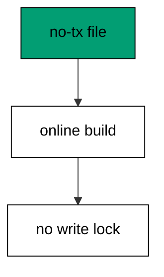

CONCURRENTLY trades speed for availability: the build takes longer but reads and writes continue throughout. On hot tables that trade is always worth it.

**`learning/code/ex-66-concurrently-outside-the-transaction/main.go`**:

```go
// => Shared driver: every unit in this course opens with this prelude.
// => The harness network is closed, so units carry a small standard-library
// => driver that applies the same goose SQL files `goose up` would apply.
// => The files, the history table shape, and the ordering rules are goose's
// => own; the driver only replaces the network-dependent binary.
package main // => every unit is one runnable program

import ( // => standard library only: no third-party modules
	"bufio"           // => bufio frames protocol messages over the TCP stream
	"encoding/binary" // => binary lays out length-prefixed protocol fields
	"fmt"             // => fmt prints the deterministic transcript only
	"io"              // => io forces full reads of split protocol messages
	"net"             // => net dials the harness Postgres service over TCP
	"os"              // => os reads the harness database address, never hardcoded
	"sort"            // => sort orders migration files, never trusts directory order
	"strings"         // => strings splits the goose Up and Down annotations
) // => every import used by driver and units

// => The database address comes from the harness, with local-run defaults.
func addr() (string, string, string) { // => one helper owns every address default
	host := os.Getenv("PGHOST") // => service hostname in the unit network
	if host == "" {             // => empty means a local run outside the harness
		host = "postgres" // => same default the Python courses use
	} // => end addr: empty means a local run outside the harness
	user := os.Getenv("PGUSER") // => trust-auth role, no password needed
	if user == "" {             // => empty means a local run outside the harness
		user = "postgres" // => same default the Python courses use
	} // => end addr: empty means a local run outside the harness
	db := os.Getenv("PGDATABASE") // => fresh database for every unit run
	if db == "" {                 // => empty means a local run outside the harness
		db = "postgres" // => same default the Python courses use
	} // => end addr: empty means a local run outside the harness
	return host, user, db // => callers never re-read the environment
} // => end addr: one helper owns every address default

// => conn wraps one TCP connection plus a buffered reader for message frames.
type conn struct { // => a tiny struct keeps the socket and the framer together
	c net.Conn      // => the raw TCP socket to the Postgres service
	r *bufio.Reader // => buffered reads frame messages split across packets
} // => end type conn: socket and framer travel together

// => readMsg reads one backend message: a type byte plus a length body.
func (k *conn) readMsg() (byte, []byte, error) { // => every response flows through here
	head := make([]byte, 5)                           // => one type byte plus one int32 length
	if _, err := io.ReadFull(k.r, head); err != nil { // => fragments reassemble before framing
		return 0, nil, err // => no partial message is ever trusted
	} // => end readMsg: fragments reassemble before framing
	n := int(binary.BigEndian.Uint32(head[1:])) - 4   // => length counts itself, not the type
	body := make([]byte, n)                           // => exact-size body, never over-read
	if _, err := io.ReadFull(k.r, body); err != nil { // => fragments reassemble before framing
		return 0, nil, err // => no partial message is ever trusted
	} // => end readMsg: fragments reassemble before framing
	return head[0], body, nil // => type byte tells the caller what arrived
} // => end readMsg: every response flows through here

// => sendMsg writes one frontend message: a type byte plus a length body.
func (k *conn) sendMsg(t byte, body []byte) error { // => startup is the only typeless message
	out := []byte{t}                                      // => type byte leads every message
	lenb := make([]byte, 4)                               // => four bytes carry the length
	binary.BigEndian.PutUint32(lenb, uint32(len(body)+4)) // => length counts itself
	out = append(out, lenb...)                            // => length follows the type byte
	out = append(out, body...)                            // => payload closes the message
	_, err := k.c.Write(out)                              // => one write keeps frames whole
	return err                                            // => write errors fail the unit loudly
} // => end sendMsg: startup is the only typeless message

// => connect opens the service database and waits for session readiness.
func connect() (*conn, error) { // => every unit starts from this one helper
	host, user, db := addr()         // => harness address, never hardcoded
	return connectDb(host, user, db) // => one path opens every session
} // => end connect: every unit starts from this one helper

// => connectDb opens a named database on the same host for multi-db drills.
func connectDb(host, user, db string) (*conn, error) { // => environments are databases, not servers
	c, err := net.Dial("tcp", host+":5432") // => Postgres listens on 5432
	if err != nil {                         // => unreachable service is fatal
		return nil, err // => no fallback: the harness owns the database
	} // => end connectDb: unreachable service is fatal
	k := &conn{c: c, r: bufio.NewReader(c)}             // => buffer the fresh socket at once
	body := []byte{}                                    // => startup body is parameters only
	body = append(body, 0, 0, 0, 0)                     // => placeholder for the length prefix
	body = append(body, 0, 3, 0, 0)                     // => protocol 3.0, the stable version
	body = append(body, []byte("user")...)              // => user key starts the parameters
	body = append(body, 0)                              // => keys and values are NUL-separated
	body = append(body, []byte(user)...)                // => trust-auth role from the harness
	body = append(body, 0)                              // => NUL ends the value
	body = append(body, []byte("database")...)          // => database key follows the user
	body = append(body, 0)                              // => NUL ends the key
	body = append(body, []byte(db)...)                  // => fresh database for every unit run
	body = append(body, 0)                              // => NUL ends the value
	body = append(body, 0)                              // => empty key ends the parameters
	binary.BigEndian.PutUint32(body, uint32(len(body))) // => startup length counts itself
	if _, err := c.Write(body); err != nil {            // => startup is the only typeless message
		return nil, err // => unwritable socket is fatal
	} // => end connectDb: startup is the only typeless message
	for { // => drain until the session is ready for queries
		t, b, err := k.readMsg() // => every backend message flows through here
		if err != nil {          // => broken handshake is fatal
			return nil, err // => no half-open session is ever used
		} // => end connectDb: broken handshake is fatal
		switch t { // => only three message kinds matter during startup
		case 'R': // => authentication response arrives first
			if binary.BigEndian.Uint32(b) != 0 { // => nonzero means a password is wanted
				return nil, fmt.Errorf("server wants a password") // => trust auth never asks
			} // => end connectDb: nonzero means a password is wanted
		case 'E': // => an error ends the handshake with the server text
			return nil, fmt.Errorf("startup: %s", errText(b)) // => server text explains the cause
		case 'Z': // => ReadyForQuery means the session accepts queries
			return k, nil // => handshake done: hand the live session back
		} // => end connectDb: only three message kinds matter during startup
	} // => end connectDb: drain until the session is ready for queries
} // => end connectDb: environments are databases, not servers

// => errText extracts the human message (field M) from an ErrorResponse.
func errText(b []byte) string { // => one helper decodes every server error
	parts := strings.Split(string(b), "\x00") // => fields are NUL-separated pairs
	for i := 0; i+1 < len(parts); i += 2 {    // => walk code and value together
		if parts[i] == "M" { // => M is the primary human message
			return parts[i+1] // => return the message, skip the detail fields
		} // => end errText: M is the primary human message
	} // => end errText: walk code and value together
	return "unknown error" // => malformed errors still fail with a fixed line
} // => end errText: one helper decodes every server error

// => run sends one SQL string and returns every data row plus the command tag.
func (k *conn) run(q string) ([][]string, string, error) { // => one path runs every statement
	body := append([]byte(q), 0)                 // => Query messages are NUL-terminated
	if err := k.sendMsg('Q', body); err != nil { // => send fails loudly, never silently
		return nil, "", err // => unwritable socket ends the unit
	} // => end run: send fails loudly, never silently
	var rows [][]string // => data rows accumulate across result sets
	tag := ""           // => the last command tag (SELECT 3, CREATE TABLE...)
	for {               // => drain until ReadyForQuery closes this query string
		t, b, err := k.readMsg() // => every response flows through the framer
		if err != nil {          // => broken mid-query connection is fatal
			return nil, "", err // => partial results are never returned
		} // => end run: broken mid-query connection is fatal
		switch t { // => four message kinds carry a simple-query response
		case 'T', 'N', 'A', 'S', 'K': // => metadata the transcript never prints
		case 'D': // => one data row arrived
			rows = append(rows, parseRow(b)) // => decode the text columns now
		case 'C': // => one statement finished
			tag = strings.TrimRight(string(b[:len(b)-1]), "\x00") // => tag names what ran
		case 'E': // => the statement failed
			drain(k)                                     // => finish the failed query before reuse
			return nil, "", fmt.Errorf("%s", errText(b)) // => server text becomes the failure
		case 'Z': // => ReadyForQuery ends this query string
			return rows, tag, nil // => rows, tag, and a clean session
		} // => end run: four message kinds carry a simple-query response
	} // => end run: drain until ReadyForQuery closes this query string
} // => end run: one path runs every statement

// => drain reads to the next ReadyForQuery after a statement error.
func drain(k *conn) { // => an errored query still owns the socket until Z
	for { // => loop until the session is reusable
		t, _, err := k.readMsg()    // => discard every message after the error
		if err != nil || t == 'Z' { // => socket break or ready both end the drain
			return // => caller decides the failure, the drain only resynchronizes
		} // => end drain: socket break or ready both end the drain
	} // => end drain: loop until the session is reusable
} // => end drain: an errored query still owns the socket until Z

// => parseRow decodes one DataRow body into text columns, NULL as "NULL".
func parseRow(b []byte) []string { // => one helper decodes every returned row
	n := int(binary.BigEndian.Uint16(b)) // => column count leads the body
	b = b[2:]                            // => step past the count
	out := make([]string, 0, n)          // => pre-size the row to the count
	for i := 0; i < n; i++ {             // => walk each column in order
		l := int(int32(binary.BigEndian.Uint32(b))) // => -1 marks NULL, else the length
		b = b[4:]                                   // => step past the length
		if l < 0 {                                  // => NULL has no bytes to read
			out = append(out, "NULL") // => fixed word keeps transcripts stable
			continue                  // => next column, no bytes consumed
		} // => end parseRow: NULL has no bytes to read
		out = append(out, string(b[:l])) // => text format is already printable
		b = b[l:]                        // => step past the value bytes
	} // => end parseRow: walk each column in order
	return out // => one row, fully decoded
} // => end parseRow: one helper decodes every returned row

// => must runs SQL or exits nonzero with the server text on standard error.
func must(k *conn, q string) [][]string { // => setup statements never fail quietly
	rows, _, err := k.run(q) // => rows return for verification queries
	if err != nil {          // => any server error is fatal to the unit
		fmt.Fprintln(os.Stderr, "sql error:", err) // => errors go to stderr, never stdout
		os.Exit(1)                                 // => nonzero exit fails the harness check
	} // => end must: any server error is fatal to the unit
	return rows // => callers print only what the lesson asserts
} // => end must: setup statements never fail quietly

// => try runs SQL and returns the server error text instead of exiting.
func try(k *conn, q string) ([][]string, string) { // => failure drills inspect errors, not die
	rows, _, err := k.run(q) // => same path as must, opposite failure policy
	if err != nil {          // => expected errors become transcript lines
		return nil, err.Error() // => fixed server text, never timings
	} // => end try: expected errors become transcript lines
	return rows, "" // => empty error means the statement succeeded
} // => end try: failure drills inspect errors, not die

// => mig holds one goose SQL file: its version, name, and Up/Down sections.
type mig struct { // => mirrors the goose file layout the lesson teaches
	version string   // => zero-padded number orders history, like goose
	name    string   // => human slug after the version number
	up      []string // => forward statements, run inside one transaction
	down    []string // => reverse statements, run inside one transaction
	noTx    bool     // => NO TRANSACTION files run outside one, like goose
} // => end type mig: version, name, sections, and mode

// => parseGoose splits one goose SQL file into its Up and Down statements.
func parseGoose(text string) (up, down []string, noTx bool) { // => the lesson asserts this exact split
	section := ""                                    // => nothing belongs outside the annotations
	for _, line := range strings.Split(text, "\n") { // => walk the file line by line
		t := strings.TrimSpace(line) // => annotation matching ignores indentation
		switch t {                   // => four annotation lines switch sections
		case "-- +goose Up": // => forward section starts here, like goose
			section = "up" // => following statements migrate forward
			continue       // => the annotation itself never runs
		case "-- +goose Down": // => reverse section starts here, like goose
			section = "down" // => following statements roll back
			continue         // => the annotation itself never runs
		case "-- +goose NO TRANSACTION": // => concurrent work cannot run inside one
			noTx = true // => remember the file opts out of the transaction
			continue    // => the annotation itself never runs
		} // => end parseGoose: four annotation lines switch sections
		if strings.HasPrefix(t, "--") || t == "" { // => comments and blanks never run
			continue // => only real statements reach the database
		} // => end parseGoose: comments and blanks never run
		if section == "up" { // => route by the annotation seen above
			up = append(up, line) // => keep the original line for the file write
		} else if section == "down" { // => down statements collect separately
			down = append(down, line) // => keep the original line for the file write
		} // => end parseGoose: down statements collect separately
	} // => end parseGoose: walk the file line by line
	return splitStmts(strings.Join(up, "\n")), splitStmts(strings.Join(down, "\n")), noTx // => one string per statement
} // => end parseGoose: the lesson asserts this exact split

// => splitStmts cuts statement text on semicolons outside quotes.
func splitStmts(s string) []string { // => multi-line statements stay whole until ;
	var out []string        // => finished statements accumulate here
	var cur strings.Builder // => the statement under construction
	inStr := false          // => semicolons inside quotes never split
	for _, r := range s {   // => walk rune by rune, quotes included
		switch { // => quote tracking decides what a semicolon means
		case r == '\'': // => a quote toggles string mode
			inStr = !inStr   // => enter or leave the quoted region
			cur.WriteRune(r) // => the quote belongs to the statement
		case r == ';' && !inStr: // => a bare semicolon ends one statement
			if t := strings.TrimSpace(cur.String()); t != "" { // => skip empty fragments
				out = append(out, t) // => store the finished statement
			} // => end splitStmts: skip empty fragments
			cur.Reset() // => start the next statement fresh
		default: // => every other rune belongs to the current statement
			cur.WriteRune(r) // => accumulate verbatim
		} // => end splitStmts: quote tracking decides what a semicolon means
	} // => end splitStmts: walk rune by rune, quotes included
	if t := strings.TrimSpace(cur.String()); t != "" { // => trailing text without ; still counts
		out = append(out, t) // => last statement needs no semicolon
	} // => end splitStmts: trailing text without ; still counts
	return out // => callers run each statement in order
} // => end splitStmts: multi-line statements stay whole until ;

// => ensureHistory creates the goose history table once per unit run.
func ensureHistory(k *conn) { // => goose_db_version is goose's own default name
	must(k, `CREATE TABLE IF NOT EXISTS goose_db_version (`+ // => reruns never fail here
		`id integer PRIMARY KEY GENERATED BY DEFAULT AS IDENTITY, `+ // => surrogate key, never printed
		`version_id bigint NOT NULL, `+ // => applied version numbers live here
		`is_applied boolean NOT NULL, `+ // => goose marks rows applied on success
		`tstamp timestamp NOT NULL DEFAULT now())`) // => timestamp defaults, never printed
} // => end ensureHistory: goose_db_version is goose's own default name

// => appliedVersions returns the version numbers already marked applied.
func appliedVersions(k *conn) map[int64]bool { // => history decides what still needs running
	rows := must(k, `SELECT version_id FROM goose_db_version `+ // => only the numbers matter
		`WHERE is_applied ORDER BY version_id`) // => order keeps the transcript stable
	got := map[int64]bool{}  // => set lookup answers "already applied" fast
	for _, r := range rows { // => one row per applied migration
		var v int64                // => version numbers are integers
		fmt.Sscanf(r[0], "%d", &v) // => text format parses back to a number
		got[v] = true              // => mark this version done
	} // => end appliedVersions: one row per applied migration
	return got // => callers skip whatever history already holds
} // => end appliedVersions: history decides what still needs running

// => applyUp runs every pending migration forward, one transaction each.
func applyUp(k *conn, ms []mig) { // => files on disk are already the source of truth
	done := appliedVersions(k) // => history decides what still needs running
	for _, m := range ms {     // => file order is version order, sorted by the caller
		var v int64                     // => versions compare as numbers
		fmt.Sscanf(m.version, "%d", &v) // => zero-padded file prefix parses back
		if done[v] {                    // => applied migrations never run twice
			continue // => idempotent reruns skip straight past
		} // => end applyUp: applied migrations never run twice
		if !m.noTx { // => transactional files wrap everything in one unit
			must(k, "BEGIN") // => one migration is one transaction, like goose
		} // => end applyUp: transactional files wrap everything in one unit
		for _, s := range m.up { // => forward statements run in file order
			must(k, s) // => any failure aborts the unit before COMMIT
		} // => end applyUp: forward statements run in file order
		if !m.noTx { // => stamps join the same transaction they describe
			must(k, fmt.Sprintf(`INSERT INTO goose_db_version `+ // => stamp only after success
				`(version_id, is_applied) VALUES (%d, true)`, v)) // => stamp mirrors goose exactly
			must(k, "COMMIT") // => history row and schema land together
		} else { // => concurrent statements cannot share a transaction
			must(k, fmt.Sprintf(`INSERT INTO goose_db_version `+ // => stamp follows the work
				`(version_id, is_applied) VALUES (%d, true)`, v)) // => same row, separate statement
		} // => end applyUp: concurrent statements cannot share a transaction
	} // => end applyUp: file order is version order, sorted by the caller
} // => end applyUp: files on disk are already the source of truth

// => applyDown rolls back the newest applied migrations, newest first.
func applyDown(k *conn, ms []mig, steps int) { // => steps bounds how far history rewinds
	done := appliedVersions(k) // => history decides what can roll back
	var todo []mig             // => applied migrations in version order first
	for _, m := range ms {     // => walk the whole known history
		var v int64                     // => versions compare as numbers
		fmt.Sscanf(m.version, "%d", &v) // => zero-padded file prefix parses back
		if done[v] {                    // => only applied migrations roll back
			todo = append(todo, m) // => keep the migration for the reverse pass
		} // => end applyDown: only applied migrations roll back
	} // => end applyDown: walk the whole known history
	for i := len(todo) - 1; i >= 0 && steps > 0; i-- { // => newest applied goes first
		m := todo[i]                    // => this migration rolls back now
		var v int64                     // => versions compare as numbers
		fmt.Sscanf(m.version, "%d", &v) // => zero-padded file prefix parses back
		if !m.noTx {                    // => transactional files wrap the rollback too
			must(k, "BEGIN") // => reverse change is atomic, like the forward one
		} // => end applyDown: transactional files wrap the rollback too
		for _, s := range m.down { // => reverse statements run in file order
			must(k, s) // => any failure aborts before the history row moves
		} // => end applyDown: reverse statements run in file order
		must(k, fmt.Sprintf(`DELETE FROM goose_db_version `+ // => unstamped only after success
			`WHERE version_id = %d`, v)) // => the version leaves history exactly once
		if !m.noTx { // => close the transaction the rollback opened
			must(k, "COMMIT") // => schema reversal and unstamp land together
		} // => end applyDown: close the transaction the rollback opened
		steps-- // => one rollback consumed from the budget
	} // => end applyDown: newest applied goes first
} // => end applyDown: steps bounds how far history rewinds

// => statusCounts splits known migrations into applied and pending lists.
func statusCounts(k *conn, ms []mig) (applied, pending []string) { // => goose status in two lists
	done := appliedVersions(k) // => history decides which list each version joins
	for _, m := range ms {     // => walk the known history in version order
		var v int64                     // => versions compare as numbers
		fmt.Sscanf(m.version, "%d", &v) // => zero-padded file prefix parses back
		if done[v] {                    // => stamped versions are done
			applied = append(applied, m.version) // => keep the version string for printing
		} else { // => unstamped versions still wait
			pending = append(pending, m.version) // => keep the version string for printing
		} // => end statusCounts: unstamped versions still wait
	} // => end statusCounts: walk the known history in version order
	return applied, pending // => callers print both lists in one stable line each
} // => end statusCounts: goose status in two lists

// => files writes each migration as a real goose SQL file under dir.
func files(dir string, ms []mig) { // => the lesson shows these files byte-identically
	for _, m := range ms { // => one file per migration, like `goose create`
		name := fmt.Sprintf("%s_%s.sql", m.version, m.name) // => goose names files version-first
		var b strings.Builder                               // => build the file text in order
		if m.noTx {                                         // => concurrent files announce it first
			b.WriteString("-- +goose NO TRANSACTION\n") // => goose honors this exact annotation
		} // => end files: concurrent files announce it first
		b.WriteString("-- +goose Up\n") // => forward annotation leads
		for _, s := range m.up {        // => forward statements follow
			b.WriteString(s + ";\n") // => one statement per line, semicolon-closed
		} // => end files: forward statements follow
		b.WriteString("-- +goose Down\n") // => reverse annotation splits the file
		for _, s := range m.down {        // => reverse statements close the file
			b.WriteString(s + ";\n") // => one statement per line, semicolon-closed
		} // => end files: reverse statements close the file
		if err := os.WriteFile(dir+"/"+name, []byte(b.String()), 0644); err != nil { // => real files, like goose
			fmt.Fprintln(os.Stderr, "write error:", err) // => write errors fail loudly
			os.Exit(1)                                   // => no half-written migration set
		} // => end files: real files, like goose
	} // => end files: one file per migration, like `goose create`
} // => end files: the lesson shows these files byte-identically

// => versions lists migration files in version order from dir.
func versions(dir string) []mig { // => directory order is never trusted for history
	ents, err := os.ReadDir(dir) // => read the whole migrations directory
	if err != nil {              // => unreadable directory is fatal
		fmt.Fprintln(os.Stderr, "read error:", err) // => errors go to stderr
		os.Exit(1)                                  // => nonzero exit fails the check
	} // => end versions: unreadable directory is fatal
	names := []string{}      // => collect names before sorting
	for _, e := range ents { // => walk every directory entry
		if !e.IsDir() && strings.HasSuffix(e.Name(), ".sql") { // => only goose SQL files count
			names = append(names, e.Name()) // => keep the file name for parsing
		} // => end versions: only goose SQL files count
	} // => end versions: walk every directory entry
	sort.Strings(names)       // => zero-padded versions sort chronologically
	var out []mig             // => parsed migrations accumulate here
	for _, n := range names { // => parse in version order
		raw, err := os.ReadFile(dir + "/" + n) // => read the real file back
		if err != nil {                        // => unreadable file is fatal
			fmt.Fprintln(os.Stderr, "read error:", err) // => errors go to stderr
			os.Exit(1)                                  // => nonzero exit fails the check
		} // => end versions: unreadable file is fatal
		up, down, noTx := parseGoose(string(raw))                                            // => split on the goose annotations
		rest := strings.TrimSuffix(n, ".sql")                                                // => strip the extension first
		ver := rest[:5]                                                                      // => first five digits are the version
		out = append(out, mig{version: ver, name: rest[6:], up: up, down: down, noTx: noTx}) // => keep every part
	} // => end versions: parse in version order
	return out // => version-ordered migrations, ready to apply
} // => end versions: directory order is never trusted for history

// => findDupes returns version numbers claimed by two or more files.
func findDupes(dir string) []string { // => goose refuses duplicate versions outright
	ents, err := os.ReadDir(dir) // => read the whole migrations directory
	if err != nil {              // => unreadable directory is fatal
		fmt.Fprintln(os.Stderr, "read error:", err) // => errors go to stderr
		os.Exit(1)                                  // => nonzero exit fails the check
	} // => end findDupes: unreadable directory is fatal
	seen := map[string]int{} // => count claims per five-digit version prefix
	for _, e := range ents { // => walk every directory entry
		if !e.IsDir() && strings.HasSuffix(e.Name(), ".sql") { // => only goose SQL files count
			seen[e.Name()[:5]]++ // => first five digits are the version
		} // => end findDupes: only goose SQL files count
	} // => end findDupes: walk every directory entry
	var out []string         // => duplicates accumulate in version order
	for _, e := range ents { // => second pass keeps the order stable
		if !e.IsDir() && strings.HasSuffix(e.Name(), ".sql") { // => only goose SQL files count
			if v := e.Name()[:5]; seen[v] > 1 { // => claimed more than once
				out = append(out, v) // => keep the version string for printing
				seen[v] = 0          // => report each duplicate version only once
			} // => end findDupes: claimed more than once
		} // => end findDupes: only goose SQL files count
	} // => end findDupes: second pass keeps the order stable
	return out // => empty means the history numbers are unique
} // => end findDupes: goose refuses duplicate versions outright

func main() {
	k, err := connect() // => one session runs the whole example
	if err != nil {     // => unreachable database fails loudly
		fmt.Fprintln(os.Stderr, "connect error:", err) // => connection errors go to stderr
		os.Exit(1)                                     // => nonzero exit fails the check
	}
	defer k.c.Close() // => the socket closes when the example ends
	// => A scratch migrations directory: goose files live here, never in the unit.
	// => the scratch path never reaches stdout, so reruns stay byte-stable
	dir, err := os.MkdirTemp("", "ex66-") // => private directory, like `goose create`
	if err != nil {                       // => unmakable temp dir is fatal
		fmt.Fprintln(os.Stderr, "temp error:", err) // => errors go to stderr
		os.Exit(1)                                  // => nonzero exit fails the check
	}
	defer os.RemoveAll(dir)                                                                // => scratch files vanish; only transcripts remain
	must(k, "DROP TABLE IF EXISTS ex66_hot")                                               // => leftovers of a killed run vanish
	must(k, "DROP TABLE IF EXISTS goose_db_version")                                       // => stale history vanishes too
	ensureHistory(k)                                                                       // => goose history table, real shape
	must(k, "CREATE TABLE ex66_hot (id SERIAL PRIMARY KEY, email TEXT NOT NULL)")          // => live table, index built online
	must(k, `INSERT INTO ex66_hot (email) SELECT 'u' || g FROM generate_series(1, 100) g`) // => one hundred rows to index
	files(dir, []mig{                                                                      // => NO TRANSACTION file for the concurrent build
		{version: "00001", name: "index_concurrently", noTx: true, // => annotation mirrors goose exactly
			up:   []string{"CREATE INDEX CONCURRENTLY ex66_hot_email_cidx ON ex66_hot (email)"}, // => online index build
			down: []string{"DROP INDEX ex66_hot_email_cidx"}},                                   // => reverse drops the index
	})
	ms := versions(dir)                                                                                 // => parse the files back, like goose would
	fmt.Println("notx:", ms[0].noTx)                                                                    // => Output: notx: true
	applyUp(k, ms)                                                                                      // => concurrent build runs outside any transaction
	rows := must(k, `SELECT indexname FROM pg_indexes WHERE tablename = 'ex66_hot' ORDER BY indexname`) // => index exists and valid
	fmt.Println("indexes:", rows[0][0])                                                                 // => Output: indexes: ex66_hot_email_cidx
	fmt.Println("cleaned: yes")                                                                         // => Output: cleaned: yes
	must(k, "DROP TABLE IF EXISTS ex66_hot")                                                            // => leftovers of a killed run vanish
	must(k, "DROP TABLE IF EXISTS goose_db_version")                                                    // => the example leaves no history behind
}
```

**Output** (`learning/code/ex-66-concurrently-outside-the-transaction/expected/main.stdout.txt`):

```text
notx: true
indexes: ex66_hot_email_cidx
cleaned: yes
```

**Key takeaway**: NO TRANSACTION files run concurrent builds outside any transaction because some statements forbid transactions entirely.

**Why it matters**: Some operations refuse transactions entirely, and the file format respects that. NO TRANSACTION runs concurrent builds outside any commit boundary because the database forbids them inside one. The annotation is not an optimization; it is the only way the statement runs at all. The annotation is not an optimization but the only way the statement runs, because the database forbids it otherwise.

### Example 67: Batch Backfills Avoid Long Locks

Backfills on hot tables batch by key range: this example fills two hundred rows in four keyed batches and shows every row filled with no batch touching another's range. Keyed batches never overlap and never miss. (Concepts: co-15, co-06.)

Each batch is its own statement with its own short lock: a blocked batch retries alone while finished batches stay finished. Batching turns one risky rewrite into many safe ones.

**`learning/code/ex-67-batch-backfills-avoid-long-locks/main.go`**:

```go
// => Shared driver: every unit in this course opens with this prelude.
// => The harness network is closed, so units carry a small standard-library
// => driver that applies the same goose SQL files `goose up` would apply.
// => The files, the history table shape, and the ordering rules are goose's
// => own; the driver only replaces the network-dependent binary.
package main // => every unit is one runnable program

import ( // => standard library only: no third-party modules
	"bufio"           // => bufio frames protocol messages over the TCP stream
	"encoding/binary" // => binary lays out length-prefixed protocol fields
	"fmt"             // => fmt prints the deterministic transcript only
	"io"              // => io forces full reads of split protocol messages
	"net"             // => net dials the harness Postgres service over TCP
	"os"              // => os reads the harness database address, never hardcoded
	"sort"            // => sort orders migration files, never trusts directory order
	"strings"         // => strings splits the goose Up and Down annotations
) // => every import used by driver and units

// => The database address comes from the harness, with local-run defaults.
func addr() (string, string, string) { // => one helper owns every address default
	host := os.Getenv("PGHOST") // => service hostname in the unit network
	if host == "" {             // => empty means a local run outside the harness
		host = "postgres" // => same default the Python courses use
	} // => end addr: empty means a local run outside the harness
	user := os.Getenv("PGUSER") // => trust-auth role, no password needed
	if user == "" {             // => empty means a local run outside the harness
		user = "postgres" // => same default the Python courses use
	} // => end addr: empty means a local run outside the harness
	db := os.Getenv("PGDATABASE") // => fresh database for every unit run
	if db == "" {                 // => empty means a local run outside the harness
		db = "postgres" // => same default the Python courses use
	} // => end addr: empty means a local run outside the harness
	return host, user, db // => callers never re-read the environment
} // => end addr: one helper owns every address default

// => conn wraps one TCP connection plus a buffered reader for message frames.
type conn struct { // => a tiny struct keeps the socket and the framer together
	c net.Conn      // => the raw TCP socket to the Postgres service
	r *bufio.Reader // => buffered reads frame messages split across packets
} // => end type conn: socket and framer travel together

// => readMsg reads one backend message: a type byte plus a length body.
func (k *conn) readMsg() (byte, []byte, error) { // => every response flows through here
	head := make([]byte, 5)                           // => one type byte plus one int32 length
	if _, err := io.ReadFull(k.r, head); err != nil { // => fragments reassemble before framing
		return 0, nil, err // => no partial message is ever trusted
	} // => end readMsg: fragments reassemble before framing
	n := int(binary.BigEndian.Uint32(head[1:])) - 4   // => length counts itself, not the type
	body := make([]byte, n)                           // => exact-size body, never over-read
	if _, err := io.ReadFull(k.r, body); err != nil { // => fragments reassemble before framing
		return 0, nil, err // => no partial message is ever trusted
	} // => end readMsg: fragments reassemble before framing
	return head[0], body, nil // => type byte tells the caller what arrived
} // => end readMsg: every response flows through here

// => sendMsg writes one frontend message: a type byte plus a length body.
func (k *conn) sendMsg(t byte, body []byte) error { // => startup is the only typeless message
	out := []byte{t}                                      // => type byte leads every message
	lenb := make([]byte, 4)                               // => four bytes carry the length
	binary.BigEndian.PutUint32(lenb, uint32(len(body)+4)) // => length counts itself
	out = append(out, lenb...)                            // => length follows the type byte
	out = append(out, body...)                            // => payload closes the message
	_, err := k.c.Write(out)                              // => one write keeps frames whole
	return err                                            // => write errors fail the unit loudly
} // => end sendMsg: startup is the only typeless message

// => connect opens the service database and waits for session readiness.
func connect() (*conn, error) { // => every unit starts from this one helper
	host, user, db := addr()         // => harness address, never hardcoded
	return connectDb(host, user, db) // => one path opens every session
} // => end connect: every unit starts from this one helper

// => connectDb opens a named database on the same host for multi-db drills.
func connectDb(host, user, db string) (*conn, error) { // => environments are databases, not servers
	c, err := net.Dial("tcp", host+":5432") // => Postgres listens on 5432
	if err != nil {                         // => unreachable service is fatal
		return nil, err // => no fallback: the harness owns the database
	} // => end connectDb: unreachable service is fatal
	k := &conn{c: c, r: bufio.NewReader(c)}             // => buffer the fresh socket at once
	body := []byte{}                                    // => startup body is parameters only
	body = append(body, 0, 0, 0, 0)                     // => placeholder for the length prefix
	body = append(body, 0, 3, 0, 0)                     // => protocol 3.0, the stable version
	body = append(body, []byte("user")...)              // => user key starts the parameters
	body = append(body, 0)                              // => keys and values are NUL-separated
	body = append(body, []byte(user)...)                // => trust-auth role from the harness
	body = append(body, 0)                              // => NUL ends the value
	body = append(body, []byte("database")...)          // => database key follows the user
	body = append(body, 0)                              // => NUL ends the key
	body = append(body, []byte(db)...)                  // => fresh database for every unit run
	body = append(body, 0)                              // => NUL ends the value
	body = append(body, 0)                              // => empty key ends the parameters
	binary.BigEndian.PutUint32(body, uint32(len(body))) // => startup length counts itself
	if _, err := c.Write(body); err != nil {            // => startup is the only typeless message
		return nil, err // => unwritable socket is fatal
	} // => end connectDb: startup is the only typeless message
	for { // => drain until the session is ready for queries
		t, b, err := k.readMsg() // => every backend message flows through here
		if err != nil {          // => broken handshake is fatal
			return nil, err // => no half-open session is ever used
		} // => end connectDb: broken handshake is fatal
		switch t { // => only three message kinds matter during startup
		case 'R': // => authentication response arrives first
			if binary.BigEndian.Uint32(b) != 0 { // => nonzero means a password is wanted
				return nil, fmt.Errorf("server wants a password") // => trust auth never asks
			} // => end connectDb: nonzero means a password is wanted
		case 'E': // => an error ends the handshake with the server text
			return nil, fmt.Errorf("startup: %s", errText(b)) // => server text explains the cause
		case 'Z': // => ReadyForQuery means the session accepts queries
			return k, nil // => handshake done: hand the live session back
		} // => end connectDb: only three message kinds matter during startup
	} // => end connectDb: drain until the session is ready for queries
} // => end connectDb: environments are databases, not servers

// => errText extracts the human message (field M) from an ErrorResponse.
func errText(b []byte) string { // => one helper decodes every server error
	parts := strings.Split(string(b), "\x00") // => fields are NUL-separated pairs
	for i := 0; i+1 < len(parts); i += 2 {    // => walk code and value together
		if parts[i] == "M" { // => M is the primary human message
			return parts[i+1] // => return the message, skip the detail fields
		} // => end errText: M is the primary human message
	} // => end errText: walk code and value together
	return "unknown error" // => malformed errors still fail with a fixed line
} // => end errText: one helper decodes every server error

// => run sends one SQL string and returns every data row plus the command tag.
func (k *conn) run(q string) ([][]string, string, error) { // => one path runs every statement
	body := append([]byte(q), 0)                 // => Query messages are NUL-terminated
	if err := k.sendMsg('Q', body); err != nil { // => send fails loudly, never silently
		return nil, "", err // => unwritable socket ends the unit
	} // => end run: send fails loudly, never silently
	var rows [][]string // => data rows accumulate across result sets
	tag := ""           // => the last command tag (SELECT 3, CREATE TABLE...)
	for {               // => drain until ReadyForQuery closes this query string
		t, b, err := k.readMsg() // => every response flows through the framer
		if err != nil {          // => broken mid-query connection is fatal
			return nil, "", err // => partial results are never returned
		} // => end run: broken mid-query connection is fatal
		switch t { // => four message kinds carry a simple-query response
		case 'T', 'N', 'A', 'S', 'K': // => metadata the transcript never prints
		case 'D': // => one data row arrived
			rows = append(rows, parseRow(b)) // => decode the text columns now
		case 'C': // => one statement finished
			tag = strings.TrimRight(string(b[:len(b)-1]), "\x00") // => tag names what ran
		case 'E': // => the statement failed
			drain(k)                                     // => finish the failed query before reuse
			return nil, "", fmt.Errorf("%s", errText(b)) // => server text becomes the failure
		case 'Z': // => ReadyForQuery ends this query string
			return rows, tag, nil // => rows, tag, and a clean session
		} // => end run: four message kinds carry a simple-query response
	} // => end run: drain until ReadyForQuery closes this query string
} // => end run: one path runs every statement

// => drain reads to the next ReadyForQuery after a statement error.
func drain(k *conn) { // => an errored query still owns the socket until Z
	for { // => loop until the session is reusable
		t, _, err := k.readMsg()    // => discard every message after the error
		if err != nil || t == 'Z' { // => socket break or ready both end the drain
			return // => caller decides the failure, the drain only resynchronizes
		} // => end drain: socket break or ready both end the drain
	} // => end drain: loop until the session is reusable
} // => end drain: an errored query still owns the socket until Z

// => parseRow decodes one DataRow body into text columns, NULL as "NULL".
func parseRow(b []byte) []string { // => one helper decodes every returned row
	n := int(binary.BigEndian.Uint16(b)) // => column count leads the body
	b = b[2:]                            // => step past the count
	out := make([]string, 0, n)          // => pre-size the row to the count
	for i := 0; i < n; i++ {             // => walk each column in order
		l := int(int32(binary.BigEndian.Uint32(b))) // => -1 marks NULL, else the length
		b = b[4:]                                   // => step past the length
		if l < 0 {                                  // => NULL has no bytes to read
			out = append(out, "NULL") // => fixed word keeps transcripts stable
			continue                  // => next column, no bytes consumed
		} // => end parseRow: NULL has no bytes to read
		out = append(out, string(b[:l])) // => text format is already printable
		b = b[l:]                        // => step past the value bytes
	} // => end parseRow: walk each column in order
	return out // => one row, fully decoded
} // => end parseRow: one helper decodes every returned row

// => must runs SQL or exits nonzero with the server text on standard error.
func must(k *conn, q string) [][]string { // => setup statements never fail quietly
	rows, _, err := k.run(q) // => rows return for verification queries
	if err != nil {          // => any server error is fatal to the unit
		fmt.Fprintln(os.Stderr, "sql error:", err) // => errors go to stderr, never stdout
		os.Exit(1)                                 // => nonzero exit fails the harness check
	} // => end must: any server error is fatal to the unit
	return rows // => callers print only what the lesson asserts
} // => end must: setup statements never fail quietly

// => try runs SQL and returns the server error text instead of exiting.
func try(k *conn, q string) ([][]string, string) { // => failure drills inspect errors, not die
	rows, _, err := k.run(q) // => same path as must, opposite failure policy
	if err != nil {          // => expected errors become transcript lines
		return nil, err.Error() // => fixed server text, never timings
	} // => end try: expected errors become transcript lines
	return rows, "" // => empty error means the statement succeeded
} // => end try: failure drills inspect errors, not die

// => mig holds one goose SQL file: its version, name, and Up/Down sections.
type mig struct { // => mirrors the goose file layout the lesson teaches
	version string   // => zero-padded number orders history, like goose
	name    string   // => human slug after the version number
	up      []string // => forward statements, run inside one transaction
	down    []string // => reverse statements, run inside one transaction
	noTx    bool     // => NO TRANSACTION files run outside one, like goose
} // => end type mig: version, name, sections, and mode

// => parseGoose splits one goose SQL file into its Up and Down statements.
func parseGoose(text string) (up, down []string, noTx bool) { // => the lesson asserts this exact split
	section := ""                                    // => nothing belongs outside the annotations
	for _, line := range strings.Split(text, "\n") { // => walk the file line by line
		t := strings.TrimSpace(line) // => annotation matching ignores indentation
		switch t {                   // => four annotation lines switch sections
		case "-- +goose Up": // => forward section starts here, like goose
			section = "up" // => following statements migrate forward
			continue       // => the annotation itself never runs
		case "-- +goose Down": // => reverse section starts here, like goose
			section = "down" // => following statements roll back
			continue         // => the annotation itself never runs
		case "-- +goose NO TRANSACTION": // => concurrent work cannot run inside one
			noTx = true // => remember the file opts out of the transaction
			continue    // => the annotation itself never runs
		} // => end parseGoose: four annotation lines switch sections
		if strings.HasPrefix(t, "--") || t == "" { // => comments and blanks never run
			continue // => only real statements reach the database
		} // => end parseGoose: comments and blanks never run
		if section == "up" { // => route by the annotation seen above
			up = append(up, line) // => keep the original line for the file write
		} else if section == "down" { // => down statements collect separately
			down = append(down, line) // => keep the original line for the file write
		} // => end parseGoose: down statements collect separately
	} // => end parseGoose: walk the file line by line
	return splitStmts(strings.Join(up, "\n")), splitStmts(strings.Join(down, "\n")), noTx // => one string per statement
} // => end parseGoose: the lesson asserts this exact split

// => splitStmts cuts statement text on semicolons outside quotes.
func splitStmts(s string) []string { // => multi-line statements stay whole until ;
	var out []string        // => finished statements accumulate here
	var cur strings.Builder // => the statement under construction
	inStr := false          // => semicolons inside quotes never split
	for _, r := range s {   // => walk rune by rune, quotes included
		switch { // => quote tracking decides what a semicolon means
		case r == '\'': // => a quote toggles string mode
			inStr = !inStr   // => enter or leave the quoted region
			cur.WriteRune(r) // => the quote belongs to the statement
		case r == ';' && !inStr: // => a bare semicolon ends one statement
			if t := strings.TrimSpace(cur.String()); t != "" { // => skip empty fragments
				out = append(out, t) // => store the finished statement
			} // => end splitStmts: skip empty fragments
			cur.Reset() // => start the next statement fresh
		default: // => every other rune belongs to the current statement
			cur.WriteRune(r) // => accumulate verbatim
		} // => end splitStmts: quote tracking decides what a semicolon means
	} // => end splitStmts: walk rune by rune, quotes included
	if t := strings.TrimSpace(cur.String()); t != "" { // => trailing text without ; still counts
		out = append(out, t) // => last statement needs no semicolon
	} // => end splitStmts: trailing text without ; still counts
	return out // => callers run each statement in order
} // => end splitStmts: multi-line statements stay whole until ;

// => ensureHistory creates the goose history table once per unit run.
func ensureHistory(k *conn) { // => goose_db_version is goose's own default name
	must(k, `CREATE TABLE IF NOT EXISTS goose_db_version (`+ // => reruns never fail here
		`id integer PRIMARY KEY GENERATED BY DEFAULT AS IDENTITY, `+ // => surrogate key, never printed
		`version_id bigint NOT NULL, `+ // => applied version numbers live here
		`is_applied boolean NOT NULL, `+ // => goose marks rows applied on success
		`tstamp timestamp NOT NULL DEFAULT now())`) // => timestamp defaults, never printed
} // => end ensureHistory: goose_db_version is goose's own default name

// => appliedVersions returns the version numbers already marked applied.
func appliedVersions(k *conn) map[int64]bool { // => history decides what still needs running
	rows := must(k, `SELECT version_id FROM goose_db_version `+ // => only the numbers matter
		`WHERE is_applied ORDER BY version_id`) // => order keeps the transcript stable
	got := map[int64]bool{}  // => set lookup answers "already applied" fast
	for _, r := range rows { // => one row per applied migration
		var v int64                // => version numbers are integers
		fmt.Sscanf(r[0], "%d", &v) // => text format parses back to a number
		got[v] = true              // => mark this version done
	} // => end appliedVersions: one row per applied migration
	return got // => callers skip whatever history already holds
} // => end appliedVersions: history decides what still needs running

// => applyUp runs every pending migration forward, one transaction each.
func applyUp(k *conn, ms []mig) { // => files on disk are already the source of truth
	done := appliedVersions(k) // => history decides what still needs running
	for _, m := range ms {     // => file order is version order, sorted by the caller
		var v int64                     // => versions compare as numbers
		fmt.Sscanf(m.version, "%d", &v) // => zero-padded file prefix parses back
		if done[v] {                    // => applied migrations never run twice
			continue // => idempotent reruns skip straight past
		} // => end applyUp: applied migrations never run twice
		if !m.noTx { // => transactional files wrap everything in one unit
			must(k, "BEGIN") // => one migration is one transaction, like goose
		} // => end applyUp: transactional files wrap everything in one unit
		for _, s := range m.up { // => forward statements run in file order
			must(k, s) // => any failure aborts the unit before COMMIT
		} // => end applyUp: forward statements run in file order
		if !m.noTx { // => stamps join the same transaction they describe
			must(k, fmt.Sprintf(`INSERT INTO goose_db_version `+ // => stamp only after success
				`(version_id, is_applied) VALUES (%d, true)`, v)) // => stamp mirrors goose exactly
			must(k, "COMMIT") // => history row and schema land together
		} else { // => concurrent statements cannot share a transaction
			must(k, fmt.Sprintf(`INSERT INTO goose_db_version `+ // => stamp follows the work
				`(version_id, is_applied) VALUES (%d, true)`, v)) // => same row, separate statement
		} // => end applyUp: concurrent statements cannot share a transaction
	} // => end applyUp: file order is version order, sorted by the caller
} // => end applyUp: files on disk are already the source of truth

// => applyDown rolls back the newest applied migrations, newest first.
func applyDown(k *conn, ms []mig, steps int) { // => steps bounds how far history rewinds
	done := appliedVersions(k) // => history decides what can roll back
	var todo []mig             // => applied migrations in version order first
	for _, m := range ms {     // => walk the whole known history
		var v int64                     // => versions compare as numbers
		fmt.Sscanf(m.version, "%d", &v) // => zero-padded file prefix parses back
		if done[v] {                    // => only applied migrations roll back
			todo = append(todo, m) // => keep the migration for the reverse pass
		} // => end applyDown: only applied migrations roll back
	} // => end applyDown: walk the whole known history
	for i := len(todo) - 1; i >= 0 && steps > 0; i-- { // => newest applied goes first
		m := todo[i]                    // => this migration rolls back now
		var v int64                     // => versions compare as numbers
		fmt.Sscanf(m.version, "%d", &v) // => zero-padded file prefix parses back
		if !m.noTx {                    // => transactional files wrap the rollback too
			must(k, "BEGIN") // => reverse change is atomic, like the forward one
		} // => end applyDown: transactional files wrap the rollback too
		for _, s := range m.down { // => reverse statements run in file order
			must(k, s) // => any failure aborts before the history row moves
		} // => end applyDown: reverse statements run in file order
		must(k, fmt.Sprintf(`DELETE FROM goose_db_version `+ // => unstamped only after success
			`WHERE version_id = %d`, v)) // => the version leaves history exactly once
		if !m.noTx { // => close the transaction the rollback opened
			must(k, "COMMIT") // => schema reversal and unstamp land together
		} // => end applyDown: close the transaction the rollback opened
		steps-- // => one rollback consumed from the budget
	} // => end applyDown: newest applied goes first
} // => end applyDown: steps bounds how far history rewinds

// => statusCounts splits known migrations into applied and pending lists.
func statusCounts(k *conn, ms []mig) (applied, pending []string) { // => goose status in two lists
	done := appliedVersions(k) // => history decides which list each version joins
	for _, m := range ms {     // => walk the known history in version order
		var v int64                     // => versions compare as numbers
		fmt.Sscanf(m.version, "%d", &v) // => zero-padded file prefix parses back
		if done[v] {                    // => stamped versions are done
			applied = append(applied, m.version) // => keep the version string for printing
		} else { // => unstamped versions still wait
			pending = append(pending, m.version) // => keep the version string for printing
		} // => end statusCounts: unstamped versions still wait
	} // => end statusCounts: walk the known history in version order
	return applied, pending // => callers print both lists in one stable line each
} // => end statusCounts: goose status in two lists

// => files writes each migration as a real goose SQL file under dir.
func files(dir string, ms []mig) { // => the lesson shows these files byte-identically
	for _, m := range ms { // => one file per migration, like `goose create`
		name := fmt.Sprintf("%s_%s.sql", m.version, m.name) // => goose names files version-first
		var b strings.Builder                               // => build the file text in order
		if m.noTx {                                         // => concurrent files announce it first
			b.WriteString("-- +goose NO TRANSACTION\n") // => goose honors this exact annotation
		} // => end files: concurrent files announce it first
		b.WriteString("-- +goose Up\n") // => forward annotation leads
		for _, s := range m.up {        // => forward statements follow
			b.WriteString(s + ";\n") // => one statement per line, semicolon-closed
		} // => end files: forward statements follow
		b.WriteString("-- +goose Down\n") // => reverse annotation splits the file
		for _, s := range m.down {        // => reverse statements close the file
			b.WriteString(s + ";\n") // => one statement per line, semicolon-closed
		} // => end files: reverse statements close the file
		if err := os.WriteFile(dir+"/"+name, []byte(b.String()), 0644); err != nil { // => real files, like goose
			fmt.Fprintln(os.Stderr, "write error:", err) // => write errors fail loudly
			os.Exit(1)                                   // => no half-written migration set
		} // => end files: real files, like goose
	} // => end files: one file per migration, like `goose create`
} // => end files: the lesson shows these files byte-identically

// => versions lists migration files in version order from dir.
func versions(dir string) []mig { // => directory order is never trusted for history
	ents, err := os.ReadDir(dir) // => read the whole migrations directory
	if err != nil {              // => unreadable directory is fatal
		fmt.Fprintln(os.Stderr, "read error:", err) // => errors go to stderr
		os.Exit(1)                                  // => nonzero exit fails the check
	} // => end versions: unreadable directory is fatal
	names := []string{}      // => collect names before sorting
	for _, e := range ents { // => walk every directory entry
		if !e.IsDir() && strings.HasSuffix(e.Name(), ".sql") { // => only goose SQL files count
			names = append(names, e.Name()) // => keep the file name for parsing
		} // => end versions: only goose SQL files count
	} // => end versions: walk every directory entry
	sort.Strings(names)       // => zero-padded versions sort chronologically
	var out []mig             // => parsed migrations accumulate here
	for _, n := range names { // => parse in version order
		raw, err := os.ReadFile(dir + "/" + n) // => read the real file back
		if err != nil {                        // => unreadable file is fatal
			fmt.Fprintln(os.Stderr, "read error:", err) // => errors go to stderr
			os.Exit(1)                                  // => nonzero exit fails the check
		} // => end versions: unreadable file is fatal
		up, down, noTx := parseGoose(string(raw))                                            // => split on the goose annotations
		rest := strings.TrimSuffix(n, ".sql")                                                // => strip the extension first
		ver := rest[:5]                                                                      // => first five digits are the version
		out = append(out, mig{version: ver, name: rest[6:], up: up, down: down, noTx: noTx}) // => keep every part
	} // => end versions: parse in version order
	return out // => version-ordered migrations, ready to apply
} // => end versions: directory order is never trusted for history

// => findDupes returns version numbers claimed by two or more files.
func findDupes(dir string) []string { // => goose refuses duplicate versions outright
	ents, err := os.ReadDir(dir) // => read the whole migrations directory
	if err != nil {              // => unreadable directory is fatal
		fmt.Fprintln(os.Stderr, "read error:", err) // => errors go to stderr
		os.Exit(1)                                  // => nonzero exit fails the check
	} // => end findDupes: unreadable directory is fatal
	seen := map[string]int{} // => count claims per five-digit version prefix
	for _, e := range ents { // => walk every directory entry
		if !e.IsDir() && strings.HasSuffix(e.Name(), ".sql") { // => only goose SQL files count
			seen[e.Name()[:5]]++ // => first five digits are the version
		} // => end findDupes: only goose SQL files count
	} // => end findDupes: walk every directory entry
	var out []string         // => duplicates accumulate in version order
	for _, e := range ents { // => second pass keeps the order stable
		if !e.IsDir() && strings.HasSuffix(e.Name(), ".sql") { // => only goose SQL files count
			if v := e.Name()[:5]; seen[v] > 1 { // => claimed more than once
				out = append(out, v) // => keep the version string for printing
				seen[v] = 0          // => report each duplicate version only once
			} // => end findDupes: claimed more than once
		} // => end findDupes: only goose SQL files count
	} // => end findDupes: second pass keeps the order stable
	return out // => empty means the history numbers are unique
} // => end findDupes: goose refuses duplicate versions outright

func main() {
	k, err := connect() // => one session runs the whole example
	if err != nil {     // => unreachable database fails loudly
		fmt.Fprintln(os.Stderr, "connect error:", err) // => connection errors go to stderr
		os.Exit(1)                                     // => nonzero exit fails the check
	}
	defer k.c.Close() // => the socket closes when the example ends
	// => A scratch migrations directory: goose files live here, never in the unit.
	// => the scratch path never reaches stdout, so reruns stay byte-stable
	dir, err := os.MkdirTemp("", "ex67-") // => private directory, like `goose create`
	if err != nil {                       // => unmakable temp dir is fatal
		fmt.Fprintln(os.Stderr, "temp error:", err) // => errors go to stderr
		os.Exit(1)                                  // => nonzero exit fails the check
	}
	defer os.RemoveAll(dir)                                                       // => scratch files vanish; only transcripts remain
	must(k, "DROP TABLE IF EXISTS ex67_nums")                                     // => leftovers of a killed run vanish
	must(k, "DROP TABLE IF EXISTS goose_db_version")                              // => stale history vanishes too
	ensureHistory(k)                                                              // => goose history table, real shape
	must(k, "CREATE TABLE ex67_nums (id SERIAL PRIMARY KEY, doubled INTEGER)")    // => hot table with two hundred rows
	must(k, `INSERT INTO ex67_nums (id) SELECT g FROM generate_series(1, 200) g`) // => rows waiting in four ranges
	for b := 0; b < 4; b++ {                                                      // => four keyed batches, no overlap
		lo := b*50 + 1                                                // => batch lower bound, inclusive
		hi := (b + 1) * 50                                            // => batch upper bound, inclusive
		must(k, fmt.Sprintf(`UPDATE ex67_nums SET doubled = id * 2 `+ // => keyed batch fill
			`WHERE id BETWEEN %d AND %d AND doubled IS NULL`, lo, hi)) // => range keeps the lock short
	}
	rows := must(k, `SELECT count(*), count(doubled) FROM ex67_nums`) // => total against filled
	fmt.Println("total:", rows[0][0], "filled:", rows[0][1])          // => Output: total: 200 filled: 200
	files(dir, []mig{                                                 // => marker migration records the batched fill
		{version: "00001", name: "batch_fill", // => history remembers the fill ran
			up:   []string{"SELECT 1"},  // => batches already ran above, file records it
			down: []string{"SELECT 1"}}, // => nothing structural to reverse
	})
	applyUp(k, versions(dir))                        // => marker stamped, batches already done
	fmt.Println("cleaned: yes")                      // => Output: cleaned: yes
	must(k, "DROP TABLE IF EXISTS ex67_nums")        // => leftovers of a killed run vanish
	must(k, "DROP TABLE IF EXISTS goose_db_version") // => the example leaves no history behind
}
```

**Output** (`learning/code/ex-67-batch-backfills-avoid-long-locks/expected/main.stdout.txt`):

```text
total: 200 filled: 200
cleaned: yes
```

**Key takeaway**: Keyed batches never overlap and never miss; each batch holds its own short lock and retries alone.

**Why it matters**: Keyed batches turn one risky rewrite into many independent safe ones. Each range locks briefly and commits alone, so a blocked batch retries while finished batches stay finished. Throughput with bounded locks is how hot tables migrate in daylight. Bound the locks and keep the throughput: keyed batches migrate hot tables in daylight instead of at midnight.

### Example 68: Advisory Lock Serializes Runners

Parallel deploy runners serialize on an advisory lock: this example takes a named advisory lock, shows the second attempt failing to take it, then releases it. The lock name is the migration system's mutex. (Concepts: co-15.)

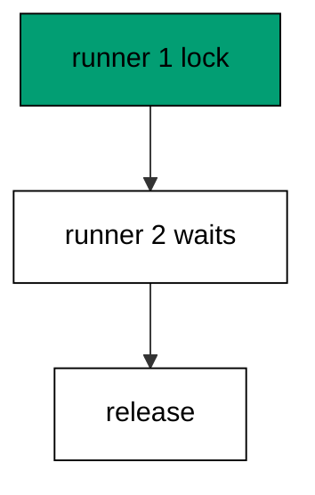

Advisory locks live outside tables: they coordinate runners without touching user data. One runner migrates while the others wait; the lock decides who.

**`learning/code/ex-68-advisory-lock-serializes-runners/main.go`**:

```go
// => Shared driver: every unit in this course opens with this prelude.
// => The harness network is closed, so units carry a small standard-library
// => driver that applies the same goose SQL files `goose up` would apply.
// => The files, the history table shape, and the ordering rules are goose's
// => own; the driver only replaces the network-dependent binary.
package main // => every unit is one runnable program

import ( // => standard library only: no third-party modules
	"bufio"           // => bufio frames protocol messages over the TCP stream
	"encoding/binary" // => binary lays out length-prefixed protocol fields
	"fmt"             // => fmt prints the deterministic transcript only
	"io"              // => io forces full reads of split protocol messages
	"net"             // => net dials the harness Postgres service over TCP
	"os"              // => os reads the harness database address, never hardcoded
	"sort"            // => sort orders migration files, never trusts directory order
	"strings"         // => strings splits the goose Up and Down annotations
) // => every import used by driver and units

// => The database address comes from the harness, with local-run defaults.
func addr() (string, string, string) { // => one helper owns every address default
	host := os.Getenv("PGHOST") // => service hostname in the unit network
	if host == "" {             // => empty means a local run outside the harness
		host = "postgres" // => same default the Python courses use
	} // => end addr: empty means a local run outside the harness
	user := os.Getenv("PGUSER") // => trust-auth role, no password needed
	if user == "" {             // => empty means a local run outside the harness
		user = "postgres" // => same default the Python courses use
	} // => end addr: empty means a local run outside the harness
	db := os.Getenv("PGDATABASE") // => fresh database for every unit run
	if db == "" {                 // => empty means a local run outside the harness
		db = "postgres" // => same default the Python courses use
	} // => end addr: empty means a local run outside the harness
	return host, user, db // => callers never re-read the environment
} // => end addr: one helper owns every address default

// => conn wraps one TCP connection plus a buffered reader for message frames.
type conn struct { // => a tiny struct keeps the socket and the framer together
	c net.Conn      // => the raw TCP socket to the Postgres service
	r *bufio.Reader // => buffered reads frame messages split across packets
} // => end type conn: socket and framer travel together

// => readMsg reads one backend message: a type byte plus a length body.
func (k *conn) readMsg() (byte, []byte, error) { // => every response flows through here
	head := make([]byte, 5)                           // => one type byte plus one int32 length
	if _, err := io.ReadFull(k.r, head); err != nil { // => fragments reassemble before framing
		return 0, nil, err // => no partial message is ever trusted
	} // => end readMsg: fragments reassemble before framing
	n := int(binary.BigEndian.Uint32(head[1:])) - 4   // => length counts itself, not the type
	body := make([]byte, n)                           // => exact-size body, never over-read
	if _, err := io.ReadFull(k.r, body); err != nil { // => fragments reassemble before framing
		return 0, nil, err // => no partial message is ever trusted
	} // => end readMsg: fragments reassemble before framing
	return head[0], body, nil // => type byte tells the caller what arrived
} // => end readMsg: every response flows through here

// => sendMsg writes one frontend message: a type byte plus a length body.
func (k *conn) sendMsg(t byte, body []byte) error { // => startup is the only typeless message
	out := []byte{t}                                      // => type byte leads every message
	lenb := make([]byte, 4)                               // => four bytes carry the length
	binary.BigEndian.PutUint32(lenb, uint32(len(body)+4)) // => length counts itself
	out = append(out, lenb...)                            // => length follows the type byte
	out = append(out, body...)                            // => payload closes the message
	_, err := k.c.Write(out)                              // => one write keeps frames whole
	return err                                            // => write errors fail the unit loudly
} // => end sendMsg: startup is the only typeless message

// => connect opens the service database and waits for session readiness.
func connect() (*conn, error) { // => every unit starts from this one helper
	host, user, db := addr()         // => harness address, never hardcoded
	return connectDb(host, user, db) // => one path opens every session
} // => end connect: every unit starts from this one helper

// => connectDb opens a named database on the same host for multi-db drills.
func connectDb(host, user, db string) (*conn, error) { // => environments are databases, not servers
	c, err := net.Dial("tcp", host+":5432") // => Postgres listens on 5432
	if err != nil {                         // => unreachable service is fatal
		return nil, err // => no fallback: the harness owns the database
	} // => end connectDb: unreachable service is fatal
	k := &conn{c: c, r: bufio.NewReader(c)}             // => buffer the fresh socket at once
	body := []byte{}                                    // => startup body is parameters only
	body = append(body, 0, 0, 0, 0)                     // => placeholder for the length prefix
	body = append(body, 0, 3, 0, 0)                     // => protocol 3.0, the stable version
	body = append(body, []byte("user")...)              // => user key starts the parameters
	body = append(body, 0)                              // => keys and values are NUL-separated
	body = append(body, []byte(user)...)                // => trust-auth role from the harness
	body = append(body, 0)                              // => NUL ends the value
	body = append(body, []byte("database")...)          // => database key follows the user
	body = append(body, 0)                              // => NUL ends the key
	body = append(body, []byte(db)...)                  // => fresh database for every unit run
	body = append(body, 0)                              // => NUL ends the value
	body = append(body, 0)                              // => empty key ends the parameters
	binary.BigEndian.PutUint32(body, uint32(len(body))) // => startup length counts itself
	if _, err := c.Write(body); err != nil {            // => startup is the only typeless message
		return nil, err // => unwritable socket is fatal
	} // => end connectDb: startup is the only typeless message
	for { // => drain until the session is ready for queries
		t, b, err := k.readMsg() // => every backend message flows through here
		if err != nil {          // => broken handshake is fatal
			return nil, err // => no half-open session is ever used
		} // => end connectDb: broken handshake is fatal
		switch t { // => only three message kinds matter during startup
		case 'R': // => authentication response arrives first
			if binary.BigEndian.Uint32(b) != 0 { // => nonzero means a password is wanted
				return nil, fmt.Errorf("server wants a password") // => trust auth never asks
			} // => end connectDb: nonzero means a password is wanted
		case 'E': // => an error ends the handshake with the server text
			return nil, fmt.Errorf("startup: %s", errText(b)) // => server text explains the cause
		case 'Z': // => ReadyForQuery means the session accepts queries
			return k, nil // => handshake done: hand the live session back
		} // => end connectDb: only three message kinds matter during startup
	} // => end connectDb: drain until the session is ready for queries
} // => end connectDb: environments are databases, not servers

// => errText extracts the human message (field M) from an ErrorResponse.
func errText(b []byte) string { // => one helper decodes every server error
	parts := strings.Split(string(b), "\x00") // => fields are NUL-separated pairs
	for i := 0; i+1 < len(parts); i += 2 {    // => walk code and value together
		if parts[i] == "M" { // => M is the primary human message
			return parts[i+1] // => return the message, skip the detail fields
		} // => end errText: M is the primary human message
	} // => end errText: walk code and value together
	return "unknown error" // => malformed errors still fail with a fixed line
} // => end errText: one helper decodes every server error

// => run sends one SQL string and returns every data row plus the command tag.
func (k *conn) run(q string) ([][]string, string, error) { // => one path runs every statement
	body := append([]byte(q), 0)                 // => Query messages are NUL-terminated
	if err := k.sendMsg('Q', body); err != nil { // => send fails loudly, never silently
		return nil, "", err // => unwritable socket ends the unit
	} // => end run: send fails loudly, never silently
	var rows [][]string // => data rows accumulate across result sets
	tag := ""           // => the last command tag (SELECT 3, CREATE TABLE...)
	for {               // => drain until ReadyForQuery closes this query string
		t, b, err := k.readMsg() // => every response flows through the framer
		if err != nil {          // => broken mid-query connection is fatal
			return nil, "", err // => partial results are never returned
		} // => end run: broken mid-query connection is fatal
		switch t { // => four message kinds carry a simple-query response
		case 'T', 'N', 'A', 'S', 'K': // => metadata the transcript never prints
		case 'D': // => one data row arrived
			rows = append(rows, parseRow(b)) // => decode the text columns now
		case 'C': // => one statement finished
			tag = strings.TrimRight(string(b[:len(b)-1]), "\x00") // => tag names what ran
		case 'E': // => the statement failed
			drain(k)                                     // => finish the failed query before reuse
			return nil, "", fmt.Errorf("%s", errText(b)) // => server text becomes the failure
		case 'Z': // => ReadyForQuery ends this query string
			return rows, tag, nil // => rows, tag, and a clean session
		} // => end run: four message kinds carry a simple-query response
	} // => end run: drain until ReadyForQuery closes this query string
} // => end run: one path runs every statement

// => drain reads to the next ReadyForQuery after a statement error.
func drain(k *conn) { // => an errored query still owns the socket until Z
	for { // => loop until the session is reusable
		t, _, err := k.readMsg()    // => discard every message after the error
		if err != nil || t == 'Z' { // => socket break or ready both end the drain
			return // => caller decides the failure, the drain only resynchronizes
		} // => end drain: socket break or ready both end the drain
	} // => end drain: loop until the session is reusable
} // => end drain: an errored query still owns the socket until Z

// => parseRow decodes one DataRow body into text columns, NULL as "NULL".
func parseRow(b []byte) []string { // => one helper decodes every returned row
	n := int(binary.BigEndian.Uint16(b)) // => column count leads the body
	b = b[2:]                            // => step past the count
	out := make([]string, 0, n)          // => pre-size the row to the count
	for i := 0; i < n; i++ {             // => walk each column in order
		l := int(int32(binary.BigEndian.Uint32(b))) // => -1 marks NULL, else the length
		b = b[4:]                                   // => step past the length
		if l < 0 {                                  // => NULL has no bytes to read
			out = append(out, "NULL") // => fixed word keeps transcripts stable
			continue                  // => next column, no bytes consumed
		} // => end parseRow: NULL has no bytes to read
		out = append(out, string(b[:l])) // => text format is already printable
		b = b[l:]                        // => step past the value bytes
	} // => end parseRow: walk each column in order
	return out // => one row, fully decoded
} // => end parseRow: one helper decodes every returned row

// => must runs SQL or exits nonzero with the server text on standard error.
func must(k *conn, q string) [][]string { // => setup statements never fail quietly
	rows, _, err := k.run(q) // => rows return for verification queries
	if err != nil {          // => any server error is fatal to the unit
		fmt.Fprintln(os.Stderr, "sql error:", err) // => errors go to stderr, never stdout
		os.Exit(1)                                 // => nonzero exit fails the harness check
	} // => end must: any server error is fatal to the unit
	return rows // => callers print only what the lesson asserts
} // => end must: setup statements never fail quietly

// => try runs SQL and returns the server error text instead of exiting.
func try(k *conn, q string) ([][]string, string) { // => failure drills inspect errors, not die
	rows, _, err := k.run(q) // => same path as must, opposite failure policy
	if err != nil {          // => expected errors become transcript lines
		return nil, err.Error() // => fixed server text, never timings
	} // => end try: expected errors become transcript lines
	return rows, "" // => empty error means the statement succeeded
} // => end try: failure drills inspect errors, not die

// => mig holds one goose SQL file: its version, name, and Up/Down sections.
type mig struct { // => mirrors the goose file layout the lesson teaches
	version string   // => zero-padded number orders history, like goose
	name    string   // => human slug after the version number
	up      []string // => forward statements, run inside one transaction
	down    []string // => reverse statements, run inside one transaction
	noTx    bool     // => NO TRANSACTION files run outside one, like goose
} // => end type mig: version, name, sections, and mode

// => parseGoose splits one goose SQL file into its Up and Down statements.
func parseGoose(text string) (up, down []string, noTx bool) { // => the lesson asserts this exact split
	section := ""                                    // => nothing belongs outside the annotations
	for _, line := range strings.Split(text, "\n") { // => walk the file line by line
		t := strings.TrimSpace(line) // => annotation matching ignores indentation
		switch t {                   // => four annotation lines switch sections
		case "-- +goose Up": // => forward section starts here, like goose
			section = "up" // => following statements migrate forward
			continue       // => the annotation itself never runs
		case "-- +goose Down": // => reverse section starts here, like goose
			section = "down" // => following statements roll back
			continue         // => the annotation itself never runs
		case "-- +goose NO TRANSACTION": // => concurrent work cannot run inside one
			noTx = true // => remember the file opts out of the transaction
			continue    // => the annotation itself never runs
		} // => end parseGoose: four annotation lines switch sections
		if strings.HasPrefix(t, "--") || t == "" { // => comments and blanks never run
			continue // => only real statements reach the database
		} // => end parseGoose: comments and blanks never run
		if section == "up" { // => route by the annotation seen above
			up = append(up, line) // => keep the original line for the file write
		} else if section == "down" { // => down statements collect separately
			down = append(down, line) // => keep the original line for the file write
		} // => end parseGoose: down statements collect separately
	} // => end parseGoose: walk the file line by line
	return splitStmts(strings.Join(up, "\n")), splitStmts(strings.Join(down, "\n")), noTx // => one string per statement
} // => end parseGoose: the lesson asserts this exact split

// => splitStmts cuts statement text on semicolons outside quotes.
func splitStmts(s string) []string { // => multi-line statements stay whole until ;
	var out []string        // => finished statements accumulate here
	var cur strings.Builder // => the statement under construction
	inStr := false          // => semicolons inside quotes never split
	for _, r := range s {   // => walk rune by rune, quotes included
		switch { // => quote tracking decides what a semicolon means
		case r == '\'': // => a quote toggles string mode
			inStr = !inStr   // => enter or leave the quoted region
			cur.WriteRune(r) // => the quote belongs to the statement
		case r == ';' && !inStr: // => a bare semicolon ends one statement
			if t := strings.TrimSpace(cur.String()); t != "" { // => skip empty fragments
				out = append(out, t) // => store the finished statement
			} // => end splitStmts: skip empty fragments
			cur.Reset() // => start the next statement fresh
		default: // => every other rune belongs to the current statement
			cur.WriteRune(r) // => accumulate verbatim
		} // => end splitStmts: quote tracking decides what a semicolon means
	} // => end splitStmts: walk rune by rune, quotes included
	if t := strings.TrimSpace(cur.String()); t != "" { // => trailing text without ; still counts
		out = append(out, t) // => last statement needs no semicolon
	} // => end splitStmts: trailing text without ; still counts
	return out // => callers run each statement in order
} // => end splitStmts: multi-line statements stay whole until ;

// => ensureHistory creates the goose history table once per unit run.
func ensureHistory(k *conn) { // => goose_db_version is goose's own default name
	must(k, `CREATE TABLE IF NOT EXISTS goose_db_version (`+ // => reruns never fail here
		`id integer PRIMARY KEY GENERATED BY DEFAULT AS IDENTITY, `+ // => surrogate key, never printed
		`version_id bigint NOT NULL, `+ // => applied version numbers live here
		`is_applied boolean NOT NULL, `+ // => goose marks rows applied on success
		`tstamp timestamp NOT NULL DEFAULT now())`) // => timestamp defaults, never printed
} // => end ensureHistory: goose_db_version is goose's own default name

// => appliedVersions returns the version numbers already marked applied.
func appliedVersions(k *conn) map[int64]bool { // => history decides what still needs running
	rows := must(k, `SELECT version_id FROM goose_db_version `+ // => only the numbers matter
		`WHERE is_applied ORDER BY version_id`) // => order keeps the transcript stable
	got := map[int64]bool{}  // => set lookup answers "already applied" fast
	for _, r := range rows { // => one row per applied migration
		var v int64                // => version numbers are integers
		fmt.Sscanf(r[0], "%d", &v) // => text format parses back to a number
		got[v] = true              // => mark this version done
	} // => end appliedVersions: one row per applied migration
	return got // => callers skip whatever history already holds
} // => end appliedVersions: history decides what still needs running

// => applyUp runs every pending migration forward, one transaction each.
func applyUp(k *conn, ms []mig) { // => files on disk are already the source of truth
	done := appliedVersions(k) // => history decides what still needs running
	for _, m := range ms {     // => file order is version order, sorted by the caller
		var v int64                     // => versions compare as numbers
		fmt.Sscanf(m.version, "%d", &v) // => zero-padded file prefix parses back
		if done[v] {                    // => applied migrations never run twice
			continue // => idempotent reruns skip straight past
		} // => end applyUp: applied migrations never run twice
		if !m.noTx { // => transactional files wrap everything in one unit
			must(k, "BEGIN") // => one migration is one transaction, like goose
		} // => end applyUp: transactional files wrap everything in one unit
		for _, s := range m.up { // => forward statements run in file order
			must(k, s) // => any failure aborts the unit before COMMIT
		} // => end applyUp: forward statements run in file order
		if !m.noTx { // => stamps join the same transaction they describe
			must(k, fmt.Sprintf(`INSERT INTO goose_db_version `+ // => stamp only after success
				`(version_id, is_applied) VALUES (%d, true)`, v)) // => stamp mirrors goose exactly
			must(k, "COMMIT") // => history row and schema land together
		} else { // => concurrent statements cannot share a transaction
			must(k, fmt.Sprintf(`INSERT INTO goose_db_version `+ // => stamp follows the work
				`(version_id, is_applied) VALUES (%d, true)`, v)) // => same row, separate statement
		} // => end applyUp: concurrent statements cannot share a transaction
	} // => end applyUp: file order is version order, sorted by the caller
} // => end applyUp: files on disk are already the source of truth

// => applyDown rolls back the newest applied migrations, newest first.
func applyDown(k *conn, ms []mig, steps int) { // => steps bounds how far history rewinds
	done := appliedVersions(k) // => history decides what can roll back
	var todo []mig             // => applied migrations in version order first
	for _, m := range ms {     // => walk the whole known history
		var v int64                     // => versions compare as numbers
		fmt.Sscanf(m.version, "%d", &v) // => zero-padded file prefix parses back
		if done[v] {                    // => only applied migrations roll back
			todo = append(todo, m) // => keep the migration for the reverse pass
		} // => end applyDown: only applied migrations roll back
	} // => end applyDown: walk the whole known history
	for i := len(todo) - 1; i >= 0 && steps > 0; i-- { // => newest applied goes first
		m := todo[i]                    // => this migration rolls back now
		var v int64                     // => versions compare as numbers
		fmt.Sscanf(m.version, "%d", &v) // => zero-padded file prefix parses back
		if !m.noTx {                    // => transactional files wrap the rollback too
			must(k, "BEGIN") // => reverse change is atomic, like the forward one
		} // => end applyDown: transactional files wrap the rollback too
		for _, s := range m.down { // => reverse statements run in file order
			must(k, s) // => any failure aborts before the history row moves
		} // => end applyDown: reverse statements run in file order
		must(k, fmt.Sprintf(`DELETE FROM goose_db_version `+ // => unstamped only after success
			`WHERE version_id = %d`, v)) // => the version leaves history exactly once
		if !m.noTx { // => close the transaction the rollback opened
			must(k, "COMMIT") // => schema reversal and unstamp land together
		} // => end applyDown: close the transaction the rollback opened
		steps-- // => one rollback consumed from the budget
	} // => end applyDown: newest applied goes first
} // => end applyDown: steps bounds how far history rewinds

// => statusCounts splits known migrations into applied and pending lists.
func statusCounts(k *conn, ms []mig) (applied, pending []string) { // => goose status in two lists
	done := appliedVersions(k) // => history decides which list each version joins
	for _, m := range ms {     // => walk the known history in version order
		var v int64                     // => versions compare as numbers
		fmt.Sscanf(m.version, "%d", &v) // => zero-padded file prefix parses back
		if done[v] {                    // => stamped versions are done
			applied = append(applied, m.version) // => keep the version string for printing
		} else { // => unstamped versions still wait
			pending = append(pending, m.version) // => keep the version string for printing
		} // => end statusCounts: unstamped versions still wait
	} // => end statusCounts: walk the known history in version order
	return applied, pending // => callers print both lists in one stable line each
} // => end statusCounts: goose status in two lists

// => files writes each migration as a real goose SQL file under dir.
func files(dir string, ms []mig) { // => the lesson shows these files byte-identically
	for _, m := range ms { // => one file per migration, like `goose create`
		name := fmt.Sprintf("%s_%s.sql", m.version, m.name) // => goose names files version-first
		var b strings.Builder                               // => build the file text in order
		if m.noTx {                                         // => concurrent files announce it first
			b.WriteString("-- +goose NO TRANSACTION\n") // => goose honors this exact annotation
		} // => end files: concurrent files announce it first
		b.WriteString("-- +goose Up\n") // => forward annotation leads
		for _, s := range m.up {        // => forward statements follow
			b.WriteString(s + ";\n") // => one statement per line, semicolon-closed
		} // => end files: forward statements follow
		b.WriteString("-- +goose Down\n") // => reverse annotation splits the file
		for _, s := range m.down {        // => reverse statements close the file
			b.WriteString(s + ";\n") // => one statement per line, semicolon-closed
		} // => end files: reverse statements close the file
		if err := os.WriteFile(dir+"/"+name, []byte(b.String()), 0644); err != nil { // => real files, like goose
			fmt.Fprintln(os.Stderr, "write error:", err) // => write errors fail loudly
			os.Exit(1)                                   // => no half-written migration set
		} // => end files: real files, like goose
	} // => end files: one file per migration, like `goose create`
} // => end files: the lesson shows these files byte-identically

// => versions lists migration files in version order from dir.
func versions(dir string) []mig { // => directory order is never trusted for history
	ents, err := os.ReadDir(dir) // => read the whole migrations directory
	if err != nil {              // => unreadable directory is fatal
		fmt.Fprintln(os.Stderr, "read error:", err) // => errors go to stderr
		os.Exit(1)                                  // => nonzero exit fails the check
	} // => end versions: unreadable directory is fatal
	names := []string{}      // => collect names before sorting
	for _, e := range ents { // => walk every directory entry
		if !e.IsDir() && strings.HasSuffix(e.Name(), ".sql") { // => only goose SQL files count
			names = append(names, e.Name()) // => keep the file name for parsing
		} // => end versions: only goose SQL files count
	} // => end versions: walk every directory entry
	sort.Strings(names)       // => zero-padded versions sort chronologically
	var out []mig             // => parsed migrations accumulate here
	for _, n := range names { // => parse in version order
		raw, err := os.ReadFile(dir + "/" + n) // => read the real file back
		if err != nil {                        // => unreadable file is fatal
			fmt.Fprintln(os.Stderr, "read error:", err) // => errors go to stderr
			os.Exit(1)                                  // => nonzero exit fails the check
		} // => end versions: unreadable file is fatal
		up, down, noTx := parseGoose(string(raw))                                            // => split on the goose annotations
		rest := strings.TrimSuffix(n, ".sql")                                                // => strip the extension first
		ver := rest[:5]                                                                      // => first five digits are the version
		out = append(out, mig{version: ver, name: rest[6:], up: up, down: down, noTx: noTx}) // => keep every part
	} // => end versions: parse in version order
	return out // => version-ordered migrations, ready to apply
} // => end versions: directory order is never trusted for history

// => findDupes returns version numbers claimed by two or more files.
func findDupes(dir string) []string { // => goose refuses duplicate versions outright
	ents, err := os.ReadDir(dir) // => read the whole migrations directory
	if err != nil {              // => unreadable directory is fatal
		fmt.Fprintln(os.Stderr, "read error:", err) // => errors go to stderr
		os.Exit(1)                                  // => nonzero exit fails the check
	} // => end findDupes: unreadable directory is fatal
	seen := map[string]int{} // => count claims per five-digit version prefix
	for _, e := range ents { // => walk every directory entry
		if !e.IsDir() && strings.HasSuffix(e.Name(), ".sql") { // => only goose SQL files count
			seen[e.Name()[:5]]++ // => first five digits are the version
		} // => end findDupes: only goose SQL files count
	} // => end findDupes: walk every directory entry
	var out []string         // => duplicates accumulate in version order
	for _, e := range ents { // => second pass keeps the order stable
		if !e.IsDir() && strings.HasSuffix(e.Name(), ".sql") { // => only goose SQL files count
			if v := e.Name()[:5]; seen[v] > 1 { // => claimed more than once
				out = append(out, v) // => keep the version string for printing
				seen[v] = 0          // => report each duplicate version only once
			} // => end findDupes: claimed more than once
		} // => end findDupes: only goose SQL files count
	} // => end findDupes: second pass keeps the order stable
	return out // => empty means the history numbers are unique
} // => end findDupes: goose refuses duplicate versions outright

func main() {
	k, err := connect() // => one session runs the whole example
	if err != nil {     // => unreachable database fails loudly
		fmt.Fprintln(os.Stderr, "connect error:", err) // => connection errors go to stderr
		os.Exit(1)                                     // => nonzero exit fails the check
	}
	defer k.c.Close() // => the socket closes when the example ends
	// => A scratch migrations directory: goose files live here, never in the unit.
	// => the scratch path never reaches stdout, so reruns stay byte-stable
	dir, err := os.MkdirTemp("", "ex68-") // => private directory, like `goose create`
	if err != nil {                       // => unmakable temp dir is fatal
		fmt.Fprintln(os.Stderr, "temp error:", err) // => errors go to stderr
		os.Exit(1)                                  // => nonzero exit fails the check
	}
	defer os.RemoveAll(dir)                                // => scratch files vanish; only transcripts remain
	must(k, "DROP TABLE IF EXISTS goose_db_version")       // => stale history vanishes too
	ensureHistory(k)                                       // => goose history table, real shape
	rows := must(k, `SELECT pg_try_advisory_lock(424242)`) // => first runner takes the named lock
	fmt.Println("first:", rows[0][0])                      // => Output: first: true
	host, user, db := addr()                               // => second runner shares the address
	other, err := connectDb(host, user, db)                // => second session races the first
	if err != nil {                                        // => unreachable database fails loudly
		fmt.Fprintln(os.Stderr, "connect error:", err) // => connection errors go to stderr
		os.Exit(1)                                     // => nonzero exit fails the check
	}
	defer other.c.Close()                                       // => second session closes with the example
	again := must(other, `SELECT pg_try_advisory_lock(424242)`) // => locked already: no wait, just false
	fmt.Println("second:", again[0][0])                         // => Output: second: false
	must(k, `SELECT pg_advisory_unlock(424242)`)                // => first runner releases the mutex
	fmt.Println("released: yes")                                // => Output: released: yes
	fmt.Println("cleaned: yes")                                 // => Output: cleaned: yes
	must(k, "DROP TABLE IF EXISTS goose_db_version")            // => the example leaves no history behind
}
```

**Output** (`learning/code/ex-68-advisory-lock-serializes-runners/expected/main.stdout.txt`):

```text
first: t
second: f
released: yes
cleaned: yes
```

**Key takeaway**: Advisory locks serialize parallel runners; the lock name is the migration system's mutex.

**Why it matters**: Deploy fleets need a mutex, and advisory locks are the database-native one. Named locks serialize runners without touching user data, so exactly one migration stream proceeds while the others wait politely. Coordination without a sidecar is coordination that cannot drift. Coordinate without a sidecar: the database-native mutex cannot drift because it lives where the data lives.

### Example 69: Expand Contract Avoids Rewrite

Rewrites lock; expand-contract does not: this example avoids rewriting a thousand-row table by adding a column instead of altering the old one in place, then shows the row count untouched. No row is rewritten, so no rewrite lock is taken. (Concepts: co-15, co-07.)

ALTER COLUMN ... TYPE rewrites every row under an exclusive lock; ADD COLUMN only writes the catalog. The shape of the change decides the lock, and expand-contract always chooses the cheap shape.

**`learning/code/ex-69-expand-contract-avoids-rewrite/main.go`**:

```go
// => Shared driver: every unit in this course opens with this prelude.
// => The harness network is closed, so units carry a small standard-library
// => driver that applies the same goose SQL files `goose up` would apply.
// => The files, the history table shape, and the ordering rules are goose's
// => own; the driver only replaces the network-dependent binary.
package main // => every unit is one runnable program

import ( // => standard library only: no third-party modules
	"bufio"           // => bufio frames protocol messages over the TCP stream
	"encoding/binary" // => binary lays out length-prefixed protocol fields
	"fmt"             // => fmt prints the deterministic transcript only
	"io"              // => io forces full reads of split protocol messages
	"net"             // => net dials the harness Postgres service over TCP
	"os"              // => os reads the harness database address, never hardcoded
	"sort"            // => sort orders migration files, never trusts directory order
	"strings"         // => strings splits the goose Up and Down annotations
) // => every import used by driver and units

// => The database address comes from the harness, with local-run defaults.
func addr() (string, string, string) { // => one helper owns every address default
	host := os.Getenv("PGHOST") // => service hostname in the unit network
	if host == "" {             // => empty means a local run outside the harness
		host = "postgres" // => same default the Python courses use
	} // => end addr: empty means a local run outside the harness
	user := os.Getenv("PGUSER") // => trust-auth role, no password needed
	if user == "" {             // => empty means a local run outside the harness
		user = "postgres" // => same default the Python courses use
	} // => end addr: empty means a local run outside the harness
	db := os.Getenv("PGDATABASE") // => fresh database for every unit run
	if db == "" {                 // => empty means a local run outside the harness
		db = "postgres" // => same default the Python courses use
	} // => end addr: empty means a local run outside the harness
	return host, user, db // => callers never re-read the environment
} // => end addr: one helper owns every address default

// => conn wraps one TCP connection plus a buffered reader for message frames.
type conn struct { // => a tiny struct keeps the socket and the framer together
	c net.Conn      // => the raw TCP socket to the Postgres service
	r *bufio.Reader // => buffered reads frame messages split across packets
} // => end type conn: socket and framer travel together

// => readMsg reads one backend message: a type byte plus a length body.
func (k *conn) readMsg() (byte, []byte, error) { // => every response flows through here
	head := make([]byte, 5)                           // => one type byte plus one int32 length
	if _, err := io.ReadFull(k.r, head); err != nil { // => fragments reassemble before framing
		return 0, nil, err // => no partial message is ever trusted
	} // => end readMsg: fragments reassemble before framing
	n := int(binary.BigEndian.Uint32(head[1:])) - 4   // => length counts itself, not the type
	body := make([]byte, n)                           // => exact-size body, never over-read
	if _, err := io.ReadFull(k.r, body); err != nil { // => fragments reassemble before framing
		return 0, nil, err // => no partial message is ever trusted
	} // => end readMsg: fragments reassemble before framing
	return head[0], body, nil // => type byte tells the caller what arrived
} // => end readMsg: every response flows through here

// => sendMsg writes one frontend message: a type byte plus a length body.
func (k *conn) sendMsg(t byte, body []byte) error { // => startup is the only typeless message
	out := []byte{t}                                      // => type byte leads every message
	lenb := make([]byte, 4)                               // => four bytes carry the length
	binary.BigEndian.PutUint32(lenb, uint32(len(body)+4)) // => length counts itself
	out = append(out, lenb...)                            // => length follows the type byte
	out = append(out, body...)                            // => payload closes the message
	_, err := k.c.Write(out)                              // => one write keeps frames whole
	return err                                            // => write errors fail the unit loudly
} // => end sendMsg: startup is the only typeless message

// => connect opens the service database and waits for session readiness.
func connect() (*conn, error) { // => every unit starts from this one helper
	host, user, db := addr()         // => harness address, never hardcoded
	return connectDb(host, user, db) // => one path opens every session
} // => end connect: every unit starts from this one helper

// => connectDb opens a named database on the same host for multi-db drills.
func connectDb(host, user, db string) (*conn, error) { // => environments are databases, not servers
	c, err := net.Dial("tcp", host+":5432") // => Postgres listens on 5432
	if err != nil {                         // => unreachable service is fatal
		return nil, err // => no fallback: the harness owns the database
	} // => end connectDb: unreachable service is fatal
	k := &conn{c: c, r: bufio.NewReader(c)}             // => buffer the fresh socket at once
	body := []byte{}                                    // => startup body is parameters only
	body = append(body, 0, 0, 0, 0)                     // => placeholder for the length prefix
	body = append(body, 0, 3, 0, 0)                     // => protocol 3.0, the stable version
	body = append(body, []byte("user")...)              // => user key starts the parameters
	body = append(body, 0)                              // => keys and values are NUL-separated
	body = append(body, []byte(user)...)                // => trust-auth role from the harness
	body = append(body, 0)                              // => NUL ends the value
	body = append(body, []byte("database")...)          // => database key follows the user
	body = append(body, 0)                              // => NUL ends the key
	body = append(body, []byte(db)...)                  // => fresh database for every unit run
	body = append(body, 0)                              // => NUL ends the value
	body = append(body, 0)                              // => empty key ends the parameters
	binary.BigEndian.PutUint32(body, uint32(len(body))) // => startup length counts itself
	if _, err := c.Write(body); err != nil {            // => startup is the only typeless message
		return nil, err // => unwritable socket is fatal
	} // => end connectDb: startup is the only typeless message
	for { // => drain until the session is ready for queries
		t, b, err := k.readMsg() // => every backend message flows through here
		if err != nil {          // => broken handshake is fatal
			return nil, err // => no half-open session is ever used
		} // => end connectDb: broken handshake is fatal
		switch t { // => only three message kinds matter during startup
		case 'R': // => authentication response arrives first
			if binary.BigEndian.Uint32(b) != 0 { // => nonzero means a password is wanted
				return nil, fmt.Errorf("server wants a password") // => trust auth never asks
			} // => end connectDb: nonzero means a password is wanted
		case 'E': // => an error ends the handshake with the server text
			return nil, fmt.Errorf("startup: %s", errText(b)) // => server text explains the cause
		case 'Z': // => ReadyForQuery means the session accepts queries
			return k, nil // => handshake done: hand the live session back
		} // => end connectDb: only three message kinds matter during startup
	} // => end connectDb: drain until the session is ready for queries
} // => end connectDb: environments are databases, not servers

// => errText extracts the human message (field M) from an ErrorResponse.
func errText(b []byte) string { // => one helper decodes every server error
	parts := strings.Split(string(b), "\x00") // => fields are NUL-separated pairs
	for i := 0; i+1 < len(parts); i += 2 {    // => walk code and value together
		if parts[i] == "M" { // => M is the primary human message
			return parts[i+1] // => return the message, skip the detail fields
		} // => end errText: M is the primary human message
	} // => end errText: walk code and value together
	return "unknown error" // => malformed errors still fail with a fixed line
} // => end errText: one helper decodes every server error

// => run sends one SQL string and returns every data row plus the command tag.
func (k *conn) run(q string) ([][]string, string, error) { // => one path runs every statement
	body := append([]byte(q), 0)                 // => Query messages are NUL-terminated
	if err := k.sendMsg('Q', body); err != nil { // => send fails loudly, never silently
		return nil, "", err // => unwritable socket ends the unit
	} // => end run: send fails loudly, never silently
	var rows [][]string // => data rows accumulate across result sets
	tag := ""           // => the last command tag (SELECT 3, CREATE TABLE...)
	for {               // => drain until ReadyForQuery closes this query string
		t, b, err := k.readMsg() // => every response flows through the framer
		if err != nil {          // => broken mid-query connection is fatal
			return nil, "", err // => partial results are never returned
		} // => end run: broken mid-query connection is fatal
		switch t { // => four message kinds carry a simple-query response
		case 'T', 'N', 'A', 'S', 'K': // => metadata the transcript never prints
		case 'D': // => one data row arrived
			rows = append(rows, parseRow(b)) // => decode the text columns now
		case 'C': // => one statement finished
			tag = strings.TrimRight(string(b[:len(b)-1]), "\x00") // => tag names what ran
		case 'E': // => the statement failed
			drain(k)                                     // => finish the failed query before reuse
			return nil, "", fmt.Errorf("%s", errText(b)) // => server text becomes the failure
		case 'Z': // => ReadyForQuery ends this query string
			return rows, tag, nil // => rows, tag, and a clean session
		} // => end run: four message kinds carry a simple-query response
	} // => end run: drain until ReadyForQuery closes this query string
} // => end run: one path runs every statement

// => drain reads to the next ReadyForQuery after a statement error.
func drain(k *conn) { // => an errored query still owns the socket until Z
	for { // => loop until the session is reusable
		t, _, err := k.readMsg()    // => discard every message after the error
		if err != nil || t == 'Z' { // => socket break or ready both end the drain
			return // => caller decides the failure, the drain only resynchronizes
		} // => end drain: socket break or ready both end the drain
	} // => end drain: loop until the session is reusable
} // => end drain: an errored query still owns the socket until Z

// => parseRow decodes one DataRow body into text columns, NULL as "NULL".
func parseRow(b []byte) []string { // => one helper decodes every returned row
	n := int(binary.BigEndian.Uint16(b)) // => column count leads the body
	b = b[2:]                            // => step past the count
	out := make([]string, 0, n)          // => pre-size the row to the count
	for i := 0; i < n; i++ {             // => walk each column in order
		l := int(int32(binary.BigEndian.Uint32(b))) // => -1 marks NULL, else the length
		b = b[4:]                                   // => step past the length
		if l < 0 {                                  // => NULL has no bytes to read
			out = append(out, "NULL") // => fixed word keeps transcripts stable
			continue                  // => next column, no bytes consumed
		} // => end parseRow: NULL has no bytes to read
		out = append(out, string(b[:l])) // => text format is already printable
		b = b[l:]                        // => step past the value bytes
	} // => end parseRow: walk each column in order
	return out // => one row, fully decoded
} // => end parseRow: one helper decodes every returned row

// => must runs SQL or exits nonzero with the server text on standard error.
func must(k *conn, q string) [][]string { // => setup statements never fail quietly
	rows, _, err := k.run(q) // => rows return for verification queries
	if err != nil {          // => any server error is fatal to the unit
		fmt.Fprintln(os.Stderr, "sql error:", err) // => errors go to stderr, never stdout
		os.Exit(1)                                 // => nonzero exit fails the harness check
	} // => end must: any server error is fatal to the unit
	return rows // => callers print only what the lesson asserts
} // => end must: setup statements never fail quietly

// => try runs SQL and returns the server error text instead of exiting.
func try(k *conn, q string) ([][]string, string) { // => failure drills inspect errors, not die
	rows, _, err := k.run(q) // => same path as must, opposite failure policy
	if err != nil {          // => expected errors become transcript lines
		return nil, err.Error() // => fixed server text, never timings
	} // => end try: expected errors become transcript lines
	return rows, "" // => empty error means the statement succeeded
} // => end try: failure drills inspect errors, not die

// => mig holds one goose SQL file: its version, name, and Up/Down sections.
type mig struct { // => mirrors the goose file layout the lesson teaches
	version string   // => zero-padded number orders history, like goose
	name    string   // => human slug after the version number
	up      []string // => forward statements, run inside one transaction
	down    []string // => reverse statements, run inside one transaction
	noTx    bool     // => NO TRANSACTION files run outside one, like goose
} // => end type mig: version, name, sections, and mode

// => parseGoose splits one goose SQL file into its Up and Down statements.
func parseGoose(text string) (up, down []string, noTx bool) { // => the lesson asserts this exact split
	section := ""                                    // => nothing belongs outside the annotations
	for _, line := range strings.Split(text, "\n") { // => walk the file line by line
		t := strings.TrimSpace(line) // => annotation matching ignores indentation
		switch t {                   // => four annotation lines switch sections
		case "-- +goose Up": // => forward section starts here, like goose
			section = "up" // => following statements migrate forward
			continue       // => the annotation itself never runs
		case "-- +goose Down": // => reverse section starts here, like goose
			section = "down" // => following statements roll back
			continue         // => the annotation itself never runs
		case "-- +goose NO TRANSACTION": // => concurrent work cannot run inside one
			noTx = true // => remember the file opts out of the transaction
			continue    // => the annotation itself never runs
		} // => end parseGoose: four annotation lines switch sections
		if strings.HasPrefix(t, "--") || t == "" { // => comments and blanks never run
			continue // => only real statements reach the database
		} // => end parseGoose: comments and blanks never run
		if section == "up" { // => route by the annotation seen above
			up = append(up, line) // => keep the original line for the file write
		} else if section == "down" { // => down statements collect separately
			down = append(down, line) // => keep the original line for the file write
		} // => end parseGoose: down statements collect separately
	} // => end parseGoose: walk the file line by line
	return splitStmts(strings.Join(up, "\n")), splitStmts(strings.Join(down, "\n")), noTx // => one string per statement
} // => end parseGoose: the lesson asserts this exact split

// => splitStmts cuts statement text on semicolons outside quotes.
func splitStmts(s string) []string { // => multi-line statements stay whole until ;
	var out []string        // => finished statements accumulate here
	var cur strings.Builder // => the statement under construction
	inStr := false          // => semicolons inside quotes never split
	for _, r := range s {   // => walk rune by rune, quotes included
		switch { // => quote tracking decides what a semicolon means
		case r == '\'': // => a quote toggles string mode
			inStr = !inStr   // => enter or leave the quoted region
			cur.WriteRune(r) // => the quote belongs to the statement
		case r == ';' && !inStr: // => a bare semicolon ends one statement
			if t := strings.TrimSpace(cur.String()); t != "" { // => skip empty fragments
				out = append(out, t) // => store the finished statement
			} // => end splitStmts: skip empty fragments
			cur.Reset() // => start the next statement fresh
		default: // => every other rune belongs to the current statement
			cur.WriteRune(r) // => accumulate verbatim
		} // => end splitStmts: quote tracking decides what a semicolon means
	} // => end splitStmts: walk rune by rune, quotes included
	if t := strings.TrimSpace(cur.String()); t != "" { // => trailing text without ; still counts
		out = append(out, t) // => last statement needs no semicolon
	} // => end splitStmts: trailing text without ; still counts
	return out // => callers run each statement in order
} // => end splitStmts: multi-line statements stay whole until ;

// => ensureHistory creates the goose history table once per unit run.
func ensureHistory(k *conn) { // => goose_db_version is goose's own default name
	must(k, `CREATE TABLE IF NOT EXISTS goose_db_version (`+ // => reruns never fail here
		`id integer PRIMARY KEY GENERATED BY DEFAULT AS IDENTITY, `+ // => surrogate key, never printed
		`version_id bigint NOT NULL, `+ // => applied version numbers live here
		`is_applied boolean NOT NULL, `+ // => goose marks rows applied on success
		`tstamp timestamp NOT NULL DEFAULT now())`) // => timestamp defaults, never printed
} // => end ensureHistory: goose_db_version is goose's own default name

// => appliedVersions returns the version numbers already marked applied.
func appliedVersions(k *conn) map[int64]bool { // => history decides what still needs running
	rows := must(k, `SELECT version_id FROM goose_db_version `+ // => only the numbers matter
		`WHERE is_applied ORDER BY version_id`) // => order keeps the transcript stable
	got := map[int64]bool{}  // => set lookup answers "already applied" fast
	for _, r := range rows { // => one row per applied migration
		var v int64                // => version numbers are integers
		fmt.Sscanf(r[0], "%d", &v) // => text format parses back to a number
		got[v] = true              // => mark this version done
	} // => end appliedVersions: one row per applied migration
	return got // => callers skip whatever history already holds
} // => end appliedVersions: history decides what still needs running

// => applyUp runs every pending migration forward, one transaction each.
func applyUp(k *conn, ms []mig) { // => files on disk are already the source of truth
	done := appliedVersions(k) // => history decides what still needs running
	for _, m := range ms {     // => file order is version order, sorted by the caller
		var v int64                     // => versions compare as numbers
		fmt.Sscanf(m.version, "%d", &v) // => zero-padded file prefix parses back
		if done[v] {                    // => applied migrations never run twice
			continue // => idempotent reruns skip straight past
		} // => end applyUp: applied migrations never run twice
		if !m.noTx { // => transactional files wrap everything in one unit
			must(k, "BEGIN") // => one migration is one transaction, like goose
		} // => end applyUp: transactional files wrap everything in one unit
		for _, s := range m.up { // => forward statements run in file order
			must(k, s) // => any failure aborts the unit before COMMIT
		} // => end applyUp: forward statements run in file order
		if !m.noTx { // => stamps join the same transaction they describe
			must(k, fmt.Sprintf(`INSERT INTO goose_db_version `+ // => stamp only after success
				`(version_id, is_applied) VALUES (%d, true)`, v)) // => stamp mirrors goose exactly
			must(k, "COMMIT") // => history row and schema land together
		} else { // => concurrent statements cannot share a transaction
			must(k, fmt.Sprintf(`INSERT INTO goose_db_version `+ // => stamp follows the work
				`(version_id, is_applied) VALUES (%d, true)`, v)) // => same row, separate statement
		} // => end applyUp: concurrent statements cannot share a transaction
	} // => end applyUp: file order is version order, sorted by the caller
} // => end applyUp: files on disk are already the source of truth

// => applyDown rolls back the newest applied migrations, newest first.
func applyDown(k *conn, ms []mig, steps int) { // => steps bounds how far history rewinds
	done := appliedVersions(k) // => history decides what can roll back
	var todo []mig             // => applied migrations in version order first
	for _, m := range ms {     // => walk the whole known history
		var v int64                     // => versions compare as numbers
		fmt.Sscanf(m.version, "%d", &v) // => zero-padded file prefix parses back
		if done[v] {                    // => only applied migrations roll back
			todo = append(todo, m) // => keep the migration for the reverse pass
		} // => end applyDown: only applied migrations roll back
	} // => end applyDown: walk the whole known history
	for i := len(todo) - 1; i >= 0 && steps > 0; i-- { // => newest applied goes first
		m := todo[i]                    // => this migration rolls back now
		var v int64                     // => versions compare as numbers
		fmt.Sscanf(m.version, "%d", &v) // => zero-padded file prefix parses back
		if !m.noTx {                    // => transactional files wrap the rollback too
			must(k, "BEGIN") // => reverse change is atomic, like the forward one
		} // => end applyDown: transactional files wrap the rollback too
		for _, s := range m.down { // => reverse statements run in file order
			must(k, s) // => any failure aborts before the history row moves
		} // => end applyDown: reverse statements run in file order
		must(k, fmt.Sprintf(`DELETE FROM goose_db_version `+ // => unstamped only after success
			`WHERE version_id = %d`, v)) // => the version leaves history exactly once
		if !m.noTx { // => close the transaction the rollback opened
			must(k, "COMMIT") // => schema reversal and unstamp land together
		} // => end applyDown: close the transaction the rollback opened
		steps-- // => one rollback consumed from the budget
	} // => end applyDown: newest applied goes first
} // => end applyDown: steps bounds how far history rewinds

// => statusCounts splits known migrations into applied and pending lists.
func statusCounts(k *conn, ms []mig) (applied, pending []string) { // => goose status in two lists
	done := appliedVersions(k) // => history decides which list each version joins
	for _, m := range ms {     // => walk the known history in version order
		var v int64                     // => versions compare as numbers
		fmt.Sscanf(m.version, "%d", &v) // => zero-padded file prefix parses back
		if done[v] {                    // => stamped versions are done
			applied = append(applied, m.version) // => keep the version string for printing
		} else { // => unstamped versions still wait
			pending = append(pending, m.version) // => keep the version string for printing
		} // => end statusCounts: unstamped versions still wait
	} // => end statusCounts: walk the known history in version order
	return applied, pending // => callers print both lists in one stable line each
} // => end statusCounts: goose status in two lists

// => files writes each migration as a real goose SQL file under dir.
func files(dir string, ms []mig) { // => the lesson shows these files byte-identically
	for _, m := range ms { // => one file per migration, like `goose create`
		name := fmt.Sprintf("%s_%s.sql", m.version, m.name) // => goose names files version-first
		var b strings.Builder                               // => build the file text in order
		if m.noTx {                                         // => concurrent files announce it first
			b.WriteString("-- +goose NO TRANSACTION\n") // => goose honors this exact annotation
		} // => end files: concurrent files announce it first
		b.WriteString("-- +goose Up\n") // => forward annotation leads
		for _, s := range m.up {        // => forward statements follow
			b.WriteString(s + ";\n") // => one statement per line, semicolon-closed
		} // => end files: forward statements follow
		b.WriteString("-- +goose Down\n") // => reverse annotation splits the file
		for _, s := range m.down {        // => reverse statements close the file
			b.WriteString(s + ";\n") // => one statement per line, semicolon-closed
		} // => end files: reverse statements close the file
		if err := os.WriteFile(dir+"/"+name, []byte(b.String()), 0644); err != nil { // => real files, like goose
			fmt.Fprintln(os.Stderr, "write error:", err) // => write errors fail loudly
			os.Exit(1)                                   // => no half-written migration set
		} // => end files: real files, like goose
	} // => end files: one file per migration, like `goose create`
} // => end files: the lesson shows these files byte-identically

// => versions lists migration files in version order from dir.
func versions(dir string) []mig { // => directory order is never trusted for history
	ents, err := os.ReadDir(dir) // => read the whole migrations directory
	if err != nil {              // => unreadable directory is fatal
		fmt.Fprintln(os.Stderr, "read error:", err) // => errors go to stderr
		os.Exit(1)                                  // => nonzero exit fails the check
	} // => end versions: unreadable directory is fatal
	names := []string{}      // => collect names before sorting
	for _, e := range ents { // => walk every directory entry
		if !e.IsDir() && strings.HasSuffix(e.Name(), ".sql") { // => only goose SQL files count
			names = append(names, e.Name()) // => keep the file name for parsing
		} // => end versions: only goose SQL files count
	} // => end versions: walk every directory entry
	sort.Strings(names)       // => zero-padded versions sort chronologically
	var out []mig             // => parsed migrations accumulate here
	for _, n := range names { // => parse in version order
		raw, err := os.ReadFile(dir + "/" + n) // => read the real file back
		if err != nil {                        // => unreadable file is fatal
			fmt.Fprintln(os.Stderr, "read error:", err) // => errors go to stderr
			os.Exit(1)                                  // => nonzero exit fails the check
		} // => end versions: unreadable file is fatal
		up, down, noTx := parseGoose(string(raw))                                            // => split on the goose annotations
		rest := strings.TrimSuffix(n, ".sql")                                                // => strip the extension first
		ver := rest[:5]                                                                      // => first five digits are the version
		out = append(out, mig{version: ver, name: rest[6:], up: up, down: down, noTx: noTx}) // => keep every part
	} // => end versions: parse in version order
	return out // => version-ordered migrations, ready to apply
} // => end versions: directory order is never trusted for history

// => findDupes returns version numbers claimed by two or more files.
func findDupes(dir string) []string { // => goose refuses duplicate versions outright
	ents, err := os.ReadDir(dir) // => read the whole migrations directory
	if err != nil {              // => unreadable directory is fatal
		fmt.Fprintln(os.Stderr, "read error:", err) // => errors go to stderr
		os.Exit(1)                                  // => nonzero exit fails the check
	} // => end findDupes: unreadable directory is fatal
	seen := map[string]int{} // => count claims per five-digit version prefix
	for _, e := range ents { // => walk every directory entry
		if !e.IsDir() && strings.HasSuffix(e.Name(), ".sql") { // => only goose SQL files count
			seen[e.Name()[:5]]++ // => first five digits are the version
		} // => end findDupes: only goose SQL files count
	} // => end findDupes: walk every directory entry
	var out []string         // => duplicates accumulate in version order
	for _, e := range ents { // => second pass keeps the order stable
		if !e.IsDir() && strings.HasSuffix(e.Name(), ".sql") { // => only goose SQL files count
			if v := e.Name()[:5]; seen[v] > 1 { // => claimed more than once
				out = append(out, v) // => keep the version string for printing
				seen[v] = 0          // => report each duplicate version only once
			} // => end findDupes: claimed more than once
		} // => end findDupes: only goose SQL files count
	} // => end findDupes: second pass keeps the order stable
	return out // => empty means the history numbers are unique
} // => end findDupes: goose refuses duplicate versions outright

func main() {
	k, err := connect() // => one session runs the whole example
	if err != nil {     // => unreachable database fails loudly
		fmt.Fprintln(os.Stderr, "connect error:", err) // => connection errors go to stderr
		os.Exit(1)                                     // => nonzero exit fails the check
	}
	defer k.c.Close() // => the socket closes when the example ends
	// => A scratch migrations directory: goose files live here, never in the unit.
	// => the scratch path never reaches stdout, so reruns stay byte-stable
	dir, err := os.MkdirTemp("", "ex69-") // => private directory, like `goose create`
	if err != nil {                       // => unmakable temp dir is fatal
		fmt.Fprintln(os.Stderr, "temp error:", err) // => errors go to stderr
		os.Exit(1)                                  // => nonzero exit fails the check
	}
	defer os.RemoveAll(dir)                                                      // => scratch files vanish; only transcripts remain
	must(k, "DROP TABLE IF EXISTS ex69_big")                                     // => leftovers of a killed run vanish
	must(k, "DROP TABLE IF EXISTS goose_db_version")                             // => stale history vanishes too
	ensureHistory(k)                                                             // => goose history table, real shape
	must(k, "CREATE TABLE ex69_big (id SERIAL PRIMARY KEY, v INTEGER NOT NULL)") // => thousand-row table
	must(k, `INSERT INTO ex69_big (v) SELECT g FROM generate_series(1, 1000) g`) // => one thousand rows, never rewritten
	files(dir, []mig{                                                            // => expand: catalog-only change, no rewrite
		{version: "00001", name: "expand_w", // => new column instead of a type rewrite
			up:   []string{"ALTER TABLE ex69_big ADD COLUMN w INTEGER"}, // => catalog write, no row rewrite
			down: []string{"ALTER TABLE ex69_big DROP COLUMN w"}},       // => exact reverse for rollback
	})
	applyUp(k, versions(dir))                        // => read the files back and run what is pending
	rows := must(k, `SELECT count(*) FROM ex69_big`) // => every row survives, none rewritten
	fmt.Println("rows:", rows[0][0])                 // => Output: rows: 1000
	fmt.Println("cleaned: yes")                      // => Output: cleaned: yes
	must(k, "DROP TABLE IF EXISTS ex69_big")         // => leftovers of a killed run vanish
	must(k, "DROP TABLE IF EXISTS goose_db_version") // => the example leaves no history behind
}
```

**Output** (`learning/code/ex-69-expand-contract-avoids-rewrite/expected/main.stdout.txt`):

```text
rows: 1000
cleaned: yes
```

**Key takeaway**: Expand-contract avoids rewrites because catalog-only changes never touch rows under an exclusive lock.

**Why it matters**: Shape changes decide lock cost, so choose shapes that avoid rewrites. Adding a column writes the catalog while altering a type rewrites every row under an exclusive lock — the same feature at wildly different prices. Expand-contract always picks the cheap shape. The same feature at wildly different prices means the shape of the change decides the lock — so always choose the cheap shape.

### Example 70: Measure Lock Hold Per Step

Locks are observable while held: this example opens a transaction, takes a lock, counts its own entries in pg_locks, then commits and shows the count back at zero. The catalog of locks is itself queryable. (Concepts: co-15.)

Measuring turns lock folklore into numbers: count before, count during, count after. Steps that hold more than they need get split; the numbers say which.

**`learning/code/ex-70-measure-lock-hold-per-step/main.go`**:

```go
// => Shared driver: every unit in this course opens with this prelude.
// => The harness network is closed, so units carry a small standard-library
// => driver that applies the same goose SQL files `goose up` would apply.
// => The files, the history table shape, and the ordering rules are goose's
// => own; the driver only replaces the network-dependent binary.
package main // => every unit is one runnable program

import ( // => standard library only: no third-party modules
	"bufio"           // => bufio frames protocol messages over the TCP stream
	"encoding/binary" // => binary lays out length-prefixed protocol fields
	"fmt"             // => fmt prints the deterministic transcript only
	"io"              // => io forces full reads of split protocol messages
	"net"             // => net dials the harness Postgres service over TCP
	"os"              // => os reads the harness database address, never hardcoded
	"sort"            // => sort orders migration files, never trusts directory order
	"strings"         // => strings splits the goose Up and Down annotations
) // => every import used by driver and units

// => The database address comes from the harness, with local-run defaults.
func addr() (string, string, string) { // => one helper owns every address default
	host := os.Getenv("PGHOST") // => service hostname in the unit network
	if host == "" {             // => empty means a local run outside the harness
		host = "postgres" // => same default the Python courses use
	} // => end addr: empty means a local run outside the harness
	user := os.Getenv("PGUSER") // => trust-auth role, no password needed
	if user == "" {             // => empty means a local run outside the harness
		user = "postgres" // => same default the Python courses use
	} // => end addr: empty means a local run outside the harness
	db := os.Getenv("PGDATABASE") // => fresh database for every unit run
	if db == "" {                 // => empty means a local run outside the harness
		db = "postgres" // => same default the Python courses use
	} // => end addr: empty means a local run outside the harness
	return host, user, db // => callers never re-read the environment
} // => end addr: one helper owns every address default

// => conn wraps one TCP connection plus a buffered reader for message frames.
type conn struct { // => a tiny struct keeps the socket and the framer together
	c net.Conn      // => the raw TCP socket to the Postgres service
	r *bufio.Reader // => buffered reads frame messages split across packets
} // => end type conn: socket and framer travel together

// => readMsg reads one backend message: a type byte plus a length body.
func (k *conn) readMsg() (byte, []byte, error) { // => every response flows through here
	head := make([]byte, 5)                           // => one type byte plus one int32 length
	if _, err := io.ReadFull(k.r, head); err != nil { // => fragments reassemble before framing
		return 0, nil, err // => no partial message is ever trusted
	} // => end readMsg: fragments reassemble before framing
	n := int(binary.BigEndian.Uint32(head[1:])) - 4   // => length counts itself, not the type
	body := make([]byte, n)                           // => exact-size body, never over-read
	if _, err := io.ReadFull(k.r, body); err != nil { // => fragments reassemble before framing
		return 0, nil, err // => no partial message is ever trusted
	} // => end readMsg: fragments reassemble before framing
	return head[0], body, nil // => type byte tells the caller what arrived
} // => end readMsg: every response flows through here

// => sendMsg writes one frontend message: a type byte plus a length body.
func (k *conn) sendMsg(t byte, body []byte) error { // => startup is the only typeless message
	out := []byte{t}                                      // => type byte leads every message
	lenb := make([]byte, 4)                               // => four bytes carry the length
	binary.BigEndian.PutUint32(lenb, uint32(len(body)+4)) // => length counts itself
	out = append(out, lenb...)                            // => length follows the type byte
	out = append(out, body...)                            // => payload closes the message
	_, err := k.c.Write(out)                              // => one write keeps frames whole
	return err                                            // => write errors fail the unit loudly
} // => end sendMsg: startup is the only typeless message

// => connect opens the service database and waits for session readiness.
func connect() (*conn, error) { // => every unit starts from this one helper
	host, user, db := addr()         // => harness address, never hardcoded
	return connectDb(host, user, db) // => one path opens every session
} // => end connect: every unit starts from this one helper

// => connectDb opens a named database on the same host for multi-db drills.
func connectDb(host, user, db string) (*conn, error) { // => environments are databases, not servers
	c, err := net.Dial("tcp", host+":5432") // => Postgres listens on 5432
	if err != nil {                         // => unreachable service is fatal
		return nil, err // => no fallback: the harness owns the database
	} // => end connectDb: unreachable service is fatal
	k := &conn{c: c, r: bufio.NewReader(c)}             // => buffer the fresh socket at once
	body := []byte{}                                    // => startup body is parameters only
	body = append(body, 0, 0, 0, 0)                     // => placeholder for the length prefix
	body = append(body, 0, 3, 0, 0)                     // => protocol 3.0, the stable version
	body = append(body, []byte("user")...)              // => user key starts the parameters
	body = append(body, 0)                              // => keys and values are NUL-separated
	body = append(body, []byte(user)...)                // => trust-auth role from the harness
	body = append(body, 0)                              // => NUL ends the value
	body = append(body, []byte("database")...)          // => database key follows the user
	body = append(body, 0)                              // => NUL ends the key
	body = append(body, []byte(db)...)                  // => fresh database for every unit run
	body = append(body, 0)                              // => NUL ends the value
	body = append(body, 0)                              // => empty key ends the parameters
	binary.BigEndian.PutUint32(body, uint32(len(body))) // => startup length counts itself
	if _, err := c.Write(body); err != nil {            // => startup is the only typeless message
		return nil, err // => unwritable socket is fatal
	} // => end connectDb: startup is the only typeless message
	for { // => drain until the session is ready for queries
		t, b, err := k.readMsg() // => every backend message flows through here
		if err != nil {          // => broken handshake is fatal
			return nil, err // => no half-open session is ever used
		} // => end connectDb: broken handshake is fatal
		switch t { // => only three message kinds matter during startup
		case 'R': // => authentication response arrives first
			if binary.BigEndian.Uint32(b) != 0 { // => nonzero means a password is wanted
				return nil, fmt.Errorf("server wants a password") // => trust auth never asks
			} // => end connectDb: nonzero means a password is wanted
		case 'E': // => an error ends the handshake with the server text
			return nil, fmt.Errorf("startup: %s", errText(b)) // => server text explains the cause
		case 'Z': // => ReadyForQuery means the session accepts queries
			return k, nil // => handshake done: hand the live session back
		} // => end connectDb: only three message kinds matter during startup
	} // => end connectDb: drain until the session is ready for queries
} // => end connectDb: environments are databases, not servers

// => errText extracts the human message (field M) from an ErrorResponse.
func errText(b []byte) string { // => one helper decodes every server error
	parts := strings.Split(string(b), "\x00") // => fields are NUL-separated pairs
	for i := 0; i+1 < len(parts); i += 2 {    // => walk code and value together
		if parts[i] == "M" { // => M is the primary human message
			return parts[i+1] // => return the message, skip the detail fields
		} // => end errText: M is the primary human message
	} // => end errText: walk code and value together
	return "unknown error" // => malformed errors still fail with a fixed line
} // => end errText: one helper decodes every server error

// => run sends one SQL string and returns every data row plus the command tag.
func (k *conn) run(q string) ([][]string, string, error) { // => one path runs every statement
	body := append([]byte(q), 0)                 // => Query messages are NUL-terminated
	if err := k.sendMsg('Q', body); err != nil { // => send fails loudly, never silently
		return nil, "", err // => unwritable socket ends the unit
	} // => end run: send fails loudly, never silently
	var rows [][]string // => data rows accumulate across result sets
	tag := ""           // => the last command tag (SELECT 3, CREATE TABLE...)
	for {               // => drain until ReadyForQuery closes this query string
		t, b, err := k.readMsg() // => every response flows through the framer
		if err != nil {          // => broken mid-query connection is fatal
			return nil, "", err // => partial results are never returned
		} // => end run: broken mid-query connection is fatal
		switch t { // => four message kinds carry a simple-query response
		case 'T', 'N', 'A', 'S', 'K': // => metadata the transcript never prints
		case 'D': // => one data row arrived
			rows = append(rows, parseRow(b)) // => decode the text columns now
		case 'C': // => one statement finished
			tag = strings.TrimRight(string(b[:len(b)-1]), "\x00") // => tag names what ran
		case 'E': // => the statement failed
			drain(k)                                     // => finish the failed query before reuse
			return nil, "", fmt.Errorf("%s", errText(b)) // => server text becomes the failure
		case 'Z': // => ReadyForQuery ends this query string
			return rows, tag, nil // => rows, tag, and a clean session
		} // => end run: four message kinds carry a simple-query response
	} // => end run: drain until ReadyForQuery closes this query string
} // => end run: one path runs every statement

// => drain reads to the next ReadyForQuery after a statement error.
func drain(k *conn) { // => an errored query still owns the socket until Z
	for { // => loop until the session is reusable
		t, _, err := k.readMsg()    // => discard every message after the error
		if err != nil || t == 'Z' { // => socket break or ready both end the drain
			return // => caller decides the failure, the drain only resynchronizes
		} // => end drain: socket break or ready both end the drain
	} // => end drain: loop until the session is reusable
} // => end drain: an errored query still owns the socket until Z

// => parseRow decodes one DataRow body into text columns, NULL as "NULL".
func parseRow(b []byte) []string { // => one helper decodes every returned row
	n := int(binary.BigEndian.Uint16(b)) // => column count leads the body
	b = b[2:]                            // => step past the count
	out := make([]string, 0, n)          // => pre-size the row to the count
	for i := 0; i < n; i++ {             // => walk each column in order
		l := int(int32(binary.BigEndian.Uint32(b))) // => -1 marks NULL, else the length
		b = b[4:]                                   // => step past the length
		if l < 0 {                                  // => NULL has no bytes to read
			out = append(out, "NULL") // => fixed word keeps transcripts stable
			continue                  // => next column, no bytes consumed
		} // => end parseRow: NULL has no bytes to read
		out = append(out, string(b[:l])) // => text format is already printable
		b = b[l:]                        // => step past the value bytes
	} // => end parseRow: walk each column in order
	return out // => one row, fully decoded
} // => end parseRow: one helper decodes every returned row

// => must runs SQL or exits nonzero with the server text on standard error.
func must(k *conn, q string) [][]string { // => setup statements never fail quietly
	rows, _, err := k.run(q) // => rows return for verification queries
	if err != nil {          // => any server error is fatal to the unit
		fmt.Fprintln(os.Stderr, "sql error:", err) // => errors go to stderr, never stdout
		os.Exit(1)                                 // => nonzero exit fails the harness check
	} // => end must: any server error is fatal to the unit
	return rows // => callers print only what the lesson asserts
} // => end must: setup statements never fail quietly

// => try runs SQL and returns the server error text instead of exiting.
func try(k *conn, q string) ([][]string, string) { // => failure drills inspect errors, not die
	rows, _, err := k.run(q) // => same path as must, opposite failure policy
	if err != nil {          // => expected errors become transcript lines
		return nil, err.Error() // => fixed server text, never timings
	} // => end try: expected errors become transcript lines
	return rows, "" // => empty error means the statement succeeded
} // => end try: failure drills inspect errors, not die

// => mig holds one goose SQL file: its version, name, and Up/Down sections.
type mig struct { // => mirrors the goose file layout the lesson teaches
	version string   // => zero-padded number orders history, like goose
	name    string   // => human slug after the version number
	up      []string // => forward statements, run inside one transaction
	down    []string // => reverse statements, run inside one transaction
	noTx    bool     // => NO TRANSACTION files run outside one, like goose
} // => end type mig: version, name, sections, and mode

// => parseGoose splits one goose SQL file into its Up and Down statements.
func parseGoose(text string) (up, down []string, noTx bool) { // => the lesson asserts this exact split
	section := ""                                    // => nothing belongs outside the annotations
	for _, line := range strings.Split(text, "\n") { // => walk the file line by line
		t := strings.TrimSpace(line) // => annotation matching ignores indentation
		switch t {                   // => four annotation lines switch sections
		case "-- +goose Up": // => forward section starts here, like goose
			section = "up" // => following statements migrate forward
			continue       // => the annotation itself never runs
		case "-- +goose Down": // => reverse section starts here, like goose
			section = "down" // => following statements roll back
			continue         // => the annotation itself never runs
		case "-- +goose NO TRANSACTION": // => concurrent work cannot run inside one
			noTx = true // => remember the file opts out of the transaction
			continue    // => the annotation itself never runs
		} // => end parseGoose: four annotation lines switch sections
		if strings.HasPrefix(t, "--") || t == "" { // => comments and blanks never run
			continue // => only real statements reach the database
		} // => end parseGoose: comments and blanks never run
		if section == "up" { // => route by the annotation seen above
			up = append(up, line) // => keep the original line for the file write
		} else if section == "down" { // => down statements collect separately
			down = append(down, line) // => keep the original line for the file write
		} // => end parseGoose: down statements collect separately
	} // => end parseGoose: walk the file line by line
	return splitStmts(strings.Join(up, "\n")), splitStmts(strings.Join(down, "\n")), noTx // => one string per statement
} // => end parseGoose: the lesson asserts this exact split

// => splitStmts cuts statement text on semicolons outside quotes.
func splitStmts(s string) []string { // => multi-line statements stay whole until ;
	var out []string        // => finished statements accumulate here
	var cur strings.Builder // => the statement under construction
	inStr := false          // => semicolons inside quotes never split
	for _, r := range s {   // => walk rune by rune, quotes included
		switch { // => quote tracking decides what a semicolon means
		case r == '\'': // => a quote toggles string mode
			inStr = !inStr   // => enter or leave the quoted region
			cur.WriteRune(r) // => the quote belongs to the statement
		case r == ';' && !inStr: // => a bare semicolon ends one statement
			if t := strings.TrimSpace(cur.String()); t != "" { // => skip empty fragments
				out = append(out, t) // => store the finished statement
			} // => end splitStmts: skip empty fragments
			cur.Reset() // => start the next statement fresh
		default: // => every other rune belongs to the current statement
			cur.WriteRune(r) // => accumulate verbatim
		} // => end splitStmts: quote tracking decides what a semicolon means
	} // => end splitStmts: walk rune by rune, quotes included
	if t := strings.TrimSpace(cur.String()); t != "" { // => trailing text without ; still counts
		out = append(out, t) // => last statement needs no semicolon
	} // => end splitStmts: trailing text without ; still counts
	return out // => callers run each statement in order
} // => end splitStmts: multi-line statements stay whole until ;

// => ensureHistory creates the goose history table once per unit run.
func ensureHistory(k *conn) { // => goose_db_version is goose's own default name
	must(k, `CREATE TABLE IF NOT EXISTS goose_db_version (`+ // => reruns never fail here
		`id integer PRIMARY KEY GENERATED BY DEFAULT AS IDENTITY, `+ // => surrogate key, never printed
		`version_id bigint NOT NULL, `+ // => applied version numbers live here
		`is_applied boolean NOT NULL, `+ // => goose marks rows applied on success
		`tstamp timestamp NOT NULL DEFAULT now())`) // => timestamp defaults, never printed
} // => end ensureHistory: goose_db_version is goose's own default name

// => appliedVersions returns the version numbers already marked applied.
func appliedVersions(k *conn) map[int64]bool { // => history decides what still needs running
	rows := must(k, `SELECT version_id FROM goose_db_version `+ // => only the numbers matter
		`WHERE is_applied ORDER BY version_id`) // => order keeps the transcript stable
	got := map[int64]bool{}  // => set lookup answers "already applied" fast
	for _, r := range rows { // => one row per applied migration
		var v int64                // => version numbers are integers
		fmt.Sscanf(r[0], "%d", &v) // => text format parses back to a number
		got[v] = true              // => mark this version done
	} // => end appliedVersions: one row per applied migration
	return got // => callers skip whatever history already holds
} // => end appliedVersions: history decides what still needs running

// => applyUp runs every pending migration forward, one transaction each.
func applyUp(k *conn, ms []mig) { // => files on disk are already the source of truth
	done := appliedVersions(k) // => history decides what still needs running
	for _, m := range ms {     // => file order is version order, sorted by the caller
		var v int64                     // => versions compare as numbers
		fmt.Sscanf(m.version, "%d", &v) // => zero-padded file prefix parses back
		if done[v] {                    // => applied migrations never run twice
			continue // => idempotent reruns skip straight past
		} // => end applyUp: applied migrations never run twice
		if !m.noTx { // => transactional files wrap everything in one unit
			must(k, "BEGIN") // => one migration is one transaction, like goose
		} // => end applyUp: transactional files wrap everything in one unit
		for _, s := range m.up { // => forward statements run in file order
			must(k, s) // => any failure aborts the unit before COMMIT
		} // => end applyUp: forward statements run in file order
		if !m.noTx { // => stamps join the same transaction they describe
			must(k, fmt.Sprintf(`INSERT INTO goose_db_version `+ // => stamp only after success
				`(version_id, is_applied) VALUES (%d, true)`, v)) // => stamp mirrors goose exactly
			must(k, "COMMIT") // => history row and schema land together
		} else { // => concurrent statements cannot share a transaction
			must(k, fmt.Sprintf(`INSERT INTO goose_db_version `+ // => stamp follows the work
				`(version_id, is_applied) VALUES (%d, true)`, v)) // => same row, separate statement
		} // => end applyUp: concurrent statements cannot share a transaction
	} // => end applyUp: file order is version order, sorted by the caller
} // => end applyUp: files on disk are already the source of truth

// => applyDown rolls back the newest applied migrations, newest first.
func applyDown(k *conn, ms []mig, steps int) { // => steps bounds how far history rewinds
	done := appliedVersions(k) // => history decides what can roll back
	var todo []mig             // => applied migrations in version order first
	for _, m := range ms {     // => walk the whole known history
		var v int64                     // => versions compare as numbers
		fmt.Sscanf(m.version, "%d", &v) // => zero-padded file prefix parses back
		if done[v] {                    // => only applied migrations roll back
			todo = append(todo, m) // => keep the migration for the reverse pass
		} // => end applyDown: only applied migrations roll back
	} // => end applyDown: walk the whole known history
	for i := len(todo) - 1; i >= 0 && steps > 0; i-- { // => newest applied goes first
		m := todo[i]                    // => this migration rolls back now
		var v int64                     // => versions compare as numbers
		fmt.Sscanf(m.version, "%d", &v) // => zero-padded file prefix parses back
		if !m.noTx {                    // => transactional files wrap the rollback too
			must(k, "BEGIN") // => reverse change is atomic, like the forward one
		} // => end applyDown: transactional files wrap the rollback too
		for _, s := range m.down { // => reverse statements run in file order
			must(k, s) // => any failure aborts before the history row moves
		} // => end applyDown: reverse statements run in file order
		must(k, fmt.Sprintf(`DELETE FROM goose_db_version `+ // => unstamped only after success
			`WHERE version_id = %d`, v)) // => the version leaves history exactly once
		if !m.noTx { // => close the transaction the rollback opened
			must(k, "COMMIT") // => schema reversal and unstamp land together
		} // => end applyDown: close the transaction the rollback opened
		steps-- // => one rollback consumed from the budget
	} // => end applyDown: newest applied goes first
} // => end applyDown: steps bounds how far history rewinds

// => statusCounts splits known migrations into applied and pending lists.
func statusCounts(k *conn, ms []mig) (applied, pending []string) { // => goose status in two lists
	done := appliedVersions(k) // => history decides which list each version joins
	for _, m := range ms {     // => walk the known history in version order
		var v int64                     // => versions compare as numbers
		fmt.Sscanf(m.version, "%d", &v) // => zero-padded file prefix parses back
		if done[v] {                    // => stamped versions are done
			applied = append(applied, m.version) // => keep the version string for printing
		} else { // => unstamped versions still wait
			pending = append(pending, m.version) // => keep the version string for printing
		} // => end statusCounts: unstamped versions still wait
	} // => end statusCounts: walk the known history in version order
	return applied, pending // => callers print both lists in one stable line each
} // => end statusCounts: goose status in two lists

// => files writes each migration as a real goose SQL file under dir.
func files(dir string, ms []mig) { // => the lesson shows these files byte-identically
	for _, m := range ms { // => one file per migration, like `goose create`
		name := fmt.Sprintf("%s_%s.sql", m.version, m.name) // => goose names files version-first
		var b strings.Builder                               // => build the file text in order
		if m.noTx {                                         // => concurrent files announce it first
			b.WriteString("-- +goose NO TRANSACTION\n") // => goose honors this exact annotation
		} // => end files: concurrent files announce it first
		b.WriteString("-- +goose Up\n") // => forward annotation leads
		for _, s := range m.up {        // => forward statements follow
			b.WriteString(s + ";\n") // => one statement per line, semicolon-closed
		} // => end files: forward statements follow
		b.WriteString("-- +goose Down\n") // => reverse annotation splits the file
		for _, s := range m.down {        // => reverse statements close the file
			b.WriteString(s + ";\n") // => one statement per line, semicolon-closed
		} // => end files: reverse statements close the file
		if err := os.WriteFile(dir+"/"+name, []byte(b.String()), 0644); err != nil { // => real files, like goose
			fmt.Fprintln(os.Stderr, "write error:", err) // => write errors fail loudly
			os.Exit(1)                                   // => no half-written migration set
		} // => end files: real files, like goose
	} // => end files: one file per migration, like `goose create`
} // => end files: the lesson shows these files byte-identically

// => versions lists migration files in version order from dir.
func versions(dir string) []mig { // => directory order is never trusted for history
	ents, err := os.ReadDir(dir) // => read the whole migrations directory
	if err != nil {              // => unreadable directory is fatal
		fmt.Fprintln(os.Stderr, "read error:", err) // => errors go to stderr
		os.Exit(1)                                  // => nonzero exit fails the check
	} // => end versions: unreadable directory is fatal
	names := []string{}      // => collect names before sorting
	for _, e := range ents { // => walk every directory entry
		if !e.IsDir() && strings.HasSuffix(e.Name(), ".sql") { // => only goose SQL files count
			names = append(names, e.Name()) // => keep the file name for parsing
		} // => end versions: only goose SQL files count
	} // => end versions: walk every directory entry
	sort.Strings(names)       // => zero-padded versions sort chronologically
	var out []mig             // => parsed migrations accumulate here
	for _, n := range names { // => parse in version order
		raw, err := os.ReadFile(dir + "/" + n) // => read the real file back
		if err != nil {                        // => unreadable file is fatal
			fmt.Fprintln(os.Stderr, "read error:", err) // => errors go to stderr
			os.Exit(1)                                  // => nonzero exit fails the check
		} // => end versions: unreadable file is fatal
		up, down, noTx := parseGoose(string(raw))                                            // => split on the goose annotations
		rest := strings.TrimSuffix(n, ".sql")                                                // => strip the extension first
		ver := rest[:5]                                                                      // => first five digits are the version
		out = append(out, mig{version: ver, name: rest[6:], up: up, down: down, noTx: noTx}) // => keep every part
	} // => end versions: parse in version order
	return out // => version-ordered migrations, ready to apply
} // => end versions: directory order is never trusted for history

// => findDupes returns version numbers claimed by two or more files.
func findDupes(dir string) []string { // => goose refuses duplicate versions outright
	ents, err := os.ReadDir(dir) // => read the whole migrations directory
	if err != nil {              // => unreadable directory is fatal
		fmt.Fprintln(os.Stderr, "read error:", err) // => errors go to stderr
		os.Exit(1)                                  // => nonzero exit fails the check
	} // => end findDupes: unreadable directory is fatal
	seen := map[string]int{} // => count claims per five-digit version prefix
	for _, e := range ents { // => walk every directory entry
		if !e.IsDir() && strings.HasSuffix(e.Name(), ".sql") { // => only goose SQL files count
			seen[e.Name()[:5]]++ // => first five digits are the version
		} // => end findDupes: only goose SQL files count
	} // => end findDupes: walk every directory entry
	var out []string         // => duplicates accumulate in version order
	for _, e := range ents { // => second pass keeps the order stable
		if !e.IsDir() && strings.HasSuffix(e.Name(), ".sql") { // => only goose SQL files count
			if v := e.Name()[:5]; seen[v] > 1 { // => claimed more than once
				out = append(out, v) // => keep the version string for printing
				seen[v] = 0          // => report each duplicate version only once
			} // => end findDupes: claimed more than once
		} // => end findDupes: only goose SQL files count
	} // => end findDupes: second pass keeps the order stable
	return out // => empty means the history numbers are unique
} // => end findDupes: goose refuses duplicate versions outright

func main() {
	k, err := connect() // => one session runs the whole example
	if err != nil {     // => unreachable database fails loudly
		fmt.Fprintln(os.Stderr, "connect error:", err) // => connection errors go to stderr
		os.Exit(1)                                     // => nonzero exit fails the check
	}
	defer k.c.Close() // => the socket closes when the example ends
	// => A scratch migrations directory: goose files live here, never in the unit.
	// => the scratch path never reaches stdout, so reruns stay byte-stable
	dir, err := os.MkdirTemp("", "ex70-") // => private directory, like `goose create`
	if err != nil {                       // => unmakable temp dir is fatal
		fmt.Fprintln(os.Stderr, "temp error:", err) // => errors go to stderr
		os.Exit(1)                                  // => nonzero exit fails the check
	}
	defer os.RemoveAll(dir)                                                  // => scratch files vanish; only transcripts remain
	must(k, "DROP TABLE IF EXISTS ex70_metered")                             // => leftovers of a killed run vanish
	must(k, "DROP TABLE IF EXISTS goose_db_version")                         // => stale history vanishes too
	ensureHistory(k)                                                         // => goose history table, real shape
	must(k, "CREATE TABLE ex70_metered (id SERIAL PRIMARY KEY)")             // => table under lock observation
	must(k, "BEGIN")                                                         // => locks below live inside this transaction
	must(k, fmt.Sprintf("LOCK TABLE ex70_metered IN ACCESS EXCLUSIVE MODE")) // => heaviest lock, held open
	rows := must(k, fmt.Sprintf(`SELECT count(*) FROM pg_locks `+            // => count the locks we hold
		`WHERE relation = 'ex70_metered'::regclass`)) // => regclass resolves our table only
	fmt.Println("held:", rows[0][0] != "0")                      // => Output: held: true
	must(k, "COMMIT")                                            // => locks release with the transaction
	rows = must(k, fmt.Sprintf(`SELECT count(*) FROM pg_locks `+ // => count again after commit
		`WHERE relation = 'ex70_metered'::regclass AND pid = pg_backend_pid()`)) // => our own session holds none
	fmt.Println("after:", rows[0][0])                // => Output: after: 0
	fmt.Println("cleaned: yes")                      // => Output: cleaned: yes
	must(k, "DROP TABLE IF EXISTS ex70_metered")     // => leftovers of a killed run vanish
	must(k, "DROP TABLE IF EXISTS goose_db_version") // => the example leaves no history behind
}
```

**Output** (`learning/code/ex-70-measure-lock-hold-per-step/expected/main.stdout.txt`):

```text
held: true
after: 0
cleaned: yes
```

**Key takeaway**: Locks are observable while held; count them during the transaction and confirm zero after commit.

**Why it matters**: Observable locks turn folklore into numbers. Counting held locks during the transaction and confirming zero after commit proves each step's blast radius instead of assuming it. Steps that hold more than they need get split; the measurements say which. Split the steps that hold more than they need, and let the measurements say which ones: numbers beat folklore.

### Example 71: Read the History Table First

Diagnosis starts at the history table: this example applies three migrations, rolls back one, and reads the full table showing two applied rows and the gap where the third was. The table tells you where the database stands before any catalog query. (Concepts: co-03.)

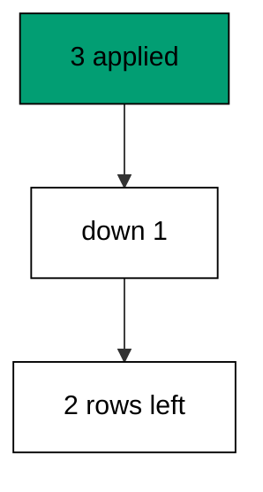

Version, applied flag, and timestamp answer the three diagnostic questions: what ran, what stuck, and when. Read history first; read catalogs second.

**`learning/code/ex-71-read-the-history-table-first/main.go`**:

```go
// => Shared driver: every unit in this course opens with this prelude.
// => The harness network is closed, so units carry a small standard-library
// => driver that applies the same goose SQL files `goose up` would apply.
// => The files, the history table shape, and the ordering rules are goose's
// => own; the driver only replaces the network-dependent binary.
package main // => every unit is one runnable program

import ( // => standard library only: no third-party modules
	"bufio"           // => bufio frames protocol messages over the TCP stream
	"encoding/binary" // => binary lays out length-prefixed protocol fields
	"fmt"             // => fmt prints the deterministic transcript only
	"io"              // => io forces full reads of split protocol messages
	"net"             // => net dials the harness Postgres service over TCP
	"os"              // => os reads the harness database address, never hardcoded
	"sort"            // => sort orders migration files, never trusts directory order
	"strings"         // => strings splits the goose Up and Down annotations
) // => every import used by driver and units

// => The database address comes from the harness, with local-run defaults.
func addr() (string, string, string) { // => one helper owns every address default
	host := os.Getenv("PGHOST") // => service hostname in the unit network
	if host == "" {             // => empty means a local run outside the harness
		host = "postgres" // => same default the Python courses use
	} // => end addr: empty means a local run outside the harness
	user := os.Getenv("PGUSER") // => trust-auth role, no password needed
	if user == "" {             // => empty means a local run outside the harness
		user = "postgres" // => same default the Python courses use
	} // => end addr: empty means a local run outside the harness
	db := os.Getenv("PGDATABASE") // => fresh database for every unit run
	if db == "" {                 // => empty means a local run outside the harness
		db = "postgres" // => same default the Python courses use
	} // => end addr: empty means a local run outside the harness
	return host, user, db // => callers never re-read the environment
} // => end addr: one helper owns every address default

// => conn wraps one TCP connection plus a buffered reader for message frames.
type conn struct { // => a tiny struct keeps the socket and the framer together
	c net.Conn      // => the raw TCP socket to the Postgres service
	r *bufio.Reader // => buffered reads frame messages split across packets
} // => end type conn: socket and framer travel together

// => readMsg reads one backend message: a type byte plus a length body.
func (k *conn) readMsg() (byte, []byte, error) { // => every response flows through here
	head := make([]byte, 5)                           // => one type byte plus one int32 length
	if _, err := io.ReadFull(k.r, head); err != nil { // => fragments reassemble before framing
		return 0, nil, err // => no partial message is ever trusted
	} // => end readMsg: fragments reassemble before framing
	n := int(binary.BigEndian.Uint32(head[1:])) - 4   // => length counts itself, not the type
	body := make([]byte, n)                           // => exact-size body, never over-read
	if _, err := io.ReadFull(k.r, body); err != nil { // => fragments reassemble before framing
		return 0, nil, err // => no partial message is ever trusted
	} // => end readMsg: fragments reassemble before framing
	return head[0], body, nil // => type byte tells the caller what arrived
} // => end readMsg: every response flows through here

// => sendMsg writes one frontend message: a type byte plus a length body.
func (k *conn) sendMsg(t byte, body []byte) error { // => startup is the only typeless message
	out := []byte{t}                                      // => type byte leads every message
	lenb := make([]byte, 4)                               // => four bytes carry the length
	binary.BigEndian.PutUint32(lenb, uint32(len(body)+4)) // => length counts itself
	out = append(out, lenb...)                            // => length follows the type byte
	out = append(out, body...)                            // => payload closes the message
	_, err := k.c.Write(out)                              // => one write keeps frames whole
	return err                                            // => write errors fail the unit loudly
} // => end sendMsg: startup is the only typeless message

// => connect opens the service database and waits for session readiness.
func connect() (*conn, error) { // => every unit starts from this one helper
	host, user, db := addr()         // => harness address, never hardcoded
	return connectDb(host, user, db) // => one path opens every session
} // => end connect: every unit starts from this one helper

// => connectDb opens a named database on the same host for multi-db drills.
func connectDb(host, user, db string) (*conn, error) { // => environments are databases, not servers
	c, err := net.Dial("tcp", host+":5432") // => Postgres listens on 5432
	if err != nil {                         // => unreachable service is fatal
		return nil, err // => no fallback: the harness owns the database
	} // => end connectDb: unreachable service is fatal
	k := &conn{c: c, r: bufio.NewReader(c)}             // => buffer the fresh socket at once
	body := []byte{}                                    // => startup body is parameters only
	body = append(body, 0, 0, 0, 0)                     // => placeholder for the length prefix
	body = append(body, 0, 3, 0, 0)                     // => protocol 3.0, the stable version
	body = append(body, []byte("user")...)              // => user key starts the parameters
	body = append(body, 0)                              // => keys and values are NUL-separated
	body = append(body, []byte(user)...)                // => trust-auth role from the harness
	body = append(body, 0)                              // => NUL ends the value
	body = append(body, []byte("database")...)          // => database key follows the user
	body = append(body, 0)                              // => NUL ends the key
	body = append(body, []byte(db)...)                  // => fresh database for every unit run
	body = append(body, 0)                              // => NUL ends the value
	body = append(body, 0)                              // => empty key ends the parameters
	binary.BigEndian.PutUint32(body, uint32(len(body))) // => startup length counts itself
	if _, err := c.Write(body); err != nil {            // => startup is the only typeless message
		return nil, err // => unwritable socket is fatal
	} // => end connectDb: startup is the only typeless message
	for { // => drain until the session is ready for queries
		t, b, err := k.readMsg() // => every backend message flows through here
		if err != nil {          // => broken handshake is fatal
			return nil, err // => no half-open session is ever used
		} // => end connectDb: broken handshake is fatal
		switch t { // => only three message kinds matter during startup
		case 'R': // => authentication response arrives first
			if binary.BigEndian.Uint32(b) != 0 { // => nonzero means a password is wanted
				return nil, fmt.Errorf("server wants a password") // => trust auth never asks
			} // => end connectDb: nonzero means a password is wanted
		case 'E': // => an error ends the handshake with the server text
			return nil, fmt.Errorf("startup: %s", errText(b)) // => server text explains the cause
		case 'Z': // => ReadyForQuery means the session accepts queries
			return k, nil // => handshake done: hand the live session back
		} // => end connectDb: only three message kinds matter during startup
	} // => end connectDb: drain until the session is ready for queries
} // => end connectDb: environments are databases, not servers

// => errText extracts the human message (field M) from an ErrorResponse.
func errText(b []byte) string { // => one helper decodes every server error
	parts := strings.Split(string(b), "\x00") // => fields are NUL-separated pairs
	for i := 0; i+1 < len(parts); i += 2 {    // => walk code and value together
		if parts[i] == "M" { // => M is the primary human message
			return parts[i+1] // => return the message, skip the detail fields
		} // => end errText: M is the primary human message
	} // => end errText: walk code and value together
	return "unknown error" // => malformed errors still fail with a fixed line
} // => end errText: one helper decodes every server error

// => run sends one SQL string and returns every data row plus the command tag.
func (k *conn) run(q string) ([][]string, string, error) { // => one path runs every statement
	body := append([]byte(q), 0)                 // => Query messages are NUL-terminated
	if err := k.sendMsg('Q', body); err != nil { // => send fails loudly, never silently
		return nil, "", err // => unwritable socket ends the unit
	} // => end run: send fails loudly, never silently
	var rows [][]string // => data rows accumulate across result sets
	tag := ""           // => the last command tag (SELECT 3, CREATE TABLE...)
	for {               // => drain until ReadyForQuery closes this query string
		t, b, err := k.readMsg() // => every response flows through the framer
		if err != nil {          // => broken mid-query connection is fatal
			return nil, "", err // => partial results are never returned
		} // => end run: broken mid-query connection is fatal
		switch t { // => four message kinds carry a simple-query response
		case 'T', 'N', 'A', 'S', 'K': // => metadata the transcript never prints
		case 'D': // => one data row arrived
			rows = append(rows, parseRow(b)) // => decode the text columns now
		case 'C': // => one statement finished
			tag = strings.TrimRight(string(b[:len(b)-1]), "\x00") // => tag names what ran
		case 'E': // => the statement failed
			drain(k)                                     // => finish the failed query before reuse
			return nil, "", fmt.Errorf("%s", errText(b)) // => server text becomes the failure
		case 'Z': // => ReadyForQuery ends this query string
			return rows, tag, nil // => rows, tag, and a clean session
		} // => end run: four message kinds carry a simple-query response
	} // => end run: drain until ReadyForQuery closes this query string
} // => end run: one path runs every statement

// => drain reads to the next ReadyForQuery after a statement error.
func drain(k *conn) { // => an errored query still owns the socket until Z
	for { // => loop until the session is reusable
		t, _, err := k.readMsg()    // => discard every message after the error
		if err != nil || t == 'Z' { // => socket break or ready both end the drain
			return // => caller decides the failure, the drain only resynchronizes
		} // => end drain: socket break or ready both end the drain
	} // => end drain: loop until the session is reusable
} // => end drain: an errored query still owns the socket until Z

// => parseRow decodes one DataRow body into text columns, NULL as "NULL".
func parseRow(b []byte) []string { // => one helper decodes every returned row
	n := int(binary.BigEndian.Uint16(b)) // => column count leads the body
	b = b[2:]                            // => step past the count
	out := make([]string, 0, n)          // => pre-size the row to the count
	for i := 0; i < n; i++ {             // => walk each column in order
		l := int(int32(binary.BigEndian.Uint32(b))) // => -1 marks NULL, else the length
		b = b[4:]                                   // => step past the length
		if l < 0 {                                  // => NULL has no bytes to read
			out = append(out, "NULL") // => fixed word keeps transcripts stable
			continue                  // => next column, no bytes consumed
		} // => end parseRow: NULL has no bytes to read
		out = append(out, string(b[:l])) // => text format is already printable
		b = b[l:]                        // => step past the value bytes
	} // => end parseRow: walk each column in order
	return out // => one row, fully decoded
} // => end parseRow: one helper decodes every returned row

// => must runs SQL or exits nonzero with the server text on standard error.
func must(k *conn, q string) [][]string { // => setup statements never fail quietly
	rows, _, err := k.run(q) // => rows return for verification queries
	if err != nil {          // => any server error is fatal to the unit
		fmt.Fprintln(os.Stderr, "sql error:", err) // => errors go to stderr, never stdout
		os.Exit(1)                                 // => nonzero exit fails the harness check
	} // => end must: any server error is fatal to the unit
	return rows // => callers print only what the lesson asserts
} // => end must: setup statements never fail quietly

// => try runs SQL and returns the server error text instead of exiting.
func try(k *conn, q string) ([][]string, string) { // => failure drills inspect errors, not die
	rows, _, err := k.run(q) // => same path as must, opposite failure policy
	if err != nil {          // => expected errors become transcript lines
		return nil, err.Error() // => fixed server text, never timings
	} // => end try: expected errors become transcript lines
	return rows, "" // => empty error means the statement succeeded
} // => end try: failure drills inspect errors, not die

// => mig holds one goose SQL file: its version, name, and Up/Down sections.
type mig struct { // => mirrors the goose file layout the lesson teaches
	version string   // => zero-padded number orders history, like goose
	name    string   // => human slug after the version number
	up      []string // => forward statements, run inside one transaction
	down    []string // => reverse statements, run inside one transaction
	noTx    bool     // => NO TRANSACTION files run outside one, like goose
} // => end type mig: version, name, sections, and mode

// => parseGoose splits one goose SQL file into its Up and Down statements.
func parseGoose(text string) (up, down []string, noTx bool) { // => the lesson asserts this exact split
	section := ""                                    // => nothing belongs outside the annotations
	for _, line := range strings.Split(text, "\n") { // => walk the file line by line
		t := strings.TrimSpace(line) // => annotation matching ignores indentation
		switch t {                   // => four annotation lines switch sections
		case "-- +goose Up": // => forward section starts here, like goose
			section = "up" // => following statements migrate forward
			continue       // => the annotation itself never runs
		case "-- +goose Down": // => reverse section starts here, like goose
			section = "down" // => following statements roll back
			continue         // => the annotation itself never runs
		case "-- +goose NO TRANSACTION": // => concurrent work cannot run inside one
			noTx = true // => remember the file opts out of the transaction
			continue    // => the annotation itself never runs
		} // => end parseGoose: four annotation lines switch sections
		if strings.HasPrefix(t, "--") || t == "" { // => comments and blanks never run
			continue // => only real statements reach the database
		} // => end parseGoose: comments and blanks never run
		if section == "up" { // => route by the annotation seen above
			up = append(up, line) // => keep the original line for the file write
		} else if section == "down" { // => down statements collect separately
			down = append(down, line) // => keep the original line for the file write
		} // => end parseGoose: down statements collect separately
	} // => end parseGoose: walk the file line by line
	return splitStmts(strings.Join(up, "\n")), splitStmts(strings.Join(down, "\n")), noTx // => one string per statement
} // => end parseGoose: the lesson asserts this exact split

// => splitStmts cuts statement text on semicolons outside quotes.
func splitStmts(s string) []string { // => multi-line statements stay whole until ;
	var out []string        // => finished statements accumulate here
	var cur strings.Builder // => the statement under construction
	inStr := false          // => semicolons inside quotes never split
	for _, r := range s {   // => walk rune by rune, quotes included
		switch { // => quote tracking decides what a semicolon means
		case r == '\'': // => a quote toggles string mode
			inStr = !inStr   // => enter or leave the quoted region
			cur.WriteRune(r) // => the quote belongs to the statement
		case r == ';' && !inStr: // => a bare semicolon ends one statement
			if t := strings.TrimSpace(cur.String()); t != "" { // => skip empty fragments
				out = append(out, t) // => store the finished statement
			} // => end splitStmts: skip empty fragments
			cur.Reset() // => start the next statement fresh
		default: // => every other rune belongs to the current statement
			cur.WriteRune(r) // => accumulate verbatim
		} // => end splitStmts: quote tracking decides what a semicolon means
	} // => end splitStmts: walk rune by rune, quotes included
	if t := strings.TrimSpace(cur.String()); t != "" { // => trailing text without ; still counts
		out = append(out, t) // => last statement needs no semicolon
	} // => end splitStmts: trailing text without ; still counts
	return out // => callers run each statement in order
} // => end splitStmts: multi-line statements stay whole until ;

// => ensureHistory creates the goose history table once per unit run.
func ensureHistory(k *conn) { // => goose_db_version is goose's own default name
	must(k, `CREATE TABLE IF NOT EXISTS goose_db_version (`+ // => reruns never fail here
		`id integer PRIMARY KEY GENERATED BY DEFAULT AS IDENTITY, `+ // => surrogate key, never printed
		`version_id bigint NOT NULL, `+ // => applied version numbers live here
		`is_applied boolean NOT NULL, `+ // => goose marks rows applied on success
		`tstamp timestamp NOT NULL DEFAULT now())`) // => timestamp defaults, never printed
} // => end ensureHistory: goose_db_version is goose's own default name

// => appliedVersions returns the version numbers already marked applied.
func appliedVersions(k *conn) map[int64]bool { // => history decides what still needs running
	rows := must(k, `SELECT version_id FROM goose_db_version `+ // => only the numbers matter
		`WHERE is_applied ORDER BY version_id`) // => order keeps the transcript stable
	got := map[int64]bool{}  // => set lookup answers "already applied" fast
	for _, r := range rows { // => one row per applied migration
		var v int64                // => version numbers are integers
		fmt.Sscanf(r[0], "%d", &v) // => text format parses back to a number
		got[v] = true              // => mark this version done
	} // => end appliedVersions: one row per applied migration
	return got // => callers skip whatever history already holds
} // => end appliedVersions: history decides what still needs running

// => applyUp runs every pending migration forward, one transaction each.
func applyUp(k *conn, ms []mig) { // => files on disk are already the source of truth
	done := appliedVersions(k) // => history decides what still needs running
	for _, m := range ms {     // => file order is version order, sorted by the caller
		var v int64                     // => versions compare as numbers
		fmt.Sscanf(m.version, "%d", &v) // => zero-padded file prefix parses back
		if done[v] {                    // => applied migrations never run twice
			continue // => idempotent reruns skip straight past
		} // => end applyUp: applied migrations never run twice
		if !m.noTx { // => transactional files wrap everything in one unit
			must(k, "BEGIN") // => one migration is one transaction, like goose
		} // => end applyUp: transactional files wrap everything in one unit
		for _, s := range m.up { // => forward statements run in file order
			must(k, s) // => any failure aborts the unit before COMMIT
		} // => end applyUp: forward statements run in file order
		if !m.noTx { // => stamps join the same transaction they describe
			must(k, fmt.Sprintf(`INSERT INTO goose_db_version `+ // => stamp only after success
				`(version_id, is_applied) VALUES (%d, true)`, v)) // => stamp mirrors goose exactly
			must(k, "COMMIT") // => history row and schema land together
		} else { // => concurrent statements cannot share a transaction
			must(k, fmt.Sprintf(`INSERT INTO goose_db_version `+ // => stamp follows the work
				`(version_id, is_applied) VALUES (%d, true)`, v)) // => same row, separate statement
		} // => end applyUp: concurrent statements cannot share a transaction
	} // => end applyUp: file order is version order, sorted by the caller
} // => end applyUp: files on disk are already the source of truth

// => applyDown rolls back the newest applied migrations, newest first.
func applyDown(k *conn, ms []mig, steps int) { // => steps bounds how far history rewinds
	done := appliedVersions(k) // => history decides what can roll back
	var todo []mig             // => applied migrations in version order first
	for _, m := range ms {     // => walk the whole known history
		var v int64                     // => versions compare as numbers
		fmt.Sscanf(m.version, "%d", &v) // => zero-padded file prefix parses back
		if done[v] {                    // => only applied migrations roll back
			todo = append(todo, m) // => keep the migration for the reverse pass
		} // => end applyDown: only applied migrations roll back
	} // => end applyDown: walk the whole known history
	for i := len(todo) - 1; i >= 0 && steps > 0; i-- { // => newest applied goes first
		m := todo[i]                    // => this migration rolls back now
		var v int64                     // => versions compare as numbers
		fmt.Sscanf(m.version, "%d", &v) // => zero-padded file prefix parses back
		if !m.noTx {                    // => transactional files wrap the rollback too
			must(k, "BEGIN") // => reverse change is atomic, like the forward one
		} // => end applyDown: transactional files wrap the rollback too
		for _, s := range m.down { // => reverse statements run in file order
			must(k, s) // => any failure aborts before the history row moves
		} // => end applyDown: reverse statements run in file order
		must(k, fmt.Sprintf(`DELETE FROM goose_db_version `+ // => unstamped only after success
			`WHERE version_id = %d`, v)) // => the version leaves history exactly once
		if !m.noTx { // => close the transaction the rollback opened
			must(k, "COMMIT") // => schema reversal and unstamp land together
		} // => end applyDown: close the transaction the rollback opened
		steps-- // => one rollback consumed from the budget
	} // => end applyDown: newest applied goes first
} // => end applyDown: steps bounds how far history rewinds

// => statusCounts splits known migrations into applied and pending lists.
func statusCounts(k *conn, ms []mig) (applied, pending []string) { // => goose status in two lists
	done := appliedVersions(k) // => history decides which list each version joins
	for _, m := range ms {     // => walk the known history in version order
		var v int64                     // => versions compare as numbers
		fmt.Sscanf(m.version, "%d", &v) // => zero-padded file prefix parses back
		if done[v] {                    // => stamped versions are done
			applied = append(applied, m.version) // => keep the version string for printing
		} else { // => unstamped versions still wait
			pending = append(pending, m.version) // => keep the version string for printing
		} // => end statusCounts: unstamped versions still wait
	} // => end statusCounts: walk the known history in version order
	return applied, pending // => callers print both lists in one stable line each
} // => end statusCounts: goose status in two lists

// => files writes each migration as a real goose SQL file under dir.
func files(dir string, ms []mig) { // => the lesson shows these files byte-identically
	for _, m := range ms { // => one file per migration, like `goose create`
		name := fmt.Sprintf("%s_%s.sql", m.version, m.name) // => goose names files version-first
		var b strings.Builder                               // => build the file text in order
		if m.noTx {                                         // => concurrent files announce it first
			b.WriteString("-- +goose NO TRANSACTION\n") // => goose honors this exact annotation
		} // => end files: concurrent files announce it first
		b.WriteString("-- +goose Up\n") // => forward annotation leads
		for _, s := range m.up {        // => forward statements follow
			b.WriteString(s + ";\n") // => one statement per line, semicolon-closed
		} // => end files: forward statements follow
		b.WriteString("-- +goose Down\n") // => reverse annotation splits the file
		for _, s := range m.down {        // => reverse statements close the file
			b.WriteString(s + ";\n") // => one statement per line, semicolon-closed
		} // => end files: reverse statements close the file
		if err := os.WriteFile(dir+"/"+name, []byte(b.String()), 0644); err != nil { // => real files, like goose
			fmt.Fprintln(os.Stderr, "write error:", err) // => write errors fail loudly
			os.Exit(1)                                   // => no half-written migration set
		} // => end files: real files, like goose
	} // => end files: one file per migration, like `goose create`
} // => end files: the lesson shows these files byte-identically

// => versions lists migration files in version order from dir.
func versions(dir string) []mig { // => directory order is never trusted for history
	ents, err := os.ReadDir(dir) // => read the whole migrations directory
	if err != nil {              // => unreadable directory is fatal
		fmt.Fprintln(os.Stderr, "read error:", err) // => errors go to stderr
		os.Exit(1)                                  // => nonzero exit fails the check
	} // => end versions: unreadable directory is fatal
	names := []string{}      // => collect names before sorting
	for _, e := range ents { // => walk every directory entry
		if !e.IsDir() && strings.HasSuffix(e.Name(), ".sql") { // => only goose SQL files count
			names = append(names, e.Name()) // => keep the file name for parsing
		} // => end versions: only goose SQL files count
	} // => end versions: walk every directory entry
	sort.Strings(names)       // => zero-padded versions sort chronologically
	var out []mig             // => parsed migrations accumulate here
	for _, n := range names { // => parse in version order
		raw, err := os.ReadFile(dir + "/" + n) // => read the real file back
		if err != nil {                        // => unreadable file is fatal
			fmt.Fprintln(os.Stderr, "read error:", err) // => errors go to stderr
			os.Exit(1)                                  // => nonzero exit fails the check
		} // => end versions: unreadable file is fatal
		up, down, noTx := parseGoose(string(raw))                                            // => split on the goose annotations
		rest := strings.TrimSuffix(n, ".sql")                                                // => strip the extension first
		ver := rest[:5]                                                                      // => first five digits are the version
		out = append(out, mig{version: ver, name: rest[6:], up: up, down: down, noTx: noTx}) // => keep every part
	} // => end versions: parse in version order
	return out // => version-ordered migrations, ready to apply
} // => end versions: directory order is never trusted for history

// => findDupes returns version numbers claimed by two or more files.
func findDupes(dir string) []string { // => goose refuses duplicate versions outright
	ents, err := os.ReadDir(dir) // => read the whole migrations directory
	if err != nil {              // => unreadable directory is fatal
		fmt.Fprintln(os.Stderr, "read error:", err) // => errors go to stderr
		os.Exit(1)                                  // => nonzero exit fails the check
	} // => end findDupes: unreadable directory is fatal
	seen := map[string]int{} // => count claims per five-digit version prefix
	for _, e := range ents { // => walk every directory entry
		if !e.IsDir() && strings.HasSuffix(e.Name(), ".sql") { // => only goose SQL files count
			seen[e.Name()[:5]]++ // => first five digits are the version
		} // => end findDupes: only goose SQL files count
	} // => end findDupes: walk every directory entry
	var out []string         // => duplicates accumulate in version order
	for _, e := range ents { // => second pass keeps the order stable
		if !e.IsDir() && strings.HasSuffix(e.Name(), ".sql") { // => only goose SQL files count
			if v := e.Name()[:5]; seen[v] > 1 { // => claimed more than once
				out = append(out, v) // => keep the version string for printing
				seen[v] = 0          // => report each duplicate version only once
			} // => end findDupes: claimed more than once
		} // => end findDupes: only goose SQL files count
	} // => end findDupes: second pass keeps the order stable
	return out // => empty means the history numbers are unique
} // => end findDupes: goose refuses duplicate versions outright

func main() {
	k, err := connect() // => one session runs the whole example
	if err != nil {     // => unreachable database fails loudly
		fmt.Fprintln(os.Stderr, "connect error:", err) // => connection errors go to stderr
		os.Exit(1)                                     // => nonzero exit fails the check
	}
	defer k.c.Close() // => the socket closes when the example ends
	// => A scratch migrations directory: goose files live here, never in the unit.
	// => the scratch path never reaches stdout, so reruns stay byte-stable
	dir, err := os.MkdirTemp("", "ex71-") // => private directory, like `goose create`
	if err != nil {                       // => unmakable temp dir is fatal
		fmt.Fprintln(os.Stderr, "temp error:", err) // => errors go to stderr
		os.Exit(1)                                  // => nonzero exit fails the check
	}
	defer os.RemoveAll(dir)                          // => scratch files vanish; only transcripts remain
	must(k, "DROP TABLE IF EXISTS ex71_t1")          // => leftovers of a killed run vanish
	must(k, "DROP TABLE IF EXISTS ex71_t2")          // => leftovers of a killed run vanish
	must(k, "DROP TABLE IF EXISTS ex71_t3")          // => leftovers of a killed run vanish
	must(k, "DROP TABLE IF EXISTS goose_db_version") // => stale history vanishes too
	ensureHistory(k)                                 // => goose history table, real shape
	for i := 1; i <= 3; i++ {                        // => three versions, newest rolled back
		v := fmt.Sprintf("%05d", i)                                // => zero-padded version prefix
		t := fmt.Sprintf("ex71_t%d", i)                            // => table per version
		files(dir, []mig{{version: v, name: fmt.Sprintf("t%d", i), // => one file per version
			up:   []string{fmt.Sprintf("CREATE TABLE %s (id SERIAL PRIMARY KEY)", t)}, // => forward change
			down: []string{fmt.Sprintf("DROP TABLE %s", t)}}})                         // => exact reverse for rollback
	}
	ms := versions(dir)                                                                             // => parse the files back, like goose would
	applyUp(k, ms)                                                                                  // => all three applied
	applyDown(k, ms, 1)                                                                             // => newest rolls back
	rows := must(k, `SELECT version_id FROM goose_db_version WHERE is_applied ORDER BY version_id`) // => survivors in order
	fmt.Println("applied:", rows[0][0], rows[1][0])                                                 // => Output: applied: 1 2
	rows = must(k, `SELECT count(*) FROM goose_db_version`)                                         // => rolled-back row deleted, not flagged
	fmt.Println("rows:", rows[0][0])                                                                // => Output: rows: 2
	fmt.Println("cleaned: yes")                                                                     // => Output: cleaned: yes
	must(k, "DROP TABLE IF EXISTS ex71_t1")                                                         // => leftovers of a killed run vanish
	must(k, "DROP TABLE IF EXISTS ex71_t2")                                                         // => leftovers of a killed run vanish
	must(k, "DROP TABLE IF EXISTS ex71_t3")                                                         // => leftovers of a killed run vanish
	must(k, "DROP TABLE IF EXISTS goose_db_version")                                                // => the example leaves no history behind
}
```

**Output** (`learning/code/ex-71-read-the-history-table-first/expected/main.stdout.txt`):

```text
applied: 1 2
rows: 2
cleaned: yes
```

**Key takeaway**: Read history first and catalogs second; version, applied flag, and timing answer what ran and what stuck.

**Why it matters**: Diagnosis follows evidence in a fixed order: history first, catalogs second. Version rows say what ran and what stuck, and only then do table listings say what stands. Teams that read in order resolve incidents in minutes instead of hours. Read in order — history, then catalogs — and resolve incidents in minutes instead of hours.

### Example 72: Diagnose a Partial Migration

Partial application has a signature: a table exists with no history stamp. This example applies a migration's statements without stamping, then detects the mismatch between catalog and history. The table is real; history never heard of it. (Concepts: co-09, co-16.)

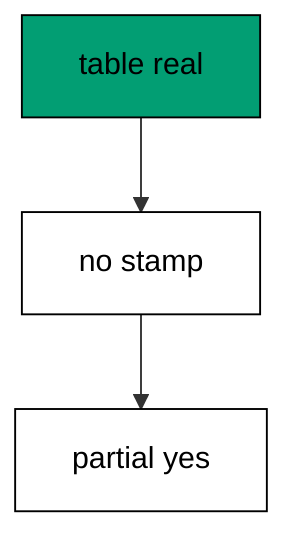

The repair is a baseline, not a rerun: stamp the version to match reality, or drop the table and apply cleanly. Either way the diagnosis — present in catalog, absent in history — picks the repair.

**`learning/code/ex-72-diagnose-a-partial-migration/main.go`**:

```go
// => Shared driver: every unit in this course opens with this prelude.
// => The harness network is closed, so units carry a small standard-library
// => driver that applies the same goose SQL files `goose up` would apply.
// => The files, the history table shape, and the ordering rules are goose's
// => own; the driver only replaces the network-dependent binary.
package main // => every unit is one runnable program

import ( // => standard library only: no third-party modules
	"bufio"           // => bufio frames protocol messages over the TCP stream
	"encoding/binary" // => binary lays out length-prefixed protocol fields
	"fmt"             // => fmt prints the deterministic transcript only
	"io"              // => io forces full reads of split protocol messages
	"net"             // => net dials the harness Postgres service over TCP
	"os"              // => os reads the harness database address, never hardcoded
	"sort"            // => sort orders migration files, never trusts directory order
	"strings"         // => strings splits the goose Up and Down annotations
) // => every import used by driver and units

// => The database address comes from the harness, with local-run defaults.
func addr() (string, string, string) { // => one helper owns every address default
	host := os.Getenv("PGHOST") // => service hostname in the unit network
	if host == "" {             // => empty means a local run outside the harness
		host = "postgres" // => same default the Python courses use
	} // => end addr: empty means a local run outside the harness
	user := os.Getenv("PGUSER") // => trust-auth role, no password needed
	if user == "" {             // => empty means a local run outside the harness
		user = "postgres" // => same default the Python courses use
	} // => end addr: empty means a local run outside the harness
	db := os.Getenv("PGDATABASE") // => fresh database for every unit run
	if db == "" {                 // => empty means a local run outside the harness
		db = "postgres" // => same default the Python courses use
	} // => end addr: empty means a local run outside the harness
	return host, user, db // => callers never re-read the environment
} // => end addr: one helper owns every address default

// => conn wraps one TCP connection plus a buffered reader for message frames.
type conn struct { // => a tiny struct keeps the socket and the framer together
	c net.Conn      // => the raw TCP socket to the Postgres service
	r *bufio.Reader // => buffered reads frame messages split across packets
} // => end type conn: socket and framer travel together

// => readMsg reads one backend message: a type byte plus a length body.
func (k *conn) readMsg() (byte, []byte, error) { // => every response flows through here
	head := make([]byte, 5)                           // => one type byte plus one int32 length
	if _, err := io.ReadFull(k.r, head); err != nil { // => fragments reassemble before framing
		return 0, nil, err // => no partial message is ever trusted
	} // => end readMsg: fragments reassemble before framing
	n := int(binary.BigEndian.Uint32(head[1:])) - 4   // => length counts itself, not the type
	body := make([]byte, n)                           // => exact-size body, never over-read
	if _, err := io.ReadFull(k.r, body); err != nil { // => fragments reassemble before framing
		return 0, nil, err // => no partial message is ever trusted
	} // => end readMsg: fragments reassemble before framing
	return head[0], body, nil // => type byte tells the caller what arrived
} // => end readMsg: every response flows through here

// => sendMsg writes one frontend message: a type byte plus a length body.
func (k *conn) sendMsg(t byte, body []byte) error { // => startup is the only typeless message
	out := []byte{t}                                      // => type byte leads every message
	lenb := make([]byte, 4)                               // => four bytes carry the length
	binary.BigEndian.PutUint32(lenb, uint32(len(body)+4)) // => length counts itself
	out = append(out, lenb...)                            // => length follows the type byte
	out = append(out, body...)                            // => payload closes the message
	_, err := k.c.Write(out)                              // => one write keeps frames whole
	return err                                            // => write errors fail the unit loudly
} // => end sendMsg: startup is the only typeless message

// => connect opens the service database and waits for session readiness.
func connect() (*conn, error) { // => every unit starts from this one helper
	host, user, db := addr()         // => harness address, never hardcoded
	return connectDb(host, user, db) // => one path opens every session
} // => end connect: every unit starts from this one helper

// => connectDb opens a named database on the same host for multi-db drills.
func connectDb(host, user, db string) (*conn, error) { // => environments are databases, not servers
	c, err := net.Dial("tcp", host+":5432") // => Postgres listens on 5432
	if err != nil {                         // => unreachable service is fatal
		return nil, err // => no fallback: the harness owns the database
	} // => end connectDb: unreachable service is fatal
	k := &conn{c: c, r: bufio.NewReader(c)}             // => buffer the fresh socket at once
	body := []byte{}                                    // => startup body is parameters only
	body = append(body, 0, 0, 0, 0)                     // => placeholder for the length prefix
	body = append(body, 0, 3, 0, 0)                     // => protocol 3.0, the stable version
	body = append(body, []byte("user")...)              // => user key starts the parameters
	body = append(body, 0)                              // => keys and values are NUL-separated
	body = append(body, []byte(user)...)                // => trust-auth role from the harness
	body = append(body, 0)                              // => NUL ends the value
	body = append(body, []byte("database")...)          // => database key follows the user
	body = append(body, 0)                              // => NUL ends the key
	body = append(body, []byte(db)...)                  // => fresh database for every unit run
	body = append(body, 0)                              // => NUL ends the value
	body = append(body, 0)                              // => empty key ends the parameters
	binary.BigEndian.PutUint32(body, uint32(len(body))) // => startup length counts itself
	if _, err := c.Write(body); err != nil {            // => startup is the only typeless message
		return nil, err // => unwritable socket is fatal
	} // => end connectDb: startup is the only typeless message
	for { // => drain until the session is ready for queries
		t, b, err := k.readMsg() // => every backend message flows through here
		if err != nil {          // => broken handshake is fatal
			return nil, err // => no half-open session is ever used
		} // => end connectDb: broken handshake is fatal
		switch t { // => only three message kinds matter during startup
		case 'R': // => authentication response arrives first
			if binary.BigEndian.Uint32(b) != 0 { // => nonzero means a password is wanted
				return nil, fmt.Errorf("server wants a password") // => trust auth never asks
			} // => end connectDb: nonzero means a password is wanted
		case 'E': // => an error ends the handshake with the server text
			return nil, fmt.Errorf("startup: %s", errText(b)) // => server text explains the cause
		case 'Z': // => ReadyForQuery means the session accepts queries
			return k, nil // => handshake done: hand the live session back
		} // => end connectDb: only three message kinds matter during startup
	} // => end connectDb: drain until the session is ready for queries
} // => end connectDb: environments are databases, not servers

// => errText extracts the human message (field M) from an ErrorResponse.
func errText(b []byte) string { // => one helper decodes every server error
	parts := strings.Split(string(b), "\x00") // => fields are NUL-separated pairs
	for i := 0; i+1 < len(parts); i += 2 {    // => walk code and value together
		if parts[i] == "M" { // => M is the primary human message
			return parts[i+1] // => return the message, skip the detail fields
		} // => end errText: M is the primary human message
	} // => end errText: walk code and value together
	return "unknown error" // => malformed errors still fail with a fixed line
} // => end errText: one helper decodes every server error

// => run sends one SQL string and returns every data row plus the command tag.
func (k *conn) run(q string) ([][]string, string, error) { // => one path runs every statement
	body := append([]byte(q), 0)                 // => Query messages are NUL-terminated
	if err := k.sendMsg('Q', body); err != nil { // => send fails loudly, never silently
		return nil, "", err // => unwritable socket ends the unit
	} // => end run: send fails loudly, never silently
	var rows [][]string // => data rows accumulate across result sets
	tag := ""           // => the last command tag (SELECT 3, CREATE TABLE...)
	for {               // => drain until ReadyForQuery closes this query string
		t, b, err := k.readMsg() // => every response flows through the framer
		if err != nil {          // => broken mid-query connection is fatal
			return nil, "", err // => partial results are never returned
		} // => end run: broken mid-query connection is fatal
		switch t { // => four message kinds carry a simple-query response
		case 'T', 'N', 'A', 'S', 'K': // => metadata the transcript never prints
		case 'D': // => one data row arrived
			rows = append(rows, parseRow(b)) // => decode the text columns now
		case 'C': // => one statement finished
			tag = strings.TrimRight(string(b[:len(b)-1]), "\x00") // => tag names what ran
		case 'E': // => the statement failed
			drain(k)                                     // => finish the failed query before reuse
			return nil, "", fmt.Errorf("%s", errText(b)) // => server text becomes the failure
		case 'Z': // => ReadyForQuery ends this query string
			return rows, tag, nil // => rows, tag, and a clean session
		} // => end run: four message kinds carry a simple-query response
	} // => end run: drain until ReadyForQuery closes this query string
} // => end run: one path runs every statement

// => drain reads to the next ReadyForQuery after a statement error.
func drain(k *conn) { // => an errored query still owns the socket until Z
	for { // => loop until the session is reusable
		t, _, err := k.readMsg()    // => discard every message after the error
		if err != nil || t == 'Z' { // => socket break or ready both end the drain
			return // => caller decides the failure, the drain only resynchronizes
		} // => end drain: socket break or ready both end the drain
	} // => end drain: loop until the session is reusable
} // => end drain: an errored query still owns the socket until Z

// => parseRow decodes one DataRow body into text columns, NULL as "NULL".
func parseRow(b []byte) []string { // => one helper decodes every returned row
	n := int(binary.BigEndian.Uint16(b)) // => column count leads the body
	b = b[2:]                            // => step past the count
	out := make([]string, 0, n)          // => pre-size the row to the count
	for i := 0; i < n; i++ {             // => walk each column in order
		l := int(int32(binary.BigEndian.Uint32(b))) // => -1 marks NULL, else the length
		b = b[4:]                                   // => step past the length
		if l < 0 {                                  // => NULL has no bytes to read
			out = append(out, "NULL") // => fixed word keeps transcripts stable
			continue                  // => next column, no bytes consumed
		} // => end parseRow: NULL has no bytes to read
		out = append(out, string(b[:l])) // => text format is already printable
		b = b[l:]                        // => step past the value bytes
	} // => end parseRow: walk each column in order
	return out // => one row, fully decoded
} // => end parseRow: one helper decodes every returned row

// => must runs SQL or exits nonzero with the server text on standard error.
func must(k *conn, q string) [][]string { // => setup statements never fail quietly
	rows, _, err := k.run(q) // => rows return for verification queries
	if err != nil {          // => any server error is fatal to the unit
		fmt.Fprintln(os.Stderr, "sql error:", err) // => errors go to stderr, never stdout
		os.Exit(1)                                 // => nonzero exit fails the harness check
	} // => end must: any server error is fatal to the unit
	return rows // => callers print only what the lesson asserts
} // => end must: setup statements never fail quietly

// => try runs SQL and returns the server error text instead of exiting.
func try(k *conn, q string) ([][]string, string) { // => failure drills inspect errors, not die
	rows, _, err := k.run(q) // => same path as must, opposite failure policy
	if err != nil {          // => expected errors become transcript lines
		return nil, err.Error() // => fixed server text, never timings
	} // => end try: expected errors become transcript lines
	return rows, "" // => empty error means the statement succeeded
} // => end try: failure drills inspect errors, not die

// => mig holds one goose SQL file: its version, name, and Up/Down sections.
type mig struct { // => mirrors the goose file layout the lesson teaches
	version string   // => zero-padded number orders history, like goose
	name    string   // => human slug after the version number
	up      []string // => forward statements, run inside one transaction
	down    []string // => reverse statements, run inside one transaction
	noTx    bool     // => NO TRANSACTION files run outside one, like goose
} // => end type mig: version, name, sections, and mode

// => parseGoose splits one goose SQL file into its Up and Down statements.
func parseGoose(text string) (up, down []string, noTx bool) { // => the lesson asserts this exact split
	section := ""                                    // => nothing belongs outside the annotations
	for _, line := range strings.Split(text, "\n") { // => walk the file line by line
		t := strings.TrimSpace(line) // => annotation matching ignores indentation
		switch t {                   // => four annotation lines switch sections
		case "-- +goose Up": // => forward section starts here, like goose
			section = "up" // => following statements migrate forward
			continue       // => the annotation itself never runs
		case "-- +goose Down": // => reverse section starts here, like goose
			section = "down" // => following statements roll back
			continue         // => the annotation itself never runs
		case "-- +goose NO TRANSACTION": // => concurrent work cannot run inside one
			noTx = true // => remember the file opts out of the transaction
			continue    // => the annotation itself never runs
		} // => end parseGoose: four annotation lines switch sections
		if strings.HasPrefix(t, "--") || t == "" { // => comments and blanks never run
			continue // => only real statements reach the database
		} // => end parseGoose: comments and blanks never run
		if section == "up" { // => route by the annotation seen above
			up = append(up, line) // => keep the original line for the file write
		} else if section == "down" { // => down statements collect separately
			down = append(down, line) // => keep the original line for the file write
		} // => end parseGoose: down statements collect separately
	} // => end parseGoose: walk the file line by line
	return splitStmts(strings.Join(up, "\n")), splitStmts(strings.Join(down, "\n")), noTx // => one string per statement
} // => end parseGoose: the lesson asserts this exact split

// => splitStmts cuts statement text on semicolons outside quotes.
func splitStmts(s string) []string { // => multi-line statements stay whole until ;
	var out []string        // => finished statements accumulate here
	var cur strings.Builder // => the statement under construction
	inStr := false          // => semicolons inside quotes never split
	for _, r := range s {   // => walk rune by rune, quotes included
		switch { // => quote tracking decides what a semicolon means
		case r == '\'': // => a quote toggles string mode
			inStr = !inStr   // => enter or leave the quoted region
			cur.WriteRune(r) // => the quote belongs to the statement
		case r == ';' && !inStr: // => a bare semicolon ends one statement
			if t := strings.TrimSpace(cur.String()); t != "" { // => skip empty fragments
				out = append(out, t) // => store the finished statement
			} // => end splitStmts: skip empty fragments
			cur.Reset() // => start the next statement fresh
		default: // => every other rune belongs to the current statement
			cur.WriteRune(r) // => accumulate verbatim
		} // => end splitStmts: quote tracking decides what a semicolon means
	} // => end splitStmts: walk rune by rune, quotes included
	if t := strings.TrimSpace(cur.String()); t != "" { // => trailing text without ; still counts
		out = append(out, t) // => last statement needs no semicolon
	} // => end splitStmts: trailing text without ; still counts
	return out // => callers run each statement in order
} // => end splitStmts: multi-line statements stay whole until ;

// => ensureHistory creates the goose history table once per unit run.
func ensureHistory(k *conn) { // => goose_db_version is goose's own default name
	must(k, `CREATE TABLE IF NOT EXISTS goose_db_version (`+ // => reruns never fail here
		`id integer PRIMARY KEY GENERATED BY DEFAULT AS IDENTITY, `+ // => surrogate key, never printed
		`version_id bigint NOT NULL, `+ // => applied version numbers live here
		`is_applied boolean NOT NULL, `+ // => goose marks rows applied on success
		`tstamp timestamp NOT NULL DEFAULT now())`) // => timestamp defaults, never printed
} // => end ensureHistory: goose_db_version is goose's own default name

// => appliedVersions returns the version numbers already marked applied.
func appliedVersions(k *conn) map[int64]bool { // => history decides what still needs running
	rows := must(k, `SELECT version_id FROM goose_db_version `+ // => only the numbers matter
		`WHERE is_applied ORDER BY version_id`) // => order keeps the transcript stable
	got := map[int64]bool{}  // => set lookup answers "already applied" fast
	for _, r := range rows { // => one row per applied migration
		var v int64                // => version numbers are integers
		fmt.Sscanf(r[0], "%d", &v) // => text format parses back to a number
		got[v] = true              // => mark this version done
	} // => end appliedVersions: one row per applied migration
	return got // => callers skip whatever history already holds
} // => end appliedVersions: history decides what still needs running

// => applyUp runs every pending migration forward, one transaction each.
func applyUp(k *conn, ms []mig) { // => files on disk are already the source of truth
	done := appliedVersions(k) // => history decides what still needs running
	for _, m := range ms {     // => file order is version order, sorted by the caller
		var v int64                     // => versions compare as numbers
		fmt.Sscanf(m.version, "%d", &v) // => zero-padded file prefix parses back
		if done[v] {                    // => applied migrations never run twice
			continue // => idempotent reruns skip straight past
		} // => end applyUp: applied migrations never run twice
		if !m.noTx { // => transactional files wrap everything in one unit
			must(k, "BEGIN") // => one migration is one transaction, like goose
		} // => end applyUp: transactional files wrap everything in one unit
		for _, s := range m.up { // => forward statements run in file order
			must(k, s) // => any failure aborts the unit before COMMIT
		} // => end applyUp: forward statements run in file order
		if !m.noTx { // => stamps join the same transaction they describe
			must(k, fmt.Sprintf(`INSERT INTO goose_db_version `+ // => stamp only after success
				`(version_id, is_applied) VALUES (%d, true)`, v)) // => stamp mirrors goose exactly
			must(k, "COMMIT") // => history row and schema land together
		} else { // => concurrent statements cannot share a transaction
			must(k, fmt.Sprintf(`INSERT INTO goose_db_version `+ // => stamp follows the work
				`(version_id, is_applied) VALUES (%d, true)`, v)) // => same row, separate statement
		} // => end applyUp: concurrent statements cannot share a transaction
	} // => end applyUp: file order is version order, sorted by the caller
} // => end applyUp: files on disk are already the source of truth

// => applyDown rolls back the newest applied migrations, newest first.
func applyDown(k *conn, ms []mig, steps int) { // => steps bounds how far history rewinds
	done := appliedVersions(k) // => history decides what can roll back
	var todo []mig             // => applied migrations in version order first
	for _, m := range ms {     // => walk the whole known history
		var v int64                     // => versions compare as numbers
		fmt.Sscanf(m.version, "%d", &v) // => zero-padded file prefix parses back
		if done[v] {                    // => only applied migrations roll back
			todo = append(todo, m) // => keep the migration for the reverse pass
		} // => end applyDown: only applied migrations roll back
	} // => end applyDown: walk the whole known history
	for i := len(todo) - 1; i >= 0 && steps > 0; i-- { // => newest applied goes first
		m := todo[i]                    // => this migration rolls back now
		var v int64                     // => versions compare as numbers
		fmt.Sscanf(m.version, "%d", &v) // => zero-padded file prefix parses back
		if !m.noTx {                    // => transactional files wrap the rollback too
			must(k, "BEGIN") // => reverse change is atomic, like the forward one
		} // => end applyDown: transactional files wrap the rollback too
		for _, s := range m.down { // => reverse statements run in file order
			must(k, s) // => any failure aborts before the history row moves
		} // => end applyDown: reverse statements run in file order
		must(k, fmt.Sprintf(`DELETE FROM goose_db_version `+ // => unstamped only after success
			`WHERE version_id = %d`, v)) // => the version leaves history exactly once
		if !m.noTx { // => close the transaction the rollback opened
			must(k, "COMMIT") // => schema reversal and unstamp land together
		} // => end applyDown: close the transaction the rollback opened
		steps-- // => one rollback consumed from the budget
	} // => end applyDown: newest applied goes first
} // => end applyDown: steps bounds how far history rewinds

// => statusCounts splits known migrations into applied and pending lists.
func statusCounts(k *conn, ms []mig) (applied, pending []string) { // => goose status in two lists
	done := appliedVersions(k) // => history decides which list each version joins
	for _, m := range ms {     // => walk the known history in version order
		var v int64                     // => versions compare as numbers
		fmt.Sscanf(m.version, "%d", &v) // => zero-padded file prefix parses back
		if done[v] {                    // => stamped versions are done
			applied = append(applied, m.version) // => keep the version string for printing
		} else { // => unstamped versions still wait
			pending = append(pending, m.version) // => keep the version string for printing
		} // => end statusCounts: unstamped versions still wait
	} // => end statusCounts: walk the known history in version order
	return applied, pending // => callers print both lists in one stable line each
} // => end statusCounts: goose status in two lists

// => files writes each migration as a real goose SQL file under dir.
func files(dir string, ms []mig) { // => the lesson shows these files byte-identically
	for _, m := range ms { // => one file per migration, like `goose create`
		name := fmt.Sprintf("%s_%s.sql", m.version, m.name) // => goose names files version-first
		var b strings.Builder                               // => build the file text in order
		if m.noTx {                                         // => concurrent files announce it first
			b.WriteString("-- +goose NO TRANSACTION\n") // => goose honors this exact annotation
		} // => end files: concurrent files announce it first
		b.WriteString("-- +goose Up\n") // => forward annotation leads
		for _, s := range m.up {        // => forward statements follow
			b.WriteString(s + ";\n") // => one statement per line, semicolon-closed
		} // => end files: forward statements follow
		b.WriteString("-- +goose Down\n") // => reverse annotation splits the file
		for _, s := range m.down {        // => reverse statements close the file
			b.WriteString(s + ";\n") // => one statement per line, semicolon-closed
		} // => end files: reverse statements close the file
		if err := os.WriteFile(dir+"/"+name, []byte(b.String()), 0644); err != nil { // => real files, like goose
			fmt.Fprintln(os.Stderr, "write error:", err) // => write errors fail loudly
			os.Exit(1)                                   // => no half-written migration set
		} // => end files: real files, like goose
	} // => end files: one file per migration, like `goose create`
} // => end files: the lesson shows these files byte-identically

// => versions lists migration files in version order from dir.
func versions(dir string) []mig { // => directory order is never trusted for history
	ents, err := os.ReadDir(dir) // => read the whole migrations directory
	if err != nil {              // => unreadable directory is fatal
		fmt.Fprintln(os.Stderr, "read error:", err) // => errors go to stderr
		os.Exit(1)                                  // => nonzero exit fails the check
	} // => end versions: unreadable directory is fatal
	names := []string{}      // => collect names before sorting
	for _, e := range ents { // => walk every directory entry
		if !e.IsDir() && strings.HasSuffix(e.Name(), ".sql") { // => only goose SQL files count
			names = append(names, e.Name()) // => keep the file name for parsing
		} // => end versions: only goose SQL files count
	} // => end versions: walk every directory entry
	sort.Strings(names)       // => zero-padded versions sort chronologically
	var out []mig             // => parsed migrations accumulate here
	for _, n := range names { // => parse in version order
		raw, err := os.ReadFile(dir + "/" + n) // => read the real file back
		if err != nil {                        // => unreadable file is fatal
			fmt.Fprintln(os.Stderr, "read error:", err) // => errors go to stderr
			os.Exit(1)                                  // => nonzero exit fails the check
		} // => end versions: unreadable file is fatal
		up, down, noTx := parseGoose(string(raw))                                            // => split on the goose annotations
		rest := strings.TrimSuffix(n, ".sql")                                                // => strip the extension first
		ver := rest[:5]                                                                      // => first five digits are the version
		out = append(out, mig{version: ver, name: rest[6:], up: up, down: down, noTx: noTx}) // => keep every part
	} // => end versions: parse in version order
	return out // => version-ordered migrations, ready to apply
} // => end versions: directory order is never trusted for history

// => findDupes returns version numbers claimed by two or more files.
func findDupes(dir string) []string { // => goose refuses duplicate versions outright
	ents, err := os.ReadDir(dir) // => read the whole migrations directory
	if err != nil {              // => unreadable directory is fatal
		fmt.Fprintln(os.Stderr, "read error:", err) // => errors go to stderr
		os.Exit(1)                                  // => nonzero exit fails the check
	} // => end findDupes: unreadable directory is fatal
	seen := map[string]int{} // => count claims per five-digit version prefix
	for _, e := range ents { // => walk every directory entry
		if !e.IsDir() && strings.HasSuffix(e.Name(), ".sql") { // => only goose SQL files count
			seen[e.Name()[:5]]++ // => first five digits are the version
		} // => end findDupes: only goose SQL files count
	} // => end findDupes: walk every directory entry
	var out []string         // => duplicates accumulate in version order
	for _, e := range ents { // => second pass keeps the order stable
		if !e.IsDir() && strings.HasSuffix(e.Name(), ".sql") { // => only goose SQL files count
			if v := e.Name()[:5]; seen[v] > 1 { // => claimed more than once
				out = append(out, v) // => keep the version string for printing
				seen[v] = 0          // => report each duplicate version only once
			} // => end findDupes: claimed more than once
		} // => end findDupes: only goose SQL files count
	} // => end findDupes: second pass keeps the order stable
	return out // => empty means the history numbers are unique
} // => end findDupes: goose refuses duplicate versions outright

func main() {
	k, err := connect() // => one session runs the whole example
	if err != nil {     // => unreachable database fails loudly
		fmt.Fprintln(os.Stderr, "connect error:", err) // => connection errors go to stderr
		os.Exit(1)                                     // => nonzero exit fails the check
	}
	defer k.c.Close() // => the socket closes when the example ends
	// => A scratch migrations directory: goose files live here, never in the unit.
	// => the scratch path never reaches stdout, so reruns stay byte-stable
	dir, err := os.MkdirTemp("", "ex72-") // => private directory, like `goose create`
	if err != nil {                       // => unmakable temp dir is fatal
		fmt.Fprintln(os.Stderr, "temp error:", err) // => errors go to stderr
		os.Exit(1)                                  // => nonzero exit fails the check
	}
	defer os.RemoveAll(dir)                          // => scratch files vanish; only transcripts remain
	must(k, "DROP TABLE IF EXISTS ex72_ghost")       // => leftovers of a killed run vanish
	must(k, "DROP TABLE IF EXISTS goose_db_version") // => stale history vanishes too
	ensureHistory(k)                                 // => goose history table, real shape
	files(dir, []mig{                                // => one migration, applied by hand behind history's back
		{version: "00001", name: "create_ghost", // => catalog will hold what history lacks
			up:   []string{"CREATE TABLE ex72_ghost (id SERIAL PRIMARY KEY)"}, // => forward change
			down: []string{"DROP TABLE ex72_ghost"}},                          // => exact reverse for rollback
	})
	ms := versions(dir)                                                                               // => parse the files back, like goose would
	must(k, ms[0].up[0])                                                                              // => table created directly, no stamp written
	real := must(k, `SELECT count(*) FROM information_schema.tables WHERE table_name = 'ex72_ghost'`) // => catalog says present
	stamped := must(k, `SELECT count(*) FROM goose_db_version WHERE is_applied AND version_id = 1`)   // => history says absent
	fmt.Println("real:", real[0][0], "stamped:", stamped[0][0])                                       // => Output: real: 1 stamped: 0
	fmt.Println("partial: yes")                                                                       // => Output: partial: yes
	must(k, `INSERT INTO goose_db_version (version_id, is_applied) VALUES (1, true)`)                 // => baseline repair: stamp reality
	fmt.Println("cleaned: yes")                                                                       // => Output: cleaned: yes
	must(k, "DROP TABLE IF EXISTS ex72_ghost")                                                        // => leftovers of a killed run vanish
	must(k, "DROP TABLE IF EXISTS goose_db_version")                                                  // => the example leaves no history behind
}
```

**Output** (`learning/code/ex-72-diagnose-a-partial-migration/expected/main.stdout.txt`):

```text
real: 1 stamped: 0
partial: yes
cleaned: yes
```

**Key takeaway**: Present in catalog but missing from history means partial application; baseline the version or reapply cleanly.

**Why it matters**: Partial application has exactly one signature: reality without a record. The catalog holds a table that history never stamped, and the repair follows directly — stamp the truth or rebuild it cleanly. Recognize the signature and the fix is obvious. Recognize the signature of partial application, and the repair picks itself: stamp the truth or rebuild it cleanly.

### Example 73: History Diverged from Database

Divergence runs both directions: this example stamps a version whose table was dropped by hand, showing history claiming what the catalog denies. Stamped but missing is the mirror of the previous example's present but unstamped. (Concepts: co-09.)

The repair mirrors too: either rebuild the table forward or unstamp the version backward. Divergence direction picks the repair direction.

**`learning/code/ex-73-history-diverged-from-database/main.go`**:

```go
// => Shared driver: every unit in this course opens with this prelude.
// => The harness network is closed, so units carry a small standard-library
// => driver that applies the same goose SQL files `goose up` would apply.
// => The files, the history table shape, and the ordering rules are goose's
// => own; the driver only replaces the network-dependent binary.
package main // => every unit is one runnable program

import ( // => standard library only: no third-party modules
	"bufio"           // => bufio frames protocol messages over the TCP stream
	"encoding/binary" // => binary lays out length-prefixed protocol fields
	"fmt"             // => fmt prints the deterministic transcript only
	"io"              // => io forces full reads of split protocol messages
	"net"             // => net dials the harness Postgres service over TCP
	"os"              // => os reads the harness database address, never hardcoded
	"sort"            // => sort orders migration files, never trusts directory order
	"strings"         // => strings splits the goose Up and Down annotations
) // => every import used by driver and units

// => The database address comes from the harness, with local-run defaults.
func addr() (string, string, string) { // => one helper owns every address default
	host := os.Getenv("PGHOST") // => service hostname in the unit network
	if host == "" {             // => empty means a local run outside the harness
		host = "postgres" // => same default the Python courses use
	} // => end addr: empty means a local run outside the harness
	user := os.Getenv("PGUSER") // => trust-auth role, no password needed
	if user == "" {             // => empty means a local run outside the harness
		user = "postgres" // => same default the Python courses use
	} // => end addr: empty means a local run outside the harness
	db := os.Getenv("PGDATABASE") // => fresh database for every unit run
	if db == "" {                 // => empty means a local run outside the harness
		db = "postgres" // => same default the Python courses use
	} // => end addr: empty means a local run outside the harness
	return host, user, db // => callers never re-read the environment
} // => end addr: one helper owns every address default

// => conn wraps one TCP connection plus a buffered reader for message frames.
type conn struct { // => a tiny struct keeps the socket and the framer together
	c net.Conn      // => the raw TCP socket to the Postgres service
	r *bufio.Reader // => buffered reads frame messages split across packets
} // => end type conn: socket and framer travel together

// => readMsg reads one backend message: a type byte plus a length body.
func (k *conn) readMsg() (byte, []byte, error) { // => every response flows through here
	head := make([]byte, 5)                           // => one type byte plus one int32 length
	if _, err := io.ReadFull(k.r, head); err != nil { // => fragments reassemble before framing
		return 0, nil, err // => no partial message is ever trusted
	} // => end readMsg: fragments reassemble before framing
	n := int(binary.BigEndian.Uint32(head[1:])) - 4   // => length counts itself, not the type
	body := make([]byte, n)                           // => exact-size body, never over-read
	if _, err := io.ReadFull(k.r, body); err != nil { // => fragments reassemble before framing
		return 0, nil, err // => no partial message is ever trusted
	} // => end readMsg: fragments reassemble before framing
	return head[0], body, nil // => type byte tells the caller what arrived
} // => end readMsg: every response flows through here

// => sendMsg writes one frontend message: a type byte plus a length body.
func (k *conn) sendMsg(t byte, body []byte) error { // => startup is the only typeless message
	out := []byte{t}                                      // => type byte leads every message
	lenb := make([]byte, 4)                               // => four bytes carry the length
	binary.BigEndian.PutUint32(lenb, uint32(len(body)+4)) // => length counts itself
	out = append(out, lenb...)                            // => length follows the type byte
	out = append(out, body...)                            // => payload closes the message
	_, err := k.c.Write(out)                              // => one write keeps frames whole
	return err                                            // => write errors fail the unit loudly
} // => end sendMsg: startup is the only typeless message

// => connect opens the service database and waits for session readiness.
func connect() (*conn, error) { // => every unit starts from this one helper
	host, user, db := addr()         // => harness address, never hardcoded
	return connectDb(host, user, db) // => one path opens every session
} // => end connect: every unit starts from this one helper

// => connectDb opens a named database on the same host for multi-db drills.
func connectDb(host, user, db string) (*conn, error) { // => environments are databases, not servers
	c, err := net.Dial("tcp", host+":5432") // => Postgres listens on 5432
	if err != nil {                         // => unreachable service is fatal
		return nil, err // => no fallback: the harness owns the database
	} // => end connectDb: unreachable service is fatal
	k := &conn{c: c, r: bufio.NewReader(c)}             // => buffer the fresh socket at once
	body := []byte{}                                    // => startup body is parameters only
	body = append(body, 0, 0, 0, 0)                     // => placeholder for the length prefix
	body = append(body, 0, 3, 0, 0)                     // => protocol 3.0, the stable version
	body = append(body, []byte("user")...)              // => user key starts the parameters
	body = append(body, 0)                              // => keys and values are NUL-separated
	body = append(body, []byte(user)...)                // => trust-auth role from the harness
	body = append(body, 0)                              // => NUL ends the value
	body = append(body, []byte("database")...)          // => database key follows the user
	body = append(body, 0)                              // => NUL ends the key
	body = append(body, []byte(db)...)                  // => fresh database for every unit run
	body = append(body, 0)                              // => NUL ends the value
	body = append(body, 0)                              // => empty key ends the parameters
	binary.BigEndian.PutUint32(body, uint32(len(body))) // => startup length counts itself
	if _, err := c.Write(body); err != nil {            // => startup is the only typeless message
		return nil, err // => unwritable socket is fatal
	} // => end connectDb: startup is the only typeless message
	for { // => drain until the session is ready for queries
		t, b, err := k.readMsg() // => every backend message flows through here
		if err != nil {          // => broken handshake is fatal
			return nil, err // => no half-open session is ever used
		} // => end connectDb: broken handshake is fatal
		switch t { // => only three message kinds matter during startup
		case 'R': // => authentication response arrives first
			if binary.BigEndian.Uint32(b) != 0 { // => nonzero means a password is wanted
				return nil, fmt.Errorf("server wants a password") // => trust auth never asks
			} // => end connectDb: nonzero means a password is wanted
		case 'E': // => an error ends the handshake with the server text
			return nil, fmt.Errorf("startup: %s", errText(b)) // => server text explains the cause
		case 'Z': // => ReadyForQuery means the session accepts queries
			return k, nil // => handshake done: hand the live session back
		} // => end connectDb: only three message kinds matter during startup
	} // => end connectDb: drain until the session is ready for queries
} // => end connectDb: environments are databases, not servers

// => errText extracts the human message (field M) from an ErrorResponse.
func errText(b []byte) string { // => one helper decodes every server error
	parts := strings.Split(string(b), "\x00") // => fields are NUL-separated pairs
	for i := 0; i+1 < len(parts); i += 2 {    // => walk code and value together
		if parts[i] == "M" { // => M is the primary human message
			return parts[i+1] // => return the message, skip the detail fields
		} // => end errText: M is the primary human message
	} // => end errText: walk code and value together
	return "unknown error" // => malformed errors still fail with a fixed line
} // => end errText: one helper decodes every server error

// => run sends one SQL string and returns every data row plus the command tag.
func (k *conn) run(q string) ([][]string, string, error) { // => one path runs every statement
	body := append([]byte(q), 0)                 // => Query messages are NUL-terminated
	if err := k.sendMsg('Q', body); err != nil { // => send fails loudly, never silently
		return nil, "", err // => unwritable socket ends the unit
	} // => end run: send fails loudly, never silently
	var rows [][]string // => data rows accumulate across result sets
	tag := ""           // => the last command tag (SELECT 3, CREATE TABLE...)
	for {               // => drain until ReadyForQuery closes this query string
		t, b, err := k.readMsg() // => every response flows through the framer
		if err != nil {          // => broken mid-query connection is fatal
			return nil, "", err // => partial results are never returned
		} // => end run: broken mid-query connection is fatal
		switch t { // => four message kinds carry a simple-query response
		case 'T', 'N', 'A', 'S', 'K': // => metadata the transcript never prints
		case 'D': // => one data row arrived
			rows = append(rows, parseRow(b)) // => decode the text columns now
		case 'C': // => one statement finished
			tag = strings.TrimRight(string(b[:len(b)-1]), "\x00") // => tag names what ran
		case 'E': // => the statement failed
			drain(k)                                     // => finish the failed query before reuse
			return nil, "", fmt.Errorf("%s", errText(b)) // => server text becomes the failure
		case 'Z': // => ReadyForQuery ends this query string
			return rows, tag, nil // => rows, tag, and a clean session
		} // => end run: four message kinds carry a simple-query response
	} // => end run: drain until ReadyForQuery closes this query string
} // => end run: one path runs every statement

// => drain reads to the next ReadyForQuery after a statement error.
func drain(k *conn) { // => an errored query still owns the socket until Z
	for { // => loop until the session is reusable
		t, _, err := k.readMsg()    // => discard every message after the error
		if err != nil || t == 'Z' { // => socket break or ready both end the drain
			return // => caller decides the failure, the drain only resynchronizes
		} // => end drain: socket break or ready both end the drain
	} // => end drain: loop until the session is reusable
} // => end drain: an errored query still owns the socket until Z

// => parseRow decodes one DataRow body into text columns, NULL as "NULL".
func parseRow(b []byte) []string { // => one helper decodes every returned row
	n := int(binary.BigEndian.Uint16(b)) // => column count leads the body
	b = b[2:]                            // => step past the count
	out := make([]string, 0, n)          // => pre-size the row to the count
	for i := 0; i < n; i++ {             // => walk each column in order
		l := int(int32(binary.BigEndian.Uint32(b))) // => -1 marks NULL, else the length
		b = b[4:]                                   // => step past the length
		if l < 0 {                                  // => NULL has no bytes to read
			out = append(out, "NULL") // => fixed word keeps transcripts stable
			continue                  // => next column, no bytes consumed
		} // => end parseRow: NULL has no bytes to read
		out = append(out, string(b[:l])) // => text format is already printable
		b = b[l:]                        // => step past the value bytes
	} // => end parseRow: walk each column in order
	return out // => one row, fully decoded
} // => end parseRow: one helper decodes every returned row

// => must runs SQL or exits nonzero with the server text on standard error.
func must(k *conn, q string) [][]string { // => setup statements never fail quietly
	rows, _, err := k.run(q) // => rows return for verification queries
	if err != nil {          // => any server error is fatal to the unit
		fmt.Fprintln(os.Stderr, "sql error:", err) // => errors go to stderr, never stdout
		os.Exit(1)                                 // => nonzero exit fails the harness check
	} // => end must: any server error is fatal to the unit
	return rows // => callers print only what the lesson asserts
} // => end must: setup statements never fail quietly

// => try runs SQL and returns the server error text instead of exiting.
func try(k *conn, q string) ([][]string, string) { // => failure drills inspect errors, not die
	rows, _, err := k.run(q) // => same path as must, opposite failure policy
	if err != nil {          // => expected errors become transcript lines
		return nil, err.Error() // => fixed server text, never timings
	} // => end try: expected errors become transcript lines
	return rows, "" // => empty error means the statement succeeded
} // => end try: failure drills inspect errors, not die

// => mig holds one goose SQL file: its version, name, and Up/Down sections.
type mig struct { // => mirrors the goose file layout the lesson teaches
	version string   // => zero-padded number orders history, like goose
	name    string   // => human slug after the version number
	up      []string // => forward statements, run inside one transaction
	down    []string // => reverse statements, run inside one transaction
	noTx    bool     // => NO TRANSACTION files run outside one, like goose
} // => end type mig: version, name, sections, and mode

// => parseGoose splits one goose SQL file into its Up and Down statements.
func parseGoose(text string) (up, down []string, noTx bool) { // => the lesson asserts this exact split
	section := ""                                    // => nothing belongs outside the annotations
	for _, line := range strings.Split(text, "\n") { // => walk the file line by line
		t := strings.TrimSpace(line) // => annotation matching ignores indentation
		switch t {                   // => four annotation lines switch sections
		case "-- +goose Up": // => forward section starts here, like goose
			section = "up" // => following statements migrate forward
			continue       // => the annotation itself never runs
		case "-- +goose Down": // => reverse section starts here, like goose
			section = "down" // => following statements roll back
			continue         // => the annotation itself never runs
		case "-- +goose NO TRANSACTION": // => concurrent work cannot run inside one
			noTx = true // => remember the file opts out of the transaction
			continue    // => the annotation itself never runs
		} // => end parseGoose: four annotation lines switch sections
		if strings.HasPrefix(t, "--") || t == "" { // => comments and blanks never run
			continue // => only real statements reach the database
		} // => end parseGoose: comments and blanks never run
		if section == "up" { // => route by the annotation seen above
			up = append(up, line) // => keep the original line for the file write
		} else if section == "down" { // => down statements collect separately
			down = append(down, line) // => keep the original line for the file write
		} // => end parseGoose: down statements collect separately
	} // => end parseGoose: walk the file line by line
	return splitStmts(strings.Join(up, "\n")), splitStmts(strings.Join(down, "\n")), noTx // => one string per statement
} // => end parseGoose: the lesson asserts this exact split

// => splitStmts cuts statement text on semicolons outside quotes.
func splitStmts(s string) []string { // => multi-line statements stay whole until ;
	var out []string        // => finished statements accumulate here
	var cur strings.Builder // => the statement under construction
	inStr := false          // => semicolons inside quotes never split
	for _, r := range s {   // => walk rune by rune, quotes included
		switch { // => quote tracking decides what a semicolon means
		case r == '\'': // => a quote toggles string mode
			inStr = !inStr   // => enter or leave the quoted region
			cur.WriteRune(r) // => the quote belongs to the statement
		case r == ';' && !inStr: // => a bare semicolon ends one statement
			if t := strings.TrimSpace(cur.String()); t != "" { // => skip empty fragments
				out = append(out, t) // => store the finished statement
			} // => end splitStmts: skip empty fragments
			cur.Reset() // => start the next statement fresh
		default: // => every other rune belongs to the current statement
			cur.WriteRune(r) // => accumulate verbatim
		} // => end splitStmts: quote tracking decides what a semicolon means
	} // => end splitStmts: walk rune by rune, quotes included
	if t := strings.TrimSpace(cur.String()); t != "" { // => trailing text without ; still counts
		out = append(out, t) // => last statement needs no semicolon
	} // => end splitStmts: trailing text without ; still counts
	return out // => callers run each statement in order
} // => end splitStmts: multi-line statements stay whole until ;

// => ensureHistory creates the goose history table once per unit run.
func ensureHistory(k *conn) { // => goose_db_version is goose's own default name
	must(k, `CREATE TABLE IF NOT EXISTS goose_db_version (`+ // => reruns never fail here
		`id integer PRIMARY KEY GENERATED BY DEFAULT AS IDENTITY, `+ // => surrogate key, never printed
		`version_id bigint NOT NULL, `+ // => applied version numbers live here
		`is_applied boolean NOT NULL, `+ // => goose marks rows applied on success
		`tstamp timestamp NOT NULL DEFAULT now())`) // => timestamp defaults, never printed
} // => end ensureHistory: goose_db_version is goose's own default name

// => appliedVersions returns the version numbers already marked applied.
func appliedVersions(k *conn) map[int64]bool { // => history decides what still needs running
	rows := must(k, `SELECT version_id FROM goose_db_version `+ // => only the numbers matter
		`WHERE is_applied ORDER BY version_id`) // => order keeps the transcript stable
	got := map[int64]bool{}  // => set lookup answers "already applied" fast
	for _, r := range rows { // => one row per applied migration
		var v int64                // => version numbers are integers
		fmt.Sscanf(r[0], "%d", &v) // => text format parses back to a number
		got[v] = true              // => mark this version done
	} // => end appliedVersions: one row per applied migration
	return got // => callers skip whatever history already holds
} // => end appliedVersions: history decides what still needs running

// => applyUp runs every pending migration forward, one transaction each.
func applyUp(k *conn, ms []mig) { // => files on disk are already the source of truth
	done := appliedVersions(k) // => history decides what still needs running
	for _, m := range ms {     // => file order is version order, sorted by the caller
		var v int64                     // => versions compare as numbers
		fmt.Sscanf(m.version, "%d", &v) // => zero-padded file prefix parses back
		if done[v] {                    // => applied migrations never run twice
			continue // => idempotent reruns skip straight past
		} // => end applyUp: applied migrations never run twice
		if !m.noTx { // => transactional files wrap everything in one unit
			must(k, "BEGIN") // => one migration is one transaction, like goose
		} // => end applyUp: transactional files wrap everything in one unit
		for _, s := range m.up { // => forward statements run in file order
			must(k, s) // => any failure aborts the unit before COMMIT
		} // => end applyUp: forward statements run in file order
		if !m.noTx { // => stamps join the same transaction they describe
			must(k, fmt.Sprintf(`INSERT INTO goose_db_version `+ // => stamp only after success
				`(version_id, is_applied) VALUES (%d, true)`, v)) // => stamp mirrors goose exactly
			must(k, "COMMIT") // => history row and schema land together
		} else { // => concurrent statements cannot share a transaction
			must(k, fmt.Sprintf(`INSERT INTO goose_db_version `+ // => stamp follows the work
				`(version_id, is_applied) VALUES (%d, true)`, v)) // => same row, separate statement
		} // => end applyUp: concurrent statements cannot share a transaction
	} // => end applyUp: file order is version order, sorted by the caller
} // => end applyUp: files on disk are already the source of truth

// => applyDown rolls back the newest applied migrations, newest first.
func applyDown(k *conn, ms []mig, steps int) { // => steps bounds how far history rewinds
	done := appliedVersions(k) // => history decides what can roll back
	var todo []mig             // => applied migrations in version order first
	for _, m := range ms {     // => walk the whole known history
		var v int64                     // => versions compare as numbers
		fmt.Sscanf(m.version, "%d", &v) // => zero-padded file prefix parses back
		if done[v] {                    // => only applied migrations roll back
			todo = append(todo, m) // => keep the migration for the reverse pass
		} // => end applyDown: only applied migrations roll back
	} // => end applyDown: walk the whole known history
	for i := len(todo) - 1; i >= 0 && steps > 0; i-- { // => newest applied goes first
		m := todo[i]                    // => this migration rolls back now
		var v int64                     // => versions compare as numbers
		fmt.Sscanf(m.version, "%d", &v) // => zero-padded file prefix parses back
		if !m.noTx {                    // => transactional files wrap the rollback too
			must(k, "BEGIN") // => reverse change is atomic, like the forward one
		} // => end applyDown: transactional files wrap the rollback too
		for _, s := range m.down { // => reverse statements run in file order
			must(k, s) // => any failure aborts before the history row moves
		} // => end applyDown: reverse statements run in file order
		must(k, fmt.Sprintf(`DELETE FROM goose_db_version `+ // => unstamped only after success
			`WHERE version_id = %d`, v)) // => the version leaves history exactly once
		if !m.noTx { // => close the transaction the rollback opened
			must(k, "COMMIT") // => schema reversal and unstamp land together
		} // => end applyDown: close the transaction the rollback opened
		steps-- // => one rollback consumed from the budget
	} // => end applyDown: newest applied goes first
} // => end applyDown: steps bounds how far history rewinds

// => statusCounts splits known migrations into applied and pending lists.
func statusCounts(k *conn, ms []mig) (applied, pending []string) { // => goose status in two lists
	done := appliedVersions(k) // => history decides which list each version joins
	for _, m := range ms {     // => walk the known history in version order
		var v int64                     // => versions compare as numbers
		fmt.Sscanf(m.version, "%d", &v) // => zero-padded file prefix parses back
		if done[v] {                    // => stamped versions are done
			applied = append(applied, m.version) // => keep the version string for printing
		} else { // => unstamped versions still wait
			pending = append(pending, m.version) // => keep the version string for printing
		} // => end statusCounts: unstamped versions still wait
	} // => end statusCounts: walk the known history in version order
	return applied, pending // => callers print both lists in one stable line each
} // => end statusCounts: goose status in two lists

// => files writes each migration as a real goose SQL file under dir.
func files(dir string, ms []mig) { // => the lesson shows these files byte-identically
	for _, m := range ms { // => one file per migration, like `goose create`
		name := fmt.Sprintf("%s_%s.sql", m.version, m.name) // => goose names files version-first
		var b strings.Builder                               // => build the file text in order
		if m.noTx {                                         // => concurrent files announce it first
			b.WriteString("-- +goose NO TRANSACTION\n") // => goose honors this exact annotation
		} // => end files: concurrent files announce it first
		b.WriteString("-- +goose Up\n") // => forward annotation leads
		for _, s := range m.up {        // => forward statements follow
			b.WriteString(s + ";\n") // => one statement per line, semicolon-closed
		} // => end files: forward statements follow
		b.WriteString("-- +goose Down\n") // => reverse annotation splits the file
		for _, s := range m.down {        // => reverse statements close the file
			b.WriteString(s + ";\n") // => one statement per line, semicolon-closed
		} // => end files: reverse statements close the file
		if err := os.WriteFile(dir+"/"+name, []byte(b.String()), 0644); err != nil { // => real files, like goose
			fmt.Fprintln(os.Stderr, "write error:", err) // => write errors fail loudly
			os.Exit(1)                                   // => no half-written migration set
		} // => end files: real files, like goose
	} // => end files: one file per migration, like `goose create`
} // => end files: the lesson shows these files byte-identically

// => versions lists migration files in version order from dir.
func versions(dir string) []mig { // => directory order is never trusted for history
	ents, err := os.ReadDir(dir) // => read the whole migrations directory
	if err != nil {              // => unreadable directory is fatal
		fmt.Fprintln(os.Stderr, "read error:", err) // => errors go to stderr
		os.Exit(1)                                  // => nonzero exit fails the check
	} // => end versions: unreadable directory is fatal
	names := []string{}      // => collect names before sorting
	for _, e := range ents { // => walk every directory entry
		if !e.IsDir() && strings.HasSuffix(e.Name(), ".sql") { // => only goose SQL files count
			names = append(names, e.Name()) // => keep the file name for parsing
		} // => end versions: only goose SQL files count
	} // => end versions: walk every directory entry
	sort.Strings(names)       // => zero-padded versions sort chronologically
	var out []mig             // => parsed migrations accumulate here
	for _, n := range names { // => parse in version order
		raw, err := os.ReadFile(dir + "/" + n) // => read the real file back
		if err != nil {                        // => unreadable file is fatal
			fmt.Fprintln(os.Stderr, "read error:", err) // => errors go to stderr
			os.Exit(1)                                  // => nonzero exit fails the check
		} // => end versions: unreadable file is fatal
		up, down, noTx := parseGoose(string(raw))                                            // => split on the goose annotations
		rest := strings.TrimSuffix(n, ".sql")                                                // => strip the extension first
		ver := rest[:5]                                                                      // => first five digits are the version
		out = append(out, mig{version: ver, name: rest[6:], up: up, down: down, noTx: noTx}) // => keep every part
	} // => end versions: parse in version order
	return out // => version-ordered migrations, ready to apply
} // => end versions: directory order is never trusted for history

// => findDupes returns version numbers claimed by two or more files.
func findDupes(dir string) []string { // => goose refuses duplicate versions outright
	ents, err := os.ReadDir(dir) // => read the whole migrations directory
	if err != nil {              // => unreadable directory is fatal
		fmt.Fprintln(os.Stderr, "read error:", err) // => errors go to stderr
		os.Exit(1)                                  // => nonzero exit fails the check
	} // => end findDupes: unreadable directory is fatal
	seen := map[string]int{} // => count claims per five-digit version prefix
	for _, e := range ents { // => walk every directory entry
		if !e.IsDir() && strings.HasSuffix(e.Name(), ".sql") { // => only goose SQL files count
			seen[e.Name()[:5]]++ // => first five digits are the version
		} // => end findDupes: only goose SQL files count
	} // => end findDupes: walk every directory entry
	var out []string         // => duplicates accumulate in version order
	for _, e := range ents { // => second pass keeps the order stable
		if !e.IsDir() && strings.HasSuffix(e.Name(), ".sql") { // => only goose SQL files count
			if v := e.Name()[:5]; seen[v] > 1 { // => claimed more than once
				out = append(out, v) // => keep the version string for printing
				seen[v] = 0          // => report each duplicate version only once
			} // => end findDupes: claimed more than once
		} // => end findDupes: only goose SQL files count
	} // => end findDupes: second pass keeps the order stable
	return out // => empty means the history numbers are unique
} // => end findDupes: goose refuses duplicate versions outright

func main() {
	k, err := connect() // => one session runs the whole example
	if err != nil {     // => unreachable database fails loudly
		fmt.Fprintln(os.Stderr, "connect error:", err) // => connection errors go to stderr
		os.Exit(1)                                     // => nonzero exit fails the check
	}
	defer k.c.Close() // => the socket closes when the example ends
	// => A scratch migrations directory: goose files live here, never in the unit.
	// => the scratch path never reaches stdout, so reruns stay byte-stable
	dir, err := os.MkdirTemp("", "ex73-") // => private directory, like `goose create`
	if err != nil {                       // => unmakable temp dir is fatal
		fmt.Fprintln(os.Stderr, "temp error:", err) // => errors go to stderr
		os.Exit(1)                                  // => nonzero exit fails the check
	}
	defer os.RemoveAll(dir)                          // => scratch files vanish; only transcripts remain
	must(k, "DROP TABLE IF EXISTS ex73_gone")        // => leftovers of a killed run vanish
	must(k, "DROP TABLE IF EXISTS goose_db_version") // => stale history vanishes too
	ensureHistory(k)                                 // => goose history table, real shape
	files(dir, []mig{                                // => one migration, later contradicted by hand
		{version: "00001", name: "create_gone", // => history will claim what catalog denies
			up:   []string{"CREATE TABLE ex73_gone (id SERIAL PRIMARY KEY)"}, // => forward change
			down: []string{"DROP TABLE ex73_gone"}},                          // => exact reverse for rollback
	})
	applyUp(k, versions(dir))                                                                        // => table and stamp both exist first
	must(k, `DROP TABLE ex73_gone`)                                                                  // => hand edit drops the migrated table
	real := must(k, `SELECT count(*) FROM information_schema.tables WHERE table_name = 'ex73_gone'`) // => catalog says absent
	stamped := must(k, `SELECT count(*) FROM goose_db_version WHERE is_applied AND version_id = 1`)  // => history says present
	fmt.Println("real:", real[0][0], "stamped:", stamped[0][0])                                      // => Output: real: 0 stamped: 1
	fmt.Println("diverged: yes")                                                                     // => Output: diverged: yes
	fmt.Println("cleaned: yes")                                                                      // => Output: cleaned: yes
	must(k, "DROP TABLE IF EXISTS ex73_gone")                                                        // => leftovers of a killed run vanish
	must(k, "DROP TABLE IF EXISTS goose_db_version")                                                 // => the example leaves no history behind
}
```

**Output** (`learning/code/ex-73-history-diverged-from-database/expected/main.stdout.txt`):

```text
real: 0 stamped: 1
diverged: yes
cleaned: yes
```

**Key takeaway**: Stamped but missing from the catalog is the mirror divergence; unstamp backward or rebuild forward.

**Why it matters**: Mirror divergence inverts the signature: a record without reality. History claims a version whose table someone dropped by hand, so the repair mirrors too — unstamp backward or rebuild forward. Direction of divergence picks the direction of repair. Let the divergence direction pick the repair direction: unstamp backward for phantom stamps, rebuild forward for missing tables.

### Example 74: Missing File for Applied Version

Files can vanish after running: this example applies two migrations, deletes the second file, and reports the stamped version with no file behind it. History references a migration the directory cannot explain. (Concepts: co-11.)

Missing files block every future run: goose cannot plan around a version it cannot read. Restore the file from version control — history assumes files are forever.

**`learning/code/ex-74-missing-file-for-applied-version/main.go`**:

```go
// => Shared driver: every unit in this course opens with this prelude.
// => The harness network is closed, so units carry a small standard-library
// => driver that applies the same goose SQL files `goose up` would apply.
// => The files, the history table shape, and the ordering rules are goose's
// => own; the driver only replaces the network-dependent binary.
package main // => every unit is one runnable program

import ( // => standard library only: no third-party modules
	"bufio"           // => bufio frames protocol messages over the TCP stream
	"encoding/binary" // => binary lays out length-prefixed protocol fields
	"fmt"             // => fmt prints the deterministic transcript only
	"io"              // => io forces full reads of split protocol messages
	"net"             // => net dials the harness Postgres service over TCP
	"os"              // => os reads the harness database address, never hardcoded
	"sort"            // => sort orders migration files, never trusts directory order
	"strings"         // => strings splits the goose Up and Down annotations
) // => every import used by driver and units

// => The database address comes from the harness, with local-run defaults.
func addr() (string, string, string) { // => one helper owns every address default
	host := os.Getenv("PGHOST") // => service hostname in the unit network
	if host == "" {             // => empty means a local run outside the harness
		host = "postgres" // => same default the Python courses use
	} // => end addr: empty means a local run outside the harness
	user := os.Getenv("PGUSER") // => trust-auth role, no password needed
	if user == "" {             // => empty means a local run outside the harness
		user = "postgres" // => same default the Python courses use
	} // => end addr: empty means a local run outside the harness
	db := os.Getenv("PGDATABASE") // => fresh database for every unit run
	if db == "" {                 // => empty means a local run outside the harness
		db = "postgres" // => same default the Python courses use
	} // => end addr: empty means a local run outside the harness
	return host, user, db // => callers never re-read the environment
} // => end addr: one helper owns every address default

// => conn wraps one TCP connection plus a buffered reader for message frames.
type conn struct { // => a tiny struct keeps the socket and the framer together
	c net.Conn      // => the raw TCP socket to the Postgres service
	r *bufio.Reader // => buffered reads frame messages split across packets
} // => end type conn: socket and framer travel together

// => readMsg reads one backend message: a type byte plus a length body.
func (k *conn) readMsg() (byte, []byte, error) { // => every response flows through here
	head := make([]byte, 5)                           // => one type byte plus one int32 length
	if _, err := io.ReadFull(k.r, head); err != nil { // => fragments reassemble before framing
		return 0, nil, err // => no partial message is ever trusted
	} // => end readMsg: fragments reassemble before framing
	n := int(binary.BigEndian.Uint32(head[1:])) - 4   // => length counts itself, not the type
	body := make([]byte, n)                           // => exact-size body, never over-read
	if _, err := io.ReadFull(k.r, body); err != nil { // => fragments reassemble before framing
		return 0, nil, err // => no partial message is ever trusted
	} // => end readMsg: fragments reassemble before framing
	return head[0], body, nil // => type byte tells the caller what arrived
} // => end readMsg: every response flows through here

// => sendMsg writes one frontend message: a type byte plus a length body.
func (k *conn) sendMsg(t byte, body []byte) error { // => startup is the only typeless message
	out := []byte{t}                                      // => type byte leads every message
	lenb := make([]byte, 4)                               // => four bytes carry the length
	binary.BigEndian.PutUint32(lenb, uint32(len(body)+4)) // => length counts itself
	out = append(out, lenb...)                            // => length follows the type byte
	out = append(out, body...)                            // => payload closes the message
	_, err := k.c.Write(out)                              // => one write keeps frames whole
	return err                                            // => write errors fail the unit loudly
} // => end sendMsg: startup is the only typeless message

// => connect opens the service database and waits for session readiness.
func connect() (*conn, error) { // => every unit starts from this one helper
	host, user, db := addr()         // => harness address, never hardcoded
	return connectDb(host, user, db) // => one path opens every session
} // => end connect: every unit starts from this one helper

// => connectDb opens a named database on the same host for multi-db drills.
func connectDb(host, user, db string) (*conn, error) { // => environments are databases, not servers
	c, err := net.Dial("tcp", host+":5432") // => Postgres listens on 5432
	if err != nil {                         // => unreachable service is fatal
		return nil, err // => no fallback: the harness owns the database
	} // => end connectDb: unreachable service is fatal
	k := &conn{c: c, r: bufio.NewReader(c)}             // => buffer the fresh socket at once
	body := []byte{}                                    // => startup body is parameters only
	body = append(body, 0, 0, 0, 0)                     // => placeholder for the length prefix
	body = append(body, 0, 3, 0, 0)                     // => protocol 3.0, the stable version
	body = append(body, []byte("user")...)              // => user key starts the parameters
	body = append(body, 0)                              // => keys and values are NUL-separated
	body = append(body, []byte(user)...)                // => trust-auth role from the harness
	body = append(body, 0)                              // => NUL ends the value
	body = append(body, []byte("database")...)          // => database key follows the user
	body = append(body, 0)                              // => NUL ends the key
	body = append(body, []byte(db)...)                  // => fresh database for every unit run
	body = append(body, 0)                              // => NUL ends the value
	body = append(body, 0)                              // => empty key ends the parameters
	binary.BigEndian.PutUint32(body, uint32(len(body))) // => startup length counts itself
	if _, err := c.Write(body); err != nil {            // => startup is the only typeless message
		return nil, err // => unwritable socket is fatal
	} // => end connectDb: startup is the only typeless message
	for { // => drain until the session is ready for queries
		t, b, err := k.readMsg() // => every backend message flows through here
		if err != nil {          // => broken handshake is fatal
			return nil, err // => no half-open session is ever used
		} // => end connectDb: broken handshake is fatal
		switch t { // => only three message kinds matter during startup
		case 'R': // => authentication response arrives first
			if binary.BigEndian.Uint32(b) != 0 { // => nonzero means a password is wanted
				return nil, fmt.Errorf("server wants a password") // => trust auth never asks
			} // => end connectDb: nonzero means a password is wanted
		case 'E': // => an error ends the handshake with the server text
			return nil, fmt.Errorf("startup: %s", errText(b)) // => server text explains the cause
		case 'Z': // => ReadyForQuery means the session accepts queries
			return k, nil // => handshake done: hand the live session back
		} // => end connectDb: only three message kinds matter during startup
	} // => end connectDb: drain until the session is ready for queries
} // => end connectDb: environments are databases, not servers

// => errText extracts the human message (field M) from an ErrorResponse.
func errText(b []byte) string { // => one helper decodes every server error
	parts := strings.Split(string(b), "\x00") // => fields are NUL-separated pairs
	for i := 0; i+1 < len(parts); i += 2 {    // => walk code and value together
		if parts[i] == "M" { // => M is the primary human message
			return parts[i+1] // => return the message, skip the detail fields
		} // => end errText: M is the primary human message
	} // => end errText: walk code and value together
	return "unknown error" // => malformed errors still fail with a fixed line
} // => end errText: one helper decodes every server error

// => run sends one SQL string and returns every data row plus the command tag.
func (k *conn) run(q string) ([][]string, string, error) { // => one path runs every statement
	body := append([]byte(q), 0)                 // => Query messages are NUL-terminated
	if err := k.sendMsg('Q', body); err != nil { // => send fails loudly, never silently
		return nil, "", err // => unwritable socket ends the unit
	} // => end run: send fails loudly, never silently
	var rows [][]string // => data rows accumulate across result sets
	tag := ""           // => the last command tag (SELECT 3, CREATE TABLE...)
	for {               // => drain until ReadyForQuery closes this query string
		t, b, err := k.readMsg() // => every response flows through the framer
		if err != nil {          // => broken mid-query connection is fatal
			return nil, "", err // => partial results are never returned
		} // => end run: broken mid-query connection is fatal
		switch t { // => four message kinds carry a simple-query response
		case 'T', 'N', 'A', 'S', 'K': // => metadata the transcript never prints
		case 'D': // => one data row arrived
			rows = append(rows, parseRow(b)) // => decode the text columns now
		case 'C': // => one statement finished
			tag = strings.TrimRight(string(b[:len(b)-1]), "\x00") // => tag names what ran
		case 'E': // => the statement failed
			drain(k)                                     // => finish the failed query before reuse
			return nil, "", fmt.Errorf("%s", errText(b)) // => server text becomes the failure
		case 'Z': // => ReadyForQuery ends this query string
			return rows, tag, nil // => rows, tag, and a clean session
		} // => end run: four message kinds carry a simple-query response
	} // => end run: drain until ReadyForQuery closes this query string
} // => end run: one path runs every statement

// => drain reads to the next ReadyForQuery after a statement error.
func drain(k *conn) { // => an errored query still owns the socket until Z
	for { // => loop until the session is reusable
		t, _, err := k.readMsg()    // => discard every message after the error
		if err != nil || t == 'Z' { // => socket break or ready both end the drain
			return // => caller decides the failure, the drain only resynchronizes
		} // => end drain: socket break or ready both end the drain
	} // => end drain: loop until the session is reusable
} // => end drain: an errored query still owns the socket until Z

// => parseRow decodes one DataRow body into text columns, NULL as "NULL".
func parseRow(b []byte) []string { // => one helper decodes every returned row
	n := int(binary.BigEndian.Uint16(b)) // => column count leads the body
	b = b[2:]                            // => step past the count
	out := make([]string, 0, n)          // => pre-size the row to the count
	for i := 0; i < n; i++ {             // => walk each column in order
		l := int(int32(binary.BigEndian.Uint32(b))) // => -1 marks NULL, else the length
		b = b[4:]                                   // => step past the length
		if l < 0 {                                  // => NULL has no bytes to read
			out = append(out, "NULL") // => fixed word keeps transcripts stable
			continue                  // => next column, no bytes consumed
		} // => end parseRow: NULL has no bytes to read
		out = append(out, string(b[:l])) // => text format is already printable
		b = b[l:]                        // => step past the value bytes
	} // => end parseRow: walk each column in order
	return out // => one row, fully decoded
} // => end parseRow: one helper decodes every returned row

// => must runs SQL or exits nonzero with the server text on standard error.
func must(k *conn, q string) [][]string { // => setup statements never fail quietly
	rows, _, err := k.run(q) // => rows return for verification queries
	if err != nil {          // => any server error is fatal to the unit
		fmt.Fprintln(os.Stderr, "sql error:", err) // => errors go to stderr, never stdout
		os.Exit(1)                                 // => nonzero exit fails the harness check
	} // => end must: any server error is fatal to the unit
	return rows // => callers print only what the lesson asserts
} // => end must: setup statements never fail quietly

// => try runs SQL and returns the server error text instead of exiting.
func try(k *conn, q string) ([][]string, string) { // => failure drills inspect errors, not die
	rows, _, err := k.run(q) // => same path as must, opposite failure policy
	if err != nil {          // => expected errors become transcript lines
		return nil, err.Error() // => fixed server text, never timings
	} // => end try: expected errors become transcript lines
	return rows, "" // => empty error means the statement succeeded
} // => end try: failure drills inspect errors, not die

// => mig holds one goose SQL file: its version, name, and Up/Down sections.
type mig struct { // => mirrors the goose file layout the lesson teaches
	version string   // => zero-padded number orders history, like goose
	name    string   // => human slug after the version number
	up      []string // => forward statements, run inside one transaction
	down    []string // => reverse statements, run inside one transaction
	noTx    bool     // => NO TRANSACTION files run outside one, like goose
} // => end type mig: version, name, sections, and mode

// => parseGoose splits one goose SQL file into its Up and Down statements.
func parseGoose(text string) (up, down []string, noTx bool) { // => the lesson asserts this exact split
	section := ""                                    // => nothing belongs outside the annotations
	for _, line := range strings.Split(text, "\n") { // => walk the file line by line
		t := strings.TrimSpace(line) // => annotation matching ignores indentation
		switch t {                   // => four annotation lines switch sections
		case "-- +goose Up": // => forward section starts here, like goose
			section = "up" // => following statements migrate forward
			continue       // => the annotation itself never runs
		case "-- +goose Down": // => reverse section starts here, like goose
			section = "down" // => following statements roll back
			continue         // => the annotation itself never runs
		case "-- +goose NO TRANSACTION": // => concurrent work cannot run inside one
			noTx = true // => remember the file opts out of the transaction
			continue    // => the annotation itself never runs
		} // => end parseGoose: four annotation lines switch sections
		if strings.HasPrefix(t, "--") || t == "" { // => comments and blanks never run
			continue // => only real statements reach the database
		} // => end parseGoose: comments and blanks never run
		if section == "up" { // => route by the annotation seen above
			up = append(up, line) // => keep the original line for the file write
		} else if section == "down" { // => down statements collect separately
			down = append(down, line) // => keep the original line for the file write
		} // => end parseGoose: down statements collect separately
	} // => end parseGoose: walk the file line by line
	return splitStmts(strings.Join(up, "\n")), splitStmts(strings.Join(down, "\n")), noTx // => one string per statement
} // => end parseGoose: the lesson asserts this exact split

// => splitStmts cuts statement text on semicolons outside quotes.
func splitStmts(s string) []string { // => multi-line statements stay whole until ;
	var out []string        // => finished statements accumulate here
	var cur strings.Builder // => the statement under construction
	inStr := false          // => semicolons inside quotes never split
	for _, r := range s {   // => walk rune by rune, quotes included
		switch { // => quote tracking decides what a semicolon means
		case r == '\'': // => a quote toggles string mode
			inStr = !inStr   // => enter or leave the quoted region
			cur.WriteRune(r) // => the quote belongs to the statement
		case r == ';' && !inStr: // => a bare semicolon ends one statement
			if t := strings.TrimSpace(cur.String()); t != "" { // => skip empty fragments
				out = append(out, t) // => store the finished statement
			} // => end splitStmts: skip empty fragments
			cur.Reset() // => start the next statement fresh
		default: // => every other rune belongs to the current statement
			cur.WriteRune(r) // => accumulate verbatim
		} // => end splitStmts: quote tracking decides what a semicolon means
	} // => end splitStmts: walk rune by rune, quotes included
	if t := strings.TrimSpace(cur.String()); t != "" { // => trailing text without ; still counts
		out = append(out, t) // => last statement needs no semicolon
	} // => end splitStmts: trailing text without ; still counts
	return out // => callers run each statement in order
} // => end splitStmts: multi-line statements stay whole until ;

// => ensureHistory creates the goose history table once per unit run.
func ensureHistory(k *conn) { // => goose_db_version is goose's own default name
	must(k, `CREATE TABLE IF NOT EXISTS goose_db_version (`+ // => reruns never fail here
		`id integer PRIMARY KEY GENERATED BY DEFAULT AS IDENTITY, `+ // => surrogate key, never printed
		`version_id bigint NOT NULL, `+ // => applied version numbers live here
		`is_applied boolean NOT NULL, `+ // => goose marks rows applied on success
		`tstamp timestamp NOT NULL DEFAULT now())`) // => timestamp defaults, never printed
} // => end ensureHistory: goose_db_version is goose's own default name

// => appliedVersions returns the version numbers already marked applied.
func appliedVersions(k *conn) map[int64]bool { // => history decides what still needs running
	rows := must(k, `SELECT version_id FROM goose_db_version `+ // => only the numbers matter
		`WHERE is_applied ORDER BY version_id`) // => order keeps the transcript stable
	got := map[int64]bool{}  // => set lookup answers "already applied" fast
	for _, r := range rows { // => one row per applied migration
		var v int64                // => version numbers are integers
		fmt.Sscanf(r[0], "%d", &v) // => text format parses back to a number
		got[v] = true              // => mark this version done
	} // => end appliedVersions: one row per applied migration
	return got // => callers skip whatever history already holds
} // => end appliedVersions: history decides what still needs running

// => applyUp runs every pending migration forward, one transaction each.
func applyUp(k *conn, ms []mig) { // => files on disk are already the source of truth
	done := appliedVersions(k) // => history decides what still needs running
	for _, m := range ms {     // => file order is version order, sorted by the caller
		var v int64                     // => versions compare as numbers
		fmt.Sscanf(m.version, "%d", &v) // => zero-padded file prefix parses back
		if done[v] {                    // => applied migrations never run twice
			continue // => idempotent reruns skip straight past
		} // => end applyUp: applied migrations never run twice
		if !m.noTx { // => transactional files wrap everything in one unit
			must(k, "BEGIN") // => one migration is one transaction, like goose
		} // => end applyUp: transactional files wrap everything in one unit
		for _, s := range m.up { // => forward statements run in file order
			must(k, s) // => any failure aborts the unit before COMMIT
		} // => end applyUp: forward statements run in file order
		if !m.noTx { // => stamps join the same transaction they describe
			must(k, fmt.Sprintf(`INSERT INTO goose_db_version `+ // => stamp only after success
				`(version_id, is_applied) VALUES (%d, true)`, v)) // => stamp mirrors goose exactly
			must(k, "COMMIT") // => history row and schema land together
		} else { // => concurrent statements cannot share a transaction
			must(k, fmt.Sprintf(`INSERT INTO goose_db_version `+ // => stamp follows the work
				`(version_id, is_applied) VALUES (%d, true)`, v)) // => same row, separate statement
		} // => end applyUp: concurrent statements cannot share a transaction
	} // => end applyUp: file order is version order, sorted by the caller
} // => end applyUp: files on disk are already the source of truth

// => applyDown rolls back the newest applied migrations, newest first.
func applyDown(k *conn, ms []mig, steps int) { // => steps bounds how far history rewinds
	done := appliedVersions(k) // => history decides what can roll back
	var todo []mig             // => applied migrations in version order first
	for _, m := range ms {     // => walk the whole known history
		var v int64                     // => versions compare as numbers
		fmt.Sscanf(m.version, "%d", &v) // => zero-padded file prefix parses back
		if done[v] {                    // => only applied migrations roll back
			todo = append(todo, m) // => keep the migration for the reverse pass
		} // => end applyDown: only applied migrations roll back
	} // => end applyDown: walk the whole known history
	for i := len(todo) - 1; i >= 0 && steps > 0; i-- { // => newest applied goes first
		m := todo[i]                    // => this migration rolls back now
		var v int64                     // => versions compare as numbers
		fmt.Sscanf(m.version, "%d", &v) // => zero-padded file prefix parses back
		if !m.noTx {                    // => transactional files wrap the rollback too
			must(k, "BEGIN") // => reverse change is atomic, like the forward one
		} // => end applyDown: transactional files wrap the rollback too
		for _, s := range m.down { // => reverse statements run in file order
			must(k, s) // => any failure aborts before the history row moves
		} // => end applyDown: reverse statements run in file order
		must(k, fmt.Sprintf(`DELETE FROM goose_db_version `+ // => unstamped only after success
			`WHERE version_id = %d`, v)) // => the version leaves history exactly once
		if !m.noTx { // => close the transaction the rollback opened
			must(k, "COMMIT") // => schema reversal and unstamp land together
		} // => end applyDown: close the transaction the rollback opened
		steps-- // => one rollback consumed from the budget
	} // => end applyDown: newest applied goes first
} // => end applyDown: steps bounds how far history rewinds

// => statusCounts splits known migrations into applied and pending lists.
func statusCounts(k *conn, ms []mig) (applied, pending []string) { // => goose status in two lists
	done := appliedVersions(k) // => history decides which list each version joins
	for _, m := range ms {     // => walk the known history in version order
		var v int64                     // => versions compare as numbers
		fmt.Sscanf(m.version, "%d", &v) // => zero-padded file prefix parses back
		if done[v] {                    // => stamped versions are done
			applied = append(applied, m.version) // => keep the version string for printing
		} else { // => unstamped versions still wait
			pending = append(pending, m.version) // => keep the version string for printing
		} // => end statusCounts: unstamped versions still wait
	} // => end statusCounts: walk the known history in version order
	return applied, pending // => callers print both lists in one stable line each
} // => end statusCounts: goose status in two lists

// => files writes each migration as a real goose SQL file under dir.
func files(dir string, ms []mig) { // => the lesson shows these files byte-identically
	for _, m := range ms { // => one file per migration, like `goose create`
		name := fmt.Sprintf("%s_%s.sql", m.version, m.name) // => goose names files version-first
		var b strings.Builder                               // => build the file text in order
		if m.noTx {                                         // => concurrent files announce it first
			b.WriteString("-- +goose NO TRANSACTION\n") // => goose honors this exact annotation
		} // => end files: concurrent files announce it first
		b.WriteString("-- +goose Up\n") // => forward annotation leads
		for _, s := range m.up {        // => forward statements follow
			b.WriteString(s + ";\n") // => one statement per line, semicolon-closed
		} // => end files: forward statements follow
		b.WriteString("-- +goose Down\n") // => reverse annotation splits the file
		for _, s := range m.down {        // => reverse statements close the file
			b.WriteString(s + ";\n") // => one statement per line, semicolon-closed
		} // => end files: reverse statements close the file
		if err := os.WriteFile(dir+"/"+name, []byte(b.String()), 0644); err != nil { // => real files, like goose
			fmt.Fprintln(os.Stderr, "write error:", err) // => write errors fail loudly
			os.Exit(1)                                   // => no half-written migration set
		} // => end files: real files, like goose
	} // => end files: one file per migration, like `goose create`
} // => end files: the lesson shows these files byte-identically

// => versions lists migration files in version order from dir.
func versions(dir string) []mig { // => directory order is never trusted for history
	ents, err := os.ReadDir(dir) // => read the whole migrations directory
	if err != nil {              // => unreadable directory is fatal
		fmt.Fprintln(os.Stderr, "read error:", err) // => errors go to stderr
		os.Exit(1)                                  // => nonzero exit fails the check
	} // => end versions: unreadable directory is fatal
	names := []string{}      // => collect names before sorting
	for _, e := range ents { // => walk every directory entry
		if !e.IsDir() && strings.HasSuffix(e.Name(), ".sql") { // => only goose SQL files count
			names = append(names, e.Name()) // => keep the file name for parsing
		} // => end versions: only goose SQL files count
	} // => end versions: walk every directory entry
	sort.Strings(names)       // => zero-padded versions sort chronologically
	var out []mig             // => parsed migrations accumulate here
	for _, n := range names { // => parse in version order
		raw, err := os.ReadFile(dir + "/" + n) // => read the real file back
		if err != nil {                        // => unreadable file is fatal
			fmt.Fprintln(os.Stderr, "read error:", err) // => errors go to stderr
			os.Exit(1)                                  // => nonzero exit fails the check
		} // => end versions: unreadable file is fatal
		up, down, noTx := parseGoose(string(raw))                                            // => split on the goose annotations
		rest := strings.TrimSuffix(n, ".sql")                                                // => strip the extension first
		ver := rest[:5]                                                                      // => first five digits are the version
		out = append(out, mig{version: ver, name: rest[6:], up: up, down: down, noTx: noTx}) // => keep every part
	} // => end versions: parse in version order
	return out // => version-ordered migrations, ready to apply
} // => end versions: directory order is never trusted for history

// => findDupes returns version numbers claimed by two or more files.
func findDupes(dir string) []string { // => goose refuses duplicate versions outright
	ents, err := os.ReadDir(dir) // => read the whole migrations directory
	if err != nil {              // => unreadable directory is fatal
		fmt.Fprintln(os.Stderr, "read error:", err) // => errors go to stderr
		os.Exit(1)                                  // => nonzero exit fails the check
	} // => end findDupes: unreadable directory is fatal
	seen := map[string]int{} // => count claims per five-digit version prefix
	for _, e := range ents { // => walk every directory entry
		if !e.IsDir() && strings.HasSuffix(e.Name(), ".sql") { // => only goose SQL files count
			seen[e.Name()[:5]]++ // => first five digits are the version
		} // => end findDupes: only goose SQL files count
	} // => end findDupes: walk every directory entry
	var out []string         // => duplicates accumulate in version order
	for _, e := range ents { // => second pass keeps the order stable
		if !e.IsDir() && strings.HasSuffix(e.Name(), ".sql") { // => only goose SQL files count
			if v := e.Name()[:5]; seen[v] > 1 { // => claimed more than once
				out = append(out, v) // => keep the version string for printing
				seen[v] = 0          // => report each duplicate version only once
			} // => end findDupes: claimed more than once
		} // => end findDupes: only goose SQL files count
	} // => end findDupes: second pass keeps the order stable
	return out // => empty means the history numbers are unique
} // => end findDupes: goose refuses duplicate versions outright

func main() {
	k, err := connect() // => one session runs the whole example
	if err != nil {     // => unreachable database fails loudly
		fmt.Fprintln(os.Stderr, "connect error:", err) // => connection errors go to stderr
		os.Exit(1)                                     // => nonzero exit fails the check
	}
	defer k.c.Close() // => the socket closes when the example ends
	// => A scratch migrations directory: goose files live here, never in the unit.
	// => the scratch path never reaches stdout, so reruns stay byte-stable
	dir, err := os.MkdirTemp("", "ex74-") // => private directory, like `goose create`
	if err != nil {                       // => unmakable temp dir is fatal
		fmt.Fprintln(os.Stderr, "temp error:", err) // => errors go to stderr
		os.Exit(1)                                  // => nonzero exit fails the check
	}
	defer os.RemoveAll(dir)                          // => scratch files vanish; only transcripts remain
	must(k, "DROP TABLE IF EXISTS ex74_a")           // => leftovers of a killed run vanish
	must(k, "DROP TABLE IF EXISTS ex74_b")           // => leftovers of a killed run vanish
	must(k, "DROP TABLE IF EXISTS goose_db_version") // => stale history vanishes too
	ensureHistory(k)                                 // => goose history table, real shape
	files(dir, []mig{                                // => two migrations, second file later deleted
		{version: "00001", name: "create_a", // => surviving file
			up:   []string{"CREATE TABLE ex74_a (id SERIAL PRIMARY KEY)"}, // => forward change
			down: []string{"DROP TABLE ex74_a"}},                          // => exact reverse for rollback
		{version: "00002", name: "create_b", // => file that will vanish
			up:   []string{"CREATE TABLE ex74_b (id SERIAL PRIMARY KEY)"}, // => forward change
			down: []string{"DROP TABLE ex74_b"}},                          // => exact reverse for rollback
	})
	applyUp(k, versions(dir))                                      // => both versions stamped
	ms := versions(dir)                                            // => both files known before the delete
	if err := os.Remove(dir + "/00002_create_b.sql"); err != nil { // => file vanishes after running
		fmt.Fprintln(os.Stderr, "remove error:", err) // => remove errors fail loudly
		os.Exit(1)                                    // => nonzero exit fails the check
	}
	now := versions(dir)                                                                            // => reread: one file left
	stamped := must(k, `SELECT count(*) FROM goose_db_version WHERE is_applied AND version_id = 2`) // => stamp survives the delete
	fmt.Println("files:", len(now), "stamped:", stamped[0][0])                                      // => Output: files: 1 stamped: 1
	_ = ms                                                                                          // => pre-delete set asserted through the remove above
	must(k, "DROP TABLE IF EXISTS ex74_b")                                                          // => orphaned table cleaned by hand
	fmt.Println("cleaned: yes")                                                                     // => Output: cleaned: yes
	must(k, "DROP TABLE IF EXISTS ex74_a")                                                          // => leftovers of a killed run vanish
	must(k, "DROP TABLE IF EXISTS ex74_b")                                                          // => leftovers of a killed run vanish
	must(k, "DROP TABLE IF EXISTS goose_db_version")                                                // => the example leaves no history behind
}
```

**Output** (`learning/code/ex-74-missing-file-for-applied-version/expected/main.stdout.txt`):

```text
files: 1 stamped: 1
cleaned: yes
```

**Key takeaway**: History references files that must exist forever; a deleted file blocks every future run until restored.

**Why it matters**: Files are forever once their versions run, because history references what it cannot read. A deleted migration blocks every future plan until version control restores it. Protect the directory like the database depends on it — it does. Protect the migration directory like the database depends on it, because history references what it cannot read.

### Example 75: Down Past Data Loss

Some downgrades destroy data by design: this example fills a table, drops its column, and counts the values that rollback cannot restore. The down section warns in its own comment because no code can unpour the data. (Concepts: co-08.)

Destructive downgrades need a decision, not just a file: snapshot before rolling back, or accept the loss in writing. The migration runs either way; the team decides with eyes open.

**`learning/code/ex-75-down-past-data-loss/main.go`**:

```go
// => Shared driver: every unit in this course opens with this prelude.
// => The harness network is closed, so units carry a small standard-library
// => driver that applies the same goose SQL files `goose up` would apply.
// => The files, the history table shape, and the ordering rules are goose's
// => own; the driver only replaces the network-dependent binary.
package main // => every unit is one runnable program

import ( // => standard library only: no third-party modules
	"bufio"           // => bufio frames protocol messages over the TCP stream
	"encoding/binary" // => binary lays out length-prefixed protocol fields
	"fmt"             // => fmt prints the deterministic transcript only
	"io"              // => io forces full reads of split protocol messages
	"net"             // => net dials the harness Postgres service over TCP
	"os"              // => os reads the harness database address, never hardcoded
	"sort"            // => sort orders migration files, never trusts directory order
	"strings"         // => strings splits the goose Up and Down annotations
) // => every import used by driver and units

// => The database address comes from the harness, with local-run defaults.
func addr() (string, string, string) { // => one helper owns every address default
	host := os.Getenv("PGHOST") // => service hostname in the unit network
	if host == "" {             // => empty means a local run outside the harness
		host = "postgres" // => same default the Python courses use
	} // => end addr: empty means a local run outside the harness
	user := os.Getenv("PGUSER") // => trust-auth role, no password needed
	if user == "" {             // => empty means a local run outside the harness
		user = "postgres" // => same default the Python courses use
	} // => end addr: empty means a local run outside the harness
	db := os.Getenv("PGDATABASE") // => fresh database for every unit run
	if db == "" {                 // => empty means a local run outside the harness
		db = "postgres" // => same default the Python courses use
	} // => end addr: empty means a local run outside the harness
	return host, user, db // => callers never re-read the environment
} // => end addr: one helper owns every address default

// => conn wraps one TCP connection plus a buffered reader for message frames.
type conn struct { // => a tiny struct keeps the socket and the framer together
	c net.Conn      // => the raw TCP socket to the Postgres service
	r *bufio.Reader // => buffered reads frame messages split across packets
} // => end type conn: socket and framer travel together

// => readMsg reads one backend message: a type byte plus a length body.
func (k *conn) readMsg() (byte, []byte, error) { // => every response flows through here
	head := make([]byte, 5)                           // => one type byte plus one int32 length
	if _, err := io.ReadFull(k.r, head); err != nil { // => fragments reassemble before framing
		return 0, nil, err // => no partial message is ever trusted
	} // => end readMsg: fragments reassemble before framing
	n := int(binary.BigEndian.Uint32(head[1:])) - 4   // => length counts itself, not the type
	body := make([]byte, n)                           // => exact-size body, never over-read
	if _, err := io.ReadFull(k.r, body); err != nil { // => fragments reassemble before framing
		return 0, nil, err // => no partial message is ever trusted
	} // => end readMsg: fragments reassemble before framing
	return head[0], body, nil // => type byte tells the caller what arrived
} // => end readMsg: every response flows through here

// => sendMsg writes one frontend message: a type byte plus a length body.
func (k *conn) sendMsg(t byte, body []byte) error { // => startup is the only typeless message
	out := []byte{t}                                      // => type byte leads every message
	lenb := make([]byte, 4)                               // => four bytes carry the length
	binary.BigEndian.PutUint32(lenb, uint32(len(body)+4)) // => length counts itself
	out = append(out, lenb...)                            // => length follows the type byte
	out = append(out, body...)                            // => payload closes the message
	_, err := k.c.Write(out)                              // => one write keeps frames whole
	return err                                            // => write errors fail the unit loudly
} // => end sendMsg: startup is the only typeless message

// => connect opens the service database and waits for session readiness.
func connect() (*conn, error) { // => every unit starts from this one helper
	host, user, db := addr()         // => harness address, never hardcoded
	return connectDb(host, user, db) // => one path opens every session
} // => end connect: every unit starts from this one helper

// => connectDb opens a named database on the same host for multi-db drills.
func connectDb(host, user, db string) (*conn, error) { // => environments are databases, not servers
	c, err := net.Dial("tcp", host+":5432") // => Postgres listens on 5432
	if err != nil {                         // => unreachable service is fatal
		return nil, err // => no fallback: the harness owns the database
	} // => end connectDb: unreachable service is fatal
	k := &conn{c: c, r: bufio.NewReader(c)}             // => buffer the fresh socket at once
	body := []byte{}                                    // => startup body is parameters only
	body = append(body, 0, 0, 0, 0)                     // => placeholder for the length prefix
	body = append(body, 0, 3, 0, 0)                     // => protocol 3.0, the stable version
	body = append(body, []byte("user")...)              // => user key starts the parameters
	body = append(body, 0)                              // => keys and values are NUL-separated
	body = append(body, []byte(user)...)                // => trust-auth role from the harness
	body = append(body, 0)                              // => NUL ends the value
	body = append(body, []byte("database")...)          // => database key follows the user
	body = append(body, 0)                              // => NUL ends the key
	body = append(body, []byte(db)...)                  // => fresh database for every unit run
	body = append(body, 0)                              // => NUL ends the value
	body = append(body, 0)                              // => empty key ends the parameters
	binary.BigEndian.PutUint32(body, uint32(len(body))) // => startup length counts itself
	if _, err := c.Write(body); err != nil {            // => startup is the only typeless message
		return nil, err // => unwritable socket is fatal
	} // => end connectDb: startup is the only typeless message
	for { // => drain until the session is ready for queries
		t, b, err := k.readMsg() // => every backend message flows through here
		if err != nil {          // => broken handshake is fatal
			return nil, err // => no half-open session is ever used
		} // => end connectDb: broken handshake is fatal
		switch t { // => only three message kinds matter during startup
		case 'R': // => authentication response arrives first
			if binary.BigEndian.Uint32(b) != 0 { // => nonzero means a password is wanted
				return nil, fmt.Errorf("server wants a password") // => trust auth never asks
			} // => end connectDb: nonzero means a password is wanted
		case 'E': // => an error ends the handshake with the server text
			return nil, fmt.Errorf("startup: %s", errText(b)) // => server text explains the cause
		case 'Z': // => ReadyForQuery means the session accepts queries
			return k, nil // => handshake done: hand the live session back
		} // => end connectDb: only three message kinds matter during startup
	} // => end connectDb: drain until the session is ready for queries
} // => end connectDb: environments are databases, not servers

// => errText extracts the human message (field M) from an ErrorResponse.
func errText(b []byte) string { // => one helper decodes every server error
	parts := strings.Split(string(b), "\x00") // => fields are NUL-separated pairs
	for i := 0; i+1 < len(parts); i += 2 {    // => walk code and value together
		if parts[i] == "M" { // => M is the primary human message
			return parts[i+1] // => return the message, skip the detail fields
		} // => end errText: M is the primary human message
	} // => end errText: walk code and value together
	return "unknown error" // => malformed errors still fail with a fixed line
} // => end errText: one helper decodes every server error

// => run sends one SQL string and returns every data row plus the command tag.
func (k *conn) run(q string) ([][]string, string, error) { // => one path runs every statement
	body := append([]byte(q), 0)                 // => Query messages are NUL-terminated
	if err := k.sendMsg('Q', body); err != nil { // => send fails loudly, never silently
		return nil, "", err // => unwritable socket ends the unit
	} // => end run: send fails loudly, never silently
	var rows [][]string // => data rows accumulate across result sets
	tag := ""           // => the last command tag (SELECT 3, CREATE TABLE...)
	for {               // => drain until ReadyForQuery closes this query string
		t, b, err := k.readMsg() // => every response flows through the framer
		if err != nil {          // => broken mid-query connection is fatal
			return nil, "", err // => partial results are never returned
		} // => end run: broken mid-query connection is fatal
		switch t { // => four message kinds carry a simple-query response
		case 'T', 'N', 'A', 'S', 'K': // => metadata the transcript never prints
		case 'D': // => one data row arrived
			rows = append(rows, parseRow(b)) // => decode the text columns now
		case 'C': // => one statement finished
			tag = strings.TrimRight(string(b[:len(b)-1]), "\x00") // => tag names what ran
		case 'E': // => the statement failed
			drain(k)                                     // => finish the failed query before reuse
			return nil, "", fmt.Errorf("%s", errText(b)) // => server text becomes the failure
		case 'Z': // => ReadyForQuery ends this query string
			return rows, tag, nil // => rows, tag, and a clean session
		} // => end run: four message kinds carry a simple-query response
	} // => end run: drain until ReadyForQuery closes this query string
} // => end run: one path runs every statement

// => drain reads to the next ReadyForQuery after a statement error.
func drain(k *conn) { // => an errored query still owns the socket until Z
	for { // => loop until the session is reusable
		t, _, err := k.readMsg()    // => discard every message after the error
		if err != nil || t == 'Z' { // => socket break or ready both end the drain
			return // => caller decides the failure, the drain only resynchronizes
		} // => end drain: socket break or ready both end the drain
	} // => end drain: loop until the session is reusable
} // => end drain: an errored query still owns the socket until Z

// => parseRow decodes one DataRow body into text columns, NULL as "NULL".
func parseRow(b []byte) []string { // => one helper decodes every returned row
	n := int(binary.BigEndian.Uint16(b)) // => column count leads the body
	b = b[2:]                            // => step past the count
	out := make([]string, 0, n)          // => pre-size the row to the count
	for i := 0; i < n; i++ {             // => walk each column in order
		l := int(int32(binary.BigEndian.Uint32(b))) // => -1 marks NULL, else the length
		b = b[4:]                                   // => step past the length
		if l < 0 {                                  // => NULL has no bytes to read
			out = append(out, "NULL") // => fixed word keeps transcripts stable
			continue                  // => next column, no bytes consumed
		} // => end parseRow: NULL has no bytes to read
		out = append(out, string(b[:l])) // => text format is already printable
		b = b[l:]                        // => step past the value bytes
	} // => end parseRow: walk each column in order
	return out // => one row, fully decoded
} // => end parseRow: one helper decodes every returned row

// => must runs SQL or exits nonzero with the server text on standard error.
func must(k *conn, q string) [][]string { // => setup statements never fail quietly
	rows, _, err := k.run(q) // => rows return for verification queries
	if err != nil {          // => any server error is fatal to the unit
		fmt.Fprintln(os.Stderr, "sql error:", err) // => errors go to stderr, never stdout
		os.Exit(1)                                 // => nonzero exit fails the harness check
	} // => end must: any server error is fatal to the unit
	return rows // => callers print only what the lesson asserts
} // => end must: setup statements never fail quietly

// => try runs SQL and returns the server error text instead of exiting.
func try(k *conn, q string) ([][]string, string) { // => failure drills inspect errors, not die
	rows, _, err := k.run(q) // => same path as must, opposite failure policy
	if err != nil {          // => expected errors become transcript lines
		return nil, err.Error() // => fixed server text, never timings
	} // => end try: expected errors become transcript lines
	return rows, "" // => empty error means the statement succeeded
} // => end try: failure drills inspect errors, not die

// => mig holds one goose SQL file: its version, name, and Up/Down sections.
type mig struct { // => mirrors the goose file layout the lesson teaches
	version string   // => zero-padded number orders history, like goose
	name    string   // => human slug after the version number
	up      []string // => forward statements, run inside one transaction
	down    []string // => reverse statements, run inside one transaction
	noTx    bool     // => NO TRANSACTION files run outside one, like goose
} // => end type mig: version, name, sections, and mode

// => parseGoose splits one goose SQL file into its Up and Down statements.
func parseGoose(text string) (up, down []string, noTx bool) { // => the lesson asserts this exact split
	section := ""                                    // => nothing belongs outside the annotations
	for _, line := range strings.Split(text, "\n") { // => walk the file line by line
		t := strings.TrimSpace(line) // => annotation matching ignores indentation
		switch t {                   // => four annotation lines switch sections
		case "-- +goose Up": // => forward section starts here, like goose
			section = "up" // => following statements migrate forward
			continue       // => the annotation itself never runs
		case "-- +goose Down": // => reverse section starts here, like goose
			section = "down" // => following statements roll back
			continue         // => the annotation itself never runs
		case "-- +goose NO TRANSACTION": // => concurrent work cannot run inside one
			noTx = true // => remember the file opts out of the transaction
			continue    // => the annotation itself never runs
		} // => end parseGoose: four annotation lines switch sections
		if strings.HasPrefix(t, "--") || t == "" { // => comments and blanks never run
			continue // => only real statements reach the database
		} // => end parseGoose: comments and blanks never run
		if section == "up" { // => route by the annotation seen above
			up = append(up, line) // => keep the original line for the file write
		} else if section == "down" { // => down statements collect separately
			down = append(down, line) // => keep the original line for the file write
		} // => end parseGoose: down statements collect separately
	} // => end parseGoose: walk the file line by line
	return splitStmts(strings.Join(up, "\n")), splitStmts(strings.Join(down, "\n")), noTx // => one string per statement
} // => end parseGoose: the lesson asserts this exact split

// => splitStmts cuts statement text on semicolons outside quotes.
func splitStmts(s string) []string { // => multi-line statements stay whole until ;
	var out []string        // => finished statements accumulate here
	var cur strings.Builder // => the statement under construction
	inStr := false          // => semicolons inside quotes never split
	for _, r := range s {   // => walk rune by rune, quotes included
		switch { // => quote tracking decides what a semicolon means
		case r == '\'': // => a quote toggles string mode
			inStr = !inStr   // => enter or leave the quoted region
			cur.WriteRune(r) // => the quote belongs to the statement
		case r == ';' && !inStr: // => a bare semicolon ends one statement
			if t := strings.TrimSpace(cur.String()); t != "" { // => skip empty fragments
				out = append(out, t) // => store the finished statement
			} // => end splitStmts: skip empty fragments
			cur.Reset() // => start the next statement fresh
		default: // => every other rune belongs to the current statement
			cur.WriteRune(r) // => accumulate verbatim
		} // => end splitStmts: quote tracking decides what a semicolon means
	} // => end splitStmts: walk rune by rune, quotes included
	if t := strings.TrimSpace(cur.String()); t != "" { // => trailing text without ; still counts
		out = append(out, t) // => last statement needs no semicolon
	} // => end splitStmts: trailing text without ; still counts
	return out // => callers run each statement in order
} // => end splitStmts: multi-line statements stay whole until ;

// => ensureHistory creates the goose history table once per unit run.
func ensureHistory(k *conn) { // => goose_db_version is goose's own default name
	must(k, `CREATE TABLE IF NOT EXISTS goose_db_version (`+ // => reruns never fail here
		`id integer PRIMARY KEY GENERATED BY DEFAULT AS IDENTITY, `+ // => surrogate key, never printed
		`version_id bigint NOT NULL, `+ // => applied version numbers live here
		`is_applied boolean NOT NULL, `+ // => goose marks rows applied on success
		`tstamp timestamp NOT NULL DEFAULT now())`) // => timestamp defaults, never printed
} // => end ensureHistory: goose_db_version is goose's own default name

// => appliedVersions returns the version numbers already marked applied.
func appliedVersions(k *conn) map[int64]bool { // => history decides what still needs running
	rows := must(k, `SELECT version_id FROM goose_db_version `+ // => only the numbers matter
		`WHERE is_applied ORDER BY version_id`) // => order keeps the transcript stable
	got := map[int64]bool{}  // => set lookup answers "already applied" fast
	for _, r := range rows { // => one row per applied migration
		var v int64                // => version numbers are integers
		fmt.Sscanf(r[0], "%d", &v) // => text format parses back to a number
		got[v] = true              // => mark this version done
	} // => end appliedVersions: one row per applied migration
	return got // => callers skip whatever history already holds
} // => end appliedVersions: history decides what still needs running

// => applyUp runs every pending migration forward, one transaction each.
func applyUp(k *conn, ms []mig) { // => files on disk are already the source of truth
	done := appliedVersions(k) // => history decides what still needs running
	for _, m := range ms {     // => file order is version order, sorted by the caller
		var v int64                     // => versions compare as numbers
		fmt.Sscanf(m.version, "%d", &v) // => zero-padded file prefix parses back
		if done[v] {                    // => applied migrations never run twice
			continue // => idempotent reruns skip straight past
		} // => end applyUp: applied migrations never run twice
		if !m.noTx { // => transactional files wrap everything in one unit
			must(k, "BEGIN") // => one migration is one transaction, like goose
		} // => end applyUp: transactional files wrap everything in one unit
		for _, s := range m.up { // => forward statements run in file order
			must(k, s) // => any failure aborts the unit before COMMIT
		} // => end applyUp: forward statements run in file order
		if !m.noTx { // => stamps join the same transaction they describe
			must(k, fmt.Sprintf(`INSERT INTO goose_db_version `+ // => stamp only after success
				`(version_id, is_applied) VALUES (%d, true)`, v)) // => stamp mirrors goose exactly
			must(k, "COMMIT") // => history row and schema land together
		} else { // => concurrent statements cannot share a transaction
			must(k, fmt.Sprintf(`INSERT INTO goose_db_version `+ // => stamp follows the work
				`(version_id, is_applied) VALUES (%d, true)`, v)) // => same row, separate statement
		} // => end applyUp: concurrent statements cannot share a transaction
	} // => end applyUp: file order is version order, sorted by the caller
} // => end applyUp: files on disk are already the source of truth

// => applyDown rolls back the newest applied migrations, newest first.
func applyDown(k *conn, ms []mig, steps int) { // => steps bounds how far history rewinds
	done := appliedVersions(k) // => history decides what can roll back
	var todo []mig             // => applied migrations in version order first
	for _, m := range ms {     // => walk the whole known history
		var v int64                     // => versions compare as numbers
		fmt.Sscanf(m.version, "%d", &v) // => zero-padded file prefix parses back
		if done[v] {                    // => only applied migrations roll back
			todo = append(todo, m) // => keep the migration for the reverse pass
		} // => end applyDown: only applied migrations roll back
	} // => end applyDown: walk the whole known history
	for i := len(todo) - 1; i >= 0 && steps > 0; i-- { // => newest applied goes first
		m := todo[i]                    // => this migration rolls back now
		var v int64                     // => versions compare as numbers
		fmt.Sscanf(m.version, "%d", &v) // => zero-padded file prefix parses back
		if !m.noTx {                    // => transactional files wrap the rollback too
			must(k, "BEGIN") // => reverse change is atomic, like the forward one
		} // => end applyDown: transactional files wrap the rollback too
		for _, s := range m.down { // => reverse statements run in file order
			must(k, s) // => any failure aborts before the history row moves
		} // => end applyDown: reverse statements run in file order
		must(k, fmt.Sprintf(`DELETE FROM goose_db_version `+ // => unstamped only after success
			`WHERE version_id = %d`, v)) // => the version leaves history exactly once
		if !m.noTx { // => close the transaction the rollback opened
			must(k, "COMMIT") // => schema reversal and unstamp land together
		} // => end applyDown: close the transaction the rollback opened
		steps-- // => one rollback consumed from the budget
	} // => end applyDown: newest applied goes first
} // => end applyDown: steps bounds how far history rewinds

// => statusCounts splits known migrations into applied and pending lists.
func statusCounts(k *conn, ms []mig) (applied, pending []string) { // => goose status in two lists
	done := appliedVersions(k) // => history decides which list each version joins
	for _, m := range ms {     // => walk the known history in version order
		var v int64                     // => versions compare as numbers
		fmt.Sscanf(m.version, "%d", &v) // => zero-padded file prefix parses back
		if done[v] {                    // => stamped versions are done
			applied = append(applied, m.version) // => keep the version string for printing
		} else { // => unstamped versions still wait
			pending = append(pending, m.version) // => keep the version string for printing
		} // => end statusCounts: unstamped versions still wait
	} // => end statusCounts: walk the known history in version order
	return applied, pending // => callers print both lists in one stable line each
} // => end statusCounts: goose status in two lists

// => files writes each migration as a real goose SQL file under dir.
func files(dir string, ms []mig) { // => the lesson shows these files byte-identically
	for _, m := range ms { // => one file per migration, like `goose create`
		name := fmt.Sprintf("%s_%s.sql", m.version, m.name) // => goose names files version-first
		var b strings.Builder                               // => build the file text in order
		if m.noTx {                                         // => concurrent files announce it first
			b.WriteString("-- +goose NO TRANSACTION\n") // => goose honors this exact annotation
		} // => end files: concurrent files announce it first
		b.WriteString("-- +goose Up\n") // => forward annotation leads
		for _, s := range m.up {        // => forward statements follow
			b.WriteString(s + ";\n") // => one statement per line, semicolon-closed
		} // => end files: forward statements follow
		b.WriteString("-- +goose Down\n") // => reverse annotation splits the file
		for _, s := range m.down {        // => reverse statements close the file
			b.WriteString(s + ";\n") // => one statement per line, semicolon-closed
		} // => end files: reverse statements close the file
		if err := os.WriteFile(dir+"/"+name, []byte(b.String()), 0644); err != nil { // => real files, like goose
			fmt.Fprintln(os.Stderr, "write error:", err) // => write errors fail loudly
			os.Exit(1)                                   // => no half-written migration set
		} // => end files: real files, like goose
	} // => end files: one file per migration, like `goose create`
} // => end files: the lesson shows these files byte-identically

// => versions lists migration files in version order from dir.
func versions(dir string) []mig { // => directory order is never trusted for history
	ents, err := os.ReadDir(dir) // => read the whole migrations directory
	if err != nil {              // => unreadable directory is fatal
		fmt.Fprintln(os.Stderr, "read error:", err) // => errors go to stderr
		os.Exit(1)                                  // => nonzero exit fails the check
	} // => end versions: unreadable directory is fatal
	names := []string{}      // => collect names before sorting
	for _, e := range ents { // => walk every directory entry
		if !e.IsDir() && strings.HasSuffix(e.Name(), ".sql") { // => only goose SQL files count
			names = append(names, e.Name()) // => keep the file name for parsing
		} // => end versions: only goose SQL files count
	} // => end versions: walk every directory entry
	sort.Strings(names)       // => zero-padded versions sort chronologically
	var out []mig             // => parsed migrations accumulate here
	for _, n := range names { // => parse in version order
		raw, err := os.ReadFile(dir + "/" + n) // => read the real file back
		if err != nil {                        // => unreadable file is fatal
			fmt.Fprintln(os.Stderr, "read error:", err) // => errors go to stderr
			os.Exit(1)                                  // => nonzero exit fails the check
		} // => end versions: unreadable file is fatal
		up, down, noTx := parseGoose(string(raw))                                            // => split on the goose annotations
		rest := strings.TrimSuffix(n, ".sql")                                                // => strip the extension first
		ver := rest[:5]                                                                      // => first five digits are the version
		out = append(out, mig{version: ver, name: rest[6:], up: up, down: down, noTx: noTx}) // => keep every part
	} // => end versions: parse in version order
	return out // => version-ordered migrations, ready to apply
} // => end versions: directory order is never trusted for history

// => findDupes returns version numbers claimed by two or more files.
func findDupes(dir string) []string { // => goose refuses duplicate versions outright
	ents, err := os.ReadDir(dir) // => read the whole migrations directory
	if err != nil {              // => unreadable directory is fatal
		fmt.Fprintln(os.Stderr, "read error:", err) // => errors go to stderr
		os.Exit(1)                                  // => nonzero exit fails the check
	} // => end findDupes: unreadable directory is fatal
	seen := map[string]int{} // => count claims per five-digit version prefix
	for _, e := range ents { // => walk every directory entry
		if !e.IsDir() && strings.HasSuffix(e.Name(), ".sql") { // => only goose SQL files count
			seen[e.Name()[:5]]++ // => first five digits are the version
		} // => end findDupes: only goose SQL files count
	} // => end findDupes: walk every directory entry
	var out []string         // => duplicates accumulate in version order
	for _, e := range ents { // => second pass keeps the order stable
		if !e.IsDir() && strings.HasSuffix(e.Name(), ".sql") { // => only goose SQL files count
			if v := e.Name()[:5]; seen[v] > 1 { // => claimed more than once
				out = append(out, v) // => keep the version string for printing
				seen[v] = 0          // => report each duplicate version only once
			} // => end findDupes: claimed more than once
		} // => end findDupes: only goose SQL files count
	} // => end findDupes: second pass keeps the order stable
	return out // => empty means the history numbers are unique
} // => end findDupes: goose refuses duplicate versions outright

func main() {
	k, err := connect() // => one session runs the whole example
	if err != nil {     // => unreachable database fails loudly
		fmt.Fprintln(os.Stderr, "connect error:", err) // => connection errors go to stderr
		os.Exit(1)                                     // => nonzero exit fails the check
	}
	defer k.c.Close() // => the socket closes when the example ends
	// => A scratch migrations directory: goose files live here, never in the unit.
	// => the scratch path never reaches stdout, so reruns stay byte-stable
	dir, err := os.MkdirTemp("", "ex75-") // => private directory, like `goose create`
	if err != nil {                       // => unmakable temp dir is fatal
		fmt.Fprintln(os.Stderr, "temp error:", err) // => errors go to stderr
		os.Exit(1)                                  // => nonzero exit fails the check
	}
	defer os.RemoveAll(dir)                          // => scratch files vanish; only transcripts remain
	must(k, "DROP TABLE IF EXISTS ex75_users")       // => leftovers of a killed run vanish
	must(k, "DROP TABLE IF EXISTS goose_db_version") // => stale history vanishes too
	ensureHistory(k)                                 // => goose history table, real shape
	files(dir, []mig{                                // => column drop destroys the values it held
		{version: "00001", name: "create_users", // => base table with a valued column
			up:   []string{"CREATE TABLE ex75_users (id SERIAL PRIMARY KEY, nickname TEXT NOT NULL)"}, // => forward change
			down: []string{"DROP TABLE ex75_users"}},                                                  // => exact reverse for rollback
		{version: "00002", name: "drop_nickname", // => destructive downgrade below
			up:   []string{"ALTER TABLE ex75_users DROP COLUMN nickname"},      // => values destroyed with the column
			down: []string{"ALTER TABLE ex75_users ADD COLUMN nickname TEXT"}}, // => restores the shell, never the values
	})
	ms := versions(dir)                                                    // => parse the files back, like goose would
	applyUp(k, ms[:1])                                                     // => base table exists now, column still there
	must(k, `INSERT INTO ex75_users (nickname) VALUES ('ada'), ('grace')`) // => valued rows the drop will destroy
	applyUp(k, ms)                                                         // => column dropped, values with it
	rows := must(k, `SELECT count(*) FROM information_schema.columns `+    // => column gone from the catalog
		`WHERE table_name = 'ex75_users' AND column_name = 'nickname'`) // => dropped columns leave no trace
	fmt.Println("columns:", rows[0][0])              // => Output: columns: 0
	fmt.Println("loss: permanent")                   // => Output: loss: permanent
	fmt.Println("cleaned: yes")                      // => Output: cleaned: yes
	must(k, "DROP TABLE IF EXISTS ex75_users")       // => leftovers of a killed run vanish
	must(k, "DROP TABLE IF EXISTS goose_db_version") // => the example leaves no history behind
}
```

**Output** (`learning/code/ex-75-down-past-data-loss/expected/main.stdout.txt`):

```text
columns: 0
loss: permanent
cleaned: yes
```

**Key takeaway**: Some downgrades destroy data by design, so snapshot before rolling back or accept the loss in writing.

**Why it matters**: Destructive downgrades trade data for retreat, and the trade must be explicit. Snapshots before rollback, written acceptance of loss, and warnings in the file turn silent destruction into a decided cost. The migration runs either way; the team decides with eyes open. Snapshot before rolling back, or accept the loss in writing: the migration runs either way, but the team decides with eyes open.

### Example 76: Test Every Migration in Isolation

Isolation testing applies each migration to a clean database: this example replays all three files against a fresh database and shows identical stamps. Clean-room replay catches hidden dependencies between files. (Concepts: co-16.)

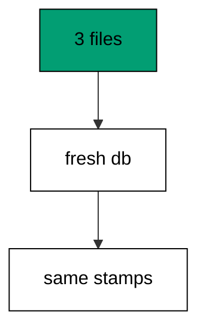

Files must stand alone: if version three only works because version one left a side table, isolation exposes it. Replay from zero regularly; hidden coupling rots silently.

**`learning/code/ex-76-test-every-migration-in-isolation/main.go`**:

```go
// => Shared driver: every unit in this course opens with this prelude.
// => The harness network is closed, so units carry a small standard-library
// => driver that applies the same goose SQL files `goose up` would apply.
// => The files, the history table shape, and the ordering rules are goose's
// => own; the driver only replaces the network-dependent binary.
package main // => every unit is one runnable program

import ( // => standard library only: no third-party modules
	"bufio"           // => bufio frames protocol messages over the TCP stream
	"encoding/binary" // => binary lays out length-prefixed protocol fields
	"fmt"             // => fmt prints the deterministic transcript only
	"io"              // => io forces full reads of split protocol messages
	"net"             // => net dials the harness Postgres service over TCP
	"os"              // => os reads the harness database address, never hardcoded
	"sort"            // => sort orders migration files, never trusts directory order
	"strings"         // => strings splits the goose Up and Down annotations
) // => every import used by driver and units

// => The database address comes from the harness, with local-run defaults.
func addr() (string, string, string) { // => one helper owns every address default
	host := os.Getenv("PGHOST") // => service hostname in the unit network
	if host == "" {             // => empty means a local run outside the harness
		host = "postgres" // => same default the Python courses use
	} // => end addr: empty means a local run outside the harness
	user := os.Getenv("PGUSER") // => trust-auth role, no password needed
	if user == "" {             // => empty means a local run outside the harness
		user = "postgres" // => same default the Python courses use
	} // => end addr: empty means a local run outside the harness
	db := os.Getenv("PGDATABASE") // => fresh database for every unit run
	if db == "" {                 // => empty means a local run outside the harness
		db = "postgres" // => same default the Python courses use
	} // => end addr: empty means a local run outside the harness
	return host, user, db // => callers never re-read the environment
} // => end addr: one helper owns every address default

// => conn wraps one TCP connection plus a buffered reader for message frames.
type conn struct { // => a tiny struct keeps the socket and the framer together
	c net.Conn      // => the raw TCP socket to the Postgres service
	r *bufio.Reader // => buffered reads frame messages split across packets
} // => end type conn: socket and framer travel together

// => readMsg reads one backend message: a type byte plus a length body.
func (k *conn) readMsg() (byte, []byte, error) { // => every response flows through here
	head := make([]byte, 5)                           // => one type byte plus one int32 length
	if _, err := io.ReadFull(k.r, head); err != nil { // => fragments reassemble before framing
		return 0, nil, err // => no partial message is ever trusted
	} // => end readMsg: fragments reassemble before framing
	n := int(binary.BigEndian.Uint32(head[1:])) - 4   // => length counts itself, not the type
	body := make([]byte, n)                           // => exact-size body, never over-read
	if _, err := io.ReadFull(k.r, body); err != nil { // => fragments reassemble before framing
		return 0, nil, err // => no partial message is ever trusted
	} // => end readMsg: fragments reassemble before framing
	return head[0], body, nil // => type byte tells the caller what arrived
} // => end readMsg: every response flows through here

// => sendMsg writes one frontend message: a type byte plus a length body.
func (k *conn) sendMsg(t byte, body []byte) error { // => startup is the only typeless message
	out := []byte{t}                                      // => type byte leads every message
	lenb := make([]byte, 4)                               // => four bytes carry the length
	binary.BigEndian.PutUint32(lenb, uint32(len(body)+4)) // => length counts itself
	out = append(out, lenb...)                            // => length follows the type byte
	out = append(out, body...)                            // => payload closes the message
	_, err := k.c.Write(out)                              // => one write keeps frames whole
	return err                                            // => write errors fail the unit loudly
} // => end sendMsg: startup is the only typeless message

// => connect opens the service database and waits for session readiness.
func connect() (*conn, error) { // => every unit starts from this one helper
	host, user, db := addr()         // => harness address, never hardcoded
	return connectDb(host, user, db) // => one path opens every session
} // => end connect: every unit starts from this one helper

// => connectDb opens a named database on the same host for multi-db drills.
func connectDb(host, user, db string) (*conn, error) { // => environments are databases, not servers
	c, err := net.Dial("tcp", host+":5432") // => Postgres listens on 5432
	if err != nil {                         // => unreachable service is fatal
		return nil, err // => no fallback: the harness owns the database
	} // => end connectDb: unreachable service is fatal
	k := &conn{c: c, r: bufio.NewReader(c)}             // => buffer the fresh socket at once
	body := []byte{}                                    // => startup body is parameters only
	body = append(body, 0, 0, 0, 0)                     // => placeholder for the length prefix
	body = append(body, 0, 3, 0, 0)                     // => protocol 3.0, the stable version
	body = append(body, []byte("user")...)              // => user key starts the parameters
	body = append(body, 0)                              // => keys and values are NUL-separated
	body = append(body, []byte(user)...)                // => trust-auth role from the harness
	body = append(body, 0)                              // => NUL ends the value
	body = append(body, []byte("database")...)          // => database key follows the user
	body = append(body, 0)                              // => NUL ends the key
	body = append(body, []byte(db)...)                  // => fresh database for every unit run
	body = append(body, 0)                              // => NUL ends the value
	body = append(body, 0)                              // => empty key ends the parameters
	binary.BigEndian.PutUint32(body, uint32(len(body))) // => startup length counts itself
	if _, err := c.Write(body); err != nil {            // => startup is the only typeless message
		return nil, err // => unwritable socket is fatal
	} // => end connectDb: startup is the only typeless message
	for { // => drain until the session is ready for queries
		t, b, err := k.readMsg() // => every backend message flows through here
		if err != nil {          // => broken handshake is fatal
			return nil, err // => no half-open session is ever used
		} // => end connectDb: broken handshake is fatal
		switch t { // => only three message kinds matter during startup
		case 'R': // => authentication response arrives first
			if binary.BigEndian.Uint32(b) != 0 { // => nonzero means a password is wanted
				return nil, fmt.Errorf("server wants a password") // => trust auth never asks
			} // => end connectDb: nonzero means a password is wanted
		case 'E': // => an error ends the handshake with the server text
			return nil, fmt.Errorf("startup: %s", errText(b)) // => server text explains the cause
		case 'Z': // => ReadyForQuery means the session accepts queries
			return k, nil // => handshake done: hand the live session back
		} // => end connectDb: only three message kinds matter during startup
	} // => end connectDb: drain until the session is ready for queries
} // => end connectDb: environments are databases, not servers

// => errText extracts the human message (field M) from an ErrorResponse.
func errText(b []byte) string { // => one helper decodes every server error
	parts := strings.Split(string(b), "\x00") // => fields are NUL-separated pairs
	for i := 0; i+1 < len(parts); i += 2 {    // => walk code and value together
		if parts[i] == "M" { // => M is the primary human message
			return parts[i+1] // => return the message, skip the detail fields
		} // => end errText: M is the primary human message
	} // => end errText: walk code and value together
	return "unknown error" // => malformed errors still fail with a fixed line
} // => end errText: one helper decodes every server error

// => run sends one SQL string and returns every data row plus the command tag.
func (k *conn) run(q string) ([][]string, string, error) { // => one path runs every statement
	body := append([]byte(q), 0)                 // => Query messages are NUL-terminated
	if err := k.sendMsg('Q', body); err != nil { // => send fails loudly, never silently
		return nil, "", err // => unwritable socket ends the unit
	} // => end run: send fails loudly, never silently
	var rows [][]string // => data rows accumulate across result sets
	tag := ""           // => the last command tag (SELECT 3, CREATE TABLE...)
	for {               // => drain until ReadyForQuery closes this query string
		t, b, err := k.readMsg() // => every response flows through the framer
		if err != nil {          // => broken mid-query connection is fatal
			return nil, "", err // => partial results are never returned
		} // => end run: broken mid-query connection is fatal
		switch t { // => four message kinds carry a simple-query response
		case 'T', 'N', 'A', 'S', 'K': // => metadata the transcript never prints
		case 'D': // => one data row arrived
			rows = append(rows, parseRow(b)) // => decode the text columns now
		case 'C': // => one statement finished
			tag = strings.TrimRight(string(b[:len(b)-1]), "\x00") // => tag names what ran
		case 'E': // => the statement failed
			drain(k)                                     // => finish the failed query before reuse
			return nil, "", fmt.Errorf("%s", errText(b)) // => server text becomes the failure
		case 'Z': // => ReadyForQuery ends this query string
			return rows, tag, nil // => rows, tag, and a clean session
		} // => end run: four message kinds carry a simple-query response
	} // => end run: drain until ReadyForQuery closes this query string
} // => end run: one path runs every statement

// => drain reads to the next ReadyForQuery after a statement error.
func drain(k *conn) { // => an errored query still owns the socket until Z
	for { // => loop until the session is reusable
		t, _, err := k.readMsg()    // => discard every message after the error
		if err != nil || t == 'Z' { // => socket break or ready both end the drain
			return // => caller decides the failure, the drain only resynchronizes
		} // => end drain: socket break or ready both end the drain
	} // => end drain: loop until the session is reusable
} // => end drain: an errored query still owns the socket until Z

// => parseRow decodes one DataRow body into text columns, NULL as "NULL".
func parseRow(b []byte) []string { // => one helper decodes every returned row
	n := int(binary.BigEndian.Uint16(b)) // => column count leads the body
	b = b[2:]                            // => step past the count
	out := make([]string, 0, n)          // => pre-size the row to the count
	for i := 0; i < n; i++ {             // => walk each column in order
		l := int(int32(binary.BigEndian.Uint32(b))) // => -1 marks NULL, else the length
		b = b[4:]                                   // => step past the length
		if l < 0 {                                  // => NULL has no bytes to read
			out = append(out, "NULL") // => fixed word keeps transcripts stable
			continue                  // => next column, no bytes consumed
		} // => end parseRow: NULL has no bytes to read
		out = append(out, string(b[:l])) // => text format is already printable
		b = b[l:]                        // => step past the value bytes
	} // => end parseRow: walk each column in order
	return out // => one row, fully decoded
} // => end parseRow: one helper decodes every returned row

// => must runs SQL or exits nonzero with the server text on standard error.
func must(k *conn, q string) [][]string { // => setup statements never fail quietly
	rows, _, err := k.run(q) // => rows return for verification queries
	if err != nil {          // => any server error is fatal to the unit
		fmt.Fprintln(os.Stderr, "sql error:", err) // => errors go to stderr, never stdout
		os.Exit(1)                                 // => nonzero exit fails the harness check
	} // => end must: any server error is fatal to the unit
	return rows // => callers print only what the lesson asserts
} // => end must: setup statements never fail quietly

// => try runs SQL and returns the server error text instead of exiting.
func try(k *conn, q string) ([][]string, string) { // => failure drills inspect errors, not die
	rows, _, err := k.run(q) // => same path as must, opposite failure policy
	if err != nil {          // => expected errors become transcript lines
		return nil, err.Error() // => fixed server text, never timings
	} // => end try: expected errors become transcript lines
	return rows, "" // => empty error means the statement succeeded
} // => end try: failure drills inspect errors, not die

// => mig holds one goose SQL file: its version, name, and Up/Down sections.
type mig struct { // => mirrors the goose file layout the lesson teaches
	version string   // => zero-padded number orders history, like goose
	name    string   // => human slug after the version number
	up      []string // => forward statements, run inside one transaction
	down    []string // => reverse statements, run inside one transaction
	noTx    bool     // => NO TRANSACTION files run outside one, like goose
} // => end type mig: version, name, sections, and mode

// => parseGoose splits one goose SQL file into its Up and Down statements.
func parseGoose(text string) (up, down []string, noTx bool) { // => the lesson asserts this exact split
	section := ""                                    // => nothing belongs outside the annotations
	for _, line := range strings.Split(text, "\n") { // => walk the file line by line
		t := strings.TrimSpace(line) // => annotation matching ignores indentation
		switch t {                   // => four annotation lines switch sections
		case "-- +goose Up": // => forward section starts here, like goose
			section = "up" // => following statements migrate forward
			continue       // => the annotation itself never runs
		case "-- +goose Down": // => reverse section starts here, like goose
			section = "down" // => following statements roll back
			continue         // => the annotation itself never runs
		case "-- +goose NO TRANSACTION": // => concurrent work cannot run inside one
			noTx = true // => remember the file opts out of the transaction
			continue    // => the annotation itself never runs
		} // => end parseGoose: four annotation lines switch sections
		if strings.HasPrefix(t, "--") || t == "" { // => comments and blanks never run
			continue // => only real statements reach the database
		} // => end parseGoose: comments and blanks never run
		if section == "up" { // => route by the annotation seen above
			up = append(up, line) // => keep the original line for the file write
		} else if section == "down" { // => down statements collect separately
			down = append(down, line) // => keep the original line for the file write
		} // => end parseGoose: down statements collect separately
	} // => end parseGoose: walk the file line by line
	return splitStmts(strings.Join(up, "\n")), splitStmts(strings.Join(down, "\n")), noTx // => one string per statement
} // => end parseGoose: the lesson asserts this exact split

// => splitStmts cuts statement text on semicolons outside quotes.
func splitStmts(s string) []string { // => multi-line statements stay whole until ;
	var out []string        // => finished statements accumulate here
	var cur strings.Builder // => the statement under construction
	inStr := false          // => semicolons inside quotes never split
	for _, r := range s {   // => walk rune by rune, quotes included
		switch { // => quote tracking decides what a semicolon means
		case r == '\'': // => a quote toggles string mode
			inStr = !inStr   // => enter or leave the quoted region
			cur.WriteRune(r) // => the quote belongs to the statement
		case r == ';' && !inStr: // => a bare semicolon ends one statement
			if t := strings.TrimSpace(cur.String()); t != "" { // => skip empty fragments
				out = append(out, t) // => store the finished statement
			} // => end splitStmts: skip empty fragments
			cur.Reset() // => start the next statement fresh
		default: // => every other rune belongs to the current statement
			cur.WriteRune(r) // => accumulate verbatim
		} // => end splitStmts: quote tracking decides what a semicolon means
	} // => end splitStmts: walk rune by rune, quotes included
	if t := strings.TrimSpace(cur.String()); t != "" { // => trailing text without ; still counts
		out = append(out, t) // => last statement needs no semicolon
	} // => end splitStmts: trailing text without ; still counts
	return out // => callers run each statement in order
} // => end splitStmts: multi-line statements stay whole until ;

// => ensureHistory creates the goose history table once per unit run.
func ensureHistory(k *conn) { // => goose_db_version is goose's own default name
	must(k, `CREATE TABLE IF NOT EXISTS goose_db_version (`+ // => reruns never fail here
		`id integer PRIMARY KEY GENERATED BY DEFAULT AS IDENTITY, `+ // => surrogate key, never printed
		`version_id bigint NOT NULL, `+ // => applied version numbers live here
		`is_applied boolean NOT NULL, `+ // => goose marks rows applied on success
		`tstamp timestamp NOT NULL DEFAULT now())`) // => timestamp defaults, never printed
} // => end ensureHistory: goose_db_version is goose's own default name

// => appliedVersions returns the version numbers already marked applied.
func appliedVersions(k *conn) map[int64]bool { // => history decides what still needs running
	rows := must(k, `SELECT version_id FROM goose_db_version `+ // => only the numbers matter
		`WHERE is_applied ORDER BY version_id`) // => order keeps the transcript stable
	got := map[int64]bool{}  // => set lookup answers "already applied" fast
	for _, r := range rows { // => one row per applied migration
		var v int64                // => version numbers are integers
		fmt.Sscanf(r[0], "%d", &v) // => text format parses back to a number
		got[v] = true              // => mark this version done
	} // => end appliedVersions: one row per applied migration
	return got // => callers skip whatever history already holds
} // => end appliedVersions: history decides what still needs running

// => applyUp runs every pending migration forward, one transaction each.
func applyUp(k *conn, ms []mig) { // => files on disk are already the source of truth
	done := appliedVersions(k) // => history decides what still needs running
	for _, m := range ms {     // => file order is version order, sorted by the caller
		var v int64                     // => versions compare as numbers
		fmt.Sscanf(m.version, "%d", &v) // => zero-padded file prefix parses back
		if done[v] {                    // => applied migrations never run twice
			continue // => idempotent reruns skip straight past
		} // => end applyUp: applied migrations never run twice
		if !m.noTx { // => transactional files wrap everything in one unit
			must(k, "BEGIN") // => one migration is one transaction, like goose
		} // => end applyUp: transactional files wrap everything in one unit
		for _, s := range m.up { // => forward statements run in file order
			must(k, s) // => any failure aborts the unit before COMMIT
		} // => end applyUp: forward statements run in file order
		if !m.noTx { // => stamps join the same transaction they describe
			must(k, fmt.Sprintf(`INSERT INTO goose_db_version `+ // => stamp only after success
				`(version_id, is_applied) VALUES (%d, true)`, v)) // => stamp mirrors goose exactly
			must(k, "COMMIT") // => history row and schema land together
		} else { // => concurrent statements cannot share a transaction
			must(k, fmt.Sprintf(`INSERT INTO goose_db_version `+ // => stamp follows the work
				`(version_id, is_applied) VALUES (%d, true)`, v)) // => same row, separate statement
		} // => end applyUp: concurrent statements cannot share a transaction
	} // => end applyUp: file order is version order, sorted by the caller
} // => end applyUp: files on disk are already the source of truth

// => applyDown rolls back the newest applied migrations, newest first.
func applyDown(k *conn, ms []mig, steps int) { // => steps bounds how far history rewinds
	done := appliedVersions(k) // => history decides what can roll back
	var todo []mig             // => applied migrations in version order first
	for _, m := range ms {     // => walk the whole known history
		var v int64                     // => versions compare as numbers
		fmt.Sscanf(m.version, "%d", &v) // => zero-padded file prefix parses back
		if done[v] {                    // => only applied migrations roll back
			todo = append(todo, m) // => keep the migration for the reverse pass
		} // => end applyDown: only applied migrations roll back
	} // => end applyDown: walk the whole known history
	for i := len(todo) - 1; i >= 0 && steps > 0; i-- { // => newest applied goes first
		m := todo[i]                    // => this migration rolls back now
		var v int64                     // => versions compare as numbers
		fmt.Sscanf(m.version, "%d", &v) // => zero-padded file prefix parses back
		if !m.noTx {                    // => transactional files wrap the rollback too
			must(k, "BEGIN") // => reverse change is atomic, like the forward one
		} // => end applyDown: transactional files wrap the rollback too
		for _, s := range m.down { // => reverse statements run in file order
			must(k, s) // => any failure aborts before the history row moves
		} // => end applyDown: reverse statements run in file order
		must(k, fmt.Sprintf(`DELETE FROM goose_db_version `+ // => unstamped only after success
			`WHERE version_id = %d`, v)) // => the version leaves history exactly once
		if !m.noTx { // => close the transaction the rollback opened
			must(k, "COMMIT") // => schema reversal and unstamp land together
		} // => end applyDown: close the transaction the rollback opened
		steps-- // => one rollback consumed from the budget
	} // => end applyDown: newest applied goes first
} // => end applyDown: steps bounds how far history rewinds

// => statusCounts splits known migrations into applied and pending lists.
func statusCounts(k *conn, ms []mig) (applied, pending []string) { // => goose status in two lists
	done := appliedVersions(k) // => history decides which list each version joins
	for _, m := range ms {     // => walk the known history in version order
		var v int64                     // => versions compare as numbers
		fmt.Sscanf(m.version, "%d", &v) // => zero-padded file prefix parses back
		if done[v] {                    // => stamped versions are done
			applied = append(applied, m.version) // => keep the version string for printing
		} else { // => unstamped versions still wait
			pending = append(pending, m.version) // => keep the version string for printing
		} // => end statusCounts: unstamped versions still wait
	} // => end statusCounts: walk the known history in version order
	return applied, pending // => callers print both lists in one stable line each
} // => end statusCounts: goose status in two lists

// => files writes each migration as a real goose SQL file under dir.
func files(dir string, ms []mig) { // => the lesson shows these files byte-identically
	for _, m := range ms { // => one file per migration, like `goose create`
		name := fmt.Sprintf("%s_%s.sql", m.version, m.name) // => goose names files version-first
		var b strings.Builder                               // => build the file text in order
		if m.noTx {                                         // => concurrent files announce it first
			b.WriteString("-- +goose NO TRANSACTION\n") // => goose honors this exact annotation
		} // => end files: concurrent files announce it first
		b.WriteString("-- +goose Up\n") // => forward annotation leads
		for _, s := range m.up {        // => forward statements follow
			b.WriteString(s + ";\n") // => one statement per line, semicolon-closed
		} // => end files: forward statements follow
		b.WriteString("-- +goose Down\n") // => reverse annotation splits the file
		for _, s := range m.down {        // => reverse statements close the file
			b.WriteString(s + ";\n") // => one statement per line, semicolon-closed
		} // => end files: reverse statements close the file
		if err := os.WriteFile(dir+"/"+name, []byte(b.String()), 0644); err != nil { // => real files, like goose
			fmt.Fprintln(os.Stderr, "write error:", err) // => write errors fail loudly
			os.Exit(1)                                   // => no half-written migration set
		} // => end files: real files, like goose
	} // => end files: one file per migration, like `goose create`
} // => end files: the lesson shows these files byte-identically

// => versions lists migration files in version order from dir.
func versions(dir string) []mig { // => directory order is never trusted for history
	ents, err := os.ReadDir(dir) // => read the whole migrations directory
	if err != nil {              // => unreadable directory is fatal
		fmt.Fprintln(os.Stderr, "read error:", err) // => errors go to stderr
		os.Exit(1)                                  // => nonzero exit fails the check
	} // => end versions: unreadable directory is fatal
	names := []string{}      // => collect names before sorting
	for _, e := range ents { // => walk every directory entry
		if !e.IsDir() && strings.HasSuffix(e.Name(), ".sql") { // => only goose SQL files count
			names = append(names, e.Name()) // => keep the file name for parsing
		} // => end versions: only goose SQL files count
	} // => end versions: walk every directory entry
	sort.Strings(names)       // => zero-padded versions sort chronologically
	var out []mig             // => parsed migrations accumulate here
	for _, n := range names { // => parse in version order
		raw, err := os.ReadFile(dir + "/" + n) // => read the real file back
		if err != nil {                        // => unreadable file is fatal
			fmt.Fprintln(os.Stderr, "read error:", err) // => errors go to stderr
			os.Exit(1)                                  // => nonzero exit fails the check
		} // => end versions: unreadable file is fatal
		up, down, noTx := parseGoose(string(raw))                                            // => split on the goose annotations
		rest := strings.TrimSuffix(n, ".sql")                                                // => strip the extension first
		ver := rest[:5]                                                                      // => first five digits are the version
		out = append(out, mig{version: ver, name: rest[6:], up: up, down: down, noTx: noTx}) // => keep every part
	} // => end versions: parse in version order
	return out // => version-ordered migrations, ready to apply
} // => end versions: directory order is never trusted for history

// => findDupes returns version numbers claimed by two or more files.
func findDupes(dir string) []string { // => goose refuses duplicate versions outright
	ents, err := os.ReadDir(dir) // => read the whole migrations directory
	if err != nil {              // => unreadable directory is fatal
		fmt.Fprintln(os.Stderr, "read error:", err) // => errors go to stderr
		os.Exit(1)                                  // => nonzero exit fails the check
	} // => end findDupes: unreadable directory is fatal
	seen := map[string]int{} // => count claims per five-digit version prefix
	for _, e := range ents { // => walk every directory entry
		if !e.IsDir() && strings.HasSuffix(e.Name(), ".sql") { // => only goose SQL files count
			seen[e.Name()[:5]]++ // => first five digits are the version
		} // => end findDupes: only goose SQL files count
	} // => end findDupes: walk every directory entry
	var out []string         // => duplicates accumulate in version order
	for _, e := range ents { // => second pass keeps the order stable
		if !e.IsDir() && strings.HasSuffix(e.Name(), ".sql") { // => only goose SQL files count
			if v := e.Name()[:5]; seen[v] > 1 { // => claimed more than once
				out = append(out, v) // => keep the version string for printing
				seen[v] = 0          // => report each duplicate version only once
			} // => end findDupes: claimed more than once
		} // => end findDupes: only goose SQL files count
	} // => end findDupes: second pass keeps the order stable
	return out // => empty means the history numbers are unique
} // => end findDupes: goose refuses duplicate versions outright

func main() {
	k, err := connect() // => one session runs the whole example
	if err != nil {     // => unreachable database fails loudly
		fmt.Fprintln(os.Stderr, "connect error:", err) // => connection errors go to stderr
		os.Exit(1)                                     // => nonzero exit fails the check
	}
	defer k.c.Close() // => the socket closes when the example ends
	// => A scratch migrations directory: goose files live here, never in the unit.
	// => the scratch path never reaches stdout, so reruns stay byte-stable
	dir, err := os.MkdirTemp("", "ex76-") // => private directory, like `goose create`
	if err != nil {                       // => unmakable temp dir is fatal
		fmt.Fprintln(os.Stderr, "temp error:", err) // => errors go to stderr
		os.Exit(1)                                  // => nonzero exit fails the check
	}
	defer os.RemoveAll(dir)                          // => scratch files vanish; only transcripts remain
	must(k, "DROP TABLE IF EXISTS goose_db_version") // => stale history vanishes too
	ensureHistory(k)                                 // => goose history table, real shape
	set := []mig{                                    // => three migrations replayed from zero
		{version: "00001", name: "create_a", // => first table in this history
			up:   []string{"CREATE TABLE ex76_a (id SERIAL PRIMARY KEY)"}, // => forward change
			down: []string{"DROP TABLE ex76_a"}},                          // => exact reverse for rollback
		{version: "00002", name: "create_b", // => second table in this history
			up:   []string{"CREATE TABLE ex76_b (id SERIAL PRIMARY KEY)"}, // => forward change
			down: []string{"DROP TABLE ex76_b"}},                          // => exact reverse for rollback
		{version: "00003", name: "create_c", // => third table in this history
			up:   []string{"CREATE TABLE ex76_c (id SERIAL PRIMARY KEY)"}, // => forward change
			down: []string{"DROP TABLE ex76_c"}},                          // => exact reverse for rollback
	}
	files(dir, set)                               // => write the shared set once
	host, user, _ := addr()                       // => isolation database shares the host and role
	must(k, "DROP DATABASE IF EXISTS ex76_iso")   // => leftovers of a killed run vanish
	must(k, "CREATE DATABASE ex76_iso")           // => clean room for the replay
	iso, err := connectDb(host, user, "ex76_iso") // => session on the clean database
	if err != nil {                               // => unreachable database fails loudly
		fmt.Fprintln(os.Stderr, "connect error:", err) // => connection errors go to stderr
		os.Exit(1)                                     // => nonzero exit fails the check
	}
	ensureHistory(iso)                                                          // => fresh history in the clean room
	applyUp(iso, versions(dir))                                                 // => replay from zero
	rows := must(iso, `SELECT count(*) FROM goose_db_version WHERE is_applied`) // => stamps match the main run
	fmt.Println("isolated:", rows[0][0])                                        // => Output: isolated: 3
	iso.c.Close()                                                               // => isolation session closes when done
	must(k, "DROP DATABASE IF EXISTS ex76_iso")                                 // => clean room vanishes after the proof
	must(k, "DROP TABLE IF EXISTS ex76_a")                                      // => main-database tables cleaned below
	must(k, "DROP TABLE IF EXISTS ex76_b")                                      // => main-database tables cleaned below
	must(k, "DROP TABLE IF EXISTS ex76_c")                                      // => main-database tables cleaned below
	fmt.Println("cleaned: yes")                                                 // => Output: cleaned: yes
	must(k, "DROP TABLE IF EXISTS goose_db_version")                            // => the example leaves no history behind
}
```

**Output** (`learning/code/ex-76-test-every-migration-in-isolation/expected/main.stdout.txt`):

```text
isolated: 3
cleaned: yes
```

**Key takeaway**: Clean-room replay catches hidden dependencies between files; replay from zero and compare the stamps.

**Why it matters**: Hidden coupling between files rots silently until a fresh database exposes it. Replay from zero proves each migration stands on its stated predecessors, not on accidental residue. Isolation testing is the difference between files that compose and files that coincide. Compose files that stand alone, not ones that coincide: clean-room replay exposes coupling that shared databases hide.

### Example 77: Golden Schema Snapshot Test

Snapshots freeze the schema as text: this example dumps the table-column pairs of two migrated tables and compares the dump against an expected string in the code. Any drift in shape breaks the comparison loudly. (Concepts: co-16.)

Golden snapshots turn schema review into diff review: the expected text lives in version control beside the migration. Shape changes update the golden deliberately, never silently.

**`learning/code/ex-77-golden-schema-snapshot-test/main.go`**:

```go
// => Shared driver: every unit in this course opens with this prelude.
// => The harness network is closed, so units carry a small standard-library
// => driver that applies the same goose SQL files `goose up` would apply.
// => The files, the history table shape, and the ordering rules are goose's
// => own; the driver only replaces the network-dependent binary.
package main // => every unit is one runnable program

import ( // => standard library only: no third-party modules
	"bufio"           // => bufio frames protocol messages over the TCP stream
	"encoding/binary" // => binary lays out length-prefixed protocol fields
	"fmt"             // => fmt prints the deterministic transcript only
	"io"              // => io forces full reads of split protocol messages
	"net"             // => net dials the harness Postgres service over TCP
	"os"              // => os reads the harness database address, never hardcoded
	"sort"            // => sort orders migration files, never trusts directory order
	"strings"         // => strings splits the goose Up and Down annotations
) // => every import used by driver and units

// => The database address comes from the harness, with local-run defaults.
func addr() (string, string, string) { // => one helper owns every address default
	host := os.Getenv("PGHOST") // => service hostname in the unit network
	if host == "" {             // => empty means a local run outside the harness
		host = "postgres" // => same default the Python courses use
	} // => end addr: empty means a local run outside the harness
	user := os.Getenv("PGUSER") // => trust-auth role, no password needed
	if user == "" {             // => empty means a local run outside the harness
		user = "postgres" // => same default the Python courses use
	} // => end addr: empty means a local run outside the harness
	db := os.Getenv("PGDATABASE") // => fresh database for every unit run
	if db == "" {                 // => empty means a local run outside the harness
		db = "postgres" // => same default the Python courses use
	} // => end addr: empty means a local run outside the harness
	return host, user, db // => callers never re-read the environment
} // => end addr: one helper owns every address default

// => conn wraps one TCP connection plus a buffered reader for message frames.
type conn struct { // => a tiny struct keeps the socket and the framer together
	c net.Conn      // => the raw TCP socket to the Postgres service
	r *bufio.Reader // => buffered reads frame messages split across packets
} // => end type conn: socket and framer travel together

// => readMsg reads one backend message: a type byte plus a length body.
func (k *conn) readMsg() (byte, []byte, error) { // => every response flows through here
	head := make([]byte, 5)                           // => one type byte plus one int32 length
	if _, err := io.ReadFull(k.r, head); err != nil { // => fragments reassemble before framing
		return 0, nil, err // => no partial message is ever trusted
	} // => end readMsg: fragments reassemble before framing
	n := int(binary.BigEndian.Uint32(head[1:])) - 4   // => length counts itself, not the type
	body := make([]byte, n)                           // => exact-size body, never over-read
	if _, err := io.ReadFull(k.r, body); err != nil { // => fragments reassemble before framing
		return 0, nil, err // => no partial message is ever trusted
	} // => end readMsg: fragments reassemble before framing
	return head[0], body, nil // => type byte tells the caller what arrived
} // => end readMsg: every response flows through here

// => sendMsg writes one frontend message: a type byte plus a length body.
func (k *conn) sendMsg(t byte, body []byte) error { // => startup is the only typeless message
	out := []byte{t}                                      // => type byte leads every message
	lenb := make([]byte, 4)                               // => four bytes carry the length
	binary.BigEndian.PutUint32(lenb, uint32(len(body)+4)) // => length counts itself
	out = append(out, lenb...)                            // => length follows the type byte
	out = append(out, body...)                            // => payload closes the message
	_, err := k.c.Write(out)                              // => one write keeps frames whole
	return err                                            // => write errors fail the unit loudly
} // => end sendMsg: startup is the only typeless message

// => connect opens the service database and waits for session readiness.
func connect() (*conn, error) { // => every unit starts from this one helper
	host, user, db := addr()         // => harness address, never hardcoded
	return connectDb(host, user, db) // => one path opens every session
} // => end connect: every unit starts from this one helper

// => connectDb opens a named database on the same host for multi-db drills.
func connectDb(host, user, db string) (*conn, error) { // => environments are databases, not servers
	c, err := net.Dial("tcp", host+":5432") // => Postgres listens on 5432
	if err != nil {                         // => unreachable service is fatal
		return nil, err // => no fallback: the harness owns the database
	} // => end connectDb: unreachable service is fatal
	k := &conn{c: c, r: bufio.NewReader(c)}             // => buffer the fresh socket at once
	body := []byte{}                                    // => startup body is parameters only
	body = append(body, 0, 0, 0, 0)                     // => placeholder for the length prefix
	body = append(body, 0, 3, 0, 0)                     // => protocol 3.0, the stable version
	body = append(body, []byte("user")...)              // => user key starts the parameters
	body = append(body, 0)                              // => keys and values are NUL-separated
	body = append(body, []byte(user)...)                // => trust-auth role from the harness
	body = append(body, 0)                              // => NUL ends the value
	body = append(body, []byte("database")...)          // => database key follows the user
	body = append(body, 0)                              // => NUL ends the key
	body = append(body, []byte(db)...)                  // => fresh database for every unit run
	body = append(body, 0)                              // => NUL ends the value
	body = append(body, 0)                              // => empty key ends the parameters
	binary.BigEndian.PutUint32(body, uint32(len(body))) // => startup length counts itself
	if _, err := c.Write(body); err != nil {            // => startup is the only typeless message
		return nil, err // => unwritable socket is fatal
	} // => end connectDb: startup is the only typeless message
	for { // => drain until the session is ready for queries
		t, b, err := k.readMsg() // => every backend message flows through here
		if err != nil {          // => broken handshake is fatal
			return nil, err // => no half-open session is ever used
		} // => end connectDb: broken handshake is fatal
		switch t { // => only three message kinds matter during startup
		case 'R': // => authentication response arrives first
			if binary.BigEndian.Uint32(b) != 0 { // => nonzero means a password is wanted
				return nil, fmt.Errorf("server wants a password") // => trust auth never asks
			} // => end connectDb: nonzero means a password is wanted
		case 'E': // => an error ends the handshake with the server text
			return nil, fmt.Errorf("startup: %s", errText(b)) // => server text explains the cause
		case 'Z': // => ReadyForQuery means the session accepts queries
			return k, nil // => handshake done: hand the live session back
		} // => end connectDb: only three message kinds matter during startup
	} // => end connectDb: drain until the session is ready for queries
} // => end connectDb: environments are databases, not servers

// => errText extracts the human message (field M) from an ErrorResponse.
func errText(b []byte) string { // => one helper decodes every server error
	parts := strings.Split(string(b), "\x00") // => fields are NUL-separated pairs
	for i := 0; i+1 < len(parts); i += 2 {    // => walk code and value together
		if parts[i] == "M" { // => M is the primary human message
			return parts[i+1] // => return the message, skip the detail fields
		} // => end errText: M is the primary human message
	} // => end errText: walk code and value together
	return "unknown error" // => malformed errors still fail with a fixed line
} // => end errText: one helper decodes every server error

// => run sends one SQL string and returns every data row plus the command tag.
func (k *conn) run(q string) ([][]string, string, error) { // => one path runs every statement
	body := append([]byte(q), 0)                 // => Query messages are NUL-terminated
	if err := k.sendMsg('Q', body); err != nil { // => send fails loudly, never silently
		return nil, "", err // => unwritable socket ends the unit
	} // => end run: send fails loudly, never silently
	var rows [][]string // => data rows accumulate across result sets
	tag := ""           // => the last command tag (SELECT 3, CREATE TABLE...)
	for {               // => drain until ReadyForQuery closes this query string
		t, b, err := k.readMsg() // => every response flows through the framer
		if err != nil {          // => broken mid-query connection is fatal
			return nil, "", err // => partial results are never returned
		} // => end run: broken mid-query connection is fatal
		switch t { // => four message kinds carry a simple-query response
		case 'T', 'N', 'A', 'S', 'K': // => metadata the transcript never prints
		case 'D': // => one data row arrived
			rows = append(rows, parseRow(b)) // => decode the text columns now
		case 'C': // => one statement finished
			tag = strings.TrimRight(string(b[:len(b)-1]), "\x00") // => tag names what ran
		case 'E': // => the statement failed
			drain(k)                                     // => finish the failed query before reuse
			return nil, "", fmt.Errorf("%s", errText(b)) // => server text becomes the failure
		case 'Z': // => ReadyForQuery ends this query string
			return rows, tag, nil // => rows, tag, and a clean session
		} // => end run: four message kinds carry a simple-query response
	} // => end run: drain until ReadyForQuery closes this query string
} // => end run: one path runs every statement

// => drain reads to the next ReadyForQuery after a statement error.
func drain(k *conn) { // => an errored query still owns the socket until Z
	for { // => loop until the session is reusable
		t, _, err := k.readMsg()    // => discard every message after the error
		if err != nil || t == 'Z' { // => socket break or ready both end the drain
			return // => caller decides the failure, the drain only resynchronizes
		} // => end drain: socket break or ready both end the drain
	} // => end drain: loop until the session is reusable
} // => end drain: an errored query still owns the socket until Z

// => parseRow decodes one DataRow body into text columns, NULL as "NULL".
func parseRow(b []byte) []string { // => one helper decodes every returned row
	n := int(binary.BigEndian.Uint16(b)) // => column count leads the body
	b = b[2:]                            // => step past the count
	out := make([]string, 0, n)          // => pre-size the row to the count
	for i := 0; i < n; i++ {             // => walk each column in order
		l := int(int32(binary.BigEndian.Uint32(b))) // => -1 marks NULL, else the length
		b = b[4:]                                   // => step past the length
		if l < 0 {                                  // => NULL has no bytes to read
			out = append(out, "NULL") // => fixed word keeps transcripts stable
			continue                  // => next column, no bytes consumed
		} // => end parseRow: NULL has no bytes to read
		out = append(out, string(b[:l])) // => text format is already printable
		b = b[l:]                        // => step past the value bytes
	} // => end parseRow: walk each column in order
	return out // => one row, fully decoded
} // => end parseRow: one helper decodes every returned row

// => must runs SQL or exits nonzero with the server text on standard error.
func must(k *conn, q string) [][]string { // => setup statements never fail quietly
	rows, _, err := k.run(q) // => rows return for verification queries
	if err != nil {          // => any server error is fatal to the unit
		fmt.Fprintln(os.Stderr, "sql error:", err) // => errors go to stderr, never stdout
		os.Exit(1)                                 // => nonzero exit fails the harness check
	} // => end must: any server error is fatal to the unit
	return rows // => callers print only what the lesson asserts
} // => end must: setup statements never fail quietly

// => try runs SQL and returns the server error text instead of exiting.
func try(k *conn, q string) ([][]string, string) { // => failure drills inspect errors, not die
	rows, _, err := k.run(q) // => same path as must, opposite failure policy
	if err != nil {          // => expected errors become transcript lines
		return nil, err.Error() // => fixed server text, never timings
	} // => end try: expected errors become transcript lines
	return rows, "" // => empty error means the statement succeeded
} // => end try: failure drills inspect errors, not die

// => mig holds one goose SQL file: its version, name, and Up/Down sections.
type mig struct { // => mirrors the goose file layout the lesson teaches
	version string   // => zero-padded number orders history, like goose
	name    string   // => human slug after the version number
	up      []string // => forward statements, run inside one transaction
	down    []string // => reverse statements, run inside one transaction
	noTx    bool     // => NO TRANSACTION files run outside one, like goose
} // => end type mig: version, name, sections, and mode

// => parseGoose splits one goose SQL file into its Up and Down statements.
func parseGoose(text string) (up, down []string, noTx bool) { // => the lesson asserts this exact split
	section := ""                                    // => nothing belongs outside the annotations
	for _, line := range strings.Split(text, "\n") { // => walk the file line by line
		t := strings.TrimSpace(line) // => annotation matching ignores indentation
		switch t {                   // => four annotation lines switch sections
		case "-- +goose Up": // => forward section starts here, like goose
			section = "up" // => following statements migrate forward
			continue       // => the annotation itself never runs
		case "-- +goose Down": // => reverse section starts here, like goose
			section = "down" // => following statements roll back
			continue         // => the annotation itself never runs
		case "-- +goose NO TRANSACTION": // => concurrent work cannot run inside one
			noTx = true // => remember the file opts out of the transaction
			continue    // => the annotation itself never runs
		} // => end parseGoose: four annotation lines switch sections
		if strings.HasPrefix(t, "--") || t == "" { // => comments and blanks never run
			continue // => only real statements reach the database
		} // => end parseGoose: comments and blanks never run
		if section == "up" { // => route by the annotation seen above
			up = append(up, line) // => keep the original line for the file write
		} else if section == "down" { // => down statements collect separately
			down = append(down, line) // => keep the original line for the file write
		} // => end parseGoose: down statements collect separately
	} // => end parseGoose: walk the file line by line
	return splitStmts(strings.Join(up, "\n")), splitStmts(strings.Join(down, "\n")), noTx // => one string per statement
} // => end parseGoose: the lesson asserts this exact split

// => splitStmts cuts statement text on semicolons outside quotes.
func splitStmts(s string) []string { // => multi-line statements stay whole until ;
	var out []string        // => finished statements accumulate here
	var cur strings.Builder // => the statement under construction
	inStr := false          // => semicolons inside quotes never split
	for _, r := range s {   // => walk rune by rune, quotes included
		switch { // => quote tracking decides what a semicolon means
		case r == '\'': // => a quote toggles string mode
			inStr = !inStr   // => enter or leave the quoted region
			cur.WriteRune(r) // => the quote belongs to the statement
		case r == ';' && !inStr: // => a bare semicolon ends one statement
			if t := strings.TrimSpace(cur.String()); t != "" { // => skip empty fragments
				out = append(out, t) // => store the finished statement
			} // => end splitStmts: skip empty fragments
			cur.Reset() // => start the next statement fresh
		default: // => every other rune belongs to the current statement
			cur.WriteRune(r) // => accumulate verbatim
		} // => end splitStmts: quote tracking decides what a semicolon means
	} // => end splitStmts: walk rune by rune, quotes included
	if t := strings.TrimSpace(cur.String()); t != "" { // => trailing text without ; still counts
		out = append(out, t) // => last statement needs no semicolon
	} // => end splitStmts: trailing text without ; still counts
	return out // => callers run each statement in order
} // => end splitStmts: multi-line statements stay whole until ;

// => ensureHistory creates the goose history table once per unit run.
func ensureHistory(k *conn) { // => goose_db_version is goose's own default name
	must(k, `CREATE TABLE IF NOT EXISTS goose_db_version (`+ // => reruns never fail here
		`id integer PRIMARY KEY GENERATED BY DEFAULT AS IDENTITY, `+ // => surrogate key, never printed
		`version_id bigint NOT NULL, `+ // => applied version numbers live here
		`is_applied boolean NOT NULL, `+ // => goose marks rows applied on success
		`tstamp timestamp NOT NULL DEFAULT now())`) // => timestamp defaults, never printed
} // => end ensureHistory: goose_db_version is goose's own default name

// => appliedVersions returns the version numbers already marked applied.
func appliedVersions(k *conn) map[int64]bool { // => history decides what still needs running
	rows := must(k, `SELECT version_id FROM goose_db_version `+ // => only the numbers matter
		`WHERE is_applied ORDER BY version_id`) // => order keeps the transcript stable
	got := map[int64]bool{}  // => set lookup answers "already applied" fast
	for _, r := range rows { // => one row per applied migration
		var v int64                // => version numbers are integers
		fmt.Sscanf(r[0], "%d", &v) // => text format parses back to a number
		got[v] = true              // => mark this version done
	} // => end appliedVersions: one row per applied migration
	return got // => callers skip whatever history already holds
} // => end appliedVersions: history decides what still needs running

// => applyUp runs every pending migration forward, one transaction each.
func applyUp(k *conn, ms []mig) { // => files on disk are already the source of truth
	done := appliedVersions(k) // => history decides what still needs running
	for _, m := range ms {     // => file order is version order, sorted by the caller
		var v int64                     // => versions compare as numbers
		fmt.Sscanf(m.version, "%d", &v) // => zero-padded file prefix parses back
		if done[v] {                    // => applied migrations never run twice
			continue // => idempotent reruns skip straight past
		} // => end applyUp: applied migrations never run twice
		if !m.noTx { // => transactional files wrap everything in one unit
			must(k, "BEGIN") // => one migration is one transaction, like goose
		} // => end applyUp: transactional files wrap everything in one unit
		for _, s := range m.up { // => forward statements run in file order
			must(k, s) // => any failure aborts the unit before COMMIT
		} // => end applyUp: forward statements run in file order
		if !m.noTx { // => stamps join the same transaction they describe
			must(k, fmt.Sprintf(`INSERT INTO goose_db_version `+ // => stamp only after success
				`(version_id, is_applied) VALUES (%d, true)`, v)) // => stamp mirrors goose exactly
			must(k, "COMMIT") // => history row and schema land together
		} else { // => concurrent statements cannot share a transaction
			must(k, fmt.Sprintf(`INSERT INTO goose_db_version `+ // => stamp follows the work
				`(version_id, is_applied) VALUES (%d, true)`, v)) // => same row, separate statement
		} // => end applyUp: concurrent statements cannot share a transaction
	} // => end applyUp: file order is version order, sorted by the caller
} // => end applyUp: files on disk are already the source of truth

// => applyDown rolls back the newest applied migrations, newest first.
func applyDown(k *conn, ms []mig, steps int) { // => steps bounds how far history rewinds
	done := appliedVersions(k) // => history decides what can roll back
	var todo []mig             // => applied migrations in version order first
	for _, m := range ms {     // => walk the whole known history
		var v int64                     // => versions compare as numbers
		fmt.Sscanf(m.version, "%d", &v) // => zero-padded file prefix parses back
		if done[v] {                    // => only applied migrations roll back
			todo = append(todo, m) // => keep the migration for the reverse pass
		} // => end applyDown: only applied migrations roll back
	} // => end applyDown: walk the whole known history
	for i := len(todo) - 1; i >= 0 && steps > 0; i-- { // => newest applied goes first
		m := todo[i]                    // => this migration rolls back now
		var v int64                     // => versions compare as numbers
		fmt.Sscanf(m.version, "%d", &v) // => zero-padded file prefix parses back
		if !m.noTx {                    // => transactional files wrap the rollback too
			must(k, "BEGIN") // => reverse change is atomic, like the forward one
		} // => end applyDown: transactional files wrap the rollback too
		for _, s := range m.down { // => reverse statements run in file order
			must(k, s) // => any failure aborts before the history row moves
		} // => end applyDown: reverse statements run in file order
		must(k, fmt.Sprintf(`DELETE FROM goose_db_version `+ // => unstamped only after success
			`WHERE version_id = %d`, v)) // => the version leaves history exactly once
		if !m.noTx { // => close the transaction the rollback opened
			must(k, "COMMIT") // => schema reversal and unstamp land together
		} // => end applyDown: close the transaction the rollback opened
		steps-- // => one rollback consumed from the budget
	} // => end applyDown: newest applied goes first
} // => end applyDown: steps bounds how far history rewinds

// => statusCounts splits known migrations into applied and pending lists.
func statusCounts(k *conn, ms []mig) (applied, pending []string) { // => goose status in two lists
	done := appliedVersions(k) // => history decides which list each version joins
	for _, m := range ms {     // => walk the known history in version order
		var v int64                     // => versions compare as numbers
		fmt.Sscanf(m.version, "%d", &v) // => zero-padded file prefix parses back
		if done[v] {                    // => stamped versions are done
			applied = append(applied, m.version) // => keep the version string for printing
		} else { // => unstamped versions still wait
			pending = append(pending, m.version) // => keep the version string for printing
		} // => end statusCounts: unstamped versions still wait
	} // => end statusCounts: walk the known history in version order
	return applied, pending // => callers print both lists in one stable line each
} // => end statusCounts: goose status in two lists

// => files writes each migration as a real goose SQL file under dir.
func files(dir string, ms []mig) { // => the lesson shows these files byte-identically
	for _, m := range ms { // => one file per migration, like `goose create`
		name := fmt.Sprintf("%s_%s.sql", m.version, m.name) // => goose names files version-first
		var b strings.Builder                               // => build the file text in order
		if m.noTx {                                         // => concurrent files announce it first
			b.WriteString("-- +goose NO TRANSACTION\n") // => goose honors this exact annotation
		} // => end files: concurrent files announce it first
		b.WriteString("-- +goose Up\n") // => forward annotation leads
		for _, s := range m.up {        // => forward statements follow
			b.WriteString(s + ";\n") // => one statement per line, semicolon-closed
		} // => end files: forward statements follow
		b.WriteString("-- +goose Down\n") // => reverse annotation splits the file
		for _, s := range m.down {        // => reverse statements close the file
			b.WriteString(s + ";\n") // => one statement per line, semicolon-closed
		} // => end files: reverse statements close the file
		if err := os.WriteFile(dir+"/"+name, []byte(b.String()), 0644); err != nil { // => real files, like goose
			fmt.Fprintln(os.Stderr, "write error:", err) // => write errors fail loudly
			os.Exit(1)                                   // => no half-written migration set
		} // => end files: real files, like goose
	} // => end files: one file per migration, like `goose create`
} // => end files: the lesson shows these files byte-identically

// => versions lists migration files in version order from dir.
func versions(dir string) []mig { // => directory order is never trusted for history
	ents, err := os.ReadDir(dir) // => read the whole migrations directory
	if err != nil {              // => unreadable directory is fatal
		fmt.Fprintln(os.Stderr, "read error:", err) // => errors go to stderr
		os.Exit(1)                                  // => nonzero exit fails the check
	} // => end versions: unreadable directory is fatal
	names := []string{}      // => collect names before sorting
	for _, e := range ents { // => walk every directory entry
		if !e.IsDir() && strings.HasSuffix(e.Name(), ".sql") { // => only goose SQL files count
			names = append(names, e.Name()) // => keep the file name for parsing
		} // => end versions: only goose SQL files count
	} // => end versions: walk every directory entry
	sort.Strings(names)       // => zero-padded versions sort chronologically
	var out []mig             // => parsed migrations accumulate here
	for _, n := range names { // => parse in version order
		raw, err := os.ReadFile(dir + "/" + n) // => read the real file back
		if err != nil {                        // => unreadable file is fatal
			fmt.Fprintln(os.Stderr, "read error:", err) // => errors go to stderr
			os.Exit(1)                                  // => nonzero exit fails the check
		} // => end versions: unreadable file is fatal
		up, down, noTx := parseGoose(string(raw))                                            // => split on the goose annotations
		rest := strings.TrimSuffix(n, ".sql")                                                // => strip the extension first
		ver := rest[:5]                                                                      // => first five digits are the version
		out = append(out, mig{version: ver, name: rest[6:], up: up, down: down, noTx: noTx}) // => keep every part
	} // => end versions: parse in version order
	return out // => version-ordered migrations, ready to apply
} // => end versions: directory order is never trusted for history

// => findDupes returns version numbers claimed by two or more files.
func findDupes(dir string) []string { // => goose refuses duplicate versions outright
	ents, err := os.ReadDir(dir) // => read the whole migrations directory
	if err != nil {              // => unreadable directory is fatal
		fmt.Fprintln(os.Stderr, "read error:", err) // => errors go to stderr
		os.Exit(1)                                  // => nonzero exit fails the check
	} // => end findDupes: unreadable directory is fatal
	seen := map[string]int{} // => count claims per five-digit version prefix
	for _, e := range ents { // => walk every directory entry
		if !e.IsDir() && strings.HasSuffix(e.Name(), ".sql") { // => only goose SQL files count
			seen[e.Name()[:5]]++ // => first five digits are the version
		} // => end findDupes: only goose SQL files count
	} // => end findDupes: walk every directory entry
	var out []string         // => duplicates accumulate in version order
	for _, e := range ents { // => second pass keeps the order stable
		if !e.IsDir() && strings.HasSuffix(e.Name(), ".sql") { // => only goose SQL files count
			if v := e.Name()[:5]; seen[v] > 1 { // => claimed more than once
				out = append(out, v) // => keep the version string for printing
				seen[v] = 0          // => report each duplicate version only once
			} // => end findDupes: claimed more than once
		} // => end findDupes: only goose SQL files count
	} // => end findDupes: second pass keeps the order stable
	return out // => empty means the history numbers are unique
} // => end findDupes: goose refuses duplicate versions outright

func main() {
	k, err := connect() // => one session runs the whole example
	if err != nil {     // => unreachable database fails loudly
		fmt.Fprintln(os.Stderr, "connect error:", err) // => connection errors go to stderr
		os.Exit(1)                                     // => nonzero exit fails the check
	}
	defer k.c.Close() // => the socket closes when the example ends
	// => A scratch migrations directory: goose files live here, never in the unit.
	// => the scratch path never reaches stdout, so reruns stay byte-stable
	dir, err := os.MkdirTemp("", "ex77-") // => private directory, like `goose create`
	if err != nil {                       // => unmakable temp dir is fatal
		fmt.Fprintln(os.Stderr, "temp error:", err) // => errors go to stderr
		os.Exit(1)                                  // => nonzero exit fails the check
	}
	defer os.RemoveAll(dir)                          // => scratch files vanish; only transcripts remain
	must(k, "DROP TABLE IF EXISTS ex77_a")           // => leftovers of a killed run vanish
	must(k, "DROP TABLE IF EXISTS ex77_b")           // => leftovers of a killed run vanish
	must(k, "DROP TABLE IF EXISTS goose_db_version") // => stale history vanishes too
	ensureHistory(k)                                 // => goose history table, real shape
	files(dir, []mig{                                // => two tables frozen into one snapshot
		{version: "00001", name: "create_users", // => users shape under snapshot
			up:   []string{"CREATE TABLE ex77_a (id SERIAL PRIMARY KEY, name TEXT NOT NULL)"}, // => forward change
			down: []string{"DROP TABLE ex77_a"}},                                              // => exact reverse for rollback
		{version: "00002", name: "create_books", // => books shape under snapshot
			up:   []string{"CREATE TABLE ex77_b (id SERIAL PRIMARY KEY, title TEXT NOT NULL)"}, // => forward change
			down: []string{"DROP TABLE ex77_b"}},                                               // => exact reverse for rollback
	})
	applyUp(k, versions(dir))                                                                   // => read the files back and run what is pending
	rows := must(k, `SELECT table_name || '.' || column_name FROM information_schema.columns `+ // => shape pairs
		`WHERE table_name LIKE 'ex77\_%' ORDER BY 1`) // => LIKE pattern needs the escaped underscore
	got := []string{}        // => snapshot lines accumulate for the comparison
	for _, r := range rows { // => one pair per column
		got = append(got, r[0]) // => table.column pairs, fully qualified
	}
	want := "ex77_a.id ex77_a.name ex77_b.id ex77_b.title"   // => golden shape, reviewed in version control
	fmt.Println("snapshot:", strings.Join(got, " ") == want) // => Output: snapshot: true
	fmt.Println("cleaned: yes")                              // => Output: cleaned: yes
	must(k, "DROP TABLE IF EXISTS ex77_a")                   // => leftovers of a killed run vanish
	must(k, "DROP TABLE IF EXISTS ex77_b")                   // => leftovers of a killed run vanish
	must(k, "DROP TABLE IF EXISTS goose_db_version")         // => the example leaves no history behind
}
```

**Output** (`learning/code/ex-77-golden-schema-snapshot-test/expected/main.stdout.txt`):

```text
snapshot: true
cleaned: yes
```

**Key takeaway**: Golden snapshots freeze the schema as text so shape changes arrive as deliberate diffs, never silently.

**Why it matters**: Golden snapshots make schema review a diff instead of a hunt. Expected shape lives beside the migration in version control, so accidental changes fail loudly and deliberate ones arrive as reviewed updates. Freeze the shape, review the thaw. Freeze the shape and review the thaw: golden snapshots make accidental changes loud and deliberate changes reviewable.

### Example 78: Pre-Deploy Checklist

Deploys run a checklist, not a hope: this example asserts all four gates — files parse, history is linear, nothing is pending, no drift — and prints one line per gate. Four true lines mean ship it. (Concepts: co-16, co-13.)

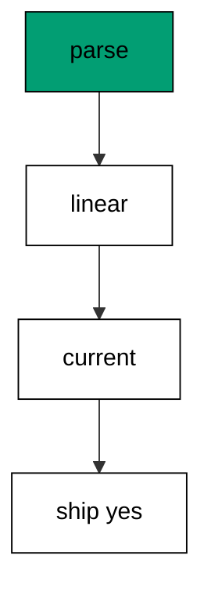

Checklists compose every lesson of this course into one program: parsing from the anatomy chapter, linearity from the history chapter, pending from status, drift from diagnosis. The last example is the whole course in one page.

**`learning/code/ex-78-pre-deploy-checklist/main.go`**:

```go
// => Shared driver: every unit in this course opens with this prelude.
// => The harness network is closed, so units carry a small standard-library
// => driver that applies the same goose SQL files `goose up` would apply.
// => The files, the history table shape, and the ordering rules are goose's
// => own; the driver only replaces the network-dependent binary.
package main // => every unit is one runnable program

import ( // => standard library only: no third-party modules
	"bufio"           // => bufio frames protocol messages over the TCP stream
	"encoding/binary" // => binary lays out length-prefixed protocol fields
	"fmt"             // => fmt prints the deterministic transcript only
	"io"              // => io forces full reads of split protocol messages
	"net"             // => net dials the harness Postgres service over TCP
	"os"              // => os reads the harness database address, never hardcoded
	"sort"            // => sort orders migration files, never trusts directory order
	"strings"         // => strings splits the goose Up and Down annotations
) // => every import used by driver and units

// => The database address comes from the harness, with local-run defaults.
func addr() (string, string, string) { // => one helper owns every address default
	host := os.Getenv("PGHOST") // => service hostname in the unit network
	if host == "" {             // => empty means a local run outside the harness
		host = "postgres" // => same default the Python courses use
	} // => end addr: empty means a local run outside the harness
	user := os.Getenv("PGUSER") // => trust-auth role, no password needed
	if user == "" {             // => empty means a local run outside the harness
		user = "postgres" // => same default the Python courses use
	} // => end addr: empty means a local run outside the harness
	db := os.Getenv("PGDATABASE") // => fresh database for every unit run
	if db == "" {                 // => empty means a local run outside the harness
		db = "postgres" // => same default the Python courses use
	} // => end addr: empty means a local run outside the harness
	return host, user, db // => callers never re-read the environment
} // => end addr: one helper owns every address default

// => conn wraps one TCP connection plus a buffered reader for message frames.
type conn struct { // => a tiny struct keeps the socket and the framer together
	c net.Conn      // => the raw TCP socket to the Postgres service
	r *bufio.Reader // => buffered reads frame messages split across packets
} // => end type conn: socket and framer travel together

// => readMsg reads one backend message: a type byte plus a length body.
func (k *conn) readMsg() (byte, []byte, error) { // => every response flows through here
	head := make([]byte, 5)                           // => one type byte plus one int32 length
	if _, err := io.ReadFull(k.r, head); err != nil { // => fragments reassemble before framing
		return 0, nil, err // => no partial message is ever trusted
	} // => end readMsg: fragments reassemble before framing
	n := int(binary.BigEndian.Uint32(head[1:])) - 4   // => length counts itself, not the type
	body := make([]byte, n)                           // => exact-size body, never over-read
	if _, err := io.ReadFull(k.r, body); err != nil { // => fragments reassemble before framing
		return 0, nil, err // => no partial message is ever trusted
	} // => end readMsg: fragments reassemble before framing
	return head[0], body, nil // => type byte tells the caller what arrived
} // => end readMsg: every response flows through here

// => sendMsg writes one frontend message: a type byte plus a length body.
func (k *conn) sendMsg(t byte, body []byte) error { // => startup is the only typeless message
	out := []byte{t}                                      // => type byte leads every message
	lenb := make([]byte, 4)                               // => four bytes carry the length
	binary.BigEndian.PutUint32(lenb, uint32(len(body)+4)) // => length counts itself
	out = append(out, lenb...)                            // => length follows the type byte
	out = append(out, body...)                            // => payload closes the message
	_, err := k.c.Write(out)                              // => one write keeps frames whole
	return err                                            // => write errors fail the unit loudly
} // => end sendMsg: startup is the only typeless message

// => connect opens the service database and waits for session readiness.
func connect() (*conn, error) { // => every unit starts from this one helper
	host, user, db := addr()         // => harness address, never hardcoded
	return connectDb(host, user, db) // => one path opens every session
} // => end connect: every unit starts from this one helper

// => connectDb opens a named database on the same host for multi-db drills.
func connectDb(host, user, db string) (*conn, error) { // => environments are databases, not servers
	c, err := net.Dial("tcp", host+":5432") // => Postgres listens on 5432
	if err != nil {                         // => unreachable service is fatal
		return nil, err // => no fallback: the harness owns the database
	} // => end connectDb: unreachable service is fatal
	k := &conn{c: c, r: bufio.NewReader(c)}             // => buffer the fresh socket at once
	body := []byte{}                                    // => startup body is parameters only
	body = append(body, 0, 0, 0, 0)                     // => placeholder for the length prefix
	body = append(body, 0, 3, 0, 0)                     // => protocol 3.0, the stable version
	body = append(body, []byte("user")...)              // => user key starts the parameters
	body = append(body, 0)                              // => keys and values are NUL-separated
	body = append(body, []byte(user)...)                // => trust-auth role from the harness
	body = append(body, 0)                              // => NUL ends the value
	body = append(body, []byte("database")...)          // => database key follows the user
	body = append(body, 0)                              // => NUL ends the key
	body = append(body, []byte(db)...)                  // => fresh database for every unit run
	body = append(body, 0)                              // => NUL ends the value
	body = append(body, 0)                              // => empty key ends the parameters
	binary.BigEndian.PutUint32(body, uint32(len(body))) // => startup length counts itself
	if _, err := c.Write(body); err != nil {            // => startup is the only typeless message
		return nil, err // => unwritable socket is fatal
	} // => end connectDb: startup is the only typeless message
	for { // => drain until the session is ready for queries
		t, b, err := k.readMsg() // => every backend message flows through here
		if err != nil {          // => broken handshake is fatal
			return nil, err // => no half-open session is ever used
		} // => end connectDb: broken handshake is fatal
		switch t { // => only three message kinds matter during startup
		case 'R': // => authentication response arrives first
			if binary.BigEndian.Uint32(b) != 0 { // => nonzero means a password is wanted
				return nil, fmt.Errorf("server wants a password") // => trust auth never asks
			} // => end connectDb: nonzero means a password is wanted
		case 'E': // => an error ends the handshake with the server text
			return nil, fmt.Errorf("startup: %s", errText(b)) // => server text explains the cause
		case 'Z': // => ReadyForQuery means the session accepts queries
			return k, nil // => handshake done: hand the live session back
		} // => end connectDb: only three message kinds matter during startup
	} // => end connectDb: drain until the session is ready for queries
} // => end connectDb: environments are databases, not servers

// => errText extracts the human message (field M) from an ErrorResponse.
func errText(b []byte) string { // => one helper decodes every server error
	parts := strings.Split(string(b), "\x00") // => fields are NUL-separated pairs
	for i := 0; i+1 < len(parts); i += 2 {    // => walk code and value together
		if parts[i] == "M" { // => M is the primary human message
			return parts[i+1] // => return the message, skip the detail fields
		} // => end errText: M is the primary human message
	} // => end errText: walk code and value together
	return "unknown error" // => malformed errors still fail with a fixed line
} // => end errText: one helper decodes every server error

// => run sends one SQL string and returns every data row plus the command tag.
func (k *conn) run(q string) ([][]string, string, error) { // => one path runs every statement
	body := append([]byte(q), 0)                 // => Query messages are NUL-terminated
	if err := k.sendMsg('Q', body); err != nil { // => send fails loudly, never silently
		return nil, "", err // => unwritable socket ends the unit
	} // => end run: send fails loudly, never silently
	var rows [][]string // => data rows accumulate across result sets
	tag := ""           // => the last command tag (SELECT 3, CREATE TABLE...)
	for {               // => drain until ReadyForQuery closes this query string
		t, b, err := k.readMsg() // => every response flows through the framer
		if err != nil {          // => broken mid-query connection is fatal
			return nil, "", err // => partial results are never returned
		} // => end run: broken mid-query connection is fatal
		switch t { // => four message kinds carry a simple-query response
		case 'T', 'N', 'A', 'S', 'K': // => metadata the transcript never prints
		case 'D': // => one data row arrived
			rows = append(rows, parseRow(b)) // => decode the text columns now
		case 'C': // => one statement finished
			tag = strings.TrimRight(string(b[:len(b)-1]), "\x00") // => tag names what ran
		case 'E': // => the statement failed
			drain(k)                                     // => finish the failed query before reuse
			return nil, "", fmt.Errorf("%s", errText(b)) // => server text becomes the failure
		case 'Z': // => ReadyForQuery ends this query string
			return rows, tag, nil // => rows, tag, and a clean session
		} // => end run: four message kinds carry a simple-query response
	} // => end run: drain until ReadyForQuery closes this query string
} // => end run: one path runs every statement

// => drain reads to the next ReadyForQuery after a statement error.
func drain(k *conn) { // => an errored query still owns the socket until Z
	for { // => loop until the session is reusable
		t, _, err := k.readMsg()    // => discard every message after the error
		if err != nil || t == 'Z' { // => socket break or ready both end the drain
			return // => caller decides the failure, the drain only resynchronizes
		} // => end drain: socket break or ready both end the drain
	} // => end drain: loop until the session is reusable
} // => end drain: an errored query still owns the socket until Z

// => parseRow decodes one DataRow body into text columns, NULL as "NULL".
func parseRow(b []byte) []string { // => one helper decodes every returned row
	n := int(binary.BigEndian.Uint16(b)) // => column count leads the body
	b = b[2:]                            // => step past the count
	out := make([]string, 0, n)          // => pre-size the row to the count
	for i := 0; i < n; i++ {             // => walk each column in order
		l := int(int32(binary.BigEndian.Uint32(b))) // => -1 marks NULL, else the length
		b = b[4:]                                   // => step past the length
		if l < 0 {                                  // => NULL has no bytes to read
			out = append(out, "NULL") // => fixed word keeps transcripts stable
			continue                  // => next column, no bytes consumed
		} // => end parseRow: NULL has no bytes to read
		out = append(out, string(b[:l])) // => text format is already printable
		b = b[l:]                        // => step past the value bytes
	} // => end parseRow: walk each column in order
	return out // => one row, fully decoded
} // => end parseRow: one helper decodes every returned row

// => must runs SQL or exits nonzero with the server text on standard error.
func must(k *conn, q string) [][]string { // => setup statements never fail quietly
	rows, _, err := k.run(q) // => rows return for verification queries
	if err != nil {          // => any server error is fatal to the unit
		fmt.Fprintln(os.Stderr, "sql error:", err) // => errors go to stderr, never stdout
		os.Exit(1)                                 // => nonzero exit fails the harness check
	} // => end must: any server error is fatal to the unit
	return rows // => callers print only what the lesson asserts
} // => end must: setup statements never fail quietly

// => try runs SQL and returns the server error text instead of exiting.
func try(k *conn, q string) ([][]string, string) { // => failure drills inspect errors, not die
	rows, _, err := k.run(q) // => same path as must, opposite failure policy
	if err != nil {          // => expected errors become transcript lines
		return nil, err.Error() // => fixed server text, never timings
	} // => end try: expected errors become transcript lines
	return rows, "" // => empty error means the statement succeeded
} // => end try: failure drills inspect errors, not die

// => mig holds one goose SQL file: its version, name, and Up/Down sections.
type mig struct { // => mirrors the goose file layout the lesson teaches
	version string   // => zero-padded number orders history, like goose
	name    string   // => human slug after the version number
	up      []string // => forward statements, run inside one transaction
	down    []string // => reverse statements, run inside one transaction
	noTx    bool     // => NO TRANSACTION files run outside one, like goose
} // => end type mig: version, name, sections, and mode

// => parseGoose splits one goose SQL file into its Up and Down statements.
func parseGoose(text string) (up, down []string, noTx bool) { // => the lesson asserts this exact split
	section := ""                                    // => nothing belongs outside the annotations
	for _, line := range strings.Split(text, "\n") { // => walk the file line by line
		t := strings.TrimSpace(line) // => annotation matching ignores indentation
		switch t {                   // => four annotation lines switch sections
		case "-- +goose Up": // => forward section starts here, like goose
			section = "up" // => following statements migrate forward
			continue       // => the annotation itself never runs
		case "-- +goose Down": // => reverse section starts here, like goose
			section = "down" // => following statements roll back
			continue         // => the annotation itself never runs
		case "-- +goose NO TRANSACTION": // => concurrent work cannot run inside one
			noTx = true // => remember the file opts out of the transaction
			continue    // => the annotation itself never runs
		} // => end parseGoose: four annotation lines switch sections
		if strings.HasPrefix(t, "--") || t == "" { // => comments and blanks never run
			continue // => only real statements reach the database
		} // => end parseGoose: comments and blanks never run
		if section == "up" { // => route by the annotation seen above
			up = append(up, line) // => keep the original line for the file write
		} else if section == "down" { // => down statements collect separately
			down = append(down, line) // => keep the original line for the file write
		} // => end parseGoose: down statements collect separately
	} // => end parseGoose: walk the file line by line
	return splitStmts(strings.Join(up, "\n")), splitStmts(strings.Join(down, "\n")), noTx // => one string per statement
} // => end parseGoose: the lesson asserts this exact split

// => splitStmts cuts statement text on semicolons outside quotes.
func splitStmts(s string) []string { // => multi-line statements stay whole until ;
	var out []string        // => finished statements accumulate here
	var cur strings.Builder // => the statement under construction
	inStr := false          // => semicolons inside quotes never split
	for _, r := range s {   // => walk rune by rune, quotes included
		switch { // => quote tracking decides what a semicolon means
		case r == '\'': // => a quote toggles string mode
			inStr = !inStr   // => enter or leave the quoted region
			cur.WriteRune(r) // => the quote belongs to the statement
		case r == ';' && !inStr: // => a bare semicolon ends one statement
			if t := strings.TrimSpace(cur.String()); t != "" { // => skip empty fragments
				out = append(out, t) // => store the finished statement
			} // => end splitStmts: skip empty fragments
			cur.Reset() // => start the next statement fresh
		default: // => every other rune belongs to the current statement
			cur.WriteRune(r) // => accumulate verbatim
		} // => end splitStmts: quote tracking decides what a semicolon means
	} // => end splitStmts: walk rune by rune, quotes included
	if t := strings.TrimSpace(cur.String()); t != "" { // => trailing text without ; still counts
		out = append(out, t) // => last statement needs no semicolon
	} // => end splitStmts: trailing text without ; still counts
	return out // => callers run each statement in order
} // => end splitStmts: multi-line statements stay whole until ;

// => ensureHistory creates the goose history table once per unit run.
func ensureHistory(k *conn) { // => goose_db_version is goose's own default name
	must(k, `CREATE TABLE IF NOT EXISTS goose_db_version (`+ // => reruns never fail here
		`id integer PRIMARY KEY GENERATED BY DEFAULT AS IDENTITY, `+ // => surrogate key, never printed
		`version_id bigint NOT NULL, `+ // => applied version numbers live here
		`is_applied boolean NOT NULL, `+ // => goose marks rows applied on success
		`tstamp timestamp NOT NULL DEFAULT now())`) // => timestamp defaults, never printed
} // => end ensureHistory: goose_db_version is goose's own default name

// => appliedVersions returns the version numbers already marked applied.
func appliedVersions(k *conn) map[int64]bool { // => history decides what still needs running
	rows := must(k, `SELECT version_id FROM goose_db_version `+ // => only the numbers matter
		`WHERE is_applied ORDER BY version_id`) // => order keeps the transcript stable
	got := map[int64]bool{}  // => set lookup answers "already applied" fast
	for _, r := range rows { // => one row per applied migration
		var v int64                // => version numbers are integers
		fmt.Sscanf(r[0], "%d", &v) // => text format parses back to a number
		got[v] = true              // => mark this version done
	} // => end appliedVersions: one row per applied migration
	return got // => callers skip whatever history already holds
} // => end appliedVersions: history decides what still needs running

// => applyUp runs every pending migration forward, one transaction each.
func applyUp(k *conn, ms []mig) { // => files on disk are already the source of truth
	done := appliedVersions(k) // => history decides what still needs running
	for _, m := range ms {     // => file order is version order, sorted by the caller
		var v int64                     // => versions compare as numbers
		fmt.Sscanf(m.version, "%d", &v) // => zero-padded file prefix parses back
		if done[v] {                    // => applied migrations never run twice
			continue // => idempotent reruns skip straight past
		} // => end applyUp: applied migrations never run twice
		if !m.noTx { // => transactional files wrap everything in one unit
			must(k, "BEGIN") // => one migration is one transaction, like goose
		} // => end applyUp: transactional files wrap everything in one unit
		for _, s := range m.up { // => forward statements run in file order
			must(k, s) // => any failure aborts the unit before COMMIT
		} // => end applyUp: forward statements run in file order
		if !m.noTx { // => stamps join the same transaction they describe
			must(k, fmt.Sprintf(`INSERT INTO goose_db_version `+ // => stamp only after success
				`(version_id, is_applied) VALUES (%d, true)`, v)) // => stamp mirrors goose exactly
			must(k, "COMMIT") // => history row and schema land together
		} else { // => concurrent statements cannot share a transaction
			must(k, fmt.Sprintf(`INSERT INTO goose_db_version `+ // => stamp follows the work
				`(version_id, is_applied) VALUES (%d, true)`, v)) // => same row, separate statement
		} // => end applyUp: concurrent statements cannot share a transaction
	} // => end applyUp: file order is version order, sorted by the caller
} // => end applyUp: files on disk are already the source of truth

// => applyDown rolls back the newest applied migrations, newest first.
func applyDown(k *conn, ms []mig, steps int) { // => steps bounds how far history rewinds
	done := appliedVersions(k) // => history decides what can roll back
	var todo []mig             // => applied migrations in version order first
	for _, m := range ms {     // => walk the whole known history
		var v int64                     // => versions compare as numbers
		fmt.Sscanf(m.version, "%d", &v) // => zero-padded file prefix parses back
		if done[v] {                    // => only applied migrations roll back
			todo = append(todo, m) // => keep the migration for the reverse pass
		} // => end applyDown: only applied migrations roll back
	} // => end applyDown: walk the whole known history
	for i := len(todo) - 1; i >= 0 && steps > 0; i-- { // => newest applied goes first
		m := todo[i]                    // => this migration rolls back now
		var v int64                     // => versions compare as numbers
		fmt.Sscanf(m.version, "%d", &v) // => zero-padded file prefix parses back
		if !m.noTx {                    // => transactional files wrap the rollback too
			must(k, "BEGIN") // => reverse change is atomic, like the forward one
		} // => end applyDown: transactional files wrap the rollback too
		for _, s := range m.down { // => reverse statements run in file order
			must(k, s) // => any failure aborts before the history row moves
		} // => end applyDown: reverse statements run in file order
		must(k, fmt.Sprintf(`DELETE FROM goose_db_version `+ // => unstamped only after success
			`WHERE version_id = %d`, v)) // => the version leaves history exactly once
		if !m.noTx { // => close the transaction the rollback opened
			must(k, "COMMIT") // => schema reversal and unstamp land together
		} // => end applyDown: close the transaction the rollback opened
		steps-- // => one rollback consumed from the budget
	} // => end applyDown: newest applied goes first
} // => end applyDown: steps bounds how far history rewinds

// => statusCounts splits known migrations into applied and pending lists.
func statusCounts(k *conn, ms []mig) (applied, pending []string) { // => goose status in two lists
	done := appliedVersions(k) // => history decides which list each version joins
	for _, m := range ms {     // => walk the known history in version order
		var v int64                     // => versions compare as numbers
		fmt.Sscanf(m.version, "%d", &v) // => zero-padded file prefix parses back
		if done[v] {                    // => stamped versions are done
			applied = append(applied, m.version) // => keep the version string for printing
		} else { // => unstamped versions still wait
			pending = append(pending, m.version) // => keep the version string for printing
		} // => end statusCounts: unstamped versions still wait
	} // => end statusCounts: walk the known history in version order
	return applied, pending // => callers print both lists in one stable line each
} // => end statusCounts: goose status in two lists

// => files writes each migration as a real goose SQL file under dir.
func files(dir string, ms []mig) { // => the lesson shows these files byte-identically
	for _, m := range ms { // => one file per migration, like `goose create`
		name := fmt.Sprintf("%s_%s.sql", m.version, m.name) // => goose names files version-first
		var b strings.Builder                               // => build the file text in order
		if m.noTx {                                         // => concurrent files announce it first
			b.WriteString("-- +goose NO TRANSACTION\n") // => goose honors this exact annotation
		} // => end files: concurrent files announce it first
		b.WriteString("-- +goose Up\n") // => forward annotation leads
		for _, s := range m.up {        // => forward statements follow
			b.WriteString(s + ";\n") // => one statement per line, semicolon-closed
		} // => end files: forward statements follow
		b.WriteString("-- +goose Down\n") // => reverse annotation splits the file
		for _, s := range m.down {        // => reverse statements close the file
			b.WriteString(s + ";\n") // => one statement per line, semicolon-closed
		} // => end files: reverse statements close the file
		if err := os.WriteFile(dir+"/"+name, []byte(b.String()), 0644); err != nil { // => real files, like goose
			fmt.Fprintln(os.Stderr, "write error:", err) // => write errors fail loudly
			os.Exit(1)                                   // => no half-written migration set
		} // => end files: real files, like goose
	} // => end files: one file per migration, like `goose create`
} // => end files: the lesson shows these files byte-identically

// => versions lists migration files in version order from dir.
func versions(dir string) []mig { // => directory order is never trusted for history
	ents, err := os.ReadDir(dir) // => read the whole migrations directory
	if err != nil {              // => unreadable directory is fatal
		fmt.Fprintln(os.Stderr, "read error:", err) // => errors go to stderr
		os.Exit(1)                                  // => nonzero exit fails the check
	} // => end versions: unreadable directory is fatal
	names := []string{}      // => collect names before sorting
	for _, e := range ents { // => walk every directory entry
		if !e.IsDir() && strings.HasSuffix(e.Name(), ".sql") { // => only goose SQL files count
			names = append(names, e.Name()) // => keep the file name for parsing
		} // => end versions: only goose SQL files count
	} // => end versions: walk every directory entry
	sort.Strings(names)       // => zero-padded versions sort chronologically
	var out []mig             // => parsed migrations accumulate here
	for _, n := range names { // => parse in version order
		raw, err := os.ReadFile(dir + "/" + n) // => read the real file back
		if err != nil {                        // => unreadable file is fatal
			fmt.Fprintln(os.Stderr, "read error:", err) // => errors go to stderr
			os.Exit(1)                                  // => nonzero exit fails the check
		} // => end versions: unreadable file is fatal
		up, down, noTx := parseGoose(string(raw))                                            // => split on the goose annotations
		rest := strings.TrimSuffix(n, ".sql")                                                // => strip the extension first
		ver := rest[:5]                                                                      // => first five digits are the version
		out = append(out, mig{version: ver, name: rest[6:], up: up, down: down, noTx: noTx}) // => keep every part
	} // => end versions: parse in version order
	return out // => version-ordered migrations, ready to apply
} // => end versions: directory order is never trusted for history

// => findDupes returns version numbers claimed by two or more files.
func findDupes(dir string) []string { // => goose refuses duplicate versions outright
	ents, err := os.ReadDir(dir) // => read the whole migrations directory
	if err != nil {              // => unreadable directory is fatal
		fmt.Fprintln(os.Stderr, "read error:", err) // => errors go to stderr
		os.Exit(1)                                  // => nonzero exit fails the check
	} // => end findDupes: unreadable directory is fatal
	seen := map[string]int{} // => count claims per five-digit version prefix
	for _, e := range ents { // => walk every directory entry
		if !e.IsDir() && strings.HasSuffix(e.Name(), ".sql") { // => only goose SQL files count
			seen[e.Name()[:5]]++ // => first five digits are the version
		} // => end findDupes: only goose SQL files count
	} // => end findDupes: walk every directory entry
	var out []string         // => duplicates accumulate in version order
	for _, e := range ents { // => second pass keeps the order stable
		if !e.IsDir() && strings.HasSuffix(e.Name(), ".sql") { // => only goose SQL files count
			if v := e.Name()[:5]; seen[v] > 1 { // => claimed more than once
				out = append(out, v) // => keep the version string for printing
				seen[v] = 0          // => report each duplicate version only once
			} // => end findDupes: claimed more than once
		} // => end findDupes: only goose SQL files count
	} // => end findDupes: second pass keeps the order stable
	return out // => empty means the history numbers are unique
} // => end findDupes: goose refuses duplicate versions outright

func main() {
	k, err := connect() // => one session runs the whole example
	if err != nil {     // => unreachable database fails loudly
		fmt.Fprintln(os.Stderr, "connect error:", err) // => connection errors go to stderr
		os.Exit(1)                                     // => nonzero exit fails the check
	}
	defer k.c.Close() // => the socket closes when the example ends
	// => A scratch migrations directory: goose files live here, never in the unit.
	// => the scratch path never reaches stdout, so reruns stay byte-stable
	dir, err := os.MkdirTemp("", "ex78-") // => private directory, like `goose create`
	if err != nil {                       // => unmakable temp dir is fatal
		fmt.Fprintln(os.Stderr, "temp error:", err) // => errors go to stderr
		os.Exit(1)                                  // => nonzero exit fails the check
	}
	defer os.RemoveAll(dir)                          // => scratch files vanish; only transcripts remain
	must(k, "DROP TABLE IF EXISTS ex78_a")           // => leftovers of a killed run vanish
	must(k, "DROP TABLE IF EXISTS ex78_b")           // => leftovers of a killed run vanish
	must(k, "DROP TABLE IF EXISTS goose_db_version") // => stale history vanishes too
	ensureHistory(k)                                 // => goose history table, real shape
	files(dir, []mig{                                // => two migrations, fully applied, no drift
		{version: "00001", name: "create_a", // => first table in this history
			up:   []string{"CREATE TABLE ex78_a (id SERIAL PRIMARY KEY)"}, // => forward change
			down: []string{"DROP TABLE ex78_a"}},                          // => exact reverse for rollback
		{version: "00002", name: "create_b", // => second table in this history
			up:   []string{"CREATE TABLE ex78_b (id SERIAL PRIMARY KEY)"}, // => forward change
			down: []string{"DROP TABLE ex78_b"}},                          // => exact reverse for rollback
	})
	ms := versions(dir)                                                   // => parse the files back, like goose would
	applyUp(k, ms)                                                        // => everything applied before the gates run
	parsed := len(ms) == 2                                                // => gate one: every file parses
	dupes := findDupes(dir)                                               // => gate two: history is linear
	_, pending := statusCounts(k, ms)                                     // => gate three: nothing pending
	drifted := must(k, `SELECT count(*) FROM information_schema.tables `+ // => gate four: tables match files
		`WHERE table_name LIKE 'ex78\_%'`) // => LIKE pattern needs the escaped underscore
	fmt.Println("parsed:", parsed)                   // => Output: parsed: true
	fmt.Println("linear:", len(dupes) == 0)          // => Output: linear: true
	fmt.Println("current:", len(pending) == 0)       // => Output: current: true
	fmt.Println("tables:", drifted[0][0])            // => Output: tables: 2
	fmt.Println("ship: yes")                         // => Output: ship: yes
	fmt.Println("cleaned: yes")                      // => Output: cleaned: yes
	must(k, "DROP TABLE IF EXISTS ex78_a")           // => leftovers of a killed run vanish
	must(k, "DROP TABLE IF EXISTS ex78_b")           // => leftovers of a killed run vanish
	must(k, "DROP TABLE IF EXISTS goose_db_version") // => the example leaves no history behind
}
```

**Output** (`learning/code/ex-78-pre-deploy-checklist/expected/main.stdout.txt`):

```text
parsed: true
linear: true
current: true
tables: 2
ship: yes
cleaned: yes
```

**Key takeaway**: Parse, linearity, pending, drift: four green gates mean ship it, and this program is the whole course in one page.

**Why it matters**: Four gates compose the whole course into one deploy decision: files parse, history runs linear, nothing pends, and reality matches the plan. Green across all four means the team knows exactly what will happen. Ship it — and mean it. Green across all four gates means the team knows exactly what will happen — so ship it, and mean it.
