Examples 1–25 build the habits every later example assumes: writing goose files with forward and reverse sections, ordering them into one linear history, and rolling them back without losing unrelated data. Three clusters carry the level: first migrations that create and alter (Examples 1–8), migration history and ordering (Examples 9–17), and rollback basics (Examples 18–25). Every program runs against the real pinned PostgreSQL 18 container; every output is a fixed transcript.

### Example 1: First Migration Creates a Table

A migration is a versioned file with a forward step and a reverse step, and this example runs the smallest real one: a single goose SQL file that creates a table. The program writes the file into a scratch migrations directory at runtime, applies it, and reads the catalog back. (Concepts: co-01.)

The file carries the two annotations goose itself reads, `-- +goose Up` and `-- +goose Down`, and the driver in every unit of this course applies the same statements `goose up` would run. Per-example table and history names keep every unit isolated even though they all share one service database shape. Real `goose create` timestamps new files by default, while production histories use sequential versions like these, as the goose docs recommend.

**`learning/code/ex-01-first-migration-creates-a-table/main.go`**:

```go
// => Shared driver: every unit in this course opens with this prelude.
// => The harness network is closed, so units carry a small standard-library
// => driver that applies the same goose SQL files `goose up` would apply.
// => The files, the history table shape, and the ordering rules are goose's
// => own; the driver only replaces the network-dependent binary.
package main // => every unit is one runnable program

import ( // => standard library only: no third-party modules
	"bufio"           // => bufio frames protocol messages over the TCP stream
	"encoding/binary" // => binary lays out length-prefixed protocol fields
	"fmt"             // => fmt prints the deterministic transcript only
	"io"              // => io forces full reads of split protocol messages
	"net"             // => net dials the harness Postgres service over TCP
	"os"              // => os reads the harness database address, never hardcoded
	"sort"            // => sort orders migration files, never trusts directory order
	"strings"         // => strings splits the goose Up and Down annotations
) // => every import used by driver and units

// => The database address comes from the harness, with local-run defaults.
func addr() (string, string, string) { // => one helper owns every address default
	host := os.Getenv("PGHOST") // => service hostname in the unit network
	if host == "" {             // => empty means a local run outside the harness
		host = "postgres" // => same default the Python courses use
	} // => end addr: empty means a local run outside the harness
	user := os.Getenv("PGUSER") // => trust-auth role, no password needed
	if user == "" {             // => empty means a local run outside the harness
		user = "postgres" // => same default the Python courses use
	} // => end addr: empty means a local run outside the harness
	db := os.Getenv("PGDATABASE") // => fresh database for every unit run
	if db == "" {                 // => empty means a local run outside the harness
		db = "postgres" // => same default the Python courses use
	} // => end addr: empty means a local run outside the harness
	return host, user, db // => callers never re-read the environment
} // => end addr: one helper owns every address default

// => conn wraps one TCP connection plus a buffered reader for message frames.
type conn struct { // => a tiny struct keeps the socket and the framer together
	c net.Conn      // => the raw TCP socket to the Postgres service
	r *bufio.Reader // => buffered reads frame messages split across packets
} // => end type conn: socket and framer travel together

// => readMsg reads one backend message: a type byte plus a length body.
func (k *conn) readMsg() (byte, []byte, error) { // => every response flows through here
	head := make([]byte, 5)                           // => one type byte plus one int32 length
	if _, err := io.ReadFull(k.r, head); err != nil { // => fragments reassemble before framing
		return 0, nil, err // => no partial message is ever trusted
	} // => end readMsg: fragments reassemble before framing
	n := int(binary.BigEndian.Uint32(head[1:])) - 4   // => length counts itself, not the type
	body := make([]byte, n)                           // => exact-size body, never over-read
	if _, err := io.ReadFull(k.r, body); err != nil { // => fragments reassemble before framing
		return 0, nil, err // => no partial message is ever trusted
	} // => end readMsg: fragments reassemble before framing
	return head[0], body, nil // => type byte tells the caller what arrived
} // => end readMsg: every response flows through here

// => sendMsg writes one frontend message: a type byte plus a length body.
func (k *conn) sendMsg(t byte, body []byte) error { // => startup is the only typeless message
	out := []byte{t}                                      // => type byte leads every message
	lenb := make([]byte, 4)                               // => four bytes carry the length
	binary.BigEndian.PutUint32(lenb, uint32(len(body)+4)) // => length counts itself
	out = append(out, lenb...)                            // => length follows the type byte
	out = append(out, body...)                            // => payload closes the message
	_, err := k.c.Write(out)                              // => one write keeps frames whole
	return err                                            // => write errors fail the unit loudly
} // => end sendMsg: startup is the only typeless message

// => connect opens the service database and waits for session readiness.
func connect() (*conn, error) { // => every unit starts from this one helper
	host, user, db := addr()         // => harness address, never hardcoded
	return connectDb(host, user, db) // => one path opens every session
} // => end connect: every unit starts from this one helper

// => connectDb opens a named database on the same host for multi-db drills.
func connectDb(host, user, db string) (*conn, error) { // => environments are databases, not servers
	c, err := net.Dial("tcp", host+":5432") // => Postgres listens on 5432
	if err != nil {                         // => unreachable service is fatal
		return nil, err // => no fallback: the harness owns the database
	} // => end connectDb: unreachable service is fatal
	k := &conn{c: c, r: bufio.NewReader(c)}             // => buffer the fresh socket at once
	body := []byte{}                                    // => startup body is parameters only
	body = append(body, 0, 0, 0, 0)                     // => placeholder for the length prefix
	body = append(body, 0, 3, 0, 0)                     // => protocol 3.0, the stable version
	body = append(body, []byte("user")...)              // => user key starts the parameters
	body = append(body, 0)                              // => keys and values are NUL-separated
	body = append(body, []byte(user)...)                // => trust-auth role from the harness
	body = append(body, 0)                              // => NUL ends the value
	body = append(body, []byte("database")...)          // => database key follows the user
	body = append(body, 0)                              // => NUL ends the key
	body = append(body, []byte(db)...)                  // => fresh database for every unit run
	body = append(body, 0)                              // => NUL ends the value
	body = append(body, 0)                              // => empty key ends the parameters
	binary.BigEndian.PutUint32(body, uint32(len(body))) // => startup length counts itself
	if _, err := c.Write(body); err != nil {            // => startup is the only typeless message
		return nil, err // => unwritable socket is fatal
	} // => end connectDb: startup is the only typeless message
	for { // => drain until the session is ready for queries
		t, b, err := k.readMsg() // => every backend message flows through here
		if err != nil {          // => broken handshake is fatal
			return nil, err // => no half-open session is ever used
		} // => end connectDb: broken handshake is fatal
		switch t { // => only three message kinds matter during startup
		case 'R': // => authentication response arrives first
			if binary.BigEndian.Uint32(b) != 0 { // => nonzero means a password is wanted
				return nil, fmt.Errorf("server wants a password") // => trust auth never asks
			} // => end connectDb: nonzero means a password is wanted
		case 'E': // => an error ends the handshake with the server text
			return nil, fmt.Errorf("startup: %s", errText(b)) // => server text explains the cause
		case 'Z': // => ReadyForQuery means the session accepts queries
			return k, nil // => handshake done: hand the live session back
		} // => end connectDb: only three message kinds matter during startup
	} // => end connectDb: drain until the session is ready for queries
} // => end connectDb: environments are databases, not servers

// => errText extracts the human message (field M) from an ErrorResponse.
func errText(b []byte) string { // => one helper decodes every server error
	parts := strings.Split(string(b), "\x00") // => fields are NUL-separated pairs
	for i := 0; i+1 < len(parts); i += 2 {    // => walk code and value together
		if parts[i] == "M" { // => M is the primary human message
			return parts[i+1] // => return the message, skip the detail fields
		} // => end errText: M is the primary human message
	} // => end errText: walk code and value together
	return "unknown error" // => malformed errors still fail with a fixed line
} // => end errText: one helper decodes every server error

// => run sends one SQL string and returns every data row plus the command tag.
func (k *conn) run(q string) ([][]string, string, error) { // => one path runs every statement
	body := append([]byte(q), 0)                 // => Query messages are NUL-terminated
	if err := k.sendMsg('Q', body); err != nil { // => send fails loudly, never silently
		return nil, "", err // => unwritable socket ends the unit
	} // => end run: send fails loudly, never silently
	var rows [][]string // => data rows accumulate across result sets
	tag := ""           // => the last command tag (SELECT 3, CREATE TABLE...)
	for {               // => drain until ReadyForQuery closes this query string
		t, b, err := k.readMsg() // => every response flows through the framer
		if err != nil {          // => broken mid-query connection is fatal
			return nil, "", err // => partial results are never returned
		} // => end run: broken mid-query connection is fatal
		switch t { // => four message kinds carry a simple-query response
		case 'T', 'N', 'A', 'S', 'K': // => metadata the transcript never prints
		case 'D': // => one data row arrived
			rows = append(rows, parseRow(b)) // => decode the text columns now
		case 'C': // => one statement finished
			tag = strings.TrimRight(string(b[:len(b)-1]), "\x00") // => tag names what ran
		case 'E': // => the statement failed
			drain(k)                                     // => finish the failed query before reuse
			return nil, "", fmt.Errorf("%s", errText(b)) // => server text becomes the failure
		case 'Z': // => ReadyForQuery ends this query string
			return rows, tag, nil // => rows, tag, and a clean session
		} // => end run: four message kinds carry a simple-query response
	} // => end run: drain until ReadyForQuery closes this query string
} // => end run: one path runs every statement

// => drain reads to the next ReadyForQuery after a statement error.
func drain(k *conn) { // => an errored query still owns the socket until Z
	for { // => loop until the session is reusable
		t, _, err := k.readMsg()    // => discard every message after the error
		if err != nil || t == 'Z' { // => socket break or ready both end the drain
			return // => caller decides the failure, the drain only resynchronizes
		} // => end drain: socket break or ready both end the drain
	} // => end drain: loop until the session is reusable
} // => end drain: an errored query still owns the socket until Z

// => parseRow decodes one DataRow body into text columns, NULL as "NULL".
func parseRow(b []byte) []string { // => one helper decodes every returned row
	n := int(binary.BigEndian.Uint16(b)) // => column count leads the body
	b = b[2:]                            // => step past the count
	out := make([]string, 0, n)          // => pre-size the row to the count
	for i := 0; i < n; i++ {             // => walk each column in order
		l := int(int32(binary.BigEndian.Uint32(b))) // => -1 marks NULL, else the length
		b = b[4:]                                   // => step past the length
		if l < 0 {                                  // => NULL has no bytes to read
			out = append(out, "NULL") // => fixed word keeps transcripts stable
			continue                  // => next column, no bytes consumed
		} // => end parseRow: NULL has no bytes to read
		out = append(out, string(b[:l])) // => text format is already printable
		b = b[l:]                        // => step past the value bytes
	} // => end parseRow: walk each column in order
	return out // => one row, fully decoded
} // => end parseRow: one helper decodes every returned row

// => must runs SQL or exits nonzero with the server text on standard error.
func must(k *conn, q string) [][]string { // => setup statements never fail quietly
	rows, _, err := k.run(q) // => rows return for verification queries
	if err != nil {          // => any server error is fatal to the unit
		fmt.Fprintln(os.Stderr, "sql error:", err) // => errors go to stderr, never stdout
		os.Exit(1)                                 // => nonzero exit fails the harness check
	} // => end must: any server error is fatal to the unit
	return rows // => callers print only what the lesson asserts
} // => end must: setup statements never fail quietly

// => try runs SQL and returns the server error text instead of exiting.
func try(k *conn, q string) ([][]string, string) { // => failure drills inspect errors, not die
	rows, _, err := k.run(q) // => same path as must, opposite failure policy
	if err != nil {          // => expected errors become transcript lines
		return nil, err.Error() // => fixed server text, never timings
	} // => end try: expected errors become transcript lines
	return rows, "" // => empty error means the statement succeeded
} // => end try: failure drills inspect errors, not die

// => mig holds one goose SQL file: its version, name, and Up/Down sections.
type mig struct { // => mirrors the goose file layout the lesson teaches
	version string   // => zero-padded number orders history, like goose
	name    string   // => human slug after the version number
	up      []string // => forward statements, run inside one transaction
	down    []string // => reverse statements, run inside one transaction
	noTx    bool     // => NO TRANSACTION files run outside one, like goose
} // => end type mig: version, name, sections, and mode

// => parseGoose splits one goose SQL file into its Up and Down statements.
func parseGoose(text string) (up, down []string, noTx bool) { // => the lesson asserts this exact split
	section := ""                                    // => nothing belongs outside the annotations
	for _, line := range strings.Split(text, "\n") { // => walk the file line by line
		t := strings.TrimSpace(line) // => annotation matching ignores indentation
		switch t {                   // => four annotation lines switch sections
		case "-- +goose Up": // => forward section starts here, like goose
			section = "up" // => following statements migrate forward
			continue       // => the annotation itself never runs
		case "-- +goose Down": // => reverse section starts here, like goose
			section = "down" // => following statements roll back
			continue         // => the annotation itself never runs
		case "-- +goose NO TRANSACTION": // => concurrent work cannot run inside one
			noTx = true // => remember the file opts out of the transaction
			continue    // => the annotation itself never runs
		} // => end parseGoose: four annotation lines switch sections
		if strings.HasPrefix(t, "--") || t == "" { // => comments and blanks never run
			continue // => only real statements reach the database
		} // => end parseGoose: comments and blanks never run
		if section == "up" { // => route by the annotation seen above
			up = append(up, line) // => keep the original line for the file write
		} else if section == "down" { // => down statements collect separately
			down = append(down, line) // => keep the original line for the file write
		} // => end parseGoose: down statements collect separately
	} // => end parseGoose: walk the file line by line
	return splitStmts(strings.Join(up, "\n")), splitStmts(strings.Join(down, "\n")), noTx // => one string per statement
} // => end parseGoose: the lesson asserts this exact split

// => splitStmts cuts statement text on semicolons outside quotes.
func splitStmts(s string) []string { // => multi-line statements stay whole until ;
	var out []string        // => finished statements accumulate here
	var cur strings.Builder // => the statement under construction
	inStr := false          // => semicolons inside quotes never split
	for _, r := range s {   // => walk rune by rune, quotes included
		switch { // => quote tracking decides what a semicolon means
		case r == '\'': // => a quote toggles string mode
			inStr = !inStr   // => enter or leave the quoted region
			cur.WriteRune(r) // => the quote belongs to the statement
		case r == ';' && !inStr: // => a bare semicolon ends one statement
			if t := strings.TrimSpace(cur.String()); t != "" { // => skip empty fragments
				out = append(out, t) // => store the finished statement
			} // => end splitStmts: skip empty fragments
			cur.Reset() // => start the next statement fresh
		default: // => every other rune belongs to the current statement
			cur.WriteRune(r) // => accumulate verbatim
		} // => end splitStmts: quote tracking decides what a semicolon means
	} // => end splitStmts: walk rune by rune, quotes included
	if t := strings.TrimSpace(cur.String()); t != "" { // => trailing text without ; still counts
		out = append(out, t) // => last statement needs no semicolon
	} // => end splitStmts: trailing text without ; still counts
	return out // => callers run each statement in order
} // => end splitStmts: multi-line statements stay whole until ;

// => ensureHistory creates the goose history table once per unit run.
func ensureHistory(k *conn) { // => goose_db_version is goose's own default name
	must(k, `CREATE TABLE IF NOT EXISTS goose_db_version (`+ // => reruns never fail here
		`id integer PRIMARY KEY GENERATED BY DEFAULT AS IDENTITY, `+ // => surrogate key, never printed
		`version_id bigint NOT NULL, `+ // => applied version numbers live here
		`is_applied boolean NOT NULL, `+ // => goose marks rows applied on success
		`tstamp timestamp NOT NULL DEFAULT now())`) // => timestamp defaults, never printed
} // => end ensureHistory: goose_db_version is goose's own default name

// => appliedVersions returns the version numbers already marked applied.
func appliedVersions(k *conn) map[int64]bool { // => history decides what still needs running
	rows := must(k, `SELECT version_id FROM goose_db_version `+ // => only the numbers matter
		`WHERE is_applied ORDER BY version_id`) // => order keeps the transcript stable
	got := map[int64]bool{}  // => set lookup answers "already applied" fast
	for _, r := range rows { // => one row per applied migration
		var v int64                // => version numbers are integers
		fmt.Sscanf(r[0], "%d", &v) // => text format parses back to a number
		got[v] = true              // => mark this version done
	} // => end appliedVersions: one row per applied migration
	return got // => callers skip whatever history already holds
} // => end appliedVersions: history decides what still needs running

// => applyUp runs every pending migration forward, one transaction each.
func applyUp(k *conn, ms []mig) { // => files on disk are already the source of truth
	done := appliedVersions(k) // => history decides what still needs running
	for _, m := range ms {     // => file order is version order, sorted by the caller
		var v int64                     // => versions compare as numbers
		fmt.Sscanf(m.version, "%d", &v) // => zero-padded file prefix parses back
		if done[v] {                    // => applied migrations never run twice
			continue // => idempotent reruns skip straight past
		} // => end applyUp: applied migrations never run twice
		if !m.noTx { // => transactional files wrap everything in one unit
			must(k, "BEGIN") // => one migration is one transaction, like goose
		} // => end applyUp: transactional files wrap everything in one unit
		for _, s := range m.up { // => forward statements run in file order
			must(k, s) // => any failure aborts the unit before COMMIT
		} // => end applyUp: forward statements run in file order
		if !m.noTx { // => stamps join the same transaction they describe
			must(k, fmt.Sprintf(`INSERT INTO goose_db_version `+ // => stamp only after success
				`(version_id, is_applied) VALUES (%d, true)`, v)) // => stamp mirrors goose exactly
			must(k, "COMMIT") // => history row and schema land together
		} else { // => concurrent statements cannot share a transaction
			must(k, fmt.Sprintf(`INSERT INTO goose_db_version `+ // => stamp follows the work
				`(version_id, is_applied) VALUES (%d, true)`, v)) // => same row, separate statement
		} // => end applyUp: concurrent statements cannot share a transaction
	} // => end applyUp: file order is version order, sorted by the caller
} // => end applyUp: files on disk are already the source of truth

// => applyDown rolls back the newest applied migrations, newest first.
func applyDown(k *conn, ms []mig, steps int) { // => steps bounds how far history rewinds
	done := appliedVersions(k) // => history decides what can roll back
	var todo []mig             // => applied migrations in version order first
	for _, m := range ms {     // => walk the whole known history
		var v int64                     // => versions compare as numbers
		fmt.Sscanf(m.version, "%d", &v) // => zero-padded file prefix parses back
		if done[v] {                    // => only applied migrations roll back
			todo = append(todo, m) // => keep the migration for the reverse pass
		} // => end applyDown: only applied migrations roll back
	} // => end applyDown: walk the whole known history
	for i := len(todo) - 1; i >= 0 && steps > 0; i-- { // => newest applied goes first
		m := todo[i]                    // => this migration rolls back now
		var v int64                     // => versions compare as numbers
		fmt.Sscanf(m.version, "%d", &v) // => zero-padded file prefix parses back
		if !m.noTx {                    // => transactional files wrap the rollback too
			must(k, "BEGIN") // => reverse change is atomic, like the forward one
		} // => end applyDown: transactional files wrap the rollback too
		for _, s := range m.down { // => reverse statements run in file order
			must(k, s) // => any failure aborts before the history row moves
		} // => end applyDown: reverse statements run in file order
		must(k, fmt.Sprintf(`DELETE FROM goose_db_version `+ // => unstamped only after success
			`WHERE version_id = %d`, v)) // => the version leaves history exactly once
		if !m.noTx { // => close the transaction the rollback opened
			must(k, "COMMIT") // => schema reversal and unstamp land together
		} // => end applyDown: close the transaction the rollback opened
		steps-- // => one rollback consumed from the budget
	} // => end applyDown: newest applied goes first
} // => end applyDown: steps bounds how far history rewinds

// => statusCounts splits known migrations into applied and pending lists.
func statusCounts(k *conn, ms []mig) (applied, pending []string) { // => goose status in two lists
	done := appliedVersions(k) // => history decides which list each version joins
	for _, m := range ms {     // => walk the known history in version order
		var v int64                     // => versions compare as numbers
		fmt.Sscanf(m.version, "%d", &v) // => zero-padded file prefix parses back
		if done[v] {                    // => stamped versions are done
			applied = append(applied, m.version) // => keep the version string for printing
		} else { // => unstamped versions still wait
			pending = append(pending, m.version) // => keep the version string for printing
		} // => end statusCounts: unstamped versions still wait
	} // => end statusCounts: walk the known history in version order
	return applied, pending // => callers print both lists in one stable line each
} // => end statusCounts: goose status in two lists

// => files writes each migration as a real goose SQL file under dir.
func files(dir string, ms []mig) { // => the lesson shows these files byte-identically
	for _, m := range ms { // => one file per migration, like `goose create`
		name := fmt.Sprintf("%s_%s.sql", m.version, m.name) // => goose names files version-first
		var b strings.Builder                               // => build the file text in order
		if m.noTx {                                         // => concurrent files announce it first
			b.WriteString("-- +goose NO TRANSACTION\n") // => goose honors this exact annotation
		} // => end files: concurrent files announce it first
		b.WriteString("-- +goose Up\n") // => forward annotation leads
		for _, s := range m.up {        // => forward statements follow
			b.WriteString(s + ";\n") // => one statement per line, semicolon-closed
		} // => end files: forward statements follow
		b.WriteString("-- +goose Down\n") // => reverse annotation splits the file
		for _, s := range m.down {        // => reverse statements close the file
			b.WriteString(s + ";\n") // => one statement per line, semicolon-closed
		} // => end files: reverse statements close the file
		if err := os.WriteFile(dir+"/"+name, []byte(b.String()), 0644); err != nil { // => real files, like goose
			fmt.Fprintln(os.Stderr, "write error:", err) // => write errors fail loudly
			os.Exit(1)                                   // => no half-written migration set
		} // => end files: real files, like goose
	} // => end files: one file per migration, like `goose create`
} // => end files: the lesson shows these files byte-identically

// => versions lists migration files in version order from dir.
func versions(dir string) []mig { // => directory order is never trusted for history
	ents, err := os.ReadDir(dir) // => read the whole migrations directory
	if err != nil {              // => unreadable directory is fatal
		fmt.Fprintln(os.Stderr, "read error:", err) // => errors go to stderr
		os.Exit(1)                                  // => nonzero exit fails the check
	} // => end versions: unreadable directory is fatal
	names := []string{}      // => collect names before sorting
	for _, e := range ents { // => walk every directory entry
		if !e.IsDir() && strings.HasSuffix(e.Name(), ".sql") { // => only goose SQL files count
			names = append(names, e.Name()) // => keep the file name for parsing
		} // => end versions: only goose SQL files count
	} // => end versions: walk every directory entry
	sort.Strings(names)       // => zero-padded versions sort chronologically
	var out []mig             // => parsed migrations accumulate here
	for _, n := range names { // => parse in version order
		raw, err := os.ReadFile(dir + "/" + n) // => read the real file back
		if err != nil {                        // => unreadable file is fatal
			fmt.Fprintln(os.Stderr, "read error:", err) // => errors go to stderr
			os.Exit(1)                                  // => nonzero exit fails the check
		} // => end versions: unreadable file is fatal
		up, down, noTx := parseGoose(string(raw))                                            // => split on the goose annotations
		rest := strings.TrimSuffix(n, ".sql")                                                // => strip the extension first
		ver := rest[:5]                                                                      // => first five digits are the version
		out = append(out, mig{version: ver, name: rest[6:], up: up, down: down, noTx: noTx}) // => keep every part
	} // => end versions: parse in version order
	return out // => version-ordered migrations, ready to apply
} // => end versions: directory order is never trusted for history

// => findDupes returns version numbers claimed by two or more files.
func findDupes(dir string) []string { // => goose refuses duplicate versions outright
	ents, err := os.ReadDir(dir) // => read the whole migrations directory
	if err != nil {              // => unreadable directory is fatal
		fmt.Fprintln(os.Stderr, "read error:", err) // => errors go to stderr
		os.Exit(1)                                  // => nonzero exit fails the check
	} // => end findDupes: unreadable directory is fatal
	seen := map[string]int{} // => count claims per five-digit version prefix
	for _, e := range ents { // => walk every directory entry
		if !e.IsDir() && strings.HasSuffix(e.Name(), ".sql") { // => only goose SQL files count
			seen[e.Name()[:5]]++ // => first five digits are the version
		} // => end findDupes: only goose SQL files count
	} // => end findDupes: walk every directory entry
	var out []string         // => duplicates accumulate in version order
	for _, e := range ents { // => second pass keeps the order stable
		if !e.IsDir() && strings.HasSuffix(e.Name(), ".sql") { // => only goose SQL files count
			if v := e.Name()[:5]; seen[v] > 1 { // => claimed more than once
				out = append(out, v) // => keep the version string for printing
				seen[v] = 0          // => report each duplicate version only once
			} // => end findDupes: claimed more than once
		} // => end findDupes: only goose SQL files count
	} // => end findDupes: second pass keeps the order stable
	return out // => empty means the history numbers are unique
} // => end findDupes: goose refuses duplicate versions outright

func main() {
	k, err := connect() // => one session runs the whole example
	if err != nil {     // => unreachable database fails loudly
		fmt.Fprintln(os.Stderr, "connect error:", err) // => connection errors go to stderr
		os.Exit(1)                                     // => nonzero exit fails the check
	}
	defer k.c.Close() // => the socket closes when the example ends
	// => A scratch migrations directory: goose files live here, never in the unit.
	// => the scratch path never reaches stdout, so reruns stay byte-stable
	dir, err := os.MkdirTemp("", "ex01-") // => private directory, like `goose create`
	if err != nil {                       // => unmakable temp dir is fatal
		fmt.Fprintln(os.Stderr, "temp error:", err) // => errors go to stderr
		os.Exit(1)                                  // => nonzero exit fails the check
	}
	defer os.RemoveAll(dir)                          // => scratch files vanish; only transcripts remain
	must(k, "DROP TABLE IF EXISTS ex01_widgets")     // => leftovers of a killed run vanish
	must(k, "DROP TABLE IF EXISTS goose_db_version") // => stale history vanishes too
	ensureHistory(k)                                 // => goose history table, real shape
	files(dir, []mig{                                // => the migration set, written as real goose SQL files
		{version: "00001", name: "create_widgets", // => first migration in this history
			up:   []string{"CREATE TABLE ex01_widgets (id SERIAL PRIMARY KEY, name TEXT NOT NULL)"}, // => forward change
			down: []string{"DROP TABLE ex01_widgets"}},                                              // => exact reverse for rollback
	})
	applyUp(k, versions(dir))                                              // => read the files back and run what is pending
	rows := must(k, `SELECT column_name FROM information_schema.columns `+ // => ask the catalog back
		`WHERE table_name = 'ex01_widgets' ORDER BY ordinal_position`) // => position order stays stable
	names := []string{}      // => column names accumulate for one printed line
	for _, r := range rows { // => one row per column
		names = append(names, r[0]) // => first column holds the name
	}
	fmt.Println("columns:", strings.Join(names, ", ")) // => Output: columns: id, name
	fmt.Println("cleaned: yes")                        // => Output: cleaned: yes
	must(k, "DROP TABLE IF EXISTS ex01_widgets")       // => leftovers of a killed run vanish
	must(k, "DROP TABLE IF EXISTS goose_db_version")   // => the example leaves no history behind
}
```

**Output** (`learning/code/ex-01-first-migration-creates-a-table/expected/main.stdout.txt`):

```text
columns: id, name
cleaned: yes
```

**Key takeaway**: A migration is a versioned file with an up and a down; applying it stamps history and changes the schema together.

**Why it matters**: Production schema changes ship as reviewable files instead of chat messages. When the change and its reverse live in the same versioned file, the deploy and the escape hatch are written, reviewed, and tested together — the rollback stops being an improvisation and the history table proves what ran. New team members read the directory and know the schema's whole story.

### Example 2: Migration File Anatomy

Before running anything, read a goose file the way goose reads it: version prefix, human name, and the two annotated sections, all available without a database connection. This example writes one file and inspects it through the same parser the driver uses. (Concepts: co-01.)

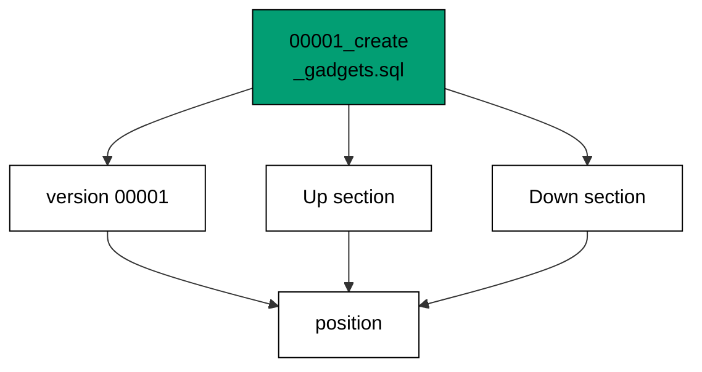

Every field has one job: the five-digit prefix fixes the node's position forever, the name tells the next reader what the change is for, and the two sections hold the forward and reverse steps. Goose plans from the annotations, never from comments or blank lines.

**`learning/code/ex-02-migration-file-anatomy/main.go`**:

```go
// => Shared driver: every unit in this course opens with this prelude.
// => The harness network is closed, so units carry a small standard-library
// => driver that applies the same goose SQL files `goose up` would apply.
// => The files, the history table shape, and the ordering rules are goose's
// => own; the driver only replaces the network-dependent binary.
package main // => every unit is one runnable program

import ( // => standard library only: no third-party modules
	"bufio"           // => bufio frames protocol messages over the TCP stream
	"encoding/binary" // => binary lays out length-prefixed protocol fields
	"fmt"             // => fmt prints the deterministic transcript only
	"io"              // => io forces full reads of split protocol messages
	"net"             // => net dials the harness Postgres service over TCP
	"os"              // => os reads the harness database address, never hardcoded
	"sort"            // => sort orders migration files, never trusts directory order
	"strings"         // => strings splits the goose Up and Down annotations
) // => every import used by driver and units

// => The database address comes from the harness, with local-run defaults.
func addr() (string, string, string) { // => one helper owns every address default
	host := os.Getenv("PGHOST") // => service hostname in the unit network
	if host == "" {             // => empty means a local run outside the harness
		host = "postgres" // => same default the Python courses use
	} // => end addr: empty means a local run outside the harness
	user := os.Getenv("PGUSER") // => trust-auth role, no password needed
	if user == "" {             // => empty means a local run outside the harness
		user = "postgres" // => same default the Python courses use
	} // => end addr: empty means a local run outside the harness
	db := os.Getenv("PGDATABASE") // => fresh database for every unit run
	if db == "" {                 // => empty means a local run outside the harness
		db = "postgres" // => same default the Python courses use
	} // => end addr: empty means a local run outside the harness
	return host, user, db // => callers never re-read the environment
} // => end addr: one helper owns every address default

// => conn wraps one TCP connection plus a buffered reader for message frames.
type conn struct { // => a tiny struct keeps the socket and the framer together
	c net.Conn      // => the raw TCP socket to the Postgres service
	r *bufio.Reader // => buffered reads frame messages split across packets
} // => end type conn: socket and framer travel together

// => readMsg reads one backend message: a type byte plus a length body.
func (k *conn) readMsg() (byte, []byte, error) { // => every response flows through here
	head := make([]byte, 5)                           // => one type byte plus one int32 length
	if _, err := io.ReadFull(k.r, head); err != nil { // => fragments reassemble before framing
		return 0, nil, err // => no partial message is ever trusted
	} // => end readMsg: fragments reassemble before framing
	n := int(binary.BigEndian.Uint32(head[1:])) - 4   // => length counts itself, not the type
	body := make([]byte, n)                           // => exact-size body, never over-read
	if _, err := io.ReadFull(k.r, body); err != nil { // => fragments reassemble before framing
		return 0, nil, err // => no partial message is ever trusted
	} // => end readMsg: fragments reassemble before framing
	return head[0], body, nil // => type byte tells the caller what arrived
} // => end readMsg: every response flows through here

// => sendMsg writes one frontend message: a type byte plus a length body.
func (k *conn) sendMsg(t byte, body []byte) error { // => startup is the only typeless message
	out := []byte{t}                                      // => type byte leads every message
	lenb := make([]byte, 4)                               // => four bytes carry the length
	binary.BigEndian.PutUint32(lenb, uint32(len(body)+4)) // => length counts itself
	out = append(out, lenb...)                            // => length follows the type byte
	out = append(out, body...)                            // => payload closes the message
	_, err := k.c.Write(out)                              // => one write keeps frames whole
	return err                                            // => write errors fail the unit loudly
} // => end sendMsg: startup is the only typeless message

// => connect opens the service database and waits for session readiness.
func connect() (*conn, error) { // => every unit starts from this one helper
	host, user, db := addr()         // => harness address, never hardcoded
	return connectDb(host, user, db) // => one path opens every session
} // => end connect: every unit starts from this one helper

// => connectDb opens a named database on the same host for multi-db drills.
func connectDb(host, user, db string) (*conn, error) { // => environments are databases, not servers
	c, err := net.Dial("tcp", host+":5432") // => Postgres listens on 5432
	if err != nil {                         // => unreachable service is fatal
		return nil, err // => no fallback: the harness owns the database
	} // => end connectDb: unreachable service is fatal
	k := &conn{c: c, r: bufio.NewReader(c)}             // => buffer the fresh socket at once
	body := []byte{}                                    // => startup body is parameters only
	body = append(body, 0, 0, 0, 0)                     // => placeholder for the length prefix
	body = append(body, 0, 3, 0, 0)                     // => protocol 3.0, the stable version
	body = append(body, []byte("user")...)              // => user key starts the parameters
	body = append(body, 0)                              // => keys and values are NUL-separated
	body = append(body, []byte(user)...)                // => trust-auth role from the harness
	body = append(body, 0)                              // => NUL ends the value
	body = append(body, []byte("database")...)          // => database key follows the user
	body = append(body, 0)                              // => NUL ends the key
	body = append(body, []byte(db)...)                  // => fresh database for every unit run
	body = append(body, 0)                              // => NUL ends the value
	body = append(body, 0)                              // => empty key ends the parameters
	binary.BigEndian.PutUint32(body, uint32(len(body))) // => startup length counts itself
	if _, err := c.Write(body); err != nil {            // => startup is the only typeless message
		return nil, err // => unwritable socket is fatal
	} // => end connectDb: startup is the only typeless message
	for { // => drain until the session is ready for queries
		t, b, err := k.readMsg() // => every backend message flows through here
		if err != nil {          // => broken handshake is fatal
			return nil, err // => no half-open session is ever used
		} // => end connectDb: broken handshake is fatal
		switch t { // => only three message kinds matter during startup
		case 'R': // => authentication response arrives first
			if binary.BigEndian.Uint32(b) != 0 { // => nonzero means a password is wanted
				return nil, fmt.Errorf("server wants a password") // => trust auth never asks
			} // => end connectDb: nonzero means a password is wanted
		case 'E': // => an error ends the handshake with the server text
			return nil, fmt.Errorf("startup: %s", errText(b)) // => server text explains the cause
		case 'Z': // => ReadyForQuery means the session accepts queries
			return k, nil // => handshake done: hand the live session back
		} // => end connectDb: only three message kinds matter during startup
	} // => end connectDb: drain until the session is ready for queries
} // => end connectDb: environments are databases, not servers

// => errText extracts the human message (field M) from an ErrorResponse.
func errText(b []byte) string { // => one helper decodes every server error
	parts := strings.Split(string(b), "\x00") // => fields are NUL-separated pairs
	for i := 0; i+1 < len(parts); i += 2 {    // => walk code and value together
		if parts[i] == "M" { // => M is the primary human message
			return parts[i+1] // => return the message, skip the detail fields
		} // => end errText: M is the primary human message
	} // => end errText: walk code and value together
	return "unknown error" // => malformed errors still fail with a fixed line
} // => end errText: one helper decodes every server error

// => run sends one SQL string and returns every data row plus the command tag.
func (k *conn) run(q string) ([][]string, string, error) { // => one path runs every statement
	body := append([]byte(q), 0)                 // => Query messages are NUL-terminated
	if err := k.sendMsg('Q', body); err != nil { // => send fails loudly, never silently
		return nil, "", err // => unwritable socket ends the unit
	} // => end run: send fails loudly, never silently
	var rows [][]string // => data rows accumulate across result sets
	tag := ""           // => the last command tag (SELECT 3, CREATE TABLE...)
	for {               // => drain until ReadyForQuery closes this query string
		t, b, err := k.readMsg() // => every response flows through the framer
		if err != nil {          // => broken mid-query connection is fatal
			return nil, "", err // => partial results are never returned
		} // => end run: broken mid-query connection is fatal
		switch t { // => four message kinds carry a simple-query response
		case 'T', 'N', 'A', 'S', 'K': // => metadata the transcript never prints
		case 'D': // => one data row arrived
			rows = append(rows, parseRow(b)) // => decode the text columns now
		case 'C': // => one statement finished
			tag = strings.TrimRight(string(b[:len(b)-1]), "\x00") // => tag names what ran
		case 'E': // => the statement failed
			drain(k)                                     // => finish the failed query before reuse
			return nil, "", fmt.Errorf("%s", errText(b)) // => server text becomes the failure
		case 'Z': // => ReadyForQuery ends this query string
			return rows, tag, nil // => rows, tag, and a clean session
		} // => end run: four message kinds carry a simple-query response
	} // => end run: drain until ReadyForQuery closes this query string
} // => end run: one path runs every statement

// => drain reads to the next ReadyForQuery after a statement error.
func drain(k *conn) { // => an errored query still owns the socket until Z
	for { // => loop until the session is reusable
		t, _, err := k.readMsg()    // => discard every message after the error
		if err != nil || t == 'Z' { // => socket break or ready both end the drain
			return // => caller decides the failure, the drain only resynchronizes
		} // => end drain: socket break or ready both end the drain
	} // => end drain: loop until the session is reusable
} // => end drain: an errored query still owns the socket until Z

// => parseRow decodes one DataRow body into text columns, NULL as "NULL".
func parseRow(b []byte) []string { // => one helper decodes every returned row
	n := int(binary.BigEndian.Uint16(b)) // => column count leads the body
	b = b[2:]                            // => step past the count
	out := make([]string, 0, n)          // => pre-size the row to the count
	for i := 0; i < n; i++ {             // => walk each column in order
		l := int(int32(binary.BigEndian.Uint32(b))) // => -1 marks NULL, else the length
		b = b[4:]                                   // => step past the length
		if l < 0 {                                  // => NULL has no bytes to read
			out = append(out, "NULL") // => fixed word keeps transcripts stable
			continue                  // => next column, no bytes consumed
		} // => end parseRow: NULL has no bytes to read
		out = append(out, string(b[:l])) // => text format is already printable
		b = b[l:]                        // => step past the value bytes
	} // => end parseRow: walk each column in order
	return out // => one row, fully decoded
} // => end parseRow: one helper decodes every returned row

// => must runs SQL or exits nonzero with the server text on standard error.
func must(k *conn, q string) [][]string { // => setup statements never fail quietly
	rows, _, err := k.run(q) // => rows return for verification queries
	if err != nil {          // => any server error is fatal to the unit
		fmt.Fprintln(os.Stderr, "sql error:", err) // => errors go to stderr, never stdout
		os.Exit(1)                                 // => nonzero exit fails the harness check
	} // => end must: any server error is fatal to the unit
	return rows // => callers print only what the lesson asserts
} // => end must: setup statements never fail quietly

// => try runs SQL and returns the server error text instead of exiting.
func try(k *conn, q string) ([][]string, string) { // => failure drills inspect errors, not die
	rows, _, err := k.run(q) // => same path as must, opposite failure policy
	if err != nil {          // => expected errors become transcript lines
		return nil, err.Error() // => fixed server text, never timings
	} // => end try: expected errors become transcript lines
	return rows, "" // => empty error means the statement succeeded
} // => end try: failure drills inspect errors, not die

// => mig holds one goose SQL file: its version, name, and Up/Down sections.
type mig struct { // => mirrors the goose file layout the lesson teaches
	version string   // => zero-padded number orders history, like goose
	name    string   // => human slug after the version number
	up      []string // => forward statements, run inside one transaction
	down    []string // => reverse statements, run inside one transaction
	noTx    bool     // => NO TRANSACTION files run outside one, like goose
} // => end type mig: version, name, sections, and mode

// => parseGoose splits one goose SQL file into its Up and Down statements.
func parseGoose(text string) (up, down []string, noTx bool) { // => the lesson asserts this exact split
	section := ""                                    // => nothing belongs outside the annotations
	for _, line := range strings.Split(text, "\n") { // => walk the file line by line
		t := strings.TrimSpace(line) // => annotation matching ignores indentation
		switch t {                   // => four annotation lines switch sections
		case "-- +goose Up": // => forward section starts here, like goose
			section = "up" // => following statements migrate forward
			continue       // => the annotation itself never runs
		case "-- +goose Down": // => reverse section starts here, like goose
			section = "down" // => following statements roll back
			continue         // => the annotation itself never runs
		case "-- +goose NO TRANSACTION": // => concurrent work cannot run inside one
			noTx = true // => remember the file opts out of the transaction
			continue    // => the annotation itself never runs
		} // => end parseGoose: four annotation lines switch sections
		if strings.HasPrefix(t, "--") || t == "" { // => comments and blanks never run
			continue // => only real statements reach the database
		} // => end parseGoose: comments and blanks never run
		if section == "up" { // => route by the annotation seen above
			up = append(up, line) // => keep the original line for the file write
		} else if section == "down" { // => down statements collect separately
			down = append(down, line) // => keep the original line for the file write
		} // => end parseGoose: down statements collect separately
	} // => end parseGoose: walk the file line by line
	return splitStmts(strings.Join(up, "\n")), splitStmts(strings.Join(down, "\n")), noTx // => one string per statement
} // => end parseGoose: the lesson asserts this exact split

// => splitStmts cuts statement text on semicolons outside quotes.
func splitStmts(s string) []string { // => multi-line statements stay whole until ;
	var out []string        // => finished statements accumulate here
	var cur strings.Builder // => the statement under construction
	inStr := false          // => semicolons inside quotes never split
	for _, r := range s {   // => walk rune by rune, quotes included
		switch { // => quote tracking decides what a semicolon means
		case r == '\'': // => a quote toggles string mode
			inStr = !inStr   // => enter or leave the quoted region
			cur.WriteRune(r) // => the quote belongs to the statement
		case r == ';' && !inStr: // => a bare semicolon ends one statement
			if t := strings.TrimSpace(cur.String()); t != "" { // => skip empty fragments
				out = append(out, t) // => store the finished statement
			} // => end splitStmts: skip empty fragments
			cur.Reset() // => start the next statement fresh
		default: // => every other rune belongs to the current statement
			cur.WriteRune(r) // => accumulate verbatim
		} // => end splitStmts: quote tracking decides what a semicolon means
	} // => end splitStmts: walk rune by rune, quotes included
	if t := strings.TrimSpace(cur.String()); t != "" { // => trailing text without ; still counts
		out = append(out, t) // => last statement needs no semicolon
	} // => end splitStmts: trailing text without ; still counts
	return out // => callers run each statement in order
} // => end splitStmts: multi-line statements stay whole until ;

// => ensureHistory creates the goose history table once per unit run.
func ensureHistory(k *conn) { // => goose_db_version is goose's own default name
	must(k, `CREATE TABLE IF NOT EXISTS goose_db_version (`+ // => reruns never fail here
		`id integer PRIMARY KEY GENERATED BY DEFAULT AS IDENTITY, `+ // => surrogate key, never printed
		`version_id bigint NOT NULL, `+ // => applied version numbers live here
		`is_applied boolean NOT NULL, `+ // => goose marks rows applied on success
		`tstamp timestamp NOT NULL DEFAULT now())`) // => timestamp defaults, never printed
} // => end ensureHistory: goose_db_version is goose's own default name

// => appliedVersions returns the version numbers already marked applied.
func appliedVersions(k *conn) map[int64]bool { // => history decides what still needs running
	rows := must(k, `SELECT version_id FROM goose_db_version `+ // => only the numbers matter
		`WHERE is_applied ORDER BY version_id`) // => order keeps the transcript stable
	got := map[int64]bool{}  // => set lookup answers "already applied" fast
	for _, r := range rows { // => one row per applied migration
		var v int64                // => version numbers are integers
		fmt.Sscanf(r[0], "%d", &v) // => text format parses back to a number
		got[v] = true              // => mark this version done
	} // => end appliedVersions: one row per applied migration
	return got // => callers skip whatever history already holds
} // => end appliedVersions: history decides what still needs running

// => applyUp runs every pending migration forward, one transaction each.
func applyUp(k *conn, ms []mig) { // => files on disk are already the source of truth
	done := appliedVersions(k) // => history decides what still needs running
	for _, m := range ms {     // => file order is version order, sorted by the caller
		var v int64                     // => versions compare as numbers
		fmt.Sscanf(m.version, "%d", &v) // => zero-padded file prefix parses back
		if done[v] {                    // => applied migrations never run twice
			continue // => idempotent reruns skip straight past
		} // => end applyUp: applied migrations never run twice
		if !m.noTx { // => transactional files wrap everything in one unit
			must(k, "BEGIN") // => one migration is one transaction, like goose
		} // => end applyUp: transactional files wrap everything in one unit
		for _, s := range m.up { // => forward statements run in file order
			must(k, s) // => any failure aborts the unit before COMMIT
		} // => end applyUp: forward statements run in file order
		if !m.noTx { // => stamps join the same transaction they describe
			must(k, fmt.Sprintf(`INSERT INTO goose_db_version `+ // => stamp only after success
				`(version_id, is_applied) VALUES (%d, true)`, v)) // => stamp mirrors goose exactly
			must(k, "COMMIT") // => history row and schema land together
		} else { // => concurrent statements cannot share a transaction
			must(k, fmt.Sprintf(`INSERT INTO goose_db_version `+ // => stamp follows the work
				`(version_id, is_applied) VALUES (%d, true)`, v)) // => same row, separate statement
		} // => end applyUp: concurrent statements cannot share a transaction
	} // => end applyUp: file order is version order, sorted by the caller
} // => end applyUp: files on disk are already the source of truth

// => applyDown rolls back the newest applied migrations, newest first.
func applyDown(k *conn, ms []mig, steps int) { // => steps bounds how far history rewinds
	done := appliedVersions(k) // => history decides what can roll back
	var todo []mig             // => applied migrations in version order first
	for _, m := range ms {     // => walk the whole known history
		var v int64                     // => versions compare as numbers
		fmt.Sscanf(m.version, "%d", &v) // => zero-padded file prefix parses back
		if done[v] {                    // => only applied migrations roll back
			todo = append(todo, m) // => keep the migration for the reverse pass
		} // => end applyDown: only applied migrations roll back
	} // => end applyDown: walk the whole known history
	for i := len(todo) - 1; i >= 0 && steps > 0; i-- { // => newest applied goes first
		m := todo[i]                    // => this migration rolls back now
		var v int64                     // => versions compare as numbers
		fmt.Sscanf(m.version, "%d", &v) // => zero-padded file prefix parses back
		if !m.noTx {                    // => transactional files wrap the rollback too
			must(k, "BEGIN") // => reverse change is atomic, like the forward one
		} // => end applyDown: transactional files wrap the rollback too
		for _, s := range m.down { // => reverse statements run in file order
			must(k, s) // => any failure aborts before the history row moves
		} // => end applyDown: reverse statements run in file order
		must(k, fmt.Sprintf(`DELETE FROM goose_db_version `+ // => unstamped only after success
			`WHERE version_id = %d`, v)) // => the version leaves history exactly once
		if !m.noTx { // => close the transaction the rollback opened
			must(k, "COMMIT") // => schema reversal and unstamp land together
		} // => end applyDown: close the transaction the rollback opened
		steps-- // => one rollback consumed from the budget
	} // => end applyDown: newest applied goes first
} // => end applyDown: steps bounds how far history rewinds

// => statusCounts splits known migrations into applied and pending lists.
func statusCounts(k *conn, ms []mig) (applied, pending []string) { // => goose status in two lists
	done := appliedVersions(k) // => history decides which list each version joins
	for _, m := range ms {     // => walk the known history in version order
		var v int64                     // => versions compare as numbers
		fmt.Sscanf(m.version, "%d", &v) // => zero-padded file prefix parses back
		if done[v] {                    // => stamped versions are done
			applied = append(applied, m.version) // => keep the version string for printing
		} else { // => unstamped versions still wait
			pending = append(pending, m.version) // => keep the version string for printing
		} // => end statusCounts: unstamped versions still wait
	} // => end statusCounts: walk the known history in version order
	return applied, pending // => callers print both lists in one stable line each
} // => end statusCounts: goose status in two lists

// => files writes each migration as a real goose SQL file under dir.
func files(dir string, ms []mig) { // => the lesson shows these files byte-identically
	for _, m := range ms { // => one file per migration, like `goose create`
		name := fmt.Sprintf("%s_%s.sql", m.version, m.name) // => goose names files version-first
		var b strings.Builder                               // => build the file text in order
		if m.noTx {                                         // => concurrent files announce it first
			b.WriteString("-- +goose NO TRANSACTION\n") // => goose honors this exact annotation
		} // => end files: concurrent files announce it first
		b.WriteString("-- +goose Up\n") // => forward annotation leads
		for _, s := range m.up {        // => forward statements follow
			b.WriteString(s + ";\n") // => one statement per line, semicolon-closed
		} // => end files: forward statements follow
		b.WriteString("-- +goose Down\n") // => reverse annotation splits the file
		for _, s := range m.down {        // => reverse statements close the file
			b.WriteString(s + ";\n") // => one statement per line, semicolon-closed
		} // => end files: reverse statements close the file
		if err := os.WriteFile(dir+"/"+name, []byte(b.String()), 0644); err != nil { // => real files, like goose
			fmt.Fprintln(os.Stderr, "write error:", err) // => write errors fail loudly
			os.Exit(1)                                   // => no half-written migration set
		} // => end files: real files, like goose
	} // => end files: one file per migration, like `goose create`
} // => end files: the lesson shows these files byte-identically

// => versions lists migration files in version order from dir.
func versions(dir string) []mig { // => directory order is never trusted for history
	ents, err := os.ReadDir(dir) // => read the whole migrations directory
	if err != nil {              // => unreadable directory is fatal
		fmt.Fprintln(os.Stderr, "read error:", err) // => errors go to stderr
		os.Exit(1)                                  // => nonzero exit fails the check
	} // => end versions: unreadable directory is fatal
	names := []string{}      // => collect names before sorting
	for _, e := range ents { // => walk every directory entry
		if !e.IsDir() && strings.HasSuffix(e.Name(), ".sql") { // => only goose SQL files count
			names = append(names, e.Name()) // => keep the file name for parsing
		} // => end versions: only goose SQL files count
	} // => end versions: walk every directory entry
	sort.Strings(names)       // => zero-padded versions sort chronologically
	var out []mig             // => parsed migrations accumulate here
	for _, n := range names { // => parse in version order
		raw, err := os.ReadFile(dir + "/" + n) // => read the real file back
		if err != nil {                        // => unreadable file is fatal
			fmt.Fprintln(os.Stderr, "read error:", err) // => errors go to stderr
			os.Exit(1)                                  // => nonzero exit fails the check
		} // => end versions: unreadable file is fatal
		up, down, noTx := parseGoose(string(raw))                                            // => split on the goose annotations
		rest := strings.TrimSuffix(n, ".sql")                                                // => strip the extension first
		ver := rest[:5]                                                                      // => first five digits are the version
		out = append(out, mig{version: ver, name: rest[6:], up: up, down: down, noTx: noTx}) // => keep every part
	} // => end versions: parse in version order
	return out // => version-ordered migrations, ready to apply
} // => end versions: directory order is never trusted for history

// => findDupes returns version numbers claimed by two or more files.
func findDupes(dir string) []string { // => goose refuses duplicate versions outright
	ents, err := os.ReadDir(dir) // => read the whole migrations directory
	if err != nil {              // => unreadable directory is fatal
		fmt.Fprintln(os.Stderr, "read error:", err) // => errors go to stderr
		os.Exit(1)                                  // => nonzero exit fails the check
	} // => end findDupes: unreadable directory is fatal
	seen := map[string]int{} // => count claims per five-digit version prefix
	for _, e := range ents { // => walk every directory entry
		if !e.IsDir() && strings.HasSuffix(e.Name(), ".sql") { // => only goose SQL files count
			seen[e.Name()[:5]]++ // => first five digits are the version
		} // => end findDupes: only goose SQL files count
	} // => end findDupes: walk every directory entry
	var out []string         // => duplicates accumulate in version order
	for _, e := range ents { // => second pass keeps the order stable
		if !e.IsDir() && strings.HasSuffix(e.Name(), ".sql") { // => only goose SQL files count
			if v := e.Name()[:5]; seen[v] > 1 { // => claimed more than once
				out = append(out, v) // => keep the version string for printing
				seen[v] = 0          // => report each duplicate version only once
			} // => end findDupes: claimed more than once
		} // => end findDupes: only goose SQL files count
	} // => end findDupes: second pass keeps the order stable
	return out // => empty means the history numbers are unique
} // => end findDupes: goose refuses duplicate versions outright

func main() {
	k, err := connect() // => one session runs the whole example
	if err != nil {     // => unreachable database fails loudly
		fmt.Fprintln(os.Stderr, "connect error:", err) // => connection errors go to stderr
		os.Exit(1)                                     // => nonzero exit fails the check
	}
	defer k.c.Close() // => the socket closes when the example ends
	// => A scratch migrations directory: goose files live here, never in the unit.
	// => the scratch path never reaches stdout, so reruns stay byte-stable
	dir, err := os.MkdirTemp("", "ex02-") // => private directory, like `goose create`
	if err != nil {                       // => unmakable temp dir is fatal
		fmt.Fprintln(os.Stderr, "temp error:", err) // => errors go to stderr
		os.Exit(1)                                  // => nonzero exit fails the check
	}
	defer os.RemoveAll(dir)                          // => scratch files vanish; only transcripts remain
	must(k, "DROP TABLE IF EXISTS goose_db_version") // => stale history vanishes too
	ensureHistory(k)                                 // => goose history table, real shape
	files(dir, []mig{                                // => one file to inspect, written in the real format
		{version: "00001", name: "create_gadgets", // => identity this example dissects
			up:   []string{"CREATE TABLE ex02_gadgets (id SERIAL PRIMARY KEY)"}, // => one forward statement
			down: []string{"DROP TABLE ex02_gadgets"}},                          // => one reverse statement
	})
	ms := versions(dir)                                         // => parse the files back, like goose would
	fmt.Println("files:", len(ms))                              // => Output: files: 1
	fmt.Println("version:", ms[0].version)                      // => Output: version: 00001
	fmt.Println("name:", ms[0].name)                            // => Output: name: create_gadgets
	fmt.Println("up:", len(ms[0].up), "down:", len(ms[0].down)) // => Output: up: 1 down: 1
	fmt.Println("cleaned: yes")                                 // => Output: cleaned: yes
	must(k, "DROP TABLE IF EXISTS goose_db_version")            // => the example leaves no history behind
}
```

**Output** (`learning/code/ex-02-migration-file-anatomy/expected/main.stdout.txt`):

```text
files: 1
version: 00001
name: create_gadgets
up: 1 down: 1
cleaned: yes
```

**Key takeaway**: Version, name, and the two annotated sections are readable from the file alone; the database only records which files already ran.

**Why it matters**: Code review happens on files, not databases. When every migration's contract is visible without provisioning anything, reviewers can judge ordering and reversibility in the pull request, where fixes are cheap. Identity, parent links, and descriptions on the page beat tribal knowledge in someone's head every single time. Reviewers who can see identity, parent, and description without running anything catch ordering mistakes before they become production incidents.

### Example 3: Up Runs the Forward Change

Up is the direction that changes the schema: this example applies two migrations in version order and shows both tables in the catalog afterward. Nothing runs out of order and nothing is skipped. (Concepts: co-01, co-02.)

The driver reads the files back from disk and applies only what history does not already hold, then stamps each version into `goose_db_version`. The stamp and the schema change land in the same transaction, so a crash halfway leaves no stamp behind.

**`learning/code/ex-03-up-runs-the-forward-change/main.go`**:

```go
// => Shared driver: every unit in this course opens with this prelude.
// => The harness network is closed, so units carry a small standard-library
// => driver that applies the same goose SQL files `goose up` would apply.
// => The files, the history table shape, and the ordering rules are goose's
// => own; the driver only replaces the network-dependent binary.
package main // => every unit is one runnable program

import ( // => standard library only: no third-party modules
	"bufio"           // => bufio frames protocol messages over the TCP stream
	"encoding/binary" // => binary lays out length-prefixed protocol fields
	"fmt"             // => fmt prints the deterministic transcript only
	"io"              // => io forces full reads of split protocol messages
	"net"             // => net dials the harness Postgres service over TCP
	"os"              // => os reads the harness database address, never hardcoded
	"sort"            // => sort orders migration files, never trusts directory order
	"strings"         // => strings splits the goose Up and Down annotations
) // => every import used by driver and units

// => The database address comes from the harness, with local-run defaults.
func addr() (string, string, string) { // => one helper owns every address default
	host := os.Getenv("PGHOST") // => service hostname in the unit network
	if host == "" {             // => empty means a local run outside the harness
		host = "postgres" // => same default the Python courses use
	} // => end addr: empty means a local run outside the harness
	user := os.Getenv("PGUSER") // => trust-auth role, no password needed
	if user == "" {             // => empty means a local run outside the harness
		user = "postgres" // => same default the Python courses use
	} // => end addr: empty means a local run outside the harness
	db := os.Getenv("PGDATABASE") // => fresh database for every unit run
	if db == "" {                 // => empty means a local run outside the harness
		db = "postgres" // => same default the Python courses use
	} // => end addr: empty means a local run outside the harness
	return host, user, db // => callers never re-read the environment
} // => end addr: one helper owns every address default

// => conn wraps one TCP connection plus a buffered reader for message frames.
type conn struct { // => a tiny struct keeps the socket and the framer together
	c net.Conn      // => the raw TCP socket to the Postgres service
	r *bufio.Reader // => buffered reads frame messages split across packets
} // => end type conn: socket and framer travel together

// => readMsg reads one backend message: a type byte plus a length body.
func (k *conn) readMsg() (byte, []byte, error) { // => every response flows through here
	head := make([]byte, 5)                           // => one type byte plus one int32 length
	if _, err := io.ReadFull(k.r, head); err != nil { // => fragments reassemble before framing
		return 0, nil, err // => no partial message is ever trusted
	} // => end readMsg: fragments reassemble before framing
	n := int(binary.BigEndian.Uint32(head[1:])) - 4   // => length counts itself, not the type
	body := make([]byte, n)                           // => exact-size body, never over-read
	if _, err := io.ReadFull(k.r, body); err != nil { // => fragments reassemble before framing
		return 0, nil, err // => no partial message is ever trusted
	} // => end readMsg: fragments reassemble before framing
	return head[0], body, nil // => type byte tells the caller what arrived
} // => end readMsg: every response flows through here

// => sendMsg writes one frontend message: a type byte plus a length body.
func (k *conn) sendMsg(t byte, body []byte) error { // => startup is the only typeless message
	out := []byte{t}                                      // => type byte leads every message
	lenb := make([]byte, 4)                               // => four bytes carry the length
	binary.BigEndian.PutUint32(lenb, uint32(len(body)+4)) // => length counts itself
	out = append(out, lenb...)                            // => length follows the type byte
	out = append(out, body...)                            // => payload closes the message
	_, err := k.c.Write(out)                              // => one write keeps frames whole
	return err                                            // => write errors fail the unit loudly
} // => end sendMsg: startup is the only typeless message

// => connect opens the service database and waits for session readiness.
func connect() (*conn, error) { // => every unit starts from this one helper
	host, user, db := addr()         // => harness address, never hardcoded
	return connectDb(host, user, db) // => one path opens every session
} // => end connect: every unit starts from this one helper

// => connectDb opens a named database on the same host for multi-db drills.
func connectDb(host, user, db string) (*conn, error) { // => environments are databases, not servers
	c, err := net.Dial("tcp", host+":5432") // => Postgres listens on 5432
	if err != nil {                         // => unreachable service is fatal
		return nil, err // => no fallback: the harness owns the database
	} // => end connectDb: unreachable service is fatal
	k := &conn{c: c, r: bufio.NewReader(c)}             // => buffer the fresh socket at once
	body := []byte{}                                    // => startup body is parameters only
	body = append(body, 0, 0, 0, 0)                     // => placeholder for the length prefix
	body = append(body, 0, 3, 0, 0)                     // => protocol 3.0, the stable version
	body = append(body, []byte("user")...)              // => user key starts the parameters
	body = append(body, 0)                              // => keys and values are NUL-separated
	body = append(body, []byte(user)...)                // => trust-auth role from the harness
	body = append(body, 0)                              // => NUL ends the value
	body = append(body, []byte("database")...)          // => database key follows the user
	body = append(body, 0)                              // => NUL ends the key
	body = append(body, []byte(db)...)                  // => fresh database for every unit run
	body = append(body, 0)                              // => NUL ends the value
	body = append(body, 0)                              // => empty key ends the parameters
	binary.BigEndian.PutUint32(body, uint32(len(body))) // => startup length counts itself
	if _, err := c.Write(body); err != nil {            // => startup is the only typeless message
		return nil, err // => unwritable socket is fatal
	} // => end connectDb: startup is the only typeless message
	for { // => drain until the session is ready for queries
		t, b, err := k.readMsg() // => every backend message flows through here
		if err != nil {          // => broken handshake is fatal
			return nil, err // => no half-open session is ever used
		} // => end connectDb: broken handshake is fatal
		switch t { // => only three message kinds matter during startup
		case 'R': // => authentication response arrives first
			if binary.BigEndian.Uint32(b) != 0 { // => nonzero means a password is wanted
				return nil, fmt.Errorf("server wants a password") // => trust auth never asks
			} // => end connectDb: nonzero means a password is wanted
		case 'E': // => an error ends the handshake with the server text
			return nil, fmt.Errorf("startup: %s", errText(b)) // => server text explains the cause
		case 'Z': // => ReadyForQuery means the session accepts queries
			return k, nil // => handshake done: hand the live session back
		} // => end connectDb: only three message kinds matter during startup
	} // => end connectDb: drain until the session is ready for queries
} // => end connectDb: environments are databases, not servers

// => errText extracts the human message (field M) from an ErrorResponse.
func errText(b []byte) string { // => one helper decodes every server error
	parts := strings.Split(string(b), "\x00") // => fields are NUL-separated pairs
	for i := 0; i+1 < len(parts); i += 2 {    // => walk code and value together
		if parts[i] == "M" { // => M is the primary human message
			return parts[i+1] // => return the message, skip the detail fields
		} // => end errText: M is the primary human message
	} // => end errText: walk code and value together
	return "unknown error" // => malformed errors still fail with a fixed line
} // => end errText: one helper decodes every server error

// => run sends one SQL string and returns every data row plus the command tag.
func (k *conn) run(q string) ([][]string, string, error) { // => one path runs every statement
	body := append([]byte(q), 0)                 // => Query messages are NUL-terminated
	if err := k.sendMsg('Q', body); err != nil { // => send fails loudly, never silently
		return nil, "", err // => unwritable socket ends the unit
	} // => end run: send fails loudly, never silently
	var rows [][]string // => data rows accumulate across result sets
	tag := ""           // => the last command tag (SELECT 3, CREATE TABLE...)
	for {               // => drain until ReadyForQuery closes this query string
		t, b, err := k.readMsg() // => every response flows through the framer
		if err != nil {          // => broken mid-query connection is fatal
			return nil, "", err // => partial results are never returned
		} // => end run: broken mid-query connection is fatal
		switch t { // => four message kinds carry a simple-query response
		case 'T', 'N', 'A', 'S', 'K': // => metadata the transcript never prints
		case 'D': // => one data row arrived
			rows = append(rows, parseRow(b)) // => decode the text columns now
		case 'C': // => one statement finished
			tag = strings.TrimRight(string(b[:len(b)-1]), "\x00") // => tag names what ran
		case 'E': // => the statement failed
			drain(k)                                     // => finish the failed query before reuse
			return nil, "", fmt.Errorf("%s", errText(b)) // => server text becomes the failure
		case 'Z': // => ReadyForQuery ends this query string
			return rows, tag, nil // => rows, tag, and a clean session
		} // => end run: four message kinds carry a simple-query response
	} // => end run: drain until ReadyForQuery closes this query string
} // => end run: one path runs every statement

// => drain reads to the next ReadyForQuery after a statement error.
func drain(k *conn) { // => an errored query still owns the socket until Z
	for { // => loop until the session is reusable
		t, _, err := k.readMsg()    // => discard every message after the error
		if err != nil || t == 'Z' { // => socket break or ready both end the drain
			return // => caller decides the failure, the drain only resynchronizes
		} // => end drain: socket break or ready both end the drain
	} // => end drain: loop until the session is reusable
} // => end drain: an errored query still owns the socket until Z

// => parseRow decodes one DataRow body into text columns, NULL as "NULL".
func parseRow(b []byte) []string { // => one helper decodes every returned row
	n := int(binary.BigEndian.Uint16(b)) // => column count leads the body
	b = b[2:]                            // => step past the count
	out := make([]string, 0, n)          // => pre-size the row to the count
	for i := 0; i < n; i++ {             // => walk each column in order
		l := int(int32(binary.BigEndian.Uint32(b))) // => -1 marks NULL, else the length
		b = b[4:]                                   // => step past the length
		if l < 0 {                                  // => NULL has no bytes to read
			out = append(out, "NULL") // => fixed word keeps transcripts stable
			continue                  // => next column, no bytes consumed
		} // => end parseRow: NULL has no bytes to read
		out = append(out, string(b[:l])) // => text format is already printable
		b = b[l:]                        // => step past the value bytes
	} // => end parseRow: walk each column in order
	return out // => one row, fully decoded
} // => end parseRow: one helper decodes every returned row

// => must runs SQL or exits nonzero with the server text on standard error.
func must(k *conn, q string) [][]string { // => setup statements never fail quietly
	rows, _, err := k.run(q) // => rows return for verification queries
	if err != nil {          // => any server error is fatal to the unit
		fmt.Fprintln(os.Stderr, "sql error:", err) // => errors go to stderr, never stdout
		os.Exit(1)                                 // => nonzero exit fails the harness check
	} // => end must: any server error is fatal to the unit
	return rows // => callers print only what the lesson asserts
} // => end must: setup statements never fail quietly

// => try runs SQL and returns the server error text instead of exiting.
func try(k *conn, q string) ([][]string, string) { // => failure drills inspect errors, not die
	rows, _, err := k.run(q) // => same path as must, opposite failure policy
	if err != nil {          // => expected errors become transcript lines
		return nil, err.Error() // => fixed server text, never timings
	} // => end try: expected errors become transcript lines
	return rows, "" // => empty error means the statement succeeded
} // => end try: failure drills inspect errors, not die

// => mig holds one goose SQL file: its version, name, and Up/Down sections.
type mig struct { // => mirrors the goose file layout the lesson teaches
	version string   // => zero-padded number orders history, like goose
	name    string   // => human slug after the version number
	up      []string // => forward statements, run inside one transaction
	down    []string // => reverse statements, run inside one transaction
	noTx    bool     // => NO TRANSACTION files run outside one, like goose
} // => end type mig: version, name, sections, and mode

// => parseGoose splits one goose SQL file into its Up and Down statements.
func parseGoose(text string) (up, down []string, noTx bool) { // => the lesson asserts this exact split
	section := ""                                    // => nothing belongs outside the annotations
	for _, line := range strings.Split(text, "\n") { // => walk the file line by line
		t := strings.TrimSpace(line) // => annotation matching ignores indentation
		switch t {                   // => four annotation lines switch sections
		case "-- +goose Up": // => forward section starts here, like goose
			section = "up" // => following statements migrate forward
			continue       // => the annotation itself never runs
		case "-- +goose Down": // => reverse section starts here, like goose
			section = "down" // => following statements roll back
			continue         // => the annotation itself never runs
		case "-- +goose NO TRANSACTION": // => concurrent work cannot run inside one
			noTx = true // => remember the file opts out of the transaction
			continue    // => the annotation itself never runs
		} // => end parseGoose: four annotation lines switch sections
		if strings.HasPrefix(t, "--") || t == "" { // => comments and blanks never run
			continue // => only real statements reach the database
		} // => end parseGoose: comments and blanks never run
		if section == "up" { // => route by the annotation seen above
			up = append(up, line) // => keep the original line for the file write
		} else if section == "down" { // => down statements collect separately
			down = append(down, line) // => keep the original line for the file write
		} // => end parseGoose: down statements collect separately
	} // => end parseGoose: walk the file line by line
	return splitStmts(strings.Join(up, "\n")), splitStmts(strings.Join(down, "\n")), noTx // => one string per statement
} // => end parseGoose: the lesson asserts this exact split

// => splitStmts cuts statement text on semicolons outside quotes.
func splitStmts(s string) []string { // => multi-line statements stay whole until ;
	var out []string        // => finished statements accumulate here
	var cur strings.Builder // => the statement under construction
	inStr := false          // => semicolons inside quotes never split
	for _, r := range s {   // => walk rune by rune, quotes included
		switch { // => quote tracking decides what a semicolon means
		case r == '\'': // => a quote toggles string mode
			inStr = !inStr   // => enter or leave the quoted region
			cur.WriteRune(r) // => the quote belongs to the statement
		case r == ';' && !inStr: // => a bare semicolon ends one statement
			if t := strings.TrimSpace(cur.String()); t != "" { // => skip empty fragments
				out = append(out, t) // => store the finished statement
			} // => end splitStmts: skip empty fragments
			cur.Reset() // => start the next statement fresh
		default: // => every other rune belongs to the current statement
			cur.WriteRune(r) // => accumulate verbatim
		} // => end splitStmts: quote tracking decides what a semicolon means
	} // => end splitStmts: walk rune by rune, quotes included
	if t := strings.TrimSpace(cur.String()); t != "" { // => trailing text without ; still counts
		out = append(out, t) // => last statement needs no semicolon
	} // => end splitStmts: trailing text without ; still counts
	return out // => callers run each statement in order
} // => end splitStmts: multi-line statements stay whole until ;

// => ensureHistory creates the goose history table once per unit run.
func ensureHistory(k *conn) { // => goose_db_version is goose's own default name
	must(k, `CREATE TABLE IF NOT EXISTS goose_db_version (`+ // => reruns never fail here
		`id integer PRIMARY KEY GENERATED BY DEFAULT AS IDENTITY, `+ // => surrogate key, never printed
		`version_id bigint NOT NULL, `+ // => applied version numbers live here
		`is_applied boolean NOT NULL, `+ // => goose marks rows applied on success
		`tstamp timestamp NOT NULL DEFAULT now())`) // => timestamp defaults, never printed
} // => end ensureHistory: goose_db_version is goose's own default name

// => appliedVersions returns the version numbers already marked applied.
func appliedVersions(k *conn) map[int64]bool { // => history decides what still needs running
	rows := must(k, `SELECT version_id FROM goose_db_version `+ // => only the numbers matter
		`WHERE is_applied ORDER BY version_id`) // => order keeps the transcript stable
	got := map[int64]bool{}  // => set lookup answers "already applied" fast
	for _, r := range rows { // => one row per applied migration
		var v int64                // => version numbers are integers
		fmt.Sscanf(r[0], "%d", &v) // => text format parses back to a number
		got[v] = true              // => mark this version done
	} // => end appliedVersions: one row per applied migration
	return got // => callers skip whatever history already holds
} // => end appliedVersions: history decides what still needs running

// => applyUp runs every pending migration forward, one transaction each.
func applyUp(k *conn, ms []mig) { // => files on disk are already the source of truth
	done := appliedVersions(k) // => history decides what still needs running
	for _, m := range ms {     // => file order is version order, sorted by the caller
		var v int64                     // => versions compare as numbers
		fmt.Sscanf(m.version, "%d", &v) // => zero-padded file prefix parses back
		if done[v] {                    // => applied migrations never run twice
			continue // => idempotent reruns skip straight past
		} // => end applyUp: applied migrations never run twice
		if !m.noTx { // => transactional files wrap everything in one unit
			must(k, "BEGIN") // => one migration is one transaction, like goose
		} // => end applyUp: transactional files wrap everything in one unit
		for _, s := range m.up { // => forward statements run in file order
			must(k, s) // => any failure aborts the unit before COMMIT
		} // => end applyUp: forward statements run in file order
		if !m.noTx { // => stamps join the same transaction they describe
			must(k, fmt.Sprintf(`INSERT INTO goose_db_version `+ // => stamp only after success
				`(version_id, is_applied) VALUES (%d, true)`, v)) // => stamp mirrors goose exactly
			must(k, "COMMIT") // => history row and schema land together
		} else { // => concurrent statements cannot share a transaction
			must(k, fmt.Sprintf(`INSERT INTO goose_db_version `+ // => stamp follows the work
				`(version_id, is_applied) VALUES (%d, true)`, v)) // => same row, separate statement
		} // => end applyUp: concurrent statements cannot share a transaction
	} // => end applyUp: file order is version order, sorted by the caller
} // => end applyUp: files on disk are already the source of truth

// => applyDown rolls back the newest applied migrations, newest first.
func applyDown(k *conn, ms []mig, steps int) { // => steps bounds how far history rewinds
	done := appliedVersions(k) // => history decides what can roll back
	var todo []mig             // => applied migrations in version order first
	for _, m := range ms {     // => walk the whole known history
		var v int64                     // => versions compare as numbers
		fmt.Sscanf(m.version, "%d", &v) // => zero-padded file prefix parses back
		if done[v] {                    // => only applied migrations roll back
			todo = append(todo, m) // => keep the migration for the reverse pass
		} // => end applyDown: only applied migrations roll back
	} // => end applyDown: walk the whole known history
	for i := len(todo) - 1; i >= 0 && steps > 0; i-- { // => newest applied goes first
		m := todo[i]                    // => this migration rolls back now
		var v int64                     // => versions compare as numbers
		fmt.Sscanf(m.version, "%d", &v) // => zero-padded file prefix parses back
		if !m.noTx {                    // => transactional files wrap the rollback too
			must(k, "BEGIN") // => reverse change is atomic, like the forward one
		} // => end applyDown: transactional files wrap the rollback too
		for _, s := range m.down { // => reverse statements run in file order
			must(k, s) // => any failure aborts before the history row moves
		} // => end applyDown: reverse statements run in file order
		must(k, fmt.Sprintf(`DELETE FROM goose_db_version `+ // => unstamped only after success
			`WHERE version_id = %d`, v)) // => the version leaves history exactly once
		if !m.noTx { // => close the transaction the rollback opened
			must(k, "COMMIT") // => schema reversal and unstamp land together
		} // => end applyDown: close the transaction the rollback opened
		steps-- // => one rollback consumed from the budget
	} // => end applyDown: newest applied goes first
} // => end applyDown: steps bounds how far history rewinds

// => statusCounts splits known migrations into applied and pending lists.
func statusCounts(k *conn, ms []mig) (applied, pending []string) { // => goose status in two lists
	done := appliedVersions(k) // => history decides which list each version joins
	for _, m := range ms {     // => walk the known history in version order
		var v int64                     // => versions compare as numbers
		fmt.Sscanf(m.version, "%d", &v) // => zero-padded file prefix parses back
		if done[v] {                    // => stamped versions are done
			applied = append(applied, m.version) // => keep the version string for printing
		} else { // => unstamped versions still wait
			pending = append(pending, m.version) // => keep the version string for printing
		} // => end statusCounts: unstamped versions still wait
	} // => end statusCounts: walk the known history in version order
	return applied, pending // => callers print both lists in one stable line each
} // => end statusCounts: goose status in two lists

// => files writes each migration as a real goose SQL file under dir.
func files(dir string, ms []mig) { // => the lesson shows these files byte-identically
	for _, m := range ms { // => one file per migration, like `goose create`
		name := fmt.Sprintf("%s_%s.sql", m.version, m.name) // => goose names files version-first
		var b strings.Builder                               // => build the file text in order
		if m.noTx {                                         // => concurrent files announce it first
			b.WriteString("-- +goose NO TRANSACTION\n") // => goose honors this exact annotation
		} // => end files: concurrent files announce it first
		b.WriteString("-- +goose Up\n") // => forward annotation leads
		for _, s := range m.up {        // => forward statements follow
			b.WriteString(s + ";\n") // => one statement per line, semicolon-closed
		} // => end files: forward statements follow
		b.WriteString("-- +goose Down\n") // => reverse annotation splits the file
		for _, s := range m.down {        // => reverse statements close the file
			b.WriteString(s + ";\n") // => one statement per line, semicolon-closed
		} // => end files: reverse statements close the file
		if err := os.WriteFile(dir+"/"+name, []byte(b.String()), 0644); err != nil { // => real files, like goose
			fmt.Fprintln(os.Stderr, "write error:", err) // => write errors fail loudly
			os.Exit(1)                                   // => no half-written migration set
		} // => end files: real files, like goose
	} // => end files: one file per migration, like `goose create`
} // => end files: the lesson shows these files byte-identically

// => versions lists migration files in version order from dir.
func versions(dir string) []mig { // => directory order is never trusted for history
	ents, err := os.ReadDir(dir) // => read the whole migrations directory
	if err != nil {              // => unreadable directory is fatal
		fmt.Fprintln(os.Stderr, "read error:", err) // => errors go to stderr
		os.Exit(1)                                  // => nonzero exit fails the check
	} // => end versions: unreadable directory is fatal
	names := []string{}      // => collect names before sorting
	for _, e := range ents { // => walk every directory entry
		if !e.IsDir() && strings.HasSuffix(e.Name(), ".sql") { // => only goose SQL files count
			names = append(names, e.Name()) // => keep the file name for parsing
		} // => end versions: only goose SQL files count
	} // => end versions: walk every directory entry
	sort.Strings(names)       // => zero-padded versions sort chronologically
	var out []mig             // => parsed migrations accumulate here
	for _, n := range names { // => parse in version order
		raw, err := os.ReadFile(dir + "/" + n) // => read the real file back
		if err != nil {                        // => unreadable file is fatal
			fmt.Fprintln(os.Stderr, "read error:", err) // => errors go to stderr
			os.Exit(1)                                  // => nonzero exit fails the check
		} // => end versions: unreadable file is fatal
		up, down, noTx := parseGoose(string(raw))                                            // => split on the goose annotations
		rest := strings.TrimSuffix(n, ".sql")                                                // => strip the extension first
		ver := rest[:5]                                                                      // => first five digits are the version
		out = append(out, mig{version: ver, name: rest[6:], up: up, down: down, noTx: noTx}) // => keep every part
	} // => end versions: parse in version order
	return out // => version-ordered migrations, ready to apply
} // => end versions: directory order is never trusted for history

// => findDupes returns version numbers claimed by two or more files.
func findDupes(dir string) []string { // => goose refuses duplicate versions outright
	ents, err := os.ReadDir(dir) // => read the whole migrations directory
	if err != nil {              // => unreadable directory is fatal
		fmt.Fprintln(os.Stderr, "read error:", err) // => errors go to stderr
		os.Exit(1)                                  // => nonzero exit fails the check
	} // => end findDupes: unreadable directory is fatal
	seen := map[string]int{} // => count claims per five-digit version prefix
	for _, e := range ents { // => walk every directory entry
		if !e.IsDir() && strings.HasSuffix(e.Name(), ".sql") { // => only goose SQL files count
			seen[e.Name()[:5]]++ // => first five digits are the version
		} // => end findDupes: only goose SQL files count
	} // => end findDupes: walk every directory entry
	var out []string         // => duplicates accumulate in version order
	for _, e := range ents { // => second pass keeps the order stable
		if !e.IsDir() && strings.HasSuffix(e.Name(), ".sql") { // => only goose SQL files count
			if v := e.Name()[:5]; seen[v] > 1 { // => claimed more than once
				out = append(out, v) // => keep the version string for printing
				seen[v] = 0          // => report each duplicate version only once
			} // => end findDupes: claimed more than once
		} // => end findDupes: only goose SQL files count
	} // => end findDupes: second pass keeps the order stable
	return out // => empty means the history numbers are unique
} // => end findDupes: goose refuses duplicate versions outright

func main() {
	k, err := connect() // => one session runs the whole example
	if err != nil {     // => unreachable database fails loudly
		fmt.Fprintln(os.Stderr, "connect error:", err) // => connection errors go to stderr
		os.Exit(1)                                     // => nonzero exit fails the check
	}
	defer k.c.Close() // => the socket closes when the example ends
	// => A scratch migrations directory: goose files live here, never in the unit.
	// => the scratch path never reaches stdout, so reruns stay byte-stable
	dir, err := os.MkdirTemp("", "ex03-") // => private directory, like `goose create`
	if err != nil {                       // => unmakable temp dir is fatal
		fmt.Fprintln(os.Stderr, "temp error:", err) // => errors go to stderr
		os.Exit(1)                                  // => nonzero exit fails the check
	}
	defer os.RemoveAll(dir)                          // => scratch files vanish; only transcripts remain
	must(k, "DROP TABLE IF EXISTS ex03_authors")     // => leftovers of a killed run vanish
	must(k, "DROP TABLE IF EXISTS ex03_books")       // => leftovers of a killed run vanish
	must(k, "DROP TABLE IF EXISTS goose_db_version") // => stale history vanishes too
	ensureHistory(k)                                 // => goose history table, real shape
	files(dir, []mig{                                // => two migrations, applied in version order
		{version: "00001", name: "create_authors", // => first table in this history
			up:   []string{"CREATE TABLE ex03_authors (id SERIAL PRIMARY KEY, name TEXT NOT NULL)"}, // => forward change
			down: []string{"DROP TABLE ex03_authors"}},                                              // => exact reverse for rollback
		{version: "00002", name: "create_books", // => second table depends on the first
			up:   []string{"CREATE TABLE ex03_books (id SERIAL PRIMARY KEY, author_id INTEGER NOT NULL, title TEXT NOT NULL)"}, // => forward change
			down: []string{"DROP TABLE ex03_books"}},                                                                           // => exact reverse for rollback
	})
	applyUp(k, versions(dir))                                            // => read the files back and run what is pending
	rows := must(k, `SELECT table_name FROM information_schema.tables `+ // => ask the catalog back
		`WHERE table_name LIKE 'ex03\_%' ORDER BY table_name`) // => LIKE pattern needs the escaped underscore
	fmt.Println("tables:", len(rows))                                                              // => Output: tables: 2
	rows = must(k, `SELECT version_id FROM goose_db_version WHERE is_applied ORDER BY version_id`) // => history holds both
	fmt.Println("applied:", rows[0][0], rows[1][0])                                                // => Output: applied: 1 2
	fmt.Println("cleaned: yes")                                                                    // => Output: cleaned: yes
	must(k, "DROP TABLE IF EXISTS ex03_authors")                                                   // => leftovers of a killed run vanish
	must(k, "DROP TABLE IF EXISTS ex03_books")                                                     // => leftovers of a killed run vanish
	must(k, "DROP TABLE IF EXISTS goose_db_version")                                               // => the example leaves no history behind
}
```

**Output** (`learning/code/ex-03-up-runs-the-forward-change/expected/main.stdout.txt`):

```text
tables: 2
applied: 1 2
cleaned: yes
```

**Key takeaway**: Up applies every pending file in version order and stamps each one only after its statements succeed.

**Why it matters**: Forward motion is the normal case, so it must be the boring case. Applying pending files in version order with per-file transactions means deploys either finish completely or leave history exactly where it was. Operators stop fearing the migrate step because the tool, not courage, guarantees the order. Boring deploys are safe deploys: the same command runs on every release, and the stamps absorb the repetition without side effects.

### Example 4: Down Reverses the Change

Down is the direction that undoes the schema: this example applies one migration, rolls it back, and shows the table gone and the history row removed. Up then down is the round trip every rollback story starts from. (Concepts: co-02.)

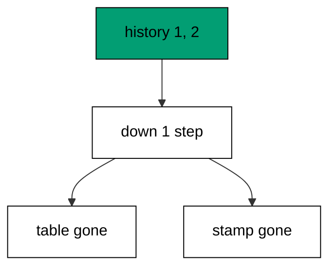

The reverse statements are not the forward ones in reverse order by accident: the author wrote them that way. A down section that drops exactly what its up section created is the cheapest reliable rollback a team can own.

**`learning/code/ex-04-down-reverses-the-change/main.go`**:

```go
// => Shared driver: every unit in this course opens with this prelude.
// => The harness network is closed, so units carry a small standard-library
// => driver that applies the same goose SQL files `goose up` would apply.
// => The files, the history table shape, and the ordering rules are goose's
// => own; the driver only replaces the network-dependent binary.
package main // => every unit is one runnable program

import ( // => standard library only: no third-party modules
	"bufio"           // => bufio frames protocol messages over the TCP stream
	"encoding/binary" // => binary lays out length-prefixed protocol fields
	"fmt"             // => fmt prints the deterministic transcript only
	"io"              // => io forces full reads of split protocol messages
	"net"             // => net dials the harness Postgres service over TCP
	"os"              // => os reads the harness database address, never hardcoded
	"sort"            // => sort orders migration files, never trusts directory order
	"strings"         // => strings splits the goose Up and Down annotations
) // => every import used by driver and units

// => The database address comes from the harness, with local-run defaults.
func addr() (string, string, string) { // => one helper owns every address default
	host := os.Getenv("PGHOST") // => service hostname in the unit network
	if host == "" {             // => empty means a local run outside the harness
		host = "postgres" // => same default the Python courses use
	} // => end addr: empty means a local run outside the harness
	user := os.Getenv("PGUSER") // => trust-auth role, no password needed
	if user == "" {             // => empty means a local run outside the harness
		user = "postgres" // => same default the Python courses use
	} // => end addr: empty means a local run outside the harness
	db := os.Getenv("PGDATABASE") // => fresh database for every unit run
	if db == "" {                 // => empty means a local run outside the harness
		db = "postgres" // => same default the Python courses use
	} // => end addr: empty means a local run outside the harness
	return host, user, db // => callers never re-read the environment
} // => end addr: one helper owns every address default

// => conn wraps one TCP connection plus a buffered reader for message frames.
type conn struct { // => a tiny struct keeps the socket and the framer together
	c net.Conn      // => the raw TCP socket to the Postgres service
	r *bufio.Reader // => buffered reads frame messages split across packets
} // => end type conn: socket and framer travel together

// => readMsg reads one backend message: a type byte plus a length body.
func (k *conn) readMsg() (byte, []byte, error) { // => every response flows through here
	head := make([]byte, 5)                           // => one type byte plus one int32 length
	if _, err := io.ReadFull(k.r, head); err != nil { // => fragments reassemble before framing
		return 0, nil, err // => no partial message is ever trusted
	} // => end readMsg: fragments reassemble before framing
	n := int(binary.BigEndian.Uint32(head[1:])) - 4   // => length counts itself, not the type
	body := make([]byte, n)                           // => exact-size body, never over-read
	if _, err := io.ReadFull(k.r, body); err != nil { // => fragments reassemble before framing
		return 0, nil, err // => no partial message is ever trusted
	} // => end readMsg: fragments reassemble before framing
	return head[0], body, nil // => type byte tells the caller what arrived
} // => end readMsg: every response flows through here

// => sendMsg writes one frontend message: a type byte plus a length body.
func (k *conn) sendMsg(t byte, body []byte) error { // => startup is the only typeless message
	out := []byte{t}                                      // => type byte leads every message
	lenb := make([]byte, 4)                               // => four bytes carry the length
	binary.BigEndian.PutUint32(lenb, uint32(len(body)+4)) // => length counts itself
	out = append(out, lenb...)                            // => length follows the type byte
	out = append(out, body...)                            // => payload closes the message
	_, err := k.c.Write(out)                              // => one write keeps frames whole
	return err                                            // => write errors fail the unit loudly
} // => end sendMsg: startup is the only typeless message

// => connect opens the service database and waits for session readiness.
func connect() (*conn, error) { // => every unit starts from this one helper
	host, user, db := addr()         // => harness address, never hardcoded
	return connectDb(host, user, db) // => one path opens every session
} // => end connect: every unit starts from this one helper

// => connectDb opens a named database on the same host for multi-db drills.
func connectDb(host, user, db string) (*conn, error) { // => environments are databases, not servers
	c, err := net.Dial("tcp", host+":5432") // => Postgres listens on 5432
	if err != nil {                         // => unreachable service is fatal
		return nil, err // => no fallback: the harness owns the database
	} // => end connectDb: unreachable service is fatal
	k := &conn{c: c, r: bufio.NewReader(c)}             // => buffer the fresh socket at once
	body := []byte{}                                    // => startup body is parameters only
	body = append(body, 0, 0, 0, 0)                     // => placeholder for the length prefix
	body = append(body, 0, 3, 0, 0)                     // => protocol 3.0, the stable version
	body = append(body, []byte("user")...)              // => user key starts the parameters
	body = append(body, 0)                              // => keys and values are NUL-separated
	body = append(body, []byte(user)...)                // => trust-auth role from the harness
	body = append(body, 0)                              // => NUL ends the value
	body = append(body, []byte("database")...)          // => database key follows the user
	body = append(body, 0)                              // => NUL ends the key
	body = append(body, []byte(db)...)                  // => fresh database for every unit run
	body = append(body, 0)                              // => NUL ends the value
	body = append(body, 0)                              // => empty key ends the parameters
	binary.BigEndian.PutUint32(body, uint32(len(body))) // => startup length counts itself
	if _, err := c.Write(body); err != nil {            // => startup is the only typeless message
		return nil, err // => unwritable socket is fatal
	} // => end connectDb: startup is the only typeless message
	for { // => drain until the session is ready for queries
		t, b, err := k.readMsg() // => every backend message flows through here
		if err != nil {          // => broken handshake is fatal
			return nil, err // => no half-open session is ever used
		} // => end connectDb: broken handshake is fatal
		switch t { // => only three message kinds matter during startup
		case 'R': // => authentication response arrives first
			if binary.BigEndian.Uint32(b) != 0 { // => nonzero means a password is wanted
				return nil, fmt.Errorf("server wants a password") // => trust auth never asks
			} // => end connectDb: nonzero means a password is wanted
		case 'E': // => an error ends the handshake with the server text
			return nil, fmt.Errorf("startup: %s", errText(b)) // => server text explains the cause
		case 'Z': // => ReadyForQuery means the session accepts queries
			return k, nil // => handshake done: hand the live session back
		} // => end connectDb: only three message kinds matter during startup
	} // => end connectDb: drain until the session is ready for queries
} // => end connectDb: environments are databases, not servers

// => errText extracts the human message (field M) from an ErrorResponse.
func errText(b []byte) string { // => one helper decodes every server error
	parts := strings.Split(string(b), "\x00") // => fields are NUL-separated pairs
	for i := 0; i+1 < len(parts); i += 2 {    // => walk code and value together
		if parts[i] == "M" { // => M is the primary human message
			return parts[i+1] // => return the message, skip the detail fields
		} // => end errText: M is the primary human message
	} // => end errText: walk code and value together
	return "unknown error" // => malformed errors still fail with a fixed line
} // => end errText: one helper decodes every server error

// => run sends one SQL string and returns every data row plus the command tag.
func (k *conn) run(q string) ([][]string, string, error) { // => one path runs every statement
	body := append([]byte(q), 0)                 // => Query messages are NUL-terminated
	if err := k.sendMsg('Q', body); err != nil { // => send fails loudly, never silently
		return nil, "", err // => unwritable socket ends the unit
	} // => end run: send fails loudly, never silently
	var rows [][]string // => data rows accumulate across result sets
	tag := ""           // => the last command tag (SELECT 3, CREATE TABLE...)
	for {               // => drain until ReadyForQuery closes this query string
		t, b, err := k.readMsg() // => every response flows through the framer
		if err != nil {          // => broken mid-query connection is fatal
			return nil, "", err // => partial results are never returned
		} // => end run: broken mid-query connection is fatal
		switch t { // => four message kinds carry a simple-query response
		case 'T', 'N', 'A', 'S', 'K': // => metadata the transcript never prints
		case 'D': // => one data row arrived
			rows = append(rows, parseRow(b)) // => decode the text columns now
		case 'C': // => one statement finished
			tag = strings.TrimRight(string(b[:len(b)-1]), "\x00") // => tag names what ran
		case 'E': // => the statement failed
			drain(k)                                     // => finish the failed query before reuse
			return nil, "", fmt.Errorf("%s", errText(b)) // => server text becomes the failure
		case 'Z': // => ReadyForQuery ends this query string
			return rows, tag, nil // => rows, tag, and a clean session
		} // => end run: four message kinds carry a simple-query response
	} // => end run: drain until ReadyForQuery closes this query string
} // => end run: one path runs every statement

// => drain reads to the next ReadyForQuery after a statement error.
func drain(k *conn) { // => an errored query still owns the socket until Z
	for { // => loop until the session is reusable
		t, _, err := k.readMsg()    // => discard every message after the error
		if err != nil || t == 'Z' { // => socket break or ready both end the drain
			return // => caller decides the failure, the drain only resynchronizes
		} // => end drain: socket break or ready both end the drain
	} // => end drain: loop until the session is reusable
} // => end drain: an errored query still owns the socket until Z

// => parseRow decodes one DataRow body into text columns, NULL as "NULL".
func parseRow(b []byte) []string { // => one helper decodes every returned row
	n := int(binary.BigEndian.Uint16(b)) // => column count leads the body
	b = b[2:]                            // => step past the count
	out := make([]string, 0, n)          // => pre-size the row to the count
	for i := 0; i < n; i++ {             // => walk each column in order
		l := int(int32(binary.BigEndian.Uint32(b))) // => -1 marks NULL, else the length
		b = b[4:]                                   // => step past the length
		if l < 0 {                                  // => NULL has no bytes to read
			out = append(out, "NULL") // => fixed word keeps transcripts stable
			continue                  // => next column, no bytes consumed
		} // => end parseRow: NULL has no bytes to read
		out = append(out, string(b[:l])) // => text format is already printable
		b = b[l:]                        // => step past the value bytes
	} // => end parseRow: walk each column in order
	return out // => one row, fully decoded
} // => end parseRow: one helper decodes every returned row

// => must runs SQL or exits nonzero with the server text on standard error.
func must(k *conn, q string) [][]string { // => setup statements never fail quietly
	rows, _, err := k.run(q) // => rows return for verification queries
	if err != nil {          // => any server error is fatal to the unit
		fmt.Fprintln(os.Stderr, "sql error:", err) // => errors go to stderr, never stdout
		os.Exit(1)                                 // => nonzero exit fails the harness check
	} // => end must: any server error is fatal to the unit
	return rows // => callers print only what the lesson asserts
} // => end must: setup statements never fail quietly

// => try runs SQL and returns the server error text instead of exiting.
func try(k *conn, q string) ([][]string, string) { // => failure drills inspect errors, not die
	rows, _, err := k.run(q) // => same path as must, opposite failure policy
	if err != nil {          // => expected errors become transcript lines
		return nil, err.Error() // => fixed server text, never timings
	} // => end try: expected errors become transcript lines
	return rows, "" // => empty error means the statement succeeded
} // => end try: failure drills inspect errors, not die

// => mig holds one goose SQL file: its version, name, and Up/Down sections.
type mig struct { // => mirrors the goose file layout the lesson teaches
	version string   // => zero-padded number orders history, like goose
	name    string   // => human slug after the version number
	up      []string // => forward statements, run inside one transaction
	down    []string // => reverse statements, run inside one transaction
	noTx    bool     // => NO TRANSACTION files run outside one, like goose
} // => end type mig: version, name, sections, and mode

// => parseGoose splits one goose SQL file into its Up and Down statements.
func parseGoose(text string) (up, down []string, noTx bool) { // => the lesson asserts this exact split
	section := ""                                    // => nothing belongs outside the annotations
	for _, line := range strings.Split(text, "\n") { // => walk the file line by line
		t := strings.TrimSpace(line) // => annotation matching ignores indentation
		switch t {                   // => four annotation lines switch sections
		case "-- +goose Up": // => forward section starts here, like goose
			section = "up" // => following statements migrate forward
			continue       // => the annotation itself never runs
		case "-- +goose Down": // => reverse section starts here, like goose
			section = "down" // => following statements roll back
			continue         // => the annotation itself never runs
		case "-- +goose NO TRANSACTION": // => concurrent work cannot run inside one
			noTx = true // => remember the file opts out of the transaction
			continue    // => the annotation itself never runs
		} // => end parseGoose: four annotation lines switch sections
		if strings.HasPrefix(t, "--") || t == "" { // => comments and blanks never run
			continue // => only real statements reach the database
		} // => end parseGoose: comments and blanks never run
		if section == "up" { // => route by the annotation seen above
			up = append(up, line) // => keep the original line for the file write
		} else if section == "down" { // => down statements collect separately
			down = append(down, line) // => keep the original line for the file write
		} // => end parseGoose: down statements collect separately
	} // => end parseGoose: walk the file line by line
	return splitStmts(strings.Join(up, "\n")), splitStmts(strings.Join(down, "\n")), noTx // => one string per statement
} // => end parseGoose: the lesson asserts this exact split

// => splitStmts cuts statement text on semicolons outside quotes.
func splitStmts(s string) []string { // => multi-line statements stay whole until ;
	var out []string        // => finished statements accumulate here
	var cur strings.Builder // => the statement under construction
	inStr := false          // => semicolons inside quotes never split
	for _, r := range s {   // => walk rune by rune, quotes included
		switch { // => quote tracking decides what a semicolon means
		case r == '\'': // => a quote toggles string mode
			inStr = !inStr   // => enter or leave the quoted region
			cur.WriteRune(r) // => the quote belongs to the statement
		case r == ';' && !inStr: // => a bare semicolon ends one statement
			if t := strings.TrimSpace(cur.String()); t != "" { // => skip empty fragments
				out = append(out, t) // => store the finished statement
			} // => end splitStmts: skip empty fragments
			cur.Reset() // => start the next statement fresh
		default: // => every other rune belongs to the current statement
			cur.WriteRune(r) // => accumulate verbatim
		} // => end splitStmts: quote tracking decides what a semicolon means
	} // => end splitStmts: walk rune by rune, quotes included
	if t := strings.TrimSpace(cur.String()); t != "" { // => trailing text without ; still counts
		out = append(out, t) // => last statement needs no semicolon
	} // => end splitStmts: trailing text without ; still counts
	return out // => callers run each statement in order
} // => end splitStmts: multi-line statements stay whole until ;

// => ensureHistory creates the goose history table once per unit run.
func ensureHistory(k *conn) { // => goose_db_version is goose's own default name
	must(k, `CREATE TABLE IF NOT EXISTS goose_db_version (`+ // => reruns never fail here
		`id integer PRIMARY KEY GENERATED BY DEFAULT AS IDENTITY, `+ // => surrogate key, never printed
		`version_id bigint NOT NULL, `+ // => applied version numbers live here
		`is_applied boolean NOT NULL, `+ // => goose marks rows applied on success
		`tstamp timestamp NOT NULL DEFAULT now())`) // => timestamp defaults, never printed
} // => end ensureHistory: goose_db_version is goose's own default name

// => appliedVersions returns the version numbers already marked applied.
func appliedVersions(k *conn) map[int64]bool { // => history decides what still needs running
	rows := must(k, `SELECT version_id FROM goose_db_version `+ // => only the numbers matter
		`WHERE is_applied ORDER BY version_id`) // => order keeps the transcript stable
	got := map[int64]bool{}  // => set lookup answers "already applied" fast
	for _, r := range rows { // => one row per applied migration
		var v int64                // => version numbers are integers
		fmt.Sscanf(r[0], "%d", &v) // => text format parses back to a number
		got[v] = true              // => mark this version done
	} // => end appliedVersions: one row per applied migration
	return got // => callers skip whatever history already holds
} // => end appliedVersions: history decides what still needs running

// => applyUp runs every pending migration forward, one transaction each.
func applyUp(k *conn, ms []mig) { // => files on disk are already the source of truth
	done := appliedVersions(k) // => history decides what still needs running
	for _, m := range ms {     // => file order is version order, sorted by the caller
		var v int64                     // => versions compare as numbers
		fmt.Sscanf(m.version, "%d", &v) // => zero-padded file prefix parses back
		if done[v] {                    // => applied migrations never run twice
			continue // => idempotent reruns skip straight past
		} // => end applyUp: applied migrations never run twice
		if !m.noTx { // => transactional files wrap everything in one unit
			must(k, "BEGIN") // => one migration is one transaction, like goose
		} // => end applyUp: transactional files wrap everything in one unit
		for _, s := range m.up { // => forward statements run in file order
			must(k, s) // => any failure aborts the unit before COMMIT
		} // => end applyUp: forward statements run in file order
		if !m.noTx { // => stamps join the same transaction they describe
			must(k, fmt.Sprintf(`INSERT INTO goose_db_version `+ // => stamp only after success
				`(version_id, is_applied) VALUES (%d, true)`, v)) // => stamp mirrors goose exactly
			must(k, "COMMIT") // => history row and schema land together
		} else { // => concurrent statements cannot share a transaction
			must(k, fmt.Sprintf(`INSERT INTO goose_db_version `+ // => stamp follows the work
				`(version_id, is_applied) VALUES (%d, true)`, v)) // => same row, separate statement
		} // => end applyUp: concurrent statements cannot share a transaction
	} // => end applyUp: file order is version order, sorted by the caller
} // => end applyUp: files on disk are already the source of truth

// => applyDown rolls back the newest applied migrations, newest first.
func applyDown(k *conn, ms []mig, steps int) { // => steps bounds how far history rewinds
	done := appliedVersions(k) // => history decides what can roll back
	var todo []mig             // => applied migrations in version order first
	for _, m := range ms {     // => walk the whole known history
		var v int64                     // => versions compare as numbers
		fmt.Sscanf(m.version, "%d", &v) // => zero-padded file prefix parses back
		if done[v] {                    // => only applied migrations roll back
			todo = append(todo, m) // => keep the migration for the reverse pass
		} // => end applyDown: only applied migrations roll back
	} // => end applyDown: walk the whole known history
	for i := len(todo) - 1; i >= 0 && steps > 0; i-- { // => newest applied goes first
		m := todo[i]                    // => this migration rolls back now
		var v int64                     // => versions compare as numbers
		fmt.Sscanf(m.version, "%d", &v) // => zero-padded file prefix parses back
		if !m.noTx {                    // => transactional files wrap the rollback too
			must(k, "BEGIN") // => reverse change is atomic, like the forward one
		} // => end applyDown: transactional files wrap the rollback too
		for _, s := range m.down { // => reverse statements run in file order
			must(k, s) // => any failure aborts before the history row moves
		} // => end applyDown: reverse statements run in file order
		must(k, fmt.Sprintf(`DELETE FROM goose_db_version `+ // => unstamped only after success
			`WHERE version_id = %d`, v)) // => the version leaves history exactly once
		if !m.noTx { // => close the transaction the rollback opened
			must(k, "COMMIT") // => schema reversal and unstamp land together
		} // => end applyDown: close the transaction the rollback opened
		steps-- // => one rollback consumed from the budget
	} // => end applyDown: newest applied goes first
} // => end applyDown: steps bounds how far history rewinds

// => statusCounts splits known migrations into applied and pending lists.
func statusCounts(k *conn, ms []mig) (applied, pending []string) { // => goose status in two lists
	done := appliedVersions(k) // => history decides which list each version joins
	for _, m := range ms {     // => walk the known history in version order
		var v int64                     // => versions compare as numbers
		fmt.Sscanf(m.version, "%d", &v) // => zero-padded file prefix parses back
		if done[v] {                    // => stamped versions are done
			applied = append(applied, m.version) // => keep the version string for printing
		} else { // => unstamped versions still wait
			pending = append(pending, m.version) // => keep the version string for printing
		} // => end statusCounts: unstamped versions still wait
	} // => end statusCounts: walk the known history in version order
	return applied, pending // => callers print both lists in one stable line each
} // => end statusCounts: goose status in two lists

// => files writes each migration as a real goose SQL file under dir.
func files(dir string, ms []mig) { // => the lesson shows these files byte-identically
	for _, m := range ms { // => one file per migration, like `goose create`
		name := fmt.Sprintf("%s_%s.sql", m.version, m.name) // => goose names files version-first
		var b strings.Builder                               // => build the file text in order
		if m.noTx {                                         // => concurrent files announce it first
			b.WriteString("-- +goose NO TRANSACTION\n") // => goose honors this exact annotation
		} // => end files: concurrent files announce it first
		b.WriteString("-- +goose Up\n") // => forward annotation leads
		for _, s := range m.up {        // => forward statements follow
			b.WriteString(s + ";\n") // => one statement per line, semicolon-closed
		} // => end files: forward statements follow
		b.WriteString("-- +goose Down\n") // => reverse annotation splits the file
		for _, s := range m.down {        // => reverse statements close the file
			b.WriteString(s + ";\n") // => one statement per line, semicolon-closed
		} // => end files: reverse statements close the file
		if err := os.WriteFile(dir+"/"+name, []byte(b.String()), 0644); err != nil { // => real files, like goose
			fmt.Fprintln(os.Stderr, "write error:", err) // => write errors fail loudly
			os.Exit(1)                                   // => no half-written migration set
		} // => end files: real files, like goose
	} // => end files: one file per migration, like `goose create`
} // => end files: the lesson shows these files byte-identically

// => versions lists migration files in version order from dir.
func versions(dir string) []mig { // => directory order is never trusted for history
	ents, err := os.ReadDir(dir) // => read the whole migrations directory
	if err != nil {              // => unreadable directory is fatal
		fmt.Fprintln(os.Stderr, "read error:", err) // => errors go to stderr
		os.Exit(1)                                  // => nonzero exit fails the check
	} // => end versions: unreadable directory is fatal
	names := []string{}      // => collect names before sorting
	for _, e := range ents { // => walk every directory entry
		if !e.IsDir() && strings.HasSuffix(e.Name(), ".sql") { // => only goose SQL files count
			names = append(names, e.Name()) // => keep the file name for parsing
		} // => end versions: only goose SQL files count
	} // => end versions: walk every directory entry
	sort.Strings(names)       // => zero-padded versions sort chronologically
	var out []mig             // => parsed migrations accumulate here
	for _, n := range names { // => parse in version order
		raw, err := os.ReadFile(dir + "/" + n) // => read the real file back
		if err != nil {                        // => unreadable file is fatal
			fmt.Fprintln(os.Stderr, "read error:", err) // => errors go to stderr
			os.Exit(1)                                  // => nonzero exit fails the check
		} // => end versions: unreadable file is fatal
		up, down, noTx := parseGoose(string(raw))                                            // => split on the goose annotations
		rest := strings.TrimSuffix(n, ".sql")                                                // => strip the extension first
		ver := rest[:5]                                                                      // => first five digits are the version
		out = append(out, mig{version: ver, name: rest[6:], up: up, down: down, noTx: noTx}) // => keep every part
	} // => end versions: parse in version order
	return out // => version-ordered migrations, ready to apply
} // => end versions: directory order is never trusted for history

// => findDupes returns version numbers claimed by two or more files.
func findDupes(dir string) []string { // => goose refuses duplicate versions outright
	ents, err := os.ReadDir(dir) // => read the whole migrations directory
	if err != nil {              // => unreadable directory is fatal
		fmt.Fprintln(os.Stderr, "read error:", err) // => errors go to stderr
		os.Exit(1)                                  // => nonzero exit fails the check
	} // => end findDupes: unreadable directory is fatal
	seen := map[string]int{} // => count claims per five-digit version prefix
	for _, e := range ents { // => walk every directory entry
		if !e.IsDir() && strings.HasSuffix(e.Name(), ".sql") { // => only goose SQL files count
			seen[e.Name()[:5]]++ // => first five digits are the version
		} // => end findDupes: only goose SQL files count
	} // => end findDupes: walk every directory entry
	var out []string         // => duplicates accumulate in version order
	for _, e := range ents { // => second pass keeps the order stable
		if !e.IsDir() && strings.HasSuffix(e.Name(), ".sql") { // => only goose SQL files count
			if v := e.Name()[:5]; seen[v] > 1 { // => claimed more than once
				out = append(out, v) // => keep the version string for printing
				seen[v] = 0          // => report each duplicate version only once
			} // => end findDupes: claimed more than once
		} // => end findDupes: only goose SQL files count
	} // => end findDupes: second pass keeps the order stable
	return out // => empty means the history numbers are unique
} // => end findDupes: goose refuses duplicate versions outright

func main() {
	k, err := connect() // => one session runs the whole example
	if err != nil {     // => unreachable database fails loudly
		fmt.Fprintln(os.Stderr, "connect error:", err) // => connection errors go to stderr
		os.Exit(1)                                     // => nonzero exit fails the check
	}
	defer k.c.Close() // => the socket closes when the example ends
	// => A scratch migrations directory: goose files live here, never in the unit.
	// => the scratch path never reaches stdout, so reruns stay byte-stable
	dir, err := os.MkdirTemp("", "ex04-") // => private directory, like `goose create`
	if err != nil {                       // => unmakable temp dir is fatal
		fmt.Fprintln(os.Stderr, "temp error:", err) // => errors go to stderr
		os.Exit(1)                                  // => nonzero exit fails the check
	}
	defer os.RemoveAll(dir)                          // => scratch files vanish; only transcripts remain
	must(k, "DROP TABLE IF EXISTS ex04_widgets")     // => leftovers of a killed run vanish
	must(k, "DROP TABLE IF EXISTS goose_db_version") // => stale history vanishes too
	ensureHistory(k)                                 // => goose history table, real shape
	files(dir, []mig{                                // => one migration to take up and back down
		{version: "00001", name: "create_widgets", // => first migration in this history
			up:   []string{"CREATE TABLE ex04_widgets (id SERIAL PRIMARY KEY, name TEXT NOT NULL)"}, // => forward change
			down: []string{"DROP TABLE ex04_widgets"}},                                              // => exact reverse for rollback
	})
	ms := versions(dir)                                                // => parse the files back, like goose would
	applyUp(k, ms)                                                     // => forward first: the table exists now
	applyDown(k, ms, 1)                                                // => one step back: the table goes away
	rows := must(k, `SELECT count(*) FROM information_schema.tables `+ // => count what survived
		`WHERE table_name = 'ex04_widgets'`) // => the rolled-back table must be gone
	fmt.Println("tables:", rows[0][0])                                       // => Output: tables: 0
	rows = must(k, `SELECT count(*) FROM goose_db_version WHERE is_applied`) // => history row leaves too
	fmt.Println("applied:", rows[0][0])                                      // => Output: applied: 0
	fmt.Println("cleaned: yes")                                              // => Output: cleaned: yes
	must(k, "DROP TABLE IF EXISTS ex04_widgets")                             // => leftovers of a killed run vanish
	must(k, "DROP TABLE IF EXISTS goose_db_version")                         // => the example leaves no history behind
}
```

**Output** (`learning/code/ex-04-down-reverses-the-change/expected/main.stdout.txt`):

```text
tables: 0
applied: 0
cleaned: yes
```

**Key takeaway**: Down runs the reverse section of the newest applied file and removes its stamp, newest first.

**Why it matters**: Every deploy needs an undo, and undo must be as tested as do. Running the reverse section through the same machinery as the forward step proves the escape hatch works before production needs it. Teams that rehearse rollback in development execute it calmly in incidents. The habit compounds: every rehearsed rollback makes the next incident calmer, because the team has run the motion before.

### Example 5: Add a Column with Alter

Real schemas grow one column at a time: this example adds an email column to an existing users table through a second migration, then reads the new column back from the catalog. The first migration stays untouched. (Concepts: co-01.)

Migrations append; they never edit. Version 00002 alters what version 00001 created, so every database that ran the first migration can run the second without replaying anything.

**`learning/code/ex-05-add-a-column-with-alter/main.go`**:

```go
// => Shared driver: every unit in this course opens with this prelude.
// => The harness network is closed, so units carry a small standard-library
// => driver that applies the same goose SQL files `goose up` would apply.
// => The files, the history table shape, and the ordering rules are goose's
// => own; the driver only replaces the network-dependent binary.
package main // => every unit is one runnable program

import ( // => standard library only: no third-party modules
	"bufio"           // => bufio frames protocol messages over the TCP stream
	"encoding/binary" // => binary lays out length-prefixed protocol fields
	"fmt"             // => fmt prints the deterministic transcript only
	"io"              // => io forces full reads of split protocol messages
	"net"             // => net dials the harness Postgres service over TCP
	"os"              // => os reads the harness database address, never hardcoded
	"sort"            // => sort orders migration files, never trusts directory order
	"strings"         // => strings splits the goose Up and Down annotations
) // => every import used by driver and units

// => The database address comes from the harness, with local-run defaults.
func addr() (string, string, string) { // => one helper owns every address default
	host := os.Getenv("PGHOST") // => service hostname in the unit network
	if host == "" {             // => empty means a local run outside the harness
		host = "postgres" // => same default the Python courses use
	} // => end addr: empty means a local run outside the harness
	user := os.Getenv("PGUSER") // => trust-auth role, no password needed
	if user == "" {             // => empty means a local run outside the harness
		user = "postgres" // => same default the Python courses use
	} // => end addr: empty means a local run outside the harness
	db := os.Getenv("PGDATABASE") // => fresh database for every unit run
	if db == "" {                 // => empty means a local run outside the harness
		db = "postgres" // => same default the Python courses use
	} // => end addr: empty means a local run outside the harness
	return host, user, db // => callers never re-read the environment
} // => end addr: one helper owns every address default

// => conn wraps one TCP connection plus a buffered reader for message frames.
type conn struct { // => a tiny struct keeps the socket and the framer together
	c net.Conn      // => the raw TCP socket to the Postgres service
	r *bufio.Reader // => buffered reads frame messages split across packets
} // => end type conn: socket and framer travel together

// => readMsg reads one backend message: a type byte plus a length body.
func (k *conn) readMsg() (byte, []byte, error) { // => every response flows through here
	head := make([]byte, 5)                           // => one type byte plus one int32 length
	if _, err := io.ReadFull(k.r, head); err != nil { // => fragments reassemble before framing
		return 0, nil, err // => no partial message is ever trusted
	} // => end readMsg: fragments reassemble before framing
	n := int(binary.BigEndian.Uint32(head[1:])) - 4   // => length counts itself, not the type
	body := make([]byte, n)                           // => exact-size body, never over-read
	if _, err := io.ReadFull(k.r, body); err != nil { // => fragments reassemble before framing
		return 0, nil, err // => no partial message is ever trusted
	} // => end readMsg: fragments reassemble before framing
	return head[0], body, nil // => type byte tells the caller what arrived
} // => end readMsg: every response flows through here

// => sendMsg writes one frontend message: a type byte plus a length body.
func (k *conn) sendMsg(t byte, body []byte) error { // => startup is the only typeless message
	out := []byte{t}                                      // => type byte leads every message
	lenb := make([]byte, 4)                               // => four bytes carry the length
	binary.BigEndian.PutUint32(lenb, uint32(len(body)+4)) // => length counts itself
	out = append(out, lenb...)                            // => length follows the type byte
	out = append(out, body...)                            // => payload closes the message
	_, err := k.c.Write(out)                              // => one write keeps frames whole
	return err                                            // => write errors fail the unit loudly
} // => end sendMsg: startup is the only typeless message

// => connect opens the service database and waits for session readiness.
func connect() (*conn, error) { // => every unit starts from this one helper
	host, user, db := addr()         // => harness address, never hardcoded
	return connectDb(host, user, db) // => one path opens every session
} // => end connect: every unit starts from this one helper

// => connectDb opens a named database on the same host for multi-db drills.
func connectDb(host, user, db string) (*conn, error) { // => environments are databases, not servers
	c, err := net.Dial("tcp", host+":5432") // => Postgres listens on 5432
	if err != nil {                         // => unreachable service is fatal
		return nil, err // => no fallback: the harness owns the database
	} // => end connectDb: unreachable service is fatal
	k := &conn{c: c, r: bufio.NewReader(c)}             // => buffer the fresh socket at once
	body := []byte{}                                    // => startup body is parameters only
	body = append(body, 0, 0, 0, 0)                     // => placeholder for the length prefix
	body = append(body, 0, 3, 0, 0)                     // => protocol 3.0, the stable version
	body = append(body, []byte("user")...)              // => user key starts the parameters
	body = append(body, 0)                              // => keys and values are NUL-separated
	body = append(body, []byte(user)...)                // => trust-auth role from the harness
	body = append(body, 0)                              // => NUL ends the value
	body = append(body, []byte("database")...)          // => database key follows the user
	body = append(body, 0)                              // => NUL ends the key
	body = append(body, []byte(db)...)                  // => fresh database for every unit run
	body = append(body, 0)                              // => NUL ends the value
	body = append(body, 0)                              // => empty key ends the parameters
	binary.BigEndian.PutUint32(body, uint32(len(body))) // => startup length counts itself
	if _, err := c.Write(body); err != nil {            // => startup is the only typeless message
		return nil, err // => unwritable socket is fatal
	} // => end connectDb: startup is the only typeless message
	for { // => drain until the session is ready for queries
		t, b, err := k.readMsg() // => every backend message flows through here
		if err != nil {          // => broken handshake is fatal
			return nil, err // => no half-open session is ever used
		} // => end connectDb: broken handshake is fatal
		switch t { // => only three message kinds matter during startup
		case 'R': // => authentication response arrives first
			if binary.BigEndian.Uint32(b) != 0 { // => nonzero means a password is wanted
				return nil, fmt.Errorf("server wants a password") // => trust auth never asks
			} // => end connectDb: nonzero means a password is wanted
		case 'E': // => an error ends the handshake with the server text
			return nil, fmt.Errorf("startup: %s", errText(b)) // => server text explains the cause
		case 'Z': // => ReadyForQuery means the session accepts queries
			return k, nil // => handshake done: hand the live session back
		} // => end connectDb: only three message kinds matter during startup
	} // => end connectDb: drain until the session is ready for queries
} // => end connectDb: environments are databases, not servers

// => errText extracts the human message (field M) from an ErrorResponse.
func errText(b []byte) string { // => one helper decodes every server error
	parts := strings.Split(string(b), "\x00") // => fields are NUL-separated pairs
	for i := 0; i+1 < len(parts); i += 2 {    // => walk code and value together
		if parts[i] == "M" { // => M is the primary human message
			return parts[i+1] // => return the message, skip the detail fields
		} // => end errText: M is the primary human message
	} // => end errText: walk code and value together
	return "unknown error" // => malformed errors still fail with a fixed line
} // => end errText: one helper decodes every server error

// => run sends one SQL string and returns every data row plus the command tag.
func (k *conn) run(q string) ([][]string, string, error) { // => one path runs every statement
	body := append([]byte(q), 0)                 // => Query messages are NUL-terminated
	if err := k.sendMsg('Q', body); err != nil { // => send fails loudly, never silently
		return nil, "", err // => unwritable socket ends the unit
	} // => end run: send fails loudly, never silently
	var rows [][]string // => data rows accumulate across result sets
	tag := ""           // => the last command tag (SELECT 3, CREATE TABLE...)
	for {               // => drain until ReadyForQuery closes this query string
		t, b, err := k.readMsg() // => every response flows through the framer
		if err != nil {          // => broken mid-query connection is fatal
			return nil, "", err // => partial results are never returned
		} // => end run: broken mid-query connection is fatal
		switch t { // => four message kinds carry a simple-query response
		case 'T', 'N', 'A', 'S', 'K': // => metadata the transcript never prints
		case 'D': // => one data row arrived
			rows = append(rows, parseRow(b)) // => decode the text columns now
		case 'C': // => one statement finished
			tag = strings.TrimRight(string(b[:len(b)-1]), "\x00") // => tag names what ran
		case 'E': // => the statement failed
			drain(k)                                     // => finish the failed query before reuse
			return nil, "", fmt.Errorf("%s", errText(b)) // => server text becomes the failure
		case 'Z': // => ReadyForQuery ends this query string
			return rows, tag, nil // => rows, tag, and a clean session
		} // => end run: four message kinds carry a simple-query response
	} // => end run: drain until ReadyForQuery closes this query string
} // => end run: one path runs every statement

// => drain reads to the next ReadyForQuery after a statement error.
func drain(k *conn) { // => an errored query still owns the socket until Z
	for { // => loop until the session is reusable
		t, _, err := k.readMsg()    // => discard every message after the error
		if err != nil || t == 'Z' { // => socket break or ready both end the drain
			return // => caller decides the failure, the drain only resynchronizes
		} // => end drain: socket break or ready both end the drain
	} // => end drain: loop until the session is reusable
} // => end drain: an errored query still owns the socket until Z

// => parseRow decodes one DataRow body into text columns, NULL as "NULL".
func parseRow(b []byte) []string { // => one helper decodes every returned row
	n := int(binary.BigEndian.Uint16(b)) // => column count leads the body
	b = b[2:]                            // => step past the count
	out := make([]string, 0, n)          // => pre-size the row to the count
	for i := 0; i < n; i++ {             // => walk each column in order
		l := int(int32(binary.BigEndian.Uint32(b))) // => -1 marks NULL, else the length
		b = b[4:]                                   // => step past the length
		if l < 0 {                                  // => NULL has no bytes to read
			out = append(out, "NULL") // => fixed word keeps transcripts stable
			continue                  // => next column, no bytes consumed
		} // => end parseRow: NULL has no bytes to read
		out = append(out, string(b[:l])) // => text format is already printable
		b = b[l:]                        // => step past the value bytes
	} // => end parseRow: walk each column in order
	return out // => one row, fully decoded
} // => end parseRow: one helper decodes every returned row

// => must runs SQL or exits nonzero with the server text on standard error.
func must(k *conn, q string) [][]string { // => setup statements never fail quietly
	rows, _, err := k.run(q) // => rows return for verification queries
	if err != nil {          // => any server error is fatal to the unit
		fmt.Fprintln(os.Stderr, "sql error:", err) // => errors go to stderr, never stdout
		os.Exit(1)                                 // => nonzero exit fails the harness check
	} // => end must: any server error is fatal to the unit
	return rows // => callers print only what the lesson asserts
} // => end must: setup statements never fail quietly

// => try runs SQL and returns the server error text instead of exiting.
func try(k *conn, q string) ([][]string, string) { // => failure drills inspect errors, not die
	rows, _, err := k.run(q) // => same path as must, opposite failure policy
	if err != nil {          // => expected errors become transcript lines
		return nil, err.Error() // => fixed server text, never timings
	} // => end try: expected errors become transcript lines
	return rows, "" // => empty error means the statement succeeded
} // => end try: failure drills inspect errors, not die

// => mig holds one goose SQL file: its version, name, and Up/Down sections.
type mig struct { // => mirrors the goose file layout the lesson teaches
	version string   // => zero-padded number orders history, like goose
	name    string   // => human slug after the version number
	up      []string // => forward statements, run inside one transaction
	down    []string // => reverse statements, run inside one transaction
	noTx    bool     // => NO TRANSACTION files run outside one, like goose
} // => end type mig: version, name, sections, and mode

// => parseGoose splits one goose SQL file into its Up and Down statements.
func parseGoose(text string) (up, down []string, noTx bool) { // => the lesson asserts this exact split
	section := ""                                    // => nothing belongs outside the annotations
	for _, line := range strings.Split(text, "\n") { // => walk the file line by line
		t := strings.TrimSpace(line) // => annotation matching ignores indentation
		switch t {                   // => four annotation lines switch sections
		case "-- +goose Up": // => forward section starts here, like goose
			section = "up" // => following statements migrate forward
			continue       // => the annotation itself never runs
		case "-- +goose Down": // => reverse section starts here, like goose
			section = "down" // => following statements roll back
			continue         // => the annotation itself never runs
		case "-- +goose NO TRANSACTION": // => concurrent work cannot run inside one
			noTx = true // => remember the file opts out of the transaction
			continue    // => the annotation itself never runs
		} // => end parseGoose: four annotation lines switch sections
		if strings.HasPrefix(t, "--") || t == "" { // => comments and blanks never run
			continue // => only real statements reach the database
		} // => end parseGoose: comments and blanks never run
		if section == "up" { // => route by the annotation seen above
			up = append(up, line) // => keep the original line for the file write
		} else if section == "down" { // => down statements collect separately
			down = append(down, line) // => keep the original line for the file write
		} // => end parseGoose: down statements collect separately
	} // => end parseGoose: walk the file line by line
	return splitStmts(strings.Join(up, "\n")), splitStmts(strings.Join(down, "\n")), noTx // => one string per statement
} // => end parseGoose: the lesson asserts this exact split

// => splitStmts cuts statement text on semicolons outside quotes.
func splitStmts(s string) []string { // => multi-line statements stay whole until ;
	var out []string        // => finished statements accumulate here
	var cur strings.Builder // => the statement under construction
	inStr := false          // => semicolons inside quotes never split
	for _, r := range s {   // => walk rune by rune, quotes included
		switch { // => quote tracking decides what a semicolon means
		case r == '\'': // => a quote toggles string mode
			inStr = !inStr   // => enter or leave the quoted region
			cur.WriteRune(r) // => the quote belongs to the statement
		case r == ';' && !inStr: // => a bare semicolon ends one statement
			if t := strings.TrimSpace(cur.String()); t != "" { // => skip empty fragments
				out = append(out, t) // => store the finished statement
			} // => end splitStmts: skip empty fragments
			cur.Reset() // => start the next statement fresh
		default: // => every other rune belongs to the current statement
			cur.WriteRune(r) // => accumulate verbatim
		} // => end splitStmts: quote tracking decides what a semicolon means
	} // => end splitStmts: walk rune by rune, quotes included
	if t := strings.TrimSpace(cur.String()); t != "" { // => trailing text without ; still counts
		out = append(out, t) // => last statement needs no semicolon
	} // => end splitStmts: trailing text without ; still counts
	return out // => callers run each statement in order
} // => end splitStmts: multi-line statements stay whole until ;

// => ensureHistory creates the goose history table once per unit run.
func ensureHistory(k *conn) { // => goose_db_version is goose's own default name
	must(k, `CREATE TABLE IF NOT EXISTS goose_db_version (`+ // => reruns never fail here
		`id integer PRIMARY KEY GENERATED BY DEFAULT AS IDENTITY, `+ // => surrogate key, never printed
		`version_id bigint NOT NULL, `+ // => applied version numbers live here
		`is_applied boolean NOT NULL, `+ // => goose marks rows applied on success
		`tstamp timestamp NOT NULL DEFAULT now())`) // => timestamp defaults, never printed
} // => end ensureHistory: goose_db_version is goose's own default name

// => appliedVersions returns the version numbers already marked applied.
func appliedVersions(k *conn) map[int64]bool { // => history decides what still needs running
	rows := must(k, `SELECT version_id FROM goose_db_version `+ // => only the numbers matter
		`WHERE is_applied ORDER BY version_id`) // => order keeps the transcript stable
	got := map[int64]bool{}  // => set lookup answers "already applied" fast
	for _, r := range rows { // => one row per applied migration
		var v int64                // => version numbers are integers
		fmt.Sscanf(r[0], "%d", &v) // => text format parses back to a number
		got[v] = true              // => mark this version done
	} // => end appliedVersions: one row per applied migration
	return got // => callers skip whatever history already holds
} // => end appliedVersions: history decides what still needs running

// => applyUp runs every pending migration forward, one transaction each.
func applyUp(k *conn, ms []mig) { // => files on disk are already the source of truth
	done := appliedVersions(k) // => history decides what still needs running
	for _, m := range ms {     // => file order is version order, sorted by the caller
		var v int64                     // => versions compare as numbers
		fmt.Sscanf(m.version, "%d", &v) // => zero-padded file prefix parses back
		if done[v] {                    // => applied migrations never run twice
			continue // => idempotent reruns skip straight past
		} // => end applyUp: applied migrations never run twice
		if !m.noTx { // => transactional files wrap everything in one unit
			must(k, "BEGIN") // => one migration is one transaction, like goose
		} // => end applyUp: transactional files wrap everything in one unit
		for _, s := range m.up { // => forward statements run in file order
			must(k, s) // => any failure aborts the unit before COMMIT
		} // => end applyUp: forward statements run in file order
		if !m.noTx { // => stamps join the same transaction they describe
			must(k, fmt.Sprintf(`INSERT INTO goose_db_version `+ // => stamp only after success
				`(version_id, is_applied) VALUES (%d, true)`, v)) // => stamp mirrors goose exactly
			must(k, "COMMIT") // => history row and schema land together
		} else { // => concurrent statements cannot share a transaction
			must(k, fmt.Sprintf(`INSERT INTO goose_db_version `+ // => stamp follows the work
				`(version_id, is_applied) VALUES (%d, true)`, v)) // => same row, separate statement
		} // => end applyUp: concurrent statements cannot share a transaction
	} // => end applyUp: file order is version order, sorted by the caller
} // => end applyUp: files on disk are already the source of truth

// => applyDown rolls back the newest applied migrations, newest first.
func applyDown(k *conn, ms []mig, steps int) { // => steps bounds how far history rewinds
	done := appliedVersions(k) // => history decides what can roll back
	var todo []mig             // => applied migrations in version order first
	for _, m := range ms {     // => walk the whole known history
		var v int64                     // => versions compare as numbers
		fmt.Sscanf(m.version, "%d", &v) // => zero-padded file prefix parses back
		if done[v] {                    // => only applied migrations roll back
			todo = append(todo, m) // => keep the migration for the reverse pass
		} // => end applyDown: only applied migrations roll back
	} // => end applyDown: walk the whole known history
	for i := len(todo) - 1; i >= 0 && steps > 0; i-- { // => newest applied goes first
		m := todo[i]                    // => this migration rolls back now
		var v int64                     // => versions compare as numbers
		fmt.Sscanf(m.version, "%d", &v) // => zero-padded file prefix parses back
		if !m.noTx {                    // => transactional files wrap the rollback too
			must(k, "BEGIN") // => reverse change is atomic, like the forward one
		} // => end applyDown: transactional files wrap the rollback too
		for _, s := range m.down { // => reverse statements run in file order
			must(k, s) // => any failure aborts before the history row moves
		} // => end applyDown: reverse statements run in file order
		must(k, fmt.Sprintf(`DELETE FROM goose_db_version `+ // => unstamped only after success
			`WHERE version_id = %d`, v)) // => the version leaves history exactly once
		if !m.noTx { // => close the transaction the rollback opened
			must(k, "COMMIT") // => schema reversal and unstamp land together
		} // => end applyDown: close the transaction the rollback opened
		steps-- // => one rollback consumed from the budget
	} // => end applyDown: newest applied goes first
} // => end applyDown: steps bounds how far history rewinds

// => statusCounts splits known migrations into applied and pending lists.
func statusCounts(k *conn, ms []mig) (applied, pending []string) { // => goose status in two lists
	done := appliedVersions(k) // => history decides which list each version joins
	for _, m := range ms {     // => walk the known history in version order
		var v int64                     // => versions compare as numbers
		fmt.Sscanf(m.version, "%d", &v) // => zero-padded file prefix parses back
		if done[v] {                    // => stamped versions are done
			applied = append(applied, m.version) // => keep the version string for printing
		} else { // => unstamped versions still wait
			pending = append(pending, m.version) // => keep the version string for printing
		} // => end statusCounts: unstamped versions still wait
	} // => end statusCounts: walk the known history in version order
	return applied, pending // => callers print both lists in one stable line each
} // => end statusCounts: goose status in two lists

// => files writes each migration as a real goose SQL file under dir.
func files(dir string, ms []mig) { // => the lesson shows these files byte-identically
	for _, m := range ms { // => one file per migration, like `goose create`
		name := fmt.Sprintf("%s_%s.sql", m.version, m.name) // => goose names files version-first
		var b strings.Builder                               // => build the file text in order
		if m.noTx {                                         // => concurrent files announce it first
			b.WriteString("-- +goose NO TRANSACTION\n") // => goose honors this exact annotation
		} // => end files: concurrent files announce it first
		b.WriteString("-- +goose Up\n") // => forward annotation leads
		for _, s := range m.up {        // => forward statements follow
			b.WriteString(s + ";\n") // => one statement per line, semicolon-closed
		} // => end files: forward statements follow
		b.WriteString("-- +goose Down\n") // => reverse annotation splits the file
		for _, s := range m.down {        // => reverse statements close the file
			b.WriteString(s + ";\n") // => one statement per line, semicolon-closed
		} // => end files: reverse statements close the file
		if err := os.WriteFile(dir+"/"+name, []byte(b.String()), 0644); err != nil { // => real files, like goose
			fmt.Fprintln(os.Stderr, "write error:", err) // => write errors fail loudly
			os.Exit(1)                                   // => no half-written migration set
		} // => end files: real files, like goose
	} // => end files: one file per migration, like `goose create`
} // => end files: the lesson shows these files byte-identically

// => versions lists migration files in version order from dir.
func versions(dir string) []mig { // => directory order is never trusted for history
	ents, err := os.ReadDir(dir) // => read the whole migrations directory
	if err != nil {              // => unreadable directory is fatal
		fmt.Fprintln(os.Stderr, "read error:", err) // => errors go to stderr
		os.Exit(1)                                  // => nonzero exit fails the check
	} // => end versions: unreadable directory is fatal
	names := []string{}      // => collect names before sorting
	for _, e := range ents { // => walk every directory entry
		if !e.IsDir() && strings.HasSuffix(e.Name(), ".sql") { // => only goose SQL files count
			names = append(names, e.Name()) // => keep the file name for parsing
		} // => end versions: only goose SQL files count
	} // => end versions: walk every directory entry
	sort.Strings(names)       // => zero-padded versions sort chronologically
	var out []mig             // => parsed migrations accumulate here
	for _, n := range names { // => parse in version order
		raw, err := os.ReadFile(dir + "/" + n) // => read the real file back
		if err != nil {                        // => unreadable file is fatal
			fmt.Fprintln(os.Stderr, "read error:", err) // => errors go to stderr
			os.Exit(1)                                  // => nonzero exit fails the check
		} // => end versions: unreadable file is fatal
		up, down, noTx := parseGoose(string(raw))                                            // => split on the goose annotations
		rest := strings.TrimSuffix(n, ".sql")                                                // => strip the extension first
		ver := rest[:5]                                                                      // => first five digits are the version
		out = append(out, mig{version: ver, name: rest[6:], up: up, down: down, noTx: noTx}) // => keep every part
	} // => end versions: parse in version order
	return out // => version-ordered migrations, ready to apply
} // => end versions: directory order is never trusted for history

// => findDupes returns version numbers claimed by two or more files.
func findDupes(dir string) []string { // => goose refuses duplicate versions outright
	ents, err := os.ReadDir(dir) // => read the whole migrations directory
	if err != nil {              // => unreadable directory is fatal
		fmt.Fprintln(os.Stderr, "read error:", err) // => errors go to stderr
		os.Exit(1)                                  // => nonzero exit fails the check
	} // => end findDupes: unreadable directory is fatal
	seen := map[string]int{} // => count claims per five-digit version prefix
	for _, e := range ents { // => walk every directory entry
		if !e.IsDir() && strings.HasSuffix(e.Name(), ".sql") { // => only goose SQL files count
			seen[e.Name()[:5]]++ // => first five digits are the version
		} // => end findDupes: only goose SQL files count
	} // => end findDupes: walk every directory entry
	var out []string         // => duplicates accumulate in version order
	for _, e := range ents { // => second pass keeps the order stable
		if !e.IsDir() && strings.HasSuffix(e.Name(), ".sql") { // => only goose SQL files count
			if v := e.Name()[:5]; seen[v] > 1 { // => claimed more than once
				out = append(out, v) // => keep the version string for printing
				seen[v] = 0          // => report each duplicate version only once
			} // => end findDupes: claimed more than once
		} // => end findDupes: only goose SQL files count
	} // => end findDupes: second pass keeps the order stable
	return out // => empty means the history numbers are unique
} // => end findDupes: goose refuses duplicate versions outright

func main() {
	k, err := connect() // => one session runs the whole example
	if err != nil {     // => unreachable database fails loudly
		fmt.Fprintln(os.Stderr, "connect error:", err) // => connection errors go to stderr
		os.Exit(1)                                     // => nonzero exit fails the check
	}
	defer k.c.Close() // => the socket closes when the example ends
	// => A scratch migrations directory: goose files live here, never in the unit.
	// => the scratch path never reaches stdout, so reruns stay byte-stable
	dir, err := os.MkdirTemp("", "ex05-") // => private directory, like `goose create`
	if err != nil {                       // => unmakable temp dir is fatal
		fmt.Fprintln(os.Stderr, "temp error:", err) // => errors go to stderr
		os.Exit(1)                                  // => nonzero exit fails the check
	}
	defer os.RemoveAll(dir)                          // => scratch files vanish; only transcripts remain
	must(k, "DROP TABLE IF EXISTS ex05_users")       // => leftovers of a killed run vanish
	must(k, "DROP TABLE IF EXISTS goose_db_version") // => stale history vanishes too
	ensureHistory(k)                                 // => goose history table, real shape
	files(dir, []mig{                                // => create first, alter second: history appends
		{version: "00001", name: "create_users", // => base table for the later alter
			up:   []string{"CREATE TABLE ex05_users (id SERIAL PRIMARY KEY, name TEXT NOT NULL)"}, // => forward change
			down: []string{"DROP TABLE ex05_users"}},                                              // => exact reverse for rollback
		{version: "00002", name: "add_email", // => additive change, second in history
			up:   []string{"ALTER TABLE ex05_users ADD COLUMN email TEXT"}, // => new column, nullable at first
			down: []string{"ALTER TABLE ex05_users DROP COLUMN email"}},    // => reverse drops just the column
	})
	applyUp(k, versions(dir))                                              // => read the files back and run what is pending
	rows := must(k, `SELECT column_name FROM information_schema.columns `+ // => ask the catalog back
		`WHERE table_name = 'ex05_users' ORDER BY ordinal_position`) // => position order stays stable
	names := []string{}      // => column names accumulate for one printed line
	for _, r := range rows { // => one row per column
		names = append(names, r[0]) // => first column holds the name
	}
	fmt.Println("columns:", strings.Join(names, ", ")) // => Output: columns: id, name, email
	fmt.Println("cleaned: yes")                        // => Output: cleaned: yes
	must(k, "DROP TABLE IF EXISTS ex05_users")         // => leftovers of a killed run vanish
	must(k, "DROP TABLE IF EXISTS goose_db_version")   // => the example leaves no history behind
}
```

**Output** (`learning/code/ex-05-add-a-column-with-alter/expected/main.stdout.txt`):

```text
columns: id, name, email
cleaned: yes
```

**Key takeaway**: History appends: new migrations alter what old ones built, and old files are never edited.

**Why it matters**: Append-only history means the past is immutable and the present is additive. Nobody rewrites a migration that already ran, so two databases at different versions still share every stamp up to the older one. Debugging starts from a history everyone trusts instead of folklore about who ran what. Immutable history also makes audits trivial: any two databases can be compared stamp by stamp, and the difference is the work that remains.

### Example 6: Create an Index

Lookups need indexes and indexes are schema: this example creates an index on the email column in its own migration, then confirms the index exists in the system catalog. The table migration does not change. (Concepts: co-01.)

One concern per migration keeps rollbacks precise: dropping the index migration removes only the index, never the column it covers.

**`learning/code/ex-06-create-an-index/main.go`**:

```go
// => Shared driver: every unit in this course opens with this prelude.
// => The harness network is closed, so units carry a small standard-library
// => driver that applies the same goose SQL files `goose up` would apply.
// => The files, the history table shape, and the ordering rules are goose's
// => own; the driver only replaces the network-dependent binary.
package main // => every unit is one runnable program

import ( // => standard library only: no third-party modules
	"bufio"           // => bufio frames protocol messages over the TCP stream
	"encoding/binary" // => binary lays out length-prefixed protocol fields
	"fmt"             // => fmt prints the deterministic transcript only
	"io"              // => io forces full reads of split protocol messages
	"net"             // => net dials the harness Postgres service over TCP
	"os"              // => os reads the harness database address, never hardcoded
	"sort"            // => sort orders migration files, never trusts directory order
	"strings"         // => strings splits the goose Up and Down annotations
) // => every import used by driver and units

// => The database address comes from the harness, with local-run defaults.
func addr() (string, string, string) { // => one helper owns every address default
	host := os.Getenv("PGHOST") // => service hostname in the unit network
	if host == "" {             // => empty means a local run outside the harness
		host = "postgres" // => same default the Python courses use
	} // => end addr: empty means a local run outside the harness
	user := os.Getenv("PGUSER") // => trust-auth role, no password needed
	if user == "" {             // => empty means a local run outside the harness
		user = "postgres" // => same default the Python courses use
	} // => end addr: empty means a local run outside the harness
	db := os.Getenv("PGDATABASE") // => fresh database for every unit run
	if db == "" {                 // => empty means a local run outside the harness
		db = "postgres" // => same default the Python courses use
	} // => end addr: empty means a local run outside the harness
	return host, user, db // => callers never re-read the environment
} // => end addr: one helper owns every address default

// => conn wraps one TCP connection plus a buffered reader for message frames.
type conn struct { // => a tiny struct keeps the socket and the framer together
	c net.Conn      // => the raw TCP socket to the Postgres service
	r *bufio.Reader // => buffered reads frame messages split across packets
} // => end type conn: socket and framer travel together

// => readMsg reads one backend message: a type byte plus a length body.
func (k *conn) readMsg() (byte, []byte, error) { // => every response flows through here
	head := make([]byte, 5)                           // => one type byte plus one int32 length
	if _, err := io.ReadFull(k.r, head); err != nil { // => fragments reassemble before framing
		return 0, nil, err // => no partial message is ever trusted
	} // => end readMsg: fragments reassemble before framing
	n := int(binary.BigEndian.Uint32(head[1:])) - 4   // => length counts itself, not the type
	body := make([]byte, n)                           // => exact-size body, never over-read
	if _, err := io.ReadFull(k.r, body); err != nil { // => fragments reassemble before framing
		return 0, nil, err // => no partial message is ever trusted
	} // => end readMsg: fragments reassemble before framing
	return head[0], body, nil // => type byte tells the caller what arrived
} // => end readMsg: every response flows through here

// => sendMsg writes one frontend message: a type byte plus a length body.
func (k *conn) sendMsg(t byte, body []byte) error { // => startup is the only typeless message
	out := []byte{t}                                      // => type byte leads every message
	lenb := make([]byte, 4)                               // => four bytes carry the length
	binary.BigEndian.PutUint32(lenb, uint32(len(body)+4)) // => length counts itself
	out = append(out, lenb...)                            // => length follows the type byte
	out = append(out, body...)                            // => payload closes the message
	_, err := k.c.Write(out)                              // => one write keeps frames whole
	return err                                            // => write errors fail the unit loudly
} // => end sendMsg: startup is the only typeless message

// => connect opens the service database and waits for session readiness.
func connect() (*conn, error) { // => every unit starts from this one helper
	host, user, db := addr()         // => harness address, never hardcoded
	return connectDb(host, user, db) // => one path opens every session
} // => end connect: every unit starts from this one helper

// => connectDb opens a named database on the same host for multi-db drills.
func connectDb(host, user, db string) (*conn, error) { // => environments are databases, not servers
	c, err := net.Dial("tcp", host+":5432") // => Postgres listens on 5432
	if err != nil {                         // => unreachable service is fatal
		return nil, err // => no fallback: the harness owns the database
	} // => end connectDb: unreachable service is fatal
	k := &conn{c: c, r: bufio.NewReader(c)}             // => buffer the fresh socket at once
	body := []byte{}                                    // => startup body is parameters only
	body = append(body, 0, 0, 0, 0)                     // => placeholder for the length prefix
	body = append(body, 0, 3, 0, 0)                     // => protocol 3.0, the stable version
	body = append(body, []byte("user")...)              // => user key starts the parameters
	body = append(body, 0)                              // => keys and values are NUL-separated
	body = append(body, []byte(user)...)                // => trust-auth role from the harness
	body = append(body, 0)                              // => NUL ends the value
	body = append(body, []byte("database")...)          // => database key follows the user
	body = append(body, 0)                              // => NUL ends the key
	body = append(body, []byte(db)...)                  // => fresh database for every unit run
	body = append(body, 0)                              // => NUL ends the value
	body = append(body, 0)                              // => empty key ends the parameters
	binary.BigEndian.PutUint32(body, uint32(len(body))) // => startup length counts itself
	if _, err := c.Write(body); err != nil {            // => startup is the only typeless message
		return nil, err // => unwritable socket is fatal
	} // => end connectDb: startup is the only typeless message
	for { // => drain until the session is ready for queries
		t, b, err := k.readMsg() // => every backend message flows through here
		if err != nil {          // => broken handshake is fatal
			return nil, err // => no half-open session is ever used
		} // => end connectDb: broken handshake is fatal
		switch t { // => only three message kinds matter during startup
		case 'R': // => authentication response arrives first
			if binary.BigEndian.Uint32(b) != 0 { // => nonzero means a password is wanted
				return nil, fmt.Errorf("server wants a password") // => trust auth never asks
			} // => end connectDb: nonzero means a password is wanted
		case 'E': // => an error ends the handshake with the server text
			return nil, fmt.Errorf("startup: %s", errText(b)) // => server text explains the cause
		case 'Z': // => ReadyForQuery means the session accepts queries
			return k, nil // => handshake done: hand the live session back
		} // => end connectDb: only three message kinds matter during startup
	} // => end connectDb: drain until the session is ready for queries
} // => end connectDb: environments are databases, not servers

// => errText extracts the human message (field M) from an ErrorResponse.
func errText(b []byte) string { // => one helper decodes every server error
	parts := strings.Split(string(b), "\x00") // => fields are NUL-separated pairs
	for i := 0; i+1 < len(parts); i += 2 {    // => walk code and value together
		if parts[i] == "M" { // => M is the primary human message
			return parts[i+1] // => return the message, skip the detail fields
		} // => end errText: M is the primary human message
	} // => end errText: walk code and value together
	return "unknown error" // => malformed errors still fail with a fixed line
} // => end errText: one helper decodes every server error

// => run sends one SQL string and returns every data row plus the command tag.
func (k *conn) run(q string) ([][]string, string, error) { // => one path runs every statement
	body := append([]byte(q), 0)                 // => Query messages are NUL-terminated
	if err := k.sendMsg('Q', body); err != nil { // => send fails loudly, never silently
		return nil, "", err // => unwritable socket ends the unit
	} // => end run: send fails loudly, never silently
	var rows [][]string // => data rows accumulate across result sets
	tag := ""           // => the last command tag (SELECT 3, CREATE TABLE...)
	for {               // => drain until ReadyForQuery closes this query string
		t, b, err := k.readMsg() // => every response flows through the framer
		if err != nil {          // => broken mid-query connection is fatal
			return nil, "", err // => partial results are never returned
		} // => end run: broken mid-query connection is fatal
		switch t { // => four message kinds carry a simple-query response
		case 'T', 'N', 'A', 'S', 'K': // => metadata the transcript never prints
		case 'D': // => one data row arrived
			rows = append(rows, parseRow(b)) // => decode the text columns now
		case 'C': // => one statement finished
			tag = strings.TrimRight(string(b[:len(b)-1]), "\x00") // => tag names what ran
		case 'E': // => the statement failed
			drain(k)                                     // => finish the failed query before reuse
			return nil, "", fmt.Errorf("%s", errText(b)) // => server text becomes the failure
		case 'Z': // => ReadyForQuery ends this query string
			return rows, tag, nil // => rows, tag, and a clean session
		} // => end run: four message kinds carry a simple-query response
	} // => end run: drain until ReadyForQuery closes this query string
} // => end run: one path runs every statement

// => drain reads to the next ReadyForQuery after a statement error.
func drain(k *conn) { // => an errored query still owns the socket until Z
	for { // => loop until the session is reusable
		t, _, err := k.readMsg()    // => discard every message after the error
		if err != nil || t == 'Z' { // => socket break or ready both end the drain
			return // => caller decides the failure, the drain only resynchronizes
		} // => end drain: socket break or ready both end the drain
	} // => end drain: loop until the session is reusable
} // => end drain: an errored query still owns the socket until Z

// => parseRow decodes one DataRow body into text columns, NULL as "NULL".
func parseRow(b []byte) []string { // => one helper decodes every returned row
	n := int(binary.BigEndian.Uint16(b)) // => column count leads the body
	b = b[2:]                            // => step past the count
	out := make([]string, 0, n)          // => pre-size the row to the count
	for i := 0; i < n; i++ {             // => walk each column in order
		l := int(int32(binary.BigEndian.Uint32(b))) // => -1 marks NULL, else the length
		b = b[4:]                                   // => step past the length
		if l < 0 {                                  // => NULL has no bytes to read
			out = append(out, "NULL") // => fixed word keeps transcripts stable
			continue                  // => next column, no bytes consumed
		} // => end parseRow: NULL has no bytes to read
		out = append(out, string(b[:l])) // => text format is already printable
		b = b[l:]                        // => step past the value bytes
	} // => end parseRow: walk each column in order
	return out // => one row, fully decoded
} // => end parseRow: one helper decodes every returned row

// => must runs SQL or exits nonzero with the server text on standard error.
func must(k *conn, q string) [][]string { // => setup statements never fail quietly
	rows, _, err := k.run(q) // => rows return for verification queries
	if err != nil {          // => any server error is fatal to the unit
		fmt.Fprintln(os.Stderr, "sql error:", err) // => errors go to stderr, never stdout
		os.Exit(1)                                 // => nonzero exit fails the harness check
	} // => end must: any server error is fatal to the unit
	return rows // => callers print only what the lesson asserts
} // => end must: setup statements never fail quietly

// => try runs SQL and returns the server error text instead of exiting.
func try(k *conn, q string) ([][]string, string) { // => failure drills inspect errors, not die
	rows, _, err := k.run(q) // => same path as must, opposite failure policy
	if err != nil {          // => expected errors become transcript lines
		return nil, err.Error() // => fixed server text, never timings
	} // => end try: expected errors become transcript lines
	return rows, "" // => empty error means the statement succeeded
} // => end try: failure drills inspect errors, not die

// => mig holds one goose SQL file: its version, name, and Up/Down sections.
type mig struct { // => mirrors the goose file layout the lesson teaches
	version string   // => zero-padded number orders history, like goose
	name    string   // => human slug after the version number
	up      []string // => forward statements, run inside one transaction
	down    []string // => reverse statements, run inside one transaction
	noTx    bool     // => NO TRANSACTION files run outside one, like goose
} // => end type mig: version, name, sections, and mode

// => parseGoose splits one goose SQL file into its Up and Down statements.
func parseGoose(text string) (up, down []string, noTx bool) { // => the lesson asserts this exact split
	section := ""                                    // => nothing belongs outside the annotations
	for _, line := range strings.Split(text, "\n") { // => walk the file line by line
		t := strings.TrimSpace(line) // => annotation matching ignores indentation
		switch t {                   // => four annotation lines switch sections
		case "-- +goose Up": // => forward section starts here, like goose
			section = "up" // => following statements migrate forward
			continue       // => the annotation itself never runs
		case "-- +goose Down": // => reverse section starts here, like goose
			section = "down" // => following statements roll back
			continue         // => the annotation itself never runs
		case "-- +goose NO TRANSACTION": // => concurrent work cannot run inside one
			noTx = true // => remember the file opts out of the transaction
			continue    // => the annotation itself never runs
		} // => end parseGoose: four annotation lines switch sections
		if strings.HasPrefix(t, "--") || t == "" { // => comments and blanks never run
			continue // => only real statements reach the database
		} // => end parseGoose: comments and blanks never run
		if section == "up" { // => route by the annotation seen above
			up = append(up, line) // => keep the original line for the file write
		} else if section == "down" { // => down statements collect separately
			down = append(down, line) // => keep the original line for the file write
		} // => end parseGoose: down statements collect separately
	} // => end parseGoose: walk the file line by line
	return splitStmts(strings.Join(up, "\n")), splitStmts(strings.Join(down, "\n")), noTx // => one string per statement
} // => end parseGoose: the lesson asserts this exact split

// => splitStmts cuts statement text on semicolons outside quotes.
func splitStmts(s string) []string { // => multi-line statements stay whole until ;
	var out []string        // => finished statements accumulate here
	var cur strings.Builder // => the statement under construction
	inStr := false          // => semicolons inside quotes never split
	for _, r := range s {   // => walk rune by rune, quotes included
		switch { // => quote tracking decides what a semicolon means
		case r == '\'': // => a quote toggles string mode
			inStr = !inStr   // => enter or leave the quoted region
			cur.WriteRune(r) // => the quote belongs to the statement
		case r == ';' && !inStr: // => a bare semicolon ends one statement
			if t := strings.TrimSpace(cur.String()); t != "" { // => skip empty fragments
				out = append(out, t) // => store the finished statement
			} // => end splitStmts: skip empty fragments
			cur.Reset() // => start the next statement fresh
		default: // => every other rune belongs to the current statement
			cur.WriteRune(r) // => accumulate verbatim
		} // => end splitStmts: quote tracking decides what a semicolon means
	} // => end splitStmts: walk rune by rune, quotes included
	if t := strings.TrimSpace(cur.String()); t != "" { // => trailing text without ; still counts
		out = append(out, t) // => last statement needs no semicolon
	} // => end splitStmts: trailing text without ; still counts
	return out // => callers run each statement in order
} // => end splitStmts: multi-line statements stay whole until ;

// => ensureHistory creates the goose history table once per unit run.
func ensureHistory(k *conn) { // => goose_db_version is goose's own default name
	must(k, `CREATE TABLE IF NOT EXISTS goose_db_version (`+ // => reruns never fail here
		`id integer PRIMARY KEY GENERATED BY DEFAULT AS IDENTITY, `+ // => surrogate key, never printed
		`version_id bigint NOT NULL, `+ // => applied version numbers live here
		`is_applied boolean NOT NULL, `+ // => goose marks rows applied on success
		`tstamp timestamp NOT NULL DEFAULT now())`) // => timestamp defaults, never printed
} // => end ensureHistory: goose_db_version is goose's own default name

// => appliedVersions returns the version numbers already marked applied.
func appliedVersions(k *conn) map[int64]bool { // => history decides what still needs running
	rows := must(k, `SELECT version_id FROM goose_db_version `+ // => only the numbers matter
		`WHERE is_applied ORDER BY version_id`) // => order keeps the transcript stable
	got := map[int64]bool{}  // => set lookup answers "already applied" fast
	for _, r := range rows { // => one row per applied migration
		var v int64                // => version numbers are integers
		fmt.Sscanf(r[0], "%d", &v) // => text format parses back to a number
		got[v] = true              // => mark this version done
	} // => end appliedVersions: one row per applied migration
	return got // => callers skip whatever history already holds
} // => end appliedVersions: history decides what still needs running

// => applyUp runs every pending migration forward, one transaction each.
func applyUp(k *conn, ms []mig) { // => files on disk are already the source of truth
	done := appliedVersions(k) // => history decides what still needs running
	for _, m := range ms {     // => file order is version order, sorted by the caller
		var v int64                     // => versions compare as numbers
		fmt.Sscanf(m.version, "%d", &v) // => zero-padded file prefix parses back
		if done[v] {                    // => applied migrations never run twice
			continue // => idempotent reruns skip straight past
		} // => end applyUp: applied migrations never run twice
		if !m.noTx { // => transactional files wrap everything in one unit
			must(k, "BEGIN") // => one migration is one transaction, like goose
		} // => end applyUp: transactional files wrap everything in one unit
		for _, s := range m.up { // => forward statements run in file order
			must(k, s) // => any failure aborts the unit before COMMIT
		} // => end applyUp: forward statements run in file order
		if !m.noTx { // => stamps join the same transaction they describe
			must(k, fmt.Sprintf(`INSERT INTO goose_db_version `+ // => stamp only after success
				`(version_id, is_applied) VALUES (%d, true)`, v)) // => stamp mirrors goose exactly
			must(k, "COMMIT") // => history row and schema land together
		} else { // => concurrent statements cannot share a transaction
			must(k, fmt.Sprintf(`INSERT INTO goose_db_version `+ // => stamp follows the work
				`(version_id, is_applied) VALUES (%d, true)`, v)) // => same row, separate statement
		} // => end applyUp: concurrent statements cannot share a transaction
	} // => end applyUp: file order is version order, sorted by the caller
} // => end applyUp: files on disk are already the source of truth

// => applyDown rolls back the newest applied migrations, newest first.
func applyDown(k *conn, ms []mig, steps int) { // => steps bounds how far history rewinds
	done := appliedVersions(k) // => history decides what can roll back
	var todo []mig             // => applied migrations in version order first
	for _, m := range ms {     // => walk the whole known history
		var v int64                     // => versions compare as numbers
		fmt.Sscanf(m.version, "%d", &v) // => zero-padded file prefix parses back
		if done[v] {                    // => only applied migrations roll back
			todo = append(todo, m) // => keep the migration for the reverse pass
		} // => end applyDown: only applied migrations roll back
	} // => end applyDown: walk the whole known history
	for i := len(todo) - 1; i >= 0 && steps > 0; i-- { // => newest applied goes first
		m := todo[i]                    // => this migration rolls back now
		var v int64                     // => versions compare as numbers
		fmt.Sscanf(m.version, "%d", &v) // => zero-padded file prefix parses back
		if !m.noTx {                    // => transactional files wrap the rollback too
			must(k, "BEGIN") // => reverse change is atomic, like the forward one
		} // => end applyDown: transactional files wrap the rollback too
		for _, s := range m.down { // => reverse statements run in file order
			must(k, s) // => any failure aborts before the history row moves
		} // => end applyDown: reverse statements run in file order
		must(k, fmt.Sprintf(`DELETE FROM goose_db_version `+ // => unstamped only after success
			`WHERE version_id = %d`, v)) // => the version leaves history exactly once
		if !m.noTx { // => close the transaction the rollback opened
			must(k, "COMMIT") // => schema reversal and unstamp land together
		} // => end applyDown: close the transaction the rollback opened
		steps-- // => one rollback consumed from the budget
	} // => end applyDown: newest applied goes first
} // => end applyDown: steps bounds how far history rewinds

// => statusCounts splits known migrations into applied and pending lists.
func statusCounts(k *conn, ms []mig) (applied, pending []string) { // => goose status in two lists
	done := appliedVersions(k) // => history decides which list each version joins
	for _, m := range ms {     // => walk the known history in version order
		var v int64                     // => versions compare as numbers
		fmt.Sscanf(m.version, "%d", &v) // => zero-padded file prefix parses back
		if done[v] {                    // => stamped versions are done
			applied = append(applied, m.version) // => keep the version string for printing
		} else { // => unstamped versions still wait
			pending = append(pending, m.version) // => keep the version string for printing
		} // => end statusCounts: unstamped versions still wait
	} // => end statusCounts: walk the known history in version order
	return applied, pending // => callers print both lists in one stable line each
} // => end statusCounts: goose status in two lists

// => files writes each migration as a real goose SQL file under dir.
func files(dir string, ms []mig) { // => the lesson shows these files byte-identically
	for _, m := range ms { // => one file per migration, like `goose create`
		name := fmt.Sprintf("%s_%s.sql", m.version, m.name) // => goose names files version-first
		var b strings.Builder                               // => build the file text in order
		if m.noTx {                                         // => concurrent files announce it first
			b.WriteString("-- +goose NO TRANSACTION\n") // => goose honors this exact annotation
		} // => end files: concurrent files announce it first
		b.WriteString("-- +goose Up\n") // => forward annotation leads
		for _, s := range m.up {        // => forward statements follow
			b.WriteString(s + ";\n") // => one statement per line, semicolon-closed
		} // => end files: forward statements follow
		b.WriteString("-- +goose Down\n") // => reverse annotation splits the file
		for _, s := range m.down {        // => reverse statements close the file
			b.WriteString(s + ";\n") // => one statement per line, semicolon-closed
		} // => end files: reverse statements close the file
		if err := os.WriteFile(dir+"/"+name, []byte(b.String()), 0644); err != nil { // => real files, like goose
			fmt.Fprintln(os.Stderr, "write error:", err) // => write errors fail loudly
			os.Exit(1)                                   // => no half-written migration set
		} // => end files: real files, like goose
	} // => end files: one file per migration, like `goose create`
} // => end files: the lesson shows these files byte-identically

// => versions lists migration files in version order from dir.
func versions(dir string) []mig { // => directory order is never trusted for history
	ents, err := os.ReadDir(dir) // => read the whole migrations directory
	if err != nil {              // => unreadable directory is fatal
		fmt.Fprintln(os.Stderr, "read error:", err) // => errors go to stderr
		os.Exit(1)                                  // => nonzero exit fails the check
	} // => end versions: unreadable directory is fatal
	names := []string{}      // => collect names before sorting
	for _, e := range ents { // => walk every directory entry
		if !e.IsDir() && strings.HasSuffix(e.Name(), ".sql") { // => only goose SQL files count
			names = append(names, e.Name()) // => keep the file name for parsing
		} // => end versions: only goose SQL files count
	} // => end versions: walk every directory entry
	sort.Strings(names)       // => zero-padded versions sort chronologically
	var out []mig             // => parsed migrations accumulate here
	for _, n := range names { // => parse in version order
		raw, err := os.ReadFile(dir + "/" + n) // => read the real file back
		if err != nil {                        // => unreadable file is fatal
			fmt.Fprintln(os.Stderr, "read error:", err) // => errors go to stderr
			os.Exit(1)                                  // => nonzero exit fails the check
		} // => end versions: unreadable file is fatal
		up, down, noTx := parseGoose(string(raw))                                            // => split on the goose annotations
		rest := strings.TrimSuffix(n, ".sql")                                                // => strip the extension first
		ver := rest[:5]                                                                      // => first five digits are the version
		out = append(out, mig{version: ver, name: rest[6:], up: up, down: down, noTx: noTx}) // => keep every part
	} // => end versions: parse in version order
	return out // => version-ordered migrations, ready to apply
} // => end versions: directory order is never trusted for history

// => findDupes returns version numbers claimed by two or more files.
func findDupes(dir string) []string { // => goose refuses duplicate versions outright
	ents, err := os.ReadDir(dir) // => read the whole migrations directory
	if err != nil {              // => unreadable directory is fatal
		fmt.Fprintln(os.Stderr, "read error:", err) // => errors go to stderr
		os.Exit(1)                                  // => nonzero exit fails the check
	} // => end findDupes: unreadable directory is fatal
	seen := map[string]int{} // => count claims per five-digit version prefix
	for _, e := range ents { // => walk every directory entry
		if !e.IsDir() && strings.HasSuffix(e.Name(), ".sql") { // => only goose SQL files count
			seen[e.Name()[:5]]++ // => first five digits are the version
		} // => end findDupes: only goose SQL files count
	} // => end findDupes: walk every directory entry
	var out []string         // => duplicates accumulate in version order
	for _, e := range ents { // => second pass keeps the order stable
		if !e.IsDir() && strings.HasSuffix(e.Name(), ".sql") { // => only goose SQL files count
			if v := e.Name()[:5]; seen[v] > 1 { // => claimed more than once
				out = append(out, v) // => keep the version string for printing
				seen[v] = 0          // => report each duplicate version only once
			} // => end findDupes: claimed more than once
		} // => end findDupes: only goose SQL files count
	} // => end findDupes: second pass keeps the order stable
	return out // => empty means the history numbers are unique
} // => end findDupes: goose refuses duplicate versions outright

func main() {
	k, err := connect() // => one session runs the whole example
	if err != nil {     // => unreachable database fails loudly
		fmt.Fprintln(os.Stderr, "connect error:", err) // => connection errors go to stderr
		os.Exit(1)                                     // => nonzero exit fails the check
	}
	defer k.c.Close() // => the socket closes when the example ends
	// => A scratch migrations directory: goose files live here, never in the unit.
	// => the scratch path never reaches stdout, so reruns stay byte-stable
	dir, err := os.MkdirTemp("", "ex06-") // => private directory, like `goose create`
	if err != nil {                       // => unmakable temp dir is fatal
		fmt.Fprintln(os.Stderr, "temp error:", err) // => errors go to stderr
		os.Exit(1)                                  // => nonzero exit fails the check
	}
	defer os.RemoveAll(dir)                          // => scratch files vanish; only transcripts remain
	must(k, "DROP TABLE IF EXISTS ex06_users")       // => leftovers of a killed run vanish
	must(k, "DROP TABLE IF EXISTS goose_db_version") // => stale history vanishes too
	ensureHistory(k)                                 // => goose history table, real shape
	files(dir, []mig{                                // => table, column, then index: three migrations
		{version: "00001", name: "create_users", // => base table for the later index
			up:   []string{"CREATE TABLE ex06_users (id SERIAL PRIMARY KEY, email TEXT)"}, // => forward change
			down: []string{"DROP TABLE ex06_users"}},                                      // => exact reverse for rollback
		{version: "00002", name: "index_email", // => index-only migration
			up:   []string{"CREATE INDEX ex06_users_email_idx ON ex06_users (email)"}, // => lookup index on email
			down: []string{"DROP INDEX ex06_users_email_idx"}},                        // => reverse drops just the index
	})
	applyUp(k, versions(dir))                            // => read the files back and run what is pending
	rows := must(k, `SELECT indexname FROM pg_indexes `+ // => pg_indexes lists real index entries
		`WHERE tablename = 'ex06_users' ORDER BY indexname`) // => alphabetical order stays stable
	fmt.Println("indexes:", rows[0][0])              // => Output: indexes: ex06_users_email_idx
	fmt.Println("cleaned: yes")                      // => Output: cleaned: yes
	must(k, "DROP TABLE IF EXISTS ex06_users")       // => leftovers of a killed run vanish
	must(k, "DROP TABLE IF EXISTS goose_db_version") // => the example leaves no history behind
}
```

**Output** (`learning/code/ex-06-create-an-index/expected/main.stdout.txt`):

```text
indexes: ex06_users_email_idx
cleaned: yes
```

**Key takeaway**: Indexes are schema, so each one gets its own migration with a matching reverse drop.

**Why it matters**: Indexes decide query plans, so they deserve the same ceremony as tables. A dedicated migration per index keeps rollbacks surgical: dropping a bad index never risks the column it covered. Reviewers see the access pattern change isolated from every other change in the release. Isolated access-pattern changes also bisect cleanly: when a query slows down, the index migration that caused it is one revert away.

### Example 7: Not Null with a Server Default

Adding a NOT NULL column to a table that already has rows fails unless existing rows get a value: this example backfills through a server default in the same migration, then tightens the column. Two statements, one transaction. (Concepts: co-01.)

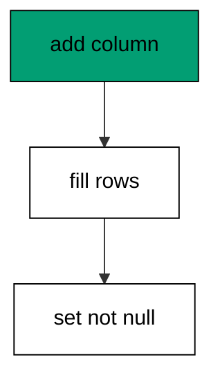

The default fills every existing row at ALTER time, so the constraint never sees a null. New rows must still supply the column, which the verification insert proves.

**`learning/code/ex-07-not-null-with-a-server-default/main.go`**:

```go
// => Shared driver: every unit in this course opens with this prelude.
// => The harness network is closed, so units carry a small standard-library
// => driver that applies the same goose SQL files `goose up` would apply.
// => The files, the history table shape, and the ordering rules are goose's
// => own; the driver only replaces the network-dependent binary.
package main // => every unit is one runnable program

import ( // => standard library only: no third-party modules
	"bufio"           // => bufio frames protocol messages over the TCP stream
	"encoding/binary" // => binary lays out length-prefixed protocol fields
	"fmt"             // => fmt prints the deterministic transcript only
	"io"              // => io forces full reads of split protocol messages
	"net"             // => net dials the harness Postgres service over TCP
	"os"              // => os reads the harness database address, never hardcoded
	"sort"            // => sort orders migration files, never trusts directory order
	"strings"         // => strings splits the goose Up and Down annotations
) // => every import used by driver and units

// => The database address comes from the harness, with local-run defaults.
func addr() (string, string, string) { // => one helper owns every address default
	host := os.Getenv("PGHOST") // => service hostname in the unit network
	if host == "" {             // => empty means a local run outside the harness
		host = "postgres" // => same default the Python courses use
	} // => end addr: empty means a local run outside the harness
	user := os.Getenv("PGUSER") // => trust-auth role, no password needed
	if user == "" {             // => empty means a local run outside the harness
		user = "postgres" // => same default the Python courses use
	} // => end addr: empty means a local run outside the harness
	db := os.Getenv("PGDATABASE") // => fresh database for every unit run
	if db == "" {                 // => empty means a local run outside the harness
		db = "postgres" // => same default the Python courses use
	} // => end addr: empty means a local run outside the harness
	return host, user, db // => callers never re-read the environment
} // => end addr: one helper owns every address default

// => conn wraps one TCP connection plus a buffered reader for message frames.
type conn struct { // => a tiny struct keeps the socket and the framer together
	c net.Conn      // => the raw TCP socket to the Postgres service
	r *bufio.Reader // => buffered reads frame messages split across packets
} // => end type conn: socket and framer travel together

// => readMsg reads one backend message: a type byte plus a length body.
func (k *conn) readMsg() (byte, []byte, error) { // => every response flows through here
	head := make([]byte, 5)                           // => one type byte plus one int32 length
	if _, err := io.ReadFull(k.r, head); err != nil { // => fragments reassemble before framing
		return 0, nil, err // => no partial message is ever trusted
	} // => end readMsg: fragments reassemble before framing
	n := int(binary.BigEndian.Uint32(head[1:])) - 4   // => length counts itself, not the type
	body := make([]byte, n)                           // => exact-size body, never over-read
	if _, err := io.ReadFull(k.r, body); err != nil { // => fragments reassemble before framing
		return 0, nil, err // => no partial message is ever trusted
	} // => end readMsg: fragments reassemble before framing
	return head[0], body, nil // => type byte tells the caller what arrived
} // => end readMsg: every response flows through here

// => sendMsg writes one frontend message: a type byte plus a length body.
func (k *conn) sendMsg(t byte, body []byte) error { // => startup is the only typeless message
	out := []byte{t}                                      // => type byte leads every message
	lenb := make([]byte, 4)                               // => four bytes carry the length
	binary.BigEndian.PutUint32(lenb, uint32(len(body)+4)) // => length counts itself
	out = append(out, lenb...)                            // => length follows the type byte
	out = append(out, body...)                            // => payload closes the message
	_, err := k.c.Write(out)                              // => one write keeps frames whole
	return err                                            // => write errors fail the unit loudly
} // => end sendMsg: startup is the only typeless message

// => connect opens the service database and waits for session readiness.
func connect() (*conn, error) { // => every unit starts from this one helper
	host, user, db := addr()         // => harness address, never hardcoded
	return connectDb(host, user, db) // => one path opens every session
} // => end connect: every unit starts from this one helper

// => connectDb opens a named database on the same host for multi-db drills.
func connectDb(host, user, db string) (*conn, error) { // => environments are databases, not servers
	c, err := net.Dial("tcp", host+":5432") // => Postgres listens on 5432
	if err != nil {                         // => unreachable service is fatal
		return nil, err // => no fallback: the harness owns the database
	} // => end connectDb: unreachable service is fatal
	k := &conn{c: c, r: bufio.NewReader(c)}             // => buffer the fresh socket at once
	body := []byte{}                                    // => startup body is parameters only
	body = append(body, 0, 0, 0, 0)                     // => placeholder for the length prefix
	body = append(body, 0, 3, 0, 0)                     // => protocol 3.0, the stable version
	body = append(body, []byte("user")...)              // => user key starts the parameters
	body = append(body, 0)                              // => keys and values are NUL-separated
	body = append(body, []byte(user)...)                // => trust-auth role from the harness
	body = append(body, 0)                              // => NUL ends the value
	body = append(body, []byte("database")...)          // => database key follows the user
	body = append(body, 0)                              // => NUL ends the key
	body = append(body, []byte(db)...)                  // => fresh database for every unit run
	body = append(body, 0)                              // => NUL ends the value
	body = append(body, 0)                              // => empty key ends the parameters
	binary.BigEndian.PutUint32(body, uint32(len(body))) // => startup length counts itself
	if _, err := c.Write(body); err != nil {            // => startup is the only typeless message
		return nil, err // => unwritable socket is fatal
	} // => end connectDb: startup is the only typeless message
	for { // => drain until the session is ready for queries
		t, b, err := k.readMsg() // => every backend message flows through here
		if err != nil {          // => broken handshake is fatal
			return nil, err // => no half-open session is ever used
		} // => end connectDb: broken handshake is fatal
		switch t { // => only three message kinds matter during startup
		case 'R': // => authentication response arrives first
			if binary.BigEndian.Uint32(b) != 0 { // => nonzero means a password is wanted
				return nil, fmt.Errorf("server wants a password") // => trust auth never asks
			} // => end connectDb: nonzero means a password is wanted
		case 'E': // => an error ends the handshake with the server text
			return nil, fmt.Errorf("startup: %s", errText(b)) // => server text explains the cause
		case 'Z': // => ReadyForQuery means the session accepts queries
			return k, nil // => handshake done: hand the live session back
		} // => end connectDb: only three message kinds matter during startup
	} // => end connectDb: drain until the session is ready for queries
} // => end connectDb: environments are databases, not servers

// => errText extracts the human message (field M) from an ErrorResponse.
func errText(b []byte) string { // => one helper decodes every server error
	parts := strings.Split(string(b), "\x00") // => fields are NUL-separated pairs
	for i := 0; i+1 < len(parts); i += 2 {    // => walk code and value together
		if parts[i] == "M" { // => M is the primary human message
			return parts[i+1] // => return the message, skip the detail fields
		} // => end errText: M is the primary human message
	} // => end errText: walk code and value together
	return "unknown error" // => malformed errors still fail with a fixed line
} // => end errText: one helper decodes every server error

// => run sends one SQL string and returns every data row plus the command tag.
func (k *conn) run(q string) ([][]string, string, error) { // => one path runs every statement
	body := append([]byte(q), 0)                 // => Query messages are NUL-terminated
	if err := k.sendMsg('Q', body); err != nil { // => send fails loudly, never silently
		return nil, "", err // => unwritable socket ends the unit
	} // => end run: send fails loudly, never silently
	var rows [][]string // => data rows accumulate across result sets
	tag := ""           // => the last command tag (SELECT 3, CREATE TABLE...)
	for {               // => drain until ReadyForQuery closes this query string
		t, b, err := k.readMsg() // => every response flows through the framer
		if err != nil {          // => broken mid-query connection is fatal
			return nil, "", err // => partial results are never returned
		} // => end run: broken mid-query connection is fatal
		switch t { // => four message kinds carry a simple-query response
		case 'T', 'N', 'A', 'S', 'K': // => metadata the transcript never prints
		case 'D': // => one data row arrived
			rows = append(rows, parseRow(b)) // => decode the text columns now
		case 'C': // => one statement finished
			tag = strings.TrimRight(string(b[:len(b)-1]), "\x00") // => tag names what ran
		case 'E': // => the statement failed
			drain(k)                                     // => finish the failed query before reuse
			return nil, "", fmt.Errorf("%s", errText(b)) // => server text becomes the failure
		case 'Z': // => ReadyForQuery ends this query string
			return rows, tag, nil // => rows, tag, and a clean session
		} // => end run: four message kinds carry a simple-query response
	} // => end run: drain until ReadyForQuery closes this query string
} // => end run: one path runs every statement

// => drain reads to the next ReadyForQuery after a statement error.
func drain(k *conn) { // => an errored query still owns the socket until Z
	for { // => loop until the session is reusable
		t, _, err := k.readMsg()    // => discard every message after the error
		if err != nil || t == 'Z' { // => socket break or ready both end the drain
			return // => caller decides the failure, the drain only resynchronizes
		} // => end drain: socket break or ready both end the drain
	} // => end drain: loop until the session is reusable
} // => end drain: an errored query still owns the socket until Z

// => parseRow decodes one DataRow body into text columns, NULL as "NULL".
func parseRow(b []byte) []string { // => one helper decodes every returned row
	n := int(binary.BigEndian.Uint16(b)) // => column count leads the body
	b = b[2:]                            // => step past the count
	out := make([]string, 0, n)          // => pre-size the row to the count
	for i := 0; i < n; i++ {             // => walk each column in order
		l := int(int32(binary.BigEndian.Uint32(b))) // => -1 marks NULL, else the length
		b = b[4:]                                   // => step past the length
		if l < 0 {                                  // => NULL has no bytes to read
			out = append(out, "NULL") // => fixed word keeps transcripts stable
			continue                  // => next column, no bytes consumed
		} // => end parseRow: NULL has no bytes to read
		out = append(out, string(b[:l])) // => text format is already printable
		b = b[l:]                        // => step past the value bytes
	} // => end parseRow: walk each column in order
	return out // => one row, fully decoded
} // => end parseRow: one helper decodes every returned row

// => must runs SQL or exits nonzero with the server text on standard error.
func must(k *conn, q string) [][]string { // => setup statements never fail quietly
	rows, _, err := k.run(q) // => rows return for verification queries
	if err != nil {          // => any server error is fatal to the unit
		fmt.Fprintln(os.Stderr, "sql error:", err) // => errors go to stderr, never stdout
		os.Exit(1)                                 // => nonzero exit fails the harness check
	} // => end must: any server error is fatal to the unit
	return rows // => callers print only what the lesson asserts
} // => end must: setup statements never fail quietly

// => try runs SQL and returns the server error text instead of exiting.
func try(k *conn, q string) ([][]string, string) { // => failure drills inspect errors, not die
	rows, _, err := k.run(q) // => same path as must, opposite failure policy
	if err != nil {          // => expected errors become transcript lines
		return nil, err.Error() // => fixed server text, never timings
	} // => end try: expected errors become transcript lines
	return rows, "" // => empty error means the statement succeeded
} // => end try: failure drills inspect errors, not die

// => mig holds one goose SQL file: its version, name, and Up/Down sections.
type mig struct { // => mirrors the goose file layout the lesson teaches
	version string   // => zero-padded number orders history, like goose
	name    string   // => human slug after the version number
	up      []string // => forward statements, run inside one transaction
	down    []string // => reverse statements, run inside one transaction
	noTx    bool     // => NO TRANSACTION files run outside one, like goose
} // => end type mig: version, name, sections, and mode

// => parseGoose splits one goose SQL file into its Up and Down statements.
func parseGoose(text string) (up, down []string, noTx bool) { // => the lesson asserts this exact split
	section := ""                                    // => nothing belongs outside the annotations
	for _, line := range strings.Split(text, "\n") { // => walk the file line by line
		t := strings.TrimSpace(line) // => annotation matching ignores indentation
		switch t {                   // => four annotation lines switch sections
		case "-- +goose Up": // => forward section starts here, like goose
			section = "up" // => following statements migrate forward
			continue       // => the annotation itself never runs
		case "-- +goose Down": // => reverse section starts here, like goose
			section = "down" // => following statements roll back
			continue         // => the annotation itself never runs
		case "-- +goose NO TRANSACTION": // => concurrent work cannot run inside one
			noTx = true // => remember the file opts out of the transaction
			continue    // => the annotation itself never runs
		} // => end parseGoose: four annotation lines switch sections
		if strings.HasPrefix(t, "--") || t == "" { // => comments and blanks never run
			continue // => only real statements reach the database
		} // => end parseGoose: comments and blanks never run
		if section == "up" { // => route by the annotation seen above
			up = append(up, line) // => keep the original line for the file write
		} else if section == "down" { // => down statements collect separately
			down = append(down, line) // => keep the original line for the file write
		} // => end parseGoose: down statements collect separately
	} // => end parseGoose: walk the file line by line
	return splitStmts(strings.Join(up, "\n")), splitStmts(strings.Join(down, "\n")), noTx // => one string per statement
} // => end parseGoose: the lesson asserts this exact split

// => splitStmts cuts statement text on semicolons outside quotes.
func splitStmts(s string) []string { // => multi-line statements stay whole until ;
	var out []string        // => finished statements accumulate here
	var cur strings.Builder // => the statement under construction
	inStr := false          // => semicolons inside quotes never split
	for _, r := range s {   // => walk rune by rune, quotes included
		switch { // => quote tracking decides what a semicolon means
		case r == '\'': // => a quote toggles string mode
			inStr = !inStr   // => enter or leave the quoted region
			cur.WriteRune(r) // => the quote belongs to the statement
		case r == ';' && !inStr: // => a bare semicolon ends one statement
			if t := strings.TrimSpace(cur.String()); t != "" { // => skip empty fragments
				out = append(out, t) // => store the finished statement
			} // => end splitStmts: skip empty fragments
			cur.Reset() // => start the next statement fresh
		default: // => every other rune belongs to the current statement
			cur.WriteRune(r) // => accumulate verbatim
		} // => end splitStmts: quote tracking decides what a semicolon means
	} // => end splitStmts: walk rune by rune, quotes included
	if t := strings.TrimSpace(cur.String()); t != "" { // => trailing text without ; still counts
		out = append(out, t) // => last statement needs no semicolon
	} // => end splitStmts: trailing text without ; still counts
	return out // => callers run each statement in order
} // => end splitStmts: multi-line statements stay whole until ;

// => ensureHistory creates the goose history table once per unit run.
func ensureHistory(k *conn) { // => goose_db_version is goose's own default name
	must(k, `CREATE TABLE IF NOT EXISTS goose_db_version (`+ // => reruns never fail here
		`id integer PRIMARY KEY GENERATED BY DEFAULT AS IDENTITY, `+ // => surrogate key, never printed
		`version_id bigint NOT NULL, `+ // => applied version numbers live here
		`is_applied boolean NOT NULL, `+ // => goose marks rows applied on success
		`tstamp timestamp NOT NULL DEFAULT now())`) // => timestamp defaults, never printed
} // => end ensureHistory: goose_db_version is goose's own default name

// => appliedVersions returns the version numbers already marked applied.
func appliedVersions(k *conn) map[int64]bool { // => history decides what still needs running
	rows := must(k, `SELECT version_id FROM goose_db_version `+ // => only the numbers matter
		`WHERE is_applied ORDER BY version_id`) // => order keeps the transcript stable
	got := map[int64]bool{}  // => set lookup answers "already applied" fast
	for _, r := range rows { // => one row per applied migration
		var v int64                // => version numbers are integers
		fmt.Sscanf(r[0], "%d", &v) // => text format parses back to a number
		got[v] = true              // => mark this version done
	} // => end appliedVersions: one row per applied migration
	return got // => callers skip whatever history already holds
} // => end appliedVersions: history decides what still needs running

// => applyUp runs every pending migration forward, one transaction each.
func applyUp(k *conn, ms []mig) { // => files on disk are already the source of truth
	done := appliedVersions(k) // => history decides what still needs running
	for _, m := range ms {     // => file order is version order, sorted by the caller
		var v int64                     // => versions compare as numbers
		fmt.Sscanf(m.version, "%d", &v) // => zero-padded file prefix parses back
		if done[v] {                    // => applied migrations never run twice
			continue // => idempotent reruns skip straight past
		} // => end applyUp: applied migrations never run twice
		if !m.noTx { // => transactional files wrap everything in one unit
			must(k, "BEGIN") // => one migration is one transaction, like goose
		} // => end applyUp: transactional files wrap everything in one unit
		for _, s := range m.up { // => forward statements run in file order
			must(k, s) // => any failure aborts the unit before COMMIT
		} // => end applyUp: forward statements run in file order
		if !m.noTx { // => stamps join the same transaction they describe
			must(k, fmt.Sprintf(`INSERT INTO goose_db_version `+ // => stamp only after success
				`(version_id, is_applied) VALUES (%d, true)`, v)) // => stamp mirrors goose exactly
			must(k, "COMMIT") // => history row and schema land together
		} else { // => concurrent statements cannot share a transaction
			must(k, fmt.Sprintf(`INSERT INTO goose_db_version `+ // => stamp follows the work
				`(version_id, is_applied) VALUES (%d, true)`, v)) // => same row, separate statement
		} // => end applyUp: concurrent statements cannot share a transaction
	} // => end applyUp: file order is version order, sorted by the caller
} // => end applyUp: files on disk are already the source of truth

// => applyDown rolls back the newest applied migrations, newest first.
func applyDown(k *conn, ms []mig, steps int) { // => steps bounds how far history rewinds
	done := appliedVersions(k) // => history decides what can roll back
	var todo []mig             // => applied migrations in version order first
	for _, m := range ms {     // => walk the whole known history
		var v int64                     // => versions compare as numbers
		fmt.Sscanf(m.version, "%d", &v) // => zero-padded file prefix parses back
		if done[v] {                    // => only applied migrations roll back
			todo = append(todo, m) // => keep the migration for the reverse pass
		} // => end applyDown: only applied migrations roll back
	} // => end applyDown: walk the whole known history
	for i := len(todo) - 1; i >= 0 && steps > 0; i-- { // => newest applied goes first
		m := todo[i]                    // => this migration rolls back now
		var v int64                     // => versions compare as numbers
		fmt.Sscanf(m.version, "%d", &v) // => zero-padded file prefix parses back
		if !m.noTx {                    // => transactional files wrap the rollback too
			must(k, "BEGIN") // => reverse change is atomic, like the forward one
		} // => end applyDown: transactional files wrap the rollback too
		for _, s := range m.down { // => reverse statements run in file order
			must(k, s) // => any failure aborts before the history row moves
		} // => end applyDown: reverse statements run in file order
		must(k, fmt.Sprintf(`DELETE FROM goose_db_version `+ // => unstamped only after success
			`WHERE version_id = %d`, v)) // => the version leaves history exactly once
		if !m.noTx { // => close the transaction the rollback opened
			must(k, "COMMIT") // => schema reversal and unstamp land together
		} // => end applyDown: close the transaction the rollback opened
		steps-- // => one rollback consumed from the budget
	} // => end applyDown: newest applied goes first
} // => end applyDown: steps bounds how far history rewinds

// => statusCounts splits known migrations into applied and pending lists.
func statusCounts(k *conn, ms []mig) (applied, pending []string) { // => goose status in two lists
	done := appliedVersions(k) // => history decides which list each version joins
	for _, m := range ms {     // => walk the known history in version order
		var v int64                     // => versions compare as numbers
		fmt.Sscanf(m.version, "%d", &v) // => zero-padded file prefix parses back
		if done[v] {                    // => stamped versions are done
			applied = append(applied, m.version) // => keep the version string for printing
		} else { // => unstamped versions still wait
			pending = append(pending, m.version) // => keep the version string for printing
		} // => end statusCounts: unstamped versions still wait
	} // => end statusCounts: walk the known history in version order
	return applied, pending // => callers print both lists in one stable line each
} // => end statusCounts: goose status in two lists

// => files writes each migration as a real goose SQL file under dir.
func files(dir string, ms []mig) { // => the lesson shows these files byte-identically
	for _, m := range ms { // => one file per migration, like `goose create`
		name := fmt.Sprintf("%s_%s.sql", m.version, m.name) // => goose names files version-first
		var b strings.Builder                               // => build the file text in order
		if m.noTx {                                         // => concurrent files announce it first
			b.WriteString("-- +goose NO TRANSACTION\n") // => goose honors this exact annotation
		} // => end files: concurrent files announce it first
		b.WriteString("-- +goose Up\n") // => forward annotation leads
		for _, s := range m.up {        // => forward statements follow
			b.WriteString(s + ";\n") // => one statement per line, semicolon-closed
		} // => end files: forward statements follow
		b.WriteString("-- +goose Down\n") // => reverse annotation splits the file
		for _, s := range m.down {        // => reverse statements close the file
			b.WriteString(s + ";\n") // => one statement per line, semicolon-closed
		} // => end files: reverse statements close the file
		if err := os.WriteFile(dir+"/"+name, []byte(b.String()), 0644); err != nil { // => real files, like goose
			fmt.Fprintln(os.Stderr, "write error:", err) // => write errors fail loudly
			os.Exit(1)                                   // => no half-written migration set
		} // => end files: real files, like goose
	} // => end files: one file per migration, like `goose create`
} // => end files: the lesson shows these files byte-identically

// => versions lists migration files in version order from dir.
func versions(dir string) []mig { // => directory order is never trusted for history
	ents, err := os.ReadDir(dir) // => read the whole migrations directory
	if err != nil {              // => unreadable directory is fatal
		fmt.Fprintln(os.Stderr, "read error:", err) // => errors go to stderr
		os.Exit(1)                                  // => nonzero exit fails the check
	} // => end versions: unreadable directory is fatal
	names := []string{}      // => collect names before sorting
	for _, e := range ents { // => walk every directory entry
		if !e.IsDir() && strings.HasSuffix(e.Name(), ".sql") { // => only goose SQL files count
			names = append(names, e.Name()) // => keep the file name for parsing
		} // => end versions: only goose SQL files count
	} // => end versions: walk every directory entry
	sort.Strings(names)       // => zero-padded versions sort chronologically
	var out []mig             // => parsed migrations accumulate here
	for _, n := range names { // => parse in version order
		raw, err := os.ReadFile(dir + "/" + n) // => read the real file back
		if err != nil {                        // => unreadable file is fatal
			fmt.Fprintln(os.Stderr, "read error:", err) // => errors go to stderr
			os.Exit(1)                                  // => nonzero exit fails the check
		} // => end versions: unreadable file is fatal
		up, down, noTx := parseGoose(string(raw))                                            // => split on the goose annotations
		rest := strings.TrimSuffix(n, ".sql")                                                // => strip the extension first
		ver := rest[:5]                                                                      // => first five digits are the version
		out = append(out, mig{version: ver, name: rest[6:], up: up, down: down, noTx: noTx}) // => keep every part
	} // => end versions: parse in version order
	return out // => version-ordered migrations, ready to apply
} // => end versions: directory order is never trusted for history

// => findDupes returns version numbers claimed by two or more files.
func findDupes(dir string) []string { // => goose refuses duplicate versions outright
	ents, err := os.ReadDir(dir) // => read the whole migrations directory
	if err != nil {              // => unreadable directory is fatal
		fmt.Fprintln(os.Stderr, "read error:", err) // => errors go to stderr
		os.Exit(1)                                  // => nonzero exit fails the check
	} // => end findDupes: unreadable directory is fatal
	seen := map[string]int{} // => count claims per five-digit version prefix
	for _, e := range ents { // => walk every directory entry
		if !e.IsDir() && strings.HasSuffix(e.Name(), ".sql") { // => only goose SQL files count
			seen[e.Name()[:5]]++ // => first five digits are the version
		} // => end findDupes: only goose SQL files count
	} // => end findDupes: walk every directory entry
	var out []string         // => duplicates accumulate in version order
	for _, e := range ents { // => second pass keeps the order stable
		if !e.IsDir() && strings.HasSuffix(e.Name(), ".sql") { // => only goose SQL files count
			if v := e.Name()[:5]; seen[v] > 1 { // => claimed more than once
				out = append(out, v) // => keep the version string for printing
				seen[v] = 0          // => report each duplicate version only once
			} // => end findDupes: claimed more than once
		} // => end findDupes: only goose SQL files count
	} // => end findDupes: second pass keeps the order stable
	return out // => empty means the history numbers are unique
} // => end findDupes: goose refuses duplicate versions outright

func main() {
	k, err := connect() // => one session runs the whole example
	if err != nil {     // => unreachable database fails loudly
		fmt.Fprintln(os.Stderr, "connect error:", err) // => connection errors go to stderr
		os.Exit(1)                                     // => nonzero exit fails the check
	}
	defer k.c.Close() // => the socket closes when the example ends
	// => A scratch migrations directory: goose files live here, never in the unit.
	// => the scratch path never reaches stdout, so reruns stay byte-stable
	dir, err := os.MkdirTemp("", "ex07-") // => private directory, like `goose create`
	if err != nil {                       // => unmakable temp dir is fatal
		fmt.Fprintln(os.Stderr, "temp error:", err) // => errors go to stderr
		os.Exit(1)                                  // => nonzero exit fails the check
	}
	defer os.RemoveAll(dir)                          // => scratch files vanish; only transcripts remain
	must(k, "DROP TABLE IF EXISTS ex07_users")       // => leftovers of a killed run vanish
	must(k, "DROP TABLE IF EXISTS goose_db_version") // => stale history vanishes too
	ensureHistory(k)                                 // => goose history table, real shape
	files(dir, []mig{                                // => seed rows first, then tighten the column
		{version: "00001", name: "create_users", // => base table with rows to protect
			up:   []string{"CREATE TABLE ex07_users (id SERIAL PRIMARY KEY, name TEXT NOT NULL)"}, // => forward change
			down: []string{"DROP TABLE ex07_users"}},                                              // => exact reverse for rollback
		{version: "00002", name: "not_null_nickname", // => constraint migration with a default fill
			up:   []string{"ALTER TABLE ex07_users ADD COLUMN nickname TEXT DEFAULT 'anon'", "ALTER TABLE ex07_users ALTER COLUMN nickname SET NOT NULL"}, // => fill then tighten
			down: []string{"ALTER TABLE ex07_users DROP COLUMN nickname"}},                                                                                // => reverse drops just the column
	})
	ms := versions(dir)                                                // => parse the files back, like goose would
	applyUp(k, ms[:1])                                                 // => only the base table exists so far
	must(k, `INSERT INTO ex07_users (name) VALUES ('ada'), ('grace')`) // => rows that predate the column
	applyUp(k, ms)                                                     // => the default fills both rows, then the constraint lands
	rows := must(k, `SELECT nickname FROM ex07_users ORDER BY id`)     // => both rows carry the default
	fmt.Println("nicknames:", rows[0][0], rows[1][0])                  // => Output: nicknames: anon anon
	fmt.Println("cleaned: yes")                                        // => Output: cleaned: yes
	must(k, "DROP TABLE IF EXISTS ex07_users")                         // => leftovers of a killed run vanish
	must(k, "DROP TABLE IF EXISTS goose_db_version")                   // => the example leaves no history behind
}
```

**Output** (`learning/code/ex-07-not-null-with-a-server-default/expected/main.stdout.txt`):

```text
nicknames: anon anon
cleaned: yes
```

**Key takeaway**: A server default fills existing rows at ALTER time so the NOT NULL constraint that follows never sees a null.

**Why it matters**: Backfilling through defaults turns a locking, scanning tighten into a safe two-beat move. Existing rows get values at ALTER time instead of failing the constraint, and the NOT NULL that follows protects every future write. Small tables barely notice; large tables survive because of exactly this shape. The two-beat move scales from toy tables to billions of rows, which is why experienced teams reach for it without thinking.

### Example 8: Up Then Down Roundtrip

A migration earns trust when up-then-down leaves no trace: this example applies three migrations, rolls all three back, and shows an empty catalog and an empty history. The round trip is the cheapest migration test there is. (Concepts: co-02.)

Round trips catch the most common down-section bug: a reverse step that drops the wrong name or forgets a dependent object. Run the trip on every migration before the team ever sees it.

**`learning/code/ex-08-up-then-down-roundtrip/main.go`**:

```go
// => Shared driver: every unit in this course opens with this prelude.
// => The harness network is closed, so units carry a small standard-library
// => driver that applies the same goose SQL files `goose up` would apply.
// => The files, the history table shape, and the ordering rules are goose's
// => own; the driver only replaces the network-dependent binary.
package main // => every unit is one runnable program

import ( // => standard library only: no third-party modules
	"bufio"           // => bufio frames protocol messages over the TCP stream
	"encoding/binary" // => binary lays out length-prefixed protocol fields
	"fmt"             // => fmt prints the deterministic transcript only
	"io"              // => io forces full reads of split protocol messages
	"net"             // => net dials the harness Postgres service over TCP
	"os"              // => os reads the harness database address, never hardcoded
	"sort"            // => sort orders migration files, never trusts directory order
	"strings"         // => strings splits the goose Up and Down annotations
) // => every import used by driver and units

// => The database address comes from the harness, with local-run defaults.
func addr() (string, string, string) { // => one helper owns every address default
	host := os.Getenv("PGHOST") // => service hostname in the unit network
	if host == "" {             // => empty means a local run outside the harness
		host = "postgres" // => same default the Python courses use
	} // => end addr: empty means a local run outside the harness
	user := os.Getenv("PGUSER") // => trust-auth role, no password needed
	if user == "" {             // => empty means a local run outside the harness
		user = "postgres" // => same default the Python courses use
	} // => end addr: empty means a local run outside the harness
	db := os.Getenv("PGDATABASE") // => fresh database for every unit run
	if db == "" {                 // => empty means a local run outside the harness
		db = "postgres" // => same default the Python courses use
	} // => end addr: empty means a local run outside the harness
	return host, user, db // => callers never re-read the environment
} // => end addr: one helper owns every address default

// => conn wraps one TCP connection plus a buffered reader for message frames.
type conn struct { // => a tiny struct keeps the socket and the framer together
	c net.Conn      // => the raw TCP socket to the Postgres service
	r *bufio.Reader // => buffered reads frame messages split across packets
} // => end type conn: socket and framer travel together

// => readMsg reads one backend message: a type byte plus a length body.
func (k *conn) readMsg() (byte, []byte, error) { // => every response flows through here
	head := make([]byte, 5)                           // => one type byte plus one int32 length
	if _, err := io.ReadFull(k.r, head); err != nil { // => fragments reassemble before framing
		return 0, nil, err // => no partial message is ever trusted
	} // => end readMsg: fragments reassemble before framing
	n := int(binary.BigEndian.Uint32(head[1:])) - 4   // => length counts itself, not the type
	body := make([]byte, n)                           // => exact-size body, never over-read
	if _, err := io.ReadFull(k.r, body); err != nil { // => fragments reassemble before framing
		return 0, nil, err // => no partial message is ever trusted
	} // => end readMsg: fragments reassemble before framing
	return head[0], body, nil // => type byte tells the caller what arrived
} // => end readMsg: every response flows through here

// => sendMsg writes one frontend message: a type byte plus a length body.
func (k *conn) sendMsg(t byte, body []byte) error { // => startup is the only typeless message
	out := []byte{t}                                      // => type byte leads every message
	lenb := make([]byte, 4)                               // => four bytes carry the length
	binary.BigEndian.PutUint32(lenb, uint32(len(body)+4)) // => length counts itself
	out = append(out, lenb...)                            // => length follows the type byte
	out = append(out, body...)                            // => payload closes the message
	_, err := k.c.Write(out)                              // => one write keeps frames whole
	return err                                            // => write errors fail the unit loudly
} // => end sendMsg: startup is the only typeless message

// => connect opens the service database and waits for session readiness.
func connect() (*conn, error) { // => every unit starts from this one helper
	host, user, db := addr()         // => harness address, never hardcoded
	return connectDb(host, user, db) // => one path opens every session
} // => end connect: every unit starts from this one helper

// => connectDb opens a named database on the same host for multi-db drills.
func connectDb(host, user, db string) (*conn, error) { // => environments are databases, not servers
	c, err := net.Dial("tcp", host+":5432") // => Postgres listens on 5432
	if err != nil {                         // => unreachable service is fatal
		return nil, err // => no fallback: the harness owns the database
	} // => end connectDb: unreachable service is fatal
	k := &conn{c: c, r: bufio.NewReader(c)}             // => buffer the fresh socket at once
	body := []byte{}                                    // => startup body is parameters only
	body = append(body, 0, 0, 0, 0)                     // => placeholder for the length prefix
	body = append(body, 0, 3, 0, 0)                     // => protocol 3.0, the stable version
	body = append(body, []byte("user")...)              // => user key starts the parameters
	body = append(body, 0)                              // => keys and values are NUL-separated
	body = append(body, []byte(user)...)                // => trust-auth role from the harness
	body = append(body, 0)                              // => NUL ends the value
	body = append(body, []byte("database")...)          // => database key follows the user
	body = append(body, 0)                              // => NUL ends the key
	body = append(body, []byte(db)...)                  // => fresh database for every unit run
	body = append(body, 0)                              // => NUL ends the value
	body = append(body, 0)                              // => empty key ends the parameters
	binary.BigEndian.PutUint32(body, uint32(len(body))) // => startup length counts itself
	if _, err := c.Write(body); err != nil {            // => startup is the only typeless message
		return nil, err // => unwritable socket is fatal
	} // => end connectDb: startup is the only typeless message
	for { // => drain until the session is ready for queries
		t, b, err := k.readMsg() // => every backend message flows through here
		if err != nil {          // => broken handshake is fatal
			return nil, err // => no half-open session is ever used
		} // => end connectDb: broken handshake is fatal
		switch t { // => only three message kinds matter during startup
		case 'R': // => authentication response arrives first
			if binary.BigEndian.Uint32(b) != 0 { // => nonzero means a password is wanted
				return nil, fmt.Errorf("server wants a password") // => trust auth never asks
			} // => end connectDb: nonzero means a password is wanted
		case 'E': // => an error ends the handshake with the server text
			return nil, fmt.Errorf("startup: %s", errText(b)) // => server text explains the cause
		case 'Z': // => ReadyForQuery means the session accepts queries
			return k, nil // => handshake done: hand the live session back
		} // => end connectDb: only three message kinds matter during startup
	} // => end connectDb: drain until the session is ready for queries
} // => end connectDb: environments are databases, not servers

// => errText extracts the human message (field M) from an ErrorResponse.
func errText(b []byte) string { // => one helper decodes every server error
	parts := strings.Split(string(b), "\x00") // => fields are NUL-separated pairs
	for i := 0; i+1 < len(parts); i += 2 {    // => walk code and value together
		if parts[i] == "M" { // => M is the primary human message
			return parts[i+1] // => return the message, skip the detail fields
		} // => end errText: M is the primary human message
	} // => end errText: walk code and value together
	return "unknown error" // => malformed errors still fail with a fixed line
} // => end errText: one helper decodes every server error

// => run sends one SQL string and returns every data row plus the command tag.
func (k *conn) run(q string) ([][]string, string, error) { // => one path runs every statement
	body := append([]byte(q), 0)                 // => Query messages are NUL-terminated
	if err := k.sendMsg('Q', body); err != nil { // => send fails loudly, never silently
		return nil, "", err // => unwritable socket ends the unit
	} // => end run: send fails loudly, never silently
	var rows [][]string // => data rows accumulate across result sets
	tag := ""           // => the last command tag (SELECT 3, CREATE TABLE...)
	for {               // => drain until ReadyForQuery closes this query string
		t, b, err := k.readMsg() // => every response flows through the framer
		if err != nil {          // => broken mid-query connection is fatal
			return nil, "", err // => partial results are never returned
		} // => end run: broken mid-query connection is fatal
		switch t { // => four message kinds carry a simple-query response
		case 'T', 'N', 'A', 'S', 'K': // => metadata the transcript never prints
		case 'D': // => one data row arrived
			rows = append(rows, parseRow(b)) // => decode the text columns now
		case 'C': // => one statement finished
			tag = strings.TrimRight(string(b[:len(b)-1]), "\x00") // => tag names what ran
		case 'E': // => the statement failed
			drain(k)                                     // => finish the failed query before reuse
			return nil, "", fmt.Errorf("%s", errText(b)) // => server text becomes the failure
		case 'Z': // => ReadyForQuery ends this query string
			return rows, tag, nil // => rows, tag, and a clean session
		} // => end run: four message kinds carry a simple-query response
	} // => end run: drain until ReadyForQuery closes this query string
} // => end run: one path runs every statement

// => drain reads to the next ReadyForQuery after a statement error.
func drain(k *conn) { // => an errored query still owns the socket until Z
	for { // => loop until the session is reusable
		t, _, err := k.readMsg()    // => discard every message after the error
		if err != nil || t == 'Z' { // => socket break or ready both end the drain
			return // => caller decides the failure, the drain only resynchronizes
		} // => end drain: socket break or ready both end the drain
	} // => end drain: loop until the session is reusable
} // => end drain: an errored query still owns the socket until Z

// => parseRow decodes one DataRow body into text columns, NULL as "NULL".
func parseRow(b []byte) []string { // => one helper decodes every returned row
	n := int(binary.BigEndian.Uint16(b)) // => column count leads the body
	b = b[2:]                            // => step past the count
	out := make([]string, 0, n)          // => pre-size the row to the count
	for i := 0; i < n; i++ {             // => walk each column in order
		l := int(int32(binary.BigEndian.Uint32(b))) // => -1 marks NULL, else the length
		b = b[4:]                                   // => step past the length
		if l < 0 {                                  // => NULL has no bytes to read
			out = append(out, "NULL") // => fixed word keeps transcripts stable
			continue                  // => next column, no bytes consumed
		} // => end parseRow: NULL has no bytes to read
		out = append(out, string(b[:l])) // => text format is already printable
		b = b[l:]                        // => step past the value bytes
	} // => end parseRow: walk each column in order
	return out // => one row, fully decoded
} // => end parseRow: one helper decodes every returned row

// => must runs SQL or exits nonzero with the server text on standard error.
func must(k *conn, q string) [][]string { // => setup statements never fail quietly
	rows, _, err := k.run(q) // => rows return for verification queries
	if err != nil {          // => any server error is fatal to the unit
		fmt.Fprintln(os.Stderr, "sql error:", err) // => errors go to stderr, never stdout
		os.Exit(1)                                 // => nonzero exit fails the harness check
	} // => end must: any server error is fatal to the unit
	return rows // => callers print only what the lesson asserts
} // => end must: setup statements never fail quietly

// => try runs SQL and returns the server error text instead of exiting.
func try(k *conn, q string) ([][]string, string) { // => failure drills inspect errors, not die
	rows, _, err := k.run(q) // => same path as must, opposite failure policy
	if err != nil {          // => expected errors become transcript lines
		return nil, err.Error() // => fixed server text, never timings
	} // => end try: expected errors become transcript lines
	return rows, "" // => empty error means the statement succeeded
} // => end try: failure drills inspect errors, not die

// => mig holds one goose SQL file: its version, name, and Up/Down sections.
type mig struct { // => mirrors the goose file layout the lesson teaches
	version string   // => zero-padded number orders history, like goose
	name    string   // => human slug after the version number
	up      []string // => forward statements, run inside one transaction
	down    []string // => reverse statements, run inside one transaction
	noTx    bool     // => NO TRANSACTION files run outside one, like goose
} // => end type mig: version, name, sections, and mode

// => parseGoose splits one goose SQL file into its Up and Down statements.
func parseGoose(text string) (up, down []string, noTx bool) { // => the lesson asserts this exact split
	section := ""                                    // => nothing belongs outside the annotations
	for _, line := range strings.Split(text, "\n") { // => walk the file line by line
		t := strings.TrimSpace(line) // => annotation matching ignores indentation
		switch t {                   // => four annotation lines switch sections
		case "-- +goose Up": // => forward section starts here, like goose
			section = "up" // => following statements migrate forward
			continue       // => the annotation itself never runs
		case "-- +goose Down": // => reverse section starts here, like goose
			section = "down" // => following statements roll back
			continue         // => the annotation itself never runs
		case "-- +goose NO TRANSACTION": // => concurrent work cannot run inside one
			noTx = true // => remember the file opts out of the transaction
			continue    // => the annotation itself never runs
		} // => end parseGoose: four annotation lines switch sections
		if strings.HasPrefix(t, "--") || t == "" { // => comments and blanks never run
			continue // => only real statements reach the database
		} // => end parseGoose: comments and blanks never run
		if section == "up" { // => route by the annotation seen above
			up = append(up, line) // => keep the original line for the file write
		} else if section == "down" { // => down statements collect separately
			down = append(down, line) // => keep the original line for the file write
		} // => end parseGoose: down statements collect separately
	} // => end parseGoose: walk the file line by line
	return splitStmts(strings.Join(up, "\n")), splitStmts(strings.Join(down, "\n")), noTx // => one string per statement
} // => end parseGoose: the lesson asserts this exact split

// => splitStmts cuts statement text on semicolons outside quotes.
func splitStmts(s string) []string { // => multi-line statements stay whole until ;
	var out []string        // => finished statements accumulate here
	var cur strings.Builder // => the statement under construction
	inStr := false          // => semicolons inside quotes never split
	for _, r := range s {   // => walk rune by rune, quotes included
		switch { // => quote tracking decides what a semicolon means
		case r == '\'': // => a quote toggles string mode
			inStr = !inStr   // => enter or leave the quoted region
			cur.WriteRune(r) // => the quote belongs to the statement
		case r == ';' && !inStr: // => a bare semicolon ends one statement
			if t := strings.TrimSpace(cur.String()); t != "" { // => skip empty fragments
				out = append(out, t) // => store the finished statement
			} // => end splitStmts: skip empty fragments
			cur.Reset() // => start the next statement fresh
		default: // => every other rune belongs to the current statement
			cur.WriteRune(r) // => accumulate verbatim
		} // => end splitStmts: quote tracking decides what a semicolon means
	} // => end splitStmts: walk rune by rune, quotes included
	if t := strings.TrimSpace(cur.String()); t != "" { // => trailing text without ; still counts
		out = append(out, t) // => last statement needs no semicolon
	} // => end splitStmts: trailing text without ; still counts
	return out // => callers run each statement in order
} // => end splitStmts: multi-line statements stay whole until ;

// => ensureHistory creates the goose history table once per unit run.
func ensureHistory(k *conn) { // => goose_db_version is goose's own default name
	must(k, `CREATE TABLE IF NOT EXISTS goose_db_version (`+ // => reruns never fail here
		`id integer PRIMARY KEY GENERATED BY DEFAULT AS IDENTITY, `+ // => surrogate key, never printed
		`version_id bigint NOT NULL, `+ // => applied version numbers live here
		`is_applied boolean NOT NULL, `+ // => goose marks rows applied on success
		`tstamp timestamp NOT NULL DEFAULT now())`) // => timestamp defaults, never printed
} // => end ensureHistory: goose_db_version is goose's own default name

// => appliedVersions returns the version numbers already marked applied.
func appliedVersions(k *conn) map[int64]bool { // => history decides what still needs running
	rows := must(k, `SELECT version_id FROM goose_db_version `+ // => only the numbers matter
		`WHERE is_applied ORDER BY version_id`) // => order keeps the transcript stable
	got := map[int64]bool{}  // => set lookup answers "already applied" fast
	for _, r := range rows { // => one row per applied migration
		var v int64                // => version numbers are integers
		fmt.Sscanf(r[0], "%d", &v) // => text format parses back to a number
		got[v] = true              // => mark this version done
	} // => end appliedVersions: one row per applied migration
	return got // => callers skip whatever history already holds
} // => end appliedVersions: history decides what still needs running

// => applyUp runs every pending migration forward, one transaction each.
func applyUp(k *conn, ms []mig) { // => files on disk are already the source of truth
	done := appliedVersions(k) // => history decides what still needs running
	for _, m := range ms {     // => file order is version order, sorted by the caller
		var v int64                     // => versions compare as numbers
		fmt.Sscanf(m.version, "%d", &v) // => zero-padded file prefix parses back
		if done[v] {                    // => applied migrations never run twice
			continue // => idempotent reruns skip straight past
		} // => end applyUp: applied migrations never run twice
		if !m.noTx { // => transactional files wrap everything in one unit
			must(k, "BEGIN") // => one migration is one transaction, like goose
		} // => end applyUp: transactional files wrap everything in one unit
		for _, s := range m.up { // => forward statements run in file order
			must(k, s) // => any failure aborts the unit before COMMIT
		} // => end applyUp: forward statements run in file order
		if !m.noTx { // => stamps join the same transaction they describe
			must(k, fmt.Sprintf(`INSERT INTO goose_db_version `+ // => stamp only after success
				`(version_id, is_applied) VALUES (%d, true)`, v)) // => stamp mirrors goose exactly
			must(k, "COMMIT") // => history row and schema land together
		} else { // => concurrent statements cannot share a transaction
			must(k, fmt.Sprintf(`INSERT INTO goose_db_version `+ // => stamp follows the work
				`(version_id, is_applied) VALUES (%d, true)`, v)) // => same row, separate statement
		} // => end applyUp: concurrent statements cannot share a transaction
	} // => end applyUp: file order is version order, sorted by the caller
} // => end applyUp: files on disk are already the source of truth

// => applyDown rolls back the newest applied migrations, newest first.
func applyDown(k *conn, ms []mig, steps int) { // => steps bounds how far history rewinds
	done := appliedVersions(k) // => history decides what can roll back
	var todo []mig             // => applied migrations in version order first
	for _, m := range ms {     // => walk the whole known history
		var v int64                     // => versions compare as numbers
		fmt.Sscanf(m.version, "%d", &v) // => zero-padded file prefix parses back
		if done[v] {                    // => only applied migrations roll back
			todo = append(todo, m) // => keep the migration for the reverse pass
		} // => end applyDown: only applied migrations roll back
	} // => end applyDown: walk the whole known history
	for i := len(todo) - 1; i >= 0 && steps > 0; i-- { // => newest applied goes first
		m := todo[i]                    // => this migration rolls back now
		var v int64                     // => versions compare as numbers
		fmt.Sscanf(m.version, "%d", &v) // => zero-padded file prefix parses back
		if !m.noTx {                    // => transactional files wrap the rollback too
			must(k, "BEGIN") // => reverse change is atomic, like the forward one
		} // => end applyDown: transactional files wrap the rollback too
		for _, s := range m.down { // => reverse statements run in file order
			must(k, s) // => any failure aborts before the history row moves
		} // => end applyDown: reverse statements run in file order
		must(k, fmt.Sprintf(`DELETE FROM goose_db_version `+ // => unstamped only after success
			`WHERE version_id = %d`, v)) // => the version leaves history exactly once
		if !m.noTx { // => close the transaction the rollback opened
			must(k, "COMMIT") // => schema reversal and unstamp land together
		} // => end applyDown: close the transaction the rollback opened
		steps-- // => one rollback consumed from the budget
	} // => end applyDown: newest applied goes first
} // => end applyDown: steps bounds how far history rewinds

// => statusCounts splits known migrations into applied and pending lists.
func statusCounts(k *conn, ms []mig) (applied, pending []string) { // => goose status in two lists
	done := appliedVersions(k) // => history decides which list each version joins
	for _, m := range ms {     // => walk the known history in version order
		var v int64                     // => versions compare as numbers
		fmt.Sscanf(m.version, "%d", &v) // => zero-padded file prefix parses back
		if done[v] {                    // => stamped versions are done
			applied = append(applied, m.version) // => keep the version string for printing
		} else { // => unstamped versions still wait
			pending = append(pending, m.version) // => keep the version string for printing
		} // => end statusCounts: unstamped versions still wait
	} // => end statusCounts: walk the known history in version order
	return applied, pending // => callers print both lists in one stable line each
} // => end statusCounts: goose status in two lists

// => files writes each migration as a real goose SQL file under dir.
func files(dir string, ms []mig) { // => the lesson shows these files byte-identically
	for _, m := range ms { // => one file per migration, like `goose create`
		name := fmt.Sprintf("%s_%s.sql", m.version, m.name) // => goose names files version-first
		var b strings.Builder                               // => build the file text in order
		if m.noTx {                                         // => concurrent files announce it first
			b.WriteString("-- +goose NO TRANSACTION\n") // => goose honors this exact annotation
		} // => end files: concurrent files announce it first
		b.WriteString("-- +goose Up\n") // => forward annotation leads
		for _, s := range m.up {        // => forward statements follow
			b.WriteString(s + ";\n") // => one statement per line, semicolon-closed
		} // => end files: forward statements follow
		b.WriteString("-- +goose Down\n") // => reverse annotation splits the file
		for _, s := range m.down {        // => reverse statements close the file
			b.WriteString(s + ";\n") // => one statement per line, semicolon-closed
		} // => end files: reverse statements close the file
		if err := os.WriteFile(dir+"/"+name, []byte(b.String()), 0644); err != nil { // => real files, like goose
			fmt.Fprintln(os.Stderr, "write error:", err) // => write errors fail loudly
			os.Exit(1)                                   // => no half-written migration set
		} // => end files: real files, like goose
	} // => end files: one file per migration, like `goose create`
} // => end files: the lesson shows these files byte-identically

// => versions lists migration files in version order from dir.
func versions(dir string) []mig { // => directory order is never trusted for history
	ents, err := os.ReadDir(dir) // => read the whole migrations directory
	if err != nil {              // => unreadable directory is fatal
		fmt.Fprintln(os.Stderr, "read error:", err) // => errors go to stderr
		os.Exit(1)                                  // => nonzero exit fails the check
	} // => end versions: unreadable directory is fatal
	names := []string{}      // => collect names before sorting
	for _, e := range ents { // => walk every directory entry
		if !e.IsDir() && strings.HasSuffix(e.Name(), ".sql") { // => only goose SQL files count
			names = append(names, e.Name()) // => keep the file name for parsing
		} // => end versions: only goose SQL files count
	} // => end versions: walk every directory entry
	sort.Strings(names)       // => zero-padded versions sort chronologically
	var out []mig             // => parsed migrations accumulate here
	for _, n := range names { // => parse in version order
		raw, err := os.ReadFile(dir + "/" + n) // => read the real file back
		if err != nil {                        // => unreadable file is fatal
			fmt.Fprintln(os.Stderr, "read error:", err) // => errors go to stderr
			os.Exit(1)                                  // => nonzero exit fails the check
		} // => end versions: unreadable file is fatal
		up, down, noTx := parseGoose(string(raw))                                            // => split on the goose annotations
		rest := strings.TrimSuffix(n, ".sql")                                                // => strip the extension first
		ver := rest[:5]                                                                      // => first five digits are the version
		out = append(out, mig{version: ver, name: rest[6:], up: up, down: down, noTx: noTx}) // => keep every part
	} // => end versions: parse in version order
	return out // => version-ordered migrations, ready to apply
} // => end versions: directory order is never trusted for history

// => findDupes returns version numbers claimed by two or more files.
func findDupes(dir string) []string { // => goose refuses duplicate versions outright
	ents, err := os.ReadDir(dir) // => read the whole migrations directory
	if err != nil {              // => unreadable directory is fatal
		fmt.Fprintln(os.Stderr, "read error:", err) // => errors go to stderr
		os.Exit(1)                                  // => nonzero exit fails the check
	} // => end findDupes: unreadable directory is fatal
	seen := map[string]int{} // => count claims per five-digit version prefix
	for _, e := range ents { // => walk every directory entry
		if !e.IsDir() && strings.HasSuffix(e.Name(), ".sql") { // => only goose SQL files count
			seen[e.Name()[:5]]++ // => first five digits are the version
		} // => end findDupes: only goose SQL files count
	} // => end findDupes: walk every directory entry
	var out []string         // => duplicates accumulate in version order
	for _, e := range ents { // => second pass keeps the order stable
		if !e.IsDir() && strings.HasSuffix(e.Name(), ".sql") { // => only goose SQL files count
			if v := e.Name()[:5]; seen[v] > 1 { // => claimed more than once
				out = append(out, v) // => keep the version string for printing
				seen[v] = 0          // => report each duplicate version only once
			} // => end findDupes: claimed more than once
		} // => end findDupes: only goose SQL files count
	} // => end findDupes: second pass keeps the order stable
	return out // => empty means the history numbers are unique
} // => end findDupes: goose refuses duplicate versions outright

func main() {
	k, err := connect() // => one session runs the whole example
	if err != nil {     // => unreachable database fails loudly
		fmt.Fprintln(os.Stderr, "connect error:", err) // => connection errors go to stderr
		os.Exit(1)                                     // => nonzero exit fails the check
	}
	defer k.c.Close() // => the socket closes when the example ends
	// => A scratch migrations directory: goose files live here, never in the unit.
	// => the scratch path never reaches stdout, so reruns stay byte-stable
	dir, err := os.MkdirTemp("", "ex08-") // => private directory, like `goose create`
	if err != nil {                       // => unmakable temp dir is fatal
		fmt.Fprintln(os.Stderr, "temp error:", err) // => errors go to stderr
		os.Exit(1)                                  // => nonzero exit fails the check
	}
	defer os.RemoveAll(dir)                          // => scratch files vanish; only transcripts remain
	must(k, "DROP TABLE IF EXISTS ex08_a")           // => leftovers of a killed run vanish
	must(k, "DROP TABLE IF EXISTS ex08_b")           // => leftovers of a killed run vanish
	must(k, "DROP TABLE IF EXISTS ex08_c")           // => leftovers of a killed run vanish
	must(k, "DROP TABLE IF EXISTS goose_db_version") // => stale history vanishes too
	ensureHistory(k)                                 // => goose history table, real shape
	files(dir, []mig{                                // => three migrations to take up and fully back down
		{version: "00001", name: "create_a", // => first table in this history
			up:   []string{"CREATE TABLE ex08_a (id SERIAL PRIMARY KEY)"}, // => forward change
			down: []string{"DROP TABLE ex08_a"}},                          // => exact reverse for rollback
		{version: "00002", name: "create_b", // => second table in this history
			up:   []string{"CREATE TABLE ex08_b (id SERIAL PRIMARY KEY)"}, // => forward change
			down: []string{"DROP TABLE ex08_b"}},                          // => exact reverse for rollback
		{version: "00003", name: "create_c", // => third table in this history
			up:   []string{"CREATE TABLE ex08_c (id SERIAL PRIMARY KEY)"}, // => forward change
			down: []string{"DROP TABLE ex08_c"}},                          // => exact reverse for rollback
	})
	ms := versions(dir)                                                // => parse the files back, like goose would
	applyUp(k, ms)                                                     // => all three tables exist now
	applyDown(k, ms, 3)                                                // => roll the whole history back
	rows := must(k, `SELECT count(*) FROM information_schema.tables `+ // => count what survived
		`WHERE table_name LIKE 'ex08\_%'`) // => LIKE pattern needs the escaped underscore
	fmt.Println("tables:", rows[0][0])                                       // => Output: tables: 0
	rows = must(k, `SELECT count(*) FROM goose_db_version WHERE is_applied`) // => history empties too
	fmt.Println("applied:", rows[0][0])                                      // => Output: applied: 0
	fmt.Println("cleaned: yes")                                              // => Output: cleaned: yes
	must(k, "DROP TABLE IF EXISTS ex08_a")                                   // => leftovers of a killed run vanish
	must(k, "DROP TABLE IF EXISTS ex08_b")                                   // => leftovers of a killed run vanish
	must(k, "DROP TABLE IF EXISTS ex08_c")                                   // => leftovers of a killed run vanish
	must(k, "DROP TABLE IF EXISTS goose_db_version")                         // => the example leaves no history behind
}
```

**Output** (`learning/code/ex-08-up-then-down-roundtrip/expected/main.stdout.txt`):

```text
tables: 0
applied: 0
cleaned: yes
```

**Key takeaway**: Up-then-down proves both directions; a clean round trip leaves no tables and no stamps behind.

**Why it matters**: The round trip is the cheapest migration test ever written: up proves the forward path, down proves the reverse, and the empty finish proves both clean up. Run it on every migration before the team sees it, and the down sections stop rotting from disuse. Make the round trip part of every migration's definition of done, and down sections will never rot from disuse again.

### Example 9: History Is a Chain

Versions form one ordered chain and the chain is the deployment plan: this example applies four migrations and prints the applied versions in order. The numbers decide the sequence, not file timestamps or commit order. (Concepts: co-04.)

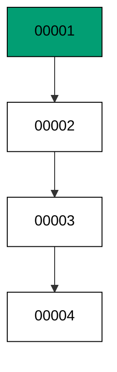

Linear history is a team agreement, not a database feature: goose runs files in version order, so two developers who pick adjacent numbers still merge into one line. The branching cases come later; the chain comes first.

**`learning/code/ex-09-history-is-a-chain/main.go`**:

```go
// => Shared driver: every unit in this course opens with this prelude.
// => The harness network is closed, so units carry a small standard-library
// => driver that applies the same goose SQL files `goose up` would apply.
// => The files, the history table shape, and the ordering rules are goose's
// => own; the driver only replaces the network-dependent binary.
package main // => every unit is one runnable program

import ( // => standard library only: no third-party modules
	"bufio"           // => bufio frames protocol messages over the TCP stream
	"encoding/binary" // => binary lays out length-prefixed protocol fields
	"fmt"             // => fmt prints the deterministic transcript only
	"io"              // => io forces full reads of split protocol messages
	"net"             // => net dials the harness Postgres service over TCP
	"os"              // => os reads the harness database address, never hardcoded
	"sort"            // => sort orders migration files, never trusts directory order
	"strings"         // => strings splits the goose Up and Down annotations
) // => every import used by driver and units

// => The database address comes from the harness, with local-run defaults.
func addr() (string, string, string) { // => one helper owns every address default
	host := os.Getenv("PGHOST") // => service hostname in the unit network
	if host == "" {             // => empty means a local run outside the harness
		host = "postgres" // => same default the Python courses use
	} // => end addr: empty means a local run outside the harness
	user := os.Getenv("PGUSER") // => trust-auth role, no password needed
	if user == "" {             // => empty means a local run outside the harness
		user = "postgres" // => same default the Python courses use
	} // => end addr: empty means a local run outside the harness
	db := os.Getenv("PGDATABASE") // => fresh database for every unit run
	if db == "" {                 // => empty means a local run outside the harness
		db = "postgres" // => same default the Python courses use
	} // => end addr: empty means a local run outside the harness
	return host, user, db // => callers never re-read the environment
} // => end addr: one helper owns every address default

// => conn wraps one TCP connection plus a buffered reader for message frames.
type conn struct { // => a tiny struct keeps the socket and the framer together
	c net.Conn      // => the raw TCP socket to the Postgres service
	r *bufio.Reader // => buffered reads frame messages split across packets
} // => end type conn: socket and framer travel together

// => readMsg reads one backend message: a type byte plus a length body.
func (k *conn) readMsg() (byte, []byte, error) { // => every response flows through here
	head := make([]byte, 5)                           // => one type byte plus one int32 length
	if _, err := io.ReadFull(k.r, head); err != nil { // => fragments reassemble before framing
		return 0, nil, err // => no partial message is ever trusted
	} // => end readMsg: fragments reassemble before framing
	n := int(binary.BigEndian.Uint32(head[1:])) - 4   // => length counts itself, not the type
	body := make([]byte, n)                           // => exact-size body, never over-read
	if _, err := io.ReadFull(k.r, body); err != nil { // => fragments reassemble before framing
		return 0, nil, err // => no partial message is ever trusted
	} // => end readMsg: fragments reassemble before framing
	return head[0], body, nil // => type byte tells the caller what arrived
} // => end readMsg: every response flows through here

// => sendMsg writes one frontend message: a type byte plus a length body.
func (k *conn) sendMsg(t byte, body []byte) error { // => startup is the only typeless message
	out := []byte{t}                                      // => type byte leads every message
	lenb := make([]byte, 4)                               // => four bytes carry the length
	binary.BigEndian.PutUint32(lenb, uint32(len(body)+4)) // => length counts itself
	out = append(out, lenb...)                            // => length follows the type byte
	out = append(out, body...)                            // => payload closes the message
	_, err := k.c.Write(out)                              // => one write keeps frames whole
	return err                                            // => write errors fail the unit loudly
} // => end sendMsg: startup is the only typeless message

// => connect opens the service database and waits for session readiness.
func connect() (*conn, error) { // => every unit starts from this one helper
	host, user, db := addr()         // => harness address, never hardcoded
	return connectDb(host, user, db) // => one path opens every session
} // => end connect: every unit starts from this one helper

// => connectDb opens a named database on the same host for multi-db drills.
func connectDb(host, user, db string) (*conn, error) { // => environments are databases, not servers
	c, err := net.Dial("tcp", host+":5432") // => Postgres listens on 5432
	if err != nil {                         // => unreachable service is fatal
		return nil, err // => no fallback: the harness owns the database
	} // => end connectDb: unreachable service is fatal
	k := &conn{c: c, r: bufio.NewReader(c)}             // => buffer the fresh socket at once
	body := []byte{}                                    // => startup body is parameters only
	body = append(body, 0, 0, 0, 0)                     // => placeholder for the length prefix
	body = append(body, 0, 3, 0, 0)                     // => protocol 3.0, the stable version
	body = append(body, []byte("user")...)              // => user key starts the parameters
	body = append(body, 0)                              // => keys and values are NUL-separated
	body = append(body, []byte(user)...)                // => trust-auth role from the harness
	body = append(body, 0)                              // => NUL ends the value
	body = append(body, []byte("database")...)          // => database key follows the user
	body = append(body, 0)                              // => NUL ends the key
	body = append(body, []byte(db)...)                  // => fresh database for every unit run
	body = append(body, 0)                              // => NUL ends the value
	body = append(body, 0)                              // => empty key ends the parameters
	binary.BigEndian.PutUint32(body, uint32(len(body))) // => startup length counts itself
	if _, err := c.Write(body); err != nil {            // => startup is the only typeless message
		return nil, err // => unwritable socket is fatal
	} // => end connectDb: startup is the only typeless message
	for { // => drain until the session is ready for queries
		t, b, err := k.readMsg() // => every backend message flows through here
		if err != nil {          // => broken handshake is fatal
			return nil, err // => no half-open session is ever used
		} // => end connectDb: broken handshake is fatal
		switch t { // => only three message kinds matter during startup
		case 'R': // => authentication response arrives first
			if binary.BigEndian.Uint32(b) != 0 { // => nonzero means a password is wanted
				return nil, fmt.Errorf("server wants a password") // => trust auth never asks
			} // => end connectDb: nonzero means a password is wanted
		case 'E': // => an error ends the handshake with the server text
			return nil, fmt.Errorf("startup: %s", errText(b)) // => server text explains the cause
		case 'Z': // => ReadyForQuery means the session accepts queries
			return k, nil // => handshake done: hand the live session back
		} // => end connectDb: only three message kinds matter during startup
	} // => end connectDb: drain until the session is ready for queries
} // => end connectDb: environments are databases, not servers

// => errText extracts the human message (field M) from an ErrorResponse.
func errText(b []byte) string { // => one helper decodes every server error
	parts := strings.Split(string(b), "\x00") // => fields are NUL-separated pairs
	for i := 0; i+1 < len(parts); i += 2 {    // => walk code and value together
		if parts[i] == "M" { // => M is the primary human message
			return parts[i+1] // => return the message, skip the detail fields
		} // => end errText: M is the primary human message
	} // => end errText: walk code and value together
	return "unknown error" // => malformed errors still fail with a fixed line
} // => end errText: one helper decodes every server error

// => run sends one SQL string and returns every data row plus the command tag.
func (k *conn) run(q string) ([][]string, string, error) { // => one path runs every statement
	body := append([]byte(q), 0)                 // => Query messages are NUL-terminated
	if err := k.sendMsg('Q', body); err != nil { // => send fails loudly, never silently
		return nil, "", err // => unwritable socket ends the unit
	} // => end run: send fails loudly, never silently
	var rows [][]string // => data rows accumulate across result sets
	tag := ""           // => the last command tag (SELECT 3, CREATE TABLE...)
	for {               // => drain until ReadyForQuery closes this query string
		t, b, err := k.readMsg() // => every response flows through the framer
		if err != nil {          // => broken mid-query connection is fatal
			return nil, "", err // => partial results are never returned
		} // => end run: broken mid-query connection is fatal
		switch t { // => four message kinds carry a simple-query response
		case 'T', 'N', 'A', 'S', 'K': // => metadata the transcript never prints
		case 'D': // => one data row arrived
			rows = append(rows, parseRow(b)) // => decode the text columns now
		case 'C': // => one statement finished
			tag = strings.TrimRight(string(b[:len(b)-1]), "\x00") // => tag names what ran
		case 'E': // => the statement failed
			drain(k)                                     // => finish the failed query before reuse
			return nil, "", fmt.Errorf("%s", errText(b)) // => server text becomes the failure
		case 'Z': // => ReadyForQuery ends this query string
			return rows, tag, nil // => rows, tag, and a clean session
		} // => end run: four message kinds carry a simple-query response
	} // => end run: drain until ReadyForQuery closes this query string
} // => end run: one path runs every statement

// => drain reads to the next ReadyForQuery after a statement error.
func drain(k *conn) { // => an errored query still owns the socket until Z
	for { // => loop until the session is reusable
		t, _, err := k.readMsg()    // => discard every message after the error
		if err != nil || t == 'Z' { // => socket break or ready both end the drain
			return // => caller decides the failure, the drain only resynchronizes
		} // => end drain: socket break or ready both end the drain
	} // => end drain: loop until the session is reusable
} // => end drain: an errored query still owns the socket until Z

// => parseRow decodes one DataRow body into text columns, NULL as "NULL".
func parseRow(b []byte) []string { // => one helper decodes every returned row
	n := int(binary.BigEndian.Uint16(b)) // => column count leads the body
	b = b[2:]                            // => step past the count
	out := make([]string, 0, n)          // => pre-size the row to the count
	for i := 0; i < n; i++ {             // => walk each column in order
		l := int(int32(binary.BigEndian.Uint32(b))) // => -1 marks NULL, else the length
		b = b[4:]                                   // => step past the length
		if l < 0 {                                  // => NULL has no bytes to read
			out = append(out, "NULL") // => fixed word keeps transcripts stable
			continue                  // => next column, no bytes consumed
		} // => end parseRow: NULL has no bytes to read
		out = append(out, string(b[:l])) // => text format is already printable
		b = b[l:]                        // => step past the value bytes
	} // => end parseRow: walk each column in order
	return out // => one row, fully decoded
} // => end parseRow: one helper decodes every returned row

// => must runs SQL or exits nonzero with the server text on standard error.
func must(k *conn, q string) [][]string { // => setup statements never fail quietly
	rows, _, err := k.run(q) // => rows return for verification queries
	if err != nil {          // => any server error is fatal to the unit
		fmt.Fprintln(os.Stderr, "sql error:", err) // => errors go to stderr, never stdout
		os.Exit(1)                                 // => nonzero exit fails the harness check
	} // => end must: any server error is fatal to the unit
	return rows // => callers print only what the lesson asserts
} // => end must: setup statements never fail quietly

// => try runs SQL and returns the server error text instead of exiting.
func try(k *conn, q string) ([][]string, string) { // => failure drills inspect errors, not die
	rows, _, err := k.run(q) // => same path as must, opposite failure policy
	if err != nil {          // => expected errors become transcript lines
		return nil, err.Error() // => fixed server text, never timings
	} // => end try: expected errors become transcript lines
	return rows, "" // => empty error means the statement succeeded
} // => end try: failure drills inspect errors, not die

// => mig holds one goose SQL file: its version, name, and Up/Down sections.
type mig struct { // => mirrors the goose file layout the lesson teaches
	version string   // => zero-padded number orders history, like goose
	name    string   // => human slug after the version number
	up      []string // => forward statements, run inside one transaction
	down    []string // => reverse statements, run inside one transaction
	noTx    bool     // => NO TRANSACTION files run outside one, like goose
} // => end type mig: version, name, sections, and mode

// => parseGoose splits one goose SQL file into its Up and Down statements.
func parseGoose(text string) (up, down []string, noTx bool) { // => the lesson asserts this exact split
	section := ""                                    // => nothing belongs outside the annotations
	for _, line := range strings.Split(text, "\n") { // => walk the file line by line
		t := strings.TrimSpace(line) // => annotation matching ignores indentation
		switch t {                   // => four annotation lines switch sections
		case "-- +goose Up": // => forward section starts here, like goose
			section = "up" // => following statements migrate forward
			continue       // => the annotation itself never runs
		case "-- +goose Down": // => reverse section starts here, like goose
			section = "down" // => following statements roll back
			continue         // => the annotation itself never runs
		case "-- +goose NO TRANSACTION": // => concurrent work cannot run inside one
			noTx = true // => remember the file opts out of the transaction
			continue    // => the annotation itself never runs
		} // => end parseGoose: four annotation lines switch sections
		if strings.HasPrefix(t, "--") || t == "" { // => comments and blanks never run
			continue // => only real statements reach the database
		} // => end parseGoose: comments and blanks never run
		if section == "up" { // => route by the annotation seen above
			up = append(up, line) // => keep the original line for the file write
		} else if section == "down" { // => down statements collect separately
			down = append(down, line) // => keep the original line for the file write
		} // => end parseGoose: down statements collect separately
	} // => end parseGoose: walk the file line by line
	return splitStmts(strings.Join(up, "\n")), splitStmts(strings.Join(down, "\n")), noTx // => one string per statement
} // => end parseGoose: the lesson asserts this exact split

// => splitStmts cuts statement text on semicolons outside quotes.
func splitStmts(s string) []string { // => multi-line statements stay whole until ;
	var out []string        // => finished statements accumulate here
	var cur strings.Builder // => the statement under construction
	inStr := false          // => semicolons inside quotes never split
	for _, r := range s {   // => walk rune by rune, quotes included
		switch { // => quote tracking decides what a semicolon means
		case r == '\'': // => a quote toggles string mode
			inStr = !inStr   // => enter or leave the quoted region
			cur.WriteRune(r) // => the quote belongs to the statement
		case r == ';' && !inStr: // => a bare semicolon ends one statement
			if t := strings.TrimSpace(cur.String()); t != "" { // => skip empty fragments
				out = append(out, t) // => store the finished statement
			} // => end splitStmts: skip empty fragments
			cur.Reset() // => start the next statement fresh
		default: // => every other rune belongs to the current statement
			cur.WriteRune(r) // => accumulate verbatim
		} // => end splitStmts: quote tracking decides what a semicolon means
	} // => end splitStmts: walk rune by rune, quotes included
	if t := strings.TrimSpace(cur.String()); t != "" { // => trailing text without ; still counts
		out = append(out, t) // => last statement needs no semicolon
	} // => end splitStmts: trailing text without ; still counts
	return out // => callers run each statement in order
} // => end splitStmts: multi-line statements stay whole until ;

// => ensureHistory creates the goose history table once per unit run.
func ensureHistory(k *conn) { // => goose_db_version is goose's own default name
	must(k, `CREATE TABLE IF NOT EXISTS goose_db_version (`+ // => reruns never fail here
		`id integer PRIMARY KEY GENERATED BY DEFAULT AS IDENTITY, `+ // => surrogate key, never printed
		`version_id bigint NOT NULL, `+ // => applied version numbers live here
		`is_applied boolean NOT NULL, `+ // => goose marks rows applied on success
		`tstamp timestamp NOT NULL DEFAULT now())`) // => timestamp defaults, never printed
} // => end ensureHistory: goose_db_version is goose's own default name

// => appliedVersions returns the version numbers already marked applied.
func appliedVersions(k *conn) map[int64]bool { // => history decides what still needs running
	rows := must(k, `SELECT version_id FROM goose_db_version `+ // => only the numbers matter
		`WHERE is_applied ORDER BY version_id`) // => order keeps the transcript stable
	got := map[int64]bool{}  // => set lookup answers "already applied" fast
	for _, r := range rows { // => one row per applied migration
		var v int64                // => version numbers are integers
		fmt.Sscanf(r[0], "%d", &v) // => text format parses back to a number
		got[v] = true              // => mark this version done
	} // => end appliedVersions: one row per applied migration
	return got // => callers skip whatever history already holds
} // => end appliedVersions: history decides what still needs running

// => applyUp runs every pending migration forward, one transaction each.
func applyUp(k *conn, ms []mig) { // => files on disk are already the source of truth
	done := appliedVersions(k) // => history decides what still needs running
	for _, m := range ms {     // => file order is version order, sorted by the caller
		var v int64                     // => versions compare as numbers
		fmt.Sscanf(m.version, "%d", &v) // => zero-padded file prefix parses back
		if done[v] {                    // => applied migrations never run twice
			continue // => idempotent reruns skip straight past
		} // => end applyUp: applied migrations never run twice
		if !m.noTx { // => transactional files wrap everything in one unit
			must(k, "BEGIN") // => one migration is one transaction, like goose
		} // => end applyUp: transactional files wrap everything in one unit
		for _, s := range m.up { // => forward statements run in file order
			must(k, s) // => any failure aborts the unit before COMMIT
		} // => end applyUp: forward statements run in file order
		if !m.noTx { // => stamps join the same transaction they describe
			must(k, fmt.Sprintf(`INSERT INTO goose_db_version `+ // => stamp only after success
				`(version_id, is_applied) VALUES (%d, true)`, v)) // => stamp mirrors goose exactly
			must(k, "COMMIT") // => history row and schema land together
		} else { // => concurrent statements cannot share a transaction
			must(k, fmt.Sprintf(`INSERT INTO goose_db_version `+ // => stamp follows the work
				`(version_id, is_applied) VALUES (%d, true)`, v)) // => same row, separate statement
		} // => end applyUp: concurrent statements cannot share a transaction
	} // => end applyUp: file order is version order, sorted by the caller
} // => end applyUp: files on disk are already the source of truth

// => applyDown rolls back the newest applied migrations, newest first.
func applyDown(k *conn, ms []mig, steps int) { // => steps bounds how far history rewinds
	done := appliedVersions(k) // => history decides what can roll back
	var todo []mig             // => applied migrations in version order first
	for _, m := range ms {     // => walk the whole known history
		var v int64                     // => versions compare as numbers
		fmt.Sscanf(m.version, "%d", &v) // => zero-padded file prefix parses back
		if done[v] {                    // => only applied migrations roll back
			todo = append(todo, m) // => keep the migration for the reverse pass
		} // => end applyDown: only applied migrations roll back
	} // => end applyDown: walk the whole known history
	for i := len(todo) - 1; i >= 0 && steps > 0; i-- { // => newest applied goes first
		m := todo[i]                    // => this migration rolls back now
		var v int64                     // => versions compare as numbers
		fmt.Sscanf(m.version, "%d", &v) // => zero-padded file prefix parses back
		if !m.noTx {                    // => transactional files wrap the rollback too
			must(k, "BEGIN") // => reverse change is atomic, like the forward one
		} // => end applyDown: transactional files wrap the rollback too
		for _, s := range m.down { // => reverse statements run in file order
			must(k, s) // => any failure aborts before the history row moves
		} // => end applyDown: reverse statements run in file order
		must(k, fmt.Sprintf(`DELETE FROM goose_db_version `+ // => unstamped only after success
			`WHERE version_id = %d`, v)) // => the version leaves history exactly once
		if !m.noTx { // => close the transaction the rollback opened
			must(k, "COMMIT") // => schema reversal and unstamp land together
		} // => end applyDown: close the transaction the rollback opened
		steps-- // => one rollback consumed from the budget
	} // => end applyDown: newest applied goes first
} // => end applyDown: steps bounds how far history rewinds

// => statusCounts splits known migrations into applied and pending lists.
func statusCounts(k *conn, ms []mig) (applied, pending []string) { // => goose status in two lists
	done := appliedVersions(k) // => history decides which list each version joins
	for _, m := range ms {     // => walk the known history in version order
		var v int64                     // => versions compare as numbers
		fmt.Sscanf(m.version, "%d", &v) // => zero-padded file prefix parses back
		if done[v] {                    // => stamped versions are done
			applied = append(applied, m.version) // => keep the version string for printing
		} else { // => unstamped versions still wait
			pending = append(pending, m.version) // => keep the version string for printing
		} // => end statusCounts: unstamped versions still wait
	} // => end statusCounts: walk the known history in version order
	return applied, pending // => callers print both lists in one stable line each
} // => end statusCounts: goose status in two lists

// => files writes each migration as a real goose SQL file under dir.
func files(dir string, ms []mig) { // => the lesson shows these files byte-identically
	for _, m := range ms { // => one file per migration, like `goose create`
		name := fmt.Sprintf("%s_%s.sql", m.version, m.name) // => goose names files version-first
		var b strings.Builder                               // => build the file text in order
		if m.noTx {                                         // => concurrent files announce it first
			b.WriteString("-- +goose NO TRANSACTION\n") // => goose honors this exact annotation
		} // => end files: concurrent files announce it first
		b.WriteString("-- +goose Up\n") // => forward annotation leads
		for _, s := range m.up {        // => forward statements follow
			b.WriteString(s + ";\n") // => one statement per line, semicolon-closed
		} // => end files: forward statements follow
		b.WriteString("-- +goose Down\n") // => reverse annotation splits the file
		for _, s := range m.down {        // => reverse statements close the file
			b.WriteString(s + ";\n") // => one statement per line, semicolon-closed
		} // => end files: reverse statements close the file
		if err := os.WriteFile(dir+"/"+name, []byte(b.String()), 0644); err != nil { // => real files, like goose
			fmt.Fprintln(os.Stderr, "write error:", err) // => write errors fail loudly
			os.Exit(1)                                   // => no half-written migration set
		} // => end files: real files, like goose
	} // => end files: one file per migration, like `goose create`
} // => end files: the lesson shows these files byte-identically

// => versions lists migration files in version order from dir.
func versions(dir string) []mig { // => directory order is never trusted for history
	ents, err := os.ReadDir(dir) // => read the whole migrations directory
	if err != nil {              // => unreadable directory is fatal
		fmt.Fprintln(os.Stderr, "read error:", err) // => errors go to stderr
		os.Exit(1)                                  // => nonzero exit fails the check
	} // => end versions: unreadable directory is fatal
	names := []string{}      // => collect names before sorting
	for _, e := range ents { // => walk every directory entry
		if !e.IsDir() && strings.HasSuffix(e.Name(), ".sql") { // => only goose SQL files count
			names = append(names, e.Name()) // => keep the file name for parsing
		} // => end versions: only goose SQL files count
	} // => end versions: walk every directory entry
	sort.Strings(names)       // => zero-padded versions sort chronologically
	var out []mig             // => parsed migrations accumulate here
	for _, n := range names { // => parse in version order
		raw, err := os.ReadFile(dir + "/" + n) // => read the real file back
		if err != nil {                        // => unreadable file is fatal
			fmt.Fprintln(os.Stderr, "read error:", err) // => errors go to stderr
			os.Exit(1)                                  // => nonzero exit fails the check
		} // => end versions: unreadable file is fatal
		up, down, noTx := parseGoose(string(raw))                                            // => split on the goose annotations
		rest := strings.TrimSuffix(n, ".sql")                                                // => strip the extension first
		ver := rest[:5]                                                                      // => first five digits are the version
		out = append(out, mig{version: ver, name: rest[6:], up: up, down: down, noTx: noTx}) // => keep every part
	} // => end versions: parse in version order
	return out // => version-ordered migrations, ready to apply
} // => end versions: directory order is never trusted for history

// => findDupes returns version numbers claimed by two or more files.
func findDupes(dir string) []string { // => goose refuses duplicate versions outright
	ents, err := os.ReadDir(dir) // => read the whole migrations directory
	if err != nil {              // => unreadable directory is fatal
		fmt.Fprintln(os.Stderr, "read error:", err) // => errors go to stderr
		os.Exit(1)                                  // => nonzero exit fails the check
	} // => end findDupes: unreadable directory is fatal
	seen := map[string]int{} // => count claims per five-digit version prefix
	for _, e := range ents { // => walk every directory entry
		if !e.IsDir() && strings.HasSuffix(e.Name(), ".sql") { // => only goose SQL files count
			seen[e.Name()[:5]]++ // => first five digits are the version
		} // => end findDupes: only goose SQL files count
	} // => end findDupes: walk every directory entry
	var out []string         // => duplicates accumulate in version order
	for _, e := range ents { // => second pass keeps the order stable
		if !e.IsDir() && strings.HasSuffix(e.Name(), ".sql") { // => only goose SQL files count
			if v := e.Name()[:5]; seen[v] > 1 { // => claimed more than once
				out = append(out, v) // => keep the version string for printing
				seen[v] = 0          // => report each duplicate version only once
			} // => end findDupes: claimed more than once
		} // => end findDupes: only goose SQL files count
	} // => end findDupes: second pass keeps the order stable
	return out // => empty means the history numbers are unique
} // => end findDupes: goose refuses duplicate versions outright

func main() {
	k, err := connect() // => one session runs the whole example
	if err != nil {     // => unreachable database fails loudly
		fmt.Fprintln(os.Stderr, "connect error:", err) // => connection errors go to stderr
		os.Exit(1)                                     // => nonzero exit fails the check
	}
	defer k.c.Close() // => the socket closes when the example ends
	// => A scratch migrations directory: goose files live here, never in the unit.
	// => the scratch path never reaches stdout, so reruns stay byte-stable
	dir, err := os.MkdirTemp("", "ex09-") // => private directory, like `goose create`
	if err != nil {                       // => unmakable temp dir is fatal
		fmt.Fprintln(os.Stderr, "temp error:", err) // => errors go to stderr
		os.Exit(1)                                  // => nonzero exit fails the check
	}
	defer os.RemoveAll(dir)                          // => scratch files vanish; only transcripts remain
	must(k, "DROP TABLE IF EXISTS ex09_t1")          // => leftovers of a killed run vanish
	must(k, "DROP TABLE IF EXISTS ex09_t2")          // => leftovers of a killed run vanish
	must(k, "DROP TABLE IF EXISTS ex09_t3")          // => leftovers of a killed run vanish
	must(k, "DROP TABLE IF EXISTS ex09_t4")          // => leftovers of a killed run vanish
	must(k, "DROP TABLE IF EXISTS goose_db_version") // => stale history vanishes too
	ensureHistory(k)                                 // => goose history table, real shape
	files(dir, []mig{                                // => four links, each depending on the one before
		{version: "00001", name: "t1", // => first link in the chain
			up:   []string{"CREATE TABLE ex09_t1 (id SERIAL PRIMARY KEY)"}, // => forward change
			down: []string{"DROP TABLE ex09_t1"}},                          // => exact reverse for rollback
		{version: "00002", name: "t2", // => second link in the chain
			up:   []string{"CREATE TABLE ex09_t2 (id SERIAL PRIMARY KEY)"}, // => forward change
			down: []string{"DROP TABLE ex09_t2"}},                          // => exact reverse for rollback
		{version: "00003", name: "t3", // => third link in the chain
			up:   []string{"CREATE TABLE ex09_t3 (id SERIAL PRIMARY KEY)"}, // => forward change
			down: []string{"DROP TABLE ex09_t3"}},                          // => exact reverse for rollback
		{version: "00004", name: "t4", // => fourth link in the chain
			up:   []string{"CREATE TABLE ex09_t4 (id SERIAL PRIMARY KEY)"}, // => forward change
			down: []string{"DROP TABLE ex09_t4"}},                          // => exact reverse for rollback
	})
	applyUp(k, versions(dir))                                                                       // => read the files back and run what is pending
	rows := must(k, `SELECT version_id FROM goose_db_version WHERE is_applied ORDER BY version_id`) // => chain order
	got := []string{}                                                                               // => versions accumulate for one printed line
	for _, r := range rows {                                                                        // => one row per applied migration
		got = append(got, r[0]) // => version number as text
	}
	fmt.Println("chain:", strings.Join(got, " "))    // => Output: chain: 1 2 3 4
	fmt.Println("cleaned: yes")                      // => Output: cleaned: yes
	must(k, "DROP TABLE IF EXISTS ex09_t1")          // => leftovers of a killed run vanish
	must(k, "DROP TABLE IF EXISTS ex09_t2")          // => leftovers of a killed run vanish
	must(k, "DROP TABLE IF EXISTS ex09_t3")          // => leftovers of a killed run vanish
	must(k, "DROP TABLE IF EXISTS ex09_t4")          // => leftovers of a killed run vanish
	must(k, "DROP TABLE IF EXISTS goose_db_version") // => the example leaves no history behind
}
```

**Output** (`learning/code/ex-09-history-is-a-chain/expected/main.stdout.txt`):

```text
chain: 1 2 3 4
cleaned: yes
```

**Key takeaway**: Versions form one ordered chain and the chain is the deployment plan: numbers decide, files follow.

**Why it matters**: One line of history means one story every tool and teammate can follow. Version order replaces timestamps, memory, and chat logs as the source of deployment truth. When parallel work threatens the line, the conflict cluster later in this course shows how to restore it. Guard the line with automated checks, and parallel work stops being a source of fear for the whole team.

### Example 10: Version Numbers Order History

Filenames are for humans and version numbers are for goose: this example writes files whose names sort differently from their versions and shows the version order winning. Plan from the numbers, never from `ls`. (Concepts: co-01, co-04.)

Zero-padded numeric prefixes sort chronologically as plain strings, which is why goose teams use them. A descriptive filename without a numeric prefix has no position at all.

**`learning/code/ex-10-version-numbers-order-history/main.go`**:

```go
// => Shared driver: every unit in this course opens with this prelude.
// => The harness network is closed, so units carry a small standard-library
// => driver that applies the same goose SQL files `goose up` would apply.
// => The files, the history table shape, and the ordering rules are goose's
// => own; the driver only replaces the network-dependent binary.
package main // => every unit is one runnable program

import ( // => standard library only: no third-party modules
	"bufio"           // => bufio frames protocol messages over the TCP stream
	"encoding/binary" // => binary lays out length-prefixed protocol fields
	"fmt"             // => fmt prints the deterministic transcript only
	"io"              // => io forces full reads of split protocol messages
	"net"             // => net dials the harness Postgres service over TCP
	"os"              // => os reads the harness database address, never hardcoded
	"sort"            // => sort orders migration files, never trusts directory order
	"strings"         // => strings splits the goose Up and Down annotations
) // => every import used by driver and units

// => The database address comes from the harness, with local-run defaults.
func addr() (string, string, string) { // => one helper owns every address default
	host := os.Getenv("PGHOST") // => service hostname in the unit network
	if host == "" {             // => empty means a local run outside the harness
		host = "postgres" // => same default the Python courses use
	} // => end addr: empty means a local run outside the harness
	user := os.Getenv("PGUSER") // => trust-auth role, no password needed
	if user == "" {             // => empty means a local run outside the harness
		user = "postgres" // => same default the Python courses use
	} // => end addr: empty means a local run outside the harness
	db := os.Getenv("PGDATABASE") // => fresh database for every unit run
	if db == "" {                 // => empty means a local run outside the harness
		db = "postgres" // => same default the Python courses use
	} // => end addr: empty means a local run outside the harness
	return host, user, db // => callers never re-read the environment
} // => end addr: one helper owns every address default

// => conn wraps one TCP connection plus a buffered reader for message frames.
type conn struct { // => a tiny struct keeps the socket and the framer together
	c net.Conn      // => the raw TCP socket to the Postgres service
	r *bufio.Reader // => buffered reads frame messages split across packets
} // => end type conn: socket and framer travel together

// => readMsg reads one backend message: a type byte plus a length body.
func (k *conn) readMsg() (byte, []byte, error) { // => every response flows through here
	head := make([]byte, 5)                           // => one type byte plus one int32 length
	if _, err := io.ReadFull(k.r, head); err != nil { // => fragments reassemble before framing
		return 0, nil, err // => no partial message is ever trusted
	} // => end readMsg: fragments reassemble before framing
	n := int(binary.BigEndian.Uint32(head[1:])) - 4   // => length counts itself, not the type
	body := make([]byte, n)                           // => exact-size body, never over-read
	if _, err := io.ReadFull(k.r, body); err != nil { // => fragments reassemble before framing
		return 0, nil, err // => no partial message is ever trusted
	} // => end readMsg: fragments reassemble before framing
	return head[0], body, nil // => type byte tells the caller what arrived
} // => end readMsg: every response flows through here

// => sendMsg writes one frontend message: a type byte plus a length body.
func (k *conn) sendMsg(t byte, body []byte) error { // => startup is the only typeless message
	out := []byte{t}                                      // => type byte leads every message
	lenb := make([]byte, 4)                               // => four bytes carry the length
	binary.BigEndian.PutUint32(lenb, uint32(len(body)+4)) // => length counts itself
	out = append(out, lenb...)                            // => length follows the type byte
	out = append(out, body...)                            // => payload closes the message
	_, err := k.c.Write(out)                              // => one write keeps frames whole
	return err                                            // => write errors fail the unit loudly
} // => end sendMsg: startup is the only typeless message

// => connect opens the service database and waits for session readiness.
func connect() (*conn, error) { // => every unit starts from this one helper
	host, user, db := addr()         // => harness address, never hardcoded
	return connectDb(host, user, db) // => one path opens every session
} // => end connect: every unit starts from this one helper

// => connectDb opens a named database on the same host for multi-db drills.
func connectDb(host, user, db string) (*conn, error) { // => environments are databases, not servers
	c, err := net.Dial("tcp", host+":5432") // => Postgres listens on 5432
	if err != nil {                         // => unreachable service is fatal
		return nil, err // => no fallback: the harness owns the database
	} // => end connectDb: unreachable service is fatal
	k := &conn{c: c, r: bufio.NewReader(c)}             // => buffer the fresh socket at once
	body := []byte{}                                    // => startup body is parameters only
	body = append(body, 0, 0, 0, 0)                     // => placeholder for the length prefix
	body = append(body, 0, 3, 0, 0)                     // => protocol 3.0, the stable version
	body = append(body, []byte("user")...)              // => user key starts the parameters
	body = append(body, 0)                              // => keys and values are NUL-separated
	body = append(body, []byte(user)...)                // => trust-auth role from the harness
	body = append(body, 0)                              // => NUL ends the value
	body = append(body, []byte("database")...)          // => database key follows the user
	body = append(body, 0)                              // => NUL ends the key
	body = append(body, []byte(db)...)                  // => fresh database for every unit run
	body = append(body, 0)                              // => NUL ends the value
	body = append(body, 0)                              // => empty key ends the parameters
	binary.BigEndian.PutUint32(body, uint32(len(body))) // => startup length counts itself
	if _, err := c.Write(body); err != nil {            // => startup is the only typeless message
		return nil, err // => unwritable socket is fatal
	} // => end connectDb: startup is the only typeless message
	for { // => drain until the session is ready for queries
		t, b, err := k.readMsg() // => every backend message flows through here
		if err != nil {          // => broken handshake is fatal
			return nil, err // => no half-open session is ever used
		} // => end connectDb: broken handshake is fatal
		switch t { // => only three message kinds matter during startup
		case 'R': // => authentication response arrives first
			if binary.BigEndian.Uint32(b) != 0 { // => nonzero means a password is wanted
				return nil, fmt.Errorf("server wants a password") // => trust auth never asks
			} // => end connectDb: nonzero means a password is wanted
		case 'E': // => an error ends the handshake with the server text
			return nil, fmt.Errorf("startup: %s", errText(b)) // => server text explains the cause
		case 'Z': // => ReadyForQuery means the session accepts queries
			return k, nil // => handshake done: hand the live session back
		} // => end connectDb: only three message kinds matter during startup
	} // => end connectDb: drain until the session is ready for queries
} // => end connectDb: environments are databases, not servers

// => errText extracts the human message (field M) from an ErrorResponse.
func errText(b []byte) string { // => one helper decodes every server error
	parts := strings.Split(string(b), "\x00") // => fields are NUL-separated pairs
	for i := 0; i+1 < len(parts); i += 2 {    // => walk code and value together
		if parts[i] == "M" { // => M is the primary human message
			return parts[i+1] // => return the message, skip the detail fields
		} // => end errText: M is the primary human message
	} // => end errText: walk code and value together
	return "unknown error" // => malformed errors still fail with a fixed line
} // => end errText: one helper decodes every server error

// => run sends one SQL string and returns every data row plus the command tag.
func (k *conn) run(q string) ([][]string, string, error) { // => one path runs every statement
	body := append([]byte(q), 0)                 // => Query messages are NUL-terminated
	if err := k.sendMsg('Q', body); err != nil { // => send fails loudly, never silently
		return nil, "", err // => unwritable socket ends the unit
	} // => end run: send fails loudly, never silently
	var rows [][]string // => data rows accumulate across result sets
	tag := ""           // => the last command tag (SELECT 3, CREATE TABLE...)
	for {               // => drain until ReadyForQuery closes this query string
		t, b, err := k.readMsg() // => every response flows through the framer
		if err != nil {          // => broken mid-query connection is fatal
			return nil, "", err // => partial results are never returned
		} // => end run: broken mid-query connection is fatal
		switch t { // => four message kinds carry a simple-query response
		case 'T', 'N', 'A', 'S', 'K': // => metadata the transcript never prints
		case 'D': // => one data row arrived
			rows = append(rows, parseRow(b)) // => decode the text columns now
		case 'C': // => one statement finished
			tag = strings.TrimRight(string(b[:len(b)-1]), "\x00") // => tag names what ran
		case 'E': // => the statement failed
			drain(k)                                     // => finish the failed query before reuse
			return nil, "", fmt.Errorf("%s", errText(b)) // => server text becomes the failure
		case 'Z': // => ReadyForQuery ends this query string
			return rows, tag, nil // => rows, tag, and a clean session
		} // => end run: four message kinds carry a simple-query response
	} // => end run: drain until ReadyForQuery closes this query string
} // => end run: one path runs every statement

// => drain reads to the next ReadyForQuery after a statement error.
func drain(k *conn) { // => an errored query still owns the socket until Z
	for { // => loop until the session is reusable
		t, _, err := k.readMsg()    // => discard every message after the error
		if err != nil || t == 'Z' { // => socket break or ready both end the drain
			return // => caller decides the failure, the drain only resynchronizes
		} // => end drain: socket break or ready both end the drain
	} // => end drain: loop until the session is reusable
} // => end drain: an errored query still owns the socket until Z

// => parseRow decodes one DataRow body into text columns, NULL as "NULL".
func parseRow(b []byte) []string { // => one helper decodes every returned row
	n := int(binary.BigEndian.Uint16(b)) // => column count leads the body
	b = b[2:]                            // => step past the count
	out := make([]string, 0, n)          // => pre-size the row to the count
	for i := 0; i < n; i++ {             // => walk each column in order
		l := int(int32(binary.BigEndian.Uint32(b))) // => -1 marks NULL, else the length
		b = b[4:]                                   // => step past the length
		if l < 0 {                                  // => NULL has no bytes to read
			out = append(out, "NULL") // => fixed word keeps transcripts stable
			continue                  // => next column, no bytes consumed
		} // => end parseRow: NULL has no bytes to read
		out = append(out, string(b[:l])) // => text format is already printable
		b = b[l:]                        // => step past the value bytes
	} // => end parseRow: walk each column in order
	return out // => one row, fully decoded
} // => end parseRow: one helper decodes every returned row

// => must runs SQL or exits nonzero with the server text on standard error.
func must(k *conn, q string) [][]string { // => setup statements never fail quietly
	rows, _, err := k.run(q) // => rows return for verification queries
	if err != nil {          // => any server error is fatal to the unit
		fmt.Fprintln(os.Stderr, "sql error:", err) // => errors go to stderr, never stdout
		os.Exit(1)                                 // => nonzero exit fails the harness check
	} // => end must: any server error is fatal to the unit
	return rows // => callers print only what the lesson asserts
} // => end must: setup statements never fail quietly

// => try runs SQL and returns the server error text instead of exiting.
func try(k *conn, q string) ([][]string, string) { // => failure drills inspect errors, not die
	rows, _, err := k.run(q) // => same path as must, opposite failure policy
	if err != nil {          // => expected errors become transcript lines
		return nil, err.Error() // => fixed server text, never timings
	} // => end try: expected errors become transcript lines
	return rows, "" // => empty error means the statement succeeded
} // => end try: failure drills inspect errors, not die

// => mig holds one goose SQL file: its version, name, and Up/Down sections.
type mig struct { // => mirrors the goose file layout the lesson teaches
	version string   // => zero-padded number orders history, like goose
	name    string   // => human slug after the version number
	up      []string // => forward statements, run inside one transaction
	down    []string // => reverse statements, run inside one transaction
	noTx    bool     // => NO TRANSACTION files run outside one, like goose
} // => end type mig: version, name, sections, and mode

// => parseGoose splits one goose SQL file into its Up and Down statements.
func parseGoose(text string) (up, down []string, noTx bool) { // => the lesson asserts this exact split
	section := ""                                    // => nothing belongs outside the annotations
	for _, line := range strings.Split(text, "\n") { // => walk the file line by line
		t := strings.TrimSpace(line) // => annotation matching ignores indentation
		switch t {                   // => four annotation lines switch sections
		case "-- +goose Up": // => forward section starts here, like goose
			section = "up" // => following statements migrate forward
			continue       // => the annotation itself never runs
		case "-- +goose Down": // => reverse section starts here, like goose
			section = "down" // => following statements roll back
			continue         // => the annotation itself never runs
		case "-- +goose NO TRANSACTION": // => concurrent work cannot run inside one
			noTx = true // => remember the file opts out of the transaction
			continue    // => the annotation itself never runs
		} // => end parseGoose: four annotation lines switch sections
		if strings.HasPrefix(t, "--") || t == "" { // => comments and blanks never run
			continue // => only real statements reach the database
		} // => end parseGoose: comments and blanks never run
		if section == "up" { // => route by the annotation seen above
			up = append(up, line) // => keep the original line for the file write
		} else if section == "down" { // => down statements collect separately
			down = append(down, line) // => keep the original line for the file write
		} // => end parseGoose: down statements collect separately
	} // => end parseGoose: walk the file line by line
	return splitStmts(strings.Join(up, "\n")), splitStmts(strings.Join(down, "\n")), noTx // => one string per statement
} // => end parseGoose: the lesson asserts this exact split

// => splitStmts cuts statement text on semicolons outside quotes.
func splitStmts(s string) []string { // => multi-line statements stay whole until ;
	var out []string        // => finished statements accumulate here
	var cur strings.Builder // => the statement under construction
	inStr := false          // => semicolons inside quotes never split
	for _, r := range s {   // => walk rune by rune, quotes included
		switch { // => quote tracking decides what a semicolon means
		case r == '\'': // => a quote toggles string mode
			inStr = !inStr   // => enter or leave the quoted region
			cur.WriteRune(r) // => the quote belongs to the statement
		case r == ';' && !inStr: // => a bare semicolon ends one statement
			if t := strings.TrimSpace(cur.String()); t != "" { // => skip empty fragments
				out = append(out, t) // => store the finished statement
			} // => end splitStmts: skip empty fragments
			cur.Reset() // => start the next statement fresh
		default: // => every other rune belongs to the current statement
			cur.WriteRune(r) // => accumulate verbatim
		} // => end splitStmts: quote tracking decides what a semicolon means
	} // => end splitStmts: walk rune by rune, quotes included
	if t := strings.TrimSpace(cur.String()); t != "" { // => trailing text without ; still counts
		out = append(out, t) // => last statement needs no semicolon
	} // => end splitStmts: trailing text without ; still counts
	return out // => callers run each statement in order
} // => end splitStmts: multi-line statements stay whole until ;

// => ensureHistory creates the goose history table once per unit run.
func ensureHistory(k *conn) { // => goose_db_version is goose's own default name
	must(k, `CREATE TABLE IF NOT EXISTS goose_db_version (`+ // => reruns never fail here
		`id integer PRIMARY KEY GENERATED BY DEFAULT AS IDENTITY, `+ // => surrogate key, never printed
		`version_id bigint NOT NULL, `+ // => applied version numbers live here
		`is_applied boolean NOT NULL, `+ // => goose marks rows applied on success
		`tstamp timestamp NOT NULL DEFAULT now())`) // => timestamp defaults, never printed
} // => end ensureHistory: goose_db_version is goose's own default name

// => appliedVersions returns the version numbers already marked applied.
func appliedVersions(k *conn) map[int64]bool { // => history decides what still needs running
	rows := must(k, `SELECT version_id FROM goose_db_version `+ // => only the numbers matter
		`WHERE is_applied ORDER BY version_id`) // => order keeps the transcript stable
	got := map[int64]bool{}  // => set lookup answers "already applied" fast
	for _, r := range rows { // => one row per applied migration
		var v int64                // => version numbers are integers
		fmt.Sscanf(r[0], "%d", &v) // => text format parses back to a number
		got[v] = true              // => mark this version done
	} // => end appliedVersions: one row per applied migration
	return got // => callers skip whatever history already holds
} // => end appliedVersions: history decides what still needs running

// => applyUp runs every pending migration forward, one transaction each.
func applyUp(k *conn, ms []mig) { // => files on disk are already the source of truth
	done := appliedVersions(k) // => history decides what still needs running
	for _, m := range ms {     // => file order is version order, sorted by the caller
		var v int64                     // => versions compare as numbers
		fmt.Sscanf(m.version, "%d", &v) // => zero-padded file prefix parses back
		if done[v] {                    // => applied migrations never run twice
			continue // => idempotent reruns skip straight past
		} // => end applyUp: applied migrations never run twice
		if !m.noTx { // => transactional files wrap everything in one unit
			must(k, "BEGIN") // => one migration is one transaction, like goose
		} // => end applyUp: transactional files wrap everything in one unit
		for _, s := range m.up { // => forward statements run in file order
			must(k, s) // => any failure aborts the unit before COMMIT
		} // => end applyUp: forward statements run in file order
		if !m.noTx { // => stamps join the same transaction they describe
			must(k, fmt.Sprintf(`INSERT INTO goose_db_version `+ // => stamp only after success
				`(version_id, is_applied) VALUES (%d, true)`, v)) // => stamp mirrors goose exactly
			must(k, "COMMIT") // => history row and schema land together
		} else { // => concurrent statements cannot share a transaction
			must(k, fmt.Sprintf(`INSERT INTO goose_db_version `+ // => stamp follows the work
				`(version_id, is_applied) VALUES (%d, true)`, v)) // => same row, separate statement
		} // => end applyUp: concurrent statements cannot share a transaction
	} // => end applyUp: file order is version order, sorted by the caller
} // => end applyUp: files on disk are already the source of truth

// => applyDown rolls back the newest applied migrations, newest first.
func applyDown(k *conn, ms []mig, steps int) { // => steps bounds how far history rewinds
	done := appliedVersions(k) // => history decides what can roll back
	var todo []mig             // => applied migrations in version order first
	for _, m := range ms {     // => walk the whole known history
		var v int64                     // => versions compare as numbers
		fmt.Sscanf(m.version, "%d", &v) // => zero-padded file prefix parses back
		if done[v] {                    // => only applied migrations roll back
			todo = append(todo, m) // => keep the migration for the reverse pass
		} // => end applyDown: only applied migrations roll back
	} // => end applyDown: walk the whole known history
	for i := len(todo) - 1; i >= 0 && steps > 0; i-- { // => newest applied goes first
		m := todo[i]                    // => this migration rolls back now
		var v int64                     // => versions compare as numbers
		fmt.Sscanf(m.version, "%d", &v) // => zero-padded file prefix parses back
		if !m.noTx {                    // => transactional files wrap the rollback too
			must(k, "BEGIN") // => reverse change is atomic, like the forward one
		} // => end applyDown: transactional files wrap the rollback too
		for _, s := range m.down { // => reverse statements run in file order
			must(k, s) // => any failure aborts before the history row moves
		} // => end applyDown: reverse statements run in file order
		must(k, fmt.Sprintf(`DELETE FROM goose_db_version `+ // => unstamped only after success
			`WHERE version_id = %d`, v)) // => the version leaves history exactly once
		if !m.noTx { // => close the transaction the rollback opened
			must(k, "COMMIT") // => schema reversal and unstamp land together
		} // => end applyDown: close the transaction the rollback opened
		steps-- // => one rollback consumed from the budget
	} // => end applyDown: newest applied goes first
} // => end applyDown: steps bounds how far history rewinds

// => statusCounts splits known migrations into applied and pending lists.
func statusCounts(k *conn, ms []mig) (applied, pending []string) { // => goose status in two lists
	done := appliedVersions(k) // => history decides which list each version joins
	for _, m := range ms {     // => walk the known history in version order
		var v int64                     // => versions compare as numbers
		fmt.Sscanf(m.version, "%d", &v) // => zero-padded file prefix parses back
		if done[v] {                    // => stamped versions are done
			applied = append(applied, m.version) // => keep the version string for printing
		} else { // => unstamped versions still wait
			pending = append(pending, m.version) // => keep the version string for printing
		} // => end statusCounts: unstamped versions still wait
	} // => end statusCounts: walk the known history in version order
	return applied, pending // => callers print both lists in one stable line each
} // => end statusCounts: goose status in two lists

// => files writes each migration as a real goose SQL file under dir.
func files(dir string, ms []mig) { // => the lesson shows these files byte-identically
	for _, m := range ms { // => one file per migration, like `goose create`
		name := fmt.Sprintf("%s_%s.sql", m.version, m.name) // => goose names files version-first
		var b strings.Builder                               // => build the file text in order
		if m.noTx {                                         // => concurrent files announce it first
			b.WriteString("-- +goose NO TRANSACTION\n") // => goose honors this exact annotation
		} // => end files: concurrent files announce it first
		b.WriteString("-- +goose Up\n") // => forward annotation leads
		for _, s := range m.up {        // => forward statements follow
			b.WriteString(s + ";\n") // => one statement per line, semicolon-closed
		} // => end files: forward statements follow
		b.WriteString("-- +goose Down\n") // => reverse annotation splits the file
		for _, s := range m.down {        // => reverse statements close the file
			b.WriteString(s + ";\n") // => one statement per line, semicolon-closed
		} // => end files: reverse statements close the file
		if err := os.WriteFile(dir+"/"+name, []byte(b.String()), 0644); err != nil { // => real files, like goose
			fmt.Fprintln(os.Stderr, "write error:", err) // => write errors fail loudly
			os.Exit(1)                                   // => no half-written migration set
		} // => end files: real files, like goose
	} // => end files: one file per migration, like `goose create`
} // => end files: the lesson shows these files byte-identically

// => versions lists migration files in version order from dir.
func versions(dir string) []mig { // => directory order is never trusted for history
	ents, err := os.ReadDir(dir) // => read the whole migrations directory
	if err != nil {              // => unreadable directory is fatal
		fmt.Fprintln(os.Stderr, "read error:", err) // => errors go to stderr
		os.Exit(1)                                  // => nonzero exit fails the check
	} // => end versions: unreadable directory is fatal
	names := []string{}      // => collect names before sorting
	for _, e := range ents { // => walk every directory entry
		if !e.IsDir() && strings.HasSuffix(e.Name(), ".sql") { // => only goose SQL files count
			names = append(names, e.Name()) // => keep the file name for parsing
		} // => end versions: only goose SQL files count
	} // => end versions: walk every directory entry
	sort.Strings(names)       // => zero-padded versions sort chronologically
	var out []mig             // => parsed migrations accumulate here
	for _, n := range names { // => parse in version order
		raw, err := os.ReadFile(dir + "/" + n) // => read the real file back
		if err != nil {                        // => unreadable file is fatal
			fmt.Fprintln(os.Stderr, "read error:", err) // => errors go to stderr
			os.Exit(1)                                  // => nonzero exit fails the check
		} // => end versions: unreadable file is fatal
		up, down, noTx := parseGoose(string(raw))                                            // => split on the goose annotations
		rest := strings.TrimSuffix(n, ".sql")                                                // => strip the extension first
		ver := rest[:5]                                                                      // => first five digits are the version
		out = append(out, mig{version: ver, name: rest[6:], up: up, down: down, noTx: noTx}) // => keep every part
	} // => end versions: parse in version order
	return out // => version-ordered migrations, ready to apply
} // => end versions: directory order is never trusted for history

// => findDupes returns version numbers claimed by two or more files.
func findDupes(dir string) []string { // => goose refuses duplicate versions outright
	ents, err := os.ReadDir(dir) // => read the whole migrations directory
	if err != nil {              // => unreadable directory is fatal
		fmt.Fprintln(os.Stderr, "read error:", err) // => errors go to stderr
		os.Exit(1)                                  // => nonzero exit fails the check
	} // => end findDupes: unreadable directory is fatal
	seen := map[string]int{} // => count claims per five-digit version prefix
	for _, e := range ents { // => walk every directory entry
		if !e.IsDir() && strings.HasSuffix(e.Name(), ".sql") { // => only goose SQL files count
			seen[e.Name()[:5]]++ // => first five digits are the version
		} // => end findDupes: only goose SQL files count
	} // => end findDupes: walk every directory entry
	var out []string         // => duplicates accumulate in version order
	for _, e := range ents { // => second pass keeps the order stable
		if !e.IsDir() && strings.HasSuffix(e.Name(), ".sql") { // => only goose SQL files count
			if v := e.Name()[:5]; seen[v] > 1 { // => claimed more than once
				out = append(out, v) // => keep the version string for printing
				seen[v] = 0          // => report each duplicate version only once
			} // => end findDupes: claimed more than once
		} // => end findDupes: only goose SQL files count
	} // => end findDupes: second pass keeps the order stable
	return out // => empty means the history numbers are unique
} // => end findDupes: goose refuses duplicate versions outright

func main() {
	k, err := connect() // => one session runs the whole example
	if err != nil {     // => unreachable database fails loudly
		fmt.Fprintln(os.Stderr, "connect error:", err) // => connection errors go to stderr
		os.Exit(1)                                     // => nonzero exit fails the check
	}
	defer k.c.Close() // => the socket closes when the example ends
	// => A scratch migrations directory: goose files live here, never in the unit.
	// => the scratch path never reaches stdout, so reruns stay byte-stable
	dir, err := os.MkdirTemp("", "ex10-") // => private directory, like `goose create`
	if err != nil {                       // => unmakable temp dir is fatal
		fmt.Fprintln(os.Stderr, "temp error:", err) // => errors go to stderr
		os.Exit(1)                                  // => nonzero exit fails the check
	}
	defer os.RemoveAll(dir)                          // => scratch files vanish; only transcripts remain
	must(k, "DROP TABLE IF EXISTS ex10_late")        // => leftovers of a killed run vanish
	must(k, "DROP TABLE IF EXISTS ex10_early")       // => leftovers of a killed run vanish
	must(k, "DROP TABLE IF EXISTS goose_db_version") // => stale history vanishes too
	ensureHistory(k)                                 // => goose history table, real shape
	files(dir, []mig{                                // => names written out of alphabetical order on purpose
		{version: "00002", name: "zzz_second", // => sorts last by name, runs second by version
			up:   []string{"CREATE TABLE ex10_late (id SERIAL PRIMARY KEY)"}, // => forward change
			down: []string{"DROP TABLE ex10_late"}},                          // => exact reverse for rollback
		{version: "00001", name: "aaa_first", // => sorts first by name, runs first by version
			up:   []string{"CREATE TABLE ex10_early (id SERIAL PRIMARY KEY)"}, // => forward change
			down: []string{"DROP TABLE ex10_early"}},                          // => exact reverse for rollback
	})
	applyUp(k, versions(dir))                                                                        // => version order wins over filename order
	rows := must(k, `SELECT version_id FROM goose_db_version WHERE is_applied ORDER BY version_id`)  // => history order
	fmt.Println("first:", rows[0][0])                                                                // => Output: first: 1
	rows = must(k, `SELECT count(*) FROM information_schema.tables WHERE table_name = 'ex10_early'`) // => version 1 ran
	fmt.Println("early:", rows[0][0])                                                                // => Output: early: 1
	fmt.Println("cleaned: yes")                                                                      // => Output: cleaned: yes
	must(k, "DROP TABLE IF EXISTS ex10_late")                                                        // => leftovers of a killed run vanish
	must(k, "DROP TABLE IF EXISTS ex10_early")                                                       // => leftovers of a killed run vanish
	must(k, "DROP TABLE IF EXISTS goose_db_version")                                                 // => the example leaves no history behind
}
```

**Output** (`learning/code/ex-10-version-numbers-order-history/expected/main.stdout.txt`):

```text
first: 1
early: 1
cleaned: yes
```

**Key takeaway**: Goose plans from version numbers, never from filenames; descriptive names help humans, prefixes order history.

**Why it matters**: Planning from numbers instead of names removes an entire class of ordering bugs. Filenames guide humans while versions guide machines, and the two never disagree because the prefix is the position. Teams that number carefully merge calmly. Prefix discipline costs nothing at creation time and pays for itself at every merge for the life of the project.

### Example 11: Goose Create Starts a History

Every history starts with an empty directory and a first file: this example mirrors `goose create` by writing the first migration into a fresh directory, then runs it and shows the history holding exactly one row. Creation and application stay separate steps. (Concepts: co-01.)

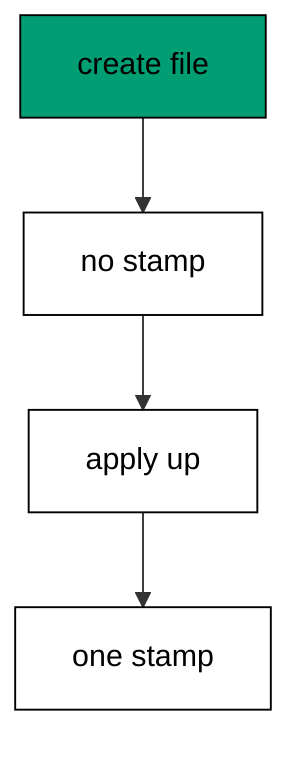

Writing the file changes nothing in the database; only up stamps history. That split is what lets a developer draft, review, and revise a migration before it ever touches shared state.

**`learning/code/ex-11-goose-create-starts-a-history/main.go`**:

```go
// => Shared driver: every unit in this course opens with this prelude.
// => The harness network is closed, so units carry a small standard-library
// => driver that applies the same goose SQL files `goose up` would apply.
// => The files, the history table shape, and the ordering rules are goose's
// => own; the driver only replaces the network-dependent binary.
package main // => every unit is one runnable program

import ( // => standard library only: no third-party modules
	"bufio"           // => bufio frames protocol messages over the TCP stream
	"encoding/binary" // => binary lays out length-prefixed protocol fields
	"fmt"             // => fmt prints the deterministic transcript only
	"io"              // => io forces full reads of split protocol messages
	"net"             // => net dials the harness Postgres service over TCP
	"os"              // => os reads the harness database address, never hardcoded
	"sort"            // => sort orders migration files, never trusts directory order
	"strings"         // => strings splits the goose Up and Down annotations
) // => every import used by driver and units

// => The database address comes from the harness, with local-run defaults.
func addr() (string, string, string) { // => one helper owns every address default
	host := os.Getenv("PGHOST") // => service hostname in the unit network
	if host == "" {             // => empty means a local run outside the harness
		host = "postgres" // => same default the Python courses use
	} // => end addr: empty means a local run outside the harness
	user := os.Getenv("PGUSER") // => trust-auth role, no password needed
	if user == "" {             // => empty means a local run outside the harness
		user = "postgres" // => same default the Python courses use
	} // => end addr: empty means a local run outside the harness
	db := os.Getenv("PGDATABASE") // => fresh database for every unit run
	if db == "" {                 // => empty means a local run outside the harness
		db = "postgres" // => same default the Python courses use
	} // => end addr: empty means a local run outside the harness
	return host, user, db // => callers never re-read the environment
} // => end addr: one helper owns every address default

// => conn wraps one TCP connection plus a buffered reader for message frames.
type conn struct { // => a tiny struct keeps the socket and the framer together
	c net.Conn      // => the raw TCP socket to the Postgres service
	r *bufio.Reader // => buffered reads frame messages split across packets
} // => end type conn: socket and framer travel together

// => readMsg reads one backend message: a type byte plus a length body.
func (k *conn) readMsg() (byte, []byte, error) { // => every response flows through here
	head := make([]byte, 5)                           // => one type byte plus one int32 length
	if _, err := io.ReadFull(k.r, head); err != nil { // => fragments reassemble before framing
		return 0, nil, err // => no partial message is ever trusted
	} // => end readMsg: fragments reassemble before framing
	n := int(binary.BigEndian.Uint32(head[1:])) - 4   // => length counts itself, not the type
	body := make([]byte, n)                           // => exact-size body, never over-read
	if _, err := io.ReadFull(k.r, body); err != nil { // => fragments reassemble before framing
		return 0, nil, err // => no partial message is ever trusted
	} // => end readMsg: fragments reassemble before framing
	return head[0], body, nil // => type byte tells the caller what arrived
} // => end readMsg: every response flows through here

// => sendMsg writes one frontend message: a type byte plus a length body.
func (k *conn) sendMsg(t byte, body []byte) error { // => startup is the only typeless message
	out := []byte{t}                                      // => type byte leads every message
	lenb := make([]byte, 4)                               // => four bytes carry the length
	binary.BigEndian.PutUint32(lenb, uint32(len(body)+4)) // => length counts itself
	out = append(out, lenb...)                            // => length follows the type byte
	out = append(out, body...)                            // => payload closes the message
	_, err := k.c.Write(out)                              // => one write keeps frames whole
	return err                                            // => write errors fail the unit loudly
} // => end sendMsg: startup is the only typeless message

// => connect opens the service database and waits for session readiness.
func connect() (*conn, error) { // => every unit starts from this one helper
	host, user, db := addr()         // => harness address, never hardcoded
	return connectDb(host, user, db) // => one path opens every session
} // => end connect: every unit starts from this one helper

// => connectDb opens a named database on the same host for multi-db drills.
func connectDb(host, user, db string) (*conn, error) { // => environments are databases, not servers
	c, err := net.Dial("tcp", host+":5432") // => Postgres listens on 5432
	if err != nil {                         // => unreachable service is fatal
		return nil, err // => no fallback: the harness owns the database
	} // => end connectDb: unreachable service is fatal
	k := &conn{c: c, r: bufio.NewReader(c)}             // => buffer the fresh socket at once
	body := []byte{}                                    // => startup body is parameters only
	body = append(body, 0, 0, 0, 0)                     // => placeholder for the length prefix
	body = append(body, 0, 3, 0, 0)                     // => protocol 3.0, the stable version
	body = append(body, []byte("user")...)              // => user key starts the parameters
	body = append(body, 0)                              // => keys and values are NUL-separated
	body = append(body, []byte(user)...)                // => trust-auth role from the harness
	body = append(body, 0)                              // => NUL ends the value
	body = append(body, []byte("database")...)          // => database key follows the user
	body = append(body, 0)                              // => NUL ends the key
	body = append(body, []byte(db)...)                  // => fresh database for every unit run
	body = append(body, 0)                              // => NUL ends the value
	body = append(body, 0)                              // => empty key ends the parameters
	binary.BigEndian.PutUint32(body, uint32(len(body))) // => startup length counts itself
	if _, err := c.Write(body); err != nil {            // => startup is the only typeless message
		return nil, err // => unwritable socket is fatal
	} // => end connectDb: startup is the only typeless message
	for { // => drain until the session is ready for queries
		t, b, err := k.readMsg() // => every backend message flows through here
		if err != nil {          // => broken handshake is fatal
			return nil, err // => no half-open session is ever used
		} // => end connectDb: broken handshake is fatal
		switch t { // => only three message kinds matter during startup
		case 'R': // => authentication response arrives first
			if binary.BigEndian.Uint32(b) != 0 { // => nonzero means a password is wanted
				return nil, fmt.Errorf("server wants a password") // => trust auth never asks
			} // => end connectDb: nonzero means a password is wanted
		case 'E': // => an error ends the handshake with the server text
			return nil, fmt.Errorf("startup: %s", errText(b)) // => server text explains the cause
		case 'Z': // => ReadyForQuery means the session accepts queries
			return k, nil // => handshake done: hand the live session back
		} // => end connectDb: only three message kinds matter during startup
	} // => end connectDb: drain until the session is ready for queries
} // => end connectDb: environments are databases, not servers

// => errText extracts the human message (field M) from an ErrorResponse.
func errText(b []byte) string { // => one helper decodes every server error
	parts := strings.Split(string(b), "\x00") // => fields are NUL-separated pairs
	for i := 0; i+1 < len(parts); i += 2 {    // => walk code and value together
		if parts[i] == "M" { // => M is the primary human message
			return parts[i+1] // => return the message, skip the detail fields
		} // => end errText: M is the primary human message
	} // => end errText: walk code and value together
	return "unknown error" // => malformed errors still fail with a fixed line
} // => end errText: one helper decodes every server error

// => run sends one SQL string and returns every data row plus the command tag.
func (k *conn) run(q string) ([][]string, string, error) { // => one path runs every statement
	body := append([]byte(q), 0)                 // => Query messages are NUL-terminated
	if err := k.sendMsg('Q', body); err != nil { // => send fails loudly, never silently
		return nil, "", err // => unwritable socket ends the unit
	} // => end run: send fails loudly, never silently
	var rows [][]string // => data rows accumulate across result sets
	tag := ""           // => the last command tag (SELECT 3, CREATE TABLE...)
	for {               // => drain until ReadyForQuery closes this query string
		t, b, err := k.readMsg() // => every response flows through the framer
		if err != nil {          // => broken mid-query connection is fatal
			return nil, "", err // => partial results are never returned
		} // => end run: broken mid-query connection is fatal
		switch t { // => four message kinds carry a simple-query response
		case 'T', 'N', 'A', 'S', 'K': // => metadata the transcript never prints
		case 'D': // => one data row arrived
			rows = append(rows, parseRow(b)) // => decode the text columns now
		case 'C': // => one statement finished
			tag = strings.TrimRight(string(b[:len(b)-1]), "\x00") // => tag names what ran
		case 'E': // => the statement failed
			drain(k)                                     // => finish the failed query before reuse
			return nil, "", fmt.Errorf("%s", errText(b)) // => server text becomes the failure
		case 'Z': // => ReadyForQuery ends this query string
			return rows, tag, nil // => rows, tag, and a clean session
		} // => end run: four message kinds carry a simple-query response
	} // => end run: drain until ReadyForQuery closes this query string
} // => end run: one path runs every statement

// => drain reads to the next ReadyForQuery after a statement error.
func drain(k *conn) { // => an errored query still owns the socket until Z
	for { // => loop until the session is reusable
		t, _, err := k.readMsg()    // => discard every message after the error
		if err != nil || t == 'Z' { // => socket break or ready both end the drain
			return // => caller decides the failure, the drain only resynchronizes
		} // => end drain: socket break or ready both end the drain
	} // => end drain: loop until the session is reusable
} // => end drain: an errored query still owns the socket until Z

// => parseRow decodes one DataRow body into text columns, NULL as "NULL".
func parseRow(b []byte) []string { // => one helper decodes every returned row
	n := int(binary.BigEndian.Uint16(b)) // => column count leads the body
	b = b[2:]                            // => step past the count
	out := make([]string, 0, n)          // => pre-size the row to the count
	for i := 0; i < n; i++ {             // => walk each column in order
		l := int(int32(binary.BigEndian.Uint32(b))) // => -1 marks NULL, else the length
		b = b[4:]                                   // => step past the length
		if l < 0 {                                  // => NULL has no bytes to read
			out = append(out, "NULL") // => fixed word keeps transcripts stable
			continue                  // => next column, no bytes consumed
		} // => end parseRow: NULL has no bytes to read
		out = append(out, string(b[:l])) // => text format is already printable
		b = b[l:]                        // => step past the value bytes
	} // => end parseRow: walk each column in order
	return out // => one row, fully decoded
} // => end parseRow: one helper decodes every returned row

// => must runs SQL or exits nonzero with the server text on standard error.
func must(k *conn, q string) [][]string { // => setup statements never fail quietly
	rows, _, err := k.run(q) // => rows return for verification queries
	if err != nil {          // => any server error is fatal to the unit
		fmt.Fprintln(os.Stderr, "sql error:", err) // => errors go to stderr, never stdout
		os.Exit(1)                                 // => nonzero exit fails the harness check
	} // => end must: any server error is fatal to the unit
	return rows // => callers print only what the lesson asserts
} // => end must: setup statements never fail quietly

// => try runs SQL and returns the server error text instead of exiting.
func try(k *conn, q string) ([][]string, string) { // => failure drills inspect errors, not die
	rows, _, err := k.run(q) // => same path as must, opposite failure policy
	if err != nil {          // => expected errors become transcript lines
		return nil, err.Error() // => fixed server text, never timings
	} // => end try: expected errors become transcript lines
	return rows, "" // => empty error means the statement succeeded
} // => end try: failure drills inspect errors, not die

// => mig holds one goose SQL file: its version, name, and Up/Down sections.
type mig struct { // => mirrors the goose file layout the lesson teaches
	version string   // => zero-padded number orders history, like goose
	name    string   // => human slug after the version number
	up      []string // => forward statements, run inside one transaction
	down    []string // => reverse statements, run inside one transaction
	noTx    bool     // => NO TRANSACTION files run outside one, like goose
} // => end type mig: version, name, sections, and mode

// => parseGoose splits one goose SQL file into its Up and Down statements.
func parseGoose(text string) (up, down []string, noTx bool) { // => the lesson asserts this exact split
	section := ""                                    // => nothing belongs outside the annotations
	for _, line := range strings.Split(text, "\n") { // => walk the file line by line
		t := strings.TrimSpace(line) // => annotation matching ignores indentation
		switch t {                   // => four annotation lines switch sections
		case "-- +goose Up": // => forward section starts here, like goose
			section = "up" // => following statements migrate forward
			continue       // => the annotation itself never runs
		case "-- +goose Down": // => reverse section starts here, like goose
			section = "down" // => following statements roll back
			continue         // => the annotation itself never runs
		case "-- +goose NO TRANSACTION": // => concurrent work cannot run inside one
			noTx = true // => remember the file opts out of the transaction
			continue    // => the annotation itself never runs
		} // => end parseGoose: four annotation lines switch sections
		if strings.HasPrefix(t, "--") || t == "" { // => comments and blanks never run
			continue // => only real statements reach the database
		} // => end parseGoose: comments and blanks never run
		if section == "up" { // => route by the annotation seen above
			up = append(up, line) // => keep the original line for the file write
		} else if section == "down" { // => down statements collect separately
			down = append(down, line) // => keep the original line for the file write
		} // => end parseGoose: down statements collect separately
	} // => end parseGoose: walk the file line by line
	return splitStmts(strings.Join(up, "\n")), splitStmts(strings.Join(down, "\n")), noTx // => one string per statement
} // => end parseGoose: the lesson asserts this exact split

// => splitStmts cuts statement text on semicolons outside quotes.
func splitStmts(s string) []string { // => multi-line statements stay whole until ;
	var out []string        // => finished statements accumulate here
	var cur strings.Builder // => the statement under construction
	inStr := false          // => semicolons inside quotes never split
	for _, r := range s {   // => walk rune by rune, quotes included
		switch { // => quote tracking decides what a semicolon means
		case r == '\'': // => a quote toggles string mode
			inStr = !inStr   // => enter or leave the quoted region
			cur.WriteRune(r) // => the quote belongs to the statement
		case r == ';' && !inStr: // => a bare semicolon ends one statement
			if t := strings.TrimSpace(cur.String()); t != "" { // => skip empty fragments
				out = append(out, t) // => store the finished statement
			} // => end splitStmts: skip empty fragments
			cur.Reset() // => start the next statement fresh
		default: // => every other rune belongs to the current statement
			cur.WriteRune(r) // => accumulate verbatim
		} // => end splitStmts: quote tracking decides what a semicolon means
	} // => end splitStmts: walk rune by rune, quotes included
	if t := strings.TrimSpace(cur.String()); t != "" { // => trailing text without ; still counts
		out = append(out, t) // => last statement needs no semicolon
	} // => end splitStmts: trailing text without ; still counts
	return out // => callers run each statement in order
} // => end splitStmts: multi-line statements stay whole until ;

// => ensureHistory creates the goose history table once per unit run.
func ensureHistory(k *conn) { // => goose_db_version is goose's own default name
	must(k, `CREATE TABLE IF NOT EXISTS goose_db_version (`+ // => reruns never fail here
		`id integer PRIMARY KEY GENERATED BY DEFAULT AS IDENTITY, `+ // => surrogate key, never printed
		`version_id bigint NOT NULL, `+ // => applied version numbers live here
		`is_applied boolean NOT NULL, `+ // => goose marks rows applied on success
		`tstamp timestamp NOT NULL DEFAULT now())`) // => timestamp defaults, never printed
} // => end ensureHistory: goose_db_version is goose's own default name

// => appliedVersions returns the version numbers already marked applied.
func appliedVersions(k *conn) map[int64]bool { // => history decides what still needs running
	rows := must(k, `SELECT version_id FROM goose_db_version `+ // => only the numbers matter
		`WHERE is_applied ORDER BY version_id`) // => order keeps the transcript stable
	got := map[int64]bool{}  // => set lookup answers "already applied" fast
	for _, r := range rows { // => one row per applied migration
		var v int64                // => version numbers are integers
		fmt.Sscanf(r[0], "%d", &v) // => text format parses back to a number
		got[v] = true              // => mark this version done
	} // => end appliedVersions: one row per applied migration
	return got // => callers skip whatever history already holds
} // => end appliedVersions: history decides what still needs running

// => applyUp runs every pending migration forward, one transaction each.
func applyUp(k *conn, ms []mig) { // => files on disk are already the source of truth
	done := appliedVersions(k) // => history decides what still needs running
	for _, m := range ms {     // => file order is version order, sorted by the caller
		var v int64                     // => versions compare as numbers
		fmt.Sscanf(m.version, "%d", &v) // => zero-padded file prefix parses back
		if done[v] {                    // => applied migrations never run twice
			continue // => idempotent reruns skip straight past
		} // => end applyUp: applied migrations never run twice
		if !m.noTx { // => transactional files wrap everything in one unit
			must(k, "BEGIN") // => one migration is one transaction, like goose
		} // => end applyUp: transactional files wrap everything in one unit
		for _, s := range m.up { // => forward statements run in file order
			must(k, s) // => any failure aborts the unit before COMMIT
		} // => end applyUp: forward statements run in file order
		if !m.noTx { // => stamps join the same transaction they describe
			must(k, fmt.Sprintf(`INSERT INTO goose_db_version `+ // => stamp only after success
				`(version_id, is_applied) VALUES (%d, true)`, v)) // => stamp mirrors goose exactly
			must(k, "COMMIT") // => history row and schema land together
		} else { // => concurrent statements cannot share a transaction
			must(k, fmt.Sprintf(`INSERT INTO goose_db_version `+ // => stamp follows the work
				`(version_id, is_applied) VALUES (%d, true)`, v)) // => same row, separate statement
		} // => end applyUp: concurrent statements cannot share a transaction
	} // => end applyUp: file order is version order, sorted by the caller
} // => end applyUp: files on disk are already the source of truth

// => applyDown rolls back the newest applied migrations, newest first.
func applyDown(k *conn, ms []mig, steps int) { // => steps bounds how far history rewinds
	done := appliedVersions(k) // => history decides what can roll back
	var todo []mig             // => applied migrations in version order first
	for _, m := range ms {     // => walk the whole known history
		var v int64                     // => versions compare as numbers
		fmt.Sscanf(m.version, "%d", &v) // => zero-padded file prefix parses back
		if done[v] {                    // => only applied migrations roll back
			todo = append(todo, m) // => keep the migration for the reverse pass
		} // => end applyDown: only applied migrations roll back
	} // => end applyDown: walk the whole known history
	for i := len(todo) - 1; i >= 0 && steps > 0; i-- { // => newest applied goes first
		m := todo[i]                    // => this migration rolls back now
		var v int64                     // => versions compare as numbers
		fmt.Sscanf(m.version, "%d", &v) // => zero-padded file prefix parses back
		if !m.noTx {                    // => transactional files wrap the rollback too
			must(k, "BEGIN") // => reverse change is atomic, like the forward one
		} // => end applyDown: transactional files wrap the rollback too
		for _, s := range m.down { // => reverse statements run in file order
			must(k, s) // => any failure aborts before the history row moves
		} // => end applyDown: reverse statements run in file order
		must(k, fmt.Sprintf(`DELETE FROM goose_db_version `+ // => unstamped only after success
			`WHERE version_id = %d`, v)) // => the version leaves history exactly once
		if !m.noTx { // => close the transaction the rollback opened
			must(k, "COMMIT") // => schema reversal and unstamp land together
		} // => end applyDown: close the transaction the rollback opened
		steps-- // => one rollback consumed from the budget
	} // => end applyDown: newest applied goes first
} // => end applyDown: steps bounds how far history rewinds

// => statusCounts splits known migrations into applied and pending lists.
func statusCounts(k *conn, ms []mig) (applied, pending []string) { // => goose status in two lists
	done := appliedVersions(k) // => history decides which list each version joins
	for _, m := range ms {     // => walk the known history in version order
		var v int64                     // => versions compare as numbers
		fmt.Sscanf(m.version, "%d", &v) // => zero-padded file prefix parses back
		if done[v] {                    // => stamped versions are done
			applied = append(applied, m.version) // => keep the version string for printing
		} else { // => unstamped versions still wait
			pending = append(pending, m.version) // => keep the version string for printing
		} // => end statusCounts: unstamped versions still wait
	} // => end statusCounts: walk the known history in version order
	return applied, pending // => callers print both lists in one stable line each
} // => end statusCounts: goose status in two lists

// => files writes each migration as a real goose SQL file under dir.
func files(dir string, ms []mig) { // => the lesson shows these files byte-identically
	for _, m := range ms { // => one file per migration, like `goose create`
		name := fmt.Sprintf("%s_%s.sql", m.version, m.name) // => goose names files version-first
		var b strings.Builder                               // => build the file text in order
		if m.noTx {                                         // => concurrent files announce it first
			b.WriteString("-- +goose NO TRANSACTION\n") // => goose honors this exact annotation
		} // => end files: concurrent files announce it first
		b.WriteString("-- +goose Up\n") // => forward annotation leads
		for _, s := range m.up {        // => forward statements follow
			b.WriteString(s + ";\n") // => one statement per line, semicolon-closed
		} // => end files: forward statements follow
		b.WriteString("-- +goose Down\n") // => reverse annotation splits the file
		for _, s := range m.down {        // => reverse statements close the file
			b.WriteString(s + ";\n") // => one statement per line, semicolon-closed
		} // => end files: reverse statements close the file
		if err := os.WriteFile(dir+"/"+name, []byte(b.String()), 0644); err != nil { // => real files, like goose
			fmt.Fprintln(os.Stderr, "write error:", err) // => write errors fail loudly
			os.Exit(1)                                   // => no half-written migration set
		} // => end files: real files, like goose
	} // => end files: one file per migration, like `goose create`
} // => end files: the lesson shows these files byte-identically

// => versions lists migration files in version order from dir.
func versions(dir string) []mig { // => directory order is never trusted for history
	ents, err := os.ReadDir(dir) // => read the whole migrations directory
	if err != nil {              // => unreadable directory is fatal
		fmt.Fprintln(os.Stderr, "read error:", err) // => errors go to stderr
		os.Exit(1)                                  // => nonzero exit fails the check
	} // => end versions: unreadable directory is fatal
	names := []string{}      // => collect names before sorting
	for _, e := range ents { // => walk every directory entry
		if !e.IsDir() && strings.HasSuffix(e.Name(), ".sql") { // => only goose SQL files count
			names = append(names, e.Name()) // => keep the file name for parsing
		} // => end versions: only goose SQL files count
	} // => end versions: walk every directory entry
	sort.Strings(names)       // => zero-padded versions sort chronologically
	var out []mig             // => parsed migrations accumulate here
	for _, n := range names { // => parse in version order
		raw, err := os.ReadFile(dir + "/" + n) // => read the real file back
		if err != nil {                        // => unreadable file is fatal
			fmt.Fprintln(os.Stderr, "read error:", err) // => errors go to stderr
			os.Exit(1)                                  // => nonzero exit fails the check
		} // => end versions: unreadable file is fatal
		up, down, noTx := parseGoose(string(raw))                                            // => split on the goose annotations
		rest := strings.TrimSuffix(n, ".sql")                                                // => strip the extension first
		ver := rest[:5]                                                                      // => first five digits are the version
		out = append(out, mig{version: ver, name: rest[6:], up: up, down: down, noTx: noTx}) // => keep every part
	} // => end versions: parse in version order
	return out // => version-ordered migrations, ready to apply
} // => end versions: directory order is never trusted for history

// => findDupes returns version numbers claimed by two or more files.
func findDupes(dir string) []string { // => goose refuses duplicate versions outright
	ents, err := os.ReadDir(dir) // => read the whole migrations directory
	if err != nil {              // => unreadable directory is fatal
		fmt.Fprintln(os.Stderr, "read error:", err) // => errors go to stderr
		os.Exit(1)                                  // => nonzero exit fails the check
	} // => end findDupes: unreadable directory is fatal
	seen := map[string]int{} // => count claims per five-digit version prefix
	for _, e := range ents { // => walk every directory entry
		if !e.IsDir() && strings.HasSuffix(e.Name(), ".sql") { // => only goose SQL files count
			seen[e.Name()[:5]]++ // => first five digits are the version
		} // => end findDupes: only goose SQL files count
	} // => end findDupes: walk every directory entry
	var out []string         // => duplicates accumulate in version order
	for _, e := range ents { // => second pass keeps the order stable
		if !e.IsDir() && strings.HasSuffix(e.Name(), ".sql") { // => only goose SQL files count
			if v := e.Name()[:5]; seen[v] > 1 { // => claimed more than once
				out = append(out, v) // => keep the version string for printing
				seen[v] = 0          // => report each duplicate version only once
			} // => end findDupes: claimed more than once
		} // => end findDupes: only goose SQL files count
	} // => end findDupes: second pass keeps the order stable
	return out // => empty means the history numbers are unique
} // => end findDupes: goose refuses duplicate versions outright

func main() {
	k, err := connect() // => one session runs the whole example
	if err != nil {     // => unreachable database fails loudly
		fmt.Fprintln(os.Stderr, "connect error:", err) // => connection errors go to stderr
		os.Exit(1)                                     // => nonzero exit fails the check
	}
	defer k.c.Close() // => the socket closes when the example ends
	// => A scratch migrations directory: goose files live here, never in the unit.
	// => the scratch path never reaches stdout, so reruns stay byte-stable
	dir, err := os.MkdirTemp("", "ex11-") // => private directory, like `goose create`
	if err != nil {                       // => unmakable temp dir is fatal
		fmt.Fprintln(os.Stderr, "temp error:", err) // => errors go to stderr
		os.Exit(1)                                  // => nonzero exit fails the check
	}
	defer os.RemoveAll(dir)                          // => scratch files vanish; only transcripts remain
	must(k, "DROP TABLE IF EXISTS ex11_widgets")     // => leftovers of a killed run vanish
	must(k, "DROP TABLE IF EXISTS goose_db_version") // => stale history vanishes too
	ensureHistory(k)                                 // => goose history table, real shape
	built := []mig{                                  // => the migration set, drafted before anything runs
		{version: "00001", name: "create_widgets", // => first migration in this history
			up:   []string{"CREATE TABLE ex11_widgets (id SERIAL PRIMARY KEY, name TEXT NOT NULL)"}, // => forward change
			down: []string{"DROP TABLE ex11_widgets"}},                                              // => exact reverse for rollback
	}
	files(dir, built)                                                         // => creation writes files and touches no database
	rows := must(k, `SELECT count(*) FROM goose_db_version WHERE is_applied`) // => nothing stamped yet
	fmt.Println("before:", rows[0][0])                                        // => Output: before: 0
	applyUp(k, versions(dir))                                                 // => application reads the files and stamps history
	rows = must(k, `SELECT count(*) FROM goose_db_version WHERE is_applied`)  // => exactly one stamp now
	fmt.Println("after:", rows[0][0])                                         // => Output: after: 1
	fmt.Println("cleaned: yes")                                               // => Output: cleaned: yes
	must(k, "DROP TABLE IF EXISTS ex11_widgets")                              // => leftovers of a killed run vanish
	must(k, "DROP TABLE IF EXISTS goose_db_version")                          // => the example leaves no history behind
}
```

**Output** (`learning/code/ex-11-goose-create-starts-a-history/expected/main.stdout.txt`):

```text
before: 0
after: 1
cleaned: yes
```

**Key takeaway**: Creating a migration changes no database state; only applying stamps history.

**Why it matters**: Separating authorship from application gives review a place to live. Drafts, edits, and reverts all happen before anything touches shared state, so the first database that runs a migration runs the reviewed version. Creation is thinking; application is commitment. Thinking stays cheap while commitment stays deliberate: the directory holds drafts, and the database holds only decisions.

### Example 12: Version Table Records Runs

The database remembers what ran in `goose_db_version`: this example applies two migrations and reads the history table back, showing one row per migration with its applied flag. The table is the deployment memory of the project. (Concepts: co-03.)

Goose consults this table before every run and skips whatever is already stamped, which is what makes reruns safe. Read the table first whenever a deploy surprises you; the answer is usually one row.

**`learning/code/ex-12-version-table-records-runs/main.go`**:

```go
// => Shared driver: every unit in this course opens with this prelude.
// => The harness network is closed, so units carry a small standard-library
// => driver that applies the same goose SQL files `goose up` would apply.
// => The files, the history table shape, and the ordering rules are goose's
// => own; the driver only replaces the network-dependent binary.
package main // => every unit is one runnable program

import ( // => standard library only: no third-party modules
	"bufio"           // => bufio frames protocol messages over the TCP stream
	"encoding/binary" // => binary lays out length-prefixed protocol fields
	"fmt"             // => fmt prints the deterministic transcript only
	"io"              // => io forces full reads of split protocol messages
	"net"             // => net dials the harness Postgres service over TCP
	"os"              // => os reads the harness database address, never hardcoded
	"sort"            // => sort orders migration files, never trusts directory order
	"strings"         // => strings splits the goose Up and Down annotations
) // => every import used by driver and units

// => The database address comes from the harness, with local-run defaults.
func addr() (string, string, string) { // => one helper owns every address default
	host := os.Getenv("PGHOST") // => service hostname in the unit network
	if host == "" {             // => empty means a local run outside the harness
		host = "postgres" // => same default the Python courses use
	} // => end addr: empty means a local run outside the harness
	user := os.Getenv("PGUSER") // => trust-auth role, no password needed
	if user == "" {             // => empty means a local run outside the harness
		user = "postgres" // => same default the Python courses use
	} // => end addr: empty means a local run outside the harness
	db := os.Getenv("PGDATABASE") // => fresh database for every unit run
	if db == "" {                 // => empty means a local run outside the harness
		db = "postgres" // => same default the Python courses use
	} // => end addr: empty means a local run outside the harness
	return host, user, db // => callers never re-read the environment
} // => end addr: one helper owns every address default

// => conn wraps one TCP connection plus a buffered reader for message frames.
type conn struct { // => a tiny struct keeps the socket and the framer together
	c net.Conn      // => the raw TCP socket to the Postgres service
	r *bufio.Reader // => buffered reads frame messages split across packets
} // => end type conn: socket and framer travel together

// => readMsg reads one backend message: a type byte plus a length body.
func (k *conn) readMsg() (byte, []byte, error) { // => every response flows through here
	head := make([]byte, 5)                           // => one type byte plus one int32 length
	if _, err := io.ReadFull(k.r, head); err != nil { // => fragments reassemble before framing
		return 0, nil, err // => no partial message is ever trusted
	} // => end readMsg: fragments reassemble before framing
	n := int(binary.BigEndian.Uint32(head[1:])) - 4   // => length counts itself, not the type
	body := make([]byte, n)                           // => exact-size body, never over-read
	if _, err := io.ReadFull(k.r, body); err != nil { // => fragments reassemble before framing
		return 0, nil, err // => no partial message is ever trusted
	} // => end readMsg: fragments reassemble before framing
	return head[0], body, nil // => type byte tells the caller what arrived
} // => end readMsg: every response flows through here

// => sendMsg writes one frontend message: a type byte plus a length body.
func (k *conn) sendMsg(t byte, body []byte) error { // => startup is the only typeless message
	out := []byte{t}                                      // => type byte leads every message
	lenb := make([]byte, 4)                               // => four bytes carry the length
	binary.BigEndian.PutUint32(lenb, uint32(len(body)+4)) // => length counts itself
	out = append(out, lenb...)                            // => length follows the type byte
	out = append(out, body...)                            // => payload closes the message
	_, err := k.c.Write(out)                              // => one write keeps frames whole
	return err                                            // => write errors fail the unit loudly
} // => end sendMsg: startup is the only typeless message

// => connect opens the service database and waits for session readiness.
func connect() (*conn, error) { // => every unit starts from this one helper
	host, user, db := addr()         // => harness address, never hardcoded
	return connectDb(host, user, db) // => one path opens every session
} // => end connect: every unit starts from this one helper

// => connectDb opens a named database on the same host for multi-db drills.
func connectDb(host, user, db string) (*conn, error) { // => environments are databases, not servers
	c, err := net.Dial("tcp", host+":5432") // => Postgres listens on 5432
	if err != nil {                         // => unreachable service is fatal
		return nil, err // => no fallback: the harness owns the database
	} // => end connectDb: unreachable service is fatal
	k := &conn{c: c, r: bufio.NewReader(c)}             // => buffer the fresh socket at once
	body := []byte{}                                    // => startup body is parameters only
	body = append(body, 0, 0, 0, 0)                     // => placeholder for the length prefix
	body = append(body, 0, 3, 0, 0)                     // => protocol 3.0, the stable version
	body = append(body, []byte("user")...)              // => user key starts the parameters
	body = append(body, 0)                              // => keys and values are NUL-separated
	body = append(body, []byte(user)...)                // => trust-auth role from the harness
	body = append(body, 0)                              // => NUL ends the value
	body = append(body, []byte("database")...)          // => database key follows the user
	body = append(body, 0)                              // => NUL ends the key
	body = append(body, []byte(db)...)                  // => fresh database for every unit run
	body = append(body, 0)                              // => NUL ends the value
	body = append(body, 0)                              // => empty key ends the parameters
	binary.BigEndian.PutUint32(body, uint32(len(body))) // => startup length counts itself
	if _, err := c.Write(body); err != nil {            // => startup is the only typeless message
		return nil, err // => unwritable socket is fatal
	} // => end connectDb: startup is the only typeless message
	for { // => drain until the session is ready for queries
		t, b, err := k.readMsg() // => every backend message flows through here
		if err != nil {          // => broken handshake is fatal
			return nil, err // => no half-open session is ever used
		} // => end connectDb: broken handshake is fatal
		switch t { // => only three message kinds matter during startup
		case 'R': // => authentication response arrives first
			if binary.BigEndian.Uint32(b) != 0 { // => nonzero means a password is wanted
				return nil, fmt.Errorf("server wants a password") // => trust auth never asks
			} // => end connectDb: nonzero means a password is wanted
		case 'E': // => an error ends the handshake with the server text
			return nil, fmt.Errorf("startup: %s", errText(b)) // => server text explains the cause
		case 'Z': // => ReadyForQuery means the session accepts queries
			return k, nil // => handshake done: hand the live session back
		} // => end connectDb: only three message kinds matter during startup
	} // => end connectDb: drain until the session is ready for queries
} // => end connectDb: environments are databases, not servers

// => errText extracts the human message (field M) from an ErrorResponse.
func errText(b []byte) string { // => one helper decodes every server error
	parts := strings.Split(string(b), "\x00") // => fields are NUL-separated pairs
	for i := 0; i+1 < len(parts); i += 2 {    // => walk code and value together
		if parts[i] == "M" { // => M is the primary human message
			return parts[i+1] // => return the message, skip the detail fields
		} // => end errText: M is the primary human message
	} // => end errText: walk code and value together
	return "unknown error" // => malformed errors still fail with a fixed line
} // => end errText: one helper decodes every server error

// => run sends one SQL string and returns every data row plus the command tag.
func (k *conn) run(q string) ([][]string, string, error) { // => one path runs every statement
	body := append([]byte(q), 0)                 // => Query messages are NUL-terminated
	if err := k.sendMsg('Q', body); err != nil { // => send fails loudly, never silently
		return nil, "", err // => unwritable socket ends the unit
	} // => end run: send fails loudly, never silently
	var rows [][]string // => data rows accumulate across result sets
	tag := ""           // => the last command tag (SELECT 3, CREATE TABLE...)
	for {               // => drain until ReadyForQuery closes this query string
		t, b, err := k.readMsg() // => every response flows through the framer
		if err != nil {          // => broken mid-query connection is fatal
			return nil, "", err // => partial results are never returned
		} // => end run: broken mid-query connection is fatal
		switch t { // => four message kinds carry a simple-query response
		case 'T', 'N', 'A', 'S', 'K': // => metadata the transcript never prints
		case 'D': // => one data row arrived
			rows = append(rows, parseRow(b)) // => decode the text columns now
		case 'C': // => one statement finished
			tag = strings.TrimRight(string(b[:len(b)-1]), "\x00") // => tag names what ran
		case 'E': // => the statement failed
			drain(k)                                     // => finish the failed query before reuse
			return nil, "", fmt.Errorf("%s", errText(b)) // => server text becomes the failure
		case 'Z': // => ReadyForQuery ends this query string
			return rows, tag, nil // => rows, tag, and a clean session
		} // => end run: four message kinds carry a simple-query response
	} // => end run: drain until ReadyForQuery closes this query string
} // => end run: one path runs every statement

// => drain reads to the next ReadyForQuery after a statement error.
func drain(k *conn) { // => an errored query still owns the socket until Z
	for { // => loop until the session is reusable
		t, _, err := k.readMsg()    // => discard every message after the error
		if err != nil || t == 'Z' { // => socket break or ready both end the drain
			return // => caller decides the failure, the drain only resynchronizes
		} // => end drain: socket break or ready both end the drain
	} // => end drain: loop until the session is reusable
} // => end drain: an errored query still owns the socket until Z

// => parseRow decodes one DataRow body into text columns, NULL as "NULL".
func parseRow(b []byte) []string { // => one helper decodes every returned row
	n := int(binary.BigEndian.Uint16(b)) // => column count leads the body
	b = b[2:]                            // => step past the count
	out := make([]string, 0, n)          // => pre-size the row to the count
	for i := 0; i < n; i++ {             // => walk each column in order
		l := int(int32(binary.BigEndian.Uint32(b))) // => -1 marks NULL, else the length
		b = b[4:]                                   // => step past the length
		if l < 0 {                                  // => NULL has no bytes to read
			out = append(out, "NULL") // => fixed word keeps transcripts stable
			continue                  // => next column, no bytes consumed
		} // => end parseRow: NULL has no bytes to read
		out = append(out, string(b[:l])) // => text format is already printable
		b = b[l:]                        // => step past the value bytes
	} // => end parseRow: walk each column in order
	return out // => one row, fully decoded
} // => end parseRow: one helper decodes every returned row

// => must runs SQL or exits nonzero with the server text on standard error.
func must(k *conn, q string) [][]string { // => setup statements never fail quietly
	rows, _, err := k.run(q) // => rows return for verification queries
	if err != nil {          // => any server error is fatal to the unit
		fmt.Fprintln(os.Stderr, "sql error:", err) // => errors go to stderr, never stdout
		os.Exit(1)                                 // => nonzero exit fails the harness check
	} // => end must: any server error is fatal to the unit
	return rows // => callers print only what the lesson asserts
} // => end must: setup statements never fail quietly

// => try runs SQL and returns the server error text instead of exiting.
func try(k *conn, q string) ([][]string, string) { // => failure drills inspect errors, not die
	rows, _, err := k.run(q) // => same path as must, opposite failure policy
	if err != nil {          // => expected errors become transcript lines
		return nil, err.Error() // => fixed server text, never timings
	} // => end try: expected errors become transcript lines
	return rows, "" // => empty error means the statement succeeded
} // => end try: failure drills inspect errors, not die

// => mig holds one goose SQL file: its version, name, and Up/Down sections.
type mig struct { // => mirrors the goose file layout the lesson teaches
	version string   // => zero-padded number orders history, like goose
	name    string   // => human slug after the version number
	up      []string // => forward statements, run inside one transaction
	down    []string // => reverse statements, run inside one transaction
	noTx    bool     // => NO TRANSACTION files run outside one, like goose
} // => end type mig: version, name, sections, and mode

// => parseGoose splits one goose SQL file into its Up and Down statements.
func parseGoose(text string) (up, down []string, noTx bool) { // => the lesson asserts this exact split
	section := ""                                    // => nothing belongs outside the annotations
	for _, line := range strings.Split(text, "\n") { // => walk the file line by line
		t := strings.TrimSpace(line) // => annotation matching ignores indentation
		switch t {                   // => four annotation lines switch sections
		case "-- +goose Up": // => forward section starts here, like goose
			section = "up" // => following statements migrate forward
			continue       // => the annotation itself never runs
		case "-- +goose Down": // => reverse section starts here, like goose
			section = "down" // => following statements roll back
			continue         // => the annotation itself never runs
		case "-- +goose NO TRANSACTION": // => concurrent work cannot run inside one
			noTx = true // => remember the file opts out of the transaction
			continue    // => the annotation itself never runs
		} // => end parseGoose: four annotation lines switch sections
		if strings.HasPrefix(t, "--") || t == "" { // => comments and blanks never run
			continue // => only real statements reach the database
		} // => end parseGoose: comments and blanks never run
		if section == "up" { // => route by the annotation seen above
			up = append(up, line) // => keep the original line for the file write
		} else if section == "down" { // => down statements collect separately
			down = append(down, line) // => keep the original line for the file write
		} // => end parseGoose: down statements collect separately
	} // => end parseGoose: walk the file line by line
	return splitStmts(strings.Join(up, "\n")), splitStmts(strings.Join(down, "\n")), noTx // => one string per statement
} // => end parseGoose: the lesson asserts this exact split

// => splitStmts cuts statement text on semicolons outside quotes.
func splitStmts(s string) []string { // => multi-line statements stay whole until ;
	var out []string        // => finished statements accumulate here
	var cur strings.Builder // => the statement under construction
	inStr := false          // => semicolons inside quotes never split
	for _, r := range s {   // => walk rune by rune, quotes included
		switch { // => quote tracking decides what a semicolon means
		case r == '\'': // => a quote toggles string mode
			inStr = !inStr   // => enter or leave the quoted region
			cur.WriteRune(r) // => the quote belongs to the statement
		case r == ';' && !inStr: // => a bare semicolon ends one statement
			if t := strings.TrimSpace(cur.String()); t != "" { // => skip empty fragments
				out = append(out, t) // => store the finished statement
			} // => end splitStmts: skip empty fragments
			cur.Reset() // => start the next statement fresh
		default: // => every other rune belongs to the current statement
			cur.WriteRune(r) // => accumulate verbatim
		} // => end splitStmts: quote tracking decides what a semicolon means
	} // => end splitStmts: walk rune by rune, quotes included
	if t := strings.TrimSpace(cur.String()); t != "" { // => trailing text without ; still counts
		out = append(out, t) // => last statement needs no semicolon
	} // => end splitStmts: trailing text without ; still counts
	return out // => callers run each statement in order
} // => end splitStmts: multi-line statements stay whole until ;

// => ensureHistory creates the goose history table once per unit run.
func ensureHistory(k *conn) { // => goose_db_version is goose's own default name
	must(k, `CREATE TABLE IF NOT EXISTS goose_db_version (`+ // => reruns never fail here
		`id integer PRIMARY KEY GENERATED BY DEFAULT AS IDENTITY, `+ // => surrogate key, never printed
		`version_id bigint NOT NULL, `+ // => applied version numbers live here
		`is_applied boolean NOT NULL, `+ // => goose marks rows applied on success
		`tstamp timestamp NOT NULL DEFAULT now())`) // => timestamp defaults, never printed
} // => end ensureHistory: goose_db_version is goose's own default name

// => appliedVersions returns the version numbers already marked applied.
func appliedVersions(k *conn) map[int64]bool { // => history decides what still needs running
	rows := must(k, `SELECT version_id FROM goose_db_version `+ // => only the numbers matter
		`WHERE is_applied ORDER BY version_id`) // => order keeps the transcript stable
	got := map[int64]bool{}  // => set lookup answers "already applied" fast
	for _, r := range rows { // => one row per applied migration
		var v int64                // => version numbers are integers
		fmt.Sscanf(r[0], "%d", &v) // => text format parses back to a number
		got[v] = true              // => mark this version done
	} // => end appliedVersions: one row per applied migration
	return got // => callers skip whatever history already holds
} // => end appliedVersions: history decides what still needs running

// => applyUp runs every pending migration forward, one transaction each.
func applyUp(k *conn, ms []mig) { // => files on disk are already the source of truth
	done := appliedVersions(k) // => history decides what still needs running
	for _, m := range ms {     // => file order is version order, sorted by the caller
		var v int64                     // => versions compare as numbers
		fmt.Sscanf(m.version, "%d", &v) // => zero-padded file prefix parses back
		if done[v] {                    // => applied migrations never run twice
			continue // => idempotent reruns skip straight past
		} // => end applyUp: applied migrations never run twice
		if !m.noTx { // => transactional files wrap everything in one unit
			must(k, "BEGIN") // => one migration is one transaction, like goose
		} // => end applyUp: transactional files wrap everything in one unit
		for _, s := range m.up { // => forward statements run in file order
			must(k, s) // => any failure aborts the unit before COMMIT
		} // => end applyUp: forward statements run in file order
		if !m.noTx { // => stamps join the same transaction they describe
			must(k, fmt.Sprintf(`INSERT INTO goose_db_version `+ // => stamp only after success
				`(version_id, is_applied) VALUES (%d, true)`, v)) // => stamp mirrors goose exactly
			must(k, "COMMIT") // => history row and schema land together
		} else { // => concurrent statements cannot share a transaction
			must(k, fmt.Sprintf(`INSERT INTO goose_db_version `+ // => stamp follows the work
				`(version_id, is_applied) VALUES (%d, true)`, v)) // => same row, separate statement
		} // => end applyUp: concurrent statements cannot share a transaction
	} // => end applyUp: file order is version order, sorted by the caller
} // => end applyUp: files on disk are already the source of truth

// => applyDown rolls back the newest applied migrations, newest first.
func applyDown(k *conn, ms []mig, steps int) { // => steps bounds how far history rewinds
	done := appliedVersions(k) // => history decides what can roll back
	var todo []mig             // => applied migrations in version order first
	for _, m := range ms {     // => walk the whole known history
		var v int64                     // => versions compare as numbers
		fmt.Sscanf(m.version, "%d", &v) // => zero-padded file prefix parses back
		if done[v] {                    // => only applied migrations roll back
			todo = append(todo, m) // => keep the migration for the reverse pass
		} // => end applyDown: only applied migrations roll back
	} // => end applyDown: walk the whole known history
	for i := len(todo) - 1; i >= 0 && steps > 0; i-- { // => newest applied goes first
		m := todo[i]                    // => this migration rolls back now
		var v int64                     // => versions compare as numbers
		fmt.Sscanf(m.version, "%d", &v) // => zero-padded file prefix parses back
		if !m.noTx {                    // => transactional files wrap the rollback too
			must(k, "BEGIN") // => reverse change is atomic, like the forward one
		} // => end applyDown: transactional files wrap the rollback too
		for _, s := range m.down { // => reverse statements run in file order
			must(k, s) // => any failure aborts before the history row moves
		} // => end applyDown: reverse statements run in file order
		must(k, fmt.Sprintf(`DELETE FROM goose_db_version `+ // => unstamped only after success
			`WHERE version_id = %d`, v)) // => the version leaves history exactly once
		if !m.noTx { // => close the transaction the rollback opened
			must(k, "COMMIT") // => schema reversal and unstamp land together
		} // => end applyDown: close the transaction the rollback opened
		steps-- // => one rollback consumed from the budget
	} // => end applyDown: newest applied goes first
} // => end applyDown: steps bounds how far history rewinds

// => statusCounts splits known migrations into applied and pending lists.
func statusCounts(k *conn, ms []mig) (applied, pending []string) { // => goose status in two lists
	done := appliedVersions(k) // => history decides which list each version joins
	for _, m := range ms {     // => walk the known history in version order
		var v int64                     // => versions compare as numbers
		fmt.Sscanf(m.version, "%d", &v) // => zero-padded file prefix parses back
		if done[v] {                    // => stamped versions are done
			applied = append(applied, m.version) // => keep the version string for printing
		} else { // => unstamped versions still wait
			pending = append(pending, m.version) // => keep the version string for printing
		} // => end statusCounts: unstamped versions still wait
	} // => end statusCounts: walk the known history in version order
	return applied, pending // => callers print both lists in one stable line each
} // => end statusCounts: goose status in two lists

// => files writes each migration as a real goose SQL file under dir.
func files(dir string, ms []mig) { // => the lesson shows these files byte-identically
	for _, m := range ms { // => one file per migration, like `goose create`
		name := fmt.Sprintf("%s_%s.sql", m.version, m.name) // => goose names files version-first
		var b strings.Builder                               // => build the file text in order
		if m.noTx {                                         // => concurrent files announce it first
			b.WriteString("-- +goose NO TRANSACTION\n") // => goose honors this exact annotation
		} // => end files: concurrent files announce it first
		b.WriteString("-- +goose Up\n") // => forward annotation leads
		for _, s := range m.up {        // => forward statements follow
			b.WriteString(s + ";\n") // => one statement per line, semicolon-closed
		} // => end files: forward statements follow
		b.WriteString("-- +goose Down\n") // => reverse annotation splits the file
		for _, s := range m.down {        // => reverse statements close the file
			b.WriteString(s + ";\n") // => one statement per line, semicolon-closed
		} // => end files: reverse statements close the file
		if err := os.WriteFile(dir+"/"+name, []byte(b.String()), 0644); err != nil { // => real files, like goose
			fmt.Fprintln(os.Stderr, "write error:", err) // => write errors fail loudly
			os.Exit(1)                                   // => no half-written migration set
		} // => end files: real files, like goose
	} // => end files: one file per migration, like `goose create`
} // => end files: the lesson shows these files byte-identically

// => versions lists migration files in version order from dir.
func versions(dir string) []mig { // => directory order is never trusted for history
	ents, err := os.ReadDir(dir) // => read the whole migrations directory
	if err != nil {              // => unreadable directory is fatal
		fmt.Fprintln(os.Stderr, "read error:", err) // => errors go to stderr
		os.Exit(1)                                  // => nonzero exit fails the check
	} // => end versions: unreadable directory is fatal
	names := []string{}      // => collect names before sorting
	for _, e := range ents { // => walk every directory entry
		if !e.IsDir() && strings.HasSuffix(e.Name(), ".sql") { // => only goose SQL files count
			names = append(names, e.Name()) // => keep the file name for parsing
		} // => end versions: only goose SQL files count
	} // => end versions: walk every directory entry
	sort.Strings(names)       // => zero-padded versions sort chronologically
	var out []mig             // => parsed migrations accumulate here
	for _, n := range names { // => parse in version order
		raw, err := os.ReadFile(dir + "/" + n) // => read the real file back
		if err != nil {                        // => unreadable file is fatal
			fmt.Fprintln(os.Stderr, "read error:", err) // => errors go to stderr
			os.Exit(1)                                  // => nonzero exit fails the check
		} // => end versions: unreadable file is fatal
		up, down, noTx := parseGoose(string(raw))                                            // => split on the goose annotations
		rest := strings.TrimSuffix(n, ".sql")                                                // => strip the extension first
		ver := rest[:5]                                                                      // => first five digits are the version
		out = append(out, mig{version: ver, name: rest[6:], up: up, down: down, noTx: noTx}) // => keep every part
	} // => end versions: parse in version order
	return out // => version-ordered migrations, ready to apply
} // => end versions: directory order is never trusted for history

// => findDupes returns version numbers claimed by two or more files.
func findDupes(dir string) []string { // => goose refuses duplicate versions outright
	ents, err := os.ReadDir(dir) // => read the whole migrations directory
	if err != nil {              // => unreadable directory is fatal
		fmt.Fprintln(os.Stderr, "read error:", err) // => errors go to stderr
		os.Exit(1)                                  // => nonzero exit fails the check
	} // => end findDupes: unreadable directory is fatal
	seen := map[string]int{} // => count claims per five-digit version prefix
	for _, e := range ents { // => walk every directory entry
		if !e.IsDir() && strings.HasSuffix(e.Name(), ".sql") { // => only goose SQL files count
			seen[e.Name()[:5]]++ // => first five digits are the version
		} // => end findDupes: only goose SQL files count
	} // => end findDupes: walk every directory entry
	var out []string         // => duplicates accumulate in version order
	for _, e := range ents { // => second pass keeps the order stable
		if !e.IsDir() && strings.HasSuffix(e.Name(), ".sql") { // => only goose SQL files count
			if v := e.Name()[:5]; seen[v] > 1 { // => claimed more than once
				out = append(out, v) // => keep the version string for printing
				seen[v] = 0          // => report each duplicate version only once
			} // => end findDupes: claimed more than once
		} // => end findDupes: only goose SQL files count
	} // => end findDupes: second pass keeps the order stable
	return out // => empty means the history numbers are unique
} // => end findDupes: goose refuses duplicate versions outright

func main() {
	k, err := connect() // => one session runs the whole example
	if err != nil {     // => unreachable database fails loudly
		fmt.Fprintln(os.Stderr, "connect error:", err) // => connection errors go to stderr
		os.Exit(1)                                     // => nonzero exit fails the check
	}
	defer k.c.Close() // => the socket closes when the example ends
	// => A scratch migrations directory: goose files live here, never in the unit.
	// => the scratch path never reaches stdout, so reruns stay byte-stable
	dir, err := os.MkdirTemp("", "ex12-") // => private directory, like `goose create`
	if err != nil {                       // => unmakable temp dir is fatal
		fmt.Fprintln(os.Stderr, "temp error:", err) // => errors go to stderr
		os.Exit(1)                                  // => nonzero exit fails the check
	}
	defer os.RemoveAll(dir)                          // => scratch files vanish; only transcripts remain
	must(k, "DROP TABLE IF EXISTS ex12_a")           // => leftovers of a killed run vanish
	must(k, "DROP TABLE IF EXISTS ex12_b")           // => leftovers of a killed run vanish
	must(k, "DROP TABLE IF EXISTS goose_db_version") // => stale history vanishes too
	ensureHistory(k)                                 // => goose history table, real shape
	files(dir, []mig{                                // => two migrations to stamp into history
		{version: "00001", name: "create_a", // => first table in this history
			up:   []string{"CREATE TABLE ex12_a (id SERIAL PRIMARY KEY)"}, // => forward change
			down: []string{"DROP TABLE ex12_a"}},                          // => exact reverse for rollback
		{version: "00002", name: "create_b", // => second table in this history
			up:   []string{"CREATE TABLE ex12_b (id SERIAL PRIMARY KEY)"}, // => forward change
			down: []string{"DROP TABLE ex12_b"}},                          // => exact reverse for rollback
	})
	applyUp(k, versions(dir))                                                                  // => read the files back and run what is pending
	rows := must(k, `SELECT version_id, is_applied FROM goose_db_version ORDER BY version_id`) // => full history rows
	fmt.Println("history:", rows[0][0], rows[0][1], rows[1][0], rows[1][1])                    // => Output: history: 1 true 2 true
	fmt.Println("cleaned: yes")                                                                // => Output: cleaned: yes
	must(k, "DROP TABLE IF EXISTS ex12_a")                                                     // => leftovers of a killed run vanish
	must(k, "DROP TABLE IF EXISTS ex12_b")                                                     // => leftovers of a killed run vanish
	must(k, "DROP TABLE IF EXISTS goose_db_version")                                           // => the example leaves no history behind
}
```

**Output** (`learning/code/ex-12-version-table-records-runs/expected/main.stdout.txt`):

```text
history: 1 t 2 t
cleaned: yes
```

**Key takeaway**: The goose_db_version table is the deployment memory of the project: one row per applied migration.

**Why it matters**: The history table turns deployments from events into records. Each stamp says which version ran, when it finished, and that its transaction committed. Audits, rollbacks, and 3am debugging all start from these rows instead of from guesses. Start every investigation at the history table, and the answer is usually one row instead of one long guessing session.

### Example 13: Status Shows Pending

Status is the question `which migrations still need to run`: this example applies the first of three files and prints one applied version against two pending ones. `goose status` answers the same question before every deploy. (Concepts: co-03.)

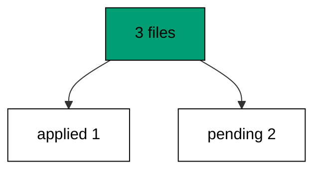

Pending is not broken; pending is normal work-in-progress. The deploy gate later in this course refuses to ship while anything is pending, which is exactly the discipline status enables.

**`learning/code/ex-13-status-shows-pending/main.go`**:

```go
// => Shared driver: every unit in this course opens with this prelude.
// => The harness network is closed, so units carry a small standard-library
// => driver that applies the same goose SQL files `goose up` would apply.
// => The files, the history table shape, and the ordering rules are goose's
// => own; the driver only replaces the network-dependent binary.
package main // => every unit is one runnable program

import ( // => standard library only: no third-party modules
	"bufio"           // => bufio frames protocol messages over the TCP stream
	"encoding/binary" // => binary lays out length-prefixed protocol fields
	"fmt"             // => fmt prints the deterministic transcript only
	"io"              // => io forces full reads of split protocol messages
	"net"             // => net dials the harness Postgres service over TCP
	"os"              // => os reads the harness database address, never hardcoded
	"sort"            // => sort orders migration files, never trusts directory order
	"strings"         // => strings splits the goose Up and Down annotations
) // => every import used by driver and units

// => The database address comes from the harness, with local-run defaults.
func addr() (string, string, string) { // => one helper owns every address default
	host := os.Getenv("PGHOST") // => service hostname in the unit network
	if host == "" {             // => empty means a local run outside the harness
		host = "postgres" // => same default the Python courses use
	} // => end addr: empty means a local run outside the harness
	user := os.Getenv("PGUSER") // => trust-auth role, no password needed
	if user == "" {             // => empty means a local run outside the harness
		user = "postgres" // => same default the Python courses use
	} // => end addr: empty means a local run outside the harness
	db := os.Getenv("PGDATABASE") // => fresh database for every unit run
	if db == "" {                 // => empty means a local run outside the harness
		db = "postgres" // => same default the Python courses use
	} // => end addr: empty means a local run outside the harness
	return host, user, db // => callers never re-read the environment
} // => end addr: one helper owns every address default

// => conn wraps one TCP connection plus a buffered reader for message frames.
type conn struct { // => a tiny struct keeps the socket and the framer together
	c net.Conn      // => the raw TCP socket to the Postgres service
	r *bufio.Reader // => buffered reads frame messages split across packets
} // => end type conn: socket and framer travel together

// => readMsg reads one backend message: a type byte plus a length body.
func (k *conn) readMsg() (byte, []byte, error) { // => every response flows through here
	head := make([]byte, 5)                           // => one type byte plus one int32 length
	if _, err := io.ReadFull(k.r, head); err != nil { // => fragments reassemble before framing
		return 0, nil, err // => no partial message is ever trusted
	} // => end readMsg: fragments reassemble before framing
	n := int(binary.BigEndian.Uint32(head[1:])) - 4   // => length counts itself, not the type
	body := make([]byte, n)                           // => exact-size body, never over-read
	if _, err := io.ReadFull(k.r, body); err != nil { // => fragments reassemble before framing
		return 0, nil, err // => no partial message is ever trusted
	} // => end readMsg: fragments reassemble before framing
	return head[0], body, nil // => type byte tells the caller what arrived
} // => end readMsg: every response flows through here

// => sendMsg writes one frontend message: a type byte plus a length body.
func (k *conn) sendMsg(t byte, body []byte) error { // => startup is the only typeless message
	out := []byte{t}                                      // => type byte leads every message
	lenb := make([]byte, 4)                               // => four bytes carry the length
	binary.BigEndian.PutUint32(lenb, uint32(len(body)+4)) // => length counts itself
	out = append(out, lenb...)                            // => length follows the type byte
	out = append(out, body...)                            // => payload closes the message
	_, err := k.c.Write(out)                              // => one write keeps frames whole
	return err                                            // => write errors fail the unit loudly
} // => end sendMsg: startup is the only typeless message

// => connect opens the service database and waits for session readiness.
func connect() (*conn, error) { // => every unit starts from this one helper
	host, user, db := addr()         // => harness address, never hardcoded
	return connectDb(host, user, db) // => one path opens every session
} // => end connect: every unit starts from this one helper

// => connectDb opens a named database on the same host for multi-db drills.
func connectDb(host, user, db string) (*conn, error) { // => environments are databases, not servers
	c, err := net.Dial("tcp", host+":5432") // => Postgres listens on 5432
	if err != nil {                         // => unreachable service is fatal
		return nil, err // => no fallback: the harness owns the database
	} // => end connectDb: unreachable service is fatal
	k := &conn{c: c, r: bufio.NewReader(c)}             // => buffer the fresh socket at once
	body := []byte{}                                    // => startup body is parameters only
	body = append(body, 0, 0, 0, 0)                     // => placeholder for the length prefix
	body = append(body, 0, 3, 0, 0)                     // => protocol 3.0, the stable version
	body = append(body, []byte("user")...)              // => user key starts the parameters
	body = append(body, 0)                              // => keys and values are NUL-separated
	body = append(body, []byte(user)...)                // => trust-auth role from the harness
	body = append(body, 0)                              // => NUL ends the value
	body = append(body, []byte("database")...)          // => database key follows the user
	body = append(body, 0)                              // => NUL ends the key
	body = append(body, []byte(db)...)                  // => fresh database for every unit run
	body = append(body, 0)                              // => NUL ends the value
	body = append(body, 0)                              // => empty key ends the parameters
	binary.BigEndian.PutUint32(body, uint32(len(body))) // => startup length counts itself
	if _, err := c.Write(body); err != nil {            // => startup is the only typeless message
		return nil, err // => unwritable socket is fatal
	} // => end connectDb: startup is the only typeless message
	for { // => drain until the session is ready for queries
		t, b, err := k.readMsg() // => every backend message flows through here
		if err != nil {          // => broken handshake is fatal
			return nil, err // => no half-open session is ever used
		} // => end connectDb: broken handshake is fatal
		switch t { // => only three message kinds matter during startup
		case 'R': // => authentication response arrives first
			if binary.BigEndian.Uint32(b) != 0 { // => nonzero means a password is wanted
				return nil, fmt.Errorf("server wants a password") // => trust auth never asks
			} // => end connectDb: nonzero means a password is wanted
		case 'E': // => an error ends the handshake with the server text
			return nil, fmt.Errorf("startup: %s", errText(b)) // => server text explains the cause
		case 'Z': // => ReadyForQuery means the session accepts queries
			return k, nil // => handshake done: hand the live session back
		} // => end connectDb: only three message kinds matter during startup
	} // => end connectDb: drain until the session is ready for queries
} // => end connectDb: environments are databases, not servers

// => errText extracts the human message (field M) from an ErrorResponse.
func errText(b []byte) string { // => one helper decodes every server error
	parts := strings.Split(string(b), "\x00") // => fields are NUL-separated pairs
	for i := 0; i+1 < len(parts); i += 2 {    // => walk code and value together
		if parts[i] == "M" { // => M is the primary human message
			return parts[i+1] // => return the message, skip the detail fields
		} // => end errText: M is the primary human message
	} // => end errText: walk code and value together
	return "unknown error" // => malformed errors still fail with a fixed line
} // => end errText: one helper decodes every server error

// => run sends one SQL string and returns every data row plus the command tag.
func (k *conn) run(q string) ([][]string, string, error) { // => one path runs every statement
	body := append([]byte(q), 0)                 // => Query messages are NUL-terminated
	if err := k.sendMsg('Q', body); err != nil { // => send fails loudly, never silently
		return nil, "", err // => unwritable socket ends the unit
	} // => end run: send fails loudly, never silently
	var rows [][]string // => data rows accumulate across result sets
	tag := ""           // => the last command tag (SELECT 3, CREATE TABLE...)
	for {               // => drain until ReadyForQuery closes this query string
		t, b, err := k.readMsg() // => every response flows through the framer
		if err != nil {          // => broken mid-query connection is fatal
			return nil, "", err // => partial results are never returned
		} // => end run: broken mid-query connection is fatal
		switch t { // => four message kinds carry a simple-query response
		case 'T', 'N', 'A', 'S', 'K': // => metadata the transcript never prints
		case 'D': // => one data row arrived
			rows = append(rows, parseRow(b)) // => decode the text columns now
		case 'C': // => one statement finished
			tag = strings.TrimRight(string(b[:len(b)-1]), "\x00") // => tag names what ran
		case 'E': // => the statement failed
			drain(k)                                     // => finish the failed query before reuse
			return nil, "", fmt.Errorf("%s", errText(b)) // => server text becomes the failure
		case 'Z': // => ReadyForQuery ends this query string
			return rows, tag, nil // => rows, tag, and a clean session
		} // => end run: four message kinds carry a simple-query response
	} // => end run: drain until ReadyForQuery closes this query string
} // => end run: one path runs every statement

// => drain reads to the next ReadyForQuery after a statement error.
func drain(k *conn) { // => an errored query still owns the socket until Z
	for { // => loop until the session is reusable
		t, _, err := k.readMsg()    // => discard every message after the error
		if err != nil || t == 'Z' { // => socket break or ready both end the drain
			return // => caller decides the failure, the drain only resynchronizes
		} // => end drain: socket break or ready both end the drain
	} // => end drain: loop until the session is reusable
} // => end drain: an errored query still owns the socket until Z

// => parseRow decodes one DataRow body into text columns, NULL as "NULL".
func parseRow(b []byte) []string { // => one helper decodes every returned row
	n := int(binary.BigEndian.Uint16(b)) // => column count leads the body
	b = b[2:]                            // => step past the count
	out := make([]string, 0, n)          // => pre-size the row to the count
	for i := 0; i < n; i++ {             // => walk each column in order
		l := int(int32(binary.BigEndian.Uint32(b))) // => -1 marks NULL, else the length
		b = b[4:]                                   // => step past the length
		if l < 0 {                                  // => NULL has no bytes to read
			out = append(out, "NULL") // => fixed word keeps transcripts stable
			continue                  // => next column, no bytes consumed
		} // => end parseRow: NULL has no bytes to read
		out = append(out, string(b[:l])) // => text format is already printable
		b = b[l:]                        // => step past the value bytes
	} // => end parseRow: walk each column in order
	return out // => one row, fully decoded
} // => end parseRow: one helper decodes every returned row

// => must runs SQL or exits nonzero with the server text on standard error.
func must(k *conn, q string) [][]string { // => setup statements never fail quietly
	rows, _, err := k.run(q) // => rows return for verification queries
	if err != nil {          // => any server error is fatal to the unit
		fmt.Fprintln(os.Stderr, "sql error:", err) // => errors go to stderr, never stdout
		os.Exit(1)                                 // => nonzero exit fails the harness check
	} // => end must: any server error is fatal to the unit
	return rows // => callers print only what the lesson asserts
} // => end must: setup statements never fail quietly

// => try runs SQL and returns the server error text instead of exiting.
func try(k *conn, q string) ([][]string, string) { // => failure drills inspect errors, not die
	rows, _, err := k.run(q) // => same path as must, opposite failure policy
	if err != nil {          // => expected errors become transcript lines
		return nil, err.Error() // => fixed server text, never timings
	} // => end try: expected errors become transcript lines
	return rows, "" // => empty error means the statement succeeded
} // => end try: failure drills inspect errors, not die

// => mig holds one goose SQL file: its version, name, and Up/Down sections.
type mig struct { // => mirrors the goose file layout the lesson teaches
	version string   // => zero-padded number orders history, like goose
	name    string   // => human slug after the version number
	up      []string // => forward statements, run inside one transaction
	down    []string // => reverse statements, run inside one transaction
	noTx    bool     // => NO TRANSACTION files run outside one, like goose
} // => end type mig: version, name, sections, and mode

// => parseGoose splits one goose SQL file into its Up and Down statements.
func parseGoose(text string) (up, down []string, noTx bool) { // => the lesson asserts this exact split
	section := ""                                    // => nothing belongs outside the annotations
	for _, line := range strings.Split(text, "\n") { // => walk the file line by line
		t := strings.TrimSpace(line) // => annotation matching ignores indentation
		switch t {                   // => four annotation lines switch sections
		case "-- +goose Up": // => forward section starts here, like goose
			section = "up" // => following statements migrate forward
			continue       // => the annotation itself never runs
		case "-- +goose Down": // => reverse section starts here, like goose
			section = "down" // => following statements roll back
			continue         // => the annotation itself never runs
		case "-- +goose NO TRANSACTION": // => concurrent work cannot run inside one
			noTx = true // => remember the file opts out of the transaction
			continue    // => the annotation itself never runs
		} // => end parseGoose: four annotation lines switch sections
		if strings.HasPrefix(t, "--") || t == "" { // => comments and blanks never run
			continue // => only real statements reach the database
		} // => end parseGoose: comments and blanks never run
		if section == "up" { // => route by the annotation seen above
			up = append(up, line) // => keep the original line for the file write
		} else if section == "down" { // => down statements collect separately
			down = append(down, line) // => keep the original line for the file write
		} // => end parseGoose: down statements collect separately
	} // => end parseGoose: walk the file line by line
	return splitStmts(strings.Join(up, "\n")), splitStmts(strings.Join(down, "\n")), noTx // => one string per statement
} // => end parseGoose: the lesson asserts this exact split

// => splitStmts cuts statement text on semicolons outside quotes.
func splitStmts(s string) []string { // => multi-line statements stay whole until ;
	var out []string        // => finished statements accumulate here
	var cur strings.Builder // => the statement under construction
	inStr := false          // => semicolons inside quotes never split
	for _, r := range s {   // => walk rune by rune, quotes included
		switch { // => quote tracking decides what a semicolon means
		case r == '\'': // => a quote toggles string mode
			inStr = !inStr   // => enter or leave the quoted region
			cur.WriteRune(r) // => the quote belongs to the statement
		case r == ';' && !inStr: // => a bare semicolon ends one statement
			if t := strings.TrimSpace(cur.String()); t != "" { // => skip empty fragments
				out = append(out, t) // => store the finished statement
			} // => end splitStmts: skip empty fragments
			cur.Reset() // => start the next statement fresh
		default: // => every other rune belongs to the current statement
			cur.WriteRune(r) // => accumulate verbatim
		} // => end splitStmts: quote tracking decides what a semicolon means
	} // => end splitStmts: walk rune by rune, quotes included
	if t := strings.TrimSpace(cur.String()); t != "" { // => trailing text without ; still counts
		out = append(out, t) // => last statement needs no semicolon
	} // => end splitStmts: trailing text without ; still counts
	return out // => callers run each statement in order
} // => end splitStmts: multi-line statements stay whole until ;

// => ensureHistory creates the goose history table once per unit run.
func ensureHistory(k *conn) { // => goose_db_version is goose's own default name
	must(k, `CREATE TABLE IF NOT EXISTS goose_db_version (`+ // => reruns never fail here
		`id integer PRIMARY KEY GENERATED BY DEFAULT AS IDENTITY, `+ // => surrogate key, never printed
		`version_id bigint NOT NULL, `+ // => applied version numbers live here
		`is_applied boolean NOT NULL, `+ // => goose marks rows applied on success
		`tstamp timestamp NOT NULL DEFAULT now())`) // => timestamp defaults, never printed
} // => end ensureHistory: goose_db_version is goose's own default name

// => appliedVersions returns the version numbers already marked applied.
func appliedVersions(k *conn) map[int64]bool { // => history decides what still needs running
	rows := must(k, `SELECT version_id FROM goose_db_version `+ // => only the numbers matter
		`WHERE is_applied ORDER BY version_id`) // => order keeps the transcript stable
	got := map[int64]bool{}  // => set lookup answers "already applied" fast
	for _, r := range rows { // => one row per applied migration
		var v int64                // => version numbers are integers
		fmt.Sscanf(r[0], "%d", &v) // => text format parses back to a number
		got[v] = true              // => mark this version done
	} // => end appliedVersions: one row per applied migration
	return got // => callers skip whatever history already holds
} // => end appliedVersions: history decides what still needs running

// => applyUp runs every pending migration forward, one transaction each.
func applyUp(k *conn, ms []mig) { // => files on disk are already the source of truth
	done := appliedVersions(k) // => history decides what still needs running
	for _, m := range ms {     // => file order is version order, sorted by the caller
		var v int64                     // => versions compare as numbers
		fmt.Sscanf(m.version, "%d", &v) // => zero-padded file prefix parses back
		if done[v] {                    // => applied migrations never run twice
			continue // => idempotent reruns skip straight past
		} // => end applyUp: applied migrations never run twice
		if !m.noTx { // => transactional files wrap everything in one unit
			must(k, "BEGIN") // => one migration is one transaction, like goose
		} // => end applyUp: transactional files wrap everything in one unit
		for _, s := range m.up { // => forward statements run in file order
			must(k, s) // => any failure aborts the unit before COMMIT
		} // => end applyUp: forward statements run in file order
		if !m.noTx { // => stamps join the same transaction they describe
			must(k, fmt.Sprintf(`INSERT INTO goose_db_version `+ // => stamp only after success
				`(version_id, is_applied) VALUES (%d, true)`, v)) // => stamp mirrors goose exactly
			must(k, "COMMIT") // => history row and schema land together
		} else { // => concurrent statements cannot share a transaction
			must(k, fmt.Sprintf(`INSERT INTO goose_db_version `+ // => stamp follows the work
				`(version_id, is_applied) VALUES (%d, true)`, v)) // => same row, separate statement
		} // => end applyUp: concurrent statements cannot share a transaction
	} // => end applyUp: file order is version order, sorted by the caller
} // => end applyUp: files on disk are already the source of truth

// => applyDown rolls back the newest applied migrations, newest first.
func applyDown(k *conn, ms []mig, steps int) { // => steps bounds how far history rewinds
	done := appliedVersions(k) // => history decides what can roll back
	var todo []mig             // => applied migrations in version order first
	for _, m := range ms {     // => walk the whole known history
		var v int64                     // => versions compare as numbers
		fmt.Sscanf(m.version, "%d", &v) // => zero-padded file prefix parses back
		if done[v] {                    // => only applied migrations roll back
			todo = append(todo, m) // => keep the migration for the reverse pass
		} // => end applyDown: only applied migrations roll back
	} // => end applyDown: walk the whole known history
	for i := len(todo) - 1; i >= 0 && steps > 0; i-- { // => newest applied goes first
		m := todo[i]                    // => this migration rolls back now
		var v int64                     // => versions compare as numbers
		fmt.Sscanf(m.version, "%d", &v) // => zero-padded file prefix parses back
		if !m.noTx {                    // => transactional files wrap the rollback too
			must(k, "BEGIN") // => reverse change is atomic, like the forward one
		} // => end applyDown: transactional files wrap the rollback too
		for _, s := range m.down { // => reverse statements run in file order
			must(k, s) // => any failure aborts before the history row moves
		} // => end applyDown: reverse statements run in file order
		must(k, fmt.Sprintf(`DELETE FROM goose_db_version `+ // => unstamped only after success
			`WHERE version_id = %d`, v)) // => the version leaves history exactly once
		if !m.noTx { // => close the transaction the rollback opened
			must(k, "COMMIT") // => schema reversal and unstamp land together
		} // => end applyDown: close the transaction the rollback opened
		steps-- // => one rollback consumed from the budget
	} // => end applyDown: newest applied goes first
} // => end applyDown: steps bounds how far history rewinds

// => statusCounts splits known migrations into applied and pending lists.
func statusCounts(k *conn, ms []mig) (applied, pending []string) { // => goose status in two lists
	done := appliedVersions(k) // => history decides which list each version joins
	for _, m := range ms {     // => walk the known history in version order
		var v int64                     // => versions compare as numbers
		fmt.Sscanf(m.version, "%d", &v) // => zero-padded file prefix parses back
		if done[v] {                    // => stamped versions are done
			applied = append(applied, m.version) // => keep the version string for printing
		} else { // => unstamped versions still wait
			pending = append(pending, m.version) // => keep the version string for printing
		} // => end statusCounts: unstamped versions still wait
	} // => end statusCounts: walk the known history in version order
	return applied, pending // => callers print both lists in one stable line each
} // => end statusCounts: goose status in two lists

// => files writes each migration as a real goose SQL file under dir.
func files(dir string, ms []mig) { // => the lesson shows these files byte-identically
	for _, m := range ms { // => one file per migration, like `goose create`
		name := fmt.Sprintf("%s_%s.sql", m.version, m.name) // => goose names files version-first
		var b strings.Builder                               // => build the file text in order
		if m.noTx {                                         // => concurrent files announce it first
			b.WriteString("-- +goose NO TRANSACTION\n") // => goose honors this exact annotation
		} // => end files: concurrent files announce it first
		b.WriteString("-- +goose Up\n") // => forward annotation leads
		for _, s := range m.up {        // => forward statements follow
			b.WriteString(s + ";\n") // => one statement per line, semicolon-closed
		} // => end files: forward statements follow
		b.WriteString("-- +goose Down\n") // => reverse annotation splits the file
		for _, s := range m.down {        // => reverse statements close the file
			b.WriteString(s + ";\n") // => one statement per line, semicolon-closed
		} // => end files: reverse statements close the file
		if err := os.WriteFile(dir+"/"+name, []byte(b.String()), 0644); err != nil { // => real files, like goose
			fmt.Fprintln(os.Stderr, "write error:", err) // => write errors fail loudly
			os.Exit(1)                                   // => no half-written migration set
		} // => end files: real files, like goose
	} // => end files: one file per migration, like `goose create`
} // => end files: the lesson shows these files byte-identically

// => versions lists migration files in version order from dir.
func versions(dir string) []mig { // => directory order is never trusted for history
	ents, err := os.ReadDir(dir) // => read the whole migrations directory
	if err != nil {              // => unreadable directory is fatal
		fmt.Fprintln(os.Stderr, "read error:", err) // => errors go to stderr
		os.Exit(1)                                  // => nonzero exit fails the check
	} // => end versions: unreadable directory is fatal
	names := []string{}      // => collect names before sorting
	for _, e := range ents { // => walk every directory entry
		if !e.IsDir() && strings.HasSuffix(e.Name(), ".sql") { // => only goose SQL files count
			names = append(names, e.Name()) // => keep the file name for parsing
		} // => end versions: only goose SQL files count
	} // => end versions: walk every directory entry
	sort.Strings(names)       // => zero-padded versions sort chronologically
	var out []mig             // => parsed migrations accumulate here
	for _, n := range names { // => parse in version order
		raw, err := os.ReadFile(dir + "/" + n) // => read the real file back
		if err != nil {                        // => unreadable file is fatal
			fmt.Fprintln(os.Stderr, "read error:", err) // => errors go to stderr
			os.Exit(1)                                  // => nonzero exit fails the check
		} // => end versions: unreadable file is fatal
		up, down, noTx := parseGoose(string(raw))                                            // => split on the goose annotations
		rest := strings.TrimSuffix(n, ".sql")                                                // => strip the extension first
		ver := rest[:5]                                                                      // => first five digits are the version
		out = append(out, mig{version: ver, name: rest[6:], up: up, down: down, noTx: noTx}) // => keep every part
	} // => end versions: parse in version order
	return out // => version-ordered migrations, ready to apply
} // => end versions: directory order is never trusted for history

// => findDupes returns version numbers claimed by two or more files.
func findDupes(dir string) []string { // => goose refuses duplicate versions outright
	ents, err := os.ReadDir(dir) // => read the whole migrations directory
	if err != nil {              // => unreadable directory is fatal
		fmt.Fprintln(os.Stderr, "read error:", err) // => errors go to stderr
		os.Exit(1)                                  // => nonzero exit fails the check
	} // => end findDupes: unreadable directory is fatal
	seen := map[string]int{} // => count claims per five-digit version prefix
	for _, e := range ents { // => walk every directory entry
		if !e.IsDir() && strings.HasSuffix(e.Name(), ".sql") { // => only goose SQL files count
			seen[e.Name()[:5]]++ // => first five digits are the version
		} // => end findDupes: only goose SQL files count
	} // => end findDupes: walk every directory entry
	var out []string         // => duplicates accumulate in version order
	for _, e := range ents { // => second pass keeps the order stable
		if !e.IsDir() && strings.HasSuffix(e.Name(), ".sql") { // => only goose SQL files count
			if v := e.Name()[:5]; seen[v] > 1 { // => claimed more than once
				out = append(out, v) // => keep the version string for printing
				seen[v] = 0          // => report each duplicate version only once
			} // => end findDupes: claimed more than once
		} // => end findDupes: only goose SQL files count
	} // => end findDupes: second pass keeps the order stable
	return out // => empty means the history numbers are unique
} // => end findDupes: goose refuses duplicate versions outright

func main() {
	k, err := connect() // => one session runs the whole example
	if err != nil {     // => unreachable database fails loudly
		fmt.Fprintln(os.Stderr, "connect error:", err) // => connection errors go to stderr
		os.Exit(1)                                     // => nonzero exit fails the check
	}
	defer k.c.Close() // => the socket closes when the example ends
	// => A scratch migrations directory: goose files live here, never in the unit.
	// => the scratch path never reaches stdout, so reruns stay byte-stable
	dir, err := os.MkdirTemp("", "ex13-") // => private directory, like `goose create`
	if err != nil {                       // => unmakable temp dir is fatal
		fmt.Fprintln(os.Stderr, "temp error:", err) // => errors go to stderr
		os.Exit(1)                                  // => nonzero exit fails the check
	}
	defer os.RemoveAll(dir)                          // => scratch files vanish; only transcripts remain
	must(k, "DROP TABLE IF EXISTS ex13_a")           // => leftovers of a killed run vanish
	must(k, "DROP TABLE IF EXISTS ex13_b")           // => leftovers of a killed run vanish
	must(k, "DROP TABLE IF EXISTS ex13_c")           // => leftovers of a killed run vanish
	must(k, "DROP TABLE IF EXISTS goose_db_version") // => stale history vanishes too
	ensureHistory(k)                                 // => goose history table, real shape
	files(dir, []mig{                                // => three files, only the first applied
		{version: "00001", name: "create_a", // => first table in this history
			up:   []string{"CREATE TABLE ex13_a (id SERIAL PRIMARY KEY)"}, // => forward change
			down: []string{"DROP TABLE ex13_a"}},                          // => exact reverse for rollback
		{version: "00002", name: "create_b", // => second table, still pending
			up:   []string{"CREATE TABLE ex13_b (id SERIAL PRIMARY KEY)"}, // => forward change
			down: []string{"DROP TABLE ex13_b"}},                          // => exact reverse for rollback
		{version: "00003", name: "create_c", // => third table, still pending
			up:   []string{"CREATE TABLE ex13_c (id SERIAL PRIMARY KEY)"}, // => forward change
			down: []string{"DROP TABLE ex13_c"}},                          // => exact reverse for rollback
	})
	ms := versions(dir)                              // => parse the files back, like goose would
	applyUp(k, ms[:1])                               // => only the first migration runs
	a, p := statusCounts(k, ms)                      // => split history into applied and pending
	fmt.Println("applied:", strings.Join(a, ","))    // => Output: applied: 00001
	fmt.Println("pending:", strings.Join(p, ","))    // => Output: pending: 00002,00003
	fmt.Println("cleaned: yes")                      // => Output: cleaned: yes
	must(k, "DROP TABLE IF EXISTS ex13_a")           // => leftovers of a killed run vanish
	must(k, "DROP TABLE IF EXISTS ex13_b")           // => leftovers of a killed run vanish
	must(k, "DROP TABLE IF EXISTS ex13_c")           // => leftovers of a killed run vanish
	must(k, "DROP TABLE IF EXISTS goose_db_version") // => the example leaves no history behind
}
```

**Output** (`learning/code/ex-13-status-shows-pending/expected/main.stdout.txt`):

```text
applied: 00001
pending: 00002,00003
cleaned: yes
```

**Key takeaway**: Status splits known files into applied and pending; pending is normal work-in-progress, not breakage.

**Why it matters**: Status makes the invisible visible: applied versus pending is the only question that matters before a deploy. Listing both lists turns hallway questions into command output. Automation gates on these lists, and humans read them in seconds. Both lists are cheap to produce and fast to read, which is why every deploy gate in this course is built on them.

### Example 14: Single Line Means Linear

A healthy history has no forks: this example applies five sequential migrations and asserts every version stamped exactly once with no gaps. Gaps mean a file went missing; duplicates mean two authors collided. (Concepts: co-04.)

Linearity is checked, not assumed: count the stamps and compare against the file count. The merge-conflict cluster later in this course shows what happens when the check fails.

**`learning/code/ex-14-single-line-means-linear/main.go`**:

```go
// => Shared driver: every unit in this course opens with this prelude.
// => The harness network is closed, so units carry a small standard-library
// => driver that applies the same goose SQL files `goose up` would apply.
// => The files, the history table shape, and the ordering rules are goose's
// => own; the driver only replaces the network-dependent binary.
package main // => every unit is one runnable program

import ( // => standard library only: no third-party modules
	"bufio"           // => bufio frames protocol messages over the TCP stream
	"encoding/binary" // => binary lays out length-prefixed protocol fields
	"fmt"             // => fmt prints the deterministic transcript only
	"io"              // => io forces full reads of split protocol messages
	"net"             // => net dials the harness Postgres service over TCP
	"os"              // => os reads the harness database address, never hardcoded
	"sort"            // => sort orders migration files, never trusts directory order
	"strings"         // => strings splits the goose Up and Down annotations
) // => every import used by driver and units

// => The database address comes from the harness, with local-run defaults.
func addr() (string, string, string) { // => one helper owns every address default
	host := os.Getenv("PGHOST") // => service hostname in the unit network
	if host == "" {             // => empty means a local run outside the harness
		host = "postgres" // => same default the Python courses use
	} // => end addr: empty means a local run outside the harness
	user := os.Getenv("PGUSER") // => trust-auth role, no password needed
	if user == "" {             // => empty means a local run outside the harness
		user = "postgres" // => same default the Python courses use
	} // => end addr: empty means a local run outside the harness
	db := os.Getenv("PGDATABASE") // => fresh database for every unit run
	if db == "" {                 // => empty means a local run outside the harness
		db = "postgres" // => same default the Python courses use
	} // => end addr: empty means a local run outside the harness
	return host, user, db // => callers never re-read the environment
} // => end addr: one helper owns every address default

// => conn wraps one TCP connection plus a buffered reader for message frames.
type conn struct { // => a tiny struct keeps the socket and the framer together
	c net.Conn      // => the raw TCP socket to the Postgres service
	r *bufio.Reader // => buffered reads frame messages split across packets
} // => end type conn: socket and framer travel together

// => readMsg reads one backend message: a type byte plus a length body.
func (k *conn) readMsg() (byte, []byte, error) { // => every response flows through here
	head := make([]byte, 5)                           // => one type byte plus one int32 length
	if _, err := io.ReadFull(k.r, head); err != nil { // => fragments reassemble before framing
		return 0, nil, err // => no partial message is ever trusted
	} // => end readMsg: fragments reassemble before framing
	n := int(binary.BigEndian.Uint32(head[1:])) - 4   // => length counts itself, not the type
	body := make([]byte, n)                           // => exact-size body, never over-read
	if _, err := io.ReadFull(k.r, body); err != nil { // => fragments reassemble before framing
		return 0, nil, err // => no partial message is ever trusted
	} // => end readMsg: fragments reassemble before framing
	return head[0], body, nil // => type byte tells the caller what arrived
} // => end readMsg: every response flows through here

// => sendMsg writes one frontend message: a type byte plus a length body.
func (k *conn) sendMsg(t byte, body []byte) error { // => startup is the only typeless message
	out := []byte{t}                                      // => type byte leads every message
	lenb := make([]byte, 4)                               // => four bytes carry the length
	binary.BigEndian.PutUint32(lenb, uint32(len(body)+4)) // => length counts itself
	out = append(out, lenb...)                            // => length follows the type byte
	out = append(out, body...)                            // => payload closes the message
	_, err := k.c.Write(out)                              // => one write keeps frames whole
	return err                                            // => write errors fail the unit loudly
} // => end sendMsg: startup is the only typeless message

// => connect opens the service database and waits for session readiness.
func connect() (*conn, error) { // => every unit starts from this one helper
	host, user, db := addr()         // => harness address, never hardcoded
	return connectDb(host, user, db) // => one path opens every session
} // => end connect: every unit starts from this one helper

// => connectDb opens a named database on the same host for multi-db drills.
func connectDb(host, user, db string) (*conn, error) { // => environments are databases, not servers
	c, err := net.Dial("tcp", host+":5432") // => Postgres listens on 5432
	if err != nil {                         // => unreachable service is fatal
		return nil, err // => no fallback: the harness owns the database
	} // => end connectDb: unreachable service is fatal
	k := &conn{c: c, r: bufio.NewReader(c)}             // => buffer the fresh socket at once
	body := []byte{}                                    // => startup body is parameters only
	body = append(body, 0, 0, 0, 0)                     // => placeholder for the length prefix
	body = append(body, 0, 3, 0, 0)                     // => protocol 3.0, the stable version
	body = append(body, []byte("user")...)              // => user key starts the parameters
	body = append(body, 0)                              // => keys and values are NUL-separated
	body = append(body, []byte(user)...)                // => trust-auth role from the harness
	body = append(body, 0)                              // => NUL ends the value
	body = append(body, []byte("database")...)          // => database key follows the user
	body = append(body, 0)                              // => NUL ends the key
	body = append(body, []byte(db)...)                  // => fresh database for every unit run
	body = append(body, 0)                              // => NUL ends the value
	body = append(body, 0)                              // => empty key ends the parameters
	binary.BigEndian.PutUint32(body, uint32(len(body))) // => startup length counts itself
	if _, err := c.Write(body); err != nil {            // => startup is the only typeless message
		return nil, err // => unwritable socket is fatal
	} // => end connectDb: startup is the only typeless message
	for { // => drain until the session is ready for queries
		t, b, err := k.readMsg() // => every backend message flows through here
		if err != nil {          // => broken handshake is fatal
			return nil, err // => no half-open session is ever used
		} // => end connectDb: broken handshake is fatal
		switch t { // => only three message kinds matter during startup
		case 'R': // => authentication response arrives first
			if binary.BigEndian.Uint32(b) != 0 { // => nonzero means a password is wanted
				return nil, fmt.Errorf("server wants a password") // => trust auth never asks
			} // => end connectDb: nonzero means a password is wanted
		case 'E': // => an error ends the handshake with the server text
			return nil, fmt.Errorf("startup: %s", errText(b)) // => server text explains the cause
		case 'Z': // => ReadyForQuery means the session accepts queries
			return k, nil // => handshake done: hand the live session back
		} // => end connectDb: only three message kinds matter during startup
	} // => end connectDb: drain until the session is ready for queries
} // => end connectDb: environments are databases, not servers

// => errText extracts the human message (field M) from an ErrorResponse.
func errText(b []byte) string { // => one helper decodes every server error
	parts := strings.Split(string(b), "\x00") // => fields are NUL-separated pairs
	for i := 0; i+1 < len(parts); i += 2 {    // => walk code and value together
		if parts[i] == "M" { // => M is the primary human message
			return parts[i+1] // => return the message, skip the detail fields
		} // => end errText: M is the primary human message
	} // => end errText: walk code and value together
	return "unknown error" // => malformed errors still fail with a fixed line
} // => end errText: one helper decodes every server error

// => run sends one SQL string and returns every data row plus the command tag.
func (k *conn) run(q string) ([][]string, string, error) { // => one path runs every statement
	body := append([]byte(q), 0)                 // => Query messages are NUL-terminated
	if err := k.sendMsg('Q', body); err != nil { // => send fails loudly, never silently
		return nil, "", err // => unwritable socket ends the unit
	} // => end run: send fails loudly, never silently
	var rows [][]string // => data rows accumulate across result sets
	tag := ""           // => the last command tag (SELECT 3, CREATE TABLE...)
	for {               // => drain until ReadyForQuery closes this query string
		t, b, err := k.readMsg() // => every response flows through the framer
		if err != nil {          // => broken mid-query connection is fatal
			return nil, "", err // => partial results are never returned
		} // => end run: broken mid-query connection is fatal
		switch t { // => four message kinds carry a simple-query response
		case 'T', 'N', 'A', 'S', 'K': // => metadata the transcript never prints
		case 'D': // => one data row arrived
			rows = append(rows, parseRow(b)) // => decode the text columns now
		case 'C': // => one statement finished
			tag = strings.TrimRight(string(b[:len(b)-1]), "\x00") // => tag names what ran
		case 'E': // => the statement failed
			drain(k)                                     // => finish the failed query before reuse
			return nil, "", fmt.Errorf("%s", errText(b)) // => server text becomes the failure
		case 'Z': // => ReadyForQuery ends this query string
			return rows, tag, nil // => rows, tag, and a clean session
		} // => end run: four message kinds carry a simple-query response
	} // => end run: drain until ReadyForQuery closes this query string
} // => end run: one path runs every statement

// => drain reads to the next ReadyForQuery after a statement error.
func drain(k *conn) { // => an errored query still owns the socket until Z
	for { // => loop until the session is reusable
		t, _, err := k.readMsg()    // => discard every message after the error
		if err != nil || t == 'Z' { // => socket break or ready both end the drain
			return // => caller decides the failure, the drain only resynchronizes
		} // => end drain: socket break or ready both end the drain
	} // => end drain: loop until the session is reusable
} // => end drain: an errored query still owns the socket until Z

// => parseRow decodes one DataRow body into text columns, NULL as "NULL".
func parseRow(b []byte) []string { // => one helper decodes every returned row
	n := int(binary.BigEndian.Uint16(b)) // => column count leads the body
	b = b[2:]                            // => step past the count
	out := make([]string, 0, n)          // => pre-size the row to the count
	for i := 0; i < n; i++ {             // => walk each column in order
		l := int(int32(binary.BigEndian.Uint32(b))) // => -1 marks NULL, else the length
		b = b[4:]                                   // => step past the length
		if l < 0 {                                  // => NULL has no bytes to read
			out = append(out, "NULL") // => fixed word keeps transcripts stable
			continue                  // => next column, no bytes consumed
		} // => end parseRow: NULL has no bytes to read
		out = append(out, string(b[:l])) // => text format is already printable
		b = b[l:]                        // => step past the value bytes
	} // => end parseRow: walk each column in order
	return out // => one row, fully decoded
} // => end parseRow: one helper decodes every returned row

// => must runs SQL or exits nonzero with the server text on standard error.
func must(k *conn, q string) [][]string { // => setup statements never fail quietly
	rows, _, err := k.run(q) // => rows return for verification queries
	if err != nil {          // => any server error is fatal to the unit
		fmt.Fprintln(os.Stderr, "sql error:", err) // => errors go to stderr, never stdout
		os.Exit(1)                                 // => nonzero exit fails the harness check
	} // => end must: any server error is fatal to the unit
	return rows // => callers print only what the lesson asserts
} // => end must: setup statements never fail quietly

// => try runs SQL and returns the server error text instead of exiting.
func try(k *conn, q string) ([][]string, string) { // => failure drills inspect errors, not die
	rows, _, err := k.run(q) // => same path as must, opposite failure policy
	if err != nil {          // => expected errors become transcript lines
		return nil, err.Error() // => fixed server text, never timings
	} // => end try: expected errors become transcript lines
	return rows, "" // => empty error means the statement succeeded
} // => end try: failure drills inspect errors, not die

// => mig holds one goose SQL file: its version, name, and Up/Down sections.
type mig struct { // => mirrors the goose file layout the lesson teaches
	version string   // => zero-padded number orders history, like goose
	name    string   // => human slug after the version number
	up      []string // => forward statements, run inside one transaction
	down    []string // => reverse statements, run inside one transaction
	noTx    bool     // => NO TRANSACTION files run outside one, like goose
} // => end type mig: version, name, sections, and mode

// => parseGoose splits one goose SQL file into its Up and Down statements.
func parseGoose(text string) (up, down []string, noTx bool) { // => the lesson asserts this exact split
	section := ""                                    // => nothing belongs outside the annotations
	for _, line := range strings.Split(text, "\n") { // => walk the file line by line
		t := strings.TrimSpace(line) // => annotation matching ignores indentation
		switch t {                   // => four annotation lines switch sections
		case "-- +goose Up": // => forward section starts here, like goose
			section = "up" // => following statements migrate forward
			continue       // => the annotation itself never runs
		case "-- +goose Down": // => reverse section starts here, like goose
			section = "down" // => following statements roll back
			continue         // => the annotation itself never runs
		case "-- +goose NO TRANSACTION": // => concurrent work cannot run inside one
			noTx = true // => remember the file opts out of the transaction
			continue    // => the annotation itself never runs
		} // => end parseGoose: four annotation lines switch sections
		if strings.HasPrefix(t, "--") || t == "" { // => comments and blanks never run
			continue // => only real statements reach the database
		} // => end parseGoose: comments and blanks never run
		if section == "up" { // => route by the annotation seen above
			up = append(up, line) // => keep the original line for the file write
		} else if section == "down" { // => down statements collect separately
			down = append(down, line) // => keep the original line for the file write
		} // => end parseGoose: down statements collect separately
	} // => end parseGoose: walk the file line by line
	return splitStmts(strings.Join(up, "\n")), splitStmts(strings.Join(down, "\n")), noTx // => one string per statement
} // => end parseGoose: the lesson asserts this exact split

// => splitStmts cuts statement text on semicolons outside quotes.
func splitStmts(s string) []string { // => multi-line statements stay whole until ;
	var out []string        // => finished statements accumulate here
	var cur strings.Builder // => the statement under construction
	inStr := false          // => semicolons inside quotes never split
	for _, r := range s {   // => walk rune by rune, quotes included
		switch { // => quote tracking decides what a semicolon means
		case r == '\'': // => a quote toggles string mode
			inStr = !inStr   // => enter or leave the quoted region
			cur.WriteRune(r) // => the quote belongs to the statement
		case r == ';' && !inStr: // => a bare semicolon ends one statement
			if t := strings.TrimSpace(cur.String()); t != "" { // => skip empty fragments
				out = append(out, t) // => store the finished statement
			} // => end splitStmts: skip empty fragments
			cur.Reset() // => start the next statement fresh
		default: // => every other rune belongs to the current statement
			cur.WriteRune(r) // => accumulate verbatim
		} // => end splitStmts: quote tracking decides what a semicolon means
	} // => end splitStmts: walk rune by rune, quotes included
	if t := strings.TrimSpace(cur.String()); t != "" { // => trailing text without ; still counts
		out = append(out, t) // => last statement needs no semicolon
	} // => end splitStmts: trailing text without ; still counts
	return out // => callers run each statement in order
} // => end splitStmts: multi-line statements stay whole until ;

// => ensureHistory creates the goose history table once per unit run.
func ensureHistory(k *conn) { // => goose_db_version is goose's own default name
	must(k, `CREATE TABLE IF NOT EXISTS goose_db_version (`+ // => reruns never fail here
		`id integer PRIMARY KEY GENERATED BY DEFAULT AS IDENTITY, `+ // => surrogate key, never printed
		`version_id bigint NOT NULL, `+ // => applied version numbers live here
		`is_applied boolean NOT NULL, `+ // => goose marks rows applied on success
		`tstamp timestamp NOT NULL DEFAULT now())`) // => timestamp defaults, never printed
} // => end ensureHistory: goose_db_version is goose's own default name

// => appliedVersions returns the version numbers already marked applied.
func appliedVersions(k *conn) map[int64]bool { // => history decides what still needs running
	rows := must(k, `SELECT version_id FROM goose_db_version `+ // => only the numbers matter
		`WHERE is_applied ORDER BY version_id`) // => order keeps the transcript stable
	got := map[int64]bool{}  // => set lookup answers "already applied" fast
	for _, r := range rows { // => one row per applied migration
		var v int64                // => version numbers are integers
		fmt.Sscanf(r[0], "%d", &v) // => text format parses back to a number
		got[v] = true              // => mark this version done
	} // => end appliedVersions: one row per applied migration
	return got // => callers skip whatever history already holds
} // => end appliedVersions: history decides what still needs running

// => applyUp runs every pending migration forward, one transaction each.
func applyUp(k *conn, ms []mig) { // => files on disk are already the source of truth
	done := appliedVersions(k) // => history decides what still needs running
	for _, m := range ms {     // => file order is version order, sorted by the caller
		var v int64                     // => versions compare as numbers
		fmt.Sscanf(m.version, "%d", &v) // => zero-padded file prefix parses back
		if done[v] {                    // => applied migrations never run twice
			continue // => idempotent reruns skip straight past
		} // => end applyUp: applied migrations never run twice
		if !m.noTx { // => transactional files wrap everything in one unit
			must(k, "BEGIN") // => one migration is one transaction, like goose
		} // => end applyUp: transactional files wrap everything in one unit
		for _, s := range m.up { // => forward statements run in file order
			must(k, s) // => any failure aborts the unit before COMMIT
		} // => end applyUp: forward statements run in file order
		if !m.noTx { // => stamps join the same transaction they describe
			must(k, fmt.Sprintf(`INSERT INTO goose_db_version `+ // => stamp only after success
				`(version_id, is_applied) VALUES (%d, true)`, v)) // => stamp mirrors goose exactly
			must(k, "COMMIT") // => history row and schema land together
		} else { // => concurrent statements cannot share a transaction
			must(k, fmt.Sprintf(`INSERT INTO goose_db_version `+ // => stamp follows the work
				`(version_id, is_applied) VALUES (%d, true)`, v)) // => same row, separate statement
		} // => end applyUp: concurrent statements cannot share a transaction
	} // => end applyUp: file order is version order, sorted by the caller
} // => end applyUp: files on disk are already the source of truth

// => applyDown rolls back the newest applied migrations, newest first.
func applyDown(k *conn, ms []mig, steps int) { // => steps bounds how far history rewinds
	done := appliedVersions(k) // => history decides what can roll back
	var todo []mig             // => applied migrations in version order first
	for _, m := range ms {     // => walk the whole known history
		var v int64                     // => versions compare as numbers
		fmt.Sscanf(m.version, "%d", &v) // => zero-padded file prefix parses back
		if done[v] {                    // => only applied migrations roll back
			todo = append(todo, m) // => keep the migration for the reverse pass
		} // => end applyDown: only applied migrations roll back
	} // => end applyDown: walk the whole known history
	for i := len(todo) - 1; i >= 0 && steps > 0; i-- { // => newest applied goes first
		m := todo[i]                    // => this migration rolls back now
		var v int64                     // => versions compare as numbers
		fmt.Sscanf(m.version, "%d", &v) // => zero-padded file prefix parses back
		if !m.noTx {                    // => transactional files wrap the rollback too
			must(k, "BEGIN") // => reverse change is atomic, like the forward one
		} // => end applyDown: transactional files wrap the rollback too
		for _, s := range m.down { // => reverse statements run in file order
			must(k, s) // => any failure aborts before the history row moves
		} // => end applyDown: reverse statements run in file order
		must(k, fmt.Sprintf(`DELETE FROM goose_db_version `+ // => unstamped only after success
			`WHERE version_id = %d`, v)) // => the version leaves history exactly once
		if !m.noTx { // => close the transaction the rollback opened
			must(k, "COMMIT") // => schema reversal and unstamp land together
		} // => end applyDown: close the transaction the rollback opened
		steps-- // => one rollback consumed from the budget
	} // => end applyDown: newest applied goes first
} // => end applyDown: steps bounds how far history rewinds

// => statusCounts splits known migrations into applied and pending lists.
func statusCounts(k *conn, ms []mig) (applied, pending []string) { // => goose status in two lists
	done := appliedVersions(k) // => history decides which list each version joins
	for _, m := range ms {     // => walk the known history in version order
		var v int64                     // => versions compare as numbers
		fmt.Sscanf(m.version, "%d", &v) // => zero-padded file prefix parses back
		if done[v] {                    // => stamped versions are done
			applied = append(applied, m.version) // => keep the version string for printing
		} else { // => unstamped versions still wait
			pending = append(pending, m.version) // => keep the version string for printing
		} // => end statusCounts: unstamped versions still wait
	} // => end statusCounts: walk the known history in version order
	return applied, pending // => callers print both lists in one stable line each
} // => end statusCounts: goose status in two lists

// => files writes each migration as a real goose SQL file under dir.
func files(dir string, ms []mig) { // => the lesson shows these files byte-identically
	for _, m := range ms { // => one file per migration, like `goose create`
		name := fmt.Sprintf("%s_%s.sql", m.version, m.name) // => goose names files version-first
		var b strings.Builder                               // => build the file text in order
		if m.noTx {                                         // => concurrent files announce it first
			b.WriteString("-- +goose NO TRANSACTION\n") // => goose honors this exact annotation
		} // => end files: concurrent files announce it first
		b.WriteString("-- +goose Up\n") // => forward annotation leads
		for _, s := range m.up {        // => forward statements follow
			b.WriteString(s + ";\n") // => one statement per line, semicolon-closed
		} // => end files: forward statements follow
		b.WriteString("-- +goose Down\n") // => reverse annotation splits the file
		for _, s := range m.down {        // => reverse statements close the file
			b.WriteString(s + ";\n") // => one statement per line, semicolon-closed
		} // => end files: reverse statements close the file
		if err := os.WriteFile(dir+"/"+name, []byte(b.String()), 0644); err != nil { // => real files, like goose
			fmt.Fprintln(os.Stderr, "write error:", err) // => write errors fail loudly
			os.Exit(1)                                   // => no half-written migration set
		} // => end files: real files, like goose
	} // => end files: one file per migration, like `goose create`
} // => end files: the lesson shows these files byte-identically

// => versions lists migration files in version order from dir.
func versions(dir string) []mig { // => directory order is never trusted for history
	ents, err := os.ReadDir(dir) // => read the whole migrations directory
	if err != nil {              // => unreadable directory is fatal
		fmt.Fprintln(os.Stderr, "read error:", err) // => errors go to stderr
		os.Exit(1)                                  // => nonzero exit fails the check
	} // => end versions: unreadable directory is fatal
	names := []string{}      // => collect names before sorting
	for _, e := range ents { // => walk every directory entry
		if !e.IsDir() && strings.HasSuffix(e.Name(), ".sql") { // => only goose SQL files count
			names = append(names, e.Name()) // => keep the file name for parsing
		} // => end versions: only goose SQL files count
	} // => end versions: walk every directory entry
	sort.Strings(names)       // => zero-padded versions sort chronologically
	var out []mig             // => parsed migrations accumulate here
	for _, n := range names { // => parse in version order
		raw, err := os.ReadFile(dir + "/" + n) // => read the real file back
		if err != nil {                        // => unreadable file is fatal
			fmt.Fprintln(os.Stderr, "read error:", err) // => errors go to stderr
			os.Exit(1)                                  // => nonzero exit fails the check
		} // => end versions: unreadable file is fatal
		up, down, noTx := parseGoose(string(raw))                                            // => split on the goose annotations
		rest := strings.TrimSuffix(n, ".sql")                                                // => strip the extension first
		ver := rest[:5]                                                                      // => first five digits are the version
		out = append(out, mig{version: ver, name: rest[6:], up: up, down: down, noTx: noTx}) // => keep every part
	} // => end versions: parse in version order
	return out // => version-ordered migrations, ready to apply
} // => end versions: directory order is never trusted for history

// => findDupes returns version numbers claimed by two or more files.
func findDupes(dir string) []string { // => goose refuses duplicate versions outright
	ents, err := os.ReadDir(dir) // => read the whole migrations directory
	if err != nil {              // => unreadable directory is fatal
		fmt.Fprintln(os.Stderr, "read error:", err) // => errors go to stderr
		os.Exit(1)                                  // => nonzero exit fails the check
	} // => end findDupes: unreadable directory is fatal
	seen := map[string]int{} // => count claims per five-digit version prefix
	for _, e := range ents { // => walk every directory entry
		if !e.IsDir() && strings.HasSuffix(e.Name(), ".sql") { // => only goose SQL files count
			seen[e.Name()[:5]]++ // => first five digits are the version
		} // => end findDupes: only goose SQL files count
	} // => end findDupes: walk every directory entry
	var out []string         // => duplicates accumulate in version order
	for _, e := range ents { // => second pass keeps the order stable
		if !e.IsDir() && strings.HasSuffix(e.Name(), ".sql") { // => only goose SQL files count
			if v := e.Name()[:5]; seen[v] > 1 { // => claimed more than once
				out = append(out, v) // => keep the version string for printing
				seen[v] = 0          // => report each duplicate version only once
			} // => end findDupes: claimed more than once
		} // => end findDupes: only goose SQL files count
	} // => end findDupes: second pass keeps the order stable
	return out // => empty means the history numbers are unique
} // => end findDupes: goose refuses duplicate versions outright

func main() {
	k, err := connect() // => one session runs the whole example
	if err != nil {     // => unreachable database fails loudly
		fmt.Fprintln(os.Stderr, "connect error:", err) // => connection errors go to stderr
		os.Exit(1)                                     // => nonzero exit fails the check
	}
	defer k.c.Close() // => the socket closes when the example ends
	// => A scratch migrations directory: goose files live here, never in the unit.
	// => the scratch path never reaches stdout, so reruns stay byte-stable
	dir, err := os.MkdirTemp("", "ex14-") // => private directory, like `goose create`
	if err != nil {                       // => unmakable temp dir is fatal
		fmt.Fprintln(os.Stderr, "temp error:", err) // => errors go to stderr
		os.Exit(1)                                  // => nonzero exit fails the check
	}
	defer os.RemoveAll(dir)                          // => scratch files vanish; only transcripts remain
	must(k, "DROP TABLE IF EXISTS ex14_t1")          // => leftovers of a killed run vanish
	must(k, "DROP TABLE IF EXISTS ex14_t2")          // => leftovers of a killed run vanish
	must(k, "DROP TABLE IF EXISTS ex14_t3")          // => leftovers of a killed run vanish
	must(k, "DROP TABLE IF EXISTS ex14_t4")          // => leftovers of a killed run vanish
	must(k, "DROP TABLE IF EXISTS ex14_t5")          // => leftovers of a killed run vanish
	must(k, "DROP TABLE IF EXISTS goose_db_version") // => stale history vanishes too
	ensureHistory(k)                                 // => goose history table, real shape
	files(dir, []mig{                                // => five sequential links, no forks
		{version: "00001", name: "t1", // => first link in the chain
			up:   []string{"CREATE TABLE ex14_t1 (id SERIAL PRIMARY KEY)"}, // => forward change
			down: []string{"DROP TABLE ex14_t1"}},                          // => exact reverse for rollback
		{version: "00002", name: "t2", // => second link in the chain
			up:   []string{"CREATE TABLE ex14_t2 (id SERIAL PRIMARY KEY)"}, // => forward change
			down: []string{"DROP TABLE ex14_t2"}},                          // => exact reverse for rollback
		{version: "00003", name: "t3", // => third link in the chain
			up:   []string{"CREATE TABLE ex14_t3 (id SERIAL PRIMARY KEY)"}, // => forward change
			down: []string{"DROP TABLE ex14_t3"}},                          // => exact reverse for rollback
		{version: "00004", name: "t4", // => fourth link in the chain
			up:   []string{"CREATE TABLE ex14_t4 (id SERIAL PRIMARY KEY)"}, // => forward change
			down: []string{"DROP TABLE ex14_t4"}},                          // => exact reverse for rollback
		{version: "00005", name: "t5", // => fifth link in the chain
			up:   []string{"CREATE TABLE ex14_t5 (id SERIAL PRIMARY KEY)"}, // => forward change
			down: []string{"DROP TABLE ex14_t5"}},                          // => exact reverse for rollback
	})
	applyUp(k, versions(dir))                                                                             // => read the files back and run what is pending
	rows := must(k, `SELECT count(*), count(DISTINCT version_id) FROM goose_db_version WHERE is_applied`) // => stamps vs unique
	fmt.Println("stamps:", rows[0][0], "unique:", rows[0][1])                                             // => Output: stamps: 5 unique: 5
	fmt.Println("cleaned: yes")                                                                           // => Output: cleaned: yes
	must(k, "DROP TABLE IF EXISTS ex14_t1")                                                               // => leftovers of a killed run vanish
	must(k, "DROP TABLE IF EXISTS ex14_t2")                                                               // => leftovers of a killed run vanish
	must(k, "DROP TABLE IF EXISTS ex14_t3")                                                               // => leftovers of a killed run vanish
	must(k, "DROP TABLE IF EXISTS ex14_t4")                                                               // => leftovers of a killed run vanish
	must(k, "DROP TABLE IF EXISTS ex14_t5")                                                               // => leftovers of a killed run vanish
	must(k, "DROP TABLE IF EXISTS goose_db_version")                                                      // => the example leaves no history behind
}
```

**Output** (`learning/code/ex-14-single-line-means-linear/expected/main.stdout.txt`):

```text
stamps: 5 unique: 5
cleaned: yes
```

**Key takeaway**: A healthy history is gap-free and duplicate-free; count the stamps and compare against the file count.

**Why it matters**: Linearity is a property you check, not a property you assume. Counting stamps against files catches missing migrations before they become missing tables in production. Five seconds of arithmetic prevents the incident where version four ran but version three never existed. Five seconds of arithmetic before merging prevents the incident where version four ran but version three never existed.

### Example 15: Up to a Specific Version

Partial upgrades pin the schema at a chosen version: this example holds five files but applies only the first three, leaving the rest pending. Staging environments live at pinned versions all the time. (Concepts: co-04.)

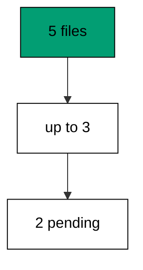

Up-to-version is not skipping: versions four and five still run later, in order. The pin only says where this database stops today.

**`learning/code/ex-15-up-to-a-specific-version/main.go`**:

```go
// => Shared driver: every unit in this course opens with this prelude.
// => The harness network is closed, so units carry a small standard-library
// => driver that applies the same goose SQL files `goose up` would apply.
// => The files, the history table shape, and the ordering rules are goose's
// => own; the driver only replaces the network-dependent binary.
package main // => every unit is one runnable program

import ( // => standard library only: no third-party modules
	"bufio"           // => bufio frames protocol messages over the TCP stream
	"encoding/binary" // => binary lays out length-prefixed protocol fields
	"fmt"             // => fmt prints the deterministic transcript only
	"io"              // => io forces full reads of split protocol messages
	"net"             // => net dials the harness Postgres service over TCP
	"os"              // => os reads the harness database address, never hardcoded
	"sort"            // => sort orders migration files, never trusts directory order
	"strings"         // => strings splits the goose Up and Down annotations
) // => every import used by driver and units

// => The database address comes from the harness, with local-run defaults.
func addr() (string, string, string) { // => one helper owns every address default
	host := os.Getenv("PGHOST") // => service hostname in the unit network
	if host == "" {             // => empty means a local run outside the harness
		host = "postgres" // => same default the Python courses use
	} // => end addr: empty means a local run outside the harness
	user := os.Getenv("PGUSER") // => trust-auth role, no password needed
	if user == "" {             // => empty means a local run outside the harness
		user = "postgres" // => same default the Python courses use
	} // => end addr: empty means a local run outside the harness
	db := os.Getenv("PGDATABASE") // => fresh database for every unit run
	if db == "" {                 // => empty means a local run outside the harness
		db = "postgres" // => same default the Python courses use
	} // => end addr: empty means a local run outside the harness
	return host, user, db // => callers never re-read the environment
} // => end addr: one helper owns every address default

// => conn wraps one TCP connection plus a buffered reader for message frames.
type conn struct { // => a tiny struct keeps the socket and the framer together
	c net.Conn      // => the raw TCP socket to the Postgres service
	r *bufio.Reader // => buffered reads frame messages split across packets
} // => end type conn: socket and framer travel together

// => readMsg reads one backend message: a type byte plus a length body.
func (k *conn) readMsg() (byte, []byte, error) { // => every response flows through here
	head := make([]byte, 5)                           // => one type byte plus one int32 length
	if _, err := io.ReadFull(k.r, head); err != nil { // => fragments reassemble before framing
		return 0, nil, err // => no partial message is ever trusted
	} // => end readMsg: fragments reassemble before framing
	n := int(binary.BigEndian.Uint32(head[1:])) - 4   // => length counts itself, not the type
	body := make([]byte, n)                           // => exact-size body, never over-read
	if _, err := io.ReadFull(k.r, body); err != nil { // => fragments reassemble before framing
		return 0, nil, err // => no partial message is ever trusted
	} // => end readMsg: fragments reassemble before framing
	return head[0], body, nil // => type byte tells the caller what arrived
} // => end readMsg: every response flows through here

// => sendMsg writes one frontend message: a type byte plus a length body.
func (k *conn) sendMsg(t byte, body []byte) error { // => startup is the only typeless message
	out := []byte{t}                                      // => type byte leads every message
	lenb := make([]byte, 4)                               // => four bytes carry the length
	binary.BigEndian.PutUint32(lenb, uint32(len(body)+4)) // => length counts itself
	out = append(out, lenb...)                            // => length follows the type byte
	out = append(out, body...)                            // => payload closes the message
	_, err := k.c.Write(out)                              // => one write keeps frames whole
	return err                                            // => write errors fail the unit loudly
} // => end sendMsg: startup is the only typeless message

// => connect opens the service database and waits for session readiness.
func connect() (*conn, error) { // => every unit starts from this one helper
	host, user, db := addr()         // => harness address, never hardcoded
	return connectDb(host, user, db) // => one path opens every session
} // => end connect: every unit starts from this one helper

// => connectDb opens a named database on the same host for multi-db drills.
func connectDb(host, user, db string) (*conn, error) { // => environments are databases, not servers
	c, err := net.Dial("tcp", host+":5432") // => Postgres listens on 5432
	if err != nil {                         // => unreachable service is fatal
		return nil, err // => no fallback: the harness owns the database
	} // => end connectDb: unreachable service is fatal
	k := &conn{c: c, r: bufio.NewReader(c)}             // => buffer the fresh socket at once
	body := []byte{}                                    // => startup body is parameters only
	body = append(body, 0, 0, 0, 0)                     // => placeholder for the length prefix
	body = append(body, 0, 3, 0, 0)                     // => protocol 3.0, the stable version
	body = append(body, []byte("user")...)              // => user key starts the parameters
	body = append(body, 0)                              // => keys and values are NUL-separated
	body = append(body, []byte(user)...)                // => trust-auth role from the harness
	body = append(body, 0)                              // => NUL ends the value
	body = append(body, []byte("database")...)          // => database key follows the user
	body = append(body, 0)                              // => NUL ends the key
	body = append(body, []byte(db)...)                  // => fresh database for every unit run
	body = append(body, 0)                              // => NUL ends the value
	body = append(body, 0)                              // => empty key ends the parameters
	binary.BigEndian.PutUint32(body, uint32(len(body))) // => startup length counts itself
	if _, err := c.Write(body); err != nil {            // => startup is the only typeless message
		return nil, err // => unwritable socket is fatal
	} // => end connectDb: startup is the only typeless message
	for { // => drain until the session is ready for queries
		t, b, err := k.readMsg() // => every backend message flows through here
		if err != nil {          // => broken handshake is fatal
			return nil, err // => no half-open session is ever used
		} // => end connectDb: broken handshake is fatal
		switch t { // => only three message kinds matter during startup
		case 'R': // => authentication response arrives first
			if binary.BigEndian.Uint32(b) != 0 { // => nonzero means a password is wanted
				return nil, fmt.Errorf("server wants a password") // => trust auth never asks
			} // => end connectDb: nonzero means a password is wanted
		case 'E': // => an error ends the handshake with the server text
			return nil, fmt.Errorf("startup: %s", errText(b)) // => server text explains the cause
		case 'Z': // => ReadyForQuery means the session accepts queries
			return k, nil // => handshake done: hand the live session back
		} // => end connectDb: only three message kinds matter during startup
	} // => end connectDb: drain until the session is ready for queries
} // => end connectDb: environments are databases, not servers

// => errText extracts the human message (field M) from an ErrorResponse.
func errText(b []byte) string { // => one helper decodes every server error
	parts := strings.Split(string(b), "\x00") // => fields are NUL-separated pairs
	for i := 0; i+1 < len(parts); i += 2 {    // => walk code and value together
		if parts[i] == "M" { // => M is the primary human message
			return parts[i+1] // => return the message, skip the detail fields
		} // => end errText: M is the primary human message
	} // => end errText: walk code and value together
	return "unknown error" // => malformed errors still fail with a fixed line
} // => end errText: one helper decodes every server error

// => run sends one SQL string and returns every data row plus the command tag.
func (k *conn) run(q string) ([][]string, string, error) { // => one path runs every statement
	body := append([]byte(q), 0)                 // => Query messages are NUL-terminated
	if err := k.sendMsg('Q', body); err != nil { // => send fails loudly, never silently
		return nil, "", err // => unwritable socket ends the unit
	} // => end run: send fails loudly, never silently
	var rows [][]string // => data rows accumulate across result sets
	tag := ""           // => the last command tag (SELECT 3, CREATE TABLE...)
	for {               // => drain until ReadyForQuery closes this query string
		t, b, err := k.readMsg() // => every response flows through the framer
		if err != nil {          // => broken mid-query connection is fatal
			return nil, "", err // => partial results are never returned
		} // => end run: broken mid-query connection is fatal
		switch t { // => four message kinds carry a simple-query response
		case 'T', 'N', 'A', 'S', 'K': // => metadata the transcript never prints
		case 'D': // => one data row arrived
			rows = append(rows, parseRow(b)) // => decode the text columns now
		case 'C': // => one statement finished
			tag = strings.TrimRight(string(b[:len(b)-1]), "\x00") // => tag names what ran
		case 'E': // => the statement failed
			drain(k)                                     // => finish the failed query before reuse
			return nil, "", fmt.Errorf("%s", errText(b)) // => server text becomes the failure
		case 'Z': // => ReadyForQuery ends this query string
			return rows, tag, nil // => rows, tag, and a clean session
		} // => end run: four message kinds carry a simple-query response
	} // => end run: drain until ReadyForQuery closes this query string
} // => end run: one path runs every statement

// => drain reads to the next ReadyForQuery after a statement error.
func drain(k *conn) { // => an errored query still owns the socket until Z
	for { // => loop until the session is reusable
		t, _, err := k.readMsg()    // => discard every message after the error
		if err != nil || t == 'Z' { // => socket break or ready both end the drain
			return // => caller decides the failure, the drain only resynchronizes
		} // => end drain: socket break or ready both end the drain
	} // => end drain: loop until the session is reusable
} // => end drain: an errored query still owns the socket until Z

// => parseRow decodes one DataRow body into text columns, NULL as "NULL".
func parseRow(b []byte) []string { // => one helper decodes every returned row
	n := int(binary.BigEndian.Uint16(b)) // => column count leads the body
	b = b[2:]                            // => step past the count
	out := make([]string, 0, n)          // => pre-size the row to the count
	for i := 0; i < n; i++ {             // => walk each column in order
		l := int(int32(binary.BigEndian.Uint32(b))) // => -1 marks NULL, else the length
		b = b[4:]                                   // => step past the length
		if l < 0 {                                  // => NULL has no bytes to read
			out = append(out, "NULL") // => fixed word keeps transcripts stable
			continue                  // => next column, no bytes consumed
		} // => end parseRow: NULL has no bytes to read
		out = append(out, string(b[:l])) // => text format is already printable
		b = b[l:]                        // => step past the value bytes
	} // => end parseRow: walk each column in order
	return out // => one row, fully decoded
} // => end parseRow: one helper decodes every returned row

// => must runs SQL or exits nonzero with the server text on standard error.
func must(k *conn, q string) [][]string { // => setup statements never fail quietly
	rows, _, err := k.run(q) // => rows return for verification queries
	if err != nil {          // => any server error is fatal to the unit
		fmt.Fprintln(os.Stderr, "sql error:", err) // => errors go to stderr, never stdout
		os.Exit(1)                                 // => nonzero exit fails the harness check
	} // => end must: any server error is fatal to the unit
	return rows // => callers print only what the lesson asserts
} // => end must: setup statements never fail quietly

// => try runs SQL and returns the server error text instead of exiting.
func try(k *conn, q string) ([][]string, string) { // => failure drills inspect errors, not die
	rows, _, err := k.run(q) // => same path as must, opposite failure policy
	if err != nil {          // => expected errors become transcript lines
		return nil, err.Error() // => fixed server text, never timings
	} // => end try: expected errors become transcript lines
	return rows, "" // => empty error means the statement succeeded
} // => end try: failure drills inspect errors, not die

// => mig holds one goose SQL file: its version, name, and Up/Down sections.
type mig struct { // => mirrors the goose file layout the lesson teaches
	version string   // => zero-padded number orders history, like goose
	name    string   // => human slug after the version number
	up      []string // => forward statements, run inside one transaction
	down    []string // => reverse statements, run inside one transaction
	noTx    bool     // => NO TRANSACTION files run outside one, like goose
} // => end type mig: version, name, sections, and mode

// => parseGoose splits one goose SQL file into its Up and Down statements.
func parseGoose(text string) (up, down []string, noTx bool) { // => the lesson asserts this exact split
	section := ""                                    // => nothing belongs outside the annotations
	for _, line := range strings.Split(text, "\n") { // => walk the file line by line
		t := strings.TrimSpace(line) // => annotation matching ignores indentation
		switch t {                   // => four annotation lines switch sections
		case "-- +goose Up": // => forward section starts here, like goose
			section = "up" // => following statements migrate forward
			continue       // => the annotation itself never runs
		case "-- +goose Down": // => reverse section starts here, like goose
			section = "down" // => following statements roll back
			continue         // => the annotation itself never runs
		case "-- +goose NO TRANSACTION": // => concurrent work cannot run inside one
			noTx = true // => remember the file opts out of the transaction
			continue    // => the annotation itself never runs
		} // => end parseGoose: four annotation lines switch sections
		if strings.HasPrefix(t, "--") || t == "" { // => comments and blanks never run
			continue // => only real statements reach the database
		} // => end parseGoose: comments and blanks never run
		if section == "up" { // => route by the annotation seen above
			up = append(up, line) // => keep the original line for the file write
		} else if section == "down" { // => down statements collect separately
			down = append(down, line) // => keep the original line for the file write
		} // => end parseGoose: down statements collect separately
	} // => end parseGoose: walk the file line by line
	return splitStmts(strings.Join(up, "\n")), splitStmts(strings.Join(down, "\n")), noTx // => one string per statement
} // => end parseGoose: the lesson asserts this exact split

// => splitStmts cuts statement text on semicolons outside quotes.
func splitStmts(s string) []string { // => multi-line statements stay whole until ;
	var out []string        // => finished statements accumulate here
	var cur strings.Builder // => the statement under construction
	inStr := false          // => semicolons inside quotes never split
	for _, r := range s {   // => walk rune by rune, quotes included
		switch { // => quote tracking decides what a semicolon means
		case r == '\'': // => a quote toggles string mode
			inStr = !inStr   // => enter or leave the quoted region
			cur.WriteRune(r) // => the quote belongs to the statement
		case r == ';' && !inStr: // => a bare semicolon ends one statement
			if t := strings.TrimSpace(cur.String()); t != "" { // => skip empty fragments
				out = append(out, t) // => store the finished statement
			} // => end splitStmts: skip empty fragments
			cur.Reset() // => start the next statement fresh
		default: // => every other rune belongs to the current statement
			cur.WriteRune(r) // => accumulate verbatim
		} // => end splitStmts: quote tracking decides what a semicolon means
	} // => end splitStmts: walk rune by rune, quotes included
	if t := strings.TrimSpace(cur.String()); t != "" { // => trailing text without ; still counts
		out = append(out, t) // => last statement needs no semicolon
	} // => end splitStmts: trailing text without ; still counts
	return out // => callers run each statement in order
} // => end splitStmts: multi-line statements stay whole until ;

// => ensureHistory creates the goose history table once per unit run.
func ensureHistory(k *conn) { // => goose_db_version is goose's own default name
	must(k, `CREATE TABLE IF NOT EXISTS goose_db_version (`+ // => reruns never fail here
		`id integer PRIMARY KEY GENERATED BY DEFAULT AS IDENTITY, `+ // => surrogate key, never printed
		`version_id bigint NOT NULL, `+ // => applied version numbers live here
		`is_applied boolean NOT NULL, `+ // => goose marks rows applied on success
		`tstamp timestamp NOT NULL DEFAULT now())`) // => timestamp defaults, never printed
} // => end ensureHistory: goose_db_version is goose's own default name

// => appliedVersions returns the version numbers already marked applied.
func appliedVersions(k *conn) map[int64]bool { // => history decides what still needs running
	rows := must(k, `SELECT version_id FROM goose_db_version `+ // => only the numbers matter
		`WHERE is_applied ORDER BY version_id`) // => order keeps the transcript stable
	got := map[int64]bool{}  // => set lookup answers "already applied" fast
	for _, r := range rows { // => one row per applied migration
		var v int64                // => version numbers are integers
		fmt.Sscanf(r[0], "%d", &v) // => text format parses back to a number
		got[v] = true              // => mark this version done
	} // => end appliedVersions: one row per applied migration
	return got // => callers skip whatever history already holds
} // => end appliedVersions: history decides what still needs running

// => applyUp runs every pending migration forward, one transaction each.
func applyUp(k *conn, ms []mig) { // => files on disk are already the source of truth
	done := appliedVersions(k) // => history decides what still needs running
	for _, m := range ms {     // => file order is version order, sorted by the caller
		var v int64                     // => versions compare as numbers
		fmt.Sscanf(m.version, "%d", &v) // => zero-padded file prefix parses back
		if done[v] {                    // => applied migrations never run twice
			continue // => idempotent reruns skip straight past
		} // => end applyUp: applied migrations never run twice
		if !m.noTx { // => transactional files wrap everything in one unit
			must(k, "BEGIN") // => one migration is one transaction, like goose
		} // => end applyUp: transactional files wrap everything in one unit
		for _, s := range m.up { // => forward statements run in file order
			must(k, s) // => any failure aborts the unit before COMMIT
		} // => end applyUp: forward statements run in file order
		if !m.noTx { // => stamps join the same transaction they describe
			must(k, fmt.Sprintf(`INSERT INTO goose_db_version `+ // => stamp only after success
				`(version_id, is_applied) VALUES (%d, true)`, v)) // => stamp mirrors goose exactly
			must(k, "COMMIT") // => history row and schema land together
		} else { // => concurrent statements cannot share a transaction
			must(k, fmt.Sprintf(`INSERT INTO goose_db_version `+ // => stamp follows the work
				`(version_id, is_applied) VALUES (%d, true)`, v)) // => same row, separate statement
		} // => end applyUp: concurrent statements cannot share a transaction
	} // => end applyUp: file order is version order, sorted by the caller
} // => end applyUp: files on disk are already the source of truth

// => applyDown rolls back the newest applied migrations, newest first.
func applyDown(k *conn, ms []mig, steps int) { // => steps bounds how far history rewinds
	done := appliedVersions(k) // => history decides what can roll back
	var todo []mig             // => applied migrations in version order first
	for _, m := range ms {     // => walk the whole known history
		var v int64                     // => versions compare as numbers
		fmt.Sscanf(m.version, "%d", &v) // => zero-padded file prefix parses back
		if done[v] {                    // => only applied migrations roll back
			todo = append(todo, m) // => keep the migration for the reverse pass
		} // => end applyDown: only applied migrations roll back
	} // => end applyDown: walk the whole known history
	for i := len(todo) - 1; i >= 0 && steps > 0; i-- { // => newest applied goes first
		m := todo[i]                    // => this migration rolls back now
		var v int64                     // => versions compare as numbers
		fmt.Sscanf(m.version, "%d", &v) // => zero-padded file prefix parses back
		if !m.noTx {                    // => transactional files wrap the rollback too
			must(k, "BEGIN") // => reverse change is atomic, like the forward one
		} // => end applyDown: transactional files wrap the rollback too
		for _, s := range m.down { // => reverse statements run in file order
			must(k, s) // => any failure aborts before the history row moves
		} // => end applyDown: reverse statements run in file order
		must(k, fmt.Sprintf(`DELETE FROM goose_db_version `+ // => unstamped only after success
			`WHERE version_id = %d`, v)) // => the version leaves history exactly once
		if !m.noTx { // => close the transaction the rollback opened
			must(k, "COMMIT") // => schema reversal and unstamp land together
		} // => end applyDown: close the transaction the rollback opened
		steps-- // => one rollback consumed from the budget
	} // => end applyDown: newest applied goes first
} // => end applyDown: steps bounds how far history rewinds

// => statusCounts splits known migrations into applied and pending lists.
func statusCounts(k *conn, ms []mig) (applied, pending []string) { // => goose status in two lists
	done := appliedVersions(k) // => history decides which list each version joins
	for _, m := range ms {     // => walk the known history in version order
		var v int64                     // => versions compare as numbers
		fmt.Sscanf(m.version, "%d", &v) // => zero-padded file prefix parses back
		if done[v] {                    // => stamped versions are done
			applied = append(applied, m.version) // => keep the version string for printing
		} else { // => unstamped versions still wait
			pending = append(pending, m.version) // => keep the version string for printing
		} // => end statusCounts: unstamped versions still wait
	} // => end statusCounts: walk the known history in version order
	return applied, pending // => callers print both lists in one stable line each
} // => end statusCounts: goose status in two lists

// => files writes each migration as a real goose SQL file under dir.
func files(dir string, ms []mig) { // => the lesson shows these files byte-identically
	for _, m := range ms { // => one file per migration, like `goose create`
		name := fmt.Sprintf("%s_%s.sql", m.version, m.name) // => goose names files version-first
		var b strings.Builder                               // => build the file text in order
		if m.noTx {                                         // => concurrent files announce it first
			b.WriteString("-- +goose NO TRANSACTION\n") // => goose honors this exact annotation
		} // => end files: concurrent files announce it first
		b.WriteString("-- +goose Up\n") // => forward annotation leads
		for _, s := range m.up {        // => forward statements follow
			b.WriteString(s + ";\n") // => one statement per line, semicolon-closed
		} // => end files: forward statements follow
		b.WriteString("-- +goose Down\n") // => reverse annotation splits the file
		for _, s := range m.down {        // => reverse statements close the file
			b.WriteString(s + ";\n") // => one statement per line, semicolon-closed
		} // => end files: reverse statements close the file
		if err := os.WriteFile(dir+"/"+name, []byte(b.String()), 0644); err != nil { // => real files, like goose
			fmt.Fprintln(os.Stderr, "write error:", err) // => write errors fail loudly
			os.Exit(1)                                   // => no half-written migration set
		} // => end files: real files, like goose
	} // => end files: one file per migration, like `goose create`
} // => end files: the lesson shows these files byte-identically

// => versions lists migration files in version order from dir.
func versions(dir string) []mig { // => directory order is never trusted for history
	ents, err := os.ReadDir(dir) // => read the whole migrations directory
	if err != nil {              // => unreadable directory is fatal
		fmt.Fprintln(os.Stderr, "read error:", err) // => errors go to stderr
		os.Exit(1)                                  // => nonzero exit fails the check
	} // => end versions: unreadable directory is fatal
	names := []string{}      // => collect names before sorting
	for _, e := range ents { // => walk every directory entry
		if !e.IsDir() && strings.HasSuffix(e.Name(), ".sql") { // => only goose SQL files count
			names = append(names, e.Name()) // => keep the file name for parsing
		} // => end versions: only goose SQL files count
	} // => end versions: walk every directory entry
	sort.Strings(names)       // => zero-padded versions sort chronologically
	var out []mig             // => parsed migrations accumulate here
	for _, n := range names { // => parse in version order
		raw, err := os.ReadFile(dir + "/" + n) // => read the real file back
		if err != nil {                        // => unreadable file is fatal
			fmt.Fprintln(os.Stderr, "read error:", err) // => errors go to stderr
			os.Exit(1)                                  // => nonzero exit fails the check
		} // => end versions: unreadable file is fatal
		up, down, noTx := parseGoose(string(raw))                                            // => split on the goose annotations
		rest := strings.TrimSuffix(n, ".sql")                                                // => strip the extension first
		ver := rest[:5]                                                                      // => first five digits are the version
		out = append(out, mig{version: ver, name: rest[6:], up: up, down: down, noTx: noTx}) // => keep every part
	} // => end versions: parse in version order
	return out // => version-ordered migrations, ready to apply
} // => end versions: directory order is never trusted for history

// => findDupes returns version numbers claimed by two or more files.
func findDupes(dir string) []string { // => goose refuses duplicate versions outright
	ents, err := os.ReadDir(dir) // => read the whole migrations directory
	if err != nil {              // => unreadable directory is fatal
		fmt.Fprintln(os.Stderr, "read error:", err) // => errors go to stderr
		os.Exit(1)                                  // => nonzero exit fails the check
	} // => end findDupes: unreadable directory is fatal
	seen := map[string]int{} // => count claims per five-digit version prefix
	for _, e := range ents { // => walk every directory entry
		if !e.IsDir() && strings.HasSuffix(e.Name(), ".sql") { // => only goose SQL files count
			seen[e.Name()[:5]]++ // => first five digits are the version
		} // => end findDupes: only goose SQL files count
	} // => end findDupes: walk every directory entry
	var out []string         // => duplicates accumulate in version order
	for _, e := range ents { // => second pass keeps the order stable
		if !e.IsDir() && strings.HasSuffix(e.Name(), ".sql") { // => only goose SQL files count
			if v := e.Name()[:5]; seen[v] > 1 { // => claimed more than once
				out = append(out, v) // => keep the version string for printing
				seen[v] = 0          // => report each duplicate version only once
			} // => end findDupes: claimed more than once
		} // => end findDupes: only goose SQL files count
	} // => end findDupes: second pass keeps the order stable
	return out // => empty means the history numbers are unique
} // => end findDupes: goose refuses duplicate versions outright

func main() {
	k, err := connect() // => one session runs the whole example
	if err != nil {     // => unreachable database fails loudly
		fmt.Fprintln(os.Stderr, "connect error:", err) // => connection errors go to stderr
		os.Exit(1)                                     // => nonzero exit fails the check
	}
	defer k.c.Close() // => the socket closes when the example ends
	// => A scratch migrations directory: goose files live here, never in the unit.
	// => the scratch path never reaches stdout, so reruns stay byte-stable
	dir, err := os.MkdirTemp("", "ex15-") // => private directory, like `goose create`
	if err != nil {                       // => unmakable temp dir is fatal
		fmt.Fprintln(os.Stderr, "temp error:", err) // => errors go to stderr
		os.Exit(1)                                  // => nonzero exit fails the check
	}
	defer os.RemoveAll(dir)                          // => scratch files vanish; only transcripts remain
	must(k, "DROP TABLE IF EXISTS ex15_t1")          // => leftovers of a killed run vanish
	must(k, "DROP TABLE IF EXISTS ex15_t2")          // => leftovers of a killed run vanish
	must(k, "DROP TABLE IF EXISTS ex15_t3")          // => leftovers of a killed run vanish
	must(k, "DROP TABLE IF EXISTS goose_db_version") // => stale history vanishes too
	ensureHistory(k)                                 // => goose history table, real shape
	files(dir, []mig{                                // => five files, three applied
		{version: "00001", name: "t1", // => first link in the chain
			up:   []string{"CREATE TABLE ex15_t1 (id SERIAL PRIMARY KEY)"}, // => forward change
			down: []string{"DROP TABLE ex15_t1"}},                          // => exact reverse for rollback
		{version: "00002", name: "t2", // => second link in the chain
			up:   []string{"CREATE TABLE ex15_t2 (id SERIAL PRIMARY KEY)"}, // => forward change
			down: []string{"DROP TABLE ex15_t2"}},                          // => exact reverse for rollback
		{version: "00003", name: "t3", // => third link in the chain
			up:   []string{"CREATE TABLE ex15_t3 (id SERIAL PRIMARY KEY)"}, // => forward change
			down: []string{"DROP TABLE ex15_t3"}},                          // => exact reverse for rollback
		{version: "00004", name: "t4", // => fourth link, stays pending
			up:   []string{"CREATE TABLE ex15_t4 (id SERIAL PRIMARY KEY)"}, // => forward change
			down: []string{"DROP TABLE ex15_t4"}},                          // => exact reverse for rollback
		{version: "00005", name: "t5", // => fifth link, stays pending
			up:   []string{"CREATE TABLE ex15_t5 (id SERIAL PRIMARY KEY)"}, // => forward change
			down: []string{"DROP TABLE ex15_t5"}},                          // => exact reverse for rollback
	})
	ms := versions(dir)                              // => parse the files back, like goose would
	applyUp(k, ms[:3])                               // => pin the database at version three
	a, p := statusCounts(k, ms)                      // => split history into applied and pending
	fmt.Println("applied:", strings.Join(a, ","))    // => Output: applied: 00001,00002,00003
	fmt.Println("pending:", strings.Join(p, ","))    // => Output: pending: 00004,00005
	fmt.Println("cleaned: yes")                      // => Output: cleaned: yes
	must(k, "DROP TABLE IF EXISTS ex15_t1")          // => leftovers of a killed run vanish
	must(k, "DROP TABLE IF EXISTS ex15_t2")          // => leftovers of a killed run vanish
	must(k, "DROP TABLE IF EXISTS ex15_t3")          // => leftovers of a killed run vanish
	must(k, "DROP TABLE IF EXISTS goose_db_version") // => the example leaves no history behind
}
```

**Output** (`learning/code/ex-15-up-to-a-specific-version/expected/main.stdout.txt`):

```text
applied: 00001,00002,00003
pending: 00004,00005
cleaned: yes
```

**Key takeaway**: Name the version to stop at; later files stay pending until a later run asks for them.

**Why it matters**: Partial progress is a recorded position, not a mystery. Pinning at a version lets staging, canaries, and paused windows all say exactly where they stand. The next run resumes from the pin instead of rediscovering it, and nobody asks what already ran. Explicit positions also make handoffs safe: the next operator resumes from the pin instead of rediscovering it.

### Example 16: Down to a Specific Version

Rollbacks can stop partway too: this example applies five migrations, rolls back the newest two, and shows three tables standing with two pending. Partial rollback is how teams retreat one deploy without abandoning the release. (Concepts: co-02, co-08.)

Down-to-version keeps the survivors stamped: versions one through three stay applied and only four and five lose their stamps.

**`learning/code/ex-16-down-to-a-specific-version/main.go`**:

```go
// => Shared driver: every unit in this course opens with this prelude.
// => The harness network is closed, so units carry a small standard-library
// => driver that applies the same goose SQL files `goose up` would apply.
// => The files, the history table shape, and the ordering rules are goose's
// => own; the driver only replaces the network-dependent binary.
package main // => every unit is one runnable program

import ( // => standard library only: no third-party modules
	"bufio"           // => bufio frames protocol messages over the TCP stream
	"encoding/binary" // => binary lays out length-prefixed protocol fields
	"fmt"             // => fmt prints the deterministic transcript only
	"io"              // => io forces full reads of split protocol messages
	"net"             // => net dials the harness Postgres service over TCP
	"os"              // => os reads the harness database address, never hardcoded
	"sort"            // => sort orders migration files, never trusts directory order
	"strings"         // => strings splits the goose Up and Down annotations
) // => every import used by driver and units

// => The database address comes from the harness, with local-run defaults.
func addr() (string, string, string) { // => one helper owns every address default
	host := os.Getenv("PGHOST") // => service hostname in the unit network
	if host == "" {             // => empty means a local run outside the harness
		host = "postgres" // => same default the Python courses use
	} // => end addr: empty means a local run outside the harness
	user := os.Getenv("PGUSER") // => trust-auth role, no password needed
	if user == "" {             // => empty means a local run outside the harness
		user = "postgres" // => same default the Python courses use
	} // => end addr: empty means a local run outside the harness
	db := os.Getenv("PGDATABASE") // => fresh database for every unit run
	if db == "" {                 // => empty means a local run outside the harness
		db = "postgres" // => same default the Python courses use
	} // => end addr: empty means a local run outside the harness
	return host, user, db // => callers never re-read the environment
} // => end addr: one helper owns every address default

// => conn wraps one TCP connection plus a buffered reader for message frames.
type conn struct { // => a tiny struct keeps the socket and the framer together
	c net.Conn      // => the raw TCP socket to the Postgres service
	r *bufio.Reader // => buffered reads frame messages split across packets
} // => end type conn: socket and framer travel together

// => readMsg reads one backend message: a type byte plus a length body.
func (k *conn) readMsg() (byte, []byte, error) { // => every response flows through here
	head := make([]byte, 5)                           // => one type byte plus one int32 length
	if _, err := io.ReadFull(k.r, head); err != nil { // => fragments reassemble before framing
		return 0, nil, err // => no partial message is ever trusted
	} // => end readMsg: fragments reassemble before framing
	n := int(binary.BigEndian.Uint32(head[1:])) - 4   // => length counts itself, not the type
	body := make([]byte, n)                           // => exact-size body, never over-read
	if _, err := io.ReadFull(k.r, body); err != nil { // => fragments reassemble before framing
		return 0, nil, err // => no partial message is ever trusted
	} // => end readMsg: fragments reassemble before framing
	return head[0], body, nil // => type byte tells the caller what arrived
} // => end readMsg: every response flows through here

// => sendMsg writes one frontend message: a type byte plus a length body.
func (k *conn) sendMsg(t byte, body []byte) error { // => startup is the only typeless message
	out := []byte{t}                                      // => type byte leads every message
	lenb := make([]byte, 4)                               // => four bytes carry the length
	binary.BigEndian.PutUint32(lenb, uint32(len(body)+4)) // => length counts itself
	out = append(out, lenb...)                            // => length follows the type byte
	out = append(out, body...)                            // => payload closes the message
	_, err := k.c.Write(out)                              // => one write keeps frames whole
	return err                                            // => write errors fail the unit loudly
} // => end sendMsg: startup is the only typeless message

// => connect opens the service database and waits for session readiness.
func connect() (*conn, error) { // => every unit starts from this one helper
	host, user, db := addr()         // => harness address, never hardcoded
	return connectDb(host, user, db) // => one path opens every session
} // => end connect: every unit starts from this one helper

// => connectDb opens a named database on the same host for multi-db drills.
func connectDb(host, user, db string) (*conn, error) { // => environments are databases, not servers
	c, err := net.Dial("tcp", host+":5432") // => Postgres listens on 5432
	if err != nil {                         // => unreachable service is fatal
		return nil, err // => no fallback: the harness owns the database
	} // => end connectDb: unreachable service is fatal
	k := &conn{c: c, r: bufio.NewReader(c)}             // => buffer the fresh socket at once
	body := []byte{}                                    // => startup body is parameters only
	body = append(body, 0, 0, 0, 0)                     // => placeholder for the length prefix
	body = append(body, 0, 3, 0, 0)                     // => protocol 3.0, the stable version
	body = append(body, []byte("user")...)              // => user key starts the parameters
	body = append(body, 0)                              // => keys and values are NUL-separated
	body = append(body, []byte(user)...)                // => trust-auth role from the harness
	body = append(body, 0)                              // => NUL ends the value
	body = append(body, []byte("database")...)          // => database key follows the user
	body = append(body, 0)                              // => NUL ends the key
	body = append(body, []byte(db)...)                  // => fresh database for every unit run
	body = append(body, 0)                              // => NUL ends the value
	body = append(body, 0)                              // => empty key ends the parameters
	binary.BigEndian.PutUint32(body, uint32(len(body))) // => startup length counts itself
	if _, err := c.Write(body); err != nil {            // => startup is the only typeless message
		return nil, err // => unwritable socket is fatal
	} // => end connectDb: startup is the only typeless message
	for { // => drain until the session is ready for queries
		t, b, err := k.readMsg() // => every backend message flows through here
		if err != nil {          // => broken handshake is fatal
			return nil, err // => no half-open session is ever used
		} // => end connectDb: broken handshake is fatal
		switch t { // => only three message kinds matter during startup
		case 'R': // => authentication response arrives first
			if binary.BigEndian.Uint32(b) != 0 { // => nonzero means a password is wanted
				return nil, fmt.Errorf("server wants a password") // => trust auth never asks
			} // => end connectDb: nonzero means a password is wanted
		case 'E': // => an error ends the handshake with the server text
			return nil, fmt.Errorf("startup: %s", errText(b)) // => server text explains the cause
		case 'Z': // => ReadyForQuery means the session accepts queries
			return k, nil // => handshake done: hand the live session back
		} // => end connectDb: only three message kinds matter during startup
	} // => end connectDb: drain until the session is ready for queries
} // => end connectDb: environments are databases, not servers

// => errText extracts the human message (field M) from an ErrorResponse.
func errText(b []byte) string { // => one helper decodes every server error
	parts := strings.Split(string(b), "\x00") // => fields are NUL-separated pairs
	for i := 0; i+1 < len(parts); i += 2 {    // => walk code and value together
		if parts[i] == "M" { // => M is the primary human message
			return parts[i+1] // => return the message, skip the detail fields
		} // => end errText: M is the primary human message
	} // => end errText: walk code and value together
	return "unknown error" // => malformed errors still fail with a fixed line
} // => end errText: one helper decodes every server error

// => run sends one SQL string and returns every data row plus the command tag.
func (k *conn) run(q string) ([][]string, string, error) { // => one path runs every statement
	body := append([]byte(q), 0)                 // => Query messages are NUL-terminated
	if err := k.sendMsg('Q', body); err != nil { // => send fails loudly, never silently
		return nil, "", err // => unwritable socket ends the unit
	} // => end run: send fails loudly, never silently
	var rows [][]string // => data rows accumulate across result sets
	tag := ""           // => the last command tag (SELECT 3, CREATE TABLE...)
	for {               // => drain until ReadyForQuery closes this query string
		t, b, err := k.readMsg() // => every response flows through the framer
		if err != nil {          // => broken mid-query connection is fatal
			return nil, "", err // => partial results are never returned
		} // => end run: broken mid-query connection is fatal
		switch t { // => four message kinds carry a simple-query response
		case 'T', 'N', 'A', 'S', 'K': // => metadata the transcript never prints
		case 'D': // => one data row arrived
			rows = append(rows, parseRow(b)) // => decode the text columns now
		case 'C': // => one statement finished
			tag = strings.TrimRight(string(b[:len(b)-1]), "\x00") // => tag names what ran
		case 'E': // => the statement failed
			drain(k)                                     // => finish the failed query before reuse
			return nil, "", fmt.Errorf("%s", errText(b)) // => server text becomes the failure
		case 'Z': // => ReadyForQuery ends this query string
			return rows, tag, nil // => rows, tag, and a clean session
		} // => end run: four message kinds carry a simple-query response
	} // => end run: drain until ReadyForQuery closes this query string
} // => end run: one path runs every statement

// => drain reads to the next ReadyForQuery after a statement error.
func drain(k *conn) { // => an errored query still owns the socket until Z
	for { // => loop until the session is reusable
		t, _, err := k.readMsg()    // => discard every message after the error
		if err != nil || t == 'Z' { // => socket break or ready both end the drain
			return // => caller decides the failure, the drain only resynchronizes
		} // => end drain: socket break or ready both end the drain
	} // => end drain: loop until the session is reusable
} // => end drain: an errored query still owns the socket until Z

// => parseRow decodes one DataRow body into text columns, NULL as "NULL".
func parseRow(b []byte) []string { // => one helper decodes every returned row
	n := int(binary.BigEndian.Uint16(b)) // => column count leads the body
	b = b[2:]                            // => step past the count
	out := make([]string, 0, n)          // => pre-size the row to the count
	for i := 0; i < n; i++ {             // => walk each column in order
		l := int(int32(binary.BigEndian.Uint32(b))) // => -1 marks NULL, else the length
		b = b[4:]                                   // => step past the length
		if l < 0 {                                  // => NULL has no bytes to read
			out = append(out, "NULL") // => fixed word keeps transcripts stable
			continue                  // => next column, no bytes consumed
		} // => end parseRow: NULL has no bytes to read
		out = append(out, string(b[:l])) // => text format is already printable
		b = b[l:]                        // => step past the value bytes
	} // => end parseRow: walk each column in order
	return out // => one row, fully decoded
} // => end parseRow: one helper decodes every returned row

// => must runs SQL or exits nonzero with the server text on standard error.
func must(k *conn, q string) [][]string { // => setup statements never fail quietly
	rows, _, err := k.run(q) // => rows return for verification queries
	if err != nil {          // => any server error is fatal to the unit
		fmt.Fprintln(os.Stderr, "sql error:", err) // => errors go to stderr, never stdout
		os.Exit(1)                                 // => nonzero exit fails the harness check
	} // => end must: any server error is fatal to the unit
	return rows // => callers print only what the lesson asserts
} // => end must: setup statements never fail quietly

// => try runs SQL and returns the server error text instead of exiting.
func try(k *conn, q string) ([][]string, string) { // => failure drills inspect errors, not die
	rows, _, err := k.run(q) // => same path as must, opposite failure policy
	if err != nil {          // => expected errors become transcript lines
		return nil, err.Error() // => fixed server text, never timings
	} // => end try: expected errors become transcript lines
	return rows, "" // => empty error means the statement succeeded
} // => end try: failure drills inspect errors, not die

// => mig holds one goose SQL file: its version, name, and Up/Down sections.
type mig struct { // => mirrors the goose file layout the lesson teaches
	version string   // => zero-padded number orders history, like goose
	name    string   // => human slug after the version number
	up      []string // => forward statements, run inside one transaction
	down    []string // => reverse statements, run inside one transaction
	noTx    bool     // => NO TRANSACTION files run outside one, like goose
} // => end type mig: version, name, sections, and mode

// => parseGoose splits one goose SQL file into its Up and Down statements.
func parseGoose(text string) (up, down []string, noTx bool) { // => the lesson asserts this exact split
	section := ""                                    // => nothing belongs outside the annotations
	for _, line := range strings.Split(text, "\n") { // => walk the file line by line
		t := strings.TrimSpace(line) // => annotation matching ignores indentation
		switch t {                   // => four annotation lines switch sections
		case "-- +goose Up": // => forward section starts here, like goose
			section = "up" // => following statements migrate forward
			continue       // => the annotation itself never runs
		case "-- +goose Down": // => reverse section starts here, like goose
			section = "down" // => following statements roll back
			continue         // => the annotation itself never runs
		case "-- +goose NO TRANSACTION": // => concurrent work cannot run inside one
			noTx = true // => remember the file opts out of the transaction
			continue    // => the annotation itself never runs
		} // => end parseGoose: four annotation lines switch sections
		if strings.HasPrefix(t, "--") || t == "" { // => comments and blanks never run
			continue // => only real statements reach the database
		} // => end parseGoose: comments and blanks never run
		if section == "up" { // => route by the annotation seen above
			up = append(up, line) // => keep the original line for the file write
		} else if section == "down" { // => down statements collect separately
			down = append(down, line) // => keep the original line for the file write
		} // => end parseGoose: down statements collect separately
	} // => end parseGoose: walk the file line by line
	return splitStmts(strings.Join(up, "\n")), splitStmts(strings.Join(down, "\n")), noTx // => one string per statement
} // => end parseGoose: the lesson asserts this exact split

// => splitStmts cuts statement text on semicolons outside quotes.
func splitStmts(s string) []string { // => multi-line statements stay whole until ;
	var out []string        // => finished statements accumulate here
	var cur strings.Builder // => the statement under construction
	inStr := false          // => semicolons inside quotes never split
	for _, r := range s {   // => walk rune by rune, quotes included
		switch { // => quote tracking decides what a semicolon means
		case r == '\'': // => a quote toggles string mode
			inStr = !inStr   // => enter or leave the quoted region
			cur.WriteRune(r) // => the quote belongs to the statement
		case r == ';' && !inStr: // => a bare semicolon ends one statement
			if t := strings.TrimSpace(cur.String()); t != "" { // => skip empty fragments
				out = append(out, t) // => store the finished statement
			} // => end splitStmts: skip empty fragments
			cur.Reset() // => start the next statement fresh
		default: // => every other rune belongs to the current statement
			cur.WriteRune(r) // => accumulate verbatim
		} // => end splitStmts: quote tracking decides what a semicolon means
	} // => end splitStmts: walk rune by rune, quotes included
	if t := strings.TrimSpace(cur.String()); t != "" { // => trailing text without ; still counts
		out = append(out, t) // => last statement needs no semicolon
	} // => end splitStmts: trailing text without ; still counts
	return out // => callers run each statement in order
} // => end splitStmts: multi-line statements stay whole until ;

// => ensureHistory creates the goose history table once per unit run.
func ensureHistory(k *conn) { // => goose_db_version is goose's own default name
	must(k, `CREATE TABLE IF NOT EXISTS goose_db_version (`+ // => reruns never fail here
		`id integer PRIMARY KEY GENERATED BY DEFAULT AS IDENTITY, `+ // => surrogate key, never printed
		`version_id bigint NOT NULL, `+ // => applied version numbers live here
		`is_applied boolean NOT NULL, `+ // => goose marks rows applied on success
		`tstamp timestamp NOT NULL DEFAULT now())`) // => timestamp defaults, never printed
} // => end ensureHistory: goose_db_version is goose's own default name

// => appliedVersions returns the version numbers already marked applied.
func appliedVersions(k *conn) map[int64]bool { // => history decides what still needs running
	rows := must(k, `SELECT version_id FROM goose_db_version `+ // => only the numbers matter
		`WHERE is_applied ORDER BY version_id`) // => order keeps the transcript stable
	got := map[int64]bool{}  // => set lookup answers "already applied" fast
	for _, r := range rows { // => one row per applied migration
		var v int64                // => version numbers are integers
		fmt.Sscanf(r[0], "%d", &v) // => text format parses back to a number
		got[v] = true              // => mark this version done
	} // => end appliedVersions: one row per applied migration
	return got // => callers skip whatever history already holds
} // => end appliedVersions: history decides what still needs running

// => applyUp runs every pending migration forward, one transaction each.
func applyUp(k *conn, ms []mig) { // => files on disk are already the source of truth
	done := appliedVersions(k) // => history decides what still needs running
	for _, m := range ms {     // => file order is version order, sorted by the caller
		var v int64                     // => versions compare as numbers
		fmt.Sscanf(m.version, "%d", &v) // => zero-padded file prefix parses back
		if done[v] {                    // => applied migrations never run twice
			continue // => idempotent reruns skip straight past
		} // => end applyUp: applied migrations never run twice
		if !m.noTx { // => transactional files wrap everything in one unit
			must(k, "BEGIN") // => one migration is one transaction, like goose
		} // => end applyUp: transactional files wrap everything in one unit
		for _, s := range m.up { // => forward statements run in file order
			must(k, s) // => any failure aborts the unit before COMMIT
		} // => end applyUp: forward statements run in file order
		if !m.noTx { // => stamps join the same transaction they describe
			must(k, fmt.Sprintf(`INSERT INTO goose_db_version `+ // => stamp only after success
				`(version_id, is_applied) VALUES (%d, true)`, v)) // => stamp mirrors goose exactly
			must(k, "COMMIT") // => history row and schema land together
		} else { // => concurrent statements cannot share a transaction
			must(k, fmt.Sprintf(`INSERT INTO goose_db_version `+ // => stamp follows the work
				`(version_id, is_applied) VALUES (%d, true)`, v)) // => same row, separate statement
		} // => end applyUp: concurrent statements cannot share a transaction
	} // => end applyUp: file order is version order, sorted by the caller
} // => end applyUp: files on disk are already the source of truth

// => applyDown rolls back the newest applied migrations, newest first.
func applyDown(k *conn, ms []mig, steps int) { // => steps bounds how far history rewinds
	done := appliedVersions(k) // => history decides what can roll back
	var todo []mig             // => applied migrations in version order first
	for _, m := range ms {     // => walk the whole known history
		var v int64                     // => versions compare as numbers
		fmt.Sscanf(m.version, "%d", &v) // => zero-padded file prefix parses back
		if done[v] {                    // => only applied migrations roll back
			todo = append(todo, m) // => keep the migration for the reverse pass
		} // => end applyDown: only applied migrations roll back
	} // => end applyDown: walk the whole known history
	for i := len(todo) - 1; i >= 0 && steps > 0; i-- { // => newest applied goes first
		m := todo[i]                    // => this migration rolls back now
		var v int64                     // => versions compare as numbers
		fmt.Sscanf(m.version, "%d", &v) // => zero-padded file prefix parses back
		if !m.noTx {                    // => transactional files wrap the rollback too
			must(k, "BEGIN") // => reverse change is atomic, like the forward one
		} // => end applyDown: transactional files wrap the rollback too
		for _, s := range m.down { // => reverse statements run in file order
			must(k, s) // => any failure aborts before the history row moves
		} // => end applyDown: reverse statements run in file order
		must(k, fmt.Sprintf(`DELETE FROM goose_db_version `+ // => unstamped only after success
			`WHERE version_id = %d`, v)) // => the version leaves history exactly once
		if !m.noTx { // => close the transaction the rollback opened
			must(k, "COMMIT") // => schema reversal and unstamp land together
		} // => end applyDown: close the transaction the rollback opened
		steps-- // => one rollback consumed from the budget
	} // => end applyDown: newest applied goes first
} // => end applyDown: steps bounds how far history rewinds

// => statusCounts splits known migrations into applied and pending lists.
func statusCounts(k *conn, ms []mig) (applied, pending []string) { // => goose status in two lists
	done := appliedVersions(k) // => history decides which list each version joins
	for _, m := range ms {     // => walk the known history in version order
		var v int64                     // => versions compare as numbers
		fmt.Sscanf(m.version, "%d", &v) // => zero-padded file prefix parses back
		if done[v] {                    // => stamped versions are done
			applied = append(applied, m.version) // => keep the version string for printing
		} else { // => unstamped versions still wait
			pending = append(pending, m.version) // => keep the version string for printing
		} // => end statusCounts: unstamped versions still wait
	} // => end statusCounts: walk the known history in version order
	return applied, pending // => callers print both lists in one stable line each
} // => end statusCounts: goose status in two lists

// => files writes each migration as a real goose SQL file under dir.
func files(dir string, ms []mig) { // => the lesson shows these files byte-identically
	for _, m := range ms { // => one file per migration, like `goose create`
		name := fmt.Sprintf("%s_%s.sql", m.version, m.name) // => goose names files version-first
		var b strings.Builder                               // => build the file text in order
		if m.noTx {                                         // => concurrent files announce it first
			b.WriteString("-- +goose NO TRANSACTION\n") // => goose honors this exact annotation
		} // => end files: concurrent files announce it first
		b.WriteString("-- +goose Up\n") // => forward annotation leads
		for _, s := range m.up {        // => forward statements follow
			b.WriteString(s + ";\n") // => one statement per line, semicolon-closed
		} // => end files: forward statements follow
		b.WriteString("-- +goose Down\n") // => reverse annotation splits the file
		for _, s := range m.down {        // => reverse statements close the file
			b.WriteString(s + ";\n") // => one statement per line, semicolon-closed
		} // => end files: reverse statements close the file
		if err := os.WriteFile(dir+"/"+name, []byte(b.String()), 0644); err != nil { // => real files, like goose
			fmt.Fprintln(os.Stderr, "write error:", err) // => write errors fail loudly
			os.Exit(1)                                   // => no half-written migration set
		} // => end files: real files, like goose
	} // => end files: one file per migration, like `goose create`
} // => end files: the lesson shows these files byte-identically

// => versions lists migration files in version order from dir.
func versions(dir string) []mig { // => directory order is never trusted for history
	ents, err := os.ReadDir(dir) // => read the whole migrations directory
	if err != nil {              // => unreadable directory is fatal
		fmt.Fprintln(os.Stderr, "read error:", err) // => errors go to stderr
		os.Exit(1)                                  // => nonzero exit fails the check
	} // => end versions: unreadable directory is fatal
	names := []string{}      // => collect names before sorting
	for _, e := range ents { // => walk every directory entry
		if !e.IsDir() && strings.HasSuffix(e.Name(), ".sql") { // => only goose SQL files count
			names = append(names, e.Name()) // => keep the file name for parsing
		} // => end versions: only goose SQL files count
	} // => end versions: walk every directory entry
	sort.Strings(names)       // => zero-padded versions sort chronologically
	var out []mig             // => parsed migrations accumulate here
	for _, n := range names { // => parse in version order
		raw, err := os.ReadFile(dir + "/" + n) // => read the real file back
		if err != nil {                        // => unreadable file is fatal
			fmt.Fprintln(os.Stderr, "read error:", err) // => errors go to stderr
			os.Exit(1)                                  // => nonzero exit fails the check
		} // => end versions: unreadable file is fatal
		up, down, noTx := parseGoose(string(raw))                                            // => split on the goose annotations
		rest := strings.TrimSuffix(n, ".sql")                                                // => strip the extension first
		ver := rest[:5]                                                                      // => first five digits are the version
		out = append(out, mig{version: ver, name: rest[6:], up: up, down: down, noTx: noTx}) // => keep every part
	} // => end versions: parse in version order
	return out // => version-ordered migrations, ready to apply
} // => end versions: directory order is never trusted for history

// => findDupes returns version numbers claimed by two or more files.
func findDupes(dir string) []string { // => goose refuses duplicate versions outright
	ents, err := os.ReadDir(dir) // => read the whole migrations directory
	if err != nil {              // => unreadable directory is fatal
		fmt.Fprintln(os.Stderr, "read error:", err) // => errors go to stderr
		os.Exit(1)                                  // => nonzero exit fails the check
	} // => end findDupes: unreadable directory is fatal
	seen := map[string]int{} // => count claims per five-digit version prefix
	for _, e := range ents { // => walk every directory entry
		if !e.IsDir() && strings.HasSuffix(e.Name(), ".sql") { // => only goose SQL files count
			seen[e.Name()[:5]]++ // => first five digits are the version
		} // => end findDupes: only goose SQL files count
	} // => end findDupes: walk every directory entry
	var out []string         // => duplicates accumulate in version order
	for _, e := range ents { // => second pass keeps the order stable
		if !e.IsDir() && strings.HasSuffix(e.Name(), ".sql") { // => only goose SQL files count
			if v := e.Name()[:5]; seen[v] > 1 { // => claimed more than once
				out = append(out, v) // => keep the version string for printing
				seen[v] = 0          // => report each duplicate version only once
			} // => end findDupes: claimed more than once
		} // => end findDupes: only goose SQL files count
	} // => end findDupes: second pass keeps the order stable
	return out // => empty means the history numbers are unique
} // => end findDupes: goose refuses duplicate versions outright

func main() {
	k, err := connect() // => one session runs the whole example
	if err != nil {     // => unreachable database fails loudly
		fmt.Fprintln(os.Stderr, "connect error:", err) // => connection errors go to stderr
		os.Exit(1)                                     // => nonzero exit fails the check
	}
	defer k.c.Close() // => the socket closes when the example ends
	// => A scratch migrations directory: goose files live here, never in the unit.
	// => the scratch path never reaches stdout, so reruns stay byte-stable
	dir, err := os.MkdirTemp("", "ex16-") // => private directory, like `goose create`
	if err != nil {                       // => unmakable temp dir is fatal
		fmt.Fprintln(os.Stderr, "temp error:", err) // => errors go to stderr
		os.Exit(1)                                  // => nonzero exit fails the check
	}
	defer os.RemoveAll(dir)                          // => scratch files vanish; only transcripts remain
	must(k, "DROP TABLE IF EXISTS ex16_t1")          // => leftovers of a killed run vanish
	must(k, "DROP TABLE IF EXISTS ex16_t2")          // => leftovers of a killed run vanish
	must(k, "DROP TABLE IF EXISTS ex16_t3")          // => leftovers of a killed run vanish
	must(k, "DROP TABLE IF EXISTS goose_db_version") // => stale history vanishes too
	ensureHistory(k)                                 // => goose history table, real shape
	files(dir, []mig{                                // => five links, two rolled back
		{version: "00001", name: "t1", // => first link in the chain
			up:   []string{"CREATE TABLE ex16_t1 (id SERIAL PRIMARY KEY)"}, // => forward change
			down: []string{"DROP TABLE ex16_t1"}},                          // => exact reverse for rollback
		{version: "00002", name: "t2", // => second link in the chain
			up:   []string{"CREATE TABLE ex16_t2 (id SERIAL PRIMARY KEY)"}, // => forward change
			down: []string{"DROP TABLE ex16_t2"}},                          // => exact reverse for rollback
		{version: "00003", name: "t3", // => third link, survives the rollback
			up:   []string{"CREATE TABLE ex16_t3 (id SERIAL PRIMARY KEY)"}, // => forward change
			down: []string{"DROP TABLE ex16_t3"}},                          // => exact reverse for rollback
		{version: "00004", name: "t4", // => fourth link, rolls back
			up:   []string{"CREATE TABLE ex16_t4 (id SERIAL PRIMARY KEY)"}, // => forward change
			down: []string{"DROP TABLE ex16_t4"}},                          // => exact reverse for rollback
		{version: "00005", name: "t5", // => fifth link, rolls back
			up:   []string{"CREATE TABLE ex16_t5 (id SERIAL PRIMARY KEY)"}, // => forward change
			down: []string{"DROP TABLE ex16_t5"}},                          // => exact reverse for rollback
	})
	ms := versions(dir)                                                // => parse the files back, like goose would
	applyUp(k, ms)                                                     // => all five tables exist now
	applyDown(k, ms, 2)                                                // => retreat two versions, keep three
	rows := must(k, `SELECT count(*) FROM information_schema.tables `+ // => count what survived
		`WHERE table_name LIKE 'ex16\_%'`) // => LIKE pattern needs the escaped underscore
	fmt.Println("tables:", rows[0][0])                                                             // => Output: tables: 3
	rows = must(k, `SELECT version_id FROM goose_db_version WHERE is_applied ORDER BY version_id`) // => survivors stay stamped
	fmt.Println("applied:", rows[0][0], rows[1][0], rows[2][0])                                    // => Output: applied: 1 2 3
	fmt.Println("cleaned: yes")                                                                    // => Output: cleaned: yes
	must(k, "DROP TABLE IF EXISTS ex16_t1")                                                        // => leftovers of a killed run vanish
	must(k, "DROP TABLE IF EXISTS ex16_t2")                                                        // => leftovers of a killed run vanish
	must(k, "DROP TABLE IF EXISTS ex16_t3")                                                        // => leftovers of a killed run vanish
	must(k, "DROP TABLE IF EXISTS goose_db_version")                                               // => the example leaves no history behind
}
```

**Output** (`learning/code/ex-16-down-to-a-specific-version/expected/main.stdout.txt`):

```text
tables: 3
applied: 1 2 3
cleaned: yes
```

**Key takeaway**: Rollbacks can stop partway: down-to-version retreats the newest files and keeps the survivors stamped.

**Why it matters**: Retreating partway is a normal operation, not an emergency procedure. Down-to-version walks back exactly the steps the release added while leaving earlier work stamped and standing. Releases become reversible in slices rather than all-or-nothing leaps. Slice the retreat to match the release, and rollbacks become routine operations instead of emergency procedures.

### Example 17: Status Reports Position

Position is one line: applied count against total count. This example applies three of five migrations and prints the position `3 of 5`, the same summary a deploy log records before it ships. (Concepts: co-03.)

Position answers `are we current` without listing files. The pending list from the earlier status example names the stragglers; the position says how far behind the database is.

**`learning/code/ex-17-status-reports-position/main.go`**:

```go
// => Shared driver: every unit in this course opens with this prelude.
// => The harness network is closed, so units carry a small standard-library
// => driver that applies the same goose SQL files `goose up` would apply.
// => The files, the history table shape, and the ordering rules are goose's
// => own; the driver only replaces the network-dependent binary.
package main // => every unit is one runnable program

import ( // => standard library only: no third-party modules
	"bufio"           // => bufio frames protocol messages over the TCP stream
	"encoding/binary" // => binary lays out length-prefixed protocol fields
	"fmt"             // => fmt prints the deterministic transcript only
	"io"              // => io forces full reads of split protocol messages
	"net"             // => net dials the harness Postgres service over TCP
	"os"              // => os reads the harness database address, never hardcoded
	"sort"            // => sort orders migration files, never trusts directory order
	"strings"         // => strings splits the goose Up and Down annotations
) // => every import used by driver and units

// => The database address comes from the harness, with local-run defaults.
func addr() (string, string, string) { // => one helper owns every address default
	host := os.Getenv("PGHOST") // => service hostname in the unit network
	if host == "" {             // => empty means a local run outside the harness
		host = "postgres" // => same default the Python courses use
	} // => end addr: empty means a local run outside the harness
	user := os.Getenv("PGUSER") // => trust-auth role, no password needed
	if user == "" {             // => empty means a local run outside the harness
		user = "postgres" // => same default the Python courses use
	} // => end addr: empty means a local run outside the harness
	db := os.Getenv("PGDATABASE") // => fresh database for every unit run
	if db == "" {                 // => empty means a local run outside the harness
		db = "postgres" // => same default the Python courses use
	} // => end addr: empty means a local run outside the harness
	return host, user, db // => callers never re-read the environment
} // => end addr: one helper owns every address default

// => conn wraps one TCP connection plus a buffered reader for message frames.
type conn struct { // => a tiny struct keeps the socket and the framer together
	c net.Conn      // => the raw TCP socket to the Postgres service
	r *bufio.Reader // => buffered reads frame messages split across packets
} // => end type conn: socket and framer travel together

// => readMsg reads one backend message: a type byte plus a length body.
func (k *conn) readMsg() (byte, []byte, error) { // => every response flows through here
	head := make([]byte, 5)                           // => one type byte plus one int32 length
	if _, err := io.ReadFull(k.r, head); err != nil { // => fragments reassemble before framing
		return 0, nil, err // => no partial message is ever trusted
	} // => end readMsg: fragments reassemble before framing
	n := int(binary.BigEndian.Uint32(head[1:])) - 4   // => length counts itself, not the type
	body := make([]byte, n)                           // => exact-size body, never over-read
	if _, err := io.ReadFull(k.r, body); err != nil { // => fragments reassemble before framing
		return 0, nil, err // => no partial message is ever trusted
	} // => end readMsg: fragments reassemble before framing
	return head[0], body, nil // => type byte tells the caller what arrived
} // => end readMsg: every response flows through here

// => sendMsg writes one frontend message: a type byte plus a length body.
func (k *conn) sendMsg(t byte, body []byte) error { // => startup is the only typeless message
	out := []byte{t}                                      // => type byte leads every message
	lenb := make([]byte, 4)                               // => four bytes carry the length
	binary.BigEndian.PutUint32(lenb, uint32(len(body)+4)) // => length counts itself
	out = append(out, lenb...)                            // => length follows the type byte
	out = append(out, body...)                            // => payload closes the message
	_, err := k.c.Write(out)                              // => one write keeps frames whole
	return err                                            // => write errors fail the unit loudly
} // => end sendMsg: startup is the only typeless message

// => connect opens the service database and waits for session readiness.
func connect() (*conn, error) { // => every unit starts from this one helper
	host, user, db := addr()         // => harness address, never hardcoded
	return connectDb(host, user, db) // => one path opens every session
} // => end connect: every unit starts from this one helper

// => connectDb opens a named database on the same host for multi-db drills.
func connectDb(host, user, db string) (*conn, error) { // => environments are databases, not servers
	c, err := net.Dial("tcp", host+":5432") // => Postgres listens on 5432
	if err != nil {                         // => unreachable service is fatal
		return nil, err // => no fallback: the harness owns the database
	} // => end connectDb: unreachable service is fatal
	k := &conn{c: c, r: bufio.NewReader(c)}             // => buffer the fresh socket at once
	body := []byte{}                                    // => startup body is parameters only
	body = append(body, 0, 0, 0, 0)                     // => placeholder for the length prefix
	body = append(body, 0, 3, 0, 0)                     // => protocol 3.0, the stable version
	body = append(body, []byte("user")...)              // => user key starts the parameters
	body = append(body, 0)                              // => keys and values are NUL-separated
	body = append(body, []byte(user)...)                // => trust-auth role from the harness
	body = append(body, 0)                              // => NUL ends the value
	body = append(body, []byte("database")...)          // => database key follows the user
	body = append(body, 0)                              // => NUL ends the key
	body = append(body, []byte(db)...)                  // => fresh database for every unit run
	body = append(body, 0)                              // => NUL ends the value
	body = append(body, 0)                              // => empty key ends the parameters
	binary.BigEndian.PutUint32(body, uint32(len(body))) // => startup length counts itself
	if _, err := c.Write(body); err != nil {            // => startup is the only typeless message
		return nil, err // => unwritable socket is fatal
	} // => end connectDb: startup is the only typeless message
	for { // => drain until the session is ready for queries
		t, b, err := k.readMsg() // => every backend message flows through here
		if err != nil {          // => broken handshake is fatal
			return nil, err // => no half-open session is ever used
		} // => end connectDb: broken handshake is fatal
		switch t { // => only three message kinds matter during startup
		case 'R': // => authentication response arrives first
			if binary.BigEndian.Uint32(b) != 0 { // => nonzero means a password is wanted
				return nil, fmt.Errorf("server wants a password") // => trust auth never asks
			} // => end connectDb: nonzero means a password is wanted
		case 'E': // => an error ends the handshake with the server text
			return nil, fmt.Errorf("startup: %s", errText(b)) // => server text explains the cause
		case 'Z': // => ReadyForQuery means the session accepts queries
			return k, nil // => handshake done: hand the live session back
		} // => end connectDb: only three message kinds matter during startup
	} // => end connectDb: drain until the session is ready for queries
} // => end connectDb: environments are databases, not servers

// => errText extracts the human message (field M) from an ErrorResponse.
func errText(b []byte) string { // => one helper decodes every server error
	parts := strings.Split(string(b), "\x00") // => fields are NUL-separated pairs
	for i := 0; i+1 < len(parts); i += 2 {    // => walk code and value together
		if parts[i] == "M" { // => M is the primary human message
			return parts[i+1] // => return the message, skip the detail fields
		} // => end errText: M is the primary human message
	} // => end errText: walk code and value together
	return "unknown error" // => malformed errors still fail with a fixed line
} // => end errText: one helper decodes every server error

// => run sends one SQL string and returns every data row plus the command tag.
func (k *conn) run(q string) ([][]string, string, error) { // => one path runs every statement
	body := append([]byte(q), 0)                 // => Query messages are NUL-terminated
	if err := k.sendMsg('Q', body); err != nil { // => send fails loudly, never silently
		return nil, "", err // => unwritable socket ends the unit
	} // => end run: send fails loudly, never silently
	var rows [][]string // => data rows accumulate across result sets
	tag := ""           // => the last command tag (SELECT 3, CREATE TABLE...)
	for {               // => drain until ReadyForQuery closes this query string
		t, b, err := k.readMsg() // => every response flows through the framer
		if err != nil {          // => broken mid-query connection is fatal
			return nil, "", err // => partial results are never returned
		} // => end run: broken mid-query connection is fatal
		switch t { // => four message kinds carry a simple-query response
		case 'T', 'N', 'A', 'S', 'K': // => metadata the transcript never prints
		case 'D': // => one data row arrived
			rows = append(rows, parseRow(b)) // => decode the text columns now
		case 'C': // => one statement finished
			tag = strings.TrimRight(string(b[:len(b)-1]), "\x00") // => tag names what ran
		case 'E': // => the statement failed
			drain(k)                                     // => finish the failed query before reuse
			return nil, "", fmt.Errorf("%s", errText(b)) // => server text becomes the failure
		case 'Z': // => ReadyForQuery ends this query string
			return rows, tag, nil // => rows, tag, and a clean session
		} // => end run: four message kinds carry a simple-query response
	} // => end run: drain until ReadyForQuery closes this query string
} // => end run: one path runs every statement

// => drain reads to the next ReadyForQuery after a statement error.
func drain(k *conn) { // => an errored query still owns the socket until Z
	for { // => loop until the session is reusable
		t, _, err := k.readMsg()    // => discard every message after the error
		if err != nil || t == 'Z' { // => socket break or ready both end the drain
			return // => caller decides the failure, the drain only resynchronizes
		} // => end drain: socket break or ready both end the drain
	} // => end drain: loop until the session is reusable
} // => end drain: an errored query still owns the socket until Z

// => parseRow decodes one DataRow body into text columns, NULL as "NULL".
func parseRow(b []byte) []string { // => one helper decodes every returned row
	n := int(binary.BigEndian.Uint16(b)) // => column count leads the body
	b = b[2:]                            // => step past the count
	out := make([]string, 0, n)          // => pre-size the row to the count
	for i := 0; i < n; i++ {             // => walk each column in order
		l := int(int32(binary.BigEndian.Uint32(b))) // => -1 marks NULL, else the length
		b = b[4:]                                   // => step past the length
		if l < 0 {                                  // => NULL has no bytes to read
			out = append(out, "NULL") // => fixed word keeps transcripts stable
			continue                  // => next column, no bytes consumed
		} // => end parseRow: NULL has no bytes to read
		out = append(out, string(b[:l])) // => text format is already printable
		b = b[l:]                        // => step past the value bytes
	} // => end parseRow: walk each column in order
	return out // => one row, fully decoded
} // => end parseRow: one helper decodes every returned row

// => must runs SQL or exits nonzero with the server text on standard error.
func must(k *conn, q string) [][]string { // => setup statements never fail quietly
	rows, _, err := k.run(q) // => rows return for verification queries
	if err != nil {          // => any server error is fatal to the unit
		fmt.Fprintln(os.Stderr, "sql error:", err) // => errors go to stderr, never stdout
		os.Exit(1)                                 // => nonzero exit fails the harness check
	} // => end must: any server error is fatal to the unit
	return rows // => callers print only what the lesson asserts
} // => end must: setup statements never fail quietly

// => try runs SQL and returns the server error text instead of exiting.
func try(k *conn, q string) ([][]string, string) { // => failure drills inspect errors, not die
	rows, _, err := k.run(q) // => same path as must, opposite failure policy
	if err != nil {          // => expected errors become transcript lines
		return nil, err.Error() // => fixed server text, never timings
	} // => end try: expected errors become transcript lines
	return rows, "" // => empty error means the statement succeeded
} // => end try: failure drills inspect errors, not die

// => mig holds one goose SQL file: its version, name, and Up/Down sections.
type mig struct { // => mirrors the goose file layout the lesson teaches
	version string   // => zero-padded number orders history, like goose
	name    string   // => human slug after the version number
	up      []string // => forward statements, run inside one transaction
	down    []string // => reverse statements, run inside one transaction
	noTx    bool     // => NO TRANSACTION files run outside one, like goose
} // => end type mig: version, name, sections, and mode

// => parseGoose splits one goose SQL file into its Up and Down statements.
func parseGoose(text string) (up, down []string, noTx bool) { // => the lesson asserts this exact split
	section := ""                                    // => nothing belongs outside the annotations
	for _, line := range strings.Split(text, "\n") { // => walk the file line by line
		t := strings.TrimSpace(line) // => annotation matching ignores indentation
		switch t {                   // => four annotation lines switch sections
		case "-- +goose Up": // => forward section starts here, like goose
			section = "up" // => following statements migrate forward
			continue       // => the annotation itself never runs
		case "-- +goose Down": // => reverse section starts here, like goose
			section = "down" // => following statements roll back
			continue         // => the annotation itself never runs
		case "-- +goose NO TRANSACTION": // => concurrent work cannot run inside one
			noTx = true // => remember the file opts out of the transaction
			continue    // => the annotation itself never runs
		} // => end parseGoose: four annotation lines switch sections
		if strings.HasPrefix(t, "--") || t == "" { // => comments and blanks never run
			continue // => only real statements reach the database
		} // => end parseGoose: comments and blanks never run
		if section == "up" { // => route by the annotation seen above
			up = append(up, line) // => keep the original line for the file write
		} else if section == "down" { // => down statements collect separately
			down = append(down, line) // => keep the original line for the file write
		} // => end parseGoose: down statements collect separately
	} // => end parseGoose: walk the file line by line
	return splitStmts(strings.Join(up, "\n")), splitStmts(strings.Join(down, "\n")), noTx // => one string per statement
} // => end parseGoose: the lesson asserts this exact split

// => splitStmts cuts statement text on semicolons outside quotes.
func splitStmts(s string) []string { // => multi-line statements stay whole until ;
	var out []string        // => finished statements accumulate here
	var cur strings.Builder // => the statement under construction
	inStr := false          // => semicolons inside quotes never split
	for _, r := range s {   // => walk rune by rune, quotes included
		switch { // => quote tracking decides what a semicolon means
		case r == '\'': // => a quote toggles string mode
			inStr = !inStr   // => enter or leave the quoted region
			cur.WriteRune(r) // => the quote belongs to the statement
		case r == ';' && !inStr: // => a bare semicolon ends one statement
			if t := strings.TrimSpace(cur.String()); t != "" { // => skip empty fragments
				out = append(out, t) // => store the finished statement
			} // => end splitStmts: skip empty fragments
			cur.Reset() // => start the next statement fresh
		default: // => every other rune belongs to the current statement
			cur.WriteRune(r) // => accumulate verbatim
		} // => end splitStmts: quote tracking decides what a semicolon means
	} // => end splitStmts: walk rune by rune, quotes included
	if t := strings.TrimSpace(cur.String()); t != "" { // => trailing text without ; still counts
		out = append(out, t) // => last statement needs no semicolon
	} // => end splitStmts: trailing text without ; still counts
	return out // => callers run each statement in order
} // => end splitStmts: multi-line statements stay whole until ;

// => ensureHistory creates the goose history table once per unit run.
func ensureHistory(k *conn) { // => goose_db_version is goose's own default name
	must(k, `CREATE TABLE IF NOT EXISTS goose_db_version (`+ // => reruns never fail here
		`id integer PRIMARY KEY GENERATED BY DEFAULT AS IDENTITY, `+ // => surrogate key, never printed
		`version_id bigint NOT NULL, `+ // => applied version numbers live here
		`is_applied boolean NOT NULL, `+ // => goose marks rows applied on success
		`tstamp timestamp NOT NULL DEFAULT now())`) // => timestamp defaults, never printed
} // => end ensureHistory: goose_db_version is goose's own default name

// => appliedVersions returns the version numbers already marked applied.
func appliedVersions(k *conn) map[int64]bool { // => history decides what still needs running
	rows := must(k, `SELECT version_id FROM goose_db_version `+ // => only the numbers matter
		`WHERE is_applied ORDER BY version_id`) // => order keeps the transcript stable
	got := map[int64]bool{}  // => set lookup answers "already applied" fast
	for _, r := range rows { // => one row per applied migration
		var v int64                // => version numbers are integers
		fmt.Sscanf(r[0], "%d", &v) // => text format parses back to a number
		got[v] = true              // => mark this version done
	} // => end appliedVersions: one row per applied migration
	return got // => callers skip whatever history already holds
} // => end appliedVersions: history decides what still needs running

// => applyUp runs every pending migration forward, one transaction each.
func applyUp(k *conn, ms []mig) { // => files on disk are already the source of truth
	done := appliedVersions(k) // => history decides what still needs running
	for _, m := range ms {     // => file order is version order, sorted by the caller
		var v int64                     // => versions compare as numbers
		fmt.Sscanf(m.version, "%d", &v) // => zero-padded file prefix parses back
		if done[v] {                    // => applied migrations never run twice
			continue // => idempotent reruns skip straight past
		} // => end applyUp: applied migrations never run twice
		if !m.noTx { // => transactional files wrap everything in one unit
			must(k, "BEGIN") // => one migration is one transaction, like goose
		} // => end applyUp: transactional files wrap everything in one unit
		for _, s := range m.up { // => forward statements run in file order
			must(k, s) // => any failure aborts the unit before COMMIT
		} // => end applyUp: forward statements run in file order
		if !m.noTx { // => stamps join the same transaction they describe
			must(k, fmt.Sprintf(`INSERT INTO goose_db_version `+ // => stamp only after success
				`(version_id, is_applied) VALUES (%d, true)`, v)) // => stamp mirrors goose exactly
			must(k, "COMMIT") // => history row and schema land together
		} else { // => concurrent statements cannot share a transaction
			must(k, fmt.Sprintf(`INSERT INTO goose_db_version `+ // => stamp follows the work
				`(version_id, is_applied) VALUES (%d, true)`, v)) // => same row, separate statement
		} // => end applyUp: concurrent statements cannot share a transaction
	} // => end applyUp: file order is version order, sorted by the caller
} // => end applyUp: files on disk are already the source of truth

// => applyDown rolls back the newest applied migrations, newest first.
func applyDown(k *conn, ms []mig, steps int) { // => steps bounds how far history rewinds
	done := appliedVersions(k) // => history decides what can roll back
	var todo []mig             // => applied migrations in version order first
	for _, m := range ms {     // => walk the whole known history
		var v int64                     // => versions compare as numbers
		fmt.Sscanf(m.version, "%d", &v) // => zero-padded file prefix parses back
		if done[v] {                    // => only applied migrations roll back
			todo = append(todo, m) // => keep the migration for the reverse pass
		} // => end applyDown: only applied migrations roll back
	} // => end applyDown: walk the whole known history
	for i := len(todo) - 1; i >= 0 && steps > 0; i-- { // => newest applied goes first
		m := todo[i]                    // => this migration rolls back now
		var v int64                     // => versions compare as numbers
		fmt.Sscanf(m.version, "%d", &v) // => zero-padded file prefix parses back
		if !m.noTx {                    // => transactional files wrap the rollback too
			must(k, "BEGIN") // => reverse change is atomic, like the forward one
		} // => end applyDown: transactional files wrap the rollback too
		for _, s := range m.down { // => reverse statements run in file order
			must(k, s) // => any failure aborts before the history row moves
		} // => end applyDown: reverse statements run in file order
		must(k, fmt.Sprintf(`DELETE FROM goose_db_version `+ // => unstamped only after success
			`WHERE version_id = %d`, v)) // => the version leaves history exactly once
		if !m.noTx { // => close the transaction the rollback opened
			must(k, "COMMIT") // => schema reversal and unstamp land together
		} // => end applyDown: close the transaction the rollback opened
		steps-- // => one rollback consumed from the budget
	} // => end applyDown: newest applied goes first
} // => end applyDown: steps bounds how far history rewinds

// => statusCounts splits known migrations into applied and pending lists.
func statusCounts(k *conn, ms []mig) (applied, pending []string) { // => goose status in two lists
	done := appliedVersions(k) // => history decides which list each version joins
	for _, m := range ms {     // => walk the known history in version order
		var v int64                     // => versions compare as numbers
		fmt.Sscanf(m.version, "%d", &v) // => zero-padded file prefix parses back
		if done[v] {                    // => stamped versions are done
			applied = append(applied, m.version) // => keep the version string for printing
		} else { // => unstamped versions still wait
			pending = append(pending, m.version) // => keep the version string for printing
		} // => end statusCounts: unstamped versions still wait
	} // => end statusCounts: walk the known history in version order
	return applied, pending // => callers print both lists in one stable line each
} // => end statusCounts: goose status in two lists

// => files writes each migration as a real goose SQL file under dir.
func files(dir string, ms []mig) { // => the lesson shows these files byte-identically
	for _, m := range ms { // => one file per migration, like `goose create`
		name := fmt.Sprintf("%s_%s.sql", m.version, m.name) // => goose names files version-first
		var b strings.Builder                               // => build the file text in order
		if m.noTx {                                         // => concurrent files announce it first
			b.WriteString("-- +goose NO TRANSACTION\n") // => goose honors this exact annotation
		} // => end files: concurrent files announce it first
		b.WriteString("-- +goose Up\n") // => forward annotation leads
		for _, s := range m.up {        // => forward statements follow
			b.WriteString(s + ";\n") // => one statement per line, semicolon-closed
		} // => end files: forward statements follow
		b.WriteString("-- +goose Down\n") // => reverse annotation splits the file
		for _, s := range m.down {        // => reverse statements close the file
			b.WriteString(s + ";\n") // => one statement per line, semicolon-closed
		} // => end files: reverse statements close the file
		if err := os.WriteFile(dir+"/"+name, []byte(b.String()), 0644); err != nil { // => real files, like goose
			fmt.Fprintln(os.Stderr, "write error:", err) // => write errors fail loudly
			os.Exit(1)                                   // => no half-written migration set
		} // => end files: real files, like goose
	} // => end files: one file per migration, like `goose create`
} // => end files: the lesson shows these files byte-identically

// => versions lists migration files in version order from dir.
func versions(dir string) []mig { // => directory order is never trusted for history
	ents, err := os.ReadDir(dir) // => read the whole migrations directory
	if err != nil {              // => unreadable directory is fatal
		fmt.Fprintln(os.Stderr, "read error:", err) // => errors go to stderr
		os.Exit(1)                                  // => nonzero exit fails the check
	} // => end versions: unreadable directory is fatal
	names := []string{}      // => collect names before sorting
	for _, e := range ents { // => walk every directory entry
		if !e.IsDir() && strings.HasSuffix(e.Name(), ".sql") { // => only goose SQL files count
			names = append(names, e.Name()) // => keep the file name for parsing
		} // => end versions: only goose SQL files count
	} // => end versions: walk every directory entry
	sort.Strings(names)       // => zero-padded versions sort chronologically
	var out []mig             // => parsed migrations accumulate here
	for _, n := range names { // => parse in version order
		raw, err := os.ReadFile(dir + "/" + n) // => read the real file back
		if err != nil {                        // => unreadable file is fatal
			fmt.Fprintln(os.Stderr, "read error:", err) // => errors go to stderr
			os.Exit(1)                                  // => nonzero exit fails the check
		} // => end versions: unreadable file is fatal
		up, down, noTx := parseGoose(string(raw))                                            // => split on the goose annotations
		rest := strings.TrimSuffix(n, ".sql")                                                // => strip the extension first
		ver := rest[:5]                                                                      // => first five digits are the version
		out = append(out, mig{version: ver, name: rest[6:], up: up, down: down, noTx: noTx}) // => keep every part
	} // => end versions: parse in version order
	return out // => version-ordered migrations, ready to apply
} // => end versions: directory order is never trusted for history

// => findDupes returns version numbers claimed by two or more files.
func findDupes(dir string) []string { // => goose refuses duplicate versions outright
	ents, err := os.ReadDir(dir) // => read the whole migrations directory
	if err != nil {              // => unreadable directory is fatal
		fmt.Fprintln(os.Stderr, "read error:", err) // => errors go to stderr
		os.Exit(1)                                  // => nonzero exit fails the check
	} // => end findDupes: unreadable directory is fatal
	seen := map[string]int{} // => count claims per five-digit version prefix
	for _, e := range ents { // => walk every directory entry
		if !e.IsDir() && strings.HasSuffix(e.Name(), ".sql") { // => only goose SQL files count
			seen[e.Name()[:5]]++ // => first five digits are the version
		} // => end findDupes: only goose SQL files count
	} // => end findDupes: walk every directory entry
	var out []string         // => duplicates accumulate in version order
	for _, e := range ents { // => second pass keeps the order stable
		if !e.IsDir() && strings.HasSuffix(e.Name(), ".sql") { // => only goose SQL files count
			if v := e.Name()[:5]; seen[v] > 1 { // => claimed more than once
				out = append(out, v) // => keep the version string for printing
				seen[v] = 0          // => report each duplicate version only once
			} // => end findDupes: claimed more than once
		} // => end findDupes: only goose SQL files count
	} // => end findDupes: second pass keeps the order stable
	return out // => empty means the history numbers are unique
} // => end findDupes: goose refuses duplicate versions outright

func main() {
	k, err := connect() // => one session runs the whole example
	if err != nil {     // => unreachable database fails loudly
		fmt.Fprintln(os.Stderr, "connect error:", err) // => connection errors go to stderr
		os.Exit(1)                                     // => nonzero exit fails the check
	}
	defer k.c.Close() // => the socket closes when the example ends
	// => A scratch migrations directory: goose files live here, never in the unit.
	// => the scratch path never reaches stdout, so reruns stay byte-stable
	dir, err := os.MkdirTemp("", "ex17-") // => private directory, like `goose create`
	if err != nil {                       // => unmakable temp dir is fatal
		fmt.Fprintln(os.Stderr, "temp error:", err) // => errors go to stderr
		os.Exit(1)                                  // => nonzero exit fails the check
	}
	defer os.RemoveAll(dir)                          // => scratch files vanish; only transcripts remain
	must(k, "DROP TABLE IF EXISTS ex17_t1")          // => leftovers of a killed run vanish
	must(k, "DROP TABLE IF EXISTS ex17_t2")          // => leftovers of a killed run vanish
	must(k, "DROP TABLE IF EXISTS ex17_t3")          // => leftovers of a killed run vanish
	must(k, "DROP TABLE IF EXISTS goose_db_version") // => stale history vanishes too
	ensureHistory(k)                                 // => goose history table, real shape
	files(dir, []mig{                                // => five links, three applied
		{version: "00001", name: "t1", // => first link in the chain
			up:   []string{"CREATE TABLE ex17_t1 (id SERIAL PRIMARY KEY)"}, // => forward change
			down: []string{"DROP TABLE ex17_t1"}},                          // => exact reverse for rollback
		{version: "00002", name: "t2", // => second link in the chain
			up:   []string{"CREATE TABLE ex17_t2 (id SERIAL PRIMARY KEY)"}, // => forward change
			down: []string{"DROP TABLE ex17_t2"}},                          // => exact reverse for rollback
		{version: "00003", name: "t3", // => third link, last one applied
			up:   []string{"CREATE TABLE ex17_t3 (id SERIAL PRIMARY KEY)"}, // => forward change
			down: []string{"DROP TABLE ex17_t3"}},                          // => exact reverse for rollback
		{version: "00004", name: "t4", // => fourth link, stays pending
			up:   []string{"CREATE TABLE ex17_t4 (id SERIAL PRIMARY KEY)"}, // => forward change
			down: []string{"DROP TABLE ex17_t4"}},                          // => exact reverse for rollback
		{version: "00005", name: "t5", // => fifth link, stays pending
			up:   []string{"CREATE TABLE ex17_t5 (id SERIAL PRIMARY KEY)"}, // => forward change
			down: []string{"DROP TABLE ex17_t5"}},                          // => exact reverse for rollback
	})
	ms := versions(dir)                              // => parse the files back, like goose would
	applyUp(k, ms[:3])                               // => three of five applied
	a, p := statusCounts(k, ms)                      // => split history into applied and pending
	fmt.Println("position:", len(a), "of", len(ms))  // => Output: position: 3 of 5
	_ = p                                            // => pending list asserted in the status example
	fmt.Println("cleaned: yes")                      // => Output: cleaned: yes
	must(k, "DROP TABLE IF EXISTS ex17_t1")          // => leftovers of a killed run vanish
	must(k, "DROP TABLE IF EXISTS ex17_t2")          // => leftovers of a killed run vanish
	must(k, "DROP TABLE IF EXISTS ex17_t3")          // => leftovers of a killed run vanish
	must(k, "DROP TABLE IF EXISTS goose_db_version") // => the example leaves no history behind
}
```

**Output** (`learning/code/ex-17-status-reports-position/expected/main.stdout.txt`):

```text
position: 3 of 5
cleaned: yes
```

**Key takeaway**: Position is applied count against total count; it answers whether the database is current in one line.

**Why it matters**: One line of position replaces paragraphs of status spelunking. Applied-of-total tells operators, managers, and automation the same fact in four characters. Dashboards, deploy logs, and handoffs all speak this single number. One line of position replaces paragraphs of status spelunking for operators, managers, and automation alike. Dashboards, deploy logs, and handoffs all speak this single number.

### Example 18: Rollback Drops What Upgrade Added

Rollback mirrors upgrade statement for statement: this example adds a column and an index across two migrations, rolls both back, and shows the base table bare again. The base table itself never moves. (Concepts: co-08.)

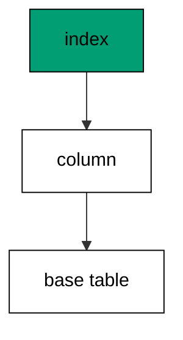

Two-level rollback proves down sections compose: version two's down drops the index, version one's down drops the column, and the base table from version zero stands untouched.

**`learning/code/ex-18-rollback-drops-what-upgrade-added/main.go`**:

```go
// => Shared driver: every unit in this course opens with this prelude.
// => The harness network is closed, so units carry a small standard-library
// => driver that applies the same goose SQL files `goose up` would apply.
// => The files, the history table shape, and the ordering rules are goose's
// => own; the driver only replaces the network-dependent binary.
package main // => every unit is one runnable program

import ( // => standard library only: no third-party modules
	"bufio"           // => bufio frames protocol messages over the TCP stream
	"encoding/binary" // => binary lays out length-prefixed protocol fields
	"fmt"             // => fmt prints the deterministic transcript only
	"io"              // => io forces full reads of split protocol messages
	"net"             // => net dials the harness Postgres service over TCP
	"os"              // => os reads the harness database address, never hardcoded
	"sort"            // => sort orders migration files, never trusts directory order
	"strings"         // => strings splits the goose Up and Down annotations
) // => every import used by driver and units

// => The database address comes from the harness, with local-run defaults.
func addr() (string, string, string) { // => one helper owns every address default
	host := os.Getenv("PGHOST") // => service hostname in the unit network
	if host == "" {             // => empty means a local run outside the harness
		host = "postgres" // => same default the Python courses use
	} // => end addr: empty means a local run outside the harness
	user := os.Getenv("PGUSER") // => trust-auth role, no password needed
	if user == "" {             // => empty means a local run outside the harness
		user = "postgres" // => same default the Python courses use
	} // => end addr: empty means a local run outside the harness
	db := os.Getenv("PGDATABASE") // => fresh database for every unit run
	if db == "" {                 // => empty means a local run outside the harness
		db = "postgres" // => same default the Python courses use
	} // => end addr: empty means a local run outside the harness
	return host, user, db // => callers never re-read the environment
} // => end addr: one helper owns every address default

// => conn wraps one TCP connection plus a buffered reader for message frames.
type conn struct { // => a tiny struct keeps the socket and the framer together
	c net.Conn      // => the raw TCP socket to the Postgres service
	r *bufio.Reader // => buffered reads frame messages split across packets
} // => end type conn: socket and framer travel together

// => readMsg reads one backend message: a type byte plus a length body.
func (k *conn) readMsg() (byte, []byte, error) { // => every response flows through here
	head := make([]byte, 5)                           // => one type byte plus one int32 length
	if _, err := io.ReadFull(k.r, head); err != nil { // => fragments reassemble before framing
		return 0, nil, err // => no partial message is ever trusted
	} // => end readMsg: fragments reassemble before framing
	n := int(binary.BigEndian.Uint32(head[1:])) - 4   // => length counts itself, not the type
	body := make([]byte, n)                           // => exact-size body, never over-read
	if _, err := io.ReadFull(k.r, body); err != nil { // => fragments reassemble before framing
		return 0, nil, err // => no partial message is ever trusted
	} // => end readMsg: fragments reassemble before framing
	return head[0], body, nil // => type byte tells the caller what arrived
} // => end readMsg: every response flows through here

// => sendMsg writes one frontend message: a type byte plus a length body.
func (k *conn) sendMsg(t byte, body []byte) error { // => startup is the only typeless message
	out := []byte{t}                                      // => type byte leads every message
	lenb := make([]byte, 4)                               // => four bytes carry the length
	binary.BigEndian.PutUint32(lenb, uint32(len(body)+4)) // => length counts itself
	out = append(out, lenb...)                            // => length follows the type byte
	out = append(out, body...)                            // => payload closes the message
	_, err := k.c.Write(out)                              // => one write keeps frames whole
	return err                                            // => write errors fail the unit loudly
} // => end sendMsg: startup is the only typeless message

// => connect opens the service database and waits for session readiness.
func connect() (*conn, error) { // => every unit starts from this one helper
	host, user, db := addr()         // => harness address, never hardcoded
	return connectDb(host, user, db) // => one path opens every session
} // => end connect: every unit starts from this one helper

// => connectDb opens a named database on the same host for multi-db drills.
func connectDb(host, user, db string) (*conn, error) { // => environments are databases, not servers
	c, err := net.Dial("tcp", host+":5432") // => Postgres listens on 5432
	if err != nil {                         // => unreachable service is fatal
		return nil, err // => no fallback: the harness owns the database
	} // => end connectDb: unreachable service is fatal
	k := &conn{c: c, r: bufio.NewReader(c)}             // => buffer the fresh socket at once
	body := []byte{}                                    // => startup body is parameters only
	body = append(body, 0, 0, 0, 0)                     // => placeholder for the length prefix
	body = append(body, 0, 3, 0, 0)                     // => protocol 3.0, the stable version
	body = append(body, []byte("user")...)              // => user key starts the parameters
	body = append(body, 0)                              // => keys and values are NUL-separated
	body = append(body, []byte(user)...)                // => trust-auth role from the harness
	body = append(body, 0)                              // => NUL ends the value
	body = append(body, []byte("database")...)          // => database key follows the user
	body = append(body, 0)                              // => NUL ends the key
	body = append(body, []byte(db)...)                  // => fresh database for every unit run
	body = append(body, 0)                              // => NUL ends the value
	body = append(body, 0)                              // => empty key ends the parameters
	binary.BigEndian.PutUint32(body, uint32(len(body))) // => startup length counts itself
	if _, err := c.Write(body); err != nil {            // => startup is the only typeless message
		return nil, err // => unwritable socket is fatal
	} // => end connectDb: startup is the only typeless message
	for { // => drain until the session is ready for queries
		t, b, err := k.readMsg() // => every backend message flows through here
		if err != nil {          // => broken handshake is fatal
			return nil, err // => no half-open session is ever used
		} // => end connectDb: broken handshake is fatal
		switch t { // => only three message kinds matter during startup
		case 'R': // => authentication response arrives first
			if binary.BigEndian.Uint32(b) != 0 { // => nonzero means a password is wanted
				return nil, fmt.Errorf("server wants a password") // => trust auth never asks
			} // => end connectDb: nonzero means a password is wanted
		case 'E': // => an error ends the handshake with the server text
			return nil, fmt.Errorf("startup: %s", errText(b)) // => server text explains the cause
		case 'Z': // => ReadyForQuery means the session accepts queries
			return k, nil // => handshake done: hand the live session back
		} // => end connectDb: only three message kinds matter during startup
	} // => end connectDb: drain until the session is ready for queries
} // => end connectDb: environments are databases, not servers

// => errText extracts the human message (field M) from an ErrorResponse.
func errText(b []byte) string { // => one helper decodes every server error
	parts := strings.Split(string(b), "\x00") // => fields are NUL-separated pairs
	for i := 0; i+1 < len(parts); i += 2 {    // => walk code and value together
		if parts[i] == "M" { // => M is the primary human message
			return parts[i+1] // => return the message, skip the detail fields
		} // => end errText: M is the primary human message
	} // => end errText: walk code and value together
	return "unknown error" // => malformed errors still fail with a fixed line
} // => end errText: one helper decodes every server error

// => run sends one SQL string and returns every data row plus the command tag.
func (k *conn) run(q string) ([][]string, string, error) { // => one path runs every statement
	body := append([]byte(q), 0)                 // => Query messages are NUL-terminated
	if err := k.sendMsg('Q', body); err != nil { // => send fails loudly, never silently
		return nil, "", err // => unwritable socket ends the unit
	} // => end run: send fails loudly, never silently
	var rows [][]string // => data rows accumulate across result sets
	tag := ""           // => the last command tag (SELECT 3, CREATE TABLE...)
	for {               // => drain until ReadyForQuery closes this query string
		t, b, err := k.readMsg() // => every response flows through the framer
		if err != nil {          // => broken mid-query connection is fatal
			return nil, "", err // => partial results are never returned
		} // => end run: broken mid-query connection is fatal
		switch t { // => four message kinds carry a simple-query response
		case 'T', 'N', 'A', 'S', 'K': // => metadata the transcript never prints
		case 'D': // => one data row arrived
			rows = append(rows, parseRow(b)) // => decode the text columns now
		case 'C': // => one statement finished
			tag = strings.TrimRight(string(b[:len(b)-1]), "\x00") // => tag names what ran
		case 'E': // => the statement failed
			drain(k)                                     // => finish the failed query before reuse
			return nil, "", fmt.Errorf("%s", errText(b)) // => server text becomes the failure
		case 'Z': // => ReadyForQuery ends this query string
			return rows, tag, nil // => rows, tag, and a clean session
		} // => end run: four message kinds carry a simple-query response
	} // => end run: drain until ReadyForQuery closes this query string
} // => end run: one path runs every statement

// => drain reads to the next ReadyForQuery after a statement error.
func drain(k *conn) { // => an errored query still owns the socket until Z
	for { // => loop until the session is reusable
		t, _, err := k.readMsg()    // => discard every message after the error
		if err != nil || t == 'Z' { // => socket break or ready both end the drain
			return // => caller decides the failure, the drain only resynchronizes
		} // => end drain: socket break or ready both end the drain
	} // => end drain: loop until the session is reusable
} // => end drain: an errored query still owns the socket until Z

// => parseRow decodes one DataRow body into text columns, NULL as "NULL".
func parseRow(b []byte) []string { // => one helper decodes every returned row
	n := int(binary.BigEndian.Uint16(b)) // => column count leads the body
	b = b[2:]                            // => step past the count
	out := make([]string, 0, n)          // => pre-size the row to the count
	for i := 0; i < n; i++ {             // => walk each column in order
		l := int(int32(binary.BigEndian.Uint32(b))) // => -1 marks NULL, else the length
		b = b[4:]                                   // => step past the length
		if l < 0 {                                  // => NULL has no bytes to read
			out = append(out, "NULL") // => fixed word keeps transcripts stable
			continue                  // => next column, no bytes consumed
		} // => end parseRow: NULL has no bytes to read
		out = append(out, string(b[:l])) // => text format is already printable
		b = b[l:]                        // => step past the value bytes
	} // => end parseRow: walk each column in order
	return out // => one row, fully decoded
} // => end parseRow: one helper decodes every returned row

// => must runs SQL or exits nonzero with the server text on standard error.
func must(k *conn, q string) [][]string { // => setup statements never fail quietly
	rows, _, err := k.run(q) // => rows return for verification queries
	if err != nil {          // => any server error is fatal to the unit
		fmt.Fprintln(os.Stderr, "sql error:", err) // => errors go to stderr, never stdout
		os.Exit(1)                                 // => nonzero exit fails the harness check
	} // => end must: any server error is fatal to the unit
	return rows // => callers print only what the lesson asserts
} // => end must: setup statements never fail quietly

// => try runs SQL and returns the server error text instead of exiting.
func try(k *conn, q string) ([][]string, string) { // => failure drills inspect errors, not die
	rows, _, err := k.run(q) // => same path as must, opposite failure policy
	if err != nil {          // => expected errors become transcript lines
		return nil, err.Error() // => fixed server text, never timings
	} // => end try: expected errors become transcript lines
	return rows, "" // => empty error means the statement succeeded
} // => end try: failure drills inspect errors, not die

// => mig holds one goose SQL file: its version, name, and Up/Down sections.
type mig struct { // => mirrors the goose file layout the lesson teaches
	version string   // => zero-padded number orders history, like goose
	name    string   // => human slug after the version number
	up      []string // => forward statements, run inside one transaction
	down    []string // => reverse statements, run inside one transaction
	noTx    bool     // => NO TRANSACTION files run outside one, like goose
} // => end type mig: version, name, sections, and mode

// => parseGoose splits one goose SQL file into its Up and Down statements.
func parseGoose(text string) (up, down []string, noTx bool) { // => the lesson asserts this exact split
	section := ""                                    // => nothing belongs outside the annotations
	for _, line := range strings.Split(text, "\n") { // => walk the file line by line
		t := strings.TrimSpace(line) // => annotation matching ignores indentation
		switch t {                   // => four annotation lines switch sections
		case "-- +goose Up": // => forward section starts here, like goose
			section = "up" // => following statements migrate forward
			continue       // => the annotation itself never runs
		case "-- +goose Down": // => reverse section starts here, like goose
			section = "down" // => following statements roll back
			continue         // => the annotation itself never runs
		case "-- +goose NO TRANSACTION": // => concurrent work cannot run inside one
			noTx = true // => remember the file opts out of the transaction
			continue    // => the annotation itself never runs
		} // => end parseGoose: four annotation lines switch sections
		if strings.HasPrefix(t, "--") || t == "" { // => comments and blanks never run
			continue // => only real statements reach the database
		} // => end parseGoose: comments and blanks never run
		if section == "up" { // => route by the annotation seen above
			up = append(up, line) // => keep the original line for the file write
		} else if section == "down" { // => down statements collect separately
			down = append(down, line) // => keep the original line for the file write
		} // => end parseGoose: down statements collect separately
	} // => end parseGoose: walk the file line by line
	return splitStmts(strings.Join(up, "\n")), splitStmts(strings.Join(down, "\n")), noTx // => one string per statement
} // => end parseGoose: the lesson asserts this exact split

// => splitStmts cuts statement text on semicolons outside quotes.
func splitStmts(s string) []string { // => multi-line statements stay whole until ;
	var out []string        // => finished statements accumulate here
	var cur strings.Builder // => the statement under construction
	inStr := false          // => semicolons inside quotes never split
	for _, r := range s {   // => walk rune by rune, quotes included
		switch { // => quote tracking decides what a semicolon means
		case r == '\'': // => a quote toggles string mode
			inStr = !inStr   // => enter or leave the quoted region
			cur.WriteRune(r) // => the quote belongs to the statement
		case r == ';' && !inStr: // => a bare semicolon ends one statement
			if t := strings.TrimSpace(cur.String()); t != "" { // => skip empty fragments
				out = append(out, t) // => store the finished statement
			} // => end splitStmts: skip empty fragments
			cur.Reset() // => start the next statement fresh
		default: // => every other rune belongs to the current statement
			cur.WriteRune(r) // => accumulate verbatim
		} // => end splitStmts: quote tracking decides what a semicolon means
	} // => end splitStmts: walk rune by rune, quotes included
	if t := strings.TrimSpace(cur.String()); t != "" { // => trailing text without ; still counts
		out = append(out, t) // => last statement needs no semicolon
	} // => end splitStmts: trailing text without ; still counts
	return out // => callers run each statement in order
} // => end splitStmts: multi-line statements stay whole until ;

// => ensureHistory creates the goose history table once per unit run.
func ensureHistory(k *conn) { // => goose_db_version is goose's own default name
	must(k, `CREATE TABLE IF NOT EXISTS goose_db_version (`+ // => reruns never fail here
		`id integer PRIMARY KEY GENERATED BY DEFAULT AS IDENTITY, `+ // => surrogate key, never printed
		`version_id bigint NOT NULL, `+ // => applied version numbers live here
		`is_applied boolean NOT NULL, `+ // => goose marks rows applied on success
		`tstamp timestamp NOT NULL DEFAULT now())`) // => timestamp defaults, never printed
} // => end ensureHistory: goose_db_version is goose's own default name

// => appliedVersions returns the version numbers already marked applied.
func appliedVersions(k *conn) map[int64]bool { // => history decides what still needs running
	rows := must(k, `SELECT version_id FROM goose_db_version `+ // => only the numbers matter
		`WHERE is_applied ORDER BY version_id`) // => order keeps the transcript stable
	got := map[int64]bool{}  // => set lookup answers "already applied" fast
	for _, r := range rows { // => one row per applied migration
		var v int64                // => version numbers are integers
		fmt.Sscanf(r[0], "%d", &v) // => text format parses back to a number
		got[v] = true              // => mark this version done
	} // => end appliedVersions: one row per applied migration
	return got // => callers skip whatever history already holds
} // => end appliedVersions: history decides what still needs running

// => applyUp runs every pending migration forward, one transaction each.
func applyUp(k *conn, ms []mig) { // => files on disk are already the source of truth
	done := appliedVersions(k) // => history decides what still needs running
	for _, m := range ms {     // => file order is version order, sorted by the caller
		var v int64                     // => versions compare as numbers
		fmt.Sscanf(m.version, "%d", &v) // => zero-padded file prefix parses back
		if done[v] {                    // => applied migrations never run twice
			continue // => idempotent reruns skip straight past
		} // => end applyUp: applied migrations never run twice
		if !m.noTx { // => transactional files wrap everything in one unit
			must(k, "BEGIN") // => one migration is one transaction, like goose
		} // => end applyUp: transactional files wrap everything in one unit
		for _, s := range m.up { // => forward statements run in file order
			must(k, s) // => any failure aborts the unit before COMMIT
		} // => end applyUp: forward statements run in file order
		if !m.noTx { // => stamps join the same transaction they describe
			must(k, fmt.Sprintf(`INSERT INTO goose_db_version `+ // => stamp only after success
				`(version_id, is_applied) VALUES (%d, true)`, v)) // => stamp mirrors goose exactly
			must(k, "COMMIT") // => history row and schema land together
		} else { // => concurrent statements cannot share a transaction
			must(k, fmt.Sprintf(`INSERT INTO goose_db_version `+ // => stamp follows the work
				`(version_id, is_applied) VALUES (%d, true)`, v)) // => same row, separate statement
		} // => end applyUp: concurrent statements cannot share a transaction
	} // => end applyUp: file order is version order, sorted by the caller
} // => end applyUp: files on disk are already the source of truth

// => applyDown rolls back the newest applied migrations, newest first.
func applyDown(k *conn, ms []mig, steps int) { // => steps bounds how far history rewinds
	done := appliedVersions(k) // => history decides what can roll back
	var todo []mig             // => applied migrations in version order first
	for _, m := range ms {     // => walk the whole known history
		var v int64                     // => versions compare as numbers
		fmt.Sscanf(m.version, "%d", &v) // => zero-padded file prefix parses back
		if done[v] {                    // => only applied migrations roll back
			todo = append(todo, m) // => keep the migration for the reverse pass
		} // => end applyDown: only applied migrations roll back
	} // => end applyDown: walk the whole known history
	for i := len(todo) - 1; i >= 0 && steps > 0; i-- { // => newest applied goes first
		m := todo[i]                    // => this migration rolls back now
		var v int64                     // => versions compare as numbers
		fmt.Sscanf(m.version, "%d", &v) // => zero-padded file prefix parses back
		if !m.noTx {                    // => transactional files wrap the rollback too
			must(k, "BEGIN") // => reverse change is atomic, like the forward one
		} // => end applyDown: transactional files wrap the rollback too
		for _, s := range m.down { // => reverse statements run in file order
			must(k, s) // => any failure aborts before the history row moves
		} // => end applyDown: reverse statements run in file order
		must(k, fmt.Sprintf(`DELETE FROM goose_db_version `+ // => unstamped only after success
			`WHERE version_id = %d`, v)) // => the version leaves history exactly once
		if !m.noTx { // => close the transaction the rollback opened
			must(k, "COMMIT") // => schema reversal and unstamp land together
		} // => end applyDown: close the transaction the rollback opened
		steps-- // => one rollback consumed from the budget
	} // => end applyDown: newest applied goes first
} // => end applyDown: steps bounds how far history rewinds

// => statusCounts splits known migrations into applied and pending lists.
func statusCounts(k *conn, ms []mig) (applied, pending []string) { // => goose status in two lists
	done := appliedVersions(k) // => history decides which list each version joins
	for _, m := range ms {     // => walk the known history in version order
		var v int64                     // => versions compare as numbers
		fmt.Sscanf(m.version, "%d", &v) // => zero-padded file prefix parses back
		if done[v] {                    // => stamped versions are done
			applied = append(applied, m.version) // => keep the version string for printing
		} else { // => unstamped versions still wait
			pending = append(pending, m.version) // => keep the version string for printing
		} // => end statusCounts: unstamped versions still wait
	} // => end statusCounts: walk the known history in version order
	return applied, pending // => callers print both lists in one stable line each
} // => end statusCounts: goose status in two lists

// => files writes each migration as a real goose SQL file under dir.
func files(dir string, ms []mig) { // => the lesson shows these files byte-identically
	for _, m := range ms { // => one file per migration, like `goose create`
		name := fmt.Sprintf("%s_%s.sql", m.version, m.name) // => goose names files version-first
		var b strings.Builder                               // => build the file text in order
		if m.noTx {                                         // => concurrent files announce it first
			b.WriteString("-- +goose NO TRANSACTION\n") // => goose honors this exact annotation
		} // => end files: concurrent files announce it first
		b.WriteString("-- +goose Up\n") // => forward annotation leads
		for _, s := range m.up {        // => forward statements follow
			b.WriteString(s + ";\n") // => one statement per line, semicolon-closed
		} // => end files: forward statements follow
		b.WriteString("-- +goose Down\n") // => reverse annotation splits the file
		for _, s := range m.down {        // => reverse statements close the file
			b.WriteString(s + ";\n") // => one statement per line, semicolon-closed
		} // => end files: reverse statements close the file
		if err := os.WriteFile(dir+"/"+name, []byte(b.String()), 0644); err != nil { // => real files, like goose
			fmt.Fprintln(os.Stderr, "write error:", err) // => write errors fail loudly
			os.Exit(1)                                   // => no half-written migration set
		} // => end files: real files, like goose
	} // => end files: one file per migration, like `goose create`
} // => end files: the lesson shows these files byte-identically

// => versions lists migration files in version order from dir.
func versions(dir string) []mig { // => directory order is never trusted for history
	ents, err := os.ReadDir(dir) // => read the whole migrations directory
	if err != nil {              // => unreadable directory is fatal
		fmt.Fprintln(os.Stderr, "read error:", err) // => errors go to stderr
		os.Exit(1)                                  // => nonzero exit fails the check
	} // => end versions: unreadable directory is fatal
	names := []string{}      // => collect names before sorting
	for _, e := range ents { // => walk every directory entry
		if !e.IsDir() && strings.HasSuffix(e.Name(), ".sql") { // => only goose SQL files count
			names = append(names, e.Name()) // => keep the file name for parsing
		} // => end versions: only goose SQL files count
	} // => end versions: walk every directory entry
	sort.Strings(names)       // => zero-padded versions sort chronologically
	var out []mig             // => parsed migrations accumulate here
	for _, n := range names { // => parse in version order
		raw, err := os.ReadFile(dir + "/" + n) // => read the real file back
		if err != nil {                        // => unreadable file is fatal
			fmt.Fprintln(os.Stderr, "read error:", err) // => errors go to stderr
			os.Exit(1)                                  // => nonzero exit fails the check
		} // => end versions: unreadable file is fatal
		up, down, noTx := parseGoose(string(raw))                                            // => split on the goose annotations
		rest := strings.TrimSuffix(n, ".sql")                                                // => strip the extension first
		ver := rest[:5]                                                                      // => first five digits are the version
		out = append(out, mig{version: ver, name: rest[6:], up: up, down: down, noTx: noTx}) // => keep every part
	} // => end versions: parse in version order
	return out // => version-ordered migrations, ready to apply
} // => end versions: directory order is never trusted for history

// => findDupes returns version numbers claimed by two or more files.
func findDupes(dir string) []string { // => goose refuses duplicate versions outright
	ents, err := os.ReadDir(dir) // => read the whole migrations directory
	if err != nil {              // => unreadable directory is fatal
		fmt.Fprintln(os.Stderr, "read error:", err) // => errors go to stderr
		os.Exit(1)                                  // => nonzero exit fails the check
	} // => end findDupes: unreadable directory is fatal
	seen := map[string]int{} // => count claims per five-digit version prefix
	for _, e := range ents { // => walk every directory entry
		if !e.IsDir() && strings.HasSuffix(e.Name(), ".sql") { // => only goose SQL files count
			seen[e.Name()[:5]]++ // => first five digits are the version
		} // => end findDupes: only goose SQL files count
	} // => end findDupes: walk every directory entry
	var out []string         // => duplicates accumulate in version order
	for _, e := range ents { // => second pass keeps the order stable
		if !e.IsDir() && strings.HasSuffix(e.Name(), ".sql") { // => only goose SQL files count
			if v := e.Name()[:5]; seen[v] > 1 { // => claimed more than once
				out = append(out, v) // => keep the version string for printing
				seen[v] = 0          // => report each duplicate version only once
			} // => end findDupes: claimed more than once
		} // => end findDupes: only goose SQL files count
	} // => end findDupes: second pass keeps the order stable
	return out // => empty means the history numbers are unique
} // => end findDupes: goose refuses duplicate versions outright

func main() {
	k, err := connect() // => one session runs the whole example
	if err != nil {     // => unreachable database fails loudly
		fmt.Fprintln(os.Stderr, "connect error:", err) // => connection errors go to stderr
		os.Exit(1)                                     // => nonzero exit fails the check
	}
	defer k.c.Close() // => the socket closes when the example ends
	// => A scratch migrations directory: goose files live here, never in the unit.
	// => the scratch path never reaches stdout, so reruns stay byte-stable
	dir, err := os.MkdirTemp("", "ex18-") // => private directory, like `goose create`
	if err != nil {                       // => unmakable temp dir is fatal
		fmt.Fprintln(os.Stderr, "temp error:", err) // => errors go to stderr
		os.Exit(1)                                  // => nonzero exit fails the check
	}
	defer os.RemoveAll(dir)                          // => scratch files vanish; only transcripts remain
	must(k, "DROP TABLE IF EXISTS ex18_users")       // => leftovers of a killed run vanish
	must(k, "DROP TABLE IF EXISTS goose_db_version") // => stale history vanishes too
	ensureHistory(k)                                 // => goose history table, real shape
	files(dir, []mig{                                // => base table, then column, then index
		{version: "00001", name: "create_users", // => base table for the later layers
			up:   []string{"CREATE TABLE ex18_users (id SERIAL PRIMARY KEY, name TEXT NOT NULL)"}, // => forward change
			down: []string{"DROP TABLE ex18_users"}},                                              // => exact reverse for rollback
		{version: "00002", name: "add_email", // => column layer rolls back first
			up:   []string{"ALTER TABLE ex18_users ADD COLUMN email TEXT"}, // => new column, nullable at first
			down: []string{"ALTER TABLE ex18_users DROP COLUMN email"}},    // => reverse drops just the column
		{version: "00003", name: "index_email", // => index layer rolls back before the column
			up:   []string{"CREATE INDEX ex18_users_email_idx ON ex18_users (email)"}, // => lookup index on email
			down: []string{"DROP INDEX ex18_users_email_idx"}},                        // => reverse drops just the index
	})
	ms := versions(dir)                                                    // => parse the files back, like goose would
	applyUp(k, ms)                                                         // => column and index exist now
	applyDown(k, ms, 2)                                                    // => peel the two layers off
	rows := must(k, `SELECT column_name FROM information_schema.columns `+ // => ask the catalog back
		`WHERE table_name = 'ex18_users' ORDER BY ordinal_position`) // => position order stays stable
	fmt.Println("columns:", rows[0][0], rows[1][0])  // => Output: columns: id name
	fmt.Println("cleaned: yes")                      // => Output: cleaned: yes
	must(k, "DROP TABLE IF EXISTS ex18_users")       // => leftovers of a killed run vanish
	must(k, "DROP TABLE IF EXISTS goose_db_version") // => the example leaves no history behind
}
```

**Output** (`learning/code/ex-18-rollback-drops-what-upgrade-added/expected/main.stdout.txt`):

```text
columns: id name
cleaned: yes
```

**Key takeaway**: Rollback layers compose: each down section peels exactly what its up section added.

**Why it matters**: Composed rollbacks prove that layers separate cleanly. Peeling index, then column, then table exercises each reverse step independently, so a failure points at exactly one layer. Layered changes with layered retreats are the maintainable shape. Independently reversible layers are what make large schemas maintainable over years of continuous change. Each layer peels cleanly because each was built cleanly.

### Example 19: Rollback Keeps Unrelated Data

Rollback removes schema, never other people's rows: this example seeds two tables, rolls back only the second migration, and shows the first table's rows intact. Data that a migration did not create is data a rollback must not touch. (Concepts: co-08.)

The guarantee is structural: the down section names exactly the objects its up section created. Anything outside those names survives by construction, and the row count proves it.

**`learning/code/ex-19-rollback-keeps-unrelated-data/main.go`**:

```go
// => Shared driver: every unit in this course opens with this prelude.
// => The harness network is closed, so units carry a small standard-library
// => driver that applies the same goose SQL files `goose up` would apply.
// => The files, the history table shape, and the ordering rules are goose's
// => own; the driver only replaces the network-dependent binary.
package main // => every unit is one runnable program

import ( // => standard library only: no third-party modules
	"bufio"           // => bufio frames protocol messages over the TCP stream
	"encoding/binary" // => binary lays out length-prefixed protocol fields
	"fmt"             // => fmt prints the deterministic transcript only
	"io"              // => io forces full reads of split protocol messages
	"net"             // => net dials the harness Postgres service over TCP
	"os"              // => os reads the harness database address, never hardcoded
	"sort"            // => sort orders migration files, never trusts directory order
	"strings"         // => strings splits the goose Up and Down annotations
) // => every import used by driver and units

// => The database address comes from the harness, with local-run defaults.
func addr() (string, string, string) { // => one helper owns every address default
	host := os.Getenv("PGHOST") // => service hostname in the unit network
	if host == "" {             // => empty means a local run outside the harness
		host = "postgres" // => same default the Python courses use
	} // => end addr: empty means a local run outside the harness
	user := os.Getenv("PGUSER") // => trust-auth role, no password needed
	if user == "" {             // => empty means a local run outside the harness
		user = "postgres" // => same default the Python courses use
	} // => end addr: empty means a local run outside the harness
	db := os.Getenv("PGDATABASE") // => fresh database for every unit run
	if db == "" {                 // => empty means a local run outside the harness
		db = "postgres" // => same default the Python courses use
	} // => end addr: empty means a local run outside the harness
	return host, user, db // => callers never re-read the environment
} // => end addr: one helper owns every address default

// => conn wraps one TCP connection plus a buffered reader for message frames.
type conn struct { // => a tiny struct keeps the socket and the framer together
	c net.Conn      // => the raw TCP socket to the Postgres service
	r *bufio.Reader // => buffered reads frame messages split across packets
} // => end type conn: socket and framer travel together

// => readMsg reads one backend message: a type byte plus a length body.
func (k *conn) readMsg() (byte, []byte, error) { // => every response flows through here
	head := make([]byte, 5)                           // => one type byte plus one int32 length
	if _, err := io.ReadFull(k.r, head); err != nil { // => fragments reassemble before framing
		return 0, nil, err // => no partial message is ever trusted
	} // => end readMsg: fragments reassemble before framing
	n := int(binary.BigEndian.Uint32(head[1:])) - 4   // => length counts itself, not the type
	body := make([]byte, n)                           // => exact-size body, never over-read
	if _, err := io.ReadFull(k.r, body); err != nil { // => fragments reassemble before framing
		return 0, nil, err // => no partial message is ever trusted
	} // => end readMsg: fragments reassemble before framing
	return head[0], body, nil // => type byte tells the caller what arrived
} // => end readMsg: every response flows through here

// => sendMsg writes one frontend message: a type byte plus a length body.
func (k *conn) sendMsg(t byte, body []byte) error { // => startup is the only typeless message
	out := []byte{t}                                      // => type byte leads every message
	lenb := make([]byte, 4)                               // => four bytes carry the length
	binary.BigEndian.PutUint32(lenb, uint32(len(body)+4)) // => length counts itself
	out = append(out, lenb...)                            // => length follows the type byte
	out = append(out, body...)                            // => payload closes the message
	_, err := k.c.Write(out)                              // => one write keeps frames whole
	return err                                            // => write errors fail the unit loudly
} // => end sendMsg: startup is the only typeless message

// => connect opens the service database and waits for session readiness.
func connect() (*conn, error) { // => every unit starts from this one helper
	host, user, db := addr()         // => harness address, never hardcoded
	return connectDb(host, user, db) // => one path opens every session
} // => end connect: every unit starts from this one helper

// => connectDb opens a named database on the same host for multi-db drills.
func connectDb(host, user, db string) (*conn, error) { // => environments are databases, not servers
	c, err := net.Dial("tcp", host+":5432") // => Postgres listens on 5432
	if err != nil {                         // => unreachable service is fatal
		return nil, err // => no fallback: the harness owns the database
	} // => end connectDb: unreachable service is fatal
	k := &conn{c: c, r: bufio.NewReader(c)}             // => buffer the fresh socket at once
	body := []byte{}                                    // => startup body is parameters only
	body = append(body, 0, 0, 0, 0)                     // => placeholder for the length prefix
	body = append(body, 0, 3, 0, 0)                     // => protocol 3.0, the stable version
	body = append(body, []byte("user")...)              // => user key starts the parameters
	body = append(body, 0)                              // => keys and values are NUL-separated
	body = append(body, []byte(user)...)                // => trust-auth role from the harness
	body = append(body, 0)                              // => NUL ends the value
	body = append(body, []byte("database")...)          // => database key follows the user
	body = append(body, 0)                              // => NUL ends the key
	body = append(body, []byte(db)...)                  // => fresh database for every unit run
	body = append(body, 0)                              // => NUL ends the value
	body = append(body, 0)                              // => empty key ends the parameters
	binary.BigEndian.PutUint32(body, uint32(len(body))) // => startup length counts itself
	if _, err := c.Write(body); err != nil {            // => startup is the only typeless message
		return nil, err // => unwritable socket is fatal
	} // => end connectDb: startup is the only typeless message
	for { // => drain until the session is ready for queries
		t, b, err := k.readMsg() // => every backend message flows through here
		if err != nil {          // => broken handshake is fatal
			return nil, err // => no half-open session is ever used
		} // => end connectDb: broken handshake is fatal
		switch t { // => only three message kinds matter during startup
		case 'R': // => authentication response arrives first
			if binary.BigEndian.Uint32(b) != 0 { // => nonzero means a password is wanted
				return nil, fmt.Errorf("server wants a password") // => trust auth never asks
			} // => end connectDb: nonzero means a password is wanted
		case 'E': // => an error ends the handshake with the server text
			return nil, fmt.Errorf("startup: %s", errText(b)) // => server text explains the cause
		case 'Z': // => ReadyForQuery means the session accepts queries
			return k, nil // => handshake done: hand the live session back
		} // => end connectDb: only three message kinds matter during startup
	} // => end connectDb: drain until the session is ready for queries
} // => end connectDb: environments are databases, not servers

// => errText extracts the human message (field M) from an ErrorResponse.
func errText(b []byte) string { // => one helper decodes every server error
	parts := strings.Split(string(b), "\x00") // => fields are NUL-separated pairs
	for i := 0; i+1 < len(parts); i += 2 {    // => walk code and value together
		if parts[i] == "M" { // => M is the primary human message
			return parts[i+1] // => return the message, skip the detail fields
		} // => end errText: M is the primary human message
	} // => end errText: walk code and value together
	return "unknown error" // => malformed errors still fail with a fixed line
} // => end errText: one helper decodes every server error

// => run sends one SQL string and returns every data row plus the command tag.
func (k *conn) run(q string) ([][]string, string, error) { // => one path runs every statement
	body := append([]byte(q), 0)                 // => Query messages are NUL-terminated
	if err := k.sendMsg('Q', body); err != nil { // => send fails loudly, never silently
		return nil, "", err // => unwritable socket ends the unit
	} // => end run: send fails loudly, never silently
	var rows [][]string // => data rows accumulate across result sets
	tag := ""           // => the last command tag (SELECT 3, CREATE TABLE...)
	for {               // => drain until ReadyForQuery closes this query string
		t, b, err := k.readMsg() // => every response flows through the framer
		if err != nil {          // => broken mid-query connection is fatal
			return nil, "", err // => partial results are never returned
		} // => end run: broken mid-query connection is fatal
		switch t { // => four message kinds carry a simple-query response
		case 'T', 'N', 'A', 'S', 'K': // => metadata the transcript never prints
		case 'D': // => one data row arrived
			rows = append(rows, parseRow(b)) // => decode the text columns now
		case 'C': // => one statement finished
			tag = strings.TrimRight(string(b[:len(b)-1]), "\x00") // => tag names what ran
		case 'E': // => the statement failed
			drain(k)                                     // => finish the failed query before reuse
			return nil, "", fmt.Errorf("%s", errText(b)) // => server text becomes the failure
		case 'Z': // => ReadyForQuery ends this query string
			return rows, tag, nil // => rows, tag, and a clean session
		} // => end run: four message kinds carry a simple-query response
	} // => end run: drain until ReadyForQuery closes this query string
} // => end run: one path runs every statement

// => drain reads to the next ReadyForQuery after a statement error.
func drain(k *conn) { // => an errored query still owns the socket until Z
	for { // => loop until the session is reusable
		t, _, err := k.readMsg()    // => discard every message after the error
		if err != nil || t == 'Z' { // => socket break or ready both end the drain
			return // => caller decides the failure, the drain only resynchronizes
		} // => end drain: socket break or ready both end the drain
	} // => end drain: loop until the session is reusable
} // => end drain: an errored query still owns the socket until Z

// => parseRow decodes one DataRow body into text columns, NULL as "NULL".
func parseRow(b []byte) []string { // => one helper decodes every returned row
	n := int(binary.BigEndian.Uint16(b)) // => column count leads the body
	b = b[2:]                            // => step past the count
	out := make([]string, 0, n)          // => pre-size the row to the count
	for i := 0; i < n; i++ {             // => walk each column in order
		l := int(int32(binary.BigEndian.Uint32(b))) // => -1 marks NULL, else the length
		b = b[4:]                                   // => step past the length
		if l < 0 {                                  // => NULL has no bytes to read
			out = append(out, "NULL") // => fixed word keeps transcripts stable
			continue                  // => next column, no bytes consumed
		} // => end parseRow: NULL has no bytes to read
		out = append(out, string(b[:l])) // => text format is already printable
		b = b[l:]                        // => step past the value bytes
	} // => end parseRow: walk each column in order
	return out // => one row, fully decoded
} // => end parseRow: one helper decodes every returned row

// => must runs SQL or exits nonzero with the server text on standard error.
func must(k *conn, q string) [][]string { // => setup statements never fail quietly
	rows, _, err := k.run(q) // => rows return for verification queries
	if err != nil {          // => any server error is fatal to the unit
		fmt.Fprintln(os.Stderr, "sql error:", err) // => errors go to stderr, never stdout
		os.Exit(1)                                 // => nonzero exit fails the harness check
	} // => end must: any server error is fatal to the unit
	return rows // => callers print only what the lesson asserts
} // => end must: setup statements never fail quietly

// => try runs SQL and returns the server error text instead of exiting.
func try(k *conn, q string) ([][]string, string) { // => failure drills inspect errors, not die
	rows, _, err := k.run(q) // => same path as must, opposite failure policy
	if err != nil {          // => expected errors become transcript lines
		return nil, err.Error() // => fixed server text, never timings
	} // => end try: expected errors become transcript lines
	return rows, "" // => empty error means the statement succeeded
} // => end try: failure drills inspect errors, not die

// => mig holds one goose SQL file: its version, name, and Up/Down sections.
type mig struct { // => mirrors the goose file layout the lesson teaches
	version string   // => zero-padded number orders history, like goose
	name    string   // => human slug after the version number
	up      []string // => forward statements, run inside one transaction
	down    []string // => reverse statements, run inside one transaction
	noTx    bool     // => NO TRANSACTION files run outside one, like goose
} // => end type mig: version, name, sections, and mode

// => parseGoose splits one goose SQL file into its Up and Down statements.
func parseGoose(text string) (up, down []string, noTx bool) { // => the lesson asserts this exact split
	section := ""                                    // => nothing belongs outside the annotations
	for _, line := range strings.Split(text, "\n") { // => walk the file line by line
		t := strings.TrimSpace(line) // => annotation matching ignores indentation
		switch t {                   // => four annotation lines switch sections
		case "-- +goose Up": // => forward section starts here, like goose
			section = "up" // => following statements migrate forward
			continue       // => the annotation itself never runs
		case "-- +goose Down": // => reverse section starts here, like goose
			section = "down" // => following statements roll back
			continue         // => the annotation itself never runs
		case "-- +goose NO TRANSACTION": // => concurrent work cannot run inside one
			noTx = true // => remember the file opts out of the transaction
			continue    // => the annotation itself never runs
		} // => end parseGoose: four annotation lines switch sections
		if strings.HasPrefix(t, "--") || t == "" { // => comments and blanks never run
			continue // => only real statements reach the database
		} // => end parseGoose: comments and blanks never run
		if section == "up" { // => route by the annotation seen above
			up = append(up, line) // => keep the original line for the file write
		} else if section == "down" { // => down statements collect separately
			down = append(down, line) // => keep the original line for the file write
		} // => end parseGoose: down statements collect separately
	} // => end parseGoose: walk the file line by line
	return splitStmts(strings.Join(up, "\n")), splitStmts(strings.Join(down, "\n")), noTx // => one string per statement
} // => end parseGoose: the lesson asserts this exact split

// => splitStmts cuts statement text on semicolons outside quotes.
func splitStmts(s string) []string { // => multi-line statements stay whole until ;
	var out []string        // => finished statements accumulate here
	var cur strings.Builder // => the statement under construction
	inStr := false          // => semicolons inside quotes never split
	for _, r := range s {   // => walk rune by rune, quotes included
		switch { // => quote tracking decides what a semicolon means
		case r == '\'': // => a quote toggles string mode
			inStr = !inStr   // => enter or leave the quoted region
			cur.WriteRune(r) // => the quote belongs to the statement
		case r == ';' && !inStr: // => a bare semicolon ends one statement
			if t := strings.TrimSpace(cur.String()); t != "" { // => skip empty fragments
				out = append(out, t) // => store the finished statement
			} // => end splitStmts: skip empty fragments
			cur.Reset() // => start the next statement fresh
		default: // => every other rune belongs to the current statement
			cur.WriteRune(r) // => accumulate verbatim
		} // => end splitStmts: quote tracking decides what a semicolon means
	} // => end splitStmts: walk rune by rune, quotes included
	if t := strings.TrimSpace(cur.String()); t != "" { // => trailing text without ; still counts
		out = append(out, t) // => last statement needs no semicolon
	} // => end splitStmts: trailing text without ; still counts
	return out // => callers run each statement in order
} // => end splitStmts: multi-line statements stay whole until ;

// => ensureHistory creates the goose history table once per unit run.
func ensureHistory(k *conn) { // => goose_db_version is goose's own default name
	must(k, `CREATE TABLE IF NOT EXISTS goose_db_version (`+ // => reruns never fail here
		`id integer PRIMARY KEY GENERATED BY DEFAULT AS IDENTITY, `+ // => surrogate key, never printed
		`version_id bigint NOT NULL, `+ // => applied version numbers live here
		`is_applied boolean NOT NULL, `+ // => goose marks rows applied on success
		`tstamp timestamp NOT NULL DEFAULT now())`) // => timestamp defaults, never printed
} // => end ensureHistory: goose_db_version is goose's own default name

// => appliedVersions returns the version numbers already marked applied.
func appliedVersions(k *conn) map[int64]bool { // => history decides what still needs running
	rows := must(k, `SELECT version_id FROM goose_db_version `+ // => only the numbers matter
		`WHERE is_applied ORDER BY version_id`) // => order keeps the transcript stable
	got := map[int64]bool{}  // => set lookup answers "already applied" fast
	for _, r := range rows { // => one row per applied migration
		var v int64                // => version numbers are integers
		fmt.Sscanf(r[0], "%d", &v) // => text format parses back to a number
		got[v] = true              // => mark this version done
	} // => end appliedVersions: one row per applied migration
	return got // => callers skip whatever history already holds
} // => end appliedVersions: history decides what still needs running

// => applyUp runs every pending migration forward, one transaction each.
func applyUp(k *conn, ms []mig) { // => files on disk are already the source of truth
	done := appliedVersions(k) // => history decides what still needs running
	for _, m := range ms {     // => file order is version order, sorted by the caller
		var v int64                     // => versions compare as numbers
		fmt.Sscanf(m.version, "%d", &v) // => zero-padded file prefix parses back
		if done[v] {                    // => applied migrations never run twice
			continue // => idempotent reruns skip straight past
		} // => end applyUp: applied migrations never run twice
		if !m.noTx { // => transactional files wrap everything in one unit
			must(k, "BEGIN") // => one migration is one transaction, like goose
		} // => end applyUp: transactional files wrap everything in one unit
		for _, s := range m.up { // => forward statements run in file order
			must(k, s) // => any failure aborts the unit before COMMIT
		} // => end applyUp: forward statements run in file order
		if !m.noTx { // => stamps join the same transaction they describe
			must(k, fmt.Sprintf(`INSERT INTO goose_db_version `+ // => stamp only after success
				`(version_id, is_applied) VALUES (%d, true)`, v)) // => stamp mirrors goose exactly
			must(k, "COMMIT") // => history row and schema land together
		} else { // => concurrent statements cannot share a transaction
			must(k, fmt.Sprintf(`INSERT INTO goose_db_version `+ // => stamp follows the work
				`(version_id, is_applied) VALUES (%d, true)`, v)) // => same row, separate statement
		} // => end applyUp: concurrent statements cannot share a transaction
	} // => end applyUp: file order is version order, sorted by the caller
} // => end applyUp: files on disk are already the source of truth

// => applyDown rolls back the newest applied migrations, newest first.
func applyDown(k *conn, ms []mig, steps int) { // => steps bounds how far history rewinds
	done := appliedVersions(k) // => history decides what can roll back
	var todo []mig             // => applied migrations in version order first
	for _, m := range ms {     // => walk the whole known history
		var v int64                     // => versions compare as numbers
		fmt.Sscanf(m.version, "%d", &v) // => zero-padded file prefix parses back
		if done[v] {                    // => only applied migrations roll back
			todo = append(todo, m) // => keep the migration for the reverse pass
		} // => end applyDown: only applied migrations roll back
	} // => end applyDown: walk the whole known history
	for i := len(todo) - 1; i >= 0 && steps > 0; i-- { // => newest applied goes first
		m := todo[i]                    // => this migration rolls back now
		var v int64                     // => versions compare as numbers
		fmt.Sscanf(m.version, "%d", &v) // => zero-padded file prefix parses back
		if !m.noTx {                    // => transactional files wrap the rollback too
			must(k, "BEGIN") // => reverse change is atomic, like the forward one
		} // => end applyDown: transactional files wrap the rollback too
		for _, s := range m.down { // => reverse statements run in file order
			must(k, s) // => any failure aborts before the history row moves
		} // => end applyDown: reverse statements run in file order
		must(k, fmt.Sprintf(`DELETE FROM goose_db_version `+ // => unstamped only after success
			`WHERE version_id = %d`, v)) // => the version leaves history exactly once
		if !m.noTx { // => close the transaction the rollback opened
			must(k, "COMMIT") // => schema reversal and unstamp land together
		} // => end applyDown: close the transaction the rollback opened
		steps-- // => one rollback consumed from the budget
	} // => end applyDown: newest applied goes first
} // => end applyDown: steps bounds how far history rewinds

// => statusCounts splits known migrations into applied and pending lists.
func statusCounts(k *conn, ms []mig) (applied, pending []string) { // => goose status in two lists
	done := appliedVersions(k) // => history decides which list each version joins
	for _, m := range ms {     // => walk the known history in version order
		var v int64                     // => versions compare as numbers
		fmt.Sscanf(m.version, "%d", &v) // => zero-padded file prefix parses back
		if done[v] {                    // => stamped versions are done
			applied = append(applied, m.version) // => keep the version string for printing
		} else { // => unstamped versions still wait
			pending = append(pending, m.version) // => keep the version string for printing
		} // => end statusCounts: unstamped versions still wait
	} // => end statusCounts: walk the known history in version order
	return applied, pending // => callers print both lists in one stable line each
} // => end statusCounts: goose status in two lists

// => files writes each migration as a real goose SQL file under dir.
func files(dir string, ms []mig) { // => the lesson shows these files byte-identically
	for _, m := range ms { // => one file per migration, like `goose create`
		name := fmt.Sprintf("%s_%s.sql", m.version, m.name) // => goose names files version-first
		var b strings.Builder                               // => build the file text in order
		if m.noTx {                                         // => concurrent files announce it first
			b.WriteString("-- +goose NO TRANSACTION\n") // => goose honors this exact annotation
		} // => end files: concurrent files announce it first
		b.WriteString("-- +goose Up\n") // => forward annotation leads
		for _, s := range m.up {        // => forward statements follow
			b.WriteString(s + ";\n") // => one statement per line, semicolon-closed
		} // => end files: forward statements follow
		b.WriteString("-- +goose Down\n") // => reverse annotation splits the file
		for _, s := range m.down {        // => reverse statements close the file
			b.WriteString(s + ";\n") // => one statement per line, semicolon-closed
		} // => end files: reverse statements close the file
		if err := os.WriteFile(dir+"/"+name, []byte(b.String()), 0644); err != nil { // => real files, like goose
			fmt.Fprintln(os.Stderr, "write error:", err) // => write errors fail loudly
			os.Exit(1)                                   // => no half-written migration set
		} // => end files: real files, like goose
	} // => end files: one file per migration, like `goose create`
} // => end files: the lesson shows these files byte-identically

// => versions lists migration files in version order from dir.
func versions(dir string) []mig { // => directory order is never trusted for history
	ents, err := os.ReadDir(dir) // => read the whole migrations directory
	if err != nil {              // => unreadable directory is fatal
		fmt.Fprintln(os.Stderr, "read error:", err) // => errors go to stderr
		os.Exit(1)                                  // => nonzero exit fails the check
	} // => end versions: unreadable directory is fatal
	names := []string{}      // => collect names before sorting
	for _, e := range ents { // => walk every directory entry
		if !e.IsDir() && strings.HasSuffix(e.Name(), ".sql") { // => only goose SQL files count
			names = append(names, e.Name()) // => keep the file name for parsing
		} // => end versions: only goose SQL files count
	} // => end versions: walk every directory entry
	sort.Strings(names)       // => zero-padded versions sort chronologically
	var out []mig             // => parsed migrations accumulate here
	for _, n := range names { // => parse in version order
		raw, err := os.ReadFile(dir + "/" + n) // => read the real file back
		if err != nil {                        // => unreadable file is fatal
			fmt.Fprintln(os.Stderr, "read error:", err) // => errors go to stderr
			os.Exit(1)                                  // => nonzero exit fails the check
		} // => end versions: unreadable file is fatal
		up, down, noTx := parseGoose(string(raw))                                            // => split on the goose annotations
		rest := strings.TrimSuffix(n, ".sql")                                                // => strip the extension first
		ver := rest[:5]                                                                      // => first five digits are the version
		out = append(out, mig{version: ver, name: rest[6:], up: up, down: down, noTx: noTx}) // => keep every part
	} // => end versions: parse in version order
	return out // => version-ordered migrations, ready to apply
} // => end versions: directory order is never trusted for history

// => findDupes returns version numbers claimed by two or more files.
func findDupes(dir string) []string { // => goose refuses duplicate versions outright
	ents, err := os.ReadDir(dir) // => read the whole migrations directory
	if err != nil {              // => unreadable directory is fatal
		fmt.Fprintln(os.Stderr, "read error:", err) // => errors go to stderr
		os.Exit(1)                                  // => nonzero exit fails the check
	} // => end findDupes: unreadable directory is fatal
	seen := map[string]int{} // => count claims per five-digit version prefix
	for _, e := range ents { // => walk every directory entry
		if !e.IsDir() && strings.HasSuffix(e.Name(), ".sql") { // => only goose SQL files count
			seen[e.Name()[:5]]++ // => first five digits are the version
		} // => end findDupes: only goose SQL files count
	} // => end findDupes: walk every directory entry
	var out []string         // => duplicates accumulate in version order
	for _, e := range ents { // => second pass keeps the order stable
		if !e.IsDir() && strings.HasSuffix(e.Name(), ".sql") { // => only goose SQL files count
			if v := e.Name()[:5]; seen[v] > 1 { // => claimed more than once
				out = append(out, v) // => keep the version string for printing
				seen[v] = 0          // => report each duplicate version only once
			} // => end findDupes: claimed more than once
		} // => end findDupes: only goose SQL files count
	} // => end findDupes: second pass keeps the order stable
	return out // => empty means the history numbers are unique
} // => end findDupes: goose refuses duplicate versions outright

func main() {
	k, err := connect() // => one session runs the whole example
	if err != nil {     // => unreachable database fails loudly
		fmt.Fprintln(os.Stderr, "connect error:", err) // => connection errors go to stderr
		os.Exit(1)                                     // => nonzero exit fails the check
	}
	defer k.c.Close() // => the socket closes when the example ends
	// => A scratch migrations directory: goose files live here, never in the unit.
	// => the scratch path never reaches stdout, so reruns stay byte-stable
	dir, err := os.MkdirTemp("", "ex19-") // => private directory, like `goose create`
	if err != nil {                       // => unmakable temp dir is fatal
		fmt.Fprintln(os.Stderr, "temp error:", err) // => errors go to stderr
		os.Exit(1)                                  // => nonzero exit fails the check
	}
	defer os.RemoveAll(dir)                          // => scratch files vanish; only transcripts remain
	must(k, "DROP TABLE IF EXISTS ex19_kept")        // => leftovers of a killed run vanish
	must(k, "DROP TABLE IF EXISTS ex19_gone")        // => leftovers of a killed run vanish
	must(k, "DROP TABLE IF EXISTS goose_db_version") // => stale history vanishes too
	ensureHistory(k)                                 // => goose history table, real shape
	files(dir, []mig{                                // => two independent tables, one rolls back
		{version: "00001", name: "create_kept", // => survivor table with seeded rows
			up:   []string{"CREATE TABLE ex19_kept (id SERIAL PRIMARY KEY, name TEXT NOT NULL)"}, // => forward change
			down: []string{"DROP TABLE ex19_kept"}},                                              // => exact reverse for rollback
		{version: "00002", name: "create_gone", // => table that rolls back away
			up:   []string{"CREATE TABLE ex19_gone (id SERIAL PRIMARY KEY)"}, // => forward change
			down: []string{"DROP TABLE ex19_gone"}},                          // => exact reverse for rollback
	})
	ms := versions(dir)                                                                             // => parse the files back, like goose would
	applyUp(k, ms)                                                                                  // => both tables exist now
	must(k, `INSERT INTO ex19_kept (name) VALUES ('ada'), ('grace'), ('linus')`)                    // => rows the rollback must spare
	applyDown(k, ms, 1)                                                                             // => only the second migration rolls back
	rows := must(k, `SELECT count(*) FROM ex19_kept`)                                               // => survivor rows counted back
	fmt.Println("kept:", rows[0][0])                                                                // => Output: kept: 3
	rows = must(k, `SELECT count(*) FROM information_schema.tables WHERE table_name = 'ex19_gone'`) // => gone table verified
	fmt.Println("gone:", rows[0][0])                                                                // => Output: gone: 0
	fmt.Println("cleaned: yes")                                                                     // => Output: cleaned: yes
	must(k, "DROP TABLE IF EXISTS ex19_kept")                                                       // => leftovers of a killed run vanish
	must(k, "DROP TABLE IF EXISTS ex19_gone")                                                       // => leftovers of a killed run vanish
	must(k, "DROP TABLE IF EXISTS goose_db_version")                                                // => the example leaves no history behind
}
```

**Output** (`learning/code/ex-19-rollback-keeps-unrelated-data/expected/main.stdout.txt`):

```text
kept: 3
gone: 0
cleaned: yes
```

**Key takeaway**: Rollbacks remove schema, never unrelated rows; data a migration did not create is data it must not touch.

**Why it matters**: Data outlives schema, and rollbacks must respect that. Removing a migration's objects while sparing every row it never created keeps the blast radius at zero for unrelated work. Trust in rollback comes from proofs like this count, not from promises. Count the survivors after every rollback, and trust in the guarantee stays earned instead of assumed.

### Example 20: Stepwise Rollback One Version

Retreats happen one version at a time: this example applies four migrations and rolls back exactly one, showing the newest table gone and the other three standing. One step is the unit of every rollback plan. (Concepts: co-08.)

Stepwise discipline matters because each down section was tested on its own. Rolling back one version exercises one tested path; rolling back four at once exercises an untested combination.

**`learning/code/ex-20-stepwise-rollback-one-version/main.go`**:

```go
// => Shared driver: every unit in this course opens with this prelude.
// => The harness network is closed, so units carry a small standard-library
// => driver that applies the same goose SQL files `goose up` would apply.
// => The files, the history table shape, and the ordering rules are goose's
// => own; the driver only replaces the network-dependent binary.
package main // => every unit is one runnable program

import ( // => standard library only: no third-party modules
	"bufio"           // => bufio frames protocol messages over the TCP stream
	"encoding/binary" // => binary lays out length-prefixed protocol fields
	"fmt"             // => fmt prints the deterministic transcript only
	"io"              // => io forces full reads of split protocol messages
	"net"             // => net dials the harness Postgres service over TCP
	"os"              // => os reads the harness database address, never hardcoded
	"sort"            // => sort orders migration files, never trusts directory order
	"strings"         // => strings splits the goose Up and Down annotations
) // => every import used by driver and units

// => The database address comes from the harness, with local-run defaults.
func addr() (string, string, string) { // => one helper owns every address default
	host := os.Getenv("PGHOST") // => service hostname in the unit network
	if host == "" {             // => empty means a local run outside the harness
		host = "postgres" // => same default the Python courses use
	} // => end addr: empty means a local run outside the harness
	user := os.Getenv("PGUSER") // => trust-auth role, no password needed
	if user == "" {             // => empty means a local run outside the harness
		user = "postgres" // => same default the Python courses use
	} // => end addr: empty means a local run outside the harness
	db := os.Getenv("PGDATABASE") // => fresh database for every unit run
	if db == "" {                 // => empty means a local run outside the harness
		db = "postgres" // => same default the Python courses use
	} // => end addr: empty means a local run outside the harness
	return host, user, db // => callers never re-read the environment
} // => end addr: one helper owns every address default

// => conn wraps one TCP connection plus a buffered reader for message frames.
type conn struct { // => a tiny struct keeps the socket and the framer together
	c net.Conn      // => the raw TCP socket to the Postgres service
	r *bufio.Reader // => buffered reads frame messages split across packets
} // => end type conn: socket and framer travel together

// => readMsg reads one backend message: a type byte plus a length body.
func (k *conn) readMsg() (byte, []byte, error) { // => every response flows through here
	head := make([]byte, 5)                           // => one type byte plus one int32 length
	if _, err := io.ReadFull(k.r, head); err != nil { // => fragments reassemble before framing
		return 0, nil, err // => no partial message is ever trusted
	} // => end readMsg: fragments reassemble before framing
	n := int(binary.BigEndian.Uint32(head[1:])) - 4   // => length counts itself, not the type
	body := make([]byte, n)                           // => exact-size body, never over-read
	if _, err := io.ReadFull(k.r, body); err != nil { // => fragments reassemble before framing
		return 0, nil, err // => no partial message is ever trusted
	} // => end readMsg: fragments reassemble before framing
	return head[0], body, nil // => type byte tells the caller what arrived
} // => end readMsg: every response flows through here

// => sendMsg writes one frontend message: a type byte plus a length body.
func (k *conn) sendMsg(t byte, body []byte) error { // => startup is the only typeless message
	out := []byte{t}                                      // => type byte leads every message
	lenb := make([]byte, 4)                               // => four bytes carry the length
	binary.BigEndian.PutUint32(lenb, uint32(len(body)+4)) // => length counts itself
	out = append(out, lenb...)                            // => length follows the type byte
	out = append(out, body...)                            // => payload closes the message
	_, err := k.c.Write(out)                              // => one write keeps frames whole
	return err                                            // => write errors fail the unit loudly
} // => end sendMsg: startup is the only typeless message

// => connect opens the service database and waits for session readiness.
func connect() (*conn, error) { // => every unit starts from this one helper
	host, user, db := addr()         // => harness address, never hardcoded
	return connectDb(host, user, db) // => one path opens every session
} // => end connect: every unit starts from this one helper

// => connectDb opens a named database on the same host for multi-db drills.
func connectDb(host, user, db string) (*conn, error) { // => environments are databases, not servers
	c, err := net.Dial("tcp", host+":5432") // => Postgres listens on 5432
	if err != nil {                         // => unreachable service is fatal
		return nil, err // => no fallback: the harness owns the database
	} // => end connectDb: unreachable service is fatal
	k := &conn{c: c, r: bufio.NewReader(c)}             // => buffer the fresh socket at once
	body := []byte{}                                    // => startup body is parameters only
	body = append(body, 0, 0, 0, 0)                     // => placeholder for the length prefix
	body = append(body, 0, 3, 0, 0)                     // => protocol 3.0, the stable version
	body = append(body, []byte("user")...)              // => user key starts the parameters
	body = append(body, 0)                              // => keys and values are NUL-separated
	body = append(body, []byte(user)...)                // => trust-auth role from the harness
	body = append(body, 0)                              // => NUL ends the value
	body = append(body, []byte("database")...)          // => database key follows the user
	body = append(body, 0)                              // => NUL ends the key
	body = append(body, []byte(db)...)                  // => fresh database for every unit run
	body = append(body, 0)                              // => NUL ends the value
	body = append(body, 0)                              // => empty key ends the parameters
	binary.BigEndian.PutUint32(body, uint32(len(body))) // => startup length counts itself
	if _, err := c.Write(body); err != nil {            // => startup is the only typeless message
		return nil, err // => unwritable socket is fatal
	} // => end connectDb: startup is the only typeless message
	for { // => drain until the session is ready for queries
		t, b, err := k.readMsg() // => every backend message flows through here
		if err != nil {          // => broken handshake is fatal
			return nil, err // => no half-open session is ever used
		} // => end connectDb: broken handshake is fatal
		switch t { // => only three message kinds matter during startup
		case 'R': // => authentication response arrives first
			if binary.BigEndian.Uint32(b) != 0 { // => nonzero means a password is wanted
				return nil, fmt.Errorf("server wants a password") // => trust auth never asks
			} // => end connectDb: nonzero means a password is wanted
		case 'E': // => an error ends the handshake with the server text
			return nil, fmt.Errorf("startup: %s", errText(b)) // => server text explains the cause
		case 'Z': // => ReadyForQuery means the session accepts queries
			return k, nil // => handshake done: hand the live session back
		} // => end connectDb: only three message kinds matter during startup
	} // => end connectDb: drain until the session is ready for queries
} // => end connectDb: environments are databases, not servers

// => errText extracts the human message (field M) from an ErrorResponse.
func errText(b []byte) string { // => one helper decodes every server error
	parts := strings.Split(string(b), "\x00") // => fields are NUL-separated pairs
	for i := 0; i+1 < len(parts); i += 2 {    // => walk code and value together
		if parts[i] == "M" { // => M is the primary human message
			return parts[i+1] // => return the message, skip the detail fields
		} // => end errText: M is the primary human message
	} // => end errText: walk code and value together
	return "unknown error" // => malformed errors still fail with a fixed line
} // => end errText: one helper decodes every server error

// => run sends one SQL string and returns every data row plus the command tag.
func (k *conn) run(q string) ([][]string, string, error) { // => one path runs every statement
	body := append([]byte(q), 0)                 // => Query messages are NUL-terminated
	if err := k.sendMsg('Q', body); err != nil { // => send fails loudly, never silently
		return nil, "", err // => unwritable socket ends the unit
	} // => end run: send fails loudly, never silently
	var rows [][]string // => data rows accumulate across result sets
	tag := ""           // => the last command tag (SELECT 3, CREATE TABLE...)
	for {               // => drain until ReadyForQuery closes this query string
		t, b, err := k.readMsg() // => every response flows through the framer
		if err != nil {          // => broken mid-query connection is fatal
			return nil, "", err // => partial results are never returned
		} // => end run: broken mid-query connection is fatal
		switch t { // => four message kinds carry a simple-query response
		case 'T', 'N', 'A', 'S', 'K': // => metadata the transcript never prints
		case 'D': // => one data row arrived
			rows = append(rows, parseRow(b)) // => decode the text columns now
		case 'C': // => one statement finished
			tag = strings.TrimRight(string(b[:len(b)-1]), "\x00") // => tag names what ran
		case 'E': // => the statement failed
			drain(k)                                     // => finish the failed query before reuse
			return nil, "", fmt.Errorf("%s", errText(b)) // => server text becomes the failure
		case 'Z': // => ReadyForQuery ends this query string
			return rows, tag, nil // => rows, tag, and a clean session
		} // => end run: four message kinds carry a simple-query response
	} // => end run: drain until ReadyForQuery closes this query string
} // => end run: one path runs every statement

// => drain reads to the next ReadyForQuery after a statement error.
func drain(k *conn) { // => an errored query still owns the socket until Z
	for { // => loop until the session is reusable
		t, _, err := k.readMsg()    // => discard every message after the error
		if err != nil || t == 'Z' { // => socket break or ready both end the drain
			return // => caller decides the failure, the drain only resynchronizes
		} // => end drain: socket break or ready both end the drain
	} // => end drain: loop until the session is reusable
} // => end drain: an errored query still owns the socket until Z

// => parseRow decodes one DataRow body into text columns, NULL as "NULL".
func parseRow(b []byte) []string { // => one helper decodes every returned row
	n := int(binary.BigEndian.Uint16(b)) // => column count leads the body
	b = b[2:]                            // => step past the count
	out := make([]string, 0, n)          // => pre-size the row to the count
	for i := 0; i < n; i++ {             // => walk each column in order
		l := int(int32(binary.BigEndian.Uint32(b))) // => -1 marks NULL, else the length
		b = b[4:]                                   // => step past the length
		if l < 0 {                                  // => NULL has no bytes to read
			out = append(out, "NULL") // => fixed word keeps transcripts stable
			continue                  // => next column, no bytes consumed
		} // => end parseRow: NULL has no bytes to read
		out = append(out, string(b[:l])) // => text format is already printable
		b = b[l:]                        // => step past the value bytes
	} // => end parseRow: walk each column in order
	return out // => one row, fully decoded
} // => end parseRow: one helper decodes every returned row

// => must runs SQL or exits nonzero with the server text on standard error.
func must(k *conn, q string) [][]string { // => setup statements never fail quietly
	rows, _, err := k.run(q) // => rows return for verification queries
	if err != nil {          // => any server error is fatal to the unit
		fmt.Fprintln(os.Stderr, "sql error:", err) // => errors go to stderr, never stdout
		os.Exit(1)                                 // => nonzero exit fails the harness check
	} // => end must: any server error is fatal to the unit
	return rows // => callers print only what the lesson asserts
} // => end must: setup statements never fail quietly

// => try runs SQL and returns the server error text instead of exiting.
func try(k *conn, q string) ([][]string, string) { // => failure drills inspect errors, not die
	rows, _, err := k.run(q) // => same path as must, opposite failure policy
	if err != nil {          // => expected errors become transcript lines
		return nil, err.Error() // => fixed server text, never timings
	} // => end try: expected errors become transcript lines
	return rows, "" // => empty error means the statement succeeded
} // => end try: failure drills inspect errors, not die

// => mig holds one goose SQL file: its version, name, and Up/Down sections.
type mig struct { // => mirrors the goose file layout the lesson teaches
	version string   // => zero-padded number orders history, like goose
	name    string   // => human slug after the version number
	up      []string // => forward statements, run inside one transaction
	down    []string // => reverse statements, run inside one transaction
	noTx    bool     // => NO TRANSACTION files run outside one, like goose
} // => end type mig: version, name, sections, and mode

// => parseGoose splits one goose SQL file into its Up and Down statements.
func parseGoose(text string) (up, down []string, noTx bool) { // => the lesson asserts this exact split
	section := ""                                    // => nothing belongs outside the annotations
	for _, line := range strings.Split(text, "\n") { // => walk the file line by line
		t := strings.TrimSpace(line) // => annotation matching ignores indentation
		switch t {                   // => four annotation lines switch sections
		case "-- +goose Up": // => forward section starts here, like goose
			section = "up" // => following statements migrate forward
			continue       // => the annotation itself never runs
		case "-- +goose Down": // => reverse section starts here, like goose
			section = "down" // => following statements roll back
			continue         // => the annotation itself never runs
		case "-- +goose NO TRANSACTION": // => concurrent work cannot run inside one
			noTx = true // => remember the file opts out of the transaction
			continue    // => the annotation itself never runs
		} // => end parseGoose: four annotation lines switch sections
		if strings.HasPrefix(t, "--") || t == "" { // => comments and blanks never run
			continue // => only real statements reach the database
		} // => end parseGoose: comments and blanks never run
		if section == "up" { // => route by the annotation seen above
			up = append(up, line) // => keep the original line for the file write
		} else if section == "down" { // => down statements collect separately
			down = append(down, line) // => keep the original line for the file write
		} // => end parseGoose: down statements collect separately
	} // => end parseGoose: walk the file line by line
	return splitStmts(strings.Join(up, "\n")), splitStmts(strings.Join(down, "\n")), noTx // => one string per statement
} // => end parseGoose: the lesson asserts this exact split

// => splitStmts cuts statement text on semicolons outside quotes.
func splitStmts(s string) []string { // => multi-line statements stay whole until ;
	var out []string        // => finished statements accumulate here
	var cur strings.Builder // => the statement under construction
	inStr := false          // => semicolons inside quotes never split
	for _, r := range s {   // => walk rune by rune, quotes included
		switch { // => quote tracking decides what a semicolon means
		case r == '\'': // => a quote toggles string mode
			inStr = !inStr   // => enter or leave the quoted region
			cur.WriteRune(r) // => the quote belongs to the statement
		case r == ';' && !inStr: // => a bare semicolon ends one statement
			if t := strings.TrimSpace(cur.String()); t != "" { // => skip empty fragments
				out = append(out, t) // => store the finished statement
			} // => end splitStmts: skip empty fragments
			cur.Reset() // => start the next statement fresh
		default: // => every other rune belongs to the current statement
			cur.WriteRune(r) // => accumulate verbatim
		} // => end splitStmts: quote tracking decides what a semicolon means
	} // => end splitStmts: walk rune by rune, quotes included
	if t := strings.TrimSpace(cur.String()); t != "" { // => trailing text without ; still counts
		out = append(out, t) // => last statement needs no semicolon
	} // => end splitStmts: trailing text without ; still counts
	return out // => callers run each statement in order
} // => end splitStmts: multi-line statements stay whole until ;

// => ensureHistory creates the goose history table once per unit run.
func ensureHistory(k *conn) { // => goose_db_version is goose's own default name
	must(k, `CREATE TABLE IF NOT EXISTS goose_db_version (`+ // => reruns never fail here
		`id integer PRIMARY KEY GENERATED BY DEFAULT AS IDENTITY, `+ // => surrogate key, never printed
		`version_id bigint NOT NULL, `+ // => applied version numbers live here
		`is_applied boolean NOT NULL, `+ // => goose marks rows applied on success
		`tstamp timestamp NOT NULL DEFAULT now())`) // => timestamp defaults, never printed
} // => end ensureHistory: goose_db_version is goose's own default name

// => appliedVersions returns the version numbers already marked applied.
func appliedVersions(k *conn) map[int64]bool { // => history decides what still needs running
	rows := must(k, `SELECT version_id FROM goose_db_version `+ // => only the numbers matter
		`WHERE is_applied ORDER BY version_id`) // => order keeps the transcript stable
	got := map[int64]bool{}  // => set lookup answers "already applied" fast
	for _, r := range rows { // => one row per applied migration
		var v int64                // => version numbers are integers
		fmt.Sscanf(r[0], "%d", &v) // => text format parses back to a number
		got[v] = true              // => mark this version done
	} // => end appliedVersions: one row per applied migration
	return got // => callers skip whatever history already holds
} // => end appliedVersions: history decides what still needs running

// => applyUp runs every pending migration forward, one transaction each.
func applyUp(k *conn, ms []mig) { // => files on disk are already the source of truth
	done := appliedVersions(k) // => history decides what still needs running
	for _, m := range ms {     // => file order is version order, sorted by the caller
		var v int64                     // => versions compare as numbers
		fmt.Sscanf(m.version, "%d", &v) // => zero-padded file prefix parses back
		if done[v] {                    // => applied migrations never run twice
			continue // => idempotent reruns skip straight past
		} // => end applyUp: applied migrations never run twice
		if !m.noTx { // => transactional files wrap everything in one unit
			must(k, "BEGIN") // => one migration is one transaction, like goose
		} // => end applyUp: transactional files wrap everything in one unit
		for _, s := range m.up { // => forward statements run in file order
			must(k, s) // => any failure aborts the unit before COMMIT
		} // => end applyUp: forward statements run in file order
		if !m.noTx { // => stamps join the same transaction they describe
			must(k, fmt.Sprintf(`INSERT INTO goose_db_version `+ // => stamp only after success
				`(version_id, is_applied) VALUES (%d, true)`, v)) // => stamp mirrors goose exactly
			must(k, "COMMIT") // => history row and schema land together
		} else { // => concurrent statements cannot share a transaction
			must(k, fmt.Sprintf(`INSERT INTO goose_db_version `+ // => stamp follows the work
				`(version_id, is_applied) VALUES (%d, true)`, v)) // => same row, separate statement
		} // => end applyUp: concurrent statements cannot share a transaction
	} // => end applyUp: file order is version order, sorted by the caller
} // => end applyUp: files on disk are already the source of truth

// => applyDown rolls back the newest applied migrations, newest first.
func applyDown(k *conn, ms []mig, steps int) { // => steps bounds how far history rewinds
	done := appliedVersions(k) // => history decides what can roll back
	var todo []mig             // => applied migrations in version order first
	for _, m := range ms {     // => walk the whole known history
		var v int64                     // => versions compare as numbers
		fmt.Sscanf(m.version, "%d", &v) // => zero-padded file prefix parses back
		if done[v] {                    // => only applied migrations roll back
			todo = append(todo, m) // => keep the migration for the reverse pass
		} // => end applyDown: only applied migrations roll back
	} // => end applyDown: walk the whole known history
	for i := len(todo) - 1; i >= 0 && steps > 0; i-- { // => newest applied goes first
		m := todo[i]                    // => this migration rolls back now
		var v int64                     // => versions compare as numbers
		fmt.Sscanf(m.version, "%d", &v) // => zero-padded file prefix parses back
		if !m.noTx {                    // => transactional files wrap the rollback too
			must(k, "BEGIN") // => reverse change is atomic, like the forward one
		} // => end applyDown: transactional files wrap the rollback too
		for _, s := range m.down { // => reverse statements run in file order
			must(k, s) // => any failure aborts before the history row moves
		} // => end applyDown: reverse statements run in file order
		must(k, fmt.Sprintf(`DELETE FROM goose_db_version `+ // => unstamped only after success
			`WHERE version_id = %d`, v)) // => the version leaves history exactly once
		if !m.noTx { // => close the transaction the rollback opened
			must(k, "COMMIT") // => schema reversal and unstamp land together
		} // => end applyDown: close the transaction the rollback opened
		steps-- // => one rollback consumed from the budget
	} // => end applyDown: newest applied goes first
} // => end applyDown: steps bounds how far history rewinds

// => statusCounts splits known migrations into applied and pending lists.
func statusCounts(k *conn, ms []mig) (applied, pending []string) { // => goose status in two lists
	done := appliedVersions(k) // => history decides which list each version joins
	for _, m := range ms {     // => walk the known history in version order
		var v int64                     // => versions compare as numbers
		fmt.Sscanf(m.version, "%d", &v) // => zero-padded file prefix parses back
		if done[v] {                    // => stamped versions are done
			applied = append(applied, m.version) // => keep the version string for printing
		} else { // => unstamped versions still wait
			pending = append(pending, m.version) // => keep the version string for printing
		} // => end statusCounts: unstamped versions still wait
	} // => end statusCounts: walk the known history in version order
	return applied, pending // => callers print both lists in one stable line each
} // => end statusCounts: goose status in two lists

// => files writes each migration as a real goose SQL file under dir.
func files(dir string, ms []mig) { // => the lesson shows these files byte-identically
	for _, m := range ms { // => one file per migration, like `goose create`
		name := fmt.Sprintf("%s_%s.sql", m.version, m.name) // => goose names files version-first
		var b strings.Builder                               // => build the file text in order
		if m.noTx {                                         // => concurrent files announce it first
			b.WriteString("-- +goose NO TRANSACTION\n") // => goose honors this exact annotation
		} // => end files: concurrent files announce it first
		b.WriteString("-- +goose Up\n") // => forward annotation leads
		for _, s := range m.up {        // => forward statements follow
			b.WriteString(s + ";\n") // => one statement per line, semicolon-closed
		} // => end files: forward statements follow
		b.WriteString("-- +goose Down\n") // => reverse annotation splits the file
		for _, s := range m.down {        // => reverse statements close the file
			b.WriteString(s + ";\n") // => one statement per line, semicolon-closed
		} // => end files: reverse statements close the file
		if err := os.WriteFile(dir+"/"+name, []byte(b.String()), 0644); err != nil { // => real files, like goose
			fmt.Fprintln(os.Stderr, "write error:", err) // => write errors fail loudly
			os.Exit(1)                                   // => no half-written migration set
		} // => end files: real files, like goose
	} // => end files: one file per migration, like `goose create`
} // => end files: the lesson shows these files byte-identically

// => versions lists migration files in version order from dir.
func versions(dir string) []mig { // => directory order is never trusted for history
	ents, err := os.ReadDir(dir) // => read the whole migrations directory
	if err != nil {              // => unreadable directory is fatal
		fmt.Fprintln(os.Stderr, "read error:", err) // => errors go to stderr
		os.Exit(1)                                  // => nonzero exit fails the check
	} // => end versions: unreadable directory is fatal
	names := []string{}      // => collect names before sorting
	for _, e := range ents { // => walk every directory entry
		if !e.IsDir() && strings.HasSuffix(e.Name(), ".sql") { // => only goose SQL files count
			names = append(names, e.Name()) // => keep the file name for parsing
		} // => end versions: only goose SQL files count
	} // => end versions: walk every directory entry
	sort.Strings(names)       // => zero-padded versions sort chronologically
	var out []mig             // => parsed migrations accumulate here
	for _, n := range names { // => parse in version order
		raw, err := os.ReadFile(dir + "/" + n) // => read the real file back
		if err != nil {                        // => unreadable file is fatal
			fmt.Fprintln(os.Stderr, "read error:", err) // => errors go to stderr
			os.Exit(1)                                  // => nonzero exit fails the check
		} // => end versions: unreadable file is fatal
		up, down, noTx := parseGoose(string(raw))                                            // => split on the goose annotations
		rest := strings.TrimSuffix(n, ".sql")                                                // => strip the extension first
		ver := rest[:5]                                                                      // => first five digits are the version
		out = append(out, mig{version: ver, name: rest[6:], up: up, down: down, noTx: noTx}) // => keep every part
	} // => end versions: parse in version order
	return out // => version-ordered migrations, ready to apply
} // => end versions: directory order is never trusted for history

// => findDupes returns version numbers claimed by two or more files.
func findDupes(dir string) []string { // => goose refuses duplicate versions outright
	ents, err := os.ReadDir(dir) // => read the whole migrations directory
	if err != nil {              // => unreadable directory is fatal
		fmt.Fprintln(os.Stderr, "read error:", err) // => errors go to stderr
		os.Exit(1)                                  // => nonzero exit fails the check
	} // => end findDupes: unreadable directory is fatal
	seen := map[string]int{} // => count claims per five-digit version prefix
	for _, e := range ents { // => walk every directory entry
		if !e.IsDir() && strings.HasSuffix(e.Name(), ".sql") { // => only goose SQL files count
			seen[e.Name()[:5]]++ // => first five digits are the version
		} // => end findDupes: only goose SQL files count
	} // => end findDupes: walk every directory entry
	var out []string         // => duplicates accumulate in version order
	for _, e := range ents { // => second pass keeps the order stable
		if !e.IsDir() && strings.HasSuffix(e.Name(), ".sql") { // => only goose SQL files count
			if v := e.Name()[:5]; seen[v] > 1 { // => claimed more than once
				out = append(out, v) // => keep the version string for printing
				seen[v] = 0          // => report each duplicate version only once
			} // => end findDupes: claimed more than once
		} // => end findDupes: only goose SQL files count
	} // => end findDupes: second pass keeps the order stable
	return out // => empty means the history numbers are unique
} // => end findDupes: goose refuses duplicate versions outright

func main() {
	k, err := connect() // => one session runs the whole example
	if err != nil {     // => unreachable database fails loudly
		fmt.Fprintln(os.Stderr, "connect error:", err) // => connection errors go to stderr
		os.Exit(1)                                     // => nonzero exit fails the check
	}
	defer k.c.Close() // => the socket closes when the example ends
	// => A scratch migrations directory: goose files live here, never in the unit.
	// => the scratch path never reaches stdout, so reruns stay byte-stable
	dir, err := os.MkdirTemp("", "ex20-") // => private directory, like `goose create`
	if err != nil {                       // => unmakable temp dir is fatal
		fmt.Fprintln(os.Stderr, "temp error:", err) // => errors go to stderr
		os.Exit(1)                                  // => nonzero exit fails the check
	}
	defer os.RemoveAll(dir)                          // => scratch files vanish; only transcripts remain
	must(k, "DROP TABLE IF EXISTS ex20_t1")          // => leftovers of a killed run vanish
	must(k, "DROP TABLE IF EXISTS ex20_t2")          // => leftovers of a killed run vanish
	must(k, "DROP TABLE IF EXISTS ex20_t3")          // => leftovers of a killed run vanish
	must(k, "DROP TABLE IF EXISTS ex20_t4")          // => leftovers of a killed run vanish
	must(k, "DROP TABLE IF EXISTS goose_db_version") // => stale history vanishes too
	ensureHistory(k)                                 // => goose history table, real shape
	files(dir, []mig{                                // => four links, one rolled back
		{version: "00001", name: "t1", // => first link in the chain
			up:   []string{"CREATE TABLE ex20_t1 (id SERIAL PRIMARY KEY)"}, // => forward change
			down: []string{"DROP TABLE ex20_t1"}},                          // => exact reverse for rollback
		{version: "00002", name: "t2", // => second link in the chain
			up:   []string{"CREATE TABLE ex20_t2 (id SERIAL PRIMARY KEY)"}, // => forward change
			down: []string{"DROP TABLE ex20_t2"}},                          // => exact reverse for rollback
		{version: "00003", name: "t3", // => third link in the chain
			up:   []string{"CREATE TABLE ex20_t3 (id SERIAL PRIMARY KEY)"}, // => forward change
			down: []string{"DROP TABLE ex20_t3"}},                          // => exact reverse for rollback
		{version: "00004", name: "t4", // => newest link, rolls back alone
			up:   []string{"CREATE TABLE ex20_t4 (id SERIAL PRIMARY KEY)"}, // => forward change
			down: []string{"DROP TABLE ex20_t4"}},                          // => exact reverse for rollback
	})
	ms := versions(dir)                                                // => parse the files back, like goose would
	applyUp(k, ms)                                                     // => all four tables exist now
	applyDown(k, ms, 1)                                                // => retreat exactly one version
	rows := must(k, `SELECT count(*) FROM information_schema.tables `+ // => count what survived
		`WHERE table_name LIKE 'ex20\_t%'`) // => LIKE pattern needs the escaped underscore
	fmt.Println("tables:", rows[0][0])                                              // => Output: tables: 3
	rows = must(k, `SELECT max(version_id) FROM goose_db_version WHERE is_applied`) // => newest stamp now three
	fmt.Println("head:", rows[0][0])                                                // => Output: head: 3
	fmt.Println("cleaned: yes")                                                     // => Output: cleaned: yes
	must(k, "DROP TABLE IF EXISTS ex20_t1")                                         // => leftovers of a killed run vanish
	must(k, "DROP TABLE IF EXISTS ex20_t2")                                         // => leftovers of a killed run vanish
	must(k, "DROP TABLE IF EXISTS ex20_t3")                                         // => leftovers of a killed run vanish
	must(k, "DROP TABLE IF EXISTS ex20_t4")                                         // => leftovers of a killed run vanish
	must(k, "DROP TABLE IF EXISTS goose_db_version")                                // => the example leaves no history behind
}
```

**Output** (`learning/code/ex-20-stepwise-rollback-one-version/expected/main.stdout.txt`):

```text
tables: 3
head: 3
cleaned: yes
```

**Key takeaway**: Retreat one version at a time; each step exercises one tested reverse path.

**Why it matters**: Single-version retreats keep each rollback rehearsed and small. One step exercises one tested path with one clear verification, so failures have exactly one suspect. Big-bang rollbacks combine untested paths; stepwise ones never do. Small, tested steps also make failures boring: each step has one suspect and one verification query. Big-bang rollbacks combine untested paths, while stepwise ones never do.

### Example 21: Failing Statement Rolls Back

A migration is atomic: this example runs a two-statement migration whose second statement fails and shows the first statement's table gone. The transaction rolled everything back, including the history stamp. (Concepts: co-12.)

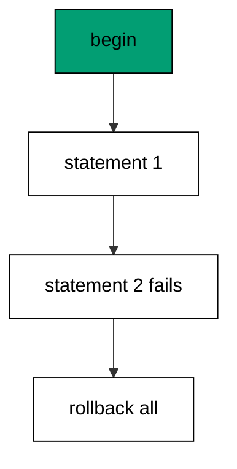

Atomicity is the reason migrations share one transaction per file: a half-applied migration is the one state no team can reason about. The database guarantees all-or-nothing; the author's job is to keep each file inside one transaction.

**`learning/code/ex-21-failing-statement-rolls-back/main.go`**:

```go
// => Shared driver: every unit in this course opens with this prelude.
// => The harness network is closed, so units carry a small standard-library
// => driver that applies the same goose SQL files `goose up` would apply.
// => The files, the history table shape, and the ordering rules are goose's
// => own; the driver only replaces the network-dependent binary.
package main // => every unit is one runnable program

import ( // => standard library only: no third-party modules
	"bufio"           // => bufio frames protocol messages over the TCP stream
	"encoding/binary" // => binary lays out length-prefixed protocol fields
	"fmt"             // => fmt prints the deterministic transcript only
	"io"              // => io forces full reads of split protocol messages
	"net"             // => net dials the harness Postgres service over TCP
	"os"              // => os reads the harness database address, never hardcoded
	"sort"            // => sort orders migration files, never trusts directory order
	"strings"         // => strings splits the goose Up and Down annotations
) // => every import used by driver and units

// => The database address comes from the harness, with local-run defaults.
func addr() (string, string, string) { // => one helper owns every address default
	host := os.Getenv("PGHOST") // => service hostname in the unit network
	if host == "" {             // => empty means a local run outside the harness
		host = "postgres" // => same default the Python courses use
	} // => end addr: empty means a local run outside the harness
	user := os.Getenv("PGUSER") // => trust-auth role, no password needed
	if user == "" {             // => empty means a local run outside the harness
		user = "postgres" // => same default the Python courses use
	} // => end addr: empty means a local run outside the harness
	db := os.Getenv("PGDATABASE") // => fresh database for every unit run
	if db == "" {                 // => empty means a local run outside the harness
		db = "postgres" // => same default the Python courses use
	} // => end addr: empty means a local run outside the harness
	return host, user, db // => callers never re-read the environment
} // => end addr: one helper owns every address default

// => conn wraps one TCP connection plus a buffered reader for message frames.
type conn struct { // => a tiny struct keeps the socket and the framer together
	c net.Conn      // => the raw TCP socket to the Postgres service
	r *bufio.Reader // => buffered reads frame messages split across packets
} // => end type conn: socket and framer travel together

// => readMsg reads one backend message: a type byte plus a length body.
func (k *conn) readMsg() (byte, []byte, error) { // => every response flows through here
	head := make([]byte, 5)                           // => one type byte plus one int32 length
	if _, err := io.ReadFull(k.r, head); err != nil { // => fragments reassemble before framing
		return 0, nil, err // => no partial message is ever trusted
	} // => end readMsg: fragments reassemble before framing
	n := int(binary.BigEndian.Uint32(head[1:])) - 4   // => length counts itself, not the type
	body := make([]byte, n)                           // => exact-size body, never over-read
	if _, err := io.ReadFull(k.r, body); err != nil { // => fragments reassemble before framing
		return 0, nil, err // => no partial message is ever trusted
	} // => end readMsg: fragments reassemble before framing
	return head[0], body, nil // => type byte tells the caller what arrived
} // => end readMsg: every response flows through here

// => sendMsg writes one frontend message: a type byte plus a length body.
func (k *conn) sendMsg(t byte, body []byte) error { // => startup is the only typeless message
	out := []byte{t}                                      // => type byte leads every message
	lenb := make([]byte, 4)                               // => four bytes carry the length
	binary.BigEndian.PutUint32(lenb, uint32(len(body)+4)) // => length counts itself
	out = append(out, lenb...)                            // => length follows the type byte
	out = append(out, body...)                            // => payload closes the message
	_, err := k.c.Write(out)                              // => one write keeps frames whole
	return err                                            // => write errors fail the unit loudly
} // => end sendMsg: startup is the only typeless message

// => connect opens the service database and waits for session readiness.
func connect() (*conn, error) { // => every unit starts from this one helper
	host, user, db := addr()         // => harness address, never hardcoded
	return connectDb(host, user, db) // => one path opens every session
} // => end connect: every unit starts from this one helper

// => connectDb opens a named database on the same host for multi-db drills.
func connectDb(host, user, db string) (*conn, error) { // => environments are databases, not servers
	c, err := net.Dial("tcp", host+":5432") // => Postgres listens on 5432
	if err != nil {                         // => unreachable service is fatal
		return nil, err // => no fallback: the harness owns the database
	} // => end connectDb: unreachable service is fatal
	k := &conn{c: c, r: bufio.NewReader(c)}             // => buffer the fresh socket at once
	body := []byte{}                                    // => startup body is parameters only
	body = append(body, 0, 0, 0, 0)                     // => placeholder for the length prefix
	body = append(body, 0, 3, 0, 0)                     // => protocol 3.0, the stable version
	body = append(body, []byte("user")...)              // => user key starts the parameters
	body = append(body, 0)                              // => keys and values are NUL-separated
	body = append(body, []byte(user)...)                // => trust-auth role from the harness
	body = append(body, 0)                              // => NUL ends the value
	body = append(body, []byte("database")...)          // => database key follows the user
	body = append(body, 0)                              // => NUL ends the key
	body = append(body, []byte(db)...)                  // => fresh database for every unit run
	body = append(body, 0)                              // => NUL ends the value
	body = append(body, 0)                              // => empty key ends the parameters
	binary.BigEndian.PutUint32(body, uint32(len(body))) // => startup length counts itself
	if _, err := c.Write(body); err != nil {            // => startup is the only typeless message
		return nil, err // => unwritable socket is fatal
	} // => end connectDb: startup is the only typeless message
	for { // => drain until the session is ready for queries
		t, b, err := k.readMsg() // => every backend message flows through here
		if err != nil {          // => broken handshake is fatal
			return nil, err // => no half-open session is ever used
		} // => end connectDb: broken handshake is fatal
		switch t { // => only three message kinds matter during startup
		case 'R': // => authentication response arrives first
			if binary.BigEndian.Uint32(b) != 0 { // => nonzero means a password is wanted
				return nil, fmt.Errorf("server wants a password") // => trust auth never asks
			} // => end connectDb: nonzero means a password is wanted
		case 'E': // => an error ends the handshake with the server text
			return nil, fmt.Errorf("startup: %s", errText(b)) // => server text explains the cause
		case 'Z': // => ReadyForQuery means the session accepts queries
			return k, nil // => handshake done: hand the live session back
		} // => end connectDb: only three message kinds matter during startup
	} // => end connectDb: drain until the session is ready for queries
} // => end connectDb: environments are databases, not servers

// => errText extracts the human message (field M) from an ErrorResponse.
func errText(b []byte) string { // => one helper decodes every server error
	parts := strings.Split(string(b), "\x00") // => fields are NUL-separated pairs
	for i := 0; i+1 < len(parts); i += 2 {    // => walk code and value together
		if parts[i] == "M" { // => M is the primary human message
			return parts[i+1] // => return the message, skip the detail fields
		} // => end errText: M is the primary human message
	} // => end errText: walk code and value together
	return "unknown error" // => malformed errors still fail with a fixed line
} // => end errText: one helper decodes every server error

// => run sends one SQL string and returns every data row plus the command tag.
func (k *conn) run(q string) ([][]string, string, error) { // => one path runs every statement
	body := append([]byte(q), 0)                 // => Query messages are NUL-terminated
	if err := k.sendMsg('Q', body); err != nil { // => send fails loudly, never silently
		return nil, "", err // => unwritable socket ends the unit
	} // => end run: send fails loudly, never silently
	var rows [][]string // => data rows accumulate across result sets
	tag := ""           // => the last command tag (SELECT 3, CREATE TABLE...)
	for {               // => drain until ReadyForQuery closes this query string
		t, b, err := k.readMsg() // => every response flows through the framer
		if err != nil {          // => broken mid-query connection is fatal
			return nil, "", err // => partial results are never returned
		} // => end run: broken mid-query connection is fatal
		switch t { // => four message kinds carry a simple-query response
		case 'T', 'N', 'A', 'S', 'K': // => metadata the transcript never prints
		case 'D': // => one data row arrived
			rows = append(rows, parseRow(b)) // => decode the text columns now
		case 'C': // => one statement finished
			tag = strings.TrimRight(string(b[:len(b)-1]), "\x00") // => tag names what ran
		case 'E': // => the statement failed
			drain(k)                                     // => finish the failed query before reuse
			return nil, "", fmt.Errorf("%s", errText(b)) // => server text becomes the failure
		case 'Z': // => ReadyForQuery ends this query string
			return rows, tag, nil // => rows, tag, and a clean session
		} // => end run: four message kinds carry a simple-query response
	} // => end run: drain until ReadyForQuery closes this query string
} // => end run: one path runs every statement

// => drain reads to the next ReadyForQuery after a statement error.
func drain(k *conn) { // => an errored query still owns the socket until Z
	for { // => loop until the session is reusable
		t, _, err := k.readMsg()    // => discard every message after the error
		if err != nil || t == 'Z' { // => socket break or ready both end the drain
			return // => caller decides the failure, the drain only resynchronizes
		} // => end drain: socket break or ready both end the drain
	} // => end drain: loop until the session is reusable
} // => end drain: an errored query still owns the socket until Z

// => parseRow decodes one DataRow body into text columns, NULL as "NULL".
func parseRow(b []byte) []string { // => one helper decodes every returned row
	n := int(binary.BigEndian.Uint16(b)) // => column count leads the body
	b = b[2:]                            // => step past the count
	out := make([]string, 0, n)          // => pre-size the row to the count
	for i := 0; i < n; i++ {             // => walk each column in order
		l := int(int32(binary.BigEndian.Uint32(b))) // => -1 marks NULL, else the length
		b = b[4:]                                   // => step past the length
		if l < 0 {                                  // => NULL has no bytes to read
			out = append(out, "NULL") // => fixed word keeps transcripts stable
			continue                  // => next column, no bytes consumed
		} // => end parseRow: NULL has no bytes to read
		out = append(out, string(b[:l])) // => text format is already printable
		b = b[l:]                        // => step past the value bytes
	} // => end parseRow: walk each column in order
	return out // => one row, fully decoded
} // => end parseRow: one helper decodes every returned row

// => must runs SQL or exits nonzero with the server text on standard error.
func must(k *conn, q string) [][]string { // => setup statements never fail quietly
	rows, _, err := k.run(q) // => rows return for verification queries
	if err != nil {          // => any server error is fatal to the unit
		fmt.Fprintln(os.Stderr, "sql error:", err) // => errors go to stderr, never stdout
		os.Exit(1)                                 // => nonzero exit fails the harness check
	} // => end must: any server error is fatal to the unit
	return rows // => callers print only what the lesson asserts
} // => end must: setup statements never fail quietly

// => try runs SQL and returns the server error text instead of exiting.
func try(k *conn, q string) ([][]string, string) { // => failure drills inspect errors, not die
	rows, _, err := k.run(q) // => same path as must, opposite failure policy
	if err != nil {          // => expected errors become transcript lines
		return nil, err.Error() // => fixed server text, never timings
	} // => end try: expected errors become transcript lines
	return rows, "" // => empty error means the statement succeeded
} // => end try: failure drills inspect errors, not die

// => mig holds one goose SQL file: its version, name, and Up/Down sections.
type mig struct { // => mirrors the goose file layout the lesson teaches
	version string   // => zero-padded number orders history, like goose
	name    string   // => human slug after the version number
	up      []string // => forward statements, run inside one transaction
	down    []string // => reverse statements, run inside one transaction
	noTx    bool     // => NO TRANSACTION files run outside one, like goose
} // => end type mig: version, name, sections, and mode

// => parseGoose splits one goose SQL file into its Up and Down statements.
func parseGoose(text string) (up, down []string, noTx bool) { // => the lesson asserts this exact split
	section := ""                                    // => nothing belongs outside the annotations
	for _, line := range strings.Split(text, "\n") { // => walk the file line by line
		t := strings.TrimSpace(line) // => annotation matching ignores indentation
		switch t {                   // => four annotation lines switch sections
		case "-- +goose Up": // => forward section starts here, like goose
			section = "up" // => following statements migrate forward
			continue       // => the annotation itself never runs
		case "-- +goose Down": // => reverse section starts here, like goose
			section = "down" // => following statements roll back
			continue         // => the annotation itself never runs
		case "-- +goose NO TRANSACTION": // => concurrent work cannot run inside one
			noTx = true // => remember the file opts out of the transaction
			continue    // => the annotation itself never runs
		} // => end parseGoose: four annotation lines switch sections
		if strings.HasPrefix(t, "--") || t == "" { // => comments and blanks never run
			continue // => only real statements reach the database
		} // => end parseGoose: comments and blanks never run
		if section == "up" { // => route by the annotation seen above
			up = append(up, line) // => keep the original line for the file write
		} else if section == "down" { // => down statements collect separately
			down = append(down, line) // => keep the original line for the file write
		} // => end parseGoose: down statements collect separately
	} // => end parseGoose: walk the file line by line
	return splitStmts(strings.Join(up, "\n")), splitStmts(strings.Join(down, "\n")), noTx // => one string per statement
} // => end parseGoose: the lesson asserts this exact split

// => splitStmts cuts statement text on semicolons outside quotes.
func splitStmts(s string) []string { // => multi-line statements stay whole until ;
	var out []string        // => finished statements accumulate here
	var cur strings.Builder // => the statement under construction
	inStr := false          // => semicolons inside quotes never split
	for _, r := range s {   // => walk rune by rune, quotes included
		switch { // => quote tracking decides what a semicolon means
		case r == '\'': // => a quote toggles string mode
			inStr = !inStr   // => enter or leave the quoted region
			cur.WriteRune(r) // => the quote belongs to the statement
		case r == ';' && !inStr: // => a bare semicolon ends one statement
			if t := strings.TrimSpace(cur.String()); t != "" { // => skip empty fragments
				out = append(out, t) // => store the finished statement
			} // => end splitStmts: skip empty fragments
			cur.Reset() // => start the next statement fresh
		default: // => every other rune belongs to the current statement
			cur.WriteRune(r) // => accumulate verbatim
		} // => end splitStmts: quote tracking decides what a semicolon means
	} // => end splitStmts: walk rune by rune, quotes included
	if t := strings.TrimSpace(cur.String()); t != "" { // => trailing text without ; still counts
		out = append(out, t) // => last statement needs no semicolon
	} // => end splitStmts: trailing text without ; still counts
	return out // => callers run each statement in order
} // => end splitStmts: multi-line statements stay whole until ;

// => ensureHistory creates the goose history table once per unit run.
func ensureHistory(k *conn) { // => goose_db_version is goose's own default name
	must(k, `CREATE TABLE IF NOT EXISTS goose_db_version (`+ // => reruns never fail here
		`id integer PRIMARY KEY GENERATED BY DEFAULT AS IDENTITY, `+ // => surrogate key, never printed
		`version_id bigint NOT NULL, `+ // => applied version numbers live here
		`is_applied boolean NOT NULL, `+ // => goose marks rows applied on success
		`tstamp timestamp NOT NULL DEFAULT now())`) // => timestamp defaults, never printed
} // => end ensureHistory: goose_db_version is goose's own default name

// => appliedVersions returns the version numbers already marked applied.
func appliedVersions(k *conn) map[int64]bool { // => history decides what still needs running
	rows := must(k, `SELECT version_id FROM goose_db_version `+ // => only the numbers matter
		`WHERE is_applied ORDER BY version_id`) // => order keeps the transcript stable
	got := map[int64]bool{}  // => set lookup answers "already applied" fast
	for _, r := range rows { // => one row per applied migration
		var v int64                // => version numbers are integers
		fmt.Sscanf(r[0], "%d", &v) // => text format parses back to a number
		got[v] = true              // => mark this version done
	} // => end appliedVersions: one row per applied migration
	return got // => callers skip whatever history already holds
} // => end appliedVersions: history decides what still needs running

// => applyUp runs every pending migration forward, one transaction each.
func applyUp(k *conn, ms []mig) { // => files on disk are already the source of truth
	done := appliedVersions(k) // => history decides what still needs running
	for _, m := range ms {     // => file order is version order, sorted by the caller
		var v int64                     // => versions compare as numbers
		fmt.Sscanf(m.version, "%d", &v) // => zero-padded file prefix parses back
		if done[v] {                    // => applied migrations never run twice
			continue // => idempotent reruns skip straight past
		} // => end applyUp: applied migrations never run twice
		if !m.noTx { // => transactional files wrap everything in one unit
			must(k, "BEGIN") // => one migration is one transaction, like goose
		} // => end applyUp: transactional files wrap everything in one unit
		for _, s := range m.up { // => forward statements run in file order
			must(k, s) // => any failure aborts the unit before COMMIT
		} // => end applyUp: forward statements run in file order
		if !m.noTx { // => stamps join the same transaction they describe
			must(k, fmt.Sprintf(`INSERT INTO goose_db_version `+ // => stamp only after success
				`(version_id, is_applied) VALUES (%d, true)`, v)) // => stamp mirrors goose exactly
			must(k, "COMMIT") // => history row and schema land together
		} else { // => concurrent statements cannot share a transaction
			must(k, fmt.Sprintf(`INSERT INTO goose_db_version `+ // => stamp follows the work
				`(version_id, is_applied) VALUES (%d, true)`, v)) // => same row, separate statement
		} // => end applyUp: concurrent statements cannot share a transaction
	} // => end applyUp: file order is version order, sorted by the caller
} // => end applyUp: files on disk are already the source of truth

// => applyDown rolls back the newest applied migrations, newest first.
func applyDown(k *conn, ms []mig, steps int) { // => steps bounds how far history rewinds
	done := appliedVersions(k) // => history decides what can roll back
	var todo []mig             // => applied migrations in version order first
	for _, m := range ms {     // => walk the whole known history
		var v int64                     // => versions compare as numbers
		fmt.Sscanf(m.version, "%d", &v) // => zero-padded file prefix parses back
		if done[v] {                    // => only applied migrations roll back
			todo = append(todo, m) // => keep the migration for the reverse pass
		} // => end applyDown: only applied migrations roll back
	} // => end applyDown: walk the whole known history
	for i := len(todo) - 1; i >= 0 && steps > 0; i-- { // => newest applied goes first
		m := todo[i]                    // => this migration rolls back now
		var v int64                     // => versions compare as numbers
		fmt.Sscanf(m.version, "%d", &v) // => zero-padded file prefix parses back
		if !m.noTx {                    // => transactional files wrap the rollback too
			must(k, "BEGIN") // => reverse change is atomic, like the forward one
		} // => end applyDown: transactional files wrap the rollback too
		for _, s := range m.down { // => reverse statements run in file order
			must(k, s) // => any failure aborts before the history row moves
		} // => end applyDown: reverse statements run in file order
		must(k, fmt.Sprintf(`DELETE FROM goose_db_version `+ // => unstamped only after success
			`WHERE version_id = %d`, v)) // => the version leaves history exactly once
		if !m.noTx { // => close the transaction the rollback opened
			must(k, "COMMIT") // => schema reversal and unstamp land together
		} // => end applyDown: close the transaction the rollback opened
		steps-- // => one rollback consumed from the budget
	} // => end applyDown: newest applied goes first
} // => end applyDown: steps bounds how far history rewinds

// => statusCounts splits known migrations into applied and pending lists.
func statusCounts(k *conn, ms []mig) (applied, pending []string) { // => goose status in two lists
	done := appliedVersions(k) // => history decides which list each version joins
	for _, m := range ms {     // => walk the known history in version order
		var v int64                     // => versions compare as numbers
		fmt.Sscanf(m.version, "%d", &v) // => zero-padded file prefix parses back
		if done[v] {                    // => stamped versions are done
			applied = append(applied, m.version) // => keep the version string for printing
		} else { // => unstamped versions still wait
			pending = append(pending, m.version) // => keep the version string for printing
		} // => end statusCounts: unstamped versions still wait
	} // => end statusCounts: walk the known history in version order
	return applied, pending // => callers print both lists in one stable line each
} // => end statusCounts: goose status in two lists

// => files writes each migration as a real goose SQL file under dir.
func files(dir string, ms []mig) { // => the lesson shows these files byte-identically
	for _, m := range ms { // => one file per migration, like `goose create`
		name := fmt.Sprintf("%s_%s.sql", m.version, m.name) // => goose names files version-first
		var b strings.Builder                               // => build the file text in order
		if m.noTx {                                         // => concurrent files announce it first
			b.WriteString("-- +goose NO TRANSACTION\n") // => goose honors this exact annotation
		} // => end files: concurrent files announce it first
		b.WriteString("-- +goose Up\n") // => forward annotation leads
		for _, s := range m.up {        // => forward statements follow
			b.WriteString(s + ";\n") // => one statement per line, semicolon-closed
		} // => end files: forward statements follow
		b.WriteString("-- +goose Down\n") // => reverse annotation splits the file
		for _, s := range m.down {        // => reverse statements close the file
			b.WriteString(s + ";\n") // => one statement per line, semicolon-closed
		} // => end files: reverse statements close the file
		if err := os.WriteFile(dir+"/"+name, []byte(b.String()), 0644); err != nil { // => real files, like goose
			fmt.Fprintln(os.Stderr, "write error:", err) // => write errors fail loudly
			os.Exit(1)                                   // => no half-written migration set
		} // => end files: real files, like goose
	} // => end files: one file per migration, like `goose create`
} // => end files: the lesson shows these files byte-identically

// => versions lists migration files in version order from dir.
func versions(dir string) []mig { // => directory order is never trusted for history
	ents, err := os.ReadDir(dir) // => read the whole migrations directory
	if err != nil {              // => unreadable directory is fatal
		fmt.Fprintln(os.Stderr, "read error:", err) // => errors go to stderr
		os.Exit(1)                                  // => nonzero exit fails the check
	} // => end versions: unreadable directory is fatal
	names := []string{}      // => collect names before sorting
	for _, e := range ents { // => walk every directory entry
		if !e.IsDir() && strings.HasSuffix(e.Name(), ".sql") { // => only goose SQL files count
			names = append(names, e.Name()) // => keep the file name for parsing
		} // => end versions: only goose SQL files count
	} // => end versions: walk every directory entry
	sort.Strings(names)       // => zero-padded versions sort chronologically
	var out []mig             // => parsed migrations accumulate here
	for _, n := range names { // => parse in version order
		raw, err := os.ReadFile(dir + "/" + n) // => read the real file back
		if err != nil {                        // => unreadable file is fatal
			fmt.Fprintln(os.Stderr, "read error:", err) // => errors go to stderr
			os.Exit(1)                                  // => nonzero exit fails the check
		} // => end versions: unreadable file is fatal
		up, down, noTx := parseGoose(string(raw))                                            // => split on the goose annotations
		rest := strings.TrimSuffix(n, ".sql")                                                // => strip the extension first
		ver := rest[:5]                                                                      // => first five digits are the version
		out = append(out, mig{version: ver, name: rest[6:], up: up, down: down, noTx: noTx}) // => keep every part
	} // => end versions: parse in version order
	return out // => version-ordered migrations, ready to apply
} // => end versions: directory order is never trusted for history

// => findDupes returns version numbers claimed by two or more files.
func findDupes(dir string) []string { // => goose refuses duplicate versions outright
	ents, err := os.ReadDir(dir) // => read the whole migrations directory
	if err != nil {              // => unreadable directory is fatal
		fmt.Fprintln(os.Stderr, "read error:", err) // => errors go to stderr
		os.Exit(1)                                  // => nonzero exit fails the check
	} // => end findDupes: unreadable directory is fatal
	seen := map[string]int{} // => count claims per five-digit version prefix
	for _, e := range ents { // => walk every directory entry
		if !e.IsDir() && strings.HasSuffix(e.Name(), ".sql") { // => only goose SQL files count
			seen[e.Name()[:5]]++ // => first five digits are the version
		} // => end findDupes: only goose SQL files count
	} // => end findDupes: walk every directory entry
	var out []string         // => duplicates accumulate in version order
	for _, e := range ents { // => second pass keeps the order stable
		if !e.IsDir() && strings.HasSuffix(e.Name(), ".sql") { // => only goose SQL files count
			if v := e.Name()[:5]; seen[v] > 1 { // => claimed more than once
				out = append(out, v) // => keep the version string for printing
				seen[v] = 0          // => report each duplicate version only once
			} // => end findDupes: claimed more than once
		} // => end findDupes: only goose SQL files count
	} // => end findDupes: second pass keeps the order stable
	return out // => empty means the history numbers are unique
} // => end findDupes: goose refuses duplicate versions outright

func main() {
	k, err := connect() // => one session runs the whole example
	if err != nil {     // => unreachable database fails loudly
		fmt.Fprintln(os.Stderr, "connect error:", err) // => connection errors go to stderr
		os.Exit(1)                                     // => nonzero exit fails the check
	}
	defer k.c.Close() // => the socket closes when the example ends
	// => A scratch migrations directory: goose files live here, never in the unit.
	// => the scratch path never reaches stdout, so reruns stay byte-stable
	dir, err := os.MkdirTemp("", "ex21-") // => private directory, like `goose create`
	if err != nil {                       // => unmakable temp dir is fatal
		fmt.Fprintln(os.Stderr, "temp error:", err) // => errors go to stderr
		os.Exit(1)                                  // => nonzero exit fails the check
	}
	defer os.RemoveAll(dir)                          // => scratch files vanish; only transcripts remain
	must(k, "DROP TABLE IF EXISTS goose_db_version") // => stale history vanishes too
	ensureHistory(k)                                 // => goose history table, real shape
	files(dir, []mig{                                // => good statement first, broken statement second
		{version: "00001", name: "half_applied", // => this migration must leave no trace
			up:   []string{"CREATE TABLE ex21_half (id SERIAL PRIMARY KEY)", "CREATE TABLE ex21_half (id SERIAL PRIMARY KEY)"}, // => second create collides
			down: []string{"DROP TABLE IF EXISTS ex21_half"}},                                                                  // => cleanup guard for the drill
	})
	ms := versions(dir)                                                                              // => parse the files back, like goose would
	must(k, "BEGIN")                                                                                 // => one migration is one transaction, like goose
	_, first := try(k, ms[0].up[0])                                                                  // => first statement succeeds inside the transaction
	fmt.Println("first:", first == "")                                                               // => Output: first: true
	_, second := try(k, ms[0].up[1])                                                                 // => duplicate table fails inside the transaction
	fmt.Println("second ok:", second == "")                                                          // => Output: second ok: false
	must(k, "ROLLBACK")                                                                              // => the whole migration unwinds, stamp included
	rows := must(k, `SELECT count(*) FROM information_schema.tables WHERE table_name = 'ex21_half'`) // => no trace survives
	fmt.Println("tables:", rows[0][0])                                                               // => Output: tables: 0
	rows = must(k, `SELECT count(*) FROM goose_db_version WHERE is_applied`)                         // => no stamp was written
	fmt.Println("applied:", rows[0][0])                                                              // => Output: applied: 0
	fmt.Println("cleaned: yes")                                                                      // => Output: cleaned: yes
	must(k, "DROP TABLE IF EXISTS goose_db_version")                                                 // => the example leaves no history behind
}
```

**Output** (`learning/code/ex-21-failing-statement-rolls-back/expected/main.stdout.txt`):

```text
first: true
second ok: false
tables: 0
applied: 0
cleaned: yes
```

**Key takeaway**: One transaction per file makes migrations atomic: a failed statement unwinds the whole file including its stamp.

**Why it matters**: Atomicity converts partial failure from a disaster into a non-event. Either the whole file commits with its stamp or nothing persists at all, so there is no third state to diagnose. Authors earn this guarantee by keeping each file inside one transaction. Keep each file inside one transaction, and the third state — half applied — simply cannot exist.

### Example 22: One Transaction Per Migration

Each file gets exactly one transaction: this example applies a three-statement migration and shows all three effects landing together with a single history row. Statements inside a file never commit separately. (Concepts: co-12.)

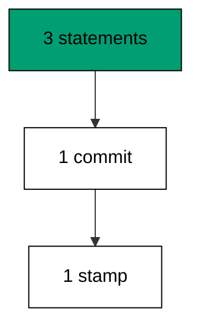

One transaction per file is the atomicity boundary the whole course relies on. Files compose into chains; transactions do not span files.

**`learning/code/ex-22-one-transaction-per-migration/main.go`**:

```go
// => Shared driver: every unit in this course opens with this prelude.
// => The harness network is closed, so units carry a small standard-library
// => driver that applies the same goose SQL files `goose up` would apply.
// => The files, the history table shape, and the ordering rules are goose's
// => own; the driver only replaces the network-dependent binary.
package main // => every unit is one runnable program

import ( // => standard library only: no third-party modules
	"bufio"           // => bufio frames protocol messages over the TCP stream
	"encoding/binary" // => binary lays out length-prefixed protocol fields
	"fmt"             // => fmt prints the deterministic transcript only
	"io"              // => io forces full reads of split protocol messages
	"net"             // => net dials the harness Postgres service over TCP
	"os"              // => os reads the harness database address, never hardcoded
	"sort"            // => sort orders migration files, never trusts directory order
	"strings"         // => strings splits the goose Up and Down annotations
) // => every import used by driver and units

// => The database address comes from the harness, with local-run defaults.
func addr() (string, string, string) { // => one helper owns every address default
	host := os.Getenv("PGHOST") // => service hostname in the unit network
	if host == "" {             // => empty means a local run outside the harness
		host = "postgres" // => same default the Python courses use
	} // => end addr: empty means a local run outside the harness
	user := os.Getenv("PGUSER") // => trust-auth role, no password needed
	if user == "" {             // => empty means a local run outside the harness
		user = "postgres" // => same default the Python courses use
	} // => end addr: empty means a local run outside the harness
	db := os.Getenv("PGDATABASE") // => fresh database for every unit run
	if db == "" {                 // => empty means a local run outside the harness
		db = "postgres" // => same default the Python courses use
	} // => end addr: empty means a local run outside the harness
	return host, user, db // => callers never re-read the environment
} // => end addr: one helper owns every address default

// => conn wraps one TCP connection plus a buffered reader for message frames.
type conn struct { // => a tiny struct keeps the socket and the framer together
	c net.Conn      // => the raw TCP socket to the Postgres service
	r *bufio.Reader // => buffered reads frame messages split across packets
} // => end type conn: socket and framer travel together

// => readMsg reads one backend message: a type byte plus a length body.
func (k *conn) readMsg() (byte, []byte, error) { // => every response flows through here
	head := make([]byte, 5)                           // => one type byte plus one int32 length
	if _, err := io.ReadFull(k.r, head); err != nil { // => fragments reassemble before framing
		return 0, nil, err // => no partial message is ever trusted
	} // => end readMsg: fragments reassemble before framing
	n := int(binary.BigEndian.Uint32(head[1:])) - 4   // => length counts itself, not the type
	body := make([]byte, n)                           // => exact-size body, never over-read
	if _, err := io.ReadFull(k.r, body); err != nil { // => fragments reassemble before framing
		return 0, nil, err // => no partial message is ever trusted
	} // => end readMsg: fragments reassemble before framing
	return head[0], body, nil // => type byte tells the caller what arrived
} // => end readMsg: every response flows through here

// => sendMsg writes one frontend message: a type byte plus a length body.
func (k *conn) sendMsg(t byte, body []byte) error { // => startup is the only typeless message
	out := []byte{t}                                      // => type byte leads every message
	lenb := make([]byte, 4)                               // => four bytes carry the length
	binary.BigEndian.PutUint32(lenb, uint32(len(body)+4)) // => length counts itself
	out = append(out, lenb...)                            // => length follows the type byte
	out = append(out, body...)                            // => payload closes the message
	_, err := k.c.Write(out)                              // => one write keeps frames whole
	return err                                            // => write errors fail the unit loudly
} // => end sendMsg: startup is the only typeless message

// => connect opens the service database and waits for session readiness.
func connect() (*conn, error) { // => every unit starts from this one helper
	host, user, db := addr()         // => harness address, never hardcoded
	return connectDb(host, user, db) // => one path opens every session
} // => end connect: every unit starts from this one helper

// => connectDb opens a named database on the same host for multi-db drills.
func connectDb(host, user, db string) (*conn, error) { // => environments are databases, not servers
	c, err := net.Dial("tcp", host+":5432") // => Postgres listens on 5432
	if err != nil {                         // => unreachable service is fatal
		return nil, err // => no fallback: the harness owns the database
	} // => end connectDb: unreachable service is fatal
	k := &conn{c: c, r: bufio.NewReader(c)}             // => buffer the fresh socket at once
	body := []byte{}                                    // => startup body is parameters only
	body = append(body, 0, 0, 0, 0)                     // => placeholder for the length prefix
	body = append(body, 0, 3, 0, 0)                     // => protocol 3.0, the stable version
	body = append(body, []byte("user")...)              // => user key starts the parameters
	body = append(body, 0)                              // => keys and values are NUL-separated
	body = append(body, []byte(user)...)                // => trust-auth role from the harness
	body = append(body, 0)                              // => NUL ends the value
	body = append(body, []byte("database")...)          // => database key follows the user
	body = append(body, 0)                              // => NUL ends the key
	body = append(body, []byte(db)...)                  // => fresh database for every unit run
	body = append(body, 0)                              // => NUL ends the value
	body = append(body, 0)                              // => empty key ends the parameters
	binary.BigEndian.PutUint32(body, uint32(len(body))) // => startup length counts itself
	if _, err := c.Write(body); err != nil {            // => startup is the only typeless message
		return nil, err // => unwritable socket is fatal
	} // => end connectDb: startup is the only typeless message
	for { // => drain until the session is ready for queries
		t, b, err := k.readMsg() // => every backend message flows through here
		if err != nil {          // => broken handshake is fatal
			return nil, err // => no half-open session is ever used
		} // => end connectDb: broken handshake is fatal
		switch t { // => only three message kinds matter during startup
		case 'R': // => authentication response arrives first
			if binary.BigEndian.Uint32(b) != 0 { // => nonzero means a password is wanted
				return nil, fmt.Errorf("server wants a password") // => trust auth never asks
			} // => end connectDb: nonzero means a password is wanted
		case 'E': // => an error ends the handshake with the server text
			return nil, fmt.Errorf("startup: %s", errText(b)) // => server text explains the cause
		case 'Z': // => ReadyForQuery means the session accepts queries
			return k, nil // => handshake done: hand the live session back
		} // => end connectDb: only three message kinds matter during startup
	} // => end connectDb: drain until the session is ready for queries
} // => end connectDb: environments are databases, not servers

// => errText extracts the human message (field M) from an ErrorResponse.
func errText(b []byte) string { // => one helper decodes every server error
	parts := strings.Split(string(b), "\x00") // => fields are NUL-separated pairs
	for i := 0; i+1 < len(parts); i += 2 {    // => walk code and value together
		if parts[i] == "M" { // => M is the primary human message
			return parts[i+1] // => return the message, skip the detail fields
		} // => end errText: M is the primary human message
	} // => end errText: walk code and value together
	return "unknown error" // => malformed errors still fail with a fixed line
} // => end errText: one helper decodes every server error

// => run sends one SQL string and returns every data row plus the command tag.
func (k *conn) run(q string) ([][]string, string, error) { // => one path runs every statement
	body := append([]byte(q), 0)                 // => Query messages are NUL-terminated
	if err := k.sendMsg('Q', body); err != nil { // => send fails loudly, never silently
		return nil, "", err // => unwritable socket ends the unit
	} // => end run: send fails loudly, never silently
	var rows [][]string // => data rows accumulate across result sets
	tag := ""           // => the last command tag (SELECT 3, CREATE TABLE...)
	for {               // => drain until ReadyForQuery closes this query string
		t, b, err := k.readMsg() // => every response flows through the framer
		if err != nil {          // => broken mid-query connection is fatal
			return nil, "", err // => partial results are never returned
		} // => end run: broken mid-query connection is fatal
		switch t { // => four message kinds carry a simple-query response
		case 'T', 'N', 'A', 'S', 'K': // => metadata the transcript never prints
		case 'D': // => one data row arrived
			rows = append(rows, parseRow(b)) // => decode the text columns now
		case 'C': // => one statement finished
			tag = strings.TrimRight(string(b[:len(b)-1]), "\x00") // => tag names what ran
		case 'E': // => the statement failed
			drain(k)                                     // => finish the failed query before reuse
			return nil, "", fmt.Errorf("%s", errText(b)) // => server text becomes the failure
		case 'Z': // => ReadyForQuery ends this query string
			return rows, tag, nil // => rows, tag, and a clean session
		} // => end run: four message kinds carry a simple-query response
	} // => end run: drain until ReadyForQuery closes this query string
} // => end run: one path runs every statement

// => drain reads to the next ReadyForQuery after a statement error.
func drain(k *conn) { // => an errored query still owns the socket until Z
	for { // => loop until the session is reusable
		t, _, err := k.readMsg()    // => discard every message after the error
		if err != nil || t == 'Z' { // => socket break or ready both end the drain
			return // => caller decides the failure, the drain only resynchronizes
		} // => end drain: socket break or ready both end the drain
	} // => end drain: loop until the session is reusable
} // => end drain: an errored query still owns the socket until Z

// => parseRow decodes one DataRow body into text columns, NULL as "NULL".
func parseRow(b []byte) []string { // => one helper decodes every returned row
	n := int(binary.BigEndian.Uint16(b)) // => column count leads the body
	b = b[2:]                            // => step past the count
	out := make([]string, 0, n)          // => pre-size the row to the count
	for i := 0; i < n; i++ {             // => walk each column in order
		l := int(int32(binary.BigEndian.Uint32(b))) // => -1 marks NULL, else the length
		b = b[4:]                                   // => step past the length
		if l < 0 {                                  // => NULL has no bytes to read
			out = append(out, "NULL") // => fixed word keeps transcripts stable
			continue                  // => next column, no bytes consumed
		} // => end parseRow: NULL has no bytes to read
		out = append(out, string(b[:l])) // => text format is already printable
		b = b[l:]                        // => step past the value bytes
	} // => end parseRow: walk each column in order
	return out // => one row, fully decoded
} // => end parseRow: one helper decodes every returned row

// => must runs SQL or exits nonzero with the server text on standard error.
func must(k *conn, q string) [][]string { // => setup statements never fail quietly
	rows, _, err := k.run(q) // => rows return for verification queries
	if err != nil {          // => any server error is fatal to the unit
		fmt.Fprintln(os.Stderr, "sql error:", err) // => errors go to stderr, never stdout
		os.Exit(1)                                 // => nonzero exit fails the harness check
	} // => end must: any server error is fatal to the unit
	return rows // => callers print only what the lesson asserts
} // => end must: setup statements never fail quietly

// => try runs SQL and returns the server error text instead of exiting.
func try(k *conn, q string) ([][]string, string) { // => failure drills inspect errors, not die
	rows, _, err := k.run(q) // => same path as must, opposite failure policy
	if err != nil {          // => expected errors become transcript lines
		return nil, err.Error() // => fixed server text, never timings
	} // => end try: expected errors become transcript lines
	return rows, "" // => empty error means the statement succeeded
} // => end try: failure drills inspect errors, not die

// => mig holds one goose SQL file: its version, name, and Up/Down sections.
type mig struct { // => mirrors the goose file layout the lesson teaches
	version string   // => zero-padded number orders history, like goose
	name    string   // => human slug after the version number
	up      []string // => forward statements, run inside one transaction
	down    []string // => reverse statements, run inside one transaction
	noTx    bool     // => NO TRANSACTION files run outside one, like goose
} // => end type mig: version, name, sections, and mode

// => parseGoose splits one goose SQL file into its Up and Down statements.
func parseGoose(text string) (up, down []string, noTx bool) { // => the lesson asserts this exact split
	section := ""                                    // => nothing belongs outside the annotations
	for _, line := range strings.Split(text, "\n") { // => walk the file line by line
		t := strings.TrimSpace(line) // => annotation matching ignores indentation
		switch t {                   // => four annotation lines switch sections
		case "-- +goose Up": // => forward section starts here, like goose
			section = "up" // => following statements migrate forward
			continue       // => the annotation itself never runs
		case "-- +goose Down": // => reverse section starts here, like goose
			section = "down" // => following statements roll back
			continue         // => the annotation itself never runs
		case "-- +goose NO TRANSACTION": // => concurrent work cannot run inside one
			noTx = true // => remember the file opts out of the transaction
			continue    // => the annotation itself never runs
		} // => end parseGoose: four annotation lines switch sections
		if strings.HasPrefix(t, "--") || t == "" { // => comments and blanks never run
			continue // => only real statements reach the database
		} // => end parseGoose: comments and blanks never run
		if section == "up" { // => route by the annotation seen above
			up = append(up, line) // => keep the original line for the file write
		} else if section == "down" { // => down statements collect separately
			down = append(down, line) // => keep the original line for the file write
		} // => end parseGoose: down statements collect separately
	} // => end parseGoose: walk the file line by line
	return splitStmts(strings.Join(up, "\n")), splitStmts(strings.Join(down, "\n")), noTx // => one string per statement
} // => end parseGoose: the lesson asserts this exact split

// => splitStmts cuts statement text on semicolons outside quotes.
func splitStmts(s string) []string { // => multi-line statements stay whole until ;
	var out []string        // => finished statements accumulate here
	var cur strings.Builder // => the statement under construction
	inStr := false          // => semicolons inside quotes never split
	for _, r := range s {   // => walk rune by rune, quotes included
		switch { // => quote tracking decides what a semicolon means
		case r == '\'': // => a quote toggles string mode
			inStr = !inStr   // => enter or leave the quoted region
			cur.WriteRune(r) // => the quote belongs to the statement
		case r == ';' && !inStr: // => a bare semicolon ends one statement
			if t := strings.TrimSpace(cur.String()); t != "" { // => skip empty fragments
				out = append(out, t) // => store the finished statement
			} // => end splitStmts: skip empty fragments
			cur.Reset() // => start the next statement fresh
		default: // => every other rune belongs to the current statement
			cur.WriteRune(r) // => accumulate verbatim
		} // => end splitStmts: quote tracking decides what a semicolon means
	} // => end splitStmts: walk rune by rune, quotes included
	if t := strings.TrimSpace(cur.String()); t != "" { // => trailing text without ; still counts
		out = append(out, t) // => last statement needs no semicolon
	} // => end splitStmts: trailing text without ; still counts
	return out // => callers run each statement in order
} // => end splitStmts: multi-line statements stay whole until ;

// => ensureHistory creates the goose history table once per unit run.
func ensureHistory(k *conn) { // => goose_db_version is goose's own default name
	must(k, `CREATE TABLE IF NOT EXISTS goose_db_version (`+ // => reruns never fail here
		`id integer PRIMARY KEY GENERATED BY DEFAULT AS IDENTITY, `+ // => surrogate key, never printed
		`version_id bigint NOT NULL, `+ // => applied version numbers live here
		`is_applied boolean NOT NULL, `+ // => goose marks rows applied on success
		`tstamp timestamp NOT NULL DEFAULT now())`) // => timestamp defaults, never printed
} // => end ensureHistory: goose_db_version is goose's own default name

// => appliedVersions returns the version numbers already marked applied.
func appliedVersions(k *conn) map[int64]bool { // => history decides what still needs running
	rows := must(k, `SELECT version_id FROM goose_db_version `+ // => only the numbers matter
		`WHERE is_applied ORDER BY version_id`) // => order keeps the transcript stable
	got := map[int64]bool{}  // => set lookup answers "already applied" fast
	for _, r := range rows { // => one row per applied migration
		var v int64                // => version numbers are integers
		fmt.Sscanf(r[0], "%d", &v) // => text format parses back to a number
		got[v] = true              // => mark this version done
	} // => end appliedVersions: one row per applied migration
	return got // => callers skip whatever history already holds
} // => end appliedVersions: history decides what still needs running

// => applyUp runs every pending migration forward, one transaction each.
func applyUp(k *conn, ms []mig) { // => files on disk are already the source of truth
	done := appliedVersions(k) // => history decides what still needs running
	for _, m := range ms {     // => file order is version order, sorted by the caller
		var v int64                     // => versions compare as numbers
		fmt.Sscanf(m.version, "%d", &v) // => zero-padded file prefix parses back
		if done[v] {                    // => applied migrations never run twice
			continue // => idempotent reruns skip straight past
		} // => end applyUp: applied migrations never run twice
		if !m.noTx { // => transactional files wrap everything in one unit
			must(k, "BEGIN") // => one migration is one transaction, like goose
		} // => end applyUp: transactional files wrap everything in one unit
		for _, s := range m.up { // => forward statements run in file order
			must(k, s) // => any failure aborts the unit before COMMIT
		} // => end applyUp: forward statements run in file order
		if !m.noTx { // => stamps join the same transaction they describe
			must(k, fmt.Sprintf(`INSERT INTO goose_db_version `+ // => stamp only after success
				`(version_id, is_applied) VALUES (%d, true)`, v)) // => stamp mirrors goose exactly
			must(k, "COMMIT") // => history row and schema land together
		} else { // => concurrent statements cannot share a transaction
			must(k, fmt.Sprintf(`INSERT INTO goose_db_version `+ // => stamp follows the work
				`(version_id, is_applied) VALUES (%d, true)`, v)) // => same row, separate statement
		} // => end applyUp: concurrent statements cannot share a transaction
	} // => end applyUp: file order is version order, sorted by the caller
} // => end applyUp: files on disk are already the source of truth

// => applyDown rolls back the newest applied migrations, newest first.
func applyDown(k *conn, ms []mig, steps int) { // => steps bounds how far history rewinds
	done := appliedVersions(k) // => history decides what can roll back
	var todo []mig             // => applied migrations in version order first
	for _, m := range ms {     // => walk the whole known history
		var v int64                     // => versions compare as numbers
		fmt.Sscanf(m.version, "%d", &v) // => zero-padded file prefix parses back
		if done[v] {                    // => only applied migrations roll back
			todo = append(todo, m) // => keep the migration for the reverse pass
		} // => end applyDown: only applied migrations roll back
	} // => end applyDown: walk the whole known history
	for i := len(todo) - 1; i >= 0 && steps > 0; i-- { // => newest applied goes first
		m := todo[i]                    // => this migration rolls back now
		var v int64                     // => versions compare as numbers
		fmt.Sscanf(m.version, "%d", &v) // => zero-padded file prefix parses back
		if !m.noTx {                    // => transactional files wrap the rollback too
			must(k, "BEGIN") // => reverse change is atomic, like the forward one
		} // => end applyDown: transactional files wrap the rollback too
		for _, s := range m.down { // => reverse statements run in file order
			must(k, s) // => any failure aborts before the history row moves
		} // => end applyDown: reverse statements run in file order
		must(k, fmt.Sprintf(`DELETE FROM goose_db_version `+ // => unstamped only after success
			`WHERE version_id = %d`, v)) // => the version leaves history exactly once
		if !m.noTx { // => close the transaction the rollback opened
			must(k, "COMMIT") // => schema reversal and unstamp land together
		} // => end applyDown: close the transaction the rollback opened
		steps-- // => one rollback consumed from the budget
	} // => end applyDown: newest applied goes first
} // => end applyDown: steps bounds how far history rewinds

// => statusCounts splits known migrations into applied and pending lists.
func statusCounts(k *conn, ms []mig) (applied, pending []string) { // => goose status in two lists
	done := appliedVersions(k) // => history decides which list each version joins
	for _, m := range ms {     // => walk the known history in version order
		var v int64                     // => versions compare as numbers
		fmt.Sscanf(m.version, "%d", &v) // => zero-padded file prefix parses back
		if done[v] {                    // => stamped versions are done
			applied = append(applied, m.version) // => keep the version string for printing
		} else { // => unstamped versions still wait
			pending = append(pending, m.version) // => keep the version string for printing
		} // => end statusCounts: unstamped versions still wait
	} // => end statusCounts: walk the known history in version order
	return applied, pending // => callers print both lists in one stable line each
} // => end statusCounts: goose status in two lists

// => files writes each migration as a real goose SQL file under dir.
func files(dir string, ms []mig) { // => the lesson shows these files byte-identically
	for _, m := range ms { // => one file per migration, like `goose create`
		name := fmt.Sprintf("%s_%s.sql", m.version, m.name) // => goose names files version-first
		var b strings.Builder                               // => build the file text in order
		if m.noTx {                                         // => concurrent files announce it first
			b.WriteString("-- +goose NO TRANSACTION\n") // => goose honors this exact annotation
		} // => end files: concurrent files announce it first
		b.WriteString("-- +goose Up\n") // => forward annotation leads
		for _, s := range m.up {        // => forward statements follow
			b.WriteString(s + ";\n") // => one statement per line, semicolon-closed
		} // => end files: forward statements follow
		b.WriteString("-- +goose Down\n") // => reverse annotation splits the file
		for _, s := range m.down {        // => reverse statements close the file
			b.WriteString(s + ";\n") // => one statement per line, semicolon-closed
		} // => end files: reverse statements close the file
		if err := os.WriteFile(dir+"/"+name, []byte(b.String()), 0644); err != nil { // => real files, like goose
			fmt.Fprintln(os.Stderr, "write error:", err) // => write errors fail loudly
			os.Exit(1)                                   // => no half-written migration set
		} // => end files: real files, like goose
	} // => end files: one file per migration, like `goose create`
} // => end files: the lesson shows these files byte-identically

// => versions lists migration files in version order from dir.
func versions(dir string) []mig { // => directory order is never trusted for history
	ents, err := os.ReadDir(dir) // => read the whole migrations directory
	if err != nil {              // => unreadable directory is fatal
		fmt.Fprintln(os.Stderr, "read error:", err) // => errors go to stderr
		os.Exit(1)                                  // => nonzero exit fails the check
	} // => end versions: unreadable directory is fatal
	names := []string{}      // => collect names before sorting
	for _, e := range ents { // => walk every directory entry
		if !e.IsDir() && strings.HasSuffix(e.Name(), ".sql") { // => only goose SQL files count
			names = append(names, e.Name()) // => keep the file name for parsing
		} // => end versions: only goose SQL files count
	} // => end versions: walk every directory entry
	sort.Strings(names)       // => zero-padded versions sort chronologically
	var out []mig             // => parsed migrations accumulate here
	for _, n := range names { // => parse in version order
		raw, err := os.ReadFile(dir + "/" + n) // => read the real file back
		if err != nil {                        // => unreadable file is fatal
			fmt.Fprintln(os.Stderr, "read error:", err) // => errors go to stderr
			os.Exit(1)                                  // => nonzero exit fails the check
		} // => end versions: unreadable file is fatal
		up, down, noTx := parseGoose(string(raw))                                            // => split on the goose annotations
		rest := strings.TrimSuffix(n, ".sql")                                                // => strip the extension first
		ver := rest[:5]                                                                      // => first five digits are the version
		out = append(out, mig{version: ver, name: rest[6:], up: up, down: down, noTx: noTx}) // => keep every part
	} // => end versions: parse in version order
	return out // => version-ordered migrations, ready to apply
} // => end versions: directory order is never trusted for history

// => findDupes returns version numbers claimed by two or more files.
func findDupes(dir string) []string { // => goose refuses duplicate versions outright
	ents, err := os.ReadDir(dir) // => read the whole migrations directory
	if err != nil {              // => unreadable directory is fatal
		fmt.Fprintln(os.Stderr, "read error:", err) // => errors go to stderr
		os.Exit(1)                                  // => nonzero exit fails the check
	} // => end findDupes: unreadable directory is fatal
	seen := map[string]int{} // => count claims per five-digit version prefix
	for _, e := range ents { // => walk every directory entry
		if !e.IsDir() && strings.HasSuffix(e.Name(), ".sql") { // => only goose SQL files count
			seen[e.Name()[:5]]++ // => first five digits are the version
		} // => end findDupes: only goose SQL files count
	} // => end findDupes: walk every directory entry
	var out []string         // => duplicates accumulate in version order
	for _, e := range ents { // => second pass keeps the order stable
		if !e.IsDir() && strings.HasSuffix(e.Name(), ".sql") { // => only goose SQL files count
			if v := e.Name()[:5]; seen[v] > 1 { // => claimed more than once
				out = append(out, v) // => keep the version string for printing
				seen[v] = 0          // => report each duplicate version only once
			} // => end findDupes: claimed more than once
		} // => end findDupes: only goose SQL files count
	} // => end findDupes: second pass keeps the order stable
	return out // => empty means the history numbers are unique
} // => end findDupes: goose refuses duplicate versions outright

func main() {
	k, err := connect() // => one session runs the whole example
	if err != nil {     // => unreachable database fails loudly
		fmt.Fprintln(os.Stderr, "connect error:", err) // => connection errors go to stderr
		os.Exit(1)                                     // => nonzero exit fails the check
	}
	defer k.c.Close() // => the socket closes when the example ends
	// => A scratch migrations directory: goose files live here, never in the unit.
	// => the scratch path never reaches stdout, so reruns stay byte-stable
	dir, err := os.MkdirTemp("", "ex22-") // => private directory, like `goose create`
	if err != nil {                       // => unmakable temp dir is fatal
		fmt.Fprintln(os.Stderr, "temp error:", err) // => errors go to stderr
		os.Exit(1)                                  // => nonzero exit fails the check
	}
	defer os.RemoveAll(dir)                          // => scratch files vanish; only transcripts remain
	must(k, "DROP TABLE IF EXISTS ex22_users")       // => leftovers of a killed run vanish
	must(k, "DROP TABLE IF EXISTS goose_db_version") // => stale history vanishes too
	ensureHistory(k)                                 // => goose history table, real shape
	files(dir, []mig{                                // => three statements, one transaction, one stamp
		{version: "00001", name: "users_full", // => table plus column plus index together
			up:   []string{"CREATE TABLE ex22_users (id SERIAL PRIMARY KEY, name TEXT NOT NULL)", "ALTER TABLE ex22_users ADD COLUMN email TEXT", "CREATE INDEX ex22_users_email_idx ON ex22_users (email)"}, // => all three land together
			down: []string{"DROP TABLE ex22_users"}},                                                                                                                                                         // => one reverse step undoes all three
	})
	applyUp(k, versions(dir))                                              // => read the files back and run what is pending
	rows := must(k, `SELECT column_name FROM information_schema.columns `+ // => ask the catalog back
		`WHERE table_name = 'ex22_users' ORDER BY ordinal_position`) // => position order stays stable
	fmt.Println("columns:", rows[0][0], rows[1][0], rows[2][0])              // => Output: columns: id name email
	rows = must(k, `SELECT count(*) FROM goose_db_version WHERE is_applied`) // => one file, one stamp
	fmt.Println("applied:", rows[0][0])                                      // => Output: applied: 1
	fmt.Println("cleaned: yes")                                              // => Output: cleaned: yes
	must(k, "DROP TABLE IF EXISTS ex22_users")                               // => leftovers of a killed run vanish
	must(k, "DROP TABLE IF EXISTS goose_db_version")                         // => the example leaves no history behind
}
```

**Output** (`learning/code/ex-22-one-transaction-per-migration/expected/main.stdout.txt`):

```text
columns: id name email
applied: 1
cleaned: yes
```

**Key takeaway**: Each file gets exactly one transaction; files compose into chains while transactions never span files.

**Why it matters**: One transaction per file draws the atomicity boundary where everyone can see it. Statements inside a file succeed or fail together, while files stay independent of each other. The mental model fits in one sentence, which is why teams actually follow it. Files compose into chains while transactions never span files, so the mental model fits in a single sentence.

### Example 23: Read Files Before Running

Preview before you apply: this example parses three migration files and prints every statement without executing any of them, then shows the database still empty. Reading the plan is the cheapest review a migration gets. (Concepts: co-16.)

Goose has no built-in dry run for SQL files, so teams preview by parsing: the same splitter the driver uses lists exactly what would run. Review the list, then apply it.

**`learning/code/ex-23-read-files-before-running/main.go`**:

```go
// => Shared driver: every unit in this course opens with this prelude.
// => The harness network is closed, so units carry a small standard-library
// => driver that applies the same goose SQL files `goose up` would apply.
// => The files, the history table shape, and the ordering rules are goose's
// => own; the driver only replaces the network-dependent binary.
package main // => every unit is one runnable program

import ( // => standard library only: no third-party modules
	"bufio"           // => bufio frames protocol messages over the TCP stream
	"encoding/binary" // => binary lays out length-prefixed protocol fields
	"fmt"             // => fmt prints the deterministic transcript only
	"io"              // => io forces full reads of split protocol messages
	"net"             // => net dials the harness Postgres service over TCP
	"os"              // => os reads the harness database address, never hardcoded
	"sort"            // => sort orders migration files, never trusts directory order
	"strings"         // => strings splits the goose Up and Down annotations
) // => every import used by driver and units

// => The database address comes from the harness, with local-run defaults.
func addr() (string, string, string) { // => one helper owns every address default
	host := os.Getenv("PGHOST") // => service hostname in the unit network
	if host == "" {             // => empty means a local run outside the harness
		host = "postgres" // => same default the Python courses use
	} // => end addr: empty means a local run outside the harness
	user := os.Getenv("PGUSER") // => trust-auth role, no password needed
	if user == "" {             // => empty means a local run outside the harness
		user = "postgres" // => same default the Python courses use
	} // => end addr: empty means a local run outside the harness
	db := os.Getenv("PGDATABASE") // => fresh database for every unit run
	if db == "" {                 // => empty means a local run outside the harness
		db = "postgres" // => same default the Python courses use
	} // => end addr: empty means a local run outside the harness
	return host, user, db // => callers never re-read the environment
} // => end addr: one helper owns every address default

// => conn wraps one TCP connection plus a buffered reader for message frames.
type conn struct { // => a tiny struct keeps the socket and the framer together
	c net.Conn      // => the raw TCP socket to the Postgres service
	r *bufio.Reader // => buffered reads frame messages split across packets
} // => end type conn: socket and framer travel together

// => readMsg reads one backend message: a type byte plus a length body.
func (k *conn) readMsg() (byte, []byte, error) { // => every response flows through here
	head := make([]byte, 5)                           // => one type byte plus one int32 length
	if _, err := io.ReadFull(k.r, head); err != nil { // => fragments reassemble before framing
		return 0, nil, err // => no partial message is ever trusted
	} // => end readMsg: fragments reassemble before framing
	n := int(binary.BigEndian.Uint32(head[1:])) - 4   // => length counts itself, not the type
	body := make([]byte, n)                           // => exact-size body, never over-read
	if _, err := io.ReadFull(k.r, body); err != nil { // => fragments reassemble before framing
		return 0, nil, err // => no partial message is ever trusted
	} // => end readMsg: fragments reassemble before framing
	return head[0], body, nil // => type byte tells the caller what arrived
} // => end readMsg: every response flows through here

// => sendMsg writes one frontend message: a type byte plus a length body.
func (k *conn) sendMsg(t byte, body []byte) error { // => startup is the only typeless message
	out := []byte{t}                                      // => type byte leads every message
	lenb := make([]byte, 4)                               // => four bytes carry the length
	binary.BigEndian.PutUint32(lenb, uint32(len(body)+4)) // => length counts itself
	out = append(out, lenb...)                            // => length follows the type byte
	out = append(out, body...)                            // => payload closes the message
	_, err := k.c.Write(out)                              // => one write keeps frames whole
	return err                                            // => write errors fail the unit loudly
} // => end sendMsg: startup is the only typeless message

// => connect opens the service database and waits for session readiness.
func connect() (*conn, error) { // => every unit starts from this one helper
	host, user, db := addr()         // => harness address, never hardcoded
	return connectDb(host, user, db) // => one path opens every session
} // => end connect: every unit starts from this one helper

// => connectDb opens a named database on the same host for multi-db drills.
func connectDb(host, user, db string) (*conn, error) { // => environments are databases, not servers
	c, err := net.Dial("tcp", host+":5432") // => Postgres listens on 5432
	if err != nil {                         // => unreachable service is fatal
		return nil, err // => no fallback: the harness owns the database
	} // => end connectDb: unreachable service is fatal
	k := &conn{c: c, r: bufio.NewReader(c)}             // => buffer the fresh socket at once
	body := []byte{}                                    // => startup body is parameters only
	body = append(body, 0, 0, 0, 0)                     // => placeholder for the length prefix
	body = append(body, 0, 3, 0, 0)                     // => protocol 3.0, the stable version
	body = append(body, []byte("user")...)              // => user key starts the parameters
	body = append(body, 0)                              // => keys and values are NUL-separated
	body = append(body, []byte(user)...)                // => trust-auth role from the harness
	body = append(body, 0)                              // => NUL ends the value
	body = append(body, []byte("database")...)          // => database key follows the user
	body = append(body, 0)                              // => NUL ends the key
	body = append(body, []byte(db)...)                  // => fresh database for every unit run
	body = append(body, 0)                              // => NUL ends the value
	body = append(body, 0)                              // => empty key ends the parameters
	binary.BigEndian.PutUint32(body, uint32(len(body))) // => startup length counts itself
	if _, err := c.Write(body); err != nil {            // => startup is the only typeless message
		return nil, err // => unwritable socket is fatal
	} // => end connectDb: startup is the only typeless message
	for { // => drain until the session is ready for queries
		t, b, err := k.readMsg() // => every backend message flows through here
		if err != nil {          // => broken handshake is fatal
			return nil, err // => no half-open session is ever used
		} // => end connectDb: broken handshake is fatal
		switch t { // => only three message kinds matter during startup
		case 'R': // => authentication response arrives first
			if binary.BigEndian.Uint32(b) != 0 { // => nonzero means a password is wanted
				return nil, fmt.Errorf("server wants a password") // => trust auth never asks
			} // => end connectDb: nonzero means a password is wanted
		case 'E': // => an error ends the handshake with the server text
			return nil, fmt.Errorf("startup: %s", errText(b)) // => server text explains the cause
		case 'Z': // => ReadyForQuery means the session accepts queries
			return k, nil // => handshake done: hand the live session back
		} // => end connectDb: only three message kinds matter during startup
	} // => end connectDb: drain until the session is ready for queries
} // => end connectDb: environments are databases, not servers

// => errText extracts the human message (field M) from an ErrorResponse.
func errText(b []byte) string { // => one helper decodes every server error
	parts := strings.Split(string(b), "\x00") // => fields are NUL-separated pairs
	for i := 0; i+1 < len(parts); i += 2 {    // => walk code and value together
		if parts[i] == "M" { // => M is the primary human message
			return parts[i+1] // => return the message, skip the detail fields
		} // => end errText: M is the primary human message
	} // => end errText: walk code and value together
	return "unknown error" // => malformed errors still fail with a fixed line
} // => end errText: one helper decodes every server error

// => run sends one SQL string and returns every data row plus the command tag.
func (k *conn) run(q string) ([][]string, string, error) { // => one path runs every statement
	body := append([]byte(q), 0)                 // => Query messages are NUL-terminated
	if err := k.sendMsg('Q', body); err != nil { // => send fails loudly, never silently
		return nil, "", err // => unwritable socket ends the unit
	} // => end run: send fails loudly, never silently
	var rows [][]string // => data rows accumulate across result sets
	tag := ""           // => the last command tag (SELECT 3, CREATE TABLE...)
	for {               // => drain until ReadyForQuery closes this query string
		t, b, err := k.readMsg() // => every response flows through the framer
		if err != nil {          // => broken mid-query connection is fatal
			return nil, "", err // => partial results are never returned
		} // => end run: broken mid-query connection is fatal
		switch t { // => four message kinds carry a simple-query response
		case 'T', 'N', 'A', 'S', 'K': // => metadata the transcript never prints
		case 'D': // => one data row arrived
			rows = append(rows, parseRow(b)) // => decode the text columns now
		case 'C': // => one statement finished
			tag = strings.TrimRight(string(b[:len(b)-1]), "\x00") // => tag names what ran
		case 'E': // => the statement failed
			drain(k)                                     // => finish the failed query before reuse
			return nil, "", fmt.Errorf("%s", errText(b)) // => server text becomes the failure
		case 'Z': // => ReadyForQuery ends this query string
			return rows, tag, nil // => rows, tag, and a clean session
		} // => end run: four message kinds carry a simple-query response
	} // => end run: drain until ReadyForQuery closes this query string
} // => end run: one path runs every statement

// => drain reads to the next ReadyForQuery after a statement error.
func drain(k *conn) { // => an errored query still owns the socket until Z
	for { // => loop until the session is reusable
		t, _, err := k.readMsg()    // => discard every message after the error
		if err != nil || t == 'Z' { // => socket break or ready both end the drain
			return // => caller decides the failure, the drain only resynchronizes
		} // => end drain: socket break or ready both end the drain
	} // => end drain: loop until the session is reusable
} // => end drain: an errored query still owns the socket until Z

// => parseRow decodes one DataRow body into text columns, NULL as "NULL".
func parseRow(b []byte) []string { // => one helper decodes every returned row
	n := int(binary.BigEndian.Uint16(b)) // => column count leads the body
	b = b[2:]                            // => step past the count
	out := make([]string, 0, n)          // => pre-size the row to the count
	for i := 0; i < n; i++ {             // => walk each column in order
		l := int(int32(binary.BigEndian.Uint32(b))) // => -1 marks NULL, else the length
		b = b[4:]                                   // => step past the length
		if l < 0 {                                  // => NULL has no bytes to read
			out = append(out, "NULL") // => fixed word keeps transcripts stable
			continue                  // => next column, no bytes consumed
		} // => end parseRow: NULL has no bytes to read
		out = append(out, string(b[:l])) // => text format is already printable
		b = b[l:]                        // => step past the value bytes
	} // => end parseRow: walk each column in order
	return out // => one row, fully decoded
} // => end parseRow: one helper decodes every returned row

// => must runs SQL or exits nonzero with the server text on standard error.
func must(k *conn, q string) [][]string { // => setup statements never fail quietly
	rows, _, err := k.run(q) // => rows return for verification queries
	if err != nil {          // => any server error is fatal to the unit
		fmt.Fprintln(os.Stderr, "sql error:", err) // => errors go to stderr, never stdout
		os.Exit(1)                                 // => nonzero exit fails the harness check
	} // => end must: any server error is fatal to the unit
	return rows // => callers print only what the lesson asserts
} // => end must: setup statements never fail quietly

// => try runs SQL and returns the server error text instead of exiting.
func try(k *conn, q string) ([][]string, string) { // => failure drills inspect errors, not die
	rows, _, err := k.run(q) // => same path as must, opposite failure policy
	if err != nil {          // => expected errors become transcript lines
		return nil, err.Error() // => fixed server text, never timings
	} // => end try: expected errors become transcript lines
	return rows, "" // => empty error means the statement succeeded
} // => end try: failure drills inspect errors, not die

// => mig holds one goose SQL file: its version, name, and Up/Down sections.
type mig struct { // => mirrors the goose file layout the lesson teaches
	version string   // => zero-padded number orders history, like goose
	name    string   // => human slug after the version number
	up      []string // => forward statements, run inside one transaction
	down    []string // => reverse statements, run inside one transaction
	noTx    bool     // => NO TRANSACTION files run outside one, like goose
} // => end type mig: version, name, sections, and mode

// => parseGoose splits one goose SQL file into its Up and Down statements.
func parseGoose(text string) (up, down []string, noTx bool) { // => the lesson asserts this exact split
	section := ""                                    // => nothing belongs outside the annotations
	for _, line := range strings.Split(text, "\n") { // => walk the file line by line
		t := strings.TrimSpace(line) // => annotation matching ignores indentation
		switch t {                   // => four annotation lines switch sections
		case "-- +goose Up": // => forward section starts here, like goose
			section = "up" // => following statements migrate forward
			continue       // => the annotation itself never runs
		case "-- +goose Down": // => reverse section starts here, like goose
			section = "down" // => following statements roll back
			continue         // => the annotation itself never runs
		case "-- +goose NO TRANSACTION": // => concurrent work cannot run inside one
			noTx = true // => remember the file opts out of the transaction
			continue    // => the annotation itself never runs
		} // => end parseGoose: four annotation lines switch sections
		if strings.HasPrefix(t, "--") || t == "" { // => comments and blanks never run
			continue // => only real statements reach the database
		} // => end parseGoose: comments and blanks never run
		if section == "up" { // => route by the annotation seen above
			up = append(up, line) // => keep the original line for the file write
		} else if section == "down" { // => down statements collect separately
			down = append(down, line) // => keep the original line for the file write
		} // => end parseGoose: down statements collect separately
	} // => end parseGoose: walk the file line by line
	return splitStmts(strings.Join(up, "\n")), splitStmts(strings.Join(down, "\n")), noTx // => one string per statement
} // => end parseGoose: the lesson asserts this exact split

// => splitStmts cuts statement text on semicolons outside quotes.
func splitStmts(s string) []string { // => multi-line statements stay whole until ;
	var out []string        // => finished statements accumulate here
	var cur strings.Builder // => the statement under construction
	inStr := false          // => semicolons inside quotes never split
	for _, r := range s {   // => walk rune by rune, quotes included
		switch { // => quote tracking decides what a semicolon means
		case r == '\'': // => a quote toggles string mode
			inStr = !inStr   // => enter or leave the quoted region
			cur.WriteRune(r) // => the quote belongs to the statement
		case r == ';' && !inStr: // => a bare semicolon ends one statement
			if t := strings.TrimSpace(cur.String()); t != "" { // => skip empty fragments
				out = append(out, t) // => store the finished statement
			} // => end splitStmts: skip empty fragments
			cur.Reset() // => start the next statement fresh
		default: // => every other rune belongs to the current statement
			cur.WriteRune(r) // => accumulate verbatim
		} // => end splitStmts: quote tracking decides what a semicolon means
	} // => end splitStmts: walk rune by rune, quotes included
	if t := strings.TrimSpace(cur.String()); t != "" { // => trailing text without ; still counts
		out = append(out, t) // => last statement needs no semicolon
	} // => end splitStmts: trailing text without ; still counts
	return out // => callers run each statement in order
} // => end splitStmts: multi-line statements stay whole until ;

// => ensureHistory creates the goose history table once per unit run.
func ensureHistory(k *conn) { // => goose_db_version is goose's own default name
	must(k, `CREATE TABLE IF NOT EXISTS goose_db_version (`+ // => reruns never fail here
		`id integer PRIMARY KEY GENERATED BY DEFAULT AS IDENTITY, `+ // => surrogate key, never printed
		`version_id bigint NOT NULL, `+ // => applied version numbers live here
		`is_applied boolean NOT NULL, `+ // => goose marks rows applied on success
		`tstamp timestamp NOT NULL DEFAULT now())`) // => timestamp defaults, never printed
} // => end ensureHistory: goose_db_version is goose's own default name

// => appliedVersions returns the version numbers already marked applied.
func appliedVersions(k *conn) map[int64]bool { // => history decides what still needs running
	rows := must(k, `SELECT version_id FROM goose_db_version `+ // => only the numbers matter
		`WHERE is_applied ORDER BY version_id`) // => order keeps the transcript stable
	got := map[int64]bool{}  // => set lookup answers "already applied" fast
	for _, r := range rows { // => one row per applied migration
		var v int64                // => version numbers are integers
		fmt.Sscanf(r[0], "%d", &v) // => text format parses back to a number
		got[v] = true              // => mark this version done
	} // => end appliedVersions: one row per applied migration
	return got // => callers skip whatever history already holds
} // => end appliedVersions: history decides what still needs running

// => applyUp runs every pending migration forward, one transaction each.
func applyUp(k *conn, ms []mig) { // => files on disk are already the source of truth
	done := appliedVersions(k) // => history decides what still needs running
	for _, m := range ms {     // => file order is version order, sorted by the caller
		var v int64                     // => versions compare as numbers
		fmt.Sscanf(m.version, "%d", &v) // => zero-padded file prefix parses back
		if done[v] {                    // => applied migrations never run twice
			continue // => idempotent reruns skip straight past
		} // => end applyUp: applied migrations never run twice
		if !m.noTx { // => transactional files wrap everything in one unit
			must(k, "BEGIN") // => one migration is one transaction, like goose
		} // => end applyUp: transactional files wrap everything in one unit
		for _, s := range m.up { // => forward statements run in file order
			must(k, s) // => any failure aborts the unit before COMMIT
		} // => end applyUp: forward statements run in file order
		if !m.noTx { // => stamps join the same transaction they describe
			must(k, fmt.Sprintf(`INSERT INTO goose_db_version `+ // => stamp only after success
				`(version_id, is_applied) VALUES (%d, true)`, v)) // => stamp mirrors goose exactly
			must(k, "COMMIT") // => history row and schema land together
		} else { // => concurrent statements cannot share a transaction
			must(k, fmt.Sprintf(`INSERT INTO goose_db_version `+ // => stamp follows the work
				`(version_id, is_applied) VALUES (%d, true)`, v)) // => same row, separate statement
		} // => end applyUp: concurrent statements cannot share a transaction
	} // => end applyUp: file order is version order, sorted by the caller
} // => end applyUp: files on disk are already the source of truth

// => applyDown rolls back the newest applied migrations, newest first.
func applyDown(k *conn, ms []mig, steps int) { // => steps bounds how far history rewinds
	done := appliedVersions(k) // => history decides what can roll back
	var todo []mig             // => applied migrations in version order first
	for _, m := range ms {     // => walk the whole known history
		var v int64                     // => versions compare as numbers
		fmt.Sscanf(m.version, "%d", &v) // => zero-padded file prefix parses back
		if done[v] {                    // => only applied migrations roll back
			todo = append(todo, m) // => keep the migration for the reverse pass
		} // => end applyDown: only applied migrations roll back
	} // => end applyDown: walk the whole known history
	for i := len(todo) - 1; i >= 0 && steps > 0; i-- { // => newest applied goes first
		m := todo[i]                    // => this migration rolls back now
		var v int64                     // => versions compare as numbers
		fmt.Sscanf(m.version, "%d", &v) // => zero-padded file prefix parses back
		if !m.noTx {                    // => transactional files wrap the rollback too
			must(k, "BEGIN") // => reverse change is atomic, like the forward one
		} // => end applyDown: transactional files wrap the rollback too
		for _, s := range m.down { // => reverse statements run in file order
			must(k, s) // => any failure aborts before the history row moves
		} // => end applyDown: reverse statements run in file order
		must(k, fmt.Sprintf(`DELETE FROM goose_db_version `+ // => unstamped only after success
			`WHERE version_id = %d`, v)) // => the version leaves history exactly once
		if !m.noTx { // => close the transaction the rollback opened
			must(k, "COMMIT") // => schema reversal and unstamp land together
		} // => end applyDown: close the transaction the rollback opened
		steps-- // => one rollback consumed from the budget
	} // => end applyDown: newest applied goes first
} // => end applyDown: steps bounds how far history rewinds

// => statusCounts splits known migrations into applied and pending lists.
func statusCounts(k *conn, ms []mig) (applied, pending []string) { // => goose status in two lists
	done := appliedVersions(k) // => history decides which list each version joins
	for _, m := range ms {     // => walk the known history in version order
		var v int64                     // => versions compare as numbers
		fmt.Sscanf(m.version, "%d", &v) // => zero-padded file prefix parses back
		if done[v] {                    // => stamped versions are done
			applied = append(applied, m.version) // => keep the version string for printing
		} else { // => unstamped versions still wait
			pending = append(pending, m.version) // => keep the version string for printing
		} // => end statusCounts: unstamped versions still wait
	} // => end statusCounts: walk the known history in version order
	return applied, pending // => callers print both lists in one stable line each
} // => end statusCounts: goose status in two lists

// => files writes each migration as a real goose SQL file under dir.
func files(dir string, ms []mig) { // => the lesson shows these files byte-identically
	for _, m := range ms { // => one file per migration, like `goose create`
		name := fmt.Sprintf("%s_%s.sql", m.version, m.name) // => goose names files version-first
		var b strings.Builder                               // => build the file text in order
		if m.noTx {                                         // => concurrent files announce it first
			b.WriteString("-- +goose NO TRANSACTION\n") // => goose honors this exact annotation
		} // => end files: concurrent files announce it first
		b.WriteString("-- +goose Up\n") // => forward annotation leads
		for _, s := range m.up {        // => forward statements follow
			b.WriteString(s + ";\n") // => one statement per line, semicolon-closed
		} // => end files: forward statements follow
		b.WriteString("-- +goose Down\n") // => reverse annotation splits the file
		for _, s := range m.down {        // => reverse statements close the file
			b.WriteString(s + ";\n") // => one statement per line, semicolon-closed
		} // => end files: reverse statements close the file
		if err := os.WriteFile(dir+"/"+name, []byte(b.String()), 0644); err != nil { // => real files, like goose
			fmt.Fprintln(os.Stderr, "write error:", err) // => write errors fail loudly
			os.Exit(1)                                   // => no half-written migration set
		} // => end files: real files, like goose
	} // => end files: one file per migration, like `goose create`
} // => end files: the lesson shows these files byte-identically

// => versions lists migration files in version order from dir.
func versions(dir string) []mig { // => directory order is never trusted for history
	ents, err := os.ReadDir(dir) // => read the whole migrations directory
	if err != nil {              // => unreadable directory is fatal
		fmt.Fprintln(os.Stderr, "read error:", err) // => errors go to stderr
		os.Exit(1)                                  // => nonzero exit fails the check
	} // => end versions: unreadable directory is fatal
	names := []string{}      // => collect names before sorting
	for _, e := range ents { // => walk every directory entry
		if !e.IsDir() && strings.HasSuffix(e.Name(), ".sql") { // => only goose SQL files count
			names = append(names, e.Name()) // => keep the file name for parsing
		} // => end versions: only goose SQL files count
	} // => end versions: walk every directory entry
	sort.Strings(names)       // => zero-padded versions sort chronologically
	var out []mig             // => parsed migrations accumulate here
	for _, n := range names { // => parse in version order
		raw, err := os.ReadFile(dir + "/" + n) // => read the real file back
		if err != nil {                        // => unreadable file is fatal
			fmt.Fprintln(os.Stderr, "read error:", err) // => errors go to stderr
			os.Exit(1)                                  // => nonzero exit fails the check
		} // => end versions: unreadable file is fatal
		up, down, noTx := parseGoose(string(raw))                                            // => split on the goose annotations
		rest := strings.TrimSuffix(n, ".sql")                                                // => strip the extension first
		ver := rest[:5]                                                                      // => first five digits are the version
		out = append(out, mig{version: ver, name: rest[6:], up: up, down: down, noTx: noTx}) // => keep every part
	} // => end versions: parse in version order
	return out // => version-ordered migrations, ready to apply
} // => end versions: directory order is never trusted for history

// => findDupes returns version numbers claimed by two or more files.
func findDupes(dir string) []string { // => goose refuses duplicate versions outright
	ents, err := os.ReadDir(dir) // => read the whole migrations directory
	if err != nil {              // => unreadable directory is fatal
		fmt.Fprintln(os.Stderr, "read error:", err) // => errors go to stderr
		os.Exit(1)                                  // => nonzero exit fails the check
	} // => end findDupes: unreadable directory is fatal
	seen := map[string]int{} // => count claims per five-digit version prefix
	for _, e := range ents { // => walk every directory entry
		if !e.IsDir() && strings.HasSuffix(e.Name(), ".sql") { // => only goose SQL files count
			seen[e.Name()[:5]]++ // => first five digits are the version
		} // => end findDupes: only goose SQL files count
	} // => end findDupes: walk every directory entry
	var out []string         // => duplicates accumulate in version order
	for _, e := range ents { // => second pass keeps the order stable
		if !e.IsDir() && strings.HasSuffix(e.Name(), ".sql") { // => only goose SQL files count
			if v := e.Name()[:5]; seen[v] > 1 { // => claimed more than once
				out = append(out, v) // => keep the version string for printing
				seen[v] = 0          // => report each duplicate version only once
			} // => end findDupes: claimed more than once
		} // => end findDupes: only goose SQL files count
	} // => end findDupes: second pass keeps the order stable
	return out // => empty means the history numbers are unique
} // => end findDupes: goose refuses duplicate versions outright

func main() {
	k, err := connect() // => one session runs the whole example
	if err != nil {     // => unreachable database fails loudly
		fmt.Fprintln(os.Stderr, "connect error:", err) // => connection errors go to stderr
		os.Exit(1)                                     // => nonzero exit fails the check
	}
	defer k.c.Close() // => the socket closes when the example ends
	// => A scratch migrations directory: goose files live here, never in the unit.
	// => the scratch path never reaches stdout, so reruns stay byte-stable
	dir, err := os.MkdirTemp("", "ex23-") // => private directory, like `goose create`
	if err != nil {                       // => unmakable temp dir is fatal
		fmt.Fprintln(os.Stderr, "temp error:", err) // => errors go to stderr
		os.Exit(1)                                  // => nonzero exit fails the check
	}
	defer os.RemoveAll(dir)                          // => scratch files vanish; only transcripts remain
	must(k, "DROP TABLE IF EXISTS goose_db_version") // => stale history vanishes too
	ensureHistory(k)                                 // => goose history table, real shape
	files(dir, []mig{                                // => three files to preview, none applied yet
		{version: "00001", name: "create_a", // => first file in the preview
			up:   []string{"CREATE TABLE ex23_a (id SERIAL PRIMARY KEY)"}, // => forward change
			down: []string{"DROP TABLE ex23_a"}},                          // => exact reverse for rollback
		{version: "00002", name: "create_b", // => second file in the preview
			up:   []string{"CREATE TABLE ex23_b (id SERIAL PRIMARY KEY)"}, // => forward change
			down: []string{"DROP TABLE ex23_b"}},                          // => exact reverse for rollback
	})
	ms := versions(dir)    // => parse the files back, like goose would
	total := 0             // => statements counted across the whole preview
	for _, m := range ms { // => walk every parsed migration
		total += len(m.up) // => forward statements are what would run
	}
	fmt.Println("would run:", total)                                   // => Output: would run: 2
	rows := must(k, `SELECT count(*) FROM information_schema.tables `+ // => nothing executed yet
		`WHERE table_name LIKE 'ex23\_%'`) // => LIKE pattern needs the escaped underscore
	fmt.Println("tables:", rows[0][0])               // => Output: tables: 0
	fmt.Println("cleaned: yes")                      // => Output: cleaned: yes
	must(k, "DROP TABLE IF EXISTS goose_db_version") // => the example leaves no history behind
}
```

**Output** (`learning/code/ex-23-read-files-before-running/expected/main.stdout.txt`):

```text
would run: 2
tables: 0
cleaned: yes
```

**Key takeaway**: Parse before you apply: preview lists exactly what would run while the database stays untouched.

**Why it matters**: Previewing turns application from a leap of faith into a reviewed plan. Listing statements before running them catches typos, wrong tables, and missing WHERE clauses while they are still cheap. Read first, run second, always. Read first, run second, and the preview habit will catch the typo that would have become an incident.

### Example 24: Idempotent Drops

Cleanup guards make reruns safe: this example drops tables that may not exist, twice, and both drops succeed. `IF EXISTS` turns teardown from a gamble into a no-op. (Concepts: co-05.)

Idempotence belongs in down sections and in example setup alike: a rollback that fails on an already-dropped table is a rollback that cannot be retried. Guard every destructive reverse step.

**`learning/code/ex-24-idempotent-drops/main.go`**:

```go
// => Shared driver: every unit in this course opens with this prelude.
// => The harness network is closed, so units carry a small standard-library
// => driver that applies the same goose SQL files `goose up` would apply.
// => The files, the history table shape, and the ordering rules are goose's
// => own; the driver only replaces the network-dependent binary.
package main // => every unit is one runnable program

import ( // => standard library only: no third-party modules
	"bufio"           // => bufio frames protocol messages over the TCP stream
	"encoding/binary" // => binary lays out length-prefixed protocol fields
	"fmt"             // => fmt prints the deterministic transcript only
	"io"              // => io forces full reads of split protocol messages
	"net"             // => net dials the harness Postgres service over TCP
	"os"              // => os reads the harness database address, never hardcoded
	"sort"            // => sort orders migration files, never trusts directory order
	"strings"         // => strings splits the goose Up and Down annotations
) // => every import used by driver and units

// => The database address comes from the harness, with local-run defaults.
func addr() (string, string, string) { // => one helper owns every address default
	host := os.Getenv("PGHOST") // => service hostname in the unit network
	if host == "" {             // => empty means a local run outside the harness
		host = "postgres" // => same default the Python courses use
	} // => end addr: empty means a local run outside the harness
	user := os.Getenv("PGUSER") // => trust-auth role, no password needed
	if user == "" {             // => empty means a local run outside the harness
		user = "postgres" // => same default the Python courses use
	} // => end addr: empty means a local run outside the harness
	db := os.Getenv("PGDATABASE") // => fresh database for every unit run
	if db == "" {                 // => empty means a local run outside the harness
		db = "postgres" // => same default the Python courses use
	} // => end addr: empty means a local run outside the harness
	return host, user, db // => callers never re-read the environment
} // => end addr: one helper owns every address default

// => conn wraps one TCP connection plus a buffered reader for message frames.
type conn struct { // => a tiny struct keeps the socket and the framer together
	c net.Conn      // => the raw TCP socket to the Postgres service
	r *bufio.Reader // => buffered reads frame messages split across packets
} // => end type conn: socket and framer travel together

// => readMsg reads one backend message: a type byte plus a length body.
func (k *conn) readMsg() (byte, []byte, error) { // => every response flows through here
	head := make([]byte, 5)                           // => one type byte plus one int32 length
	if _, err := io.ReadFull(k.r, head); err != nil { // => fragments reassemble before framing
		return 0, nil, err // => no partial message is ever trusted
	} // => end readMsg: fragments reassemble before framing
	n := int(binary.BigEndian.Uint32(head[1:])) - 4   // => length counts itself, not the type
	body := make([]byte, n)                           // => exact-size body, never over-read
	if _, err := io.ReadFull(k.r, body); err != nil { // => fragments reassemble before framing
		return 0, nil, err // => no partial message is ever trusted
	} // => end readMsg: fragments reassemble before framing
	return head[0], body, nil // => type byte tells the caller what arrived
} // => end readMsg: every response flows through here

// => sendMsg writes one frontend message: a type byte plus a length body.
func (k *conn) sendMsg(t byte, body []byte) error { // => startup is the only typeless message
	out := []byte{t}                                      // => type byte leads every message
	lenb := make([]byte, 4)                               // => four bytes carry the length
	binary.BigEndian.PutUint32(lenb, uint32(len(body)+4)) // => length counts itself
	out = append(out, lenb...)                            // => length follows the type byte
	out = append(out, body...)                            // => payload closes the message
	_, err := k.c.Write(out)                              // => one write keeps frames whole
	return err                                            // => write errors fail the unit loudly
} // => end sendMsg: startup is the only typeless message

// => connect opens the service database and waits for session readiness.
func connect() (*conn, error) { // => every unit starts from this one helper
	host, user, db := addr()         // => harness address, never hardcoded
	return connectDb(host, user, db) // => one path opens every session
} // => end connect: every unit starts from this one helper

// => connectDb opens a named database on the same host for multi-db drills.
func connectDb(host, user, db string) (*conn, error) { // => environments are databases, not servers
	c, err := net.Dial("tcp", host+":5432") // => Postgres listens on 5432
	if err != nil {                         // => unreachable service is fatal
		return nil, err // => no fallback: the harness owns the database
	} // => end connectDb: unreachable service is fatal
	k := &conn{c: c, r: bufio.NewReader(c)}             // => buffer the fresh socket at once
	body := []byte{}                                    // => startup body is parameters only
	body = append(body, 0, 0, 0, 0)                     // => placeholder for the length prefix
	body = append(body, 0, 3, 0, 0)                     // => protocol 3.0, the stable version
	body = append(body, []byte("user")...)              // => user key starts the parameters
	body = append(body, 0)                              // => keys and values are NUL-separated
	body = append(body, []byte(user)...)                // => trust-auth role from the harness
	body = append(body, 0)                              // => NUL ends the value
	body = append(body, []byte("database")...)          // => database key follows the user
	body = append(body, 0)                              // => NUL ends the key
	body = append(body, []byte(db)...)                  // => fresh database for every unit run
	body = append(body, 0)                              // => NUL ends the value
	body = append(body, 0)                              // => empty key ends the parameters
	binary.BigEndian.PutUint32(body, uint32(len(body))) // => startup length counts itself
	if _, err := c.Write(body); err != nil {            // => startup is the only typeless message
		return nil, err // => unwritable socket is fatal
	} // => end connectDb: startup is the only typeless message
	for { // => drain until the session is ready for queries
		t, b, err := k.readMsg() // => every backend message flows through here
		if err != nil {          // => broken handshake is fatal
			return nil, err // => no half-open session is ever used
		} // => end connectDb: broken handshake is fatal
		switch t { // => only three message kinds matter during startup
		case 'R': // => authentication response arrives first
			if binary.BigEndian.Uint32(b) != 0 { // => nonzero means a password is wanted
				return nil, fmt.Errorf("server wants a password") // => trust auth never asks
			} // => end connectDb: nonzero means a password is wanted
		case 'E': // => an error ends the handshake with the server text
			return nil, fmt.Errorf("startup: %s", errText(b)) // => server text explains the cause
		case 'Z': // => ReadyForQuery means the session accepts queries
			return k, nil // => handshake done: hand the live session back
		} // => end connectDb: only three message kinds matter during startup
	} // => end connectDb: drain until the session is ready for queries
} // => end connectDb: environments are databases, not servers

// => errText extracts the human message (field M) from an ErrorResponse.
func errText(b []byte) string { // => one helper decodes every server error
	parts := strings.Split(string(b), "\x00") // => fields are NUL-separated pairs
	for i := 0; i+1 < len(parts); i += 2 {    // => walk code and value together
		if parts[i] == "M" { // => M is the primary human message
			return parts[i+1] // => return the message, skip the detail fields
		} // => end errText: M is the primary human message
	} // => end errText: walk code and value together
	return "unknown error" // => malformed errors still fail with a fixed line
} // => end errText: one helper decodes every server error

// => run sends one SQL string and returns every data row plus the command tag.
func (k *conn) run(q string) ([][]string, string, error) { // => one path runs every statement
	body := append([]byte(q), 0)                 // => Query messages are NUL-terminated
	if err := k.sendMsg('Q', body); err != nil { // => send fails loudly, never silently
		return nil, "", err // => unwritable socket ends the unit
	} // => end run: send fails loudly, never silently
	var rows [][]string // => data rows accumulate across result sets
	tag := ""           // => the last command tag (SELECT 3, CREATE TABLE...)
	for {               // => drain until ReadyForQuery closes this query string
		t, b, err := k.readMsg() // => every response flows through the framer
		if err != nil {          // => broken mid-query connection is fatal
			return nil, "", err // => partial results are never returned
		} // => end run: broken mid-query connection is fatal
		switch t { // => four message kinds carry a simple-query response
		case 'T', 'N', 'A', 'S', 'K': // => metadata the transcript never prints
		case 'D': // => one data row arrived
			rows = append(rows, parseRow(b)) // => decode the text columns now
		case 'C': // => one statement finished
			tag = strings.TrimRight(string(b[:len(b)-1]), "\x00") // => tag names what ran
		case 'E': // => the statement failed
			drain(k)                                     // => finish the failed query before reuse
			return nil, "", fmt.Errorf("%s", errText(b)) // => server text becomes the failure
		case 'Z': // => ReadyForQuery ends this query string
			return rows, tag, nil // => rows, tag, and a clean session
		} // => end run: four message kinds carry a simple-query response
	} // => end run: drain until ReadyForQuery closes this query string
} // => end run: one path runs every statement

// => drain reads to the next ReadyForQuery after a statement error.
func drain(k *conn) { // => an errored query still owns the socket until Z
	for { // => loop until the session is reusable
		t, _, err := k.readMsg()    // => discard every message after the error
		if err != nil || t == 'Z' { // => socket break or ready both end the drain
			return // => caller decides the failure, the drain only resynchronizes
		} // => end drain: socket break or ready both end the drain
	} // => end drain: loop until the session is reusable
} // => end drain: an errored query still owns the socket until Z

// => parseRow decodes one DataRow body into text columns, NULL as "NULL".
func parseRow(b []byte) []string { // => one helper decodes every returned row
	n := int(binary.BigEndian.Uint16(b)) // => column count leads the body
	b = b[2:]                            // => step past the count
	out := make([]string, 0, n)          // => pre-size the row to the count
	for i := 0; i < n; i++ {             // => walk each column in order
		l := int(int32(binary.BigEndian.Uint32(b))) // => -1 marks NULL, else the length
		b = b[4:]                                   // => step past the length
		if l < 0 {                                  // => NULL has no bytes to read
			out = append(out, "NULL") // => fixed word keeps transcripts stable
			continue                  // => next column, no bytes consumed
		} // => end parseRow: NULL has no bytes to read
		out = append(out, string(b[:l])) // => text format is already printable
		b = b[l:]                        // => step past the value bytes
	} // => end parseRow: walk each column in order
	return out // => one row, fully decoded
} // => end parseRow: one helper decodes every returned row

// => must runs SQL or exits nonzero with the server text on standard error.
func must(k *conn, q string) [][]string { // => setup statements never fail quietly
	rows, _, err := k.run(q) // => rows return for verification queries
	if err != nil {          // => any server error is fatal to the unit
		fmt.Fprintln(os.Stderr, "sql error:", err) // => errors go to stderr, never stdout
		os.Exit(1)                                 // => nonzero exit fails the harness check
	} // => end must: any server error is fatal to the unit
	return rows // => callers print only what the lesson asserts
} // => end must: setup statements never fail quietly

// => try runs SQL and returns the server error text instead of exiting.
func try(k *conn, q string) ([][]string, string) { // => failure drills inspect errors, not die
	rows, _, err := k.run(q) // => same path as must, opposite failure policy
	if err != nil {          // => expected errors become transcript lines
		return nil, err.Error() // => fixed server text, never timings
	} // => end try: expected errors become transcript lines
	return rows, "" // => empty error means the statement succeeded
} // => end try: failure drills inspect errors, not die

// => mig holds one goose SQL file: its version, name, and Up/Down sections.
type mig struct { // => mirrors the goose file layout the lesson teaches
	version string   // => zero-padded number orders history, like goose
	name    string   // => human slug after the version number
	up      []string // => forward statements, run inside one transaction
	down    []string // => reverse statements, run inside one transaction
	noTx    bool     // => NO TRANSACTION files run outside one, like goose
} // => end type mig: version, name, sections, and mode

// => parseGoose splits one goose SQL file into its Up and Down statements.
func parseGoose(text string) (up, down []string, noTx bool) { // => the lesson asserts this exact split
	section := ""                                    // => nothing belongs outside the annotations
	for _, line := range strings.Split(text, "\n") { // => walk the file line by line
		t := strings.TrimSpace(line) // => annotation matching ignores indentation
		switch t {                   // => four annotation lines switch sections
		case "-- +goose Up": // => forward section starts here, like goose
			section = "up" // => following statements migrate forward
			continue       // => the annotation itself never runs
		case "-- +goose Down": // => reverse section starts here, like goose
			section = "down" // => following statements roll back
			continue         // => the annotation itself never runs
		case "-- +goose NO TRANSACTION": // => concurrent work cannot run inside one
			noTx = true // => remember the file opts out of the transaction
			continue    // => the annotation itself never runs
		} // => end parseGoose: four annotation lines switch sections
		if strings.HasPrefix(t, "--") || t == "" { // => comments and blanks never run
			continue // => only real statements reach the database
		} // => end parseGoose: comments and blanks never run
		if section == "up" { // => route by the annotation seen above
			up = append(up, line) // => keep the original line for the file write
		} else if section == "down" { // => down statements collect separately
			down = append(down, line) // => keep the original line for the file write
		} // => end parseGoose: down statements collect separately
	} // => end parseGoose: walk the file line by line
	return splitStmts(strings.Join(up, "\n")), splitStmts(strings.Join(down, "\n")), noTx // => one string per statement
} // => end parseGoose: the lesson asserts this exact split

// => splitStmts cuts statement text on semicolons outside quotes.
func splitStmts(s string) []string { // => multi-line statements stay whole until ;
	var out []string        // => finished statements accumulate here
	var cur strings.Builder // => the statement under construction
	inStr := false          // => semicolons inside quotes never split
	for _, r := range s {   // => walk rune by rune, quotes included
		switch { // => quote tracking decides what a semicolon means
		case r == '\'': // => a quote toggles string mode
			inStr = !inStr   // => enter or leave the quoted region
			cur.WriteRune(r) // => the quote belongs to the statement
		case r == ';' && !inStr: // => a bare semicolon ends one statement
			if t := strings.TrimSpace(cur.String()); t != "" { // => skip empty fragments
				out = append(out, t) // => store the finished statement
			} // => end splitStmts: skip empty fragments
			cur.Reset() // => start the next statement fresh
		default: // => every other rune belongs to the current statement
			cur.WriteRune(r) // => accumulate verbatim
		} // => end splitStmts: quote tracking decides what a semicolon means
	} // => end splitStmts: walk rune by rune, quotes included
	if t := strings.TrimSpace(cur.String()); t != "" { // => trailing text without ; still counts
		out = append(out, t) // => last statement needs no semicolon
	} // => end splitStmts: trailing text without ; still counts
	return out // => callers run each statement in order
} // => end splitStmts: multi-line statements stay whole until ;

// => ensureHistory creates the goose history table once per unit run.
func ensureHistory(k *conn) { // => goose_db_version is goose's own default name
	must(k, `CREATE TABLE IF NOT EXISTS goose_db_version (`+ // => reruns never fail here
		`id integer PRIMARY KEY GENERATED BY DEFAULT AS IDENTITY, `+ // => surrogate key, never printed
		`version_id bigint NOT NULL, `+ // => applied version numbers live here
		`is_applied boolean NOT NULL, `+ // => goose marks rows applied on success
		`tstamp timestamp NOT NULL DEFAULT now())`) // => timestamp defaults, never printed
} // => end ensureHistory: goose_db_version is goose's own default name

// => appliedVersions returns the version numbers already marked applied.
func appliedVersions(k *conn) map[int64]bool { // => history decides what still needs running
	rows := must(k, `SELECT version_id FROM goose_db_version `+ // => only the numbers matter
		`WHERE is_applied ORDER BY version_id`) // => order keeps the transcript stable
	got := map[int64]bool{}  // => set lookup answers "already applied" fast
	for _, r := range rows { // => one row per applied migration
		var v int64                // => version numbers are integers
		fmt.Sscanf(r[0], "%d", &v) // => text format parses back to a number
		got[v] = true              // => mark this version done
	} // => end appliedVersions: one row per applied migration
	return got // => callers skip whatever history already holds
} // => end appliedVersions: history decides what still needs running

// => applyUp runs every pending migration forward, one transaction each.
func applyUp(k *conn, ms []mig) { // => files on disk are already the source of truth
	done := appliedVersions(k) // => history decides what still needs running
	for _, m := range ms {     // => file order is version order, sorted by the caller
		var v int64                     // => versions compare as numbers
		fmt.Sscanf(m.version, "%d", &v) // => zero-padded file prefix parses back
		if done[v] {                    // => applied migrations never run twice
			continue // => idempotent reruns skip straight past
		} // => end applyUp: applied migrations never run twice
		if !m.noTx { // => transactional files wrap everything in one unit
			must(k, "BEGIN") // => one migration is one transaction, like goose
		} // => end applyUp: transactional files wrap everything in one unit
		for _, s := range m.up { // => forward statements run in file order
			must(k, s) // => any failure aborts the unit before COMMIT
		} // => end applyUp: forward statements run in file order
		if !m.noTx { // => stamps join the same transaction they describe
			must(k, fmt.Sprintf(`INSERT INTO goose_db_version `+ // => stamp only after success
				`(version_id, is_applied) VALUES (%d, true)`, v)) // => stamp mirrors goose exactly
			must(k, "COMMIT") // => history row and schema land together
		} else { // => concurrent statements cannot share a transaction
			must(k, fmt.Sprintf(`INSERT INTO goose_db_version `+ // => stamp follows the work
				`(version_id, is_applied) VALUES (%d, true)`, v)) // => same row, separate statement
		} // => end applyUp: concurrent statements cannot share a transaction
	} // => end applyUp: file order is version order, sorted by the caller
} // => end applyUp: files on disk are already the source of truth

// => applyDown rolls back the newest applied migrations, newest first.
func applyDown(k *conn, ms []mig, steps int) { // => steps bounds how far history rewinds
	done := appliedVersions(k) // => history decides what can roll back
	var todo []mig             // => applied migrations in version order first
	for _, m := range ms {     // => walk the whole known history
		var v int64                     // => versions compare as numbers
		fmt.Sscanf(m.version, "%d", &v) // => zero-padded file prefix parses back
		if done[v] {                    // => only applied migrations roll back
			todo = append(todo, m) // => keep the migration for the reverse pass
		} // => end applyDown: only applied migrations roll back
	} // => end applyDown: walk the whole known history
	for i := len(todo) - 1; i >= 0 && steps > 0; i-- { // => newest applied goes first
		m := todo[i]                    // => this migration rolls back now
		var v int64                     // => versions compare as numbers
		fmt.Sscanf(m.version, "%d", &v) // => zero-padded file prefix parses back
		if !m.noTx {                    // => transactional files wrap the rollback too
			must(k, "BEGIN") // => reverse change is atomic, like the forward one
		} // => end applyDown: transactional files wrap the rollback too
		for _, s := range m.down { // => reverse statements run in file order
			must(k, s) // => any failure aborts before the history row moves
		} // => end applyDown: reverse statements run in file order
		must(k, fmt.Sprintf(`DELETE FROM goose_db_version `+ // => unstamped only after success
			`WHERE version_id = %d`, v)) // => the version leaves history exactly once
		if !m.noTx { // => close the transaction the rollback opened
			must(k, "COMMIT") // => schema reversal and unstamp land together
		} // => end applyDown: close the transaction the rollback opened
		steps-- // => one rollback consumed from the budget
	} // => end applyDown: newest applied goes first
} // => end applyDown: steps bounds how far history rewinds

// => statusCounts splits known migrations into applied and pending lists.
func statusCounts(k *conn, ms []mig) (applied, pending []string) { // => goose status in two lists
	done := appliedVersions(k) // => history decides which list each version joins
	for _, m := range ms {     // => walk the known history in version order
		var v int64                     // => versions compare as numbers
		fmt.Sscanf(m.version, "%d", &v) // => zero-padded file prefix parses back
		if done[v] {                    // => stamped versions are done
			applied = append(applied, m.version) // => keep the version string for printing
		} else { // => unstamped versions still wait
			pending = append(pending, m.version) // => keep the version string for printing
		} // => end statusCounts: unstamped versions still wait
	} // => end statusCounts: walk the known history in version order
	return applied, pending // => callers print both lists in one stable line each
} // => end statusCounts: goose status in two lists

// => files writes each migration as a real goose SQL file under dir.
func files(dir string, ms []mig) { // => the lesson shows these files byte-identically
	for _, m := range ms { // => one file per migration, like `goose create`
		name := fmt.Sprintf("%s_%s.sql", m.version, m.name) // => goose names files version-first
		var b strings.Builder                               // => build the file text in order
		if m.noTx {                                         // => concurrent files announce it first
			b.WriteString("-- +goose NO TRANSACTION\n") // => goose honors this exact annotation
		} // => end files: concurrent files announce it first
		b.WriteString("-- +goose Up\n") // => forward annotation leads
		for _, s := range m.up {        // => forward statements follow
			b.WriteString(s + ";\n") // => one statement per line, semicolon-closed
		} // => end files: forward statements follow
		b.WriteString("-- +goose Down\n") // => reverse annotation splits the file
		for _, s := range m.down {        // => reverse statements close the file
			b.WriteString(s + ";\n") // => one statement per line, semicolon-closed
		} // => end files: reverse statements close the file
		if err := os.WriteFile(dir+"/"+name, []byte(b.String()), 0644); err != nil { // => real files, like goose
			fmt.Fprintln(os.Stderr, "write error:", err) // => write errors fail loudly
			os.Exit(1)                                   // => no half-written migration set
		} // => end files: real files, like goose
	} // => end files: one file per migration, like `goose create`
} // => end files: the lesson shows these files byte-identically

// => versions lists migration files in version order from dir.
func versions(dir string) []mig { // => directory order is never trusted for history
	ents, err := os.ReadDir(dir) // => read the whole migrations directory
	if err != nil {              // => unreadable directory is fatal
		fmt.Fprintln(os.Stderr, "read error:", err) // => errors go to stderr
		os.Exit(1)                                  // => nonzero exit fails the check
	} // => end versions: unreadable directory is fatal
	names := []string{}      // => collect names before sorting
	for _, e := range ents { // => walk every directory entry
		if !e.IsDir() && strings.HasSuffix(e.Name(), ".sql") { // => only goose SQL files count
			names = append(names, e.Name()) // => keep the file name for parsing
		} // => end versions: only goose SQL files count
	} // => end versions: walk every directory entry
	sort.Strings(names)       // => zero-padded versions sort chronologically
	var out []mig             // => parsed migrations accumulate here
	for _, n := range names { // => parse in version order
		raw, err := os.ReadFile(dir + "/" + n) // => read the real file back
		if err != nil {                        // => unreadable file is fatal
			fmt.Fprintln(os.Stderr, "read error:", err) // => errors go to stderr
			os.Exit(1)                                  // => nonzero exit fails the check
		} // => end versions: unreadable file is fatal
		up, down, noTx := parseGoose(string(raw))                                            // => split on the goose annotations
		rest := strings.TrimSuffix(n, ".sql")                                                // => strip the extension first
		ver := rest[:5]                                                                      // => first five digits are the version
		out = append(out, mig{version: ver, name: rest[6:], up: up, down: down, noTx: noTx}) // => keep every part
	} // => end versions: parse in version order
	return out // => version-ordered migrations, ready to apply
} // => end versions: directory order is never trusted for history

// => findDupes returns version numbers claimed by two or more files.
func findDupes(dir string) []string { // => goose refuses duplicate versions outright
	ents, err := os.ReadDir(dir) // => read the whole migrations directory
	if err != nil {              // => unreadable directory is fatal
		fmt.Fprintln(os.Stderr, "read error:", err) // => errors go to stderr
		os.Exit(1)                                  // => nonzero exit fails the check
	} // => end findDupes: unreadable directory is fatal
	seen := map[string]int{} // => count claims per five-digit version prefix
	for _, e := range ents { // => walk every directory entry
		if !e.IsDir() && strings.HasSuffix(e.Name(), ".sql") { // => only goose SQL files count
			seen[e.Name()[:5]]++ // => first five digits are the version
		} // => end findDupes: only goose SQL files count
	} // => end findDupes: walk every directory entry
	var out []string         // => duplicates accumulate in version order
	for _, e := range ents { // => second pass keeps the order stable
		if !e.IsDir() && strings.HasSuffix(e.Name(), ".sql") { // => only goose SQL files count
			if v := e.Name()[:5]; seen[v] > 1 { // => claimed more than once
				out = append(out, v) // => keep the version string for printing
				seen[v] = 0          // => report each duplicate version only once
			} // => end findDupes: claimed more than once
		} // => end findDupes: only goose SQL files count
	} // => end findDupes: second pass keeps the order stable
	return out // => empty means the history numbers are unique
} // => end findDupes: goose refuses duplicate versions outright

func main() {
	k, err := connect() // => one session runs the whole example
	if err != nil {     // => unreachable database fails loudly
		fmt.Fprintln(os.Stderr, "connect error:", err) // => connection errors go to stderr
		os.Exit(1)                                     // => nonzero exit fails the check
	}
	defer k.c.Close() // => the socket closes when the example ends
	// => A scratch migrations directory: goose files live here, never in the unit.
	// => the scratch path never reaches stdout, so reruns stay byte-stable
	dir, err := os.MkdirTemp("", "ex24-") // => private directory, like `goose create`
	if err != nil {                       // => unmakable temp dir is fatal
		fmt.Fprintln(os.Stderr, "temp error:", err) // => errors go to stderr
		os.Exit(1)                                  // => nonzero exit fails the check
	}
	defer os.RemoveAll(dir)                                                                           // => scratch files vanish; only transcripts remain
	must(k, "DROP TABLE IF EXISTS ex24_maybe")                                                        // => leftovers of a killed run vanish
	must(k, "DROP TABLE IF EXISTS goose_db_version")                                                  // => stale history vanishes too
	ensureHistory(k)                                                                                  // => goose history table, real shape
	must(k, "DROP TABLE IF EXISTS ex24_maybe")                                                        // => first drop: nothing there, no error
	must(k, "DROP TABLE IF EXISTS ex24_maybe")                                                        // => second drop: still nothing, still fine
	must(k, "CREATE TABLE ex24_maybe (id SERIAL PRIMARY KEY)")                                        // => create for the down-section drill
	must(k, "DROP TABLE IF EXISTS ex24_maybe")                                                        // => guarded drop removes it
	must(k, "DROP TABLE IF EXISTS ex24_maybe")                                                        // => guarded drop reruns cleanly
	rows := must(k, `SELECT count(*) FROM information_schema.tables WHERE table_name = 'ex24_maybe'`) // => gone and stable
	fmt.Println("tables:", rows[0][0])                                                                // => Output: tables: 0
	fmt.Println("reruns: safe")                                                                       // => Output: reruns: safe
	fmt.Println("cleaned: yes")                                                                       // => Output: cleaned: yes
	must(k, "DROP TABLE IF EXISTS ex24_maybe")                                                        // => leftovers of a killed run vanish
	must(k, "DROP TABLE IF EXISTS goose_db_version")                                                  // => the example leaves no history behind
}
```

**Output** (`learning/code/ex-24-idempotent-drops/expected/main.stdout.txt`):

```text
tables: 0
reruns: safe
cleaned: yes
```

**Key takeaway**: Guard every destructive reverse step with IF EXISTS so teardowns and retries never fail on missing objects.

**Why it matters**: Idempotent teardowns make retries safe and reruns boring. IF EXISTS turns double-drops and leftover cleanup from errors into no-ops, so setup and rollback code can run any number of times. Safety under repetition is the definition of reliable automation. Safety under repetition is the definition of reliable automation, and guards are what provide it.

### Example 25: Rerun Up Is Safe

Upgrades are idempotent across reruns: this example applies two migrations, applies the whole set again, and shows the stamp count unchanged and no duplicate tables. Rerunning up is always safe. (Concepts: co-05.)

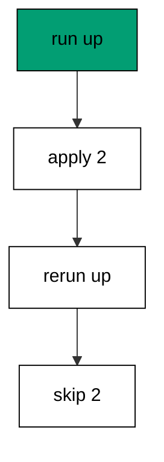

The history table makes this possible: applied versions are skipped before any statement runs. Deploys rerun the same command on every release, and the stamps absorb the repetition.

**`learning/code/ex-25-rerun-up-is-safe/main.go`**:

```go
// => Shared driver: every unit in this course opens with this prelude.
// => The harness network is closed, so units carry a small standard-library
// => driver that applies the same goose SQL files `goose up` would apply.
// => The files, the history table shape, and the ordering rules are goose's
// => own; the driver only replaces the network-dependent binary.
package main // => every unit is one runnable program

import ( // => standard library only: no third-party modules
	"bufio"           // => bufio frames protocol messages over the TCP stream
	"encoding/binary" // => binary lays out length-prefixed protocol fields
	"fmt"             // => fmt prints the deterministic transcript only
	"io"              // => io forces full reads of split protocol messages
	"net"             // => net dials the harness Postgres service over TCP
	"os"              // => os reads the harness database address, never hardcoded
	"sort"            // => sort orders migration files, never trusts directory order
	"strings"         // => strings splits the goose Up and Down annotations
) // => every import used by driver and units

// => The database address comes from the harness, with local-run defaults.
func addr() (string, string, string) { // => one helper owns every address default
	host := os.Getenv("PGHOST") // => service hostname in the unit network
	if host == "" {             // => empty means a local run outside the harness
		host = "postgres" // => same default the Python courses use
	} // => end addr: empty means a local run outside the harness
	user := os.Getenv("PGUSER") // => trust-auth role, no password needed
	if user == "" {             // => empty means a local run outside the harness
		user = "postgres" // => same default the Python courses use
	} // => end addr: empty means a local run outside the harness
	db := os.Getenv("PGDATABASE") // => fresh database for every unit run
	if db == "" {                 // => empty means a local run outside the harness
		db = "postgres" // => same default the Python courses use
	} // => end addr: empty means a local run outside the harness
	return host, user, db // => callers never re-read the environment
} // => end addr: one helper owns every address default

// => conn wraps one TCP connection plus a buffered reader for message frames.
type conn struct { // => a tiny struct keeps the socket and the framer together
	c net.Conn      // => the raw TCP socket to the Postgres service
	r *bufio.Reader // => buffered reads frame messages split across packets
} // => end type conn: socket and framer travel together

// => readMsg reads one backend message: a type byte plus a length body.
func (k *conn) readMsg() (byte, []byte, error) { // => every response flows through here
	head := make([]byte, 5)                           // => one type byte plus one int32 length
	if _, err := io.ReadFull(k.r, head); err != nil { // => fragments reassemble before framing
		return 0, nil, err // => no partial message is ever trusted
	} // => end readMsg: fragments reassemble before framing
	n := int(binary.BigEndian.Uint32(head[1:])) - 4   // => length counts itself, not the type
	body := make([]byte, n)                           // => exact-size body, never over-read
	if _, err := io.ReadFull(k.r, body); err != nil { // => fragments reassemble before framing
		return 0, nil, err // => no partial message is ever trusted
	} // => end readMsg: fragments reassemble before framing
	return head[0], body, nil // => type byte tells the caller what arrived
} // => end readMsg: every response flows through here

// => sendMsg writes one frontend message: a type byte plus a length body.
func (k *conn) sendMsg(t byte, body []byte) error { // => startup is the only typeless message
	out := []byte{t}                                      // => type byte leads every message
	lenb := make([]byte, 4)                               // => four bytes carry the length
	binary.BigEndian.PutUint32(lenb, uint32(len(body)+4)) // => length counts itself
	out = append(out, lenb...)                            // => length follows the type byte
	out = append(out, body...)                            // => payload closes the message
	_, err := k.c.Write(out)                              // => one write keeps frames whole
	return err                                            // => write errors fail the unit loudly
} // => end sendMsg: startup is the only typeless message

// => connect opens the service database and waits for session readiness.
func connect() (*conn, error) { // => every unit starts from this one helper
	host, user, db := addr()         // => harness address, never hardcoded
	return connectDb(host, user, db) // => one path opens every session
} // => end connect: every unit starts from this one helper

// => connectDb opens a named database on the same host for multi-db drills.
func connectDb(host, user, db string) (*conn, error) { // => environments are databases, not servers
	c, err := net.Dial("tcp", host+":5432") // => Postgres listens on 5432
	if err != nil {                         // => unreachable service is fatal
		return nil, err // => no fallback: the harness owns the database
	} // => end connectDb: unreachable service is fatal
	k := &conn{c: c, r: bufio.NewReader(c)}             // => buffer the fresh socket at once
	body := []byte{}                                    // => startup body is parameters only
	body = append(body, 0, 0, 0, 0)                     // => placeholder for the length prefix
	body = append(body, 0, 3, 0, 0)                     // => protocol 3.0, the stable version
	body = append(body, []byte("user")...)              // => user key starts the parameters
	body = append(body, 0)                              // => keys and values are NUL-separated
	body = append(body, []byte(user)...)                // => trust-auth role from the harness
	body = append(body, 0)                              // => NUL ends the value
	body = append(body, []byte("database")...)          // => database key follows the user
	body = append(body, 0)                              // => NUL ends the key
	body = append(body, []byte(db)...)                  // => fresh database for every unit run
	body = append(body, 0)                              // => NUL ends the value
	body = append(body, 0)                              // => empty key ends the parameters
	binary.BigEndian.PutUint32(body, uint32(len(body))) // => startup length counts itself
	if _, err := c.Write(body); err != nil {            // => startup is the only typeless message
		return nil, err // => unwritable socket is fatal
	} // => end connectDb: startup is the only typeless message
	for { // => drain until the session is ready for queries
		t, b, err := k.readMsg() // => every backend message flows through here
		if err != nil {          // => broken handshake is fatal
			return nil, err // => no half-open session is ever used
		} // => end connectDb: broken handshake is fatal
		switch t { // => only three message kinds matter during startup
		case 'R': // => authentication response arrives first
			if binary.BigEndian.Uint32(b) != 0 { // => nonzero means a password is wanted
				return nil, fmt.Errorf("server wants a password") // => trust auth never asks
			} // => end connectDb: nonzero means a password is wanted
		case 'E': // => an error ends the handshake with the server text
			return nil, fmt.Errorf("startup: %s", errText(b)) // => server text explains the cause
		case 'Z': // => ReadyForQuery means the session accepts queries
			return k, nil // => handshake done: hand the live session back
		} // => end connectDb: only three message kinds matter during startup
	} // => end connectDb: drain until the session is ready for queries
} // => end connectDb: environments are databases, not servers

// => errText extracts the human message (field M) from an ErrorResponse.
func errText(b []byte) string { // => one helper decodes every server error
	parts := strings.Split(string(b), "\x00") // => fields are NUL-separated pairs
	for i := 0; i+1 < len(parts); i += 2 {    // => walk code and value together
		if parts[i] == "M" { // => M is the primary human message
			return parts[i+1] // => return the message, skip the detail fields
		} // => end errText: M is the primary human message
	} // => end errText: walk code and value together
	return "unknown error" // => malformed errors still fail with a fixed line
} // => end errText: one helper decodes every server error

// => run sends one SQL string and returns every data row plus the command tag.
func (k *conn) run(q string) ([][]string, string, error) { // => one path runs every statement
	body := append([]byte(q), 0)                 // => Query messages are NUL-terminated
	if err := k.sendMsg('Q', body); err != nil { // => send fails loudly, never silently
		return nil, "", err // => unwritable socket ends the unit
	} // => end run: send fails loudly, never silently
	var rows [][]string // => data rows accumulate across result sets
	tag := ""           // => the last command tag (SELECT 3, CREATE TABLE...)
	for {               // => drain until ReadyForQuery closes this query string
		t, b, err := k.readMsg() // => every response flows through the framer
		if err != nil {          // => broken mid-query connection is fatal
			return nil, "", err // => partial results are never returned
		} // => end run: broken mid-query connection is fatal
		switch t { // => four message kinds carry a simple-query response
		case 'T', 'N', 'A', 'S', 'K': // => metadata the transcript never prints
		case 'D': // => one data row arrived
			rows = append(rows, parseRow(b)) // => decode the text columns now
		case 'C': // => one statement finished
			tag = strings.TrimRight(string(b[:len(b)-1]), "\x00") // => tag names what ran
		case 'E': // => the statement failed
			drain(k)                                     // => finish the failed query before reuse
			return nil, "", fmt.Errorf("%s", errText(b)) // => server text becomes the failure
		case 'Z': // => ReadyForQuery ends this query string
			return rows, tag, nil // => rows, tag, and a clean session
		} // => end run: four message kinds carry a simple-query response
	} // => end run: drain until ReadyForQuery closes this query string
} // => end run: one path runs every statement

// => drain reads to the next ReadyForQuery after a statement error.
func drain(k *conn) { // => an errored query still owns the socket until Z
	for { // => loop until the session is reusable
		t, _, err := k.readMsg()    // => discard every message after the error
		if err != nil || t == 'Z' { // => socket break or ready both end the drain
			return // => caller decides the failure, the drain only resynchronizes
		} // => end drain: socket break or ready both end the drain
	} // => end drain: loop until the session is reusable
} // => end drain: an errored query still owns the socket until Z

// => parseRow decodes one DataRow body into text columns, NULL as "NULL".
func parseRow(b []byte) []string { // => one helper decodes every returned row
	n := int(binary.BigEndian.Uint16(b)) // => column count leads the body
	b = b[2:]                            // => step past the count
	out := make([]string, 0, n)          // => pre-size the row to the count
	for i := 0; i < n; i++ {             // => walk each column in order
		l := int(int32(binary.BigEndian.Uint32(b))) // => -1 marks NULL, else the length
		b = b[4:]                                   // => step past the length
		if l < 0 {                                  // => NULL has no bytes to read
			out = append(out, "NULL") // => fixed word keeps transcripts stable
			continue                  // => next column, no bytes consumed
		} // => end parseRow: NULL has no bytes to read
		out = append(out, string(b[:l])) // => text format is already printable
		b = b[l:]                        // => step past the value bytes
	} // => end parseRow: walk each column in order
	return out // => one row, fully decoded
} // => end parseRow: one helper decodes every returned row

// => must runs SQL or exits nonzero with the server text on standard error.
func must(k *conn, q string) [][]string { // => setup statements never fail quietly
	rows, _, err := k.run(q) // => rows return for verification queries
	if err != nil {          // => any server error is fatal to the unit
		fmt.Fprintln(os.Stderr, "sql error:", err) // => errors go to stderr, never stdout
		os.Exit(1)                                 // => nonzero exit fails the harness check
	} // => end must: any server error is fatal to the unit
	return rows // => callers print only what the lesson asserts
} // => end must: setup statements never fail quietly

// => try runs SQL and returns the server error text instead of exiting.
func try(k *conn, q string) ([][]string, string) { // => failure drills inspect errors, not die
	rows, _, err := k.run(q) // => same path as must, opposite failure policy
	if err != nil {          // => expected errors become transcript lines
		return nil, err.Error() // => fixed server text, never timings
	} // => end try: expected errors become transcript lines
	return rows, "" // => empty error means the statement succeeded
} // => end try: failure drills inspect errors, not die

// => mig holds one goose SQL file: its version, name, and Up/Down sections.
type mig struct { // => mirrors the goose file layout the lesson teaches
	version string   // => zero-padded number orders history, like goose
	name    string   // => human slug after the version number
	up      []string // => forward statements, run inside one transaction
	down    []string // => reverse statements, run inside one transaction
	noTx    bool     // => NO TRANSACTION files run outside one, like goose
} // => end type mig: version, name, sections, and mode

// => parseGoose splits one goose SQL file into its Up and Down statements.
func parseGoose(text string) (up, down []string, noTx bool) { // => the lesson asserts this exact split
	section := ""                                    // => nothing belongs outside the annotations
	for _, line := range strings.Split(text, "\n") { // => walk the file line by line
		t := strings.TrimSpace(line) // => annotation matching ignores indentation
		switch t {                   // => four annotation lines switch sections
		case "-- +goose Up": // => forward section starts here, like goose
			section = "up" // => following statements migrate forward
			continue       // => the annotation itself never runs
		case "-- +goose Down": // => reverse section starts here, like goose
			section = "down" // => following statements roll back
			continue         // => the annotation itself never runs
		case "-- +goose NO TRANSACTION": // => concurrent work cannot run inside one
			noTx = true // => remember the file opts out of the transaction
			continue    // => the annotation itself never runs
		} // => end parseGoose: four annotation lines switch sections
		if strings.HasPrefix(t, "--") || t == "" { // => comments and blanks never run
			continue // => only real statements reach the database
		} // => end parseGoose: comments and blanks never run
		if section == "up" { // => route by the annotation seen above
			up = append(up, line) // => keep the original line for the file write
		} else if section == "down" { // => down statements collect separately
			down = append(down, line) // => keep the original line for the file write
		} // => end parseGoose: down statements collect separately
	} // => end parseGoose: walk the file line by line
	return splitStmts(strings.Join(up, "\n")), splitStmts(strings.Join(down, "\n")), noTx // => one string per statement
} // => end parseGoose: the lesson asserts this exact split

// => splitStmts cuts statement text on semicolons outside quotes.
func splitStmts(s string) []string { // => multi-line statements stay whole until ;
	var out []string        // => finished statements accumulate here
	var cur strings.Builder // => the statement under construction
	inStr := false          // => semicolons inside quotes never split
	for _, r := range s {   // => walk rune by rune, quotes included
		switch { // => quote tracking decides what a semicolon means
		case r == '\'': // => a quote toggles string mode
			inStr = !inStr   // => enter or leave the quoted region
			cur.WriteRune(r) // => the quote belongs to the statement
		case r == ';' && !inStr: // => a bare semicolon ends one statement
			if t := strings.TrimSpace(cur.String()); t != "" { // => skip empty fragments
				out = append(out, t) // => store the finished statement
			} // => end splitStmts: skip empty fragments
			cur.Reset() // => start the next statement fresh
		default: // => every other rune belongs to the current statement
			cur.WriteRune(r) // => accumulate verbatim
		} // => end splitStmts: quote tracking decides what a semicolon means
	} // => end splitStmts: walk rune by rune, quotes included
	if t := strings.TrimSpace(cur.String()); t != "" { // => trailing text without ; still counts
		out = append(out, t) // => last statement needs no semicolon
	} // => end splitStmts: trailing text without ; still counts
	return out // => callers run each statement in order
} // => end splitStmts: multi-line statements stay whole until ;

// => ensureHistory creates the goose history table once per unit run.
func ensureHistory(k *conn) { // => goose_db_version is goose's own default name
	must(k, `CREATE TABLE IF NOT EXISTS goose_db_version (`+ // => reruns never fail here
		`id integer PRIMARY KEY GENERATED BY DEFAULT AS IDENTITY, `+ // => surrogate key, never printed
		`version_id bigint NOT NULL, `+ // => applied version numbers live here
		`is_applied boolean NOT NULL, `+ // => goose marks rows applied on success
		`tstamp timestamp NOT NULL DEFAULT now())`) // => timestamp defaults, never printed
} // => end ensureHistory: goose_db_version is goose's own default name

// => appliedVersions returns the version numbers already marked applied.
func appliedVersions(k *conn) map[int64]bool { // => history decides what still needs running
	rows := must(k, `SELECT version_id FROM goose_db_version `+ // => only the numbers matter
		`WHERE is_applied ORDER BY version_id`) // => order keeps the transcript stable
	got := map[int64]bool{}  // => set lookup answers "already applied" fast
	for _, r := range rows { // => one row per applied migration
		var v int64                // => version numbers are integers
		fmt.Sscanf(r[0], "%d", &v) // => text format parses back to a number
		got[v] = true              // => mark this version done
	} // => end appliedVersions: one row per applied migration
	return got // => callers skip whatever history already holds
} // => end appliedVersions: history decides what still needs running

// => applyUp runs every pending migration forward, one transaction each.
func applyUp(k *conn, ms []mig) { // => files on disk are already the source of truth
	done := appliedVersions(k) // => history decides what still needs running
	for _, m := range ms {     // => file order is version order, sorted by the caller
		var v int64                     // => versions compare as numbers
		fmt.Sscanf(m.version, "%d", &v) // => zero-padded file prefix parses back
		if done[v] {                    // => applied migrations never run twice
			continue // => idempotent reruns skip straight past
		} // => end applyUp: applied migrations never run twice
		if !m.noTx { // => transactional files wrap everything in one unit
			must(k, "BEGIN") // => one migration is one transaction, like goose
		} // => end applyUp: transactional files wrap everything in one unit
		for _, s := range m.up { // => forward statements run in file order
			must(k, s) // => any failure aborts the unit before COMMIT
		} // => end applyUp: forward statements run in file order
		if !m.noTx { // => stamps join the same transaction they describe
			must(k, fmt.Sprintf(`INSERT INTO goose_db_version `+ // => stamp only after success
				`(version_id, is_applied) VALUES (%d, true)`, v)) // => stamp mirrors goose exactly
			must(k, "COMMIT") // => history row and schema land together
		} else { // => concurrent statements cannot share a transaction
			must(k, fmt.Sprintf(`INSERT INTO goose_db_version `+ // => stamp follows the work
				`(version_id, is_applied) VALUES (%d, true)`, v)) // => same row, separate statement
		} // => end applyUp: concurrent statements cannot share a transaction
	} // => end applyUp: file order is version order, sorted by the caller
} // => end applyUp: files on disk are already the source of truth

// => applyDown rolls back the newest applied migrations, newest first.
func applyDown(k *conn, ms []mig, steps int) { // => steps bounds how far history rewinds
	done := appliedVersions(k) // => history decides what can roll back
	var todo []mig             // => applied migrations in version order first
	for _, m := range ms {     // => walk the whole known history
		var v int64                     // => versions compare as numbers
		fmt.Sscanf(m.version, "%d", &v) // => zero-padded file prefix parses back
		if done[v] {                    // => only applied migrations roll back
			todo = append(todo, m) // => keep the migration for the reverse pass
		} // => end applyDown: only applied migrations roll back
	} // => end applyDown: walk the whole known history
	for i := len(todo) - 1; i >= 0 && steps > 0; i-- { // => newest applied goes first
		m := todo[i]                    // => this migration rolls back now
		var v int64                     // => versions compare as numbers
		fmt.Sscanf(m.version, "%d", &v) // => zero-padded file prefix parses back
		if !m.noTx {                    // => transactional files wrap the rollback too
			must(k, "BEGIN") // => reverse change is atomic, like the forward one
		} // => end applyDown: transactional files wrap the rollback too
		for _, s := range m.down { // => reverse statements run in file order
			must(k, s) // => any failure aborts before the history row moves
		} // => end applyDown: reverse statements run in file order
		must(k, fmt.Sprintf(`DELETE FROM goose_db_version `+ // => unstamped only after success
			`WHERE version_id = %d`, v)) // => the version leaves history exactly once
		if !m.noTx { // => close the transaction the rollback opened
			must(k, "COMMIT") // => schema reversal and unstamp land together
		} // => end applyDown: close the transaction the rollback opened
		steps-- // => one rollback consumed from the budget
	} // => end applyDown: newest applied goes first
} // => end applyDown: steps bounds how far history rewinds

// => statusCounts splits known migrations into applied and pending lists.
func statusCounts(k *conn, ms []mig) (applied, pending []string) { // => goose status in two lists
	done := appliedVersions(k) // => history decides which list each version joins
	for _, m := range ms {     // => walk the known history in version order
		var v int64                     // => versions compare as numbers
		fmt.Sscanf(m.version, "%d", &v) // => zero-padded file prefix parses back
		if done[v] {                    // => stamped versions are done
			applied = append(applied, m.version) // => keep the version string for printing
		} else { // => unstamped versions still wait
			pending = append(pending, m.version) // => keep the version string for printing
		} // => end statusCounts: unstamped versions still wait
	} // => end statusCounts: walk the known history in version order
	return applied, pending // => callers print both lists in one stable line each
} // => end statusCounts: goose status in two lists

// => files writes each migration as a real goose SQL file under dir.
func files(dir string, ms []mig) { // => the lesson shows these files byte-identically
	for _, m := range ms { // => one file per migration, like `goose create`
		name := fmt.Sprintf("%s_%s.sql", m.version, m.name) // => goose names files version-first
		var b strings.Builder                               // => build the file text in order
		if m.noTx {                                         // => concurrent files announce it first
			b.WriteString("-- +goose NO TRANSACTION\n") // => goose honors this exact annotation
		} // => end files: concurrent files announce it first
		b.WriteString("-- +goose Up\n") // => forward annotation leads
		for _, s := range m.up {        // => forward statements follow
			b.WriteString(s + ";\n") // => one statement per line, semicolon-closed
		} // => end files: forward statements follow
		b.WriteString("-- +goose Down\n") // => reverse annotation splits the file
		for _, s := range m.down {        // => reverse statements close the file
			b.WriteString(s + ";\n") // => one statement per line, semicolon-closed
		} // => end files: reverse statements close the file
		if err := os.WriteFile(dir+"/"+name, []byte(b.String()), 0644); err != nil { // => real files, like goose
			fmt.Fprintln(os.Stderr, "write error:", err) // => write errors fail loudly
			os.Exit(1)                                   // => no half-written migration set
		} // => end files: real files, like goose
	} // => end files: one file per migration, like `goose create`
} // => end files: the lesson shows these files byte-identically

// => versions lists migration files in version order from dir.
func versions(dir string) []mig { // => directory order is never trusted for history
	ents, err := os.ReadDir(dir) // => read the whole migrations directory
	if err != nil {              // => unreadable directory is fatal
		fmt.Fprintln(os.Stderr, "read error:", err) // => errors go to stderr
		os.Exit(1)                                  // => nonzero exit fails the check
	} // => end versions: unreadable directory is fatal
	names := []string{}      // => collect names before sorting
	for _, e := range ents { // => walk every directory entry
		if !e.IsDir() && strings.HasSuffix(e.Name(), ".sql") { // => only goose SQL files count
			names = append(names, e.Name()) // => keep the file name for parsing
		} // => end versions: only goose SQL files count
	} // => end versions: walk every directory entry
	sort.Strings(names)       // => zero-padded versions sort chronologically
	var out []mig             // => parsed migrations accumulate here
	for _, n := range names { // => parse in version order
		raw, err := os.ReadFile(dir + "/" + n) // => read the real file back
		if err != nil {                        // => unreadable file is fatal
			fmt.Fprintln(os.Stderr, "read error:", err) // => errors go to stderr
			os.Exit(1)                                  // => nonzero exit fails the check
		} // => end versions: unreadable file is fatal
		up, down, noTx := parseGoose(string(raw))                                            // => split on the goose annotations
		rest := strings.TrimSuffix(n, ".sql")                                                // => strip the extension first
		ver := rest[:5]                                                                      // => first five digits are the version
		out = append(out, mig{version: ver, name: rest[6:], up: up, down: down, noTx: noTx}) // => keep every part
	} // => end versions: parse in version order
	return out // => version-ordered migrations, ready to apply
} // => end versions: directory order is never trusted for history

// => findDupes returns version numbers claimed by two or more files.
func findDupes(dir string) []string { // => goose refuses duplicate versions outright
	ents, err := os.ReadDir(dir) // => read the whole migrations directory
	if err != nil {              // => unreadable directory is fatal
		fmt.Fprintln(os.Stderr, "read error:", err) // => errors go to stderr
		os.Exit(1)                                  // => nonzero exit fails the check
	} // => end findDupes: unreadable directory is fatal
	seen := map[string]int{} // => count claims per five-digit version prefix
	for _, e := range ents { // => walk every directory entry
		if !e.IsDir() && strings.HasSuffix(e.Name(), ".sql") { // => only goose SQL files count
			seen[e.Name()[:5]]++ // => first five digits are the version
		} // => end findDupes: only goose SQL files count
	} // => end findDupes: walk every directory entry
	var out []string         // => duplicates accumulate in version order
	for _, e := range ents { // => second pass keeps the order stable
		if !e.IsDir() && strings.HasSuffix(e.Name(), ".sql") { // => only goose SQL files count
			if v := e.Name()[:5]; seen[v] > 1 { // => claimed more than once
				out = append(out, v) // => keep the version string for printing
				seen[v] = 0          // => report each duplicate version only once
			} // => end findDupes: claimed more than once
		} // => end findDupes: only goose SQL files count
	} // => end findDupes: second pass keeps the order stable
	return out // => empty means the history numbers are unique
} // => end findDupes: goose refuses duplicate versions outright

func main() {
	k, err := connect() // => one session runs the whole example
	if err != nil {     // => unreachable database fails loudly
		fmt.Fprintln(os.Stderr, "connect error:", err) // => connection errors go to stderr
		os.Exit(1)                                     // => nonzero exit fails the check
	}
	defer k.c.Close() // => the socket closes when the example ends
	// => A scratch migrations directory: goose files live here, never in the unit.
	// => the scratch path never reaches stdout, so reruns stay byte-stable
	dir, err := os.MkdirTemp("", "ex25-") // => private directory, like `goose create`
	if err != nil {                       // => unmakable temp dir is fatal
		fmt.Fprintln(os.Stderr, "temp error:", err) // => errors go to stderr
		os.Exit(1)                                  // => nonzero exit fails the check
	}
	defer os.RemoveAll(dir)                          // => scratch files vanish; only transcripts remain
	must(k, "DROP TABLE IF EXISTS ex25_a")           // => leftovers of a killed run vanish
	must(k, "DROP TABLE IF EXISTS ex25_b")           // => leftovers of a killed run vanish
	must(k, "DROP TABLE IF EXISTS goose_db_version") // => stale history vanishes too
	ensureHistory(k)                                 // => goose history table, real shape
	files(dir, []mig{                                // => two migrations applied twice
		{version: "00001", name: "create_a", // => first table in this history
			up:   []string{"CREATE TABLE ex25_a (id SERIAL PRIMARY KEY)"}, // => forward change
			down: []string{"DROP TABLE ex25_a"}},                          // => exact reverse for rollback
		{version: "00002", name: "create_b", // => second table in this history
			up:   []string{"CREATE TABLE ex25_b (id SERIAL PRIMARY KEY)"}, // => forward change
			down: []string{"DROP TABLE ex25_b"}},                          // => exact reverse for rollback
	})
	ms := versions(dir)                                                       // => parse the files back, like goose would
	applyUp(k, ms)                                                            // => first run applies both
	applyUp(k, ms)                                                            // => second run skips both
	rows := must(k, `SELECT count(*) FROM goose_db_version WHERE is_applied`) // => stamps never duplicate
	fmt.Println("applied:", rows[0][0])                                       // => Output: applied: 2
	rows = must(k, `SELECT count(*) FROM information_schema.tables `+         // => tables never duplicate
		`WHERE table_name LIKE 'ex25\_%'`) // => LIKE pattern needs the escaped underscore
	fmt.Println("tables:", rows[0][0])               // => Output: tables: 2
	fmt.Println("cleaned: yes")                      // => Output: cleaned: yes
	must(k, "DROP TABLE IF EXISTS ex25_a")           // => leftovers of a killed run vanish
	must(k, "DROP TABLE IF EXISTS ex25_b")           // => leftovers of a killed run vanish
	must(k, "DROP TABLE IF EXISTS goose_db_version") // => the example leaves no history behind
}
```

**Output** (`learning/code/ex-25-rerun-up-is-safe/expected/main.stdout.txt`):

```text
applied: 2
tables: 2
cleaned: yes
```

**Key takeaway**: Rerunning up is always safe because applied versions are skipped before any statement runs.

**Why it matters**: Safe reruns let deploys, CI, and developers run the same command without coordination. The history table absorbs repetition by skipping stamped versions, so the tenth run is as safe as the first. Idempotence is what makes migration commands routine. Idempotence is what makes migration commands routine instead of ceremonies the team dreads.
