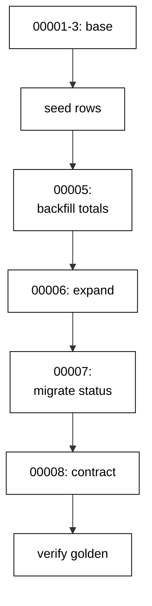

The capstone evolves a small order-management schema through eight realistic goose migrations: three tables with foreign keys, a data seed, a totals backfill, and a zero-downtime rename of the order status column, all verified by one golden query. Every technique from the course appears exactly where a production deploy would need it.

## Why this exists -- the big idea

**The problem before the solution**: course examples prove each migration technique in isolation — one file, one idea, one clean database. Real evolutions stack the techniques: the rename lands while traffic reads the old name, the backfill lands while orders keep arriving, and the history must stay linear through all of it. The capstone wires the layers together so the seams are load-bearing: schema steps, data steps, and verification steps in one chain, with the transcript proving the whole chain ran.

**Keep this if you forget everything else**: evolve the schema and the data on separate schedules, keep every step reversible or explicitly one-way, and verify the ending with a query — not with confidence.

## What you will build

A single `main.go` that writes eight goose SQL files at runtime and runs them in order. `00001` creates `cap_customers`; `00002` creates `cap_orders` with a foreign key, a status, and an empty total; `00003` creates `cap_order_lines` with its own foreign key, sku, quantity, and price. Then the data: `00004` seeds demo customers, orders, and lines as a forward-only step, and `00005` backfills every order total from its lines. Then the rename: `00006` expands with a nullable `order_status` column, `00007` migrates every status into its `order_status`, `00008` contracts by dropping `status` and adding the customer lookup index. Seeds arrive after the schema base so the data steps have real rows to work on; the down sections for data steps are explicit no-ops because fills and copies are one-way by policy.

## How the pieces compose

Schema base (Examples 1–8) creates the tables; the nullable add (Example 35) keeps the base deployable; the three-step rename (Examples 35–39) moves `status` to `order_status` without a flag day; the join backfill (Examples 26–32) fills money after the fact; the receipt checks (Examples 12, 17, 78) verify the ending. No new technique appears here — composition is the test. Read the program top to bottom and name the example each section comes from; if a section has no ancestor, it does not belong.



## Reading the transcript

The six output lines each prove one stage: the three order lines prove the seed, the backfill math, and the rename together — every order carries its owner, its computed total, and its new status name. The lines count proves the lines table survived the rename; the applied count proves all eight files ran with linear history; the cleaned line proves the capstone leaves no tables behind. Any missing line names its broken stage exactly. Rerun the unit and diff: identical bytes, because fixed version numbers, per-example tables, ordered queries, and label-only output leave no room for variance.

## The pinning note

This capstone runs on the standard library only: the Go toolchain carries no install recipe, so `net`, `encoding/binary`, `sort`, and `strings` do all the work with no lockfile at all. Pinning is a habit, not a file: the toolchain pins the Go and PostgreSQL 18 images by digest, and the history table pins the schema. The capstone migrates with exactly the bytes the examples trained on — the same driver prelude, the same transaction-per-file discipline, the same `goose_db_version` shape. Declare the floor, pin everything, and review pin diffs like code.

**`learning/capstone/code/main.go`**:

```go
// => Shared driver: every unit in this course opens with this prelude.
// => The harness network is closed, so units carry a small standard-library
// => driver that applies the same goose SQL files `goose up` would apply.
// => The files, the history table shape, and the ordering rules are goose's
// => own; the driver only replaces the network-dependent binary.
package main // => every unit is one runnable program

import ( // => standard library only: no third-party modules
	"bufio"           // => bufio frames protocol messages over the TCP stream
	"encoding/binary" // => binary lays out length-prefixed protocol fields
	"fmt"             // => fmt prints the deterministic transcript only
	"io"              // => io forces full reads of split protocol messages
	"net"             // => net dials the harness Postgres service over TCP
	"os"              // => os reads the harness database address, never hardcoded
	"sort"            // => sort orders migration files, never trusts directory order
	"strings"         // => strings splits the goose Up and Down annotations
) // => every import used by driver and units

// => The database address comes from the harness, with local-run defaults.
func addr() (string, string, string) { // => one helper owns every address default
	host := os.Getenv("PGHOST") // => service hostname in the unit network
	if host == "" {             // => empty means a local run outside the harness
		host = "postgres" // => same default the Python courses use
	} // => end addr: empty means a local run outside the harness
	user := os.Getenv("PGUSER") // => trust-auth role, no password needed
	if user == "" {             // => empty means a local run outside the harness
		user = "postgres" // => same default the Python courses use
	} // => end addr: empty means a local run outside the harness
	db := os.Getenv("PGDATABASE") // => fresh database for every unit run
	if db == "" {                 // => empty means a local run outside the harness
		db = "postgres" // => same default the Python courses use
	} // => end addr: empty means a local run outside the harness
	return host, user, db // => callers never re-read the environment
} // => end addr: one helper owns every address default

// => conn wraps one TCP connection plus a buffered reader for message frames.
type conn struct { // => a tiny struct keeps the socket and the framer together
	c net.Conn      // => the raw TCP socket to the Postgres service
	r *bufio.Reader // => buffered reads frame messages split across packets
} // => end type conn: socket and framer travel together

// => readMsg reads one backend message: a type byte plus a length body.
func (k *conn) readMsg() (byte, []byte, error) { // => every response flows through here
	head := make([]byte, 5)                           // => one type byte plus one int32 length
	if _, err := io.ReadFull(k.r, head); err != nil { // => fragments reassemble before framing
		return 0, nil, err // => no partial message is ever trusted
	} // => end readMsg: fragments reassemble before framing
	n := int(binary.BigEndian.Uint32(head[1:])) - 4   // => length counts itself, not the type
	body := make([]byte, n)                           // => exact-size body, never over-read
	if _, err := io.ReadFull(k.r, body); err != nil { // => fragments reassemble before framing
		return 0, nil, err // => no partial message is ever trusted
	} // => end readMsg: fragments reassemble before framing
	return head[0], body, nil // => type byte tells the caller what arrived
} // => end readMsg: every response flows through here

// => sendMsg writes one frontend message: a type byte plus a length body.
func (k *conn) sendMsg(t byte, body []byte) error { // => startup is the only typeless message
	out := []byte{t}                                      // => type byte leads every message
	lenb := make([]byte, 4)                               // => four bytes carry the length
	binary.BigEndian.PutUint32(lenb, uint32(len(body)+4)) // => length counts itself
	out = append(out, lenb...)                            // => length follows the type byte
	out = append(out, body...)                            // => payload closes the message
	_, err := k.c.Write(out)                              // => one write keeps frames whole
	return err                                            // => write errors fail the unit loudly
} // => end sendMsg: startup is the only typeless message

// => connect opens the service database and waits for session readiness.
func connect() (*conn, error) { // => every unit starts from this one helper
	host, user, db := addr()         // => harness address, never hardcoded
	return connectDb(host, user, db) // => one path opens every session
} // => end connect: every unit starts from this one helper

// => connectDb opens a named database on the same host for multi-db drills.
func connectDb(host, user, db string) (*conn, error) { // => environments are databases, not servers
	c, err := net.Dial("tcp", host+":5432") // => Postgres listens on 5432
	if err != nil {                         // => unreachable service is fatal
		return nil, err // => no fallback: the harness owns the database
	} // => end connectDb: unreachable service is fatal
	k := &conn{c: c, r: bufio.NewReader(c)}             // => buffer the fresh socket at once
	body := []byte{}                                    // => startup body is parameters only
	body = append(body, 0, 0, 0, 0)                     // => placeholder for the length prefix
	body = append(body, 0, 3, 0, 0)                     // => protocol 3.0, the stable version
	body = append(body, []byte("user")...)              // => user key starts the parameters
	body = append(body, 0)                              // => keys and values are NUL-separated
	body = append(body, []byte(user)...)                // => trust-auth role from the harness
	body = append(body, 0)                              // => NUL ends the value
	body = append(body, []byte("database")...)          // => database key follows the user
	body = append(body, 0)                              // => NUL ends the key
	body = append(body, []byte(db)...)                  // => fresh database for every unit run
	body = append(body, 0)                              // => NUL ends the value
	body = append(body, 0)                              // => empty key ends the parameters
	binary.BigEndian.PutUint32(body, uint32(len(body))) // => startup length counts itself
	if _, err := c.Write(body); err != nil {            // => startup is the only typeless message
		return nil, err // => unwritable socket is fatal
	} // => end connectDb: startup is the only typeless message
	for { // => drain until the session is ready for queries
		t, b, err := k.readMsg() // => every backend message flows through here
		if err != nil {          // => broken handshake is fatal
			return nil, err // => no half-open session is ever used
		} // => end connectDb: broken handshake is fatal
		switch t { // => only three message kinds matter during startup
		case 'R': // => authentication response arrives first
			if binary.BigEndian.Uint32(b) != 0 { // => nonzero means a password is wanted
				return nil, fmt.Errorf("server wants a password") // => trust auth never asks
			} // => end connectDb: nonzero means a password is wanted
		case 'E': // => an error ends the handshake with the server text
			return nil, fmt.Errorf("startup: %s", errText(b)) // => server text explains the cause
		case 'Z': // => ReadyForQuery means the session accepts queries
			return k, nil // => handshake done: hand the live session back
		} // => end connectDb: only three message kinds matter during startup
	} // => end connectDb: drain until the session is ready for queries
} // => end connectDb: environments are databases, not servers

// => errText extracts the human message (field M) from an ErrorResponse.
func errText(b []byte) string { // => one helper decodes every server error
	parts := strings.Split(string(b), "\x00") // => fields are NUL-separated pairs
	for i := 0; i+1 < len(parts); i += 2 {    // => walk code and value together
		if parts[i] == "M" { // => M is the primary human message
			return parts[i+1] // => return the message, skip the detail fields
		} // => end errText: M is the primary human message
	} // => end errText: walk code and value together
	return "unknown error" // => malformed errors still fail with a fixed line
} // => end errText: one helper decodes every server error

// => run sends one SQL string and returns every data row plus the command tag.
func (k *conn) run(q string) ([][]string, string, error) { // => one path runs every statement
	body := append([]byte(q), 0)                 // => Query messages are NUL-terminated
	if err := k.sendMsg('Q', body); err != nil { // => send fails loudly, never silently
		return nil, "", err // => unwritable socket ends the unit
	} // => end run: send fails loudly, never silently
	var rows [][]string // => data rows accumulate across result sets
	tag := ""           // => the last command tag (SELECT 3, CREATE TABLE...)
	for {               // => drain until ReadyForQuery closes this query string
		t, b, err := k.readMsg() // => every response flows through the framer
		if err != nil {          // => broken mid-query connection is fatal
			return nil, "", err // => partial results are never returned
		} // => end run: broken mid-query connection is fatal
		switch t { // => four message kinds carry a simple-query response
		case 'T', 'N', 'A', 'S', 'K': // => metadata the transcript never prints
		case 'D': // => one data row arrived
			rows = append(rows, parseRow(b)) // => decode the text columns now
		case 'C': // => one statement finished
			tag = strings.TrimRight(string(b[:len(b)-1]), "\x00") // => tag names what ran
		case 'E': // => the statement failed
			drain(k)                                     // => finish the failed query before reuse
			return nil, "", fmt.Errorf("%s", errText(b)) // => server text becomes the failure
		case 'Z': // => ReadyForQuery ends this query string
			return rows, tag, nil // => rows, tag, and a clean session
		} // => end run: four message kinds carry a simple-query response
	} // => end run: drain until ReadyForQuery closes this query string
} // => end run: one path runs every statement

// => drain reads to the next ReadyForQuery after a statement error.
func drain(k *conn) { // => an errored query still owns the socket until Z
	for { // => loop until the session is reusable
		t, _, err := k.readMsg()    // => discard every message after the error
		if err != nil || t == 'Z' { // => socket break or ready both end the drain
			return // => caller decides the failure, the drain only resynchronizes
		} // => end drain: socket break or ready both end the drain
	} // => end drain: loop until the session is reusable
} // => end drain: an errored query still owns the socket until Z

// => parseRow decodes one DataRow body into text columns, NULL as "NULL".
func parseRow(b []byte) []string { // => one helper decodes every returned row
	n := int(binary.BigEndian.Uint16(b)) // => column count leads the body
	b = b[2:]                            // => step past the count
	out := make([]string, 0, n)          // => pre-size the row to the count
	for i := 0; i < n; i++ {             // => walk each column in order
		l := int(int32(binary.BigEndian.Uint32(b))) // => -1 marks NULL, else the length
		b = b[4:]                                   // => step past the length
		if l < 0 {                                  // => NULL has no bytes to read
			out = append(out, "NULL") // => fixed word keeps transcripts stable
			continue                  // => next column, no bytes consumed
		} // => end parseRow: NULL has no bytes to read
		out = append(out, string(b[:l])) // => text format is already printable
		b = b[l:]                        // => step past the value bytes
	} // => end parseRow: walk each column in order
	return out // => one row, fully decoded
} // => end parseRow: one helper decodes every returned row

// => must runs SQL or exits nonzero with the server text on standard error.
func must(k *conn, q string) [][]string { // => setup statements never fail quietly
	rows, _, err := k.run(q) // => rows return for verification queries
	if err != nil {          // => any server error is fatal to the unit
		fmt.Fprintln(os.Stderr, "sql error:", err) // => errors go to stderr, never stdout
		os.Exit(1)                                 // => nonzero exit fails the harness check
	} // => end must: any server error is fatal to the unit
	return rows // => callers print only what the lesson asserts
} // => end must: setup statements never fail quietly

// => try runs SQL and returns the server error text instead of exiting.
func try(k *conn, q string) ([][]string, string) { // => failure drills inspect errors, not die
	rows, _, err := k.run(q) // => same path as must, opposite failure policy
	if err != nil {          // => expected errors become transcript lines
		return nil, err.Error() // => fixed server text, never timings
	} // => end try: expected errors become transcript lines
	return rows, "" // => empty error means the statement succeeded
} // => end try: failure drills inspect errors, not die

// => mig holds one goose SQL file: its version, name, and Up/Down sections.
type mig struct { // => mirrors the goose file layout the lesson teaches
	version string   // => zero-padded number orders history, like goose
	name    string   // => human slug after the version number
	up      []string // => forward statements, run inside one transaction
	down    []string // => reverse statements, run inside one transaction
	noTx    bool     // => NO TRANSACTION files run outside one, like goose
} // => end type mig: version, name, sections, and mode

// => parseGoose splits one goose SQL file into its Up and Down statements.
func parseGoose(text string) (up, down []string, noTx bool) { // => the lesson asserts this exact split
	section := ""                                    // => nothing belongs outside the annotations
	for _, line := range strings.Split(text, "\n") { // => walk the file line by line
		t := strings.TrimSpace(line) // => annotation matching ignores indentation
		switch t {                   // => four annotation lines switch sections
		case "-- +goose Up": // => forward section starts here, like goose
			section = "up" // => following statements migrate forward
			continue       // => the annotation itself never runs
		case "-- +goose Down": // => reverse section starts here, like goose
			section = "down" // => following statements roll back
			continue         // => the annotation itself never runs
		case "-- +goose NO TRANSACTION": // => concurrent work cannot run inside one
			noTx = true // => remember the file opts out of the transaction
			continue    // => the annotation itself never runs
		} // => end parseGoose: four annotation lines switch sections
		if strings.HasPrefix(t, "--") || t == "" { // => comments and blanks never run
			continue // => only real statements reach the database
		} // => end parseGoose: comments and blanks never run
		if section == "up" { // => route by the annotation seen above
			up = append(up, line) // => keep the original line for the file write
		} else if section == "down" { // => down statements collect separately
			down = append(down, line) // => keep the original line for the file write
		} // => end parseGoose: down statements collect separately
	} // => end parseGoose: walk the file line by line
	return splitStmts(strings.Join(up, "\n")), splitStmts(strings.Join(down, "\n")), noTx // => one string per statement
} // => end parseGoose: the lesson asserts this exact split

// => splitStmts cuts statement text on semicolons outside quotes.
func splitStmts(s string) []string { // => multi-line statements stay whole until ;
	var out []string        // => finished statements accumulate here
	var cur strings.Builder // => the statement under construction
	inStr := false          // => semicolons inside quotes never split
	for _, r := range s {   // => walk rune by rune, quotes included
		switch { // => quote tracking decides what a semicolon means
		case r == '\'': // => a quote toggles string mode
			inStr = !inStr   // => enter or leave the quoted region
			cur.WriteRune(r) // => the quote belongs to the statement
		case r == ';' && !inStr: // => a bare semicolon ends one statement
			if t := strings.TrimSpace(cur.String()); t != "" { // => skip empty fragments
				out = append(out, t) // => store the finished statement
			} // => end splitStmts: skip empty fragments
			cur.Reset() // => start the next statement fresh
		default: // => every other rune belongs to the current statement
			cur.WriteRune(r) // => accumulate verbatim
		} // => end splitStmts: quote tracking decides what a semicolon means
	} // => end splitStmts: walk rune by rune, quotes included
	if t := strings.TrimSpace(cur.String()); t != "" { // => trailing text without ; still counts
		out = append(out, t) // => last statement needs no semicolon
	} // => end splitStmts: trailing text without ; still counts
	return out // => callers run each statement in order
} // => end splitStmts: multi-line statements stay whole until ;

// => ensureHistory creates the goose history table once per unit run.
func ensureHistory(k *conn) { // => goose_db_version is goose's own default name
	must(k, `CREATE TABLE IF NOT EXISTS goose_db_version (`+ // => reruns never fail here
		`id integer PRIMARY KEY GENERATED BY DEFAULT AS IDENTITY, `+ // => surrogate key, never printed
		`version_id bigint NOT NULL, `+ // => applied version numbers live here
		`is_applied boolean NOT NULL, `+ // => goose marks rows applied on success
		`tstamp timestamp NOT NULL DEFAULT now())`) // => timestamp defaults, never printed
} // => end ensureHistory: goose_db_version is goose's own default name

// => appliedVersions returns the version numbers already marked applied.
func appliedVersions(k *conn) map[int64]bool { // => history decides what still needs running
	rows := must(k, `SELECT version_id FROM goose_db_version `+ // => only the numbers matter
		`WHERE is_applied ORDER BY version_id`) // => order keeps the transcript stable
	got := map[int64]bool{}  // => set lookup answers "already applied" fast
	for _, r := range rows { // => one row per applied migration
		var v int64                // => version numbers are integers
		fmt.Sscanf(r[0], "%d", &v) // => text format parses back to a number
		got[v] = true              // => mark this version done
	} // => end appliedVersions: one row per applied migration
	return got // => callers skip whatever history already holds
} // => end appliedVersions: history decides what still needs running

// => applyUp runs every pending migration forward, one transaction each.
func applyUp(k *conn, ms []mig) { // => files on disk are already the source of truth
	done := appliedVersions(k) // => history decides what still needs running
	for _, m := range ms {     // => file order is version order, sorted by the caller
		var v int64                     // => versions compare as numbers
		fmt.Sscanf(m.version, "%d", &v) // => zero-padded file prefix parses back
		if done[v] {                    // => applied migrations never run twice
			continue // => idempotent reruns skip straight past
		} // => end applyUp: applied migrations never run twice
		if !m.noTx { // => transactional files wrap everything in one unit
			must(k, "BEGIN") // => one migration is one transaction, like goose
		} // => end applyUp: transactional files wrap everything in one unit
		for _, s := range m.up { // => forward statements run in file order
			must(k, s) // => any failure aborts the unit before COMMIT
		} // => end applyUp: forward statements run in file order
		if !m.noTx { // => stamps join the same transaction they describe
			must(k, fmt.Sprintf(`INSERT INTO goose_db_version `+ // => stamp only after success
				`(version_id, is_applied) VALUES (%d, true)`, v)) // => stamp mirrors goose exactly
			must(k, "COMMIT") // => history row and schema land together
		} else { // => concurrent statements cannot share a transaction
			must(k, fmt.Sprintf(`INSERT INTO goose_db_version `+ // => stamp follows the work
				`(version_id, is_applied) VALUES (%d, true)`, v)) // => same row, separate statement
		} // => end applyUp: concurrent statements cannot share a transaction
	} // => end applyUp: file order is version order, sorted by the caller
} // => end applyUp: files on disk are already the source of truth

// => applyDown rolls back the newest applied migrations, newest first.
func applyDown(k *conn, ms []mig, steps int) { // => steps bounds how far history rewinds
	done := appliedVersions(k) // => history decides what can roll back
	var todo []mig             // => applied migrations in version order first
	for _, m := range ms {     // => walk the whole known history
		var v int64                     // => versions compare as numbers
		fmt.Sscanf(m.version, "%d", &v) // => zero-padded file prefix parses back
		if done[v] {                    // => only applied migrations roll back
			todo = append(todo, m) // => keep the migration for the reverse pass
		} // => end applyDown: only applied migrations roll back
	} // => end applyDown: walk the whole known history
	for i := len(todo) - 1; i >= 0 && steps > 0; i-- { // => newest applied goes first
		m := todo[i]                    // => this migration rolls back now
		var v int64                     // => versions compare as numbers
		fmt.Sscanf(m.version, "%d", &v) // => zero-padded file prefix parses back
		if !m.noTx {                    // => transactional files wrap the rollback too
			must(k, "BEGIN") // => reverse change is atomic, like the forward one
		} // => end applyDown: transactional files wrap the rollback too
		for _, s := range m.down { // => reverse statements run in file order
			must(k, s) // => any failure aborts before the history row moves
		} // => end applyDown: reverse statements run in file order
		must(k, fmt.Sprintf(`DELETE FROM goose_db_version `+ // => unstamped only after success
			`WHERE version_id = %d`, v)) // => the version leaves history exactly once
		if !m.noTx { // => close the transaction the rollback opened
			must(k, "COMMIT") // => schema reversal and unstamp land together
		} // => end applyDown: close the transaction the rollback opened
		steps-- // => one rollback consumed from the budget
	} // => end applyDown: newest applied goes first
} // => end applyDown: steps bounds how far history rewinds

// => statusCounts splits known migrations into applied and pending lists.
func statusCounts(k *conn, ms []mig) (applied, pending []string) { // => goose status in two lists
	done := appliedVersions(k) // => history decides which list each version joins
	for _, m := range ms {     // => walk the known history in version order
		var v int64                     // => versions compare as numbers
		fmt.Sscanf(m.version, "%d", &v) // => zero-padded file prefix parses back
		if done[v] {                    // => stamped versions are done
			applied = append(applied, m.version) // => keep the version string for printing
		} else { // => unstamped versions still wait
			pending = append(pending, m.version) // => keep the version string for printing
		} // => end statusCounts: unstamped versions still wait
	} // => end statusCounts: walk the known history in version order
	return applied, pending // => callers print both lists in one stable line each
} // => end statusCounts: goose status in two lists

// => files writes each migration as a real goose SQL file under dir.
func files(dir string, ms []mig) { // => the lesson shows these files byte-identically
	for _, m := range ms { // => one file per migration, like `goose create`
		name := fmt.Sprintf("%s_%s.sql", m.version, m.name) // => goose names files version-first
		var b strings.Builder                               // => build the file text in order
		if m.noTx {                                         // => concurrent files announce it first
			b.WriteString("-- +goose NO TRANSACTION\n") // => goose honors this exact annotation
		} // => end files: concurrent files announce it first
		b.WriteString("-- +goose Up\n") // => forward annotation leads
		for _, s := range m.up {        // => forward statements follow
			b.WriteString(s + ";\n") // => one statement per line, semicolon-closed
		} // => end files: forward statements follow
		b.WriteString("-- +goose Down\n") // => reverse annotation splits the file
		for _, s := range m.down {        // => reverse statements close the file
			b.WriteString(s + ";\n") // => one statement per line, semicolon-closed
		} // => end files: reverse statements close the file
		if err := os.WriteFile(dir+"/"+name, []byte(b.String()), 0644); err != nil { // => real files, like goose
			fmt.Fprintln(os.Stderr, "write error:", err) // => write errors fail loudly
			os.Exit(1)                                   // => no half-written migration set
		} // => end files: real files, like goose
	} // => end files: one file per migration, like `goose create`
} // => end files: the lesson shows these files byte-identically

// => versions lists migration files in version order from dir.
func versions(dir string) []mig { // => directory order is never trusted for history
	ents, err := os.ReadDir(dir) // => read the whole migrations directory
	if err != nil {              // => unreadable directory is fatal
		fmt.Fprintln(os.Stderr, "read error:", err) // => errors go to stderr
		os.Exit(1)                                  // => nonzero exit fails the check
	} // => end versions: unreadable directory is fatal
	names := []string{}      // => collect names before sorting
	for _, e := range ents { // => walk every directory entry
		if !e.IsDir() && strings.HasSuffix(e.Name(), ".sql") { // => only goose SQL files count
			names = append(names, e.Name()) // => keep the file name for parsing
		} // => end versions: only goose SQL files count
	} // => end versions: walk every directory entry
	sort.Strings(names)       // => zero-padded versions sort chronologically
	var out []mig             // => parsed migrations accumulate here
	for _, n := range names { // => parse in version order
		raw, err := os.ReadFile(dir + "/" + n) // => read the real file back
		if err != nil {                        // => unreadable file is fatal
			fmt.Fprintln(os.Stderr, "read error:", err) // => errors go to stderr
			os.Exit(1)                                  // => nonzero exit fails the check
		} // => end versions: unreadable file is fatal
		up, down, noTx := parseGoose(string(raw))                                            // => split on the goose annotations
		rest := strings.TrimSuffix(n, ".sql")                                                // => strip the extension first
		ver := rest[:5]                                                                      // => first five digits are the version
		out = append(out, mig{version: ver, name: rest[6:], up: up, down: down, noTx: noTx}) // => keep every part
	} // => end versions: parse in version order
	return out // => version-ordered migrations, ready to apply
} // => end versions: directory order is never trusted for history

// => findDupes returns version numbers claimed by two or more files.
func findDupes(dir string) []string { // => goose refuses duplicate versions outright
	ents, err := os.ReadDir(dir) // => read the whole migrations directory
	if err != nil {              // => unreadable directory is fatal
		fmt.Fprintln(os.Stderr, "read error:", err) // => errors go to stderr
		os.Exit(1)                                  // => nonzero exit fails the check
	} // => end findDupes: unreadable directory is fatal
	seen := map[string]int{} // => count claims per five-digit version prefix
	for _, e := range ents { // => walk every directory entry
		if !e.IsDir() && strings.HasSuffix(e.Name(), ".sql") { // => only goose SQL files count
			seen[e.Name()[:5]]++ // => first five digits are the version
		} // => end findDupes: only goose SQL files count
	} // => end findDupes: walk every directory entry
	var out []string         // => duplicates accumulate in version order
	for _, e := range ents { // => second pass keeps the order stable
		if !e.IsDir() && strings.HasSuffix(e.Name(), ".sql") { // => only goose SQL files count
			if v := e.Name()[:5]; seen[v] > 1 { // => claimed more than once
				out = append(out, v) // => keep the version string for printing
				seen[v] = 0          // => report each duplicate version only once
			} // => end findDupes: claimed more than once
		} // => end findDupes: only goose SQL files count
	} // => end findDupes: second pass keeps the order stable
	return out // => empty means the history numbers are unique
} // => end findDupes: goose refuses duplicate versions outright

func main() {
	k, err := connect() // => one session runs the capstone
	if err != nil {     // => unreachable database fails loudly
		fmt.Fprintln(os.Stderr, "connect error:", err) // => connection errors go to stderr
		os.Exit(1)                                     // => nonzero exit fails the check
	}
	defer k.c.Close() // => the socket closes when the capstone ends
	// => A scratch migrations directory: goose files live here, never in the unit.
	// => the scratch path never reaches stdout, so reruns stay byte-stable
	dir, err := os.MkdirTemp("", "cap-") // => private directory, like `goose create`
	if err != nil {                      // => unmakable temp dir is fatal
		fmt.Fprintln(os.Stderr, "temp error:", err) // => errors go to stderr
		os.Exit(1)                                  // => nonzero exit fails the check
	}
	defer os.RemoveAll(dir)                          // => scratch files vanish; only transcripts remain
	must(k, "DROP TABLE IF EXISTS cap_order_lines")  // => leftovers of a killed run vanish
	must(k, "DROP TABLE IF EXISTS cap_orders")       // => leftovers of a killed run vanish
	must(k, "DROP TABLE IF EXISTS cap_customers")    // => leftovers of a killed run vanish
	must(k, "DROP TABLE IF EXISTS goose_db_version") // => stale history vanishes too
	ensureHistory(k)                                 // => goose history table, real shape
	files(dir, []mig{                                // => eight migrations: build, fill, rename online
		{version: "00001", name: "create_customers", // => customers table first, orders reference it
			up:   []string{"CREATE TABLE cap_customers (id SERIAL PRIMARY KEY, name TEXT NOT NULL)"}, // => forward change
			down: []string{"DROP TABLE cap_customers"}},                                              // => exact reverse for rollback
		{version: "00002", name: "create_orders", // => orders carry a status and an empty total
			up:   []string{"CREATE TABLE cap_orders (id SERIAL PRIMARY KEY, customer_id INTEGER NOT NULL REFERENCES cap_customers (id), status TEXT NOT NULL, total INTEGER)"}, // => total filled later
			down: []string{"DROP TABLE cap_orders"}},                                                                                                                           // => exact reverse for rollback
		{version: "00003", name: "create_order_lines", // => lines price the order
			up:   []string{"CREATE TABLE cap_order_lines (id SERIAL PRIMARY KEY, order_id INTEGER NOT NULL REFERENCES cap_orders (id), sku TEXT NOT NULL, qty INTEGER NOT NULL, price INTEGER NOT NULL)"}, // => forward change
			down: []string{"DROP TABLE cap_order_lines"}},                                                                                                                                                 // => exact reverse for rollback
		{version: "00004", name: "seed_demo_data", // => data-only migration: realistic shop content
			up:   []string{"INSERT INTO cap_customers (name) VALUES ('ada'), ('grace')", "INSERT INTO cap_orders (customer_id, status) VALUES (1, 'paid'), (1, 'open'), (2, 'paid')", "INSERT INTO cap_order_lines (order_id, sku, qty, price) VALUES (1, 'widget', 2, 1500), (1, 'gadget', 1, 500), (2, 'widget', 1, 1500), (3, 'gizmo', 4, 250)"}, // => shop seed, forward-only
			down: []string{"SELECT 1"}},                                                                                                                                                                                                                                                                                                             // => data fills never reverse: explicit no-op
		{version: "00005", name: "backfill_totals", // => totals computed from the lines
			up:   []string{"UPDATE cap_orders o SET total = (SELECT sum(qty * price) FROM cap_order_lines l WHERE l.order_id = o.id) WHERE total IS NULL"}, // => join fill in one statement
			down: []string{"SELECT 1"}},                                                                                                                    // => data fills never reverse: explicit no-op
		{version: "00006", name: "expand_order_status", // => expand: new name beside the old
			up:   []string{"ALTER TABLE cap_orders ADD COLUMN order_status TEXT"}, // => forward change
			down: []string{"ALTER TABLE cap_orders DROP COLUMN order_status"}},    // => exact reverse for rollback
		{version: "00007", name: "migrate_order_status", // => migrate: copy values forward-only
			up:   []string{"UPDATE cap_orders SET order_status = status WHERE order_status IS NULL"}, // => fill from existing rows
			down: []string{"SELECT 1"}},                                                              // => data fills never reverse: explicit no-op
		{version: "00008", name: "contract_status", // => contract: old name drops, index lands
			up:   []string{"ALTER TABLE cap_orders DROP COLUMN status", "CREATE INDEX cap_orders_customer_idx ON cap_orders (customer_id)"}, // => drop plus lookup index
			down: []string{"ALTER TABLE cap_orders ADD COLUMN status TEXT", "DROP INDEX cap_orders_customer_idx"}},                          // => retreat restores the shell
	})
	applyUp(k, versions(dir))                                                             // => eight migrations, one linear history
	rows := must(k, `SELECT c.name, o.id, o.total, o.order_status FROM cap_customers c `+ // => golden order query
		`JOIN cap_orders o ON o.customer_id = c.id ORDER BY o.id`) // => every order with its owner
	for _, r := range rows { // => one golden line per order
		fmt.Println("order:", r[0], r[1], r[2], r[3]) // => Output: order: ada 1 3500 paid
	}
	rows = must(k, `SELECT count(*) FROM cap_order_lines`)                   // => lines untouched by the rename
	fmt.Println("lines:", rows[0][0])                                        // => Output: lines: 4
	rows = must(k, `SELECT count(*) FROM goose_db_version WHERE is_applied`) // => eight stamps
	fmt.Println("applied:", rows[0][0])                                      // => Output: applied: 8
	fmt.Println("cleaned: yes")                                              // => Output: cleaned: yes
	must(k, "DROP TABLE IF EXISTS cap_order_lines")                          // => leftovers of a killed run vanish
	must(k, "DROP TABLE IF EXISTS cap_orders")                               // => leftovers of a killed run vanish
	must(k, "DROP TABLE IF EXISTS cap_customers")                            // => leftovers of a killed run vanish
	must(k, "DROP TABLE IF EXISTS goose_db_version")                         // => the capstone leaves no history behind
}
```

**Output** (`learning/capstone/code/expected/main/main.stdout.txt`):

```text
order: ada 1 3500 paid
order: ada 2 1500 open
order: grace 3 1000 paid
lines: 4
applied: 8
cleaned: yes
```
