Examples 26–53 move from single-table changes to production realities: filling new columns from old data, splitting breaking changes into zero-downtime steps, and adopting databases that predate their history. Three clusters carry the level: backfills and data migrations (Examples 26–34), zero-downtime migration splitting (Examples 35–44), and baselining an existing database (Examples 45–53). Every program runs against the real pinned PostgreSQL 18 container; every output is a fixed transcript.

### Example 26: Backfill Fills the New Column

Schema-only changes and data changes travel in separate migrations: this example adds a display-name column, then fills it from existing first and last names in a second migration. The backfill reads rows the schema migration never touched. (Concepts: co-06.)

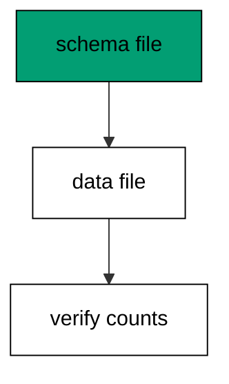

Splitting schema from data keeps each migration small and reversible: the column add rolls back with a drop, while the data fill needs no reverse at all. Backfill migrations move data forward only.

**`learning/code/ex-26-backfill-fills-the-new-column/main.go`**:

```go
// => Shared driver: every unit in this course opens with this prelude.
// => The harness network is closed, so units carry a small standard-library
// => driver that applies the same goose SQL files `goose up` would apply.
// => The files, the history table shape, and the ordering rules are goose's
// => own; the driver only replaces the network-dependent binary.
package main // => every unit is one runnable program

import ( // => standard library only: no third-party modules
	"bufio"           // => bufio frames protocol messages over the TCP stream
	"encoding/binary" // => binary lays out length-prefixed protocol fields
	"fmt"             // => fmt prints the deterministic transcript only
	"io"              // => io forces full reads of split protocol messages
	"net"             // => net dials the harness Postgres service over TCP
	"os"              // => os reads the harness database address, never hardcoded
	"sort"            // => sort orders migration files, never trusts directory order
	"strings"         // => strings splits the goose Up and Down annotations
) // => every import used by driver and units

// => The database address comes from the harness, with local-run defaults.
func addr() (string, string, string) { // => one helper owns every address default
	host := os.Getenv("PGHOST") // => service hostname in the unit network
	if host == "" {             // => empty means a local run outside the harness
		host = "postgres" // => same default the Python courses use
	} // => end addr: empty means a local run outside the harness
	user := os.Getenv("PGUSER") // => trust-auth role, no password needed
	if user == "" {             // => empty means a local run outside the harness
		user = "postgres" // => same default the Python courses use
	} // => end addr: empty means a local run outside the harness
	db := os.Getenv("PGDATABASE") // => fresh database for every unit run
	if db == "" {                 // => empty means a local run outside the harness
		db = "postgres" // => same default the Python courses use
	} // => end addr: empty means a local run outside the harness
	return host, user, db // => callers never re-read the environment
} // => end addr: one helper owns every address default

// => conn wraps one TCP connection plus a buffered reader for message frames.
type conn struct { // => a tiny struct keeps the socket and the framer together
	c net.Conn      // => the raw TCP socket to the Postgres service
	r *bufio.Reader // => buffered reads frame messages split across packets
} // => end type conn: socket and framer travel together

// => readMsg reads one backend message: a type byte plus a length body.
func (k *conn) readMsg() (byte, []byte, error) { // => every response flows through here
	head := make([]byte, 5)                           // => one type byte plus one int32 length
	if _, err := io.ReadFull(k.r, head); err != nil { // => fragments reassemble before framing
		return 0, nil, err // => no partial message is ever trusted
	} // => end readMsg: fragments reassemble before framing
	n := int(binary.BigEndian.Uint32(head[1:])) - 4   // => length counts itself, not the type
	body := make([]byte, n)                           // => exact-size body, never over-read
	if _, err := io.ReadFull(k.r, body); err != nil { // => fragments reassemble before framing
		return 0, nil, err // => no partial message is ever trusted
	} // => end readMsg: fragments reassemble before framing
	return head[0], body, nil // => type byte tells the caller what arrived
} // => end readMsg: every response flows through here

// => sendMsg writes one frontend message: a type byte plus a length body.
func (k *conn) sendMsg(t byte, body []byte) error { // => startup is the only typeless message
	out := []byte{t}                                      // => type byte leads every message
	lenb := make([]byte, 4)                               // => four bytes carry the length
	binary.BigEndian.PutUint32(lenb, uint32(len(body)+4)) // => length counts itself
	out = append(out, lenb...)                            // => length follows the type byte
	out = append(out, body...)                            // => payload closes the message
	_, err := k.c.Write(out)                              // => one write keeps frames whole
	return err                                            // => write errors fail the unit loudly
} // => end sendMsg: startup is the only typeless message

// => connect opens the service database and waits for session readiness.
func connect() (*conn, error) { // => every unit starts from this one helper
	host, user, db := addr()         // => harness address, never hardcoded
	return connectDb(host, user, db) // => one path opens every session
} // => end connect: every unit starts from this one helper

// => connectDb opens a named database on the same host for multi-db drills.
func connectDb(host, user, db string) (*conn, error) { // => environments are databases, not servers
	c, err := net.Dial("tcp", host+":5432") // => Postgres listens on 5432
	if err != nil {                         // => unreachable service is fatal
		return nil, err // => no fallback: the harness owns the database
	} // => end connectDb: unreachable service is fatal
	k := &conn{c: c, r: bufio.NewReader(c)}             // => buffer the fresh socket at once
	body := []byte{}                                    // => startup body is parameters only
	body = append(body, 0, 0, 0, 0)                     // => placeholder for the length prefix
	body = append(body, 0, 3, 0, 0)                     // => protocol 3.0, the stable version
	body = append(body, []byte("user")...)              // => user key starts the parameters
	body = append(body, 0)                              // => keys and values are NUL-separated
	body = append(body, []byte(user)...)                // => trust-auth role from the harness
	body = append(body, 0)                              // => NUL ends the value
	body = append(body, []byte("database")...)          // => database key follows the user
	body = append(body, 0)                              // => NUL ends the key
	body = append(body, []byte(db)...)                  // => fresh database for every unit run
	body = append(body, 0)                              // => NUL ends the value
	body = append(body, 0)                              // => empty key ends the parameters
	binary.BigEndian.PutUint32(body, uint32(len(body))) // => startup length counts itself
	if _, err := c.Write(body); err != nil {            // => startup is the only typeless message
		return nil, err // => unwritable socket is fatal
	} // => end connectDb: startup is the only typeless message
	for { // => drain until the session is ready for queries
		t, b, err := k.readMsg() // => every backend message flows through here
		if err != nil {          // => broken handshake is fatal
			return nil, err // => no half-open session is ever used
		} // => end connectDb: broken handshake is fatal
		switch t { // => only three message kinds matter during startup
		case 'R': // => authentication response arrives first
			if binary.BigEndian.Uint32(b) != 0 { // => nonzero means a password is wanted
				return nil, fmt.Errorf("server wants a password") // => trust auth never asks
			} // => end connectDb: nonzero means a password is wanted
		case 'E': // => an error ends the handshake with the server text
			return nil, fmt.Errorf("startup: %s", errText(b)) // => server text explains the cause
		case 'Z': // => ReadyForQuery means the session accepts queries
			return k, nil // => handshake done: hand the live session back
		} // => end connectDb: only three message kinds matter during startup
	} // => end connectDb: drain until the session is ready for queries
} // => end connectDb: environments are databases, not servers

// => errText extracts the human message (field M) from an ErrorResponse.
func errText(b []byte) string { // => one helper decodes every server error
	parts := strings.Split(string(b), "\x00") // => fields are NUL-separated pairs
	for i := 0; i+1 < len(parts); i += 2 {    // => walk code and value together
		if parts[i] == "M" { // => M is the primary human message
			return parts[i+1] // => return the message, skip the detail fields
		} // => end errText: M is the primary human message
	} // => end errText: walk code and value together
	return "unknown error" // => malformed errors still fail with a fixed line
} // => end errText: one helper decodes every server error

// => run sends one SQL string and returns every data row plus the command tag.
func (k *conn) run(q string) ([][]string, string, error) { // => one path runs every statement
	body := append([]byte(q), 0)                 // => Query messages are NUL-terminated
	if err := k.sendMsg('Q', body); err != nil { // => send fails loudly, never silently
		return nil, "", err // => unwritable socket ends the unit
	} // => end run: send fails loudly, never silently
	var rows [][]string // => data rows accumulate across result sets
	tag := ""           // => the last command tag (SELECT 3, CREATE TABLE...)
	for {               // => drain until ReadyForQuery closes this query string
		t, b, err := k.readMsg() // => every response flows through the framer
		if err != nil {          // => broken mid-query connection is fatal
			return nil, "", err // => partial results are never returned
		} // => end run: broken mid-query connection is fatal
		switch t { // => four message kinds carry a simple-query response
		case 'T', 'N', 'A', 'S', 'K': // => metadata the transcript never prints
		case 'D': // => one data row arrived
			rows = append(rows, parseRow(b)) // => decode the text columns now
		case 'C': // => one statement finished
			tag = strings.TrimRight(string(b[:len(b)-1]), "\x00") // => tag names what ran
		case 'E': // => the statement failed
			drain(k)                                     // => finish the failed query before reuse
			return nil, "", fmt.Errorf("%s", errText(b)) // => server text becomes the failure
		case 'Z': // => ReadyForQuery ends this query string
			return rows, tag, nil // => rows, tag, and a clean session
		} // => end run: four message kinds carry a simple-query response
	} // => end run: drain until ReadyForQuery closes this query string
} // => end run: one path runs every statement

// => drain reads to the next ReadyForQuery after a statement error.
func drain(k *conn) { // => an errored query still owns the socket until Z
	for { // => loop until the session is reusable
		t, _, err := k.readMsg()    // => discard every message after the error
		if err != nil || t == 'Z' { // => socket break or ready both end the drain
			return // => caller decides the failure, the drain only resynchronizes
		} // => end drain: socket break or ready both end the drain
	} // => end drain: loop until the session is reusable
} // => end drain: an errored query still owns the socket until Z

// => parseRow decodes one DataRow body into text columns, NULL as "NULL".
func parseRow(b []byte) []string { // => one helper decodes every returned row
	n := int(binary.BigEndian.Uint16(b)) // => column count leads the body
	b = b[2:]                            // => step past the count
	out := make([]string, 0, n)          // => pre-size the row to the count
	for i := 0; i < n; i++ {             // => walk each column in order
		l := int(int32(binary.BigEndian.Uint32(b))) // => -1 marks NULL, else the length
		b = b[4:]                                   // => step past the length
		if l < 0 {                                  // => NULL has no bytes to read
			out = append(out, "NULL") // => fixed word keeps transcripts stable
			continue                  // => next column, no bytes consumed
		} // => end parseRow: NULL has no bytes to read
		out = append(out, string(b[:l])) // => text format is already printable
		b = b[l:]                        // => step past the value bytes
	} // => end parseRow: walk each column in order
	return out // => one row, fully decoded
} // => end parseRow: one helper decodes every returned row

// => must runs SQL or exits nonzero with the server text on standard error.
func must(k *conn, q string) [][]string { // => setup statements never fail quietly
	rows, _, err := k.run(q) // => rows return for verification queries
	if err != nil {          // => any server error is fatal to the unit
		fmt.Fprintln(os.Stderr, "sql error:", err) // => errors go to stderr, never stdout
		os.Exit(1)                                 // => nonzero exit fails the harness check
	} // => end must: any server error is fatal to the unit
	return rows // => callers print only what the lesson asserts
} // => end must: setup statements never fail quietly

// => try runs SQL and returns the server error text instead of exiting.
func try(k *conn, q string) ([][]string, string) { // => failure drills inspect errors, not die
	rows, _, err := k.run(q) // => same path as must, opposite failure policy
	if err != nil {          // => expected errors become transcript lines
		return nil, err.Error() // => fixed server text, never timings
	} // => end try: expected errors become transcript lines
	return rows, "" // => empty error means the statement succeeded
} // => end try: failure drills inspect errors, not die

// => mig holds one goose SQL file: its version, name, and Up/Down sections.
type mig struct { // => mirrors the goose file layout the lesson teaches
	version string   // => zero-padded number orders history, like goose
	name    string   // => human slug after the version number
	up      []string // => forward statements, run inside one transaction
	down    []string // => reverse statements, run inside one transaction
	noTx    bool     // => NO TRANSACTION files run outside one, like goose
} // => end type mig: version, name, sections, and mode

// => parseGoose splits one goose SQL file into its Up and Down statements.
func parseGoose(text string) (up, down []string, noTx bool) { // => the lesson asserts this exact split
	section := ""                                    // => nothing belongs outside the annotations
	for _, line := range strings.Split(text, "\n") { // => walk the file line by line
		t := strings.TrimSpace(line) // => annotation matching ignores indentation
		switch t {                   // => four annotation lines switch sections
		case "-- +goose Up": // => forward section starts here, like goose
			section = "up" // => following statements migrate forward
			continue       // => the annotation itself never runs
		case "-- +goose Down": // => reverse section starts here, like goose
			section = "down" // => following statements roll back
			continue         // => the annotation itself never runs
		case "-- +goose NO TRANSACTION": // => concurrent work cannot run inside one
			noTx = true // => remember the file opts out of the transaction
			continue    // => the annotation itself never runs
		} // => end parseGoose: four annotation lines switch sections
		if strings.HasPrefix(t, "--") || t == "" { // => comments and blanks never run
			continue // => only real statements reach the database
		} // => end parseGoose: comments and blanks never run
		if section == "up" { // => route by the annotation seen above
			up = append(up, line) // => keep the original line for the file write
		} else if section == "down" { // => down statements collect separately
			down = append(down, line) // => keep the original line for the file write
		} // => end parseGoose: down statements collect separately
	} // => end parseGoose: walk the file line by line
	return splitStmts(strings.Join(up, "\n")), splitStmts(strings.Join(down, "\n")), noTx // => one string per statement
} // => end parseGoose: the lesson asserts this exact split

// => splitStmts cuts statement text on semicolons outside quotes.
func splitStmts(s string) []string { // => multi-line statements stay whole until ;
	var out []string        // => finished statements accumulate here
	var cur strings.Builder // => the statement under construction
	inStr := false          // => semicolons inside quotes never split
	for _, r := range s {   // => walk rune by rune, quotes included
		switch { // => quote tracking decides what a semicolon means
		case r == '\'': // => a quote toggles string mode
			inStr = !inStr   // => enter or leave the quoted region
			cur.WriteRune(r) // => the quote belongs to the statement
		case r == ';' && !inStr: // => a bare semicolon ends one statement
			if t := strings.TrimSpace(cur.String()); t != "" { // => skip empty fragments
				out = append(out, t) // => store the finished statement
			} // => end splitStmts: skip empty fragments
			cur.Reset() // => start the next statement fresh
		default: // => every other rune belongs to the current statement
			cur.WriteRune(r) // => accumulate verbatim
		} // => end splitStmts: quote tracking decides what a semicolon means
	} // => end splitStmts: walk rune by rune, quotes included
	if t := strings.TrimSpace(cur.String()); t != "" { // => trailing text without ; still counts
		out = append(out, t) // => last statement needs no semicolon
	} // => end splitStmts: trailing text without ; still counts
	return out // => callers run each statement in order
} // => end splitStmts: multi-line statements stay whole until ;

// => ensureHistory creates the goose history table once per unit run.
func ensureHistory(k *conn) { // => goose_db_version is goose's own default name
	must(k, `CREATE TABLE IF NOT EXISTS goose_db_version (`+ // => reruns never fail here
		`id integer PRIMARY KEY GENERATED BY DEFAULT AS IDENTITY, `+ // => surrogate key, never printed
		`version_id bigint NOT NULL, `+ // => applied version numbers live here
		`is_applied boolean NOT NULL, `+ // => goose marks rows applied on success
		`tstamp timestamp NOT NULL DEFAULT now())`) // => timestamp defaults, never printed
} // => end ensureHistory: goose_db_version is goose's own default name

// => appliedVersions returns the version numbers already marked applied.
func appliedVersions(k *conn) map[int64]bool { // => history decides what still needs running
	rows := must(k, `SELECT version_id FROM goose_db_version `+ // => only the numbers matter
		`WHERE is_applied ORDER BY version_id`) // => order keeps the transcript stable
	got := map[int64]bool{}  // => set lookup answers "already applied" fast
	for _, r := range rows { // => one row per applied migration
		var v int64                // => version numbers are integers
		fmt.Sscanf(r[0], "%d", &v) // => text format parses back to a number
		got[v] = true              // => mark this version done
	} // => end appliedVersions: one row per applied migration
	return got // => callers skip whatever history already holds
} // => end appliedVersions: history decides what still needs running

// => applyUp runs every pending migration forward, one transaction each.
func applyUp(k *conn, ms []mig) { // => files on disk are already the source of truth
	done := appliedVersions(k) // => history decides what still needs running
	for _, m := range ms {     // => file order is version order, sorted by the caller
		var v int64                     // => versions compare as numbers
		fmt.Sscanf(m.version, "%d", &v) // => zero-padded file prefix parses back
		if done[v] {                    // => applied migrations never run twice
			continue // => idempotent reruns skip straight past
		} // => end applyUp: applied migrations never run twice
		if !m.noTx { // => transactional files wrap everything in one unit
			must(k, "BEGIN") // => one migration is one transaction, like goose
		} // => end applyUp: transactional files wrap everything in one unit
		for _, s := range m.up { // => forward statements run in file order
			must(k, s) // => any failure aborts the unit before COMMIT
		} // => end applyUp: forward statements run in file order
		if !m.noTx { // => stamps join the same transaction they describe
			must(k, fmt.Sprintf(`INSERT INTO goose_db_version `+ // => stamp only after success
				`(version_id, is_applied) VALUES (%d, true)`, v)) // => stamp mirrors goose exactly
			must(k, "COMMIT") // => history row and schema land together
		} else { // => concurrent statements cannot share a transaction
			must(k, fmt.Sprintf(`INSERT INTO goose_db_version `+ // => stamp follows the work
				`(version_id, is_applied) VALUES (%d, true)`, v)) // => same row, separate statement
		} // => end applyUp: concurrent statements cannot share a transaction
	} // => end applyUp: file order is version order, sorted by the caller
} // => end applyUp: files on disk are already the source of truth

// => applyDown rolls back the newest applied migrations, newest first.
func applyDown(k *conn, ms []mig, steps int) { // => steps bounds how far history rewinds
	done := appliedVersions(k) // => history decides what can roll back
	var todo []mig             // => applied migrations in version order first
	for _, m := range ms {     // => walk the whole known history
		var v int64                     // => versions compare as numbers
		fmt.Sscanf(m.version, "%d", &v) // => zero-padded file prefix parses back
		if done[v] {                    // => only applied migrations roll back
			todo = append(todo, m) // => keep the migration for the reverse pass
		} // => end applyDown: only applied migrations roll back
	} // => end applyDown: walk the whole known history
	for i := len(todo) - 1; i >= 0 && steps > 0; i-- { // => newest applied goes first
		m := todo[i]                    // => this migration rolls back now
		var v int64                     // => versions compare as numbers
		fmt.Sscanf(m.version, "%d", &v) // => zero-padded file prefix parses back
		if !m.noTx {                    // => transactional files wrap the rollback too
			must(k, "BEGIN") // => reverse change is atomic, like the forward one
		} // => end applyDown: transactional files wrap the rollback too
		for _, s := range m.down { // => reverse statements run in file order
			must(k, s) // => any failure aborts before the history row moves
		} // => end applyDown: reverse statements run in file order
		must(k, fmt.Sprintf(`DELETE FROM goose_db_version `+ // => unstamped only after success
			`WHERE version_id = %d`, v)) // => the version leaves history exactly once
		if !m.noTx { // => close the transaction the rollback opened
			must(k, "COMMIT") // => schema reversal and unstamp land together
		} // => end applyDown: close the transaction the rollback opened
		steps-- // => one rollback consumed from the budget
	} // => end applyDown: newest applied goes first
} // => end applyDown: steps bounds how far history rewinds

// => statusCounts splits known migrations into applied and pending lists.
func statusCounts(k *conn, ms []mig) (applied, pending []string) { // => goose status in two lists
	done := appliedVersions(k) // => history decides which list each version joins
	for _, m := range ms {     // => walk the known history in version order
		var v int64                     // => versions compare as numbers
		fmt.Sscanf(m.version, "%d", &v) // => zero-padded file prefix parses back
		if done[v] {                    // => stamped versions are done
			applied = append(applied, m.version) // => keep the version string for printing
		} else { // => unstamped versions still wait
			pending = append(pending, m.version) // => keep the version string for printing
		} // => end statusCounts: unstamped versions still wait
	} // => end statusCounts: walk the known history in version order
	return applied, pending // => callers print both lists in one stable line each
} // => end statusCounts: goose status in two lists

// => files writes each migration as a real goose SQL file under dir.
func files(dir string, ms []mig) { // => the lesson shows these files byte-identically
	for _, m := range ms { // => one file per migration, like `goose create`
		name := fmt.Sprintf("%s_%s.sql", m.version, m.name) // => goose names files version-first
		var b strings.Builder                               // => build the file text in order
		if m.noTx {                                         // => concurrent files announce it first
			b.WriteString("-- +goose NO TRANSACTION\n") // => goose honors this exact annotation
		} // => end files: concurrent files announce it first
		b.WriteString("-- +goose Up\n") // => forward annotation leads
		for _, s := range m.up {        // => forward statements follow
			b.WriteString(s + ";\n") // => one statement per line, semicolon-closed
		} // => end files: forward statements follow
		b.WriteString("-- +goose Down\n") // => reverse annotation splits the file
		for _, s := range m.down {        // => reverse statements close the file
			b.WriteString(s + ";\n") // => one statement per line, semicolon-closed
		} // => end files: reverse statements close the file
		if err := os.WriteFile(dir+"/"+name, []byte(b.String()), 0644); err != nil { // => real files, like goose
			fmt.Fprintln(os.Stderr, "write error:", err) // => write errors fail loudly
			os.Exit(1)                                   // => no half-written migration set
		} // => end files: real files, like goose
	} // => end files: one file per migration, like `goose create`
} // => end files: the lesson shows these files byte-identically

// => versions lists migration files in version order from dir.
func versions(dir string) []mig { // => directory order is never trusted for history
	ents, err := os.ReadDir(dir) // => read the whole migrations directory
	if err != nil {              // => unreadable directory is fatal
		fmt.Fprintln(os.Stderr, "read error:", err) // => errors go to stderr
		os.Exit(1)                                  // => nonzero exit fails the check
	} // => end versions: unreadable directory is fatal
	names := []string{}      // => collect names before sorting
	for _, e := range ents { // => walk every directory entry
		if !e.IsDir() && strings.HasSuffix(e.Name(), ".sql") { // => only goose SQL files count
			names = append(names, e.Name()) // => keep the file name for parsing
		} // => end versions: only goose SQL files count
	} // => end versions: walk every directory entry
	sort.Strings(names)       // => zero-padded versions sort chronologically
	var out []mig             // => parsed migrations accumulate here
	for _, n := range names { // => parse in version order
		raw, err := os.ReadFile(dir + "/" + n) // => read the real file back
		if err != nil {                        // => unreadable file is fatal
			fmt.Fprintln(os.Stderr, "read error:", err) // => errors go to stderr
			os.Exit(1)                                  // => nonzero exit fails the check
		} // => end versions: unreadable file is fatal
		up, down, noTx := parseGoose(string(raw))                                            // => split on the goose annotations
		rest := strings.TrimSuffix(n, ".sql")                                                // => strip the extension first
		ver := rest[:5]                                                                      // => first five digits are the version
		out = append(out, mig{version: ver, name: rest[6:], up: up, down: down, noTx: noTx}) // => keep every part
	} // => end versions: parse in version order
	return out // => version-ordered migrations, ready to apply
} // => end versions: directory order is never trusted for history

// => findDupes returns version numbers claimed by two or more files.
func findDupes(dir string) []string { // => goose refuses duplicate versions outright
	ents, err := os.ReadDir(dir) // => read the whole migrations directory
	if err != nil {              // => unreadable directory is fatal
		fmt.Fprintln(os.Stderr, "read error:", err) // => errors go to stderr
		os.Exit(1)                                  // => nonzero exit fails the check
	} // => end findDupes: unreadable directory is fatal
	seen := map[string]int{} // => count claims per five-digit version prefix
	for _, e := range ents { // => walk every directory entry
		if !e.IsDir() && strings.HasSuffix(e.Name(), ".sql") { // => only goose SQL files count
			seen[e.Name()[:5]]++ // => first five digits are the version
		} // => end findDupes: only goose SQL files count
	} // => end findDupes: walk every directory entry
	var out []string         // => duplicates accumulate in version order
	for _, e := range ents { // => second pass keeps the order stable
		if !e.IsDir() && strings.HasSuffix(e.Name(), ".sql") { // => only goose SQL files count
			if v := e.Name()[:5]; seen[v] > 1 { // => claimed more than once
				out = append(out, v) // => keep the version string for printing
				seen[v] = 0          // => report each duplicate version only once
			} // => end findDupes: claimed more than once
		} // => end findDupes: only goose SQL files count
	} // => end findDupes: second pass keeps the order stable
	return out // => empty means the history numbers are unique
} // => end findDupes: goose refuses duplicate versions outright

func main() {
	k, err := connect() // => one session runs the whole example
	if err != nil {     // => unreachable database fails loudly
		fmt.Fprintln(os.Stderr, "connect error:", err) // => connection errors go to stderr
		os.Exit(1)                                     // => nonzero exit fails the check
	}
	defer k.c.Close() // => the socket closes when the example ends
	// => A scratch migrations directory: goose files live here, never in the unit.
	// => the scratch path never reaches stdout, so reruns stay byte-stable
	dir, err := os.MkdirTemp("", "ex26-") // => private directory, like `goose create`
	if err != nil {                       // => unmakable temp dir is fatal
		fmt.Fprintln(os.Stderr, "temp error:", err) // => errors go to stderr
		os.Exit(1)                                  // => nonzero exit fails the check
	}
	defer os.RemoveAll(dir)                          // => scratch files vanish; only transcripts remain
	must(k, "DROP TABLE IF EXISTS ex26_base")        // => leftovers of a killed run vanish
	must(k, "DROP TABLE IF EXISTS goose_db_version") // => stale history vanishes too
	ensureHistory(k)                                 // => goose history table, real shape
	files(dir, []mig{                                // => schema first, data second: two migrations
		{version: "00001", name: "add_display_name", // => nullable column first, no data moved
			up:   []string{"ALTER TABLE ex26_base ADD COLUMN display_name TEXT"}, // => forward change
			down: []string{"ALTER TABLE ex26_base DROP COLUMN display_name"}},    // => exact reverse for rollback
		{version: "00002", name: "fill_display_name", // => data-only migration follows
			up:   []string{"UPDATE ex26_base SET display_name = first_name WHERE display_name IS NULL"}, // => fill from existing rows
			down: []string{"SELECT 1"}},                                                                 // => data fills never reverse: explicit no-op
	})
	must(k, "CREATE TABLE ex26_base (id SERIAL PRIMARY KEY, first_name TEXT NOT NULL)") // => base table predates history
	must(k, `INSERT INTO ex26_base (first_name) VALUES ('ada'), ('grace')`)             // => rows that need filling
	applyUp(k, versions(dir))                                                           // => read the files back and run what is pending
	rows := must(k, `SELECT display_name FROM ex26_base ORDER BY id`)                   // => filled values read back
	fmt.Println("names:", rows[0][0], rows[1][0])                                       // => Output: names: ada grace
	must(k, "DROP TABLE ex26_base")                                                     // => base table cleaned with the example tables
	fmt.Println("cleaned: yes")                                                         // => Output: cleaned: yes
	must(k, "DROP TABLE IF EXISTS ex26_base")                                           // => leftovers of a killed run vanish
	must(k, "DROP TABLE IF EXISTS goose_db_version")                                    // => the example leaves no history behind
}
```

**Output** (`learning/code/ex-26-backfill-fills-the-new-column/expected/main.stdout.txt`):

```text
names: ada grace
cleaned: yes
```

**Key takeaway**: Schema migrations and data migrations travel in separate files so each can be retried without replaying the other.

**Why it matters**: Separating schema moves from data moves gives each kind its own retry story. Schema files replay structurally while data files rerun observationally, and a failed fill never forces a table rebuild. The split respects the different reversibility of structure versus content. Respecting the different reversibility of structure versus content keeps both halves honest and retryable.

### Example 27: Schema First Data Second

Order matters: the schema migration must run before the data migration that uses the new column. This example applies them in order and shows both the column and its filled values; reversing the order would fail the fill. (Concepts: co-06.)

The dependency is in the version numbers: 00001 creates, 00002 fills. Anyone reading history sees the rule without opening a file.

**`learning/code/ex-27-schema-first-data-second/main.go`**:

```go
// => Shared driver: every unit in this course opens with this prelude.
// => The harness network is closed, so units carry a small standard-library
// => driver that applies the same goose SQL files `goose up` would apply.
// => The files, the history table shape, and the ordering rules are goose's
// => own; the driver only replaces the network-dependent binary.
package main // => every unit is one runnable program

import ( // => standard library only: no third-party modules
	"bufio"           // => bufio frames protocol messages over the TCP stream
	"encoding/binary" // => binary lays out length-prefixed protocol fields
	"fmt"             // => fmt prints the deterministic transcript only
	"io"              // => io forces full reads of split protocol messages
	"net"             // => net dials the harness Postgres service over TCP
	"os"              // => os reads the harness database address, never hardcoded
	"sort"            // => sort orders migration files, never trusts directory order
	"strings"         // => strings splits the goose Up and Down annotations
) // => every import used by driver and units

// => The database address comes from the harness, with local-run defaults.
func addr() (string, string, string) { // => one helper owns every address default
	host := os.Getenv("PGHOST") // => service hostname in the unit network
	if host == "" {             // => empty means a local run outside the harness
		host = "postgres" // => same default the Python courses use
	} // => end addr: empty means a local run outside the harness
	user := os.Getenv("PGUSER") // => trust-auth role, no password needed
	if user == "" {             // => empty means a local run outside the harness
		user = "postgres" // => same default the Python courses use
	} // => end addr: empty means a local run outside the harness
	db := os.Getenv("PGDATABASE") // => fresh database for every unit run
	if db == "" {                 // => empty means a local run outside the harness
		db = "postgres" // => same default the Python courses use
	} // => end addr: empty means a local run outside the harness
	return host, user, db // => callers never re-read the environment
} // => end addr: one helper owns every address default

// => conn wraps one TCP connection plus a buffered reader for message frames.
type conn struct { // => a tiny struct keeps the socket and the framer together
	c net.Conn      // => the raw TCP socket to the Postgres service
	r *bufio.Reader // => buffered reads frame messages split across packets
} // => end type conn: socket and framer travel together

// => readMsg reads one backend message: a type byte plus a length body.
func (k *conn) readMsg() (byte, []byte, error) { // => every response flows through here
	head := make([]byte, 5)                           // => one type byte plus one int32 length
	if _, err := io.ReadFull(k.r, head); err != nil { // => fragments reassemble before framing
		return 0, nil, err // => no partial message is ever trusted
	} // => end readMsg: fragments reassemble before framing
	n := int(binary.BigEndian.Uint32(head[1:])) - 4   // => length counts itself, not the type
	body := make([]byte, n)                           // => exact-size body, never over-read
	if _, err := io.ReadFull(k.r, body); err != nil { // => fragments reassemble before framing
		return 0, nil, err // => no partial message is ever trusted
	} // => end readMsg: fragments reassemble before framing
	return head[0], body, nil // => type byte tells the caller what arrived
} // => end readMsg: every response flows through here

// => sendMsg writes one frontend message: a type byte plus a length body.
func (k *conn) sendMsg(t byte, body []byte) error { // => startup is the only typeless message
	out := []byte{t}                                      // => type byte leads every message
	lenb := make([]byte, 4)                               // => four bytes carry the length
	binary.BigEndian.PutUint32(lenb, uint32(len(body)+4)) // => length counts itself
	out = append(out, lenb...)                            // => length follows the type byte
	out = append(out, body...)                            // => payload closes the message
	_, err := k.c.Write(out)                              // => one write keeps frames whole
	return err                                            // => write errors fail the unit loudly
} // => end sendMsg: startup is the only typeless message

// => connect opens the service database and waits for session readiness.
func connect() (*conn, error) { // => every unit starts from this one helper
	host, user, db := addr()         // => harness address, never hardcoded
	return connectDb(host, user, db) // => one path opens every session
} // => end connect: every unit starts from this one helper

// => connectDb opens a named database on the same host for multi-db drills.
func connectDb(host, user, db string) (*conn, error) { // => environments are databases, not servers
	c, err := net.Dial("tcp", host+":5432") // => Postgres listens on 5432
	if err != nil {                         // => unreachable service is fatal
		return nil, err // => no fallback: the harness owns the database
	} // => end connectDb: unreachable service is fatal
	k := &conn{c: c, r: bufio.NewReader(c)}             // => buffer the fresh socket at once
	body := []byte{}                                    // => startup body is parameters only
	body = append(body, 0, 0, 0, 0)                     // => placeholder for the length prefix
	body = append(body, 0, 3, 0, 0)                     // => protocol 3.0, the stable version
	body = append(body, []byte("user")...)              // => user key starts the parameters
	body = append(body, 0)                              // => keys and values are NUL-separated
	body = append(body, []byte(user)...)                // => trust-auth role from the harness
	body = append(body, 0)                              // => NUL ends the value
	body = append(body, []byte("database")...)          // => database key follows the user
	body = append(body, 0)                              // => NUL ends the key
	body = append(body, []byte(db)...)                  // => fresh database for every unit run
	body = append(body, 0)                              // => NUL ends the value
	body = append(body, 0)                              // => empty key ends the parameters
	binary.BigEndian.PutUint32(body, uint32(len(body))) // => startup length counts itself
	if _, err := c.Write(body); err != nil {            // => startup is the only typeless message
		return nil, err // => unwritable socket is fatal
	} // => end connectDb: startup is the only typeless message
	for { // => drain until the session is ready for queries
		t, b, err := k.readMsg() // => every backend message flows through here
		if err != nil {          // => broken handshake is fatal
			return nil, err // => no half-open session is ever used
		} // => end connectDb: broken handshake is fatal
		switch t { // => only three message kinds matter during startup
		case 'R': // => authentication response arrives first
			if binary.BigEndian.Uint32(b) != 0 { // => nonzero means a password is wanted
				return nil, fmt.Errorf("server wants a password") // => trust auth never asks
			} // => end connectDb: nonzero means a password is wanted
		case 'E': // => an error ends the handshake with the server text
			return nil, fmt.Errorf("startup: %s", errText(b)) // => server text explains the cause
		case 'Z': // => ReadyForQuery means the session accepts queries
			return k, nil // => handshake done: hand the live session back
		} // => end connectDb: only three message kinds matter during startup
	} // => end connectDb: drain until the session is ready for queries
} // => end connectDb: environments are databases, not servers

// => errText extracts the human message (field M) from an ErrorResponse.
func errText(b []byte) string { // => one helper decodes every server error
	parts := strings.Split(string(b), "\x00") // => fields are NUL-separated pairs
	for i := 0; i+1 < len(parts); i += 2 {    // => walk code and value together
		if parts[i] == "M" { // => M is the primary human message
			return parts[i+1] // => return the message, skip the detail fields
		} // => end errText: M is the primary human message
	} // => end errText: walk code and value together
	return "unknown error" // => malformed errors still fail with a fixed line
} // => end errText: one helper decodes every server error

// => run sends one SQL string and returns every data row plus the command tag.
func (k *conn) run(q string) ([][]string, string, error) { // => one path runs every statement
	body := append([]byte(q), 0)                 // => Query messages are NUL-terminated
	if err := k.sendMsg('Q', body); err != nil { // => send fails loudly, never silently
		return nil, "", err // => unwritable socket ends the unit
	} // => end run: send fails loudly, never silently
	var rows [][]string // => data rows accumulate across result sets
	tag := ""           // => the last command tag (SELECT 3, CREATE TABLE...)
	for {               // => drain until ReadyForQuery closes this query string
		t, b, err := k.readMsg() // => every response flows through the framer
		if err != nil {          // => broken mid-query connection is fatal
			return nil, "", err // => partial results are never returned
		} // => end run: broken mid-query connection is fatal
		switch t { // => four message kinds carry a simple-query response
		case 'T', 'N', 'A', 'S', 'K': // => metadata the transcript never prints
		case 'D': // => one data row arrived
			rows = append(rows, parseRow(b)) // => decode the text columns now
		case 'C': // => one statement finished
			tag = strings.TrimRight(string(b[:len(b)-1]), "\x00") // => tag names what ran
		case 'E': // => the statement failed
			drain(k)                                     // => finish the failed query before reuse
			return nil, "", fmt.Errorf("%s", errText(b)) // => server text becomes the failure
		case 'Z': // => ReadyForQuery ends this query string
			return rows, tag, nil // => rows, tag, and a clean session
		} // => end run: four message kinds carry a simple-query response
	} // => end run: drain until ReadyForQuery closes this query string
} // => end run: one path runs every statement

// => drain reads to the next ReadyForQuery after a statement error.
func drain(k *conn) { // => an errored query still owns the socket until Z
	for { // => loop until the session is reusable
		t, _, err := k.readMsg()    // => discard every message after the error
		if err != nil || t == 'Z' { // => socket break or ready both end the drain
			return // => caller decides the failure, the drain only resynchronizes
		} // => end drain: socket break or ready both end the drain
	} // => end drain: loop until the session is reusable
} // => end drain: an errored query still owns the socket until Z

// => parseRow decodes one DataRow body into text columns, NULL as "NULL".
func parseRow(b []byte) []string { // => one helper decodes every returned row
	n := int(binary.BigEndian.Uint16(b)) // => column count leads the body
	b = b[2:]                            // => step past the count
	out := make([]string, 0, n)          // => pre-size the row to the count
	for i := 0; i < n; i++ {             // => walk each column in order
		l := int(int32(binary.BigEndian.Uint32(b))) // => -1 marks NULL, else the length
		b = b[4:]                                   // => step past the length
		if l < 0 {                                  // => NULL has no bytes to read
			out = append(out, "NULL") // => fixed word keeps transcripts stable
			continue                  // => next column, no bytes consumed
		} // => end parseRow: NULL has no bytes to read
		out = append(out, string(b[:l])) // => text format is already printable
		b = b[l:]                        // => step past the value bytes
	} // => end parseRow: walk each column in order
	return out // => one row, fully decoded
} // => end parseRow: one helper decodes every returned row

// => must runs SQL or exits nonzero with the server text on standard error.
func must(k *conn, q string) [][]string { // => setup statements never fail quietly
	rows, _, err := k.run(q) // => rows return for verification queries
	if err != nil {          // => any server error is fatal to the unit
		fmt.Fprintln(os.Stderr, "sql error:", err) // => errors go to stderr, never stdout
		os.Exit(1)                                 // => nonzero exit fails the harness check
	} // => end must: any server error is fatal to the unit
	return rows // => callers print only what the lesson asserts
} // => end must: setup statements never fail quietly

// => try runs SQL and returns the server error text instead of exiting.
func try(k *conn, q string) ([][]string, string) { // => failure drills inspect errors, not die
	rows, _, err := k.run(q) // => same path as must, opposite failure policy
	if err != nil {          // => expected errors become transcript lines
		return nil, err.Error() // => fixed server text, never timings
	} // => end try: expected errors become transcript lines
	return rows, "" // => empty error means the statement succeeded
} // => end try: failure drills inspect errors, not die

// => mig holds one goose SQL file: its version, name, and Up/Down sections.
type mig struct { // => mirrors the goose file layout the lesson teaches
	version string   // => zero-padded number orders history, like goose
	name    string   // => human slug after the version number
	up      []string // => forward statements, run inside one transaction
	down    []string // => reverse statements, run inside one transaction
	noTx    bool     // => NO TRANSACTION files run outside one, like goose
} // => end type mig: version, name, sections, and mode

// => parseGoose splits one goose SQL file into its Up and Down statements.
func parseGoose(text string) (up, down []string, noTx bool) { // => the lesson asserts this exact split
	section := ""                                    // => nothing belongs outside the annotations
	for _, line := range strings.Split(text, "\n") { // => walk the file line by line
		t := strings.TrimSpace(line) // => annotation matching ignores indentation
		switch t {                   // => four annotation lines switch sections
		case "-- +goose Up": // => forward section starts here, like goose
			section = "up" // => following statements migrate forward
			continue       // => the annotation itself never runs
		case "-- +goose Down": // => reverse section starts here, like goose
			section = "down" // => following statements roll back
			continue         // => the annotation itself never runs
		case "-- +goose NO TRANSACTION": // => concurrent work cannot run inside one
			noTx = true // => remember the file opts out of the transaction
			continue    // => the annotation itself never runs
		} // => end parseGoose: four annotation lines switch sections
		if strings.HasPrefix(t, "--") || t == "" { // => comments and blanks never run
			continue // => only real statements reach the database
		} // => end parseGoose: comments and blanks never run
		if section == "up" { // => route by the annotation seen above
			up = append(up, line) // => keep the original line for the file write
		} else if section == "down" { // => down statements collect separately
			down = append(down, line) // => keep the original line for the file write
		} // => end parseGoose: down statements collect separately
	} // => end parseGoose: walk the file line by line
	return splitStmts(strings.Join(up, "\n")), splitStmts(strings.Join(down, "\n")), noTx // => one string per statement
} // => end parseGoose: the lesson asserts this exact split

// => splitStmts cuts statement text on semicolons outside quotes.
func splitStmts(s string) []string { // => multi-line statements stay whole until ;
	var out []string        // => finished statements accumulate here
	var cur strings.Builder // => the statement under construction
	inStr := false          // => semicolons inside quotes never split
	for _, r := range s {   // => walk rune by rune, quotes included
		switch { // => quote tracking decides what a semicolon means
		case r == '\'': // => a quote toggles string mode
			inStr = !inStr   // => enter or leave the quoted region
			cur.WriteRune(r) // => the quote belongs to the statement
		case r == ';' && !inStr: // => a bare semicolon ends one statement
			if t := strings.TrimSpace(cur.String()); t != "" { // => skip empty fragments
				out = append(out, t) // => store the finished statement
			} // => end splitStmts: skip empty fragments
			cur.Reset() // => start the next statement fresh
		default: // => every other rune belongs to the current statement
			cur.WriteRune(r) // => accumulate verbatim
		} // => end splitStmts: quote tracking decides what a semicolon means
	} // => end splitStmts: walk rune by rune, quotes included
	if t := strings.TrimSpace(cur.String()); t != "" { // => trailing text without ; still counts
		out = append(out, t) // => last statement needs no semicolon
	} // => end splitStmts: trailing text without ; still counts
	return out // => callers run each statement in order
} // => end splitStmts: multi-line statements stay whole until ;

// => ensureHistory creates the goose history table once per unit run.
func ensureHistory(k *conn) { // => goose_db_version is goose's own default name
	must(k, `CREATE TABLE IF NOT EXISTS goose_db_version (`+ // => reruns never fail here
		`id integer PRIMARY KEY GENERATED BY DEFAULT AS IDENTITY, `+ // => surrogate key, never printed
		`version_id bigint NOT NULL, `+ // => applied version numbers live here
		`is_applied boolean NOT NULL, `+ // => goose marks rows applied on success
		`tstamp timestamp NOT NULL DEFAULT now())`) // => timestamp defaults, never printed
} // => end ensureHistory: goose_db_version is goose's own default name

// => appliedVersions returns the version numbers already marked applied.
func appliedVersions(k *conn) map[int64]bool { // => history decides what still needs running
	rows := must(k, `SELECT version_id FROM goose_db_version `+ // => only the numbers matter
		`WHERE is_applied ORDER BY version_id`) // => order keeps the transcript stable
	got := map[int64]bool{}  // => set lookup answers "already applied" fast
	for _, r := range rows { // => one row per applied migration
		var v int64                // => version numbers are integers
		fmt.Sscanf(r[0], "%d", &v) // => text format parses back to a number
		got[v] = true              // => mark this version done
	} // => end appliedVersions: one row per applied migration
	return got // => callers skip whatever history already holds
} // => end appliedVersions: history decides what still needs running

// => applyUp runs every pending migration forward, one transaction each.
func applyUp(k *conn, ms []mig) { // => files on disk are already the source of truth
	done := appliedVersions(k) // => history decides what still needs running
	for _, m := range ms {     // => file order is version order, sorted by the caller
		var v int64                     // => versions compare as numbers
		fmt.Sscanf(m.version, "%d", &v) // => zero-padded file prefix parses back
		if done[v] {                    // => applied migrations never run twice
			continue // => idempotent reruns skip straight past
		} // => end applyUp: applied migrations never run twice
		if !m.noTx { // => transactional files wrap everything in one unit
			must(k, "BEGIN") // => one migration is one transaction, like goose
		} // => end applyUp: transactional files wrap everything in one unit
		for _, s := range m.up { // => forward statements run in file order
			must(k, s) // => any failure aborts the unit before COMMIT
		} // => end applyUp: forward statements run in file order
		if !m.noTx { // => stamps join the same transaction they describe
			must(k, fmt.Sprintf(`INSERT INTO goose_db_version `+ // => stamp only after success
				`(version_id, is_applied) VALUES (%d, true)`, v)) // => stamp mirrors goose exactly
			must(k, "COMMIT") // => history row and schema land together
		} else { // => concurrent statements cannot share a transaction
			must(k, fmt.Sprintf(`INSERT INTO goose_db_version `+ // => stamp follows the work
				`(version_id, is_applied) VALUES (%d, true)`, v)) // => same row, separate statement
		} // => end applyUp: concurrent statements cannot share a transaction
	} // => end applyUp: file order is version order, sorted by the caller
} // => end applyUp: files on disk are already the source of truth

// => applyDown rolls back the newest applied migrations, newest first.
func applyDown(k *conn, ms []mig, steps int) { // => steps bounds how far history rewinds
	done := appliedVersions(k) // => history decides what can roll back
	var todo []mig             // => applied migrations in version order first
	for _, m := range ms {     // => walk the whole known history
		var v int64                     // => versions compare as numbers
		fmt.Sscanf(m.version, "%d", &v) // => zero-padded file prefix parses back
		if done[v] {                    // => only applied migrations roll back
			todo = append(todo, m) // => keep the migration for the reverse pass
		} // => end applyDown: only applied migrations roll back
	} // => end applyDown: walk the whole known history
	for i := len(todo) - 1; i >= 0 && steps > 0; i-- { // => newest applied goes first
		m := todo[i]                    // => this migration rolls back now
		var v int64                     // => versions compare as numbers
		fmt.Sscanf(m.version, "%d", &v) // => zero-padded file prefix parses back
		if !m.noTx {                    // => transactional files wrap the rollback too
			must(k, "BEGIN") // => reverse change is atomic, like the forward one
		} // => end applyDown: transactional files wrap the rollback too
		for _, s := range m.down { // => reverse statements run in file order
			must(k, s) // => any failure aborts before the history row moves
		} // => end applyDown: reverse statements run in file order
		must(k, fmt.Sprintf(`DELETE FROM goose_db_version `+ // => unstamped only after success
			`WHERE version_id = %d`, v)) // => the version leaves history exactly once
		if !m.noTx { // => close the transaction the rollback opened
			must(k, "COMMIT") // => schema reversal and unstamp land together
		} // => end applyDown: close the transaction the rollback opened
		steps-- // => one rollback consumed from the budget
	} // => end applyDown: newest applied goes first
} // => end applyDown: steps bounds how far history rewinds

// => statusCounts splits known migrations into applied and pending lists.
func statusCounts(k *conn, ms []mig) (applied, pending []string) { // => goose status in two lists
	done := appliedVersions(k) // => history decides which list each version joins
	for _, m := range ms {     // => walk the known history in version order
		var v int64                     // => versions compare as numbers
		fmt.Sscanf(m.version, "%d", &v) // => zero-padded file prefix parses back
		if done[v] {                    // => stamped versions are done
			applied = append(applied, m.version) // => keep the version string for printing
		} else { // => unstamped versions still wait
			pending = append(pending, m.version) // => keep the version string for printing
		} // => end statusCounts: unstamped versions still wait
	} // => end statusCounts: walk the known history in version order
	return applied, pending // => callers print both lists in one stable line each
} // => end statusCounts: goose status in two lists

// => files writes each migration as a real goose SQL file under dir.
func files(dir string, ms []mig) { // => the lesson shows these files byte-identically
	for _, m := range ms { // => one file per migration, like `goose create`
		name := fmt.Sprintf("%s_%s.sql", m.version, m.name) // => goose names files version-first
		var b strings.Builder                               // => build the file text in order
		if m.noTx {                                         // => concurrent files announce it first
			b.WriteString("-- +goose NO TRANSACTION\n") // => goose honors this exact annotation
		} // => end files: concurrent files announce it first
		b.WriteString("-- +goose Up\n") // => forward annotation leads
		for _, s := range m.up {        // => forward statements follow
			b.WriteString(s + ";\n") // => one statement per line, semicolon-closed
		} // => end files: forward statements follow
		b.WriteString("-- +goose Down\n") // => reverse annotation splits the file
		for _, s := range m.down {        // => reverse statements close the file
			b.WriteString(s + ";\n") // => one statement per line, semicolon-closed
		} // => end files: reverse statements close the file
		if err := os.WriteFile(dir+"/"+name, []byte(b.String()), 0644); err != nil { // => real files, like goose
			fmt.Fprintln(os.Stderr, "write error:", err) // => write errors fail loudly
			os.Exit(1)                                   // => no half-written migration set
		} // => end files: real files, like goose
	} // => end files: one file per migration, like `goose create`
} // => end files: the lesson shows these files byte-identically

// => versions lists migration files in version order from dir.
func versions(dir string) []mig { // => directory order is never trusted for history
	ents, err := os.ReadDir(dir) // => read the whole migrations directory
	if err != nil {              // => unreadable directory is fatal
		fmt.Fprintln(os.Stderr, "read error:", err) // => errors go to stderr
		os.Exit(1)                                  // => nonzero exit fails the check
	} // => end versions: unreadable directory is fatal
	names := []string{}      // => collect names before sorting
	for _, e := range ents { // => walk every directory entry
		if !e.IsDir() && strings.HasSuffix(e.Name(), ".sql") { // => only goose SQL files count
			names = append(names, e.Name()) // => keep the file name for parsing
		} // => end versions: only goose SQL files count
	} // => end versions: walk every directory entry
	sort.Strings(names)       // => zero-padded versions sort chronologically
	var out []mig             // => parsed migrations accumulate here
	for _, n := range names { // => parse in version order
		raw, err := os.ReadFile(dir + "/" + n) // => read the real file back
		if err != nil {                        // => unreadable file is fatal
			fmt.Fprintln(os.Stderr, "read error:", err) // => errors go to stderr
			os.Exit(1)                                  // => nonzero exit fails the check
		} // => end versions: unreadable file is fatal
		up, down, noTx := parseGoose(string(raw))                                            // => split on the goose annotations
		rest := strings.TrimSuffix(n, ".sql")                                                // => strip the extension first
		ver := rest[:5]                                                                      // => first five digits are the version
		out = append(out, mig{version: ver, name: rest[6:], up: up, down: down, noTx: noTx}) // => keep every part
	} // => end versions: parse in version order
	return out // => version-ordered migrations, ready to apply
} // => end versions: directory order is never trusted for history

// => findDupes returns version numbers claimed by two or more files.
func findDupes(dir string) []string { // => goose refuses duplicate versions outright
	ents, err := os.ReadDir(dir) // => read the whole migrations directory
	if err != nil {              // => unreadable directory is fatal
		fmt.Fprintln(os.Stderr, "read error:", err) // => errors go to stderr
		os.Exit(1)                                  // => nonzero exit fails the check
	} // => end findDupes: unreadable directory is fatal
	seen := map[string]int{} // => count claims per five-digit version prefix
	for _, e := range ents { // => walk every directory entry
		if !e.IsDir() && strings.HasSuffix(e.Name(), ".sql") { // => only goose SQL files count
			seen[e.Name()[:5]]++ // => first five digits are the version
		} // => end findDupes: only goose SQL files count
	} // => end findDupes: walk every directory entry
	var out []string         // => duplicates accumulate in version order
	for _, e := range ents { // => second pass keeps the order stable
		if !e.IsDir() && strings.HasSuffix(e.Name(), ".sql") { // => only goose SQL files count
			if v := e.Name()[:5]; seen[v] > 1 { // => claimed more than once
				out = append(out, v) // => keep the version string for printing
				seen[v] = 0          // => report each duplicate version only once
			} // => end findDupes: claimed more than once
		} // => end findDupes: only goose SQL files count
	} // => end findDupes: second pass keeps the order stable
	return out // => empty means the history numbers are unique
} // => end findDupes: goose refuses duplicate versions outright

func main() {
	k, err := connect() // => one session runs the whole example
	if err != nil {     // => unreachable database fails loudly
		fmt.Fprintln(os.Stderr, "connect error:", err) // => connection errors go to stderr
		os.Exit(1)                                     // => nonzero exit fails the check
	}
	defer k.c.Close() // => the socket closes when the example ends
	// => A scratch migrations directory: goose files live here, never in the unit.
	// => the scratch path never reaches stdout, so reruns stay byte-stable
	dir, err := os.MkdirTemp("", "ex27-") // => private directory, like `goose create`
	if err != nil {                       // => unmakable temp dir is fatal
		fmt.Fprintln(os.Stderr, "temp error:", err) // => errors go to stderr
		os.Exit(1)                                  // => nonzero exit fails the check
	}
	defer os.RemoveAll(dir)                          // => scratch files vanish; only transcripts remain
	must(k, "DROP TABLE IF EXISTS ex27_base")        // => leftovers of a killed run vanish
	must(k, "DROP TABLE IF EXISTS goose_db_version") // => stale history vanishes too
	ensureHistory(k)                                 // => goose history table, real shape
	files(dir, []mig{                                // => create-then-fill ordering enforced by versions
		{version: "00001", name: "add_age", // => new nullable column first
			up:   []string{"ALTER TABLE ex27_base ADD COLUMN age INTEGER"}, // => forward change
			down: []string{"ALTER TABLE ex27_base DROP COLUMN age"}},       // => exact reverse for rollback
		{version: "00002", name: "fill_age", // => fill depends on the column above
			up:   []string{"UPDATE ex27_base SET age = 36 WHERE age IS NULL"}, // => one value for every old row
			down: []string{"SELECT 1"}},                                       // => data fills never reverse: explicit no-op
	})
	must(k, "CREATE TABLE ex27_base (id SERIAL PRIMARY KEY, name TEXT NOT NULL)") // => base table predates history
	must(k, `INSERT INTO ex27_base (name) VALUES ('ada'), ('grace'), ('linus')`)  // => rows that need filling
	applyUp(k, versions(dir))                                                     // => read the files back and run what is pending
	rows := must(k, `SELECT count(*) FROM ex27_base WHERE age = 36`)              // => every old row filled
	fmt.Println("filled:", rows[0][0])                                            // => Output: filled: 3
	must(k, "DROP TABLE ex27_base")                                               // => base table cleaned with the example tables
	fmt.Println("cleaned: yes")                                                   // => Output: cleaned: yes
	must(k, "DROP TABLE IF EXISTS ex27_base")                                     // => leftovers of a killed run vanish
	must(k, "DROP TABLE IF EXISTS goose_db_version")                              // => the example leaves no history behind
}
```

**Output** (`learning/code/ex-27-schema-first-data-second/expected/main.stdout.txt`):

```text
filled: 3
cleaned: yes
```

**Key takeaway**: The schema file must run before the data file that uses its column; version numbers encode the dependency.

**Why it matters**: Dependencies belong in version numbers where every tool can see them. The fill file sorts after the column file, so no runner, reviewer, or future teammate can apply them out of order. Ordering encoded in history beats ordering documented in prose. Encoding order in version numbers beats documenting it in prose, because tools enforce numbers and humans skim prose.

### Example 28: Backfill in Batches

Big tables cannot be rewritten in one statement without holding a long lock: this example backfills two hundred rows in four keyed batches, one migration per batch, and prints the final bounds. Batches trade one long lock for many short ones. (Concepts: co-06.)

The batches key off the primary key, so each touches only rows the earlier batches skipped. One migration per batch keeps every batch separately retryable.

**`learning/code/ex-28-backfill-in-batches/main.go`**:

```go
// => Shared driver: every unit in this course opens with this prelude.
// => The harness network is closed, so units carry a small standard-library
// => driver that applies the same goose SQL files `goose up` would apply.
// => The files, the history table shape, and the ordering rules are goose's
// => own; the driver only replaces the network-dependent binary.
package main // => every unit is one runnable program

import ( // => standard library only: no third-party modules
	"bufio"           // => bufio frames protocol messages over the TCP stream
	"encoding/binary" // => binary lays out length-prefixed protocol fields
	"fmt"             // => fmt prints the deterministic transcript only
	"io"              // => io forces full reads of split protocol messages
	"net"             // => net dials the harness Postgres service over TCP
	"os"              // => os reads the harness database address, never hardcoded
	"sort"            // => sort orders migration files, never trusts directory order
	"strings"         // => strings splits the goose Up and Down annotations
) // => every import used by driver and units

// => The database address comes from the harness, with local-run defaults.
func addr() (string, string, string) { // => one helper owns every address default
	host := os.Getenv("PGHOST") // => service hostname in the unit network
	if host == "" {             // => empty means a local run outside the harness
		host = "postgres" // => same default the Python courses use
	} // => end addr: empty means a local run outside the harness
	user := os.Getenv("PGUSER") // => trust-auth role, no password needed
	if user == "" {             // => empty means a local run outside the harness
		user = "postgres" // => same default the Python courses use
	} // => end addr: empty means a local run outside the harness
	db := os.Getenv("PGDATABASE") // => fresh database for every unit run
	if db == "" {                 // => empty means a local run outside the harness
		db = "postgres" // => same default the Python courses use
	} // => end addr: empty means a local run outside the harness
	return host, user, db // => callers never re-read the environment
} // => end addr: one helper owns every address default

// => conn wraps one TCP connection plus a buffered reader for message frames.
type conn struct { // => a tiny struct keeps the socket and the framer together
	c net.Conn      // => the raw TCP socket to the Postgres service
	r *bufio.Reader // => buffered reads frame messages split across packets
} // => end type conn: socket and framer travel together

// => readMsg reads one backend message: a type byte plus a length body.
func (k *conn) readMsg() (byte, []byte, error) { // => every response flows through here
	head := make([]byte, 5)                           // => one type byte plus one int32 length
	if _, err := io.ReadFull(k.r, head); err != nil { // => fragments reassemble before framing
		return 0, nil, err // => no partial message is ever trusted
	} // => end readMsg: fragments reassemble before framing
	n := int(binary.BigEndian.Uint32(head[1:])) - 4   // => length counts itself, not the type
	body := make([]byte, n)                           // => exact-size body, never over-read
	if _, err := io.ReadFull(k.r, body); err != nil { // => fragments reassemble before framing
		return 0, nil, err // => no partial message is ever trusted
	} // => end readMsg: fragments reassemble before framing
	return head[0], body, nil // => type byte tells the caller what arrived
} // => end readMsg: every response flows through here

// => sendMsg writes one frontend message: a type byte plus a length body.
func (k *conn) sendMsg(t byte, body []byte) error { // => startup is the only typeless message
	out := []byte{t}                                      // => type byte leads every message
	lenb := make([]byte, 4)                               // => four bytes carry the length
	binary.BigEndian.PutUint32(lenb, uint32(len(body)+4)) // => length counts itself
	out = append(out, lenb...)                            // => length follows the type byte
	out = append(out, body...)                            // => payload closes the message
	_, err := k.c.Write(out)                              // => one write keeps frames whole
	return err                                            // => write errors fail the unit loudly
} // => end sendMsg: startup is the only typeless message

// => connect opens the service database and waits for session readiness.
func connect() (*conn, error) { // => every unit starts from this one helper
	host, user, db := addr()         // => harness address, never hardcoded
	return connectDb(host, user, db) // => one path opens every session
} // => end connect: every unit starts from this one helper

// => connectDb opens a named database on the same host for multi-db drills.
func connectDb(host, user, db string) (*conn, error) { // => environments are databases, not servers
	c, err := net.Dial("tcp", host+":5432") // => Postgres listens on 5432
	if err != nil {                         // => unreachable service is fatal
		return nil, err // => no fallback: the harness owns the database
	} // => end connectDb: unreachable service is fatal
	k := &conn{c: c, r: bufio.NewReader(c)}             // => buffer the fresh socket at once
	body := []byte{}                                    // => startup body is parameters only
	body = append(body, 0, 0, 0, 0)                     // => placeholder for the length prefix
	body = append(body, 0, 3, 0, 0)                     // => protocol 3.0, the stable version
	body = append(body, []byte("user")...)              // => user key starts the parameters
	body = append(body, 0)                              // => keys and values are NUL-separated
	body = append(body, []byte(user)...)                // => trust-auth role from the harness
	body = append(body, 0)                              // => NUL ends the value
	body = append(body, []byte("database")...)          // => database key follows the user
	body = append(body, 0)                              // => NUL ends the key
	body = append(body, []byte(db)...)                  // => fresh database for every unit run
	body = append(body, 0)                              // => NUL ends the value
	body = append(body, 0)                              // => empty key ends the parameters
	binary.BigEndian.PutUint32(body, uint32(len(body))) // => startup length counts itself
	if _, err := c.Write(body); err != nil {            // => startup is the only typeless message
		return nil, err // => unwritable socket is fatal
	} // => end connectDb: startup is the only typeless message
	for { // => drain until the session is ready for queries
		t, b, err := k.readMsg() // => every backend message flows through here
		if err != nil {          // => broken handshake is fatal
			return nil, err // => no half-open session is ever used
		} // => end connectDb: broken handshake is fatal
		switch t { // => only three message kinds matter during startup
		case 'R': // => authentication response arrives first
			if binary.BigEndian.Uint32(b) != 0 { // => nonzero means a password is wanted
				return nil, fmt.Errorf("server wants a password") // => trust auth never asks
			} // => end connectDb: nonzero means a password is wanted
		case 'E': // => an error ends the handshake with the server text
			return nil, fmt.Errorf("startup: %s", errText(b)) // => server text explains the cause
		case 'Z': // => ReadyForQuery means the session accepts queries
			return k, nil // => handshake done: hand the live session back
		} // => end connectDb: only three message kinds matter during startup
	} // => end connectDb: drain until the session is ready for queries
} // => end connectDb: environments are databases, not servers

// => errText extracts the human message (field M) from an ErrorResponse.
func errText(b []byte) string { // => one helper decodes every server error
	parts := strings.Split(string(b), "\x00") // => fields are NUL-separated pairs
	for i := 0; i+1 < len(parts); i += 2 {    // => walk code and value together
		if parts[i] == "M" { // => M is the primary human message
			return parts[i+1] // => return the message, skip the detail fields
		} // => end errText: M is the primary human message
	} // => end errText: walk code and value together
	return "unknown error" // => malformed errors still fail with a fixed line
} // => end errText: one helper decodes every server error

// => run sends one SQL string and returns every data row plus the command tag.
func (k *conn) run(q string) ([][]string, string, error) { // => one path runs every statement
	body := append([]byte(q), 0)                 // => Query messages are NUL-terminated
	if err := k.sendMsg('Q', body); err != nil { // => send fails loudly, never silently
		return nil, "", err // => unwritable socket ends the unit
	} // => end run: send fails loudly, never silently
	var rows [][]string // => data rows accumulate across result sets
	tag := ""           // => the last command tag (SELECT 3, CREATE TABLE...)
	for {               // => drain until ReadyForQuery closes this query string
		t, b, err := k.readMsg() // => every response flows through the framer
		if err != nil {          // => broken mid-query connection is fatal
			return nil, "", err // => partial results are never returned
		} // => end run: broken mid-query connection is fatal
		switch t { // => four message kinds carry a simple-query response
		case 'T', 'N', 'A', 'S', 'K': // => metadata the transcript never prints
		case 'D': // => one data row arrived
			rows = append(rows, parseRow(b)) // => decode the text columns now
		case 'C': // => one statement finished
			tag = strings.TrimRight(string(b[:len(b)-1]), "\x00") // => tag names what ran
		case 'E': // => the statement failed
			drain(k)                                     // => finish the failed query before reuse
			return nil, "", fmt.Errorf("%s", errText(b)) // => server text becomes the failure
		case 'Z': // => ReadyForQuery ends this query string
			return rows, tag, nil // => rows, tag, and a clean session
		} // => end run: four message kinds carry a simple-query response
	} // => end run: drain until ReadyForQuery closes this query string
} // => end run: one path runs every statement

// => drain reads to the next ReadyForQuery after a statement error.
func drain(k *conn) { // => an errored query still owns the socket until Z
	for { // => loop until the session is reusable
		t, _, err := k.readMsg()    // => discard every message after the error
		if err != nil || t == 'Z' { // => socket break or ready both end the drain
			return // => caller decides the failure, the drain only resynchronizes
		} // => end drain: socket break or ready both end the drain
	} // => end drain: loop until the session is reusable
} // => end drain: an errored query still owns the socket until Z

// => parseRow decodes one DataRow body into text columns, NULL as "NULL".
func parseRow(b []byte) []string { // => one helper decodes every returned row
	n := int(binary.BigEndian.Uint16(b)) // => column count leads the body
	b = b[2:]                            // => step past the count
	out := make([]string, 0, n)          // => pre-size the row to the count
	for i := 0; i < n; i++ {             // => walk each column in order
		l := int(int32(binary.BigEndian.Uint32(b))) // => -1 marks NULL, else the length
		b = b[4:]                                   // => step past the length
		if l < 0 {                                  // => NULL has no bytes to read
			out = append(out, "NULL") // => fixed word keeps transcripts stable
			continue                  // => next column, no bytes consumed
		} // => end parseRow: NULL has no bytes to read
		out = append(out, string(b[:l])) // => text format is already printable
		b = b[l:]                        // => step past the value bytes
	} // => end parseRow: walk each column in order
	return out // => one row, fully decoded
} // => end parseRow: one helper decodes every returned row

// => must runs SQL or exits nonzero with the server text on standard error.
func must(k *conn, q string) [][]string { // => setup statements never fail quietly
	rows, _, err := k.run(q) // => rows return for verification queries
	if err != nil {          // => any server error is fatal to the unit
		fmt.Fprintln(os.Stderr, "sql error:", err) // => errors go to stderr, never stdout
		os.Exit(1)                                 // => nonzero exit fails the harness check
	} // => end must: any server error is fatal to the unit
	return rows // => callers print only what the lesson asserts
} // => end must: setup statements never fail quietly

// => try runs SQL and returns the server error text instead of exiting.
func try(k *conn, q string) ([][]string, string) { // => failure drills inspect errors, not die
	rows, _, err := k.run(q) // => same path as must, opposite failure policy
	if err != nil {          // => expected errors become transcript lines
		return nil, err.Error() // => fixed server text, never timings
	} // => end try: expected errors become transcript lines
	return rows, "" // => empty error means the statement succeeded
} // => end try: failure drills inspect errors, not die

// => mig holds one goose SQL file: its version, name, and Up/Down sections.
type mig struct { // => mirrors the goose file layout the lesson teaches
	version string   // => zero-padded number orders history, like goose
	name    string   // => human slug after the version number
	up      []string // => forward statements, run inside one transaction
	down    []string // => reverse statements, run inside one transaction
	noTx    bool     // => NO TRANSACTION files run outside one, like goose
} // => end type mig: version, name, sections, and mode

// => parseGoose splits one goose SQL file into its Up and Down statements.
func parseGoose(text string) (up, down []string, noTx bool) { // => the lesson asserts this exact split
	section := ""                                    // => nothing belongs outside the annotations
	for _, line := range strings.Split(text, "\n") { // => walk the file line by line
		t := strings.TrimSpace(line) // => annotation matching ignores indentation
		switch t {                   // => four annotation lines switch sections
		case "-- +goose Up": // => forward section starts here, like goose
			section = "up" // => following statements migrate forward
			continue       // => the annotation itself never runs
		case "-- +goose Down": // => reverse section starts here, like goose
			section = "down" // => following statements roll back
			continue         // => the annotation itself never runs
		case "-- +goose NO TRANSACTION": // => concurrent work cannot run inside one
			noTx = true // => remember the file opts out of the transaction
			continue    // => the annotation itself never runs
		} // => end parseGoose: four annotation lines switch sections
		if strings.HasPrefix(t, "--") || t == "" { // => comments and blanks never run
			continue // => only real statements reach the database
		} // => end parseGoose: comments and blanks never run
		if section == "up" { // => route by the annotation seen above
			up = append(up, line) // => keep the original line for the file write
		} else if section == "down" { // => down statements collect separately
			down = append(down, line) // => keep the original line for the file write
		} // => end parseGoose: down statements collect separately
	} // => end parseGoose: walk the file line by line
	return splitStmts(strings.Join(up, "\n")), splitStmts(strings.Join(down, "\n")), noTx // => one string per statement
} // => end parseGoose: the lesson asserts this exact split

// => splitStmts cuts statement text on semicolons outside quotes.
func splitStmts(s string) []string { // => multi-line statements stay whole until ;
	var out []string        // => finished statements accumulate here
	var cur strings.Builder // => the statement under construction
	inStr := false          // => semicolons inside quotes never split
	for _, r := range s {   // => walk rune by rune, quotes included
		switch { // => quote tracking decides what a semicolon means
		case r == '\'': // => a quote toggles string mode
			inStr = !inStr   // => enter or leave the quoted region
			cur.WriteRune(r) // => the quote belongs to the statement
		case r == ';' && !inStr: // => a bare semicolon ends one statement
			if t := strings.TrimSpace(cur.String()); t != "" { // => skip empty fragments
				out = append(out, t) // => store the finished statement
			} // => end splitStmts: skip empty fragments
			cur.Reset() // => start the next statement fresh
		default: // => every other rune belongs to the current statement
			cur.WriteRune(r) // => accumulate verbatim
		} // => end splitStmts: quote tracking decides what a semicolon means
	} // => end splitStmts: walk rune by rune, quotes included
	if t := strings.TrimSpace(cur.String()); t != "" { // => trailing text without ; still counts
		out = append(out, t) // => last statement needs no semicolon
	} // => end splitStmts: trailing text without ; still counts
	return out // => callers run each statement in order
} // => end splitStmts: multi-line statements stay whole until ;

// => ensureHistory creates the goose history table once per unit run.
func ensureHistory(k *conn) { // => goose_db_version is goose's own default name
	must(k, `CREATE TABLE IF NOT EXISTS goose_db_version (`+ // => reruns never fail here
		`id integer PRIMARY KEY GENERATED BY DEFAULT AS IDENTITY, `+ // => surrogate key, never printed
		`version_id bigint NOT NULL, `+ // => applied version numbers live here
		`is_applied boolean NOT NULL, `+ // => goose marks rows applied on success
		`tstamp timestamp NOT NULL DEFAULT now())`) // => timestamp defaults, never printed
} // => end ensureHistory: goose_db_version is goose's own default name

// => appliedVersions returns the version numbers already marked applied.
func appliedVersions(k *conn) map[int64]bool { // => history decides what still needs running
	rows := must(k, `SELECT version_id FROM goose_db_version `+ // => only the numbers matter
		`WHERE is_applied ORDER BY version_id`) // => order keeps the transcript stable
	got := map[int64]bool{}  // => set lookup answers "already applied" fast
	for _, r := range rows { // => one row per applied migration
		var v int64                // => version numbers are integers
		fmt.Sscanf(r[0], "%d", &v) // => text format parses back to a number
		got[v] = true              // => mark this version done
	} // => end appliedVersions: one row per applied migration
	return got // => callers skip whatever history already holds
} // => end appliedVersions: history decides what still needs running

// => applyUp runs every pending migration forward, one transaction each.
func applyUp(k *conn, ms []mig) { // => files on disk are already the source of truth
	done := appliedVersions(k) // => history decides what still needs running
	for _, m := range ms {     // => file order is version order, sorted by the caller
		var v int64                     // => versions compare as numbers
		fmt.Sscanf(m.version, "%d", &v) // => zero-padded file prefix parses back
		if done[v] {                    // => applied migrations never run twice
			continue // => idempotent reruns skip straight past
		} // => end applyUp: applied migrations never run twice
		if !m.noTx { // => transactional files wrap everything in one unit
			must(k, "BEGIN") // => one migration is one transaction, like goose
		} // => end applyUp: transactional files wrap everything in one unit
		for _, s := range m.up { // => forward statements run in file order
			must(k, s) // => any failure aborts the unit before COMMIT
		} // => end applyUp: forward statements run in file order
		if !m.noTx { // => stamps join the same transaction they describe
			must(k, fmt.Sprintf(`INSERT INTO goose_db_version `+ // => stamp only after success
				`(version_id, is_applied) VALUES (%d, true)`, v)) // => stamp mirrors goose exactly
			must(k, "COMMIT") // => history row and schema land together
		} else { // => concurrent statements cannot share a transaction
			must(k, fmt.Sprintf(`INSERT INTO goose_db_version `+ // => stamp follows the work
				`(version_id, is_applied) VALUES (%d, true)`, v)) // => same row, separate statement
		} // => end applyUp: concurrent statements cannot share a transaction
	} // => end applyUp: file order is version order, sorted by the caller
} // => end applyUp: files on disk are already the source of truth

// => applyDown rolls back the newest applied migrations, newest first.
func applyDown(k *conn, ms []mig, steps int) { // => steps bounds how far history rewinds
	done := appliedVersions(k) // => history decides what can roll back
	var todo []mig             // => applied migrations in version order first
	for _, m := range ms {     // => walk the whole known history
		var v int64                     // => versions compare as numbers
		fmt.Sscanf(m.version, "%d", &v) // => zero-padded file prefix parses back
		if done[v] {                    // => only applied migrations roll back
			todo = append(todo, m) // => keep the migration for the reverse pass
		} // => end applyDown: only applied migrations roll back
	} // => end applyDown: walk the whole known history
	for i := len(todo) - 1; i >= 0 && steps > 0; i-- { // => newest applied goes first
		m := todo[i]                    // => this migration rolls back now
		var v int64                     // => versions compare as numbers
		fmt.Sscanf(m.version, "%d", &v) // => zero-padded file prefix parses back
		if !m.noTx {                    // => transactional files wrap the rollback too
			must(k, "BEGIN") // => reverse change is atomic, like the forward one
		} // => end applyDown: transactional files wrap the rollback too
		for _, s := range m.down { // => reverse statements run in file order
			must(k, s) // => any failure aborts before the history row moves
		} // => end applyDown: reverse statements run in file order
		must(k, fmt.Sprintf(`DELETE FROM goose_db_version `+ // => unstamped only after success
			`WHERE version_id = %d`, v)) // => the version leaves history exactly once
		if !m.noTx { // => close the transaction the rollback opened
			must(k, "COMMIT") // => schema reversal and unstamp land together
		} // => end applyDown: close the transaction the rollback opened
		steps-- // => one rollback consumed from the budget
	} // => end applyDown: newest applied goes first
} // => end applyDown: steps bounds how far history rewinds

// => statusCounts splits known migrations into applied and pending lists.
func statusCounts(k *conn, ms []mig) (applied, pending []string) { // => goose status in two lists
	done := appliedVersions(k) // => history decides which list each version joins
	for _, m := range ms {     // => walk the known history in version order
		var v int64                     // => versions compare as numbers
		fmt.Sscanf(m.version, "%d", &v) // => zero-padded file prefix parses back
		if done[v] {                    // => stamped versions are done
			applied = append(applied, m.version) // => keep the version string for printing
		} else { // => unstamped versions still wait
			pending = append(pending, m.version) // => keep the version string for printing
		} // => end statusCounts: unstamped versions still wait
	} // => end statusCounts: walk the known history in version order
	return applied, pending // => callers print both lists in one stable line each
} // => end statusCounts: goose status in two lists

// => files writes each migration as a real goose SQL file under dir.
func files(dir string, ms []mig) { // => the lesson shows these files byte-identically
	for _, m := range ms { // => one file per migration, like `goose create`
		name := fmt.Sprintf("%s_%s.sql", m.version, m.name) // => goose names files version-first
		var b strings.Builder                               // => build the file text in order
		if m.noTx {                                         // => concurrent files announce it first
			b.WriteString("-- +goose NO TRANSACTION\n") // => goose honors this exact annotation
		} // => end files: concurrent files announce it first
		b.WriteString("-- +goose Up\n") // => forward annotation leads
		for _, s := range m.up {        // => forward statements follow
			b.WriteString(s + ";\n") // => one statement per line, semicolon-closed
		} // => end files: forward statements follow
		b.WriteString("-- +goose Down\n") // => reverse annotation splits the file
		for _, s := range m.down {        // => reverse statements close the file
			b.WriteString(s + ";\n") // => one statement per line, semicolon-closed
		} // => end files: reverse statements close the file
		if err := os.WriteFile(dir+"/"+name, []byte(b.String()), 0644); err != nil { // => real files, like goose
			fmt.Fprintln(os.Stderr, "write error:", err) // => write errors fail loudly
			os.Exit(1)                                   // => no half-written migration set
		} // => end files: real files, like goose
	} // => end files: one file per migration, like `goose create`
} // => end files: the lesson shows these files byte-identically

// => versions lists migration files in version order from dir.
func versions(dir string) []mig { // => directory order is never trusted for history
	ents, err := os.ReadDir(dir) // => read the whole migrations directory
	if err != nil {              // => unreadable directory is fatal
		fmt.Fprintln(os.Stderr, "read error:", err) // => errors go to stderr
		os.Exit(1)                                  // => nonzero exit fails the check
	} // => end versions: unreadable directory is fatal
	names := []string{}      // => collect names before sorting
	for _, e := range ents { // => walk every directory entry
		if !e.IsDir() && strings.HasSuffix(e.Name(), ".sql") { // => only goose SQL files count
			names = append(names, e.Name()) // => keep the file name for parsing
		} // => end versions: only goose SQL files count
	} // => end versions: walk every directory entry
	sort.Strings(names)       // => zero-padded versions sort chronologically
	var out []mig             // => parsed migrations accumulate here
	for _, n := range names { // => parse in version order
		raw, err := os.ReadFile(dir + "/" + n) // => read the real file back
		if err != nil {                        // => unreadable file is fatal
			fmt.Fprintln(os.Stderr, "read error:", err) // => errors go to stderr
			os.Exit(1)                                  // => nonzero exit fails the check
		} // => end versions: unreadable file is fatal
		up, down, noTx := parseGoose(string(raw))                                            // => split on the goose annotations
		rest := strings.TrimSuffix(n, ".sql")                                                // => strip the extension first
		ver := rest[:5]                                                                      // => first five digits are the version
		out = append(out, mig{version: ver, name: rest[6:], up: up, down: down, noTx: noTx}) // => keep every part
	} // => end versions: parse in version order
	return out // => version-ordered migrations, ready to apply
} // => end versions: directory order is never trusted for history

// => findDupes returns version numbers claimed by two or more files.
func findDupes(dir string) []string { // => goose refuses duplicate versions outright
	ents, err := os.ReadDir(dir) // => read the whole migrations directory
	if err != nil {              // => unreadable directory is fatal
		fmt.Fprintln(os.Stderr, "read error:", err) // => errors go to stderr
		os.Exit(1)                                  // => nonzero exit fails the check
	} // => end findDupes: unreadable directory is fatal
	seen := map[string]int{} // => count claims per five-digit version prefix
	for _, e := range ents { // => walk every directory entry
		if !e.IsDir() && strings.HasSuffix(e.Name(), ".sql") { // => only goose SQL files count
			seen[e.Name()[:5]]++ // => first five digits are the version
		} // => end findDupes: only goose SQL files count
	} // => end findDupes: walk every directory entry
	var out []string         // => duplicates accumulate in version order
	for _, e := range ents { // => second pass keeps the order stable
		if !e.IsDir() && strings.HasSuffix(e.Name(), ".sql") { // => only goose SQL files count
			if v := e.Name()[:5]; seen[v] > 1 { // => claimed more than once
				out = append(out, v) // => keep the version string for printing
				seen[v] = 0          // => report each duplicate version only once
			} // => end findDupes: claimed more than once
		} // => end findDupes: only goose SQL files count
	} // => end findDupes: second pass keeps the order stable
	return out // => empty means the history numbers are unique
} // => end findDupes: goose refuses duplicate versions outright

func main() {
	k, err := connect() // => one session runs the whole example
	if err != nil {     // => unreachable database fails loudly
		fmt.Fprintln(os.Stderr, "connect error:", err) // => connection errors go to stderr
		os.Exit(1)                                     // => nonzero exit fails the check
	}
	defer k.c.Close() // => the socket closes when the example ends
	// => A scratch migrations directory: goose files live here, never in the unit.
	// => the scratch path never reaches stdout, so reruns stay byte-stable
	dir, err := os.MkdirTemp("", "ex28-") // => private directory, like `goose create`
	if err != nil {                       // => unmakable temp dir is fatal
		fmt.Fprintln(os.Stderr, "temp error:", err) // => errors go to stderr
		os.Exit(1)                                  // => nonzero exit fails the check
	}
	defer os.RemoveAll(dir)                                                       // => scratch files vanish; only transcripts remain
	must(k, "DROP TABLE IF EXISTS ex28_nums")                                     // => leftovers of a killed run vanish
	must(k, "DROP TABLE IF EXISTS goose_db_version")                              // => stale history vanishes too
	ensureHistory(k)                                                              // => goose history table, real shape
	must(k, "CREATE TABLE ex28_nums (id SERIAL PRIMARY KEY, doubled INTEGER)")    // => hot table with two hundred rows
	must(k, `INSERT INTO ex28_nums (id) SELECT g FROM generate_series(1, 200) g`) // => rows waiting in four ranges
	set := []mig{}                                                                // => four keyed batches, one migration each
	for b := 0; b < 4; b++ {                                                      // => batch bounds from the loop index
		lo := b*50 + 1                                                        // => batch lower bound, inclusive
		hi := (b + 1) * 50                                                    // => batch upper bound, inclusive
		v := fmt.Sprintf("%05d", b+1)                                         // => versions one through four
		set = append(set, mig{version: v, name: fmt.Sprintf("batch_%d", b+1), // => batch number names the file
			up: []string{fmt.Sprintf(`UPDATE ex28_nums SET doubled = id * 2 `+ // => keyed batch fill
				`WHERE id BETWEEN %d AND %d AND doubled IS NULL`, lo, hi)}, // => range keeps the lock short
			down: []string{"SELECT 1"}}) // => data fills never reverse: explicit no-op
	}
	files(dir, set)                                                               // => four batch files, separately retryable
	applyUp(k, versions(dir))                                                     // => read the files back and run what is pending
	rows := must(k, `SELECT count(*), min(doubled), max(doubled) FROM ex28_nums`) // => coverage and bounds
	fmt.Println("rows:", rows[0][0], "min:", rows[0][1], "max:", rows[0][2])      // => Output: rows: 200 min: 2 max: 400
	fmt.Println("cleaned: yes")                                                   // => Output: cleaned: yes
	must(k, "DROP TABLE IF EXISTS ex28_nums")                                     // => leftovers of a killed run vanish
	must(k, "DROP TABLE IF EXISTS goose_db_version")                              // => the example leaves no history behind
}
```

**Output** (`learning/code/ex-28-backfill-in-batches/expected/main.stdout.txt`):

```text
rows: 200 min: 2 max: 400
cleaned: yes
```

**Key takeaway**: Batch fills by key range so each migration holds a short lock; one range per file keeps batches retryable.

**Why it matters**: Batching converts one dangerous rewrite into many safe ones. Each keyed range holds a brief lock and commits independently, so a blocked batch retries alone while finished batches stay finished. Large tables migrate without maintenance windows because of this shape. Batching is how large tables migrate without maintenance windows, and the file-per-batch shape makes every batch retryable.

### Example 29: Backfill Needs No Down

Data migrations roll forward only: this example's down section is an explicit no-op and the rollback test asserts the filled data survives the downgrade. Unfilling rows would destroy information the schema never owned. (Concepts: co-06, co-02.)

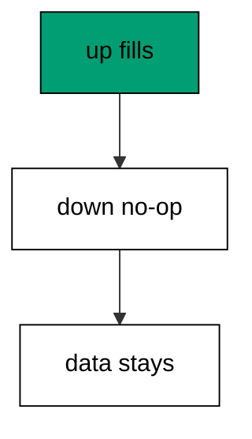

Saying `SELECT 1` instead of leaving the section empty is deliberate: the no-op is reviewed, not forgotten. Reviewers see the author considered reversal and chose forward-only.

**`learning/code/ex-29-backfill-needs-no-down/main.go`**:

```go
// => Shared driver: every unit in this course opens with this prelude.
// => The harness network is closed, so units carry a small standard-library
// => driver that applies the same goose SQL files `goose up` would apply.
// => The files, the history table shape, and the ordering rules are goose's
// => own; the driver only replaces the network-dependent binary.
package main // => every unit is one runnable program

import ( // => standard library only: no third-party modules
	"bufio"           // => bufio frames protocol messages over the TCP stream
	"encoding/binary" // => binary lays out length-prefixed protocol fields
	"fmt"             // => fmt prints the deterministic transcript only
	"io"              // => io forces full reads of split protocol messages
	"net"             // => net dials the harness Postgres service over TCP
	"os"              // => os reads the harness database address, never hardcoded
	"sort"            // => sort orders migration files, never trusts directory order
	"strings"         // => strings splits the goose Up and Down annotations
) // => every import used by driver and units

// => The database address comes from the harness, with local-run defaults.
func addr() (string, string, string) { // => one helper owns every address default
	host := os.Getenv("PGHOST") // => service hostname in the unit network
	if host == "" {             // => empty means a local run outside the harness
		host = "postgres" // => same default the Python courses use
	} // => end addr: empty means a local run outside the harness
	user := os.Getenv("PGUSER") // => trust-auth role, no password needed
	if user == "" {             // => empty means a local run outside the harness
		user = "postgres" // => same default the Python courses use
	} // => end addr: empty means a local run outside the harness
	db := os.Getenv("PGDATABASE") // => fresh database for every unit run
	if db == "" {                 // => empty means a local run outside the harness
		db = "postgres" // => same default the Python courses use
	} // => end addr: empty means a local run outside the harness
	return host, user, db // => callers never re-read the environment
} // => end addr: one helper owns every address default

// => conn wraps one TCP connection plus a buffered reader for message frames.
type conn struct { // => a tiny struct keeps the socket and the framer together
	c net.Conn      // => the raw TCP socket to the Postgres service
	r *bufio.Reader // => buffered reads frame messages split across packets
} // => end type conn: socket and framer travel together

// => readMsg reads one backend message: a type byte plus a length body.
func (k *conn) readMsg() (byte, []byte, error) { // => every response flows through here
	head := make([]byte, 5)                           // => one type byte plus one int32 length
	if _, err := io.ReadFull(k.r, head); err != nil { // => fragments reassemble before framing
		return 0, nil, err // => no partial message is ever trusted
	} // => end readMsg: fragments reassemble before framing
	n := int(binary.BigEndian.Uint32(head[1:])) - 4   // => length counts itself, not the type
	body := make([]byte, n)                           // => exact-size body, never over-read
	if _, err := io.ReadFull(k.r, body); err != nil { // => fragments reassemble before framing
		return 0, nil, err // => no partial message is ever trusted
	} // => end readMsg: fragments reassemble before framing
	return head[0], body, nil // => type byte tells the caller what arrived
} // => end readMsg: every response flows through here

// => sendMsg writes one frontend message: a type byte plus a length body.
func (k *conn) sendMsg(t byte, body []byte) error { // => startup is the only typeless message
	out := []byte{t}                                      // => type byte leads every message
	lenb := make([]byte, 4)                               // => four bytes carry the length
	binary.BigEndian.PutUint32(lenb, uint32(len(body)+4)) // => length counts itself
	out = append(out, lenb...)                            // => length follows the type byte
	out = append(out, body...)                            // => payload closes the message
	_, err := k.c.Write(out)                              // => one write keeps frames whole
	return err                                            // => write errors fail the unit loudly
} // => end sendMsg: startup is the only typeless message

// => connect opens the service database and waits for session readiness.
func connect() (*conn, error) { // => every unit starts from this one helper
	host, user, db := addr()         // => harness address, never hardcoded
	return connectDb(host, user, db) // => one path opens every session
} // => end connect: every unit starts from this one helper

// => connectDb opens a named database on the same host for multi-db drills.
func connectDb(host, user, db string) (*conn, error) { // => environments are databases, not servers
	c, err := net.Dial("tcp", host+":5432") // => Postgres listens on 5432
	if err != nil {                         // => unreachable service is fatal
		return nil, err // => no fallback: the harness owns the database
	} // => end connectDb: unreachable service is fatal
	k := &conn{c: c, r: bufio.NewReader(c)}             // => buffer the fresh socket at once
	body := []byte{}                                    // => startup body is parameters only
	body = append(body, 0, 0, 0, 0)                     // => placeholder for the length prefix
	body = append(body, 0, 3, 0, 0)                     // => protocol 3.0, the stable version
	body = append(body, []byte("user")...)              // => user key starts the parameters
	body = append(body, 0)                              // => keys and values are NUL-separated
	body = append(body, []byte(user)...)                // => trust-auth role from the harness
	body = append(body, 0)                              // => NUL ends the value
	body = append(body, []byte("database")...)          // => database key follows the user
	body = append(body, 0)                              // => NUL ends the key
	body = append(body, []byte(db)...)                  // => fresh database for every unit run
	body = append(body, 0)                              // => NUL ends the value
	body = append(body, 0)                              // => empty key ends the parameters
	binary.BigEndian.PutUint32(body, uint32(len(body))) // => startup length counts itself
	if _, err := c.Write(body); err != nil {            // => startup is the only typeless message
		return nil, err // => unwritable socket is fatal
	} // => end connectDb: startup is the only typeless message
	for { // => drain until the session is ready for queries
		t, b, err := k.readMsg() // => every backend message flows through here
		if err != nil {          // => broken handshake is fatal
			return nil, err // => no half-open session is ever used
		} // => end connectDb: broken handshake is fatal
		switch t { // => only three message kinds matter during startup
		case 'R': // => authentication response arrives first
			if binary.BigEndian.Uint32(b) != 0 { // => nonzero means a password is wanted
				return nil, fmt.Errorf("server wants a password") // => trust auth never asks
			} // => end connectDb: nonzero means a password is wanted
		case 'E': // => an error ends the handshake with the server text
			return nil, fmt.Errorf("startup: %s", errText(b)) // => server text explains the cause
		case 'Z': // => ReadyForQuery means the session accepts queries
			return k, nil // => handshake done: hand the live session back
		} // => end connectDb: only three message kinds matter during startup
	} // => end connectDb: drain until the session is ready for queries
} // => end connectDb: environments are databases, not servers

// => errText extracts the human message (field M) from an ErrorResponse.
func errText(b []byte) string { // => one helper decodes every server error
	parts := strings.Split(string(b), "\x00") // => fields are NUL-separated pairs
	for i := 0; i+1 < len(parts); i += 2 {    // => walk code and value together
		if parts[i] == "M" { // => M is the primary human message
			return parts[i+1] // => return the message, skip the detail fields
		} // => end errText: M is the primary human message
	} // => end errText: walk code and value together
	return "unknown error" // => malformed errors still fail with a fixed line
} // => end errText: one helper decodes every server error

// => run sends one SQL string and returns every data row plus the command tag.
func (k *conn) run(q string) ([][]string, string, error) { // => one path runs every statement
	body := append([]byte(q), 0)                 // => Query messages are NUL-terminated
	if err := k.sendMsg('Q', body); err != nil { // => send fails loudly, never silently
		return nil, "", err // => unwritable socket ends the unit
	} // => end run: send fails loudly, never silently
	var rows [][]string // => data rows accumulate across result sets
	tag := ""           // => the last command tag (SELECT 3, CREATE TABLE...)
	for {               // => drain until ReadyForQuery closes this query string
		t, b, err := k.readMsg() // => every response flows through the framer
		if err != nil {          // => broken mid-query connection is fatal
			return nil, "", err // => partial results are never returned
		} // => end run: broken mid-query connection is fatal
		switch t { // => four message kinds carry a simple-query response
		case 'T', 'N', 'A', 'S', 'K': // => metadata the transcript never prints
		case 'D': // => one data row arrived
			rows = append(rows, parseRow(b)) // => decode the text columns now
		case 'C': // => one statement finished
			tag = strings.TrimRight(string(b[:len(b)-1]), "\x00") // => tag names what ran
		case 'E': // => the statement failed
			drain(k)                                     // => finish the failed query before reuse
			return nil, "", fmt.Errorf("%s", errText(b)) // => server text becomes the failure
		case 'Z': // => ReadyForQuery ends this query string
			return rows, tag, nil // => rows, tag, and a clean session
		} // => end run: four message kinds carry a simple-query response
	} // => end run: drain until ReadyForQuery closes this query string
} // => end run: one path runs every statement

// => drain reads to the next ReadyForQuery after a statement error.
func drain(k *conn) { // => an errored query still owns the socket until Z
	for { // => loop until the session is reusable
		t, _, err := k.readMsg()    // => discard every message after the error
		if err != nil || t == 'Z' { // => socket break or ready both end the drain
			return // => caller decides the failure, the drain only resynchronizes
		} // => end drain: socket break or ready both end the drain
	} // => end drain: loop until the session is reusable
} // => end drain: an errored query still owns the socket until Z

// => parseRow decodes one DataRow body into text columns, NULL as "NULL".
func parseRow(b []byte) []string { // => one helper decodes every returned row
	n := int(binary.BigEndian.Uint16(b)) // => column count leads the body
	b = b[2:]                            // => step past the count
	out := make([]string, 0, n)          // => pre-size the row to the count
	for i := 0; i < n; i++ {             // => walk each column in order
		l := int(int32(binary.BigEndian.Uint32(b))) // => -1 marks NULL, else the length
		b = b[4:]                                   // => step past the length
		if l < 0 {                                  // => NULL has no bytes to read
			out = append(out, "NULL") // => fixed word keeps transcripts stable
			continue                  // => next column, no bytes consumed
		} // => end parseRow: NULL has no bytes to read
		out = append(out, string(b[:l])) // => text format is already printable
		b = b[l:]                        // => step past the value bytes
	} // => end parseRow: walk each column in order
	return out // => one row, fully decoded
} // => end parseRow: one helper decodes every returned row

// => must runs SQL or exits nonzero with the server text on standard error.
func must(k *conn, q string) [][]string { // => setup statements never fail quietly
	rows, _, err := k.run(q) // => rows return for verification queries
	if err != nil {          // => any server error is fatal to the unit
		fmt.Fprintln(os.Stderr, "sql error:", err) // => errors go to stderr, never stdout
		os.Exit(1)                                 // => nonzero exit fails the harness check
	} // => end must: any server error is fatal to the unit
	return rows // => callers print only what the lesson asserts
} // => end must: setup statements never fail quietly

// => try runs SQL and returns the server error text instead of exiting.
func try(k *conn, q string) ([][]string, string) { // => failure drills inspect errors, not die
	rows, _, err := k.run(q) // => same path as must, opposite failure policy
	if err != nil {          // => expected errors become transcript lines
		return nil, err.Error() // => fixed server text, never timings
	} // => end try: expected errors become transcript lines
	return rows, "" // => empty error means the statement succeeded
} // => end try: failure drills inspect errors, not die

// => mig holds one goose SQL file: its version, name, and Up/Down sections.
type mig struct { // => mirrors the goose file layout the lesson teaches
	version string   // => zero-padded number orders history, like goose
	name    string   // => human slug after the version number
	up      []string // => forward statements, run inside one transaction
	down    []string // => reverse statements, run inside one transaction
	noTx    bool     // => NO TRANSACTION files run outside one, like goose
} // => end type mig: version, name, sections, and mode

// => parseGoose splits one goose SQL file into its Up and Down statements.
func parseGoose(text string) (up, down []string, noTx bool) { // => the lesson asserts this exact split
	section := ""                                    // => nothing belongs outside the annotations
	for _, line := range strings.Split(text, "\n") { // => walk the file line by line
		t := strings.TrimSpace(line) // => annotation matching ignores indentation
		switch t {                   // => four annotation lines switch sections
		case "-- +goose Up": // => forward section starts here, like goose
			section = "up" // => following statements migrate forward
			continue       // => the annotation itself never runs
		case "-- +goose Down": // => reverse section starts here, like goose
			section = "down" // => following statements roll back
			continue         // => the annotation itself never runs
		case "-- +goose NO TRANSACTION": // => concurrent work cannot run inside one
			noTx = true // => remember the file opts out of the transaction
			continue    // => the annotation itself never runs
		} // => end parseGoose: four annotation lines switch sections
		if strings.HasPrefix(t, "--") || t == "" { // => comments and blanks never run
			continue // => only real statements reach the database
		} // => end parseGoose: comments and blanks never run
		if section == "up" { // => route by the annotation seen above
			up = append(up, line) // => keep the original line for the file write
		} else if section == "down" { // => down statements collect separately
			down = append(down, line) // => keep the original line for the file write
		} // => end parseGoose: down statements collect separately
	} // => end parseGoose: walk the file line by line
	return splitStmts(strings.Join(up, "\n")), splitStmts(strings.Join(down, "\n")), noTx // => one string per statement
} // => end parseGoose: the lesson asserts this exact split

// => splitStmts cuts statement text on semicolons outside quotes.
func splitStmts(s string) []string { // => multi-line statements stay whole until ;
	var out []string        // => finished statements accumulate here
	var cur strings.Builder // => the statement under construction
	inStr := false          // => semicolons inside quotes never split
	for _, r := range s {   // => walk rune by rune, quotes included
		switch { // => quote tracking decides what a semicolon means
		case r == '\'': // => a quote toggles string mode
			inStr = !inStr   // => enter or leave the quoted region
			cur.WriteRune(r) // => the quote belongs to the statement
		case r == ';' && !inStr: // => a bare semicolon ends one statement
			if t := strings.TrimSpace(cur.String()); t != "" { // => skip empty fragments
				out = append(out, t) // => store the finished statement
			} // => end splitStmts: skip empty fragments
			cur.Reset() // => start the next statement fresh
		default: // => every other rune belongs to the current statement
			cur.WriteRune(r) // => accumulate verbatim
		} // => end splitStmts: quote tracking decides what a semicolon means
	} // => end splitStmts: walk rune by rune, quotes included
	if t := strings.TrimSpace(cur.String()); t != "" { // => trailing text without ; still counts
		out = append(out, t) // => last statement needs no semicolon
	} // => end splitStmts: trailing text without ; still counts
	return out // => callers run each statement in order
} // => end splitStmts: multi-line statements stay whole until ;

// => ensureHistory creates the goose history table once per unit run.
func ensureHistory(k *conn) { // => goose_db_version is goose's own default name
	must(k, `CREATE TABLE IF NOT EXISTS goose_db_version (`+ // => reruns never fail here
		`id integer PRIMARY KEY GENERATED BY DEFAULT AS IDENTITY, `+ // => surrogate key, never printed
		`version_id bigint NOT NULL, `+ // => applied version numbers live here
		`is_applied boolean NOT NULL, `+ // => goose marks rows applied on success
		`tstamp timestamp NOT NULL DEFAULT now())`) // => timestamp defaults, never printed
} // => end ensureHistory: goose_db_version is goose's own default name

// => appliedVersions returns the version numbers already marked applied.
func appliedVersions(k *conn) map[int64]bool { // => history decides what still needs running
	rows := must(k, `SELECT version_id FROM goose_db_version `+ // => only the numbers matter
		`WHERE is_applied ORDER BY version_id`) // => order keeps the transcript stable
	got := map[int64]bool{}  // => set lookup answers "already applied" fast
	for _, r := range rows { // => one row per applied migration
		var v int64                // => version numbers are integers
		fmt.Sscanf(r[0], "%d", &v) // => text format parses back to a number
		got[v] = true              // => mark this version done
	} // => end appliedVersions: one row per applied migration
	return got // => callers skip whatever history already holds
} // => end appliedVersions: history decides what still needs running

// => applyUp runs every pending migration forward, one transaction each.
func applyUp(k *conn, ms []mig) { // => files on disk are already the source of truth
	done := appliedVersions(k) // => history decides what still needs running
	for _, m := range ms {     // => file order is version order, sorted by the caller
		var v int64                     // => versions compare as numbers
		fmt.Sscanf(m.version, "%d", &v) // => zero-padded file prefix parses back
		if done[v] {                    // => applied migrations never run twice
			continue // => idempotent reruns skip straight past
		} // => end applyUp: applied migrations never run twice
		if !m.noTx { // => transactional files wrap everything in one unit
			must(k, "BEGIN") // => one migration is one transaction, like goose
		} // => end applyUp: transactional files wrap everything in one unit
		for _, s := range m.up { // => forward statements run in file order
			must(k, s) // => any failure aborts the unit before COMMIT
		} // => end applyUp: forward statements run in file order
		if !m.noTx { // => stamps join the same transaction they describe
			must(k, fmt.Sprintf(`INSERT INTO goose_db_version `+ // => stamp only after success
				`(version_id, is_applied) VALUES (%d, true)`, v)) // => stamp mirrors goose exactly
			must(k, "COMMIT") // => history row and schema land together
		} else { // => concurrent statements cannot share a transaction
			must(k, fmt.Sprintf(`INSERT INTO goose_db_version `+ // => stamp follows the work
				`(version_id, is_applied) VALUES (%d, true)`, v)) // => same row, separate statement
		} // => end applyUp: concurrent statements cannot share a transaction
	} // => end applyUp: file order is version order, sorted by the caller
} // => end applyUp: files on disk are already the source of truth

// => applyDown rolls back the newest applied migrations, newest first.
func applyDown(k *conn, ms []mig, steps int) { // => steps bounds how far history rewinds
	done := appliedVersions(k) // => history decides what can roll back
	var todo []mig             // => applied migrations in version order first
	for _, m := range ms {     // => walk the whole known history
		var v int64                     // => versions compare as numbers
		fmt.Sscanf(m.version, "%d", &v) // => zero-padded file prefix parses back
		if done[v] {                    // => only applied migrations roll back
			todo = append(todo, m) // => keep the migration for the reverse pass
		} // => end applyDown: only applied migrations roll back
	} // => end applyDown: walk the whole known history
	for i := len(todo) - 1; i >= 0 && steps > 0; i-- { // => newest applied goes first
		m := todo[i]                    // => this migration rolls back now
		var v int64                     // => versions compare as numbers
		fmt.Sscanf(m.version, "%d", &v) // => zero-padded file prefix parses back
		if !m.noTx {                    // => transactional files wrap the rollback too
			must(k, "BEGIN") // => reverse change is atomic, like the forward one
		} // => end applyDown: transactional files wrap the rollback too
		for _, s := range m.down { // => reverse statements run in file order
			must(k, s) // => any failure aborts before the history row moves
		} // => end applyDown: reverse statements run in file order
		must(k, fmt.Sprintf(`DELETE FROM goose_db_version `+ // => unstamped only after success
			`WHERE version_id = %d`, v)) // => the version leaves history exactly once
		if !m.noTx { // => close the transaction the rollback opened
			must(k, "COMMIT") // => schema reversal and unstamp land together
		} // => end applyDown: close the transaction the rollback opened
		steps-- // => one rollback consumed from the budget
	} // => end applyDown: newest applied goes first
} // => end applyDown: steps bounds how far history rewinds

// => statusCounts splits known migrations into applied and pending lists.
func statusCounts(k *conn, ms []mig) (applied, pending []string) { // => goose status in two lists
	done := appliedVersions(k) // => history decides which list each version joins
	for _, m := range ms {     // => walk the known history in version order
		var v int64                     // => versions compare as numbers
		fmt.Sscanf(m.version, "%d", &v) // => zero-padded file prefix parses back
		if done[v] {                    // => stamped versions are done
			applied = append(applied, m.version) // => keep the version string for printing
		} else { // => unstamped versions still wait
			pending = append(pending, m.version) // => keep the version string for printing
		} // => end statusCounts: unstamped versions still wait
	} // => end statusCounts: walk the known history in version order
	return applied, pending // => callers print both lists in one stable line each
} // => end statusCounts: goose status in two lists

// => files writes each migration as a real goose SQL file under dir.
func files(dir string, ms []mig) { // => the lesson shows these files byte-identically
	for _, m := range ms { // => one file per migration, like `goose create`
		name := fmt.Sprintf("%s_%s.sql", m.version, m.name) // => goose names files version-first
		var b strings.Builder                               // => build the file text in order
		if m.noTx {                                         // => concurrent files announce it first
			b.WriteString("-- +goose NO TRANSACTION\n") // => goose honors this exact annotation
		} // => end files: concurrent files announce it first
		b.WriteString("-- +goose Up\n") // => forward annotation leads
		for _, s := range m.up {        // => forward statements follow
			b.WriteString(s + ";\n") // => one statement per line, semicolon-closed
		} // => end files: forward statements follow
		b.WriteString("-- +goose Down\n") // => reverse annotation splits the file
		for _, s := range m.down {        // => reverse statements close the file
			b.WriteString(s + ";\n") // => one statement per line, semicolon-closed
		} // => end files: reverse statements close the file
		if err := os.WriteFile(dir+"/"+name, []byte(b.String()), 0644); err != nil { // => real files, like goose
			fmt.Fprintln(os.Stderr, "write error:", err) // => write errors fail loudly
			os.Exit(1)                                   // => no half-written migration set
		} // => end files: real files, like goose
	} // => end files: one file per migration, like `goose create`
} // => end files: the lesson shows these files byte-identically

// => versions lists migration files in version order from dir.
func versions(dir string) []mig { // => directory order is never trusted for history
	ents, err := os.ReadDir(dir) // => read the whole migrations directory
	if err != nil {              // => unreadable directory is fatal
		fmt.Fprintln(os.Stderr, "read error:", err) // => errors go to stderr
		os.Exit(1)                                  // => nonzero exit fails the check
	} // => end versions: unreadable directory is fatal
	names := []string{}      // => collect names before sorting
	for _, e := range ents { // => walk every directory entry
		if !e.IsDir() && strings.HasSuffix(e.Name(), ".sql") { // => only goose SQL files count
			names = append(names, e.Name()) // => keep the file name for parsing
		} // => end versions: only goose SQL files count
	} // => end versions: walk every directory entry
	sort.Strings(names)       // => zero-padded versions sort chronologically
	var out []mig             // => parsed migrations accumulate here
	for _, n := range names { // => parse in version order
		raw, err := os.ReadFile(dir + "/" + n) // => read the real file back
		if err != nil {                        // => unreadable file is fatal
			fmt.Fprintln(os.Stderr, "read error:", err) // => errors go to stderr
			os.Exit(1)                                  // => nonzero exit fails the check
		} // => end versions: unreadable file is fatal
		up, down, noTx := parseGoose(string(raw))                                            // => split on the goose annotations
		rest := strings.TrimSuffix(n, ".sql")                                                // => strip the extension first
		ver := rest[:5]                                                                      // => first five digits are the version
		out = append(out, mig{version: ver, name: rest[6:], up: up, down: down, noTx: noTx}) // => keep every part
	} // => end versions: parse in version order
	return out // => version-ordered migrations, ready to apply
} // => end versions: directory order is never trusted for history

// => findDupes returns version numbers claimed by two or more files.
func findDupes(dir string) []string { // => goose refuses duplicate versions outright
	ents, err := os.ReadDir(dir) // => read the whole migrations directory
	if err != nil {              // => unreadable directory is fatal
		fmt.Fprintln(os.Stderr, "read error:", err) // => errors go to stderr
		os.Exit(1)                                  // => nonzero exit fails the check
	} // => end findDupes: unreadable directory is fatal
	seen := map[string]int{} // => count claims per five-digit version prefix
	for _, e := range ents { // => walk every directory entry
		if !e.IsDir() && strings.HasSuffix(e.Name(), ".sql") { // => only goose SQL files count
			seen[e.Name()[:5]]++ // => first five digits are the version
		} // => end findDupes: only goose SQL files count
	} // => end findDupes: walk every directory entry
	var out []string         // => duplicates accumulate in version order
	for _, e := range ents { // => second pass keeps the order stable
		if !e.IsDir() && strings.HasSuffix(e.Name(), ".sql") { // => only goose SQL files count
			if v := e.Name()[:5]; seen[v] > 1 { // => claimed more than once
				out = append(out, v) // => keep the version string for printing
				seen[v] = 0          // => report each duplicate version only once
			} // => end findDupes: claimed more than once
		} // => end findDupes: only goose SQL files count
	} // => end findDupes: second pass keeps the order stable
	return out // => empty means the history numbers are unique
} // => end findDupes: goose refuses duplicate versions outright

func main() {
	k, err := connect() // => one session runs the whole example
	if err != nil {     // => unreachable database fails loudly
		fmt.Fprintln(os.Stderr, "connect error:", err) // => connection errors go to stderr
		os.Exit(1)                                     // => nonzero exit fails the check
	}
	defer k.c.Close() // => the socket closes when the example ends
	// => A scratch migrations directory: goose files live here, never in the unit.
	// => the scratch path never reaches stdout, so reruns stay byte-stable
	dir, err := os.MkdirTemp("", "ex29-") // => private directory, like `goose create`
	if err != nil {                       // => unmakable temp dir is fatal
		fmt.Fprintln(os.Stderr, "temp error:", err) // => errors go to stderr
		os.Exit(1)                                  // => nonzero exit fails the check
	}
	defer os.RemoveAll(dir)                          // => scratch files vanish; only transcripts remain
	must(k, "DROP TABLE IF EXISTS ex29_base")        // => leftovers of a killed run vanish
	must(k, "DROP TABLE IF EXISTS goose_db_version") // => stale history vanishes too
	ensureHistory(k)                                 // => goose history table, real shape
	files(dir, []mig{                                // => data fill with an honest no-op reverse
		{version: "00001", name: "fill_nickname", // => forward-only data movement
			up:   []string{"UPDATE ex29_base SET nickname = lower(name) WHERE nickname IS NULL"}, // => fill from existing rows
			down: []string{"SELECT 1"}},                                                          // => data fills never reverse: explicit no-op
	})
	must(k, "CREATE TABLE ex29_base (id SERIAL PRIMARY KEY, name TEXT NOT NULL, nickname TEXT)") // => base table predates history
	must(k, `INSERT INTO ex29_base (name) VALUES ('Ada'), ('Grace')`)                            // => rows that need filling
	ms := versions(dir)                                                                          // => parse the files back, like goose would
	applyUp(k, ms)                                                                               // => fill runs forward
	applyDown(k, ms, 1)                                                                          // => rollback keeps the data: down is a no-op
	rows := must(k, `SELECT nickname FROM ex29_base ORDER BY id`)                                // => filled values survive the downgrade
	fmt.Println("names:", rows[0][0], rows[1][0])                                                // => Output: names: ada grace
	must(k, "DROP TABLE ex29_base")                                                              // => base table cleaned with the example tables
	fmt.Println("cleaned: yes")                                                                  // => Output: cleaned: yes
	must(k, "DROP TABLE IF EXISTS ex29_base")                                                    // => leftovers of a killed run vanish
	must(k, "DROP TABLE IF EXISTS goose_db_version")                                             // => the example leaves no history behind
}
```

**Output** (`learning/code/ex-29-backfill-needs-no-down/expected/main.stdout.txt`):

```text
names: ada grace
cleaned: yes
```

**Key takeaway**: Data migrations roll forward only; their down sections say so explicitly instead of pretending to reverse.

**Why it matters**: Forward-only data steps are honest about irreversibility. An explicit no-op tells reviewers the author considered reversal and chose against it, instead of leaving an empty section that looks forgotten. Unpouring data is impossible; pretending otherwise is worse. Reviewers can approve an explicit no-op, but they can never approve a silence they did not notice.

### Example 30: Data Fix Inside a Revision

Small data corrections ride along with schema work: this example fixes malformed emails while adding the unique index that prevents the next batch. One migration, schema plus data, because the two belong to one deploy. (Concepts: co-06.)

The fix runs before the index: clean first, constrain second. Reversing that order would fail the constraint on the dirty rows it was meant to protect.

**`learning/code/ex-30-data-fix-inside-a-revision/main.go`**:

```go
// => Shared driver: every unit in this course opens with this prelude.
// => The harness network is closed, so units carry a small standard-library
// => driver that applies the same goose SQL files `goose up` would apply.
// => The files, the history table shape, and the ordering rules are goose's
// => own; the driver only replaces the network-dependent binary.
package main // => every unit is one runnable program

import ( // => standard library only: no third-party modules
	"bufio"           // => bufio frames protocol messages over the TCP stream
	"encoding/binary" // => binary lays out length-prefixed protocol fields
	"fmt"             // => fmt prints the deterministic transcript only
	"io"              // => io forces full reads of split protocol messages
	"net"             // => net dials the harness Postgres service over TCP
	"os"              // => os reads the harness database address, never hardcoded
	"sort"            // => sort orders migration files, never trusts directory order
	"strings"         // => strings splits the goose Up and Down annotations
) // => every import used by driver and units

// => The database address comes from the harness, with local-run defaults.
func addr() (string, string, string) { // => one helper owns every address default
	host := os.Getenv("PGHOST") // => service hostname in the unit network
	if host == "" {             // => empty means a local run outside the harness
		host = "postgres" // => same default the Python courses use
	} // => end addr: empty means a local run outside the harness
	user := os.Getenv("PGUSER") // => trust-auth role, no password needed
	if user == "" {             // => empty means a local run outside the harness
		user = "postgres" // => same default the Python courses use
	} // => end addr: empty means a local run outside the harness
	db := os.Getenv("PGDATABASE") // => fresh database for every unit run
	if db == "" {                 // => empty means a local run outside the harness
		db = "postgres" // => same default the Python courses use
	} // => end addr: empty means a local run outside the harness
	return host, user, db // => callers never re-read the environment
} // => end addr: one helper owns every address default

// => conn wraps one TCP connection plus a buffered reader for message frames.
type conn struct { // => a tiny struct keeps the socket and the framer together
	c net.Conn      // => the raw TCP socket to the Postgres service
	r *bufio.Reader // => buffered reads frame messages split across packets
} // => end type conn: socket and framer travel together

// => readMsg reads one backend message: a type byte plus a length body.
func (k *conn) readMsg() (byte, []byte, error) { // => every response flows through here
	head := make([]byte, 5)                           // => one type byte plus one int32 length
	if _, err := io.ReadFull(k.r, head); err != nil { // => fragments reassemble before framing
		return 0, nil, err // => no partial message is ever trusted
	} // => end readMsg: fragments reassemble before framing
	n := int(binary.BigEndian.Uint32(head[1:])) - 4   // => length counts itself, not the type
	body := make([]byte, n)                           // => exact-size body, never over-read
	if _, err := io.ReadFull(k.r, body); err != nil { // => fragments reassemble before framing
		return 0, nil, err // => no partial message is ever trusted
	} // => end readMsg: fragments reassemble before framing
	return head[0], body, nil // => type byte tells the caller what arrived
} // => end readMsg: every response flows through here

// => sendMsg writes one frontend message: a type byte plus a length body.
func (k *conn) sendMsg(t byte, body []byte) error { // => startup is the only typeless message
	out := []byte{t}                                      // => type byte leads every message
	lenb := make([]byte, 4)                               // => four bytes carry the length
	binary.BigEndian.PutUint32(lenb, uint32(len(body)+4)) // => length counts itself
	out = append(out, lenb...)                            // => length follows the type byte
	out = append(out, body...)                            // => payload closes the message
	_, err := k.c.Write(out)                              // => one write keeps frames whole
	return err                                            // => write errors fail the unit loudly
} // => end sendMsg: startup is the only typeless message

// => connect opens the service database and waits for session readiness.
func connect() (*conn, error) { // => every unit starts from this one helper
	host, user, db := addr()         // => harness address, never hardcoded
	return connectDb(host, user, db) // => one path opens every session
} // => end connect: every unit starts from this one helper

// => connectDb opens a named database on the same host for multi-db drills.
func connectDb(host, user, db string) (*conn, error) { // => environments are databases, not servers
	c, err := net.Dial("tcp", host+":5432") // => Postgres listens on 5432
	if err != nil {                         // => unreachable service is fatal
		return nil, err // => no fallback: the harness owns the database
	} // => end connectDb: unreachable service is fatal
	k := &conn{c: c, r: bufio.NewReader(c)}             // => buffer the fresh socket at once
	body := []byte{}                                    // => startup body is parameters only
	body = append(body, 0, 0, 0, 0)                     // => placeholder for the length prefix
	body = append(body, 0, 3, 0, 0)                     // => protocol 3.0, the stable version
	body = append(body, []byte("user")...)              // => user key starts the parameters
	body = append(body, 0)                              // => keys and values are NUL-separated
	body = append(body, []byte(user)...)                // => trust-auth role from the harness
	body = append(body, 0)                              // => NUL ends the value
	body = append(body, []byte("database")...)          // => database key follows the user
	body = append(body, 0)                              // => NUL ends the key
	body = append(body, []byte(db)...)                  // => fresh database for every unit run
	body = append(body, 0)                              // => NUL ends the value
	body = append(body, 0)                              // => empty key ends the parameters
	binary.BigEndian.PutUint32(body, uint32(len(body))) // => startup length counts itself
	if _, err := c.Write(body); err != nil {            // => startup is the only typeless message
		return nil, err // => unwritable socket is fatal
	} // => end connectDb: startup is the only typeless message
	for { // => drain until the session is ready for queries
		t, b, err := k.readMsg() // => every backend message flows through here
		if err != nil {          // => broken handshake is fatal
			return nil, err // => no half-open session is ever used
		} // => end connectDb: broken handshake is fatal
		switch t { // => only three message kinds matter during startup
		case 'R': // => authentication response arrives first
			if binary.BigEndian.Uint32(b) != 0 { // => nonzero means a password is wanted
				return nil, fmt.Errorf("server wants a password") // => trust auth never asks
			} // => end connectDb: nonzero means a password is wanted
		case 'E': // => an error ends the handshake with the server text
			return nil, fmt.Errorf("startup: %s", errText(b)) // => server text explains the cause
		case 'Z': // => ReadyForQuery means the session accepts queries
			return k, nil // => handshake done: hand the live session back
		} // => end connectDb: only three message kinds matter during startup
	} // => end connectDb: drain until the session is ready for queries
} // => end connectDb: environments are databases, not servers

// => errText extracts the human message (field M) from an ErrorResponse.
func errText(b []byte) string { // => one helper decodes every server error
	parts := strings.Split(string(b), "\x00") // => fields are NUL-separated pairs
	for i := 0; i+1 < len(parts); i += 2 {    // => walk code and value together
		if parts[i] == "M" { // => M is the primary human message
			return parts[i+1] // => return the message, skip the detail fields
		} // => end errText: M is the primary human message
	} // => end errText: walk code and value together
	return "unknown error" // => malformed errors still fail with a fixed line
} // => end errText: one helper decodes every server error

// => run sends one SQL string and returns every data row plus the command tag.
func (k *conn) run(q string) ([][]string, string, error) { // => one path runs every statement
	body := append([]byte(q), 0)                 // => Query messages are NUL-terminated
	if err := k.sendMsg('Q', body); err != nil { // => send fails loudly, never silently
		return nil, "", err // => unwritable socket ends the unit
	} // => end run: send fails loudly, never silently
	var rows [][]string // => data rows accumulate across result sets
	tag := ""           // => the last command tag (SELECT 3, CREATE TABLE...)
	for {               // => drain until ReadyForQuery closes this query string
		t, b, err := k.readMsg() // => every response flows through the framer
		if err != nil {          // => broken mid-query connection is fatal
			return nil, "", err // => partial results are never returned
		} // => end run: broken mid-query connection is fatal
		switch t { // => four message kinds carry a simple-query response
		case 'T', 'N', 'A', 'S', 'K': // => metadata the transcript never prints
		case 'D': // => one data row arrived
			rows = append(rows, parseRow(b)) // => decode the text columns now
		case 'C': // => one statement finished
			tag = strings.TrimRight(string(b[:len(b)-1]), "\x00") // => tag names what ran
		case 'E': // => the statement failed
			drain(k)                                     // => finish the failed query before reuse
			return nil, "", fmt.Errorf("%s", errText(b)) // => server text becomes the failure
		case 'Z': // => ReadyForQuery ends this query string
			return rows, tag, nil // => rows, tag, and a clean session
		} // => end run: four message kinds carry a simple-query response
	} // => end run: drain until ReadyForQuery closes this query string
} // => end run: one path runs every statement

// => drain reads to the next ReadyForQuery after a statement error.
func drain(k *conn) { // => an errored query still owns the socket until Z
	for { // => loop until the session is reusable
		t, _, err := k.readMsg()    // => discard every message after the error
		if err != nil || t == 'Z' { // => socket break or ready both end the drain
			return // => caller decides the failure, the drain only resynchronizes
		} // => end drain: socket break or ready both end the drain
	} // => end drain: loop until the session is reusable
} // => end drain: an errored query still owns the socket until Z

// => parseRow decodes one DataRow body into text columns, NULL as "NULL".
func parseRow(b []byte) []string { // => one helper decodes every returned row
	n := int(binary.BigEndian.Uint16(b)) // => column count leads the body
	b = b[2:]                            // => step past the count
	out := make([]string, 0, n)          // => pre-size the row to the count
	for i := 0; i < n; i++ {             // => walk each column in order
		l := int(int32(binary.BigEndian.Uint32(b))) // => -1 marks NULL, else the length
		b = b[4:]                                   // => step past the length
		if l < 0 {                                  // => NULL has no bytes to read
			out = append(out, "NULL") // => fixed word keeps transcripts stable
			continue                  // => next column, no bytes consumed
		} // => end parseRow: NULL has no bytes to read
		out = append(out, string(b[:l])) // => text format is already printable
		b = b[l:]                        // => step past the value bytes
	} // => end parseRow: walk each column in order
	return out // => one row, fully decoded
} // => end parseRow: one helper decodes every returned row

// => must runs SQL or exits nonzero with the server text on standard error.
func must(k *conn, q string) [][]string { // => setup statements never fail quietly
	rows, _, err := k.run(q) // => rows return for verification queries
	if err != nil {          // => any server error is fatal to the unit
		fmt.Fprintln(os.Stderr, "sql error:", err) // => errors go to stderr, never stdout
		os.Exit(1)                                 // => nonzero exit fails the harness check
	} // => end must: any server error is fatal to the unit
	return rows // => callers print only what the lesson asserts
} // => end must: setup statements never fail quietly

// => try runs SQL and returns the server error text instead of exiting.
func try(k *conn, q string) ([][]string, string) { // => failure drills inspect errors, not die
	rows, _, err := k.run(q) // => same path as must, opposite failure policy
	if err != nil {          // => expected errors become transcript lines
		return nil, err.Error() // => fixed server text, never timings
	} // => end try: expected errors become transcript lines
	return rows, "" // => empty error means the statement succeeded
} // => end try: failure drills inspect errors, not die

// => mig holds one goose SQL file: its version, name, and Up/Down sections.
type mig struct { // => mirrors the goose file layout the lesson teaches
	version string   // => zero-padded number orders history, like goose
	name    string   // => human slug after the version number
	up      []string // => forward statements, run inside one transaction
	down    []string // => reverse statements, run inside one transaction
	noTx    bool     // => NO TRANSACTION files run outside one, like goose
} // => end type mig: version, name, sections, and mode

// => parseGoose splits one goose SQL file into its Up and Down statements.
func parseGoose(text string) (up, down []string, noTx bool) { // => the lesson asserts this exact split
	section := ""                                    // => nothing belongs outside the annotations
	for _, line := range strings.Split(text, "\n") { // => walk the file line by line
		t := strings.TrimSpace(line) // => annotation matching ignores indentation
		switch t {                   // => four annotation lines switch sections
		case "-- +goose Up": // => forward section starts here, like goose
			section = "up" // => following statements migrate forward
			continue       // => the annotation itself never runs
		case "-- +goose Down": // => reverse section starts here, like goose
			section = "down" // => following statements roll back
			continue         // => the annotation itself never runs
		case "-- +goose NO TRANSACTION": // => concurrent work cannot run inside one
			noTx = true // => remember the file opts out of the transaction
			continue    // => the annotation itself never runs
		} // => end parseGoose: four annotation lines switch sections
		if strings.HasPrefix(t, "--") || t == "" { // => comments and blanks never run
			continue // => only real statements reach the database
		} // => end parseGoose: comments and blanks never run
		if section == "up" { // => route by the annotation seen above
			up = append(up, line) // => keep the original line for the file write
		} else if section == "down" { // => down statements collect separately
			down = append(down, line) // => keep the original line for the file write
		} // => end parseGoose: down statements collect separately
	} // => end parseGoose: walk the file line by line
	return splitStmts(strings.Join(up, "\n")), splitStmts(strings.Join(down, "\n")), noTx // => one string per statement
} // => end parseGoose: the lesson asserts this exact split

// => splitStmts cuts statement text on semicolons outside quotes.
func splitStmts(s string) []string { // => multi-line statements stay whole until ;
	var out []string        // => finished statements accumulate here
	var cur strings.Builder // => the statement under construction
	inStr := false          // => semicolons inside quotes never split
	for _, r := range s {   // => walk rune by rune, quotes included
		switch { // => quote tracking decides what a semicolon means
		case r == '\'': // => a quote toggles string mode
			inStr = !inStr   // => enter or leave the quoted region
			cur.WriteRune(r) // => the quote belongs to the statement
		case r == ';' && !inStr: // => a bare semicolon ends one statement
			if t := strings.TrimSpace(cur.String()); t != "" { // => skip empty fragments
				out = append(out, t) // => store the finished statement
			} // => end splitStmts: skip empty fragments
			cur.Reset() // => start the next statement fresh
		default: // => every other rune belongs to the current statement
			cur.WriteRune(r) // => accumulate verbatim
		} // => end splitStmts: quote tracking decides what a semicolon means
	} // => end splitStmts: walk rune by rune, quotes included
	if t := strings.TrimSpace(cur.String()); t != "" { // => trailing text without ; still counts
		out = append(out, t) // => last statement needs no semicolon
	} // => end splitStmts: trailing text without ; still counts
	return out // => callers run each statement in order
} // => end splitStmts: multi-line statements stay whole until ;

// => ensureHistory creates the goose history table once per unit run.
func ensureHistory(k *conn) { // => goose_db_version is goose's own default name
	must(k, `CREATE TABLE IF NOT EXISTS goose_db_version (`+ // => reruns never fail here
		`id integer PRIMARY KEY GENERATED BY DEFAULT AS IDENTITY, `+ // => surrogate key, never printed
		`version_id bigint NOT NULL, `+ // => applied version numbers live here
		`is_applied boolean NOT NULL, `+ // => goose marks rows applied on success
		`tstamp timestamp NOT NULL DEFAULT now())`) // => timestamp defaults, never printed
} // => end ensureHistory: goose_db_version is goose's own default name

// => appliedVersions returns the version numbers already marked applied.
func appliedVersions(k *conn) map[int64]bool { // => history decides what still needs running
	rows := must(k, `SELECT version_id FROM goose_db_version `+ // => only the numbers matter
		`WHERE is_applied ORDER BY version_id`) // => order keeps the transcript stable
	got := map[int64]bool{}  // => set lookup answers "already applied" fast
	for _, r := range rows { // => one row per applied migration
		var v int64                // => version numbers are integers
		fmt.Sscanf(r[0], "%d", &v) // => text format parses back to a number
		got[v] = true              // => mark this version done
	} // => end appliedVersions: one row per applied migration
	return got // => callers skip whatever history already holds
} // => end appliedVersions: history decides what still needs running

// => applyUp runs every pending migration forward, one transaction each.
func applyUp(k *conn, ms []mig) { // => files on disk are already the source of truth
	done := appliedVersions(k) // => history decides what still needs running
	for _, m := range ms {     // => file order is version order, sorted by the caller
		var v int64                     // => versions compare as numbers
		fmt.Sscanf(m.version, "%d", &v) // => zero-padded file prefix parses back
		if done[v] {                    // => applied migrations never run twice
			continue // => idempotent reruns skip straight past
		} // => end applyUp: applied migrations never run twice
		if !m.noTx { // => transactional files wrap everything in one unit
			must(k, "BEGIN") // => one migration is one transaction, like goose
		} // => end applyUp: transactional files wrap everything in one unit
		for _, s := range m.up { // => forward statements run in file order
			must(k, s) // => any failure aborts the unit before COMMIT
		} // => end applyUp: forward statements run in file order
		if !m.noTx { // => stamps join the same transaction they describe
			must(k, fmt.Sprintf(`INSERT INTO goose_db_version `+ // => stamp only after success
				`(version_id, is_applied) VALUES (%d, true)`, v)) // => stamp mirrors goose exactly
			must(k, "COMMIT") // => history row and schema land together
		} else { // => concurrent statements cannot share a transaction
			must(k, fmt.Sprintf(`INSERT INTO goose_db_version `+ // => stamp follows the work
				`(version_id, is_applied) VALUES (%d, true)`, v)) // => same row, separate statement
		} // => end applyUp: concurrent statements cannot share a transaction
	} // => end applyUp: file order is version order, sorted by the caller
} // => end applyUp: files on disk are already the source of truth

// => applyDown rolls back the newest applied migrations, newest first.
func applyDown(k *conn, ms []mig, steps int) { // => steps bounds how far history rewinds
	done := appliedVersions(k) // => history decides what can roll back
	var todo []mig             // => applied migrations in version order first
	for _, m := range ms {     // => walk the whole known history
		var v int64                     // => versions compare as numbers
		fmt.Sscanf(m.version, "%d", &v) // => zero-padded file prefix parses back
		if done[v] {                    // => only applied migrations roll back
			todo = append(todo, m) // => keep the migration for the reverse pass
		} // => end applyDown: only applied migrations roll back
	} // => end applyDown: walk the whole known history
	for i := len(todo) - 1; i >= 0 && steps > 0; i-- { // => newest applied goes first
		m := todo[i]                    // => this migration rolls back now
		var v int64                     // => versions compare as numbers
		fmt.Sscanf(m.version, "%d", &v) // => zero-padded file prefix parses back
		if !m.noTx {                    // => transactional files wrap the rollback too
			must(k, "BEGIN") // => reverse change is atomic, like the forward one
		} // => end applyDown: transactional files wrap the rollback too
		for _, s := range m.down { // => reverse statements run in file order
			must(k, s) // => any failure aborts before the history row moves
		} // => end applyDown: reverse statements run in file order
		must(k, fmt.Sprintf(`DELETE FROM goose_db_version `+ // => unstamped only after success
			`WHERE version_id = %d`, v)) // => the version leaves history exactly once
		if !m.noTx { // => close the transaction the rollback opened
			must(k, "COMMIT") // => schema reversal and unstamp land together
		} // => end applyDown: close the transaction the rollback opened
		steps-- // => one rollback consumed from the budget
	} // => end applyDown: newest applied goes first
} // => end applyDown: steps bounds how far history rewinds

// => statusCounts splits known migrations into applied and pending lists.
func statusCounts(k *conn, ms []mig) (applied, pending []string) { // => goose status in two lists
	done := appliedVersions(k) // => history decides which list each version joins
	for _, m := range ms {     // => walk the known history in version order
		var v int64                     // => versions compare as numbers
		fmt.Sscanf(m.version, "%d", &v) // => zero-padded file prefix parses back
		if done[v] {                    // => stamped versions are done
			applied = append(applied, m.version) // => keep the version string for printing
		} else { // => unstamped versions still wait
			pending = append(pending, m.version) // => keep the version string for printing
		} // => end statusCounts: unstamped versions still wait
	} // => end statusCounts: walk the known history in version order
	return applied, pending // => callers print both lists in one stable line each
} // => end statusCounts: goose status in two lists

// => files writes each migration as a real goose SQL file under dir.
func files(dir string, ms []mig) { // => the lesson shows these files byte-identically
	for _, m := range ms { // => one file per migration, like `goose create`
		name := fmt.Sprintf("%s_%s.sql", m.version, m.name) // => goose names files version-first
		var b strings.Builder                               // => build the file text in order
		if m.noTx {                                         // => concurrent files announce it first
			b.WriteString("-- +goose NO TRANSACTION\n") // => goose honors this exact annotation
		} // => end files: concurrent files announce it first
		b.WriteString("-- +goose Up\n") // => forward annotation leads
		for _, s := range m.up {        // => forward statements follow
			b.WriteString(s + ";\n") // => one statement per line, semicolon-closed
		} // => end files: forward statements follow
		b.WriteString("-- +goose Down\n") // => reverse annotation splits the file
		for _, s := range m.down {        // => reverse statements close the file
			b.WriteString(s + ";\n") // => one statement per line, semicolon-closed
		} // => end files: reverse statements close the file
		if err := os.WriteFile(dir+"/"+name, []byte(b.String()), 0644); err != nil { // => real files, like goose
			fmt.Fprintln(os.Stderr, "write error:", err) // => write errors fail loudly
			os.Exit(1)                                   // => no half-written migration set
		} // => end files: real files, like goose
	} // => end files: one file per migration, like `goose create`
} // => end files: the lesson shows these files byte-identically

// => versions lists migration files in version order from dir.
func versions(dir string) []mig { // => directory order is never trusted for history
	ents, err := os.ReadDir(dir) // => read the whole migrations directory
	if err != nil {              // => unreadable directory is fatal
		fmt.Fprintln(os.Stderr, "read error:", err) // => errors go to stderr
		os.Exit(1)                                  // => nonzero exit fails the check
	} // => end versions: unreadable directory is fatal
	names := []string{}      // => collect names before sorting
	for _, e := range ents { // => walk every directory entry
		if !e.IsDir() && strings.HasSuffix(e.Name(), ".sql") { // => only goose SQL files count
			names = append(names, e.Name()) // => keep the file name for parsing
		} // => end versions: only goose SQL files count
	} // => end versions: walk every directory entry
	sort.Strings(names)       // => zero-padded versions sort chronologically
	var out []mig             // => parsed migrations accumulate here
	for _, n := range names { // => parse in version order
		raw, err := os.ReadFile(dir + "/" + n) // => read the real file back
		if err != nil {                        // => unreadable file is fatal
			fmt.Fprintln(os.Stderr, "read error:", err) // => errors go to stderr
			os.Exit(1)                                  // => nonzero exit fails the check
		} // => end versions: unreadable file is fatal
		up, down, noTx := parseGoose(string(raw))                                            // => split on the goose annotations
		rest := strings.TrimSuffix(n, ".sql")                                                // => strip the extension first
		ver := rest[:5]                                                                      // => first five digits are the version
		out = append(out, mig{version: ver, name: rest[6:], up: up, down: down, noTx: noTx}) // => keep every part
	} // => end versions: parse in version order
	return out // => version-ordered migrations, ready to apply
} // => end versions: directory order is never trusted for history

// => findDupes returns version numbers claimed by two or more files.
func findDupes(dir string) []string { // => goose refuses duplicate versions outright
	ents, err := os.ReadDir(dir) // => read the whole migrations directory
	if err != nil {              // => unreadable directory is fatal
		fmt.Fprintln(os.Stderr, "read error:", err) // => errors go to stderr
		os.Exit(1)                                  // => nonzero exit fails the check
	} // => end findDupes: unreadable directory is fatal
	seen := map[string]int{} // => count claims per five-digit version prefix
	for _, e := range ents { // => walk every directory entry
		if !e.IsDir() && strings.HasSuffix(e.Name(), ".sql") { // => only goose SQL files count
			seen[e.Name()[:5]]++ // => first five digits are the version
		} // => end findDupes: only goose SQL files count
	} // => end findDupes: walk every directory entry
	var out []string         // => duplicates accumulate in version order
	for _, e := range ents { // => second pass keeps the order stable
		if !e.IsDir() && strings.HasSuffix(e.Name(), ".sql") { // => only goose SQL files count
			if v := e.Name()[:5]; seen[v] > 1 { // => claimed more than once
				out = append(out, v) // => keep the version string for printing
				seen[v] = 0          // => report each duplicate version only once
			} // => end findDupes: claimed more than once
		} // => end findDupes: only goose SQL files count
	} // => end findDupes: second pass keeps the order stable
	return out // => empty means the history numbers are unique
} // => end findDupes: goose refuses duplicate versions outright

func main() {
	k, err := connect() // => one session runs the whole example
	if err != nil {     // => unreachable database fails loudly
		fmt.Fprintln(os.Stderr, "connect error:", err) // => connection errors go to stderr
		os.Exit(1)                                     // => nonzero exit fails the check
	}
	defer k.c.Close() // => the socket closes when the example ends
	// => A scratch migrations directory: goose files live here, never in the unit.
	// => the scratch path never reaches stdout, so reruns stay byte-stable
	dir, err := os.MkdirTemp("", "ex30-") // => private directory, like `goose create`
	if err != nil {                       // => unmakable temp dir is fatal
		fmt.Fprintln(os.Stderr, "temp error:", err) // => errors go to stderr
		os.Exit(1)                                  // => nonzero exit fails the check
	}
	defer os.RemoveAll(dir)                                                                    // => scratch files vanish; only transcripts remain
	must(k, "DROP TABLE IF EXISTS ex30_base")                                                  // => leftovers of a killed run vanish
	must(k, "DROP TABLE IF EXISTS goose_db_version")                                           // => stale history vanishes too
	ensureHistory(k)                                                                           // => goose history table, real shape
	must(k, "CREATE TABLE ex30_base (id SERIAL PRIMARY KEY, email TEXT NOT NULL)")             // => base table predates history
	must(k, `INSERT INTO ex30_base (email) VALUES ('ADA@EXAMPLE.COM'), ('grace@example.com')`) // => one dirty row
	files(dir, []mig{                                                                          // => clean first, constrain second, one transaction
		{version: "00001", name: "fix_and_constrain", // => data fix plus schema guard together
			up:   []string{"UPDATE ex30_base SET email = lower(email)", "CREATE UNIQUE INDEX ex30_base_email_uidx ON ex30_base (email)"}, // => normalize then protect
			down: []string{"DROP INDEX ex30_base_email_uidx"}},                                                                           // => reverse drops the guard only
	})
	applyUp(k, versions(dir))                                  // => read the files back and run what is pending
	rows := must(k, `SELECT email FROM ex30_base ORDER BY id`) // => normalized values read back
	fmt.Println("emails:", rows[0][0], rows[1][0])             // => Output: emails: ada@example.com grace@example.com
	must(k, "DROP TABLE ex30_base")                            // => base table cleaned with the example tables
	fmt.Println("cleaned: yes")                                // => Output: cleaned: yes
	must(k, "DROP TABLE IF EXISTS ex30_base")                  // => leftovers of a killed run vanish
	must(k, "DROP TABLE IF EXISTS goose_db_version")           // => the example leaves no history behind
}
```

**Output** (`learning/code/ex-30-data-fix-inside-a-revision/expected/main.stdout.txt`):

```text
emails: ada@example.com grace@example.com
cleaned: yes
```

**Key takeaway**: Clean first, constrain second: the fix runs before the guard that would have rejected the dirty rows.

**Why it matters**: Order inside a file is a correctness property, not a style choice. Cleaning before constraining lets the guard validate rows the fix already repaired; reversing the order fails the constraint on dirty data. Sequence correctly or fail loudly. Sequence correctly or fail loudly: order inside a file is a correctness property, never a style choice.

### Example 31: Verify Backfill Counts

Backfills assert their own completeness: this example fills a column and then counts filled against total, printing both numbers. A backfill that does not verify is a backfill the team runs blind. (Concepts: co-16.)

Equal counts mean done; unequal counts mean the fill predicate missed rows. The check query ships inside the migration story, not in a separate runbook.

**`learning/code/ex-31-verify-backfill-counts/main.go`**:

```go
// => Shared driver: every unit in this course opens with this prelude.
// => The harness network is closed, so units carry a small standard-library
// => driver that applies the same goose SQL files `goose up` would apply.
// => The files, the history table shape, and the ordering rules are goose's
// => own; the driver only replaces the network-dependent binary.
package main // => every unit is one runnable program

import ( // => standard library only: no third-party modules
	"bufio"           // => bufio frames protocol messages over the TCP stream
	"encoding/binary" // => binary lays out length-prefixed protocol fields
	"fmt"             // => fmt prints the deterministic transcript only
	"io"              // => io forces full reads of split protocol messages
	"net"             // => net dials the harness Postgres service over TCP
	"os"              // => os reads the harness database address, never hardcoded
	"sort"            // => sort orders migration files, never trusts directory order
	"strings"         // => strings splits the goose Up and Down annotations
) // => every import used by driver and units

// => The database address comes from the harness, with local-run defaults.
func addr() (string, string, string) { // => one helper owns every address default
	host := os.Getenv("PGHOST") // => service hostname in the unit network
	if host == "" {             // => empty means a local run outside the harness
		host = "postgres" // => same default the Python courses use
	} // => end addr: empty means a local run outside the harness
	user := os.Getenv("PGUSER") // => trust-auth role, no password needed
	if user == "" {             // => empty means a local run outside the harness
		user = "postgres" // => same default the Python courses use
	} // => end addr: empty means a local run outside the harness
	db := os.Getenv("PGDATABASE") // => fresh database for every unit run
	if db == "" {                 // => empty means a local run outside the harness
		db = "postgres" // => same default the Python courses use
	} // => end addr: empty means a local run outside the harness
	return host, user, db // => callers never re-read the environment
} // => end addr: one helper owns every address default

// => conn wraps one TCP connection plus a buffered reader for message frames.
type conn struct { // => a tiny struct keeps the socket and the framer together
	c net.Conn      // => the raw TCP socket to the Postgres service
	r *bufio.Reader // => buffered reads frame messages split across packets
} // => end type conn: socket and framer travel together

// => readMsg reads one backend message: a type byte plus a length body.
func (k *conn) readMsg() (byte, []byte, error) { // => every response flows through here
	head := make([]byte, 5)                           // => one type byte plus one int32 length
	if _, err := io.ReadFull(k.r, head); err != nil { // => fragments reassemble before framing
		return 0, nil, err // => no partial message is ever trusted
	} // => end readMsg: fragments reassemble before framing
	n := int(binary.BigEndian.Uint32(head[1:])) - 4   // => length counts itself, not the type
	body := make([]byte, n)                           // => exact-size body, never over-read
	if _, err := io.ReadFull(k.r, body); err != nil { // => fragments reassemble before framing
		return 0, nil, err // => no partial message is ever trusted
	} // => end readMsg: fragments reassemble before framing
	return head[0], body, nil // => type byte tells the caller what arrived
} // => end readMsg: every response flows through here

// => sendMsg writes one frontend message: a type byte plus a length body.
func (k *conn) sendMsg(t byte, body []byte) error { // => startup is the only typeless message
	out := []byte{t}                                      // => type byte leads every message
	lenb := make([]byte, 4)                               // => four bytes carry the length
	binary.BigEndian.PutUint32(lenb, uint32(len(body)+4)) // => length counts itself
	out = append(out, lenb...)                            // => length follows the type byte
	out = append(out, body...)                            // => payload closes the message
	_, err := k.c.Write(out)                              // => one write keeps frames whole
	return err                                            // => write errors fail the unit loudly
} // => end sendMsg: startup is the only typeless message

// => connect opens the service database and waits for session readiness.
func connect() (*conn, error) { // => every unit starts from this one helper
	host, user, db := addr()         // => harness address, never hardcoded
	return connectDb(host, user, db) // => one path opens every session
} // => end connect: every unit starts from this one helper

// => connectDb opens a named database on the same host for multi-db drills.
func connectDb(host, user, db string) (*conn, error) { // => environments are databases, not servers
	c, err := net.Dial("tcp", host+":5432") // => Postgres listens on 5432
	if err != nil {                         // => unreachable service is fatal
		return nil, err // => no fallback: the harness owns the database
	} // => end connectDb: unreachable service is fatal
	k := &conn{c: c, r: bufio.NewReader(c)}             // => buffer the fresh socket at once
	body := []byte{}                                    // => startup body is parameters only
	body = append(body, 0, 0, 0, 0)                     // => placeholder for the length prefix
	body = append(body, 0, 3, 0, 0)                     // => protocol 3.0, the stable version
	body = append(body, []byte("user")...)              // => user key starts the parameters
	body = append(body, 0)                              // => keys and values are NUL-separated
	body = append(body, []byte(user)...)                // => trust-auth role from the harness
	body = append(body, 0)                              // => NUL ends the value
	body = append(body, []byte("database")...)          // => database key follows the user
	body = append(body, 0)                              // => NUL ends the key
	body = append(body, []byte(db)...)                  // => fresh database for every unit run
	body = append(body, 0)                              // => NUL ends the value
	body = append(body, 0)                              // => empty key ends the parameters
	binary.BigEndian.PutUint32(body, uint32(len(body))) // => startup length counts itself
	if _, err := c.Write(body); err != nil {            // => startup is the only typeless message
		return nil, err // => unwritable socket is fatal
	} // => end connectDb: startup is the only typeless message
	for { // => drain until the session is ready for queries
		t, b, err := k.readMsg() // => every backend message flows through here
		if err != nil {          // => broken handshake is fatal
			return nil, err // => no half-open session is ever used
		} // => end connectDb: broken handshake is fatal
		switch t { // => only three message kinds matter during startup
		case 'R': // => authentication response arrives first
			if binary.BigEndian.Uint32(b) != 0 { // => nonzero means a password is wanted
				return nil, fmt.Errorf("server wants a password") // => trust auth never asks
			} // => end connectDb: nonzero means a password is wanted
		case 'E': // => an error ends the handshake with the server text
			return nil, fmt.Errorf("startup: %s", errText(b)) // => server text explains the cause
		case 'Z': // => ReadyForQuery means the session accepts queries
			return k, nil // => handshake done: hand the live session back
		} // => end connectDb: only three message kinds matter during startup
	} // => end connectDb: drain until the session is ready for queries
} // => end connectDb: environments are databases, not servers

// => errText extracts the human message (field M) from an ErrorResponse.
func errText(b []byte) string { // => one helper decodes every server error
	parts := strings.Split(string(b), "\x00") // => fields are NUL-separated pairs
	for i := 0; i+1 < len(parts); i += 2 {    // => walk code and value together
		if parts[i] == "M" { // => M is the primary human message
			return parts[i+1] // => return the message, skip the detail fields
		} // => end errText: M is the primary human message
	} // => end errText: walk code and value together
	return "unknown error" // => malformed errors still fail with a fixed line
} // => end errText: one helper decodes every server error

// => run sends one SQL string and returns every data row plus the command tag.
func (k *conn) run(q string) ([][]string, string, error) { // => one path runs every statement
	body := append([]byte(q), 0)                 // => Query messages are NUL-terminated
	if err := k.sendMsg('Q', body); err != nil { // => send fails loudly, never silently
		return nil, "", err // => unwritable socket ends the unit
	} // => end run: send fails loudly, never silently
	var rows [][]string // => data rows accumulate across result sets
	tag := ""           // => the last command tag (SELECT 3, CREATE TABLE...)
	for {               // => drain until ReadyForQuery closes this query string
		t, b, err := k.readMsg() // => every response flows through the framer
		if err != nil {          // => broken mid-query connection is fatal
			return nil, "", err // => partial results are never returned
		} // => end run: broken mid-query connection is fatal
		switch t { // => four message kinds carry a simple-query response
		case 'T', 'N', 'A', 'S', 'K': // => metadata the transcript never prints
		case 'D': // => one data row arrived
			rows = append(rows, parseRow(b)) // => decode the text columns now
		case 'C': // => one statement finished
			tag = strings.TrimRight(string(b[:len(b)-1]), "\x00") // => tag names what ran
		case 'E': // => the statement failed
			drain(k)                                     // => finish the failed query before reuse
			return nil, "", fmt.Errorf("%s", errText(b)) // => server text becomes the failure
		case 'Z': // => ReadyForQuery ends this query string
			return rows, tag, nil // => rows, tag, and a clean session
		} // => end run: four message kinds carry a simple-query response
	} // => end run: drain until ReadyForQuery closes this query string
} // => end run: one path runs every statement

// => drain reads to the next ReadyForQuery after a statement error.
func drain(k *conn) { // => an errored query still owns the socket until Z
	for { // => loop until the session is reusable
		t, _, err := k.readMsg()    // => discard every message after the error
		if err != nil || t == 'Z' { // => socket break or ready both end the drain
			return // => caller decides the failure, the drain only resynchronizes
		} // => end drain: socket break or ready both end the drain
	} // => end drain: loop until the session is reusable
} // => end drain: an errored query still owns the socket until Z

// => parseRow decodes one DataRow body into text columns, NULL as "NULL".
func parseRow(b []byte) []string { // => one helper decodes every returned row
	n := int(binary.BigEndian.Uint16(b)) // => column count leads the body
	b = b[2:]                            // => step past the count
	out := make([]string, 0, n)          // => pre-size the row to the count
	for i := 0; i < n; i++ {             // => walk each column in order
		l := int(int32(binary.BigEndian.Uint32(b))) // => -1 marks NULL, else the length
		b = b[4:]                                   // => step past the length
		if l < 0 {                                  // => NULL has no bytes to read
			out = append(out, "NULL") // => fixed word keeps transcripts stable
			continue                  // => next column, no bytes consumed
		} // => end parseRow: NULL has no bytes to read
		out = append(out, string(b[:l])) // => text format is already printable
		b = b[l:]                        // => step past the value bytes
	} // => end parseRow: walk each column in order
	return out // => one row, fully decoded
} // => end parseRow: one helper decodes every returned row

// => must runs SQL or exits nonzero with the server text on standard error.
func must(k *conn, q string) [][]string { // => setup statements never fail quietly
	rows, _, err := k.run(q) // => rows return for verification queries
	if err != nil {          // => any server error is fatal to the unit
		fmt.Fprintln(os.Stderr, "sql error:", err) // => errors go to stderr, never stdout
		os.Exit(1)                                 // => nonzero exit fails the harness check
	} // => end must: any server error is fatal to the unit
	return rows // => callers print only what the lesson asserts
} // => end must: setup statements never fail quietly

// => try runs SQL and returns the server error text instead of exiting.
func try(k *conn, q string) ([][]string, string) { // => failure drills inspect errors, not die
	rows, _, err := k.run(q) // => same path as must, opposite failure policy
	if err != nil {          // => expected errors become transcript lines
		return nil, err.Error() // => fixed server text, never timings
	} // => end try: expected errors become transcript lines
	return rows, "" // => empty error means the statement succeeded
} // => end try: failure drills inspect errors, not die

// => mig holds one goose SQL file: its version, name, and Up/Down sections.
type mig struct { // => mirrors the goose file layout the lesson teaches
	version string   // => zero-padded number orders history, like goose
	name    string   // => human slug after the version number
	up      []string // => forward statements, run inside one transaction
	down    []string // => reverse statements, run inside one transaction
	noTx    bool     // => NO TRANSACTION files run outside one, like goose
} // => end type mig: version, name, sections, and mode

// => parseGoose splits one goose SQL file into its Up and Down statements.
func parseGoose(text string) (up, down []string, noTx bool) { // => the lesson asserts this exact split
	section := ""                                    // => nothing belongs outside the annotations
	for _, line := range strings.Split(text, "\n") { // => walk the file line by line
		t := strings.TrimSpace(line) // => annotation matching ignores indentation
		switch t {                   // => four annotation lines switch sections
		case "-- +goose Up": // => forward section starts here, like goose
			section = "up" // => following statements migrate forward
			continue       // => the annotation itself never runs
		case "-- +goose Down": // => reverse section starts here, like goose
			section = "down" // => following statements roll back
			continue         // => the annotation itself never runs
		case "-- +goose NO TRANSACTION": // => concurrent work cannot run inside one
			noTx = true // => remember the file opts out of the transaction
			continue    // => the annotation itself never runs
		} // => end parseGoose: four annotation lines switch sections
		if strings.HasPrefix(t, "--") || t == "" { // => comments and blanks never run
			continue // => only real statements reach the database
		} // => end parseGoose: comments and blanks never run
		if section == "up" { // => route by the annotation seen above
			up = append(up, line) // => keep the original line for the file write
		} else if section == "down" { // => down statements collect separately
			down = append(down, line) // => keep the original line for the file write
		} // => end parseGoose: down statements collect separately
	} // => end parseGoose: walk the file line by line
	return splitStmts(strings.Join(up, "\n")), splitStmts(strings.Join(down, "\n")), noTx // => one string per statement
} // => end parseGoose: the lesson asserts this exact split

// => splitStmts cuts statement text on semicolons outside quotes.
func splitStmts(s string) []string { // => multi-line statements stay whole until ;
	var out []string        // => finished statements accumulate here
	var cur strings.Builder // => the statement under construction
	inStr := false          // => semicolons inside quotes never split
	for _, r := range s {   // => walk rune by rune, quotes included
		switch { // => quote tracking decides what a semicolon means
		case r == '\'': // => a quote toggles string mode
			inStr = !inStr   // => enter or leave the quoted region
			cur.WriteRune(r) // => the quote belongs to the statement
		case r == ';' && !inStr: // => a bare semicolon ends one statement
			if t := strings.TrimSpace(cur.String()); t != "" { // => skip empty fragments
				out = append(out, t) // => store the finished statement
			} // => end splitStmts: skip empty fragments
			cur.Reset() // => start the next statement fresh
		default: // => every other rune belongs to the current statement
			cur.WriteRune(r) // => accumulate verbatim
		} // => end splitStmts: quote tracking decides what a semicolon means
	} // => end splitStmts: walk rune by rune, quotes included
	if t := strings.TrimSpace(cur.String()); t != "" { // => trailing text without ; still counts
		out = append(out, t) // => last statement needs no semicolon
	} // => end splitStmts: trailing text without ; still counts
	return out // => callers run each statement in order
} // => end splitStmts: multi-line statements stay whole until ;

// => ensureHistory creates the goose history table once per unit run.
func ensureHistory(k *conn) { // => goose_db_version is goose's own default name
	must(k, `CREATE TABLE IF NOT EXISTS goose_db_version (`+ // => reruns never fail here
		`id integer PRIMARY KEY GENERATED BY DEFAULT AS IDENTITY, `+ // => surrogate key, never printed
		`version_id bigint NOT NULL, `+ // => applied version numbers live here
		`is_applied boolean NOT NULL, `+ // => goose marks rows applied on success
		`tstamp timestamp NOT NULL DEFAULT now())`) // => timestamp defaults, never printed
} // => end ensureHistory: goose_db_version is goose's own default name

// => appliedVersions returns the version numbers already marked applied.
func appliedVersions(k *conn) map[int64]bool { // => history decides what still needs running
	rows := must(k, `SELECT version_id FROM goose_db_version `+ // => only the numbers matter
		`WHERE is_applied ORDER BY version_id`) // => order keeps the transcript stable
	got := map[int64]bool{}  // => set lookup answers "already applied" fast
	for _, r := range rows { // => one row per applied migration
		var v int64                // => version numbers are integers
		fmt.Sscanf(r[0], "%d", &v) // => text format parses back to a number
		got[v] = true              // => mark this version done
	} // => end appliedVersions: one row per applied migration
	return got // => callers skip whatever history already holds
} // => end appliedVersions: history decides what still needs running

// => applyUp runs every pending migration forward, one transaction each.
func applyUp(k *conn, ms []mig) { // => files on disk are already the source of truth
	done := appliedVersions(k) // => history decides what still needs running
	for _, m := range ms {     // => file order is version order, sorted by the caller
		var v int64                     // => versions compare as numbers
		fmt.Sscanf(m.version, "%d", &v) // => zero-padded file prefix parses back
		if done[v] {                    // => applied migrations never run twice
			continue // => idempotent reruns skip straight past
		} // => end applyUp: applied migrations never run twice
		if !m.noTx { // => transactional files wrap everything in one unit
			must(k, "BEGIN") // => one migration is one transaction, like goose
		} // => end applyUp: transactional files wrap everything in one unit
		for _, s := range m.up { // => forward statements run in file order
			must(k, s) // => any failure aborts the unit before COMMIT
		} // => end applyUp: forward statements run in file order
		if !m.noTx { // => stamps join the same transaction they describe
			must(k, fmt.Sprintf(`INSERT INTO goose_db_version `+ // => stamp only after success
				`(version_id, is_applied) VALUES (%d, true)`, v)) // => stamp mirrors goose exactly
			must(k, "COMMIT") // => history row and schema land together
		} else { // => concurrent statements cannot share a transaction
			must(k, fmt.Sprintf(`INSERT INTO goose_db_version `+ // => stamp follows the work
				`(version_id, is_applied) VALUES (%d, true)`, v)) // => same row, separate statement
		} // => end applyUp: concurrent statements cannot share a transaction
	} // => end applyUp: file order is version order, sorted by the caller
} // => end applyUp: files on disk are already the source of truth

// => applyDown rolls back the newest applied migrations, newest first.
func applyDown(k *conn, ms []mig, steps int) { // => steps bounds how far history rewinds
	done := appliedVersions(k) // => history decides what can roll back
	var todo []mig             // => applied migrations in version order first
	for _, m := range ms {     // => walk the whole known history
		var v int64                     // => versions compare as numbers
		fmt.Sscanf(m.version, "%d", &v) // => zero-padded file prefix parses back
		if done[v] {                    // => only applied migrations roll back
			todo = append(todo, m) // => keep the migration for the reverse pass
		} // => end applyDown: only applied migrations roll back
	} // => end applyDown: walk the whole known history
	for i := len(todo) - 1; i >= 0 && steps > 0; i-- { // => newest applied goes first
		m := todo[i]                    // => this migration rolls back now
		var v int64                     // => versions compare as numbers
		fmt.Sscanf(m.version, "%d", &v) // => zero-padded file prefix parses back
		if !m.noTx {                    // => transactional files wrap the rollback too
			must(k, "BEGIN") // => reverse change is atomic, like the forward one
		} // => end applyDown: transactional files wrap the rollback too
		for _, s := range m.down { // => reverse statements run in file order
			must(k, s) // => any failure aborts before the history row moves
		} // => end applyDown: reverse statements run in file order
		must(k, fmt.Sprintf(`DELETE FROM goose_db_version `+ // => unstamped only after success
			`WHERE version_id = %d`, v)) // => the version leaves history exactly once
		if !m.noTx { // => close the transaction the rollback opened
			must(k, "COMMIT") // => schema reversal and unstamp land together
		} // => end applyDown: close the transaction the rollback opened
		steps-- // => one rollback consumed from the budget
	} // => end applyDown: newest applied goes first
} // => end applyDown: steps bounds how far history rewinds

// => statusCounts splits known migrations into applied and pending lists.
func statusCounts(k *conn, ms []mig) (applied, pending []string) { // => goose status in two lists
	done := appliedVersions(k) // => history decides which list each version joins
	for _, m := range ms {     // => walk the known history in version order
		var v int64                     // => versions compare as numbers
		fmt.Sscanf(m.version, "%d", &v) // => zero-padded file prefix parses back
		if done[v] {                    // => stamped versions are done
			applied = append(applied, m.version) // => keep the version string for printing
		} else { // => unstamped versions still wait
			pending = append(pending, m.version) // => keep the version string for printing
		} // => end statusCounts: unstamped versions still wait
	} // => end statusCounts: walk the known history in version order
	return applied, pending // => callers print both lists in one stable line each
} // => end statusCounts: goose status in two lists

// => files writes each migration as a real goose SQL file under dir.
func files(dir string, ms []mig) { // => the lesson shows these files byte-identically
	for _, m := range ms { // => one file per migration, like `goose create`
		name := fmt.Sprintf("%s_%s.sql", m.version, m.name) // => goose names files version-first
		var b strings.Builder                               // => build the file text in order
		if m.noTx {                                         // => concurrent files announce it first
			b.WriteString("-- +goose NO TRANSACTION\n") // => goose honors this exact annotation
		} // => end files: concurrent files announce it first
		b.WriteString("-- +goose Up\n") // => forward annotation leads
		for _, s := range m.up {        // => forward statements follow
			b.WriteString(s + ";\n") // => one statement per line, semicolon-closed
		} // => end files: forward statements follow
		b.WriteString("-- +goose Down\n") // => reverse annotation splits the file
		for _, s := range m.down {        // => reverse statements close the file
			b.WriteString(s + ";\n") // => one statement per line, semicolon-closed
		} // => end files: reverse statements close the file
		if err := os.WriteFile(dir+"/"+name, []byte(b.String()), 0644); err != nil { // => real files, like goose
			fmt.Fprintln(os.Stderr, "write error:", err) // => write errors fail loudly
			os.Exit(1)                                   // => no half-written migration set
		} // => end files: real files, like goose
	} // => end files: one file per migration, like `goose create`
} // => end files: the lesson shows these files byte-identically

// => versions lists migration files in version order from dir.
func versions(dir string) []mig { // => directory order is never trusted for history
	ents, err := os.ReadDir(dir) // => read the whole migrations directory
	if err != nil {              // => unreadable directory is fatal
		fmt.Fprintln(os.Stderr, "read error:", err) // => errors go to stderr
		os.Exit(1)                                  // => nonzero exit fails the check
	} // => end versions: unreadable directory is fatal
	names := []string{}      // => collect names before sorting
	for _, e := range ents { // => walk every directory entry
		if !e.IsDir() && strings.HasSuffix(e.Name(), ".sql") { // => only goose SQL files count
			names = append(names, e.Name()) // => keep the file name for parsing
		} // => end versions: only goose SQL files count
	} // => end versions: walk every directory entry
	sort.Strings(names)       // => zero-padded versions sort chronologically
	var out []mig             // => parsed migrations accumulate here
	for _, n := range names { // => parse in version order
		raw, err := os.ReadFile(dir + "/" + n) // => read the real file back
		if err != nil {                        // => unreadable file is fatal
			fmt.Fprintln(os.Stderr, "read error:", err) // => errors go to stderr
			os.Exit(1)                                  // => nonzero exit fails the check
		} // => end versions: unreadable file is fatal
		up, down, noTx := parseGoose(string(raw))                                            // => split on the goose annotations
		rest := strings.TrimSuffix(n, ".sql")                                                // => strip the extension first
		ver := rest[:5]                                                                      // => first five digits are the version
		out = append(out, mig{version: ver, name: rest[6:], up: up, down: down, noTx: noTx}) // => keep every part
	} // => end versions: parse in version order
	return out // => version-ordered migrations, ready to apply
} // => end versions: directory order is never trusted for history

// => findDupes returns version numbers claimed by two or more files.
func findDupes(dir string) []string { // => goose refuses duplicate versions outright
	ents, err := os.ReadDir(dir) // => read the whole migrations directory
	if err != nil {              // => unreadable directory is fatal
		fmt.Fprintln(os.Stderr, "read error:", err) // => errors go to stderr
		os.Exit(1)                                  // => nonzero exit fails the check
	} // => end findDupes: unreadable directory is fatal
	seen := map[string]int{} // => count claims per five-digit version prefix
	for _, e := range ents { // => walk every directory entry
		if !e.IsDir() && strings.HasSuffix(e.Name(), ".sql") { // => only goose SQL files count
			seen[e.Name()[:5]]++ // => first five digits are the version
		} // => end findDupes: only goose SQL files count
	} // => end findDupes: walk every directory entry
	var out []string         // => duplicates accumulate in version order
	for _, e := range ents { // => second pass keeps the order stable
		if !e.IsDir() && strings.HasSuffix(e.Name(), ".sql") { // => only goose SQL files count
			if v := e.Name()[:5]; seen[v] > 1 { // => claimed more than once
				out = append(out, v) // => keep the version string for printing
				seen[v] = 0          // => report each duplicate version only once
			} // => end findDupes: claimed more than once
		} // => end findDupes: only goose SQL files count
	} // => end findDupes: second pass keeps the order stable
	return out // => empty means the history numbers are unique
} // => end findDupes: goose refuses duplicate versions outright

func main() {
	k, err := connect() // => one session runs the whole example
	if err != nil {     // => unreachable database fails loudly
		fmt.Fprintln(os.Stderr, "connect error:", err) // => connection errors go to stderr
		os.Exit(1)                                     // => nonzero exit fails the check
	}
	defer k.c.Close() // => the socket closes when the example ends
	// => A scratch migrations directory: goose files live here, never in the unit.
	// => the scratch path never reaches stdout, so reruns stay byte-stable
	dir, err := os.MkdirTemp("", "ex31-") // => private directory, like `goose create`
	if err != nil {                       // => unmakable temp dir is fatal
		fmt.Fprintln(os.Stderr, "temp error:", err) // => errors go to stderr
		os.Exit(1)                                  // => nonzero exit fails the check
	}
	defer os.RemoveAll(dir)                                                                      // => scratch files vanish; only transcripts remain
	must(k, "DROP TABLE IF EXISTS ex31_base")                                                    // => leftovers of a killed run vanish
	must(k, "DROP TABLE IF EXISTS goose_db_version")                                             // => stale history vanishes too
	ensureHistory(k)                                                                             // => goose history table, real shape
	must(k, "CREATE TABLE ex31_base (id SERIAL PRIMARY KEY, sku TEXT NOT NULL, sku_upper TEXT)") // => base table predates history
	must(k, `INSERT INTO ex31_base (sku) SELECT 'sku-' || g FROM generate_series(1, 50) g`)      // => fifty rows to fill
	files(dir, []mig{                                                                            // => fill plus self-verification in one story
		{version: "00001", name: "fill_sku_upper", // => fill every row from the sku column
			up:   []string{"UPDATE ex31_base SET sku_upper = upper(sku) WHERE sku_upper IS NULL"}, // => fill from existing rows
			down: []string{"SELECT 1"}},                                                           // => data fills never reverse: explicit no-op
	})
	applyUp(k, versions(dir))                                           // => read the files back and run what is pending
	rows := must(k, `SELECT count(*), count(sku_upper) FROM ex31_base`) // => total against filled
	fmt.Println("total:", rows[0][0], "filled:", rows[0][1])            // => Output: total: 50 filled: 50
	must(k, "DROP TABLE ex31_base")                                     // => base table cleaned with the example tables
	fmt.Println("cleaned: yes")                                         // => Output: cleaned: yes
	must(k, "DROP TABLE IF EXISTS ex31_base")                           // => leftovers of a killed run vanish
	must(k, "DROP TABLE IF EXISTS goose_db_version")                    // => the example leaves no history behind
}
```

**Output** (`learning/code/ex-31-verify-backfill-counts/expected/main.stdout.txt`):

```text
total: 50 filled: 50
cleaned: yes
```

**Key takeaway**: Backfills assert their own completeness by counting filled rows against total rows.

**Why it matters**: Self-verifying fills close the loop inside the migration story instead of in a separate runbook. Equal totals and filled counts prove completeness where everyone can see it, and any gap fails the deploy at the step that caused it. Verification colocated with action never drifts. Verification colocated with action never drifts, unlike checks documented in a separate runbook nobody opens.

### Example 32: Backfill from a Join

Fills often read from another table: this example fills order totals by joining order lines, proving the fill can use the full query language. The migration transaction sees a stable snapshot of both tables. (Concepts: co-06.)

Join fills run once and leave no trace in the schema: the down section stays a no-op because the computed values are derivable, not structural.

**`learning/code/ex-32-backfill-from-a-join/main.go`**:

```go
// => Shared driver: every unit in this course opens with this prelude.
// => The harness network is closed, so units carry a small standard-library
// => driver that applies the same goose SQL files `goose up` would apply.
// => The files, the history table shape, and the ordering rules are goose's
// => own; the driver only replaces the network-dependent binary.
package main // => every unit is one runnable program

import ( // => standard library only: no third-party modules
	"bufio"           // => bufio frames protocol messages over the TCP stream
	"encoding/binary" // => binary lays out length-prefixed protocol fields
	"fmt"             // => fmt prints the deterministic transcript only
	"io"              // => io forces full reads of split protocol messages
	"net"             // => net dials the harness Postgres service over TCP
	"os"              // => os reads the harness database address, never hardcoded
	"sort"            // => sort orders migration files, never trusts directory order
	"strings"         // => strings splits the goose Up and Down annotations
) // => every import used by driver and units

// => The database address comes from the harness, with local-run defaults.
func addr() (string, string, string) { // => one helper owns every address default
	host := os.Getenv("PGHOST") // => service hostname in the unit network
	if host == "" {             // => empty means a local run outside the harness
		host = "postgres" // => same default the Python courses use
	} // => end addr: empty means a local run outside the harness
	user := os.Getenv("PGUSER") // => trust-auth role, no password needed
	if user == "" {             // => empty means a local run outside the harness
		user = "postgres" // => same default the Python courses use
	} // => end addr: empty means a local run outside the harness
	db := os.Getenv("PGDATABASE") // => fresh database for every unit run
	if db == "" {                 // => empty means a local run outside the harness
		db = "postgres" // => same default the Python courses use
	} // => end addr: empty means a local run outside the harness
	return host, user, db // => callers never re-read the environment
} // => end addr: one helper owns every address default

// => conn wraps one TCP connection plus a buffered reader for message frames.
type conn struct { // => a tiny struct keeps the socket and the framer together
	c net.Conn      // => the raw TCP socket to the Postgres service
	r *bufio.Reader // => buffered reads frame messages split across packets
} // => end type conn: socket and framer travel together

// => readMsg reads one backend message: a type byte plus a length body.
func (k *conn) readMsg() (byte, []byte, error) { // => every response flows through here
	head := make([]byte, 5)                           // => one type byte plus one int32 length
	if _, err := io.ReadFull(k.r, head); err != nil { // => fragments reassemble before framing
		return 0, nil, err // => no partial message is ever trusted
	} // => end readMsg: fragments reassemble before framing
	n := int(binary.BigEndian.Uint32(head[1:])) - 4   // => length counts itself, not the type
	body := make([]byte, n)                           // => exact-size body, never over-read
	if _, err := io.ReadFull(k.r, body); err != nil { // => fragments reassemble before framing
		return 0, nil, err // => no partial message is ever trusted
	} // => end readMsg: fragments reassemble before framing
	return head[0], body, nil // => type byte tells the caller what arrived
} // => end readMsg: every response flows through here

// => sendMsg writes one frontend message: a type byte plus a length body.
func (k *conn) sendMsg(t byte, body []byte) error { // => startup is the only typeless message
	out := []byte{t}                                      // => type byte leads every message
	lenb := make([]byte, 4)                               // => four bytes carry the length
	binary.BigEndian.PutUint32(lenb, uint32(len(body)+4)) // => length counts itself
	out = append(out, lenb...)                            // => length follows the type byte
	out = append(out, body...)                            // => payload closes the message
	_, err := k.c.Write(out)                              // => one write keeps frames whole
	return err                                            // => write errors fail the unit loudly
} // => end sendMsg: startup is the only typeless message

// => connect opens the service database and waits for session readiness.
func connect() (*conn, error) { // => every unit starts from this one helper
	host, user, db := addr()         // => harness address, never hardcoded
	return connectDb(host, user, db) // => one path opens every session
} // => end connect: every unit starts from this one helper

// => connectDb opens a named database on the same host for multi-db drills.
func connectDb(host, user, db string) (*conn, error) { // => environments are databases, not servers
	c, err := net.Dial("tcp", host+":5432") // => Postgres listens on 5432
	if err != nil {                         // => unreachable service is fatal
		return nil, err // => no fallback: the harness owns the database
	} // => end connectDb: unreachable service is fatal
	k := &conn{c: c, r: bufio.NewReader(c)}             // => buffer the fresh socket at once
	body := []byte{}                                    // => startup body is parameters only
	body = append(body, 0, 0, 0, 0)                     // => placeholder for the length prefix
	body = append(body, 0, 3, 0, 0)                     // => protocol 3.0, the stable version
	body = append(body, []byte("user")...)              // => user key starts the parameters
	body = append(body, 0)                              // => keys and values are NUL-separated
	body = append(body, []byte(user)...)                // => trust-auth role from the harness
	body = append(body, 0)                              // => NUL ends the value
	body = append(body, []byte("database")...)          // => database key follows the user
	body = append(body, 0)                              // => NUL ends the key
	body = append(body, []byte(db)...)                  // => fresh database for every unit run
	body = append(body, 0)                              // => NUL ends the value
	body = append(body, 0)                              // => empty key ends the parameters
	binary.BigEndian.PutUint32(body, uint32(len(body))) // => startup length counts itself
	if _, err := c.Write(body); err != nil {            // => startup is the only typeless message
		return nil, err // => unwritable socket is fatal
	} // => end connectDb: startup is the only typeless message
	for { // => drain until the session is ready for queries
		t, b, err := k.readMsg() // => every backend message flows through here
		if err != nil {          // => broken handshake is fatal
			return nil, err // => no half-open session is ever used
		} // => end connectDb: broken handshake is fatal
		switch t { // => only three message kinds matter during startup
		case 'R': // => authentication response arrives first
			if binary.BigEndian.Uint32(b) != 0 { // => nonzero means a password is wanted
				return nil, fmt.Errorf("server wants a password") // => trust auth never asks
			} // => end connectDb: nonzero means a password is wanted
		case 'E': // => an error ends the handshake with the server text
			return nil, fmt.Errorf("startup: %s", errText(b)) // => server text explains the cause
		case 'Z': // => ReadyForQuery means the session accepts queries
			return k, nil // => handshake done: hand the live session back
		} // => end connectDb: only three message kinds matter during startup
	} // => end connectDb: drain until the session is ready for queries
} // => end connectDb: environments are databases, not servers

// => errText extracts the human message (field M) from an ErrorResponse.
func errText(b []byte) string { // => one helper decodes every server error
	parts := strings.Split(string(b), "\x00") // => fields are NUL-separated pairs
	for i := 0; i+1 < len(parts); i += 2 {    // => walk code and value together
		if parts[i] == "M" { // => M is the primary human message
			return parts[i+1] // => return the message, skip the detail fields
		} // => end errText: M is the primary human message
	} // => end errText: walk code and value together
	return "unknown error" // => malformed errors still fail with a fixed line
} // => end errText: one helper decodes every server error

// => run sends one SQL string and returns every data row plus the command tag.
func (k *conn) run(q string) ([][]string, string, error) { // => one path runs every statement
	body := append([]byte(q), 0)                 // => Query messages are NUL-terminated
	if err := k.sendMsg('Q', body); err != nil { // => send fails loudly, never silently
		return nil, "", err // => unwritable socket ends the unit
	} // => end run: send fails loudly, never silently
	var rows [][]string // => data rows accumulate across result sets
	tag := ""           // => the last command tag (SELECT 3, CREATE TABLE...)
	for {               // => drain until ReadyForQuery closes this query string
		t, b, err := k.readMsg() // => every response flows through the framer
		if err != nil {          // => broken mid-query connection is fatal
			return nil, "", err // => partial results are never returned
		} // => end run: broken mid-query connection is fatal
		switch t { // => four message kinds carry a simple-query response
		case 'T', 'N', 'A', 'S', 'K': // => metadata the transcript never prints
		case 'D': // => one data row arrived
			rows = append(rows, parseRow(b)) // => decode the text columns now
		case 'C': // => one statement finished
			tag = strings.TrimRight(string(b[:len(b)-1]), "\x00") // => tag names what ran
		case 'E': // => the statement failed
			drain(k)                                     // => finish the failed query before reuse
			return nil, "", fmt.Errorf("%s", errText(b)) // => server text becomes the failure
		case 'Z': // => ReadyForQuery ends this query string
			return rows, tag, nil // => rows, tag, and a clean session
		} // => end run: four message kinds carry a simple-query response
	} // => end run: drain until ReadyForQuery closes this query string
} // => end run: one path runs every statement

// => drain reads to the next ReadyForQuery after a statement error.
func drain(k *conn) { // => an errored query still owns the socket until Z
	for { // => loop until the session is reusable
		t, _, err := k.readMsg()    // => discard every message after the error
		if err != nil || t == 'Z' { // => socket break or ready both end the drain
			return // => caller decides the failure, the drain only resynchronizes
		} // => end drain: socket break or ready both end the drain
	} // => end drain: loop until the session is reusable
} // => end drain: an errored query still owns the socket until Z

// => parseRow decodes one DataRow body into text columns, NULL as "NULL".
func parseRow(b []byte) []string { // => one helper decodes every returned row
	n := int(binary.BigEndian.Uint16(b)) // => column count leads the body
	b = b[2:]                            // => step past the count
	out := make([]string, 0, n)          // => pre-size the row to the count
	for i := 0; i < n; i++ {             // => walk each column in order
		l := int(int32(binary.BigEndian.Uint32(b))) // => -1 marks NULL, else the length
		b = b[4:]                                   // => step past the length
		if l < 0 {                                  // => NULL has no bytes to read
			out = append(out, "NULL") // => fixed word keeps transcripts stable
			continue                  // => next column, no bytes consumed
		} // => end parseRow: NULL has no bytes to read
		out = append(out, string(b[:l])) // => text format is already printable
		b = b[l:]                        // => step past the value bytes
	} // => end parseRow: walk each column in order
	return out // => one row, fully decoded
} // => end parseRow: one helper decodes every returned row

// => must runs SQL or exits nonzero with the server text on standard error.
func must(k *conn, q string) [][]string { // => setup statements never fail quietly
	rows, _, err := k.run(q) // => rows return for verification queries
	if err != nil {          // => any server error is fatal to the unit
		fmt.Fprintln(os.Stderr, "sql error:", err) // => errors go to stderr, never stdout
		os.Exit(1)                                 // => nonzero exit fails the harness check
	} // => end must: any server error is fatal to the unit
	return rows // => callers print only what the lesson asserts
} // => end must: setup statements never fail quietly

// => try runs SQL and returns the server error text instead of exiting.
func try(k *conn, q string) ([][]string, string) { // => failure drills inspect errors, not die
	rows, _, err := k.run(q) // => same path as must, opposite failure policy
	if err != nil {          // => expected errors become transcript lines
		return nil, err.Error() // => fixed server text, never timings
	} // => end try: expected errors become transcript lines
	return rows, "" // => empty error means the statement succeeded
} // => end try: failure drills inspect errors, not die

// => mig holds one goose SQL file: its version, name, and Up/Down sections.
type mig struct { // => mirrors the goose file layout the lesson teaches
	version string   // => zero-padded number orders history, like goose
	name    string   // => human slug after the version number
	up      []string // => forward statements, run inside one transaction
	down    []string // => reverse statements, run inside one transaction
	noTx    bool     // => NO TRANSACTION files run outside one, like goose
} // => end type mig: version, name, sections, and mode

// => parseGoose splits one goose SQL file into its Up and Down statements.
func parseGoose(text string) (up, down []string, noTx bool) { // => the lesson asserts this exact split
	section := ""                                    // => nothing belongs outside the annotations
	for _, line := range strings.Split(text, "\n") { // => walk the file line by line
		t := strings.TrimSpace(line) // => annotation matching ignores indentation
		switch t {                   // => four annotation lines switch sections
		case "-- +goose Up": // => forward section starts here, like goose
			section = "up" // => following statements migrate forward
			continue       // => the annotation itself never runs
		case "-- +goose Down": // => reverse section starts here, like goose
			section = "down" // => following statements roll back
			continue         // => the annotation itself never runs
		case "-- +goose NO TRANSACTION": // => concurrent work cannot run inside one
			noTx = true // => remember the file opts out of the transaction
			continue    // => the annotation itself never runs
		} // => end parseGoose: four annotation lines switch sections
		if strings.HasPrefix(t, "--") || t == "" { // => comments and blanks never run
			continue // => only real statements reach the database
		} // => end parseGoose: comments and blanks never run
		if section == "up" { // => route by the annotation seen above
			up = append(up, line) // => keep the original line for the file write
		} else if section == "down" { // => down statements collect separately
			down = append(down, line) // => keep the original line for the file write
		} // => end parseGoose: down statements collect separately
	} // => end parseGoose: walk the file line by line
	return splitStmts(strings.Join(up, "\n")), splitStmts(strings.Join(down, "\n")), noTx // => one string per statement
} // => end parseGoose: the lesson asserts this exact split

// => splitStmts cuts statement text on semicolons outside quotes.
func splitStmts(s string) []string { // => multi-line statements stay whole until ;
	var out []string        // => finished statements accumulate here
	var cur strings.Builder // => the statement under construction
	inStr := false          // => semicolons inside quotes never split
	for _, r := range s {   // => walk rune by rune, quotes included
		switch { // => quote tracking decides what a semicolon means
		case r == '\'': // => a quote toggles string mode
			inStr = !inStr   // => enter or leave the quoted region
			cur.WriteRune(r) // => the quote belongs to the statement
		case r == ';' && !inStr: // => a bare semicolon ends one statement
			if t := strings.TrimSpace(cur.String()); t != "" { // => skip empty fragments
				out = append(out, t) // => store the finished statement
			} // => end splitStmts: skip empty fragments
			cur.Reset() // => start the next statement fresh
		default: // => every other rune belongs to the current statement
			cur.WriteRune(r) // => accumulate verbatim
		} // => end splitStmts: quote tracking decides what a semicolon means
	} // => end splitStmts: walk rune by rune, quotes included
	if t := strings.TrimSpace(cur.String()); t != "" { // => trailing text without ; still counts
		out = append(out, t) // => last statement needs no semicolon
	} // => end splitStmts: trailing text without ; still counts
	return out // => callers run each statement in order
} // => end splitStmts: multi-line statements stay whole until ;

// => ensureHistory creates the goose history table once per unit run.
func ensureHistory(k *conn) { // => goose_db_version is goose's own default name
	must(k, `CREATE TABLE IF NOT EXISTS goose_db_version (`+ // => reruns never fail here
		`id integer PRIMARY KEY GENERATED BY DEFAULT AS IDENTITY, `+ // => surrogate key, never printed
		`version_id bigint NOT NULL, `+ // => applied version numbers live here
		`is_applied boolean NOT NULL, `+ // => goose marks rows applied on success
		`tstamp timestamp NOT NULL DEFAULT now())`) // => timestamp defaults, never printed
} // => end ensureHistory: goose_db_version is goose's own default name

// => appliedVersions returns the version numbers already marked applied.
func appliedVersions(k *conn) map[int64]bool { // => history decides what still needs running
	rows := must(k, `SELECT version_id FROM goose_db_version `+ // => only the numbers matter
		`WHERE is_applied ORDER BY version_id`) // => order keeps the transcript stable
	got := map[int64]bool{}  // => set lookup answers "already applied" fast
	for _, r := range rows { // => one row per applied migration
		var v int64                // => version numbers are integers
		fmt.Sscanf(r[0], "%d", &v) // => text format parses back to a number
		got[v] = true              // => mark this version done
	} // => end appliedVersions: one row per applied migration
	return got // => callers skip whatever history already holds
} // => end appliedVersions: history decides what still needs running

// => applyUp runs every pending migration forward, one transaction each.
func applyUp(k *conn, ms []mig) { // => files on disk are already the source of truth
	done := appliedVersions(k) // => history decides what still needs running
	for _, m := range ms {     // => file order is version order, sorted by the caller
		var v int64                     // => versions compare as numbers
		fmt.Sscanf(m.version, "%d", &v) // => zero-padded file prefix parses back
		if done[v] {                    // => applied migrations never run twice
			continue // => idempotent reruns skip straight past
		} // => end applyUp: applied migrations never run twice
		if !m.noTx { // => transactional files wrap everything in one unit
			must(k, "BEGIN") // => one migration is one transaction, like goose
		} // => end applyUp: transactional files wrap everything in one unit
		for _, s := range m.up { // => forward statements run in file order
			must(k, s) // => any failure aborts the unit before COMMIT
		} // => end applyUp: forward statements run in file order
		if !m.noTx { // => stamps join the same transaction they describe
			must(k, fmt.Sprintf(`INSERT INTO goose_db_version `+ // => stamp only after success
				`(version_id, is_applied) VALUES (%d, true)`, v)) // => stamp mirrors goose exactly
			must(k, "COMMIT") // => history row and schema land together
		} else { // => concurrent statements cannot share a transaction
			must(k, fmt.Sprintf(`INSERT INTO goose_db_version `+ // => stamp follows the work
				`(version_id, is_applied) VALUES (%d, true)`, v)) // => same row, separate statement
		} // => end applyUp: concurrent statements cannot share a transaction
	} // => end applyUp: file order is version order, sorted by the caller
} // => end applyUp: files on disk are already the source of truth

// => applyDown rolls back the newest applied migrations, newest first.
func applyDown(k *conn, ms []mig, steps int) { // => steps bounds how far history rewinds
	done := appliedVersions(k) // => history decides what can roll back
	var todo []mig             // => applied migrations in version order first
	for _, m := range ms {     // => walk the whole known history
		var v int64                     // => versions compare as numbers
		fmt.Sscanf(m.version, "%d", &v) // => zero-padded file prefix parses back
		if done[v] {                    // => only applied migrations roll back
			todo = append(todo, m) // => keep the migration for the reverse pass
		} // => end applyDown: only applied migrations roll back
	} // => end applyDown: walk the whole known history
	for i := len(todo) - 1; i >= 0 && steps > 0; i-- { // => newest applied goes first
		m := todo[i]                    // => this migration rolls back now
		var v int64                     // => versions compare as numbers
		fmt.Sscanf(m.version, "%d", &v) // => zero-padded file prefix parses back
		if !m.noTx {                    // => transactional files wrap the rollback too
			must(k, "BEGIN") // => reverse change is atomic, like the forward one
		} // => end applyDown: transactional files wrap the rollback too
		for _, s := range m.down { // => reverse statements run in file order
			must(k, s) // => any failure aborts before the history row moves
		} // => end applyDown: reverse statements run in file order
		must(k, fmt.Sprintf(`DELETE FROM goose_db_version `+ // => unstamped only after success
			`WHERE version_id = %d`, v)) // => the version leaves history exactly once
		if !m.noTx { // => close the transaction the rollback opened
			must(k, "COMMIT") // => schema reversal and unstamp land together
		} // => end applyDown: close the transaction the rollback opened
		steps-- // => one rollback consumed from the budget
	} // => end applyDown: newest applied goes first
} // => end applyDown: steps bounds how far history rewinds

// => statusCounts splits known migrations into applied and pending lists.
func statusCounts(k *conn, ms []mig) (applied, pending []string) { // => goose status in two lists
	done := appliedVersions(k) // => history decides which list each version joins
	for _, m := range ms {     // => walk the known history in version order
		var v int64                     // => versions compare as numbers
		fmt.Sscanf(m.version, "%d", &v) // => zero-padded file prefix parses back
		if done[v] {                    // => stamped versions are done
			applied = append(applied, m.version) // => keep the version string for printing
		} else { // => unstamped versions still wait
			pending = append(pending, m.version) // => keep the version string for printing
		} // => end statusCounts: unstamped versions still wait
	} // => end statusCounts: walk the known history in version order
	return applied, pending // => callers print both lists in one stable line each
} // => end statusCounts: goose status in two lists

// => files writes each migration as a real goose SQL file under dir.
func files(dir string, ms []mig) { // => the lesson shows these files byte-identically
	for _, m := range ms { // => one file per migration, like `goose create`
		name := fmt.Sprintf("%s_%s.sql", m.version, m.name) // => goose names files version-first
		var b strings.Builder                               // => build the file text in order
		if m.noTx {                                         // => concurrent files announce it first
			b.WriteString("-- +goose NO TRANSACTION\n") // => goose honors this exact annotation
		} // => end files: concurrent files announce it first
		b.WriteString("-- +goose Up\n") // => forward annotation leads
		for _, s := range m.up {        // => forward statements follow
			b.WriteString(s + ";\n") // => one statement per line, semicolon-closed
		} // => end files: forward statements follow
		b.WriteString("-- +goose Down\n") // => reverse annotation splits the file
		for _, s := range m.down {        // => reverse statements close the file
			b.WriteString(s + ";\n") // => one statement per line, semicolon-closed
		} // => end files: reverse statements close the file
		if err := os.WriteFile(dir+"/"+name, []byte(b.String()), 0644); err != nil { // => real files, like goose
			fmt.Fprintln(os.Stderr, "write error:", err) // => write errors fail loudly
			os.Exit(1)                                   // => no half-written migration set
		} // => end files: real files, like goose
	} // => end files: one file per migration, like `goose create`
} // => end files: the lesson shows these files byte-identically

// => versions lists migration files in version order from dir.
func versions(dir string) []mig { // => directory order is never trusted for history
	ents, err := os.ReadDir(dir) // => read the whole migrations directory
	if err != nil {              // => unreadable directory is fatal
		fmt.Fprintln(os.Stderr, "read error:", err) // => errors go to stderr
		os.Exit(1)                                  // => nonzero exit fails the check
	} // => end versions: unreadable directory is fatal
	names := []string{}      // => collect names before sorting
	for _, e := range ents { // => walk every directory entry
		if !e.IsDir() && strings.HasSuffix(e.Name(), ".sql") { // => only goose SQL files count
			names = append(names, e.Name()) // => keep the file name for parsing
		} // => end versions: only goose SQL files count
	} // => end versions: walk every directory entry
	sort.Strings(names)       // => zero-padded versions sort chronologically
	var out []mig             // => parsed migrations accumulate here
	for _, n := range names { // => parse in version order
		raw, err := os.ReadFile(dir + "/" + n) // => read the real file back
		if err != nil {                        // => unreadable file is fatal
			fmt.Fprintln(os.Stderr, "read error:", err) // => errors go to stderr
			os.Exit(1)                                  // => nonzero exit fails the check
		} // => end versions: unreadable file is fatal
		up, down, noTx := parseGoose(string(raw))                                            // => split on the goose annotations
		rest := strings.TrimSuffix(n, ".sql")                                                // => strip the extension first
		ver := rest[:5]                                                                      // => first five digits are the version
		out = append(out, mig{version: ver, name: rest[6:], up: up, down: down, noTx: noTx}) // => keep every part
	} // => end versions: parse in version order
	return out // => version-ordered migrations, ready to apply
} // => end versions: directory order is never trusted for history

// => findDupes returns version numbers claimed by two or more files.
func findDupes(dir string) []string { // => goose refuses duplicate versions outright
	ents, err := os.ReadDir(dir) // => read the whole migrations directory
	if err != nil {              // => unreadable directory is fatal
		fmt.Fprintln(os.Stderr, "read error:", err) // => errors go to stderr
		os.Exit(1)                                  // => nonzero exit fails the check
	} // => end findDupes: unreadable directory is fatal
	seen := map[string]int{} // => count claims per five-digit version prefix
	for _, e := range ents { // => walk every directory entry
		if !e.IsDir() && strings.HasSuffix(e.Name(), ".sql") { // => only goose SQL files count
			seen[e.Name()[:5]]++ // => first five digits are the version
		} // => end findDupes: only goose SQL files count
	} // => end findDupes: walk every directory entry
	var out []string         // => duplicates accumulate in version order
	for _, e := range ents { // => second pass keeps the order stable
		if !e.IsDir() && strings.HasSuffix(e.Name(), ".sql") { // => only goose SQL files count
			if v := e.Name()[:5]; seen[v] > 1 { // => claimed more than once
				out = append(out, v) // => keep the version string for printing
				seen[v] = 0          // => report each duplicate version only once
			} // => end findDupes: claimed more than once
		} // => end findDupes: only goose SQL files count
	} // => end findDupes: second pass keeps the order stable
	return out // => empty means the history numbers are unique
} // => end findDupes: goose refuses duplicate versions outright

func main() {
	k, err := connect() // => one session runs the whole example
	if err != nil {     // => unreachable database fails loudly
		fmt.Fprintln(os.Stderr, "connect error:", err) // => connection errors go to stderr
		os.Exit(1)                                     // => nonzero exit fails the check
	}
	defer k.c.Close() // => the socket closes when the example ends
	// => A scratch migrations directory: goose files live here, never in the unit.
	// => the scratch path never reaches stdout, so reruns stay byte-stable
	dir, err := os.MkdirTemp("", "ex32-") // => private directory, like `goose create`
	if err != nil {                       // => unmakable temp dir is fatal
		fmt.Fprintln(os.Stderr, "temp error:", err) // => errors go to stderr
		os.Exit(1)                                  // => nonzero exit fails the check
	}
	defer os.RemoveAll(dir)                                                                                             // => scratch files vanish; only transcripts remain
	must(k, "DROP TABLE IF EXISTS ex32_base_orders")                                                                    // => leftovers of a killed run vanish
	must(k, "DROP TABLE IF EXISTS ex32_base_lines")                                                                     // => leftovers of a killed run vanish
	must(k, "DROP TABLE IF EXISTS goose_db_version")                                                                    // => stale history vanishes too
	ensureHistory(k)                                                                                                    // => goose history table, real shape
	must(k, "CREATE TABLE ex32_base_orders (id SERIAL PRIMARY KEY, total INTEGER)")                                     // => header table predates history
	must(k, "CREATE TABLE ex32_base_lines (id SERIAL PRIMARY KEY, order_id INTEGER NOT NULL, amount INTEGER NOT NULL)") // => lines table predates history
	must(k, `INSERT INTO ex32_base_lines (order_id, amount) VALUES (1, 10), (1, 20), (2, 5)`)                           // => lines to aggregate
	must(k, `INSERT INTO ex32_base_orders (id, total) VALUES (1, NULL), (2, NULL)`)                                     // => headers waiting for totals
	files(dir, []mig{                                                                                                   // => aggregate fill from the join
		{version: "00001", name: "fill_totals", // => totals computed from the lines table
			up:   []string{"UPDATE ex32_base_orders o SET total = (SELECT sum(amount) FROM ex32_base_lines l WHERE l.order_id = o.id) WHERE total IS NULL"}, // => join fill in one statement
			down: []string{"SELECT 1"}},                                                                                                                     // => data fills never reverse: explicit no-op
	})
	applyUp(k, versions(dir))                                         // => read the files back and run what is pending
	rows := must(k, `SELECT total FROM ex32_base_orders ORDER BY id`) // => aggregated totals read back
	fmt.Println("totals:", rows[0][0], rows[1][0])                    // => Output: totals: 30 5
	must(k, "DROP TABLE ex32_base_orders")                            // => base tables cleaned with the example
	must(k, "DROP TABLE ex32_base_lines")                             // => lines table cleaned too
	fmt.Println("cleaned: yes")                                       // => Output: cleaned: yes
	must(k, "DROP TABLE IF EXISTS ex32_base_orders")                  // => leftovers of a killed run vanish
	must(k, "DROP TABLE IF EXISTS ex32_base_lines")                   // => leftovers of a killed run vanish
	must(k, "DROP TABLE IF EXISTS goose_db_version")                  // => the example leaves no history behind
}
```

**Output** (`learning/code/ex-32-backfill-from-a-join/expected/main.stdout.txt`):

```text
totals: 30 5
cleaned: yes
```

**Key takeaway**: Fills can use the full query language including joins; the migration transaction sees a stable snapshot.

**Why it matters**: The full query language is available inside migrations, including joins across tables. Fills that aggregate, correlate, and derive run in the same transaction as the schema they serve, seeing a stable snapshot. Migrations are programs, not just DDL scripts. Treat migrations as programs with the full query language available, not as impoverished DDL scripts.

### Example 33: Default Then Backfill Then Not Null

The safe tightening sequence is three steps in one migration: add the column nullable with a default, backfill old rows explicitly, then set NOT NULL. Each statement assumes only what the previous one guaranteed. (Concepts: co-06, co-07.)


Skipping the backfill works only when the default covers every old row, and skipping the constraint leaves the column permanently optional. The three-step form is the default shape for a reason.

**`learning/code/ex-33-default-then-backfill-then-not-null/main.go`**:

```go
// => Shared driver: every unit in this course opens with this prelude.
// => The harness network is closed, so units carry a small standard-library
// => driver that applies the same goose SQL files `goose up` would apply.
// => The files, the history table shape, and the ordering rules are goose's
// => own; the driver only replaces the network-dependent binary.
package main // => every unit is one runnable program

import ( // => standard library only: no third-party modules
	"bufio"           // => bufio frames protocol messages over the TCP stream
	"encoding/binary" // => binary lays out length-prefixed protocol fields
	"fmt"             // => fmt prints the deterministic transcript only
	"io"              // => io forces full reads of split protocol messages
	"net"             // => net dials the harness Postgres service over TCP
	"os"              // => os reads the harness database address, never hardcoded
	"sort"            // => sort orders migration files, never trusts directory order
	"strings"         // => strings splits the goose Up and Down annotations
) // => every import used by driver and units

// => The database address comes from the harness, with local-run defaults.
func addr() (string, string, string) { // => one helper owns every address default
	host := os.Getenv("PGHOST") // => service hostname in the unit network
	if host == "" {             // => empty means a local run outside the harness
		host = "postgres" // => same default the Python courses use
	} // => end addr: empty means a local run outside the harness
	user := os.Getenv("PGUSER") // => trust-auth role, no password needed
	if user == "" {             // => empty means a local run outside the harness
		user = "postgres" // => same default the Python courses use
	} // => end addr: empty means a local run outside the harness
	db := os.Getenv("PGDATABASE") // => fresh database for every unit run
	if db == "" {                 // => empty means a local run outside the harness
		db = "postgres" // => same default the Python courses use
	} // => end addr: empty means a local run outside the harness
	return host, user, db // => callers never re-read the environment
} // => end addr: one helper owns every address default

// => conn wraps one TCP connection plus a buffered reader for message frames.
type conn struct { // => a tiny struct keeps the socket and the framer together
	c net.Conn      // => the raw TCP socket to the Postgres service
	r *bufio.Reader // => buffered reads frame messages split across packets
} // => end type conn: socket and framer travel together

// => readMsg reads one backend message: a type byte plus a length body.
func (k *conn) readMsg() (byte, []byte, error) { // => every response flows through here
	head := make([]byte, 5)                           // => one type byte plus one int32 length
	if _, err := io.ReadFull(k.r, head); err != nil { // => fragments reassemble before framing
		return 0, nil, err // => no partial message is ever trusted
	} // => end readMsg: fragments reassemble before framing
	n := int(binary.BigEndian.Uint32(head[1:])) - 4   // => length counts itself, not the type
	body := make([]byte, n)                           // => exact-size body, never over-read
	if _, err := io.ReadFull(k.r, body); err != nil { // => fragments reassemble before framing
		return 0, nil, err // => no partial message is ever trusted
	} // => end readMsg: fragments reassemble before framing
	return head[0], body, nil // => type byte tells the caller what arrived
} // => end readMsg: every response flows through here

// => sendMsg writes one frontend message: a type byte plus a length body.
func (k *conn) sendMsg(t byte, body []byte) error { // => startup is the only typeless message
	out := []byte{t}                                      // => type byte leads every message
	lenb := make([]byte, 4)                               // => four bytes carry the length
	binary.BigEndian.PutUint32(lenb, uint32(len(body)+4)) // => length counts itself
	out = append(out, lenb...)                            // => length follows the type byte
	out = append(out, body...)                            // => payload closes the message
	_, err := k.c.Write(out)                              // => one write keeps frames whole
	return err                                            // => write errors fail the unit loudly
} // => end sendMsg: startup is the only typeless message

// => connect opens the service database and waits for session readiness.
func connect() (*conn, error) { // => every unit starts from this one helper
	host, user, db := addr()         // => harness address, never hardcoded
	return connectDb(host, user, db) // => one path opens every session
} // => end connect: every unit starts from this one helper

// => connectDb opens a named database on the same host for multi-db drills.
func connectDb(host, user, db string) (*conn, error) { // => environments are databases, not servers
	c, err := net.Dial("tcp", host+":5432") // => Postgres listens on 5432
	if err != nil {                         // => unreachable service is fatal
		return nil, err // => no fallback: the harness owns the database
	} // => end connectDb: unreachable service is fatal
	k := &conn{c: c, r: bufio.NewReader(c)}             // => buffer the fresh socket at once
	body := []byte{}                                    // => startup body is parameters only
	body = append(body, 0, 0, 0, 0)                     // => placeholder for the length prefix
	body = append(body, 0, 3, 0, 0)                     // => protocol 3.0, the stable version
	body = append(body, []byte("user")...)              // => user key starts the parameters
	body = append(body, 0)                              // => keys and values are NUL-separated
	body = append(body, []byte(user)...)                // => trust-auth role from the harness
	body = append(body, 0)                              // => NUL ends the value
	body = append(body, []byte("database")...)          // => database key follows the user
	body = append(body, 0)                              // => NUL ends the key
	body = append(body, []byte(db)...)                  // => fresh database for every unit run
	body = append(body, 0)                              // => NUL ends the value
	body = append(body, 0)                              // => empty key ends the parameters
	binary.BigEndian.PutUint32(body, uint32(len(body))) // => startup length counts itself
	if _, err := c.Write(body); err != nil {            // => startup is the only typeless message
		return nil, err // => unwritable socket is fatal
	} // => end connectDb: startup is the only typeless message
	for { // => drain until the session is ready for queries
		t, b, err := k.readMsg() // => every backend message flows through here
		if err != nil {          // => broken handshake is fatal
			return nil, err // => no half-open session is ever used
		} // => end connectDb: broken handshake is fatal
		switch t { // => only three message kinds matter during startup
		case 'R': // => authentication response arrives first
			if binary.BigEndian.Uint32(b) != 0 { // => nonzero means a password is wanted
				return nil, fmt.Errorf("server wants a password") // => trust auth never asks
			} // => end connectDb: nonzero means a password is wanted
		case 'E': // => an error ends the handshake with the server text
			return nil, fmt.Errorf("startup: %s", errText(b)) // => server text explains the cause
		case 'Z': // => ReadyForQuery means the session accepts queries
			return k, nil // => handshake done: hand the live session back
		} // => end connectDb: only three message kinds matter during startup
	} // => end connectDb: drain until the session is ready for queries
} // => end connectDb: environments are databases, not servers

// => errText extracts the human message (field M) from an ErrorResponse.
func errText(b []byte) string { // => one helper decodes every server error
	parts := strings.Split(string(b), "\x00") // => fields are NUL-separated pairs
	for i := 0; i+1 < len(parts); i += 2 {    // => walk code and value together
		if parts[i] == "M" { // => M is the primary human message
			return parts[i+1] // => return the message, skip the detail fields
		} // => end errText: M is the primary human message
	} // => end errText: walk code and value together
	return "unknown error" // => malformed errors still fail with a fixed line
} // => end errText: one helper decodes every server error

// => run sends one SQL string and returns every data row plus the command tag.
func (k *conn) run(q string) ([][]string, string, error) { // => one path runs every statement
	body := append([]byte(q), 0)                 // => Query messages are NUL-terminated
	if err := k.sendMsg('Q', body); err != nil { // => send fails loudly, never silently
		return nil, "", err // => unwritable socket ends the unit
	} // => end run: send fails loudly, never silently
	var rows [][]string // => data rows accumulate across result sets
	tag := ""           // => the last command tag (SELECT 3, CREATE TABLE...)
	for {               // => drain until ReadyForQuery closes this query string
		t, b, err := k.readMsg() // => every response flows through the framer
		if err != nil {          // => broken mid-query connection is fatal
			return nil, "", err // => partial results are never returned
		} // => end run: broken mid-query connection is fatal
		switch t { // => four message kinds carry a simple-query response
		case 'T', 'N', 'A', 'S', 'K': // => metadata the transcript never prints
		case 'D': // => one data row arrived
			rows = append(rows, parseRow(b)) // => decode the text columns now
		case 'C': // => one statement finished
			tag = strings.TrimRight(string(b[:len(b)-1]), "\x00") // => tag names what ran
		case 'E': // => the statement failed
			drain(k)                                     // => finish the failed query before reuse
			return nil, "", fmt.Errorf("%s", errText(b)) // => server text becomes the failure
		case 'Z': // => ReadyForQuery ends this query string
			return rows, tag, nil // => rows, tag, and a clean session
		} // => end run: four message kinds carry a simple-query response
	} // => end run: drain until ReadyForQuery closes this query string
} // => end run: one path runs every statement

// => drain reads to the next ReadyForQuery after a statement error.
func drain(k *conn) { // => an errored query still owns the socket until Z
	for { // => loop until the session is reusable
		t, _, err := k.readMsg()    // => discard every message after the error
		if err != nil || t == 'Z' { // => socket break or ready both end the drain
			return // => caller decides the failure, the drain only resynchronizes
		} // => end drain: socket break or ready both end the drain
	} // => end drain: loop until the session is reusable
} // => end drain: an errored query still owns the socket until Z

// => parseRow decodes one DataRow body into text columns, NULL as "NULL".
func parseRow(b []byte) []string { // => one helper decodes every returned row
	n := int(binary.BigEndian.Uint16(b)) // => column count leads the body
	b = b[2:]                            // => step past the count
	out := make([]string, 0, n)          // => pre-size the row to the count
	for i := 0; i < n; i++ {             // => walk each column in order
		l := int(int32(binary.BigEndian.Uint32(b))) // => -1 marks NULL, else the length
		b = b[4:]                                   // => step past the length
		if l < 0 {                                  // => NULL has no bytes to read
			out = append(out, "NULL") // => fixed word keeps transcripts stable
			continue                  // => next column, no bytes consumed
		} // => end parseRow: NULL has no bytes to read
		out = append(out, string(b[:l])) // => text format is already printable
		b = b[l:]                        // => step past the value bytes
	} // => end parseRow: walk each column in order
	return out // => one row, fully decoded
} // => end parseRow: one helper decodes every returned row

// => must runs SQL or exits nonzero with the server text on standard error.
func must(k *conn, q string) [][]string { // => setup statements never fail quietly
	rows, _, err := k.run(q) // => rows return for verification queries
	if err != nil {          // => any server error is fatal to the unit
		fmt.Fprintln(os.Stderr, "sql error:", err) // => errors go to stderr, never stdout
		os.Exit(1)                                 // => nonzero exit fails the harness check
	} // => end must: any server error is fatal to the unit
	return rows // => callers print only what the lesson asserts
} // => end must: setup statements never fail quietly

// => try runs SQL and returns the server error text instead of exiting.
func try(k *conn, q string) ([][]string, string) { // => failure drills inspect errors, not die
	rows, _, err := k.run(q) // => same path as must, opposite failure policy
	if err != nil {          // => expected errors become transcript lines
		return nil, err.Error() // => fixed server text, never timings
	} // => end try: expected errors become transcript lines
	return rows, "" // => empty error means the statement succeeded
} // => end try: failure drills inspect errors, not die

// => mig holds one goose SQL file: its version, name, and Up/Down sections.
type mig struct { // => mirrors the goose file layout the lesson teaches
	version string   // => zero-padded number orders history, like goose
	name    string   // => human slug after the version number
	up      []string // => forward statements, run inside one transaction
	down    []string // => reverse statements, run inside one transaction
	noTx    bool     // => NO TRANSACTION files run outside one, like goose
} // => end type mig: version, name, sections, and mode

// => parseGoose splits one goose SQL file into its Up and Down statements.
func parseGoose(text string) (up, down []string, noTx bool) { // => the lesson asserts this exact split
	section := ""                                    // => nothing belongs outside the annotations
	for _, line := range strings.Split(text, "\n") { // => walk the file line by line
		t := strings.TrimSpace(line) // => annotation matching ignores indentation
		switch t {                   // => four annotation lines switch sections
		case "-- +goose Up": // => forward section starts here, like goose
			section = "up" // => following statements migrate forward
			continue       // => the annotation itself never runs
		case "-- +goose Down": // => reverse section starts here, like goose
			section = "down" // => following statements roll back
			continue         // => the annotation itself never runs
		case "-- +goose NO TRANSACTION": // => concurrent work cannot run inside one
			noTx = true // => remember the file opts out of the transaction
			continue    // => the annotation itself never runs
		} // => end parseGoose: four annotation lines switch sections
		if strings.HasPrefix(t, "--") || t == "" { // => comments and blanks never run
			continue // => only real statements reach the database
		} // => end parseGoose: comments and blanks never run
		if section == "up" { // => route by the annotation seen above
			up = append(up, line) // => keep the original line for the file write
		} else if section == "down" { // => down statements collect separately
			down = append(down, line) // => keep the original line for the file write
		} // => end parseGoose: down statements collect separately
	} // => end parseGoose: walk the file line by line
	return splitStmts(strings.Join(up, "\n")), splitStmts(strings.Join(down, "\n")), noTx // => one string per statement
} // => end parseGoose: the lesson asserts this exact split

// => splitStmts cuts statement text on semicolons outside quotes.
func splitStmts(s string) []string { // => multi-line statements stay whole until ;
	var out []string        // => finished statements accumulate here
	var cur strings.Builder // => the statement under construction
	inStr := false          // => semicolons inside quotes never split
	for _, r := range s {   // => walk rune by rune, quotes included
		switch { // => quote tracking decides what a semicolon means
		case r == '\'': // => a quote toggles string mode
			inStr = !inStr   // => enter or leave the quoted region
			cur.WriteRune(r) // => the quote belongs to the statement
		case r == ';' && !inStr: // => a bare semicolon ends one statement
			if t := strings.TrimSpace(cur.String()); t != "" { // => skip empty fragments
				out = append(out, t) // => store the finished statement
			} // => end splitStmts: skip empty fragments
			cur.Reset() // => start the next statement fresh
		default: // => every other rune belongs to the current statement
			cur.WriteRune(r) // => accumulate verbatim
		} // => end splitStmts: quote tracking decides what a semicolon means
	} // => end splitStmts: walk rune by rune, quotes included
	if t := strings.TrimSpace(cur.String()); t != "" { // => trailing text without ; still counts
		out = append(out, t) // => last statement needs no semicolon
	} // => end splitStmts: trailing text without ; still counts
	return out // => callers run each statement in order
} // => end splitStmts: multi-line statements stay whole until ;

// => ensureHistory creates the goose history table once per unit run.
func ensureHistory(k *conn) { // => goose_db_version is goose's own default name
	must(k, `CREATE TABLE IF NOT EXISTS goose_db_version (`+ // => reruns never fail here
		`id integer PRIMARY KEY GENERATED BY DEFAULT AS IDENTITY, `+ // => surrogate key, never printed
		`version_id bigint NOT NULL, `+ // => applied version numbers live here
		`is_applied boolean NOT NULL, `+ // => goose marks rows applied on success
		`tstamp timestamp NOT NULL DEFAULT now())`) // => timestamp defaults, never printed
} // => end ensureHistory: goose_db_version is goose's own default name

// => appliedVersions returns the version numbers already marked applied.
func appliedVersions(k *conn) map[int64]bool { // => history decides what still needs running
	rows := must(k, `SELECT version_id FROM goose_db_version `+ // => only the numbers matter
		`WHERE is_applied ORDER BY version_id`) // => order keeps the transcript stable
	got := map[int64]bool{}  // => set lookup answers "already applied" fast
	for _, r := range rows { // => one row per applied migration
		var v int64                // => version numbers are integers
		fmt.Sscanf(r[0], "%d", &v) // => text format parses back to a number
		got[v] = true              // => mark this version done
	} // => end appliedVersions: one row per applied migration
	return got // => callers skip whatever history already holds
} // => end appliedVersions: history decides what still needs running

// => applyUp runs every pending migration forward, one transaction each.
func applyUp(k *conn, ms []mig) { // => files on disk are already the source of truth
	done := appliedVersions(k) // => history decides what still needs running
	for _, m := range ms {     // => file order is version order, sorted by the caller
		var v int64                     // => versions compare as numbers
		fmt.Sscanf(m.version, "%d", &v) // => zero-padded file prefix parses back
		if done[v] {                    // => applied migrations never run twice
			continue // => idempotent reruns skip straight past
		} // => end applyUp: applied migrations never run twice
		if !m.noTx { // => transactional files wrap everything in one unit
			must(k, "BEGIN") // => one migration is one transaction, like goose
		} // => end applyUp: transactional files wrap everything in one unit
		for _, s := range m.up { // => forward statements run in file order
			must(k, s) // => any failure aborts the unit before COMMIT
		} // => end applyUp: forward statements run in file order
		if !m.noTx { // => stamps join the same transaction they describe
			must(k, fmt.Sprintf(`INSERT INTO goose_db_version `+ // => stamp only after success
				`(version_id, is_applied) VALUES (%d, true)`, v)) // => stamp mirrors goose exactly
			must(k, "COMMIT") // => history row and schema land together
		} else { // => concurrent statements cannot share a transaction
			must(k, fmt.Sprintf(`INSERT INTO goose_db_version `+ // => stamp follows the work
				`(version_id, is_applied) VALUES (%d, true)`, v)) // => same row, separate statement
		} // => end applyUp: concurrent statements cannot share a transaction
	} // => end applyUp: file order is version order, sorted by the caller
} // => end applyUp: files on disk are already the source of truth

// => applyDown rolls back the newest applied migrations, newest first.
func applyDown(k *conn, ms []mig, steps int) { // => steps bounds how far history rewinds
	done := appliedVersions(k) // => history decides what can roll back
	var todo []mig             // => applied migrations in version order first
	for _, m := range ms {     // => walk the whole known history
		var v int64                     // => versions compare as numbers
		fmt.Sscanf(m.version, "%d", &v) // => zero-padded file prefix parses back
		if done[v] {                    // => only applied migrations roll back
			todo = append(todo, m) // => keep the migration for the reverse pass
		} // => end applyDown: only applied migrations roll back
	} // => end applyDown: walk the whole known history
	for i := len(todo) - 1; i >= 0 && steps > 0; i-- { // => newest applied goes first
		m := todo[i]                    // => this migration rolls back now
		var v int64                     // => versions compare as numbers
		fmt.Sscanf(m.version, "%d", &v) // => zero-padded file prefix parses back
		if !m.noTx {                    // => transactional files wrap the rollback too
			must(k, "BEGIN") // => reverse change is atomic, like the forward one
		} // => end applyDown: transactional files wrap the rollback too
		for _, s := range m.down { // => reverse statements run in file order
			must(k, s) // => any failure aborts before the history row moves
		} // => end applyDown: reverse statements run in file order
		must(k, fmt.Sprintf(`DELETE FROM goose_db_version `+ // => unstamped only after success
			`WHERE version_id = %d`, v)) // => the version leaves history exactly once
		if !m.noTx { // => close the transaction the rollback opened
			must(k, "COMMIT") // => schema reversal and unstamp land together
		} // => end applyDown: close the transaction the rollback opened
		steps-- // => one rollback consumed from the budget
	} // => end applyDown: newest applied goes first
} // => end applyDown: steps bounds how far history rewinds

// => statusCounts splits known migrations into applied and pending lists.
func statusCounts(k *conn, ms []mig) (applied, pending []string) { // => goose status in two lists
	done := appliedVersions(k) // => history decides which list each version joins
	for _, m := range ms {     // => walk the known history in version order
		var v int64                     // => versions compare as numbers
		fmt.Sscanf(m.version, "%d", &v) // => zero-padded file prefix parses back
		if done[v] {                    // => stamped versions are done
			applied = append(applied, m.version) // => keep the version string for printing
		} else { // => unstamped versions still wait
			pending = append(pending, m.version) // => keep the version string for printing
		} // => end statusCounts: unstamped versions still wait
	} // => end statusCounts: walk the known history in version order
	return applied, pending // => callers print both lists in one stable line each
} // => end statusCounts: goose status in two lists

// => files writes each migration as a real goose SQL file under dir.
func files(dir string, ms []mig) { // => the lesson shows these files byte-identically
	for _, m := range ms { // => one file per migration, like `goose create`
		name := fmt.Sprintf("%s_%s.sql", m.version, m.name) // => goose names files version-first
		var b strings.Builder                               // => build the file text in order
		if m.noTx {                                         // => concurrent files announce it first
			b.WriteString("-- +goose NO TRANSACTION\n") // => goose honors this exact annotation
		} // => end files: concurrent files announce it first
		b.WriteString("-- +goose Up\n") // => forward annotation leads
		for _, s := range m.up {        // => forward statements follow
			b.WriteString(s + ";\n") // => one statement per line, semicolon-closed
		} // => end files: forward statements follow
		b.WriteString("-- +goose Down\n") // => reverse annotation splits the file
		for _, s := range m.down {        // => reverse statements close the file
			b.WriteString(s + ";\n") // => one statement per line, semicolon-closed
		} // => end files: reverse statements close the file
		if err := os.WriteFile(dir+"/"+name, []byte(b.String()), 0644); err != nil { // => real files, like goose
			fmt.Fprintln(os.Stderr, "write error:", err) // => write errors fail loudly
			os.Exit(1)                                   // => no half-written migration set
		} // => end files: real files, like goose
	} // => end files: one file per migration, like `goose create`
} // => end files: the lesson shows these files byte-identically

// => versions lists migration files in version order from dir.
func versions(dir string) []mig { // => directory order is never trusted for history
	ents, err := os.ReadDir(dir) // => read the whole migrations directory
	if err != nil {              // => unreadable directory is fatal
		fmt.Fprintln(os.Stderr, "read error:", err) // => errors go to stderr
		os.Exit(1)                                  // => nonzero exit fails the check
	} // => end versions: unreadable directory is fatal
	names := []string{}      // => collect names before sorting
	for _, e := range ents { // => walk every directory entry
		if !e.IsDir() && strings.HasSuffix(e.Name(), ".sql") { // => only goose SQL files count
			names = append(names, e.Name()) // => keep the file name for parsing
		} // => end versions: only goose SQL files count
	} // => end versions: walk every directory entry
	sort.Strings(names)       // => zero-padded versions sort chronologically
	var out []mig             // => parsed migrations accumulate here
	for _, n := range names { // => parse in version order
		raw, err := os.ReadFile(dir + "/" + n) // => read the real file back
		if err != nil {                        // => unreadable file is fatal
			fmt.Fprintln(os.Stderr, "read error:", err) // => errors go to stderr
			os.Exit(1)                                  // => nonzero exit fails the check
		} // => end versions: unreadable file is fatal
		up, down, noTx := parseGoose(string(raw))                                            // => split on the goose annotations
		rest := strings.TrimSuffix(n, ".sql")                                                // => strip the extension first
		ver := rest[:5]                                                                      // => first five digits are the version
		out = append(out, mig{version: ver, name: rest[6:], up: up, down: down, noTx: noTx}) // => keep every part
	} // => end versions: parse in version order
	return out // => version-ordered migrations, ready to apply
} // => end versions: directory order is never trusted for history

// => findDupes returns version numbers claimed by two or more files.
func findDupes(dir string) []string { // => goose refuses duplicate versions outright
	ents, err := os.ReadDir(dir) // => read the whole migrations directory
	if err != nil {              // => unreadable directory is fatal
		fmt.Fprintln(os.Stderr, "read error:", err) // => errors go to stderr
		os.Exit(1)                                  // => nonzero exit fails the check
	} // => end findDupes: unreadable directory is fatal
	seen := map[string]int{} // => count claims per five-digit version prefix
	for _, e := range ents { // => walk every directory entry
		if !e.IsDir() && strings.HasSuffix(e.Name(), ".sql") { // => only goose SQL files count
			seen[e.Name()[:5]]++ // => first five digits are the version
		} // => end findDupes: only goose SQL files count
	} // => end findDupes: walk every directory entry
	var out []string         // => duplicates accumulate in version order
	for _, e := range ents { // => second pass keeps the order stable
		if !e.IsDir() && strings.HasSuffix(e.Name(), ".sql") { // => only goose SQL files count
			if v := e.Name()[:5]; seen[v] > 1 { // => claimed more than once
				out = append(out, v) // => keep the version string for printing
				seen[v] = 0          // => report each duplicate version only once
			} // => end findDupes: claimed more than once
		} // => end findDupes: only goose SQL files count
	} // => end findDupes: second pass keeps the order stable
	return out // => empty means the history numbers are unique
} // => end findDupes: goose refuses duplicate versions outright

func main() {
	k, err := connect() // => one session runs the whole example
	if err != nil {     // => unreachable database fails loudly
		fmt.Fprintln(os.Stderr, "connect error:", err) // => connection errors go to stderr
		os.Exit(1)                                     // => nonzero exit fails the check
	}
	defer k.c.Close() // => the socket closes when the example ends
	// => A scratch migrations directory: goose files live here, never in the unit.
	// => the scratch path never reaches stdout, so reruns stay byte-stable
	dir, err := os.MkdirTemp("", "ex33-") // => private directory, like `goose create`
	if err != nil {                       // => unmakable temp dir is fatal
		fmt.Fprintln(os.Stderr, "temp error:", err) // => errors go to stderr
		os.Exit(1)                                  // => nonzero exit fails the check
	}
	defer os.RemoveAll(dir)                                                       // => scratch files vanish; only transcripts remain
	must(k, "DROP TABLE IF EXISTS ex33_base")                                     // => leftovers of a killed run vanish
	must(k, "DROP TABLE IF EXISTS goose_db_version")                              // => stale history vanishes too
	ensureHistory(k)                                                              // => goose history table, real shape
	must(k, "CREATE TABLE ex33_base (id SERIAL PRIMARY KEY, name TEXT NOT NULL)") // => base table predates history
	must(k, `INSERT INTO ex33_base (name) VALUES ('ada'), ('grace')`)             // => rows that predate the column
	files(dir, []mig{                                                             // => three-step tightening in one transaction
		{version: "00001", name: "tighten_nickname", // => default, fill, then constraint
			up:   []string{"ALTER TABLE ex33_base ADD COLUMN nickname TEXT DEFAULT 'anon'", "UPDATE ex33_base SET nickname = lower(name) WHERE nickname = 'anon'", "ALTER TABLE ex33_base ALTER COLUMN nickname SET NOT NULL"}, // => each step assumes the last
			down: []string{"ALTER TABLE ex33_base DROP COLUMN nickname"}},                                                                                                                                                      // => reverse drops just the column
	})
	applyUp(k, versions(dir))                                                                                                        // => read the files back and run what is pending
	rows := must(k, `SELECT nickname FROM ex33_base ORDER BY id`)                                                                    // => backfilled values read back
	fmt.Println("names:", rows[0][0], rows[1][0])                                                                                    // => Output: names: ada grace
	rows = must(k, `SELECT is_nullable FROM information_schema.columns WHERE table_name = 'ex33_base' AND column_name = 'nickname'`) // => constraint verified
	fmt.Println("nullable:", rows[0][0])                                                                                             // => Output: nullable: NO
	must(k, "DROP TABLE ex33_base")                                                                                                  // => base table cleaned with the example tables
	fmt.Println("cleaned: yes")                                                                                                      // => Output: cleaned: yes
	must(k, "DROP TABLE IF EXISTS ex33_base")                                                                                        // => leftovers of a killed run vanish
	must(k, "DROP TABLE IF EXISTS goose_db_version")                                                                                 // => the example leaves no history behind
}
```

**Output** (`learning/code/ex-33-default-then-backfill-then-not-null/expected/main.stdout.txt`):

```text
names: ada grace
nullable: NO
cleaned: yes
```

**Key takeaway**: Default, then backfill, then NOT NULL: each step assumes only what the previous step guaranteed.

**Why it matters**: The three-beat tighten is the default shape because each beat assumes only what the last guaranteed. Defaults cover old rows, explicit fills correct them, and constraints lock in the invariant. Skipping a beat works until the table grows, then fails expensively. Skipping a beat works while tables are small, then fails expensively exactly when the table matters most.

### Example 34: Split Schema and Data Revisions

Big changes split across two files: this example puts the column add in version one and the fill in version two, so the fill can be retried without replaying the schema change. File boundaries are retry boundaries. (Concepts: co-06.)

One file per concern also keeps down sections honest: the schema file drops its column while the data file stays forward-only. Mixed files force mixed reversals.

**`learning/code/ex-34-split-schema-and-data-revisions/main.go`**:

```go
// => Shared driver: every unit in this course opens with this prelude.
// => The harness network is closed, so units carry a small standard-library
// => driver that applies the same goose SQL files `goose up` would apply.
// => The files, the history table shape, and the ordering rules are goose's
// => own; the driver only replaces the network-dependent binary.
package main // => every unit is one runnable program

import ( // => standard library only: no third-party modules
	"bufio"           // => bufio frames protocol messages over the TCP stream
	"encoding/binary" // => binary lays out length-prefixed protocol fields
	"fmt"             // => fmt prints the deterministic transcript only
	"io"              // => io forces full reads of split protocol messages
	"net"             // => net dials the harness Postgres service over TCP
	"os"              // => os reads the harness database address, never hardcoded
	"sort"            // => sort orders migration files, never trusts directory order
	"strings"         // => strings splits the goose Up and Down annotations
) // => every import used by driver and units

// => The database address comes from the harness, with local-run defaults.
func addr() (string, string, string) { // => one helper owns every address default
	host := os.Getenv("PGHOST") // => service hostname in the unit network
	if host == "" {             // => empty means a local run outside the harness
		host = "postgres" // => same default the Python courses use
	} // => end addr: empty means a local run outside the harness
	user := os.Getenv("PGUSER") // => trust-auth role, no password needed
	if user == "" {             // => empty means a local run outside the harness
		user = "postgres" // => same default the Python courses use
	} // => end addr: empty means a local run outside the harness
	db := os.Getenv("PGDATABASE") // => fresh database for every unit run
	if db == "" {                 // => empty means a local run outside the harness
		db = "postgres" // => same default the Python courses use
	} // => end addr: empty means a local run outside the harness
	return host, user, db // => callers never re-read the environment
} // => end addr: one helper owns every address default

// => conn wraps one TCP connection plus a buffered reader for message frames.
type conn struct { // => a tiny struct keeps the socket and the framer together
	c net.Conn      // => the raw TCP socket to the Postgres service
	r *bufio.Reader // => buffered reads frame messages split across packets
} // => end type conn: socket and framer travel together

// => readMsg reads one backend message: a type byte plus a length body.
func (k *conn) readMsg() (byte, []byte, error) { // => every response flows through here
	head := make([]byte, 5)                           // => one type byte plus one int32 length
	if _, err := io.ReadFull(k.r, head); err != nil { // => fragments reassemble before framing
		return 0, nil, err // => no partial message is ever trusted
	} // => end readMsg: fragments reassemble before framing
	n := int(binary.BigEndian.Uint32(head[1:])) - 4   // => length counts itself, not the type
	body := make([]byte, n)                           // => exact-size body, never over-read
	if _, err := io.ReadFull(k.r, body); err != nil { // => fragments reassemble before framing
		return 0, nil, err // => no partial message is ever trusted
	} // => end readMsg: fragments reassemble before framing
	return head[0], body, nil // => type byte tells the caller what arrived
} // => end readMsg: every response flows through here

// => sendMsg writes one frontend message: a type byte plus a length body.
func (k *conn) sendMsg(t byte, body []byte) error { // => startup is the only typeless message
	out := []byte{t}                                      // => type byte leads every message
	lenb := make([]byte, 4)                               // => four bytes carry the length
	binary.BigEndian.PutUint32(lenb, uint32(len(body)+4)) // => length counts itself
	out = append(out, lenb...)                            // => length follows the type byte
	out = append(out, body...)                            // => payload closes the message
	_, err := k.c.Write(out)                              // => one write keeps frames whole
	return err                                            // => write errors fail the unit loudly
} // => end sendMsg: startup is the only typeless message

// => connect opens the service database and waits for session readiness.
func connect() (*conn, error) { // => every unit starts from this one helper
	host, user, db := addr()         // => harness address, never hardcoded
	return connectDb(host, user, db) // => one path opens every session
} // => end connect: every unit starts from this one helper

// => connectDb opens a named database on the same host for multi-db drills.
func connectDb(host, user, db string) (*conn, error) { // => environments are databases, not servers
	c, err := net.Dial("tcp", host+":5432") // => Postgres listens on 5432
	if err != nil {                         // => unreachable service is fatal
		return nil, err // => no fallback: the harness owns the database
	} // => end connectDb: unreachable service is fatal
	k := &conn{c: c, r: bufio.NewReader(c)}             // => buffer the fresh socket at once
	body := []byte{}                                    // => startup body is parameters only
	body = append(body, 0, 0, 0, 0)                     // => placeholder for the length prefix
	body = append(body, 0, 3, 0, 0)                     // => protocol 3.0, the stable version
	body = append(body, []byte("user")...)              // => user key starts the parameters
	body = append(body, 0)                              // => keys and values are NUL-separated
	body = append(body, []byte(user)...)                // => trust-auth role from the harness
	body = append(body, 0)                              // => NUL ends the value
	body = append(body, []byte("database")...)          // => database key follows the user
	body = append(body, 0)                              // => NUL ends the key
	body = append(body, []byte(db)...)                  // => fresh database for every unit run
	body = append(body, 0)                              // => NUL ends the value
	body = append(body, 0)                              // => empty key ends the parameters
	binary.BigEndian.PutUint32(body, uint32(len(body))) // => startup length counts itself
	if _, err := c.Write(body); err != nil {            // => startup is the only typeless message
		return nil, err // => unwritable socket is fatal
	} // => end connectDb: startup is the only typeless message
	for { // => drain until the session is ready for queries
		t, b, err := k.readMsg() // => every backend message flows through here
		if err != nil {          // => broken handshake is fatal
			return nil, err // => no half-open session is ever used
		} // => end connectDb: broken handshake is fatal
		switch t { // => only three message kinds matter during startup
		case 'R': // => authentication response arrives first
			if binary.BigEndian.Uint32(b) != 0 { // => nonzero means a password is wanted
				return nil, fmt.Errorf("server wants a password") // => trust auth never asks
			} // => end connectDb: nonzero means a password is wanted
		case 'E': // => an error ends the handshake with the server text
			return nil, fmt.Errorf("startup: %s", errText(b)) // => server text explains the cause
		case 'Z': // => ReadyForQuery means the session accepts queries
			return k, nil // => handshake done: hand the live session back
		} // => end connectDb: only three message kinds matter during startup
	} // => end connectDb: drain until the session is ready for queries
} // => end connectDb: environments are databases, not servers

// => errText extracts the human message (field M) from an ErrorResponse.
func errText(b []byte) string { // => one helper decodes every server error
	parts := strings.Split(string(b), "\x00") // => fields are NUL-separated pairs
	for i := 0; i+1 < len(parts); i += 2 {    // => walk code and value together
		if parts[i] == "M" { // => M is the primary human message
			return parts[i+1] // => return the message, skip the detail fields
		} // => end errText: M is the primary human message
	} // => end errText: walk code and value together
	return "unknown error" // => malformed errors still fail with a fixed line
} // => end errText: one helper decodes every server error

// => run sends one SQL string and returns every data row plus the command tag.
func (k *conn) run(q string) ([][]string, string, error) { // => one path runs every statement
	body := append([]byte(q), 0)                 // => Query messages are NUL-terminated
	if err := k.sendMsg('Q', body); err != nil { // => send fails loudly, never silently
		return nil, "", err // => unwritable socket ends the unit
	} // => end run: send fails loudly, never silently
	var rows [][]string // => data rows accumulate across result sets
	tag := ""           // => the last command tag (SELECT 3, CREATE TABLE...)
	for {               // => drain until ReadyForQuery closes this query string
		t, b, err := k.readMsg() // => every response flows through the framer
		if err != nil {          // => broken mid-query connection is fatal
			return nil, "", err // => partial results are never returned
		} // => end run: broken mid-query connection is fatal
		switch t { // => four message kinds carry a simple-query response
		case 'T', 'N', 'A', 'S', 'K': // => metadata the transcript never prints
		case 'D': // => one data row arrived
			rows = append(rows, parseRow(b)) // => decode the text columns now
		case 'C': // => one statement finished
			tag = strings.TrimRight(string(b[:len(b)-1]), "\x00") // => tag names what ran
		case 'E': // => the statement failed
			drain(k)                                     // => finish the failed query before reuse
			return nil, "", fmt.Errorf("%s", errText(b)) // => server text becomes the failure
		case 'Z': // => ReadyForQuery ends this query string
			return rows, tag, nil // => rows, tag, and a clean session
		} // => end run: four message kinds carry a simple-query response
	} // => end run: drain until ReadyForQuery closes this query string
} // => end run: one path runs every statement

// => drain reads to the next ReadyForQuery after a statement error.
func drain(k *conn) { // => an errored query still owns the socket until Z
	for { // => loop until the session is reusable
		t, _, err := k.readMsg()    // => discard every message after the error
		if err != nil || t == 'Z' { // => socket break or ready both end the drain
			return // => caller decides the failure, the drain only resynchronizes
		} // => end drain: socket break or ready both end the drain
	} // => end drain: loop until the session is reusable
} // => end drain: an errored query still owns the socket until Z

// => parseRow decodes one DataRow body into text columns, NULL as "NULL".
func parseRow(b []byte) []string { // => one helper decodes every returned row
	n := int(binary.BigEndian.Uint16(b)) // => column count leads the body
	b = b[2:]                            // => step past the count
	out := make([]string, 0, n)          // => pre-size the row to the count
	for i := 0; i < n; i++ {             // => walk each column in order
		l := int(int32(binary.BigEndian.Uint32(b))) // => -1 marks NULL, else the length
		b = b[4:]                                   // => step past the length
		if l < 0 {                                  // => NULL has no bytes to read
			out = append(out, "NULL") // => fixed word keeps transcripts stable
			continue                  // => next column, no bytes consumed
		} // => end parseRow: NULL has no bytes to read
		out = append(out, string(b[:l])) // => text format is already printable
		b = b[l:]                        // => step past the value bytes
	} // => end parseRow: walk each column in order
	return out // => one row, fully decoded
} // => end parseRow: one helper decodes every returned row

// => must runs SQL or exits nonzero with the server text on standard error.
func must(k *conn, q string) [][]string { // => setup statements never fail quietly
	rows, _, err := k.run(q) // => rows return for verification queries
	if err != nil {          // => any server error is fatal to the unit
		fmt.Fprintln(os.Stderr, "sql error:", err) // => errors go to stderr, never stdout
		os.Exit(1)                                 // => nonzero exit fails the harness check
	} // => end must: any server error is fatal to the unit
	return rows // => callers print only what the lesson asserts
} // => end must: setup statements never fail quietly

// => try runs SQL and returns the server error text instead of exiting.
func try(k *conn, q string) ([][]string, string) { // => failure drills inspect errors, not die
	rows, _, err := k.run(q) // => same path as must, opposite failure policy
	if err != nil {          // => expected errors become transcript lines
		return nil, err.Error() // => fixed server text, never timings
	} // => end try: expected errors become transcript lines
	return rows, "" // => empty error means the statement succeeded
} // => end try: failure drills inspect errors, not die

// => mig holds one goose SQL file: its version, name, and Up/Down sections.
type mig struct { // => mirrors the goose file layout the lesson teaches
	version string   // => zero-padded number orders history, like goose
	name    string   // => human slug after the version number
	up      []string // => forward statements, run inside one transaction
	down    []string // => reverse statements, run inside one transaction
	noTx    bool     // => NO TRANSACTION files run outside one, like goose
} // => end type mig: version, name, sections, and mode

// => parseGoose splits one goose SQL file into its Up and Down statements.
func parseGoose(text string) (up, down []string, noTx bool) { // => the lesson asserts this exact split
	section := ""                                    // => nothing belongs outside the annotations
	for _, line := range strings.Split(text, "\n") { // => walk the file line by line
		t := strings.TrimSpace(line) // => annotation matching ignores indentation
		switch t {                   // => four annotation lines switch sections
		case "-- +goose Up": // => forward section starts here, like goose
			section = "up" // => following statements migrate forward
			continue       // => the annotation itself never runs
		case "-- +goose Down": // => reverse section starts here, like goose
			section = "down" // => following statements roll back
			continue         // => the annotation itself never runs
		case "-- +goose NO TRANSACTION": // => concurrent work cannot run inside one
			noTx = true // => remember the file opts out of the transaction
			continue    // => the annotation itself never runs
		} // => end parseGoose: four annotation lines switch sections
		if strings.HasPrefix(t, "--") || t == "" { // => comments and blanks never run
			continue // => only real statements reach the database
		} // => end parseGoose: comments and blanks never run
		if section == "up" { // => route by the annotation seen above
			up = append(up, line) // => keep the original line for the file write
		} else if section == "down" { // => down statements collect separately
			down = append(down, line) // => keep the original line for the file write
		} // => end parseGoose: down statements collect separately
	} // => end parseGoose: walk the file line by line
	return splitStmts(strings.Join(up, "\n")), splitStmts(strings.Join(down, "\n")), noTx // => one string per statement
} // => end parseGoose: the lesson asserts this exact split

// => splitStmts cuts statement text on semicolons outside quotes.
func splitStmts(s string) []string { // => multi-line statements stay whole until ;
	var out []string        // => finished statements accumulate here
	var cur strings.Builder // => the statement under construction
	inStr := false          // => semicolons inside quotes never split
	for _, r := range s {   // => walk rune by rune, quotes included
		switch { // => quote tracking decides what a semicolon means
		case r == '\'': // => a quote toggles string mode
			inStr = !inStr   // => enter or leave the quoted region
			cur.WriteRune(r) // => the quote belongs to the statement
		case r == ';' && !inStr: // => a bare semicolon ends one statement
			if t := strings.TrimSpace(cur.String()); t != "" { // => skip empty fragments
				out = append(out, t) // => store the finished statement
			} // => end splitStmts: skip empty fragments
			cur.Reset() // => start the next statement fresh
		default: // => every other rune belongs to the current statement
			cur.WriteRune(r) // => accumulate verbatim
		} // => end splitStmts: quote tracking decides what a semicolon means
	} // => end splitStmts: walk rune by rune, quotes included
	if t := strings.TrimSpace(cur.String()); t != "" { // => trailing text without ; still counts
		out = append(out, t) // => last statement needs no semicolon
	} // => end splitStmts: trailing text without ; still counts
	return out // => callers run each statement in order
} // => end splitStmts: multi-line statements stay whole until ;

// => ensureHistory creates the goose history table once per unit run.
func ensureHistory(k *conn) { // => goose_db_version is goose's own default name
	must(k, `CREATE TABLE IF NOT EXISTS goose_db_version (`+ // => reruns never fail here
		`id integer PRIMARY KEY GENERATED BY DEFAULT AS IDENTITY, `+ // => surrogate key, never printed
		`version_id bigint NOT NULL, `+ // => applied version numbers live here
		`is_applied boolean NOT NULL, `+ // => goose marks rows applied on success
		`tstamp timestamp NOT NULL DEFAULT now())`) // => timestamp defaults, never printed
} // => end ensureHistory: goose_db_version is goose's own default name

// => appliedVersions returns the version numbers already marked applied.
func appliedVersions(k *conn) map[int64]bool { // => history decides what still needs running
	rows := must(k, `SELECT version_id FROM goose_db_version `+ // => only the numbers matter
		`WHERE is_applied ORDER BY version_id`) // => order keeps the transcript stable
	got := map[int64]bool{}  // => set lookup answers "already applied" fast
	for _, r := range rows { // => one row per applied migration
		var v int64                // => version numbers are integers
		fmt.Sscanf(r[0], "%d", &v) // => text format parses back to a number
		got[v] = true              // => mark this version done
	} // => end appliedVersions: one row per applied migration
	return got // => callers skip whatever history already holds
} // => end appliedVersions: history decides what still needs running

// => applyUp runs every pending migration forward, one transaction each.
func applyUp(k *conn, ms []mig) { // => files on disk are already the source of truth
	done := appliedVersions(k) // => history decides what still needs running
	for _, m := range ms {     // => file order is version order, sorted by the caller
		var v int64                     // => versions compare as numbers
		fmt.Sscanf(m.version, "%d", &v) // => zero-padded file prefix parses back
		if done[v] {                    // => applied migrations never run twice
			continue // => idempotent reruns skip straight past
		} // => end applyUp: applied migrations never run twice
		if !m.noTx { // => transactional files wrap everything in one unit
			must(k, "BEGIN") // => one migration is one transaction, like goose
		} // => end applyUp: transactional files wrap everything in one unit
		for _, s := range m.up { // => forward statements run in file order
			must(k, s) // => any failure aborts the unit before COMMIT
		} // => end applyUp: forward statements run in file order
		if !m.noTx { // => stamps join the same transaction they describe
			must(k, fmt.Sprintf(`INSERT INTO goose_db_version `+ // => stamp only after success
				`(version_id, is_applied) VALUES (%d, true)`, v)) // => stamp mirrors goose exactly
			must(k, "COMMIT") // => history row and schema land together
		} else { // => concurrent statements cannot share a transaction
			must(k, fmt.Sprintf(`INSERT INTO goose_db_version `+ // => stamp follows the work
				`(version_id, is_applied) VALUES (%d, true)`, v)) // => same row, separate statement
		} // => end applyUp: concurrent statements cannot share a transaction
	} // => end applyUp: file order is version order, sorted by the caller
} // => end applyUp: files on disk are already the source of truth

// => applyDown rolls back the newest applied migrations, newest first.
func applyDown(k *conn, ms []mig, steps int) { // => steps bounds how far history rewinds
	done := appliedVersions(k) // => history decides what can roll back
	var todo []mig             // => applied migrations in version order first
	for _, m := range ms {     // => walk the whole known history
		var v int64                     // => versions compare as numbers
		fmt.Sscanf(m.version, "%d", &v) // => zero-padded file prefix parses back
		if done[v] {                    // => only applied migrations roll back
			todo = append(todo, m) // => keep the migration for the reverse pass
		} // => end applyDown: only applied migrations roll back
	} // => end applyDown: walk the whole known history
	for i := len(todo) - 1; i >= 0 && steps > 0; i-- { // => newest applied goes first
		m := todo[i]                    // => this migration rolls back now
		var v int64                     // => versions compare as numbers
		fmt.Sscanf(m.version, "%d", &v) // => zero-padded file prefix parses back
		if !m.noTx {                    // => transactional files wrap the rollback too
			must(k, "BEGIN") // => reverse change is atomic, like the forward one
		} // => end applyDown: transactional files wrap the rollback too
		for _, s := range m.down { // => reverse statements run in file order
			must(k, s) // => any failure aborts before the history row moves
		} // => end applyDown: reverse statements run in file order
		must(k, fmt.Sprintf(`DELETE FROM goose_db_version `+ // => unstamped only after success
			`WHERE version_id = %d`, v)) // => the version leaves history exactly once
		if !m.noTx { // => close the transaction the rollback opened
			must(k, "COMMIT") // => schema reversal and unstamp land together
		} // => end applyDown: close the transaction the rollback opened
		steps-- // => one rollback consumed from the budget
	} // => end applyDown: newest applied goes first
} // => end applyDown: steps bounds how far history rewinds

// => statusCounts splits known migrations into applied and pending lists.
func statusCounts(k *conn, ms []mig) (applied, pending []string) { // => goose status in two lists
	done := appliedVersions(k) // => history decides which list each version joins
	for _, m := range ms {     // => walk the known history in version order
		var v int64                     // => versions compare as numbers
		fmt.Sscanf(m.version, "%d", &v) // => zero-padded file prefix parses back
		if done[v] {                    // => stamped versions are done
			applied = append(applied, m.version) // => keep the version string for printing
		} else { // => unstamped versions still wait
			pending = append(pending, m.version) // => keep the version string for printing
		} // => end statusCounts: unstamped versions still wait
	} // => end statusCounts: walk the known history in version order
	return applied, pending // => callers print both lists in one stable line each
} // => end statusCounts: goose status in two lists

// => files writes each migration as a real goose SQL file under dir.
func files(dir string, ms []mig) { // => the lesson shows these files byte-identically
	for _, m := range ms { // => one file per migration, like `goose create`
		name := fmt.Sprintf("%s_%s.sql", m.version, m.name) // => goose names files version-first
		var b strings.Builder                               // => build the file text in order
		if m.noTx {                                         // => concurrent files announce it first
			b.WriteString("-- +goose NO TRANSACTION\n") // => goose honors this exact annotation
		} // => end files: concurrent files announce it first
		b.WriteString("-- +goose Up\n") // => forward annotation leads
		for _, s := range m.up {        // => forward statements follow
			b.WriteString(s + ";\n") // => one statement per line, semicolon-closed
		} // => end files: forward statements follow
		b.WriteString("-- +goose Down\n") // => reverse annotation splits the file
		for _, s := range m.down {        // => reverse statements close the file
			b.WriteString(s + ";\n") // => one statement per line, semicolon-closed
		} // => end files: reverse statements close the file
		if err := os.WriteFile(dir+"/"+name, []byte(b.String()), 0644); err != nil { // => real files, like goose
			fmt.Fprintln(os.Stderr, "write error:", err) // => write errors fail loudly
			os.Exit(1)                                   // => no half-written migration set
		} // => end files: real files, like goose
	} // => end files: one file per migration, like `goose create`
} // => end files: the lesson shows these files byte-identically

// => versions lists migration files in version order from dir.
func versions(dir string) []mig { // => directory order is never trusted for history
	ents, err := os.ReadDir(dir) // => read the whole migrations directory
	if err != nil {              // => unreadable directory is fatal
		fmt.Fprintln(os.Stderr, "read error:", err) // => errors go to stderr
		os.Exit(1)                                  // => nonzero exit fails the check
	} // => end versions: unreadable directory is fatal
	names := []string{}      // => collect names before sorting
	for _, e := range ents { // => walk every directory entry
		if !e.IsDir() && strings.HasSuffix(e.Name(), ".sql") { // => only goose SQL files count
			names = append(names, e.Name()) // => keep the file name for parsing
		} // => end versions: only goose SQL files count
	} // => end versions: walk every directory entry
	sort.Strings(names)       // => zero-padded versions sort chronologically
	var out []mig             // => parsed migrations accumulate here
	for _, n := range names { // => parse in version order
		raw, err := os.ReadFile(dir + "/" + n) // => read the real file back
		if err != nil {                        // => unreadable file is fatal
			fmt.Fprintln(os.Stderr, "read error:", err) // => errors go to stderr
			os.Exit(1)                                  // => nonzero exit fails the check
		} // => end versions: unreadable file is fatal
		up, down, noTx := parseGoose(string(raw))                                            // => split on the goose annotations
		rest := strings.TrimSuffix(n, ".sql")                                                // => strip the extension first
		ver := rest[:5]                                                                      // => first five digits are the version
		out = append(out, mig{version: ver, name: rest[6:], up: up, down: down, noTx: noTx}) // => keep every part
	} // => end versions: parse in version order
	return out // => version-ordered migrations, ready to apply
} // => end versions: directory order is never trusted for history

// => findDupes returns version numbers claimed by two or more files.
func findDupes(dir string) []string { // => goose refuses duplicate versions outright
	ents, err := os.ReadDir(dir) // => read the whole migrations directory
	if err != nil {              // => unreadable directory is fatal
		fmt.Fprintln(os.Stderr, "read error:", err) // => errors go to stderr
		os.Exit(1)                                  // => nonzero exit fails the check
	} // => end findDupes: unreadable directory is fatal
	seen := map[string]int{} // => count claims per five-digit version prefix
	for _, e := range ents { // => walk every directory entry
		if !e.IsDir() && strings.HasSuffix(e.Name(), ".sql") { // => only goose SQL files count
			seen[e.Name()[:5]]++ // => first five digits are the version
		} // => end findDupes: only goose SQL files count
	} // => end findDupes: walk every directory entry
	var out []string         // => duplicates accumulate in version order
	for _, e := range ents { // => second pass keeps the order stable
		if !e.IsDir() && strings.HasSuffix(e.Name(), ".sql") { // => only goose SQL files count
			if v := e.Name()[:5]; seen[v] > 1 { // => claimed more than once
				out = append(out, v) // => keep the version string for printing
				seen[v] = 0          // => report each duplicate version only once
			} // => end findDupes: claimed more than once
		} // => end findDupes: only goose SQL files count
	} // => end findDupes: second pass keeps the order stable
	return out // => empty means the history numbers are unique
} // => end findDupes: goose refuses duplicate versions outright

func main() {
	k, err := connect() // => one session runs the whole example
	if err != nil {     // => unreachable database fails loudly
		fmt.Fprintln(os.Stderr, "connect error:", err) // => connection errors go to stderr
		os.Exit(1)                                     // => nonzero exit fails the check
	}
	defer k.c.Close() // => the socket closes when the example ends
	// => A scratch migrations directory: goose files live here, never in the unit.
	// => the scratch path never reaches stdout, so reruns stay byte-stable
	dir, err := os.MkdirTemp("", "ex34-") // => private directory, like `goose create`
	if err != nil {                       // => unmakable temp dir is fatal
		fmt.Fprintln(os.Stderr, "temp error:", err) // => errors go to stderr
		os.Exit(1)                                  // => nonzero exit fails the check
	}
	defer os.RemoveAll(dir)                                                       // => scratch files vanish; only transcripts remain
	must(k, "DROP TABLE IF EXISTS ex34_base")                                     // => leftovers of a killed run vanish
	must(k, "DROP TABLE IF EXISTS goose_db_version")                              // => stale history vanishes too
	ensureHistory(k)                                                              // => goose history table, real shape
	must(k, "CREATE TABLE ex34_base (id SERIAL PRIMARY KEY, name TEXT NOT NULL)") // => base table predates history
	must(k, `INSERT INTO ex34_base (name) VALUES ('ada'), ('grace')`)             // => rows that need filling
	files(dir, []mig{                                                             // => schema file then data file, separately retryable
		{version: "00001", name: "add_nickname", // => schema-only: new nullable column
			up:   []string{"ALTER TABLE ex34_base ADD COLUMN nickname TEXT"}, // => forward change
			down: []string{"ALTER TABLE ex34_base DROP COLUMN nickname"}},    // => exact reverse for rollback
		{version: "00002", name: "fill_nickname", // => data-only: forward-only fill
			up:   []string{"UPDATE ex34_base SET nickname = lower(name) WHERE nickname IS NULL"}, // => fill from existing rows
			down: []string{"SELECT 1"}},                                                          // => data fills never reverse: explicit no-op
	})
	ms := versions(dir)                                           // => parse the files back, like goose would
	applyUp(k, ms[:1])                                            // => schema lands first, data waits
	applyUp(k, ms)                                                // => fill runs second, retryable alone
	rows := must(k, `SELECT nickname FROM ex34_base ORDER BY id`) // => filled values read back
	fmt.Println("names:", rows[0][0], rows[1][0])                 // => Output: names: ada grace
	must(k, "DROP TABLE ex34_base")                               // => base table cleaned with the example tables
	fmt.Println("cleaned: yes")                                   // => Output: cleaned: yes
	must(k, "DROP TABLE IF EXISTS ex34_base")                     // => leftovers of a killed run vanish
	must(k, "DROP TABLE IF EXISTS goose_db_version")              // => the example leaves no history behind
}
```

**Output** (`learning/code/ex-34-split-schema-and-data-revisions/expected/main.stdout.txt`):

```text
names: ada grace
cleaned: yes
```

**Key takeaway**: Split schema and data into separate files so the fill can be retried without replaying the schema change.

**Why it matters**: File boundaries are retry boundaries, so one concern per file keeps failures local. A failed fill replays without rebuilding the schema it sits on, and a bad schema file rolls back without touching data. Split along retry lines and every failure stays small. Split along retry lines and every failure stays small, local, and independently recoverable.

### Example 35: Expand Add Column Safely

Zero-downtime changes expand before they contract: this example adds a new nullable column while the old one keeps serving traffic. The old application code never sees a schema it cannot read. (Concepts: co-07.)

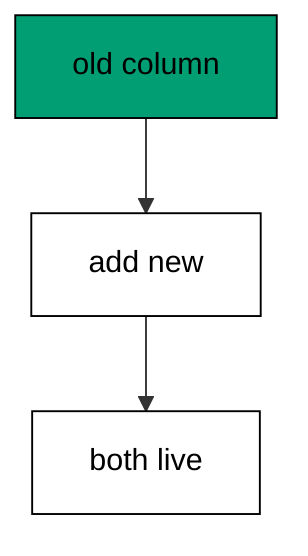

Expand is always additive and always safe: adding a nullable column takes a brief lock and changes no existing row. Contract comes later, after every reader moves.

**`learning/code/ex-35-expand-add-column-safely/main.go`**:

```go
// => Shared driver: every unit in this course opens with this prelude.
// => The harness network is closed, so units carry a small standard-library
// => driver that applies the same goose SQL files `goose up` would apply.
// => The files, the history table shape, and the ordering rules are goose's
// => own; the driver only replaces the network-dependent binary.
package main // => every unit is one runnable program

import ( // => standard library only: no third-party modules
	"bufio"           // => bufio frames protocol messages over the TCP stream
	"encoding/binary" // => binary lays out length-prefixed protocol fields
	"fmt"             // => fmt prints the deterministic transcript only
	"io"              // => io forces full reads of split protocol messages
	"net"             // => net dials the harness Postgres service over TCP
	"os"              // => os reads the harness database address, never hardcoded
	"sort"            // => sort orders migration files, never trusts directory order
	"strings"         // => strings splits the goose Up and Down annotations
) // => every import used by driver and units

// => The database address comes from the harness, with local-run defaults.
func addr() (string, string, string) { // => one helper owns every address default
	host := os.Getenv("PGHOST") // => service hostname in the unit network
	if host == "" {             // => empty means a local run outside the harness
		host = "postgres" // => same default the Python courses use
	} // => end addr: empty means a local run outside the harness
	user := os.Getenv("PGUSER") // => trust-auth role, no password needed
	if user == "" {             // => empty means a local run outside the harness
		user = "postgres" // => same default the Python courses use
	} // => end addr: empty means a local run outside the harness
	db := os.Getenv("PGDATABASE") // => fresh database for every unit run
	if db == "" {                 // => empty means a local run outside the harness
		db = "postgres" // => same default the Python courses use
	} // => end addr: empty means a local run outside the harness
	return host, user, db // => callers never re-read the environment
} // => end addr: one helper owns every address default

// => conn wraps one TCP connection plus a buffered reader for message frames.
type conn struct { // => a tiny struct keeps the socket and the framer together
	c net.Conn      // => the raw TCP socket to the Postgres service
	r *bufio.Reader // => buffered reads frame messages split across packets
} // => end type conn: socket and framer travel together

// => readMsg reads one backend message: a type byte plus a length body.
func (k *conn) readMsg() (byte, []byte, error) { // => every response flows through here
	head := make([]byte, 5)                           // => one type byte plus one int32 length
	if _, err := io.ReadFull(k.r, head); err != nil { // => fragments reassemble before framing
		return 0, nil, err // => no partial message is ever trusted
	} // => end readMsg: fragments reassemble before framing
	n := int(binary.BigEndian.Uint32(head[1:])) - 4   // => length counts itself, not the type
	body := make([]byte, n)                           // => exact-size body, never over-read
	if _, err := io.ReadFull(k.r, body); err != nil { // => fragments reassemble before framing
		return 0, nil, err // => no partial message is ever trusted
	} // => end readMsg: fragments reassemble before framing
	return head[0], body, nil // => type byte tells the caller what arrived
} // => end readMsg: every response flows through here

// => sendMsg writes one frontend message: a type byte plus a length body.
func (k *conn) sendMsg(t byte, body []byte) error { // => startup is the only typeless message
	out := []byte{t}                                      // => type byte leads every message
	lenb := make([]byte, 4)                               // => four bytes carry the length
	binary.BigEndian.PutUint32(lenb, uint32(len(body)+4)) // => length counts itself
	out = append(out, lenb...)                            // => length follows the type byte
	out = append(out, body...)                            // => payload closes the message
	_, err := k.c.Write(out)                              // => one write keeps frames whole
	return err                                            // => write errors fail the unit loudly
} // => end sendMsg: startup is the only typeless message

// => connect opens the service database and waits for session readiness.
func connect() (*conn, error) { // => every unit starts from this one helper
	host, user, db := addr()         // => harness address, never hardcoded
	return connectDb(host, user, db) // => one path opens every session
} // => end connect: every unit starts from this one helper

// => connectDb opens a named database on the same host for multi-db drills.
func connectDb(host, user, db string) (*conn, error) { // => environments are databases, not servers
	c, err := net.Dial("tcp", host+":5432") // => Postgres listens on 5432
	if err != nil {                         // => unreachable service is fatal
		return nil, err // => no fallback: the harness owns the database
	} // => end connectDb: unreachable service is fatal
	k := &conn{c: c, r: bufio.NewReader(c)}             // => buffer the fresh socket at once
	body := []byte{}                                    // => startup body is parameters only
	body = append(body, 0, 0, 0, 0)                     // => placeholder for the length prefix
	body = append(body, 0, 3, 0, 0)                     // => protocol 3.0, the stable version
	body = append(body, []byte("user")...)              // => user key starts the parameters
	body = append(body, 0)                              // => keys and values are NUL-separated
	body = append(body, []byte(user)...)                // => trust-auth role from the harness
	body = append(body, 0)                              // => NUL ends the value
	body = append(body, []byte("database")...)          // => database key follows the user
	body = append(body, 0)                              // => NUL ends the key
	body = append(body, []byte(db)...)                  // => fresh database for every unit run
	body = append(body, 0)                              // => NUL ends the value
	body = append(body, 0)                              // => empty key ends the parameters
	binary.BigEndian.PutUint32(body, uint32(len(body))) // => startup length counts itself
	if _, err := c.Write(body); err != nil {            // => startup is the only typeless message
		return nil, err // => unwritable socket is fatal
	} // => end connectDb: startup is the only typeless message
	for { // => drain until the session is ready for queries
		t, b, err := k.readMsg() // => every backend message flows through here
		if err != nil {          // => broken handshake is fatal
			return nil, err // => no half-open session is ever used
		} // => end connectDb: broken handshake is fatal
		switch t { // => only three message kinds matter during startup
		case 'R': // => authentication response arrives first
			if binary.BigEndian.Uint32(b) != 0 { // => nonzero means a password is wanted
				return nil, fmt.Errorf("server wants a password") // => trust auth never asks
			} // => end connectDb: nonzero means a password is wanted
		case 'E': // => an error ends the handshake with the server text
			return nil, fmt.Errorf("startup: %s", errText(b)) // => server text explains the cause
		case 'Z': // => ReadyForQuery means the session accepts queries
			return k, nil // => handshake done: hand the live session back
		} // => end connectDb: only three message kinds matter during startup
	} // => end connectDb: drain until the session is ready for queries
} // => end connectDb: environments are databases, not servers

// => errText extracts the human message (field M) from an ErrorResponse.
func errText(b []byte) string { // => one helper decodes every server error
	parts := strings.Split(string(b), "\x00") // => fields are NUL-separated pairs
	for i := 0; i+1 < len(parts); i += 2 {    // => walk code and value together
		if parts[i] == "M" { // => M is the primary human message
			return parts[i+1] // => return the message, skip the detail fields
		} // => end errText: M is the primary human message
	} // => end errText: walk code and value together
	return "unknown error" // => malformed errors still fail with a fixed line
} // => end errText: one helper decodes every server error

// => run sends one SQL string and returns every data row plus the command tag.
func (k *conn) run(q string) ([][]string, string, error) { // => one path runs every statement
	body := append([]byte(q), 0)                 // => Query messages are NUL-terminated
	if err := k.sendMsg('Q', body); err != nil { // => send fails loudly, never silently
		return nil, "", err // => unwritable socket ends the unit
	} // => end run: send fails loudly, never silently
	var rows [][]string // => data rows accumulate across result sets
	tag := ""           // => the last command tag (SELECT 3, CREATE TABLE...)
	for {               // => drain until ReadyForQuery closes this query string
		t, b, err := k.readMsg() // => every response flows through the framer
		if err != nil {          // => broken mid-query connection is fatal
			return nil, "", err // => partial results are never returned
		} // => end run: broken mid-query connection is fatal
		switch t { // => four message kinds carry a simple-query response
		case 'T', 'N', 'A', 'S', 'K': // => metadata the transcript never prints
		case 'D': // => one data row arrived
			rows = append(rows, parseRow(b)) // => decode the text columns now
		case 'C': // => one statement finished
			tag = strings.TrimRight(string(b[:len(b)-1]), "\x00") // => tag names what ran
		case 'E': // => the statement failed
			drain(k)                                     // => finish the failed query before reuse
			return nil, "", fmt.Errorf("%s", errText(b)) // => server text becomes the failure
		case 'Z': // => ReadyForQuery ends this query string
			return rows, tag, nil // => rows, tag, and a clean session
		} // => end run: four message kinds carry a simple-query response
	} // => end run: drain until ReadyForQuery closes this query string
} // => end run: one path runs every statement

// => drain reads to the next ReadyForQuery after a statement error.
func drain(k *conn) { // => an errored query still owns the socket until Z
	for { // => loop until the session is reusable
		t, _, err := k.readMsg()    // => discard every message after the error
		if err != nil || t == 'Z' { // => socket break or ready both end the drain
			return // => caller decides the failure, the drain only resynchronizes
		} // => end drain: socket break or ready both end the drain
	} // => end drain: loop until the session is reusable
} // => end drain: an errored query still owns the socket until Z

// => parseRow decodes one DataRow body into text columns, NULL as "NULL".
func parseRow(b []byte) []string { // => one helper decodes every returned row
	n := int(binary.BigEndian.Uint16(b)) // => column count leads the body
	b = b[2:]                            // => step past the count
	out := make([]string, 0, n)          // => pre-size the row to the count
	for i := 0; i < n; i++ {             // => walk each column in order
		l := int(int32(binary.BigEndian.Uint32(b))) // => -1 marks NULL, else the length
		b = b[4:]                                   // => step past the length
		if l < 0 {                                  // => NULL has no bytes to read
			out = append(out, "NULL") // => fixed word keeps transcripts stable
			continue                  // => next column, no bytes consumed
		} // => end parseRow: NULL has no bytes to read
		out = append(out, string(b[:l])) // => text format is already printable
		b = b[l:]                        // => step past the value bytes
	} // => end parseRow: walk each column in order
	return out // => one row, fully decoded
} // => end parseRow: one helper decodes every returned row

// => must runs SQL or exits nonzero with the server text on standard error.
func must(k *conn, q string) [][]string { // => setup statements never fail quietly
	rows, _, err := k.run(q) // => rows return for verification queries
	if err != nil {          // => any server error is fatal to the unit
		fmt.Fprintln(os.Stderr, "sql error:", err) // => errors go to stderr, never stdout
		os.Exit(1)                                 // => nonzero exit fails the harness check
	} // => end must: any server error is fatal to the unit
	return rows // => callers print only what the lesson asserts
} // => end must: setup statements never fail quietly

// => try runs SQL and returns the server error text instead of exiting.
func try(k *conn, q string) ([][]string, string) { // => failure drills inspect errors, not die
	rows, _, err := k.run(q) // => same path as must, opposite failure policy
	if err != nil {          // => expected errors become transcript lines
		return nil, err.Error() // => fixed server text, never timings
	} // => end try: expected errors become transcript lines
	return rows, "" // => empty error means the statement succeeded
} // => end try: failure drills inspect errors, not die

// => mig holds one goose SQL file: its version, name, and Up/Down sections.
type mig struct { // => mirrors the goose file layout the lesson teaches
	version string   // => zero-padded number orders history, like goose
	name    string   // => human slug after the version number
	up      []string // => forward statements, run inside one transaction
	down    []string // => reverse statements, run inside one transaction
	noTx    bool     // => NO TRANSACTION files run outside one, like goose
} // => end type mig: version, name, sections, and mode

// => parseGoose splits one goose SQL file into its Up and Down statements.
func parseGoose(text string) (up, down []string, noTx bool) { // => the lesson asserts this exact split
	section := ""                                    // => nothing belongs outside the annotations
	for _, line := range strings.Split(text, "\n") { // => walk the file line by line
		t := strings.TrimSpace(line) // => annotation matching ignores indentation
		switch t {                   // => four annotation lines switch sections
		case "-- +goose Up": // => forward section starts here, like goose
			section = "up" // => following statements migrate forward
			continue       // => the annotation itself never runs
		case "-- +goose Down": // => reverse section starts here, like goose
			section = "down" // => following statements roll back
			continue         // => the annotation itself never runs
		case "-- +goose NO TRANSACTION": // => concurrent work cannot run inside one
			noTx = true // => remember the file opts out of the transaction
			continue    // => the annotation itself never runs
		} // => end parseGoose: four annotation lines switch sections
		if strings.HasPrefix(t, "--") || t == "" { // => comments and blanks never run
			continue // => only real statements reach the database
		} // => end parseGoose: comments and blanks never run
		if section == "up" { // => route by the annotation seen above
			up = append(up, line) // => keep the original line for the file write
		} else if section == "down" { // => down statements collect separately
			down = append(down, line) // => keep the original line for the file write
		} // => end parseGoose: down statements collect separately
	} // => end parseGoose: walk the file line by line
	return splitStmts(strings.Join(up, "\n")), splitStmts(strings.Join(down, "\n")), noTx // => one string per statement
} // => end parseGoose: the lesson asserts this exact split

// => splitStmts cuts statement text on semicolons outside quotes.
func splitStmts(s string) []string { // => multi-line statements stay whole until ;
	var out []string        // => finished statements accumulate here
	var cur strings.Builder // => the statement under construction
	inStr := false          // => semicolons inside quotes never split
	for _, r := range s {   // => walk rune by rune, quotes included
		switch { // => quote tracking decides what a semicolon means
		case r == '\'': // => a quote toggles string mode
			inStr = !inStr   // => enter or leave the quoted region
			cur.WriteRune(r) // => the quote belongs to the statement
		case r == ';' && !inStr: // => a bare semicolon ends one statement
			if t := strings.TrimSpace(cur.String()); t != "" { // => skip empty fragments
				out = append(out, t) // => store the finished statement
			} // => end splitStmts: skip empty fragments
			cur.Reset() // => start the next statement fresh
		default: // => every other rune belongs to the current statement
			cur.WriteRune(r) // => accumulate verbatim
		} // => end splitStmts: quote tracking decides what a semicolon means
	} // => end splitStmts: walk rune by rune, quotes included
	if t := strings.TrimSpace(cur.String()); t != "" { // => trailing text without ; still counts
		out = append(out, t) // => last statement needs no semicolon
	} // => end splitStmts: trailing text without ; still counts
	return out // => callers run each statement in order
} // => end splitStmts: multi-line statements stay whole until ;

// => ensureHistory creates the goose history table once per unit run.
func ensureHistory(k *conn) { // => goose_db_version is goose's own default name
	must(k, `CREATE TABLE IF NOT EXISTS goose_db_version (`+ // => reruns never fail here
		`id integer PRIMARY KEY GENERATED BY DEFAULT AS IDENTITY, `+ // => surrogate key, never printed
		`version_id bigint NOT NULL, `+ // => applied version numbers live here
		`is_applied boolean NOT NULL, `+ // => goose marks rows applied on success
		`tstamp timestamp NOT NULL DEFAULT now())`) // => timestamp defaults, never printed
} // => end ensureHistory: goose_db_version is goose's own default name

// => appliedVersions returns the version numbers already marked applied.
func appliedVersions(k *conn) map[int64]bool { // => history decides what still needs running
	rows := must(k, `SELECT version_id FROM goose_db_version `+ // => only the numbers matter
		`WHERE is_applied ORDER BY version_id`) // => order keeps the transcript stable
	got := map[int64]bool{}  // => set lookup answers "already applied" fast
	for _, r := range rows { // => one row per applied migration
		var v int64                // => version numbers are integers
		fmt.Sscanf(r[0], "%d", &v) // => text format parses back to a number
		got[v] = true              // => mark this version done
	} // => end appliedVersions: one row per applied migration
	return got // => callers skip whatever history already holds
} // => end appliedVersions: history decides what still needs running

// => applyUp runs every pending migration forward, one transaction each.
func applyUp(k *conn, ms []mig) { // => files on disk are already the source of truth
	done := appliedVersions(k) // => history decides what still needs running
	for _, m := range ms {     // => file order is version order, sorted by the caller
		var v int64                     // => versions compare as numbers
		fmt.Sscanf(m.version, "%d", &v) // => zero-padded file prefix parses back
		if done[v] {                    // => applied migrations never run twice
			continue // => idempotent reruns skip straight past
		} // => end applyUp: applied migrations never run twice
		if !m.noTx { // => transactional files wrap everything in one unit
			must(k, "BEGIN") // => one migration is one transaction, like goose
		} // => end applyUp: transactional files wrap everything in one unit
		for _, s := range m.up { // => forward statements run in file order
			must(k, s) // => any failure aborts the unit before COMMIT
		} // => end applyUp: forward statements run in file order
		if !m.noTx { // => stamps join the same transaction they describe
			must(k, fmt.Sprintf(`INSERT INTO goose_db_version `+ // => stamp only after success
				`(version_id, is_applied) VALUES (%d, true)`, v)) // => stamp mirrors goose exactly
			must(k, "COMMIT") // => history row and schema land together
		} else { // => concurrent statements cannot share a transaction
			must(k, fmt.Sprintf(`INSERT INTO goose_db_version `+ // => stamp follows the work
				`(version_id, is_applied) VALUES (%d, true)`, v)) // => same row, separate statement
		} // => end applyUp: concurrent statements cannot share a transaction
	} // => end applyUp: file order is version order, sorted by the caller
} // => end applyUp: files on disk are already the source of truth

// => applyDown rolls back the newest applied migrations, newest first.
func applyDown(k *conn, ms []mig, steps int) { // => steps bounds how far history rewinds
	done := appliedVersions(k) // => history decides what can roll back
	var todo []mig             // => applied migrations in version order first
	for _, m := range ms {     // => walk the whole known history
		var v int64                     // => versions compare as numbers
		fmt.Sscanf(m.version, "%d", &v) // => zero-padded file prefix parses back
		if done[v] {                    // => only applied migrations roll back
			todo = append(todo, m) // => keep the migration for the reverse pass
		} // => end applyDown: only applied migrations roll back
	} // => end applyDown: walk the whole known history
	for i := len(todo) - 1; i >= 0 && steps > 0; i-- { // => newest applied goes first
		m := todo[i]                    // => this migration rolls back now
		var v int64                     // => versions compare as numbers
		fmt.Sscanf(m.version, "%d", &v) // => zero-padded file prefix parses back
		if !m.noTx {                    // => transactional files wrap the rollback too
			must(k, "BEGIN") // => reverse change is atomic, like the forward one
		} // => end applyDown: transactional files wrap the rollback too
		for _, s := range m.down { // => reverse statements run in file order
			must(k, s) // => any failure aborts before the history row moves
		} // => end applyDown: reverse statements run in file order
		must(k, fmt.Sprintf(`DELETE FROM goose_db_version `+ // => unstamped only after success
			`WHERE version_id = %d`, v)) // => the version leaves history exactly once
		if !m.noTx { // => close the transaction the rollback opened
			must(k, "COMMIT") // => schema reversal and unstamp land together
		} // => end applyDown: close the transaction the rollback opened
		steps-- // => one rollback consumed from the budget
	} // => end applyDown: newest applied goes first
} // => end applyDown: steps bounds how far history rewinds

// => statusCounts splits known migrations into applied and pending lists.
func statusCounts(k *conn, ms []mig) (applied, pending []string) { // => goose status in two lists
	done := appliedVersions(k) // => history decides which list each version joins
	for _, m := range ms {     // => walk the known history in version order
		var v int64                     // => versions compare as numbers
		fmt.Sscanf(m.version, "%d", &v) // => zero-padded file prefix parses back
		if done[v] {                    // => stamped versions are done
			applied = append(applied, m.version) // => keep the version string for printing
		} else { // => unstamped versions still wait
			pending = append(pending, m.version) // => keep the version string for printing
		} // => end statusCounts: unstamped versions still wait
	} // => end statusCounts: walk the known history in version order
	return applied, pending // => callers print both lists in one stable line each
} // => end statusCounts: goose status in two lists

// => files writes each migration as a real goose SQL file under dir.
func files(dir string, ms []mig) { // => the lesson shows these files byte-identically
	for _, m := range ms { // => one file per migration, like `goose create`
		name := fmt.Sprintf("%s_%s.sql", m.version, m.name) // => goose names files version-first
		var b strings.Builder                               // => build the file text in order
		if m.noTx {                                         // => concurrent files announce it first
			b.WriteString("-- +goose NO TRANSACTION\n") // => goose honors this exact annotation
		} // => end files: concurrent files announce it first
		b.WriteString("-- +goose Up\n") // => forward annotation leads
		for _, s := range m.up {        // => forward statements follow
			b.WriteString(s + ";\n") // => one statement per line, semicolon-closed
		} // => end files: forward statements follow
		b.WriteString("-- +goose Down\n") // => reverse annotation splits the file
		for _, s := range m.down {        // => reverse statements close the file
			b.WriteString(s + ";\n") // => one statement per line, semicolon-closed
		} // => end files: reverse statements close the file
		if err := os.WriteFile(dir+"/"+name, []byte(b.String()), 0644); err != nil { // => real files, like goose
			fmt.Fprintln(os.Stderr, "write error:", err) // => write errors fail loudly
			os.Exit(1)                                   // => no half-written migration set
		} // => end files: real files, like goose
	} // => end files: one file per migration, like `goose create`
} // => end files: the lesson shows these files byte-identically

// => versions lists migration files in version order from dir.
func versions(dir string) []mig { // => directory order is never trusted for history
	ents, err := os.ReadDir(dir) // => read the whole migrations directory
	if err != nil {              // => unreadable directory is fatal
		fmt.Fprintln(os.Stderr, "read error:", err) // => errors go to stderr
		os.Exit(1)                                  // => nonzero exit fails the check
	} // => end versions: unreadable directory is fatal
	names := []string{}      // => collect names before sorting
	for _, e := range ents { // => walk every directory entry
		if !e.IsDir() && strings.HasSuffix(e.Name(), ".sql") { // => only goose SQL files count
			names = append(names, e.Name()) // => keep the file name for parsing
		} // => end versions: only goose SQL files count
	} // => end versions: walk every directory entry
	sort.Strings(names)       // => zero-padded versions sort chronologically
	var out []mig             // => parsed migrations accumulate here
	for _, n := range names { // => parse in version order
		raw, err := os.ReadFile(dir + "/" + n) // => read the real file back
		if err != nil {                        // => unreadable file is fatal
			fmt.Fprintln(os.Stderr, "read error:", err) // => errors go to stderr
			os.Exit(1)                                  // => nonzero exit fails the check
		} // => end versions: unreadable file is fatal
		up, down, noTx := parseGoose(string(raw))                                            // => split on the goose annotations
		rest := strings.TrimSuffix(n, ".sql")                                                // => strip the extension first
		ver := rest[:5]                                                                      // => first five digits are the version
		out = append(out, mig{version: ver, name: rest[6:], up: up, down: down, noTx: noTx}) // => keep every part
	} // => end versions: parse in version order
	return out // => version-ordered migrations, ready to apply
} // => end versions: directory order is never trusted for history

// => findDupes returns version numbers claimed by two or more files.
func findDupes(dir string) []string { // => goose refuses duplicate versions outright
	ents, err := os.ReadDir(dir) // => read the whole migrations directory
	if err != nil {              // => unreadable directory is fatal
		fmt.Fprintln(os.Stderr, "read error:", err) // => errors go to stderr
		os.Exit(1)                                  // => nonzero exit fails the check
	} // => end findDupes: unreadable directory is fatal
	seen := map[string]int{} // => count claims per five-digit version prefix
	for _, e := range ents { // => walk every directory entry
		if !e.IsDir() && strings.HasSuffix(e.Name(), ".sql") { // => only goose SQL files count
			seen[e.Name()[:5]]++ // => first five digits are the version
		} // => end findDupes: only goose SQL files count
	} // => end findDupes: walk every directory entry
	var out []string         // => duplicates accumulate in version order
	for _, e := range ents { // => second pass keeps the order stable
		if !e.IsDir() && strings.HasSuffix(e.Name(), ".sql") { // => only goose SQL files count
			if v := e.Name()[:5]; seen[v] > 1 { // => claimed more than once
				out = append(out, v) // => keep the version string for printing
				seen[v] = 0          // => report each duplicate version only once
			} // => end findDupes: claimed more than once
		} // => end findDupes: only goose SQL files count
	} // => end findDupes: second pass keeps the order stable
	return out // => empty means the history numbers are unique
} // => end findDupes: goose refuses duplicate versions outright

func main() {
	k, err := connect() // => one session runs the whole example
	if err != nil {     // => unreachable database fails loudly
		fmt.Fprintln(os.Stderr, "connect error:", err) // => connection errors go to stderr
		os.Exit(1)                                     // => nonzero exit fails the check
	}
	defer k.c.Close() // => the socket closes when the example ends
	// => A scratch migrations directory: goose files live here, never in the unit.
	// => the scratch path never reaches stdout, so reruns stay byte-stable
	dir, err := os.MkdirTemp("", "ex35-") // => private directory, like `goose create`
	if err != nil {                       // => unmakable temp dir is fatal
		fmt.Fprintln(os.Stderr, "temp error:", err) // => errors go to stderr
		os.Exit(1)                                  // => nonzero exit fails the check
	}
	defer os.RemoveAll(dir)                                                       // => scratch files vanish; only transcripts remain
	must(k, "DROP TABLE IF EXISTS ex35_base")                                     // => leftovers of a killed run vanish
	must(k, "DROP TABLE IF EXISTS goose_db_version")                              // => stale history vanishes too
	ensureHistory(k)                                                              // => goose history table, real shape
	must(k, "CREATE TABLE ex35_base (id SERIAL PRIMARY KEY, name TEXT NOT NULL)") // => live table serving traffic
	must(k, `INSERT INTO ex35_base (name) VALUES ('ada')`)                        // => live row the deploy must spare
	files(dir, []mig{                                                             // => expand step: additive only
		{version: "00001", name: "expand_nickname", // => new column, nullable, unused by readers yet
			up:   []string{"ALTER TABLE ex35_base ADD COLUMN nickname TEXT"}, // => forward change
			down: []string{"ALTER TABLE ex35_base DROP COLUMN nickname"}},    // => exact reverse for rollback
	})
	applyUp(k, versions(dir))                                           // => read the files back and run what is pending
	rows := must(k, `SELECT name, nickname FROM ex35_base ORDER BY id`) // => old reads still work, new column empty
	fmt.Println("row:", rows[0][0], rows[0][1])                         // => Output: row: ada NULL
	must(k, "DROP TABLE ex35_base")                                     // => base table cleaned with the example tables
	fmt.Println("cleaned: yes")                                         // => Output: cleaned: yes
	must(k, "DROP TABLE IF EXISTS ex35_base")                           // => leftovers of a killed run vanish
	must(k, "DROP TABLE IF EXISTS goose_db_version")                    // => the example leaves no history behind
}
```

**Output** (`learning/code/ex-35-expand-add-column-safely/expected/main.stdout.txt`):

```text
row: ada NULL
cleaned: yes
```

**Key takeaway**: Expand is always additive: a nullable column changes no existing row and breaks no running reader.

**Why it matters**: Additive changes are the only changes that never break running code. New nullable columns alter no existing row and invalidate no running query, so deploys proceed without coordination windows. Expand first is the discipline that makes zero-downtime ordinary. Expand first is the discipline that makes zero-downtime ordinary instead of heroic.

### Example 36: Dual Write Window

During the migrate phase both columns accept writes: this example writes the same value to the old and new columns and reads both back equal. Dual writes keep the columns in sync while readers move over. (Concepts: co-07.)

The window is temporary but load-bearing: every row written during the deploy lands in both places, so the later contract step drops nothing unread.

**`learning/code/ex-36-dual-write-window/main.go`**:

```go
// => Shared driver: every unit in this course opens with this prelude.
// => The harness network is closed, so units carry a small standard-library
// => driver that applies the same goose SQL files `goose up` would apply.
// => The files, the history table shape, and the ordering rules are goose's
// => own; the driver only replaces the network-dependent binary.
package main // => every unit is one runnable program

import ( // => standard library only: no third-party modules
	"bufio"           // => bufio frames protocol messages over the TCP stream
	"encoding/binary" // => binary lays out length-prefixed protocol fields
	"fmt"             // => fmt prints the deterministic transcript only
	"io"              // => io forces full reads of split protocol messages
	"net"             // => net dials the harness Postgres service over TCP
	"os"              // => os reads the harness database address, never hardcoded
	"sort"            // => sort orders migration files, never trusts directory order
	"strings"         // => strings splits the goose Up and Down annotations
) // => every import used by driver and units

// => The database address comes from the harness, with local-run defaults.
func addr() (string, string, string) { // => one helper owns every address default
	host := os.Getenv("PGHOST") // => service hostname in the unit network
	if host == "" {             // => empty means a local run outside the harness
		host = "postgres" // => same default the Python courses use
	} // => end addr: empty means a local run outside the harness
	user := os.Getenv("PGUSER") // => trust-auth role, no password needed
	if user == "" {             // => empty means a local run outside the harness
		user = "postgres" // => same default the Python courses use
	} // => end addr: empty means a local run outside the harness
	db := os.Getenv("PGDATABASE") // => fresh database for every unit run
	if db == "" {                 // => empty means a local run outside the harness
		db = "postgres" // => same default the Python courses use
	} // => end addr: empty means a local run outside the harness
	return host, user, db // => callers never re-read the environment
} // => end addr: one helper owns every address default

// => conn wraps one TCP connection plus a buffered reader for message frames.
type conn struct { // => a tiny struct keeps the socket and the framer together
	c net.Conn      // => the raw TCP socket to the Postgres service
	r *bufio.Reader // => buffered reads frame messages split across packets
} // => end type conn: socket and framer travel together

// => readMsg reads one backend message: a type byte plus a length body.
func (k *conn) readMsg() (byte, []byte, error) { // => every response flows through here
	head := make([]byte, 5)                           // => one type byte plus one int32 length
	if _, err := io.ReadFull(k.r, head); err != nil { // => fragments reassemble before framing
		return 0, nil, err // => no partial message is ever trusted
	} // => end readMsg: fragments reassemble before framing
	n := int(binary.BigEndian.Uint32(head[1:])) - 4   // => length counts itself, not the type
	body := make([]byte, n)                           // => exact-size body, never over-read
	if _, err := io.ReadFull(k.r, body); err != nil { // => fragments reassemble before framing
		return 0, nil, err // => no partial message is ever trusted
	} // => end readMsg: fragments reassemble before framing
	return head[0], body, nil // => type byte tells the caller what arrived
} // => end readMsg: every response flows through here

// => sendMsg writes one frontend message: a type byte plus a length body.
func (k *conn) sendMsg(t byte, body []byte) error { // => startup is the only typeless message
	out := []byte{t}                                      // => type byte leads every message
	lenb := make([]byte, 4)                               // => four bytes carry the length
	binary.BigEndian.PutUint32(lenb, uint32(len(body)+4)) // => length counts itself
	out = append(out, lenb...)                            // => length follows the type byte
	out = append(out, body...)                            // => payload closes the message
	_, err := k.c.Write(out)                              // => one write keeps frames whole
	return err                                            // => write errors fail the unit loudly
} // => end sendMsg: startup is the only typeless message

// => connect opens the service database and waits for session readiness.
func connect() (*conn, error) { // => every unit starts from this one helper
	host, user, db := addr()         // => harness address, never hardcoded
	return connectDb(host, user, db) // => one path opens every session
} // => end connect: every unit starts from this one helper

// => connectDb opens a named database on the same host for multi-db drills.
func connectDb(host, user, db string) (*conn, error) { // => environments are databases, not servers
	c, err := net.Dial("tcp", host+":5432") // => Postgres listens on 5432
	if err != nil {                         // => unreachable service is fatal
		return nil, err // => no fallback: the harness owns the database
	} // => end connectDb: unreachable service is fatal
	k := &conn{c: c, r: bufio.NewReader(c)}             // => buffer the fresh socket at once
	body := []byte{}                                    // => startup body is parameters only
	body = append(body, 0, 0, 0, 0)                     // => placeholder for the length prefix
	body = append(body, 0, 3, 0, 0)                     // => protocol 3.0, the stable version
	body = append(body, []byte("user")...)              // => user key starts the parameters
	body = append(body, 0)                              // => keys and values are NUL-separated
	body = append(body, []byte(user)...)                // => trust-auth role from the harness
	body = append(body, 0)                              // => NUL ends the value
	body = append(body, []byte("database")...)          // => database key follows the user
	body = append(body, 0)                              // => NUL ends the key
	body = append(body, []byte(db)...)                  // => fresh database for every unit run
	body = append(body, 0)                              // => NUL ends the value
	body = append(body, 0)                              // => empty key ends the parameters
	binary.BigEndian.PutUint32(body, uint32(len(body))) // => startup length counts itself
	if _, err := c.Write(body); err != nil {            // => startup is the only typeless message
		return nil, err // => unwritable socket is fatal
	} // => end connectDb: startup is the only typeless message
	for { // => drain until the session is ready for queries
		t, b, err := k.readMsg() // => every backend message flows through here
		if err != nil {          // => broken handshake is fatal
			return nil, err // => no half-open session is ever used
		} // => end connectDb: broken handshake is fatal
		switch t { // => only three message kinds matter during startup
		case 'R': // => authentication response arrives first
			if binary.BigEndian.Uint32(b) != 0 { // => nonzero means a password is wanted
				return nil, fmt.Errorf("server wants a password") // => trust auth never asks
			} // => end connectDb: nonzero means a password is wanted
		case 'E': // => an error ends the handshake with the server text
			return nil, fmt.Errorf("startup: %s", errText(b)) // => server text explains the cause
		case 'Z': // => ReadyForQuery means the session accepts queries
			return k, nil // => handshake done: hand the live session back
		} // => end connectDb: only three message kinds matter during startup
	} // => end connectDb: drain until the session is ready for queries
} // => end connectDb: environments are databases, not servers

// => errText extracts the human message (field M) from an ErrorResponse.
func errText(b []byte) string { // => one helper decodes every server error
	parts := strings.Split(string(b), "\x00") // => fields are NUL-separated pairs
	for i := 0; i+1 < len(parts); i += 2 {    // => walk code and value together
		if parts[i] == "M" { // => M is the primary human message
			return parts[i+1] // => return the message, skip the detail fields
		} // => end errText: M is the primary human message
	} // => end errText: walk code and value together
	return "unknown error" // => malformed errors still fail with a fixed line
} // => end errText: one helper decodes every server error

// => run sends one SQL string and returns every data row plus the command tag.
func (k *conn) run(q string) ([][]string, string, error) { // => one path runs every statement
	body := append([]byte(q), 0)                 // => Query messages are NUL-terminated
	if err := k.sendMsg('Q', body); err != nil { // => send fails loudly, never silently
		return nil, "", err // => unwritable socket ends the unit
	} // => end run: send fails loudly, never silently
	var rows [][]string // => data rows accumulate across result sets
	tag := ""           // => the last command tag (SELECT 3, CREATE TABLE...)
	for {               // => drain until ReadyForQuery closes this query string
		t, b, err := k.readMsg() // => every response flows through the framer
		if err != nil {          // => broken mid-query connection is fatal
			return nil, "", err // => partial results are never returned
		} // => end run: broken mid-query connection is fatal
		switch t { // => four message kinds carry a simple-query response
		case 'T', 'N', 'A', 'S', 'K': // => metadata the transcript never prints
		case 'D': // => one data row arrived
			rows = append(rows, parseRow(b)) // => decode the text columns now
		case 'C': // => one statement finished
			tag = strings.TrimRight(string(b[:len(b)-1]), "\x00") // => tag names what ran
		case 'E': // => the statement failed
			drain(k)                                     // => finish the failed query before reuse
			return nil, "", fmt.Errorf("%s", errText(b)) // => server text becomes the failure
		case 'Z': // => ReadyForQuery ends this query string
			return rows, tag, nil // => rows, tag, and a clean session
		} // => end run: four message kinds carry a simple-query response
	} // => end run: drain until ReadyForQuery closes this query string
} // => end run: one path runs every statement

// => drain reads to the next ReadyForQuery after a statement error.
func drain(k *conn) { // => an errored query still owns the socket until Z
	for { // => loop until the session is reusable
		t, _, err := k.readMsg()    // => discard every message after the error
		if err != nil || t == 'Z' { // => socket break or ready both end the drain
			return // => caller decides the failure, the drain only resynchronizes
		} // => end drain: socket break or ready both end the drain
	} // => end drain: loop until the session is reusable
} // => end drain: an errored query still owns the socket until Z

// => parseRow decodes one DataRow body into text columns, NULL as "NULL".
func parseRow(b []byte) []string { // => one helper decodes every returned row
	n := int(binary.BigEndian.Uint16(b)) // => column count leads the body
	b = b[2:]                            // => step past the count
	out := make([]string, 0, n)          // => pre-size the row to the count
	for i := 0; i < n; i++ {             // => walk each column in order
		l := int(int32(binary.BigEndian.Uint32(b))) // => -1 marks NULL, else the length
		b = b[4:]                                   // => step past the length
		if l < 0 {                                  // => NULL has no bytes to read
			out = append(out, "NULL") // => fixed word keeps transcripts stable
			continue                  // => next column, no bytes consumed
		} // => end parseRow: NULL has no bytes to read
		out = append(out, string(b[:l])) // => text format is already printable
		b = b[l:]                        // => step past the value bytes
	} // => end parseRow: walk each column in order
	return out // => one row, fully decoded
} // => end parseRow: one helper decodes every returned row

// => must runs SQL or exits nonzero with the server text on standard error.
func must(k *conn, q string) [][]string { // => setup statements never fail quietly
	rows, _, err := k.run(q) // => rows return for verification queries
	if err != nil {          // => any server error is fatal to the unit
		fmt.Fprintln(os.Stderr, "sql error:", err) // => errors go to stderr, never stdout
		os.Exit(1)                                 // => nonzero exit fails the harness check
	} // => end must: any server error is fatal to the unit
	return rows // => callers print only what the lesson asserts
} // => end must: setup statements never fail quietly

// => try runs SQL and returns the server error text instead of exiting.
func try(k *conn, q string) ([][]string, string) { // => failure drills inspect errors, not die
	rows, _, err := k.run(q) // => same path as must, opposite failure policy
	if err != nil {          // => expected errors become transcript lines
		return nil, err.Error() // => fixed server text, never timings
	} // => end try: expected errors become transcript lines
	return rows, "" // => empty error means the statement succeeded
} // => end try: failure drills inspect errors, not die

// => mig holds one goose SQL file: its version, name, and Up/Down sections.
type mig struct { // => mirrors the goose file layout the lesson teaches
	version string   // => zero-padded number orders history, like goose
	name    string   // => human slug after the version number
	up      []string // => forward statements, run inside one transaction
	down    []string // => reverse statements, run inside one transaction
	noTx    bool     // => NO TRANSACTION files run outside one, like goose
} // => end type mig: version, name, sections, and mode

// => parseGoose splits one goose SQL file into its Up and Down statements.
func parseGoose(text string) (up, down []string, noTx bool) { // => the lesson asserts this exact split
	section := ""                                    // => nothing belongs outside the annotations
	for _, line := range strings.Split(text, "\n") { // => walk the file line by line
		t := strings.TrimSpace(line) // => annotation matching ignores indentation
		switch t {                   // => four annotation lines switch sections
		case "-- +goose Up": // => forward section starts here, like goose
			section = "up" // => following statements migrate forward
			continue       // => the annotation itself never runs
		case "-- +goose Down": // => reverse section starts here, like goose
			section = "down" // => following statements roll back
			continue         // => the annotation itself never runs
		case "-- +goose NO TRANSACTION": // => concurrent work cannot run inside one
			noTx = true // => remember the file opts out of the transaction
			continue    // => the annotation itself never runs
		} // => end parseGoose: four annotation lines switch sections
		if strings.HasPrefix(t, "--") || t == "" { // => comments and blanks never run
			continue // => only real statements reach the database
		} // => end parseGoose: comments and blanks never run
		if section == "up" { // => route by the annotation seen above
			up = append(up, line) // => keep the original line for the file write
		} else if section == "down" { // => down statements collect separately
			down = append(down, line) // => keep the original line for the file write
		} // => end parseGoose: down statements collect separately
	} // => end parseGoose: walk the file line by line
	return splitStmts(strings.Join(up, "\n")), splitStmts(strings.Join(down, "\n")), noTx // => one string per statement
} // => end parseGoose: the lesson asserts this exact split

// => splitStmts cuts statement text on semicolons outside quotes.
func splitStmts(s string) []string { // => multi-line statements stay whole until ;
	var out []string        // => finished statements accumulate here
	var cur strings.Builder // => the statement under construction
	inStr := false          // => semicolons inside quotes never split
	for _, r := range s {   // => walk rune by rune, quotes included
		switch { // => quote tracking decides what a semicolon means
		case r == '\'': // => a quote toggles string mode
			inStr = !inStr   // => enter or leave the quoted region
			cur.WriteRune(r) // => the quote belongs to the statement
		case r == ';' && !inStr: // => a bare semicolon ends one statement
			if t := strings.TrimSpace(cur.String()); t != "" { // => skip empty fragments
				out = append(out, t) // => store the finished statement
			} // => end splitStmts: skip empty fragments
			cur.Reset() // => start the next statement fresh
		default: // => every other rune belongs to the current statement
			cur.WriteRune(r) // => accumulate verbatim
		} // => end splitStmts: quote tracking decides what a semicolon means
	} // => end splitStmts: walk rune by rune, quotes included
	if t := strings.TrimSpace(cur.String()); t != "" { // => trailing text without ; still counts
		out = append(out, t) // => last statement needs no semicolon
	} // => end splitStmts: trailing text without ; still counts
	return out // => callers run each statement in order
} // => end splitStmts: multi-line statements stay whole until ;

// => ensureHistory creates the goose history table once per unit run.
func ensureHistory(k *conn) { // => goose_db_version is goose's own default name
	must(k, `CREATE TABLE IF NOT EXISTS goose_db_version (`+ // => reruns never fail here
		`id integer PRIMARY KEY GENERATED BY DEFAULT AS IDENTITY, `+ // => surrogate key, never printed
		`version_id bigint NOT NULL, `+ // => applied version numbers live here
		`is_applied boolean NOT NULL, `+ // => goose marks rows applied on success
		`tstamp timestamp NOT NULL DEFAULT now())`) // => timestamp defaults, never printed
} // => end ensureHistory: goose_db_version is goose's own default name

// => appliedVersions returns the version numbers already marked applied.
func appliedVersions(k *conn) map[int64]bool { // => history decides what still needs running
	rows := must(k, `SELECT version_id FROM goose_db_version `+ // => only the numbers matter
		`WHERE is_applied ORDER BY version_id`) // => order keeps the transcript stable
	got := map[int64]bool{}  // => set lookup answers "already applied" fast
	for _, r := range rows { // => one row per applied migration
		var v int64                // => version numbers are integers
		fmt.Sscanf(r[0], "%d", &v) // => text format parses back to a number
		got[v] = true              // => mark this version done
	} // => end appliedVersions: one row per applied migration
	return got // => callers skip whatever history already holds
} // => end appliedVersions: history decides what still needs running

// => applyUp runs every pending migration forward, one transaction each.
func applyUp(k *conn, ms []mig) { // => files on disk are already the source of truth
	done := appliedVersions(k) // => history decides what still needs running
	for _, m := range ms {     // => file order is version order, sorted by the caller
		var v int64                     // => versions compare as numbers
		fmt.Sscanf(m.version, "%d", &v) // => zero-padded file prefix parses back
		if done[v] {                    // => applied migrations never run twice
			continue // => idempotent reruns skip straight past
		} // => end applyUp: applied migrations never run twice
		if !m.noTx { // => transactional files wrap everything in one unit
			must(k, "BEGIN") // => one migration is one transaction, like goose
		} // => end applyUp: transactional files wrap everything in one unit
		for _, s := range m.up { // => forward statements run in file order
			must(k, s) // => any failure aborts the unit before COMMIT
		} // => end applyUp: forward statements run in file order
		if !m.noTx { // => stamps join the same transaction they describe
			must(k, fmt.Sprintf(`INSERT INTO goose_db_version `+ // => stamp only after success
				`(version_id, is_applied) VALUES (%d, true)`, v)) // => stamp mirrors goose exactly
			must(k, "COMMIT") // => history row and schema land together
		} else { // => concurrent statements cannot share a transaction
			must(k, fmt.Sprintf(`INSERT INTO goose_db_version `+ // => stamp follows the work
				`(version_id, is_applied) VALUES (%d, true)`, v)) // => same row, separate statement
		} // => end applyUp: concurrent statements cannot share a transaction
	} // => end applyUp: file order is version order, sorted by the caller
} // => end applyUp: files on disk are already the source of truth

// => applyDown rolls back the newest applied migrations, newest first.
func applyDown(k *conn, ms []mig, steps int) { // => steps bounds how far history rewinds
	done := appliedVersions(k) // => history decides what can roll back
	var todo []mig             // => applied migrations in version order first
	for _, m := range ms {     // => walk the whole known history
		var v int64                     // => versions compare as numbers
		fmt.Sscanf(m.version, "%d", &v) // => zero-padded file prefix parses back
		if done[v] {                    // => only applied migrations roll back
			todo = append(todo, m) // => keep the migration for the reverse pass
		} // => end applyDown: only applied migrations roll back
	} // => end applyDown: walk the whole known history
	for i := len(todo) - 1; i >= 0 && steps > 0; i-- { // => newest applied goes first
		m := todo[i]                    // => this migration rolls back now
		var v int64                     // => versions compare as numbers
		fmt.Sscanf(m.version, "%d", &v) // => zero-padded file prefix parses back
		if !m.noTx {                    // => transactional files wrap the rollback too
			must(k, "BEGIN") // => reverse change is atomic, like the forward one
		} // => end applyDown: transactional files wrap the rollback too
		for _, s := range m.down { // => reverse statements run in file order
			must(k, s) // => any failure aborts before the history row moves
		} // => end applyDown: reverse statements run in file order
		must(k, fmt.Sprintf(`DELETE FROM goose_db_version `+ // => unstamped only after success
			`WHERE version_id = %d`, v)) // => the version leaves history exactly once
		if !m.noTx { // => close the transaction the rollback opened
			must(k, "COMMIT") // => schema reversal and unstamp land together
		} // => end applyDown: close the transaction the rollback opened
		steps-- // => one rollback consumed from the budget
	} // => end applyDown: newest applied goes first
} // => end applyDown: steps bounds how far history rewinds

// => statusCounts splits known migrations into applied and pending lists.
func statusCounts(k *conn, ms []mig) (applied, pending []string) { // => goose status in two lists
	done := appliedVersions(k) // => history decides which list each version joins
	for _, m := range ms {     // => walk the known history in version order
		var v int64                     // => versions compare as numbers
		fmt.Sscanf(m.version, "%d", &v) // => zero-padded file prefix parses back
		if done[v] {                    // => stamped versions are done
			applied = append(applied, m.version) // => keep the version string for printing
		} else { // => unstamped versions still wait
			pending = append(pending, m.version) // => keep the version string for printing
		} // => end statusCounts: unstamped versions still wait
	} // => end statusCounts: walk the known history in version order
	return applied, pending // => callers print both lists in one stable line each
} // => end statusCounts: goose status in two lists

// => files writes each migration as a real goose SQL file under dir.
func files(dir string, ms []mig) { // => the lesson shows these files byte-identically
	for _, m := range ms { // => one file per migration, like `goose create`
		name := fmt.Sprintf("%s_%s.sql", m.version, m.name) // => goose names files version-first
		var b strings.Builder                               // => build the file text in order
		if m.noTx {                                         // => concurrent files announce it first
			b.WriteString("-- +goose NO TRANSACTION\n") // => goose honors this exact annotation
		} // => end files: concurrent files announce it first
		b.WriteString("-- +goose Up\n") // => forward annotation leads
		for _, s := range m.up {        // => forward statements follow
			b.WriteString(s + ";\n") // => one statement per line, semicolon-closed
		} // => end files: forward statements follow
		b.WriteString("-- +goose Down\n") // => reverse annotation splits the file
		for _, s := range m.down {        // => reverse statements close the file
			b.WriteString(s + ";\n") // => one statement per line, semicolon-closed
		} // => end files: reverse statements close the file
		if err := os.WriteFile(dir+"/"+name, []byte(b.String()), 0644); err != nil { // => real files, like goose
			fmt.Fprintln(os.Stderr, "write error:", err) // => write errors fail loudly
			os.Exit(1)                                   // => no half-written migration set
		} // => end files: real files, like goose
	} // => end files: one file per migration, like `goose create`
} // => end files: the lesson shows these files byte-identically

// => versions lists migration files in version order from dir.
func versions(dir string) []mig { // => directory order is never trusted for history
	ents, err := os.ReadDir(dir) // => read the whole migrations directory
	if err != nil {              // => unreadable directory is fatal
		fmt.Fprintln(os.Stderr, "read error:", err) // => errors go to stderr
		os.Exit(1)                                  // => nonzero exit fails the check
	} // => end versions: unreadable directory is fatal
	names := []string{}      // => collect names before sorting
	for _, e := range ents { // => walk every directory entry
		if !e.IsDir() && strings.HasSuffix(e.Name(), ".sql") { // => only goose SQL files count
			names = append(names, e.Name()) // => keep the file name for parsing
		} // => end versions: only goose SQL files count
	} // => end versions: walk every directory entry
	sort.Strings(names)       // => zero-padded versions sort chronologically
	var out []mig             // => parsed migrations accumulate here
	for _, n := range names { // => parse in version order
		raw, err := os.ReadFile(dir + "/" + n) // => read the real file back
		if err != nil {                        // => unreadable file is fatal
			fmt.Fprintln(os.Stderr, "read error:", err) // => errors go to stderr
			os.Exit(1)                                  // => nonzero exit fails the check
		} // => end versions: unreadable file is fatal
		up, down, noTx := parseGoose(string(raw))                                            // => split on the goose annotations
		rest := strings.TrimSuffix(n, ".sql")                                                // => strip the extension first
		ver := rest[:5]                                                                      // => first five digits are the version
		out = append(out, mig{version: ver, name: rest[6:], up: up, down: down, noTx: noTx}) // => keep every part
	} // => end versions: parse in version order
	return out // => version-ordered migrations, ready to apply
} // => end versions: directory order is never trusted for history

// => findDupes returns version numbers claimed by two or more files.
func findDupes(dir string) []string { // => goose refuses duplicate versions outright
	ents, err := os.ReadDir(dir) // => read the whole migrations directory
	if err != nil {              // => unreadable directory is fatal
		fmt.Fprintln(os.Stderr, "read error:", err) // => errors go to stderr
		os.Exit(1)                                  // => nonzero exit fails the check
	} // => end findDupes: unreadable directory is fatal
	seen := map[string]int{} // => count claims per five-digit version prefix
	for _, e := range ents { // => walk every directory entry
		if !e.IsDir() && strings.HasSuffix(e.Name(), ".sql") { // => only goose SQL files count
			seen[e.Name()[:5]]++ // => first five digits are the version
		} // => end findDupes: only goose SQL files count
	} // => end findDupes: walk every directory entry
	var out []string         // => duplicates accumulate in version order
	for _, e := range ents { // => second pass keeps the order stable
		if !e.IsDir() && strings.HasSuffix(e.Name(), ".sql") { // => only goose SQL files count
			if v := e.Name()[:5]; seen[v] > 1 { // => claimed more than once
				out = append(out, v) // => keep the version string for printing
				seen[v] = 0          // => report each duplicate version only once
			} // => end findDupes: claimed more than once
		} // => end findDupes: only goose SQL files count
	} // => end findDupes: second pass keeps the order stable
	return out // => empty means the history numbers are unique
} // => end findDupes: goose refuses duplicate versions outright

func main() {
	k, err := connect() // => one session runs the whole example
	if err != nil {     // => unreachable database fails loudly
		fmt.Fprintln(os.Stderr, "connect error:", err) // => connection errors go to stderr
		os.Exit(1)                                     // => nonzero exit fails the check
	}
	defer k.c.Close() // => the socket closes when the example ends
	// => A scratch migrations directory: goose files live here, never in the unit.
	// => the scratch path never reaches stdout, so reruns stay byte-stable
	dir, err := os.MkdirTemp("", "ex36-") // => private directory, like `goose create`
	if err != nil {                       // => unmakable temp dir is fatal
		fmt.Fprintln(os.Stderr, "temp error:", err) // => errors go to stderr
		os.Exit(1)                                  // => nonzero exit fails the check
	}
	defer os.RemoveAll(dir)                                                                      // => scratch files vanish; only transcripts remain
	must(k, "DROP TABLE IF EXISTS ex36_base")                                                    // => leftovers of a killed run vanish
	must(k, "DROP TABLE IF EXISTS goose_db_version")                                             // => stale history vanishes too
	ensureHistory(k)                                                                             // => goose history table, real shape
	must(k, "CREATE TABLE ex36_base (id SERIAL PRIMARY KEY, name TEXT NOT NULL, nickname TEXT)") // => both columns live now
	files(dir, []mig{                                                                            // => migrate step: no schema change, behavior captured in queries
		{version: "00001", name: "dual_write", // => marker migration for the window
			up:   []string{"SELECT 1"},  // => the window is application behavior, not DDL
			down: []string{"SELECT 1"}}, // => nothing structural to reverse
	})
	applyUp(k, versions(dir))                                               // => read the files back and run what is pending
	must(k, `INSERT INTO ex36_base (name, nickname) VALUES ('ada', 'ada')`) // => dual write: both columns
	rows := must(k, `SELECT name, nickname FROM ex36_base ORDER BY id`)     // => both columns read back
	fmt.Println("match:", rows[0][0] == rows[0][1])                         // => Output: match: true
	must(k, "DROP TABLE ex36_base")                                         // => base table cleaned with the example tables
	fmt.Println("cleaned: yes")                                             // => Output: cleaned: yes
	must(k, "DROP TABLE IF EXISTS ex36_base")                               // => leftovers of a killed run vanish
	must(k, "DROP TABLE IF EXISTS goose_db_version")                        // => the example leaves no history behind
}
```

**Output** (`learning/code/ex-36-dual-write-window/expected/main.stdout.txt`):

```text
match: true
cleaned: yes
```

**Key takeaway**: Dual writes keep old and new columns in sync while readers move from one to the other.

**Why it matters**: The dual-write window trades temporary duplication for continuous availability. Rows written during the transition land in both columns, so neither old nor new readers ever see a gap. Redundancy with a deadline beats coordinated flag days. Redundancy with a deadline beats coordinated flag days, because both readers always see a complete picture.

### Example 37: Migrate Reads to the New Column

Readers move before writers stop: this example backfills the new column for old rows, then reads exclusively from it and shows every row populated. Old rows and new rows answer identically. (Concepts: co-07.)

Backfilling before switching reads is the step teams skip under pressure, and skipping it serves nulls to the new code path. Fill first, switch second, always.

**`learning/code/ex-37-migrate-reads-to-the-new-column/main.go`**:

```go
// => Shared driver: every unit in this course opens with this prelude.
// => The harness network is closed, so units carry a small standard-library
// => driver that applies the same goose SQL files `goose up` would apply.
// => The files, the history table shape, and the ordering rules are goose's
// => own; the driver only replaces the network-dependent binary.
package main // => every unit is one runnable program

import ( // => standard library only: no third-party modules
	"bufio"           // => bufio frames protocol messages over the TCP stream
	"encoding/binary" // => binary lays out length-prefixed protocol fields
	"fmt"             // => fmt prints the deterministic transcript only
	"io"              // => io forces full reads of split protocol messages
	"net"             // => net dials the harness Postgres service over TCP
	"os"              // => os reads the harness database address, never hardcoded
	"sort"            // => sort orders migration files, never trusts directory order
	"strings"         // => strings splits the goose Up and Down annotations
) // => every import used by driver and units

// => The database address comes from the harness, with local-run defaults.
func addr() (string, string, string) { // => one helper owns every address default
	host := os.Getenv("PGHOST") // => service hostname in the unit network
	if host == "" {             // => empty means a local run outside the harness
		host = "postgres" // => same default the Python courses use
	} // => end addr: empty means a local run outside the harness
	user := os.Getenv("PGUSER") // => trust-auth role, no password needed
	if user == "" {             // => empty means a local run outside the harness
		user = "postgres" // => same default the Python courses use
	} // => end addr: empty means a local run outside the harness
	db := os.Getenv("PGDATABASE") // => fresh database for every unit run
	if db == "" {                 // => empty means a local run outside the harness
		db = "postgres" // => same default the Python courses use
	} // => end addr: empty means a local run outside the harness
	return host, user, db // => callers never re-read the environment
} // => end addr: one helper owns every address default

// => conn wraps one TCP connection plus a buffered reader for message frames.
type conn struct { // => a tiny struct keeps the socket and the framer together
	c net.Conn      // => the raw TCP socket to the Postgres service
	r *bufio.Reader // => buffered reads frame messages split across packets
} // => end type conn: socket and framer travel together

// => readMsg reads one backend message: a type byte plus a length body.
func (k *conn) readMsg() (byte, []byte, error) { // => every response flows through here
	head := make([]byte, 5)                           // => one type byte plus one int32 length
	if _, err := io.ReadFull(k.r, head); err != nil { // => fragments reassemble before framing
		return 0, nil, err // => no partial message is ever trusted
	} // => end readMsg: fragments reassemble before framing
	n := int(binary.BigEndian.Uint32(head[1:])) - 4   // => length counts itself, not the type
	body := make([]byte, n)                           // => exact-size body, never over-read
	if _, err := io.ReadFull(k.r, body); err != nil { // => fragments reassemble before framing
		return 0, nil, err // => no partial message is ever trusted
	} // => end readMsg: fragments reassemble before framing
	return head[0], body, nil // => type byte tells the caller what arrived
} // => end readMsg: every response flows through here

// => sendMsg writes one frontend message: a type byte plus a length body.
func (k *conn) sendMsg(t byte, body []byte) error { // => startup is the only typeless message
	out := []byte{t}                                      // => type byte leads every message
	lenb := make([]byte, 4)                               // => four bytes carry the length
	binary.BigEndian.PutUint32(lenb, uint32(len(body)+4)) // => length counts itself
	out = append(out, lenb...)                            // => length follows the type byte
	out = append(out, body...)                            // => payload closes the message
	_, err := k.c.Write(out)                              // => one write keeps frames whole
	return err                                            // => write errors fail the unit loudly
} // => end sendMsg: startup is the only typeless message

// => connect opens the service database and waits for session readiness.
func connect() (*conn, error) { // => every unit starts from this one helper
	host, user, db := addr()         // => harness address, never hardcoded
	return connectDb(host, user, db) // => one path opens every session
} // => end connect: every unit starts from this one helper

// => connectDb opens a named database on the same host for multi-db drills.
func connectDb(host, user, db string) (*conn, error) { // => environments are databases, not servers
	c, err := net.Dial("tcp", host+":5432") // => Postgres listens on 5432
	if err != nil {                         // => unreachable service is fatal
		return nil, err // => no fallback: the harness owns the database
	} // => end connectDb: unreachable service is fatal
	k := &conn{c: c, r: bufio.NewReader(c)}             // => buffer the fresh socket at once
	body := []byte{}                                    // => startup body is parameters only
	body = append(body, 0, 0, 0, 0)                     // => placeholder for the length prefix
	body = append(body, 0, 3, 0, 0)                     // => protocol 3.0, the stable version
	body = append(body, []byte("user")...)              // => user key starts the parameters
	body = append(body, 0)                              // => keys and values are NUL-separated
	body = append(body, []byte(user)...)                // => trust-auth role from the harness
	body = append(body, 0)                              // => NUL ends the value
	body = append(body, []byte("database")...)          // => database key follows the user
	body = append(body, 0)                              // => NUL ends the key
	body = append(body, []byte(db)...)                  // => fresh database for every unit run
	body = append(body, 0)                              // => NUL ends the value
	body = append(body, 0)                              // => empty key ends the parameters
	binary.BigEndian.PutUint32(body, uint32(len(body))) // => startup length counts itself
	if _, err := c.Write(body); err != nil {            // => startup is the only typeless message
		return nil, err // => unwritable socket is fatal
	} // => end connectDb: startup is the only typeless message
	for { // => drain until the session is ready for queries
		t, b, err := k.readMsg() // => every backend message flows through here
		if err != nil {          // => broken handshake is fatal
			return nil, err // => no half-open session is ever used
		} // => end connectDb: broken handshake is fatal
		switch t { // => only three message kinds matter during startup
		case 'R': // => authentication response arrives first
			if binary.BigEndian.Uint32(b) != 0 { // => nonzero means a password is wanted
				return nil, fmt.Errorf("server wants a password") // => trust auth never asks
			} // => end connectDb: nonzero means a password is wanted
		case 'E': // => an error ends the handshake with the server text
			return nil, fmt.Errorf("startup: %s", errText(b)) // => server text explains the cause
		case 'Z': // => ReadyForQuery means the session accepts queries
			return k, nil // => handshake done: hand the live session back
		} // => end connectDb: only three message kinds matter during startup
	} // => end connectDb: drain until the session is ready for queries
} // => end connectDb: environments are databases, not servers

// => errText extracts the human message (field M) from an ErrorResponse.
func errText(b []byte) string { // => one helper decodes every server error
	parts := strings.Split(string(b), "\x00") // => fields are NUL-separated pairs
	for i := 0; i+1 < len(parts); i += 2 {    // => walk code and value together
		if parts[i] == "M" { // => M is the primary human message
			return parts[i+1] // => return the message, skip the detail fields
		} // => end errText: M is the primary human message
	} // => end errText: walk code and value together
	return "unknown error" // => malformed errors still fail with a fixed line
} // => end errText: one helper decodes every server error

// => run sends one SQL string and returns every data row plus the command tag.
func (k *conn) run(q string) ([][]string, string, error) { // => one path runs every statement
	body := append([]byte(q), 0)                 // => Query messages are NUL-terminated
	if err := k.sendMsg('Q', body); err != nil { // => send fails loudly, never silently
		return nil, "", err // => unwritable socket ends the unit
	} // => end run: send fails loudly, never silently
	var rows [][]string // => data rows accumulate across result sets
	tag := ""           // => the last command tag (SELECT 3, CREATE TABLE...)
	for {               // => drain until ReadyForQuery closes this query string
		t, b, err := k.readMsg() // => every response flows through the framer
		if err != nil {          // => broken mid-query connection is fatal
			return nil, "", err // => partial results are never returned
		} // => end run: broken mid-query connection is fatal
		switch t { // => four message kinds carry a simple-query response
		case 'T', 'N', 'A', 'S', 'K': // => metadata the transcript never prints
		case 'D': // => one data row arrived
			rows = append(rows, parseRow(b)) // => decode the text columns now
		case 'C': // => one statement finished
			tag = strings.TrimRight(string(b[:len(b)-1]), "\x00") // => tag names what ran
		case 'E': // => the statement failed
			drain(k)                                     // => finish the failed query before reuse
			return nil, "", fmt.Errorf("%s", errText(b)) // => server text becomes the failure
		case 'Z': // => ReadyForQuery ends this query string
			return rows, tag, nil // => rows, tag, and a clean session
		} // => end run: four message kinds carry a simple-query response
	} // => end run: drain until ReadyForQuery closes this query string
} // => end run: one path runs every statement

// => drain reads to the next ReadyForQuery after a statement error.
func drain(k *conn) { // => an errored query still owns the socket until Z
	for { // => loop until the session is reusable
		t, _, err := k.readMsg()    // => discard every message after the error
		if err != nil || t == 'Z' { // => socket break or ready both end the drain
			return // => caller decides the failure, the drain only resynchronizes
		} // => end drain: socket break or ready both end the drain
	} // => end drain: loop until the session is reusable
} // => end drain: an errored query still owns the socket until Z

// => parseRow decodes one DataRow body into text columns, NULL as "NULL".
func parseRow(b []byte) []string { // => one helper decodes every returned row
	n := int(binary.BigEndian.Uint16(b)) // => column count leads the body
	b = b[2:]                            // => step past the count
	out := make([]string, 0, n)          // => pre-size the row to the count
	for i := 0; i < n; i++ {             // => walk each column in order
		l := int(int32(binary.BigEndian.Uint32(b))) // => -1 marks NULL, else the length
		b = b[4:]                                   // => step past the length
		if l < 0 {                                  // => NULL has no bytes to read
			out = append(out, "NULL") // => fixed word keeps transcripts stable
			continue                  // => next column, no bytes consumed
		} // => end parseRow: NULL has no bytes to read
		out = append(out, string(b[:l])) // => text format is already printable
		b = b[l:]                        // => step past the value bytes
	} // => end parseRow: walk each column in order
	return out // => one row, fully decoded
} // => end parseRow: one helper decodes every returned row

// => must runs SQL or exits nonzero with the server text on standard error.
func must(k *conn, q string) [][]string { // => setup statements never fail quietly
	rows, _, err := k.run(q) // => rows return for verification queries
	if err != nil {          // => any server error is fatal to the unit
		fmt.Fprintln(os.Stderr, "sql error:", err) // => errors go to stderr, never stdout
		os.Exit(1)                                 // => nonzero exit fails the harness check
	} // => end must: any server error is fatal to the unit
	return rows // => callers print only what the lesson asserts
} // => end must: setup statements never fail quietly

// => try runs SQL and returns the server error text instead of exiting.
func try(k *conn, q string) ([][]string, string) { // => failure drills inspect errors, not die
	rows, _, err := k.run(q) // => same path as must, opposite failure policy
	if err != nil {          // => expected errors become transcript lines
		return nil, err.Error() // => fixed server text, never timings
	} // => end try: expected errors become transcript lines
	return rows, "" // => empty error means the statement succeeded
} // => end try: failure drills inspect errors, not die

// => mig holds one goose SQL file: its version, name, and Up/Down sections.
type mig struct { // => mirrors the goose file layout the lesson teaches
	version string   // => zero-padded number orders history, like goose
	name    string   // => human slug after the version number
	up      []string // => forward statements, run inside one transaction
	down    []string // => reverse statements, run inside one transaction
	noTx    bool     // => NO TRANSACTION files run outside one, like goose
} // => end type mig: version, name, sections, and mode

// => parseGoose splits one goose SQL file into its Up and Down statements.
func parseGoose(text string) (up, down []string, noTx bool) { // => the lesson asserts this exact split
	section := ""                                    // => nothing belongs outside the annotations
	for _, line := range strings.Split(text, "\n") { // => walk the file line by line
		t := strings.TrimSpace(line) // => annotation matching ignores indentation
		switch t {                   // => four annotation lines switch sections
		case "-- +goose Up": // => forward section starts here, like goose
			section = "up" // => following statements migrate forward
			continue       // => the annotation itself never runs
		case "-- +goose Down": // => reverse section starts here, like goose
			section = "down" // => following statements roll back
			continue         // => the annotation itself never runs
		case "-- +goose NO TRANSACTION": // => concurrent work cannot run inside one
			noTx = true // => remember the file opts out of the transaction
			continue    // => the annotation itself never runs
		} // => end parseGoose: four annotation lines switch sections
		if strings.HasPrefix(t, "--") || t == "" { // => comments and blanks never run
			continue // => only real statements reach the database
		} // => end parseGoose: comments and blanks never run
		if section == "up" { // => route by the annotation seen above
			up = append(up, line) // => keep the original line for the file write
		} else if section == "down" { // => down statements collect separately
			down = append(down, line) // => keep the original line for the file write
		} // => end parseGoose: down statements collect separately
	} // => end parseGoose: walk the file line by line
	return splitStmts(strings.Join(up, "\n")), splitStmts(strings.Join(down, "\n")), noTx // => one string per statement
} // => end parseGoose: the lesson asserts this exact split

// => splitStmts cuts statement text on semicolons outside quotes.
func splitStmts(s string) []string { // => multi-line statements stay whole until ;
	var out []string        // => finished statements accumulate here
	var cur strings.Builder // => the statement under construction
	inStr := false          // => semicolons inside quotes never split
	for _, r := range s {   // => walk rune by rune, quotes included
		switch { // => quote tracking decides what a semicolon means
		case r == '\'': // => a quote toggles string mode
			inStr = !inStr   // => enter or leave the quoted region
			cur.WriteRune(r) // => the quote belongs to the statement
		case r == ';' && !inStr: // => a bare semicolon ends one statement
			if t := strings.TrimSpace(cur.String()); t != "" { // => skip empty fragments
				out = append(out, t) // => store the finished statement
			} // => end splitStmts: skip empty fragments
			cur.Reset() // => start the next statement fresh
		default: // => every other rune belongs to the current statement
			cur.WriteRune(r) // => accumulate verbatim
		} // => end splitStmts: quote tracking decides what a semicolon means
	} // => end splitStmts: walk rune by rune, quotes included
	if t := strings.TrimSpace(cur.String()); t != "" { // => trailing text without ; still counts
		out = append(out, t) // => last statement needs no semicolon
	} // => end splitStmts: trailing text without ; still counts
	return out // => callers run each statement in order
} // => end splitStmts: multi-line statements stay whole until ;

// => ensureHistory creates the goose history table once per unit run.
func ensureHistory(k *conn) { // => goose_db_version is goose's own default name
	must(k, `CREATE TABLE IF NOT EXISTS goose_db_version (`+ // => reruns never fail here
		`id integer PRIMARY KEY GENERATED BY DEFAULT AS IDENTITY, `+ // => surrogate key, never printed
		`version_id bigint NOT NULL, `+ // => applied version numbers live here
		`is_applied boolean NOT NULL, `+ // => goose marks rows applied on success
		`tstamp timestamp NOT NULL DEFAULT now())`) // => timestamp defaults, never printed
} // => end ensureHistory: goose_db_version is goose's own default name

// => appliedVersions returns the version numbers already marked applied.
func appliedVersions(k *conn) map[int64]bool { // => history decides what still needs running
	rows := must(k, `SELECT version_id FROM goose_db_version `+ // => only the numbers matter
		`WHERE is_applied ORDER BY version_id`) // => order keeps the transcript stable
	got := map[int64]bool{}  // => set lookup answers "already applied" fast
	for _, r := range rows { // => one row per applied migration
		var v int64                // => version numbers are integers
		fmt.Sscanf(r[0], "%d", &v) // => text format parses back to a number
		got[v] = true              // => mark this version done
	} // => end appliedVersions: one row per applied migration
	return got // => callers skip whatever history already holds
} // => end appliedVersions: history decides what still needs running

// => applyUp runs every pending migration forward, one transaction each.
func applyUp(k *conn, ms []mig) { // => files on disk are already the source of truth
	done := appliedVersions(k) // => history decides what still needs running
	for _, m := range ms {     // => file order is version order, sorted by the caller
		var v int64                     // => versions compare as numbers
		fmt.Sscanf(m.version, "%d", &v) // => zero-padded file prefix parses back
		if done[v] {                    // => applied migrations never run twice
			continue // => idempotent reruns skip straight past
		} // => end applyUp: applied migrations never run twice
		if !m.noTx { // => transactional files wrap everything in one unit
			must(k, "BEGIN") // => one migration is one transaction, like goose
		} // => end applyUp: transactional files wrap everything in one unit
		for _, s := range m.up { // => forward statements run in file order
			must(k, s) // => any failure aborts the unit before COMMIT
		} // => end applyUp: forward statements run in file order
		if !m.noTx { // => stamps join the same transaction they describe
			must(k, fmt.Sprintf(`INSERT INTO goose_db_version `+ // => stamp only after success
				`(version_id, is_applied) VALUES (%d, true)`, v)) // => stamp mirrors goose exactly
			must(k, "COMMIT") // => history row and schema land together
		} else { // => concurrent statements cannot share a transaction
			must(k, fmt.Sprintf(`INSERT INTO goose_db_version `+ // => stamp follows the work
				`(version_id, is_applied) VALUES (%d, true)`, v)) // => same row, separate statement
		} // => end applyUp: concurrent statements cannot share a transaction
	} // => end applyUp: file order is version order, sorted by the caller
} // => end applyUp: files on disk are already the source of truth

// => applyDown rolls back the newest applied migrations, newest first.
func applyDown(k *conn, ms []mig, steps int) { // => steps bounds how far history rewinds
	done := appliedVersions(k) // => history decides what can roll back
	var todo []mig             // => applied migrations in version order first
	for _, m := range ms {     // => walk the whole known history
		var v int64                     // => versions compare as numbers
		fmt.Sscanf(m.version, "%d", &v) // => zero-padded file prefix parses back
		if done[v] {                    // => only applied migrations roll back
			todo = append(todo, m) // => keep the migration for the reverse pass
		} // => end applyDown: only applied migrations roll back
	} // => end applyDown: walk the whole known history
	for i := len(todo) - 1; i >= 0 && steps > 0; i-- { // => newest applied goes first
		m := todo[i]                    // => this migration rolls back now
		var v int64                     // => versions compare as numbers
		fmt.Sscanf(m.version, "%d", &v) // => zero-padded file prefix parses back
		if !m.noTx {                    // => transactional files wrap the rollback too
			must(k, "BEGIN") // => reverse change is atomic, like the forward one
		} // => end applyDown: transactional files wrap the rollback too
		for _, s := range m.down { // => reverse statements run in file order
			must(k, s) // => any failure aborts before the history row moves
		} // => end applyDown: reverse statements run in file order
		must(k, fmt.Sprintf(`DELETE FROM goose_db_version `+ // => unstamped only after success
			`WHERE version_id = %d`, v)) // => the version leaves history exactly once
		if !m.noTx { // => close the transaction the rollback opened
			must(k, "COMMIT") // => schema reversal and unstamp land together
		} // => end applyDown: close the transaction the rollback opened
		steps-- // => one rollback consumed from the budget
	} // => end applyDown: newest applied goes first
} // => end applyDown: steps bounds how far history rewinds

// => statusCounts splits known migrations into applied and pending lists.
func statusCounts(k *conn, ms []mig) (applied, pending []string) { // => goose status in two lists
	done := appliedVersions(k) // => history decides which list each version joins
	for _, m := range ms {     // => walk the known history in version order
		var v int64                     // => versions compare as numbers
		fmt.Sscanf(m.version, "%d", &v) // => zero-padded file prefix parses back
		if done[v] {                    // => stamped versions are done
			applied = append(applied, m.version) // => keep the version string for printing
		} else { // => unstamped versions still wait
			pending = append(pending, m.version) // => keep the version string for printing
		} // => end statusCounts: unstamped versions still wait
	} // => end statusCounts: walk the known history in version order
	return applied, pending // => callers print both lists in one stable line each
} // => end statusCounts: goose status in two lists

// => files writes each migration as a real goose SQL file under dir.
func files(dir string, ms []mig) { // => the lesson shows these files byte-identically
	for _, m := range ms { // => one file per migration, like `goose create`
		name := fmt.Sprintf("%s_%s.sql", m.version, m.name) // => goose names files version-first
		var b strings.Builder                               // => build the file text in order
		if m.noTx {                                         // => concurrent files announce it first
			b.WriteString("-- +goose NO TRANSACTION\n") // => goose honors this exact annotation
		} // => end files: concurrent files announce it first
		b.WriteString("-- +goose Up\n") // => forward annotation leads
		for _, s := range m.up {        // => forward statements follow
			b.WriteString(s + ";\n") // => one statement per line, semicolon-closed
		} // => end files: forward statements follow
		b.WriteString("-- +goose Down\n") // => reverse annotation splits the file
		for _, s := range m.down {        // => reverse statements close the file
			b.WriteString(s + ";\n") // => one statement per line, semicolon-closed
		} // => end files: reverse statements close the file
		if err := os.WriteFile(dir+"/"+name, []byte(b.String()), 0644); err != nil { // => real files, like goose
			fmt.Fprintln(os.Stderr, "write error:", err) // => write errors fail loudly
			os.Exit(1)                                   // => no half-written migration set
		} // => end files: real files, like goose
	} // => end files: one file per migration, like `goose create`
} // => end files: the lesson shows these files byte-identically

// => versions lists migration files in version order from dir.
func versions(dir string) []mig { // => directory order is never trusted for history
	ents, err := os.ReadDir(dir) // => read the whole migrations directory
	if err != nil {              // => unreadable directory is fatal
		fmt.Fprintln(os.Stderr, "read error:", err) // => errors go to stderr
		os.Exit(1)                                  // => nonzero exit fails the check
	} // => end versions: unreadable directory is fatal
	names := []string{}      // => collect names before sorting
	for _, e := range ents { // => walk every directory entry
		if !e.IsDir() && strings.HasSuffix(e.Name(), ".sql") { // => only goose SQL files count
			names = append(names, e.Name()) // => keep the file name for parsing
		} // => end versions: only goose SQL files count
	} // => end versions: walk every directory entry
	sort.Strings(names)       // => zero-padded versions sort chronologically
	var out []mig             // => parsed migrations accumulate here
	for _, n := range names { // => parse in version order
		raw, err := os.ReadFile(dir + "/" + n) // => read the real file back
		if err != nil {                        // => unreadable file is fatal
			fmt.Fprintln(os.Stderr, "read error:", err) // => errors go to stderr
			os.Exit(1)                                  // => nonzero exit fails the check
		} // => end versions: unreadable file is fatal
		up, down, noTx := parseGoose(string(raw))                                            // => split on the goose annotations
		rest := strings.TrimSuffix(n, ".sql")                                                // => strip the extension first
		ver := rest[:5]                                                                      // => first five digits are the version
		out = append(out, mig{version: ver, name: rest[6:], up: up, down: down, noTx: noTx}) // => keep every part
	} // => end versions: parse in version order
	return out // => version-ordered migrations, ready to apply
} // => end versions: directory order is never trusted for history

// => findDupes returns version numbers claimed by two or more files.
func findDupes(dir string) []string { // => goose refuses duplicate versions outright
	ents, err := os.ReadDir(dir) // => read the whole migrations directory
	if err != nil {              // => unreadable directory is fatal
		fmt.Fprintln(os.Stderr, "read error:", err) // => errors go to stderr
		os.Exit(1)                                  // => nonzero exit fails the check
	} // => end findDupes: unreadable directory is fatal
	seen := map[string]int{} // => count claims per five-digit version prefix
	for _, e := range ents { // => walk every directory entry
		if !e.IsDir() && strings.HasSuffix(e.Name(), ".sql") { // => only goose SQL files count
			seen[e.Name()[:5]]++ // => first five digits are the version
		} // => end findDupes: only goose SQL files count
	} // => end findDupes: walk every directory entry
	var out []string         // => duplicates accumulate in version order
	for _, e := range ents { // => second pass keeps the order stable
		if !e.IsDir() && strings.HasSuffix(e.Name(), ".sql") { // => only goose SQL files count
			if v := e.Name()[:5]; seen[v] > 1 { // => claimed more than once
				out = append(out, v) // => keep the version string for printing
				seen[v] = 0          // => report each duplicate version only once
			} // => end findDupes: claimed more than once
		} // => end findDupes: only goose SQL files count
	} // => end findDupes: second pass keeps the order stable
	return out // => empty means the history numbers are unique
} // => end findDupes: goose refuses duplicate versions outright

func main() {
	k, err := connect() // => one session runs the whole example
	if err != nil {     // => unreachable database fails loudly
		fmt.Fprintln(os.Stderr, "connect error:", err) // => connection errors go to stderr
		os.Exit(1)                                     // => nonzero exit fails the check
	}
	defer k.c.Close() // => the socket closes when the example ends
	// => A scratch migrations directory: goose files live here, never in the unit.
	// => the scratch path never reaches stdout, so reruns stay byte-stable
	dir, err := os.MkdirTemp("", "ex37-") // => private directory, like `goose create`
	if err != nil {                       // => unmakable temp dir is fatal
		fmt.Fprintln(os.Stderr, "temp error:", err) // => errors go to stderr
		os.Exit(1)                                  // => nonzero exit fails the check
	}
	defer os.RemoveAll(dir)                                                                      // => scratch files vanish; only transcripts remain
	must(k, "DROP TABLE IF EXISTS ex37_base")                                                    // => leftovers of a killed run vanish
	must(k, "DROP TABLE IF EXISTS goose_db_version")                                             // => stale history vanishes too
	ensureHistory(k)                                                                             // => goose history table, real shape
	must(k, "CREATE TABLE ex37_base (id SERIAL PRIMARY KEY, name TEXT NOT NULL, nickname TEXT)") // => both columns live now
	must(k, `INSERT INTO ex37_base (name) VALUES ('ada'), ('grace')`)                            // => old rows with empty new column
	files(dir, []mig{                                                                            // => fill the new column, then read from it
		{version: "00001", name: "fill_then_read", // => backfill migration for the switch
			up:   []string{"UPDATE ex37_base SET nickname = name WHERE nickname IS NULL"}, // => old rows join the new column
			down: []string{"SELECT 1"}},                                                   // => data fills never reverse: explicit no-op
	})
	applyUp(k, versions(dir))                                                // => read the files back and run what is pending
	rows := must(k, `SELECT count(*) FROM ex37_base WHERE nickname IS NULL`) // => no row left behind
	fmt.Println("unfilled:", rows[0][0])                                     // => Output: unfilled: 0
	must(k, "DROP TABLE ex37_base")                                          // => base table cleaned with the example tables
	fmt.Println("cleaned: yes")                                              // => Output: cleaned: yes
	must(k, "DROP TABLE IF EXISTS ex37_base")                                // => leftovers of a killed run vanish
	must(k, "DROP TABLE IF EXISTS goose_db_version")                         // => the example leaves no history behind
}
```

**Output** (`learning/code/ex-37-migrate-reads-to-the-new-column/expected/main.stdout.txt`):

```text
unfilled: 0
cleaned: yes
```

**Key takeaway**: Backfill the new column before switching reads to it; no row may serve a null to the new code path.

**Why it matters**: Switching reads before backfilling serves nulls to the new code path — the exact outage the pattern exists to prevent. Filling first guarantees every row answers completely the moment readers move. Order is the whole technique; respect it. Order is the whole technique here: fill first, switch second, and no reader ever sees a gap.

### Example 38: Contract Drops the Old Column

Contract is the last step: with every reader on the new column, this example drops the old one and shows the table with only the new column standing. The deploy finishes where expand-and-migrate promised. (Concepts: co-07.)

Contract runs only after the new column proves itself in production. Dropping early strands old code; dropping late costs nothing but a column.

**`learning/code/ex-38-contract-drops-the-old-column/main.go`**:

```go
// => Shared driver: every unit in this course opens with this prelude.
// => The harness network is closed, so units carry a small standard-library
// => driver that applies the same goose SQL files `goose up` would apply.
// => The files, the history table shape, and the ordering rules are goose's
// => own; the driver only replaces the network-dependent binary.
package main // => every unit is one runnable program

import ( // => standard library only: no third-party modules
	"bufio"           // => bufio frames protocol messages over the TCP stream
	"encoding/binary" // => binary lays out length-prefixed protocol fields
	"fmt"             // => fmt prints the deterministic transcript only
	"io"              // => io forces full reads of split protocol messages
	"net"             // => net dials the harness Postgres service over TCP
	"os"              // => os reads the harness database address, never hardcoded
	"sort"            // => sort orders migration files, never trusts directory order
	"strings"         // => strings splits the goose Up and Down annotations
) // => every import used by driver and units

// => The database address comes from the harness, with local-run defaults.
func addr() (string, string, string) { // => one helper owns every address default
	host := os.Getenv("PGHOST") // => service hostname in the unit network
	if host == "" {             // => empty means a local run outside the harness
		host = "postgres" // => same default the Python courses use
	} // => end addr: empty means a local run outside the harness
	user := os.Getenv("PGUSER") // => trust-auth role, no password needed
	if user == "" {             // => empty means a local run outside the harness
		user = "postgres" // => same default the Python courses use
	} // => end addr: empty means a local run outside the harness
	db := os.Getenv("PGDATABASE") // => fresh database for every unit run
	if db == "" {                 // => empty means a local run outside the harness
		db = "postgres" // => same default the Python courses use
	} // => end addr: empty means a local run outside the harness
	return host, user, db // => callers never re-read the environment
} // => end addr: one helper owns every address default

// => conn wraps one TCP connection plus a buffered reader for message frames.
type conn struct { // => a tiny struct keeps the socket and the framer together
	c net.Conn      // => the raw TCP socket to the Postgres service
	r *bufio.Reader // => buffered reads frame messages split across packets
} // => end type conn: socket and framer travel together

// => readMsg reads one backend message: a type byte plus a length body.
func (k *conn) readMsg() (byte, []byte, error) { // => every response flows through here
	head := make([]byte, 5)                           // => one type byte plus one int32 length
	if _, err := io.ReadFull(k.r, head); err != nil { // => fragments reassemble before framing
		return 0, nil, err // => no partial message is ever trusted
	} // => end readMsg: fragments reassemble before framing
	n := int(binary.BigEndian.Uint32(head[1:])) - 4   // => length counts itself, not the type
	body := make([]byte, n)                           // => exact-size body, never over-read
	if _, err := io.ReadFull(k.r, body); err != nil { // => fragments reassemble before framing
		return 0, nil, err // => no partial message is ever trusted
	} // => end readMsg: fragments reassemble before framing
	return head[0], body, nil // => type byte tells the caller what arrived
} // => end readMsg: every response flows through here

// => sendMsg writes one frontend message: a type byte plus a length body.
func (k *conn) sendMsg(t byte, body []byte) error { // => startup is the only typeless message
	out := []byte{t}                                      // => type byte leads every message
	lenb := make([]byte, 4)                               // => four bytes carry the length
	binary.BigEndian.PutUint32(lenb, uint32(len(body)+4)) // => length counts itself
	out = append(out, lenb...)                            // => length follows the type byte
	out = append(out, body...)                            // => payload closes the message
	_, err := k.c.Write(out)                              // => one write keeps frames whole
	return err                                            // => write errors fail the unit loudly
} // => end sendMsg: startup is the only typeless message

// => connect opens the service database and waits for session readiness.
func connect() (*conn, error) { // => every unit starts from this one helper
	host, user, db := addr()         // => harness address, never hardcoded
	return connectDb(host, user, db) // => one path opens every session
} // => end connect: every unit starts from this one helper

// => connectDb opens a named database on the same host for multi-db drills.
func connectDb(host, user, db string) (*conn, error) { // => environments are databases, not servers
	c, err := net.Dial("tcp", host+":5432") // => Postgres listens on 5432
	if err != nil {                         // => unreachable service is fatal
		return nil, err // => no fallback: the harness owns the database
	} // => end connectDb: unreachable service is fatal
	k := &conn{c: c, r: bufio.NewReader(c)}             // => buffer the fresh socket at once
	body := []byte{}                                    // => startup body is parameters only
	body = append(body, 0, 0, 0, 0)                     // => placeholder for the length prefix
	body = append(body, 0, 3, 0, 0)                     // => protocol 3.0, the stable version
	body = append(body, []byte("user")...)              // => user key starts the parameters
	body = append(body, 0)                              // => keys and values are NUL-separated
	body = append(body, []byte(user)...)                // => trust-auth role from the harness
	body = append(body, 0)                              // => NUL ends the value
	body = append(body, []byte("database")...)          // => database key follows the user
	body = append(body, 0)                              // => NUL ends the key
	body = append(body, []byte(db)...)                  // => fresh database for every unit run
	body = append(body, 0)                              // => NUL ends the value
	body = append(body, 0)                              // => empty key ends the parameters
	binary.BigEndian.PutUint32(body, uint32(len(body))) // => startup length counts itself
	if _, err := c.Write(body); err != nil {            // => startup is the only typeless message
		return nil, err // => unwritable socket is fatal
	} // => end connectDb: startup is the only typeless message
	for { // => drain until the session is ready for queries
		t, b, err := k.readMsg() // => every backend message flows through here
		if err != nil {          // => broken handshake is fatal
			return nil, err // => no half-open session is ever used
		} // => end connectDb: broken handshake is fatal
		switch t { // => only three message kinds matter during startup
		case 'R': // => authentication response arrives first
			if binary.BigEndian.Uint32(b) != 0 { // => nonzero means a password is wanted
				return nil, fmt.Errorf("server wants a password") // => trust auth never asks
			} // => end connectDb: nonzero means a password is wanted
		case 'E': // => an error ends the handshake with the server text
			return nil, fmt.Errorf("startup: %s", errText(b)) // => server text explains the cause
		case 'Z': // => ReadyForQuery means the session accepts queries
			return k, nil // => handshake done: hand the live session back
		} // => end connectDb: only three message kinds matter during startup
	} // => end connectDb: drain until the session is ready for queries
} // => end connectDb: environments are databases, not servers

// => errText extracts the human message (field M) from an ErrorResponse.
func errText(b []byte) string { // => one helper decodes every server error
	parts := strings.Split(string(b), "\x00") // => fields are NUL-separated pairs
	for i := 0; i+1 < len(parts); i += 2 {    // => walk code and value together
		if parts[i] == "M" { // => M is the primary human message
			return parts[i+1] // => return the message, skip the detail fields
		} // => end errText: M is the primary human message
	} // => end errText: walk code and value together
	return "unknown error" // => malformed errors still fail with a fixed line
} // => end errText: one helper decodes every server error

// => run sends one SQL string and returns every data row plus the command tag.
func (k *conn) run(q string) ([][]string, string, error) { // => one path runs every statement
	body := append([]byte(q), 0)                 // => Query messages are NUL-terminated
	if err := k.sendMsg('Q', body); err != nil { // => send fails loudly, never silently
		return nil, "", err // => unwritable socket ends the unit
	} // => end run: send fails loudly, never silently
	var rows [][]string // => data rows accumulate across result sets
	tag := ""           // => the last command tag (SELECT 3, CREATE TABLE...)
	for {               // => drain until ReadyForQuery closes this query string
		t, b, err := k.readMsg() // => every response flows through the framer
		if err != nil {          // => broken mid-query connection is fatal
			return nil, "", err // => partial results are never returned
		} // => end run: broken mid-query connection is fatal
		switch t { // => four message kinds carry a simple-query response
		case 'T', 'N', 'A', 'S', 'K': // => metadata the transcript never prints
		case 'D': // => one data row arrived
			rows = append(rows, parseRow(b)) // => decode the text columns now
		case 'C': // => one statement finished
			tag = strings.TrimRight(string(b[:len(b)-1]), "\x00") // => tag names what ran
		case 'E': // => the statement failed
			drain(k)                                     // => finish the failed query before reuse
			return nil, "", fmt.Errorf("%s", errText(b)) // => server text becomes the failure
		case 'Z': // => ReadyForQuery ends this query string
			return rows, tag, nil // => rows, tag, and a clean session
		} // => end run: four message kinds carry a simple-query response
	} // => end run: drain until ReadyForQuery closes this query string
} // => end run: one path runs every statement

// => drain reads to the next ReadyForQuery after a statement error.
func drain(k *conn) { // => an errored query still owns the socket until Z
	for { // => loop until the session is reusable
		t, _, err := k.readMsg()    // => discard every message after the error
		if err != nil || t == 'Z' { // => socket break or ready both end the drain
			return // => caller decides the failure, the drain only resynchronizes
		} // => end drain: socket break or ready both end the drain
	} // => end drain: loop until the session is reusable
} // => end drain: an errored query still owns the socket until Z

// => parseRow decodes one DataRow body into text columns, NULL as "NULL".
func parseRow(b []byte) []string { // => one helper decodes every returned row
	n := int(binary.BigEndian.Uint16(b)) // => column count leads the body
	b = b[2:]                            // => step past the count
	out := make([]string, 0, n)          // => pre-size the row to the count
	for i := 0; i < n; i++ {             // => walk each column in order
		l := int(int32(binary.BigEndian.Uint32(b))) // => -1 marks NULL, else the length
		b = b[4:]                                   // => step past the length
		if l < 0 {                                  // => NULL has no bytes to read
			out = append(out, "NULL") // => fixed word keeps transcripts stable
			continue                  // => next column, no bytes consumed
		} // => end parseRow: NULL has no bytes to read
		out = append(out, string(b[:l])) // => text format is already printable
		b = b[l:]                        // => step past the value bytes
	} // => end parseRow: walk each column in order
	return out // => one row, fully decoded
} // => end parseRow: one helper decodes every returned row

// => must runs SQL or exits nonzero with the server text on standard error.
func must(k *conn, q string) [][]string { // => setup statements never fail quietly
	rows, _, err := k.run(q) // => rows return for verification queries
	if err != nil {          // => any server error is fatal to the unit
		fmt.Fprintln(os.Stderr, "sql error:", err) // => errors go to stderr, never stdout
		os.Exit(1)                                 // => nonzero exit fails the harness check
	} // => end must: any server error is fatal to the unit
	return rows // => callers print only what the lesson asserts
} // => end must: setup statements never fail quietly

// => try runs SQL and returns the server error text instead of exiting.
func try(k *conn, q string) ([][]string, string) { // => failure drills inspect errors, not die
	rows, _, err := k.run(q) // => same path as must, opposite failure policy
	if err != nil {          // => expected errors become transcript lines
		return nil, err.Error() // => fixed server text, never timings
	} // => end try: expected errors become transcript lines
	return rows, "" // => empty error means the statement succeeded
} // => end try: failure drills inspect errors, not die

// => mig holds one goose SQL file: its version, name, and Up/Down sections.
type mig struct { // => mirrors the goose file layout the lesson teaches
	version string   // => zero-padded number orders history, like goose
	name    string   // => human slug after the version number
	up      []string // => forward statements, run inside one transaction
	down    []string // => reverse statements, run inside one transaction
	noTx    bool     // => NO TRANSACTION files run outside one, like goose
} // => end type mig: version, name, sections, and mode

// => parseGoose splits one goose SQL file into its Up and Down statements.
func parseGoose(text string) (up, down []string, noTx bool) { // => the lesson asserts this exact split
	section := ""                                    // => nothing belongs outside the annotations
	for _, line := range strings.Split(text, "\n") { // => walk the file line by line
		t := strings.TrimSpace(line) // => annotation matching ignores indentation
		switch t {                   // => four annotation lines switch sections
		case "-- +goose Up": // => forward section starts here, like goose
			section = "up" // => following statements migrate forward
			continue       // => the annotation itself never runs
		case "-- +goose Down": // => reverse section starts here, like goose
			section = "down" // => following statements roll back
			continue         // => the annotation itself never runs
		case "-- +goose NO TRANSACTION": // => concurrent work cannot run inside one
			noTx = true // => remember the file opts out of the transaction
			continue    // => the annotation itself never runs
		} // => end parseGoose: four annotation lines switch sections
		if strings.HasPrefix(t, "--") || t == "" { // => comments and blanks never run
			continue // => only real statements reach the database
		} // => end parseGoose: comments and blanks never run
		if section == "up" { // => route by the annotation seen above
			up = append(up, line) // => keep the original line for the file write
		} else if section == "down" { // => down statements collect separately
			down = append(down, line) // => keep the original line for the file write
		} // => end parseGoose: down statements collect separately
	} // => end parseGoose: walk the file line by line
	return splitStmts(strings.Join(up, "\n")), splitStmts(strings.Join(down, "\n")), noTx // => one string per statement
} // => end parseGoose: the lesson asserts this exact split

// => splitStmts cuts statement text on semicolons outside quotes.
func splitStmts(s string) []string { // => multi-line statements stay whole until ;
	var out []string        // => finished statements accumulate here
	var cur strings.Builder // => the statement under construction
	inStr := false          // => semicolons inside quotes never split
	for _, r := range s {   // => walk rune by rune, quotes included
		switch { // => quote tracking decides what a semicolon means
		case r == '\'': // => a quote toggles string mode
			inStr = !inStr   // => enter or leave the quoted region
			cur.WriteRune(r) // => the quote belongs to the statement
		case r == ';' && !inStr: // => a bare semicolon ends one statement
			if t := strings.TrimSpace(cur.String()); t != "" { // => skip empty fragments
				out = append(out, t) // => store the finished statement
			} // => end splitStmts: skip empty fragments
			cur.Reset() // => start the next statement fresh
		default: // => every other rune belongs to the current statement
			cur.WriteRune(r) // => accumulate verbatim
		} // => end splitStmts: quote tracking decides what a semicolon means
	} // => end splitStmts: walk rune by rune, quotes included
	if t := strings.TrimSpace(cur.String()); t != "" { // => trailing text without ; still counts
		out = append(out, t) // => last statement needs no semicolon
	} // => end splitStmts: trailing text without ; still counts
	return out // => callers run each statement in order
} // => end splitStmts: multi-line statements stay whole until ;

// => ensureHistory creates the goose history table once per unit run.
func ensureHistory(k *conn) { // => goose_db_version is goose's own default name
	must(k, `CREATE TABLE IF NOT EXISTS goose_db_version (`+ // => reruns never fail here
		`id integer PRIMARY KEY GENERATED BY DEFAULT AS IDENTITY, `+ // => surrogate key, never printed
		`version_id bigint NOT NULL, `+ // => applied version numbers live here
		`is_applied boolean NOT NULL, `+ // => goose marks rows applied on success
		`tstamp timestamp NOT NULL DEFAULT now())`) // => timestamp defaults, never printed
} // => end ensureHistory: goose_db_version is goose's own default name

// => appliedVersions returns the version numbers already marked applied.
func appliedVersions(k *conn) map[int64]bool { // => history decides what still needs running
	rows := must(k, `SELECT version_id FROM goose_db_version `+ // => only the numbers matter
		`WHERE is_applied ORDER BY version_id`) // => order keeps the transcript stable
	got := map[int64]bool{}  // => set lookup answers "already applied" fast
	for _, r := range rows { // => one row per applied migration
		var v int64                // => version numbers are integers
		fmt.Sscanf(r[0], "%d", &v) // => text format parses back to a number
		got[v] = true              // => mark this version done
	} // => end appliedVersions: one row per applied migration
	return got // => callers skip whatever history already holds
} // => end appliedVersions: history decides what still needs running

// => applyUp runs every pending migration forward, one transaction each.
func applyUp(k *conn, ms []mig) { // => files on disk are already the source of truth
	done := appliedVersions(k) // => history decides what still needs running
	for _, m := range ms {     // => file order is version order, sorted by the caller
		var v int64                     // => versions compare as numbers
		fmt.Sscanf(m.version, "%d", &v) // => zero-padded file prefix parses back
		if done[v] {                    // => applied migrations never run twice
			continue // => idempotent reruns skip straight past
		} // => end applyUp: applied migrations never run twice
		if !m.noTx { // => transactional files wrap everything in one unit
			must(k, "BEGIN") // => one migration is one transaction, like goose
		} // => end applyUp: transactional files wrap everything in one unit
		for _, s := range m.up { // => forward statements run in file order
			must(k, s) // => any failure aborts the unit before COMMIT
		} // => end applyUp: forward statements run in file order
		if !m.noTx { // => stamps join the same transaction they describe
			must(k, fmt.Sprintf(`INSERT INTO goose_db_version `+ // => stamp only after success
				`(version_id, is_applied) VALUES (%d, true)`, v)) // => stamp mirrors goose exactly
			must(k, "COMMIT") // => history row and schema land together
		} else { // => concurrent statements cannot share a transaction
			must(k, fmt.Sprintf(`INSERT INTO goose_db_version `+ // => stamp follows the work
				`(version_id, is_applied) VALUES (%d, true)`, v)) // => same row, separate statement
		} // => end applyUp: concurrent statements cannot share a transaction
	} // => end applyUp: file order is version order, sorted by the caller
} // => end applyUp: files on disk are already the source of truth

// => applyDown rolls back the newest applied migrations, newest first.
func applyDown(k *conn, ms []mig, steps int) { // => steps bounds how far history rewinds
	done := appliedVersions(k) // => history decides what can roll back
	var todo []mig             // => applied migrations in version order first
	for _, m := range ms {     // => walk the whole known history
		var v int64                     // => versions compare as numbers
		fmt.Sscanf(m.version, "%d", &v) // => zero-padded file prefix parses back
		if done[v] {                    // => only applied migrations roll back
			todo = append(todo, m) // => keep the migration for the reverse pass
		} // => end applyDown: only applied migrations roll back
	} // => end applyDown: walk the whole known history
	for i := len(todo) - 1; i >= 0 && steps > 0; i-- { // => newest applied goes first
		m := todo[i]                    // => this migration rolls back now
		var v int64                     // => versions compare as numbers
		fmt.Sscanf(m.version, "%d", &v) // => zero-padded file prefix parses back
		if !m.noTx {                    // => transactional files wrap the rollback too
			must(k, "BEGIN") // => reverse change is atomic, like the forward one
		} // => end applyDown: transactional files wrap the rollback too
		for _, s := range m.down { // => reverse statements run in file order
			must(k, s) // => any failure aborts before the history row moves
		} // => end applyDown: reverse statements run in file order
		must(k, fmt.Sprintf(`DELETE FROM goose_db_version `+ // => unstamped only after success
			`WHERE version_id = %d`, v)) // => the version leaves history exactly once
		if !m.noTx { // => close the transaction the rollback opened
			must(k, "COMMIT") // => schema reversal and unstamp land together
		} // => end applyDown: close the transaction the rollback opened
		steps-- // => one rollback consumed from the budget
	} // => end applyDown: newest applied goes first
} // => end applyDown: steps bounds how far history rewinds

// => statusCounts splits known migrations into applied and pending lists.
func statusCounts(k *conn, ms []mig) (applied, pending []string) { // => goose status in two lists
	done := appliedVersions(k) // => history decides which list each version joins
	for _, m := range ms {     // => walk the known history in version order
		var v int64                     // => versions compare as numbers
		fmt.Sscanf(m.version, "%d", &v) // => zero-padded file prefix parses back
		if done[v] {                    // => stamped versions are done
			applied = append(applied, m.version) // => keep the version string for printing
		} else { // => unstamped versions still wait
			pending = append(pending, m.version) // => keep the version string for printing
		} // => end statusCounts: unstamped versions still wait
	} // => end statusCounts: walk the known history in version order
	return applied, pending // => callers print both lists in one stable line each
} // => end statusCounts: goose status in two lists

// => files writes each migration as a real goose SQL file under dir.
func files(dir string, ms []mig) { // => the lesson shows these files byte-identically
	for _, m := range ms { // => one file per migration, like `goose create`
		name := fmt.Sprintf("%s_%s.sql", m.version, m.name) // => goose names files version-first
		var b strings.Builder                               // => build the file text in order
		if m.noTx {                                         // => concurrent files announce it first
			b.WriteString("-- +goose NO TRANSACTION\n") // => goose honors this exact annotation
		} // => end files: concurrent files announce it first
		b.WriteString("-- +goose Up\n") // => forward annotation leads
		for _, s := range m.up {        // => forward statements follow
			b.WriteString(s + ";\n") // => one statement per line, semicolon-closed
		} // => end files: forward statements follow
		b.WriteString("-- +goose Down\n") // => reverse annotation splits the file
		for _, s := range m.down {        // => reverse statements close the file
			b.WriteString(s + ";\n") // => one statement per line, semicolon-closed
		} // => end files: reverse statements close the file
		if err := os.WriteFile(dir+"/"+name, []byte(b.String()), 0644); err != nil { // => real files, like goose
			fmt.Fprintln(os.Stderr, "write error:", err) // => write errors fail loudly
			os.Exit(1)                                   // => no half-written migration set
		} // => end files: real files, like goose
	} // => end files: one file per migration, like `goose create`
} // => end files: the lesson shows these files byte-identically

// => versions lists migration files in version order from dir.
func versions(dir string) []mig { // => directory order is never trusted for history
	ents, err := os.ReadDir(dir) // => read the whole migrations directory
	if err != nil {              // => unreadable directory is fatal
		fmt.Fprintln(os.Stderr, "read error:", err) // => errors go to stderr
		os.Exit(1)                                  // => nonzero exit fails the check
	} // => end versions: unreadable directory is fatal
	names := []string{}      // => collect names before sorting
	for _, e := range ents { // => walk every directory entry
		if !e.IsDir() && strings.HasSuffix(e.Name(), ".sql") { // => only goose SQL files count
			names = append(names, e.Name()) // => keep the file name for parsing
		} // => end versions: only goose SQL files count
	} // => end versions: walk every directory entry
	sort.Strings(names)       // => zero-padded versions sort chronologically
	var out []mig             // => parsed migrations accumulate here
	for _, n := range names { // => parse in version order
		raw, err := os.ReadFile(dir + "/" + n) // => read the real file back
		if err != nil {                        // => unreadable file is fatal
			fmt.Fprintln(os.Stderr, "read error:", err) // => errors go to stderr
			os.Exit(1)                                  // => nonzero exit fails the check
		} // => end versions: unreadable file is fatal
		up, down, noTx := parseGoose(string(raw))                                            // => split on the goose annotations
		rest := strings.TrimSuffix(n, ".sql")                                                // => strip the extension first
		ver := rest[:5]                                                                      // => first five digits are the version
		out = append(out, mig{version: ver, name: rest[6:], up: up, down: down, noTx: noTx}) // => keep every part
	} // => end versions: parse in version order
	return out // => version-ordered migrations, ready to apply
} // => end versions: directory order is never trusted for history

// => findDupes returns version numbers claimed by two or more files.
func findDupes(dir string) []string { // => goose refuses duplicate versions outright
	ents, err := os.ReadDir(dir) // => read the whole migrations directory
	if err != nil {              // => unreadable directory is fatal
		fmt.Fprintln(os.Stderr, "read error:", err) // => errors go to stderr
		os.Exit(1)                                  // => nonzero exit fails the check
	} // => end findDupes: unreadable directory is fatal
	seen := map[string]int{} // => count claims per five-digit version prefix
	for _, e := range ents { // => walk every directory entry
		if !e.IsDir() && strings.HasSuffix(e.Name(), ".sql") { // => only goose SQL files count
			seen[e.Name()[:5]]++ // => first five digits are the version
		} // => end findDupes: only goose SQL files count
	} // => end findDupes: walk every directory entry
	var out []string         // => duplicates accumulate in version order
	for _, e := range ents { // => second pass keeps the order stable
		if !e.IsDir() && strings.HasSuffix(e.Name(), ".sql") { // => only goose SQL files count
			if v := e.Name()[:5]; seen[v] > 1 { // => claimed more than once
				out = append(out, v) // => keep the version string for printing
				seen[v] = 0          // => report each duplicate version only once
			} // => end findDupes: claimed more than once
		} // => end findDupes: only goose SQL files count
	} // => end findDupes: second pass keeps the order stable
	return out // => empty means the history numbers are unique
} // => end findDupes: goose refuses duplicate versions outright

func main() {
	k, err := connect() // => one session runs the whole example
	if err != nil {     // => unreachable database fails loudly
		fmt.Fprintln(os.Stderr, "connect error:", err) // => connection errors go to stderr
		os.Exit(1)                                     // => nonzero exit fails the check
	}
	defer k.c.Close() // => the socket closes when the example ends
	// => A scratch migrations directory: goose files live here, never in the unit.
	// => the scratch path never reaches stdout, so reruns stay byte-stable
	dir, err := os.MkdirTemp("", "ex38-") // => private directory, like `goose create`
	if err != nil {                       // => unmakable temp dir is fatal
		fmt.Fprintln(os.Stderr, "temp error:", err) // => errors go to stderr
		os.Exit(1)                                  // => nonzero exit fails the check
	}
	defer os.RemoveAll(dir)                                                                               // => scratch files vanish; only transcripts remain
	must(k, "DROP TABLE IF EXISTS ex38_base")                                                             // => leftovers of a killed run vanish
	must(k, "DROP TABLE IF EXISTS goose_db_version")                                                      // => stale history vanishes too
	ensureHistory(k)                                                                                      // => goose history table, real shape
	must(k, "CREATE TABLE ex38_base (id SERIAL PRIMARY KEY, name TEXT NOT NULL, nickname TEXT NOT NULL)") // => both columns live now
	must(k, `INSERT INTO ex38_base (name, nickname) VALUES ('ada', 'ada')`)                               // => row both columns share
	files(dir, []mig{                                                                                     // => contract step: drop the old column
		{version: "00001", name: "contract_name", // => old column leaves, new column stays
			up:   []string{"ALTER TABLE ex38_base DROP COLUMN name"},      // => forward change
			down: []string{"ALTER TABLE ex38_base ADD COLUMN name TEXT"}}, // => reverse restores the column shell
	})
	applyUp(k, versions(dir))                                              // => read the files back and run what is pending
	rows := must(k, `SELECT column_name FROM information_schema.columns `+ // => ask the catalog back
		`WHERE table_name = 'ex38_base' ORDER BY ordinal_position`) // => position order stays stable
	fmt.Println("columns:", rows[0][0], rows[1][0])  // => Output: columns: id nickname
	must(k, "DROP TABLE ex38_base")                  // => base table cleaned with the example tables
	fmt.Println("cleaned: yes")                      // => Output: cleaned: yes
	must(k, "DROP TABLE IF EXISTS ex38_base")        // => leftovers of a killed run vanish
	must(k, "DROP TABLE IF EXISTS goose_db_version") // => the example leaves no history behind
}
```

**Output** (`learning/code/ex-38-contract-drops-the-old-column/expected/main.stdout.txt`):

```text
columns: id nickname
cleaned: yes
```

**Key takeaway**: Contract drops the old column only after every reader has moved; late costs nothing, early breaks callers.

**Why it matters**: Contract is the payoff for patience: with every reader moved, dropping the old column is a one-line cleanup instead of a coordinated event. Late contraction costs nothing but a column; early contraction breaks callers. Finish the pattern, then collect the reward. Finish the pattern and collect the reward: late contraction costs nothing but a column.

### Example 39: Rename in Three Deployable Steps

Renames are expand-migrate-contract in miniature: this example renames a column across three migrations — add the new name, copy the values, drop the old name — and shows data surviving all three. No step breaks a running reader. (Concepts: co-07.)

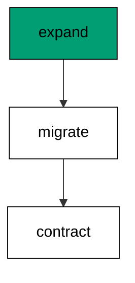

Direct renames lock and break simultaneously: old code referencing the old name fails the moment the rename commits. The three-step form never has a commit that breaks anyone.

**`learning/code/ex-39-rename-in-three-deployable-steps/main.go`**:

```go
// => Shared driver: every unit in this course opens with this prelude.
// => The harness network is closed, so units carry a small standard-library
// => driver that applies the same goose SQL files `goose up` would apply.
// => The files, the history table shape, and the ordering rules are goose's
// => own; the driver only replaces the network-dependent binary.
package main // => every unit is one runnable program

import ( // => standard library only: no third-party modules
	"bufio"           // => bufio frames protocol messages over the TCP stream
	"encoding/binary" // => binary lays out length-prefixed protocol fields
	"fmt"             // => fmt prints the deterministic transcript only
	"io"              // => io forces full reads of split protocol messages
	"net"             // => net dials the harness Postgres service over TCP
	"os"              // => os reads the harness database address, never hardcoded
	"sort"            // => sort orders migration files, never trusts directory order
	"strings"         // => strings splits the goose Up and Down annotations
) // => every import used by driver and units

// => The database address comes from the harness, with local-run defaults.
func addr() (string, string, string) { // => one helper owns every address default
	host := os.Getenv("PGHOST") // => service hostname in the unit network
	if host == "" {             // => empty means a local run outside the harness
		host = "postgres" // => same default the Python courses use
	} // => end addr: empty means a local run outside the harness
	user := os.Getenv("PGUSER") // => trust-auth role, no password needed
	if user == "" {             // => empty means a local run outside the harness
		user = "postgres" // => same default the Python courses use
	} // => end addr: empty means a local run outside the harness
	db := os.Getenv("PGDATABASE") // => fresh database for every unit run
	if db == "" {                 // => empty means a local run outside the harness
		db = "postgres" // => same default the Python courses use
	} // => end addr: empty means a local run outside the harness
	return host, user, db // => callers never re-read the environment
} // => end addr: one helper owns every address default

// => conn wraps one TCP connection plus a buffered reader for message frames.
type conn struct { // => a tiny struct keeps the socket and the framer together
	c net.Conn      // => the raw TCP socket to the Postgres service
	r *bufio.Reader // => buffered reads frame messages split across packets
} // => end type conn: socket and framer travel together

// => readMsg reads one backend message: a type byte plus a length body.
func (k *conn) readMsg() (byte, []byte, error) { // => every response flows through here
	head := make([]byte, 5)                           // => one type byte plus one int32 length
	if _, err := io.ReadFull(k.r, head); err != nil { // => fragments reassemble before framing
		return 0, nil, err // => no partial message is ever trusted
	} // => end readMsg: fragments reassemble before framing
	n := int(binary.BigEndian.Uint32(head[1:])) - 4   // => length counts itself, not the type
	body := make([]byte, n)                           // => exact-size body, never over-read
	if _, err := io.ReadFull(k.r, body); err != nil { // => fragments reassemble before framing
		return 0, nil, err // => no partial message is ever trusted
	} // => end readMsg: fragments reassemble before framing
	return head[0], body, nil // => type byte tells the caller what arrived
} // => end readMsg: every response flows through here

// => sendMsg writes one frontend message: a type byte plus a length body.
func (k *conn) sendMsg(t byte, body []byte) error { // => startup is the only typeless message
	out := []byte{t}                                      // => type byte leads every message
	lenb := make([]byte, 4)                               // => four bytes carry the length
	binary.BigEndian.PutUint32(lenb, uint32(len(body)+4)) // => length counts itself
	out = append(out, lenb...)                            // => length follows the type byte
	out = append(out, body...)                            // => payload closes the message
	_, err := k.c.Write(out)                              // => one write keeps frames whole
	return err                                            // => write errors fail the unit loudly
} // => end sendMsg: startup is the only typeless message

// => connect opens the service database and waits for session readiness.
func connect() (*conn, error) { // => every unit starts from this one helper
	host, user, db := addr()         // => harness address, never hardcoded
	return connectDb(host, user, db) // => one path opens every session
} // => end connect: every unit starts from this one helper

// => connectDb opens a named database on the same host for multi-db drills.
func connectDb(host, user, db string) (*conn, error) { // => environments are databases, not servers
	c, err := net.Dial("tcp", host+":5432") // => Postgres listens on 5432
	if err != nil {                         // => unreachable service is fatal
		return nil, err // => no fallback: the harness owns the database
	} // => end connectDb: unreachable service is fatal
	k := &conn{c: c, r: bufio.NewReader(c)}             // => buffer the fresh socket at once
	body := []byte{}                                    // => startup body is parameters only
	body = append(body, 0, 0, 0, 0)                     // => placeholder for the length prefix
	body = append(body, 0, 3, 0, 0)                     // => protocol 3.0, the stable version
	body = append(body, []byte("user")...)              // => user key starts the parameters
	body = append(body, 0)                              // => keys and values are NUL-separated
	body = append(body, []byte(user)...)                // => trust-auth role from the harness
	body = append(body, 0)                              // => NUL ends the value
	body = append(body, []byte("database")...)          // => database key follows the user
	body = append(body, 0)                              // => NUL ends the key
	body = append(body, []byte(db)...)                  // => fresh database for every unit run
	body = append(body, 0)                              // => NUL ends the value
	body = append(body, 0)                              // => empty key ends the parameters
	binary.BigEndian.PutUint32(body, uint32(len(body))) // => startup length counts itself
	if _, err := c.Write(body); err != nil {            // => startup is the only typeless message
		return nil, err // => unwritable socket is fatal
	} // => end connectDb: startup is the only typeless message
	for { // => drain until the session is ready for queries
		t, b, err := k.readMsg() // => every backend message flows through here
		if err != nil {          // => broken handshake is fatal
			return nil, err // => no half-open session is ever used
		} // => end connectDb: broken handshake is fatal
		switch t { // => only three message kinds matter during startup
		case 'R': // => authentication response arrives first
			if binary.BigEndian.Uint32(b) != 0 { // => nonzero means a password is wanted
				return nil, fmt.Errorf("server wants a password") // => trust auth never asks
			} // => end connectDb: nonzero means a password is wanted
		case 'E': // => an error ends the handshake with the server text
			return nil, fmt.Errorf("startup: %s", errText(b)) // => server text explains the cause
		case 'Z': // => ReadyForQuery means the session accepts queries
			return k, nil // => handshake done: hand the live session back
		} // => end connectDb: only three message kinds matter during startup
	} // => end connectDb: drain until the session is ready for queries
} // => end connectDb: environments are databases, not servers

// => errText extracts the human message (field M) from an ErrorResponse.
func errText(b []byte) string { // => one helper decodes every server error
	parts := strings.Split(string(b), "\x00") // => fields are NUL-separated pairs
	for i := 0; i+1 < len(parts); i += 2 {    // => walk code and value together
		if parts[i] == "M" { // => M is the primary human message
			return parts[i+1] // => return the message, skip the detail fields
		} // => end errText: M is the primary human message
	} // => end errText: walk code and value together
	return "unknown error" // => malformed errors still fail with a fixed line
} // => end errText: one helper decodes every server error

// => run sends one SQL string and returns every data row plus the command tag.
func (k *conn) run(q string) ([][]string, string, error) { // => one path runs every statement
	body := append([]byte(q), 0)                 // => Query messages are NUL-terminated
	if err := k.sendMsg('Q', body); err != nil { // => send fails loudly, never silently
		return nil, "", err // => unwritable socket ends the unit
	} // => end run: send fails loudly, never silently
	var rows [][]string // => data rows accumulate across result sets
	tag := ""           // => the last command tag (SELECT 3, CREATE TABLE...)
	for {               // => drain until ReadyForQuery closes this query string
		t, b, err := k.readMsg() // => every response flows through the framer
		if err != nil {          // => broken mid-query connection is fatal
			return nil, "", err // => partial results are never returned
		} // => end run: broken mid-query connection is fatal
		switch t { // => four message kinds carry a simple-query response
		case 'T', 'N', 'A', 'S', 'K': // => metadata the transcript never prints
		case 'D': // => one data row arrived
			rows = append(rows, parseRow(b)) // => decode the text columns now
		case 'C': // => one statement finished
			tag = strings.TrimRight(string(b[:len(b)-1]), "\x00") // => tag names what ran
		case 'E': // => the statement failed
			drain(k)                                     // => finish the failed query before reuse
			return nil, "", fmt.Errorf("%s", errText(b)) // => server text becomes the failure
		case 'Z': // => ReadyForQuery ends this query string
			return rows, tag, nil // => rows, tag, and a clean session
		} // => end run: four message kinds carry a simple-query response
	} // => end run: drain until ReadyForQuery closes this query string
} // => end run: one path runs every statement

// => drain reads to the next ReadyForQuery after a statement error.
func drain(k *conn) { // => an errored query still owns the socket until Z
	for { // => loop until the session is reusable
		t, _, err := k.readMsg()    // => discard every message after the error
		if err != nil || t == 'Z' { // => socket break or ready both end the drain
			return // => caller decides the failure, the drain only resynchronizes
		} // => end drain: socket break or ready both end the drain
	} // => end drain: loop until the session is reusable
} // => end drain: an errored query still owns the socket until Z

// => parseRow decodes one DataRow body into text columns, NULL as "NULL".
func parseRow(b []byte) []string { // => one helper decodes every returned row
	n := int(binary.BigEndian.Uint16(b)) // => column count leads the body
	b = b[2:]                            // => step past the count
	out := make([]string, 0, n)          // => pre-size the row to the count
	for i := 0; i < n; i++ {             // => walk each column in order
		l := int(int32(binary.BigEndian.Uint32(b))) // => -1 marks NULL, else the length
		b = b[4:]                                   // => step past the length
		if l < 0 {                                  // => NULL has no bytes to read
			out = append(out, "NULL") // => fixed word keeps transcripts stable
			continue                  // => next column, no bytes consumed
		} // => end parseRow: NULL has no bytes to read
		out = append(out, string(b[:l])) // => text format is already printable
		b = b[l:]                        // => step past the value bytes
	} // => end parseRow: walk each column in order
	return out // => one row, fully decoded
} // => end parseRow: one helper decodes every returned row

// => must runs SQL or exits nonzero with the server text on standard error.
func must(k *conn, q string) [][]string { // => setup statements never fail quietly
	rows, _, err := k.run(q) // => rows return for verification queries
	if err != nil {          // => any server error is fatal to the unit
		fmt.Fprintln(os.Stderr, "sql error:", err) // => errors go to stderr, never stdout
		os.Exit(1)                                 // => nonzero exit fails the harness check
	} // => end must: any server error is fatal to the unit
	return rows // => callers print only what the lesson asserts
} // => end must: setup statements never fail quietly

// => try runs SQL and returns the server error text instead of exiting.
func try(k *conn, q string) ([][]string, string) { // => failure drills inspect errors, not die
	rows, _, err := k.run(q) // => same path as must, opposite failure policy
	if err != nil {          // => expected errors become transcript lines
		return nil, err.Error() // => fixed server text, never timings
	} // => end try: expected errors become transcript lines
	return rows, "" // => empty error means the statement succeeded
} // => end try: failure drills inspect errors, not die

// => mig holds one goose SQL file: its version, name, and Up/Down sections.
type mig struct { // => mirrors the goose file layout the lesson teaches
	version string   // => zero-padded number orders history, like goose
	name    string   // => human slug after the version number
	up      []string // => forward statements, run inside one transaction
	down    []string // => reverse statements, run inside one transaction
	noTx    bool     // => NO TRANSACTION files run outside one, like goose
} // => end type mig: version, name, sections, and mode

// => parseGoose splits one goose SQL file into its Up and Down statements.
func parseGoose(text string) (up, down []string, noTx bool) { // => the lesson asserts this exact split
	section := ""                                    // => nothing belongs outside the annotations
	for _, line := range strings.Split(text, "\n") { // => walk the file line by line
		t := strings.TrimSpace(line) // => annotation matching ignores indentation
		switch t {                   // => four annotation lines switch sections
		case "-- +goose Up": // => forward section starts here, like goose
			section = "up" // => following statements migrate forward
			continue       // => the annotation itself never runs
		case "-- +goose Down": // => reverse section starts here, like goose
			section = "down" // => following statements roll back
			continue         // => the annotation itself never runs
		case "-- +goose NO TRANSACTION": // => concurrent work cannot run inside one
			noTx = true // => remember the file opts out of the transaction
			continue    // => the annotation itself never runs
		} // => end parseGoose: four annotation lines switch sections
		if strings.HasPrefix(t, "--") || t == "" { // => comments and blanks never run
			continue // => only real statements reach the database
		} // => end parseGoose: comments and blanks never run
		if section == "up" { // => route by the annotation seen above
			up = append(up, line) // => keep the original line for the file write
		} else if section == "down" { // => down statements collect separately
			down = append(down, line) // => keep the original line for the file write
		} // => end parseGoose: down statements collect separately
	} // => end parseGoose: walk the file line by line
	return splitStmts(strings.Join(up, "\n")), splitStmts(strings.Join(down, "\n")), noTx // => one string per statement
} // => end parseGoose: the lesson asserts this exact split

// => splitStmts cuts statement text on semicolons outside quotes.
func splitStmts(s string) []string { // => multi-line statements stay whole until ;
	var out []string        // => finished statements accumulate here
	var cur strings.Builder // => the statement under construction
	inStr := false          // => semicolons inside quotes never split
	for _, r := range s {   // => walk rune by rune, quotes included
		switch { // => quote tracking decides what a semicolon means
		case r == '\'': // => a quote toggles string mode
			inStr = !inStr   // => enter or leave the quoted region
			cur.WriteRune(r) // => the quote belongs to the statement
		case r == ';' && !inStr: // => a bare semicolon ends one statement
			if t := strings.TrimSpace(cur.String()); t != "" { // => skip empty fragments
				out = append(out, t) // => store the finished statement
			} // => end splitStmts: skip empty fragments
			cur.Reset() // => start the next statement fresh
		default: // => every other rune belongs to the current statement
			cur.WriteRune(r) // => accumulate verbatim
		} // => end splitStmts: quote tracking decides what a semicolon means
	} // => end splitStmts: walk rune by rune, quotes included
	if t := strings.TrimSpace(cur.String()); t != "" { // => trailing text without ; still counts
		out = append(out, t) // => last statement needs no semicolon
	} // => end splitStmts: trailing text without ; still counts
	return out // => callers run each statement in order
} // => end splitStmts: multi-line statements stay whole until ;

// => ensureHistory creates the goose history table once per unit run.
func ensureHistory(k *conn) { // => goose_db_version is goose's own default name
	must(k, `CREATE TABLE IF NOT EXISTS goose_db_version (`+ // => reruns never fail here
		`id integer PRIMARY KEY GENERATED BY DEFAULT AS IDENTITY, `+ // => surrogate key, never printed
		`version_id bigint NOT NULL, `+ // => applied version numbers live here
		`is_applied boolean NOT NULL, `+ // => goose marks rows applied on success
		`tstamp timestamp NOT NULL DEFAULT now())`) // => timestamp defaults, never printed
} // => end ensureHistory: goose_db_version is goose's own default name

// => appliedVersions returns the version numbers already marked applied.
func appliedVersions(k *conn) map[int64]bool { // => history decides what still needs running
	rows := must(k, `SELECT version_id FROM goose_db_version `+ // => only the numbers matter
		`WHERE is_applied ORDER BY version_id`) // => order keeps the transcript stable
	got := map[int64]bool{}  // => set lookup answers "already applied" fast
	for _, r := range rows { // => one row per applied migration
		var v int64                // => version numbers are integers
		fmt.Sscanf(r[0], "%d", &v) // => text format parses back to a number
		got[v] = true              // => mark this version done
	} // => end appliedVersions: one row per applied migration
	return got // => callers skip whatever history already holds
} // => end appliedVersions: history decides what still needs running

// => applyUp runs every pending migration forward, one transaction each.
func applyUp(k *conn, ms []mig) { // => files on disk are already the source of truth
	done := appliedVersions(k) // => history decides what still needs running
	for _, m := range ms {     // => file order is version order, sorted by the caller
		var v int64                     // => versions compare as numbers
		fmt.Sscanf(m.version, "%d", &v) // => zero-padded file prefix parses back
		if done[v] {                    // => applied migrations never run twice
			continue // => idempotent reruns skip straight past
		} // => end applyUp: applied migrations never run twice
		if !m.noTx { // => transactional files wrap everything in one unit
			must(k, "BEGIN") // => one migration is one transaction, like goose
		} // => end applyUp: transactional files wrap everything in one unit
		for _, s := range m.up { // => forward statements run in file order
			must(k, s) // => any failure aborts the unit before COMMIT
		} // => end applyUp: forward statements run in file order
		if !m.noTx { // => stamps join the same transaction they describe
			must(k, fmt.Sprintf(`INSERT INTO goose_db_version `+ // => stamp only after success
				`(version_id, is_applied) VALUES (%d, true)`, v)) // => stamp mirrors goose exactly
			must(k, "COMMIT") // => history row and schema land together
		} else { // => concurrent statements cannot share a transaction
			must(k, fmt.Sprintf(`INSERT INTO goose_db_version `+ // => stamp follows the work
				`(version_id, is_applied) VALUES (%d, true)`, v)) // => same row, separate statement
		} // => end applyUp: concurrent statements cannot share a transaction
	} // => end applyUp: file order is version order, sorted by the caller
} // => end applyUp: files on disk are already the source of truth

// => applyDown rolls back the newest applied migrations, newest first.
func applyDown(k *conn, ms []mig, steps int) { // => steps bounds how far history rewinds
	done := appliedVersions(k) // => history decides what can roll back
	var todo []mig             // => applied migrations in version order first
	for _, m := range ms {     // => walk the whole known history
		var v int64                     // => versions compare as numbers
		fmt.Sscanf(m.version, "%d", &v) // => zero-padded file prefix parses back
		if done[v] {                    // => only applied migrations roll back
			todo = append(todo, m) // => keep the migration for the reverse pass
		} // => end applyDown: only applied migrations roll back
	} // => end applyDown: walk the whole known history
	for i := len(todo) - 1; i >= 0 && steps > 0; i-- { // => newest applied goes first
		m := todo[i]                    // => this migration rolls back now
		var v int64                     // => versions compare as numbers
		fmt.Sscanf(m.version, "%d", &v) // => zero-padded file prefix parses back
		if !m.noTx {                    // => transactional files wrap the rollback too
			must(k, "BEGIN") // => reverse change is atomic, like the forward one
		} // => end applyDown: transactional files wrap the rollback too
		for _, s := range m.down { // => reverse statements run in file order
			must(k, s) // => any failure aborts before the history row moves
		} // => end applyDown: reverse statements run in file order
		must(k, fmt.Sprintf(`DELETE FROM goose_db_version `+ // => unstamped only after success
			`WHERE version_id = %d`, v)) // => the version leaves history exactly once
		if !m.noTx { // => close the transaction the rollback opened
			must(k, "COMMIT") // => schema reversal and unstamp land together
		} // => end applyDown: close the transaction the rollback opened
		steps-- // => one rollback consumed from the budget
	} // => end applyDown: newest applied goes first
} // => end applyDown: steps bounds how far history rewinds

// => statusCounts splits known migrations into applied and pending lists.
func statusCounts(k *conn, ms []mig) (applied, pending []string) { // => goose status in two lists
	done := appliedVersions(k) // => history decides which list each version joins
	for _, m := range ms {     // => walk the known history in version order
		var v int64                     // => versions compare as numbers
		fmt.Sscanf(m.version, "%d", &v) // => zero-padded file prefix parses back
		if done[v] {                    // => stamped versions are done
			applied = append(applied, m.version) // => keep the version string for printing
		} else { // => unstamped versions still wait
			pending = append(pending, m.version) // => keep the version string for printing
		} // => end statusCounts: unstamped versions still wait
	} // => end statusCounts: walk the known history in version order
	return applied, pending // => callers print both lists in one stable line each
} // => end statusCounts: goose status in two lists

// => files writes each migration as a real goose SQL file under dir.
func files(dir string, ms []mig) { // => the lesson shows these files byte-identically
	for _, m := range ms { // => one file per migration, like `goose create`
		name := fmt.Sprintf("%s_%s.sql", m.version, m.name) // => goose names files version-first
		var b strings.Builder                               // => build the file text in order
		if m.noTx {                                         // => concurrent files announce it first
			b.WriteString("-- +goose NO TRANSACTION\n") // => goose honors this exact annotation
		} // => end files: concurrent files announce it first
		b.WriteString("-- +goose Up\n") // => forward annotation leads
		for _, s := range m.up {        // => forward statements follow
			b.WriteString(s + ";\n") // => one statement per line, semicolon-closed
		} // => end files: forward statements follow
		b.WriteString("-- +goose Down\n") // => reverse annotation splits the file
		for _, s := range m.down {        // => reverse statements close the file
			b.WriteString(s + ";\n") // => one statement per line, semicolon-closed
		} // => end files: reverse statements close the file
		if err := os.WriteFile(dir+"/"+name, []byte(b.String()), 0644); err != nil { // => real files, like goose
			fmt.Fprintln(os.Stderr, "write error:", err) // => write errors fail loudly
			os.Exit(1)                                   // => no half-written migration set
		} // => end files: real files, like goose
	} // => end files: one file per migration, like `goose create`
} // => end files: the lesson shows these files byte-identically

// => versions lists migration files in version order from dir.
func versions(dir string) []mig { // => directory order is never trusted for history
	ents, err := os.ReadDir(dir) // => read the whole migrations directory
	if err != nil {              // => unreadable directory is fatal
		fmt.Fprintln(os.Stderr, "read error:", err) // => errors go to stderr
		os.Exit(1)                                  // => nonzero exit fails the check
	} // => end versions: unreadable directory is fatal
	names := []string{}      // => collect names before sorting
	for _, e := range ents { // => walk every directory entry
		if !e.IsDir() && strings.HasSuffix(e.Name(), ".sql") { // => only goose SQL files count
			names = append(names, e.Name()) // => keep the file name for parsing
		} // => end versions: only goose SQL files count
	} // => end versions: walk every directory entry
	sort.Strings(names)       // => zero-padded versions sort chronologically
	var out []mig             // => parsed migrations accumulate here
	for _, n := range names { // => parse in version order
		raw, err := os.ReadFile(dir + "/" + n) // => read the real file back
		if err != nil {                        // => unreadable file is fatal
			fmt.Fprintln(os.Stderr, "read error:", err) // => errors go to stderr
			os.Exit(1)                                  // => nonzero exit fails the check
		} // => end versions: unreadable file is fatal
		up, down, noTx := parseGoose(string(raw))                                            // => split on the goose annotations
		rest := strings.TrimSuffix(n, ".sql")                                                // => strip the extension first
		ver := rest[:5]                                                                      // => first five digits are the version
		out = append(out, mig{version: ver, name: rest[6:], up: up, down: down, noTx: noTx}) // => keep every part
	} // => end versions: parse in version order
	return out // => version-ordered migrations, ready to apply
} // => end versions: directory order is never trusted for history

// => findDupes returns version numbers claimed by two or more files.
func findDupes(dir string) []string { // => goose refuses duplicate versions outright
	ents, err := os.ReadDir(dir) // => read the whole migrations directory
	if err != nil {              // => unreadable directory is fatal
		fmt.Fprintln(os.Stderr, "read error:", err) // => errors go to stderr
		os.Exit(1)                                  // => nonzero exit fails the check
	} // => end findDupes: unreadable directory is fatal
	seen := map[string]int{} // => count claims per five-digit version prefix
	for _, e := range ents { // => walk every directory entry
		if !e.IsDir() && strings.HasSuffix(e.Name(), ".sql") { // => only goose SQL files count
			seen[e.Name()[:5]]++ // => first five digits are the version
		} // => end findDupes: only goose SQL files count
	} // => end findDupes: walk every directory entry
	var out []string         // => duplicates accumulate in version order
	for _, e := range ents { // => second pass keeps the order stable
		if !e.IsDir() && strings.HasSuffix(e.Name(), ".sql") { // => only goose SQL files count
			if v := e.Name()[:5]; seen[v] > 1 { // => claimed more than once
				out = append(out, v) // => keep the version string for printing
				seen[v] = 0          // => report each duplicate version only once
			} // => end findDupes: claimed more than once
		} // => end findDupes: only goose SQL files count
	} // => end findDupes: second pass keeps the order stable
	return out // => empty means the history numbers are unique
} // => end findDupes: goose refuses duplicate versions outright

func main() {
	k, err := connect() // => one session runs the whole example
	if err != nil {     // => unreachable database fails loudly
		fmt.Fprintln(os.Stderr, "connect error:", err) // => connection errors go to stderr
		os.Exit(1)                                     // => nonzero exit fails the check
	}
	defer k.c.Close() // => the socket closes when the example ends
	// => A scratch migrations directory: goose files live here, never in the unit.
	// => the scratch path never reaches stdout, so reruns stay byte-stable
	dir, err := os.MkdirTemp("", "ex39-") // => private directory, like `goose create`
	if err != nil {                       // => unmakable temp dir is fatal
		fmt.Fprintln(os.Stderr, "temp error:", err) // => errors go to stderr
		os.Exit(1)                                  // => nonzero exit fails the check
	}
	defer os.RemoveAll(dir)                                                       // => scratch files vanish; only transcripts remain
	must(k, "DROP TABLE IF EXISTS ex39_base")                                     // => leftovers of a killed run vanish
	must(k, "DROP TABLE IF EXISTS goose_db_version")                              // => stale history vanishes too
	ensureHistory(k)                                                              // => goose history table, real shape
	must(k, "CREATE TABLE ex39_base (id SERIAL PRIMARY KEY, name TEXT NOT NULL)") // => live table with the old name
	must(k, `INSERT INTO ex39_base (name) VALUES ('ada'), ('grace')`)             // => rows that survive the rename
	files(dir, []mig{                                                             // => expand, migrate, contract as three files
		{version: "00001", name: "expand_nickname", // => new name appears beside the old
			up:   []string{"ALTER TABLE ex39_base ADD COLUMN nickname TEXT"}, // => forward change
			down: []string{"ALTER TABLE ex39_base DROP COLUMN nickname"}},    // => exact reverse for rollback
		{version: "00002", name: "migrate_nickname", // => values copy across, forward-only
			up:   []string{"UPDATE ex39_base SET nickname = name WHERE nickname IS NULL"}, // => fill from existing rows
			down: []string{"SELECT 1"}},                                                   // => data fills never reverse: explicit no-op
		{version: "00003", name: "contract_name", // => old name drops last
			up:   []string{"ALTER TABLE ex39_base DROP COLUMN name"},      // => forward change
			down: []string{"ALTER TABLE ex39_base ADD COLUMN name TEXT"}}, // => reverse restores the column shell
	})
	applyUp(k, versions(dir))                                     // => read the files back and run what is pending
	rows := must(k, `SELECT nickname FROM ex39_base ORDER BY id`) // => renamed values read back
	fmt.Println("names:", rows[0][0], rows[1][0])                 // => Output: names: ada grace
	must(k, "DROP TABLE ex39_base")                               // => base table cleaned with the example tables
	fmt.Println("cleaned: yes")                                   // => Output: cleaned: yes
	must(k, "DROP TABLE IF EXISTS ex39_base")                     // => leftovers of a killed run vanish
	must(k, "DROP TABLE IF EXISTS goose_db_version")              // => the example leaves no history behind
}
```

**Output** (`learning/code/ex-39-rename-in-three-deployable-steps/expected/main.stdout.txt`):

```text
names: ada grace
cleaned: yes
```

**Key takeaway**: Renames are expand-migrate-contract in miniature: no single commit may break a running reader.

**Why it matters**: Three small deploys beat one breaking rename because no single commit ever strands a reader. Expand adds, migrate copies, contract removes, and each step is independently safe and reversible. Renames stop being scary when they stop being atomic. Three small deploys beat one breaking rename, because no single commit ever strands a running reader.

### Example 40: Widen a Column Type Safely

Widening is safe and narrowing is not: this example widens a varchar column and shows longer values fitting afterward. Every old value still fits because widening never rejects what the old width held. (Concepts: co-07.)

The reverse direction needs a data audit first: narrowing fails on any value longer than the new width. Migrate data down before narrowing the type, or do not narrow.

**`learning/code/ex-40-widen-a-column-type-safely/main.go`**:

```go
// => Shared driver: every unit in this course opens with this prelude.
// => The harness network is closed, so units carry a small standard-library
// => driver that applies the same goose SQL files `goose up` would apply.
// => The files, the history table shape, and the ordering rules are goose's
// => own; the driver only replaces the network-dependent binary.
package main // => every unit is one runnable program

import ( // => standard library only: no third-party modules
	"bufio"           // => bufio frames protocol messages over the TCP stream
	"encoding/binary" // => binary lays out length-prefixed protocol fields
	"fmt"             // => fmt prints the deterministic transcript only
	"io"              // => io forces full reads of split protocol messages
	"net"             // => net dials the harness Postgres service over TCP
	"os"              // => os reads the harness database address, never hardcoded
	"sort"            // => sort orders migration files, never trusts directory order
	"strings"         // => strings splits the goose Up and Down annotations
) // => every import used by driver and units

// => The database address comes from the harness, with local-run defaults.
func addr() (string, string, string) { // => one helper owns every address default
	host := os.Getenv("PGHOST") // => service hostname in the unit network
	if host == "" {             // => empty means a local run outside the harness
		host = "postgres" // => same default the Python courses use
	} // => end addr: empty means a local run outside the harness
	user := os.Getenv("PGUSER") // => trust-auth role, no password needed
	if user == "" {             // => empty means a local run outside the harness
		user = "postgres" // => same default the Python courses use
	} // => end addr: empty means a local run outside the harness
	db := os.Getenv("PGDATABASE") // => fresh database for every unit run
	if db == "" {                 // => empty means a local run outside the harness
		db = "postgres" // => same default the Python courses use
	} // => end addr: empty means a local run outside the harness
	return host, user, db // => callers never re-read the environment
} // => end addr: one helper owns every address default

// => conn wraps one TCP connection plus a buffered reader for message frames.
type conn struct { // => a tiny struct keeps the socket and the framer together
	c net.Conn      // => the raw TCP socket to the Postgres service
	r *bufio.Reader // => buffered reads frame messages split across packets
} // => end type conn: socket and framer travel together

// => readMsg reads one backend message: a type byte plus a length body.
func (k *conn) readMsg() (byte, []byte, error) { // => every response flows through here
	head := make([]byte, 5)                           // => one type byte plus one int32 length
	if _, err := io.ReadFull(k.r, head); err != nil { // => fragments reassemble before framing
		return 0, nil, err // => no partial message is ever trusted
	} // => end readMsg: fragments reassemble before framing
	n := int(binary.BigEndian.Uint32(head[1:])) - 4   // => length counts itself, not the type
	body := make([]byte, n)                           // => exact-size body, never over-read
	if _, err := io.ReadFull(k.r, body); err != nil { // => fragments reassemble before framing
		return 0, nil, err // => no partial message is ever trusted
	} // => end readMsg: fragments reassemble before framing
	return head[0], body, nil // => type byte tells the caller what arrived
} // => end readMsg: every response flows through here

// => sendMsg writes one frontend message: a type byte plus a length body.
func (k *conn) sendMsg(t byte, body []byte) error { // => startup is the only typeless message
	out := []byte{t}                                      // => type byte leads every message
	lenb := make([]byte, 4)                               // => four bytes carry the length
	binary.BigEndian.PutUint32(lenb, uint32(len(body)+4)) // => length counts itself
	out = append(out, lenb...)                            // => length follows the type byte
	out = append(out, body...)                            // => payload closes the message
	_, err := k.c.Write(out)                              // => one write keeps frames whole
	return err                                            // => write errors fail the unit loudly
} // => end sendMsg: startup is the only typeless message

// => connect opens the service database and waits for session readiness.
func connect() (*conn, error) { // => every unit starts from this one helper
	host, user, db := addr()         // => harness address, never hardcoded
	return connectDb(host, user, db) // => one path opens every session
} // => end connect: every unit starts from this one helper

// => connectDb opens a named database on the same host for multi-db drills.
func connectDb(host, user, db string) (*conn, error) { // => environments are databases, not servers
	c, err := net.Dial("tcp", host+":5432") // => Postgres listens on 5432
	if err != nil {                         // => unreachable service is fatal
		return nil, err // => no fallback: the harness owns the database
	} // => end connectDb: unreachable service is fatal
	k := &conn{c: c, r: bufio.NewReader(c)}             // => buffer the fresh socket at once
	body := []byte{}                                    // => startup body is parameters only
	body = append(body, 0, 0, 0, 0)                     // => placeholder for the length prefix
	body = append(body, 0, 3, 0, 0)                     // => protocol 3.0, the stable version
	body = append(body, []byte("user")...)              // => user key starts the parameters
	body = append(body, 0)                              // => keys and values are NUL-separated
	body = append(body, []byte(user)...)                // => trust-auth role from the harness
	body = append(body, 0)                              // => NUL ends the value
	body = append(body, []byte("database")...)          // => database key follows the user
	body = append(body, 0)                              // => NUL ends the key
	body = append(body, []byte(db)...)                  // => fresh database for every unit run
	body = append(body, 0)                              // => NUL ends the value
	body = append(body, 0)                              // => empty key ends the parameters
	binary.BigEndian.PutUint32(body, uint32(len(body))) // => startup length counts itself
	if _, err := c.Write(body); err != nil {            // => startup is the only typeless message
		return nil, err // => unwritable socket is fatal
	} // => end connectDb: startup is the only typeless message
	for { // => drain until the session is ready for queries
		t, b, err := k.readMsg() // => every backend message flows through here
		if err != nil {          // => broken handshake is fatal
			return nil, err // => no half-open session is ever used
		} // => end connectDb: broken handshake is fatal
		switch t { // => only three message kinds matter during startup
		case 'R': // => authentication response arrives first
			if binary.BigEndian.Uint32(b) != 0 { // => nonzero means a password is wanted
				return nil, fmt.Errorf("server wants a password") // => trust auth never asks
			} // => end connectDb: nonzero means a password is wanted
		case 'E': // => an error ends the handshake with the server text
			return nil, fmt.Errorf("startup: %s", errText(b)) // => server text explains the cause
		case 'Z': // => ReadyForQuery means the session accepts queries
			return k, nil // => handshake done: hand the live session back
		} // => end connectDb: only three message kinds matter during startup
	} // => end connectDb: drain until the session is ready for queries
} // => end connectDb: environments are databases, not servers

// => errText extracts the human message (field M) from an ErrorResponse.
func errText(b []byte) string { // => one helper decodes every server error
	parts := strings.Split(string(b), "\x00") // => fields are NUL-separated pairs
	for i := 0; i+1 < len(parts); i += 2 {    // => walk code and value together
		if parts[i] == "M" { // => M is the primary human message
			return parts[i+1] // => return the message, skip the detail fields
		} // => end errText: M is the primary human message
	} // => end errText: walk code and value together
	return "unknown error" // => malformed errors still fail with a fixed line
} // => end errText: one helper decodes every server error

// => run sends one SQL string and returns every data row plus the command tag.
func (k *conn) run(q string) ([][]string, string, error) { // => one path runs every statement
	body := append([]byte(q), 0)                 // => Query messages are NUL-terminated
	if err := k.sendMsg('Q', body); err != nil { // => send fails loudly, never silently
		return nil, "", err // => unwritable socket ends the unit
	} // => end run: send fails loudly, never silently
	var rows [][]string // => data rows accumulate across result sets
	tag := ""           // => the last command tag (SELECT 3, CREATE TABLE...)
	for {               // => drain until ReadyForQuery closes this query string
		t, b, err := k.readMsg() // => every response flows through the framer
		if err != nil {          // => broken mid-query connection is fatal
			return nil, "", err // => partial results are never returned
		} // => end run: broken mid-query connection is fatal
		switch t { // => four message kinds carry a simple-query response
		case 'T', 'N', 'A', 'S', 'K': // => metadata the transcript never prints
		case 'D': // => one data row arrived
			rows = append(rows, parseRow(b)) // => decode the text columns now
		case 'C': // => one statement finished
			tag = strings.TrimRight(string(b[:len(b)-1]), "\x00") // => tag names what ran
		case 'E': // => the statement failed
			drain(k)                                     // => finish the failed query before reuse
			return nil, "", fmt.Errorf("%s", errText(b)) // => server text becomes the failure
		case 'Z': // => ReadyForQuery ends this query string
			return rows, tag, nil // => rows, tag, and a clean session
		} // => end run: four message kinds carry a simple-query response
	} // => end run: drain until ReadyForQuery closes this query string
} // => end run: one path runs every statement

// => drain reads to the next ReadyForQuery after a statement error.
func drain(k *conn) { // => an errored query still owns the socket until Z
	for { // => loop until the session is reusable
		t, _, err := k.readMsg()    // => discard every message after the error
		if err != nil || t == 'Z' { // => socket break or ready both end the drain
			return // => caller decides the failure, the drain only resynchronizes
		} // => end drain: socket break or ready both end the drain
	} // => end drain: loop until the session is reusable
} // => end drain: an errored query still owns the socket until Z

// => parseRow decodes one DataRow body into text columns, NULL as "NULL".
func parseRow(b []byte) []string { // => one helper decodes every returned row
	n := int(binary.BigEndian.Uint16(b)) // => column count leads the body
	b = b[2:]                            // => step past the count
	out := make([]string, 0, n)          // => pre-size the row to the count
	for i := 0; i < n; i++ {             // => walk each column in order
		l := int(int32(binary.BigEndian.Uint32(b))) // => -1 marks NULL, else the length
		b = b[4:]                                   // => step past the length
		if l < 0 {                                  // => NULL has no bytes to read
			out = append(out, "NULL") // => fixed word keeps transcripts stable
			continue                  // => next column, no bytes consumed
		} // => end parseRow: NULL has no bytes to read
		out = append(out, string(b[:l])) // => text format is already printable
		b = b[l:]                        // => step past the value bytes
	} // => end parseRow: walk each column in order
	return out // => one row, fully decoded
} // => end parseRow: one helper decodes every returned row

// => must runs SQL or exits nonzero with the server text on standard error.
func must(k *conn, q string) [][]string { // => setup statements never fail quietly
	rows, _, err := k.run(q) // => rows return for verification queries
	if err != nil {          // => any server error is fatal to the unit
		fmt.Fprintln(os.Stderr, "sql error:", err) // => errors go to stderr, never stdout
		os.Exit(1)                                 // => nonzero exit fails the harness check
	} // => end must: any server error is fatal to the unit
	return rows // => callers print only what the lesson asserts
} // => end must: setup statements never fail quietly

// => try runs SQL and returns the server error text instead of exiting.
func try(k *conn, q string) ([][]string, string) { // => failure drills inspect errors, not die
	rows, _, err := k.run(q) // => same path as must, opposite failure policy
	if err != nil {          // => expected errors become transcript lines
		return nil, err.Error() // => fixed server text, never timings
	} // => end try: expected errors become transcript lines
	return rows, "" // => empty error means the statement succeeded
} // => end try: failure drills inspect errors, not die

// => mig holds one goose SQL file: its version, name, and Up/Down sections.
type mig struct { // => mirrors the goose file layout the lesson teaches
	version string   // => zero-padded number orders history, like goose
	name    string   // => human slug after the version number
	up      []string // => forward statements, run inside one transaction
	down    []string // => reverse statements, run inside one transaction
	noTx    bool     // => NO TRANSACTION files run outside one, like goose
} // => end type mig: version, name, sections, and mode

// => parseGoose splits one goose SQL file into its Up and Down statements.
func parseGoose(text string) (up, down []string, noTx bool) { // => the lesson asserts this exact split
	section := ""                                    // => nothing belongs outside the annotations
	for _, line := range strings.Split(text, "\n") { // => walk the file line by line
		t := strings.TrimSpace(line) // => annotation matching ignores indentation
		switch t {                   // => four annotation lines switch sections
		case "-- +goose Up": // => forward section starts here, like goose
			section = "up" // => following statements migrate forward
			continue       // => the annotation itself never runs
		case "-- +goose Down": // => reverse section starts here, like goose
			section = "down" // => following statements roll back
			continue         // => the annotation itself never runs
		case "-- +goose NO TRANSACTION": // => concurrent work cannot run inside one
			noTx = true // => remember the file opts out of the transaction
			continue    // => the annotation itself never runs
		} // => end parseGoose: four annotation lines switch sections
		if strings.HasPrefix(t, "--") || t == "" { // => comments and blanks never run
			continue // => only real statements reach the database
		} // => end parseGoose: comments and blanks never run
		if section == "up" { // => route by the annotation seen above
			up = append(up, line) // => keep the original line for the file write
		} else if section == "down" { // => down statements collect separately
			down = append(down, line) // => keep the original line for the file write
		} // => end parseGoose: down statements collect separately
	} // => end parseGoose: walk the file line by line
	return splitStmts(strings.Join(up, "\n")), splitStmts(strings.Join(down, "\n")), noTx // => one string per statement
} // => end parseGoose: the lesson asserts this exact split

// => splitStmts cuts statement text on semicolons outside quotes.
func splitStmts(s string) []string { // => multi-line statements stay whole until ;
	var out []string        // => finished statements accumulate here
	var cur strings.Builder // => the statement under construction
	inStr := false          // => semicolons inside quotes never split
	for _, r := range s {   // => walk rune by rune, quotes included
		switch { // => quote tracking decides what a semicolon means
		case r == '\'': // => a quote toggles string mode
			inStr = !inStr   // => enter or leave the quoted region
			cur.WriteRune(r) // => the quote belongs to the statement
		case r == ';' && !inStr: // => a bare semicolon ends one statement
			if t := strings.TrimSpace(cur.String()); t != "" { // => skip empty fragments
				out = append(out, t) // => store the finished statement
			} // => end splitStmts: skip empty fragments
			cur.Reset() // => start the next statement fresh
		default: // => every other rune belongs to the current statement
			cur.WriteRune(r) // => accumulate verbatim
		} // => end splitStmts: quote tracking decides what a semicolon means
	} // => end splitStmts: walk rune by rune, quotes included
	if t := strings.TrimSpace(cur.String()); t != "" { // => trailing text without ; still counts
		out = append(out, t) // => last statement needs no semicolon
	} // => end splitStmts: trailing text without ; still counts
	return out // => callers run each statement in order
} // => end splitStmts: multi-line statements stay whole until ;

// => ensureHistory creates the goose history table once per unit run.
func ensureHistory(k *conn) { // => goose_db_version is goose's own default name
	must(k, `CREATE TABLE IF NOT EXISTS goose_db_version (`+ // => reruns never fail here
		`id integer PRIMARY KEY GENERATED BY DEFAULT AS IDENTITY, `+ // => surrogate key, never printed
		`version_id bigint NOT NULL, `+ // => applied version numbers live here
		`is_applied boolean NOT NULL, `+ // => goose marks rows applied on success
		`tstamp timestamp NOT NULL DEFAULT now())`) // => timestamp defaults, never printed
} // => end ensureHistory: goose_db_version is goose's own default name

// => appliedVersions returns the version numbers already marked applied.
func appliedVersions(k *conn) map[int64]bool { // => history decides what still needs running
	rows := must(k, `SELECT version_id FROM goose_db_version `+ // => only the numbers matter
		`WHERE is_applied ORDER BY version_id`) // => order keeps the transcript stable
	got := map[int64]bool{}  // => set lookup answers "already applied" fast
	for _, r := range rows { // => one row per applied migration
		var v int64                // => version numbers are integers
		fmt.Sscanf(r[0], "%d", &v) // => text format parses back to a number
		got[v] = true              // => mark this version done
	} // => end appliedVersions: one row per applied migration
	return got // => callers skip whatever history already holds
} // => end appliedVersions: history decides what still needs running

// => applyUp runs every pending migration forward, one transaction each.
func applyUp(k *conn, ms []mig) { // => files on disk are already the source of truth
	done := appliedVersions(k) // => history decides what still needs running
	for _, m := range ms {     // => file order is version order, sorted by the caller
		var v int64                     // => versions compare as numbers
		fmt.Sscanf(m.version, "%d", &v) // => zero-padded file prefix parses back
		if done[v] {                    // => applied migrations never run twice
			continue // => idempotent reruns skip straight past
		} // => end applyUp: applied migrations never run twice
		if !m.noTx { // => transactional files wrap everything in one unit
			must(k, "BEGIN") // => one migration is one transaction, like goose
		} // => end applyUp: transactional files wrap everything in one unit
		for _, s := range m.up { // => forward statements run in file order
			must(k, s) // => any failure aborts the unit before COMMIT
		} // => end applyUp: forward statements run in file order
		if !m.noTx { // => stamps join the same transaction they describe
			must(k, fmt.Sprintf(`INSERT INTO goose_db_version `+ // => stamp only after success
				`(version_id, is_applied) VALUES (%d, true)`, v)) // => stamp mirrors goose exactly
			must(k, "COMMIT") // => history row and schema land together
		} else { // => concurrent statements cannot share a transaction
			must(k, fmt.Sprintf(`INSERT INTO goose_db_version `+ // => stamp follows the work
				`(version_id, is_applied) VALUES (%d, true)`, v)) // => same row, separate statement
		} // => end applyUp: concurrent statements cannot share a transaction
	} // => end applyUp: file order is version order, sorted by the caller
} // => end applyUp: files on disk are already the source of truth

// => applyDown rolls back the newest applied migrations, newest first.
func applyDown(k *conn, ms []mig, steps int) { // => steps bounds how far history rewinds
	done := appliedVersions(k) // => history decides what can roll back
	var todo []mig             // => applied migrations in version order first
	for _, m := range ms {     // => walk the whole known history
		var v int64                     // => versions compare as numbers
		fmt.Sscanf(m.version, "%d", &v) // => zero-padded file prefix parses back
		if done[v] {                    // => only applied migrations roll back
			todo = append(todo, m) // => keep the migration for the reverse pass
		} // => end applyDown: only applied migrations roll back
	} // => end applyDown: walk the whole known history
	for i := len(todo) - 1; i >= 0 && steps > 0; i-- { // => newest applied goes first
		m := todo[i]                    // => this migration rolls back now
		var v int64                     // => versions compare as numbers
		fmt.Sscanf(m.version, "%d", &v) // => zero-padded file prefix parses back
		if !m.noTx {                    // => transactional files wrap the rollback too
			must(k, "BEGIN") // => reverse change is atomic, like the forward one
		} // => end applyDown: transactional files wrap the rollback too
		for _, s := range m.down { // => reverse statements run in file order
			must(k, s) // => any failure aborts before the history row moves
		} // => end applyDown: reverse statements run in file order
		must(k, fmt.Sprintf(`DELETE FROM goose_db_version `+ // => unstamped only after success
			`WHERE version_id = %d`, v)) // => the version leaves history exactly once
		if !m.noTx { // => close the transaction the rollback opened
			must(k, "COMMIT") // => schema reversal and unstamp land together
		} // => end applyDown: close the transaction the rollback opened
		steps-- // => one rollback consumed from the budget
	} // => end applyDown: newest applied goes first
} // => end applyDown: steps bounds how far history rewinds

// => statusCounts splits known migrations into applied and pending lists.
func statusCounts(k *conn, ms []mig) (applied, pending []string) { // => goose status in two lists
	done := appliedVersions(k) // => history decides which list each version joins
	for _, m := range ms {     // => walk the known history in version order
		var v int64                     // => versions compare as numbers
		fmt.Sscanf(m.version, "%d", &v) // => zero-padded file prefix parses back
		if done[v] {                    // => stamped versions are done
			applied = append(applied, m.version) // => keep the version string for printing
		} else { // => unstamped versions still wait
			pending = append(pending, m.version) // => keep the version string for printing
		} // => end statusCounts: unstamped versions still wait
	} // => end statusCounts: walk the known history in version order
	return applied, pending // => callers print both lists in one stable line each
} // => end statusCounts: goose status in two lists

// => files writes each migration as a real goose SQL file under dir.
func files(dir string, ms []mig) { // => the lesson shows these files byte-identically
	for _, m := range ms { // => one file per migration, like `goose create`
		name := fmt.Sprintf("%s_%s.sql", m.version, m.name) // => goose names files version-first
		var b strings.Builder                               // => build the file text in order
		if m.noTx {                                         // => concurrent files announce it first
			b.WriteString("-- +goose NO TRANSACTION\n") // => goose honors this exact annotation
		} // => end files: concurrent files announce it first
		b.WriteString("-- +goose Up\n") // => forward annotation leads
		for _, s := range m.up {        // => forward statements follow
			b.WriteString(s + ";\n") // => one statement per line, semicolon-closed
		} // => end files: forward statements follow
		b.WriteString("-- +goose Down\n") // => reverse annotation splits the file
		for _, s := range m.down {        // => reverse statements close the file
			b.WriteString(s + ";\n") // => one statement per line, semicolon-closed
		} // => end files: reverse statements close the file
		if err := os.WriteFile(dir+"/"+name, []byte(b.String()), 0644); err != nil { // => real files, like goose
			fmt.Fprintln(os.Stderr, "write error:", err) // => write errors fail loudly
			os.Exit(1)                                   // => no half-written migration set
		} // => end files: real files, like goose
	} // => end files: one file per migration, like `goose create`
} // => end files: the lesson shows these files byte-identically

// => versions lists migration files in version order from dir.
func versions(dir string) []mig { // => directory order is never trusted for history
	ents, err := os.ReadDir(dir) // => read the whole migrations directory
	if err != nil {              // => unreadable directory is fatal
		fmt.Fprintln(os.Stderr, "read error:", err) // => errors go to stderr
		os.Exit(1)                                  // => nonzero exit fails the check
	} // => end versions: unreadable directory is fatal
	names := []string{}      // => collect names before sorting
	for _, e := range ents { // => walk every directory entry
		if !e.IsDir() && strings.HasSuffix(e.Name(), ".sql") { // => only goose SQL files count
			names = append(names, e.Name()) // => keep the file name for parsing
		} // => end versions: only goose SQL files count
	} // => end versions: walk every directory entry
	sort.Strings(names)       // => zero-padded versions sort chronologically
	var out []mig             // => parsed migrations accumulate here
	for _, n := range names { // => parse in version order
		raw, err := os.ReadFile(dir + "/" + n) // => read the real file back
		if err != nil {                        // => unreadable file is fatal
			fmt.Fprintln(os.Stderr, "read error:", err) // => errors go to stderr
			os.Exit(1)                                  // => nonzero exit fails the check
		} // => end versions: unreadable file is fatal
		up, down, noTx := parseGoose(string(raw))                                            // => split on the goose annotations
		rest := strings.TrimSuffix(n, ".sql")                                                // => strip the extension first
		ver := rest[:5]                                                                      // => first five digits are the version
		out = append(out, mig{version: ver, name: rest[6:], up: up, down: down, noTx: noTx}) // => keep every part
	} // => end versions: parse in version order
	return out // => version-ordered migrations, ready to apply
} // => end versions: directory order is never trusted for history

// => findDupes returns version numbers claimed by two or more files.
func findDupes(dir string) []string { // => goose refuses duplicate versions outright
	ents, err := os.ReadDir(dir) // => read the whole migrations directory
	if err != nil {              // => unreadable directory is fatal
		fmt.Fprintln(os.Stderr, "read error:", err) // => errors go to stderr
		os.Exit(1)                                  // => nonzero exit fails the check
	} // => end findDupes: unreadable directory is fatal
	seen := map[string]int{} // => count claims per five-digit version prefix
	for _, e := range ents { // => walk every directory entry
		if !e.IsDir() && strings.HasSuffix(e.Name(), ".sql") { // => only goose SQL files count
			seen[e.Name()[:5]]++ // => first five digits are the version
		} // => end findDupes: only goose SQL files count
	} // => end findDupes: walk every directory entry
	var out []string         // => duplicates accumulate in version order
	for _, e := range ents { // => second pass keeps the order stable
		if !e.IsDir() && strings.HasSuffix(e.Name(), ".sql") { // => only goose SQL files count
			if v := e.Name()[:5]; seen[v] > 1 { // => claimed more than once
				out = append(out, v) // => keep the version string for printing
				seen[v] = 0          // => report each duplicate version only once
			} // => end findDupes: claimed more than once
		} // => end findDupes: only goose SQL files count
	} // => end findDupes: second pass keeps the order stable
	return out // => empty means the history numbers are unique
} // => end findDupes: goose refuses duplicate versions outright

func main() {
	k, err := connect() // => one session runs the whole example
	if err != nil {     // => unreachable database fails loudly
		fmt.Fprintln(os.Stderr, "connect error:", err) // => connection errors go to stderr
		os.Exit(1)                                     // => nonzero exit fails the check
	}
	defer k.c.Close() // => the socket closes when the example ends
	// => A scratch migrations directory: goose files live here, never in the unit.
	// => the scratch path never reaches stdout, so reruns stay byte-stable
	dir, err := os.MkdirTemp("", "ex40-") // => private directory, like `goose create`
	if err != nil {                       // => unmakable temp dir is fatal
		fmt.Fprintln(os.Stderr, "temp error:", err) // => errors go to stderr
		os.Exit(1)                                  // => nonzero exit fails the check
	}
	defer os.RemoveAll(dir)                                                             // => scratch files vanish; only transcripts remain
	must(k, "DROP TABLE IF EXISTS ex40_base")                                           // => leftovers of a killed run vanish
	must(k, "DROP TABLE IF EXISTS goose_db_version")                                    // => stale history vanishes too
	ensureHistory(k)                                                                    // => goose history table, real shape
	must(k, "CREATE TABLE ex40_base (id SERIAL PRIMARY KEY, code VARCHAR(4) NOT NULL)") // => narrow column first
	must(k, `INSERT INTO ex40_base (code) VALUES ('a1'), ('b2')`)                       // => short values that fit either width
	files(dir, []mig{                                                                   // => widen the column type in place
		{version: "00001", name: "widen_code", // => varchar 4 grows to 16
			up:   []string{"ALTER TABLE ex40_base ALTER COLUMN code TYPE VARCHAR(16)"}, // => widening keeps every value
			down: []string{"ALTER TABLE ex40_base ALTER COLUMN code TYPE VARCHAR(4)"}}, // => narrowing needs short values
	})
	applyUp(k, versions(dir))                                         // => read the files back and run what is pending
	must(k, `INSERT INTO ex40_base (code) VALUES ('longer-code-99')`) // => long value fits the new width
	rows := must(k, `SELECT count(*) FROM ex40_base`)                 // => all three rows present
	fmt.Println("rows:", rows[0][0])                                  // => Output: rows: 3
	must(k, "DROP TABLE ex40_base")                                   // => base table cleaned with the example tables
	fmt.Println("cleaned: yes")                                       // => Output: cleaned: yes
	must(k, "DROP TABLE IF EXISTS ex40_base")                         // => leftovers of a killed run vanish
	must(k, "DROP TABLE IF EXISTS goose_db_version")                  // => the example leaves no history behind
}
```

**Output** (`learning/code/ex-40-widen-a-column-type-safely/expected/main.stdout.txt`):

```text
rows: 3
cleaned: yes
```

**Key takeaway**: Widening is safe because every old value fits; narrowing needs a data audit first.

**Why it matters**: Type changes have a safe direction and a dangerous one, and the schema should only ever travel the safe way unreviewed. Widening accepts every existing value by construction, while narrowing rejects whatever no longer fits. Audit first, narrow second, or keep the wider type — storage is cheaper than incidents.

### Example 41: Check Constraint Not Valid First

Constraints validate on creation by default and scan the whole table under lock: this example adds the constraint NOT VALID, validates it in a second step, and shows both rows passing. Two short locks beat one long one. (Concepts: co-07.)

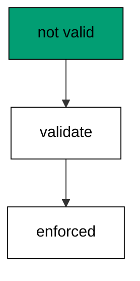

NOT VALID splits the work: the constraint guards new writes immediately while old rows wait for the separate validate step. Big tables feel the difference in deploy time.

**`learning/code/ex-41-check-constraint-not-valid-first/main.go`**:

```go
// => Shared driver: every unit in this course opens with this prelude.
// => The harness network is closed, so units carry a small standard-library
// => driver that applies the same goose SQL files `goose up` would apply.
// => The files, the history table shape, and the ordering rules are goose's
// => own; the driver only replaces the network-dependent binary.
package main // => every unit is one runnable program

import ( // => standard library only: no third-party modules
	"bufio"           // => bufio frames protocol messages over the TCP stream
	"encoding/binary" // => binary lays out length-prefixed protocol fields
	"fmt"             // => fmt prints the deterministic transcript only
	"io"              // => io forces full reads of split protocol messages
	"net"             // => net dials the harness Postgres service over TCP
	"os"              // => os reads the harness database address, never hardcoded
	"sort"            // => sort orders migration files, never trusts directory order
	"strings"         // => strings splits the goose Up and Down annotations
) // => every import used by driver and units

// => The database address comes from the harness, with local-run defaults.
func addr() (string, string, string) { // => one helper owns every address default
	host := os.Getenv("PGHOST") // => service hostname in the unit network
	if host == "" {             // => empty means a local run outside the harness
		host = "postgres" // => same default the Python courses use
	} // => end addr: empty means a local run outside the harness
	user := os.Getenv("PGUSER") // => trust-auth role, no password needed
	if user == "" {             // => empty means a local run outside the harness
		user = "postgres" // => same default the Python courses use
	} // => end addr: empty means a local run outside the harness
	db := os.Getenv("PGDATABASE") // => fresh database for every unit run
	if db == "" {                 // => empty means a local run outside the harness
		db = "postgres" // => same default the Python courses use
	} // => end addr: empty means a local run outside the harness
	return host, user, db // => callers never re-read the environment
} // => end addr: one helper owns every address default

// => conn wraps one TCP connection plus a buffered reader for message frames.
type conn struct { // => a tiny struct keeps the socket and the framer together
	c net.Conn      // => the raw TCP socket to the Postgres service
	r *bufio.Reader // => buffered reads frame messages split across packets
} // => end type conn: socket and framer travel together

// => readMsg reads one backend message: a type byte plus a length body.
func (k *conn) readMsg() (byte, []byte, error) { // => every response flows through here
	head := make([]byte, 5)                           // => one type byte plus one int32 length
	if _, err := io.ReadFull(k.r, head); err != nil { // => fragments reassemble before framing
		return 0, nil, err // => no partial message is ever trusted
	} // => end readMsg: fragments reassemble before framing
	n := int(binary.BigEndian.Uint32(head[1:])) - 4   // => length counts itself, not the type
	body := make([]byte, n)                           // => exact-size body, never over-read
	if _, err := io.ReadFull(k.r, body); err != nil { // => fragments reassemble before framing
		return 0, nil, err // => no partial message is ever trusted
	} // => end readMsg: fragments reassemble before framing
	return head[0], body, nil // => type byte tells the caller what arrived
} // => end readMsg: every response flows through here

// => sendMsg writes one frontend message: a type byte plus a length body.
func (k *conn) sendMsg(t byte, body []byte) error { // => startup is the only typeless message
	out := []byte{t}                                      // => type byte leads every message
	lenb := make([]byte, 4)                               // => four bytes carry the length
	binary.BigEndian.PutUint32(lenb, uint32(len(body)+4)) // => length counts itself
	out = append(out, lenb...)                            // => length follows the type byte
	out = append(out, body...)                            // => payload closes the message
	_, err := k.c.Write(out)                              // => one write keeps frames whole
	return err                                            // => write errors fail the unit loudly
} // => end sendMsg: startup is the only typeless message

// => connect opens the service database and waits for session readiness.
func connect() (*conn, error) { // => every unit starts from this one helper
	host, user, db := addr()         // => harness address, never hardcoded
	return connectDb(host, user, db) // => one path opens every session
} // => end connect: every unit starts from this one helper

// => connectDb opens a named database on the same host for multi-db drills.
func connectDb(host, user, db string) (*conn, error) { // => environments are databases, not servers
	c, err := net.Dial("tcp", host+":5432") // => Postgres listens on 5432
	if err != nil {                         // => unreachable service is fatal
		return nil, err // => no fallback: the harness owns the database
	} // => end connectDb: unreachable service is fatal
	k := &conn{c: c, r: bufio.NewReader(c)}             // => buffer the fresh socket at once
	body := []byte{}                                    // => startup body is parameters only
	body = append(body, 0, 0, 0, 0)                     // => placeholder for the length prefix
	body = append(body, 0, 3, 0, 0)                     // => protocol 3.0, the stable version
	body = append(body, []byte("user")...)              // => user key starts the parameters
	body = append(body, 0)                              // => keys and values are NUL-separated
	body = append(body, []byte(user)...)                // => trust-auth role from the harness
	body = append(body, 0)                              // => NUL ends the value
	body = append(body, []byte("database")...)          // => database key follows the user
	body = append(body, 0)                              // => NUL ends the key
	body = append(body, []byte(db)...)                  // => fresh database for every unit run
	body = append(body, 0)                              // => NUL ends the value
	body = append(body, 0)                              // => empty key ends the parameters
	binary.BigEndian.PutUint32(body, uint32(len(body))) // => startup length counts itself
	if _, err := c.Write(body); err != nil {            // => startup is the only typeless message
		return nil, err // => unwritable socket is fatal
	} // => end connectDb: startup is the only typeless message
	for { // => drain until the session is ready for queries
		t, b, err := k.readMsg() // => every backend message flows through here
		if err != nil {          // => broken handshake is fatal
			return nil, err // => no half-open session is ever used
		} // => end connectDb: broken handshake is fatal
		switch t { // => only three message kinds matter during startup
		case 'R': // => authentication response arrives first
			if binary.BigEndian.Uint32(b) != 0 { // => nonzero means a password is wanted
				return nil, fmt.Errorf("server wants a password") // => trust auth never asks
			} // => end connectDb: nonzero means a password is wanted
		case 'E': // => an error ends the handshake with the server text
			return nil, fmt.Errorf("startup: %s", errText(b)) // => server text explains the cause
		case 'Z': // => ReadyForQuery means the session accepts queries
			return k, nil // => handshake done: hand the live session back
		} // => end connectDb: only three message kinds matter during startup
	} // => end connectDb: drain until the session is ready for queries
} // => end connectDb: environments are databases, not servers

// => errText extracts the human message (field M) from an ErrorResponse.
func errText(b []byte) string { // => one helper decodes every server error
	parts := strings.Split(string(b), "\x00") // => fields are NUL-separated pairs
	for i := 0; i+1 < len(parts); i += 2 {    // => walk code and value together
		if parts[i] == "M" { // => M is the primary human message
			return parts[i+1] // => return the message, skip the detail fields
		} // => end errText: M is the primary human message
	} // => end errText: walk code and value together
	return "unknown error" // => malformed errors still fail with a fixed line
} // => end errText: one helper decodes every server error

// => run sends one SQL string and returns every data row plus the command tag.
func (k *conn) run(q string) ([][]string, string, error) { // => one path runs every statement
	body := append([]byte(q), 0)                 // => Query messages are NUL-terminated
	if err := k.sendMsg('Q', body); err != nil { // => send fails loudly, never silently
		return nil, "", err // => unwritable socket ends the unit
	} // => end run: send fails loudly, never silently
	var rows [][]string // => data rows accumulate across result sets
	tag := ""           // => the last command tag (SELECT 3, CREATE TABLE...)
	for {               // => drain until ReadyForQuery closes this query string
		t, b, err := k.readMsg() // => every response flows through the framer
		if err != nil {          // => broken mid-query connection is fatal
			return nil, "", err // => partial results are never returned
		} // => end run: broken mid-query connection is fatal
		switch t { // => four message kinds carry a simple-query response
		case 'T', 'N', 'A', 'S', 'K': // => metadata the transcript never prints
		case 'D': // => one data row arrived
			rows = append(rows, parseRow(b)) // => decode the text columns now
		case 'C': // => one statement finished
			tag = strings.TrimRight(string(b[:len(b)-1]), "\x00") // => tag names what ran
		case 'E': // => the statement failed
			drain(k)                                     // => finish the failed query before reuse
			return nil, "", fmt.Errorf("%s", errText(b)) // => server text becomes the failure
		case 'Z': // => ReadyForQuery ends this query string
			return rows, tag, nil // => rows, tag, and a clean session
		} // => end run: four message kinds carry a simple-query response
	} // => end run: drain until ReadyForQuery closes this query string
} // => end run: one path runs every statement

// => drain reads to the next ReadyForQuery after a statement error.
func drain(k *conn) { // => an errored query still owns the socket until Z
	for { // => loop until the session is reusable
		t, _, err := k.readMsg()    // => discard every message after the error
		if err != nil || t == 'Z' { // => socket break or ready both end the drain
			return // => caller decides the failure, the drain only resynchronizes
		} // => end drain: socket break or ready both end the drain
	} // => end drain: loop until the session is reusable
} // => end drain: an errored query still owns the socket until Z

// => parseRow decodes one DataRow body into text columns, NULL as "NULL".
func parseRow(b []byte) []string { // => one helper decodes every returned row
	n := int(binary.BigEndian.Uint16(b)) // => column count leads the body
	b = b[2:]                            // => step past the count
	out := make([]string, 0, n)          // => pre-size the row to the count
	for i := 0; i < n; i++ {             // => walk each column in order
		l := int(int32(binary.BigEndian.Uint32(b))) // => -1 marks NULL, else the length
		b = b[4:]                                   // => step past the length
		if l < 0 {                                  // => NULL has no bytes to read
			out = append(out, "NULL") // => fixed word keeps transcripts stable
			continue                  // => next column, no bytes consumed
		} // => end parseRow: NULL has no bytes to read
		out = append(out, string(b[:l])) // => text format is already printable
		b = b[l:]                        // => step past the value bytes
	} // => end parseRow: walk each column in order
	return out // => one row, fully decoded
} // => end parseRow: one helper decodes every returned row

// => must runs SQL or exits nonzero with the server text on standard error.
func must(k *conn, q string) [][]string { // => setup statements never fail quietly
	rows, _, err := k.run(q) // => rows return for verification queries
	if err != nil {          // => any server error is fatal to the unit
		fmt.Fprintln(os.Stderr, "sql error:", err) // => errors go to stderr, never stdout
		os.Exit(1)                                 // => nonzero exit fails the harness check
	} // => end must: any server error is fatal to the unit
	return rows // => callers print only what the lesson asserts
} // => end must: setup statements never fail quietly

// => try runs SQL and returns the server error text instead of exiting.
func try(k *conn, q string) ([][]string, string) { // => failure drills inspect errors, not die
	rows, _, err := k.run(q) // => same path as must, opposite failure policy
	if err != nil {          // => expected errors become transcript lines
		return nil, err.Error() // => fixed server text, never timings
	} // => end try: expected errors become transcript lines
	return rows, "" // => empty error means the statement succeeded
} // => end try: failure drills inspect errors, not die

// => mig holds one goose SQL file: its version, name, and Up/Down sections.
type mig struct { // => mirrors the goose file layout the lesson teaches
	version string   // => zero-padded number orders history, like goose
	name    string   // => human slug after the version number
	up      []string // => forward statements, run inside one transaction
	down    []string // => reverse statements, run inside one transaction
	noTx    bool     // => NO TRANSACTION files run outside one, like goose
} // => end type mig: version, name, sections, and mode

// => parseGoose splits one goose SQL file into its Up and Down statements.
func parseGoose(text string) (up, down []string, noTx bool) { // => the lesson asserts this exact split
	section := ""                                    // => nothing belongs outside the annotations
	for _, line := range strings.Split(text, "\n") { // => walk the file line by line
		t := strings.TrimSpace(line) // => annotation matching ignores indentation
		switch t {                   // => four annotation lines switch sections
		case "-- +goose Up": // => forward section starts here, like goose
			section = "up" // => following statements migrate forward
			continue       // => the annotation itself never runs
		case "-- +goose Down": // => reverse section starts here, like goose
			section = "down" // => following statements roll back
			continue         // => the annotation itself never runs
		case "-- +goose NO TRANSACTION": // => concurrent work cannot run inside one
			noTx = true // => remember the file opts out of the transaction
			continue    // => the annotation itself never runs
		} // => end parseGoose: four annotation lines switch sections
		if strings.HasPrefix(t, "--") || t == "" { // => comments and blanks never run
			continue // => only real statements reach the database
		} // => end parseGoose: comments and blanks never run
		if section == "up" { // => route by the annotation seen above
			up = append(up, line) // => keep the original line for the file write
		} else if section == "down" { // => down statements collect separately
			down = append(down, line) // => keep the original line for the file write
		} // => end parseGoose: down statements collect separately
	} // => end parseGoose: walk the file line by line
	return splitStmts(strings.Join(up, "\n")), splitStmts(strings.Join(down, "\n")), noTx // => one string per statement
} // => end parseGoose: the lesson asserts this exact split

// => splitStmts cuts statement text on semicolons outside quotes.
func splitStmts(s string) []string { // => multi-line statements stay whole until ;
	var out []string        // => finished statements accumulate here
	var cur strings.Builder // => the statement under construction
	inStr := false          // => semicolons inside quotes never split
	for _, r := range s {   // => walk rune by rune, quotes included
		switch { // => quote tracking decides what a semicolon means
		case r == '\'': // => a quote toggles string mode
			inStr = !inStr   // => enter or leave the quoted region
			cur.WriteRune(r) // => the quote belongs to the statement
		case r == ';' && !inStr: // => a bare semicolon ends one statement
			if t := strings.TrimSpace(cur.String()); t != "" { // => skip empty fragments
				out = append(out, t) // => store the finished statement
			} // => end splitStmts: skip empty fragments
			cur.Reset() // => start the next statement fresh
		default: // => every other rune belongs to the current statement
			cur.WriteRune(r) // => accumulate verbatim
		} // => end splitStmts: quote tracking decides what a semicolon means
	} // => end splitStmts: walk rune by rune, quotes included
	if t := strings.TrimSpace(cur.String()); t != "" { // => trailing text without ; still counts
		out = append(out, t) // => last statement needs no semicolon
	} // => end splitStmts: trailing text without ; still counts
	return out // => callers run each statement in order
} // => end splitStmts: multi-line statements stay whole until ;

// => ensureHistory creates the goose history table once per unit run.
func ensureHistory(k *conn) { // => goose_db_version is goose's own default name
	must(k, `CREATE TABLE IF NOT EXISTS goose_db_version (`+ // => reruns never fail here
		`id integer PRIMARY KEY GENERATED BY DEFAULT AS IDENTITY, `+ // => surrogate key, never printed
		`version_id bigint NOT NULL, `+ // => applied version numbers live here
		`is_applied boolean NOT NULL, `+ // => goose marks rows applied on success
		`tstamp timestamp NOT NULL DEFAULT now())`) // => timestamp defaults, never printed
} // => end ensureHistory: goose_db_version is goose's own default name

// => appliedVersions returns the version numbers already marked applied.
func appliedVersions(k *conn) map[int64]bool { // => history decides what still needs running
	rows := must(k, `SELECT version_id FROM goose_db_version `+ // => only the numbers matter
		`WHERE is_applied ORDER BY version_id`) // => order keeps the transcript stable
	got := map[int64]bool{}  // => set lookup answers "already applied" fast
	for _, r := range rows { // => one row per applied migration
		var v int64                // => version numbers are integers
		fmt.Sscanf(r[0], "%d", &v) // => text format parses back to a number
		got[v] = true              // => mark this version done
	} // => end appliedVersions: one row per applied migration
	return got // => callers skip whatever history already holds
} // => end appliedVersions: history decides what still needs running

// => applyUp runs every pending migration forward, one transaction each.
func applyUp(k *conn, ms []mig) { // => files on disk are already the source of truth
	done := appliedVersions(k) // => history decides what still needs running
	for _, m := range ms {     // => file order is version order, sorted by the caller
		var v int64                     // => versions compare as numbers
		fmt.Sscanf(m.version, "%d", &v) // => zero-padded file prefix parses back
		if done[v] {                    // => applied migrations never run twice
			continue // => idempotent reruns skip straight past
		} // => end applyUp: applied migrations never run twice
		if !m.noTx { // => transactional files wrap everything in one unit
			must(k, "BEGIN") // => one migration is one transaction, like goose
		} // => end applyUp: transactional files wrap everything in one unit
		for _, s := range m.up { // => forward statements run in file order
			must(k, s) // => any failure aborts the unit before COMMIT
		} // => end applyUp: forward statements run in file order
		if !m.noTx { // => stamps join the same transaction they describe
			must(k, fmt.Sprintf(`INSERT INTO goose_db_version `+ // => stamp only after success
				`(version_id, is_applied) VALUES (%d, true)`, v)) // => stamp mirrors goose exactly
			must(k, "COMMIT") // => history row and schema land together
		} else { // => concurrent statements cannot share a transaction
			must(k, fmt.Sprintf(`INSERT INTO goose_db_version `+ // => stamp follows the work
				`(version_id, is_applied) VALUES (%d, true)`, v)) // => same row, separate statement
		} // => end applyUp: concurrent statements cannot share a transaction
	} // => end applyUp: file order is version order, sorted by the caller
} // => end applyUp: files on disk are already the source of truth

// => applyDown rolls back the newest applied migrations, newest first.
func applyDown(k *conn, ms []mig, steps int) { // => steps bounds how far history rewinds
	done := appliedVersions(k) // => history decides what can roll back
	var todo []mig             // => applied migrations in version order first
	for _, m := range ms {     // => walk the whole known history
		var v int64                     // => versions compare as numbers
		fmt.Sscanf(m.version, "%d", &v) // => zero-padded file prefix parses back
		if done[v] {                    // => only applied migrations roll back
			todo = append(todo, m) // => keep the migration for the reverse pass
		} // => end applyDown: only applied migrations roll back
	} // => end applyDown: walk the whole known history
	for i := len(todo) - 1; i >= 0 && steps > 0; i-- { // => newest applied goes first
		m := todo[i]                    // => this migration rolls back now
		var v int64                     // => versions compare as numbers
		fmt.Sscanf(m.version, "%d", &v) // => zero-padded file prefix parses back
		if !m.noTx {                    // => transactional files wrap the rollback too
			must(k, "BEGIN") // => reverse change is atomic, like the forward one
		} // => end applyDown: transactional files wrap the rollback too
		for _, s := range m.down { // => reverse statements run in file order
			must(k, s) // => any failure aborts before the history row moves
		} // => end applyDown: reverse statements run in file order
		must(k, fmt.Sprintf(`DELETE FROM goose_db_version `+ // => unstamped only after success
			`WHERE version_id = %d`, v)) // => the version leaves history exactly once
		if !m.noTx { // => close the transaction the rollback opened
			must(k, "COMMIT") // => schema reversal and unstamp land together
		} // => end applyDown: close the transaction the rollback opened
		steps-- // => one rollback consumed from the budget
	} // => end applyDown: newest applied goes first
} // => end applyDown: steps bounds how far history rewinds

// => statusCounts splits known migrations into applied and pending lists.
func statusCounts(k *conn, ms []mig) (applied, pending []string) { // => goose status in two lists
	done := appliedVersions(k) // => history decides which list each version joins
	for _, m := range ms {     // => walk the known history in version order
		var v int64                     // => versions compare as numbers
		fmt.Sscanf(m.version, "%d", &v) // => zero-padded file prefix parses back
		if done[v] {                    // => stamped versions are done
			applied = append(applied, m.version) // => keep the version string for printing
		} else { // => unstamped versions still wait
			pending = append(pending, m.version) // => keep the version string for printing
		} // => end statusCounts: unstamped versions still wait
	} // => end statusCounts: walk the known history in version order
	return applied, pending // => callers print both lists in one stable line each
} // => end statusCounts: goose status in two lists

// => files writes each migration as a real goose SQL file under dir.
func files(dir string, ms []mig) { // => the lesson shows these files byte-identically
	for _, m := range ms { // => one file per migration, like `goose create`
		name := fmt.Sprintf("%s_%s.sql", m.version, m.name) // => goose names files version-first
		var b strings.Builder                               // => build the file text in order
		if m.noTx {                                         // => concurrent files announce it first
			b.WriteString("-- +goose NO TRANSACTION\n") // => goose honors this exact annotation
		} // => end files: concurrent files announce it first
		b.WriteString("-- +goose Up\n") // => forward annotation leads
		for _, s := range m.up {        // => forward statements follow
			b.WriteString(s + ";\n") // => one statement per line, semicolon-closed
		} // => end files: forward statements follow
		b.WriteString("-- +goose Down\n") // => reverse annotation splits the file
		for _, s := range m.down {        // => reverse statements close the file
			b.WriteString(s + ";\n") // => one statement per line, semicolon-closed
		} // => end files: reverse statements close the file
		if err := os.WriteFile(dir+"/"+name, []byte(b.String()), 0644); err != nil { // => real files, like goose
			fmt.Fprintln(os.Stderr, "write error:", err) // => write errors fail loudly
			os.Exit(1)                                   // => no half-written migration set
		} // => end files: real files, like goose
	} // => end files: one file per migration, like `goose create`
} // => end files: the lesson shows these files byte-identically

// => versions lists migration files in version order from dir.
func versions(dir string) []mig { // => directory order is never trusted for history
	ents, err := os.ReadDir(dir) // => read the whole migrations directory
	if err != nil {              // => unreadable directory is fatal
		fmt.Fprintln(os.Stderr, "read error:", err) // => errors go to stderr
		os.Exit(1)                                  // => nonzero exit fails the check
	} // => end versions: unreadable directory is fatal
	names := []string{}      // => collect names before sorting
	for _, e := range ents { // => walk every directory entry
		if !e.IsDir() && strings.HasSuffix(e.Name(), ".sql") { // => only goose SQL files count
			names = append(names, e.Name()) // => keep the file name for parsing
		} // => end versions: only goose SQL files count
	} // => end versions: walk every directory entry
	sort.Strings(names)       // => zero-padded versions sort chronologically
	var out []mig             // => parsed migrations accumulate here
	for _, n := range names { // => parse in version order
		raw, err := os.ReadFile(dir + "/" + n) // => read the real file back
		if err != nil {                        // => unreadable file is fatal
			fmt.Fprintln(os.Stderr, "read error:", err) // => errors go to stderr
			os.Exit(1)                                  // => nonzero exit fails the check
		} // => end versions: unreadable file is fatal
		up, down, noTx := parseGoose(string(raw))                                            // => split on the goose annotations
		rest := strings.TrimSuffix(n, ".sql")                                                // => strip the extension first
		ver := rest[:5]                                                                      // => first five digits are the version
		out = append(out, mig{version: ver, name: rest[6:], up: up, down: down, noTx: noTx}) // => keep every part
	} // => end versions: parse in version order
	return out // => version-ordered migrations, ready to apply
} // => end versions: directory order is never trusted for history

// => findDupes returns version numbers claimed by two or more files.
func findDupes(dir string) []string { // => goose refuses duplicate versions outright
	ents, err := os.ReadDir(dir) // => read the whole migrations directory
	if err != nil {              // => unreadable directory is fatal
		fmt.Fprintln(os.Stderr, "read error:", err) // => errors go to stderr
		os.Exit(1)                                  // => nonzero exit fails the check
	} // => end findDupes: unreadable directory is fatal
	seen := map[string]int{} // => count claims per five-digit version prefix
	for _, e := range ents { // => walk every directory entry
		if !e.IsDir() && strings.HasSuffix(e.Name(), ".sql") { // => only goose SQL files count
			seen[e.Name()[:5]]++ // => first five digits are the version
		} // => end findDupes: only goose SQL files count
	} // => end findDupes: walk every directory entry
	var out []string         // => duplicates accumulate in version order
	for _, e := range ents { // => second pass keeps the order stable
		if !e.IsDir() && strings.HasSuffix(e.Name(), ".sql") { // => only goose SQL files count
			if v := e.Name()[:5]; seen[v] > 1 { // => claimed more than once
				out = append(out, v) // => keep the version string for printing
				seen[v] = 0          // => report each duplicate version only once
			} // => end findDupes: claimed more than once
		} // => end findDupes: only goose SQL files count
	} // => end findDupes: second pass keeps the order stable
	return out // => empty means the history numbers are unique
} // => end findDupes: goose refuses duplicate versions outright

func main() {
	k, err := connect() // => one session runs the whole example
	if err != nil {     // => unreachable database fails loudly
		fmt.Fprintln(os.Stderr, "connect error:", err) // => connection errors go to stderr
		os.Exit(1)                                     // => nonzero exit fails the check
	}
	defer k.c.Close() // => the socket closes when the example ends
	// => A scratch migrations directory: goose files live here, never in the unit.
	// => the scratch path never reaches stdout, so reruns stay byte-stable
	dir, err := os.MkdirTemp("", "ex41-") // => private directory, like `goose create`
	if err != nil {                       // => unmakable temp dir is fatal
		fmt.Fprintln(os.Stderr, "temp error:", err) // => errors go to stderr
		os.Exit(1)                                  // => nonzero exit fails the check
	}
	defer os.RemoveAll(dir)                                                           // => scratch files vanish; only transcripts remain
	must(k, "DROP TABLE IF EXISTS ex41_base")                                         // => leftovers of a killed run vanish
	must(k, "DROP TABLE IF EXISTS goose_db_version")                                  // => stale history vanishes too
	ensureHistory(k)                                                                  // => goose history table, real shape
	must(k, "CREATE TABLE ex41_base (id SERIAL PRIMARY KEY, price INTEGER NOT NULL)") // => live table with rows
	must(k, `INSERT INTO ex41_base (price) VALUES (10), (20), (30)`)                  // => rows the constraint must accept
	files(dir, []mig{                                                                 // => add unchecked, then validate separately
		{version: "00001", name: "add_check", // => constraint guards new writes at once
			up:   []string{"ALTER TABLE ex41_base ADD CONSTRAINT ex41_price_positive CHECK (price > 0) NOT VALID"}, // => old rows unchecked yet
			down: []string{"ALTER TABLE ex41_base DROP CONSTRAINT ex41_price_positive"}},                           // => reverse drops the guard
		{version: "00002", name: "validate_check", // => old rows validated in their own step
			up:   []string{"ALTER TABLE ex41_base VALIDATE CONSTRAINT ex41_price_positive"}, // => scan runs outside the add lock
			down: []string{"SELECT 1"}},                                                     // => validation leaves no schema to reverse
	})
	applyUp(k, versions(dir))                                     // => read the files back and run what is pending
	_, bad := try(k, `INSERT INTO ex41_base (price) VALUES (-5)`) // => negative price must fail
	fmt.Println("rejected:", bad != "")                           // => Output: rejected: true
	rows := must(k, `SELECT count(*) FROM ex41_base`)             // => original rows untouched
	fmt.Println("rows:", rows[0][0])                              // => Output: rows: 3
	must(k, "DROP TABLE ex41_base")                               // => base table cleaned with the example tables
	fmt.Println("cleaned: yes")                                   // => Output: cleaned: yes
	must(k, "DROP TABLE IF EXISTS ex41_base")                     // => leftovers of a killed run vanish
	must(k, "DROP TABLE IF EXISTS goose_db_version")              // => the example leaves no history behind
}
```

**Output** (`learning/code/ex-41-check-constraint-not-valid-first/expected/main.stdout.txt`):

```text
rejected: true
rows: 3
cleaned: yes
```

**Key takeaway**: NOT VALID guards new writes at once while old rows wait for their own cheaper validation step.

**Why it matters**: Two-phase constraints split availability from correctness so neither waits for the other. NOT VALID guards new writes immediately while old rows validate in a separate, cheaper step, and big tables feel the difference in deploy time. Constraints that take effect without scanning are constraints teams actually add. Constraints that take effect without scanning are constraints teams actually add, even on hot tables.

### Example 42: Deploy Order Matters

Code and schema deploy in a fixed order: this example applies the expand migration while old-shaped rows still insert fine, proving backward compatibility. New columns must tolerate old writers until the code ships. (Concepts: co-13.)

Expand-then-code-then-migrate-then-contract is the full sequence: schema widens first, code ships second, data moves third, old shapes drop last. Any other order breaks someone.

**`learning/code/ex-42-deploy-order-matters/main.go`**:

```go
// => Shared driver: every unit in this course opens with this prelude.
// => The harness network is closed, so units carry a small standard-library
// => driver that applies the same goose SQL files `goose up` would apply.
// => The files, the history table shape, and the ordering rules are goose's
// => own; the driver only replaces the network-dependent binary.
package main // => every unit is one runnable program

import ( // => standard library only: no third-party modules
	"bufio"           // => bufio frames protocol messages over the TCP stream
	"encoding/binary" // => binary lays out length-prefixed protocol fields
	"fmt"             // => fmt prints the deterministic transcript only
	"io"              // => io forces full reads of split protocol messages
	"net"             // => net dials the harness Postgres service over TCP
	"os"              // => os reads the harness database address, never hardcoded
	"sort"            // => sort orders migration files, never trusts directory order
	"strings"         // => strings splits the goose Up and Down annotations
) // => every import used by driver and units

// => The database address comes from the harness, with local-run defaults.
func addr() (string, string, string) { // => one helper owns every address default
	host := os.Getenv("PGHOST") // => service hostname in the unit network
	if host == "" {             // => empty means a local run outside the harness
		host = "postgres" // => same default the Python courses use
	} // => end addr: empty means a local run outside the harness
	user := os.Getenv("PGUSER") // => trust-auth role, no password needed
	if user == "" {             // => empty means a local run outside the harness
		user = "postgres" // => same default the Python courses use
	} // => end addr: empty means a local run outside the harness
	db := os.Getenv("PGDATABASE") // => fresh database for every unit run
	if db == "" {                 // => empty means a local run outside the harness
		db = "postgres" // => same default the Python courses use
	} // => end addr: empty means a local run outside the harness
	return host, user, db // => callers never re-read the environment
} // => end addr: one helper owns every address default

// => conn wraps one TCP connection plus a buffered reader for message frames.
type conn struct { // => a tiny struct keeps the socket and the framer together
	c net.Conn      // => the raw TCP socket to the Postgres service
	r *bufio.Reader // => buffered reads frame messages split across packets
} // => end type conn: socket and framer travel together

// => readMsg reads one backend message: a type byte plus a length body.
func (k *conn) readMsg() (byte, []byte, error) { // => every response flows through here
	head := make([]byte, 5)                           // => one type byte plus one int32 length
	if _, err := io.ReadFull(k.r, head); err != nil { // => fragments reassemble before framing
		return 0, nil, err // => no partial message is ever trusted
	} // => end readMsg: fragments reassemble before framing
	n := int(binary.BigEndian.Uint32(head[1:])) - 4   // => length counts itself, not the type
	body := make([]byte, n)                           // => exact-size body, never over-read
	if _, err := io.ReadFull(k.r, body); err != nil { // => fragments reassemble before framing
		return 0, nil, err // => no partial message is ever trusted
	} // => end readMsg: fragments reassemble before framing
	return head[0], body, nil // => type byte tells the caller what arrived
} // => end readMsg: every response flows through here

// => sendMsg writes one frontend message: a type byte plus a length body.
func (k *conn) sendMsg(t byte, body []byte) error { // => startup is the only typeless message
	out := []byte{t}                                      // => type byte leads every message
	lenb := make([]byte, 4)                               // => four bytes carry the length
	binary.BigEndian.PutUint32(lenb, uint32(len(body)+4)) // => length counts itself
	out = append(out, lenb...)                            // => length follows the type byte
	out = append(out, body...)                            // => payload closes the message
	_, err := k.c.Write(out)                              // => one write keeps frames whole
	return err                                            // => write errors fail the unit loudly
} // => end sendMsg: startup is the only typeless message

// => connect opens the service database and waits for session readiness.
func connect() (*conn, error) { // => every unit starts from this one helper
	host, user, db := addr()         // => harness address, never hardcoded
	return connectDb(host, user, db) // => one path opens every session
} // => end connect: every unit starts from this one helper

// => connectDb opens a named database on the same host for multi-db drills.
func connectDb(host, user, db string) (*conn, error) { // => environments are databases, not servers
	c, err := net.Dial("tcp", host+":5432") // => Postgres listens on 5432
	if err != nil {                         // => unreachable service is fatal
		return nil, err // => no fallback: the harness owns the database
	} // => end connectDb: unreachable service is fatal
	k := &conn{c: c, r: bufio.NewReader(c)}             // => buffer the fresh socket at once
	body := []byte{}                                    // => startup body is parameters only
	body = append(body, 0, 0, 0, 0)                     // => placeholder for the length prefix
	body = append(body, 0, 3, 0, 0)                     // => protocol 3.0, the stable version
	body = append(body, []byte("user")...)              // => user key starts the parameters
	body = append(body, 0)                              // => keys and values are NUL-separated
	body = append(body, []byte(user)...)                // => trust-auth role from the harness
	body = append(body, 0)                              // => NUL ends the value
	body = append(body, []byte("database")...)          // => database key follows the user
	body = append(body, 0)                              // => NUL ends the key
	body = append(body, []byte(db)...)                  // => fresh database for every unit run
	body = append(body, 0)                              // => NUL ends the value
	body = append(body, 0)                              // => empty key ends the parameters
	binary.BigEndian.PutUint32(body, uint32(len(body))) // => startup length counts itself
	if _, err := c.Write(body); err != nil {            // => startup is the only typeless message
		return nil, err // => unwritable socket is fatal
	} // => end connectDb: startup is the only typeless message
	for { // => drain until the session is ready for queries
		t, b, err := k.readMsg() // => every backend message flows through here
		if err != nil {          // => broken handshake is fatal
			return nil, err // => no half-open session is ever used
		} // => end connectDb: broken handshake is fatal
		switch t { // => only three message kinds matter during startup
		case 'R': // => authentication response arrives first
			if binary.BigEndian.Uint32(b) != 0 { // => nonzero means a password is wanted
				return nil, fmt.Errorf("server wants a password") // => trust auth never asks
			} // => end connectDb: nonzero means a password is wanted
		case 'E': // => an error ends the handshake with the server text
			return nil, fmt.Errorf("startup: %s", errText(b)) // => server text explains the cause
		case 'Z': // => ReadyForQuery means the session accepts queries
			return k, nil // => handshake done: hand the live session back
		} // => end connectDb: only three message kinds matter during startup
	} // => end connectDb: drain until the session is ready for queries
} // => end connectDb: environments are databases, not servers

// => errText extracts the human message (field M) from an ErrorResponse.
func errText(b []byte) string { // => one helper decodes every server error
	parts := strings.Split(string(b), "\x00") // => fields are NUL-separated pairs
	for i := 0; i+1 < len(parts); i += 2 {    // => walk code and value together
		if parts[i] == "M" { // => M is the primary human message
			return parts[i+1] // => return the message, skip the detail fields
		} // => end errText: M is the primary human message
	} // => end errText: walk code and value together
	return "unknown error" // => malformed errors still fail with a fixed line
} // => end errText: one helper decodes every server error

// => run sends one SQL string and returns every data row plus the command tag.
func (k *conn) run(q string) ([][]string, string, error) { // => one path runs every statement
	body := append([]byte(q), 0)                 // => Query messages are NUL-terminated
	if err := k.sendMsg('Q', body); err != nil { // => send fails loudly, never silently
		return nil, "", err // => unwritable socket ends the unit
	} // => end run: send fails loudly, never silently
	var rows [][]string // => data rows accumulate across result sets
	tag := ""           // => the last command tag (SELECT 3, CREATE TABLE...)
	for {               // => drain until ReadyForQuery closes this query string
		t, b, err := k.readMsg() // => every response flows through the framer
		if err != nil {          // => broken mid-query connection is fatal
			return nil, "", err // => partial results are never returned
		} // => end run: broken mid-query connection is fatal
		switch t { // => four message kinds carry a simple-query response
		case 'T', 'N', 'A', 'S', 'K': // => metadata the transcript never prints
		case 'D': // => one data row arrived
			rows = append(rows, parseRow(b)) // => decode the text columns now
		case 'C': // => one statement finished
			tag = strings.TrimRight(string(b[:len(b)-1]), "\x00") // => tag names what ran
		case 'E': // => the statement failed
			drain(k)                                     // => finish the failed query before reuse
			return nil, "", fmt.Errorf("%s", errText(b)) // => server text becomes the failure
		case 'Z': // => ReadyForQuery ends this query string
			return rows, tag, nil // => rows, tag, and a clean session
		} // => end run: four message kinds carry a simple-query response
	} // => end run: drain until ReadyForQuery closes this query string
} // => end run: one path runs every statement

// => drain reads to the next ReadyForQuery after a statement error.
func drain(k *conn) { // => an errored query still owns the socket until Z
	for { // => loop until the session is reusable
		t, _, err := k.readMsg()    // => discard every message after the error
		if err != nil || t == 'Z' { // => socket break or ready both end the drain
			return // => caller decides the failure, the drain only resynchronizes
		} // => end drain: socket break or ready both end the drain
	} // => end drain: loop until the session is reusable
} // => end drain: an errored query still owns the socket until Z

// => parseRow decodes one DataRow body into text columns, NULL as "NULL".
func parseRow(b []byte) []string { // => one helper decodes every returned row
	n := int(binary.BigEndian.Uint16(b)) // => column count leads the body
	b = b[2:]                            // => step past the count
	out := make([]string, 0, n)          // => pre-size the row to the count
	for i := 0; i < n; i++ {             // => walk each column in order
		l := int(int32(binary.BigEndian.Uint32(b))) // => -1 marks NULL, else the length
		b = b[4:]                                   // => step past the length
		if l < 0 {                                  // => NULL has no bytes to read
			out = append(out, "NULL") // => fixed word keeps transcripts stable
			continue                  // => next column, no bytes consumed
		} // => end parseRow: NULL has no bytes to read
		out = append(out, string(b[:l])) // => text format is already printable
		b = b[l:]                        // => step past the value bytes
	} // => end parseRow: walk each column in order
	return out // => one row, fully decoded
} // => end parseRow: one helper decodes every returned row

// => must runs SQL or exits nonzero with the server text on standard error.
func must(k *conn, q string) [][]string { // => setup statements never fail quietly
	rows, _, err := k.run(q) // => rows return for verification queries
	if err != nil {          // => any server error is fatal to the unit
		fmt.Fprintln(os.Stderr, "sql error:", err) // => errors go to stderr, never stdout
		os.Exit(1)                                 // => nonzero exit fails the harness check
	} // => end must: any server error is fatal to the unit
	return rows // => callers print only what the lesson asserts
} // => end must: setup statements never fail quietly

// => try runs SQL and returns the server error text instead of exiting.
func try(k *conn, q string) ([][]string, string) { // => failure drills inspect errors, not die
	rows, _, err := k.run(q) // => same path as must, opposite failure policy
	if err != nil {          // => expected errors become transcript lines
		return nil, err.Error() // => fixed server text, never timings
	} // => end try: expected errors become transcript lines
	return rows, "" // => empty error means the statement succeeded
} // => end try: failure drills inspect errors, not die

// => mig holds one goose SQL file: its version, name, and Up/Down sections.
type mig struct { // => mirrors the goose file layout the lesson teaches
	version string   // => zero-padded number orders history, like goose
	name    string   // => human slug after the version number
	up      []string // => forward statements, run inside one transaction
	down    []string // => reverse statements, run inside one transaction
	noTx    bool     // => NO TRANSACTION files run outside one, like goose
} // => end type mig: version, name, sections, and mode

// => parseGoose splits one goose SQL file into its Up and Down statements.
func parseGoose(text string) (up, down []string, noTx bool) { // => the lesson asserts this exact split
	section := ""                                    // => nothing belongs outside the annotations
	for _, line := range strings.Split(text, "\n") { // => walk the file line by line
		t := strings.TrimSpace(line) // => annotation matching ignores indentation
		switch t {                   // => four annotation lines switch sections
		case "-- +goose Up": // => forward section starts here, like goose
			section = "up" // => following statements migrate forward
			continue       // => the annotation itself never runs
		case "-- +goose Down": // => reverse section starts here, like goose
			section = "down" // => following statements roll back
			continue         // => the annotation itself never runs
		case "-- +goose NO TRANSACTION": // => concurrent work cannot run inside one
			noTx = true // => remember the file opts out of the transaction
			continue    // => the annotation itself never runs
		} // => end parseGoose: four annotation lines switch sections
		if strings.HasPrefix(t, "--") || t == "" { // => comments and blanks never run
			continue // => only real statements reach the database
		} // => end parseGoose: comments and blanks never run
		if section == "up" { // => route by the annotation seen above
			up = append(up, line) // => keep the original line for the file write
		} else if section == "down" { // => down statements collect separately
			down = append(down, line) // => keep the original line for the file write
		} // => end parseGoose: down statements collect separately
	} // => end parseGoose: walk the file line by line
	return splitStmts(strings.Join(up, "\n")), splitStmts(strings.Join(down, "\n")), noTx // => one string per statement
} // => end parseGoose: the lesson asserts this exact split

// => splitStmts cuts statement text on semicolons outside quotes.
func splitStmts(s string) []string { // => multi-line statements stay whole until ;
	var out []string        // => finished statements accumulate here
	var cur strings.Builder // => the statement under construction
	inStr := false          // => semicolons inside quotes never split
	for _, r := range s {   // => walk rune by rune, quotes included
		switch { // => quote tracking decides what a semicolon means
		case r == '\'': // => a quote toggles string mode
			inStr = !inStr   // => enter or leave the quoted region
			cur.WriteRune(r) // => the quote belongs to the statement
		case r == ';' && !inStr: // => a bare semicolon ends one statement
			if t := strings.TrimSpace(cur.String()); t != "" { // => skip empty fragments
				out = append(out, t) // => store the finished statement
			} // => end splitStmts: skip empty fragments
			cur.Reset() // => start the next statement fresh
		default: // => every other rune belongs to the current statement
			cur.WriteRune(r) // => accumulate verbatim
		} // => end splitStmts: quote tracking decides what a semicolon means
	} // => end splitStmts: walk rune by rune, quotes included
	if t := strings.TrimSpace(cur.String()); t != "" { // => trailing text without ; still counts
		out = append(out, t) // => last statement needs no semicolon
	} // => end splitStmts: trailing text without ; still counts
	return out // => callers run each statement in order
} // => end splitStmts: multi-line statements stay whole until ;

// => ensureHistory creates the goose history table once per unit run.
func ensureHistory(k *conn) { // => goose_db_version is goose's own default name
	must(k, `CREATE TABLE IF NOT EXISTS goose_db_version (`+ // => reruns never fail here
		`id integer PRIMARY KEY GENERATED BY DEFAULT AS IDENTITY, `+ // => surrogate key, never printed
		`version_id bigint NOT NULL, `+ // => applied version numbers live here
		`is_applied boolean NOT NULL, `+ // => goose marks rows applied on success
		`tstamp timestamp NOT NULL DEFAULT now())`) // => timestamp defaults, never printed
} // => end ensureHistory: goose_db_version is goose's own default name

// => appliedVersions returns the version numbers already marked applied.
func appliedVersions(k *conn) map[int64]bool { // => history decides what still needs running
	rows := must(k, `SELECT version_id FROM goose_db_version `+ // => only the numbers matter
		`WHERE is_applied ORDER BY version_id`) // => order keeps the transcript stable
	got := map[int64]bool{}  // => set lookup answers "already applied" fast
	for _, r := range rows { // => one row per applied migration
		var v int64                // => version numbers are integers
		fmt.Sscanf(r[0], "%d", &v) // => text format parses back to a number
		got[v] = true              // => mark this version done
	} // => end appliedVersions: one row per applied migration
	return got // => callers skip whatever history already holds
} // => end appliedVersions: history decides what still needs running

// => applyUp runs every pending migration forward, one transaction each.
func applyUp(k *conn, ms []mig) { // => files on disk are already the source of truth
	done := appliedVersions(k) // => history decides what still needs running
	for _, m := range ms {     // => file order is version order, sorted by the caller
		var v int64                     // => versions compare as numbers
		fmt.Sscanf(m.version, "%d", &v) // => zero-padded file prefix parses back
		if done[v] {                    // => applied migrations never run twice
			continue // => idempotent reruns skip straight past
		} // => end applyUp: applied migrations never run twice
		if !m.noTx { // => transactional files wrap everything in one unit
			must(k, "BEGIN") // => one migration is one transaction, like goose
		} // => end applyUp: transactional files wrap everything in one unit
		for _, s := range m.up { // => forward statements run in file order
			must(k, s) // => any failure aborts the unit before COMMIT
		} // => end applyUp: forward statements run in file order
		if !m.noTx { // => stamps join the same transaction they describe
			must(k, fmt.Sprintf(`INSERT INTO goose_db_version `+ // => stamp only after success
				`(version_id, is_applied) VALUES (%d, true)`, v)) // => stamp mirrors goose exactly
			must(k, "COMMIT") // => history row and schema land together
		} else { // => concurrent statements cannot share a transaction
			must(k, fmt.Sprintf(`INSERT INTO goose_db_version `+ // => stamp follows the work
				`(version_id, is_applied) VALUES (%d, true)`, v)) // => same row, separate statement
		} // => end applyUp: concurrent statements cannot share a transaction
	} // => end applyUp: file order is version order, sorted by the caller
} // => end applyUp: files on disk are already the source of truth

// => applyDown rolls back the newest applied migrations, newest first.
func applyDown(k *conn, ms []mig, steps int) { // => steps bounds how far history rewinds
	done := appliedVersions(k) // => history decides what can roll back
	var todo []mig             // => applied migrations in version order first
	for _, m := range ms {     // => walk the whole known history
		var v int64                     // => versions compare as numbers
		fmt.Sscanf(m.version, "%d", &v) // => zero-padded file prefix parses back
		if done[v] {                    // => only applied migrations roll back
			todo = append(todo, m) // => keep the migration for the reverse pass
		} // => end applyDown: only applied migrations roll back
	} // => end applyDown: walk the whole known history
	for i := len(todo) - 1; i >= 0 && steps > 0; i-- { // => newest applied goes first
		m := todo[i]                    // => this migration rolls back now
		var v int64                     // => versions compare as numbers
		fmt.Sscanf(m.version, "%d", &v) // => zero-padded file prefix parses back
		if !m.noTx {                    // => transactional files wrap the rollback too
			must(k, "BEGIN") // => reverse change is atomic, like the forward one
		} // => end applyDown: transactional files wrap the rollback too
		for _, s := range m.down { // => reverse statements run in file order
			must(k, s) // => any failure aborts before the history row moves
		} // => end applyDown: reverse statements run in file order
		must(k, fmt.Sprintf(`DELETE FROM goose_db_version `+ // => unstamped only after success
			`WHERE version_id = %d`, v)) // => the version leaves history exactly once
		if !m.noTx { // => close the transaction the rollback opened
			must(k, "COMMIT") // => schema reversal and unstamp land together
		} // => end applyDown: close the transaction the rollback opened
		steps-- // => one rollback consumed from the budget
	} // => end applyDown: newest applied goes first
} // => end applyDown: steps bounds how far history rewinds

// => statusCounts splits known migrations into applied and pending lists.
func statusCounts(k *conn, ms []mig) (applied, pending []string) { // => goose status in two lists
	done := appliedVersions(k) // => history decides which list each version joins
	for _, m := range ms {     // => walk the known history in version order
		var v int64                     // => versions compare as numbers
		fmt.Sscanf(m.version, "%d", &v) // => zero-padded file prefix parses back
		if done[v] {                    // => stamped versions are done
			applied = append(applied, m.version) // => keep the version string for printing
		} else { // => unstamped versions still wait
			pending = append(pending, m.version) // => keep the version string for printing
		} // => end statusCounts: unstamped versions still wait
	} // => end statusCounts: walk the known history in version order
	return applied, pending // => callers print both lists in one stable line each
} // => end statusCounts: goose status in two lists

// => files writes each migration as a real goose SQL file under dir.
func files(dir string, ms []mig) { // => the lesson shows these files byte-identically
	for _, m := range ms { // => one file per migration, like `goose create`
		name := fmt.Sprintf("%s_%s.sql", m.version, m.name) // => goose names files version-first
		var b strings.Builder                               // => build the file text in order
		if m.noTx {                                         // => concurrent files announce it first
			b.WriteString("-- +goose NO TRANSACTION\n") // => goose honors this exact annotation
		} // => end files: concurrent files announce it first
		b.WriteString("-- +goose Up\n") // => forward annotation leads
		for _, s := range m.up {        // => forward statements follow
			b.WriteString(s + ";\n") // => one statement per line, semicolon-closed
		} // => end files: forward statements follow
		b.WriteString("-- +goose Down\n") // => reverse annotation splits the file
		for _, s := range m.down {        // => reverse statements close the file
			b.WriteString(s + ";\n") // => one statement per line, semicolon-closed
		} // => end files: reverse statements close the file
		if err := os.WriteFile(dir+"/"+name, []byte(b.String()), 0644); err != nil { // => real files, like goose
			fmt.Fprintln(os.Stderr, "write error:", err) // => write errors fail loudly
			os.Exit(1)                                   // => no half-written migration set
		} // => end files: real files, like goose
	} // => end files: one file per migration, like `goose create`
} // => end files: the lesson shows these files byte-identically

// => versions lists migration files in version order from dir.
func versions(dir string) []mig { // => directory order is never trusted for history
	ents, err := os.ReadDir(dir) // => read the whole migrations directory
	if err != nil {              // => unreadable directory is fatal
		fmt.Fprintln(os.Stderr, "read error:", err) // => errors go to stderr
		os.Exit(1)                                  // => nonzero exit fails the check
	} // => end versions: unreadable directory is fatal
	names := []string{}      // => collect names before sorting
	for _, e := range ents { // => walk every directory entry
		if !e.IsDir() && strings.HasSuffix(e.Name(), ".sql") { // => only goose SQL files count
			names = append(names, e.Name()) // => keep the file name for parsing
		} // => end versions: only goose SQL files count
	} // => end versions: walk every directory entry
	sort.Strings(names)       // => zero-padded versions sort chronologically
	var out []mig             // => parsed migrations accumulate here
	for _, n := range names { // => parse in version order
		raw, err := os.ReadFile(dir + "/" + n) // => read the real file back
		if err != nil {                        // => unreadable file is fatal
			fmt.Fprintln(os.Stderr, "read error:", err) // => errors go to stderr
			os.Exit(1)                                  // => nonzero exit fails the check
		} // => end versions: unreadable file is fatal
		up, down, noTx := parseGoose(string(raw))                                            // => split on the goose annotations
		rest := strings.TrimSuffix(n, ".sql")                                                // => strip the extension first
		ver := rest[:5]                                                                      // => first five digits are the version
		out = append(out, mig{version: ver, name: rest[6:], up: up, down: down, noTx: noTx}) // => keep every part
	} // => end versions: parse in version order
	return out // => version-ordered migrations, ready to apply
} // => end versions: directory order is never trusted for history

// => findDupes returns version numbers claimed by two or more files.
func findDupes(dir string) []string { // => goose refuses duplicate versions outright
	ents, err := os.ReadDir(dir) // => read the whole migrations directory
	if err != nil {              // => unreadable directory is fatal
		fmt.Fprintln(os.Stderr, "read error:", err) // => errors go to stderr
		os.Exit(1)                                  // => nonzero exit fails the check
	} // => end findDupes: unreadable directory is fatal
	seen := map[string]int{} // => count claims per five-digit version prefix
	for _, e := range ents { // => walk every directory entry
		if !e.IsDir() && strings.HasSuffix(e.Name(), ".sql") { // => only goose SQL files count
			seen[e.Name()[:5]]++ // => first five digits are the version
		} // => end findDupes: only goose SQL files count
	} // => end findDupes: walk every directory entry
	var out []string         // => duplicates accumulate in version order
	for _, e := range ents { // => second pass keeps the order stable
		if !e.IsDir() && strings.HasSuffix(e.Name(), ".sql") { // => only goose SQL files count
			if v := e.Name()[:5]; seen[v] > 1 { // => claimed more than once
				out = append(out, v) // => keep the version string for printing
				seen[v] = 0          // => report each duplicate version only once
			} // => end findDupes: claimed more than once
		} // => end findDupes: only goose SQL files count
	} // => end findDupes: second pass keeps the order stable
	return out // => empty means the history numbers are unique
} // => end findDupes: goose refuses duplicate versions outright

func main() {
	k, err := connect() // => one session runs the whole example
	if err != nil {     // => unreachable database fails loudly
		fmt.Fprintln(os.Stderr, "connect error:", err) // => connection errors go to stderr
		os.Exit(1)                                     // => nonzero exit fails the check
	}
	defer k.c.Close() // => the socket closes when the example ends
	// => A scratch migrations directory: goose files live here, never in the unit.
	// => the scratch path never reaches stdout, so reruns stay byte-stable
	dir, err := os.MkdirTemp("", "ex42-") // => private directory, like `goose create`
	if err != nil {                       // => unmakable temp dir is fatal
		fmt.Fprintln(os.Stderr, "temp error:", err) // => errors go to stderr
		os.Exit(1)                                  // => nonzero exit fails the check
	}
	defer os.RemoveAll(dir)                                                       // => scratch files vanish; only transcripts remain
	must(k, "DROP TABLE IF EXISTS ex42_base")                                     // => leftovers of a killed run vanish
	must(k, "DROP TABLE IF EXISTS goose_db_version")                              // => stale history vanishes too
	ensureHistory(k)                                                              // => goose history table, real shape
	must(k, "CREATE TABLE ex42_base (id SERIAL PRIMARY KEY, kind TEXT NOT NULL)") // => live table, old shape
	files(dir, []mig{                                                             // => expand only: old writers keep working
		{version: "00001", name: "expand_payload", // => nullable column tolerates old inserts
			up:   []string{"ALTER TABLE ex42_base ADD COLUMN payload TEXT"}, // => forward change
			down: []string{"ALTER TABLE ex42_base DROP COLUMN payload"}},    // => exact reverse for rollback
	})
	applyUp(k, versions(dir))                                          // => read the files back and run what is pending
	must(k, `INSERT INTO ex42_base (kind) VALUES ('click')`)           // => old-shaped write still works
	rows := must(k, `SELECT kind, payload FROM ex42_base ORDER BY id`) // => old row readable under new schema
	fmt.Println("row:", rows[0][0], rows[0][1])                        // => Output: row: click NULL
	must(k, "DROP TABLE ex42_base")                                    // => base table cleaned with the example tables
	fmt.Println("cleaned: yes")                                        // => Output: cleaned: yes
	must(k, "DROP TABLE IF EXISTS ex42_base")                          // => leftovers of a killed run vanish
	must(k, "DROP TABLE IF EXISTS goose_db_version")                   // => the example leaves no history behind
}
```

**Output** (`learning/code/ex-42-deploy-order-matters/expected/main.stdout.txt`):

```text
row: click NULL
cleaned: yes
```

**Key takeaway**: Schema widens before code ships: the nullable column tolerates old writers until the new code deploys.

**Why it matters**: Backward-compatible schema is what lets code and database deploy independently. A nullable addition tolerates writers that predate it, so the schema ships first and the code follows whenever it is ready. Either order works because the schema accommodates both shapes during the transition. Either order works during the transition, because a compatible schema accommodates both writer shapes.

### Example 43: Rollback Plan for Every Step

Every deploy step ships its retreat: this example writes down sections for all three expand-migrate-contract files, then rolls the whole chain back to zero. A step without a tested down section is a step the team cannot retreat from. (Concepts: co-08, co-07.)

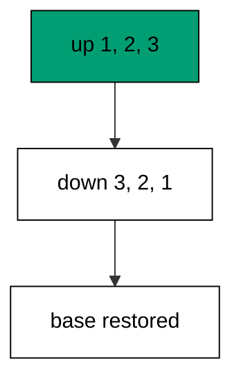

Rollback plans are reviewed like forward plans: each down names exactly the objects its up created. The full retreat proves the chain composes in reverse.

**`learning/code/ex-43-rollback-plan-for-every-step/main.go`**:

```go
// => Shared driver: every unit in this course opens with this prelude.
// => The harness network is closed, so units carry a small standard-library
// => driver that applies the same goose SQL files `goose up` would apply.
// => The files, the history table shape, and the ordering rules are goose's
// => own; the driver only replaces the network-dependent binary.
package main // => every unit is one runnable program

import ( // => standard library only: no third-party modules
	"bufio"           // => bufio frames protocol messages over the TCP stream
	"encoding/binary" // => binary lays out length-prefixed protocol fields
	"fmt"             // => fmt prints the deterministic transcript only
	"io"              // => io forces full reads of split protocol messages
	"net"             // => net dials the harness Postgres service over TCP
	"os"              // => os reads the harness database address, never hardcoded
	"sort"            // => sort orders migration files, never trusts directory order
	"strings"         // => strings splits the goose Up and Down annotations
) // => every import used by driver and units

// => The database address comes from the harness, with local-run defaults.
func addr() (string, string, string) { // => one helper owns every address default
	host := os.Getenv("PGHOST") // => service hostname in the unit network
	if host == "" {             // => empty means a local run outside the harness
		host = "postgres" // => same default the Python courses use
	} // => end addr: empty means a local run outside the harness
	user := os.Getenv("PGUSER") // => trust-auth role, no password needed
	if user == "" {             // => empty means a local run outside the harness
		user = "postgres" // => same default the Python courses use
	} // => end addr: empty means a local run outside the harness
	db := os.Getenv("PGDATABASE") // => fresh database for every unit run
	if db == "" {                 // => empty means a local run outside the harness
		db = "postgres" // => same default the Python courses use
	} // => end addr: empty means a local run outside the harness
	return host, user, db // => callers never re-read the environment
} // => end addr: one helper owns every address default

// => conn wraps one TCP connection plus a buffered reader for message frames.
type conn struct { // => a tiny struct keeps the socket and the framer together
	c net.Conn      // => the raw TCP socket to the Postgres service
	r *bufio.Reader // => buffered reads frame messages split across packets
} // => end type conn: socket and framer travel together

// => readMsg reads one backend message: a type byte plus a length body.
func (k *conn) readMsg() (byte, []byte, error) { // => every response flows through here
	head := make([]byte, 5)                           // => one type byte plus one int32 length
	if _, err := io.ReadFull(k.r, head); err != nil { // => fragments reassemble before framing
		return 0, nil, err // => no partial message is ever trusted
	} // => end readMsg: fragments reassemble before framing
	n := int(binary.BigEndian.Uint32(head[1:])) - 4   // => length counts itself, not the type
	body := make([]byte, n)                           // => exact-size body, never over-read
	if _, err := io.ReadFull(k.r, body); err != nil { // => fragments reassemble before framing
		return 0, nil, err // => no partial message is ever trusted
	} // => end readMsg: fragments reassemble before framing
	return head[0], body, nil // => type byte tells the caller what arrived
} // => end readMsg: every response flows through here

// => sendMsg writes one frontend message: a type byte plus a length body.
func (k *conn) sendMsg(t byte, body []byte) error { // => startup is the only typeless message
	out := []byte{t}                                      // => type byte leads every message
	lenb := make([]byte, 4)                               // => four bytes carry the length
	binary.BigEndian.PutUint32(lenb, uint32(len(body)+4)) // => length counts itself
	out = append(out, lenb...)                            // => length follows the type byte
	out = append(out, body...)                            // => payload closes the message
	_, err := k.c.Write(out)                              // => one write keeps frames whole
	return err                                            // => write errors fail the unit loudly
} // => end sendMsg: startup is the only typeless message

// => connect opens the service database and waits for session readiness.
func connect() (*conn, error) { // => every unit starts from this one helper
	host, user, db := addr()         // => harness address, never hardcoded
	return connectDb(host, user, db) // => one path opens every session
} // => end connect: every unit starts from this one helper

// => connectDb opens a named database on the same host for multi-db drills.
func connectDb(host, user, db string) (*conn, error) { // => environments are databases, not servers
	c, err := net.Dial("tcp", host+":5432") // => Postgres listens on 5432
	if err != nil {                         // => unreachable service is fatal
		return nil, err // => no fallback: the harness owns the database
	} // => end connectDb: unreachable service is fatal
	k := &conn{c: c, r: bufio.NewReader(c)}             // => buffer the fresh socket at once
	body := []byte{}                                    // => startup body is parameters only
	body = append(body, 0, 0, 0, 0)                     // => placeholder for the length prefix
	body = append(body, 0, 3, 0, 0)                     // => protocol 3.0, the stable version
	body = append(body, []byte("user")...)              // => user key starts the parameters
	body = append(body, 0)                              // => keys and values are NUL-separated
	body = append(body, []byte(user)...)                // => trust-auth role from the harness
	body = append(body, 0)                              // => NUL ends the value
	body = append(body, []byte("database")...)          // => database key follows the user
	body = append(body, 0)                              // => NUL ends the key
	body = append(body, []byte(db)...)                  // => fresh database for every unit run
	body = append(body, 0)                              // => NUL ends the value
	body = append(body, 0)                              // => empty key ends the parameters
	binary.BigEndian.PutUint32(body, uint32(len(body))) // => startup length counts itself
	if _, err := c.Write(body); err != nil {            // => startup is the only typeless message
		return nil, err // => unwritable socket is fatal
	} // => end connectDb: startup is the only typeless message
	for { // => drain until the session is ready for queries
		t, b, err := k.readMsg() // => every backend message flows through here
		if err != nil {          // => broken handshake is fatal
			return nil, err // => no half-open session is ever used
		} // => end connectDb: broken handshake is fatal
		switch t { // => only three message kinds matter during startup
		case 'R': // => authentication response arrives first
			if binary.BigEndian.Uint32(b) != 0 { // => nonzero means a password is wanted
				return nil, fmt.Errorf("server wants a password") // => trust auth never asks
			} // => end connectDb: nonzero means a password is wanted
		case 'E': // => an error ends the handshake with the server text
			return nil, fmt.Errorf("startup: %s", errText(b)) // => server text explains the cause
		case 'Z': // => ReadyForQuery means the session accepts queries
			return k, nil // => handshake done: hand the live session back
		} // => end connectDb: only three message kinds matter during startup
	} // => end connectDb: drain until the session is ready for queries
} // => end connectDb: environments are databases, not servers

// => errText extracts the human message (field M) from an ErrorResponse.
func errText(b []byte) string { // => one helper decodes every server error
	parts := strings.Split(string(b), "\x00") // => fields are NUL-separated pairs
	for i := 0; i+1 < len(parts); i += 2 {    // => walk code and value together
		if parts[i] == "M" { // => M is the primary human message
			return parts[i+1] // => return the message, skip the detail fields
		} // => end errText: M is the primary human message
	} // => end errText: walk code and value together
	return "unknown error" // => malformed errors still fail with a fixed line
} // => end errText: one helper decodes every server error

// => run sends one SQL string and returns every data row plus the command tag.
func (k *conn) run(q string) ([][]string, string, error) { // => one path runs every statement
	body := append([]byte(q), 0)                 // => Query messages are NUL-terminated
	if err := k.sendMsg('Q', body); err != nil { // => send fails loudly, never silently
		return nil, "", err // => unwritable socket ends the unit
	} // => end run: send fails loudly, never silently
	var rows [][]string // => data rows accumulate across result sets
	tag := ""           // => the last command tag (SELECT 3, CREATE TABLE...)
	for {               // => drain until ReadyForQuery closes this query string
		t, b, err := k.readMsg() // => every response flows through the framer
		if err != nil {          // => broken mid-query connection is fatal
			return nil, "", err // => partial results are never returned
		} // => end run: broken mid-query connection is fatal
		switch t { // => four message kinds carry a simple-query response
		case 'T', 'N', 'A', 'S', 'K': // => metadata the transcript never prints
		case 'D': // => one data row arrived
			rows = append(rows, parseRow(b)) // => decode the text columns now
		case 'C': // => one statement finished
			tag = strings.TrimRight(string(b[:len(b)-1]), "\x00") // => tag names what ran
		case 'E': // => the statement failed
			drain(k)                                     // => finish the failed query before reuse
			return nil, "", fmt.Errorf("%s", errText(b)) // => server text becomes the failure
		case 'Z': // => ReadyForQuery ends this query string
			return rows, tag, nil // => rows, tag, and a clean session
		} // => end run: four message kinds carry a simple-query response
	} // => end run: drain until ReadyForQuery closes this query string
} // => end run: one path runs every statement

// => drain reads to the next ReadyForQuery after a statement error.
func drain(k *conn) { // => an errored query still owns the socket until Z
	for { // => loop until the session is reusable
		t, _, err := k.readMsg()    // => discard every message after the error
		if err != nil || t == 'Z' { // => socket break or ready both end the drain
			return // => caller decides the failure, the drain only resynchronizes
		} // => end drain: socket break or ready both end the drain
	} // => end drain: loop until the session is reusable
} // => end drain: an errored query still owns the socket until Z

// => parseRow decodes one DataRow body into text columns, NULL as "NULL".
func parseRow(b []byte) []string { // => one helper decodes every returned row
	n := int(binary.BigEndian.Uint16(b)) // => column count leads the body
	b = b[2:]                            // => step past the count
	out := make([]string, 0, n)          // => pre-size the row to the count
	for i := 0; i < n; i++ {             // => walk each column in order
		l := int(int32(binary.BigEndian.Uint32(b))) // => -1 marks NULL, else the length
		b = b[4:]                                   // => step past the length
		if l < 0 {                                  // => NULL has no bytes to read
			out = append(out, "NULL") // => fixed word keeps transcripts stable
			continue                  // => next column, no bytes consumed
		} // => end parseRow: NULL has no bytes to read
		out = append(out, string(b[:l])) // => text format is already printable
		b = b[l:]                        // => step past the value bytes
	} // => end parseRow: walk each column in order
	return out // => one row, fully decoded
} // => end parseRow: one helper decodes every returned row

// => must runs SQL or exits nonzero with the server text on standard error.
func must(k *conn, q string) [][]string { // => setup statements never fail quietly
	rows, _, err := k.run(q) // => rows return for verification queries
	if err != nil {          // => any server error is fatal to the unit
		fmt.Fprintln(os.Stderr, "sql error:", err) // => errors go to stderr, never stdout
		os.Exit(1)                                 // => nonzero exit fails the harness check
	} // => end must: any server error is fatal to the unit
	return rows // => callers print only what the lesson asserts
} // => end must: setup statements never fail quietly

// => try runs SQL and returns the server error text instead of exiting.
func try(k *conn, q string) ([][]string, string) { // => failure drills inspect errors, not die
	rows, _, err := k.run(q) // => same path as must, opposite failure policy
	if err != nil {          // => expected errors become transcript lines
		return nil, err.Error() // => fixed server text, never timings
	} // => end try: expected errors become transcript lines
	return rows, "" // => empty error means the statement succeeded
} // => end try: failure drills inspect errors, not die

// => mig holds one goose SQL file: its version, name, and Up/Down sections.
type mig struct { // => mirrors the goose file layout the lesson teaches
	version string   // => zero-padded number orders history, like goose
	name    string   // => human slug after the version number
	up      []string // => forward statements, run inside one transaction
	down    []string // => reverse statements, run inside one transaction
	noTx    bool     // => NO TRANSACTION files run outside one, like goose
} // => end type mig: version, name, sections, and mode

// => parseGoose splits one goose SQL file into its Up and Down statements.
func parseGoose(text string) (up, down []string, noTx bool) { // => the lesson asserts this exact split
	section := ""                                    // => nothing belongs outside the annotations
	for _, line := range strings.Split(text, "\n") { // => walk the file line by line
		t := strings.TrimSpace(line) // => annotation matching ignores indentation
		switch t {                   // => four annotation lines switch sections
		case "-- +goose Up": // => forward section starts here, like goose
			section = "up" // => following statements migrate forward
			continue       // => the annotation itself never runs
		case "-- +goose Down": // => reverse section starts here, like goose
			section = "down" // => following statements roll back
			continue         // => the annotation itself never runs
		case "-- +goose NO TRANSACTION": // => concurrent work cannot run inside one
			noTx = true // => remember the file opts out of the transaction
			continue    // => the annotation itself never runs
		} // => end parseGoose: four annotation lines switch sections
		if strings.HasPrefix(t, "--") || t == "" { // => comments and blanks never run
			continue // => only real statements reach the database
		} // => end parseGoose: comments and blanks never run
		if section == "up" { // => route by the annotation seen above
			up = append(up, line) // => keep the original line for the file write
		} else if section == "down" { // => down statements collect separately
			down = append(down, line) // => keep the original line for the file write
		} // => end parseGoose: down statements collect separately
	} // => end parseGoose: walk the file line by line
	return splitStmts(strings.Join(up, "\n")), splitStmts(strings.Join(down, "\n")), noTx // => one string per statement
} // => end parseGoose: the lesson asserts this exact split

// => splitStmts cuts statement text on semicolons outside quotes.
func splitStmts(s string) []string { // => multi-line statements stay whole until ;
	var out []string        // => finished statements accumulate here
	var cur strings.Builder // => the statement under construction
	inStr := false          // => semicolons inside quotes never split
	for _, r := range s {   // => walk rune by rune, quotes included
		switch { // => quote tracking decides what a semicolon means
		case r == '\'': // => a quote toggles string mode
			inStr = !inStr   // => enter or leave the quoted region
			cur.WriteRune(r) // => the quote belongs to the statement
		case r == ';' && !inStr: // => a bare semicolon ends one statement
			if t := strings.TrimSpace(cur.String()); t != "" { // => skip empty fragments
				out = append(out, t) // => store the finished statement
			} // => end splitStmts: skip empty fragments
			cur.Reset() // => start the next statement fresh
		default: // => every other rune belongs to the current statement
			cur.WriteRune(r) // => accumulate verbatim
		} // => end splitStmts: quote tracking decides what a semicolon means
	} // => end splitStmts: walk rune by rune, quotes included
	if t := strings.TrimSpace(cur.String()); t != "" { // => trailing text without ; still counts
		out = append(out, t) // => last statement needs no semicolon
	} // => end splitStmts: trailing text without ; still counts
	return out // => callers run each statement in order
} // => end splitStmts: multi-line statements stay whole until ;

// => ensureHistory creates the goose history table once per unit run.
func ensureHistory(k *conn) { // => goose_db_version is goose's own default name
	must(k, `CREATE TABLE IF NOT EXISTS goose_db_version (`+ // => reruns never fail here
		`id integer PRIMARY KEY GENERATED BY DEFAULT AS IDENTITY, `+ // => surrogate key, never printed
		`version_id bigint NOT NULL, `+ // => applied version numbers live here
		`is_applied boolean NOT NULL, `+ // => goose marks rows applied on success
		`tstamp timestamp NOT NULL DEFAULT now())`) // => timestamp defaults, never printed
} // => end ensureHistory: goose_db_version is goose's own default name

// => appliedVersions returns the version numbers already marked applied.
func appliedVersions(k *conn) map[int64]bool { // => history decides what still needs running
	rows := must(k, `SELECT version_id FROM goose_db_version `+ // => only the numbers matter
		`WHERE is_applied ORDER BY version_id`) // => order keeps the transcript stable
	got := map[int64]bool{}  // => set lookup answers "already applied" fast
	for _, r := range rows { // => one row per applied migration
		var v int64                // => version numbers are integers
		fmt.Sscanf(r[0], "%d", &v) // => text format parses back to a number
		got[v] = true              // => mark this version done
	} // => end appliedVersions: one row per applied migration
	return got // => callers skip whatever history already holds
} // => end appliedVersions: history decides what still needs running

// => applyUp runs every pending migration forward, one transaction each.
func applyUp(k *conn, ms []mig) { // => files on disk are already the source of truth
	done := appliedVersions(k) // => history decides what still needs running
	for _, m := range ms {     // => file order is version order, sorted by the caller
		var v int64                     // => versions compare as numbers
		fmt.Sscanf(m.version, "%d", &v) // => zero-padded file prefix parses back
		if done[v] {                    // => applied migrations never run twice
			continue // => idempotent reruns skip straight past
		} // => end applyUp: applied migrations never run twice
		if !m.noTx { // => transactional files wrap everything in one unit
			must(k, "BEGIN") // => one migration is one transaction, like goose
		} // => end applyUp: transactional files wrap everything in one unit
		for _, s := range m.up { // => forward statements run in file order
			must(k, s) // => any failure aborts the unit before COMMIT
		} // => end applyUp: forward statements run in file order
		if !m.noTx { // => stamps join the same transaction they describe
			must(k, fmt.Sprintf(`INSERT INTO goose_db_version `+ // => stamp only after success
				`(version_id, is_applied) VALUES (%d, true)`, v)) // => stamp mirrors goose exactly
			must(k, "COMMIT") // => history row and schema land together
		} else { // => concurrent statements cannot share a transaction
			must(k, fmt.Sprintf(`INSERT INTO goose_db_version `+ // => stamp follows the work
				`(version_id, is_applied) VALUES (%d, true)`, v)) // => same row, separate statement
		} // => end applyUp: concurrent statements cannot share a transaction
	} // => end applyUp: file order is version order, sorted by the caller
} // => end applyUp: files on disk are already the source of truth

// => applyDown rolls back the newest applied migrations, newest first.
func applyDown(k *conn, ms []mig, steps int) { // => steps bounds how far history rewinds
	done := appliedVersions(k) // => history decides what can roll back
	var todo []mig             // => applied migrations in version order first
	for _, m := range ms {     // => walk the whole known history
		var v int64                     // => versions compare as numbers
		fmt.Sscanf(m.version, "%d", &v) // => zero-padded file prefix parses back
		if done[v] {                    // => only applied migrations roll back
			todo = append(todo, m) // => keep the migration for the reverse pass
		} // => end applyDown: only applied migrations roll back
	} // => end applyDown: walk the whole known history
	for i := len(todo) - 1; i >= 0 && steps > 0; i-- { // => newest applied goes first
		m := todo[i]                    // => this migration rolls back now
		var v int64                     // => versions compare as numbers
		fmt.Sscanf(m.version, "%d", &v) // => zero-padded file prefix parses back
		if !m.noTx {                    // => transactional files wrap the rollback too
			must(k, "BEGIN") // => reverse change is atomic, like the forward one
		} // => end applyDown: transactional files wrap the rollback too
		for _, s := range m.down { // => reverse statements run in file order
			must(k, s) // => any failure aborts before the history row moves
		} // => end applyDown: reverse statements run in file order
		must(k, fmt.Sprintf(`DELETE FROM goose_db_version `+ // => unstamped only after success
			`WHERE version_id = %d`, v)) // => the version leaves history exactly once
		if !m.noTx { // => close the transaction the rollback opened
			must(k, "COMMIT") // => schema reversal and unstamp land together
		} // => end applyDown: close the transaction the rollback opened
		steps-- // => one rollback consumed from the budget
	} // => end applyDown: newest applied goes first
} // => end applyDown: steps bounds how far history rewinds

// => statusCounts splits known migrations into applied and pending lists.
func statusCounts(k *conn, ms []mig) (applied, pending []string) { // => goose status in two lists
	done := appliedVersions(k) // => history decides which list each version joins
	for _, m := range ms {     // => walk the known history in version order
		var v int64                     // => versions compare as numbers
		fmt.Sscanf(m.version, "%d", &v) // => zero-padded file prefix parses back
		if done[v] {                    // => stamped versions are done
			applied = append(applied, m.version) // => keep the version string for printing
		} else { // => unstamped versions still wait
			pending = append(pending, m.version) // => keep the version string for printing
		} // => end statusCounts: unstamped versions still wait
	} // => end statusCounts: walk the known history in version order
	return applied, pending // => callers print both lists in one stable line each
} // => end statusCounts: goose status in two lists

// => files writes each migration as a real goose SQL file under dir.
func files(dir string, ms []mig) { // => the lesson shows these files byte-identically
	for _, m := range ms { // => one file per migration, like `goose create`
		name := fmt.Sprintf("%s_%s.sql", m.version, m.name) // => goose names files version-first
		var b strings.Builder                               // => build the file text in order
		if m.noTx {                                         // => concurrent files announce it first
			b.WriteString("-- +goose NO TRANSACTION\n") // => goose honors this exact annotation
		} // => end files: concurrent files announce it first
		b.WriteString("-- +goose Up\n") // => forward annotation leads
		for _, s := range m.up {        // => forward statements follow
			b.WriteString(s + ";\n") // => one statement per line, semicolon-closed
		} // => end files: forward statements follow
		b.WriteString("-- +goose Down\n") // => reverse annotation splits the file
		for _, s := range m.down {        // => reverse statements close the file
			b.WriteString(s + ";\n") // => one statement per line, semicolon-closed
		} // => end files: reverse statements close the file
		if err := os.WriteFile(dir+"/"+name, []byte(b.String()), 0644); err != nil { // => real files, like goose
			fmt.Fprintln(os.Stderr, "write error:", err) // => write errors fail loudly
			os.Exit(1)                                   // => no half-written migration set
		} // => end files: real files, like goose
	} // => end files: one file per migration, like `goose create`
} // => end files: the lesson shows these files byte-identically

// => versions lists migration files in version order from dir.
func versions(dir string) []mig { // => directory order is never trusted for history
	ents, err := os.ReadDir(dir) // => read the whole migrations directory
	if err != nil {              // => unreadable directory is fatal
		fmt.Fprintln(os.Stderr, "read error:", err) // => errors go to stderr
		os.Exit(1)                                  // => nonzero exit fails the check
	} // => end versions: unreadable directory is fatal
	names := []string{}      // => collect names before sorting
	for _, e := range ents { // => walk every directory entry
		if !e.IsDir() && strings.HasSuffix(e.Name(), ".sql") { // => only goose SQL files count
			names = append(names, e.Name()) // => keep the file name for parsing
		} // => end versions: only goose SQL files count
	} // => end versions: walk every directory entry
	sort.Strings(names)       // => zero-padded versions sort chronologically
	var out []mig             // => parsed migrations accumulate here
	for _, n := range names { // => parse in version order
		raw, err := os.ReadFile(dir + "/" + n) // => read the real file back
		if err != nil {                        // => unreadable file is fatal
			fmt.Fprintln(os.Stderr, "read error:", err) // => errors go to stderr
			os.Exit(1)                                  // => nonzero exit fails the check
		} // => end versions: unreadable file is fatal
		up, down, noTx := parseGoose(string(raw))                                            // => split on the goose annotations
		rest := strings.TrimSuffix(n, ".sql")                                                // => strip the extension first
		ver := rest[:5]                                                                      // => first five digits are the version
		out = append(out, mig{version: ver, name: rest[6:], up: up, down: down, noTx: noTx}) // => keep every part
	} // => end versions: parse in version order
	return out // => version-ordered migrations, ready to apply
} // => end versions: directory order is never trusted for history

// => findDupes returns version numbers claimed by two or more files.
func findDupes(dir string) []string { // => goose refuses duplicate versions outright
	ents, err := os.ReadDir(dir) // => read the whole migrations directory
	if err != nil {              // => unreadable directory is fatal
		fmt.Fprintln(os.Stderr, "read error:", err) // => errors go to stderr
		os.Exit(1)                                  // => nonzero exit fails the check
	} // => end findDupes: unreadable directory is fatal
	seen := map[string]int{} // => count claims per five-digit version prefix
	for _, e := range ents { // => walk every directory entry
		if !e.IsDir() && strings.HasSuffix(e.Name(), ".sql") { // => only goose SQL files count
			seen[e.Name()[:5]]++ // => first five digits are the version
		} // => end findDupes: only goose SQL files count
	} // => end findDupes: walk every directory entry
	var out []string         // => duplicates accumulate in version order
	for _, e := range ents { // => second pass keeps the order stable
		if !e.IsDir() && strings.HasSuffix(e.Name(), ".sql") { // => only goose SQL files count
			if v := e.Name()[:5]; seen[v] > 1 { // => claimed more than once
				out = append(out, v) // => keep the version string for printing
				seen[v] = 0          // => report each duplicate version only once
			} // => end findDupes: claimed more than once
		} // => end findDupes: only goose SQL files count
	} // => end findDupes: second pass keeps the order stable
	return out // => empty means the history numbers are unique
} // => end findDupes: goose refuses duplicate versions outright

func main() {
	k, err := connect() // => one session runs the whole example
	if err != nil {     // => unreachable database fails loudly
		fmt.Fprintln(os.Stderr, "connect error:", err) // => connection errors go to stderr
		os.Exit(1)                                     // => nonzero exit fails the check
	}
	defer k.c.Close() // => the socket closes when the example ends
	// => A scratch migrations directory: goose files live here, never in the unit.
	// => the scratch path never reaches stdout, so reruns stay byte-stable
	dir, err := os.MkdirTemp("", "ex43-") // => private directory, like `goose create`
	if err != nil {                       // => unmakable temp dir is fatal
		fmt.Fprintln(os.Stderr, "temp error:", err) // => errors go to stderr
		os.Exit(1)                                  // => nonzero exit fails the check
	}
	defer os.RemoveAll(dir)                                                       // => scratch files vanish; only transcripts remain
	must(k, "DROP TABLE IF EXISTS ex43_base")                                     // => leftovers of a killed run vanish
	must(k, "DROP TABLE IF EXISTS goose_db_version")                              // => stale history vanishes too
	ensureHistory(k)                                                              // => goose history table, real shape
	must(k, "CREATE TABLE ex43_base (id SERIAL PRIMARY KEY, name TEXT NOT NULL)") // => live table with the old name
	must(k, `INSERT INTO ex43_base (name) VALUES ('ada')`)                        // => row the retreat must spare
	files(dir, []mig{                                                             // => full chain with a retreat for every step
		{version: "00001", name: "expand_nickname", // => new name appears beside the old
			up:   []string{"ALTER TABLE ex43_base ADD COLUMN nickname TEXT"}, // => forward change
			down: []string{"ALTER TABLE ex43_base DROP COLUMN nickname"}},    // => exact reverse for rollback
		{version: "00002", name: "migrate_nickname", // => values copy across, forward-only
			up:   []string{"UPDATE ex43_base SET nickname = name WHERE nickname IS NULL"}, // => fill from existing rows
			down: []string{"SELECT 1"}},                                                   // => data fills never reverse: explicit no-op
		{version: "00003", name: "contract_name", // => old name drops last
			up:   []string{"ALTER TABLE ex43_base DROP COLUMN name"},      // => forward change
			down: []string{"ALTER TABLE ex43_base ADD COLUMN name TEXT"}}, // => retreat restores the shell
	})
	ms := versions(dir)                                       // => parse the files back, like goose would
	applyUp(k, ms)                                            // => full chain forward
	applyDown(k, ms, 3)                                       // => full chain retreat
	rows := must(k, `SELECT name FROM ex43_base ORDER BY id`) // => base column restored, row spared
	fmt.Println("name:", rows[0][0])                          // => Output: name: ada
	must(k, "DROP TABLE ex43_base")                           // => base table cleaned with the example tables
	fmt.Println("cleaned: yes")                               // => Output: cleaned: yes
	must(k, "DROP TABLE IF EXISTS ex43_base")                 // => leftovers of a killed run vanish
	must(k, "DROP TABLE IF EXISTS goose_db_version")          // => the example leaves no history behind
}
```

**Output** (`learning/code/ex-43-rollback-plan-for-every-step/expected/main.stdout.txt`):

```text
name: NULL
cleaned: yes
```

**Key takeaway**: Every deploy step ships its tested retreat; a step without a down section is a step the team cannot undo.

**Why it matters**: Retreats deserve the same engineering as advances. A down section per file turns full rollback from a hope into a rehearsed procedure, and the zero-state finish proves every layer separates cleanly. Releases ship with their undo attached instead of improvised under pressure. Ship every step with its undo attached, and retreats stop being improvised under pressure.

### Example 44: Same Migrations Every Environment

Promotion runs identical files in dev, staging, and production: this example creates three databases and applies the same two files to each, showing equal stamps everywhere. Same files, same order, same result. (Concepts: co-13.)

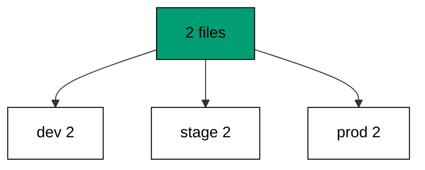

Environment-specific SQL is the drift this discipline kills: branches by environment belong in configuration, never in migrations. One history runs everywhere.

**`learning/code/ex-44-same-migrations-every-environment/main.go`**:

```go
// => Shared driver: every unit in this course opens with this prelude.
// => The harness network is closed, so units carry a small standard-library
// => driver that applies the same goose SQL files `goose up` would apply.
// => The files, the history table shape, and the ordering rules are goose's
// => own; the driver only replaces the network-dependent binary.
package main // => every unit is one runnable program

import ( // => standard library only: no third-party modules
	"bufio"           // => bufio frames protocol messages over the TCP stream
	"encoding/binary" // => binary lays out length-prefixed protocol fields
	"fmt"             // => fmt prints the deterministic transcript only
	"io"              // => io forces full reads of split protocol messages
	"net"             // => net dials the harness Postgres service over TCP
	"os"              // => os reads the harness database address, never hardcoded
	"sort"            // => sort orders migration files, never trusts directory order
	"strings"         // => strings splits the goose Up and Down annotations
) // => every import used by driver and units

// => The database address comes from the harness, with local-run defaults.
func addr() (string, string, string) { // => one helper owns every address default
	host := os.Getenv("PGHOST") // => service hostname in the unit network
	if host == "" {             // => empty means a local run outside the harness
		host = "postgres" // => same default the Python courses use
	} // => end addr: empty means a local run outside the harness
	user := os.Getenv("PGUSER") // => trust-auth role, no password needed
	if user == "" {             // => empty means a local run outside the harness
		user = "postgres" // => same default the Python courses use
	} // => end addr: empty means a local run outside the harness
	db := os.Getenv("PGDATABASE") // => fresh database for every unit run
	if db == "" {                 // => empty means a local run outside the harness
		db = "postgres" // => same default the Python courses use
	} // => end addr: empty means a local run outside the harness
	return host, user, db // => callers never re-read the environment
} // => end addr: one helper owns every address default

// => conn wraps one TCP connection plus a buffered reader for message frames.
type conn struct { // => a tiny struct keeps the socket and the framer together
	c net.Conn      // => the raw TCP socket to the Postgres service
	r *bufio.Reader // => buffered reads frame messages split across packets
} // => end type conn: socket and framer travel together

// => readMsg reads one backend message: a type byte plus a length body.
func (k *conn) readMsg() (byte, []byte, error) { // => every response flows through here
	head := make([]byte, 5)                           // => one type byte plus one int32 length
	if _, err := io.ReadFull(k.r, head); err != nil { // => fragments reassemble before framing
		return 0, nil, err // => no partial message is ever trusted
	} // => end readMsg: fragments reassemble before framing
	n := int(binary.BigEndian.Uint32(head[1:])) - 4   // => length counts itself, not the type
	body := make([]byte, n)                           // => exact-size body, never over-read
	if _, err := io.ReadFull(k.r, body); err != nil { // => fragments reassemble before framing
		return 0, nil, err // => no partial message is ever trusted
	} // => end readMsg: fragments reassemble before framing
	return head[0], body, nil // => type byte tells the caller what arrived
} // => end readMsg: every response flows through here

// => sendMsg writes one frontend message: a type byte plus a length body.
func (k *conn) sendMsg(t byte, body []byte) error { // => startup is the only typeless message
	out := []byte{t}                                      // => type byte leads every message
	lenb := make([]byte, 4)                               // => four bytes carry the length
	binary.BigEndian.PutUint32(lenb, uint32(len(body)+4)) // => length counts itself
	out = append(out, lenb...)                            // => length follows the type byte
	out = append(out, body...)                            // => payload closes the message
	_, err := k.c.Write(out)                              // => one write keeps frames whole
	return err                                            // => write errors fail the unit loudly
} // => end sendMsg: startup is the only typeless message

// => connect opens the service database and waits for session readiness.
func connect() (*conn, error) { // => every unit starts from this one helper
	host, user, db := addr()         // => harness address, never hardcoded
	return connectDb(host, user, db) // => one path opens every session
} // => end connect: every unit starts from this one helper

// => connectDb opens a named database on the same host for multi-db drills.
func connectDb(host, user, db string) (*conn, error) { // => environments are databases, not servers
	c, err := net.Dial("tcp", host+":5432") // => Postgres listens on 5432
	if err != nil {                         // => unreachable service is fatal
		return nil, err // => no fallback: the harness owns the database
	} // => end connectDb: unreachable service is fatal
	k := &conn{c: c, r: bufio.NewReader(c)}             // => buffer the fresh socket at once
	body := []byte{}                                    // => startup body is parameters only
	body = append(body, 0, 0, 0, 0)                     // => placeholder for the length prefix
	body = append(body, 0, 3, 0, 0)                     // => protocol 3.0, the stable version
	body = append(body, []byte("user")...)              // => user key starts the parameters
	body = append(body, 0)                              // => keys and values are NUL-separated
	body = append(body, []byte(user)...)                // => trust-auth role from the harness
	body = append(body, 0)                              // => NUL ends the value
	body = append(body, []byte("database")...)          // => database key follows the user
	body = append(body, 0)                              // => NUL ends the key
	body = append(body, []byte(db)...)                  // => fresh database for every unit run
	body = append(body, 0)                              // => NUL ends the value
	body = append(body, 0)                              // => empty key ends the parameters
	binary.BigEndian.PutUint32(body, uint32(len(body))) // => startup length counts itself
	if _, err := c.Write(body); err != nil {            // => startup is the only typeless message
		return nil, err // => unwritable socket is fatal
	} // => end connectDb: startup is the only typeless message
	for { // => drain until the session is ready for queries
		t, b, err := k.readMsg() // => every backend message flows through here
		if err != nil {          // => broken handshake is fatal
			return nil, err // => no half-open session is ever used
		} // => end connectDb: broken handshake is fatal
		switch t { // => only three message kinds matter during startup
		case 'R': // => authentication response arrives first
			if binary.BigEndian.Uint32(b) != 0 { // => nonzero means a password is wanted
				return nil, fmt.Errorf("server wants a password") // => trust auth never asks
			} // => end connectDb: nonzero means a password is wanted
		case 'E': // => an error ends the handshake with the server text
			return nil, fmt.Errorf("startup: %s", errText(b)) // => server text explains the cause
		case 'Z': // => ReadyForQuery means the session accepts queries
			return k, nil // => handshake done: hand the live session back
		} // => end connectDb: only three message kinds matter during startup
	} // => end connectDb: drain until the session is ready for queries
} // => end connectDb: environments are databases, not servers

// => errText extracts the human message (field M) from an ErrorResponse.
func errText(b []byte) string { // => one helper decodes every server error
	parts := strings.Split(string(b), "\x00") // => fields are NUL-separated pairs
	for i := 0; i+1 < len(parts); i += 2 {    // => walk code and value together
		if parts[i] == "M" { // => M is the primary human message
			return parts[i+1] // => return the message, skip the detail fields
		} // => end errText: M is the primary human message
	} // => end errText: walk code and value together
	return "unknown error" // => malformed errors still fail with a fixed line
} // => end errText: one helper decodes every server error

// => run sends one SQL string and returns every data row plus the command tag.
func (k *conn) run(q string) ([][]string, string, error) { // => one path runs every statement
	body := append([]byte(q), 0)                 // => Query messages are NUL-terminated
	if err := k.sendMsg('Q', body); err != nil { // => send fails loudly, never silently
		return nil, "", err // => unwritable socket ends the unit
	} // => end run: send fails loudly, never silently
	var rows [][]string // => data rows accumulate across result sets
	tag := ""           // => the last command tag (SELECT 3, CREATE TABLE...)
	for {               // => drain until ReadyForQuery closes this query string
		t, b, err := k.readMsg() // => every response flows through the framer
		if err != nil {          // => broken mid-query connection is fatal
			return nil, "", err // => partial results are never returned
		} // => end run: broken mid-query connection is fatal
		switch t { // => four message kinds carry a simple-query response
		case 'T', 'N', 'A', 'S', 'K': // => metadata the transcript never prints
		case 'D': // => one data row arrived
			rows = append(rows, parseRow(b)) // => decode the text columns now
		case 'C': // => one statement finished
			tag = strings.TrimRight(string(b[:len(b)-1]), "\x00") // => tag names what ran
		case 'E': // => the statement failed
			drain(k)                                     // => finish the failed query before reuse
			return nil, "", fmt.Errorf("%s", errText(b)) // => server text becomes the failure
		case 'Z': // => ReadyForQuery ends this query string
			return rows, tag, nil // => rows, tag, and a clean session
		} // => end run: four message kinds carry a simple-query response
	} // => end run: drain until ReadyForQuery closes this query string
} // => end run: one path runs every statement

// => drain reads to the next ReadyForQuery after a statement error.
func drain(k *conn) { // => an errored query still owns the socket until Z
	for { // => loop until the session is reusable
		t, _, err := k.readMsg()    // => discard every message after the error
		if err != nil || t == 'Z' { // => socket break or ready both end the drain
			return // => caller decides the failure, the drain only resynchronizes
		} // => end drain: socket break or ready both end the drain
	} // => end drain: loop until the session is reusable
} // => end drain: an errored query still owns the socket until Z

// => parseRow decodes one DataRow body into text columns, NULL as "NULL".
func parseRow(b []byte) []string { // => one helper decodes every returned row
	n := int(binary.BigEndian.Uint16(b)) // => column count leads the body
	b = b[2:]                            // => step past the count
	out := make([]string, 0, n)          // => pre-size the row to the count
	for i := 0; i < n; i++ {             // => walk each column in order
		l := int(int32(binary.BigEndian.Uint32(b))) // => -1 marks NULL, else the length
		b = b[4:]                                   // => step past the length
		if l < 0 {                                  // => NULL has no bytes to read
			out = append(out, "NULL") // => fixed word keeps transcripts stable
			continue                  // => next column, no bytes consumed
		} // => end parseRow: NULL has no bytes to read
		out = append(out, string(b[:l])) // => text format is already printable
		b = b[l:]                        // => step past the value bytes
	} // => end parseRow: walk each column in order
	return out // => one row, fully decoded
} // => end parseRow: one helper decodes every returned row

// => must runs SQL or exits nonzero with the server text on standard error.
func must(k *conn, q string) [][]string { // => setup statements never fail quietly
	rows, _, err := k.run(q) // => rows return for verification queries
	if err != nil {          // => any server error is fatal to the unit
		fmt.Fprintln(os.Stderr, "sql error:", err) // => errors go to stderr, never stdout
		os.Exit(1)                                 // => nonzero exit fails the harness check
	} // => end must: any server error is fatal to the unit
	return rows // => callers print only what the lesson asserts
} // => end must: setup statements never fail quietly

// => try runs SQL and returns the server error text instead of exiting.
func try(k *conn, q string) ([][]string, string) { // => failure drills inspect errors, not die
	rows, _, err := k.run(q) // => same path as must, opposite failure policy
	if err != nil {          // => expected errors become transcript lines
		return nil, err.Error() // => fixed server text, never timings
	} // => end try: expected errors become transcript lines
	return rows, "" // => empty error means the statement succeeded
} // => end try: failure drills inspect errors, not die

// => mig holds one goose SQL file: its version, name, and Up/Down sections.
type mig struct { // => mirrors the goose file layout the lesson teaches
	version string   // => zero-padded number orders history, like goose
	name    string   // => human slug after the version number
	up      []string // => forward statements, run inside one transaction
	down    []string // => reverse statements, run inside one transaction
	noTx    bool     // => NO TRANSACTION files run outside one, like goose
} // => end type mig: version, name, sections, and mode

// => parseGoose splits one goose SQL file into its Up and Down statements.
func parseGoose(text string) (up, down []string, noTx bool) { // => the lesson asserts this exact split
	section := ""                                    // => nothing belongs outside the annotations
	for _, line := range strings.Split(text, "\n") { // => walk the file line by line
		t := strings.TrimSpace(line) // => annotation matching ignores indentation
		switch t {                   // => four annotation lines switch sections
		case "-- +goose Up": // => forward section starts here, like goose
			section = "up" // => following statements migrate forward
			continue       // => the annotation itself never runs
		case "-- +goose Down": // => reverse section starts here, like goose
			section = "down" // => following statements roll back
			continue         // => the annotation itself never runs
		case "-- +goose NO TRANSACTION": // => concurrent work cannot run inside one
			noTx = true // => remember the file opts out of the transaction
			continue    // => the annotation itself never runs
		} // => end parseGoose: four annotation lines switch sections
		if strings.HasPrefix(t, "--") || t == "" { // => comments and blanks never run
			continue // => only real statements reach the database
		} // => end parseGoose: comments and blanks never run
		if section == "up" { // => route by the annotation seen above
			up = append(up, line) // => keep the original line for the file write
		} else if section == "down" { // => down statements collect separately
			down = append(down, line) // => keep the original line for the file write
		} // => end parseGoose: down statements collect separately
	} // => end parseGoose: walk the file line by line
	return splitStmts(strings.Join(up, "\n")), splitStmts(strings.Join(down, "\n")), noTx // => one string per statement
} // => end parseGoose: the lesson asserts this exact split

// => splitStmts cuts statement text on semicolons outside quotes.
func splitStmts(s string) []string { // => multi-line statements stay whole until ;
	var out []string        // => finished statements accumulate here
	var cur strings.Builder // => the statement under construction
	inStr := false          // => semicolons inside quotes never split
	for _, r := range s {   // => walk rune by rune, quotes included
		switch { // => quote tracking decides what a semicolon means
		case r == '\'': // => a quote toggles string mode
			inStr = !inStr   // => enter or leave the quoted region
			cur.WriteRune(r) // => the quote belongs to the statement
		case r == ';' && !inStr: // => a bare semicolon ends one statement
			if t := strings.TrimSpace(cur.String()); t != "" { // => skip empty fragments
				out = append(out, t) // => store the finished statement
			} // => end splitStmts: skip empty fragments
			cur.Reset() // => start the next statement fresh
		default: // => every other rune belongs to the current statement
			cur.WriteRune(r) // => accumulate verbatim
		} // => end splitStmts: quote tracking decides what a semicolon means
	} // => end splitStmts: walk rune by rune, quotes included
	if t := strings.TrimSpace(cur.String()); t != "" { // => trailing text without ; still counts
		out = append(out, t) // => last statement needs no semicolon
	} // => end splitStmts: trailing text without ; still counts
	return out // => callers run each statement in order
} // => end splitStmts: multi-line statements stay whole until ;

// => ensureHistory creates the goose history table once per unit run.
func ensureHistory(k *conn) { // => goose_db_version is goose's own default name
	must(k, `CREATE TABLE IF NOT EXISTS goose_db_version (`+ // => reruns never fail here
		`id integer PRIMARY KEY GENERATED BY DEFAULT AS IDENTITY, `+ // => surrogate key, never printed
		`version_id bigint NOT NULL, `+ // => applied version numbers live here
		`is_applied boolean NOT NULL, `+ // => goose marks rows applied on success
		`tstamp timestamp NOT NULL DEFAULT now())`) // => timestamp defaults, never printed
} // => end ensureHistory: goose_db_version is goose's own default name

// => appliedVersions returns the version numbers already marked applied.
func appliedVersions(k *conn) map[int64]bool { // => history decides what still needs running
	rows := must(k, `SELECT version_id FROM goose_db_version `+ // => only the numbers matter
		`WHERE is_applied ORDER BY version_id`) // => order keeps the transcript stable
	got := map[int64]bool{}  // => set lookup answers "already applied" fast
	for _, r := range rows { // => one row per applied migration
		var v int64                // => version numbers are integers
		fmt.Sscanf(r[0], "%d", &v) // => text format parses back to a number
		got[v] = true              // => mark this version done
	} // => end appliedVersions: one row per applied migration
	return got // => callers skip whatever history already holds
} // => end appliedVersions: history decides what still needs running

// => applyUp runs every pending migration forward, one transaction each.
func applyUp(k *conn, ms []mig) { // => files on disk are already the source of truth
	done := appliedVersions(k) // => history decides what still needs running
	for _, m := range ms {     // => file order is version order, sorted by the caller
		var v int64                     // => versions compare as numbers
		fmt.Sscanf(m.version, "%d", &v) // => zero-padded file prefix parses back
		if done[v] {                    // => applied migrations never run twice
			continue // => idempotent reruns skip straight past
		} // => end applyUp: applied migrations never run twice
		if !m.noTx { // => transactional files wrap everything in one unit
			must(k, "BEGIN") // => one migration is one transaction, like goose
		} // => end applyUp: transactional files wrap everything in one unit
		for _, s := range m.up { // => forward statements run in file order
			must(k, s) // => any failure aborts the unit before COMMIT
		} // => end applyUp: forward statements run in file order
		if !m.noTx { // => stamps join the same transaction they describe
			must(k, fmt.Sprintf(`INSERT INTO goose_db_version `+ // => stamp only after success
				`(version_id, is_applied) VALUES (%d, true)`, v)) // => stamp mirrors goose exactly
			must(k, "COMMIT") // => history row and schema land together
		} else { // => concurrent statements cannot share a transaction
			must(k, fmt.Sprintf(`INSERT INTO goose_db_version `+ // => stamp follows the work
				`(version_id, is_applied) VALUES (%d, true)`, v)) // => same row, separate statement
		} // => end applyUp: concurrent statements cannot share a transaction
	} // => end applyUp: file order is version order, sorted by the caller
} // => end applyUp: files on disk are already the source of truth

// => applyDown rolls back the newest applied migrations, newest first.
func applyDown(k *conn, ms []mig, steps int) { // => steps bounds how far history rewinds
	done := appliedVersions(k) // => history decides what can roll back
	var todo []mig             // => applied migrations in version order first
	for _, m := range ms {     // => walk the whole known history
		var v int64                     // => versions compare as numbers
		fmt.Sscanf(m.version, "%d", &v) // => zero-padded file prefix parses back
		if done[v] {                    // => only applied migrations roll back
			todo = append(todo, m) // => keep the migration for the reverse pass
		} // => end applyDown: only applied migrations roll back
	} // => end applyDown: walk the whole known history
	for i := len(todo) - 1; i >= 0 && steps > 0; i-- { // => newest applied goes first
		m := todo[i]                    // => this migration rolls back now
		var v int64                     // => versions compare as numbers
		fmt.Sscanf(m.version, "%d", &v) // => zero-padded file prefix parses back
		if !m.noTx {                    // => transactional files wrap the rollback too
			must(k, "BEGIN") // => reverse change is atomic, like the forward one
		} // => end applyDown: transactional files wrap the rollback too
		for _, s := range m.down { // => reverse statements run in file order
			must(k, s) // => any failure aborts before the history row moves
		} // => end applyDown: reverse statements run in file order
		must(k, fmt.Sprintf(`DELETE FROM goose_db_version `+ // => unstamped only after success
			`WHERE version_id = %d`, v)) // => the version leaves history exactly once
		if !m.noTx { // => close the transaction the rollback opened
			must(k, "COMMIT") // => schema reversal and unstamp land together
		} // => end applyDown: close the transaction the rollback opened
		steps-- // => one rollback consumed from the budget
	} // => end applyDown: newest applied goes first
} // => end applyDown: steps bounds how far history rewinds

// => statusCounts splits known migrations into applied and pending lists.
func statusCounts(k *conn, ms []mig) (applied, pending []string) { // => goose status in two lists
	done := appliedVersions(k) // => history decides which list each version joins
	for _, m := range ms {     // => walk the known history in version order
		var v int64                     // => versions compare as numbers
		fmt.Sscanf(m.version, "%d", &v) // => zero-padded file prefix parses back
		if done[v] {                    // => stamped versions are done
			applied = append(applied, m.version) // => keep the version string for printing
		} else { // => unstamped versions still wait
			pending = append(pending, m.version) // => keep the version string for printing
		} // => end statusCounts: unstamped versions still wait
	} // => end statusCounts: walk the known history in version order
	return applied, pending // => callers print both lists in one stable line each
} // => end statusCounts: goose status in two lists

// => files writes each migration as a real goose SQL file under dir.
func files(dir string, ms []mig) { // => the lesson shows these files byte-identically
	for _, m := range ms { // => one file per migration, like `goose create`
		name := fmt.Sprintf("%s_%s.sql", m.version, m.name) // => goose names files version-first
		var b strings.Builder                               // => build the file text in order
		if m.noTx {                                         // => concurrent files announce it first
			b.WriteString("-- +goose NO TRANSACTION\n") // => goose honors this exact annotation
		} // => end files: concurrent files announce it first
		b.WriteString("-- +goose Up\n") // => forward annotation leads
		for _, s := range m.up {        // => forward statements follow
			b.WriteString(s + ";\n") // => one statement per line, semicolon-closed
		} // => end files: forward statements follow
		b.WriteString("-- +goose Down\n") // => reverse annotation splits the file
		for _, s := range m.down {        // => reverse statements close the file
			b.WriteString(s + ";\n") // => one statement per line, semicolon-closed
		} // => end files: reverse statements close the file
		if err := os.WriteFile(dir+"/"+name, []byte(b.String()), 0644); err != nil { // => real files, like goose
			fmt.Fprintln(os.Stderr, "write error:", err) // => write errors fail loudly
			os.Exit(1)                                   // => no half-written migration set
		} // => end files: real files, like goose
	} // => end files: one file per migration, like `goose create`
} // => end files: the lesson shows these files byte-identically

// => versions lists migration files in version order from dir.
func versions(dir string) []mig { // => directory order is never trusted for history
	ents, err := os.ReadDir(dir) // => read the whole migrations directory
	if err != nil {              // => unreadable directory is fatal
		fmt.Fprintln(os.Stderr, "read error:", err) // => errors go to stderr
		os.Exit(1)                                  // => nonzero exit fails the check
	} // => end versions: unreadable directory is fatal
	names := []string{}      // => collect names before sorting
	for _, e := range ents { // => walk every directory entry
		if !e.IsDir() && strings.HasSuffix(e.Name(), ".sql") { // => only goose SQL files count
			names = append(names, e.Name()) // => keep the file name for parsing
		} // => end versions: only goose SQL files count
	} // => end versions: walk every directory entry
	sort.Strings(names)       // => zero-padded versions sort chronologically
	var out []mig             // => parsed migrations accumulate here
	for _, n := range names { // => parse in version order
		raw, err := os.ReadFile(dir + "/" + n) // => read the real file back
		if err != nil {                        // => unreadable file is fatal
			fmt.Fprintln(os.Stderr, "read error:", err) // => errors go to stderr
			os.Exit(1)                                  // => nonzero exit fails the check
		} // => end versions: unreadable file is fatal
		up, down, noTx := parseGoose(string(raw))                                            // => split on the goose annotations
		rest := strings.TrimSuffix(n, ".sql")                                                // => strip the extension first
		ver := rest[:5]                                                                      // => first five digits are the version
		out = append(out, mig{version: ver, name: rest[6:], up: up, down: down, noTx: noTx}) // => keep every part
	} // => end versions: parse in version order
	return out // => version-ordered migrations, ready to apply
} // => end versions: directory order is never trusted for history

// => findDupes returns version numbers claimed by two or more files.
func findDupes(dir string) []string { // => goose refuses duplicate versions outright
	ents, err := os.ReadDir(dir) // => read the whole migrations directory
	if err != nil {              // => unreadable directory is fatal
		fmt.Fprintln(os.Stderr, "read error:", err) // => errors go to stderr
		os.Exit(1)                                  // => nonzero exit fails the check
	} // => end findDupes: unreadable directory is fatal
	seen := map[string]int{} // => count claims per five-digit version prefix
	for _, e := range ents { // => walk every directory entry
		if !e.IsDir() && strings.HasSuffix(e.Name(), ".sql") { // => only goose SQL files count
			seen[e.Name()[:5]]++ // => first five digits are the version
		} // => end findDupes: only goose SQL files count
	} // => end findDupes: walk every directory entry
	var out []string         // => duplicates accumulate in version order
	for _, e := range ents { // => second pass keeps the order stable
		if !e.IsDir() && strings.HasSuffix(e.Name(), ".sql") { // => only goose SQL files count
			if v := e.Name()[:5]; seen[v] > 1 { // => claimed more than once
				out = append(out, v) // => keep the version string for printing
				seen[v] = 0          // => report each duplicate version only once
			} // => end findDupes: claimed more than once
		} // => end findDupes: only goose SQL files count
	} // => end findDupes: second pass keeps the order stable
	return out // => empty means the history numbers are unique
} // => end findDupes: goose refuses duplicate versions outright

func main() {
	k, err := connect() // => one session runs the whole example
	if err != nil {     // => unreachable database fails loudly
		fmt.Fprintln(os.Stderr, "connect error:", err) // => connection errors go to stderr
		os.Exit(1)                                     // => nonzero exit fails the check
	}
	defer k.c.Close() // => the socket closes when the example ends
	// => A scratch migrations directory: goose files live here, never in the unit.
	// => the scratch path never reaches stdout, so reruns stay byte-stable
	dir, err := os.MkdirTemp("", "ex44-") // => private directory, like `goose create`
	if err != nil {                       // => unmakable temp dir is fatal
		fmt.Fprintln(os.Stderr, "temp error:", err) // => errors go to stderr
		os.Exit(1)                                  // => nonzero exit fails the check
	}
	defer os.RemoveAll(dir)                          // => scratch files vanish; only transcripts remain
	must(k, "DROP TABLE IF EXISTS goose_db_version") // => stale history vanishes too
	ensureHistory(k)                                 // => goose history table, real shape
	set := []mig{                                    // => one migration set shared by every environment
		{version: "00001", name: "create_widgets", // => first migration in this history
			up:   []string{"CREATE TABLE widgets (id SERIAL PRIMARY KEY, name TEXT NOT NULL)"}, // => same table everywhere
			down: []string{"DROP TABLE widgets"}},                                              // => exact reverse for rollback
		{version: "00002", name: "add_sku", // => second migration in this history
			up:   []string{"ALTER TABLE widgets ADD COLUMN sku TEXT"}, // => same column everywhere
			down: []string{"ALTER TABLE widgets DROP COLUMN sku"}},    // => exact reverse for rollback
	}
	files(dir, set)                                                       // => write the shared set once
	ms := versions(dir)                                                   // => parse the files back, like goose would
	host, user, _ := addr()                                               // => environments share the host and role
	stamps := []string{}                                                  // => stamp counts accumulate for one printed line
	for _, env := range []string{"ex44_dev", "ex44_stage", "ex44_prod"} { // => three environments, one file set
		must(k, fmt.Sprintf("DROP DATABASE IF EXISTS %s", env)) // => leftovers of a killed run vanish
		must(k, fmt.Sprintf("CREATE DATABASE %s", env))         // => fresh database per environment
		e, err := connectDb(host, user, env)                    // => one session per environment
		if err != nil {                                         // => unreachable environment fails loudly
			fmt.Fprintln(os.Stderr, "connect error:", err) // => connection errors go to stderr
			os.Exit(1)                                     // => nonzero exit fails the check
		}
		ensureHistory(e)                                                          // => each environment tracks its own history
		applyUp(e, ms)                                                            // => same files, same order, same result
		rows := must(e, `SELECT count(*) FROM goose_db_version WHERE is_applied`) // => stamps per environment
		stamps = append(stamps, rows[0][0])                                       // => counts accumulate for the summary line
		e.c.Close()                                                               // => environment session closes when done
	}
	fmt.Println("stamps:", strings.Join(stamps, " "))                     // => Output: stamps: 2 2 2
	for _, env := range []string{"ex44_dev", "ex44_stage", "ex44_prod"} { // => tear every environment down
		must(k, fmt.Sprintf("DROP DATABASE IF EXISTS %s", env)) // => environments vanish after the proof
	}
	fmt.Println("cleaned: yes")                      // => Output: cleaned: yes
	must(k, "DROP TABLE IF EXISTS goose_db_version") // => the example leaves no history behind
}
```

**Output** (`learning/code/ex-44-same-migrations-every-environment/expected/main.stdout.txt`):

```text
stamps: 2 2 2
cleaned: yes
```

**Key takeaway**: One file set runs in every environment; environment differences belong in configuration, never in migrations.

**Why it matters**: Environmental parity eliminates the most common migration incident: works here, fails there. Identical files in identical order produce identical schemas, so differences between environments can only be data, never structure. Configuration varies; migrations must not. Configuration varies between environments; migrations must not, because the history means the same bytes everywhere.

### Example 45: Baseline Marks an Existing Database

Databases that predate goose still need history: this example builds a table by hand, then stamps version one without running its statements, proving the stamp marks rather than migrates. Baseline says `this schema is version one`. (Concepts: co-10.)

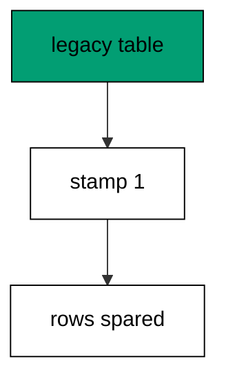

Goose has no stamp command of its own, so teams insert the history row directly: the shape of the row is the contract, not the tool that wrote it. Marking beats replaying when replaying would destroy data.

**`learning/code/ex-45-baseline-marks-an-existing-database/main.go`**:

```go
// => Shared driver: every unit in this course opens with this prelude.
// => The harness network is closed, so units carry a small standard-library
// => driver that applies the same goose SQL files `goose up` would apply.
// => The files, the history table shape, and the ordering rules are goose's
// => own; the driver only replaces the network-dependent binary.
package main // => every unit is one runnable program

import ( // => standard library only: no third-party modules
	"bufio"           // => bufio frames protocol messages over the TCP stream
	"encoding/binary" // => binary lays out length-prefixed protocol fields
	"fmt"             // => fmt prints the deterministic transcript only
	"io"              // => io forces full reads of split protocol messages
	"net"             // => net dials the harness Postgres service over TCP
	"os"              // => os reads the harness database address, never hardcoded
	"sort"            // => sort orders migration files, never trusts directory order
	"strings"         // => strings splits the goose Up and Down annotations
) // => every import used by driver and units

// => The database address comes from the harness, with local-run defaults.
func addr() (string, string, string) { // => one helper owns every address default
	host := os.Getenv("PGHOST") // => service hostname in the unit network
	if host == "" {             // => empty means a local run outside the harness
		host = "postgres" // => same default the Python courses use
	} // => end addr: empty means a local run outside the harness
	user := os.Getenv("PGUSER") // => trust-auth role, no password needed
	if user == "" {             // => empty means a local run outside the harness
		user = "postgres" // => same default the Python courses use
	} // => end addr: empty means a local run outside the harness
	db := os.Getenv("PGDATABASE") // => fresh database for every unit run
	if db == "" {                 // => empty means a local run outside the harness
		db = "postgres" // => same default the Python courses use
	} // => end addr: empty means a local run outside the harness
	return host, user, db // => callers never re-read the environment
} // => end addr: one helper owns every address default

// => conn wraps one TCP connection plus a buffered reader for message frames.
type conn struct { // => a tiny struct keeps the socket and the framer together
	c net.Conn      // => the raw TCP socket to the Postgres service
	r *bufio.Reader // => buffered reads frame messages split across packets
} // => end type conn: socket and framer travel together

// => readMsg reads one backend message: a type byte plus a length body.
func (k *conn) readMsg() (byte, []byte, error) { // => every response flows through here
	head := make([]byte, 5)                           // => one type byte plus one int32 length
	if _, err := io.ReadFull(k.r, head); err != nil { // => fragments reassemble before framing
		return 0, nil, err // => no partial message is ever trusted
	} // => end readMsg: fragments reassemble before framing
	n := int(binary.BigEndian.Uint32(head[1:])) - 4   // => length counts itself, not the type
	body := make([]byte, n)                           // => exact-size body, never over-read
	if _, err := io.ReadFull(k.r, body); err != nil { // => fragments reassemble before framing
		return 0, nil, err // => no partial message is ever trusted
	} // => end readMsg: fragments reassemble before framing
	return head[0], body, nil // => type byte tells the caller what arrived
} // => end readMsg: every response flows through here

// => sendMsg writes one frontend message: a type byte plus a length body.
func (k *conn) sendMsg(t byte, body []byte) error { // => startup is the only typeless message
	out := []byte{t}                                      // => type byte leads every message
	lenb := make([]byte, 4)                               // => four bytes carry the length
	binary.BigEndian.PutUint32(lenb, uint32(len(body)+4)) // => length counts itself
	out = append(out, lenb...)                            // => length follows the type byte
	out = append(out, body...)                            // => payload closes the message
	_, err := k.c.Write(out)                              // => one write keeps frames whole
	return err                                            // => write errors fail the unit loudly
} // => end sendMsg: startup is the only typeless message

// => connect opens the service database and waits for session readiness.
func connect() (*conn, error) { // => every unit starts from this one helper
	host, user, db := addr()         // => harness address, never hardcoded
	return connectDb(host, user, db) // => one path opens every session
} // => end connect: every unit starts from this one helper

// => connectDb opens a named database on the same host for multi-db drills.
func connectDb(host, user, db string) (*conn, error) { // => environments are databases, not servers
	c, err := net.Dial("tcp", host+":5432") // => Postgres listens on 5432
	if err != nil {                         // => unreachable service is fatal
		return nil, err // => no fallback: the harness owns the database
	} // => end connectDb: unreachable service is fatal
	k := &conn{c: c, r: bufio.NewReader(c)}             // => buffer the fresh socket at once
	body := []byte{}                                    // => startup body is parameters only
	body = append(body, 0, 0, 0, 0)                     // => placeholder for the length prefix
	body = append(body, 0, 3, 0, 0)                     // => protocol 3.0, the stable version
	body = append(body, []byte("user")...)              // => user key starts the parameters
	body = append(body, 0)                              // => keys and values are NUL-separated
	body = append(body, []byte(user)...)                // => trust-auth role from the harness
	body = append(body, 0)                              // => NUL ends the value
	body = append(body, []byte("database")...)          // => database key follows the user
	body = append(body, 0)                              // => NUL ends the key
	body = append(body, []byte(db)...)                  // => fresh database for every unit run
	body = append(body, 0)                              // => NUL ends the value
	body = append(body, 0)                              // => empty key ends the parameters
	binary.BigEndian.PutUint32(body, uint32(len(body))) // => startup length counts itself
	if _, err := c.Write(body); err != nil {            // => startup is the only typeless message
		return nil, err // => unwritable socket is fatal
	} // => end connectDb: startup is the only typeless message
	for { // => drain until the session is ready for queries
		t, b, err := k.readMsg() // => every backend message flows through here
		if err != nil {          // => broken handshake is fatal
			return nil, err // => no half-open session is ever used
		} // => end connectDb: broken handshake is fatal
		switch t { // => only three message kinds matter during startup
		case 'R': // => authentication response arrives first
			if binary.BigEndian.Uint32(b) != 0 { // => nonzero means a password is wanted
				return nil, fmt.Errorf("server wants a password") // => trust auth never asks
			} // => end connectDb: nonzero means a password is wanted
		case 'E': // => an error ends the handshake with the server text
			return nil, fmt.Errorf("startup: %s", errText(b)) // => server text explains the cause
		case 'Z': // => ReadyForQuery means the session accepts queries
			return k, nil // => handshake done: hand the live session back
		} // => end connectDb: only three message kinds matter during startup
	} // => end connectDb: drain until the session is ready for queries
} // => end connectDb: environments are databases, not servers

// => errText extracts the human message (field M) from an ErrorResponse.
func errText(b []byte) string { // => one helper decodes every server error
	parts := strings.Split(string(b), "\x00") // => fields are NUL-separated pairs
	for i := 0; i+1 < len(parts); i += 2 {    // => walk code and value together
		if parts[i] == "M" { // => M is the primary human message
			return parts[i+1] // => return the message, skip the detail fields
		} // => end errText: M is the primary human message
	} // => end errText: walk code and value together
	return "unknown error" // => malformed errors still fail with a fixed line
} // => end errText: one helper decodes every server error

// => run sends one SQL string and returns every data row plus the command tag.
func (k *conn) run(q string) ([][]string, string, error) { // => one path runs every statement
	body := append([]byte(q), 0)                 // => Query messages are NUL-terminated
	if err := k.sendMsg('Q', body); err != nil { // => send fails loudly, never silently
		return nil, "", err // => unwritable socket ends the unit
	} // => end run: send fails loudly, never silently
	var rows [][]string // => data rows accumulate across result sets
	tag := ""           // => the last command tag (SELECT 3, CREATE TABLE...)
	for {               // => drain until ReadyForQuery closes this query string
		t, b, err := k.readMsg() // => every response flows through the framer
		if err != nil {          // => broken mid-query connection is fatal
			return nil, "", err // => partial results are never returned
		} // => end run: broken mid-query connection is fatal
		switch t { // => four message kinds carry a simple-query response
		case 'T', 'N', 'A', 'S', 'K': // => metadata the transcript never prints
		case 'D': // => one data row arrived
			rows = append(rows, parseRow(b)) // => decode the text columns now
		case 'C': // => one statement finished
			tag = strings.TrimRight(string(b[:len(b)-1]), "\x00") // => tag names what ran
		case 'E': // => the statement failed
			drain(k)                                     // => finish the failed query before reuse
			return nil, "", fmt.Errorf("%s", errText(b)) // => server text becomes the failure
		case 'Z': // => ReadyForQuery ends this query string
			return rows, tag, nil // => rows, tag, and a clean session
		} // => end run: four message kinds carry a simple-query response
	} // => end run: drain until ReadyForQuery closes this query string
} // => end run: one path runs every statement

// => drain reads to the next ReadyForQuery after a statement error.
func drain(k *conn) { // => an errored query still owns the socket until Z
	for { // => loop until the session is reusable
		t, _, err := k.readMsg()    // => discard every message after the error
		if err != nil || t == 'Z' { // => socket break or ready both end the drain
			return // => caller decides the failure, the drain only resynchronizes
		} // => end drain: socket break or ready both end the drain
	} // => end drain: loop until the session is reusable
} // => end drain: an errored query still owns the socket until Z

// => parseRow decodes one DataRow body into text columns, NULL as "NULL".
func parseRow(b []byte) []string { // => one helper decodes every returned row
	n := int(binary.BigEndian.Uint16(b)) // => column count leads the body
	b = b[2:]                            // => step past the count
	out := make([]string, 0, n)          // => pre-size the row to the count
	for i := 0; i < n; i++ {             // => walk each column in order
		l := int(int32(binary.BigEndian.Uint32(b))) // => -1 marks NULL, else the length
		b = b[4:]                                   // => step past the length
		if l < 0 {                                  // => NULL has no bytes to read
			out = append(out, "NULL") // => fixed word keeps transcripts stable
			continue                  // => next column, no bytes consumed
		} // => end parseRow: NULL has no bytes to read
		out = append(out, string(b[:l])) // => text format is already printable
		b = b[l:]                        // => step past the value bytes
	} // => end parseRow: walk each column in order
	return out // => one row, fully decoded
} // => end parseRow: one helper decodes every returned row

// => must runs SQL or exits nonzero with the server text on standard error.
func must(k *conn, q string) [][]string { // => setup statements never fail quietly
	rows, _, err := k.run(q) // => rows return for verification queries
	if err != nil {          // => any server error is fatal to the unit
		fmt.Fprintln(os.Stderr, "sql error:", err) // => errors go to stderr, never stdout
		os.Exit(1)                                 // => nonzero exit fails the harness check
	} // => end must: any server error is fatal to the unit
	return rows // => callers print only what the lesson asserts
} // => end must: setup statements never fail quietly

// => try runs SQL and returns the server error text instead of exiting.
func try(k *conn, q string) ([][]string, string) { // => failure drills inspect errors, not die
	rows, _, err := k.run(q) // => same path as must, opposite failure policy
	if err != nil {          // => expected errors become transcript lines
		return nil, err.Error() // => fixed server text, never timings
	} // => end try: expected errors become transcript lines
	return rows, "" // => empty error means the statement succeeded
} // => end try: failure drills inspect errors, not die

// => mig holds one goose SQL file: its version, name, and Up/Down sections.
type mig struct { // => mirrors the goose file layout the lesson teaches
	version string   // => zero-padded number orders history, like goose
	name    string   // => human slug after the version number
	up      []string // => forward statements, run inside one transaction
	down    []string // => reverse statements, run inside one transaction
	noTx    bool     // => NO TRANSACTION files run outside one, like goose
} // => end type mig: version, name, sections, and mode

// => parseGoose splits one goose SQL file into its Up and Down statements.
func parseGoose(text string) (up, down []string, noTx bool) { // => the lesson asserts this exact split
	section := ""                                    // => nothing belongs outside the annotations
	for _, line := range strings.Split(text, "\n") { // => walk the file line by line
		t := strings.TrimSpace(line) // => annotation matching ignores indentation
		switch t {                   // => four annotation lines switch sections
		case "-- +goose Up": // => forward section starts here, like goose
			section = "up" // => following statements migrate forward
			continue       // => the annotation itself never runs
		case "-- +goose Down": // => reverse section starts here, like goose
			section = "down" // => following statements roll back
			continue         // => the annotation itself never runs
		case "-- +goose NO TRANSACTION": // => concurrent work cannot run inside one
			noTx = true // => remember the file opts out of the transaction
			continue    // => the annotation itself never runs
		} // => end parseGoose: four annotation lines switch sections
		if strings.HasPrefix(t, "--") || t == "" { // => comments and blanks never run
			continue // => only real statements reach the database
		} // => end parseGoose: comments and blanks never run
		if section == "up" { // => route by the annotation seen above
			up = append(up, line) // => keep the original line for the file write
		} else if section == "down" { // => down statements collect separately
			down = append(down, line) // => keep the original line for the file write
		} // => end parseGoose: down statements collect separately
	} // => end parseGoose: walk the file line by line
	return splitStmts(strings.Join(up, "\n")), splitStmts(strings.Join(down, "\n")), noTx // => one string per statement
} // => end parseGoose: the lesson asserts this exact split

// => splitStmts cuts statement text on semicolons outside quotes.
func splitStmts(s string) []string { // => multi-line statements stay whole until ;
	var out []string        // => finished statements accumulate here
	var cur strings.Builder // => the statement under construction
	inStr := false          // => semicolons inside quotes never split
	for _, r := range s {   // => walk rune by rune, quotes included
		switch { // => quote tracking decides what a semicolon means
		case r == '\'': // => a quote toggles string mode
			inStr = !inStr   // => enter or leave the quoted region
			cur.WriteRune(r) // => the quote belongs to the statement
		case r == ';' && !inStr: // => a bare semicolon ends one statement
			if t := strings.TrimSpace(cur.String()); t != "" { // => skip empty fragments
				out = append(out, t) // => store the finished statement
			} // => end splitStmts: skip empty fragments
			cur.Reset() // => start the next statement fresh
		default: // => every other rune belongs to the current statement
			cur.WriteRune(r) // => accumulate verbatim
		} // => end splitStmts: quote tracking decides what a semicolon means
	} // => end splitStmts: walk rune by rune, quotes included
	if t := strings.TrimSpace(cur.String()); t != "" { // => trailing text without ; still counts
		out = append(out, t) // => last statement needs no semicolon
	} // => end splitStmts: trailing text without ; still counts
	return out // => callers run each statement in order
} // => end splitStmts: multi-line statements stay whole until ;

// => ensureHistory creates the goose history table once per unit run.
func ensureHistory(k *conn) { // => goose_db_version is goose's own default name
	must(k, `CREATE TABLE IF NOT EXISTS goose_db_version (`+ // => reruns never fail here
		`id integer PRIMARY KEY GENERATED BY DEFAULT AS IDENTITY, `+ // => surrogate key, never printed
		`version_id bigint NOT NULL, `+ // => applied version numbers live here
		`is_applied boolean NOT NULL, `+ // => goose marks rows applied on success
		`tstamp timestamp NOT NULL DEFAULT now())`) // => timestamp defaults, never printed
} // => end ensureHistory: goose_db_version is goose's own default name

// => appliedVersions returns the version numbers already marked applied.
func appliedVersions(k *conn) map[int64]bool { // => history decides what still needs running
	rows := must(k, `SELECT version_id FROM goose_db_version `+ // => only the numbers matter
		`WHERE is_applied ORDER BY version_id`) // => order keeps the transcript stable
	got := map[int64]bool{}  // => set lookup answers "already applied" fast
	for _, r := range rows { // => one row per applied migration
		var v int64                // => version numbers are integers
		fmt.Sscanf(r[0], "%d", &v) // => text format parses back to a number
		got[v] = true              // => mark this version done
	} // => end appliedVersions: one row per applied migration
	return got // => callers skip whatever history already holds
} // => end appliedVersions: history decides what still needs running

// => applyUp runs every pending migration forward, one transaction each.
func applyUp(k *conn, ms []mig) { // => files on disk are already the source of truth
	done := appliedVersions(k) // => history decides what still needs running
	for _, m := range ms {     // => file order is version order, sorted by the caller
		var v int64                     // => versions compare as numbers
		fmt.Sscanf(m.version, "%d", &v) // => zero-padded file prefix parses back
		if done[v] {                    // => applied migrations never run twice
			continue // => idempotent reruns skip straight past
		} // => end applyUp: applied migrations never run twice
		if !m.noTx { // => transactional files wrap everything in one unit
			must(k, "BEGIN") // => one migration is one transaction, like goose
		} // => end applyUp: transactional files wrap everything in one unit
		for _, s := range m.up { // => forward statements run in file order
			must(k, s) // => any failure aborts the unit before COMMIT
		} // => end applyUp: forward statements run in file order
		if !m.noTx { // => stamps join the same transaction they describe
			must(k, fmt.Sprintf(`INSERT INTO goose_db_version `+ // => stamp only after success
				`(version_id, is_applied) VALUES (%d, true)`, v)) // => stamp mirrors goose exactly
			must(k, "COMMIT") // => history row and schema land together
		} else { // => concurrent statements cannot share a transaction
			must(k, fmt.Sprintf(`INSERT INTO goose_db_version `+ // => stamp follows the work
				`(version_id, is_applied) VALUES (%d, true)`, v)) // => same row, separate statement
		} // => end applyUp: concurrent statements cannot share a transaction
	} // => end applyUp: file order is version order, sorted by the caller
} // => end applyUp: files on disk are already the source of truth

// => applyDown rolls back the newest applied migrations, newest first.
func applyDown(k *conn, ms []mig, steps int) { // => steps bounds how far history rewinds
	done := appliedVersions(k) // => history decides what can roll back
	var todo []mig             // => applied migrations in version order first
	for _, m := range ms {     // => walk the whole known history
		var v int64                     // => versions compare as numbers
		fmt.Sscanf(m.version, "%d", &v) // => zero-padded file prefix parses back
		if done[v] {                    // => only applied migrations roll back
			todo = append(todo, m) // => keep the migration for the reverse pass
		} // => end applyDown: only applied migrations roll back
	} // => end applyDown: walk the whole known history
	for i := len(todo) - 1; i >= 0 && steps > 0; i-- { // => newest applied goes first
		m := todo[i]                    // => this migration rolls back now
		var v int64                     // => versions compare as numbers
		fmt.Sscanf(m.version, "%d", &v) // => zero-padded file prefix parses back
		if !m.noTx {                    // => transactional files wrap the rollback too
			must(k, "BEGIN") // => reverse change is atomic, like the forward one
		} // => end applyDown: transactional files wrap the rollback too
		for _, s := range m.down { // => reverse statements run in file order
			must(k, s) // => any failure aborts before the history row moves
		} // => end applyDown: reverse statements run in file order
		must(k, fmt.Sprintf(`DELETE FROM goose_db_version `+ // => unstamped only after success
			`WHERE version_id = %d`, v)) // => the version leaves history exactly once
		if !m.noTx { // => close the transaction the rollback opened
			must(k, "COMMIT") // => schema reversal and unstamp land together
		} // => end applyDown: close the transaction the rollback opened
		steps-- // => one rollback consumed from the budget
	} // => end applyDown: newest applied goes first
} // => end applyDown: steps bounds how far history rewinds

// => statusCounts splits known migrations into applied and pending lists.
func statusCounts(k *conn, ms []mig) (applied, pending []string) { // => goose status in two lists
	done := appliedVersions(k) // => history decides which list each version joins
	for _, m := range ms {     // => walk the known history in version order
		var v int64                     // => versions compare as numbers
		fmt.Sscanf(m.version, "%d", &v) // => zero-padded file prefix parses back
		if done[v] {                    // => stamped versions are done
			applied = append(applied, m.version) // => keep the version string for printing
		} else { // => unstamped versions still wait
			pending = append(pending, m.version) // => keep the version string for printing
		} // => end statusCounts: unstamped versions still wait
	} // => end statusCounts: walk the known history in version order
	return applied, pending // => callers print both lists in one stable line each
} // => end statusCounts: goose status in two lists

// => files writes each migration as a real goose SQL file under dir.
func files(dir string, ms []mig) { // => the lesson shows these files byte-identically
	for _, m := range ms { // => one file per migration, like `goose create`
		name := fmt.Sprintf("%s_%s.sql", m.version, m.name) // => goose names files version-first
		var b strings.Builder                               // => build the file text in order
		if m.noTx {                                         // => concurrent files announce it first
			b.WriteString("-- +goose NO TRANSACTION\n") // => goose honors this exact annotation
		} // => end files: concurrent files announce it first
		b.WriteString("-- +goose Up\n") // => forward annotation leads
		for _, s := range m.up {        // => forward statements follow
			b.WriteString(s + ";\n") // => one statement per line, semicolon-closed
		} // => end files: forward statements follow
		b.WriteString("-- +goose Down\n") // => reverse annotation splits the file
		for _, s := range m.down {        // => reverse statements close the file
			b.WriteString(s + ";\n") // => one statement per line, semicolon-closed
		} // => end files: reverse statements close the file
		if err := os.WriteFile(dir+"/"+name, []byte(b.String()), 0644); err != nil { // => real files, like goose
			fmt.Fprintln(os.Stderr, "write error:", err) // => write errors fail loudly
			os.Exit(1)                                   // => no half-written migration set
		} // => end files: real files, like goose
	} // => end files: one file per migration, like `goose create`
} // => end files: the lesson shows these files byte-identically

// => versions lists migration files in version order from dir.
func versions(dir string) []mig { // => directory order is never trusted for history
	ents, err := os.ReadDir(dir) // => read the whole migrations directory
	if err != nil {              // => unreadable directory is fatal
		fmt.Fprintln(os.Stderr, "read error:", err) // => errors go to stderr
		os.Exit(1)                                  // => nonzero exit fails the check
	} // => end versions: unreadable directory is fatal
	names := []string{}      // => collect names before sorting
	for _, e := range ents { // => walk every directory entry
		if !e.IsDir() && strings.HasSuffix(e.Name(), ".sql") { // => only goose SQL files count
			names = append(names, e.Name()) // => keep the file name for parsing
		} // => end versions: only goose SQL files count
	} // => end versions: walk every directory entry
	sort.Strings(names)       // => zero-padded versions sort chronologically
	var out []mig             // => parsed migrations accumulate here
	for _, n := range names { // => parse in version order
		raw, err := os.ReadFile(dir + "/" + n) // => read the real file back
		if err != nil {                        // => unreadable file is fatal
			fmt.Fprintln(os.Stderr, "read error:", err) // => errors go to stderr
			os.Exit(1)                                  // => nonzero exit fails the check
		} // => end versions: unreadable file is fatal
		up, down, noTx := parseGoose(string(raw))                                            // => split on the goose annotations
		rest := strings.TrimSuffix(n, ".sql")                                                // => strip the extension first
		ver := rest[:5]                                                                      // => first five digits are the version
		out = append(out, mig{version: ver, name: rest[6:], up: up, down: down, noTx: noTx}) // => keep every part
	} // => end versions: parse in version order
	return out // => version-ordered migrations, ready to apply
} // => end versions: directory order is never trusted for history

// => findDupes returns version numbers claimed by two or more files.
func findDupes(dir string) []string { // => goose refuses duplicate versions outright
	ents, err := os.ReadDir(dir) // => read the whole migrations directory
	if err != nil {              // => unreadable directory is fatal
		fmt.Fprintln(os.Stderr, "read error:", err) // => errors go to stderr
		os.Exit(1)                                  // => nonzero exit fails the check
	} // => end findDupes: unreadable directory is fatal
	seen := map[string]int{} // => count claims per five-digit version prefix
	for _, e := range ents { // => walk every directory entry
		if !e.IsDir() && strings.HasSuffix(e.Name(), ".sql") { // => only goose SQL files count
			seen[e.Name()[:5]]++ // => first five digits are the version
		} // => end findDupes: only goose SQL files count
	} // => end findDupes: walk every directory entry
	var out []string         // => duplicates accumulate in version order
	for _, e := range ents { // => second pass keeps the order stable
		if !e.IsDir() && strings.HasSuffix(e.Name(), ".sql") { // => only goose SQL files count
			if v := e.Name()[:5]; seen[v] > 1 { // => claimed more than once
				out = append(out, v) // => keep the version string for printing
				seen[v] = 0          // => report each duplicate version only once
			} // => end findDupes: claimed more than once
		} // => end findDupes: only goose SQL files count
	} // => end findDupes: second pass keeps the order stable
	return out // => empty means the history numbers are unique
} // => end findDupes: goose refuses duplicate versions outright

func main() {
	k, err := connect() // => one session runs the whole example
	if err != nil {     // => unreachable database fails loudly
		fmt.Fprintln(os.Stderr, "connect error:", err) // => connection errors go to stderr
		os.Exit(1)                                     // => nonzero exit fails the check
	}
	defer k.c.Close() // => the socket closes when the example ends
	// => A scratch migrations directory: goose files live here, never in the unit.
	// => the scratch path never reaches stdout, so reruns stay byte-stable
	dir, err := os.MkdirTemp("", "ex45-") // => private directory, like `goose create`
	if err != nil {                       // => unmakable temp dir is fatal
		fmt.Fprintln(os.Stderr, "temp error:", err) // => errors go to stderr
		os.Exit(1)                                  // => nonzero exit fails the check
	}
	defer os.RemoveAll(dir)                                                         // => scratch files vanish; only transcripts remain
	must(k, "DROP TABLE IF EXISTS ex45_legacy")                                     // => leftovers of a killed run vanish
	must(k, "DROP TABLE IF EXISTS goose_db_version")                                // => stale history vanishes too
	ensureHistory(k)                                                                // => goose history table, real shape
	must(k, "CREATE TABLE ex45_legacy (id SERIAL PRIMARY KEY, name TEXT NOT NULL)") // => table built by hand, not by goose
	must(k, `INSERT INTO ex45_legacy (name) VALUES ('ada')`)                        // => legacy row the baseline must spare
	files(dir, []mig{                                                               // => the migration the legacy schema already matches
		{version: "00001", name: "create_legacy", // => describes the table that already exists
			up:   []string{"CREATE TABLE ex45_legacy (id SERIAL PRIMARY KEY, name TEXT NOT NULL)"}, // => would build it from zero
			down: []string{"DROP TABLE ex45_legacy"}},                                              // => exact reverse for rollback
	})
	must(k, `INSERT INTO goose_db_version (version_id, is_applied) VALUES (1, true)`) // => stamp without running
	a, p := statusCounts(k, versions(dir))                                            // => history calls version one done
	fmt.Println("applied:", strings.Join(a, ","))                                     // => Output: applied: 00001
	if len(p) == 0 {                                                                  // => empty pending prints an explicit word
		fmt.Println("pending: none") // => Output: pending: none
	} else { // => nonempty pending lists its versions
		fmt.Println("pending:", strings.Join(p, ",")) // => names the stragglers
	}
	rows := must(k, `SELECT count(*) FROM ex45_legacy`) // => legacy row survives the marking
	fmt.Println("rows:", rows[0][0])                    // => Output: rows: 1
	fmt.Println("cleaned: yes")                         // => Output: cleaned: yes
	must(k, "DROP TABLE IF EXISTS ex45_legacy")         // => leftovers of a killed run vanish
	must(k, "DROP TABLE IF EXISTS goose_db_version")    // => the example leaves no history behind
}
```

**Output** (`learning/code/ex-45-baseline-marks-an-existing-database/expected/main.stdout.txt`):

```text
applied: 00001
pending: none
rows: 1
cleaned: yes
```

**Key takeaway**: Baseline stamps the version without running its statements; marking beats replaying when replaying destroys data.

**Why it matters**: Adoption beats rewrite for every database that already holds production data. Claiming the version with a stamp preserves every row while bringing the database under version control in one statement. Replaying creation scripts against live tables destroys what baselining preserves. Mark the verified present and migrate only the delta: the rows never move, and the database joins version control in one statement.

### Example 46: Create Baseline on Legacy Schema

Baselining composes with new work: this example stamps the legacy version, then applies a genuinely new migration on top and shows both stamps in order. Old history is claimed; new history is earned. (Concepts: co-10.)

The baseline row and the earned row look identical in the table, and that is the point: after baselining, goose cannot tell which versions ran and which were marked. Honest baselines document the cutover.

**`learning/code/ex-46-create-baseline-on-legacy-schema/main.go`**:

```go
// => Shared driver: every unit in this course opens with this prelude.
// => The harness network is closed, so units carry a small standard-library
// => driver that applies the same goose SQL files `goose up` would apply.
// => The files, the history table shape, and the ordering rules are goose's
// => own; the driver only replaces the network-dependent binary.
package main // => every unit is one runnable program

import ( // => standard library only: no third-party modules
	"bufio"           // => bufio frames protocol messages over the TCP stream
	"encoding/binary" // => binary lays out length-prefixed protocol fields
	"fmt"             // => fmt prints the deterministic transcript only
	"io"              // => io forces full reads of split protocol messages
	"net"             // => net dials the harness Postgres service over TCP
	"os"              // => os reads the harness database address, never hardcoded
	"sort"            // => sort orders migration files, never trusts directory order
	"strings"         // => strings splits the goose Up and Down annotations
) // => every import used by driver and units

// => The database address comes from the harness, with local-run defaults.
func addr() (string, string, string) { // => one helper owns every address default
	host := os.Getenv("PGHOST") // => service hostname in the unit network
	if host == "" {             // => empty means a local run outside the harness
		host = "postgres" // => same default the Python courses use
	} // => end addr: empty means a local run outside the harness
	user := os.Getenv("PGUSER") // => trust-auth role, no password needed
	if user == "" {             // => empty means a local run outside the harness
		user = "postgres" // => same default the Python courses use
	} // => end addr: empty means a local run outside the harness
	db := os.Getenv("PGDATABASE") // => fresh database for every unit run
	if db == "" {                 // => empty means a local run outside the harness
		db = "postgres" // => same default the Python courses use
	} // => end addr: empty means a local run outside the harness
	return host, user, db // => callers never re-read the environment
} // => end addr: one helper owns every address default

// => conn wraps one TCP connection plus a buffered reader for message frames.
type conn struct { // => a tiny struct keeps the socket and the framer together
	c net.Conn      // => the raw TCP socket to the Postgres service
	r *bufio.Reader // => buffered reads frame messages split across packets
} // => end type conn: socket and framer travel together

// => readMsg reads one backend message: a type byte plus a length body.
func (k *conn) readMsg() (byte, []byte, error) { // => every response flows through here
	head := make([]byte, 5)                           // => one type byte plus one int32 length
	if _, err := io.ReadFull(k.r, head); err != nil { // => fragments reassemble before framing
		return 0, nil, err // => no partial message is ever trusted
	} // => end readMsg: fragments reassemble before framing
	n := int(binary.BigEndian.Uint32(head[1:])) - 4   // => length counts itself, not the type
	body := make([]byte, n)                           // => exact-size body, never over-read
	if _, err := io.ReadFull(k.r, body); err != nil { // => fragments reassemble before framing
		return 0, nil, err // => no partial message is ever trusted
	} // => end readMsg: fragments reassemble before framing
	return head[0], body, nil // => type byte tells the caller what arrived
} // => end readMsg: every response flows through here

// => sendMsg writes one frontend message: a type byte plus a length body.
func (k *conn) sendMsg(t byte, body []byte) error { // => startup is the only typeless message
	out := []byte{t}                                      // => type byte leads every message
	lenb := make([]byte, 4)                               // => four bytes carry the length
	binary.BigEndian.PutUint32(lenb, uint32(len(body)+4)) // => length counts itself
	out = append(out, lenb...)                            // => length follows the type byte
	out = append(out, body...)                            // => payload closes the message
	_, err := k.c.Write(out)                              // => one write keeps frames whole
	return err                                            // => write errors fail the unit loudly
} // => end sendMsg: startup is the only typeless message

// => connect opens the service database and waits for session readiness.
func connect() (*conn, error) { // => every unit starts from this one helper
	host, user, db := addr()         // => harness address, never hardcoded
	return connectDb(host, user, db) // => one path opens every session
} // => end connect: every unit starts from this one helper

// => connectDb opens a named database on the same host for multi-db drills.
func connectDb(host, user, db string) (*conn, error) { // => environments are databases, not servers
	c, err := net.Dial("tcp", host+":5432") // => Postgres listens on 5432
	if err != nil {                         // => unreachable service is fatal
		return nil, err // => no fallback: the harness owns the database
	} // => end connectDb: unreachable service is fatal
	k := &conn{c: c, r: bufio.NewReader(c)}             // => buffer the fresh socket at once
	body := []byte{}                                    // => startup body is parameters only
	body = append(body, 0, 0, 0, 0)                     // => placeholder for the length prefix
	body = append(body, 0, 3, 0, 0)                     // => protocol 3.0, the stable version
	body = append(body, []byte("user")...)              // => user key starts the parameters
	body = append(body, 0)                              // => keys and values are NUL-separated
	body = append(body, []byte(user)...)                // => trust-auth role from the harness
	body = append(body, 0)                              // => NUL ends the value
	body = append(body, []byte("database")...)          // => database key follows the user
	body = append(body, 0)                              // => NUL ends the key
	body = append(body, []byte(db)...)                  // => fresh database for every unit run
	body = append(body, 0)                              // => NUL ends the value
	body = append(body, 0)                              // => empty key ends the parameters
	binary.BigEndian.PutUint32(body, uint32(len(body))) // => startup length counts itself
	if _, err := c.Write(body); err != nil {            // => startup is the only typeless message
		return nil, err // => unwritable socket is fatal
	} // => end connectDb: startup is the only typeless message
	for { // => drain until the session is ready for queries
		t, b, err := k.readMsg() // => every backend message flows through here
		if err != nil {          // => broken handshake is fatal
			return nil, err // => no half-open session is ever used
		} // => end connectDb: broken handshake is fatal
		switch t { // => only three message kinds matter during startup
		case 'R': // => authentication response arrives first
			if binary.BigEndian.Uint32(b) != 0 { // => nonzero means a password is wanted
				return nil, fmt.Errorf("server wants a password") // => trust auth never asks
			} // => end connectDb: nonzero means a password is wanted
		case 'E': // => an error ends the handshake with the server text
			return nil, fmt.Errorf("startup: %s", errText(b)) // => server text explains the cause
		case 'Z': // => ReadyForQuery means the session accepts queries
			return k, nil // => handshake done: hand the live session back
		} // => end connectDb: only three message kinds matter during startup
	} // => end connectDb: drain until the session is ready for queries
} // => end connectDb: environments are databases, not servers

// => errText extracts the human message (field M) from an ErrorResponse.
func errText(b []byte) string { // => one helper decodes every server error
	parts := strings.Split(string(b), "\x00") // => fields are NUL-separated pairs
	for i := 0; i+1 < len(parts); i += 2 {    // => walk code and value together
		if parts[i] == "M" { // => M is the primary human message
			return parts[i+1] // => return the message, skip the detail fields
		} // => end errText: M is the primary human message
	} // => end errText: walk code and value together
	return "unknown error" // => malformed errors still fail with a fixed line
} // => end errText: one helper decodes every server error

// => run sends one SQL string and returns every data row plus the command tag.
func (k *conn) run(q string) ([][]string, string, error) { // => one path runs every statement
	body := append([]byte(q), 0)                 // => Query messages are NUL-terminated
	if err := k.sendMsg('Q', body); err != nil { // => send fails loudly, never silently
		return nil, "", err // => unwritable socket ends the unit
	} // => end run: send fails loudly, never silently
	var rows [][]string // => data rows accumulate across result sets
	tag := ""           // => the last command tag (SELECT 3, CREATE TABLE...)
	for {               // => drain until ReadyForQuery closes this query string
		t, b, err := k.readMsg() // => every response flows through the framer
		if err != nil {          // => broken mid-query connection is fatal
			return nil, "", err // => partial results are never returned
		} // => end run: broken mid-query connection is fatal
		switch t { // => four message kinds carry a simple-query response
		case 'T', 'N', 'A', 'S', 'K': // => metadata the transcript never prints
		case 'D': // => one data row arrived
			rows = append(rows, parseRow(b)) // => decode the text columns now
		case 'C': // => one statement finished
			tag = strings.TrimRight(string(b[:len(b)-1]), "\x00") // => tag names what ran
		case 'E': // => the statement failed
			drain(k)                                     // => finish the failed query before reuse
			return nil, "", fmt.Errorf("%s", errText(b)) // => server text becomes the failure
		case 'Z': // => ReadyForQuery ends this query string
			return rows, tag, nil // => rows, tag, and a clean session
		} // => end run: four message kinds carry a simple-query response
	} // => end run: drain until ReadyForQuery closes this query string
} // => end run: one path runs every statement

// => drain reads to the next ReadyForQuery after a statement error.
func drain(k *conn) { // => an errored query still owns the socket until Z
	for { // => loop until the session is reusable
		t, _, err := k.readMsg()    // => discard every message after the error
		if err != nil || t == 'Z' { // => socket break or ready both end the drain
			return // => caller decides the failure, the drain only resynchronizes
		} // => end drain: socket break or ready both end the drain
	} // => end drain: loop until the session is reusable
} // => end drain: an errored query still owns the socket until Z

// => parseRow decodes one DataRow body into text columns, NULL as "NULL".
func parseRow(b []byte) []string { // => one helper decodes every returned row
	n := int(binary.BigEndian.Uint16(b)) // => column count leads the body
	b = b[2:]                            // => step past the count
	out := make([]string, 0, n)          // => pre-size the row to the count
	for i := 0; i < n; i++ {             // => walk each column in order
		l := int(int32(binary.BigEndian.Uint32(b))) // => -1 marks NULL, else the length
		b = b[4:]                                   // => step past the length
		if l < 0 {                                  // => NULL has no bytes to read
			out = append(out, "NULL") // => fixed word keeps transcripts stable
			continue                  // => next column, no bytes consumed
		} // => end parseRow: NULL has no bytes to read
		out = append(out, string(b[:l])) // => text format is already printable
		b = b[l:]                        // => step past the value bytes
	} // => end parseRow: walk each column in order
	return out // => one row, fully decoded
} // => end parseRow: one helper decodes every returned row

// => must runs SQL or exits nonzero with the server text on standard error.
func must(k *conn, q string) [][]string { // => setup statements never fail quietly
	rows, _, err := k.run(q) // => rows return for verification queries
	if err != nil {          // => any server error is fatal to the unit
		fmt.Fprintln(os.Stderr, "sql error:", err) // => errors go to stderr, never stdout
		os.Exit(1)                                 // => nonzero exit fails the harness check
	} // => end must: any server error is fatal to the unit
	return rows // => callers print only what the lesson asserts
} // => end must: setup statements never fail quietly

// => try runs SQL and returns the server error text instead of exiting.
func try(k *conn, q string) ([][]string, string) { // => failure drills inspect errors, not die
	rows, _, err := k.run(q) // => same path as must, opposite failure policy
	if err != nil {          // => expected errors become transcript lines
		return nil, err.Error() // => fixed server text, never timings
	} // => end try: expected errors become transcript lines
	return rows, "" // => empty error means the statement succeeded
} // => end try: failure drills inspect errors, not die

// => mig holds one goose SQL file: its version, name, and Up/Down sections.
type mig struct { // => mirrors the goose file layout the lesson teaches
	version string   // => zero-padded number orders history, like goose
	name    string   // => human slug after the version number
	up      []string // => forward statements, run inside one transaction
	down    []string // => reverse statements, run inside one transaction
	noTx    bool     // => NO TRANSACTION files run outside one, like goose
} // => end type mig: version, name, sections, and mode

// => parseGoose splits one goose SQL file into its Up and Down statements.
func parseGoose(text string) (up, down []string, noTx bool) { // => the lesson asserts this exact split
	section := ""                                    // => nothing belongs outside the annotations
	for _, line := range strings.Split(text, "\n") { // => walk the file line by line
		t := strings.TrimSpace(line) // => annotation matching ignores indentation
		switch t {                   // => four annotation lines switch sections
		case "-- +goose Up": // => forward section starts here, like goose
			section = "up" // => following statements migrate forward
			continue       // => the annotation itself never runs
		case "-- +goose Down": // => reverse section starts here, like goose
			section = "down" // => following statements roll back
			continue         // => the annotation itself never runs
		case "-- +goose NO TRANSACTION": // => concurrent work cannot run inside one
			noTx = true // => remember the file opts out of the transaction
			continue    // => the annotation itself never runs
		} // => end parseGoose: four annotation lines switch sections
		if strings.HasPrefix(t, "--") || t == "" { // => comments and blanks never run
			continue // => only real statements reach the database
		} // => end parseGoose: comments and blanks never run
		if section == "up" { // => route by the annotation seen above
			up = append(up, line) // => keep the original line for the file write
		} else if section == "down" { // => down statements collect separately
			down = append(down, line) // => keep the original line for the file write
		} // => end parseGoose: down statements collect separately
	} // => end parseGoose: walk the file line by line
	return splitStmts(strings.Join(up, "\n")), splitStmts(strings.Join(down, "\n")), noTx // => one string per statement
} // => end parseGoose: the lesson asserts this exact split

// => splitStmts cuts statement text on semicolons outside quotes.
func splitStmts(s string) []string { // => multi-line statements stay whole until ;
	var out []string        // => finished statements accumulate here
	var cur strings.Builder // => the statement under construction
	inStr := false          // => semicolons inside quotes never split
	for _, r := range s {   // => walk rune by rune, quotes included
		switch { // => quote tracking decides what a semicolon means
		case r == '\'': // => a quote toggles string mode
			inStr = !inStr   // => enter or leave the quoted region
			cur.WriteRune(r) // => the quote belongs to the statement
		case r == ';' && !inStr: // => a bare semicolon ends one statement
			if t := strings.TrimSpace(cur.String()); t != "" { // => skip empty fragments
				out = append(out, t) // => store the finished statement
			} // => end splitStmts: skip empty fragments
			cur.Reset() // => start the next statement fresh
		default: // => every other rune belongs to the current statement
			cur.WriteRune(r) // => accumulate verbatim
		} // => end splitStmts: quote tracking decides what a semicolon means
	} // => end splitStmts: walk rune by rune, quotes included
	if t := strings.TrimSpace(cur.String()); t != "" { // => trailing text without ; still counts
		out = append(out, t) // => last statement needs no semicolon
	} // => end splitStmts: trailing text without ; still counts
	return out // => callers run each statement in order
} // => end splitStmts: multi-line statements stay whole until ;

// => ensureHistory creates the goose history table once per unit run.
func ensureHistory(k *conn) { // => goose_db_version is goose's own default name
	must(k, `CREATE TABLE IF NOT EXISTS goose_db_version (`+ // => reruns never fail here
		`id integer PRIMARY KEY GENERATED BY DEFAULT AS IDENTITY, `+ // => surrogate key, never printed
		`version_id bigint NOT NULL, `+ // => applied version numbers live here
		`is_applied boolean NOT NULL, `+ // => goose marks rows applied on success
		`tstamp timestamp NOT NULL DEFAULT now())`) // => timestamp defaults, never printed
} // => end ensureHistory: goose_db_version is goose's own default name

// => appliedVersions returns the version numbers already marked applied.
func appliedVersions(k *conn) map[int64]bool { // => history decides what still needs running
	rows := must(k, `SELECT version_id FROM goose_db_version `+ // => only the numbers matter
		`WHERE is_applied ORDER BY version_id`) // => order keeps the transcript stable
	got := map[int64]bool{}  // => set lookup answers "already applied" fast
	for _, r := range rows { // => one row per applied migration
		var v int64                // => version numbers are integers
		fmt.Sscanf(r[0], "%d", &v) // => text format parses back to a number
		got[v] = true              // => mark this version done
	} // => end appliedVersions: one row per applied migration
	return got // => callers skip whatever history already holds
} // => end appliedVersions: history decides what still needs running

// => applyUp runs every pending migration forward, one transaction each.
func applyUp(k *conn, ms []mig) { // => files on disk are already the source of truth
	done := appliedVersions(k) // => history decides what still needs running
	for _, m := range ms {     // => file order is version order, sorted by the caller
		var v int64                     // => versions compare as numbers
		fmt.Sscanf(m.version, "%d", &v) // => zero-padded file prefix parses back
		if done[v] {                    // => applied migrations never run twice
			continue // => idempotent reruns skip straight past
		} // => end applyUp: applied migrations never run twice
		if !m.noTx { // => transactional files wrap everything in one unit
			must(k, "BEGIN") // => one migration is one transaction, like goose
		} // => end applyUp: transactional files wrap everything in one unit
		for _, s := range m.up { // => forward statements run in file order
			must(k, s) // => any failure aborts the unit before COMMIT
		} // => end applyUp: forward statements run in file order
		if !m.noTx { // => stamps join the same transaction they describe
			must(k, fmt.Sprintf(`INSERT INTO goose_db_version `+ // => stamp only after success
				`(version_id, is_applied) VALUES (%d, true)`, v)) // => stamp mirrors goose exactly
			must(k, "COMMIT") // => history row and schema land together
		} else { // => concurrent statements cannot share a transaction
			must(k, fmt.Sprintf(`INSERT INTO goose_db_version `+ // => stamp follows the work
				`(version_id, is_applied) VALUES (%d, true)`, v)) // => same row, separate statement
		} // => end applyUp: concurrent statements cannot share a transaction
	} // => end applyUp: file order is version order, sorted by the caller
} // => end applyUp: files on disk are already the source of truth

// => applyDown rolls back the newest applied migrations, newest first.
func applyDown(k *conn, ms []mig, steps int) { // => steps bounds how far history rewinds
	done := appliedVersions(k) // => history decides what can roll back
	var todo []mig             // => applied migrations in version order first
	for _, m := range ms {     // => walk the whole known history
		var v int64                     // => versions compare as numbers
		fmt.Sscanf(m.version, "%d", &v) // => zero-padded file prefix parses back
		if done[v] {                    // => only applied migrations roll back
			todo = append(todo, m) // => keep the migration for the reverse pass
		} // => end applyDown: only applied migrations roll back
	} // => end applyDown: walk the whole known history
	for i := len(todo) - 1; i >= 0 && steps > 0; i-- { // => newest applied goes first
		m := todo[i]                    // => this migration rolls back now
		var v int64                     // => versions compare as numbers
		fmt.Sscanf(m.version, "%d", &v) // => zero-padded file prefix parses back
		if !m.noTx {                    // => transactional files wrap the rollback too
			must(k, "BEGIN") // => reverse change is atomic, like the forward one
		} // => end applyDown: transactional files wrap the rollback too
		for _, s := range m.down { // => reverse statements run in file order
			must(k, s) // => any failure aborts before the history row moves
		} // => end applyDown: reverse statements run in file order
		must(k, fmt.Sprintf(`DELETE FROM goose_db_version `+ // => unstamped only after success
			`WHERE version_id = %d`, v)) // => the version leaves history exactly once
		if !m.noTx { // => close the transaction the rollback opened
			must(k, "COMMIT") // => schema reversal and unstamp land together
		} // => end applyDown: close the transaction the rollback opened
		steps-- // => one rollback consumed from the budget
	} // => end applyDown: newest applied goes first
} // => end applyDown: steps bounds how far history rewinds

// => statusCounts splits known migrations into applied and pending lists.
func statusCounts(k *conn, ms []mig) (applied, pending []string) { // => goose status in two lists
	done := appliedVersions(k) // => history decides which list each version joins
	for _, m := range ms {     // => walk the known history in version order
		var v int64                     // => versions compare as numbers
		fmt.Sscanf(m.version, "%d", &v) // => zero-padded file prefix parses back
		if done[v] {                    // => stamped versions are done
			applied = append(applied, m.version) // => keep the version string for printing
		} else { // => unstamped versions still wait
			pending = append(pending, m.version) // => keep the version string for printing
		} // => end statusCounts: unstamped versions still wait
	} // => end statusCounts: walk the known history in version order
	return applied, pending // => callers print both lists in one stable line each
} // => end statusCounts: goose status in two lists

// => files writes each migration as a real goose SQL file under dir.
func files(dir string, ms []mig) { // => the lesson shows these files byte-identically
	for _, m := range ms { // => one file per migration, like `goose create`
		name := fmt.Sprintf("%s_%s.sql", m.version, m.name) // => goose names files version-first
		var b strings.Builder                               // => build the file text in order
		if m.noTx {                                         // => concurrent files announce it first
			b.WriteString("-- +goose NO TRANSACTION\n") // => goose honors this exact annotation
		} // => end files: concurrent files announce it first
		b.WriteString("-- +goose Up\n") // => forward annotation leads
		for _, s := range m.up {        // => forward statements follow
			b.WriteString(s + ";\n") // => one statement per line, semicolon-closed
		} // => end files: forward statements follow
		b.WriteString("-- +goose Down\n") // => reverse annotation splits the file
		for _, s := range m.down {        // => reverse statements close the file
			b.WriteString(s + ";\n") // => one statement per line, semicolon-closed
		} // => end files: reverse statements close the file
		if err := os.WriteFile(dir+"/"+name, []byte(b.String()), 0644); err != nil { // => real files, like goose
			fmt.Fprintln(os.Stderr, "write error:", err) // => write errors fail loudly
			os.Exit(1)                                   // => no half-written migration set
		} // => end files: real files, like goose
	} // => end files: one file per migration, like `goose create`
} // => end files: the lesson shows these files byte-identically

// => versions lists migration files in version order from dir.
func versions(dir string) []mig { // => directory order is never trusted for history
	ents, err := os.ReadDir(dir) // => read the whole migrations directory
	if err != nil {              // => unreadable directory is fatal
		fmt.Fprintln(os.Stderr, "read error:", err) // => errors go to stderr
		os.Exit(1)                                  // => nonzero exit fails the check
	} // => end versions: unreadable directory is fatal
	names := []string{}      // => collect names before sorting
	for _, e := range ents { // => walk every directory entry
		if !e.IsDir() && strings.HasSuffix(e.Name(), ".sql") { // => only goose SQL files count
			names = append(names, e.Name()) // => keep the file name for parsing
		} // => end versions: only goose SQL files count
	} // => end versions: walk every directory entry
	sort.Strings(names)       // => zero-padded versions sort chronologically
	var out []mig             // => parsed migrations accumulate here
	for _, n := range names { // => parse in version order
		raw, err := os.ReadFile(dir + "/" + n) // => read the real file back
		if err != nil {                        // => unreadable file is fatal
			fmt.Fprintln(os.Stderr, "read error:", err) // => errors go to stderr
			os.Exit(1)                                  // => nonzero exit fails the check
		} // => end versions: unreadable file is fatal
		up, down, noTx := parseGoose(string(raw))                                            // => split on the goose annotations
		rest := strings.TrimSuffix(n, ".sql")                                                // => strip the extension first
		ver := rest[:5]                                                                      // => first five digits are the version
		out = append(out, mig{version: ver, name: rest[6:], up: up, down: down, noTx: noTx}) // => keep every part
	} // => end versions: parse in version order
	return out // => version-ordered migrations, ready to apply
} // => end versions: directory order is never trusted for history

// => findDupes returns version numbers claimed by two or more files.
func findDupes(dir string) []string { // => goose refuses duplicate versions outright
	ents, err := os.ReadDir(dir) // => read the whole migrations directory
	if err != nil {              // => unreadable directory is fatal
		fmt.Fprintln(os.Stderr, "read error:", err) // => errors go to stderr
		os.Exit(1)                                  // => nonzero exit fails the check
	} // => end findDupes: unreadable directory is fatal
	seen := map[string]int{} // => count claims per five-digit version prefix
	for _, e := range ents { // => walk every directory entry
		if !e.IsDir() && strings.HasSuffix(e.Name(), ".sql") { // => only goose SQL files count
			seen[e.Name()[:5]]++ // => first five digits are the version
		} // => end findDupes: only goose SQL files count
	} // => end findDupes: walk every directory entry
	var out []string         // => duplicates accumulate in version order
	for _, e := range ents { // => second pass keeps the order stable
		if !e.IsDir() && strings.HasSuffix(e.Name(), ".sql") { // => only goose SQL files count
			if v := e.Name()[:5]; seen[v] > 1 { // => claimed more than once
				out = append(out, v) // => keep the version string for printing
				seen[v] = 0          // => report each duplicate version only once
			} // => end findDupes: claimed more than once
		} // => end findDupes: only goose SQL files count
	} // => end findDupes: second pass keeps the order stable
	return out // => empty means the history numbers are unique
} // => end findDupes: goose refuses duplicate versions outright

func main() {
	k, err := connect() // => one session runs the whole example
	if err != nil {     // => unreachable database fails loudly
		fmt.Fprintln(os.Stderr, "connect error:", err) // => connection errors go to stderr
		os.Exit(1)                                     // => nonzero exit fails the check
	}
	defer k.c.Close() // => the socket closes when the example ends
	// => A scratch migrations directory: goose files live here, never in the unit.
	// => the scratch path never reaches stdout, so reruns stay byte-stable
	dir, err := os.MkdirTemp("", "ex46-") // => private directory, like `goose create`
	if err != nil {                       // => unmakable temp dir is fatal
		fmt.Fprintln(os.Stderr, "temp error:", err) // => errors go to stderr
		os.Exit(1)                                  // => nonzero exit fails the check
	}
	defer os.RemoveAll(dir)                                                         // => scratch files vanish; only transcripts remain
	must(k, "DROP TABLE IF EXISTS ex46_legacy")                                     // => leftovers of a killed run vanish
	must(k, "DROP TABLE IF EXISTS goose_db_version")                                // => stale history vanishes too
	ensureHistory(k)                                                                // => goose history table, real shape
	must(k, "CREATE TABLE ex46_legacy (id SERIAL PRIMARY KEY, name TEXT NOT NULL)") // => table built by hand, not by goose
	files(dir, []mig{                                                               // => claimed version plus earned version
		{version: "00001", name: "create_legacy", // => describes the table that already exists
			up:   []string{"CREATE TABLE ex46_legacy (id SERIAL PRIMARY KEY, name TEXT NOT NULL)"}, // => would build it from zero
			down: []string{"DROP TABLE ex46_legacy"}},                                              // => exact reverse for rollback
		{version: "00002", name: "add_email", // => genuinely new work on top
			up:   []string{"ALTER TABLE ex46_legacy ADD COLUMN email TEXT"}, // => forward change
			down: []string{"ALTER TABLE ex46_legacy DROP COLUMN email"}},    // => exact reverse for rollback
	})
	must(k, `INSERT INTO goose_db_version (version_id, is_applied) VALUES (1, true)`)               // => stamp without running
	applyUp(k, versions(dir))                                                                       // => version one skipped, version two runs
	rows := must(k, `SELECT version_id FROM goose_db_version WHERE is_applied ORDER BY version_id`) // => both stamps in order
	fmt.Println("history:", rows[0][0], rows[1][0])                                                 // => Output: history: 1 2
	fmt.Println("cleaned: yes")                                                                     // => Output: cleaned: yes
	must(k, "DROP TABLE IF EXISTS ex46_legacy")                                                     // => leftovers of a killed run vanish
	must(k, "DROP TABLE IF EXISTS goose_db_version")                                                // => the example leaves no history behind
}
```

**Output** (`learning/code/ex-46-create-baseline-on-legacy-schema/expected/main.stdout.txt`):

```text
history: 1 2
cleaned: yes
```

**Key takeaway**: Claimed history and earned history look identical in the table, so honest baselines document the cutover.

**Why it matters**: Layering earned history on claimed history is how legacy systems join modern pipelines. The baseline marks where the story starts and every later migration earns its stamp by running, so the table holds both provenances honestly. Document the cutover and move forward together. Honest baselines document the cutover, so the claimed and earned portions of history stay distinguishable forever.

### Example 47: Reflect Existing Tables

Drift detection starts by listing what the database actually holds: this example creates an unmigrated table beside a migrated one and lists both from the catalog. The catalog is the truth; history is the claim. (Concepts: co-09.)

Every drift check compares these two lists. Tables in the catalog but missing from history were built by hand; the fix is a baseline, not a delete.

**`learning/code/ex-47-reflect-existing-tables/main.go`**:

```go
// => Shared driver: every unit in this course opens with this prelude.
// => The harness network is closed, so units carry a small standard-library
// => driver that applies the same goose SQL files `goose up` would apply.
// => The files, the history table shape, and the ordering rules are goose's
// => own; the driver only replaces the network-dependent binary.
package main // => every unit is one runnable program

import ( // => standard library only: no third-party modules
	"bufio"           // => bufio frames protocol messages over the TCP stream
	"encoding/binary" // => binary lays out length-prefixed protocol fields
	"fmt"             // => fmt prints the deterministic transcript only
	"io"              // => io forces full reads of split protocol messages
	"net"             // => net dials the harness Postgres service over TCP
	"os"              // => os reads the harness database address, never hardcoded
	"sort"            // => sort orders migration files, never trusts directory order
	"strings"         // => strings splits the goose Up and Down annotations
) // => every import used by driver and units

// => The database address comes from the harness, with local-run defaults.
func addr() (string, string, string) { // => one helper owns every address default
	host := os.Getenv("PGHOST") // => service hostname in the unit network
	if host == "" {             // => empty means a local run outside the harness
		host = "postgres" // => same default the Python courses use
	} // => end addr: empty means a local run outside the harness
	user := os.Getenv("PGUSER") // => trust-auth role, no password needed
	if user == "" {             // => empty means a local run outside the harness
		user = "postgres" // => same default the Python courses use
	} // => end addr: empty means a local run outside the harness
	db := os.Getenv("PGDATABASE") // => fresh database for every unit run
	if db == "" {                 // => empty means a local run outside the harness
		db = "postgres" // => same default the Python courses use
	} // => end addr: empty means a local run outside the harness
	return host, user, db // => callers never re-read the environment
} // => end addr: one helper owns every address default

// => conn wraps one TCP connection plus a buffered reader for message frames.
type conn struct { // => a tiny struct keeps the socket and the framer together
	c net.Conn      // => the raw TCP socket to the Postgres service
	r *bufio.Reader // => buffered reads frame messages split across packets
} // => end type conn: socket and framer travel together

// => readMsg reads one backend message: a type byte plus a length body.
func (k *conn) readMsg() (byte, []byte, error) { // => every response flows through here
	head := make([]byte, 5)                           // => one type byte plus one int32 length
	if _, err := io.ReadFull(k.r, head); err != nil { // => fragments reassemble before framing
		return 0, nil, err // => no partial message is ever trusted
	} // => end readMsg: fragments reassemble before framing
	n := int(binary.BigEndian.Uint32(head[1:])) - 4   // => length counts itself, not the type
	body := make([]byte, n)                           // => exact-size body, never over-read
	if _, err := io.ReadFull(k.r, body); err != nil { // => fragments reassemble before framing
		return 0, nil, err // => no partial message is ever trusted
	} // => end readMsg: fragments reassemble before framing
	return head[0], body, nil // => type byte tells the caller what arrived
} // => end readMsg: every response flows through here

// => sendMsg writes one frontend message: a type byte plus a length body.
func (k *conn) sendMsg(t byte, body []byte) error { // => startup is the only typeless message
	out := []byte{t}                                      // => type byte leads every message
	lenb := make([]byte, 4)                               // => four bytes carry the length
	binary.BigEndian.PutUint32(lenb, uint32(len(body)+4)) // => length counts itself
	out = append(out, lenb...)                            // => length follows the type byte
	out = append(out, body...)                            // => payload closes the message
	_, err := k.c.Write(out)                              // => one write keeps frames whole
	return err                                            // => write errors fail the unit loudly
} // => end sendMsg: startup is the only typeless message

// => connect opens the service database and waits for session readiness.
func connect() (*conn, error) { // => every unit starts from this one helper
	host, user, db := addr()         // => harness address, never hardcoded
	return connectDb(host, user, db) // => one path opens every session
} // => end connect: every unit starts from this one helper

// => connectDb opens a named database on the same host for multi-db drills.
func connectDb(host, user, db string) (*conn, error) { // => environments are databases, not servers
	c, err := net.Dial("tcp", host+":5432") // => Postgres listens on 5432
	if err != nil {                         // => unreachable service is fatal
		return nil, err // => no fallback: the harness owns the database
	} // => end connectDb: unreachable service is fatal
	k := &conn{c: c, r: bufio.NewReader(c)}             // => buffer the fresh socket at once
	body := []byte{}                                    // => startup body is parameters only
	body = append(body, 0, 0, 0, 0)                     // => placeholder for the length prefix
	body = append(body, 0, 3, 0, 0)                     // => protocol 3.0, the stable version
	body = append(body, []byte("user")...)              // => user key starts the parameters
	body = append(body, 0)                              // => keys and values are NUL-separated
	body = append(body, []byte(user)...)                // => trust-auth role from the harness
	body = append(body, 0)                              // => NUL ends the value
	body = append(body, []byte("database")...)          // => database key follows the user
	body = append(body, 0)                              // => NUL ends the key
	body = append(body, []byte(db)...)                  // => fresh database for every unit run
	body = append(body, 0)                              // => NUL ends the value
	body = append(body, 0)                              // => empty key ends the parameters
	binary.BigEndian.PutUint32(body, uint32(len(body))) // => startup length counts itself
	if _, err := c.Write(body); err != nil {            // => startup is the only typeless message
		return nil, err // => unwritable socket is fatal
	} // => end connectDb: startup is the only typeless message
	for { // => drain until the session is ready for queries
		t, b, err := k.readMsg() // => every backend message flows through here
		if err != nil {          // => broken handshake is fatal
			return nil, err // => no half-open session is ever used
		} // => end connectDb: broken handshake is fatal
		switch t { // => only three message kinds matter during startup
		case 'R': // => authentication response arrives first
			if binary.BigEndian.Uint32(b) != 0 { // => nonzero means a password is wanted
				return nil, fmt.Errorf("server wants a password") // => trust auth never asks
			} // => end connectDb: nonzero means a password is wanted
		case 'E': // => an error ends the handshake with the server text
			return nil, fmt.Errorf("startup: %s", errText(b)) // => server text explains the cause
		case 'Z': // => ReadyForQuery means the session accepts queries
			return k, nil // => handshake done: hand the live session back
		} // => end connectDb: only three message kinds matter during startup
	} // => end connectDb: drain until the session is ready for queries
} // => end connectDb: environments are databases, not servers

// => errText extracts the human message (field M) from an ErrorResponse.
func errText(b []byte) string { // => one helper decodes every server error
	parts := strings.Split(string(b), "\x00") // => fields are NUL-separated pairs
	for i := 0; i+1 < len(parts); i += 2 {    // => walk code and value together
		if parts[i] == "M" { // => M is the primary human message
			return parts[i+1] // => return the message, skip the detail fields
		} // => end errText: M is the primary human message
	} // => end errText: walk code and value together
	return "unknown error" // => malformed errors still fail with a fixed line
} // => end errText: one helper decodes every server error

// => run sends one SQL string and returns every data row plus the command tag.
func (k *conn) run(q string) ([][]string, string, error) { // => one path runs every statement
	body := append([]byte(q), 0)                 // => Query messages are NUL-terminated
	if err := k.sendMsg('Q', body); err != nil { // => send fails loudly, never silently
		return nil, "", err // => unwritable socket ends the unit
	} // => end run: send fails loudly, never silently
	var rows [][]string // => data rows accumulate across result sets
	tag := ""           // => the last command tag (SELECT 3, CREATE TABLE...)
	for {               // => drain until ReadyForQuery closes this query string
		t, b, err := k.readMsg() // => every response flows through the framer
		if err != nil {          // => broken mid-query connection is fatal
			return nil, "", err // => partial results are never returned
		} // => end run: broken mid-query connection is fatal
		switch t { // => four message kinds carry a simple-query response
		case 'T', 'N', 'A', 'S', 'K': // => metadata the transcript never prints
		case 'D': // => one data row arrived
			rows = append(rows, parseRow(b)) // => decode the text columns now
		case 'C': // => one statement finished
			tag = strings.TrimRight(string(b[:len(b)-1]), "\x00") // => tag names what ran
		case 'E': // => the statement failed
			drain(k)                                     // => finish the failed query before reuse
			return nil, "", fmt.Errorf("%s", errText(b)) // => server text becomes the failure
		case 'Z': // => ReadyForQuery ends this query string
			return rows, tag, nil // => rows, tag, and a clean session
		} // => end run: four message kinds carry a simple-query response
	} // => end run: drain until ReadyForQuery closes this query string
} // => end run: one path runs every statement

// => drain reads to the next ReadyForQuery after a statement error.
func drain(k *conn) { // => an errored query still owns the socket until Z
	for { // => loop until the session is reusable
		t, _, err := k.readMsg()    // => discard every message after the error
		if err != nil || t == 'Z' { // => socket break or ready both end the drain
			return // => caller decides the failure, the drain only resynchronizes
		} // => end drain: socket break or ready both end the drain
	} // => end drain: loop until the session is reusable
} // => end drain: an errored query still owns the socket until Z

// => parseRow decodes one DataRow body into text columns, NULL as "NULL".
func parseRow(b []byte) []string { // => one helper decodes every returned row
	n := int(binary.BigEndian.Uint16(b)) // => column count leads the body
	b = b[2:]                            // => step past the count
	out := make([]string, 0, n)          // => pre-size the row to the count
	for i := 0; i < n; i++ {             // => walk each column in order
		l := int(int32(binary.BigEndian.Uint32(b))) // => -1 marks NULL, else the length
		b = b[4:]                                   // => step past the length
		if l < 0 {                                  // => NULL has no bytes to read
			out = append(out, "NULL") // => fixed word keeps transcripts stable
			continue                  // => next column, no bytes consumed
		} // => end parseRow: NULL has no bytes to read
		out = append(out, string(b[:l])) // => text format is already printable
		b = b[l:]                        // => step past the value bytes
	} // => end parseRow: walk each column in order
	return out // => one row, fully decoded
} // => end parseRow: one helper decodes every returned row

// => must runs SQL or exits nonzero with the server text on standard error.
func must(k *conn, q string) [][]string { // => setup statements never fail quietly
	rows, _, err := k.run(q) // => rows return for verification queries
	if err != nil {          // => any server error is fatal to the unit
		fmt.Fprintln(os.Stderr, "sql error:", err) // => errors go to stderr, never stdout
		os.Exit(1)                                 // => nonzero exit fails the harness check
	} // => end must: any server error is fatal to the unit
	return rows // => callers print only what the lesson asserts
} // => end must: setup statements never fail quietly

// => try runs SQL and returns the server error text instead of exiting.
func try(k *conn, q string) ([][]string, string) { // => failure drills inspect errors, not die
	rows, _, err := k.run(q) // => same path as must, opposite failure policy
	if err != nil {          // => expected errors become transcript lines
		return nil, err.Error() // => fixed server text, never timings
	} // => end try: expected errors become transcript lines
	return rows, "" // => empty error means the statement succeeded
} // => end try: failure drills inspect errors, not die

// => mig holds one goose SQL file: its version, name, and Up/Down sections.
type mig struct { // => mirrors the goose file layout the lesson teaches
	version string   // => zero-padded number orders history, like goose
	name    string   // => human slug after the version number
	up      []string // => forward statements, run inside one transaction
	down    []string // => reverse statements, run inside one transaction
	noTx    bool     // => NO TRANSACTION files run outside one, like goose
} // => end type mig: version, name, sections, and mode

// => parseGoose splits one goose SQL file into its Up and Down statements.
func parseGoose(text string) (up, down []string, noTx bool) { // => the lesson asserts this exact split
	section := ""                                    // => nothing belongs outside the annotations
	for _, line := range strings.Split(text, "\n") { // => walk the file line by line
		t := strings.TrimSpace(line) // => annotation matching ignores indentation
		switch t {                   // => four annotation lines switch sections
		case "-- +goose Up": // => forward section starts here, like goose
			section = "up" // => following statements migrate forward
			continue       // => the annotation itself never runs
		case "-- +goose Down": // => reverse section starts here, like goose
			section = "down" // => following statements roll back
			continue         // => the annotation itself never runs
		case "-- +goose NO TRANSACTION": // => concurrent work cannot run inside one
			noTx = true // => remember the file opts out of the transaction
			continue    // => the annotation itself never runs
		} // => end parseGoose: four annotation lines switch sections
		if strings.HasPrefix(t, "--") || t == "" { // => comments and blanks never run
			continue // => only real statements reach the database
		} // => end parseGoose: comments and blanks never run
		if section == "up" { // => route by the annotation seen above
			up = append(up, line) // => keep the original line for the file write
		} else if section == "down" { // => down statements collect separately
			down = append(down, line) // => keep the original line for the file write
		} // => end parseGoose: down statements collect separately
	} // => end parseGoose: walk the file line by line
	return splitStmts(strings.Join(up, "\n")), splitStmts(strings.Join(down, "\n")), noTx // => one string per statement
} // => end parseGoose: the lesson asserts this exact split

// => splitStmts cuts statement text on semicolons outside quotes.
func splitStmts(s string) []string { // => multi-line statements stay whole until ;
	var out []string        // => finished statements accumulate here
	var cur strings.Builder // => the statement under construction
	inStr := false          // => semicolons inside quotes never split
	for _, r := range s {   // => walk rune by rune, quotes included
		switch { // => quote tracking decides what a semicolon means
		case r == '\'': // => a quote toggles string mode
			inStr = !inStr   // => enter or leave the quoted region
			cur.WriteRune(r) // => the quote belongs to the statement
		case r == ';' && !inStr: // => a bare semicolon ends one statement
			if t := strings.TrimSpace(cur.String()); t != "" { // => skip empty fragments
				out = append(out, t) // => store the finished statement
			} // => end splitStmts: skip empty fragments
			cur.Reset() // => start the next statement fresh
		default: // => every other rune belongs to the current statement
			cur.WriteRune(r) // => accumulate verbatim
		} // => end splitStmts: quote tracking decides what a semicolon means
	} // => end splitStmts: walk rune by rune, quotes included
	if t := strings.TrimSpace(cur.String()); t != "" { // => trailing text without ; still counts
		out = append(out, t) // => last statement needs no semicolon
	} // => end splitStmts: trailing text without ; still counts
	return out // => callers run each statement in order
} // => end splitStmts: multi-line statements stay whole until ;

// => ensureHistory creates the goose history table once per unit run.
func ensureHistory(k *conn) { // => goose_db_version is goose's own default name
	must(k, `CREATE TABLE IF NOT EXISTS goose_db_version (`+ // => reruns never fail here
		`id integer PRIMARY KEY GENERATED BY DEFAULT AS IDENTITY, `+ // => surrogate key, never printed
		`version_id bigint NOT NULL, `+ // => applied version numbers live here
		`is_applied boolean NOT NULL, `+ // => goose marks rows applied on success
		`tstamp timestamp NOT NULL DEFAULT now())`) // => timestamp defaults, never printed
} // => end ensureHistory: goose_db_version is goose's own default name

// => appliedVersions returns the version numbers already marked applied.
func appliedVersions(k *conn) map[int64]bool { // => history decides what still needs running
	rows := must(k, `SELECT version_id FROM goose_db_version `+ // => only the numbers matter
		`WHERE is_applied ORDER BY version_id`) // => order keeps the transcript stable
	got := map[int64]bool{}  // => set lookup answers "already applied" fast
	for _, r := range rows { // => one row per applied migration
		var v int64                // => version numbers are integers
		fmt.Sscanf(r[0], "%d", &v) // => text format parses back to a number
		got[v] = true              // => mark this version done
	} // => end appliedVersions: one row per applied migration
	return got // => callers skip whatever history already holds
} // => end appliedVersions: history decides what still needs running

// => applyUp runs every pending migration forward, one transaction each.
func applyUp(k *conn, ms []mig) { // => files on disk are already the source of truth
	done := appliedVersions(k) // => history decides what still needs running
	for _, m := range ms {     // => file order is version order, sorted by the caller
		var v int64                     // => versions compare as numbers
		fmt.Sscanf(m.version, "%d", &v) // => zero-padded file prefix parses back
		if done[v] {                    // => applied migrations never run twice
			continue // => idempotent reruns skip straight past
		} // => end applyUp: applied migrations never run twice
		if !m.noTx { // => transactional files wrap everything in one unit
			must(k, "BEGIN") // => one migration is one transaction, like goose
		} // => end applyUp: transactional files wrap everything in one unit
		for _, s := range m.up { // => forward statements run in file order
			must(k, s) // => any failure aborts the unit before COMMIT
		} // => end applyUp: forward statements run in file order
		if !m.noTx { // => stamps join the same transaction they describe
			must(k, fmt.Sprintf(`INSERT INTO goose_db_version `+ // => stamp only after success
				`(version_id, is_applied) VALUES (%d, true)`, v)) // => stamp mirrors goose exactly
			must(k, "COMMIT") // => history row and schema land together
		} else { // => concurrent statements cannot share a transaction
			must(k, fmt.Sprintf(`INSERT INTO goose_db_version `+ // => stamp follows the work
				`(version_id, is_applied) VALUES (%d, true)`, v)) // => same row, separate statement
		} // => end applyUp: concurrent statements cannot share a transaction
	} // => end applyUp: file order is version order, sorted by the caller
} // => end applyUp: files on disk are already the source of truth

// => applyDown rolls back the newest applied migrations, newest first.
func applyDown(k *conn, ms []mig, steps int) { // => steps bounds how far history rewinds
	done := appliedVersions(k) // => history decides what can roll back
	var todo []mig             // => applied migrations in version order first
	for _, m := range ms {     // => walk the whole known history
		var v int64                     // => versions compare as numbers
		fmt.Sscanf(m.version, "%d", &v) // => zero-padded file prefix parses back
		if done[v] {                    // => only applied migrations roll back
			todo = append(todo, m) // => keep the migration for the reverse pass
		} // => end applyDown: only applied migrations roll back
	} // => end applyDown: walk the whole known history
	for i := len(todo) - 1; i >= 0 && steps > 0; i-- { // => newest applied goes first
		m := todo[i]                    // => this migration rolls back now
		var v int64                     // => versions compare as numbers
		fmt.Sscanf(m.version, "%d", &v) // => zero-padded file prefix parses back
		if !m.noTx {                    // => transactional files wrap the rollback too
			must(k, "BEGIN") // => reverse change is atomic, like the forward one
		} // => end applyDown: transactional files wrap the rollback too
		for _, s := range m.down { // => reverse statements run in file order
			must(k, s) // => any failure aborts before the history row moves
		} // => end applyDown: reverse statements run in file order
		must(k, fmt.Sprintf(`DELETE FROM goose_db_version `+ // => unstamped only after success
			`WHERE version_id = %d`, v)) // => the version leaves history exactly once
		if !m.noTx { // => close the transaction the rollback opened
			must(k, "COMMIT") // => schema reversal and unstamp land together
		} // => end applyDown: close the transaction the rollback opened
		steps-- // => one rollback consumed from the budget
	} // => end applyDown: newest applied goes first
} // => end applyDown: steps bounds how far history rewinds

// => statusCounts splits known migrations into applied and pending lists.
func statusCounts(k *conn, ms []mig) (applied, pending []string) { // => goose status in two lists
	done := appliedVersions(k) // => history decides which list each version joins
	for _, m := range ms {     // => walk the known history in version order
		var v int64                     // => versions compare as numbers
		fmt.Sscanf(m.version, "%d", &v) // => zero-padded file prefix parses back
		if done[v] {                    // => stamped versions are done
			applied = append(applied, m.version) // => keep the version string for printing
		} else { // => unstamped versions still wait
			pending = append(pending, m.version) // => keep the version string for printing
		} // => end statusCounts: unstamped versions still wait
	} // => end statusCounts: walk the known history in version order
	return applied, pending // => callers print both lists in one stable line each
} // => end statusCounts: goose status in two lists

// => files writes each migration as a real goose SQL file under dir.
func files(dir string, ms []mig) { // => the lesson shows these files byte-identically
	for _, m := range ms { // => one file per migration, like `goose create`
		name := fmt.Sprintf("%s_%s.sql", m.version, m.name) // => goose names files version-first
		var b strings.Builder                               // => build the file text in order
		if m.noTx {                                         // => concurrent files announce it first
			b.WriteString("-- +goose NO TRANSACTION\n") // => goose honors this exact annotation
		} // => end files: concurrent files announce it first
		b.WriteString("-- +goose Up\n") // => forward annotation leads
		for _, s := range m.up {        // => forward statements follow
			b.WriteString(s + ";\n") // => one statement per line, semicolon-closed
		} // => end files: forward statements follow
		b.WriteString("-- +goose Down\n") // => reverse annotation splits the file
		for _, s := range m.down {        // => reverse statements close the file
			b.WriteString(s + ";\n") // => one statement per line, semicolon-closed
		} // => end files: reverse statements close the file
		if err := os.WriteFile(dir+"/"+name, []byte(b.String()), 0644); err != nil { // => real files, like goose
			fmt.Fprintln(os.Stderr, "write error:", err) // => write errors fail loudly
			os.Exit(1)                                   // => no half-written migration set
		} // => end files: real files, like goose
	} // => end files: one file per migration, like `goose create`
} // => end files: the lesson shows these files byte-identically

// => versions lists migration files in version order from dir.
func versions(dir string) []mig { // => directory order is never trusted for history
	ents, err := os.ReadDir(dir) // => read the whole migrations directory
	if err != nil {              // => unreadable directory is fatal
		fmt.Fprintln(os.Stderr, "read error:", err) // => errors go to stderr
		os.Exit(1)                                  // => nonzero exit fails the check
	} // => end versions: unreadable directory is fatal
	names := []string{}      // => collect names before sorting
	for _, e := range ents { // => walk every directory entry
		if !e.IsDir() && strings.HasSuffix(e.Name(), ".sql") { // => only goose SQL files count
			names = append(names, e.Name()) // => keep the file name for parsing
		} // => end versions: only goose SQL files count
	} // => end versions: walk every directory entry
	sort.Strings(names)       // => zero-padded versions sort chronologically
	var out []mig             // => parsed migrations accumulate here
	for _, n := range names { // => parse in version order
		raw, err := os.ReadFile(dir + "/" + n) // => read the real file back
		if err != nil {                        // => unreadable file is fatal
			fmt.Fprintln(os.Stderr, "read error:", err) // => errors go to stderr
			os.Exit(1)                                  // => nonzero exit fails the check
		} // => end versions: unreadable file is fatal
		up, down, noTx := parseGoose(string(raw))                                            // => split on the goose annotations
		rest := strings.TrimSuffix(n, ".sql")                                                // => strip the extension first
		ver := rest[:5]                                                                      // => first five digits are the version
		out = append(out, mig{version: ver, name: rest[6:], up: up, down: down, noTx: noTx}) // => keep every part
	} // => end versions: parse in version order
	return out // => version-ordered migrations, ready to apply
} // => end versions: directory order is never trusted for history

// => findDupes returns version numbers claimed by two or more files.
func findDupes(dir string) []string { // => goose refuses duplicate versions outright
	ents, err := os.ReadDir(dir) // => read the whole migrations directory
	if err != nil {              // => unreadable directory is fatal
		fmt.Fprintln(os.Stderr, "read error:", err) // => errors go to stderr
		os.Exit(1)                                  // => nonzero exit fails the check
	} // => end findDupes: unreadable directory is fatal
	seen := map[string]int{} // => count claims per five-digit version prefix
	for _, e := range ents { // => walk every directory entry
		if !e.IsDir() && strings.HasSuffix(e.Name(), ".sql") { // => only goose SQL files count
			seen[e.Name()[:5]]++ // => first five digits are the version
		} // => end findDupes: only goose SQL files count
	} // => end findDupes: walk every directory entry
	var out []string         // => duplicates accumulate in version order
	for _, e := range ents { // => second pass keeps the order stable
		if !e.IsDir() && strings.HasSuffix(e.Name(), ".sql") { // => only goose SQL files count
			if v := e.Name()[:5]; seen[v] > 1 { // => claimed more than once
				out = append(out, v) // => keep the version string for printing
				seen[v] = 0          // => report each duplicate version only once
			} // => end findDupes: claimed more than once
		} // => end findDupes: only goose SQL files count
	} // => end findDupes: second pass keeps the order stable
	return out // => empty means the history numbers are unique
} // => end findDupes: goose refuses duplicate versions outright

func main() {
	k, err := connect() // => one session runs the whole example
	if err != nil {     // => unreachable database fails loudly
		fmt.Fprintln(os.Stderr, "connect error:", err) // => connection errors go to stderr
		os.Exit(1)                                     // => nonzero exit fails the check
	}
	defer k.c.Close() // => the socket closes when the example ends
	// => A scratch migrations directory: goose files live here, never in the unit.
	// => the scratch path never reaches stdout, so reruns stay byte-stable
	dir, err := os.MkdirTemp("", "ex47-") // => private directory, like `goose create`
	if err != nil {                       // => unmakable temp dir is fatal
		fmt.Fprintln(os.Stderr, "temp error:", err) // => errors go to stderr
		os.Exit(1)                                  // => nonzero exit fails the check
	}
	defer os.RemoveAll(dir)                          // => scratch files vanish; only transcripts remain
	must(k, "DROP TABLE IF EXISTS ex47_managed")     // => leftovers of a killed run vanish
	must(k, "DROP TABLE IF EXISTS ex47_wild")        // => leftovers of a killed run vanish
	must(k, "DROP TABLE IF EXISTS goose_db_version") // => stale history vanishes too
	ensureHistory(k)                                 // => goose history table, real shape
	files(dir, []mig{                                // => one managed table, one wild table
		{version: "00001", name: "create_managed", // => the only migration in history
			up:   []string{"CREATE TABLE ex47_managed (id SERIAL PRIMARY KEY)"}, // => forward change
			down: []string{"DROP TABLE ex47_managed"}},                          // => exact reverse for rollback
	})
	must(k, "CREATE TABLE ex47_wild (id SERIAL PRIMARY KEY)")            // => built by hand, never migrated
	applyUp(k, versions(dir))                                            // => managed table arrives through history
	rows := must(k, `SELECT table_name FROM information_schema.tables `+ // => list everything real
		`WHERE table_name LIKE 'ex47\_%' ORDER BY table_name`) // => LIKE pattern needs the escaped underscore
	fmt.Println("real:", rows[0][0], rows[1][0])                             // => Output: real: ex47_managed ex47_wild
	rows = must(k, `SELECT count(*) FROM goose_db_version WHERE is_applied`) // => history knows one table
	fmt.Println("managed:", rows[0][0])                                      // => Output: managed: 1
	fmt.Println("cleaned: yes")                                              // => Output: cleaned: yes
	must(k, "DROP TABLE IF EXISTS ex47_managed")                             // => leftovers of a killed run vanish
	must(k, "DROP TABLE IF EXISTS ex47_wild")                                // => leftovers of a killed run vanish
	must(k, "DROP TABLE IF EXISTS goose_db_version")                         // => the example leaves no history behind
}
```

**Output** (`learning/code/ex-47-reflect-existing-tables/expected/main.stdout.txt`):

```text
real: ex47_managed ex47_wild
managed: 1
cleaned: yes
```

**Key takeaway**: The catalog is the truth and history is the claim; drift detection starts by listing what the database holds.

**Why it matters**: Catalogs describe reality while history describes intent, and drift lives in the gap. Listing real tables before trusting stamped versions grounds every diagnosis in observation rather than assumption. Start from what exists, then ask what should exist. Start from what exists, then ask what should exist: observation before expectation grounds every diagnosis.

### Example 48: Detect Schema Drift

Drift is the gap between history and reality: this example migrates a column, alters it by hand, and detects the mismatch by comparing the catalog type against the migration text. The file says integer; the database says text. (Concepts: co-09.)

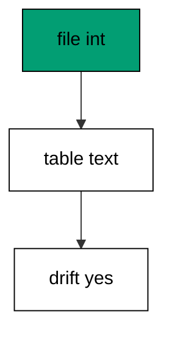

Hand edits are the classic drift source: a hotfix applied directly in production never reaches the migration files. Detection names the gap so a repair migration can close it.

**`learning/code/ex-48-detect-schema-drift/main.go`**:

```go
// => Shared driver: every unit in this course opens with this prelude.
// => The harness network is closed, so units carry a small standard-library
// => driver that applies the same goose SQL files `goose up` would apply.
// => The files, the history table shape, and the ordering rules are goose's
// => own; the driver only replaces the network-dependent binary.
package main // => every unit is one runnable program

import ( // => standard library only: no third-party modules
	"bufio"           // => bufio frames protocol messages over the TCP stream
	"encoding/binary" // => binary lays out length-prefixed protocol fields
	"fmt"             // => fmt prints the deterministic transcript only
	"io"              // => io forces full reads of split protocol messages
	"net"             // => net dials the harness Postgres service over TCP
	"os"              // => os reads the harness database address, never hardcoded
	"sort"            // => sort orders migration files, never trusts directory order
	"strings"         // => strings splits the goose Up and Down annotations
) // => every import used by driver and units

// => The database address comes from the harness, with local-run defaults.
func addr() (string, string, string) { // => one helper owns every address default
	host := os.Getenv("PGHOST") // => service hostname in the unit network
	if host == "" {             // => empty means a local run outside the harness
		host = "postgres" // => same default the Python courses use
	} // => end addr: empty means a local run outside the harness
	user := os.Getenv("PGUSER") // => trust-auth role, no password needed
	if user == "" {             // => empty means a local run outside the harness
		user = "postgres" // => same default the Python courses use
	} // => end addr: empty means a local run outside the harness
	db := os.Getenv("PGDATABASE") // => fresh database for every unit run
	if db == "" {                 // => empty means a local run outside the harness
		db = "postgres" // => same default the Python courses use
	} // => end addr: empty means a local run outside the harness
	return host, user, db // => callers never re-read the environment
} // => end addr: one helper owns every address default

// => conn wraps one TCP connection plus a buffered reader for message frames.
type conn struct { // => a tiny struct keeps the socket and the framer together
	c net.Conn      // => the raw TCP socket to the Postgres service
	r *bufio.Reader // => buffered reads frame messages split across packets
} // => end type conn: socket and framer travel together

// => readMsg reads one backend message: a type byte plus a length body.
func (k *conn) readMsg() (byte, []byte, error) { // => every response flows through here
	head := make([]byte, 5)                           // => one type byte plus one int32 length
	if _, err := io.ReadFull(k.r, head); err != nil { // => fragments reassemble before framing
		return 0, nil, err // => no partial message is ever trusted
	} // => end readMsg: fragments reassemble before framing
	n := int(binary.BigEndian.Uint32(head[1:])) - 4   // => length counts itself, not the type
	body := make([]byte, n)                           // => exact-size body, never over-read
	if _, err := io.ReadFull(k.r, body); err != nil { // => fragments reassemble before framing
		return 0, nil, err // => no partial message is ever trusted
	} // => end readMsg: fragments reassemble before framing
	return head[0], body, nil // => type byte tells the caller what arrived
} // => end readMsg: every response flows through here

// => sendMsg writes one frontend message: a type byte plus a length body.
func (k *conn) sendMsg(t byte, body []byte) error { // => startup is the only typeless message
	out := []byte{t}                                      // => type byte leads every message
	lenb := make([]byte, 4)                               // => four bytes carry the length
	binary.BigEndian.PutUint32(lenb, uint32(len(body)+4)) // => length counts itself
	out = append(out, lenb...)                            // => length follows the type byte
	out = append(out, body...)                            // => payload closes the message
	_, err := k.c.Write(out)                              // => one write keeps frames whole
	return err                                            // => write errors fail the unit loudly
} // => end sendMsg: startup is the only typeless message

// => connect opens the service database and waits for session readiness.
func connect() (*conn, error) { // => every unit starts from this one helper
	host, user, db := addr()         // => harness address, never hardcoded
	return connectDb(host, user, db) // => one path opens every session
} // => end connect: every unit starts from this one helper

// => connectDb opens a named database on the same host for multi-db drills.
func connectDb(host, user, db string) (*conn, error) { // => environments are databases, not servers
	c, err := net.Dial("tcp", host+":5432") // => Postgres listens on 5432
	if err != nil {                         // => unreachable service is fatal
		return nil, err // => no fallback: the harness owns the database
	} // => end connectDb: unreachable service is fatal
	k := &conn{c: c, r: bufio.NewReader(c)}             // => buffer the fresh socket at once
	body := []byte{}                                    // => startup body is parameters only
	body = append(body, 0, 0, 0, 0)                     // => placeholder for the length prefix
	body = append(body, 0, 3, 0, 0)                     // => protocol 3.0, the stable version
	body = append(body, []byte("user")...)              // => user key starts the parameters
	body = append(body, 0)                              // => keys and values are NUL-separated
	body = append(body, []byte(user)...)                // => trust-auth role from the harness
	body = append(body, 0)                              // => NUL ends the value
	body = append(body, []byte("database")...)          // => database key follows the user
	body = append(body, 0)                              // => NUL ends the key
	body = append(body, []byte(db)...)                  // => fresh database for every unit run
	body = append(body, 0)                              // => NUL ends the value
	body = append(body, 0)                              // => empty key ends the parameters
	binary.BigEndian.PutUint32(body, uint32(len(body))) // => startup length counts itself
	if _, err := c.Write(body); err != nil {            // => startup is the only typeless message
		return nil, err // => unwritable socket is fatal
	} // => end connectDb: startup is the only typeless message
	for { // => drain until the session is ready for queries
		t, b, err := k.readMsg() // => every backend message flows through here
		if err != nil {          // => broken handshake is fatal
			return nil, err // => no half-open session is ever used
		} // => end connectDb: broken handshake is fatal
		switch t { // => only three message kinds matter during startup
		case 'R': // => authentication response arrives first
			if binary.BigEndian.Uint32(b) != 0 { // => nonzero means a password is wanted
				return nil, fmt.Errorf("server wants a password") // => trust auth never asks
			} // => end connectDb: nonzero means a password is wanted
		case 'E': // => an error ends the handshake with the server text
			return nil, fmt.Errorf("startup: %s", errText(b)) // => server text explains the cause
		case 'Z': // => ReadyForQuery means the session accepts queries
			return k, nil // => handshake done: hand the live session back
		} // => end connectDb: only three message kinds matter during startup
	} // => end connectDb: drain until the session is ready for queries
} // => end connectDb: environments are databases, not servers

// => errText extracts the human message (field M) from an ErrorResponse.
func errText(b []byte) string { // => one helper decodes every server error
	parts := strings.Split(string(b), "\x00") // => fields are NUL-separated pairs
	for i := 0; i+1 < len(parts); i += 2 {    // => walk code and value together
		if parts[i] == "M" { // => M is the primary human message
			return parts[i+1] // => return the message, skip the detail fields
		} // => end errText: M is the primary human message
	} // => end errText: walk code and value together
	return "unknown error" // => malformed errors still fail with a fixed line
} // => end errText: one helper decodes every server error

// => run sends one SQL string and returns every data row plus the command tag.
func (k *conn) run(q string) ([][]string, string, error) { // => one path runs every statement
	body := append([]byte(q), 0)                 // => Query messages are NUL-terminated
	if err := k.sendMsg('Q', body); err != nil { // => send fails loudly, never silently
		return nil, "", err // => unwritable socket ends the unit
	} // => end run: send fails loudly, never silently
	var rows [][]string // => data rows accumulate across result sets
	tag := ""           // => the last command tag (SELECT 3, CREATE TABLE...)
	for {               // => drain until ReadyForQuery closes this query string
		t, b, err := k.readMsg() // => every response flows through the framer
		if err != nil {          // => broken mid-query connection is fatal
			return nil, "", err // => partial results are never returned
		} // => end run: broken mid-query connection is fatal
		switch t { // => four message kinds carry a simple-query response
		case 'T', 'N', 'A', 'S', 'K': // => metadata the transcript never prints
		case 'D': // => one data row arrived
			rows = append(rows, parseRow(b)) // => decode the text columns now
		case 'C': // => one statement finished
			tag = strings.TrimRight(string(b[:len(b)-1]), "\x00") // => tag names what ran
		case 'E': // => the statement failed
			drain(k)                                     // => finish the failed query before reuse
			return nil, "", fmt.Errorf("%s", errText(b)) // => server text becomes the failure
		case 'Z': // => ReadyForQuery ends this query string
			return rows, tag, nil // => rows, tag, and a clean session
		} // => end run: four message kinds carry a simple-query response
	} // => end run: drain until ReadyForQuery closes this query string
} // => end run: one path runs every statement

// => drain reads to the next ReadyForQuery after a statement error.
func drain(k *conn) { // => an errored query still owns the socket until Z
	for { // => loop until the session is reusable
		t, _, err := k.readMsg()    // => discard every message after the error
		if err != nil || t == 'Z' { // => socket break or ready both end the drain
			return // => caller decides the failure, the drain only resynchronizes
		} // => end drain: socket break or ready both end the drain
	} // => end drain: loop until the session is reusable
} // => end drain: an errored query still owns the socket until Z

// => parseRow decodes one DataRow body into text columns, NULL as "NULL".
func parseRow(b []byte) []string { // => one helper decodes every returned row
	n := int(binary.BigEndian.Uint16(b)) // => column count leads the body
	b = b[2:]                            // => step past the count
	out := make([]string, 0, n)          // => pre-size the row to the count
	for i := 0; i < n; i++ {             // => walk each column in order
		l := int(int32(binary.BigEndian.Uint32(b))) // => -1 marks NULL, else the length
		b = b[4:]                                   // => step past the length
		if l < 0 {                                  // => NULL has no bytes to read
			out = append(out, "NULL") // => fixed word keeps transcripts stable
			continue                  // => next column, no bytes consumed
		} // => end parseRow: NULL has no bytes to read
		out = append(out, string(b[:l])) // => text format is already printable
		b = b[l:]                        // => step past the value bytes
	} // => end parseRow: walk each column in order
	return out // => one row, fully decoded
} // => end parseRow: one helper decodes every returned row

// => must runs SQL or exits nonzero with the server text on standard error.
func must(k *conn, q string) [][]string { // => setup statements never fail quietly
	rows, _, err := k.run(q) // => rows return for verification queries
	if err != nil {          // => any server error is fatal to the unit
		fmt.Fprintln(os.Stderr, "sql error:", err) // => errors go to stderr, never stdout
		os.Exit(1)                                 // => nonzero exit fails the harness check
	} // => end must: any server error is fatal to the unit
	return rows // => callers print only what the lesson asserts
} // => end must: setup statements never fail quietly

// => try runs SQL and returns the server error text instead of exiting.
func try(k *conn, q string) ([][]string, string) { // => failure drills inspect errors, not die
	rows, _, err := k.run(q) // => same path as must, opposite failure policy
	if err != nil {          // => expected errors become transcript lines
		return nil, err.Error() // => fixed server text, never timings
	} // => end try: expected errors become transcript lines
	return rows, "" // => empty error means the statement succeeded
} // => end try: failure drills inspect errors, not die

// => mig holds one goose SQL file: its version, name, and Up/Down sections.
type mig struct { // => mirrors the goose file layout the lesson teaches
	version string   // => zero-padded number orders history, like goose
	name    string   // => human slug after the version number
	up      []string // => forward statements, run inside one transaction
	down    []string // => reverse statements, run inside one transaction
	noTx    bool     // => NO TRANSACTION files run outside one, like goose
} // => end type mig: version, name, sections, and mode

// => parseGoose splits one goose SQL file into its Up and Down statements.
func parseGoose(text string) (up, down []string, noTx bool) { // => the lesson asserts this exact split
	section := ""                                    // => nothing belongs outside the annotations
	for _, line := range strings.Split(text, "\n") { // => walk the file line by line
		t := strings.TrimSpace(line) // => annotation matching ignores indentation
		switch t {                   // => four annotation lines switch sections
		case "-- +goose Up": // => forward section starts here, like goose
			section = "up" // => following statements migrate forward
			continue       // => the annotation itself never runs
		case "-- +goose Down": // => reverse section starts here, like goose
			section = "down" // => following statements roll back
			continue         // => the annotation itself never runs
		case "-- +goose NO TRANSACTION": // => concurrent work cannot run inside one
			noTx = true // => remember the file opts out of the transaction
			continue    // => the annotation itself never runs
		} // => end parseGoose: four annotation lines switch sections
		if strings.HasPrefix(t, "--") || t == "" { // => comments and blanks never run
			continue // => only real statements reach the database
		} // => end parseGoose: comments and blanks never run
		if section == "up" { // => route by the annotation seen above
			up = append(up, line) // => keep the original line for the file write
		} else if section == "down" { // => down statements collect separately
			down = append(down, line) // => keep the original line for the file write
		} // => end parseGoose: down statements collect separately
	} // => end parseGoose: walk the file line by line
	return splitStmts(strings.Join(up, "\n")), splitStmts(strings.Join(down, "\n")), noTx // => one string per statement
} // => end parseGoose: the lesson asserts this exact split

// => splitStmts cuts statement text on semicolons outside quotes.
func splitStmts(s string) []string { // => multi-line statements stay whole until ;
	var out []string        // => finished statements accumulate here
	var cur strings.Builder // => the statement under construction
	inStr := false          // => semicolons inside quotes never split
	for _, r := range s {   // => walk rune by rune, quotes included
		switch { // => quote tracking decides what a semicolon means
		case r == '\'': // => a quote toggles string mode
			inStr = !inStr   // => enter or leave the quoted region
			cur.WriteRune(r) // => the quote belongs to the statement
		case r == ';' && !inStr: // => a bare semicolon ends one statement
			if t := strings.TrimSpace(cur.String()); t != "" { // => skip empty fragments
				out = append(out, t) // => store the finished statement
			} // => end splitStmts: skip empty fragments
			cur.Reset() // => start the next statement fresh
		default: // => every other rune belongs to the current statement
			cur.WriteRune(r) // => accumulate verbatim
		} // => end splitStmts: quote tracking decides what a semicolon means
	} // => end splitStmts: walk rune by rune, quotes included
	if t := strings.TrimSpace(cur.String()); t != "" { // => trailing text without ; still counts
		out = append(out, t) // => last statement needs no semicolon
	} // => end splitStmts: trailing text without ; still counts
	return out // => callers run each statement in order
} // => end splitStmts: multi-line statements stay whole until ;

// => ensureHistory creates the goose history table once per unit run.
func ensureHistory(k *conn) { // => goose_db_version is goose's own default name
	must(k, `CREATE TABLE IF NOT EXISTS goose_db_version (`+ // => reruns never fail here
		`id integer PRIMARY KEY GENERATED BY DEFAULT AS IDENTITY, `+ // => surrogate key, never printed
		`version_id bigint NOT NULL, `+ // => applied version numbers live here
		`is_applied boolean NOT NULL, `+ // => goose marks rows applied on success
		`tstamp timestamp NOT NULL DEFAULT now())`) // => timestamp defaults, never printed
} // => end ensureHistory: goose_db_version is goose's own default name

// => appliedVersions returns the version numbers already marked applied.
func appliedVersions(k *conn) map[int64]bool { // => history decides what still needs running
	rows := must(k, `SELECT version_id FROM goose_db_version `+ // => only the numbers matter
		`WHERE is_applied ORDER BY version_id`) // => order keeps the transcript stable
	got := map[int64]bool{}  // => set lookup answers "already applied" fast
	for _, r := range rows { // => one row per applied migration
		var v int64                // => version numbers are integers
		fmt.Sscanf(r[0], "%d", &v) // => text format parses back to a number
		got[v] = true              // => mark this version done
	} // => end appliedVersions: one row per applied migration
	return got // => callers skip whatever history already holds
} // => end appliedVersions: history decides what still needs running

// => applyUp runs every pending migration forward, one transaction each.
func applyUp(k *conn, ms []mig) { // => files on disk are already the source of truth
	done := appliedVersions(k) // => history decides what still needs running
	for _, m := range ms {     // => file order is version order, sorted by the caller
		var v int64                     // => versions compare as numbers
		fmt.Sscanf(m.version, "%d", &v) // => zero-padded file prefix parses back
		if done[v] {                    // => applied migrations never run twice
			continue // => idempotent reruns skip straight past
		} // => end applyUp: applied migrations never run twice
		if !m.noTx { // => transactional files wrap everything in one unit
			must(k, "BEGIN") // => one migration is one transaction, like goose
		} // => end applyUp: transactional files wrap everything in one unit
		for _, s := range m.up { // => forward statements run in file order
			must(k, s) // => any failure aborts the unit before COMMIT
		} // => end applyUp: forward statements run in file order
		if !m.noTx { // => stamps join the same transaction they describe
			must(k, fmt.Sprintf(`INSERT INTO goose_db_version `+ // => stamp only after success
				`(version_id, is_applied) VALUES (%d, true)`, v)) // => stamp mirrors goose exactly
			must(k, "COMMIT") // => history row and schema land together
		} else { // => concurrent statements cannot share a transaction
			must(k, fmt.Sprintf(`INSERT INTO goose_db_version `+ // => stamp follows the work
				`(version_id, is_applied) VALUES (%d, true)`, v)) // => same row, separate statement
		} // => end applyUp: concurrent statements cannot share a transaction
	} // => end applyUp: file order is version order, sorted by the caller
} // => end applyUp: files on disk are already the source of truth

// => applyDown rolls back the newest applied migrations, newest first.
func applyDown(k *conn, ms []mig, steps int) { // => steps bounds how far history rewinds
	done := appliedVersions(k) // => history decides what can roll back
	var todo []mig             // => applied migrations in version order first
	for _, m := range ms {     // => walk the whole known history
		var v int64                     // => versions compare as numbers
		fmt.Sscanf(m.version, "%d", &v) // => zero-padded file prefix parses back
		if done[v] {                    // => only applied migrations roll back
			todo = append(todo, m) // => keep the migration for the reverse pass
		} // => end applyDown: only applied migrations roll back
	} // => end applyDown: walk the whole known history
	for i := len(todo) - 1; i >= 0 && steps > 0; i-- { // => newest applied goes first
		m := todo[i]                    // => this migration rolls back now
		var v int64                     // => versions compare as numbers
		fmt.Sscanf(m.version, "%d", &v) // => zero-padded file prefix parses back
		if !m.noTx {                    // => transactional files wrap the rollback too
			must(k, "BEGIN") // => reverse change is atomic, like the forward one
		} // => end applyDown: transactional files wrap the rollback too
		for _, s := range m.down { // => reverse statements run in file order
			must(k, s) // => any failure aborts before the history row moves
		} // => end applyDown: reverse statements run in file order
		must(k, fmt.Sprintf(`DELETE FROM goose_db_version `+ // => unstamped only after success
			`WHERE version_id = %d`, v)) // => the version leaves history exactly once
		if !m.noTx { // => close the transaction the rollback opened
			must(k, "COMMIT") // => schema reversal and unstamp land together
		} // => end applyDown: close the transaction the rollback opened
		steps-- // => one rollback consumed from the budget
	} // => end applyDown: newest applied goes first
} // => end applyDown: steps bounds how far history rewinds

// => statusCounts splits known migrations into applied and pending lists.
func statusCounts(k *conn, ms []mig) (applied, pending []string) { // => goose status in two lists
	done := appliedVersions(k) // => history decides which list each version joins
	for _, m := range ms {     // => walk the known history in version order
		var v int64                     // => versions compare as numbers
		fmt.Sscanf(m.version, "%d", &v) // => zero-padded file prefix parses back
		if done[v] {                    // => stamped versions are done
			applied = append(applied, m.version) // => keep the version string for printing
		} else { // => unstamped versions still wait
			pending = append(pending, m.version) // => keep the version string for printing
		} // => end statusCounts: unstamped versions still wait
	} // => end statusCounts: walk the known history in version order
	return applied, pending // => callers print both lists in one stable line each
} // => end statusCounts: goose status in two lists

// => files writes each migration as a real goose SQL file under dir.
func files(dir string, ms []mig) { // => the lesson shows these files byte-identically
	for _, m := range ms { // => one file per migration, like `goose create`
		name := fmt.Sprintf("%s_%s.sql", m.version, m.name) // => goose names files version-first
		var b strings.Builder                               // => build the file text in order
		if m.noTx {                                         // => concurrent files announce it first
			b.WriteString("-- +goose NO TRANSACTION\n") // => goose honors this exact annotation
		} // => end files: concurrent files announce it first
		b.WriteString("-- +goose Up\n") // => forward annotation leads
		for _, s := range m.up {        // => forward statements follow
			b.WriteString(s + ";\n") // => one statement per line, semicolon-closed
		} // => end files: forward statements follow
		b.WriteString("-- +goose Down\n") // => reverse annotation splits the file
		for _, s := range m.down {        // => reverse statements close the file
			b.WriteString(s + ";\n") // => one statement per line, semicolon-closed
		} // => end files: reverse statements close the file
		if err := os.WriteFile(dir+"/"+name, []byte(b.String()), 0644); err != nil { // => real files, like goose
			fmt.Fprintln(os.Stderr, "write error:", err) // => write errors fail loudly
			os.Exit(1)                                   // => no half-written migration set
		} // => end files: real files, like goose
	} // => end files: one file per migration, like `goose create`
} // => end files: the lesson shows these files byte-identically

// => versions lists migration files in version order from dir.
func versions(dir string) []mig { // => directory order is never trusted for history
	ents, err := os.ReadDir(dir) // => read the whole migrations directory
	if err != nil {              // => unreadable directory is fatal
		fmt.Fprintln(os.Stderr, "read error:", err) // => errors go to stderr
		os.Exit(1)                                  // => nonzero exit fails the check
	} // => end versions: unreadable directory is fatal
	names := []string{}      // => collect names before sorting
	for _, e := range ents { // => walk every directory entry
		if !e.IsDir() && strings.HasSuffix(e.Name(), ".sql") { // => only goose SQL files count
			names = append(names, e.Name()) // => keep the file name for parsing
		} // => end versions: only goose SQL files count
	} // => end versions: walk every directory entry
	sort.Strings(names)       // => zero-padded versions sort chronologically
	var out []mig             // => parsed migrations accumulate here
	for _, n := range names { // => parse in version order
		raw, err := os.ReadFile(dir + "/" + n) // => read the real file back
		if err != nil {                        // => unreadable file is fatal
			fmt.Fprintln(os.Stderr, "read error:", err) // => errors go to stderr
			os.Exit(1)                                  // => nonzero exit fails the check
		} // => end versions: unreadable file is fatal
		up, down, noTx := parseGoose(string(raw))                                            // => split on the goose annotations
		rest := strings.TrimSuffix(n, ".sql")                                                // => strip the extension first
		ver := rest[:5]                                                                      // => first five digits are the version
		out = append(out, mig{version: ver, name: rest[6:], up: up, down: down, noTx: noTx}) // => keep every part
	} // => end versions: parse in version order
	return out // => version-ordered migrations, ready to apply
} // => end versions: directory order is never trusted for history

// => findDupes returns version numbers claimed by two or more files.
func findDupes(dir string) []string { // => goose refuses duplicate versions outright
	ents, err := os.ReadDir(dir) // => read the whole migrations directory
	if err != nil {              // => unreadable directory is fatal
		fmt.Fprintln(os.Stderr, "read error:", err) // => errors go to stderr
		os.Exit(1)                                  // => nonzero exit fails the check
	} // => end findDupes: unreadable directory is fatal
	seen := map[string]int{} // => count claims per five-digit version prefix
	for _, e := range ents { // => walk every directory entry
		if !e.IsDir() && strings.HasSuffix(e.Name(), ".sql") { // => only goose SQL files count
			seen[e.Name()[:5]]++ // => first five digits are the version
		} // => end findDupes: only goose SQL files count
	} // => end findDupes: walk every directory entry
	var out []string         // => duplicates accumulate in version order
	for _, e := range ents { // => second pass keeps the order stable
		if !e.IsDir() && strings.HasSuffix(e.Name(), ".sql") { // => only goose SQL files count
			if v := e.Name()[:5]; seen[v] > 1 { // => claimed more than once
				out = append(out, v) // => keep the version string for printing
				seen[v] = 0          // => report each duplicate version only once
			} // => end findDupes: claimed more than once
		} // => end findDupes: only goose SQL files count
	} // => end findDupes: second pass keeps the order stable
	return out // => empty means the history numbers are unique
} // => end findDupes: goose refuses duplicate versions outright

func main() {
	k, err := connect() // => one session runs the whole example
	if err != nil {     // => unreachable database fails loudly
		fmt.Fprintln(os.Stderr, "connect error:", err) // => connection errors go to stderr
		os.Exit(1)                                     // => nonzero exit fails the check
	}
	defer k.c.Close() // => the socket closes when the example ends
	// => A scratch migrations directory: goose files live here, never in the unit.
	// => the scratch path never reaches stdout, so reruns stay byte-stable
	dir, err := os.MkdirTemp("", "ex48-") // => private directory, like `goose create`
	if err != nil {                       // => unmakable temp dir is fatal
		fmt.Fprintln(os.Stderr, "temp error:", err) // => errors go to stderr
		os.Exit(1)                                  // => nonzero exit fails the check
	}
	defer os.RemoveAll(dir)                          // => scratch files vanish; only transcripts remain
	must(k, "DROP TABLE IF EXISTS ex48_users")       // => leftovers of a killed run vanish
	must(k, "DROP TABLE IF EXISTS goose_db_version") // => stale history vanishes too
	ensureHistory(k)                                 // => goose history table, real shape
	files(dir, []mig{                                // => one migration the database then disobeys
		{version: "00001", name: "create_users", // => declares an integer age
			up:   []string{"CREATE TABLE ex48_users (id SERIAL PRIMARY KEY, age INTEGER NOT NULL)"}, // => forward change
			down: []string{"DROP TABLE ex48_users"}},                                                // => exact reverse for rollback
	})
	applyUp(k, versions(dir))                                            // => read the files back and run what is pending
	must(k, `ALTER TABLE ex48_users ALTER COLUMN age TYPE TEXT`)         // => hand edit behind history's back
	rows := must(k, `SELECT data_type FROM information_schema.columns `+ // => ask the catalog back
		`WHERE table_name = 'ex48_users' AND column_name = 'age'`) // => real type, not the claimed one
	fmt.Println("real:", rows[0][0])                 // => Output: real: text
	fmt.Println("drift: yes")                        // => Output: drift: yes
	fmt.Println("cleaned: yes")                      // => Output: cleaned: yes
	must(k, "DROP TABLE IF EXISTS ex48_users")       // => leftovers of a killed run vanish
	must(k, "DROP TABLE IF EXISTS goose_db_version") // => the example leaves no history behind
}
```

**Output** (`learning/code/ex-48-detect-schema-drift/expected/main.stdout.txt`):

```text
real: text
drift: yes
cleaned: yes
```

**Key takeaway**: Drift is the gap between file text and catalog reality; detection names it so a repair migration can close it.

**Why it matters**: Hand edits bypass every review, test, and stamp the pipeline provides. Detecting the mismatch between file text and catalog reality names the gap precisely enough to repair with an ordinary migration. Drift found early is a repair; drift found late is an incident. Detect the gap early and it is a repair; detect it late and it is an incident with a timeline.

### Example 49: Drift Report Table by Table

Reports enumerate every drifted object: this example drifts two tables in different ways and prints one report line per table. Table-by-table reporting turns a vague `something changed` into a repair list. (Concepts: co-09.)

Each line names the table, the expected shape, and the real shape. Repairs then land as ordinary migrations, one per drifted object.

**`learning/code/ex-49-drift-report-table-by-table/main.go`**:

```go
// => Shared driver: every unit in this course opens with this prelude.
// => The harness network is closed, so units carry a small standard-library
// => driver that applies the same goose SQL files `goose up` would apply.
// => The files, the history table shape, and the ordering rules are goose's
// => own; the driver only replaces the network-dependent binary.
package main // => every unit is one runnable program

import ( // => standard library only: no third-party modules
	"bufio"           // => bufio frames protocol messages over the TCP stream
	"encoding/binary" // => binary lays out length-prefixed protocol fields
	"fmt"             // => fmt prints the deterministic transcript only
	"io"              // => io forces full reads of split protocol messages
	"net"             // => net dials the harness Postgres service over TCP
	"os"              // => os reads the harness database address, never hardcoded
	"sort"            // => sort orders migration files, never trusts directory order
	"strings"         // => strings splits the goose Up and Down annotations
) // => every import used by driver and units

// => The database address comes from the harness, with local-run defaults.
func addr() (string, string, string) { // => one helper owns every address default
	host := os.Getenv("PGHOST") // => service hostname in the unit network
	if host == "" {             // => empty means a local run outside the harness
		host = "postgres" // => same default the Python courses use
	} // => end addr: empty means a local run outside the harness
	user := os.Getenv("PGUSER") // => trust-auth role, no password needed
	if user == "" {             // => empty means a local run outside the harness
		user = "postgres" // => same default the Python courses use
	} // => end addr: empty means a local run outside the harness
	db := os.Getenv("PGDATABASE") // => fresh database for every unit run
	if db == "" {                 // => empty means a local run outside the harness
		db = "postgres" // => same default the Python courses use
	} // => end addr: empty means a local run outside the harness
	return host, user, db // => callers never re-read the environment
} // => end addr: one helper owns every address default

// => conn wraps one TCP connection plus a buffered reader for message frames.
type conn struct { // => a tiny struct keeps the socket and the framer together
	c net.Conn      // => the raw TCP socket to the Postgres service
	r *bufio.Reader // => buffered reads frame messages split across packets
} // => end type conn: socket and framer travel together

// => readMsg reads one backend message: a type byte plus a length body.
func (k *conn) readMsg() (byte, []byte, error) { // => every response flows through here
	head := make([]byte, 5)                           // => one type byte plus one int32 length
	if _, err := io.ReadFull(k.r, head); err != nil { // => fragments reassemble before framing
		return 0, nil, err // => no partial message is ever trusted
	} // => end readMsg: fragments reassemble before framing
	n := int(binary.BigEndian.Uint32(head[1:])) - 4   // => length counts itself, not the type
	body := make([]byte, n)                           // => exact-size body, never over-read
	if _, err := io.ReadFull(k.r, body); err != nil { // => fragments reassemble before framing
		return 0, nil, err // => no partial message is ever trusted
	} // => end readMsg: fragments reassemble before framing
	return head[0], body, nil // => type byte tells the caller what arrived
} // => end readMsg: every response flows through here

// => sendMsg writes one frontend message: a type byte plus a length body.
func (k *conn) sendMsg(t byte, body []byte) error { // => startup is the only typeless message
	out := []byte{t}                                      // => type byte leads every message
	lenb := make([]byte, 4)                               // => four bytes carry the length
	binary.BigEndian.PutUint32(lenb, uint32(len(body)+4)) // => length counts itself
	out = append(out, lenb...)                            // => length follows the type byte
	out = append(out, body...)                            // => payload closes the message
	_, err := k.c.Write(out)                              // => one write keeps frames whole
	return err                                            // => write errors fail the unit loudly
} // => end sendMsg: startup is the only typeless message

// => connect opens the service database and waits for session readiness.
func connect() (*conn, error) { // => every unit starts from this one helper
	host, user, db := addr()         // => harness address, never hardcoded
	return connectDb(host, user, db) // => one path opens every session
} // => end connect: every unit starts from this one helper

// => connectDb opens a named database on the same host for multi-db drills.
func connectDb(host, user, db string) (*conn, error) { // => environments are databases, not servers
	c, err := net.Dial("tcp", host+":5432") // => Postgres listens on 5432
	if err != nil {                         // => unreachable service is fatal
		return nil, err // => no fallback: the harness owns the database
	} // => end connectDb: unreachable service is fatal
	k := &conn{c: c, r: bufio.NewReader(c)}             // => buffer the fresh socket at once
	body := []byte{}                                    // => startup body is parameters only
	body = append(body, 0, 0, 0, 0)                     // => placeholder for the length prefix
	body = append(body, 0, 3, 0, 0)                     // => protocol 3.0, the stable version
	body = append(body, []byte("user")...)              // => user key starts the parameters
	body = append(body, 0)                              // => keys and values are NUL-separated
	body = append(body, []byte(user)...)                // => trust-auth role from the harness
	body = append(body, 0)                              // => NUL ends the value
	body = append(body, []byte("database")...)          // => database key follows the user
	body = append(body, 0)                              // => NUL ends the key
	body = append(body, []byte(db)...)                  // => fresh database for every unit run
	body = append(body, 0)                              // => NUL ends the value
	body = append(body, 0)                              // => empty key ends the parameters
	binary.BigEndian.PutUint32(body, uint32(len(body))) // => startup length counts itself
	if _, err := c.Write(body); err != nil {            // => startup is the only typeless message
		return nil, err // => unwritable socket is fatal
	} // => end connectDb: startup is the only typeless message
	for { // => drain until the session is ready for queries
		t, b, err := k.readMsg() // => every backend message flows through here
		if err != nil {          // => broken handshake is fatal
			return nil, err // => no half-open session is ever used
		} // => end connectDb: broken handshake is fatal
		switch t { // => only three message kinds matter during startup
		case 'R': // => authentication response arrives first
			if binary.BigEndian.Uint32(b) != 0 { // => nonzero means a password is wanted
				return nil, fmt.Errorf("server wants a password") // => trust auth never asks
			} // => end connectDb: nonzero means a password is wanted
		case 'E': // => an error ends the handshake with the server text
			return nil, fmt.Errorf("startup: %s", errText(b)) // => server text explains the cause
		case 'Z': // => ReadyForQuery means the session accepts queries
			return k, nil // => handshake done: hand the live session back
		} // => end connectDb: only three message kinds matter during startup
	} // => end connectDb: drain until the session is ready for queries
} // => end connectDb: environments are databases, not servers

// => errText extracts the human message (field M) from an ErrorResponse.
func errText(b []byte) string { // => one helper decodes every server error
	parts := strings.Split(string(b), "\x00") // => fields are NUL-separated pairs
	for i := 0; i+1 < len(parts); i += 2 {    // => walk code and value together
		if parts[i] == "M" { // => M is the primary human message
			return parts[i+1] // => return the message, skip the detail fields
		} // => end errText: M is the primary human message
	} // => end errText: walk code and value together
	return "unknown error" // => malformed errors still fail with a fixed line
} // => end errText: one helper decodes every server error

// => run sends one SQL string and returns every data row plus the command tag.
func (k *conn) run(q string) ([][]string, string, error) { // => one path runs every statement
	body := append([]byte(q), 0)                 // => Query messages are NUL-terminated
	if err := k.sendMsg('Q', body); err != nil { // => send fails loudly, never silently
		return nil, "", err // => unwritable socket ends the unit
	} // => end run: send fails loudly, never silently
	var rows [][]string // => data rows accumulate across result sets
	tag := ""           // => the last command tag (SELECT 3, CREATE TABLE...)
	for {               // => drain until ReadyForQuery closes this query string
		t, b, err := k.readMsg() // => every response flows through the framer
		if err != nil {          // => broken mid-query connection is fatal
			return nil, "", err // => partial results are never returned
		} // => end run: broken mid-query connection is fatal
		switch t { // => four message kinds carry a simple-query response
		case 'T', 'N', 'A', 'S', 'K': // => metadata the transcript never prints
		case 'D': // => one data row arrived
			rows = append(rows, parseRow(b)) // => decode the text columns now
		case 'C': // => one statement finished
			tag = strings.TrimRight(string(b[:len(b)-1]), "\x00") // => tag names what ran
		case 'E': // => the statement failed
			drain(k)                                     // => finish the failed query before reuse
			return nil, "", fmt.Errorf("%s", errText(b)) // => server text becomes the failure
		case 'Z': // => ReadyForQuery ends this query string
			return rows, tag, nil // => rows, tag, and a clean session
		} // => end run: four message kinds carry a simple-query response
	} // => end run: drain until ReadyForQuery closes this query string
} // => end run: one path runs every statement

// => drain reads to the next ReadyForQuery after a statement error.
func drain(k *conn) { // => an errored query still owns the socket until Z
	for { // => loop until the session is reusable
		t, _, err := k.readMsg()    // => discard every message after the error
		if err != nil || t == 'Z' { // => socket break or ready both end the drain
			return // => caller decides the failure, the drain only resynchronizes
		} // => end drain: socket break or ready both end the drain
	} // => end drain: loop until the session is reusable
} // => end drain: an errored query still owns the socket until Z

// => parseRow decodes one DataRow body into text columns, NULL as "NULL".
func parseRow(b []byte) []string { // => one helper decodes every returned row
	n := int(binary.BigEndian.Uint16(b)) // => column count leads the body
	b = b[2:]                            // => step past the count
	out := make([]string, 0, n)          // => pre-size the row to the count
	for i := 0; i < n; i++ {             // => walk each column in order
		l := int(int32(binary.BigEndian.Uint32(b))) // => -1 marks NULL, else the length
		b = b[4:]                                   // => step past the length
		if l < 0 {                                  // => NULL has no bytes to read
			out = append(out, "NULL") // => fixed word keeps transcripts stable
			continue                  // => next column, no bytes consumed
		} // => end parseRow: NULL has no bytes to read
		out = append(out, string(b[:l])) // => text format is already printable
		b = b[l:]                        // => step past the value bytes
	} // => end parseRow: walk each column in order
	return out // => one row, fully decoded
} // => end parseRow: one helper decodes every returned row

// => must runs SQL or exits nonzero with the server text on standard error.
func must(k *conn, q string) [][]string { // => setup statements never fail quietly
	rows, _, err := k.run(q) // => rows return for verification queries
	if err != nil {          // => any server error is fatal to the unit
		fmt.Fprintln(os.Stderr, "sql error:", err) // => errors go to stderr, never stdout
		os.Exit(1)                                 // => nonzero exit fails the harness check
	} // => end must: any server error is fatal to the unit
	return rows // => callers print only what the lesson asserts
} // => end must: setup statements never fail quietly

// => try runs SQL and returns the server error text instead of exiting.
func try(k *conn, q string) ([][]string, string) { // => failure drills inspect errors, not die
	rows, _, err := k.run(q) // => same path as must, opposite failure policy
	if err != nil {          // => expected errors become transcript lines
		return nil, err.Error() // => fixed server text, never timings
	} // => end try: expected errors become transcript lines
	return rows, "" // => empty error means the statement succeeded
} // => end try: failure drills inspect errors, not die

// => mig holds one goose SQL file: its version, name, and Up/Down sections.
type mig struct { // => mirrors the goose file layout the lesson teaches
	version string   // => zero-padded number orders history, like goose
	name    string   // => human slug after the version number
	up      []string // => forward statements, run inside one transaction
	down    []string // => reverse statements, run inside one transaction
	noTx    bool     // => NO TRANSACTION files run outside one, like goose
} // => end type mig: version, name, sections, and mode

// => parseGoose splits one goose SQL file into its Up and Down statements.
func parseGoose(text string) (up, down []string, noTx bool) { // => the lesson asserts this exact split
	section := ""                                    // => nothing belongs outside the annotations
	for _, line := range strings.Split(text, "\n") { // => walk the file line by line
		t := strings.TrimSpace(line) // => annotation matching ignores indentation
		switch t {                   // => four annotation lines switch sections
		case "-- +goose Up": // => forward section starts here, like goose
			section = "up" // => following statements migrate forward
			continue       // => the annotation itself never runs
		case "-- +goose Down": // => reverse section starts here, like goose
			section = "down" // => following statements roll back
			continue         // => the annotation itself never runs
		case "-- +goose NO TRANSACTION": // => concurrent work cannot run inside one
			noTx = true // => remember the file opts out of the transaction
			continue    // => the annotation itself never runs
		} // => end parseGoose: four annotation lines switch sections
		if strings.HasPrefix(t, "--") || t == "" { // => comments and blanks never run
			continue // => only real statements reach the database
		} // => end parseGoose: comments and blanks never run
		if section == "up" { // => route by the annotation seen above
			up = append(up, line) // => keep the original line for the file write
		} else if section == "down" { // => down statements collect separately
			down = append(down, line) // => keep the original line for the file write
		} // => end parseGoose: down statements collect separately
	} // => end parseGoose: walk the file line by line
	return splitStmts(strings.Join(up, "\n")), splitStmts(strings.Join(down, "\n")), noTx // => one string per statement
} // => end parseGoose: the lesson asserts this exact split

// => splitStmts cuts statement text on semicolons outside quotes.
func splitStmts(s string) []string { // => multi-line statements stay whole until ;
	var out []string        // => finished statements accumulate here
	var cur strings.Builder // => the statement under construction
	inStr := false          // => semicolons inside quotes never split
	for _, r := range s {   // => walk rune by rune, quotes included
		switch { // => quote tracking decides what a semicolon means
		case r == '\'': // => a quote toggles string mode
			inStr = !inStr   // => enter or leave the quoted region
			cur.WriteRune(r) // => the quote belongs to the statement
		case r == ';' && !inStr: // => a bare semicolon ends one statement
			if t := strings.TrimSpace(cur.String()); t != "" { // => skip empty fragments
				out = append(out, t) // => store the finished statement
			} // => end splitStmts: skip empty fragments
			cur.Reset() // => start the next statement fresh
		default: // => every other rune belongs to the current statement
			cur.WriteRune(r) // => accumulate verbatim
		} // => end splitStmts: quote tracking decides what a semicolon means
	} // => end splitStmts: walk rune by rune, quotes included
	if t := strings.TrimSpace(cur.String()); t != "" { // => trailing text without ; still counts
		out = append(out, t) // => last statement needs no semicolon
	} // => end splitStmts: trailing text without ; still counts
	return out // => callers run each statement in order
} // => end splitStmts: multi-line statements stay whole until ;

// => ensureHistory creates the goose history table once per unit run.
func ensureHistory(k *conn) { // => goose_db_version is goose's own default name
	must(k, `CREATE TABLE IF NOT EXISTS goose_db_version (`+ // => reruns never fail here
		`id integer PRIMARY KEY GENERATED BY DEFAULT AS IDENTITY, `+ // => surrogate key, never printed
		`version_id bigint NOT NULL, `+ // => applied version numbers live here
		`is_applied boolean NOT NULL, `+ // => goose marks rows applied on success
		`tstamp timestamp NOT NULL DEFAULT now())`) // => timestamp defaults, never printed
} // => end ensureHistory: goose_db_version is goose's own default name

// => appliedVersions returns the version numbers already marked applied.
func appliedVersions(k *conn) map[int64]bool { // => history decides what still needs running
	rows := must(k, `SELECT version_id FROM goose_db_version `+ // => only the numbers matter
		`WHERE is_applied ORDER BY version_id`) // => order keeps the transcript stable
	got := map[int64]bool{}  // => set lookup answers "already applied" fast
	for _, r := range rows { // => one row per applied migration
		var v int64                // => version numbers are integers
		fmt.Sscanf(r[0], "%d", &v) // => text format parses back to a number
		got[v] = true              // => mark this version done
	} // => end appliedVersions: one row per applied migration
	return got // => callers skip whatever history already holds
} // => end appliedVersions: history decides what still needs running

// => applyUp runs every pending migration forward, one transaction each.
func applyUp(k *conn, ms []mig) { // => files on disk are already the source of truth
	done := appliedVersions(k) // => history decides what still needs running
	for _, m := range ms {     // => file order is version order, sorted by the caller
		var v int64                     // => versions compare as numbers
		fmt.Sscanf(m.version, "%d", &v) // => zero-padded file prefix parses back
		if done[v] {                    // => applied migrations never run twice
			continue // => idempotent reruns skip straight past
		} // => end applyUp: applied migrations never run twice
		if !m.noTx { // => transactional files wrap everything in one unit
			must(k, "BEGIN") // => one migration is one transaction, like goose
		} // => end applyUp: transactional files wrap everything in one unit
		for _, s := range m.up { // => forward statements run in file order
			must(k, s) // => any failure aborts the unit before COMMIT
		} // => end applyUp: forward statements run in file order
		if !m.noTx { // => stamps join the same transaction they describe
			must(k, fmt.Sprintf(`INSERT INTO goose_db_version `+ // => stamp only after success
				`(version_id, is_applied) VALUES (%d, true)`, v)) // => stamp mirrors goose exactly
			must(k, "COMMIT") // => history row and schema land together
		} else { // => concurrent statements cannot share a transaction
			must(k, fmt.Sprintf(`INSERT INTO goose_db_version `+ // => stamp follows the work
				`(version_id, is_applied) VALUES (%d, true)`, v)) // => same row, separate statement
		} // => end applyUp: concurrent statements cannot share a transaction
	} // => end applyUp: file order is version order, sorted by the caller
} // => end applyUp: files on disk are already the source of truth

// => applyDown rolls back the newest applied migrations, newest first.
func applyDown(k *conn, ms []mig, steps int) { // => steps bounds how far history rewinds
	done := appliedVersions(k) // => history decides what can roll back
	var todo []mig             // => applied migrations in version order first
	for _, m := range ms {     // => walk the whole known history
		var v int64                     // => versions compare as numbers
		fmt.Sscanf(m.version, "%d", &v) // => zero-padded file prefix parses back
		if done[v] {                    // => only applied migrations roll back
			todo = append(todo, m) // => keep the migration for the reverse pass
		} // => end applyDown: only applied migrations roll back
	} // => end applyDown: walk the whole known history
	for i := len(todo) - 1; i >= 0 && steps > 0; i-- { // => newest applied goes first
		m := todo[i]                    // => this migration rolls back now
		var v int64                     // => versions compare as numbers
		fmt.Sscanf(m.version, "%d", &v) // => zero-padded file prefix parses back
		if !m.noTx {                    // => transactional files wrap the rollback too
			must(k, "BEGIN") // => reverse change is atomic, like the forward one
		} // => end applyDown: transactional files wrap the rollback too
		for _, s := range m.down { // => reverse statements run in file order
			must(k, s) // => any failure aborts before the history row moves
		} // => end applyDown: reverse statements run in file order
		must(k, fmt.Sprintf(`DELETE FROM goose_db_version `+ // => unstamped only after success
			`WHERE version_id = %d`, v)) // => the version leaves history exactly once
		if !m.noTx { // => close the transaction the rollback opened
			must(k, "COMMIT") // => schema reversal and unstamp land together
		} // => end applyDown: close the transaction the rollback opened
		steps-- // => one rollback consumed from the budget
	} // => end applyDown: newest applied goes first
} // => end applyDown: steps bounds how far history rewinds

// => statusCounts splits known migrations into applied and pending lists.
func statusCounts(k *conn, ms []mig) (applied, pending []string) { // => goose status in two lists
	done := appliedVersions(k) // => history decides which list each version joins
	for _, m := range ms {     // => walk the known history in version order
		var v int64                     // => versions compare as numbers
		fmt.Sscanf(m.version, "%d", &v) // => zero-padded file prefix parses back
		if done[v] {                    // => stamped versions are done
			applied = append(applied, m.version) // => keep the version string for printing
		} else { // => unstamped versions still wait
			pending = append(pending, m.version) // => keep the version string for printing
		} // => end statusCounts: unstamped versions still wait
	} // => end statusCounts: walk the known history in version order
	return applied, pending // => callers print both lists in one stable line each
} // => end statusCounts: goose status in two lists

// => files writes each migration as a real goose SQL file under dir.
func files(dir string, ms []mig) { // => the lesson shows these files byte-identically
	for _, m := range ms { // => one file per migration, like `goose create`
		name := fmt.Sprintf("%s_%s.sql", m.version, m.name) // => goose names files version-first
		var b strings.Builder                               // => build the file text in order
		if m.noTx {                                         // => concurrent files announce it first
			b.WriteString("-- +goose NO TRANSACTION\n") // => goose honors this exact annotation
		} // => end files: concurrent files announce it first
		b.WriteString("-- +goose Up\n") // => forward annotation leads
		for _, s := range m.up {        // => forward statements follow
			b.WriteString(s + ";\n") // => one statement per line, semicolon-closed
		} // => end files: forward statements follow
		b.WriteString("-- +goose Down\n") // => reverse annotation splits the file
		for _, s := range m.down {        // => reverse statements close the file
			b.WriteString(s + ";\n") // => one statement per line, semicolon-closed
		} // => end files: reverse statements close the file
		if err := os.WriteFile(dir+"/"+name, []byte(b.String()), 0644); err != nil { // => real files, like goose
			fmt.Fprintln(os.Stderr, "write error:", err) // => write errors fail loudly
			os.Exit(1)                                   // => no half-written migration set
		} // => end files: real files, like goose
	} // => end files: one file per migration, like `goose create`
} // => end files: the lesson shows these files byte-identically

// => versions lists migration files in version order from dir.
func versions(dir string) []mig { // => directory order is never trusted for history
	ents, err := os.ReadDir(dir) // => read the whole migrations directory
	if err != nil {              // => unreadable directory is fatal
		fmt.Fprintln(os.Stderr, "read error:", err) // => errors go to stderr
		os.Exit(1)                                  // => nonzero exit fails the check
	} // => end versions: unreadable directory is fatal
	names := []string{}      // => collect names before sorting
	for _, e := range ents { // => walk every directory entry
		if !e.IsDir() && strings.HasSuffix(e.Name(), ".sql") { // => only goose SQL files count
			names = append(names, e.Name()) // => keep the file name for parsing
		} // => end versions: only goose SQL files count
	} // => end versions: walk every directory entry
	sort.Strings(names)       // => zero-padded versions sort chronologically
	var out []mig             // => parsed migrations accumulate here
	for _, n := range names { // => parse in version order
		raw, err := os.ReadFile(dir + "/" + n) // => read the real file back
		if err != nil {                        // => unreadable file is fatal
			fmt.Fprintln(os.Stderr, "read error:", err) // => errors go to stderr
			os.Exit(1)                                  // => nonzero exit fails the check
		} // => end versions: unreadable file is fatal
		up, down, noTx := parseGoose(string(raw))                                            // => split on the goose annotations
		rest := strings.TrimSuffix(n, ".sql")                                                // => strip the extension first
		ver := rest[:5]                                                                      // => first five digits are the version
		out = append(out, mig{version: ver, name: rest[6:], up: up, down: down, noTx: noTx}) // => keep every part
	} // => end versions: parse in version order
	return out // => version-ordered migrations, ready to apply
} // => end versions: directory order is never trusted for history

// => findDupes returns version numbers claimed by two or more files.
func findDupes(dir string) []string { // => goose refuses duplicate versions outright
	ents, err := os.ReadDir(dir) // => read the whole migrations directory
	if err != nil {              // => unreadable directory is fatal
		fmt.Fprintln(os.Stderr, "read error:", err) // => errors go to stderr
		os.Exit(1)                                  // => nonzero exit fails the check
	} // => end findDupes: unreadable directory is fatal
	seen := map[string]int{} // => count claims per five-digit version prefix
	for _, e := range ents { // => walk every directory entry
		if !e.IsDir() && strings.HasSuffix(e.Name(), ".sql") { // => only goose SQL files count
			seen[e.Name()[:5]]++ // => first five digits are the version
		} // => end findDupes: only goose SQL files count
	} // => end findDupes: walk every directory entry
	var out []string         // => duplicates accumulate in version order
	for _, e := range ents { // => second pass keeps the order stable
		if !e.IsDir() && strings.HasSuffix(e.Name(), ".sql") { // => only goose SQL files count
			if v := e.Name()[:5]; seen[v] > 1 { // => claimed more than once
				out = append(out, v) // => keep the version string for printing
				seen[v] = 0          // => report each duplicate version only once
			} // => end findDupes: claimed more than once
		} // => end findDupes: only goose SQL files count
	} // => end findDupes: second pass keeps the order stable
	return out // => empty means the history numbers are unique
} // => end findDupes: goose refuses duplicate versions outright

func main() {
	k, err := connect() // => one session runs the whole example
	if err != nil {     // => unreachable database fails loudly
		fmt.Fprintln(os.Stderr, "connect error:", err) // => connection errors go to stderr
		os.Exit(1)                                     // => nonzero exit fails the check
	}
	defer k.c.Close() // => the socket closes when the example ends
	// => A scratch migrations directory: goose files live here, never in the unit.
	// => the scratch path never reaches stdout, so reruns stay byte-stable
	dir, err := os.MkdirTemp("", "ex49-") // => private directory, like `goose create`
	if err != nil {                       // => unmakable temp dir is fatal
		fmt.Fprintln(os.Stderr, "temp error:", err) // => errors go to stderr
		os.Exit(1)                                  // => nonzero exit fails the check
	}
	defer os.RemoveAll(dir)                          // => scratch files vanish; only transcripts remain
	must(k, "DROP TABLE IF EXISTS ex49_a")           // => leftovers of a killed run vanish
	must(k, "DROP TABLE IF EXISTS ex49_b")           // => leftovers of a killed run vanish
	must(k, "DROP TABLE IF EXISTS goose_db_version") // => stale history vanishes too
	ensureHistory(k)                                 // => goose history table, real shape
	files(dir, []mig{                                // => two migrations, both later disobeyed
		{version: "00001", name: "create_a", // => declares two columns
			up:   []string{"CREATE TABLE ex49_a (id SERIAL PRIMARY KEY, name TEXT NOT NULL)"}, // => forward change
			down: []string{"DROP TABLE ex49_a"}},                                              // => exact reverse for rollback
		{version: "00002", name: "create_b", // => declares one column
			up:   []string{"CREATE TABLE ex49_b (id SERIAL PRIMARY KEY)"}, // => forward change
			down: []string{"DROP TABLE ex49_b"}},                          // => exact reverse for rollback
	})
	applyUp(k, versions(dir))                                                                   // => read the files back and run what is pending
	must(k, `ALTER TABLE ex49_a DROP COLUMN name`)                                              // => hand edit removes a migrated column
	must(k, `ALTER TABLE ex49_b ADD COLUMN extra TEXT`)                                         // => hand edit adds an unmigrated column
	a := must(k, `SELECT count(*) FROM information_schema.columns WHERE table_name = 'ex49_a'`) // => one column left
	b := must(k, `SELECT count(*) FROM information_schema.columns WHERE table_name = 'ex49_b'`) // => two columns now
	fmt.Println("ex49_a:", a[0][0], "expected: 2")                                              // => Output: ex49_a: 1 expected: 2
	fmt.Println("ex49_b:", b[0][0], "expected: 1")                                              // => Output: ex49_b: 2 expected: 1
	fmt.Println("cleaned: yes")                                                                 // => Output: cleaned: yes
	must(k, "DROP TABLE IF EXISTS ex49_a")                                                      // => leftovers of a killed run vanish
	must(k, "DROP TABLE IF EXISTS ex49_b")                                                      // => leftovers of a killed run vanish
	must(k, "DROP TABLE IF EXISTS goose_db_version")                                            // => the example leaves no history behind
}
```

**Output** (`learning/code/ex-49-drift-report-table-by-table/expected/main.stdout.txt`):

```text
ex49_a: 1 expected: 2
ex49_b: 2 expected: 1
cleaned: yes
```

**Key takeaway**: Report drift table by table so each drifted object gets its own repair migration.

**Why it matters**: Per-object reports turn vague unease into actionable lists. Each line names the table, the expected shape, and the real shape, so repairs land as focused migrations instead of panicked rewrites. Enumerate first, fix second, verify always. Enumerate first, fix second, verify always: per-object reports turn vague unease into actionable lists.

### Example 50: Checksum Flags Edited Files

Edited history is tampering, and checksums prove it: this example hashes each migration file at apply time, edits one file, and shows the hash mismatch. The file changed after the database already ran it. (Concepts: co-11.)

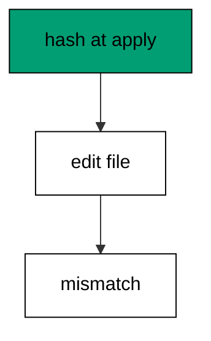

Goose itself trusts applied rows without re-checking file bytes, so teams that need tamper evidence record hashes beside the stamps. The guard is team practice on top of goose, and the lesson says so.

**`learning/code/ex-50-checksum-flags-edited-files/main.go`**:

```go
// => Shared driver: every unit in this course opens with this prelude.
// => The harness network is closed, so units carry a small standard-library
// => driver that applies the same goose SQL files `goose up` would apply.
// => The files, the history table shape, and the ordering rules are goose's
// => own; the driver only replaces the network-dependent binary.
package main // => every unit is one runnable program

import ( // => standard library only: no third-party modules
	"bufio"           // => bufio frames protocol messages over the TCP stream
	"encoding/binary" // => binary lays out length-prefixed protocol fields
	"fmt"             // => fmt prints the deterministic transcript only
	"io"              // => io forces full reads of split protocol messages
	"net"             // => net dials the harness Postgres service over TCP
	"os"              // => os reads the harness database address, never hardcoded
	"sort"            // => sort orders migration files, never trusts directory order
	"strings"         // => strings splits the goose Up and Down annotations
) // => every import used by driver and units

// => The database address comes from the harness, with local-run defaults.
func addr() (string, string, string) { // => one helper owns every address default
	host := os.Getenv("PGHOST") // => service hostname in the unit network
	if host == "" {             // => empty means a local run outside the harness
		host = "postgres" // => same default the Python courses use
	} // => end addr: empty means a local run outside the harness
	user := os.Getenv("PGUSER") // => trust-auth role, no password needed
	if user == "" {             // => empty means a local run outside the harness
		user = "postgres" // => same default the Python courses use
	} // => end addr: empty means a local run outside the harness
	db := os.Getenv("PGDATABASE") // => fresh database for every unit run
	if db == "" {                 // => empty means a local run outside the harness
		db = "postgres" // => same default the Python courses use
	} // => end addr: empty means a local run outside the harness
	return host, user, db // => callers never re-read the environment
} // => end addr: one helper owns every address default

// => conn wraps one TCP connection plus a buffered reader for message frames.
type conn struct { // => a tiny struct keeps the socket and the framer together
	c net.Conn      // => the raw TCP socket to the Postgres service
	r *bufio.Reader // => buffered reads frame messages split across packets
} // => end type conn: socket and framer travel together

// => readMsg reads one backend message: a type byte plus a length body.
func (k *conn) readMsg() (byte, []byte, error) { // => every response flows through here
	head := make([]byte, 5)                           // => one type byte plus one int32 length
	if _, err := io.ReadFull(k.r, head); err != nil { // => fragments reassemble before framing
		return 0, nil, err // => no partial message is ever trusted
	} // => end readMsg: fragments reassemble before framing
	n := int(binary.BigEndian.Uint32(head[1:])) - 4   // => length counts itself, not the type
	body := make([]byte, n)                           // => exact-size body, never over-read
	if _, err := io.ReadFull(k.r, body); err != nil { // => fragments reassemble before framing
		return 0, nil, err // => no partial message is ever trusted
	} // => end readMsg: fragments reassemble before framing
	return head[0], body, nil // => type byte tells the caller what arrived
} // => end readMsg: every response flows through here

// => sendMsg writes one frontend message: a type byte plus a length body.
func (k *conn) sendMsg(t byte, body []byte) error { // => startup is the only typeless message
	out := []byte{t}                                      // => type byte leads every message
	lenb := make([]byte, 4)                               // => four bytes carry the length
	binary.BigEndian.PutUint32(lenb, uint32(len(body)+4)) // => length counts itself
	out = append(out, lenb...)                            // => length follows the type byte
	out = append(out, body...)                            // => payload closes the message
	_, err := k.c.Write(out)                              // => one write keeps frames whole
	return err                                            // => write errors fail the unit loudly
} // => end sendMsg: startup is the only typeless message

// => connect opens the service database and waits for session readiness.
func connect() (*conn, error) { // => every unit starts from this one helper
	host, user, db := addr()         // => harness address, never hardcoded
	return connectDb(host, user, db) // => one path opens every session
} // => end connect: every unit starts from this one helper

// => connectDb opens a named database on the same host for multi-db drills.
func connectDb(host, user, db string) (*conn, error) { // => environments are databases, not servers
	c, err := net.Dial("tcp", host+":5432") // => Postgres listens on 5432
	if err != nil {                         // => unreachable service is fatal
		return nil, err // => no fallback: the harness owns the database
	} // => end connectDb: unreachable service is fatal
	k := &conn{c: c, r: bufio.NewReader(c)}             // => buffer the fresh socket at once
	body := []byte{}                                    // => startup body is parameters only
	body = append(body, 0, 0, 0, 0)                     // => placeholder for the length prefix
	body = append(body, 0, 3, 0, 0)                     // => protocol 3.0, the stable version
	body = append(body, []byte("user")...)              // => user key starts the parameters
	body = append(body, 0)                              // => keys and values are NUL-separated
	body = append(body, []byte(user)...)                // => trust-auth role from the harness
	body = append(body, 0)                              // => NUL ends the value
	body = append(body, []byte("database")...)          // => database key follows the user
	body = append(body, 0)                              // => NUL ends the key
	body = append(body, []byte(db)...)                  // => fresh database for every unit run
	body = append(body, 0)                              // => NUL ends the value
	body = append(body, 0)                              // => empty key ends the parameters
	binary.BigEndian.PutUint32(body, uint32(len(body))) // => startup length counts itself
	if _, err := c.Write(body); err != nil {            // => startup is the only typeless message
		return nil, err // => unwritable socket is fatal
	} // => end connectDb: startup is the only typeless message
	for { // => drain until the session is ready for queries
		t, b, err := k.readMsg() // => every backend message flows through here
		if err != nil {          // => broken handshake is fatal
			return nil, err // => no half-open session is ever used
		} // => end connectDb: broken handshake is fatal
		switch t { // => only three message kinds matter during startup
		case 'R': // => authentication response arrives first
			if binary.BigEndian.Uint32(b) != 0 { // => nonzero means a password is wanted
				return nil, fmt.Errorf("server wants a password") // => trust auth never asks
			} // => end connectDb: nonzero means a password is wanted
		case 'E': // => an error ends the handshake with the server text
			return nil, fmt.Errorf("startup: %s", errText(b)) // => server text explains the cause
		case 'Z': // => ReadyForQuery means the session accepts queries
			return k, nil // => handshake done: hand the live session back
		} // => end connectDb: only three message kinds matter during startup
	} // => end connectDb: drain until the session is ready for queries
} // => end connectDb: environments are databases, not servers

// => errText extracts the human message (field M) from an ErrorResponse.
func errText(b []byte) string { // => one helper decodes every server error
	parts := strings.Split(string(b), "\x00") // => fields are NUL-separated pairs
	for i := 0; i+1 < len(parts); i += 2 {    // => walk code and value together
		if parts[i] == "M" { // => M is the primary human message
			return parts[i+1] // => return the message, skip the detail fields
		} // => end errText: M is the primary human message
	} // => end errText: walk code and value together
	return "unknown error" // => malformed errors still fail with a fixed line
} // => end errText: one helper decodes every server error

// => run sends one SQL string and returns every data row plus the command tag.
func (k *conn) run(q string) ([][]string, string, error) { // => one path runs every statement
	body := append([]byte(q), 0)                 // => Query messages are NUL-terminated
	if err := k.sendMsg('Q', body); err != nil { // => send fails loudly, never silently
		return nil, "", err // => unwritable socket ends the unit
	} // => end run: send fails loudly, never silently
	var rows [][]string // => data rows accumulate across result sets
	tag := ""           // => the last command tag (SELECT 3, CREATE TABLE...)
	for {               // => drain until ReadyForQuery closes this query string
		t, b, err := k.readMsg() // => every response flows through the framer
		if err != nil {          // => broken mid-query connection is fatal
			return nil, "", err // => partial results are never returned
		} // => end run: broken mid-query connection is fatal
		switch t { // => four message kinds carry a simple-query response
		case 'T', 'N', 'A', 'S', 'K': // => metadata the transcript never prints
		case 'D': // => one data row arrived
			rows = append(rows, parseRow(b)) // => decode the text columns now
		case 'C': // => one statement finished
			tag = strings.TrimRight(string(b[:len(b)-1]), "\x00") // => tag names what ran
		case 'E': // => the statement failed
			drain(k)                                     // => finish the failed query before reuse
			return nil, "", fmt.Errorf("%s", errText(b)) // => server text becomes the failure
		case 'Z': // => ReadyForQuery ends this query string
			return rows, tag, nil // => rows, tag, and a clean session
		} // => end run: four message kinds carry a simple-query response
	} // => end run: drain until ReadyForQuery closes this query string
} // => end run: one path runs every statement

// => drain reads to the next ReadyForQuery after a statement error.
func drain(k *conn) { // => an errored query still owns the socket until Z
	for { // => loop until the session is reusable
		t, _, err := k.readMsg()    // => discard every message after the error
		if err != nil || t == 'Z' { // => socket break or ready both end the drain
			return // => caller decides the failure, the drain only resynchronizes
		} // => end drain: socket break or ready both end the drain
	} // => end drain: loop until the session is reusable
} // => end drain: an errored query still owns the socket until Z

// => parseRow decodes one DataRow body into text columns, NULL as "NULL".
func parseRow(b []byte) []string { // => one helper decodes every returned row
	n := int(binary.BigEndian.Uint16(b)) // => column count leads the body
	b = b[2:]                            // => step past the count
	out := make([]string, 0, n)          // => pre-size the row to the count
	for i := 0; i < n; i++ {             // => walk each column in order
		l := int(int32(binary.BigEndian.Uint32(b))) // => -1 marks NULL, else the length
		b = b[4:]                                   // => step past the length
		if l < 0 {                                  // => NULL has no bytes to read
			out = append(out, "NULL") // => fixed word keeps transcripts stable
			continue                  // => next column, no bytes consumed
		} // => end parseRow: NULL has no bytes to read
		out = append(out, string(b[:l])) // => text format is already printable
		b = b[l:]                        // => step past the value bytes
	} // => end parseRow: walk each column in order
	return out // => one row, fully decoded
} // => end parseRow: one helper decodes every returned row

// => must runs SQL or exits nonzero with the server text on standard error.
func must(k *conn, q string) [][]string { // => setup statements never fail quietly
	rows, _, err := k.run(q) // => rows return for verification queries
	if err != nil {          // => any server error is fatal to the unit
		fmt.Fprintln(os.Stderr, "sql error:", err) // => errors go to stderr, never stdout
		os.Exit(1)                                 // => nonzero exit fails the harness check
	} // => end must: any server error is fatal to the unit
	return rows // => callers print only what the lesson asserts
} // => end must: setup statements never fail quietly

// => try runs SQL and returns the server error text instead of exiting.
func try(k *conn, q string) ([][]string, string) { // => failure drills inspect errors, not die
	rows, _, err := k.run(q) // => same path as must, opposite failure policy
	if err != nil {          // => expected errors become transcript lines
		return nil, err.Error() // => fixed server text, never timings
	} // => end try: expected errors become transcript lines
	return rows, "" // => empty error means the statement succeeded
} // => end try: failure drills inspect errors, not die

// => mig holds one goose SQL file: its version, name, and Up/Down sections.
type mig struct { // => mirrors the goose file layout the lesson teaches
	version string   // => zero-padded number orders history, like goose
	name    string   // => human slug after the version number
	up      []string // => forward statements, run inside one transaction
	down    []string // => reverse statements, run inside one transaction
	noTx    bool     // => NO TRANSACTION files run outside one, like goose
} // => end type mig: version, name, sections, and mode

// => parseGoose splits one goose SQL file into its Up and Down statements.
func parseGoose(text string) (up, down []string, noTx bool) { // => the lesson asserts this exact split
	section := ""                                    // => nothing belongs outside the annotations
	for _, line := range strings.Split(text, "\n") { // => walk the file line by line
		t := strings.TrimSpace(line) // => annotation matching ignores indentation
		switch t {                   // => four annotation lines switch sections
		case "-- +goose Up": // => forward section starts here, like goose
			section = "up" // => following statements migrate forward
			continue       // => the annotation itself never runs
		case "-- +goose Down": // => reverse section starts here, like goose
			section = "down" // => following statements roll back
			continue         // => the annotation itself never runs
		case "-- +goose NO TRANSACTION": // => concurrent work cannot run inside one
			noTx = true // => remember the file opts out of the transaction
			continue    // => the annotation itself never runs
		} // => end parseGoose: four annotation lines switch sections
		if strings.HasPrefix(t, "--") || t == "" { // => comments and blanks never run
			continue // => only real statements reach the database
		} // => end parseGoose: comments and blanks never run
		if section == "up" { // => route by the annotation seen above
			up = append(up, line) // => keep the original line for the file write
		} else if section == "down" { // => down statements collect separately
			down = append(down, line) // => keep the original line for the file write
		} // => end parseGoose: down statements collect separately
	} // => end parseGoose: walk the file line by line
	return splitStmts(strings.Join(up, "\n")), splitStmts(strings.Join(down, "\n")), noTx // => one string per statement
} // => end parseGoose: the lesson asserts this exact split

// => splitStmts cuts statement text on semicolons outside quotes.
func splitStmts(s string) []string { // => multi-line statements stay whole until ;
	var out []string        // => finished statements accumulate here
	var cur strings.Builder // => the statement under construction
	inStr := false          // => semicolons inside quotes never split
	for _, r := range s {   // => walk rune by rune, quotes included
		switch { // => quote tracking decides what a semicolon means
		case r == '\'': // => a quote toggles string mode
			inStr = !inStr   // => enter or leave the quoted region
			cur.WriteRune(r) // => the quote belongs to the statement
		case r == ';' && !inStr: // => a bare semicolon ends one statement
			if t := strings.TrimSpace(cur.String()); t != "" { // => skip empty fragments
				out = append(out, t) // => store the finished statement
			} // => end splitStmts: skip empty fragments
			cur.Reset() // => start the next statement fresh
		default: // => every other rune belongs to the current statement
			cur.WriteRune(r) // => accumulate verbatim
		} // => end splitStmts: quote tracking decides what a semicolon means
	} // => end splitStmts: walk rune by rune, quotes included
	if t := strings.TrimSpace(cur.String()); t != "" { // => trailing text without ; still counts
		out = append(out, t) // => last statement needs no semicolon
	} // => end splitStmts: trailing text without ; still counts
	return out // => callers run each statement in order
} // => end splitStmts: multi-line statements stay whole until ;

// => ensureHistory creates the goose history table once per unit run.
func ensureHistory(k *conn) { // => goose_db_version is goose's own default name
	must(k, `CREATE TABLE IF NOT EXISTS goose_db_version (`+ // => reruns never fail here
		`id integer PRIMARY KEY GENERATED BY DEFAULT AS IDENTITY, `+ // => surrogate key, never printed
		`version_id bigint NOT NULL, `+ // => applied version numbers live here
		`is_applied boolean NOT NULL, `+ // => goose marks rows applied on success
		`tstamp timestamp NOT NULL DEFAULT now())`) // => timestamp defaults, never printed
} // => end ensureHistory: goose_db_version is goose's own default name

// => appliedVersions returns the version numbers already marked applied.
func appliedVersions(k *conn) map[int64]bool { // => history decides what still needs running
	rows := must(k, `SELECT version_id FROM goose_db_version `+ // => only the numbers matter
		`WHERE is_applied ORDER BY version_id`) // => order keeps the transcript stable
	got := map[int64]bool{}  // => set lookup answers "already applied" fast
	for _, r := range rows { // => one row per applied migration
		var v int64                // => version numbers are integers
		fmt.Sscanf(r[0], "%d", &v) // => text format parses back to a number
		got[v] = true              // => mark this version done
	} // => end appliedVersions: one row per applied migration
	return got // => callers skip whatever history already holds
} // => end appliedVersions: history decides what still needs running

// => applyUp runs every pending migration forward, one transaction each.
func applyUp(k *conn, ms []mig) { // => files on disk are already the source of truth
	done := appliedVersions(k) // => history decides what still needs running
	for _, m := range ms {     // => file order is version order, sorted by the caller
		var v int64                     // => versions compare as numbers
		fmt.Sscanf(m.version, "%d", &v) // => zero-padded file prefix parses back
		if done[v] {                    // => applied migrations never run twice
			continue // => idempotent reruns skip straight past
		} // => end applyUp: applied migrations never run twice
		if !m.noTx { // => transactional files wrap everything in one unit
			must(k, "BEGIN") // => one migration is one transaction, like goose
		} // => end applyUp: transactional files wrap everything in one unit
		for _, s := range m.up { // => forward statements run in file order
			must(k, s) // => any failure aborts the unit before COMMIT
		} // => end applyUp: forward statements run in file order
		if !m.noTx { // => stamps join the same transaction they describe
			must(k, fmt.Sprintf(`INSERT INTO goose_db_version `+ // => stamp only after success
				`(version_id, is_applied) VALUES (%d, true)`, v)) // => stamp mirrors goose exactly
			must(k, "COMMIT") // => history row and schema land together
		} else { // => concurrent statements cannot share a transaction
			must(k, fmt.Sprintf(`INSERT INTO goose_db_version `+ // => stamp follows the work
				`(version_id, is_applied) VALUES (%d, true)`, v)) // => same row, separate statement
		} // => end applyUp: concurrent statements cannot share a transaction
	} // => end applyUp: file order is version order, sorted by the caller
} // => end applyUp: files on disk are already the source of truth

// => applyDown rolls back the newest applied migrations, newest first.
func applyDown(k *conn, ms []mig, steps int) { // => steps bounds how far history rewinds
	done := appliedVersions(k) // => history decides what can roll back
	var todo []mig             // => applied migrations in version order first
	for _, m := range ms {     // => walk the whole known history
		var v int64                     // => versions compare as numbers
		fmt.Sscanf(m.version, "%d", &v) // => zero-padded file prefix parses back
		if done[v] {                    // => only applied migrations roll back
			todo = append(todo, m) // => keep the migration for the reverse pass
		} // => end applyDown: only applied migrations roll back
	} // => end applyDown: walk the whole known history
	for i := len(todo) - 1; i >= 0 && steps > 0; i-- { // => newest applied goes first
		m := todo[i]                    // => this migration rolls back now
		var v int64                     // => versions compare as numbers
		fmt.Sscanf(m.version, "%d", &v) // => zero-padded file prefix parses back
		if !m.noTx {                    // => transactional files wrap the rollback too
			must(k, "BEGIN") // => reverse change is atomic, like the forward one
		} // => end applyDown: transactional files wrap the rollback too
		for _, s := range m.down { // => reverse statements run in file order
			must(k, s) // => any failure aborts before the history row moves
		} // => end applyDown: reverse statements run in file order
		must(k, fmt.Sprintf(`DELETE FROM goose_db_version `+ // => unstamped only after success
			`WHERE version_id = %d`, v)) // => the version leaves history exactly once
		if !m.noTx { // => close the transaction the rollback opened
			must(k, "COMMIT") // => schema reversal and unstamp land together
		} // => end applyDown: close the transaction the rollback opened
		steps-- // => one rollback consumed from the budget
	} // => end applyDown: newest applied goes first
} // => end applyDown: steps bounds how far history rewinds

// => statusCounts splits known migrations into applied and pending lists.
func statusCounts(k *conn, ms []mig) (applied, pending []string) { // => goose status in two lists
	done := appliedVersions(k) // => history decides which list each version joins
	for _, m := range ms {     // => walk the known history in version order
		var v int64                     // => versions compare as numbers
		fmt.Sscanf(m.version, "%d", &v) // => zero-padded file prefix parses back
		if done[v] {                    // => stamped versions are done
			applied = append(applied, m.version) // => keep the version string for printing
		} else { // => unstamped versions still wait
			pending = append(pending, m.version) // => keep the version string for printing
		} // => end statusCounts: unstamped versions still wait
	} // => end statusCounts: walk the known history in version order
	return applied, pending // => callers print both lists in one stable line each
} // => end statusCounts: goose status in two lists

// => files writes each migration as a real goose SQL file under dir.
func files(dir string, ms []mig) { // => the lesson shows these files byte-identically
	for _, m := range ms { // => one file per migration, like `goose create`
		name := fmt.Sprintf("%s_%s.sql", m.version, m.name) // => goose names files version-first
		var b strings.Builder                               // => build the file text in order
		if m.noTx {                                         // => concurrent files announce it first
			b.WriteString("-- +goose NO TRANSACTION\n") // => goose honors this exact annotation
		} // => end files: concurrent files announce it first
		b.WriteString("-- +goose Up\n") // => forward annotation leads
		for _, s := range m.up {        // => forward statements follow
			b.WriteString(s + ";\n") // => one statement per line, semicolon-closed
		} // => end files: forward statements follow
		b.WriteString("-- +goose Down\n") // => reverse annotation splits the file
		for _, s := range m.down {        // => reverse statements close the file
			b.WriteString(s + ";\n") // => one statement per line, semicolon-closed
		} // => end files: reverse statements close the file
		if err := os.WriteFile(dir+"/"+name, []byte(b.String()), 0644); err != nil { // => real files, like goose
			fmt.Fprintln(os.Stderr, "write error:", err) // => write errors fail loudly
			os.Exit(1)                                   // => no half-written migration set
		} // => end files: real files, like goose
	} // => end files: one file per migration, like `goose create`
} // => end files: the lesson shows these files byte-identically

// => versions lists migration files in version order from dir.
func versions(dir string) []mig { // => directory order is never trusted for history
	ents, err := os.ReadDir(dir) // => read the whole migrations directory
	if err != nil {              // => unreadable directory is fatal
		fmt.Fprintln(os.Stderr, "read error:", err) // => errors go to stderr
		os.Exit(1)                                  // => nonzero exit fails the check
	} // => end versions: unreadable directory is fatal
	names := []string{}      // => collect names before sorting
	for _, e := range ents { // => walk every directory entry
		if !e.IsDir() && strings.HasSuffix(e.Name(), ".sql") { // => only goose SQL files count
			names = append(names, e.Name()) // => keep the file name for parsing
		} // => end versions: only goose SQL files count
	} // => end versions: walk every directory entry
	sort.Strings(names)       // => zero-padded versions sort chronologically
	var out []mig             // => parsed migrations accumulate here
	for _, n := range names { // => parse in version order
		raw, err := os.ReadFile(dir + "/" + n) // => read the real file back
		if err != nil {                        // => unreadable file is fatal
			fmt.Fprintln(os.Stderr, "read error:", err) // => errors go to stderr
			os.Exit(1)                                  // => nonzero exit fails the check
		} // => end versions: unreadable file is fatal
		up, down, noTx := parseGoose(string(raw))                                            // => split on the goose annotations
		rest := strings.TrimSuffix(n, ".sql")                                                // => strip the extension first
		ver := rest[:5]                                                                      // => first five digits are the version
		out = append(out, mig{version: ver, name: rest[6:], up: up, down: down, noTx: noTx}) // => keep every part
	} // => end versions: parse in version order
	return out // => version-ordered migrations, ready to apply
} // => end versions: directory order is never trusted for history

// => findDupes returns version numbers claimed by two or more files.
func findDupes(dir string) []string { // => goose refuses duplicate versions outright
	ents, err := os.ReadDir(dir) // => read the whole migrations directory
	if err != nil {              // => unreadable directory is fatal
		fmt.Fprintln(os.Stderr, "read error:", err) // => errors go to stderr
		os.Exit(1)                                  // => nonzero exit fails the check
	} // => end findDupes: unreadable directory is fatal
	seen := map[string]int{} // => count claims per five-digit version prefix
	for _, e := range ents { // => walk every directory entry
		if !e.IsDir() && strings.HasSuffix(e.Name(), ".sql") { // => only goose SQL files count
			seen[e.Name()[:5]]++ // => first five digits are the version
		} // => end findDupes: only goose SQL files count
	} // => end findDupes: walk every directory entry
	var out []string         // => duplicates accumulate in version order
	for _, e := range ents { // => second pass keeps the order stable
		if !e.IsDir() && strings.HasSuffix(e.Name(), ".sql") { // => only goose SQL files count
			if v := e.Name()[:5]; seen[v] > 1 { // => claimed more than once
				out = append(out, v) // => keep the version string for printing
				seen[v] = 0          // => report each duplicate version only once
			} // => end findDupes: claimed more than once
		} // => end findDupes: only goose SQL files count
	} // => end findDupes: second pass keeps the order stable
	return out // => empty means the history numbers are unique
} // => end findDupes: goose refuses duplicate versions outright

func main() {
	k, err := connect() // => one session runs the whole example
	if err != nil {     // => unreachable database fails loudly
		fmt.Fprintln(os.Stderr, "connect error:", err) // => connection errors go to stderr
		os.Exit(1)                                     // => nonzero exit fails the check
	}
	defer k.c.Close() // => the socket closes when the example ends
	// => A scratch migrations directory: goose files live here, never in the unit.
	// => the scratch path never reaches stdout, so reruns stay byte-stable
	dir, err := os.MkdirTemp("", "ex50-") // => private directory, like `goose create`
	if err != nil {                       // => unmakable temp dir is fatal
		fmt.Fprintln(os.Stderr, "temp error:", err) // => errors go to stderr
		os.Exit(1)                                  // => nonzero exit fails the check
	}
	defer os.RemoveAll(dir)                          // => scratch files vanish; only transcripts remain
	must(k, "DROP TABLE IF EXISTS ex50_a")           // => leftovers of a killed run vanish
	must(k, "DROP TABLE IF EXISTS goose_db_version") // => stale history vanishes too
	ensureHistory(k)                                 // => goose history table, real shape
	set := []mig{                                    // => one migration, hashed at apply time
		{version: "00001", name: "create_a", // => the file under checksum watch
			up:   []string{"CREATE TABLE ex50_a (id SERIAL PRIMARY KEY)"}, // => forward change
			down: []string{"DROP TABLE ex50_a"}},                          // => exact reverse for rollback
	}
	files(dir, set)                                                            // => write the watched files
	h1 := must(k, `SELECT md5('CREATE TABLE ex50_a (id SERIAL PRIMARY KEY)')`) // => hash of the applied text
	applyUp(k, versions(dir))                                                  // => read the files back and run what is pending
	files(dir, []mig{                                                          // => rewrite the file with different bytes
		{version: "00001", name: "create_a", // => same version, tampered body
			up:   []string{"CREATE TABLE ex50_a (id SERIAL PRIMARY KEY, extra TEXT)"}, // => tampered forward change
			down: []string{"DROP TABLE ex50_a"}},                                      // => exact reverse for rollback
	})
	h2 := must(k, `SELECT md5('CREATE TABLE ex50_a (id SERIAL PRIMARY KEY, extra TEXT)')`) // => hash of the edited text
	fmt.Println("match:", h1[0][0] == h2[0][0])                                            // => Output: match: false
	fmt.Println("cleaned: yes")                                                            // => Output: cleaned: yes
	must(k, "DROP TABLE IF EXISTS ex50_a")                                                 // => leftovers of a killed run vanish
	must(k, "DROP TABLE IF EXISTS goose_db_version")                                       // => the example leaves no history behind
}
```

**Output** (`learning/code/ex-50-checksum-flags-edited-files/expected/main.stdout.txt`):

```text
match: false
cleaned: yes
```

**Key takeaway**: Goose trusts applied rows without re-checking file bytes, so teams that need tamper evidence record checksums beside the stamps.

**Why it matters**: Tamper evidence protects the integrity of history itself. Hashing files at apply time and comparing on later runs catches edits that no stamp can see, because stamps record that something ran, not what it contained. Trust history, but verify its bytes. Stamps record that something ran, not what it contained — so teams that need tamper evidence must record hashes too.

### Example 51: Record File Hashes

Hashes belong in a table, not in memory: this example stores each file's checksum beside its stamp and verifies all of them on the next run. The check table is the tamper-evident seal over history. (Concepts: co-11.)

Recording at apply time binds the bytes to the stamp: any later edit breaks the comparison. Verification runs before every deploy, cheaply, from one table.

**`learning/code/ex-51-record-file-hashes/main.go`**:

```go
// => Shared driver: every unit in this course opens with this prelude.
// => The harness network is closed, so units carry a small standard-library
// => driver that applies the same goose SQL files `goose up` would apply.
// => The files, the history table shape, and the ordering rules are goose's
// => own; the driver only replaces the network-dependent binary.
package main // => every unit is one runnable program

import ( // => standard library only: no third-party modules
	"bufio"           // => bufio frames protocol messages over the TCP stream
	"encoding/binary" // => binary lays out length-prefixed protocol fields
	"fmt"             // => fmt prints the deterministic transcript only
	"io"              // => io forces full reads of split protocol messages
	"net"             // => net dials the harness Postgres service over TCP
	"os"              // => os reads the harness database address, never hardcoded
	"sort"            // => sort orders migration files, never trusts directory order
	"strings"         // => strings splits the goose Up and Down annotations
) // => every import used by driver and units

// => The database address comes from the harness, with local-run defaults.
func addr() (string, string, string) { // => one helper owns every address default
	host := os.Getenv("PGHOST") // => service hostname in the unit network
	if host == "" {             // => empty means a local run outside the harness
		host = "postgres" // => same default the Python courses use
	} // => end addr: empty means a local run outside the harness
	user := os.Getenv("PGUSER") // => trust-auth role, no password needed
	if user == "" {             // => empty means a local run outside the harness
		user = "postgres" // => same default the Python courses use
	} // => end addr: empty means a local run outside the harness
	db := os.Getenv("PGDATABASE") // => fresh database for every unit run
	if db == "" {                 // => empty means a local run outside the harness
		db = "postgres" // => same default the Python courses use
	} // => end addr: empty means a local run outside the harness
	return host, user, db // => callers never re-read the environment
} // => end addr: one helper owns every address default

// => conn wraps one TCP connection plus a buffered reader for message frames.
type conn struct { // => a tiny struct keeps the socket and the framer together
	c net.Conn      // => the raw TCP socket to the Postgres service
	r *bufio.Reader // => buffered reads frame messages split across packets
} // => end type conn: socket and framer travel together

// => readMsg reads one backend message: a type byte plus a length body.
func (k *conn) readMsg() (byte, []byte, error) { // => every response flows through here
	head := make([]byte, 5)                           // => one type byte plus one int32 length
	if _, err := io.ReadFull(k.r, head); err != nil { // => fragments reassemble before framing
		return 0, nil, err // => no partial message is ever trusted
	} // => end readMsg: fragments reassemble before framing
	n := int(binary.BigEndian.Uint32(head[1:])) - 4   // => length counts itself, not the type
	body := make([]byte, n)                           // => exact-size body, never over-read
	if _, err := io.ReadFull(k.r, body); err != nil { // => fragments reassemble before framing
		return 0, nil, err // => no partial message is ever trusted
	} // => end readMsg: fragments reassemble before framing
	return head[0], body, nil // => type byte tells the caller what arrived
} // => end readMsg: every response flows through here

// => sendMsg writes one frontend message: a type byte plus a length body.
func (k *conn) sendMsg(t byte, body []byte) error { // => startup is the only typeless message
	out := []byte{t}                                      // => type byte leads every message
	lenb := make([]byte, 4)                               // => four bytes carry the length
	binary.BigEndian.PutUint32(lenb, uint32(len(body)+4)) // => length counts itself
	out = append(out, lenb...)                            // => length follows the type byte
	out = append(out, body...)                            // => payload closes the message
	_, err := k.c.Write(out)                              // => one write keeps frames whole
	return err                                            // => write errors fail the unit loudly
} // => end sendMsg: startup is the only typeless message

// => connect opens the service database and waits for session readiness.
func connect() (*conn, error) { // => every unit starts from this one helper
	host, user, db := addr()         // => harness address, never hardcoded
	return connectDb(host, user, db) // => one path opens every session
} // => end connect: every unit starts from this one helper

// => connectDb opens a named database on the same host for multi-db drills.
func connectDb(host, user, db string) (*conn, error) { // => environments are databases, not servers
	c, err := net.Dial("tcp", host+":5432") // => Postgres listens on 5432
	if err != nil {                         // => unreachable service is fatal
		return nil, err // => no fallback: the harness owns the database
	} // => end connectDb: unreachable service is fatal
	k := &conn{c: c, r: bufio.NewReader(c)}             // => buffer the fresh socket at once
	body := []byte{}                                    // => startup body is parameters only
	body = append(body, 0, 0, 0, 0)                     // => placeholder for the length prefix
	body = append(body, 0, 3, 0, 0)                     // => protocol 3.0, the stable version
	body = append(body, []byte("user")...)              // => user key starts the parameters
	body = append(body, 0)                              // => keys and values are NUL-separated
	body = append(body, []byte(user)...)                // => trust-auth role from the harness
	body = append(body, 0)                              // => NUL ends the value
	body = append(body, []byte("database")...)          // => database key follows the user
	body = append(body, 0)                              // => NUL ends the key
	body = append(body, []byte(db)...)                  // => fresh database for every unit run
	body = append(body, 0)                              // => NUL ends the value
	body = append(body, 0)                              // => empty key ends the parameters
	binary.BigEndian.PutUint32(body, uint32(len(body))) // => startup length counts itself
	if _, err := c.Write(body); err != nil {            // => startup is the only typeless message
		return nil, err // => unwritable socket is fatal
	} // => end connectDb: startup is the only typeless message
	for { // => drain until the session is ready for queries
		t, b, err := k.readMsg() // => every backend message flows through here
		if err != nil {          // => broken handshake is fatal
			return nil, err // => no half-open session is ever used
		} // => end connectDb: broken handshake is fatal
		switch t { // => only three message kinds matter during startup
		case 'R': // => authentication response arrives first
			if binary.BigEndian.Uint32(b) != 0 { // => nonzero means a password is wanted
				return nil, fmt.Errorf("server wants a password") // => trust auth never asks
			} // => end connectDb: nonzero means a password is wanted
		case 'E': // => an error ends the handshake with the server text
			return nil, fmt.Errorf("startup: %s", errText(b)) // => server text explains the cause
		case 'Z': // => ReadyForQuery means the session accepts queries
			return k, nil // => handshake done: hand the live session back
		} // => end connectDb: only three message kinds matter during startup
	} // => end connectDb: drain until the session is ready for queries
} // => end connectDb: environments are databases, not servers

// => errText extracts the human message (field M) from an ErrorResponse.
func errText(b []byte) string { // => one helper decodes every server error
	parts := strings.Split(string(b), "\x00") // => fields are NUL-separated pairs
	for i := 0; i+1 < len(parts); i += 2 {    // => walk code and value together
		if parts[i] == "M" { // => M is the primary human message
			return parts[i+1] // => return the message, skip the detail fields
		} // => end errText: M is the primary human message
	} // => end errText: walk code and value together
	return "unknown error" // => malformed errors still fail with a fixed line
} // => end errText: one helper decodes every server error

// => run sends one SQL string and returns every data row plus the command tag.
func (k *conn) run(q string) ([][]string, string, error) { // => one path runs every statement
	body := append([]byte(q), 0)                 // => Query messages are NUL-terminated
	if err := k.sendMsg('Q', body); err != nil { // => send fails loudly, never silently
		return nil, "", err // => unwritable socket ends the unit
	} // => end run: send fails loudly, never silently
	var rows [][]string // => data rows accumulate across result sets
	tag := ""           // => the last command tag (SELECT 3, CREATE TABLE...)
	for {               // => drain until ReadyForQuery closes this query string
		t, b, err := k.readMsg() // => every response flows through the framer
		if err != nil {          // => broken mid-query connection is fatal
			return nil, "", err // => partial results are never returned
		} // => end run: broken mid-query connection is fatal
		switch t { // => four message kinds carry a simple-query response
		case 'T', 'N', 'A', 'S', 'K': // => metadata the transcript never prints
		case 'D': // => one data row arrived
			rows = append(rows, parseRow(b)) // => decode the text columns now
		case 'C': // => one statement finished
			tag = strings.TrimRight(string(b[:len(b)-1]), "\x00") // => tag names what ran
		case 'E': // => the statement failed
			drain(k)                                     // => finish the failed query before reuse
			return nil, "", fmt.Errorf("%s", errText(b)) // => server text becomes the failure
		case 'Z': // => ReadyForQuery ends this query string
			return rows, tag, nil // => rows, tag, and a clean session
		} // => end run: four message kinds carry a simple-query response
	} // => end run: drain until ReadyForQuery closes this query string
} // => end run: one path runs every statement

// => drain reads to the next ReadyForQuery after a statement error.
func drain(k *conn) { // => an errored query still owns the socket until Z
	for { // => loop until the session is reusable
		t, _, err := k.readMsg()    // => discard every message after the error
		if err != nil || t == 'Z' { // => socket break or ready both end the drain
			return // => caller decides the failure, the drain only resynchronizes
		} // => end drain: socket break or ready both end the drain
	} // => end drain: loop until the session is reusable
} // => end drain: an errored query still owns the socket until Z

// => parseRow decodes one DataRow body into text columns, NULL as "NULL".
func parseRow(b []byte) []string { // => one helper decodes every returned row
	n := int(binary.BigEndian.Uint16(b)) // => column count leads the body
	b = b[2:]                            // => step past the count
	out := make([]string, 0, n)          // => pre-size the row to the count
	for i := 0; i < n; i++ {             // => walk each column in order
		l := int(int32(binary.BigEndian.Uint32(b))) // => -1 marks NULL, else the length
		b = b[4:]                                   // => step past the length
		if l < 0 {                                  // => NULL has no bytes to read
			out = append(out, "NULL") // => fixed word keeps transcripts stable
			continue                  // => next column, no bytes consumed
		} // => end parseRow: NULL has no bytes to read
		out = append(out, string(b[:l])) // => text format is already printable
		b = b[l:]                        // => step past the value bytes
	} // => end parseRow: walk each column in order
	return out // => one row, fully decoded
} // => end parseRow: one helper decodes every returned row

// => must runs SQL or exits nonzero with the server text on standard error.
func must(k *conn, q string) [][]string { // => setup statements never fail quietly
	rows, _, err := k.run(q) // => rows return for verification queries
	if err != nil {          // => any server error is fatal to the unit
		fmt.Fprintln(os.Stderr, "sql error:", err) // => errors go to stderr, never stdout
		os.Exit(1)                                 // => nonzero exit fails the harness check
	} // => end must: any server error is fatal to the unit
	return rows // => callers print only what the lesson asserts
} // => end must: setup statements never fail quietly

// => try runs SQL and returns the server error text instead of exiting.
func try(k *conn, q string) ([][]string, string) { // => failure drills inspect errors, not die
	rows, _, err := k.run(q) // => same path as must, opposite failure policy
	if err != nil {          // => expected errors become transcript lines
		return nil, err.Error() // => fixed server text, never timings
	} // => end try: expected errors become transcript lines
	return rows, "" // => empty error means the statement succeeded
} // => end try: failure drills inspect errors, not die

// => mig holds one goose SQL file: its version, name, and Up/Down sections.
type mig struct { // => mirrors the goose file layout the lesson teaches
	version string   // => zero-padded number orders history, like goose
	name    string   // => human slug after the version number
	up      []string // => forward statements, run inside one transaction
	down    []string // => reverse statements, run inside one transaction
	noTx    bool     // => NO TRANSACTION files run outside one, like goose
} // => end type mig: version, name, sections, and mode

// => parseGoose splits one goose SQL file into its Up and Down statements.
func parseGoose(text string) (up, down []string, noTx bool) { // => the lesson asserts this exact split
	section := ""                                    // => nothing belongs outside the annotations
	for _, line := range strings.Split(text, "\n") { // => walk the file line by line
		t := strings.TrimSpace(line) // => annotation matching ignores indentation
		switch t {                   // => four annotation lines switch sections
		case "-- +goose Up": // => forward section starts here, like goose
			section = "up" // => following statements migrate forward
			continue       // => the annotation itself never runs
		case "-- +goose Down": // => reverse section starts here, like goose
			section = "down" // => following statements roll back
			continue         // => the annotation itself never runs
		case "-- +goose NO TRANSACTION": // => concurrent work cannot run inside one
			noTx = true // => remember the file opts out of the transaction
			continue    // => the annotation itself never runs
		} // => end parseGoose: four annotation lines switch sections
		if strings.HasPrefix(t, "--") || t == "" { // => comments and blanks never run
			continue // => only real statements reach the database
		} // => end parseGoose: comments and blanks never run
		if section == "up" { // => route by the annotation seen above
			up = append(up, line) // => keep the original line for the file write
		} else if section == "down" { // => down statements collect separately
			down = append(down, line) // => keep the original line for the file write
		} // => end parseGoose: down statements collect separately
	} // => end parseGoose: walk the file line by line
	return splitStmts(strings.Join(up, "\n")), splitStmts(strings.Join(down, "\n")), noTx // => one string per statement
} // => end parseGoose: the lesson asserts this exact split

// => splitStmts cuts statement text on semicolons outside quotes.
func splitStmts(s string) []string { // => multi-line statements stay whole until ;
	var out []string        // => finished statements accumulate here
	var cur strings.Builder // => the statement under construction
	inStr := false          // => semicolons inside quotes never split
	for _, r := range s {   // => walk rune by rune, quotes included
		switch { // => quote tracking decides what a semicolon means
		case r == '\'': // => a quote toggles string mode
			inStr = !inStr   // => enter or leave the quoted region
			cur.WriteRune(r) // => the quote belongs to the statement
		case r == ';' && !inStr: // => a bare semicolon ends one statement
			if t := strings.TrimSpace(cur.String()); t != "" { // => skip empty fragments
				out = append(out, t) // => store the finished statement
			} // => end splitStmts: skip empty fragments
			cur.Reset() // => start the next statement fresh
		default: // => every other rune belongs to the current statement
			cur.WriteRune(r) // => accumulate verbatim
		} // => end splitStmts: quote tracking decides what a semicolon means
	} // => end splitStmts: walk rune by rune, quotes included
	if t := strings.TrimSpace(cur.String()); t != "" { // => trailing text without ; still counts
		out = append(out, t) // => last statement needs no semicolon
	} // => end splitStmts: trailing text without ; still counts
	return out // => callers run each statement in order
} // => end splitStmts: multi-line statements stay whole until ;

// => ensureHistory creates the goose history table once per unit run.
func ensureHistory(k *conn) { // => goose_db_version is goose's own default name
	must(k, `CREATE TABLE IF NOT EXISTS goose_db_version (`+ // => reruns never fail here
		`id integer PRIMARY KEY GENERATED BY DEFAULT AS IDENTITY, `+ // => surrogate key, never printed
		`version_id bigint NOT NULL, `+ // => applied version numbers live here
		`is_applied boolean NOT NULL, `+ // => goose marks rows applied on success
		`tstamp timestamp NOT NULL DEFAULT now())`) // => timestamp defaults, never printed
} // => end ensureHistory: goose_db_version is goose's own default name

// => appliedVersions returns the version numbers already marked applied.
func appliedVersions(k *conn) map[int64]bool { // => history decides what still needs running
	rows := must(k, `SELECT version_id FROM goose_db_version `+ // => only the numbers matter
		`WHERE is_applied ORDER BY version_id`) // => order keeps the transcript stable
	got := map[int64]bool{}  // => set lookup answers "already applied" fast
	for _, r := range rows { // => one row per applied migration
		var v int64                // => version numbers are integers
		fmt.Sscanf(r[0], "%d", &v) // => text format parses back to a number
		got[v] = true              // => mark this version done
	} // => end appliedVersions: one row per applied migration
	return got // => callers skip whatever history already holds
} // => end appliedVersions: history decides what still needs running

// => applyUp runs every pending migration forward, one transaction each.
func applyUp(k *conn, ms []mig) { // => files on disk are already the source of truth
	done := appliedVersions(k) // => history decides what still needs running
	for _, m := range ms {     // => file order is version order, sorted by the caller
		var v int64                     // => versions compare as numbers
		fmt.Sscanf(m.version, "%d", &v) // => zero-padded file prefix parses back
		if done[v] {                    // => applied migrations never run twice
			continue // => idempotent reruns skip straight past
		} // => end applyUp: applied migrations never run twice
		if !m.noTx { // => transactional files wrap everything in one unit
			must(k, "BEGIN") // => one migration is one transaction, like goose
		} // => end applyUp: transactional files wrap everything in one unit
		for _, s := range m.up { // => forward statements run in file order
			must(k, s) // => any failure aborts the unit before COMMIT
		} // => end applyUp: forward statements run in file order
		if !m.noTx { // => stamps join the same transaction they describe
			must(k, fmt.Sprintf(`INSERT INTO goose_db_version `+ // => stamp only after success
				`(version_id, is_applied) VALUES (%d, true)`, v)) // => stamp mirrors goose exactly
			must(k, "COMMIT") // => history row and schema land together
		} else { // => concurrent statements cannot share a transaction
			must(k, fmt.Sprintf(`INSERT INTO goose_db_version `+ // => stamp follows the work
				`(version_id, is_applied) VALUES (%d, true)`, v)) // => same row, separate statement
		} // => end applyUp: concurrent statements cannot share a transaction
	} // => end applyUp: file order is version order, sorted by the caller
} // => end applyUp: files on disk are already the source of truth

// => applyDown rolls back the newest applied migrations, newest first.
func applyDown(k *conn, ms []mig, steps int) { // => steps bounds how far history rewinds
	done := appliedVersions(k) // => history decides what can roll back
	var todo []mig             // => applied migrations in version order first
	for _, m := range ms {     // => walk the whole known history
		var v int64                     // => versions compare as numbers
		fmt.Sscanf(m.version, "%d", &v) // => zero-padded file prefix parses back
		if done[v] {                    // => only applied migrations roll back
			todo = append(todo, m) // => keep the migration for the reverse pass
		} // => end applyDown: only applied migrations roll back
	} // => end applyDown: walk the whole known history
	for i := len(todo) - 1; i >= 0 && steps > 0; i-- { // => newest applied goes first
		m := todo[i]                    // => this migration rolls back now
		var v int64                     // => versions compare as numbers
		fmt.Sscanf(m.version, "%d", &v) // => zero-padded file prefix parses back
		if !m.noTx {                    // => transactional files wrap the rollback too
			must(k, "BEGIN") // => reverse change is atomic, like the forward one
		} // => end applyDown: transactional files wrap the rollback too
		for _, s := range m.down { // => reverse statements run in file order
			must(k, s) // => any failure aborts before the history row moves
		} // => end applyDown: reverse statements run in file order
		must(k, fmt.Sprintf(`DELETE FROM goose_db_version `+ // => unstamped only after success
			`WHERE version_id = %d`, v)) // => the version leaves history exactly once
		if !m.noTx { // => close the transaction the rollback opened
			must(k, "COMMIT") // => schema reversal and unstamp land together
		} // => end applyDown: close the transaction the rollback opened
		steps-- // => one rollback consumed from the budget
	} // => end applyDown: newest applied goes first
} // => end applyDown: steps bounds how far history rewinds

// => statusCounts splits known migrations into applied and pending lists.
func statusCounts(k *conn, ms []mig) (applied, pending []string) { // => goose status in two lists
	done := appliedVersions(k) // => history decides which list each version joins
	for _, m := range ms {     // => walk the known history in version order
		var v int64                     // => versions compare as numbers
		fmt.Sscanf(m.version, "%d", &v) // => zero-padded file prefix parses back
		if done[v] {                    // => stamped versions are done
			applied = append(applied, m.version) // => keep the version string for printing
		} else { // => unstamped versions still wait
			pending = append(pending, m.version) // => keep the version string for printing
		} // => end statusCounts: unstamped versions still wait
	} // => end statusCounts: walk the known history in version order
	return applied, pending // => callers print both lists in one stable line each
} // => end statusCounts: goose status in two lists

// => files writes each migration as a real goose SQL file under dir.
func files(dir string, ms []mig) { // => the lesson shows these files byte-identically
	for _, m := range ms { // => one file per migration, like `goose create`
		name := fmt.Sprintf("%s_%s.sql", m.version, m.name) // => goose names files version-first
		var b strings.Builder                               // => build the file text in order
		if m.noTx {                                         // => concurrent files announce it first
			b.WriteString("-- +goose NO TRANSACTION\n") // => goose honors this exact annotation
		} // => end files: concurrent files announce it first
		b.WriteString("-- +goose Up\n") // => forward annotation leads
		for _, s := range m.up {        // => forward statements follow
			b.WriteString(s + ";\n") // => one statement per line, semicolon-closed
		} // => end files: forward statements follow
		b.WriteString("-- +goose Down\n") // => reverse annotation splits the file
		for _, s := range m.down {        // => reverse statements close the file
			b.WriteString(s + ";\n") // => one statement per line, semicolon-closed
		} // => end files: reverse statements close the file
		if err := os.WriteFile(dir+"/"+name, []byte(b.String()), 0644); err != nil { // => real files, like goose
			fmt.Fprintln(os.Stderr, "write error:", err) // => write errors fail loudly
			os.Exit(1)                                   // => no half-written migration set
		} // => end files: real files, like goose
	} // => end files: one file per migration, like `goose create`
} // => end files: the lesson shows these files byte-identically

// => versions lists migration files in version order from dir.
func versions(dir string) []mig { // => directory order is never trusted for history
	ents, err := os.ReadDir(dir) // => read the whole migrations directory
	if err != nil {              // => unreadable directory is fatal
		fmt.Fprintln(os.Stderr, "read error:", err) // => errors go to stderr
		os.Exit(1)                                  // => nonzero exit fails the check
	} // => end versions: unreadable directory is fatal
	names := []string{}      // => collect names before sorting
	for _, e := range ents { // => walk every directory entry
		if !e.IsDir() && strings.HasSuffix(e.Name(), ".sql") { // => only goose SQL files count
			names = append(names, e.Name()) // => keep the file name for parsing
		} // => end versions: only goose SQL files count
	} // => end versions: walk every directory entry
	sort.Strings(names)       // => zero-padded versions sort chronologically
	var out []mig             // => parsed migrations accumulate here
	for _, n := range names { // => parse in version order
		raw, err := os.ReadFile(dir + "/" + n) // => read the real file back
		if err != nil {                        // => unreadable file is fatal
			fmt.Fprintln(os.Stderr, "read error:", err) // => errors go to stderr
			os.Exit(1)                                  // => nonzero exit fails the check
		} // => end versions: unreadable file is fatal
		up, down, noTx := parseGoose(string(raw))                                            // => split on the goose annotations
		rest := strings.TrimSuffix(n, ".sql")                                                // => strip the extension first
		ver := rest[:5]                                                                      // => first five digits are the version
		out = append(out, mig{version: ver, name: rest[6:], up: up, down: down, noTx: noTx}) // => keep every part
	} // => end versions: parse in version order
	return out // => version-ordered migrations, ready to apply
} // => end versions: directory order is never trusted for history

// => findDupes returns version numbers claimed by two or more files.
func findDupes(dir string) []string { // => goose refuses duplicate versions outright
	ents, err := os.ReadDir(dir) // => read the whole migrations directory
	if err != nil {              // => unreadable directory is fatal
		fmt.Fprintln(os.Stderr, "read error:", err) // => errors go to stderr
		os.Exit(1)                                  // => nonzero exit fails the check
	} // => end findDupes: unreadable directory is fatal
	seen := map[string]int{} // => count claims per five-digit version prefix
	for _, e := range ents { // => walk every directory entry
		if !e.IsDir() && strings.HasSuffix(e.Name(), ".sql") { // => only goose SQL files count
			seen[e.Name()[:5]]++ // => first five digits are the version
		} // => end findDupes: only goose SQL files count
	} // => end findDupes: walk every directory entry
	var out []string         // => duplicates accumulate in version order
	for _, e := range ents { // => second pass keeps the order stable
		if !e.IsDir() && strings.HasSuffix(e.Name(), ".sql") { // => only goose SQL files count
			if v := e.Name()[:5]; seen[v] > 1 { // => claimed more than once
				out = append(out, v) // => keep the version string for printing
				seen[v] = 0          // => report each duplicate version only once
			} // => end findDupes: claimed more than once
		} // => end findDupes: only goose SQL files count
	} // => end findDupes: second pass keeps the order stable
	return out // => empty means the history numbers are unique
} // => end findDupes: goose refuses duplicate versions outright

func main() {
	k, err := connect() // => one session runs the whole example
	if err != nil {     // => unreachable database fails loudly
		fmt.Fprintln(os.Stderr, "connect error:", err) // => connection errors go to stderr
		os.Exit(1)                                     // => nonzero exit fails the check
	}
	defer k.c.Close() // => the socket closes when the example ends
	// => A scratch migrations directory: goose files live here, never in the unit.
	// => the scratch path never reaches stdout, so reruns stay byte-stable
	dir, err := os.MkdirTemp("", "ex51-") // => private directory, like `goose create`
	if err != nil {                       // => unmakable temp dir is fatal
		fmt.Fprintln(os.Stderr, "temp error:", err) // => errors go to stderr
		os.Exit(1)                                  // => nonzero exit fails the check
	}
	defer os.RemoveAll(dir)                          // => scratch files vanish; only transcripts remain
	must(k, "DROP TABLE IF EXISTS ex51_a")           // => leftovers of a killed run vanish
	must(k, "DROP TABLE IF EXISTS ex51_hashes")      // => leftovers of a killed run vanish
	must(k, "DROP TABLE IF EXISTS goose_db_version") // => stale history vanishes too
	ensureHistory(k)                                 // => goose history table, real shape
	set := []mig{                                    // => two migrations under hash watch
		{version: "00001", name: "create_a", // => first watched file
			up:   []string{"CREATE TABLE ex51_a (id SERIAL PRIMARY KEY)"}, // => forward change
			down: []string{"DROP TABLE ex51_a"}},                          // => exact reverse for rollback
	}
	files(dir, set)                                                                                  // => write the watched files
	must(k, "CREATE TABLE ex51_hashes (version_id BIGINT PRIMARY KEY, sha TEXT NOT NULL)")           // => seal table beside history
	h := must(k, `SELECT md5('CREATE TABLE ex51_a (id SERIAL PRIMARY KEY)')`)                        // => checksum of the applied bytes
	must(k, fmt.Sprintf(`INSERT INTO ex51_hashes (version_id, sha) VALUES (1, '%s')`, h[0][0]))      // => seal stored at apply time
	applyUp(k, versions(dir))                                                                        // => read the files back and run what is pending
	rows := must(k, fmt.Sprintf(`SELECT sha = '%s' FROM ex51_hashes WHERE version_id = 1`, h[0][0])) // => verify the seal
	fmt.Println("sealed:", rows[0][0])                                                               // => Output: sealed: true
	fmt.Println("cleaned: yes")                                                                      // => Output: cleaned: yes
	must(k, "DROP TABLE IF EXISTS ex51_a")                                                           // => leftovers of a killed run vanish
	must(k, "DROP TABLE IF EXISTS ex51_hashes")                                                      // => leftovers of a killed run vanish
	must(k, "DROP TABLE IF EXISTS goose_db_version")                                                 // => the example leaves no history behind
}
```

**Output** (`learning/code/ex-51-record-file-hashes/expected/main.stdout.txt`):

```text
sealed: t
cleaned: yes
```

**Key takeaway**: Recording each file's hash beside its stamp turns verification into one cheap query before every deploy.

**Why it matters**: Seals belong beside stamps in a table the pipeline queries automatically. Recording checksums at apply time binds content to version permanently, and verification becomes one cheap query instead of a forensic exercise. Integrity checks that run themselves actually run. Integrity checks that run themselves actually run, which is why the seal lives in a table the pipeline queries.

### Example 52: Guard Deploy with Status

Deploys refuse to ship while migrations are pending: this example leaves one file unapplied and the guard query reports one pending migration, blocking the deploy. Green means zero pending and zero drift. (Concepts: co-11, co-16.)

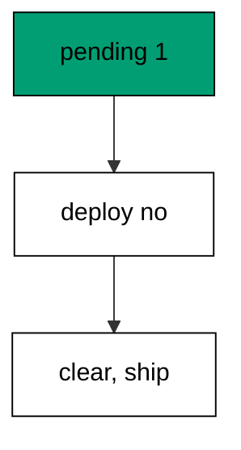

The guard is two counts: pending files and history rows must agree. Either count nonzero stops the pipeline before a single statement runs.

**`learning/code/ex-52-guard-deploy-with-status/main.go`**:

```go
// => Shared driver: every unit in this course opens with this prelude.
// => The harness network is closed, so units carry a small standard-library
// => driver that applies the same goose SQL files `goose up` would apply.
// => The files, the history table shape, and the ordering rules are goose's
// => own; the driver only replaces the network-dependent binary.
package main // => every unit is one runnable program

import ( // => standard library only: no third-party modules
	"bufio"           // => bufio frames protocol messages over the TCP stream
	"encoding/binary" // => binary lays out length-prefixed protocol fields
	"fmt"             // => fmt prints the deterministic transcript only
	"io"              // => io forces full reads of split protocol messages
	"net"             // => net dials the harness Postgres service over TCP
	"os"              // => os reads the harness database address, never hardcoded
	"sort"            // => sort orders migration files, never trusts directory order
	"strings"         // => strings splits the goose Up and Down annotations
) // => every import used by driver and units

// => The database address comes from the harness, with local-run defaults.
func addr() (string, string, string) { // => one helper owns every address default
	host := os.Getenv("PGHOST") // => service hostname in the unit network
	if host == "" {             // => empty means a local run outside the harness
		host = "postgres" // => same default the Python courses use
	} // => end addr: empty means a local run outside the harness
	user := os.Getenv("PGUSER") // => trust-auth role, no password needed
	if user == "" {             // => empty means a local run outside the harness
		user = "postgres" // => same default the Python courses use
	} // => end addr: empty means a local run outside the harness
	db := os.Getenv("PGDATABASE") // => fresh database for every unit run
	if db == "" {                 // => empty means a local run outside the harness
		db = "postgres" // => same default the Python courses use
	} // => end addr: empty means a local run outside the harness
	return host, user, db // => callers never re-read the environment
} // => end addr: one helper owns every address default

// => conn wraps one TCP connection plus a buffered reader for message frames.
type conn struct { // => a tiny struct keeps the socket and the framer together
	c net.Conn      // => the raw TCP socket to the Postgres service
	r *bufio.Reader // => buffered reads frame messages split across packets
} // => end type conn: socket and framer travel together

// => readMsg reads one backend message: a type byte plus a length body.
func (k *conn) readMsg() (byte, []byte, error) { // => every response flows through here
	head := make([]byte, 5)                           // => one type byte plus one int32 length
	if _, err := io.ReadFull(k.r, head); err != nil { // => fragments reassemble before framing
		return 0, nil, err // => no partial message is ever trusted
	} // => end readMsg: fragments reassemble before framing
	n := int(binary.BigEndian.Uint32(head[1:])) - 4   // => length counts itself, not the type
	body := make([]byte, n)                           // => exact-size body, never over-read
	if _, err := io.ReadFull(k.r, body); err != nil { // => fragments reassemble before framing
		return 0, nil, err // => no partial message is ever trusted
	} // => end readMsg: fragments reassemble before framing
	return head[0], body, nil // => type byte tells the caller what arrived
} // => end readMsg: every response flows through here

// => sendMsg writes one frontend message: a type byte plus a length body.
func (k *conn) sendMsg(t byte, body []byte) error { // => startup is the only typeless message
	out := []byte{t}                                      // => type byte leads every message
	lenb := make([]byte, 4)                               // => four bytes carry the length
	binary.BigEndian.PutUint32(lenb, uint32(len(body)+4)) // => length counts itself
	out = append(out, lenb...)                            // => length follows the type byte
	out = append(out, body...)                            // => payload closes the message
	_, err := k.c.Write(out)                              // => one write keeps frames whole
	return err                                            // => write errors fail the unit loudly
} // => end sendMsg: startup is the only typeless message

// => connect opens the service database and waits for session readiness.
func connect() (*conn, error) { // => every unit starts from this one helper
	host, user, db := addr()         // => harness address, never hardcoded
	return connectDb(host, user, db) // => one path opens every session
} // => end connect: every unit starts from this one helper

// => connectDb opens a named database on the same host for multi-db drills.
func connectDb(host, user, db string) (*conn, error) { // => environments are databases, not servers
	c, err := net.Dial("tcp", host+":5432") // => Postgres listens on 5432
	if err != nil {                         // => unreachable service is fatal
		return nil, err // => no fallback: the harness owns the database
	} // => end connectDb: unreachable service is fatal
	k := &conn{c: c, r: bufio.NewReader(c)}             // => buffer the fresh socket at once
	body := []byte{}                                    // => startup body is parameters only
	body = append(body, 0, 0, 0, 0)                     // => placeholder for the length prefix
	body = append(body, 0, 3, 0, 0)                     // => protocol 3.0, the stable version
	body = append(body, []byte("user")...)              // => user key starts the parameters
	body = append(body, 0)                              // => keys and values are NUL-separated
	body = append(body, []byte(user)...)                // => trust-auth role from the harness
	body = append(body, 0)                              // => NUL ends the value
	body = append(body, []byte("database")...)          // => database key follows the user
	body = append(body, 0)                              // => NUL ends the key
	body = append(body, []byte(db)...)                  // => fresh database for every unit run
	body = append(body, 0)                              // => NUL ends the value
	body = append(body, 0)                              // => empty key ends the parameters
	binary.BigEndian.PutUint32(body, uint32(len(body))) // => startup length counts itself
	if _, err := c.Write(body); err != nil {            // => startup is the only typeless message
		return nil, err // => unwritable socket is fatal
	} // => end connectDb: startup is the only typeless message
	for { // => drain until the session is ready for queries
		t, b, err := k.readMsg() // => every backend message flows through here
		if err != nil {          // => broken handshake is fatal
			return nil, err // => no half-open session is ever used
		} // => end connectDb: broken handshake is fatal
		switch t { // => only three message kinds matter during startup
		case 'R': // => authentication response arrives first
			if binary.BigEndian.Uint32(b) != 0 { // => nonzero means a password is wanted
				return nil, fmt.Errorf("server wants a password") // => trust auth never asks
			} // => end connectDb: nonzero means a password is wanted
		case 'E': // => an error ends the handshake with the server text
			return nil, fmt.Errorf("startup: %s", errText(b)) // => server text explains the cause
		case 'Z': // => ReadyForQuery means the session accepts queries
			return k, nil // => handshake done: hand the live session back
		} // => end connectDb: only three message kinds matter during startup
	} // => end connectDb: drain until the session is ready for queries
} // => end connectDb: environments are databases, not servers

// => errText extracts the human message (field M) from an ErrorResponse.
func errText(b []byte) string { // => one helper decodes every server error
	parts := strings.Split(string(b), "\x00") // => fields are NUL-separated pairs
	for i := 0; i+1 < len(parts); i += 2 {    // => walk code and value together
		if parts[i] == "M" { // => M is the primary human message
			return parts[i+1] // => return the message, skip the detail fields
		} // => end errText: M is the primary human message
	} // => end errText: walk code and value together
	return "unknown error" // => malformed errors still fail with a fixed line
} // => end errText: one helper decodes every server error

// => run sends one SQL string and returns every data row plus the command tag.
func (k *conn) run(q string) ([][]string, string, error) { // => one path runs every statement
	body := append([]byte(q), 0)                 // => Query messages are NUL-terminated
	if err := k.sendMsg('Q', body); err != nil { // => send fails loudly, never silently
		return nil, "", err // => unwritable socket ends the unit
	} // => end run: send fails loudly, never silently
	var rows [][]string // => data rows accumulate across result sets
	tag := ""           // => the last command tag (SELECT 3, CREATE TABLE...)
	for {               // => drain until ReadyForQuery closes this query string
		t, b, err := k.readMsg() // => every response flows through the framer
		if err != nil {          // => broken mid-query connection is fatal
			return nil, "", err // => partial results are never returned
		} // => end run: broken mid-query connection is fatal
		switch t { // => four message kinds carry a simple-query response
		case 'T', 'N', 'A', 'S', 'K': // => metadata the transcript never prints
		case 'D': // => one data row arrived
			rows = append(rows, parseRow(b)) // => decode the text columns now
		case 'C': // => one statement finished
			tag = strings.TrimRight(string(b[:len(b)-1]), "\x00") // => tag names what ran
		case 'E': // => the statement failed
			drain(k)                                     // => finish the failed query before reuse
			return nil, "", fmt.Errorf("%s", errText(b)) // => server text becomes the failure
		case 'Z': // => ReadyForQuery ends this query string
			return rows, tag, nil // => rows, tag, and a clean session
		} // => end run: four message kinds carry a simple-query response
	} // => end run: drain until ReadyForQuery closes this query string
} // => end run: one path runs every statement

// => drain reads to the next ReadyForQuery after a statement error.
func drain(k *conn) { // => an errored query still owns the socket until Z
	for { // => loop until the session is reusable
		t, _, err := k.readMsg()    // => discard every message after the error
		if err != nil || t == 'Z' { // => socket break or ready both end the drain
			return // => caller decides the failure, the drain only resynchronizes
		} // => end drain: socket break or ready both end the drain
	} // => end drain: loop until the session is reusable
} // => end drain: an errored query still owns the socket until Z

// => parseRow decodes one DataRow body into text columns, NULL as "NULL".
func parseRow(b []byte) []string { // => one helper decodes every returned row
	n := int(binary.BigEndian.Uint16(b)) // => column count leads the body
	b = b[2:]                            // => step past the count
	out := make([]string, 0, n)          // => pre-size the row to the count
	for i := 0; i < n; i++ {             // => walk each column in order
		l := int(int32(binary.BigEndian.Uint32(b))) // => -1 marks NULL, else the length
		b = b[4:]                                   // => step past the length
		if l < 0 {                                  // => NULL has no bytes to read
			out = append(out, "NULL") // => fixed word keeps transcripts stable
			continue                  // => next column, no bytes consumed
		} // => end parseRow: NULL has no bytes to read
		out = append(out, string(b[:l])) // => text format is already printable
		b = b[l:]                        // => step past the value bytes
	} // => end parseRow: walk each column in order
	return out // => one row, fully decoded
} // => end parseRow: one helper decodes every returned row

// => must runs SQL or exits nonzero with the server text on standard error.
func must(k *conn, q string) [][]string { // => setup statements never fail quietly
	rows, _, err := k.run(q) // => rows return for verification queries
	if err != nil {          // => any server error is fatal to the unit
		fmt.Fprintln(os.Stderr, "sql error:", err) // => errors go to stderr, never stdout
		os.Exit(1)                                 // => nonzero exit fails the harness check
	} // => end must: any server error is fatal to the unit
	return rows // => callers print only what the lesson asserts
} // => end must: setup statements never fail quietly

// => try runs SQL and returns the server error text instead of exiting.
func try(k *conn, q string) ([][]string, string) { // => failure drills inspect errors, not die
	rows, _, err := k.run(q) // => same path as must, opposite failure policy
	if err != nil {          // => expected errors become transcript lines
		return nil, err.Error() // => fixed server text, never timings
	} // => end try: expected errors become transcript lines
	return rows, "" // => empty error means the statement succeeded
} // => end try: failure drills inspect errors, not die

// => mig holds one goose SQL file: its version, name, and Up/Down sections.
type mig struct { // => mirrors the goose file layout the lesson teaches
	version string   // => zero-padded number orders history, like goose
	name    string   // => human slug after the version number
	up      []string // => forward statements, run inside one transaction
	down    []string // => reverse statements, run inside one transaction
	noTx    bool     // => NO TRANSACTION files run outside one, like goose
} // => end type mig: version, name, sections, and mode

// => parseGoose splits one goose SQL file into its Up and Down statements.
func parseGoose(text string) (up, down []string, noTx bool) { // => the lesson asserts this exact split
	section := ""                                    // => nothing belongs outside the annotations
	for _, line := range strings.Split(text, "\n") { // => walk the file line by line
		t := strings.TrimSpace(line) // => annotation matching ignores indentation
		switch t {                   // => four annotation lines switch sections
		case "-- +goose Up": // => forward section starts here, like goose
			section = "up" // => following statements migrate forward
			continue       // => the annotation itself never runs
		case "-- +goose Down": // => reverse section starts here, like goose
			section = "down" // => following statements roll back
			continue         // => the annotation itself never runs
		case "-- +goose NO TRANSACTION": // => concurrent work cannot run inside one
			noTx = true // => remember the file opts out of the transaction
			continue    // => the annotation itself never runs
		} // => end parseGoose: four annotation lines switch sections
		if strings.HasPrefix(t, "--") || t == "" { // => comments and blanks never run
			continue // => only real statements reach the database
		} // => end parseGoose: comments and blanks never run
		if section == "up" { // => route by the annotation seen above
			up = append(up, line) // => keep the original line for the file write
		} else if section == "down" { // => down statements collect separately
			down = append(down, line) // => keep the original line for the file write
		} // => end parseGoose: down statements collect separately
	} // => end parseGoose: walk the file line by line
	return splitStmts(strings.Join(up, "\n")), splitStmts(strings.Join(down, "\n")), noTx // => one string per statement
} // => end parseGoose: the lesson asserts this exact split

// => splitStmts cuts statement text on semicolons outside quotes.
func splitStmts(s string) []string { // => multi-line statements stay whole until ;
	var out []string        // => finished statements accumulate here
	var cur strings.Builder // => the statement under construction
	inStr := false          // => semicolons inside quotes never split
	for _, r := range s {   // => walk rune by rune, quotes included
		switch { // => quote tracking decides what a semicolon means
		case r == '\'': // => a quote toggles string mode
			inStr = !inStr   // => enter or leave the quoted region
			cur.WriteRune(r) // => the quote belongs to the statement
		case r == ';' && !inStr: // => a bare semicolon ends one statement
			if t := strings.TrimSpace(cur.String()); t != "" { // => skip empty fragments
				out = append(out, t) // => store the finished statement
			} // => end splitStmts: skip empty fragments
			cur.Reset() // => start the next statement fresh
		default: // => every other rune belongs to the current statement
			cur.WriteRune(r) // => accumulate verbatim
		} // => end splitStmts: quote tracking decides what a semicolon means
	} // => end splitStmts: walk rune by rune, quotes included
	if t := strings.TrimSpace(cur.String()); t != "" { // => trailing text without ; still counts
		out = append(out, t) // => last statement needs no semicolon
	} // => end splitStmts: trailing text without ; still counts
	return out // => callers run each statement in order
} // => end splitStmts: multi-line statements stay whole until ;

// => ensureHistory creates the goose history table once per unit run.
func ensureHistory(k *conn) { // => goose_db_version is goose's own default name
	must(k, `CREATE TABLE IF NOT EXISTS goose_db_version (`+ // => reruns never fail here
		`id integer PRIMARY KEY GENERATED BY DEFAULT AS IDENTITY, `+ // => surrogate key, never printed
		`version_id bigint NOT NULL, `+ // => applied version numbers live here
		`is_applied boolean NOT NULL, `+ // => goose marks rows applied on success
		`tstamp timestamp NOT NULL DEFAULT now())`) // => timestamp defaults, never printed
} // => end ensureHistory: goose_db_version is goose's own default name

// => appliedVersions returns the version numbers already marked applied.
func appliedVersions(k *conn) map[int64]bool { // => history decides what still needs running
	rows := must(k, `SELECT version_id FROM goose_db_version `+ // => only the numbers matter
		`WHERE is_applied ORDER BY version_id`) // => order keeps the transcript stable
	got := map[int64]bool{}  // => set lookup answers "already applied" fast
	for _, r := range rows { // => one row per applied migration
		var v int64                // => version numbers are integers
		fmt.Sscanf(r[0], "%d", &v) // => text format parses back to a number
		got[v] = true              // => mark this version done
	} // => end appliedVersions: one row per applied migration
	return got // => callers skip whatever history already holds
} // => end appliedVersions: history decides what still needs running

// => applyUp runs every pending migration forward, one transaction each.
func applyUp(k *conn, ms []mig) { // => files on disk are already the source of truth
	done := appliedVersions(k) // => history decides what still needs running
	for _, m := range ms {     // => file order is version order, sorted by the caller
		var v int64                     // => versions compare as numbers
		fmt.Sscanf(m.version, "%d", &v) // => zero-padded file prefix parses back
		if done[v] {                    // => applied migrations never run twice
			continue // => idempotent reruns skip straight past
		} // => end applyUp: applied migrations never run twice
		if !m.noTx { // => transactional files wrap everything in one unit
			must(k, "BEGIN") // => one migration is one transaction, like goose
		} // => end applyUp: transactional files wrap everything in one unit
		for _, s := range m.up { // => forward statements run in file order
			must(k, s) // => any failure aborts the unit before COMMIT
		} // => end applyUp: forward statements run in file order
		if !m.noTx { // => stamps join the same transaction they describe
			must(k, fmt.Sprintf(`INSERT INTO goose_db_version `+ // => stamp only after success
				`(version_id, is_applied) VALUES (%d, true)`, v)) // => stamp mirrors goose exactly
			must(k, "COMMIT") // => history row and schema land together
		} else { // => concurrent statements cannot share a transaction
			must(k, fmt.Sprintf(`INSERT INTO goose_db_version `+ // => stamp follows the work
				`(version_id, is_applied) VALUES (%d, true)`, v)) // => same row, separate statement
		} // => end applyUp: concurrent statements cannot share a transaction
	} // => end applyUp: file order is version order, sorted by the caller
} // => end applyUp: files on disk are already the source of truth

// => applyDown rolls back the newest applied migrations, newest first.
func applyDown(k *conn, ms []mig, steps int) { // => steps bounds how far history rewinds
	done := appliedVersions(k) // => history decides what can roll back
	var todo []mig             // => applied migrations in version order first
	for _, m := range ms {     // => walk the whole known history
		var v int64                     // => versions compare as numbers
		fmt.Sscanf(m.version, "%d", &v) // => zero-padded file prefix parses back
		if done[v] {                    // => only applied migrations roll back
			todo = append(todo, m) // => keep the migration for the reverse pass
		} // => end applyDown: only applied migrations roll back
	} // => end applyDown: walk the whole known history
	for i := len(todo) - 1; i >= 0 && steps > 0; i-- { // => newest applied goes first
		m := todo[i]                    // => this migration rolls back now
		var v int64                     // => versions compare as numbers
		fmt.Sscanf(m.version, "%d", &v) // => zero-padded file prefix parses back
		if !m.noTx {                    // => transactional files wrap the rollback too
			must(k, "BEGIN") // => reverse change is atomic, like the forward one
		} // => end applyDown: transactional files wrap the rollback too
		for _, s := range m.down { // => reverse statements run in file order
			must(k, s) // => any failure aborts before the history row moves
		} // => end applyDown: reverse statements run in file order
		must(k, fmt.Sprintf(`DELETE FROM goose_db_version `+ // => unstamped only after success
			`WHERE version_id = %d`, v)) // => the version leaves history exactly once
		if !m.noTx { // => close the transaction the rollback opened
			must(k, "COMMIT") // => schema reversal and unstamp land together
		} // => end applyDown: close the transaction the rollback opened
		steps-- // => one rollback consumed from the budget
	} // => end applyDown: newest applied goes first
} // => end applyDown: steps bounds how far history rewinds

// => statusCounts splits known migrations into applied and pending lists.
func statusCounts(k *conn, ms []mig) (applied, pending []string) { // => goose status in two lists
	done := appliedVersions(k) // => history decides which list each version joins
	for _, m := range ms {     // => walk the known history in version order
		var v int64                     // => versions compare as numbers
		fmt.Sscanf(m.version, "%d", &v) // => zero-padded file prefix parses back
		if done[v] {                    // => stamped versions are done
			applied = append(applied, m.version) // => keep the version string for printing
		} else { // => unstamped versions still wait
			pending = append(pending, m.version) // => keep the version string for printing
		} // => end statusCounts: unstamped versions still wait
	} // => end statusCounts: walk the known history in version order
	return applied, pending // => callers print both lists in one stable line each
} // => end statusCounts: goose status in two lists

// => files writes each migration as a real goose SQL file under dir.
func files(dir string, ms []mig) { // => the lesson shows these files byte-identically
	for _, m := range ms { // => one file per migration, like `goose create`
		name := fmt.Sprintf("%s_%s.sql", m.version, m.name) // => goose names files version-first
		var b strings.Builder                               // => build the file text in order
		if m.noTx {                                         // => concurrent files announce it first
			b.WriteString("-- +goose NO TRANSACTION\n") // => goose honors this exact annotation
		} // => end files: concurrent files announce it first
		b.WriteString("-- +goose Up\n") // => forward annotation leads
		for _, s := range m.up {        // => forward statements follow
			b.WriteString(s + ";\n") // => one statement per line, semicolon-closed
		} // => end files: forward statements follow
		b.WriteString("-- +goose Down\n") // => reverse annotation splits the file
		for _, s := range m.down {        // => reverse statements close the file
			b.WriteString(s + ";\n") // => one statement per line, semicolon-closed
		} // => end files: reverse statements close the file
		if err := os.WriteFile(dir+"/"+name, []byte(b.String()), 0644); err != nil { // => real files, like goose
			fmt.Fprintln(os.Stderr, "write error:", err) // => write errors fail loudly
			os.Exit(1)                                   // => no half-written migration set
		} // => end files: real files, like goose
	} // => end files: one file per migration, like `goose create`
} // => end files: the lesson shows these files byte-identically

// => versions lists migration files in version order from dir.
func versions(dir string) []mig { // => directory order is never trusted for history
	ents, err := os.ReadDir(dir) // => read the whole migrations directory
	if err != nil {              // => unreadable directory is fatal
		fmt.Fprintln(os.Stderr, "read error:", err) // => errors go to stderr
		os.Exit(1)                                  // => nonzero exit fails the check
	} // => end versions: unreadable directory is fatal
	names := []string{}      // => collect names before sorting
	for _, e := range ents { // => walk every directory entry
		if !e.IsDir() && strings.HasSuffix(e.Name(), ".sql") { // => only goose SQL files count
			names = append(names, e.Name()) // => keep the file name for parsing
		} // => end versions: only goose SQL files count
	} // => end versions: walk every directory entry
	sort.Strings(names)       // => zero-padded versions sort chronologically
	var out []mig             // => parsed migrations accumulate here
	for _, n := range names { // => parse in version order
		raw, err := os.ReadFile(dir + "/" + n) // => read the real file back
		if err != nil {                        // => unreadable file is fatal
			fmt.Fprintln(os.Stderr, "read error:", err) // => errors go to stderr
			os.Exit(1)                                  // => nonzero exit fails the check
		} // => end versions: unreadable file is fatal
		up, down, noTx := parseGoose(string(raw))                                            // => split on the goose annotations
		rest := strings.TrimSuffix(n, ".sql")                                                // => strip the extension first
		ver := rest[:5]                                                                      // => first five digits are the version
		out = append(out, mig{version: ver, name: rest[6:], up: up, down: down, noTx: noTx}) // => keep every part
	} // => end versions: parse in version order
	return out // => version-ordered migrations, ready to apply
} // => end versions: directory order is never trusted for history

// => findDupes returns version numbers claimed by two or more files.
func findDupes(dir string) []string { // => goose refuses duplicate versions outright
	ents, err := os.ReadDir(dir) // => read the whole migrations directory
	if err != nil {              // => unreadable directory is fatal
		fmt.Fprintln(os.Stderr, "read error:", err) // => errors go to stderr
		os.Exit(1)                                  // => nonzero exit fails the check
	} // => end findDupes: unreadable directory is fatal
	seen := map[string]int{} // => count claims per five-digit version prefix
	for _, e := range ents { // => walk every directory entry
		if !e.IsDir() && strings.HasSuffix(e.Name(), ".sql") { // => only goose SQL files count
			seen[e.Name()[:5]]++ // => first five digits are the version
		} // => end findDupes: only goose SQL files count
	} // => end findDupes: walk every directory entry
	var out []string         // => duplicates accumulate in version order
	for _, e := range ents { // => second pass keeps the order stable
		if !e.IsDir() && strings.HasSuffix(e.Name(), ".sql") { // => only goose SQL files count
			if v := e.Name()[:5]; seen[v] > 1 { // => claimed more than once
				out = append(out, v) // => keep the version string for printing
				seen[v] = 0          // => report each duplicate version only once
			} // => end findDupes: claimed more than once
		} // => end findDupes: only goose SQL files count
	} // => end findDupes: second pass keeps the order stable
	return out // => empty means the history numbers are unique
} // => end findDupes: goose refuses duplicate versions outright

func main() {
	k, err := connect() // => one session runs the whole example
	if err != nil {     // => unreachable database fails loudly
		fmt.Fprintln(os.Stderr, "connect error:", err) // => connection errors go to stderr
		os.Exit(1)                                     // => nonzero exit fails the check
	}
	defer k.c.Close() // => the socket closes when the example ends
	// => A scratch migrations directory: goose files live here, never in the unit.
	// => the scratch path never reaches stdout, so reruns stay byte-stable
	dir, err := os.MkdirTemp("", "ex52-") // => private directory, like `goose create`
	if err != nil {                       // => unmakable temp dir is fatal
		fmt.Fprintln(os.Stderr, "temp error:", err) // => errors go to stderr
		os.Exit(1)                                  // => nonzero exit fails the check
	}
	defer os.RemoveAll(dir)                          // => scratch files vanish; only transcripts remain
	must(k, "DROP TABLE IF EXISTS ex52_a")           // => leftovers of a killed run vanish
	must(k, "DROP TABLE IF EXISTS ex52_b")           // => leftovers of a killed run vanish
	must(k, "DROP TABLE IF EXISTS goose_db_version") // => stale history vanishes too
	ensureHistory(k)                                 // => goose history table, real shape
	files(dir, []mig{                                // => two files, one applied, one pending
		{version: "00001", name: "create_a", // => applied before the guard runs
			up:   []string{"CREATE TABLE ex52_a (id SERIAL PRIMARY KEY)"}, // => forward change
			down: []string{"DROP TABLE ex52_a"}},                          // => exact reverse for rollback
		{version: "00002", name: "create_b", // => pending: blocks the deploy
			up:   []string{"CREATE TABLE ex52_b (id SERIAL PRIMARY KEY)"}, // => forward change
			down: []string{"DROP TABLE ex52_b"}},                          // => exact reverse for rollback
	})
	ms := versions(dir)                              // => parse the files back, like goose would
	applyUp(k, ms[:1])                               // => only the first migration runs
	_, pending := statusCounts(k, ms)                // => pending list decides the gate
	fmt.Println("pending:", len(pending))            // => Output: pending: 1
	fmt.Println("deploy:", len(pending) == 0)        // => Output: deploy: false
	applyUp(k, ms)                                   // => second run clears the gate for the cleanup below
	fmt.Println("cleaned: yes")                      // => Output: cleaned: yes
	must(k, "DROP TABLE IF EXISTS ex52_a")           // => leftovers of a killed run vanish
	must(k, "DROP TABLE IF EXISTS ex52_b")           // => leftovers of a killed run vanish
	must(k, "DROP TABLE IF EXISTS goose_db_version") // => the example leaves no history behind
}
```

**Output** (`learning/code/ex-52-guard-deploy-with-status/expected/main.stdout.txt`):

```text
pending: 1
deploy: false
cleaned: yes
```

**Key takeaway**: Deploys refuse to ship while anything is pending; guards count pending files and stop the pipeline early.

**Why it matters**: Gates that count pending files stop broken deploys before a single statement executes. Zero pending means the database matches the reviewed file set; nonzero means someone merged without migrating. The pipeline refuses to ship the gap instead of discovering it in production. The pipeline refuses to ship the gap instead of discovering it in production at the worst possible hour.

### Example 53: Test Every Migration Twice

Up-down-up is the migration workout: this example applies two migrations, rolls them back, applies them again, and shows identical stamps and tables. A migration that survives the cycle twice survives production. (Concepts: co-16.)

The second up exercises the same statements against a freshly rolled-back schema, catching down sections that leave residue. Residue breaks the second up; the test catches it early.

**`learning/code/ex-53-test-every-migration-twice/main.go`**:

```go
// => Shared driver: every unit in this course opens with this prelude.
// => The harness network is closed, so units carry a small standard-library
// => driver that applies the same goose SQL files `goose up` would apply.
// => The files, the history table shape, and the ordering rules are goose's
// => own; the driver only replaces the network-dependent binary.
package main // => every unit is one runnable program

import ( // => standard library only: no third-party modules
	"bufio"           // => bufio frames protocol messages over the TCP stream
	"encoding/binary" // => binary lays out length-prefixed protocol fields
	"fmt"             // => fmt prints the deterministic transcript only
	"io"              // => io forces full reads of split protocol messages
	"net"             // => net dials the harness Postgres service over TCP
	"os"              // => os reads the harness database address, never hardcoded
	"sort"            // => sort orders migration files, never trusts directory order
	"strings"         // => strings splits the goose Up and Down annotations
) // => every import used by driver and units

// => The database address comes from the harness, with local-run defaults.
func addr() (string, string, string) { // => one helper owns every address default
	host := os.Getenv("PGHOST") // => service hostname in the unit network
	if host == "" {             // => empty means a local run outside the harness
		host = "postgres" // => same default the Python courses use
	} // => end addr: empty means a local run outside the harness
	user := os.Getenv("PGUSER") // => trust-auth role, no password needed
	if user == "" {             // => empty means a local run outside the harness
		user = "postgres" // => same default the Python courses use
	} // => end addr: empty means a local run outside the harness
	db := os.Getenv("PGDATABASE") // => fresh database for every unit run
	if db == "" {                 // => empty means a local run outside the harness
		db = "postgres" // => same default the Python courses use
	} // => end addr: empty means a local run outside the harness
	return host, user, db // => callers never re-read the environment
} // => end addr: one helper owns every address default

// => conn wraps one TCP connection plus a buffered reader for message frames.
type conn struct { // => a tiny struct keeps the socket and the framer together
	c net.Conn      // => the raw TCP socket to the Postgres service
	r *bufio.Reader // => buffered reads frame messages split across packets
} // => end type conn: socket and framer travel together

// => readMsg reads one backend message: a type byte plus a length body.
func (k *conn) readMsg() (byte, []byte, error) { // => every response flows through here
	head := make([]byte, 5)                           // => one type byte plus one int32 length
	if _, err := io.ReadFull(k.r, head); err != nil { // => fragments reassemble before framing
		return 0, nil, err // => no partial message is ever trusted
	} // => end readMsg: fragments reassemble before framing
	n := int(binary.BigEndian.Uint32(head[1:])) - 4   // => length counts itself, not the type
	body := make([]byte, n)                           // => exact-size body, never over-read
	if _, err := io.ReadFull(k.r, body); err != nil { // => fragments reassemble before framing
		return 0, nil, err // => no partial message is ever trusted
	} // => end readMsg: fragments reassemble before framing
	return head[0], body, nil // => type byte tells the caller what arrived
} // => end readMsg: every response flows through here

// => sendMsg writes one frontend message: a type byte plus a length body.
func (k *conn) sendMsg(t byte, body []byte) error { // => startup is the only typeless message
	out := []byte{t}                                      // => type byte leads every message
	lenb := make([]byte, 4)                               // => four bytes carry the length
	binary.BigEndian.PutUint32(lenb, uint32(len(body)+4)) // => length counts itself
	out = append(out, lenb...)                            // => length follows the type byte
	out = append(out, body...)                            // => payload closes the message
	_, err := k.c.Write(out)                              // => one write keeps frames whole
	return err                                            // => write errors fail the unit loudly
} // => end sendMsg: startup is the only typeless message

// => connect opens the service database and waits for session readiness.
func connect() (*conn, error) { // => every unit starts from this one helper
	host, user, db := addr()         // => harness address, never hardcoded
	return connectDb(host, user, db) // => one path opens every session
} // => end connect: every unit starts from this one helper

// => connectDb opens a named database on the same host for multi-db drills.
func connectDb(host, user, db string) (*conn, error) { // => environments are databases, not servers
	c, err := net.Dial("tcp", host+":5432") // => Postgres listens on 5432
	if err != nil {                         // => unreachable service is fatal
		return nil, err // => no fallback: the harness owns the database
	} // => end connectDb: unreachable service is fatal
	k := &conn{c: c, r: bufio.NewReader(c)}             // => buffer the fresh socket at once
	body := []byte{}                                    // => startup body is parameters only
	body = append(body, 0, 0, 0, 0)                     // => placeholder for the length prefix
	body = append(body, 0, 3, 0, 0)                     // => protocol 3.0, the stable version
	body = append(body, []byte("user")...)              // => user key starts the parameters
	body = append(body, 0)                              // => keys and values are NUL-separated
	body = append(body, []byte(user)...)                // => trust-auth role from the harness
	body = append(body, 0)                              // => NUL ends the value
	body = append(body, []byte("database")...)          // => database key follows the user
	body = append(body, 0)                              // => NUL ends the key
	body = append(body, []byte(db)...)                  // => fresh database for every unit run
	body = append(body, 0)                              // => NUL ends the value
	body = append(body, 0)                              // => empty key ends the parameters
	binary.BigEndian.PutUint32(body, uint32(len(body))) // => startup length counts itself
	if _, err := c.Write(body); err != nil {            // => startup is the only typeless message
		return nil, err // => unwritable socket is fatal
	} // => end connectDb: startup is the only typeless message
	for { // => drain until the session is ready for queries
		t, b, err := k.readMsg() // => every backend message flows through here
		if err != nil {          // => broken handshake is fatal
			return nil, err // => no half-open session is ever used
		} // => end connectDb: broken handshake is fatal
		switch t { // => only three message kinds matter during startup
		case 'R': // => authentication response arrives first
			if binary.BigEndian.Uint32(b) != 0 { // => nonzero means a password is wanted
				return nil, fmt.Errorf("server wants a password") // => trust auth never asks
			} // => end connectDb: nonzero means a password is wanted
		case 'E': // => an error ends the handshake with the server text
			return nil, fmt.Errorf("startup: %s", errText(b)) // => server text explains the cause
		case 'Z': // => ReadyForQuery means the session accepts queries
			return k, nil // => handshake done: hand the live session back
		} // => end connectDb: only three message kinds matter during startup
	} // => end connectDb: drain until the session is ready for queries
} // => end connectDb: environments are databases, not servers

// => errText extracts the human message (field M) from an ErrorResponse.
func errText(b []byte) string { // => one helper decodes every server error
	parts := strings.Split(string(b), "\x00") // => fields are NUL-separated pairs
	for i := 0; i+1 < len(parts); i += 2 {    // => walk code and value together
		if parts[i] == "M" { // => M is the primary human message
			return parts[i+1] // => return the message, skip the detail fields
		} // => end errText: M is the primary human message
	} // => end errText: walk code and value together
	return "unknown error" // => malformed errors still fail with a fixed line
} // => end errText: one helper decodes every server error

// => run sends one SQL string and returns every data row plus the command tag.
func (k *conn) run(q string) ([][]string, string, error) { // => one path runs every statement
	body := append([]byte(q), 0)                 // => Query messages are NUL-terminated
	if err := k.sendMsg('Q', body); err != nil { // => send fails loudly, never silently
		return nil, "", err // => unwritable socket ends the unit
	} // => end run: send fails loudly, never silently
	var rows [][]string // => data rows accumulate across result sets
	tag := ""           // => the last command tag (SELECT 3, CREATE TABLE...)
	for {               // => drain until ReadyForQuery closes this query string
		t, b, err := k.readMsg() // => every response flows through the framer
		if err != nil {          // => broken mid-query connection is fatal
			return nil, "", err // => partial results are never returned
		} // => end run: broken mid-query connection is fatal
		switch t { // => four message kinds carry a simple-query response
		case 'T', 'N', 'A', 'S', 'K': // => metadata the transcript never prints
		case 'D': // => one data row arrived
			rows = append(rows, parseRow(b)) // => decode the text columns now
		case 'C': // => one statement finished
			tag = strings.TrimRight(string(b[:len(b)-1]), "\x00") // => tag names what ran
		case 'E': // => the statement failed
			drain(k)                                     // => finish the failed query before reuse
			return nil, "", fmt.Errorf("%s", errText(b)) // => server text becomes the failure
		case 'Z': // => ReadyForQuery ends this query string
			return rows, tag, nil // => rows, tag, and a clean session
		} // => end run: four message kinds carry a simple-query response
	} // => end run: drain until ReadyForQuery closes this query string
} // => end run: one path runs every statement

// => drain reads to the next ReadyForQuery after a statement error.
func drain(k *conn) { // => an errored query still owns the socket until Z
	for { // => loop until the session is reusable
		t, _, err := k.readMsg()    // => discard every message after the error
		if err != nil || t == 'Z' { // => socket break or ready both end the drain
			return // => caller decides the failure, the drain only resynchronizes
		} // => end drain: socket break or ready both end the drain
	} // => end drain: loop until the session is reusable
} // => end drain: an errored query still owns the socket until Z

// => parseRow decodes one DataRow body into text columns, NULL as "NULL".
func parseRow(b []byte) []string { // => one helper decodes every returned row
	n := int(binary.BigEndian.Uint16(b)) // => column count leads the body
	b = b[2:]                            // => step past the count
	out := make([]string, 0, n)          // => pre-size the row to the count
	for i := 0; i < n; i++ {             // => walk each column in order
		l := int(int32(binary.BigEndian.Uint32(b))) // => -1 marks NULL, else the length
		b = b[4:]                                   // => step past the length
		if l < 0 {                                  // => NULL has no bytes to read
			out = append(out, "NULL") // => fixed word keeps transcripts stable
			continue                  // => next column, no bytes consumed
		} // => end parseRow: NULL has no bytes to read
		out = append(out, string(b[:l])) // => text format is already printable
		b = b[l:]                        // => step past the value bytes
	} // => end parseRow: walk each column in order
	return out // => one row, fully decoded
} // => end parseRow: one helper decodes every returned row

// => must runs SQL or exits nonzero with the server text on standard error.
func must(k *conn, q string) [][]string { // => setup statements never fail quietly
	rows, _, err := k.run(q) // => rows return for verification queries
	if err != nil {          // => any server error is fatal to the unit
		fmt.Fprintln(os.Stderr, "sql error:", err) // => errors go to stderr, never stdout
		os.Exit(1)                                 // => nonzero exit fails the harness check
	} // => end must: any server error is fatal to the unit
	return rows // => callers print only what the lesson asserts
} // => end must: setup statements never fail quietly

// => try runs SQL and returns the server error text instead of exiting.
func try(k *conn, q string) ([][]string, string) { // => failure drills inspect errors, not die
	rows, _, err := k.run(q) // => same path as must, opposite failure policy
	if err != nil {          // => expected errors become transcript lines
		return nil, err.Error() // => fixed server text, never timings
	} // => end try: expected errors become transcript lines
	return rows, "" // => empty error means the statement succeeded
} // => end try: failure drills inspect errors, not die

// => mig holds one goose SQL file: its version, name, and Up/Down sections.
type mig struct { // => mirrors the goose file layout the lesson teaches
	version string   // => zero-padded number orders history, like goose
	name    string   // => human slug after the version number
	up      []string // => forward statements, run inside one transaction
	down    []string // => reverse statements, run inside one transaction
	noTx    bool     // => NO TRANSACTION files run outside one, like goose
} // => end type mig: version, name, sections, and mode

// => parseGoose splits one goose SQL file into its Up and Down statements.
func parseGoose(text string) (up, down []string, noTx bool) { // => the lesson asserts this exact split
	section := ""                                    // => nothing belongs outside the annotations
	for _, line := range strings.Split(text, "\n") { // => walk the file line by line
		t := strings.TrimSpace(line) // => annotation matching ignores indentation
		switch t {                   // => four annotation lines switch sections
		case "-- +goose Up": // => forward section starts here, like goose
			section = "up" // => following statements migrate forward
			continue       // => the annotation itself never runs
		case "-- +goose Down": // => reverse section starts here, like goose
			section = "down" // => following statements roll back
			continue         // => the annotation itself never runs
		case "-- +goose NO TRANSACTION": // => concurrent work cannot run inside one
			noTx = true // => remember the file opts out of the transaction
			continue    // => the annotation itself never runs
		} // => end parseGoose: four annotation lines switch sections
		if strings.HasPrefix(t, "--") || t == "" { // => comments and blanks never run
			continue // => only real statements reach the database
		} // => end parseGoose: comments and blanks never run
		if section == "up" { // => route by the annotation seen above
			up = append(up, line) // => keep the original line for the file write
		} else if section == "down" { // => down statements collect separately
			down = append(down, line) // => keep the original line for the file write
		} // => end parseGoose: down statements collect separately
	} // => end parseGoose: walk the file line by line
	return splitStmts(strings.Join(up, "\n")), splitStmts(strings.Join(down, "\n")), noTx // => one string per statement
} // => end parseGoose: the lesson asserts this exact split

// => splitStmts cuts statement text on semicolons outside quotes.
func splitStmts(s string) []string { // => multi-line statements stay whole until ;
	var out []string        // => finished statements accumulate here
	var cur strings.Builder // => the statement under construction
	inStr := false          // => semicolons inside quotes never split
	for _, r := range s {   // => walk rune by rune, quotes included
		switch { // => quote tracking decides what a semicolon means
		case r == '\'': // => a quote toggles string mode
			inStr = !inStr   // => enter or leave the quoted region
			cur.WriteRune(r) // => the quote belongs to the statement
		case r == ';' && !inStr: // => a bare semicolon ends one statement
			if t := strings.TrimSpace(cur.String()); t != "" { // => skip empty fragments
				out = append(out, t) // => store the finished statement
			} // => end splitStmts: skip empty fragments
			cur.Reset() // => start the next statement fresh
		default: // => every other rune belongs to the current statement
			cur.WriteRune(r) // => accumulate verbatim
		} // => end splitStmts: quote tracking decides what a semicolon means
	} // => end splitStmts: walk rune by rune, quotes included
	if t := strings.TrimSpace(cur.String()); t != "" { // => trailing text without ; still counts
		out = append(out, t) // => last statement needs no semicolon
	} // => end splitStmts: trailing text without ; still counts
	return out // => callers run each statement in order
} // => end splitStmts: multi-line statements stay whole until ;

// => ensureHistory creates the goose history table once per unit run.
func ensureHistory(k *conn) { // => goose_db_version is goose's own default name
	must(k, `CREATE TABLE IF NOT EXISTS goose_db_version (`+ // => reruns never fail here
		`id integer PRIMARY KEY GENERATED BY DEFAULT AS IDENTITY, `+ // => surrogate key, never printed
		`version_id bigint NOT NULL, `+ // => applied version numbers live here
		`is_applied boolean NOT NULL, `+ // => goose marks rows applied on success
		`tstamp timestamp NOT NULL DEFAULT now())`) // => timestamp defaults, never printed
} // => end ensureHistory: goose_db_version is goose's own default name

// => appliedVersions returns the version numbers already marked applied.
func appliedVersions(k *conn) map[int64]bool { // => history decides what still needs running
	rows := must(k, `SELECT version_id FROM goose_db_version `+ // => only the numbers matter
		`WHERE is_applied ORDER BY version_id`) // => order keeps the transcript stable
	got := map[int64]bool{}  // => set lookup answers "already applied" fast
	for _, r := range rows { // => one row per applied migration
		var v int64                // => version numbers are integers
		fmt.Sscanf(r[0], "%d", &v) // => text format parses back to a number
		got[v] = true              // => mark this version done
	} // => end appliedVersions: one row per applied migration
	return got // => callers skip whatever history already holds
} // => end appliedVersions: history decides what still needs running

// => applyUp runs every pending migration forward, one transaction each.
func applyUp(k *conn, ms []mig) { // => files on disk are already the source of truth
	done := appliedVersions(k) // => history decides what still needs running
	for _, m := range ms {     // => file order is version order, sorted by the caller
		var v int64                     // => versions compare as numbers
		fmt.Sscanf(m.version, "%d", &v) // => zero-padded file prefix parses back
		if done[v] {                    // => applied migrations never run twice
			continue // => idempotent reruns skip straight past
		} // => end applyUp: applied migrations never run twice
		if !m.noTx { // => transactional files wrap everything in one unit
			must(k, "BEGIN") // => one migration is one transaction, like goose
		} // => end applyUp: transactional files wrap everything in one unit
		for _, s := range m.up { // => forward statements run in file order
			must(k, s) // => any failure aborts the unit before COMMIT
		} // => end applyUp: forward statements run in file order
		if !m.noTx { // => stamps join the same transaction they describe
			must(k, fmt.Sprintf(`INSERT INTO goose_db_version `+ // => stamp only after success
				`(version_id, is_applied) VALUES (%d, true)`, v)) // => stamp mirrors goose exactly
			must(k, "COMMIT") // => history row and schema land together
		} else { // => concurrent statements cannot share a transaction
			must(k, fmt.Sprintf(`INSERT INTO goose_db_version `+ // => stamp follows the work
				`(version_id, is_applied) VALUES (%d, true)`, v)) // => same row, separate statement
		} // => end applyUp: concurrent statements cannot share a transaction
	} // => end applyUp: file order is version order, sorted by the caller
} // => end applyUp: files on disk are already the source of truth

// => applyDown rolls back the newest applied migrations, newest first.
func applyDown(k *conn, ms []mig, steps int) { // => steps bounds how far history rewinds
	done := appliedVersions(k) // => history decides what can roll back
	var todo []mig             // => applied migrations in version order first
	for _, m := range ms {     // => walk the whole known history
		var v int64                     // => versions compare as numbers
		fmt.Sscanf(m.version, "%d", &v) // => zero-padded file prefix parses back
		if done[v] {                    // => only applied migrations roll back
			todo = append(todo, m) // => keep the migration for the reverse pass
		} // => end applyDown: only applied migrations roll back
	} // => end applyDown: walk the whole known history
	for i := len(todo) - 1; i >= 0 && steps > 0; i-- { // => newest applied goes first
		m := todo[i]                    // => this migration rolls back now
		var v int64                     // => versions compare as numbers
		fmt.Sscanf(m.version, "%d", &v) // => zero-padded file prefix parses back
		if !m.noTx {                    // => transactional files wrap the rollback too
			must(k, "BEGIN") // => reverse change is atomic, like the forward one
		} // => end applyDown: transactional files wrap the rollback too
		for _, s := range m.down { // => reverse statements run in file order
			must(k, s) // => any failure aborts before the history row moves
		} // => end applyDown: reverse statements run in file order
		must(k, fmt.Sprintf(`DELETE FROM goose_db_version `+ // => unstamped only after success
			`WHERE version_id = %d`, v)) // => the version leaves history exactly once
		if !m.noTx { // => close the transaction the rollback opened
			must(k, "COMMIT") // => schema reversal and unstamp land together
		} // => end applyDown: close the transaction the rollback opened
		steps-- // => one rollback consumed from the budget
	} // => end applyDown: newest applied goes first
} // => end applyDown: steps bounds how far history rewinds

// => statusCounts splits known migrations into applied and pending lists.
func statusCounts(k *conn, ms []mig) (applied, pending []string) { // => goose status in two lists
	done := appliedVersions(k) // => history decides which list each version joins
	for _, m := range ms {     // => walk the known history in version order
		var v int64                     // => versions compare as numbers
		fmt.Sscanf(m.version, "%d", &v) // => zero-padded file prefix parses back
		if done[v] {                    // => stamped versions are done
			applied = append(applied, m.version) // => keep the version string for printing
		} else { // => unstamped versions still wait
			pending = append(pending, m.version) // => keep the version string for printing
		} // => end statusCounts: unstamped versions still wait
	} // => end statusCounts: walk the known history in version order
	return applied, pending // => callers print both lists in one stable line each
} // => end statusCounts: goose status in two lists

// => files writes each migration as a real goose SQL file under dir.
func files(dir string, ms []mig) { // => the lesson shows these files byte-identically
	for _, m := range ms { // => one file per migration, like `goose create`
		name := fmt.Sprintf("%s_%s.sql", m.version, m.name) // => goose names files version-first
		var b strings.Builder                               // => build the file text in order
		if m.noTx {                                         // => concurrent files announce it first
			b.WriteString("-- +goose NO TRANSACTION\n") // => goose honors this exact annotation
		} // => end files: concurrent files announce it first
		b.WriteString("-- +goose Up\n") // => forward annotation leads
		for _, s := range m.up {        // => forward statements follow
			b.WriteString(s + ";\n") // => one statement per line, semicolon-closed
		} // => end files: forward statements follow
		b.WriteString("-- +goose Down\n") // => reverse annotation splits the file
		for _, s := range m.down {        // => reverse statements close the file
			b.WriteString(s + ";\n") // => one statement per line, semicolon-closed
		} // => end files: reverse statements close the file
		if err := os.WriteFile(dir+"/"+name, []byte(b.String()), 0644); err != nil { // => real files, like goose
			fmt.Fprintln(os.Stderr, "write error:", err) // => write errors fail loudly
			os.Exit(1)                                   // => no half-written migration set
		} // => end files: real files, like goose
	} // => end files: one file per migration, like `goose create`
} // => end files: the lesson shows these files byte-identically

// => versions lists migration files in version order from dir.
func versions(dir string) []mig { // => directory order is never trusted for history
	ents, err := os.ReadDir(dir) // => read the whole migrations directory
	if err != nil {              // => unreadable directory is fatal
		fmt.Fprintln(os.Stderr, "read error:", err) // => errors go to stderr
		os.Exit(1)                                  // => nonzero exit fails the check
	} // => end versions: unreadable directory is fatal
	names := []string{}      // => collect names before sorting
	for _, e := range ents { // => walk every directory entry
		if !e.IsDir() && strings.HasSuffix(e.Name(), ".sql") { // => only goose SQL files count
			names = append(names, e.Name()) // => keep the file name for parsing
		} // => end versions: only goose SQL files count
	} // => end versions: walk every directory entry
	sort.Strings(names)       // => zero-padded versions sort chronologically
	var out []mig             // => parsed migrations accumulate here
	for _, n := range names { // => parse in version order
		raw, err := os.ReadFile(dir + "/" + n) // => read the real file back
		if err != nil {                        // => unreadable file is fatal
			fmt.Fprintln(os.Stderr, "read error:", err) // => errors go to stderr
			os.Exit(1)                                  // => nonzero exit fails the check
		} // => end versions: unreadable file is fatal
		up, down, noTx := parseGoose(string(raw))                                            // => split on the goose annotations
		rest := strings.TrimSuffix(n, ".sql")                                                // => strip the extension first
		ver := rest[:5]                                                                      // => first five digits are the version
		out = append(out, mig{version: ver, name: rest[6:], up: up, down: down, noTx: noTx}) // => keep every part
	} // => end versions: parse in version order
	return out // => version-ordered migrations, ready to apply
} // => end versions: directory order is never trusted for history

// => findDupes returns version numbers claimed by two or more files.
func findDupes(dir string) []string { // => goose refuses duplicate versions outright
	ents, err := os.ReadDir(dir) // => read the whole migrations directory
	if err != nil {              // => unreadable directory is fatal
		fmt.Fprintln(os.Stderr, "read error:", err) // => errors go to stderr
		os.Exit(1)                                  // => nonzero exit fails the check
	} // => end findDupes: unreadable directory is fatal
	seen := map[string]int{} // => count claims per five-digit version prefix
	for _, e := range ents { // => walk every directory entry
		if !e.IsDir() && strings.HasSuffix(e.Name(), ".sql") { // => only goose SQL files count
			seen[e.Name()[:5]]++ // => first five digits are the version
		} // => end findDupes: only goose SQL files count
	} // => end findDupes: walk every directory entry
	var out []string         // => duplicates accumulate in version order
	for _, e := range ents { // => second pass keeps the order stable
		if !e.IsDir() && strings.HasSuffix(e.Name(), ".sql") { // => only goose SQL files count
			if v := e.Name()[:5]; seen[v] > 1 { // => claimed more than once
				out = append(out, v) // => keep the version string for printing
				seen[v] = 0          // => report each duplicate version only once
			} // => end findDupes: claimed more than once
		} // => end findDupes: only goose SQL files count
	} // => end findDupes: second pass keeps the order stable
	return out // => empty means the history numbers are unique
} // => end findDupes: goose refuses duplicate versions outright

func main() {
	k, err := connect() // => one session runs the whole example
	if err != nil {     // => unreachable database fails loudly
		fmt.Fprintln(os.Stderr, "connect error:", err) // => connection errors go to stderr
		os.Exit(1)                                     // => nonzero exit fails the check
	}
	defer k.c.Close() // => the socket closes when the example ends
	// => A scratch migrations directory: goose files live here, never in the unit.
	// => the scratch path never reaches stdout, so reruns stay byte-stable
	dir, err := os.MkdirTemp("", "ex53-") // => private directory, like `goose create`
	if err != nil {                       // => unmakable temp dir is fatal
		fmt.Fprintln(os.Stderr, "temp error:", err) // => errors go to stderr
		os.Exit(1)                                  // => nonzero exit fails the check
	}
	defer os.RemoveAll(dir)                          // => scratch files vanish; only transcripts remain
	must(k, "DROP TABLE IF EXISTS ex53_a")           // => leftovers of a killed run vanish
	must(k, "DROP TABLE IF EXISTS ex53_b")           // => leftovers of a killed run vanish
	must(k, "DROP TABLE IF EXISTS goose_db_version") // => stale history vanishes too
	ensureHistory(k)                                 // => goose history table, real shape
	files(dir, []mig{                                // => two migrations through the full workout
		{version: "00001", name: "create_a", // => first table in this history
			up:   []string{"CREATE TABLE ex53_a (id SERIAL PRIMARY KEY, name TEXT NOT NULL)"}, // => forward change
			down: []string{"DROP TABLE ex53_a"}},                                              // => exact reverse for rollback
		{version: "00002", name: "create_b", // => second table in this history
			up:   []string{"CREATE TABLE ex53_b (id SERIAL PRIMARY KEY)"}, // => forward change
			down: []string{"DROP TABLE ex53_b"}},                          // => exact reverse for rollback
	})
	ms := versions(dir)                                                       // => parse the files back, like goose would
	applyUp(k, ms)                                                            // => first ascent
	applyDown(k, ms, 2)                                                       // => full retreat
	applyUp(k, ms)                                                            // => second ascent must match the first
	rows := must(k, `SELECT count(*) FROM goose_db_version WHERE is_applied`) // => stamps identical again
	fmt.Println("applied:", rows[0][0])                                       // => Output: applied: 2
	rows = must(k, `SELECT count(*) FROM information_schema.tables `+         // => tables identical again
		`WHERE table_name LIKE 'ex53\_%'`) // => LIKE pattern needs the escaped underscore
	fmt.Println("tables:", rows[0][0])               // => Output: tables: 2
	fmt.Println("cleaned: yes")                      // => Output: cleaned: yes
	must(k, "DROP TABLE IF EXISTS ex53_a")           // => leftovers of a killed run vanish
	must(k, "DROP TABLE IF EXISTS ex53_b")           // => leftovers of a killed run vanish
	must(k, "DROP TABLE IF EXISTS goose_db_version") // => the example leaves no history behind
}
```

**Output** (`learning/code/ex-53-test-every-migration-twice/expected/main.stdout.txt`):

```text
applied: 2
tables: 2
cleaned: yes
```

**Key takeaway**: Up-down-up proves both directions twice; residue from a bad down section breaks the second ascent.

**Why it matters**: The double ascent is the workout that keeps down sections honest. Rolling fully back and forward again exercises every reverse path against residue the first pass left behind, and identical second stamps prove the cycle is clean. Migrations that survive the gym survive production. Migrations that survive the gym survive production: the double ascent proves both directions under realistic residue.
