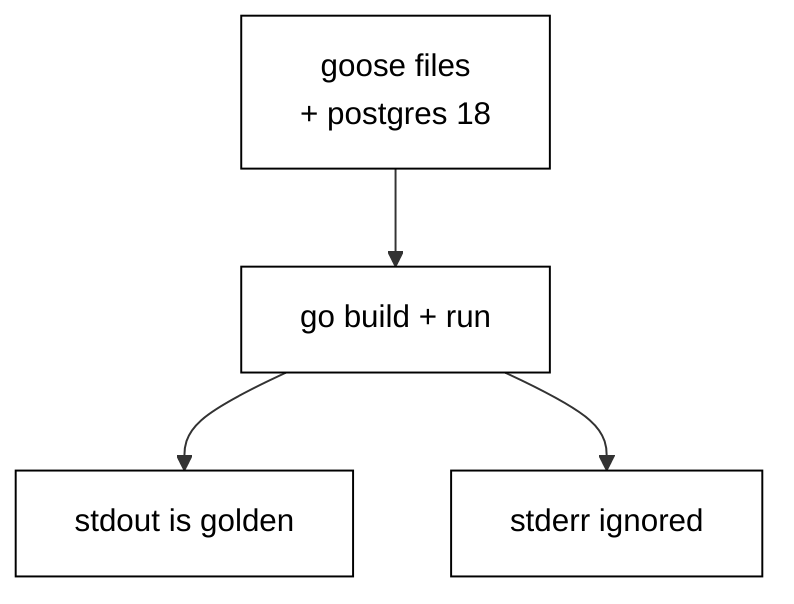

Prerequisites for this course: [just-enough-go](/en/learn/courses/just-enough-go/learning/overview) for Go syntax, modules, and tooling, and [sql-essentials](/en/learn/courses/sql-essentials/learning/overview) for CREATE and ALTER TABLE. Comfort editing and running Go programs from a terminal is assumed throughout, and every example builds only on the primers plus earlier examples in this course.

## Why this exists -- the big idea

**The problem before the solution**: teams evolve production databases with chat messages and ad-hoc SQL scripts — nobody knows which changes ran where, rollbacks are improvised under pressure, and two developers' changes collide in the deploy queue. Goose replaces folklore with artifacts: every change is a versioned SQL file with a forward step and a reverse step, and the database itself records which files already ran.

**Keep this if you forget everything else**: A migration that cannot be rolled back safely is a migration that will eventually be run in production by accident.

## Tensions and trade-offs -- when NOT to reach for this

- **Small versus strict**: nullable columns land without disturbing traffic; NOT NULL, checks, and defaults constrain later once data complies. Each example names which side it takes and what the other side would cost, and Examples 33 and 41 collect the three-step and two-step shapes for going strict safely.
- **One file versus many**: single-statement migrations minimize lock windows but multiply files; multi-step files read as one story but hold locks longer. The course defaults to small files and merges steps only when the steps genuinely share a deploy window.
- **When NOT**: throwaway exploration against a scratch database needs no versioning — create, poke, drop, done. Migrations earn their place when the database outlives the session: shared development databases, staging, and anything resembling production.

## Lineage -- where this tool sits

Goose is the migration companion to Go's database/sql ecosystem, and this course assumes both the Go primer and basic SQL DDL as background. The data-access course teaches data access; this course teaches schema evolution — the versioned history that lets the schema change while the data and the traffic survive. Later data courses assume migrations exist and build pipelines, analytics, and services on top of versioned schemas.

## How this course is organized

[Beginner](/en/learn/courses/database-migrations-with-golang-and-goose/learning/beginner) (Examples 1–25) writes first migrations and rolls them back: file anatomy, chain ordering, history stamps, and rollback basics. [Intermediate](/en/learn/courses/database-migrations-with-golang-and-goose/learning/intermediate) (Examples 26–53) backfills data, splits breaking changes into zero-downtime steps, and adopts legacy databases with stamps and drift checks. [Advanced](/en/learn/courses/database-migrations-with-golang-and-goose/learning/advanced) (Examples 54–78) resolves branch conflicts, shrinks locking blast radius, and diagnoses failures from the history table. The [capstone](/en/learn/courses/database-migrations-with-golang-and-goose/learning/capstone/overview) evolves an order-management schema through eight realistic migrations with a golden verification query, and [drilling](/en/learn/courses/database-migrations-with-golang-and-goose/drilling/overview) turns the sixteen concepts into recall, katas, and checklists.

## About the runtime

Every example runs as a compiled Go binary in the pinned Go container against the real pinned PostgreSQL 18 service: no mocks, no fixtures-as-data. The harness network is closed and the Go toolchain carries no install recipe, so every unit is standard-library only: each program carries a small driver that speaks the PostgreSQL wire protocol and applies the same goose SQL files `goose up` would apply — the same annotations, the same `goose_db_version` history shape, the same version ordering. Each example owns per-example tables, drops leftovers before running, and cleans up after itself, so reruns are byte-stable. Migration files shown in a lesson are written by the program itself into a scratch directory at runtime and executed for real. Standard output is the asserted golden transcript; standard error is ignored. Programs print labels, counts, and row values — never paths, timings, temp names, or revision noise — so reruns match byte for byte.

## Examples by Level

### Beginner (Examples 1–25)

- [Example 1: First Migration Creates a Table](/en/learn/courses/database-migrations-with-golang-and-goose/learning/beginner#example-1-first-migration-creates-a-table)
- [Example 2: Migration File Anatomy](/en/learn/courses/database-migrations-with-golang-and-goose/learning/beginner#example-2-migration-file-anatomy)
- [Example 3: Up Runs the Forward Change](/en/learn/courses/database-migrations-with-golang-and-goose/learning/beginner#example-3-up-runs-the-forward-change)
- [Example 4: Down Reverses the Change](/en/learn/courses/database-migrations-with-golang-and-goose/learning/beginner#example-4-down-reverses-the-change)
- [Example 5: Add a Column with Alter](/en/learn/courses/database-migrations-with-golang-and-goose/learning/beginner#example-5-add-a-column-with-alter)
- [Example 6: Create an Index](/en/learn/courses/database-migrations-with-golang-and-goose/learning/beginner#example-6-create-an-index)
- [Example 7: Not Null with a Server Default](/en/learn/courses/database-migrations-with-golang-and-goose/learning/beginner#example-7-not-null-with-a-server-default)
- [Example 8: Up Then Down Roundtrip](/en/learn/courses/database-migrations-with-golang-and-goose/learning/beginner#example-8-up-then-down-roundtrip)
- [Example 9: History Is a Chain](/en/learn/courses/database-migrations-with-golang-and-goose/learning/beginner#example-9-history-is-a-chain)
- [Example 10: Version Numbers Order History](/en/learn/courses/database-migrations-with-golang-and-goose/learning/beginner#example-10-version-numbers-order-history)
- [Example 11: Goose Create Starts a History](/en/learn/courses/database-migrations-with-golang-and-goose/learning/beginner#example-11-goose-create-starts-a-history)
- [Example 12: Version Table Records Runs](/en/learn/courses/database-migrations-with-golang-and-goose/learning/beginner#example-12-version-table-records-runs)
- [Example 13: Status Shows Pending](/en/learn/courses/database-migrations-with-golang-and-goose/learning/beginner#example-13-status-shows-pending)
- [Example 14: Single Line Means Linear](/en/learn/courses/database-migrations-with-golang-and-goose/learning/beginner#example-14-single-line-means-linear)
- [Example 15: Up to a Specific Version](/en/learn/courses/database-migrations-with-golang-and-goose/learning/beginner#example-15-up-to-a-specific-version)
- [Example 16: Down to a Specific Version](/en/learn/courses/database-migrations-with-golang-and-goose/learning/beginner#example-16-down-to-a-specific-version)
- [Example 17: Status Reports Position](/en/learn/courses/database-migrations-with-golang-and-goose/learning/beginner#example-17-status-reports-position)
- [Example 18: Rollback Drops What Upgrade Added](/en/learn/courses/database-migrations-with-golang-and-goose/learning/beginner#example-18-rollback-drops-what-upgrade-added)
- [Example 19: Rollback Keeps Unrelated Data](/en/learn/courses/database-migrations-with-golang-and-goose/learning/beginner#example-19-rollback-keeps-unrelated-data)
- [Example 20: Stepwise Rollback One Version](/en/learn/courses/database-migrations-with-golang-and-goose/learning/beginner#example-20-stepwise-rollback-one-version)
- [Example 21: Failing Statement Rolls Back](/en/learn/courses/database-migrations-with-golang-and-goose/learning/beginner#example-21-failing-statement-rolls-back)
- [Example 22: One Transaction Per Migration](/en/learn/courses/database-migrations-with-golang-and-goose/learning/beginner#example-22-one-transaction-per-migration)
- [Example 23: Read Files Before Running](/en/learn/courses/database-migrations-with-golang-and-goose/learning/beginner#example-23-read-files-before-running)
- [Example 24: Idempotent Drops](/en/learn/courses/database-migrations-with-golang-and-goose/learning/beginner#example-24-idempotent-drops)
- [Example 25: Rerun Up Is Safe](/en/learn/courses/database-migrations-with-golang-and-goose/learning/beginner#example-25-rerun-up-is-safe)

### Intermediate (Examples 26–53)

- [Example 26: Backfill Fills the New Column](/en/learn/courses/database-migrations-with-golang-and-goose/learning/intermediate#example-26-backfill-fills-the-new-column)
- [Example 27: Schema First Data Second](/en/learn/courses/database-migrations-with-golang-and-goose/learning/intermediate#example-27-schema-first-data-second)
- [Example 28: Backfill in Batches](/en/learn/courses/database-migrations-with-golang-and-goose/learning/intermediate#example-28-backfill-in-batches)
- [Example 29: Backfill Needs No Down](/en/learn/courses/database-migrations-with-golang-and-goose/learning/intermediate#example-29-backfill-needs-no-down)
- [Example 30: Data Fix Inside a Revision](/en/learn/courses/database-migrations-with-golang-and-goose/learning/intermediate#example-30-data-fix-inside-a-revision)
- [Example 31: Verify Backfill Counts](/en/learn/courses/database-migrations-with-golang-and-goose/learning/intermediate#example-31-verify-backfill-counts)
- [Example 32: Backfill from a Join](/en/learn/courses/database-migrations-with-golang-and-goose/learning/intermediate#example-32-backfill-from-a-join)
- [Example 33: Default Then Backfill Then Not Null](/en/learn/courses/database-migrations-with-golang-and-goose/learning/intermediate#example-33-default-then-backfill-then-not-null)
- [Example 34: Split Schema and Data Revisions](/en/learn/courses/database-migrations-with-golang-and-goose/learning/intermediate#example-34-split-schema-and-data-revisions)
- [Example 35: Expand Add Column Safely](/en/learn/courses/database-migrations-with-golang-and-goose/learning/intermediate#example-35-expand-add-column-safely)
- [Example 36: Dual Write Window](/en/learn/courses/database-migrations-with-golang-and-goose/learning/intermediate#example-36-dual-write-window)
- [Example 37: Migrate Reads to the New Column](/en/learn/courses/database-migrations-with-golang-and-goose/learning/intermediate#example-37-migrate-reads-to-the-new-column)
- [Example 38: Contract Drops the Old Column](/en/learn/courses/database-migrations-with-golang-and-goose/learning/intermediate#example-38-contract-drops-the-old-column)
- [Example 39: Rename in Three Deployable Steps](/en/learn/courses/database-migrations-with-golang-and-goose/learning/intermediate#example-39-rename-in-three-deployable-steps)
- [Example 40: Widen a Column Type Safely](/en/learn/courses/database-migrations-with-golang-and-goose/learning/intermediate#example-40-widen-a-column-type-safely)
- [Example 41: Check Constraint Not Valid First](/en/learn/courses/database-migrations-with-golang-and-goose/learning/intermediate#example-41-check-constraint-not-valid-first)
- [Example 42: Deploy Order Matters](/en/learn/courses/database-migrations-with-golang-and-goose/learning/intermediate#example-42-deploy-order-matters)
- [Example 43: Rollback Plan for Every Step](/en/learn/courses/database-migrations-with-golang-and-goose/learning/intermediate#example-43-rollback-plan-for-every-step)
- [Example 44: Same Migrations Every Environment](/en/learn/courses/database-migrations-with-golang-and-goose/learning/intermediate#example-44-same-migrations-every-environment)
- [Example 45: Baseline Marks an Existing Database](/en/learn/courses/database-migrations-with-golang-and-goose/learning/intermediate#example-45-baseline-marks-an-existing-database)
- [Example 46: Create Baseline on Legacy Schema](/en/learn/courses/database-migrations-with-golang-and-goose/learning/intermediate#example-46-create-baseline-on-legacy-schema)
- [Example 47: Reflect Existing Tables](/en/learn/courses/database-migrations-with-golang-and-goose/learning/intermediate#example-47-reflect-existing-tables)
- [Example 48: Detect Schema Drift](/en/learn/courses/database-migrations-with-golang-and-goose/learning/intermediate#example-48-detect-schema-drift)
- [Example 49: Drift Report Table by Table](/en/learn/courses/database-migrations-with-golang-and-goose/learning/intermediate#example-49-drift-report-table-by-table)
- [Example 50: Checksum Flags Edited Files](/en/learn/courses/database-migrations-with-golang-and-goose/learning/intermediate#example-50-checksum-flags-edited-files)
- [Example 51: Record File Hashes](/en/learn/courses/database-migrations-with-golang-and-goose/learning/intermediate#example-51-record-file-hashes)
- [Example 52: Guard Deploy with Status](/en/learn/courses/database-migrations-with-golang-and-goose/learning/intermediate#example-52-guard-deploy-with-status)
- [Example 53: Test Every Migration Twice](/en/learn/courses/database-migrations-with-golang-and-goose/learning/intermediate#example-53-test-every-migration-twice)

### Advanced (Examples 54–78)

- [Example 54: Two Branches Two Versions](/en/learn/courses/database-migrations-with-golang-and-goose/learning/advanced#example-54-two-branches-two-versions)
- [Example 55: Merge Keeps Both Migrations](/en/learn/courses/database-migrations-with-golang-and-goose/learning/advanced#example-55-merge-keeps-both-migrations)
- [Example 56: Version Collision Breaks Order](/en/learn/courses/database-migrations-with-golang-and-goose/learning/advanced#example-56-version-collision-breaks-order)
- [Example 57: Renumber Onto Head](/en/learn/courses/database-migrations-with-golang-and-goose/learning/advanced#example-57-renumber-onto-head)
- [Example 58: Many Versions One History](/en/learn/courses/database-migrations-with-golang-and-goose/learning/advanced#example-58-many-versions-one-history)
- [Example 59: List Pending Before Merge](/en/learn/courses/database-migrations-with-golang-and-goose/learning/advanced#example-59-list-pending-before-merge)
- [Example 60: Linear History Team Policy](/en/learn/courses/database-migrations-with-golang-and-goose/learning/advanced#example-60-linear-history-team-policy)
- [Example 61: Conflict Drill Two Developers](/en/learn/courses/database-migrations-with-golang-and-goose/learning/advanced#example-61-conflict-drill-two-developers)
- [Example 62: DDL Takes a Lock](/en/learn/courses/database-migrations-with-golang-and-goose/learning/advanced#example-62-ddl-takes-a-lock)
- [Example 63: Short Transactions Shrink Blast Radius](/en/learn/courses/database-migrations-with-golang-and-goose/learning/advanced#example-63-short-transactions-shrink-blast-radius)
- [Example 64: One Statement Per Revision](/en/learn/courses/database-migrations-with-golang-and-goose/learning/advanced#example-64-one-statement-per-revision)
- [Example 65: Statement Timeout Bounds Locks](/en/learn/courses/database-migrations-with-golang-and-goose/learning/advanced#example-65-statement-timeout-bounds-locks)
- [Example 66: Concurrently Outside the Transaction](/en/learn/courses/database-migrations-with-golang-and-goose/learning/advanced#example-66-concurrently-outside-the-transaction)
- [Example 67: Batch Backfills Avoid Long Locks](/en/learn/courses/database-migrations-with-golang-and-goose/learning/advanced#example-67-batch-backfills-avoid-long-locks)
- [Example 68: Advisory Lock Serializes Runners](/en/learn/courses/database-migrations-with-golang-and-goose/learning/advanced#example-68-advisory-lock-serializes-runners)
- [Example 69: Expand Contract Avoids Rewrite](/en/learn/courses/database-migrations-with-golang-and-goose/learning/advanced#example-69-expand-contract-avoids-rewrite)
- [Example 70: Measure Lock Hold Per Step](/en/learn/courses/database-migrations-with-golang-and-goose/learning/advanced#example-70-measure-lock-hold-per-step)
- [Example 71: Read the History Table First](/en/learn/courses/database-migrations-with-golang-and-goose/learning/advanced#example-71-read-the-history-table-first)
- [Example 72: Diagnose a Partial Migration](/en/learn/courses/database-migrations-with-golang-and-goose/learning/advanced#example-72-diagnose-a-partial-migration)
- [Example 73: History Diverged from Database](/en/learn/courses/database-migrations-with-golang-and-goose/learning/advanced#example-73-history-diverged-from-database)
- [Example 74: Missing File for Applied Version](/en/learn/courses/database-migrations-with-golang-and-goose/learning/advanced#example-74-missing-file-for-applied-version)
- [Example 75: Down Past Data Loss](/en/learn/courses/database-migrations-with-golang-and-goose/learning/advanced#example-75-down-past-data-loss)
- [Example 76: Test Every Migration in Isolation](/en/learn/courses/database-migrations-with-golang-and-goose/learning/advanced#example-76-test-every-migration-in-isolation)
- [Example 77: Golden Schema Snapshot Test](/en/learn/courses/database-migrations-with-golang-and-goose/learning/advanced#example-77-golden-schema-snapshot-test)
- [Example 78: Pre-Deploy Checklist](/en/learn/courses/database-migrations-with-golang-and-goose/learning/advanced#example-78-pre-deploy-checklist)
