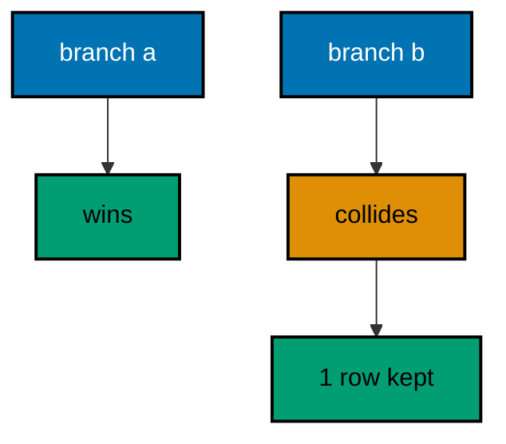
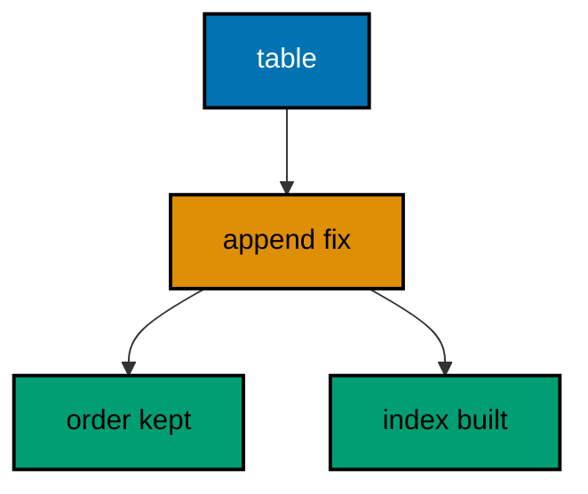
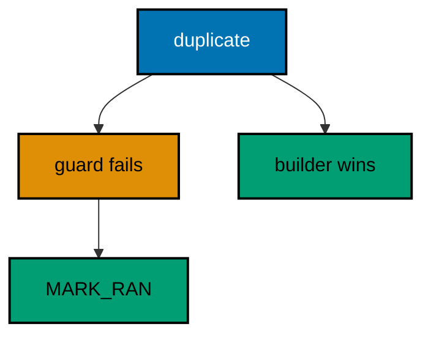
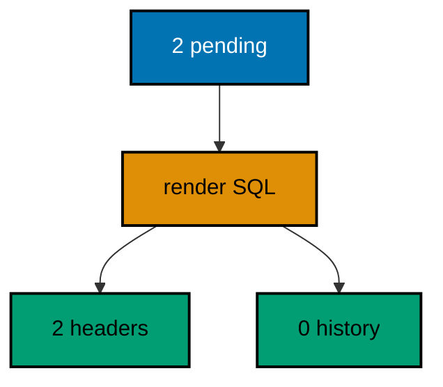
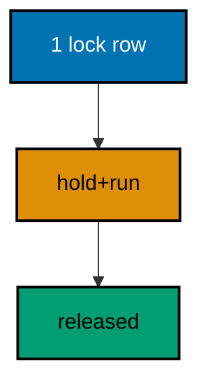
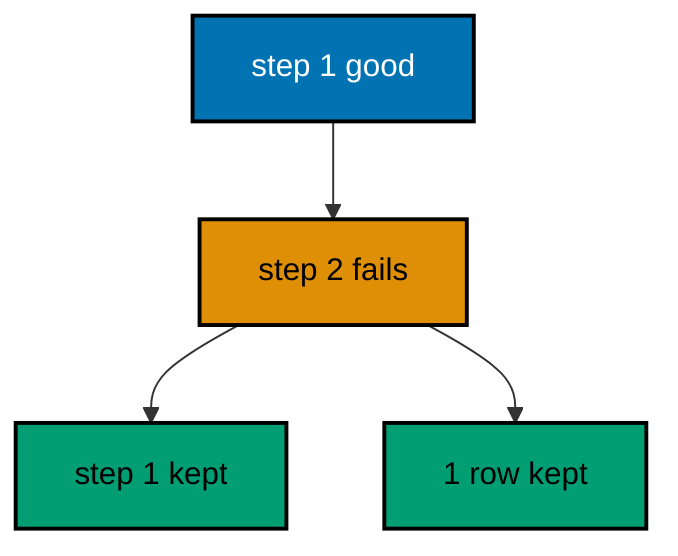
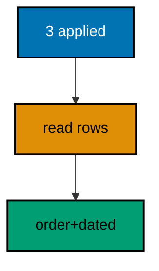
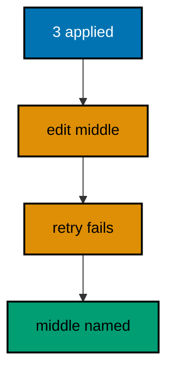
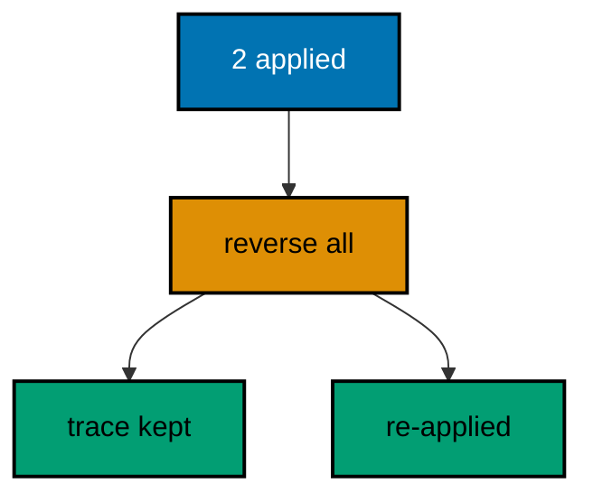
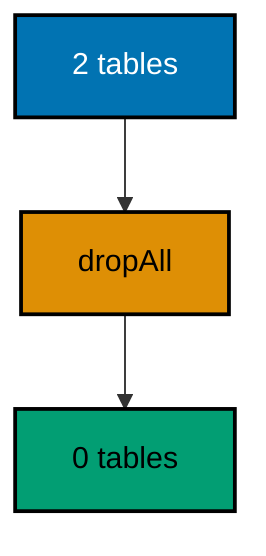

Examples 54–78 run migrations the way teams do: resolving branch conflicts without rewriting history (Examples 54–61), serializing runners behind the changelog lock (Examples 62–70), and diagnosing failures from history evidence (Examples 71–78). Every example is a complete, runnable Java program under `learning/code/` driving Liquibase against the pinned PostgreSQL 18 service container; run each with the command in its own `run.yaml`.

---

### Example 54: Two Branches Add Conflicting Changesets

Parallel branches collide when both create the same table: the first merge applies cleanly and the second fails on the existing object. The failure is loud and the history names the winner, which is exactly the evidence the merge review needs. The program applies the branch-a changelog, attempts the branch-b changelog that builds the same table, then proves the refusal kept exactly one winning history row. (Concepts: co-15.)



**`learning/code/ex-54-two-branches-add-conflicting-changesets/Main.java`**:

```java
// Example 54: Two Branches Add Conflicting Changesets.
// Parallel branches collide when both create the same table: the first
// merge applies cleanly and the second fails on the existing object. The
// failure is loud and the history names the winner. This program applies
// the branch-a changelog, attempts the branch-b changelog that builds the
// same table, then proves the refusal kept exactly one history row.
import java.sql.Connection; // => the handle every move and check shares
import java.sql.DriverManager; // => finds the PostgreSQL driver from the locked jars
import java.sql.ResultSet; // => walks the rows each verification query returns
import java.sql.Statement; // => carries the verification queries to the database
import java.util.Properties; // => carries the login without string-concatenated secrets
import liquibase.Liquibase; // => the entry point: configure, then update
import liquibase.Scope; // => silences progress narration for deterministic goldens
import liquibase.database.Database; // => Liquibase's view of our PostgreSQL connection
import liquibase.database.DatabaseFactory; // => picks the PostgreSQL implementation from the URL
import liquibase.database.jvm.JdbcConnection; // => adapts our JDBC handle to Liquibase
import liquibase.exception.LiquibaseException; // => the stable type every expected failure wears
import liquibase.resource.DirectoryResourceAccessor; // => the current file-based changelog accessor
import liquibase.ui.LoggerUIService; // => reroutes progress lines into the silenced log

public class Main {

  // => one public class per file, named after the file
  static Connection connect() throws Exception {
    // => the harness starts PostgreSQL 18 and publishes these variables
    String host = System.getenv().getOrDefault("PGHOST", "localhost");
    // => default keeps local experimentation working outside the harness
    String url = "jdbc:postgresql://" + host + ":5432/postgres";
    // => trust auth accepts any password, so only the user matters
    Properties props = new Properties();
    // => Properties carries the login without string-concatenated secrets
    props.setProperty("user", System.getenv().getOrDefault("PGUSER", "postgres"));
    // => DriverManager finds the PostgreSQL driver from the locked jars
    return DriverManager.getConnection(url, props);
  } // => connect is the only place that knows connection details

  // => each branch runs inside the same quiet scope shape as every update
  static void runQuiet(Liquibase liquibase) throws Exception {
    // => the LOGGER service reroutes progress lines into the silenced JUL log
    Scope.child(
      java.util.Collections.singletonMap(Scope.Attr.ui.name(), new LoggerUIService()),
      // => the lambda runs inside the scope; main still throws Exception
      () -> liquibase.update("")
    );
    // => update("") runs every changeset with no context filter
  } // => quiet updates keep golden output identical on the harness double run

  // => the history table may not exist before the first update, so forgetting
  // => our rows is guarded by an existence check on every run
  static void clearHistory(Connection conn) throws Exception {
    // => information_schema tells whether any history exists to forget
    try (
      Statement check = conn.createStatement();
      // => a separate statement keeps the check isolated from the delete
      ResultSet rs = check.executeQuery(
        "SELECT count(*) FROM information_schema.tables " + "WHERE table_name = 'databasechangelog'"
      )
    ) {
      // => the query returns exactly one row with exactly one number
      rs.next();
      // => forgetting runs only where a history table already exists
      if (rs.getInt(1) > 0) {
        // => deleting only our own rows leaves every other course untouched
        try (Statement forget = conn.createStatement()) {
          // => the delete runs only after the check proved the table exists
          forget.execute("DELETE FROM databasechangelog WHERE author IN ('team-a', 'team-b')");
          // => both branches collide fresh: team-a wins again, team-b loses again
        } // => a missing table means a fresh database: nothing to forget
      } // => the guard keeps the first run as clean as the fiftieth
    } // => guarded forgetting keeps resets replayable on double runs
  } // => helpers that verify stay separate from code that migrates

  public static void main(String[] args) throws Exception {
    // => silence JUL so the LOGGER service lines below disappear too
    java.util.logging.LogManager.getLogManager().reset();
    // => the entry point the harness runs
    try (Connection conn = connect()) {
      conn.setAutoCommit(false);
      // => manual commit makes every preamble statement explicit and replayable
      // => one connection serves both branches and the conflict check
      try (Statement st = conn.createStatement()) {
        // => the losing branch's table persists, so every run starts clean
        st.execute("DROP TABLE IF EXISTS counters");
        // => dropping first keeps the conflict replayable on double runs
        clearHistory(conn);
        // => forgetting past branches lets this run collide them fresh
        conn.commit();
        // => committing pins the clean slate before branch-a below
      } // => a clean slate replays the same collision on every run
      Database database = DatabaseFactory.getInstance()
        // => the factory picks the PostgreSQL implementation from the URL
        .findCorrectDatabaseImplementation(new JdbcConnection(conn));
      // => JdbcConnection adapts our JDBC handle to Liquibase's database API
      DirectoryResourceAccessor accessor = new DirectoryResourceAccessor(new java.io.File(".").getAbsoluteFile());
      // => one accessor roots both branch changelogs in the same folder
      runQuiet(new Liquibase("branch-a/changelog.sql", accessor, database));
      // => branch-a wins the race: its counters table applies cleanly
      String failure = "none";
      // => the failure name records the outcome without printing internals
      try {
        // => branch-b builds the same table, so this update must collide
        runQuiet(new Liquibase("branch-b/changelog.sql", accessor, database));
      } catch (LiquibaseException expected) {
        // => the exception type is stable; its message text is not asserted
        failure = expected.getClass().getSimpleName();
        // => catching proves the collision failed loudly instead of merging
        conn.rollback();
        // => rolling back keeps the winner's history exactly as applied
      } // => no stack trace: the collision is the expected behaviour
      System.out.println("branch conflict failure: " + failure);
      // => Output: branch conflict failure: CommandExecutionException
      try (
        Statement st = conn.createStatement();
        ResultSet rs = st.executeQuery("SELECT count(*) FROM databasechangelog")
      ) {
        // => only the winning branch holds a history row after the refusal
        rs.next();
        System.out.println("winning branch rows: " + rs.getInt(1));
        // => Output: winning branch rows: 1
        // => a rerun replays winner then collision to the identical lines
      } // => reading history back is a habit every later example repeats
    } // => closing the connection ends the program with one winner named
  } // => main races two branches, then names the winner and the refusal
}
```

**`learning/code/ex-54-two-branches-add-conflicting-changesets/branch-a/changelog.sql`**:

```sql
-- liquibase formatted sql
-- => REQUIRED first line: marks this file as a Liquibase SQL changelog
-- => Branch-a builds the counters table first and wins the merge race.
-- changeset team-a:001-make-counters
-- => team-a's changeset creates the counters table both branches want
CREATE TABLE counters (
  id SERIAL PRIMARY KEY,
  -- => SERIAL gives an auto-incrementing integer key, enough for this course
  name VARCHAR(60) NOT NULL
  -- => counter names are required from the first migration
);

-- rollback DROP TABLE counters;
-- => this reverse never runs here; winners are not rolled back
```

**`learning/code/ex-54-two-branches-add-conflicting-changesets/branch-b/changelog.sql`**:

```sql
-- liquibase formatted sql
-- => REQUIRED first line: marks this file as a Liquibase SQL changelog
-- => Branch-b builds the same counters table and loses the merge race.
-- changeset team-b:001-make-counters
-- => team-b's changeset collides: the table already exists from branch-a
CREATE TABLE counters (
  id SERIAL PRIMARY KEY,
  -- => SERIAL gives an auto-incrementing integer key, enough for this course
  name VARCHAR(60) NOT NULL
  -- => the identical shape proves neither branch compromised, both wrote it
);

-- rollback DROP TABLE counters;
-- => this reverse never runs: the changeset itself never applies
```

**Output** (`learning/code/ex-54-two-branches-add-conflicting-changesets/expected/main.stdout.txt`):

```text
branch conflict failure: CommandExecutionException
winning branch rows: 1
```

**Key takeaway**: Colliding branches fail loudly on the second apply, and the history names the winning branch.

**Why it matters**: Silent branch merges are how two tables with one name survive into production: both branches looked green alone, and the collision surfaced as a mysterious deploy error weeks later. A loud failure at merge time converts the collision into a same-day conversation between the two authors while both changes are fresh. The history row names the winner without ambiguity, so the resolution — rebase, rename, or guard — starts from evidence instead of archaeology. Branches will collide; the merge must refuse before production notices.

---

### Example 55: Merged Histories Keep One Order

The merge resolves the collision by sequencing: prefixed files from both branches join one master, and the history records a single order no branch can dispute. One line replaces two, and the prefixes make the interleaving reviewable. The program runs a master over team-prefixed files from two branches, then prints the execution order to prove the merge produced one line with the rival file sequenced mid-history. (Concepts: co-15, co-04.)

**`learning/code/ex-55-merged-histories-keep-one-order/Main.java`**:

```java
// Example 55: Merged Histories Keep One Order.
// The merge resolves the collision by sequencing: prefixed files from
// both branches join one master, and the history records a single order
// no branch can dispute. This program runs a master over team-prefixed
// files from two branches, then prints the execution order to prove the
// merge produced one line, not two.
import java.sql.Connection; // => the handle every move and check shares
import java.sql.DriverManager; // => finds the PostgreSQL driver from the locked jars
import java.sql.ResultSet; // => walks the rows each verification query returns
import java.sql.Statement; // => carries the verification queries to the database
import java.util.Properties; // => carries the login without string-concatenated secrets
import liquibase.Liquibase; // => the entry point: configure, then update
import liquibase.Scope; // => silences progress narration for deterministic goldens
import liquibase.database.Database; // => Liquibase's view of our PostgreSQL connection
import liquibase.database.DatabaseFactory; // => picks the PostgreSQL implementation from the URL
import liquibase.database.jvm.JdbcConnection; // => adapts our JDBC handle to Liquibase
import liquibase.resource.DirectoryResourceAccessor; // => the current file-based changelog accessor
import liquibase.ui.LoggerUIService; // => reroutes progress lines into the silenced log

public class Main {

  // => one public class per file, named after the file
  static Connection connect() throws Exception {
    // => the harness starts PostgreSQL 18 and publishes these variables
    String host = System.getenv().getOrDefault("PGHOST", "localhost");
    // => default keeps local experimentation working outside the harness
    String url = "jdbc:postgresql://" + host + ":5432/postgres";
    // => trust auth accepts any password, so only the user matters
    Properties props = new Properties();
    // => Properties carries the login without string-concatenated secrets
    props.setProperty("user", System.getenv().getOrDefault("PGUSER", "postgres"));
    // => DriverManager finds the PostgreSQL driver from the locked jars
    return DriverManager.getConnection(url, props);
  } // => connect is the only place that knows connection details

  // => Liquibase narrates progress to its console UI by default; those lines
  // => differ between a first run and a rerun, so goldens cannot hold them
  static void runQuiet(Liquibase liquibase) throws Exception {
    // => the LOGGER service reroutes progress lines into the silenced JUL log
    Scope.child(
      java.util.Collections.singletonMap(Scope.Attr.ui.name(), new LoggerUIService()),
      // => the lambda runs inside the scope; main still throws Exception
      () -> liquibase.update("")
    );
    // => update("") runs every changeset with no context filter
  } // => quiet updates keep golden output identical on the harness double run

  public static void main(String[] args) throws Exception {
    // => silence JUL so the LOGGER service lines below disappear too
    java.util.logging.LogManager.getLogManager().reset();
    // => the entry point the harness runs
    try (Connection conn = connect()) {
      // => one connection serves the merged run and the order read
      Database database = DatabaseFactory.getInstance()
        // => the factory picks the PostgreSQL implementation from the URL
        .findCorrectDatabaseImplementation(new JdbcConnection(conn));
      // => JdbcConnection adapts our JDBC handle to Liquibase's database API
      Liquibase liquibase = new Liquibase(
        // => the merge master delegates to both branches' files
        "db.changelog-master.yaml",
        // => DirectoryResourceAccessor is the current file-based accessor
        new DirectoryResourceAccessor(new java.io.File(".").getAbsoluteFile()),
        // => rooting at the unit directory keeps changelogs beside the program
        database
      );
      runQuiet(liquibase);
      // => prefixes interleave the branches into one alphabetical sequence
      try (
        Statement st = conn.createStatement();
        ResultSet rs = st.executeQuery("SELECT id FROM databasechangelog ORDER BY orderexecuted")
      ) {
        // => the execution order is the merged history both teams now share
        StringBuilder order = new StringBuilder();
        // => the builder collects the ids in the order they executed
        while (rs.next()) {
          // => each id is one branch's file, sequenced by its prefix
          if (order.length() > 0) {
            // => commas separate the steps without extra whitespace
            order.append(",");
          } // => the first id needs no separator before it
          order.append(rs.getString(1));
          // => appending preserves the database-reported execution order
        } // => the joined ids read as the single merged line itself
        System.out.println("merged order: " + order);
        // => Output: merged order: team-a-001-make-anchors,team-b-002-make-ropes,team-a-003-make-sails
      } // => one order proves the merge resolved the branches into a line
      // => a rerun skips all three files and prints the identical order
    } // => closing the connection ends the program with one history
  } // => main merges two branches, then proves the single order
}
```

**`learning/code/ex-55-merged-histories-keep-one-order/db.changelog-master.yaml`**:

```yaml
databaseChangeLog: # => Root key required for every YAML changelog
  - includeAll: # => Discovers every changelog file in one directory
      path: merged/
      # => path is relative to this master file, not to the classpath
      # => Liquibase sorts the discovered files alphabetically before running
      # => Team prefixes interleave both branches into one merged sequence
```

**`learning/code/ex-55-merged-histories-keep-one-order/merged/001-team-a-make-anchors.sql`**:

```sql
-- liquibase formatted sql
-- => REQUIRED first line: marks this file as a Liquibase SQL changelog
-- => 001 makes this file sort first in the merged sequence.
-- changeset team-a:team-a-001-make-anchors
-- => prefixed ids name the branch inside the shared history itself
CREATE TABLE anchors (
  id SERIAL PRIMARY KEY,
  -- => SERIAL gives an auto-incrementing integer key, enough for this course
  name VARCHAR(60) NOT NULL
  -- => anchor names are required from the first migration
);

-- rollback DROP TABLE anchors;
-- => each branch file carries its own reverse, as before the merge
```

**`learning/code/ex-55-merged-histories-keep-one-order/merged/002-team-b-make-ropes.sql`**:

```sql
-- liquibase formatted sql
-- => REQUIRED first line: marks this file as a Liquibase SQL changelog
-- => 002 interleaves the rival branch between team-a's two files.
-- changeset team-b:team-b-002-make-ropes
-- => the rival branch lands mid-sequence without breaking the line
CREATE TABLE ropes (
  id SERIAL PRIMARY KEY,
  -- => SERIAL gives an auto-incrementing integer key, enough for this course
  name VARCHAR(60) NOT NULL
  -- => rope names are required from the first migration
);

-- rollback DROP TABLE ropes;
-- => each branch file carries its own reverse, as before the merge
```

**`learning/code/ex-55-merged-histories-keep-one-order/merged/003-team-a-make-sails.sql`**:

```sql
-- liquibase formatted sql
-- => REQUIRED first line: marks this file as a Liquibase SQL changelog
-- => 003 closes the merged sequence back on team-a.
-- changeset team-a:team-a-003-make-sails
-- => the first branch resumes after the interleaved rival file
CREATE TABLE sails (
  id SERIAL PRIMARY KEY,
  -- => SERIAL gives an auto-incrementing integer key, enough for this course
  name VARCHAR(60) NOT NULL
  -- => sail names are required from the first migration
);

-- rollback DROP TABLE sails;
-- => each branch file carries its own reverse, as before the merge
```

**Output** (`learning/code/ex-55-merged-histories-keep-one-order/expected/main.stdout.txt`):

```text
merged order: team-a-001-make-anchors,team-b-002-make-ropes,team-a-003-make-sails
```

**Key takeaway**: Merges sequence both branches' prefixed files into one alphabetical order recorded as a single history.

**Why it matters**: Two histories cannot deploy to one database: promotion, rollback, and audit all assume a single sequence, and parallel lines force operators to interleave by hand under pressure. Prefixes turn the merge into sorting — deterministic, reviewable, and repeatable on every environment. The interleaved order shows both teams' work in the sequence it will actually run, which lets reviewers spot ordering hazards before the merge ships. One database, one history, one order; the merge's job is to produce it without negotiation.

---

### Example 56: Checksum Conflicts Expose Edited Migrations

Merges go wrong quietly when a branch edits an already-merged changeset instead of adding a new one: every database that ran the original now disagrees with the file. Checksums expose the edit on the next update, naming the exact changeset for the team to confront. The program applies two merged changesets, tampers one stored checksum to stand in for the edit, then proves the next update refuses while both merged rows stay intact. (Concepts: co-15, co-11.)

**`learning/code/ex-56-checksum-conflicts-expose-edited-migrations/Main.java`**:

```java
// Example 56: Checksum Conflicts Expose Edited Migrations.
// Merges go wrong quietly when a branch edits an already-merged
// changeset instead of adding a new one: every database that ran the
// original now disagrees with the file. Checksums expose the edit on the
// next update. This program applies two merged changesets, tampers one
// stored checksum to stand in for the edit, then proves the next update
// refuses while the history stays intact.
import java.sql.Connection; // => the handle every move and check shares
import java.sql.DriverManager; // => finds the PostgreSQL driver from the locked jars
import java.sql.ResultSet; // => walks the rows each verification query returns
import java.sql.Statement; // => carries the verification queries to the database
import java.util.Properties; // => carries the login without string-concatenated secrets
import liquibase.Liquibase; // => the entry point: configure, then update
import liquibase.Scope; // => silences progress narration for deterministic goldens
import liquibase.database.Database; // => Liquibase's view of our PostgreSQL connection
import liquibase.database.DatabaseFactory; // => picks the PostgreSQL implementation from the URL
import liquibase.database.jvm.JdbcConnection; // => adapts our JDBC handle to Liquibase
import liquibase.exception.LiquibaseException; // => the stable type every expected failure wears
import liquibase.resource.DirectoryResourceAccessor; // => the current file-based changelog accessor
import liquibase.ui.LoggerUIService; // => reroutes progress lines into the silenced log

public class Main {

  // => one public class per file, named after the file
  static Connection connect() throws Exception {
    // => the harness starts PostgreSQL 18 and publishes these variables
    String host = System.getenv().getOrDefault("PGHOST", "localhost");
    // => default keeps local experimentation working outside the harness
    String url = "jdbc:postgresql://" + host + ":5432/postgres";
    // => trust auth accepts any password, so only the user matters
    Properties props = new Properties();
    // => Properties carries the login without string-concatenated secrets
    props.setProperty("user", System.getenv().getOrDefault("PGUSER", "postgres"));
    // => DriverManager finds the PostgreSQL driver from the locked jars
    return DriverManager.getConnection(url, props);
  } // => connect is the only place that knows connection details

  // => Liquibase narrates progress to its console UI by default; those lines
  // => differ between a first run and a rerun, so goldens cannot hold them
  static void runQuiet(Liquibase liquibase) throws Exception {
    // => the LOGGER service reroutes progress lines into the silenced JUL log
    Scope.child(
      java.util.Collections.singletonMap(Scope.Attr.ui.name(), new LoggerUIService()),
      // => the lambda runs inside the scope; main still throws Exception
      () -> liquibase.update("")
    );
    // => update("") runs every changeset with no context filter
  } // => quiet updates keep golden output identical on the harness double run

  // => a fresh demo slate keeps this program deterministic on double runs
  static void resetDemo(Connection conn) throws Exception {
    conn.setAutoCommit(false);
    // => manual commit makes every reset statement explicit and replayable
    // => the tampered checksum below persists, so every run starts clean
    try (Statement st = conn.createStatement()) {
      // => one statement serves the whole reset
      st.execute("DROP TABLE IF EXISTS buoys");
      // => dropping the merged tables removes the previous run's evidence
      st.execute("DROP TABLE IF EXISTS beacons");
      // => both merged tables go, so the update below runs them fresh
      clearHistory(conn);
      // => deleting only our own rows leaves every other course untouched
      conn.commit();
      // => committing the reset makes the fresh update that follows honest
    } // => the next update always meets an empty history for our changesets
  } // => reset-then-run prints identical lines on the harness double run

  // => the history table may not exist before the first update, so forgetting
  // => our rows is guarded by an existence check on every run
  static void clearHistory(Connection conn) throws Exception {
    // => information_schema tells whether any history exists to forget
    try (
      Statement check = conn.createStatement();
      // => a separate statement keeps the check isolated from the delete
      ResultSet rs = check.executeQuery(
        "SELECT count(*) FROM information_schema.tables " + "WHERE table_name = 'databasechangelog'"
      )
    ) {
      // => the query returns exactly one row with exactly one number
      rs.next();
      // => forgetting runs only where a history table already exists
      if (rs.getInt(1) > 0) {
        // => deleting only our own rows leaves every other course untouched
        try (Statement forget = conn.createStatement()) {
          // => the delete runs only after the check proved the table exists
          forget.execute("DELETE FROM databasechangelog WHERE author = 'course'");
        } // => a missing table means a fresh database: nothing to forget
      } // => the guard keeps the first run as clean as the fiftieth
    } // => guarded forgetting keeps resets replayable on double runs
  } // => helpers that verify stay separate from code that migrates

  public static void main(String[] args) throws Exception {
    // => silence JUL so the LOGGER service lines below disappear too
    java.util.logging.LogManager.getLogManager().reset();
    // => the entry point the harness runs
    try (Connection conn = connect()) {
      // => one connection serves the merge, the edit, and the refusal
      resetDemo(conn);
      // => a clean slate means the edit below behaves identically always
      Database database = DatabaseFactory.getInstance()
        // => the factory picks the PostgreSQL implementation from the URL
        .findCorrectDatabaseImplementation(new JdbcConnection(conn));
      // => JdbcConnection adapts our JDBC handle to Liquibase's database API
      DirectoryResourceAccessor accessor = new DirectoryResourceAccessor(new java.io.File(".").getAbsoluteFile());
      // => one accessor roots the merged changelog on every handle below
      runQuiet(new Liquibase("changelog.sql", accessor, database));
      // => both merged changesets apply against the clean slate
      conn.commit();
      // => committing pins the history rows the edit below will tamper
      try (Statement st = conn.createStatement()) {
        // => one statement tampers, then counts, then reports
        st.executeUpdate("UPDATE databasechangelog SET md5sum = '9:tampered' WHERE id = '002-make-beacons'");
        // => rewriting the stored checksum stands in for the rival's edit
        // => a real edit changes the computed checksum; the effect matches
        conn.commit();
        // => the tampered row persists, so the retry below must confront it
        String failure = "none";
        // => the failure name records the outcome without printing internals
        try {
          // => the retry recomputes checksums and meets the tampered row
          runQuiet(new Liquibase("changelog.sql", accessor, database));
        } catch (LiquibaseException expected) {
          // => the exception type is stable; its message text is not asserted
          failure = expected.getClass().getSimpleName();
          // => catching proves the merge refused the edited changeset
          conn.rollback();
          // => rolling back leaves the history exactly as the edit left it
        } // => no stack trace: the refusal is the expected behaviour
        System.out.println("edited migration failure: " + failure);
        // => Output: edited migration failure: CommandExecutionException
        try (ResultSet rs = st.executeQuery("SELECT count(*) FROM databasechangelog")) {
          // => the failed retry must not add, remove, or repair any row
          rs.next();
          System.out.println("merged rows intact: " + rs.getInt(1));
          // => Output: merged rows intact: 2
        } // => intact history plus a loud failure is the whole guarantee
      } // => closing the statement releases the database resources
    } // => closing the connection ends the program with the edit exposed
  } // => main merges, edits, retries, and reports the refusal
}
```

**`learning/code/ex-56-checksum-conflicts-expose-edited-migrations/changelog.sql`**:

```sql
-- liquibase formatted sql
-- => REQUIRED first line: marks this file as a Liquibase SQL changelog
-- => Without it Liquibase runs the SQL untracked, and nothing is recorded.
-- changeset course:001-make-buoys
-- => the first merged changeset creates the buoys table
-- => its checksum stays honest, proving validation names the edited one
CREATE TABLE buoys (
  id SERIAL PRIMARY KEY,
  -- => SERIAL gives an auto-incrementing integer key, enough for this course
  name VARCHAR(60) NOT NULL
  -- => buoy names are required from the first migration
);

-- rollback DROP TABLE buoys;
-- => dropping the table reverses exactly what this changeset built
-- changeset course:002-make-beacons
-- => the second merged changeset creates the beacons table
-- => the rival branch edits this changeset after merging: the tamper below
-- => stands in for that edit by rewriting its stored checksum directly
CREATE TABLE beacons (
  id SERIAL PRIMARY KEY,
  -- => SERIAL gives an auto-incrementing integer key, enough for this course
  name VARCHAR(60) NOT NULL
  -- => beacon names are required from the first migration
);

-- rollback DROP TABLE beacons;
-- => each changeset carries its own reverse, independent of its neighbours
```

**Output** (`learning/code/ex-56-checksum-conflicts-expose-edited-migrations/expected/main.stdout.txt`):

```text
edited migration failure: CommandExecutionException
merged rows intact: 2
```

**Key takeaway**: Checksum validation exposes post-merge edits on the next update, refusing the run with history intact.

**Why it matters**: An edited merged changeset is a lie every environment believes differently: databases that ran the original hold one schema while the file describes another, and the divergence grows with every deploy that builds on the false history. The checksum refusal stops the lie at the first update that meets it, before any new changeset compounds the confusion. The fix is also prescribed by the failure — add a new changeset instead of editing — which keeps history append-only across the whole team. Edits to merged work are never private; checksums make sure they are never silent either.

---

### Example 57: Reorder by Adding, Never by Editing

Applied history is append-only: moving an old changeset breaks every database that already ran it, while a new changeset that fixes the order runs everywhere cleanly. Additions compose with every environment's past; edits contradict it. The program applies a table plus its late-arriving index as an appended changeset, then proves the history order stayed append-only while the index still landed. (Concepts: co-15.)



**`learning/code/ex-57-reorder-by-adding-never-by-editing/Main.java`**:

```java
// Example 57: Reorder by Adding, Never by Editing.
// Applied history is append-only: moving an old changeset breaks every
// database that already ran it, while a new changeset that fixes the
// order runs everywhere cleanly. This program applies a table plus its
// late-arriving index as an appended changeset, then proves the history
// order stayed append-only while the index still landed.
import java.sql.Connection; // => the handle every move and check shares
import java.sql.DriverManager; // => finds the PostgreSQL driver from the locked jars
import java.sql.ResultSet; // => walks the rows each verification query returns
import java.sql.Statement; // => carries the verification queries to the database
import java.util.Properties; // => carries the login without string-concatenated secrets
import liquibase.Liquibase; // => the entry point: configure, then update
import liquibase.Scope; // => silences progress narration for deterministic goldens
import liquibase.database.Database; // => Liquibase's view of our PostgreSQL connection
import liquibase.database.DatabaseFactory; // => picks the PostgreSQL implementation from the URL
import liquibase.database.jvm.JdbcConnection; // => adapts our JDBC handle to Liquibase
import liquibase.resource.DirectoryResourceAccessor; // => the current file-based changelog accessor
import liquibase.ui.LoggerUIService; // => reroutes progress lines into the silenced log

public class Main {

  // => one public class per file, named after the file
  static Connection connect() throws Exception {
    // => the harness starts PostgreSQL 18 and publishes these variables
    String host = System.getenv().getOrDefault("PGHOST", "localhost");
    // => default keeps local experimentation working outside the harness
    String url = "jdbc:postgresql://" + host + ":5432/postgres";
    // => trust auth accepts any password, so only the user matters
    Properties props = new Properties();
    // => Properties carries the login without string-concatenated secrets
    props.setProperty("user", System.getenv().getOrDefault("PGUSER", "postgres"));
    // => DriverManager finds the PostgreSQL driver from the locked jars
    return DriverManager.getConnection(url, props);
  } // => connect is the only place that knows connection details

  // => Liquibase narrates progress to its console UI by default; those lines
  // => differ between a first run and a rerun, so goldens cannot hold them
  static void runQuiet(Liquibase liquibase) throws Exception {
    // => the LOGGER service reroutes progress lines into the silenced JUL log
    Scope.child(
      java.util.Collections.singletonMap(Scope.Attr.ui.name(), new LoggerUIService()),
      // => the lambda runs inside the scope; main still throws Exception
      () -> liquibase.update("")
    );
    // => update("") runs every changeset with no context filter
  } // => quiet updates keep golden output identical on the harness double run

  public static void main(String[] args) throws Exception {
    // => silence JUL so the LOGGER service lines below disappear too
    java.util.logging.LogManager.getLogManager().reset();
    // => the entry point the harness runs
    try (Connection conn = connect()) {
      // => one connection serves the appended run and both checks
      Database database = DatabaseFactory.getInstance()
        // => the factory picks the PostgreSQL implementation from the URL
        .findCorrectDatabaseImplementation(new JdbcConnection(conn));
      // => JdbcConnection adapts our JDBC handle to Liquibase's database API
      Liquibase liquibase = new Liquibase(
        // => two changesets: the table, then the appended index fix
        "changelog.sql",
        // => DirectoryResourceAccessor is the current file-based accessor
        new DirectoryResourceAccessor(new java.io.File(".").getAbsoluteFile()),
        // => rooting at the unit directory keeps changelogs beside the program
        database
      );
      runQuiet(liquibase);
      // => appending ran the fix after the table, exactly as reviewed
      try (
        Statement st = conn.createStatement();
        ResultSet rs = st.executeQuery("SELECT id FROM databasechangelog ORDER BY orderexecuted")
      ) {
        // => the execution order must show the fix appended, never inserted
        StringBuilder order = new StringBuilder();
        // => the builder collects the ids in the order they executed
        while (rs.next()) {
          // => each id is one changeset, the fix last by construction
          if (order.length() > 0) {
            // => commas separate the steps without extra whitespace
            order.append(",");
          } // => the first id needs no separator before it
          order.append(rs.getString(1));
          // => appending preserves the database-reported execution order
        } // => the joined ids prove history grew by appending only
        System.out.println("history order: " + order);
        // => Output: history order: 001-make-yard,002-add-yard-index
      } // => order numbers prove the fix landed last, where it belongs
      try (
        Statement st = conn.createStatement();
        ResultSet rs = st.executeQuery("SELECT count(*) FROM pg_indexes WHERE indexname = 'ix_yard_code'")
      ) {
        // => the appended changeset built the index the table lacked
        rs.next();
        System.out.println("appended indexes recorded: " + rs.getInt(1));
        // => Output: appended indexes recorded: 1
        // => a rerun skips both changesets and prints the identical lines
      } // => one named index proves adding fixed what editing would break
    } // => closing the connection ends the program with order preserved
  } // => main appends the fix, then proves history stayed append-only
}
```

**`learning/code/ex-57-reorder-by-adding-never-by-editing/changelog.sql`**:

```sql
-- liquibase formatted sql
-- => REQUIRED first line: marks this file as a Liquibase SQL changelog
-- => Without it Liquibase runs the SQL untracked, and nothing is recorded.
-- changeset course:001-make-yard
-- => the table changeset ships first without the index it needed
-- => editing it now would break every database that already ran it
CREATE TABLE yard (
  id SERIAL PRIMARY KEY,
  -- => SERIAL gives an auto-incrementing integer key, enough for this course
  code VARCHAR(20) NOT NULL
  -- => the code column the appended fix below will index
);

-- rollback DROP TABLE yard;
-- => dropping the table reverses the table and the appended fix together
-- changeset course:002-add-yard-index
-- => the fix arrives appended, never inserted: history stays append-only
-- => a new changeset runs everywhere; an edit would fail checksums
CREATE INDEX ix_yard_code ON yard (code);

-- => the late-arriving index lands last in history, exactly where it ran
-- rollback DROP INDEX ix_yard_code;
-- => dropping the index un-appends the fix without touching the table
```

**Output** (`learning/code/ex-57-reorder-by-adding-never-by-editing/expected/main.stdout.txt`):

```text
history order: 001-make-yard,002-add-yard-index
appended indexes recorded: 1
```

**Key takeaway**: Order fixes arrive as appended changesets, keeping history append-only on every environment at once.

**Why it matters**: Reordering applied history forks reality: databases that ran the old order hold one sequence while the file claims another, and no update can reconcile them without manual surgery per environment. Appending works everywhere identically — old databases run the fix next, new databases run it in line — because addition never contradicts any past. The discipline feels slower when the fix "belongs" earlier, but history is a log, not an essay: it records when things happened, and the fix happened now. Append the correction, keep every environment's story true.

---

### Example 58: Parallel Teams Prefix Their IDs

Two teams sharing one history never collide when every id carries its team's prefix: the namespace is visible in the file name and in the history row alike, so collisions become impossible by construction rather than by coordination. Prefixes scale past two teams without meetings. The program runs a master over two teams' prefixed files, then prints the identity triples to prove both teams share one ordered history without sharing an id space. (Concepts: co-15.)

**`learning/code/ex-58-parallel-teams-prefix-their-ids/Main.java`**:

```java
// Example 58: Parallel Teams Prefix Their IDs.
// Two teams sharing one history never collide when every id carries its
// team's prefix: the namespace is visible in the file name and in the
// history row alike. This program runs a master over two teams' prefixed
// files, then prints the identity triples to prove both teams share one
// ordered history without sharing an id space.
import java.sql.Connection; // => the handle every move and check shares
import java.sql.DriverManager; // => finds the PostgreSQL driver from the locked jars
import java.sql.ResultSet; // => walks the rows each verification query returns
import java.sql.Statement; // => carries the verification queries to the database
import java.util.Properties; // => carries the login without string-concatenated secrets
import liquibase.Liquibase; // => the entry point: configure, then update
import liquibase.Scope; // => silences progress narration for deterministic goldens
import liquibase.database.Database; // => Liquibase's view of our PostgreSQL connection
import liquibase.database.DatabaseFactory; // => picks the PostgreSQL implementation from the URL
import liquibase.database.jvm.JdbcConnection; // => adapts our JDBC handle to Liquibase
import liquibase.resource.DirectoryResourceAccessor; // => the current file-based changelog accessor
import liquibase.ui.LoggerUIService; // => reroutes progress lines into the silenced log

public class Main {

  // => one public class per file, named after the file
  static Connection connect() throws Exception {
    // => the harness starts PostgreSQL 18 and publishes these variables
    String host = System.getenv().getOrDefault("PGHOST", "localhost");
    // => default keeps local experimentation working outside the harness
    String url = "jdbc:postgresql://" + host + ":5432/postgres";
    // => trust auth accepts any password, so only the user matters
    Properties props = new Properties();
    // => Properties carries the login without string-concatenated secrets
    props.setProperty("user", System.getenv().getOrDefault("PGUSER", "postgres"));
    // => DriverManager finds the PostgreSQL driver from the locked jars
    return DriverManager.getConnection(url, props);
  } // => connect is the only place that knows connection details

  // => Liquibase narrates progress to its console UI by default; those lines
  // => differ between a first run and a rerun, so goldens cannot hold them
  static void runQuiet(Liquibase liquibase) throws Exception {
    // => the LOGGER service reroutes progress lines into the silenced JUL log
    Scope.child(
      java.util.Collections.singletonMap(Scope.Attr.ui.name(), new LoggerUIService()),
      // => the lambda runs inside the scope; main still throws Exception
      () -> liquibase.update("")
    );
    // => update("") runs every changeset with no context filter
  } // => quiet updates keep golden output identical on the harness double run

  // => Liquibase stores the changelog path; only the file name is stable here
  static String shortName(String filename) {
    // => the logical path can carry directories, so keep the last segment
    int slash = filename.lastIndexOf('/');
    // => lastIndexOf returns -1 when there is no directory to strip
    return slash < 0 ? filename : filename.substring(slash + 1);
  } // => stable names keep golden output byte-identical on every machine

  public static void main(String[] args) throws Exception {
    // => silence JUL so the LOGGER service lines below disappear too
    java.util.logging.LogManager.getLogManager().reset();
    // => the entry point the harness runs
    try (Connection conn = connect()) {
      // => one connection serves the two-team run and the triple read
      Database database = DatabaseFactory.getInstance()
        // => the factory picks the PostgreSQL implementation from the URL
        .findCorrectDatabaseImplementation(new JdbcConnection(conn));
      // => JdbcConnection adapts our JDBC handle to Liquibase's database API
      Liquibase liquibase = new Liquibase(
        // => the master delegates to both teams' prefixed files
        "db.changelog-master.yaml",
        // => DirectoryResourceAccessor is the current file-based accessor
        new DirectoryResourceAccessor(new java.io.File(".").getAbsoluteFile()),
        // => rooting at the unit directory keeps changelogs beside the program
        database
      );
      runQuiet(liquibase);
      // => prefixes interleave the teams into one alphabetical sequence
      try (
        Statement st = conn.createStatement();
        // => orderexecuted preserves the order Liquibase actually used
        ResultSet rs = st.executeQuery("SELECT id, author, filename FROM databasechangelog ORDER BY orderexecuted")
      ) {
        // => each row is the identity triple of one applied changeset
        // => a rerun adds zero rows, so these lines are stable on double runs
        while (rs.next()) {
          // => printing the triple shows what the history table remembers
          System.out.println(rs.getString(1) + " | " + rs.getString(2) + " | " + shortName(rs.getString(3)));
          // => the filename is Liquibase's logical path, stable across machines
        } // => two triples prove two teams share one history cleanly
      } // => reading history back is a habit every later example repeats
    } // => closing the connection ends the program with teams un-collided
  } // => main runs both teams, then prints their shared history
}
```

**`learning/code/ex-58-parallel-teams-prefix-their-ids/db.changelog-master.yaml`**:

```yaml
databaseChangeLog: # => Root key required for every YAML changelog
  - includeAll: # => Discovers every changelog file in one directory
      path: teams/
      # => path is relative to this master file, not to the classpath
      # => Liquibase sorts the discovered files alphabetically before running
      # => Team prefixes keep both id spaces disjoint inside one history
```

**`learning/code/ex-58-parallel-teams-prefix-their-ids/teams/billing-001-make-invoices.sql`**:

```sql
-- liquibase formatted sql
-- => REQUIRED first line: marks this file as a Liquibase SQL changelog
-- => Billing's file sorts first under includeAll.
-- changeset billing:billing-001-make-invoices
-- => the billing team owns the billing id space: every id starts there
CREATE TABLE invoices (
  id SERIAL PRIMARY KEY,
  -- => SERIAL gives an auto-incrementing integer key, enough for this course
  total_cents INTEGER NOT NULL
  -- => invoice totals are required from the first migration
);

-- rollback DROP TABLE invoices;
-- => each team file carries its own reverse, as before the merge
```

**`learning/code/ex-58-parallel-teams-prefix-their-ids/teams/shipping-001-make-parcels.sql`**:

```sql
-- liquibase formatted sql
-- => REQUIRED first line: marks this file as a Liquibase SQL changelog
-- => Shipping's file sorts second under includeAll.
-- changeset shipping:shipping-001-make-parcels
-- => the shipping team owns the shipping id space: no billing id fits here
CREATE TABLE parcels (
  id SERIAL PRIMARY KEY,
  -- => SERIAL gives an auto-incrementing integer key, enough for this course
  code VARCHAR(20) NOT NULL
  -- => parcel codes are required from the first migration
);

-- rollback DROP TABLE parcels;
-- => each team file carries its own reverse, as before the merge
```

**Output** (`learning/code/ex-58-parallel-teams-prefix-their-ids/expected/main.stdout.txt`):

```text
billing-001-make-invoices | billing | billing-001-make-invoices.sql
shipping-001-make-parcels | shipping | shipping-001-make-parcels.sql
```

**Key takeaway**: Team-prefixed ids partition one shared history into collision-free namespaces visible in files and rows.

**Why it matters**: Id collisions between teams surface as checksum or duplicate errors far from either author's change, and resolving them means negotiating who renames — a coordination tax on every parallel effort. Prefixes eliminate the negotiation: each team's ids live in a namespace no other team can enter by accident, and the history reads as an honest interleaving of both teams' work. The convention needs no registry and no approvals, which is why it survives team growth. Share the history, partition the names, and let both teams ship without asking.

---

### Example 59: Resolve a Duplicate Table Across Branches

When two branches race to build the same table, the merge keeps one builder and neutralizes the other with a guard: a precondition that fails marks the duplicate as ran without executing it, recording the decision in history instead of failing the release. Guarded skips are reversible choices; deleted files are lost arguments. The program merges a guarded duplicate ahead of its builder, then proves the duplicate recorded MARK_RAN while the builder's table landed and its index stayed unbuilt. (Concepts: co-15.)



**`learning/code/ex-59-resolve-a-duplicate-table-across-branches/Main.java`**:

```java
// Example 59: Resolve a Duplicate Table Across Branches.
// When two branches race to build the same table, the merge keeps one
// builder and neutralizes the other with a guard: a precondition that
// fails marks the duplicate as ran without executing it, recording the
// decision instead of failing the release. This program merges a guarded
// duplicate ahead of its builder, then proves the duplicate recorded
// MARK_RAN while the builder's table still landed.
import java.sql.Connection; // => the handle every move and check shares
import java.sql.DriverManager; // => finds the PostgreSQL driver from the locked jars
import java.sql.ResultSet; // => walks the rows each verification query returns
import java.sql.Statement; // => carries the verification queries to the database
import java.util.Properties; // => carries the login without string-concatenated secrets
import liquibase.Liquibase; // => the entry point: configure, then update
import liquibase.Scope; // => silences progress narration for deterministic goldens
import liquibase.database.Database; // => Liquibase's view of our PostgreSQL connection
import liquibase.database.DatabaseFactory; // => picks the PostgreSQL implementation from the URL
import liquibase.database.jvm.JdbcConnection; // => adapts our JDBC handle to Liquibase
import liquibase.resource.DirectoryResourceAccessor; // => the current file-based changelog accessor
import liquibase.ui.LoggerUIService; // => reroutes progress lines into the silenced log

public class Main {

  // => one public class per file, named after the file
  static Connection connect() throws Exception {
    // => the harness starts PostgreSQL 18 and publishes these variables
    String host = System.getenv().getOrDefault("PGHOST", "localhost");
    // => default keeps local experimentation working outside the harness
    String url = "jdbc:postgresql://" + host + ":5432/postgres";
    // => trust auth accepts any password, so only the user matters
    Properties props = new Properties();
    // => Properties carries the login without string-concatenated secrets
    props.setProperty("user", System.getenv().getOrDefault("PGUSER", "postgres"));
    // => DriverManager finds the PostgreSQL driver from the locked jars
    return DriverManager.getConnection(url, props);
  } // => connect is the only place that knows connection details

  // => Liquibase narrates progress to its console UI by default; those lines
  // => differ between a first run and a rerun, so goldens cannot hold them
  static void runQuiet(Liquibase liquibase) throws Exception {
    // => the LOGGER service reroutes progress lines into the silenced JUL log
    Scope.child(
      java.util.Collections.singletonMap(Scope.Attr.ui.name(), new LoggerUIService()),
      // => the lambda runs inside the scope; main still throws Exception
      () -> liquibase.update("")
    );
    // => update("") runs every changeset with no context filter
  } // => quiet updates keep golden output identical on the harness double run

  public static void main(String[] args) throws Exception {
    // => silence JUL so the LOGGER service lines below disappear too
    java.util.logging.LogManager.getLogManager().reset();
    // => the entry point the harness runs
    try (Connection conn = connect()) {
      // => one connection serves the guarded merge and the three checks
      Database database = DatabaseFactory.getInstance()
        // => the factory picks the PostgreSQL implementation from the URL
        .findCorrectDatabaseImplementation(new JdbcConnection(conn));
      // => JdbcConnection adapts our JDBC handle to Liquibase's database API
      Liquibase liquibase = new Liquibase(
        // => the master runs the duplicate before its builder table
        "db.changelog-master.yaml",
        // => DirectoryResourceAccessor is the current file-based accessor
        new DirectoryResourceAccessor(new java.io.File(".").getAbsoluteFile()),
        // => rooting at the unit directory keeps changelogs beside the program
        database
      );
      runQuiet(liquibase);
      // => the guard marked the duplicate ran; the builder built normally
      try (
        Statement st = conn.createStatement();
        ResultSet rs = st.executeQuery("SELECT exectype FROM databasechangelog WHERE id = '001-b-index'")
      ) {
        // => MARK_RAN records a deliberate skip, distinct from a failure
        rs.next();
        System.out.println("duplicate changeset outcome: " + rs.getString(1));
        // => Output: duplicate changeset outcome: MARK_RAN
      } // => the recorded skip is the merge decision, queryable forever
      try (
        Statement st = conn.createStatement();
        ResultSet rs = st.executeQuery("SELECT count(*) FROM information_schema.tables WHERE table_name = 'cargo'")
      ) {
        // => the builder's table landed right after the duplicate stood down
        rs.next();
        System.out.println("builder table present: " + rs.getInt(1));
        // => Output: builder table present: 1
      } // => one table proves the branches stopped duplicating it
      try (
        Statement st = conn.createStatement();
        ResultSet rs = st.executeQuery("SELECT count(*) FROM pg_indexes WHERE indexname = 'ix_cargo_code'")
      ) {
        // => the skipped duplicate built nothing: its index is absent
        rs.next();
        System.out.println("duplicate index present: " + rs.getInt(1));
        // => Output: duplicate index present: 0
        // => a rerun skips both rows and prints the identical outcomes
      } // => zero indexes prove the guard held instead of half-building
    } // => closing the connection ends the program with the duplicate tamed
  } // => main guards the duplicate, then proves the builder won cleanly
}
```

**`learning/code/ex-59-resolve-a-duplicate-table-across-branches/db.changelog-master.yaml`**:

```yaml
databaseChangeLog: # => Root key required for every YAML changelog
  - includeAll: # => Discovers every changelog file in one directory
      path: merged/
      # => path is relative to this master file, not to the classpath
      # => Liquibase sorts the discovered files alphabetically before running
      # => The duplicate sorts first here, ahead of the table it guards on
```

**`learning/code/ex-59-resolve-a-duplicate-table-across-branches/merged/001-b-index.yaml`**:

```yaml
databaseChangeLog: # => Root key required for every YAML changelog
  - changeSet: # => The duplicate sorts first and guards on the missing table
      id: 001-b-index
      # => its guard fails by design: the builder table sorts second
      author: course
      # => one author keeps the identity triples in this merge uniform
      preConditions: # => Preconditions state the starting state up front
        - onFail: MARK_RAN
          # => MARK_RAN records the skip instead of failing the release
          onError: HALT
          # => errors in the check itself still refuse loudly
          tableExists:
            # => the assumption: the builder table must already exist
            tableName: cargo
            # => it does not yet, so this changeset stands down gracefully
      changes:
        - createIndex: # => The duplicate work that must not build twice
            tableName: cargo
            # => the builder's table, absent while this changeset runs
            indexName: ix_cargo_code
            # => absence of this index below proves the guard held
            columns:
              - column: # => One entry per indexed column
                  name: code
```

**`learning/code/ex-59-resolve-a-duplicate-table-across-branches/merged/002-a-cargo.sql`**:

```sql
-- liquibase formatted sql
-- => REQUIRED first line: marks this file as a Liquibase SQL changelog
-- => The builder sorts second, after the duplicate it replaces.
-- changeset course:002-a-cargo
-- => the builder creates the cargo table the duplicate guarded on
CREATE TABLE cargo (
  id SERIAL PRIMARY KEY,
  -- => SERIAL gives an auto-incrementing integer key, enough for this course
  code VARCHAR(20) NOT NULL
  -- => the code column the stood-down duplicate would have indexed
);

-- rollback DROP TABLE cargo;
-- => dropping the table reverses the builder after the duplicate stood down
```

**Output** (`learning/code/ex-59-resolve-a-duplicate-table-across-branches/expected/main.stdout.txt`):

```text
duplicate changeset outcome: MARK_RAN
builder table present: 1
duplicate index present: 0
```

**Key takeaway**: Failing preconditions with MARK_RAN neutralize duplicate work while recording the merge decision in history.

**Why it matters**: Duplicate tables force an ugly choice when discovered late: delete one branch's file and lose the record of the decision, or keep both and fail every deploy. A guarded skip keeps both files and resolves the race in data — the history shows the duplicate stood down deliberately, with the guard naming the condition. If the decision proves wrong, the guard flips and the duplicate runs; no file resurrection required. Merge conflicts resolved in history stay resolved on every environment, while conflicts resolved by deleting files recur the next time the branches meet.

---

### Example 60: Promotion Runs the Same Order Everywhere

Dev, test, and production must apply the identical sequence: promotion copies the changelog, never rewrites it, and the history order on each database is the proof. Same file, same order, every stage — promotion is replication, not reinterpretation. The program applies one master to the main and a promotion database, then proves both histories list the same order with a match flag. (Concepts: co-15, co-03.)

**`learning/code/ex-60-promotion-runs-the-same-order-everywhere/Main.java`**:

```java
// Example 60: Promotion Runs the Same Order Everywhere.
// Dev, test, and production must apply the identical sequence: promotion
// copies the changelog, never rewrites it, and the history order on each
// database is the proof. This program applies one master to the main and
// a promotion database, then proves both histories list the same order.
import java.sql.Connection; // => the handle every move and check shares
import java.sql.DriverManager; // => finds the PostgreSQL driver from the locked jars
import java.sql.ResultSet; // => walks the rows each verification query returns
import java.sql.Statement; // => carries the verification queries to the database
import java.util.Properties; // => carries the login without string-concatenated secrets
import liquibase.Liquibase; // => the entry point: configure, then update
import liquibase.Scope; // => silences progress narration for deterministic goldens
import liquibase.database.Database; // => Liquibase's view of our PostgreSQL connection
import liquibase.database.DatabaseFactory; // => picks the PostgreSQL implementation from the URL
import liquibase.database.jvm.JdbcConnection; // => adapts our JDBC handle to Liquibase
import liquibase.resource.DirectoryResourceAccessor; // => the current file-based changelog accessor
import liquibase.ui.LoggerUIService; // => reroutes progress lines into the silenced log

public class Main {

  // => one public class per file, named after the file
  static Connection connect() throws Exception {
    // => the harness starts PostgreSQL 18 and publishes these variables
    String host = System.getenv().getOrDefault("PGHOST", "localhost");
    // => default keeps local experimentation working outside the harness
    String url = "jdbc:postgresql://" + host + ":5432/postgres";
    // => trust auth accepts any password, so only the user matters
    Properties props = new Properties();
    // => Properties carries the login without string-concatenated secrets
    props.setProperty("user", System.getenv().getOrDefault("PGUSER", "postgres"));
    // => DriverManager finds the PostgreSQL driver from the locked jars
    return DriverManager.getConnection(url, props);
  } // => connect is the only place that knows connection details

  // => the promotion database name is the one constant both runs share
  static String dbUrl(String db) {
    // => every handle in this program addresses one of two databases
    String host = System.getenv().getOrDefault("PGHOST", "localhost");
    // => the same host feeds JDBC urls on both promotion stages
    return "jdbc:postgresql://" + host + ":5432/" + db;
  } // => one builder keeps both stage addresses spelled identically

  // => Liquibase narrates progress to its console UI by default; those lines
  // => differ between a first run and a rerun, so goldens cannot hold them
  static void runQuiet(Liquibase liquibase) throws Exception {
    // => the LOGGER service reroutes progress lines into the silenced JUL log
    Scope.child(
      java.util.Collections.singletonMap(Scope.Attr.ui.name(), new LoggerUIService()),
      // => the lambda runs inside the scope; main still throws Exception
      () -> liquibase.update("")
    );
    // => update("") runs every changeset with no context filter
  } // => quiet updates keep golden output identical on the harness double run

  // => one helper reads any stage's history order in the same shape
  static String stageOrder(Connection conn) throws Exception {
    // => orderexecuted is the ground truth each promotion stage reports
    try (
      Statement st = conn.createStatement();
      // => try-with-resources closes the statement on every path
      ResultSet rs = st.executeQuery("SELECT id FROM databasechangelog ORDER BY orderexecuted")
    ) {
      // => the order is the promotion contract each stage must match
      StringBuilder order = new StringBuilder();
      // => the builder collects the ids in the order they executed
      while (rs.next()) {
        // => each id is one promoted changeset in its applied position
        if (order.length() > 0) {
          // => commas separate the steps without extra whitespace
          order.append(",");
        } // => the first id needs no separator before it
        order.append(rs.getString(1));
        // => appending preserves the database-reported execution order
      } // => the joined ids read as the stage's whole promotion story
      return order.toString();
    } // => helpers that verify stay separate from code that migrates
  } // => identical strings from both stages prove the promotion held

  public static void main(String[] args) throws Exception {
    // => silence JUL so the LOGGER service lines below disappear too
    java.util.logging.LogManager.getLogManager().reset();
    // => the entry point the harness runs
    try (Connection admin = connect()) {
      // => the admin handle owns the promotion database lifecycle
      try (Statement st = admin.createStatement()) {
        // => dropping first keeps the promotion stage idempotent on double runs
        st.execute("DROP DATABASE IF EXISTS promo");
        // => a stale stage would promote against last run's history, so rebuild
        st.execute("CREATE DATABASE promo");
        // => CREATE DATABASE commits itself; no transaction wraps it
      } // => the promotion stage starts empty on every run, by construction
    } // => closing first releases the handle before promoting either stage
    Properties stageProps = new Properties();
    // => the stage login travels in Properties like every connection here
    stageProps.setProperty("user", System.getenv().getOrDefault("PGUSER", "postgres"));
    // => trust auth accepts the bare user; the driver needs no password
    try (
      Connection dev = connect();
      // => the dev handle promotes the first stage below
      Connection prod = DriverManager.getConnection(dbUrl("promo"), stageProps)
    ) {
      // => the promotion handle applies the same master to the next stage
      DirectoryResourceAccessor accessor = new DirectoryResourceAccessor(new java.io.File(".").getAbsoluteFile());
      // => one accessor roots the same master file on both stages
      runQuiet(
        new Liquibase(
          "db.changelog-master.yaml",
          accessor,
          DatabaseFactory.getInstance().findCorrectDatabaseImplementation(new JdbcConnection(dev))
        )
      );
      // => the dev stage applies the master first, as promotion starts there
      runQuiet(
        new Liquibase(
          "db.changelog-master.yaml",
          accessor,
          DatabaseFactory.getInstance().findCorrectDatabaseImplementation(new JdbcConnection(prod))
        )
      );
      // => the promotion stage applies the identical master file, unedited
      String devOrder = stageOrder(dev);
      // => the dev order is the sequence the promotion must repeat
      String prodOrder = stageOrder(prod);
      // => the promotion order must read identically, changeset for changeset
      System.out.println("dev order: " + devOrder);
      // => Output: dev order: 001-make-atolls,002-make-reefs,003-make-lagoons
      System.out.println("promotion order matches: " + devOrder.equals(prodOrder));
      // => Output: promotion order matches: true
      // => a rerun rebuilds the stage and promotes the identical sequence
    } // => closing both handles ends the program with stages in agreement
  } // => main promotes one master twice, then proves the orders match
}
```

**`learning/code/ex-60-promotion-runs-the-same-order-everywhere/db.changelog-master.yaml`**:

```yaml
databaseChangeLog: # => Root key required for every YAML changelog
  - includeAll: # => Discovers every changelog file in one directory
      path: stages/
      # => path is relative to this master file, not to the classpath
      # => Liquibase sorts the discovered files alphabetically before running
      # => The same master file promotes unchanged to every stage below
```

**`learning/code/ex-60-promotion-runs-the-same-order-everywhere/stages/001-make-atolls.sql`**:

```sql
-- liquibase formatted sql
-- => REQUIRED first line: marks this file as a Liquibase SQL changelog
-- => The 001 prefix makes this file promote first on every stage.
-- changeset course:001-make-atolls
-- => the first promoted changeset creates the atolls table
CREATE TABLE atolls (
  id SERIAL PRIMARY KEY,
  -- => SERIAL gives an auto-incrementing integer key, enough for this course
  name VARCHAR(60) NOT NULL
  -- => atoll names are required from the first migration
);

-- rollback DROP TABLE atolls;
-- => this reverse never runs here; stages promote forward only
```

**`learning/code/ex-60-promotion-runs-the-same-order-everywhere/stages/002-make-reefs.sql`**:

```sql
-- liquibase formatted sql
-- => REQUIRED first line: marks this file as a Liquibase SQL changelog
-- => The 002 prefix makes this file promote second on every stage.
-- changeset course:002-make-reefs
-- => the second promoted changeset creates the reefs table
CREATE TABLE reefs (
  id SERIAL PRIMARY KEY,
  -- => SERIAL gives an auto-incrementing integer key, enough for this course
  name VARCHAR(60) NOT NULL
  -- => reef names are required from the first migration
);

-- rollback DROP TABLE reefs;
-- => this reverse never runs here; stages promote forward only
```

**`learning/code/ex-60-promotion-runs-the-same-order-everywhere/stages/003-make-lagoons.sql`**:

```sql
-- liquibase formatted sql
-- => REQUIRED first line: marks this file as a Liquibase SQL changelog
-- => The 003 prefix makes this file promote third on every stage.
-- changeset course:003-make-lagoons
-- => the third promoted changeset creates the lagoons table
CREATE TABLE lagoons (
  id SERIAL PRIMARY KEY,
  -- => SERIAL gives an auto-incrementing integer key, enough for this course
  name VARCHAR(60) NOT NULL
  -- => lagoon names are required from the first migration
);

-- rollback DROP TABLE lagoons;
-- => this reverse never runs here; stages promote forward only
```

**Output** (`learning/code/ex-60-promotion-runs-the-same-order-everywhere/expected/main.stdout.txt`):

```text
dev order: 001-make-atolls,002-make-reefs,003-make-lagoons
promotion order matches: true
```

**Key takeaway**: Promotion applies the identical master file per stage, and matching history orders prove the replication held.

**Why it matters**: Stage-specific edits — a skipped changeset here, a reordered file there — make environments incomparable exactly when comparison matters most: the production failure that cannot reproduce on staging because staging ran a different sequence. Copying the file unchanged turns promotion into a mechanical act with a verifiable result, and the history comparison turns "did prod run what dev ran" into a query instead of an investigation. Environments diverge in data, never in sequence; the order is the contract that lets a staging success predict a production success.

---

### Example 61: Review Diffs Before Merging Migrations

Merges deserve a preview: the update-SQL move renders every statement an update would run, without running any of it, so reviewers read the exact DDL the merge will execute. Rendered SQL is the merge's honest face — no surprises hiding behind changeset abstractions. The program renders the SQL for two pending changesets into memory, counts their headers, then proves the history stayed empty because nothing ran. (Concepts: co-15, co-16.)



**`learning/code/ex-61-review-diffs-before-merging-migrations/Main.java`**:

```java
// Example 61: Review Diffs Before Merging Migrations.
// Merges deserve a preview: the update-SQL move renders every statement
// an update would run, without running any of it, so reviewers read the
// exact DDL the merge will execute. This program renders the SQL for two
// pending changesets into memory, counts its CREATE TABLE statements,
// then proves the history stayed empty because nothing ran.
import java.io.StringWriter; // => captures the rendered diff without touching the filesystem
import java.sql.Connection; // => the handle every move and check shares
import java.sql.DriverManager; // => finds the PostgreSQL driver from the locked jars
import java.sql.ResultSet; // => walks the rows each verification query returns
import java.sql.Statement; // => carries the verification queries to the database
import java.util.Properties; // => carries the login without string-concatenated secrets
import liquibase.Contexts; // => selects the environment-gated changes to run
import liquibase.LabelExpression; // => selects the labeled subset to run
import liquibase.Liquibase; // => the entry point: configure, then update
import liquibase.Scope; // => silences progress narration for deterministic goldens
import liquibase.database.Database; // => Liquibase's view of our PostgreSQL connection
import liquibase.database.DatabaseFactory; // => picks the PostgreSQL implementation from the URL
import liquibase.database.jvm.JdbcConnection; // => adapts our JDBC handle to Liquibase
import liquibase.resource.DirectoryResourceAccessor; // => the current file-based changelog accessor
import liquibase.ui.LoggerUIService; // => reroutes progress lines into the silenced log

public class Main {

  // => one public class per file, named after the file
  static Connection connect() throws Exception {
    // => the harness starts PostgreSQL 18 and publishes these variables
    String host = System.getenv().getOrDefault("PGHOST", "localhost");
    // => default keeps local experimentation working outside the harness
    String url = "jdbc:postgresql://" + host + ":5432/postgres";
    // => trust auth accepts any password, so only the user matters
    Properties props = new Properties();
    // => Properties carries the login without string-concatenated secrets
    props.setProperty("user", System.getenv().getOrDefault("PGUSER", "postgres"));
    // => DriverManager finds the PostgreSQL driver from the locked jars
    return DriverManager.getConnection(url, props);
  } // => connect is the only place that knows connection details

  // => a fresh demo slate keeps the preview deterministic on double runs
  static void resetDemo(Connection conn) throws Exception {
    conn.setAutoCommit(false);
    // => manual commit makes every reset statement explicit and replayable
    // => applied history would shrink the preview, so every run starts clean
    try (Statement st = conn.createStatement()) {
      // => one statement serves the whole reset
      st.execute("DROP TABLE IF EXISTS deltas");
      // => dropping first removes the evidence of the previous run
      st.execute("DROP TABLE IF EXISTS epsilons");
      // => both reviewed tables go, so the preview always sees two pending
      clearHistory(conn);
      // => deleting only our own rows leaves every other course untouched
      conn.commit();
      // => committing the reset makes the preview that follows honest
    } // => the rendered SQL always covers the same two changesets
  } // => reset-then-render prints identical lines on the harness double run

  // => the history table may not exist before the first update, so forgetting
  // => our rows is guarded by an existence check on every run
  static void clearHistory(Connection conn) throws Exception {
    // => information_schema tells whether any history exists to forget
    try (
      Statement check = conn.createStatement();
      // => a separate statement keeps the check isolated from the delete
      ResultSet rs = check.executeQuery(
        "SELECT count(*) FROM information_schema.tables " + "WHERE table_name = 'databasechangelog'"
      )
    ) {
      // => the query returns exactly one row with exactly one number
      rs.next();
      // => forgetting runs only where a history table already exists
      if (rs.getInt(1) > 0) {
        // => deleting only our own rows leaves every other course untouched
        try (Statement forget = conn.createStatement()) {
          // => the delete runs only after the check proved the table exists
          forget.execute("DELETE FROM databasechangelog WHERE author = 'course'");
        } // => a missing table means a fresh database: nothing to forget
      } // => the guard keeps the first run as clean as the fiftieth
    } // => guarded forgetting keeps resets replayable on double runs
  } // => helpers that verify stay separate from code that migrates

  public static void main(String[] args) throws Exception {
    // => silence JUL so the LOGGER service lines below disappear too
    java.util.logging.LogManager.getLogManager().reset();
    // => the entry point the harness runs
    try (Connection conn = connect()) {
      // => one connection serves the reset, the preview, and the count
      resetDemo(conn);
      // => a clean slate means the preview below always sees two pending
      Database database = DatabaseFactory.getInstance()
        // => the factory picks the PostgreSQL implementation from the URL
        .findCorrectDatabaseImplementation(new JdbcConnection(conn));
      // => JdbcConnection adapts our JDBC handle to Liquibase's database API
      Liquibase liquibase = new Liquibase(
        // => two changesets awaiting merge review
        "changelog.sql",
        // => DirectoryResourceAccessor is the current file-based accessor
        new DirectoryResourceAccessor(new java.io.File(".").getAbsoluteFile()),
        // => rooting at the unit directory keeps changelogs beside the program
        database
      );
      StringWriter rendered = new StringWriter();
      // => the writer captures the SQL instead of executing it anywhere
      Scope.child(
        java.util.Collections.singletonMap(Scope.Attr.ui.name(), new LoggerUIService()),
        // => rendering narrates too, so it stays inside a quiet scope
        () -> liquibase.update(new Contexts(), new LabelExpression(), rendered)
      );
      // => the Writer overload renders SQL; the database stays untouched
      int previews = 0;
      // => the counter keeps the stable fact: two changesets await the merge
      for (String line : rendered.toString().split("\n")) {
        // => each rendered line is inspected, none is printed raw
        // => the render carries hostnames and timestamps, so only counts leave it
        if (line.startsWith("-- Changeset ")) {
          // => one header per pending changeset, infrastructure excluded
          previews++;
          // => counting headers survives rendering-layout changes
        } // => the layout may evolve; the changesets it must name cannot
      } // => the count is the review; the SQL stays out of the golden
      System.out.println("changesets the merge would run: " + previews);
      // => Output: changesets the merge would run: 2
      try (
        Statement st = conn.createStatement();
        ResultSet rs = st.executeQuery(
          "SELECT count(*) FROM information_schema.tables " + "WHERE table_name = 'databasechangelog'"
        )
      ) {
        // => rendering runs nothing: not even the history table exists
        rs.next();
        System.out.println("history tables created by preview: " + rs.getInt(1));
        // => Output: history tables created by preview: 0
        // => a rerun resets, renders the same two, and counts identically
      } // => zero history tables prove the preview executed nothing at all
    } // => closing the connection ends the program with nothing applied
  } // => main renders the merge first, and the database never notices
}
```

**`learning/code/ex-61-review-diffs-before-merging-migrations/changelog.sql`**:

```sql
-- liquibase formatted sql
-- => REQUIRED first line: marks this file as a Liquibase SQL changelog
-- => Without it Liquibase runs the SQL untracked, and nothing is recorded.
-- changeset course:001-make-deltas
-- => the first reviewed changeset creates the deltas table
-- => the preview below renders this CREATE without executing it
CREATE TABLE deltas (
  id SERIAL PRIMARY KEY,
  -- => SERIAL gives an auto-incrementing integer key, enough for this course
  name VARCHAR(60) NOT NULL
  -- => delta names are required from the first migration
);

-- rollback DROP TABLE deltas;
-- => this reverse never runs here; previews execute nothing at all
-- changeset course:002-make-epsilons
-- => the second reviewed changeset creates the epsilons table
-- => the preview counts this CREATE alongside the first one
CREATE TABLE epsilons (
  id SERIAL PRIMARY KEY,
  -- => epsilons get their own independent sequence of ids
  name VARCHAR(60) NOT NULL
  -- => epsilon names are required from the first migration
);

-- rollback DROP TABLE epsilons;
-- => this reverse never runs here either; nothing in this file ever runs
```

**Output** (`learning/code/ex-61-review-diffs-before-merging-migrations/expected/main.stdout.txt`):

```text
changesets the merge would run: 2
history tables created by preview: 0
```

**Key takeaway**: Update-SQL renders pending statements without executing, so merges review exact DDL before running it.

**Why it matters**: Changeset abstractions hide statement-level consequences: a YAML createTable renders differently across database versions, and raw SQL with substitutions resolves in ways the author never printed. Rendering the exact statements turns migration review from reading intentions into reading effects — the reviewer sees the DDL the database will actually parse. Attaching renders to merge requests catches the surprising statement while reverting costs nothing. Review the statements, not just the changesets, and the merge holds no surprises for production.

---

### Example 62: DATABASECHANGELOGLOCK Serializes Runners

Two migrators must never run at once: the lock table admits exactly one holder, and every update locks, migrates, and releases in that order. Serialization is the precondition for every other guarantee — without it, two runners interleave changesets and histories irreproducibly. The program applies one changeset, then proves the lock table holds a single row and stands unlocked now that the run finished. (Concepts: co-09.)



**`learning/code/ex-62-databasechangeloglock-serializes-runners/Main.java`**:

```java
// Example 62: DATABASECHANGELOGLOCK Serializes Runners.
// Two migrators must never run at once: the lock table admits exactly one
// holder, and every update locks, migrates, and releases in that order.
// This program applies one changeset, then proves the lock table holds a
// single row and stands unlocked now that the run finished.
import java.sql.Connection; // => the handle every move and check shares
import java.sql.DriverManager; // => finds the PostgreSQL driver from the locked jars
import java.sql.ResultSet; // => walks the rows each verification query returns
import java.sql.Statement; // => carries the verification queries to the database
import java.util.Properties; // => carries the login without string-concatenated secrets
import liquibase.Liquibase; // => the entry point: configure, then update
import liquibase.Scope; // => silences progress narration for deterministic goldens
import liquibase.database.Database; // => Liquibase's view of our PostgreSQL connection
import liquibase.database.DatabaseFactory; // => picks the PostgreSQL implementation from the URL
import liquibase.database.jvm.JdbcConnection; // => adapts our JDBC handle to Liquibase
import liquibase.resource.DirectoryResourceAccessor; // => the current file-based changelog accessor
import liquibase.ui.LoggerUIService; // => reroutes progress lines into the silenced log

public class Main {

  // => one public class per file, named after the file
  static Connection connect() throws Exception {
    // => the harness starts PostgreSQL 18 and publishes these variables
    String host = System.getenv().getOrDefault("PGHOST", "localhost");
    // => default keeps local experimentation working outside the harness
    String url = "jdbc:postgresql://" + host + ":5432/postgres";
    // => trust auth accepts any password, so only the user matters
    Properties props = new Properties();
    // => Properties carries the login without string-concatenated secrets
    props.setProperty("user", System.getenv().getOrDefault("PGUSER", "postgres"));
    // => DriverManager finds the PostgreSQL driver from the locked jars
    return DriverManager.getConnection(url, props);
  } // => connect is the only place that knows connection details

  // => Liquibase narrates progress to its console UI by default; those lines
  // => differ between a first run and a rerun, so goldens cannot hold them
  static void runQuiet(Liquibase liquibase) throws Exception {
    // => the LOGGER service reroutes progress lines into the silenced JUL log
    Scope.child(
      java.util.Collections.singletonMap(Scope.Attr.ui.name(), new LoggerUIService()),
      // => the lambda runs inside the scope; main still throws Exception
      () -> liquibase.update("")
    );
    // => update("") runs every changeset with no context filter
  } // => quiet updates keep golden output identical on the harness double run

  public static void main(String[] args) throws Exception {
    // => silence JUL so the LOGGER service lines below disappear too
    java.util.logging.LogManager.getLogManager().reset();
    // => the entry point the harness runs
    try (Connection conn = connect()) {
      // => one connection serves the locked run and both lock reads
      Database database = DatabaseFactory.getInstance()
        // => the factory picks the PostgreSQL implementation from the URL
        .findCorrectDatabaseImplementation(new JdbcConnection(conn));
      // => JdbcConnection adapts our JDBC handle to Liquibase's database API
      Liquibase liquibase = new Liquibase(
        // => one changeset: the whole migration under one lock hold
        "changelog.sql",
        // => DirectoryResourceAccessor is the current file-based accessor
        new DirectoryResourceAccessor(new java.io.File(".").getAbsoluteFile()),
        // => rooting at the unit directory keeps changelogs beside the program
        database
      );
      runQuiet(liquibase);
      // => the update held the lock, migrated, and released it again
      try (
        Statement st = conn.createStatement();
        ResultSet rs = st.executeQuery("SELECT count(*) FROM databasechangeloglock")
      ) {
        // => exactly one lock row serializes every runner of this database
        rs.next();
        System.out.println("lock rows: " + rs.getInt(1));
        // => Output: lock rows: 1
      } // => one row proves the serialization point is singular, not per runner
      try (
        Statement st = conn.createStatement();
        ResultSet rs = st.executeQuery("SELECT locked FROM databasechangeloglock")
      ) {
        // => the finished run released the lock it held, as every run must
        rs.next();
        System.out.println("locked now: " + rs.getBoolean(1));
        // => Output: locked now: false
        // => a rerun locks, skips, releases, and prints the identical lines
      } // => false proves clean runners never leave the lock held
    } // => closing the connection ends the program with the lock free
  } // => main migrates under the lock, then proves the lock is free
}
```

**`learning/code/ex-62-databasechangeloglock-serializes-runners/changelog.sql`**:

```sql
-- liquibase formatted sql
-- => REQUIRED first line: marks this file as a Liquibase SQL changelog
-- => Without it Liquibase runs the SQL untracked, and nothing is recorded.
-- changeset course:001-make-silos
-- => one changeset: the whole migration under a single lock hold
-- => the lock table serializes this run against every concurrent runner
CREATE TABLE silos (
  id SERIAL PRIMARY KEY,
  -- => SERIAL gives an auto-incrementing integer key, enough for this course
  name VARCHAR(60) NOT NULL
  -- => silo names are required from the first migration
);

-- rollback DROP TABLE silos;
-- => this reverse never runs here; the example inspects locks, not data
```

**Output** (`learning/code/ex-62-databasechangeloglock-serializes-runners/expected/main.stdout.txt`):

```text
lock rows: 1
locked now: false
```

**Key takeaway**: The single lock row serializes all runners, and clean runs release it the moment they finish.

**Why it matters**: Concurrent migrators interleave DDL unpredictably: one creates the table while the other alters it, constraints reference half-built shapes, and the history records an order no file describes. The lock converts concurrency into queueing — runners wait their turn instead of colliding — which makes multi-pipeline deploys safe without coordination between the pipelines. A serialization point this simple needs no distributed lock service and no operator judgment. One row, one holder, every runner in turn.

---

### Example 63: Stuck Locks Release Safely

A crashed migrator can leave the lock held forever, blocking every later deploy until a human releases it deliberately: force-release is a conscious act, never an automatic one, because the holder might still be alive and migrating. The program sticks the lock by hand to stand in for the crash, force-releases it, then proves the lock reads held before the rescue and free after. (Concepts: co-09.)

**`learning/code/ex-63-stuck-locks-release-safely/Main.java`**:

```java
// Example 63: Stuck Locks Release Safely.
// A crashed migrator can leave the lock held forever, blocking every later
// deploy until a human releases it deliberately: force-release is a
// conscious act, never an automatic one. This program sticks the lock by
// hand to stand in for the crash, force-releases it, then proves the lock
// reads free on both sides of the rescue.
import java.sql.Connection; // => the handle every move and check shares
import java.sql.DriverManager; // => finds the PostgreSQL driver from the locked jars
import java.sql.ResultSet; // => walks the rows each verification query returns
import java.sql.Statement; // => carries the verification queries to the database
import java.util.Properties; // => carries the login without string-concatenated secrets
import liquibase.Liquibase; // => the entry point: configure, then update
import liquibase.Scope; // => silences progress narration for deterministic goldens
import liquibase.database.Database; // => Liquibase's view of our PostgreSQL connection
import liquibase.database.DatabaseFactory; // => picks the PostgreSQL implementation from the URL
import liquibase.database.jvm.JdbcConnection; // => adapts our JDBC handle to Liquibase
import liquibase.resource.DirectoryResourceAccessor; // => the current file-based changelog accessor
import liquibase.ui.LoggerUIService; // => reroutes progress lines into the silenced log

public class Main {

  // => one public class per file, named after the file
  static Connection connect() throws Exception {
    // => the harness starts PostgreSQL 18 and publishes these variables
    String host = System.getenv().getOrDefault("PGHOST", "localhost");
    // => default keeps local experimentation working outside the harness
    String url = "jdbc:postgresql://" + host + ":5432/postgres";
    // => trust auth accepts any password, so only the user matters
    Properties props = new Properties();
    // => Properties carries the login without string-concatenated secrets
    props.setProperty("user", System.getenv().getOrDefault("PGUSER", "postgres"));
    // => DriverManager finds the PostgreSQL driver from the locked jars
    return DriverManager.getConnection(url, props);
  } // => connect is the only place that knows connection details

  // => one helper reads the lock flag, so both sides of the rescue ask alike
  static boolean lockedNow(Connection conn) throws Exception {
    // => the lock table's single row answers whether a runner holds it
    try (
      Statement st = conn.createStatement();
      // => try-with-resources closes the statement on every path
      ResultSet rs = st.executeQuery("SELECT locked FROM databasechangeloglock")
    ) {
      // => the query returns exactly one row with exactly one flag
      rs.next();
      // => true means a crash story is unfolding; false means runners flow
      return rs.getBoolean(1);
    } // => the flag is the rescue's before-and-after photograph
  } // => helpers that verify stay separate from code that rescues

  public static void main(String[] args) throws Exception {
    // => silence JUL so the LOGGER service lines below disappear too
    java.util.logging.LogManager.getLogManager().reset();
    // => the entry point the harness runs
    try (Connection conn = connect()) {
      // => one connection sticks the lock, rescues it, and checks both
      Database database = DatabaseFactory.getInstance()
        // => the factory picks the PostgreSQL implementation from the URL
        .findCorrectDatabaseImplementation(new JdbcConnection(conn));
      // => JdbcConnection adapts our JDBC handle to Liquibase's database API
      Liquibase liquibase = new Liquibase(
        // => the marker changeset applies first under a normal lock hold
        "changelog.sql",
        // => DirectoryResourceAccessor is the current file-based accessor
        new DirectoryResourceAccessor(new java.io.File(".").getAbsoluteFile()),
        // => rooting at the unit directory keeps changelogs beside the program
        database
      );
      Scope.child(
        java.util.Collections.singletonMap(Scope.Attr.ui.name(), new LoggerUIService()),
        // => the marker update narrates too, so it stays inside a quiet scope
        () -> liquibase.update("")
      );
      // => the marker applied and released its lock; the crash story starts now
      try (Statement st = conn.createStatement()) {
        // => the crash story starts with a lock no runner will release
        st.execute("UPDATE databasechangeloglock SET locked = TRUE, lockedby = 'crashed-runner'");
        // => the hand-stuck row stands in for the crashed migrator's lock
        conn.commit();
        // => committing pins the stuck lock before the rescue below
      } // => stuck locks persist; that persistence is the incident
      System.out.println("locked before rescue: " + lockedNow(conn));
      // => Output: locked before rescue: true
      Scope.child(
        java.util.Collections.singletonMap(Scope.Attr.ui.name(), new LoggerUIService()),
        // => the rescue narrates too, so it stays inside a quiet scope
        () -> liquibase.forceReleaseLocks()
      );
      // => force-release is deliberate: a human decided the holder is dead
      System.out.println("locked after rescue: " + lockedNow(conn));
      // => Output: locked after rescue: false
      // => a rerun re-sticks the lock and rescues it identically
    } // => closing the connection ends the program with runners unblocked
  } // => main sticks the lock on purpose, then deliberately frees it
}
```

**`learning/code/ex-63-stuck-locks-release-safely/changelog.sql`**:

```sql
-- liquibase formatted sql
-- => REQUIRED first line: marks this file as a Liquibase SQL changelog
-- => No changeset runs here: the lock rescue needs no schema of its own.
-- => The file exists so the Liquibase handle has a changelog to hold.
-- changeset course:001-lock-rescue-marker
-- => a marker changeset keeps the handle valid without building anything
CREATE TABLE IF NOT EXISTS lock_rescue_log (id SERIAL PRIMARY KEY);

-- => the marker table records that a rescue happened on this database
-- rollback DROP TABLE lock_rescue_log;
-- => this reverse never runs here; rescues release locks, not tables
```

**Output** (`learning/code/ex-63-stuck-locks-release-safely/expected/main.stdout.txt`):

```text
locked before rescue: true
locked after rescue: false
```

**Key takeaway**: Stuck locks release through a deliberate force-release after humans confirm the holder is dead.

**Why it matters**: Automatic lock expiry reintroduces the collision the lock exists to prevent: two runners that both believe the other is dead migrate concurrently and interleave. Requiring a human decision keeps the safety property absolute — the lock releases exactly when someone who checked says it may. The rescue is rare, loud, and auditable, which is the right shape for an operation that overrides a safety mechanism. Never automate the release; always record who ordered it and why they were sure.

---

### Example 64: Short Migrations Shrink the Lock Window

The lock is held for the whole update, so long migrations block every other runner for their full duration: small changesets keep each hold brief and each failure cheap. Short windows compose — ten quick migrations queue politely where one long one stalls the pipeline. The program applies one short changeset, then proves the migration finished with its history row while the lock stands free for the next runner. (Concepts: co-09.)

**`learning/code/ex-64-short-migrations-shrink-the-lock-window/Main.java`**:

```java
// Example 64: Short Migrations Shrink the Lock Window.
// The lock is held for the whole update, so long migrations block every
// other runner for their full duration: small changesets keep each hold
// brief and each failure cheap. This program applies one short changeset,
// then proves the migration finished with its history row while the lock
// stands free for the next runner.
import java.sql.Connection; // => the handle every move and check shares
import java.sql.DriverManager; // => finds the PostgreSQL driver from the locked jars
import java.sql.ResultSet; // => walks the rows each verification query returns
import java.sql.Statement; // => carries the verification queries to the database
import java.util.Properties; // => carries the login without string-concatenated secrets
import liquibase.Liquibase; // => the entry point: configure, then update
import liquibase.Scope; // => silences progress narration for deterministic goldens
import liquibase.database.Database; // => Liquibase's view of our PostgreSQL connection
import liquibase.database.DatabaseFactory; // => picks the PostgreSQL implementation from the URL
import liquibase.database.jvm.JdbcConnection; // => adapts our JDBC handle to Liquibase
import liquibase.resource.DirectoryResourceAccessor; // => the current file-based changelog accessor
import liquibase.ui.LoggerUIService; // => reroutes progress lines into the silenced log

public class Main {

  // => one public class per file, named after the file
  static Connection connect() throws Exception {
    // => the harness starts PostgreSQL 18 and publishes these variables
    String host = System.getenv().getOrDefault("PGHOST", "localhost");
    // => default keeps local experimentation working outside the harness
    String url = "jdbc:postgresql://" + host + ":5432/postgres";
    // => trust auth accepts any password, so only the user matters
    Properties props = new Properties();
    // => Properties carries the login without string-concatenated secrets
    props.setProperty("user", System.getenv().getOrDefault("PGUSER", "postgres"));
    // => DriverManager finds the PostgreSQL driver from the locked jars
    return DriverManager.getConnection(url, props);
  } // => connect is the only place that knows connection details

  // => Liquibase narrates progress to its console UI by default; those lines
  // => differ between a first run and a rerun, so goldens cannot hold them
  static void runQuiet(Liquibase liquibase) throws Exception {
    // => the LOGGER service reroutes progress lines into the silenced JUL log
    Scope.child(
      java.util.Collections.singletonMap(Scope.Attr.ui.name(), new LoggerUIService()),
      // => the lambda runs inside the scope; main still throws Exception
      () -> liquibase.update("")
    );
    // => update("") runs every changeset with no context filter
  } // => quiet updates keep golden output identical on the harness double run

  public static void main(String[] args) throws Exception {
    // => silence JUL so the LOGGER service lines below disappear too
    java.util.logging.LogManager.getLogManager().reset();
    // => the entry point the harness runs
    try (Connection conn = connect()) {
      // => one connection serves the short run and both checks
      Database database = DatabaseFactory.getInstance()
        // => the factory picks the PostgreSQL implementation from the URL
        .findCorrectDatabaseImplementation(new JdbcConnection(conn));
      // => JdbcConnection adapts our JDBC handle to Liquibase's database API
      Liquibase liquibase = new Liquibase(
        // => one short changeset: a single quick table, nothing more
        "changelog.sql",
        // => DirectoryResourceAccessor is the current file-based accessor
        new DirectoryResourceAccessor(new java.io.File(".").getAbsoluteFile()),
        // => rooting at the unit directory keeps changelogs beside the program
        database
      );
      runQuiet(liquibase);
      // => the brief hold finished before any other runner could queue
      try (
        Statement st = conn.createStatement();
        ResultSet rs = st.executeQuery("SELECT count(*) FROM databasechangelog")
      ) {
        // => one short changeset left exactly one history row behind
        rs.next();
        System.out.println("short migration applied: " + rs.getInt(1));
        // => Output: short migration applied: 1
      } // => one row proves the short hold completed its whole migration
      try (
        Statement st = conn.createStatement();
        ResultSet rs = st.executeQuery("SELECT locked FROM databasechangeloglock")
      ) {
        // => the brief hold released the lock the moment it finished
        rs.next();
        System.out.println("locked after short run: " + rs.getBoolean(1));
        // => Output: locked after short run: false
        // => a rerun holds briefly, skips, releases, and prints the same
      } // => false proves short holds never strand the next runner waiting
    } // => closing the connection ends the program with the lock free
  } // => main migrates briefly, then proves the window stayed small
}
```

**`learning/code/ex-64-short-migrations-shrink-the-lock-window/changelog.sql`**:

```sql
-- liquibase formatted sql
-- => REQUIRED first line: marks this file as a Liquibase SQL changelog
-- => Without it Liquibase runs the SQL untracked, and nothing is recorded.
-- changeset course:001-make-kiosks
-- => one short changeset: a single quick table, the whole migration
-- => short holds serialize runners for heartbeats, not for coffee breaks
CREATE TABLE kiosks (
  id SERIAL PRIMARY KEY,
  -- => SERIAL gives an auto-incrementing integer key, enough for this course
  name VARCHAR(60) NOT NULL
  -- => kiosk names are required from the first migration
);

-- rollback DROP TABLE kiosks;
-- => this reverse never runs here; the example measures holds, not data
```

**Output** (`learning/code/ex-64-short-migrations-shrink-the-lock-window/expected/main.stdout.txt`):

```text
short migration applied: 1
locked after short run: false
```

**Key takeaway**: Short changesets hold the lock briefly, so runners queue politely instead of stalling behind long migrations.

**Why it matters**: Lock windows are shared pipeline time: a thirty-minute migration holds every other deploy hostage, and a failure at minute twenty-nine wastes the whole window plus the retry. Small changesets bound both the wait and the waste — each hold lasts heartbeats, each failure replays seconds. The discipline also improves reviews, since small changesets are the ones humans actually read carefully. Keep migrations short and the lock becomes a turnstile instead of a roadblock; let them sprawl and it becomes a queue everyone resents.

---

### Example 65: Transactions Wrap Migrations That Allow It

Each changeset runs inside its own transaction where the database allows it: when the second statement fails, the first is undone with it, and the history records nothing. Atomic changesets never leave half-built shapes behind for the next run to trip over. The program runs a changeset whose insert targets a missing table, then proves the created table vanished with the failed insert instead of lingering half-built. (Concepts: co-09, co-08.)

**`learning/code/ex-65-transactions-wrap-migrations-that-allow-it/Main.java`**:

```java
// Example 65: Transactions Wrap Migrations That Allow It.
// Each changeset runs inside its own transaction where the database
// allows it: when the second statement fails, the first is undone with
// it, and the history records nothing. This program runs a changeset
// whose insert targets a missing table, then proves the created table
// vanished with the failed insert instead of lingering half-built.
import java.sql.Connection; // => the handle every move and check shares
import java.sql.DriverManager; // => finds the PostgreSQL driver from the locked jars
import java.sql.ResultSet; // => walks the rows each verification query returns
import java.sql.Statement; // => carries the verification queries to the database
import java.util.Properties; // => carries the login without string-concatenated secrets
import liquibase.Liquibase; // => the entry point: configure, then update
import liquibase.Scope; // => silences progress narration for deterministic goldens
import liquibase.database.Database; // => Liquibase's view of our PostgreSQL connection
import liquibase.database.DatabaseFactory; // => picks the PostgreSQL implementation from the URL
import liquibase.database.jvm.JdbcConnection; // => adapts our JDBC handle to Liquibase
import liquibase.exception.LiquibaseException; // => the stable type every expected failure wears
import liquibase.resource.DirectoryResourceAccessor; // => the current file-based changelog accessor
import liquibase.ui.LoggerUIService; // => reroutes progress lines into the silenced log

public class Main {

  // => one public class per file, named after the file
  static Connection connect() throws Exception {
    // => the harness starts PostgreSQL 18 and publishes these variables
    String host = System.getenv().getOrDefault("PGHOST", "localhost");
    // => default keeps local experimentation working outside the harness
    String url = "jdbc:postgresql://" + host + ":5432/postgres";
    // => trust auth accepts any password, so only the user matters
    Properties props = new Properties();
    // => Properties carries the login without string-concatenated secrets
    props.setProperty("user", System.getenv().getOrDefault("PGUSER", "postgres"));
    // => DriverManager finds the PostgreSQL driver from the locked jars
    return DriverManager.getConnection(url, props);
  } // => connect is the only place that knows connection details

  public static void main(String[] args) throws Exception {
    // => silence JUL so the LOGGER service lines below disappear too
    java.util.logging.LogManager.getLogManager().reset();
    // => the entry point the harness runs
    try (Connection conn = connect()) {
      conn.setAutoCommit(false);
      // => manual commit makes every preamble statement explicit and replayable
      // => one connection serves the wrapped run and the failure check
      try (Statement st = conn.createStatement()) {
        // => a leftover table would mask the atomicity this proves
        st.execute("DROP TABLE IF EXISTS zeta");
        // => dropping first keeps the wrapped run replayable on double runs
        conn.commit();
        // => committing pins the clean slate before the wrapped changeset
      } // => atomicity needs a witness-free stage to prove itself on
      Database database = DatabaseFactory.getInstance()
        // => the factory picks the PostgreSQL implementation from the URL
        .findCorrectDatabaseImplementation(new JdbcConnection(conn));
      // => JdbcConnection adapts our JDBC handle to Liquibase's database API
      Liquibase liquibase = new Liquibase(
        // => one changeset: a create plus an insert that cannot succeed
        "changelog.sql",
        // => DirectoryResourceAccessor is the current file-based accessor
        new DirectoryResourceAccessor(new java.io.File(".").getAbsoluteFile()),
        // => rooting at the unit directory keeps changelogs beside the program
        database
      );
      String failure = "none";
      // => the failure name records the outcome without printing internals
      try {
        // => the create succeeds, then the insert fails inside one transaction
        Scope.child(
          java.util.Collections.singletonMap(Scope.Attr.ui.name(), new LoggerUIService()),
          // => the wrapped run narrates too, so it stays inside a quiet scope
          () -> liquibase.update("")
        );
      } catch (LiquibaseException expected) {
        // => the exception type is stable; its message text is not asserted
        failure = expected.getClass().getSimpleName();
        // => catching proves the wrapped changeset failed as one unit
        conn.rollback();
        // => rolling back keeps the stage exactly as the failure left it
      } // => no stack trace: the atomic failure is the expected behaviour
      System.out.println("wrapped failure: " + failure);
      // => Output: wrapped failure: CommandExecutionException
      try (
        Statement st = conn.createStatement();
        ResultSet rs = st.executeQuery("SELECT count(*) FROM information_schema.tables WHERE table_name = 'zeta'")
      ) {
        // => the transaction undid the create with the failed insert
        rs.next();
        System.out.println("half-built table present: " + rs.getInt(1));
        // => Output: half-built table present: 0
        // => a rerun drops nothing, fails identically, and prints the same
      } // => zero tables prove the changeset committed nothing at all
    } // => closing the connection ends the program with nothing half-built
  } // => main wraps two statements, then proves both vanished together
}
```

**`learning/code/ex-65-transactions-wrap-migrations-that-allow-it/changelog.sql`**:

```sql
-- liquibase formatted sql
-- => REQUIRED first line: marks this file as a Liquibase SQL changelog
-- => Without it Liquibase runs the SQL untracked, and nothing is recorded.
-- changeset course:001-wrapped-pair
-- => one changeset, two statements, one transaction around both
-- => the insert targets a table that does not exist, failing by design
CREATE TABLE zeta (
  id SERIAL PRIMARY KEY,
  -- => SERIAL gives an auto-incrementing integer key, enough for this course
  name VARCHAR(60) NOT NULL
  -- => the create succeeds, then the insert below fails beside it
);

INSERT INTO
  missing_table (name)
VALUES
  ('ghost');

-- => the insert cannot succeed: no such table exists anywhere here
-- => the transaction undoes the create above together with this failure
-- rollback DROP TABLE zeta;
-- => this reverse never runs: the failed changeset recorded nothing
```

**Output** (`learning/code/ex-65-transactions-wrap-migrations-that-allow-it/expected/main.stdout.txt`):

```text
wrapped failure: CommandExecutionException
half-built table present: 0
```

**Key takeaway**: Changesets commit atomically where transactions allow, so failed multi-statement changesets leave nothing behind.

**Why it matters**: Half-built schemas are the worst migration outcome: the table exists but the seed failed, the next run sees the table and skips the changeset, and the database sits permanently between states that no file describes. Atomicity converts partial failure into clean failure — everything or nothing — which means recovery is always "fix and rerun" instead of "inspect, hand-repair, then rerun". The transaction wrapper is invisible when things work and invaluable when they do not. Either the changeset lands whole or it never landed.

---

### Example 66: Some Changes Commit Step by Step

Transactions wrap single changesets, not whole changelogs: when the second changeset fails, the first stays committed exactly as applied. Recovery resumes from the failure, never from the start — the history records the boundary between committed and unattempted. The program runs a good changeset plus a failing one, then proves the good table and its history row survived the neighbour's failure. (Concepts: co-09, co-08.)



**`learning/code/ex-66-some-changes-commit-step-by-step/Main.java`**:

```java
// Example 66: Some Changes Commit Step by Step.
// Transactions wrap single changesets, not whole changelogs: when the
// second changeset fails, the first stays committed exactly as applied.
// Recovery resumes from the failure, never from the start. This program
// runs a good changeset plus a failing one, then proves the good table
// and its history row survived the neighbour's failure.
import java.sql.Connection; // => the handle every move and check shares
import java.sql.DriverManager; // => finds the PostgreSQL driver from the locked jars
import java.sql.ResultSet; // => walks the rows each verification query returns
import java.sql.Statement; // => carries the verification queries to the database
import java.util.Properties; // => carries the login without string-concatenated secrets
import liquibase.Liquibase; // => the entry point: configure, then update
import liquibase.Scope; // => silences progress narration for deterministic goldens
import liquibase.database.Database; // => Liquibase's view of our PostgreSQL connection
import liquibase.database.DatabaseFactory; // => picks the PostgreSQL implementation from the URL
import liquibase.database.jvm.JdbcConnection; // => adapts our JDBC handle to Liquibase
import liquibase.exception.LiquibaseException; // => the stable type every expected failure wears
import liquibase.resource.DirectoryResourceAccessor; // => the current file-based changelog accessor
import liquibase.ui.LoggerUIService; // => reroutes progress lines into the silenced log

public class Main {

  // => one public class per file, named after the file
  static Connection connect() throws Exception {
    // => the harness starts PostgreSQL 18 and publishes these variables
    String host = System.getenv().getOrDefault("PGHOST", "localhost");
    // => default keeps local experimentation working outside the harness
    String url = "jdbc:postgresql://" + host + ":5432/postgres";
    // => trust auth accepts any password, so only the user matters
    Properties props = new Properties();
    // => Properties carries the login without string-concatenated secrets
    props.setProperty("user", System.getenv().getOrDefault("PGUSER", "postgres"));
    // => DriverManager finds the PostgreSQL driver from the locked jars
    return DriverManager.getConnection(url, props);
  } // => connect is the only place that knows connection details

  // => the history table may not exist before the first update, so forgetting
  // => our rows is guarded by an existence check on every run
  static void clearHistory(Connection conn) throws Exception {
    // => information_schema tells whether any history exists to forget
    try (
      Statement check = conn.createStatement();
      // => a separate statement keeps the check isolated from the delete
      ResultSet rs = check.executeQuery(
        "SELECT count(*) FROM information_schema.tables " + "WHERE table_name = 'databasechangelog'"
      )
    ) {
      // => the query returns exactly one row with exactly one number
      rs.next();
      // => forgetting runs only where a history table already exists
      if (rs.getInt(1) > 0) {
        // => deleting only our own rows leaves every other course untouched
        try (Statement forget = conn.createStatement()) {
          // => the delete runs only after the check proved the table exists
          forget.execute("DELETE FROM databasechangelog WHERE author = 'course'");
        } // => a missing table means a fresh database: nothing to forget
      } // => the guard keeps the first run as clean as the fiftieth
    } // => guarded forgetting keeps resets replayable on double runs
  } // => helpers that verify stay separate from code that migrates

  public static void main(String[] args) throws Exception {
    // => silence JUL so the LOGGER service lines below disappear too
    java.util.logging.LogManager.getLogManager().reset();
    // => the entry point the harness runs
    try (Connection conn = connect()) {
      conn.setAutoCommit(false);
      // => manual commit makes every preamble statement explicit and replayable
      // => one connection serves the stepped run and the survival check
      try (Statement st = conn.createStatement()) {
        // => a leftover table would mask which changeset actually survived
        st.execute("DROP TABLE IF EXISTS eta");
        // => dropping first keeps the stepped run replayable on double runs
        clearHistory(conn);
        // => forgetting past steps lets this run commit them fresh again
        conn.commit();
        // => committing pins the clean slate before the stepped changesets
      } // => step-by-step needs a witness-free stage to prove itself on
      Database database = DatabaseFactory.getInstance()
        // => the factory picks the PostgreSQL implementation from the URL
        .findCorrectDatabaseImplementation(new JdbcConnection(conn));
      // => JdbcConnection adapts our JDBC handle to Liquibase's database API
      Liquibase liquibase = new Liquibase(
        // => two changesets: a good table, then an impossible insert
        "changelog.sql",
        // => DirectoryResourceAccessor is the current file-based accessor
        new DirectoryResourceAccessor(new java.io.File(".").getAbsoluteFile()),
        // => rooting at the unit directory keeps changelogs beside the program
        database
      );
      String failure = "none";
      // => the failure name records the outcome without printing internals
      try {
        // => the first changeset commits, then the second fails beside it
        Scope.child(
          java.util.Collections.singletonMap(Scope.Attr.ui.name(), new LoggerUIService()),
          // => the stepped run narrates too, so it stays inside a quiet scope
          () -> liquibase.update("")
        );
      } catch (LiquibaseException expected) {
        // => the exception type is stable; its message text is not asserted
        failure = expected.getClass().getSimpleName();
        // => catching proves the failure stopped at its own changeset
        conn.rollback();
        // => rolling back keeps the committed first step exactly as applied
      } // => no stack trace: the stepped failure is the expected behaviour
      System.out.println("step failure: " + failure);
      // => Output: step failure: CommandExecutionException
      try (
        Statement st = conn.createStatement();
        ResultSet rs = st.executeQuery("SELECT count(*) FROM information_schema.tables WHERE table_name = 'eta'")
      ) {
        // => the committed first step survived the neighbour's failure
        rs.next();
        System.out.println("committed step present: " + rs.getInt(1));
        // => Output: committed step present: 1
      } // => one table proves recovery resumes here, never from the start
      try (
        Statement st = conn.createStatement();
        ResultSet rs = st.executeQuery("SELECT count(*) FROM databasechangelog")
      ) {
        // => the history holds the committed step and nothing else
        rs.next();
        System.out.println("committed history rows: " + rs.getInt(1));
        // => Output: committed history rows: 1
        // => a rerun recommits the first step, then fails identically again
      } // => reading history back is a habit every later example repeats
    } // => closing the connection ends the program mid-changelog, honestly
  } // => main steps twice, then proves the first step held
}
```

**`learning/code/ex-66-some-changes-commit-step-by-step/changelog.sql`**:

```sql
-- liquibase formatted sql
-- => REQUIRED first line: marks this file as a Liquibase SQL changelog
-- => Without it Liquibase runs the SQL untracked, and nothing is recorded.
-- changeset course:001-make-eta
-- => the good changeset commits first and survives whatever follows
CREATE TABLE eta (
  id SERIAL PRIMARY KEY,
  -- => SERIAL gives an auto-incrementing integer key, enough for this course
  name VARCHAR(60) NOT NULL
  -- => the committed table recovery resumes from, never rebuilds
);

-- rollback DROP TABLE eta;
-- => this reverse never runs here; the failure below stops first
-- changeset course:002-impossible-insert
-- => the failing changeset inserts into a table that does not exist
-- => its failure commits nothing, and uncommits nothing before it either
INSERT INTO
  missing_table (name)
VALUES
  ('ghost');

-- rollback DELETE FROM missing_table WHERE name = 'ghost';
-- => this reverse never runs: the failed changeset recorded nothing
```

**Output** (`learning/code/ex-66-some-changes-commit-step-by-step/expected/main.stdout.txt`):

```text
step failure: CommandExecutionException
committed step present: 1
committed history rows: 1
```

**Key takeaway**: Changesets commit independently, so failures stop at their own step while earlier steps stand committed.

**Why it matters**: Whole-changelog atomicity would make large releases all-or-nothing gambles: one bad changeset near the end would discard hours of good migrations and force a full replay. Step independence bounds every failure to its own changeset — recovery fixes one step and resumes, with the history showing exactly where. Operators learn to read the boundary instead of fearing the blast radius. Migrate in steps, fail in steps, resume from the step that failed and never from the start.

---

### Example 67: Lock Timeouts Fail Fast in CI

A runner waiting forever on a stuck lock hangs the pipeline; a lock timeout turns the wait into a fast, loud failure the pipeline can retry or page on. Timeouts convert hangs into decisions — retry, alert, or investigate — instead of silent stalls that burn the whole deploy window. The program applies one changeset, holds the lock row from a second connection, attempts a pending changeset with a five-second timeout, then proves the attempt failed fast with the pending work still unapplied. (Concepts: co-09.)

**`learning/code/ex-67-lock-timeouts-fail-fast-in-ci/Main.java`**:

```java
// Example 67: Lock Timeouts Fail Fast in CI.
// A runner waiting forever on a stuck lock hangs the pipeline; a lock
// timeout turns the wait into a fast, loud failure the pipeline can
// retry or page on. This program applies one changeset, holds the lock
// row from a second connection to stand in for the stuck runner, attempts
// a second changeset with a five-second lock timeout, then proves the
// attempt failed fast with the pending work still unapplied.
import java.sql.Connection; // => the handle every move and check shares
import java.sql.DriverManager; // => finds the PostgreSQL driver from the locked jars
import java.sql.ResultSet; // => walks the rows each verification query returns
import java.sql.Statement; // => carries the verification queries to the database
import java.util.Properties; // => carries the login without string-concatenated secrets
import liquibase.Liquibase; // => the entry point: configure, then update
import liquibase.Scope; // => silences progress narration for deterministic goldens
import liquibase.database.Database; // => Liquibase's view of our PostgreSQL connection
import liquibase.database.DatabaseFactory; // => picks the PostgreSQL implementation from the URL
import liquibase.database.jvm.JdbcConnection; // => adapts our JDBC handle to Liquibase
import liquibase.exception.LiquibaseException; // => the stable type every expected failure wears
import liquibase.resource.DirectoryResourceAccessor; // => the current file-based changelog accessor
import liquibase.ui.LoggerUIService; // => reroutes progress lines into the silenced log

public class Main {

  // => one public class per file, named after the file
  static Connection connect() throws Exception {
    // => the harness starts PostgreSQL 18 and publishes these variables
    String host = System.getenv().getOrDefault("PGHOST", "localhost");
    // => default keeps local experimentation working outside the harness
    String url = "jdbc:postgresql://" + host + ":5432/postgres";
    // => trust auth accepts any password, so only the user matters
    Properties props = new Properties();
    // => Properties carries the login without string-concatenated secrets
    props.setProperty("user", System.getenv().getOrDefault("PGUSER", "postgres"));
    // => DriverManager finds the PostgreSQL driver from the locked jars
    return DriverManager.getConnection(url, props);
  } // => connect is the only place that knows connection details

  // => Liquibase narrates progress to its console UI by default; those lines
  // => differ between a first run and a rerun, so goldens cannot hold them
  static void runQuiet(Liquibase liquibase, boolean firstOnly) throws Exception {
    // => the LOGGER service reroutes progress lines into the silenced JUL log
    Scope.child(
      java.util.Collections.singletonMap(Scope.Attr.ui.name(), new LoggerUIService()),
      // => the lambda runs inside the scope; main still throws Exception
      () -> {
        // => the flag selects whether the seed stops after one changeset
        if (firstOnly) {
          // => the seed applies the first changeset, leaving one pending
          liquibase.update(1, "");
        } else {
          // => the contender attempts the pending changeset past the lock
          liquibase.update("");
        } // => pending work forces lock acquisition; none would skip it
      }
    );
    // => every move stays inside the silenced scope, so goldens stay clean
  } // => quiet moves keep golden output identical on the harness double run

  public static void main(String[] args) throws Exception {
    // => silence JUL so the LOGGER service lines below disappear too
    java.util.logging.LogManager.getLogManager().reset();
    // => the entry point the harness runs
    DirectoryResourceAccessor accessor = new DirectoryResourceAccessor(new java.io.File(".").getAbsoluteFile());
    // => one accessor roots the changelog on every handle below
    try (Connection seed = connect()) {
      // => the seed applies the first changeset, leaving the second pending
      seed.setAutoCommit(false);
      // => manual commit makes the seed's reset explicit and replayable
      try (Statement st = seed.createStatement()) {
        // => leftovers would apply the wrong changeset count below
        st.execute("DROP TABLE IF EXISTS theta");
        // => dropping first keeps the seed replayable on double runs
        st.execute("DROP TABLE IF EXISTS iota");
        // => the pending changeset's table goes too, every run alike
      } // => a clean stage applies exactly one changeset, leaving one pending
      clearHistory(seed);
      // => forgetting past runs lets the seed apply its single changeset fresh
      seed.commit();
      // => committing pins the clean slate before the seed update below
      runQuiet(
        new Liquibase(
          // => two changesets: the seed applies one, the contender wants one
          "changelog.sql",
          accessor,
          DatabaseFactory.getInstance().findCorrectDatabaseImplementation(new JdbcConnection(seed))
        ),
        true
      );
      // => the lock table exists from here on, holding one free row
    } // => the seed closes; its lock released normally like every clean run
    try (Connection holder = connect()) {
      // => the holder stands in for the stuck runner from another pipeline
      holder.setAutoCommit(false);
      // => manual commit keeps the row lock held until the release below
      Statement hold = holder.createStatement();
      // => the hold statement lives until the contender attempt finishes
      ResultSet held = hold.executeQuery("SELECT * FROM databasechangeloglock FOR UPDATE");
      // => FOR UPDATE locks the row; the open transaction keeps it held
      held.next();
      // => fetching the single row pins the lock before the contender moves
      try (Connection conn = connect()) {
        // => the contender attempts its update against the held lock row
        try (Statement st = conn.createStatement()) {
          // => five seconds bounds the wait; CI asks for seconds, not forever
          st.execute("SET lock_timeout = '5s'");
          // => lock_timeout fails lock waits fast instead of hanging pipelines
        } // => the timeout is set before any lock is ever attempted
        Liquibase liquibase = new Liquibase(
          // => one changeset pends here; locking cannot be skipped
          "changelog.sql",
          accessor,
          DatabaseFactory.getInstance().findCorrectDatabaseImplementation(new JdbcConnection(conn))
        );
        String failure = "none";
        // => the failure name records the outcome without printing internals
        try {
          // => lock acquisition blocks on the held row, then times out
          runQuiet(liquibase, false);
        } catch (LiquibaseException expected) {
          // => the exception type is stable; its message text is not asserted
          failure = expected.getClass().getSimpleName();
          // => catching proves the wait failed fast instead of hanging
          conn.rollback();
          // => rolling back keeps the applied changeset exactly as seeded
        } // => no stack trace: the fast failure is the expected behaviour
        System.out.println("lock timeout failure: " + failure);
        // => Output: lock timeout failure: CommandExecutionException
        try (
          Statement st = conn.createStatement();
          ResultSet rs = st.executeQuery("SELECT count(*) FROM databasechangelog")
        ) {
          // => the timed-out attempt applied nothing beyond the seed
          rs.next();
          System.out.println("history rows after timeout: " + rs.getInt(1));
          // => Output: history rows after timeout: 1
          // => a rerun reseeds one, re-holds, and times out identically
        } // => reading history back is a habit every later example repeats
      } // => the contender closes; its timeout dies with its connection
      held.close();
      // => closing the held rows ends the demonstration of the stuck lock
      hold.close();
      // => closing the hold statement releases its database resources
      holder.rollback();
      // => releasing the held row unblocks the lock table for later runners
    } // => closing the holder ends the program with the lock table free
  } // => main seeds one, holds the lock elsewhere, then beats the timeout

  // => the history table may not exist before the seed update, so forgetting
  // => our rows is guarded by an existence check on every run
  static void clearHistory(Connection conn) throws Exception {
    // => information_schema tells whether any history exists to forget
    try (
      Statement check = conn.createStatement();
      // => a separate statement keeps the check isolated from the delete
      ResultSet rs = check.executeQuery(
        "SELECT count(*) FROM information_schema.tables " + "WHERE table_name = 'databasechangelog'"
      )
    ) {
      // => the query returns exactly one row with exactly one number
      rs.next();
      // => forgetting runs only where a history table already exists
      if (rs.getInt(1) > 0) {
        // => deleting only our own rows leaves every other course untouched
        try (Statement forget = conn.createStatement()) {
          // => the delete runs only after the check proved the table exists
          forget.execute("DELETE FROM databasechangelog WHERE author = 'course'");
        } // => a missing table means a fresh database: nothing to forget
      } // => the guard keeps the first run as clean as the fiftieth
    } // => guarded forgetting keeps resets replayable on double runs
  } // => helpers that verify stay separate from code that migrates
}
```

**`learning/code/ex-67-lock-timeouts-fail-fast-in-ci/changelog.sql`**:

```sql
-- liquibase formatted sql
-- => REQUIRED first line: marks this file as a Liquibase SQL changelog
-- => Without it Liquibase runs the SQL untracked, and nothing is recorded.
-- changeset course:001-make-theta
-- => the seed changeset creates the theta table, applied before any lock
CREATE TABLE theta (
  id SERIAL PRIMARY KEY,
  -- => SERIAL gives an auto-incrementing integer key, enough for this course
  name VARCHAR(60) NOT NULL
  -- => the seeded table the timed-out attempt leaves exactly as found
);

-- rollback DROP TABLE theta;
-- => this reverse never runs: the contender never reaches past the lock
-- changeset course:002-make-iota
-- => the pending changeset creates the iota table the contender wants
-- => pending work forces lock acquisition; nothing pending would skip it
CREATE TABLE iota (
  id SERIAL PRIMARY KEY,
  -- => iotas get their own independent sequence of ids
  name VARCHAR(60) NOT NULL
  -- => the table that never exists because the lock never arrives
);

-- rollback DROP TABLE iota;
-- => this reverse never runs: the forward move never reached the table
```

**Output** (`learning/code/ex-67-lock-timeouts-fail-fast-in-ci/expected/main.stdout.txt`):

```text
lock timeout failure: CommandExecutionException
history rows after timeout: 1
```

**Key takeaway**: Lock timeouts bound lock waits to seconds, failing fast where unlimited waits would hang pipelines.

**Why it matters**: A pipeline that hangs on a stuck lock fails slowly and opaquely: the job runs until someone notices, the deploy window burns, and the eventual fix starts from a timeout nobody configured. A five-second lock timeout fails the step immediately with the cause in the error, while the pending changeset waits safely for the next attempt. Fast failures compose with retries; hangs compose with pages. Configure the timeout once in CI and every stuck lock becomes a five-second story instead of an all-night one.

---

### Example 68: Audit Tables Record Who Migrated What

The history table records what ran; an audit table records who asked for it and why, in application terms reviewers understand. Audits translate mechanical history into accountable stories — actor, ticket, intent — that outlive chat logs. The program migrates one changeset, writes its audit row naming the actor and the ticket, then proves the audit holds exactly that row. (Concepts: co-16.)

**`learning/code/ex-68-audit-tables-record-who-migrated-what/Main.java`**:

```java
// Example 68: Audit Tables Record Who Migrated What.
// The history table records what ran; an audit table records who asked
// for it and why, in application terms reviewers understand. This program
// migrates one changeset, writes its audit row naming the actor and the
// ticket, then proves the audit holds exactly that row.
import java.sql.Connection; // => the handle every move and check shares
import java.sql.DriverManager; // => finds the PostgreSQL driver from the locked jars
import java.sql.ResultSet; // => walks the rows each verification query returns
import java.sql.Statement; // => carries the verification queries to the database
import java.util.Properties; // => carries the login without string-concatenated secrets
import liquibase.Liquibase; // => the entry point: configure, then update
import liquibase.Scope; // => silences progress narration for deterministic goldens
import liquibase.database.Database; // => Liquibase's view of our PostgreSQL connection
import liquibase.database.DatabaseFactory; // => picks the PostgreSQL implementation from the URL
import liquibase.database.jvm.JdbcConnection; // => adapts our JDBC handle to Liquibase
import liquibase.resource.DirectoryResourceAccessor; // => the current file-based changelog accessor
import liquibase.ui.LoggerUIService; // => reroutes progress lines into the silenced log

public class Main {

  // => one public class per file, named after the file
  static Connection connect() throws Exception {
    // => the harness starts PostgreSQL 18 and publishes these variables
    String host = System.getenv().getOrDefault("PGHOST", "localhost");
    // => default keeps local experimentation working outside the harness
    String url = "jdbc:postgresql://" + host + ":5432/postgres";
    // => trust auth accepts any password, so only the user matters
    Properties props = new Properties();
    // => Properties carries the login without string-concatenated secrets
    props.setProperty("user", System.getenv().getOrDefault("PGUSER", "postgres"));
    // => DriverManager finds the PostgreSQL driver from the locked jars
    return DriverManager.getConnection(url, props);
  } // => connect is the only place that knows connection details

  // => Liquibase narrates progress to its console UI by default; those lines
  // => differ between a first run and a rerun, so goldens cannot hold them
  static void runQuiet(Liquibase liquibase) throws Exception {
    // => the LOGGER service reroutes progress lines into the silenced JUL log
    Scope.child(
      java.util.Collections.singletonMap(Scope.Attr.ui.name(), new LoggerUIService()),
      // => the lambda runs inside the scope; main still throws Exception
      () -> liquibase.update("")
    );
    // => update("") runs every changeset with no context filter
  } // => quiet updates keep golden output identical on the harness double run

  public static void main(String[] args) throws Exception {
    // => silence JUL so the LOGGER service lines below disappear too
    java.util.logging.LogManager.getLogManager().reset();
    // => the entry point the harness runs
    try (Connection conn = connect()) {
      // => one connection serves the migration and its audit row
      Database database = DatabaseFactory.getInstance()
        // => the factory picks the PostgreSQL implementation from the URL
        .findCorrectDatabaseImplementation(new JdbcConnection(conn));
      // => JdbcConnection adapts our JDBC handle to Liquibase's database API
      Liquibase liquibase = new Liquibase(
        // => two changesets: the audited table, then the audit table
        "changelog.sql",
        // => DirectoryResourceAccessor is the current file-based accessor
        new DirectoryResourceAccessor(new java.io.File(".").getAbsoluteFile()),
        // => rooting at the unit directory keeps changelogs beside the program
        database
      );
      runQuiet(liquibase);
      // => both tables exist from here on; the audit row is still unwritten
      conn.commit();
      // => committing pins the migration before the audit write below
      try (Statement st = conn.createStatement()) {
        // => the audit names the actor and the ticket in application terms
        st.execute("DELETE FROM migration_audit");
        // => delete-then-insert keeps the audit idempotent on the double run
        st.execute("INSERT INTO migration_audit (actor, action) VALUES ('course', 'migrate:001-make-atolls')");
        // => literals name the actor and ticket; no clocks ever enter audits here
        conn.commit();
        // => committing the audit makes the row below observable
        try (ResultSet rs = st.executeQuery("SELECT count(*) FROM migration_audit")) {
          // => exactly one audit row answers who migrated what
          rs.next();
          System.out.println("audit rows recorded: " + rs.getInt(1));
          // => Output: audit rows recorded: 1
        } // => one row proves the migration did not run anonymously
        try (ResultSet rs = st.executeQuery("SELECT count(*) FROM migration_audit WHERE actor = 'course'")) {
          // => the actor column names the migrator reviewers can ask
          rs.next();
          System.out.println("audits naming the actor: " + rs.getInt(1));
          // => Output: audits naming the actor: 1
          // => a rerun re-audits the same single row and prints the same
        } // => named actors turn history rows into accountable stories
      } // => closing the statement releases the database resources
    } // => closing the connection ends the program with the audit filed
  } // => main migrates the table, then signs its audit row
}
```

**`learning/code/ex-68-audit-tables-record-who-migrated-what/changelog.sql`**:

```sql
-- liquibase formatted sql
-- => REQUIRED first line: marks this file as a Liquibase SQL changelog
-- => Without it Liquibase runs the SQL untracked, and nothing is recorded.
-- changeset course:001-make-atolls
-- => the audited changeset creates the atolls table the audit below names
CREATE TABLE atolls (
  id SERIAL PRIMARY KEY,
  -- => SERIAL gives an auto-incrementing integer key, enough for this course
  name VARCHAR(60) NOT NULL
  -- => atoll names are required from the first migration
);

-- rollback DROP TABLE atolls;
-- => dropping the table reverses the audited change with its audit intact
-- changeset course:002-make-audit
-- => the audit changeset creates the audit table beside the audited one
CREATE TABLE migration_audit (
  id SERIAL PRIMARY KEY,
  -- => SERIAL gives an auto-incrementing integer key, enough for this course
  actor VARCHAR(60) NOT NULL,
  -- => the actor column names the migrator reviewers can ask
  action VARCHAR(120) NOT NULL
  -- => the action column records the migration in application terms
);

-- rollback DROP TABLE migration_audit;
-- => the audit table rolls back with the change it witnessed, honestly
```

**Output** (`learning/code/ex-68-audit-tables-record-who-migrated-what/expected/main.stdout.txt`):

```text
audit rows recorded: 1
audits naming the actor: 1
```

**Key takeaway**: Audit tables sign migrations with actor and intent, turning history rows into accountable stories.

**Why it matters**: History rows answer what and when but never who and why: six months later, nobody remembers which ticket ordered the column that now constrains every report. An audit row written beside the migration captures the intent while it is fresh — the actor who ordered it, the ticket that justified it — in terms future reviewers understand without archaeology. Audits also close the accountability loop for regulated data, where "the changelog did it" is not an acceptable answer. Sign the work when the reason is obvious so the future does not have to guess.

---

### Example 69: Time Each Changeset to Find Slow Ones

Slow migrations hide inside long changelogs until the history dates them: DATEEXECUTED plus ORDEREXECUTED turn the history into a timeline reviewers sort by duration. Per-changeset timing replaces folklore about slow deploys with measurements. The program applies three changesets, then prints their execution order with each row's outcome and timed flag, proving every step is individually dated without printing any clock reading. (Concepts: co-16, co-03.)



**`learning/code/ex-69-time-each-changeset-to-find-slow-ones/Main.java`**:

```java
// Example 69: Time Each Changeset to Find Slow Ones.
// Slow migrations hide inside long changelogs until the history dates
// them: DATEEXECUTED plus ORDEREXECUTED turn the history into a timeline
// reviewers sort by duration. This program applies three changesets, then
// prints their execution order with each row's recorded outcome, proving
// every step is individually timed without printing any clock reading.
import java.sql.Connection; // => the handle every move and check shares
import java.sql.DriverManager; // => finds the PostgreSQL driver from the locked jars
import java.sql.ResultSet; // => walks the rows each verification query returns
import java.sql.Statement; // => carries the verification queries to the database
import java.util.Properties; // => carries the login without string-concatenated secrets
import liquibase.Liquibase; // => the entry point: configure, then update
import liquibase.Scope; // => silences progress narration for deterministic goldens
import liquibase.database.Database; // => Liquibase's view of our PostgreSQL connection
import liquibase.database.DatabaseFactory; // => picks the PostgreSQL implementation from the URL
import liquibase.database.jvm.JdbcConnection; // => adapts our JDBC handle to Liquibase
import liquibase.resource.DirectoryResourceAccessor; // => the current file-based changelog accessor
import liquibase.ui.LoggerUIService; // => reroutes progress lines into the silenced log

public class Main {

  // => one public class per file, named after the file
  static Connection connect() throws Exception {
    // => the harness starts PostgreSQL 18 and publishes these variables
    String host = System.getenv().getOrDefault("PGHOST", "localhost");
    // => default keeps local experimentation working outside the harness
    String url = "jdbc:postgresql://" + host + ":5432/postgres";
    // => trust auth accepts any password, so only the user matters
    Properties props = new Properties();
    // => Properties carries the login without string-concatenated secrets
    props.setProperty("user", System.getenv().getOrDefault("PGUSER", "postgres"));
    // => DriverManager finds the PostgreSQL driver from the locked jars
    return DriverManager.getConnection(url, props);
  } // => connect is the only place that knows connection details

  // => Liquibase narrates progress to its console UI by default; those lines
  // => differ between a first run and a rerun, so goldens cannot hold them
  static void runQuiet(Liquibase liquibase) throws Exception {
    // => the LOGGER service reroutes progress lines into the silenced JUL log
    Scope.child(
      java.util.Collections.singletonMap(Scope.Attr.ui.name(), new LoggerUIService()),
      // => the lambda runs inside the scope; main still throws Exception
      () -> liquibase.update("")
    );
    // => update("") runs every changeset with no context filter
  } // => quiet updates keep golden output identical on the harness double run

  public static void main(String[] args) throws Exception {
    // => silence JUL so the LOGGER service lines below disappear too
    java.util.logging.LogManager.getLogManager().reset();
    // => the entry point the harness runs
    try (Connection conn = connect()) {
      // => one connection serves the timed run and the timeline read
      Database database = DatabaseFactory.getInstance()
        // => the factory picks the PostgreSQL implementation from the URL
        .findCorrectDatabaseImplementation(new JdbcConnection(conn));
      // => JdbcConnection adapts our JDBC handle to Liquibase's database API
      Liquibase liquibase = new Liquibase(
        // => three changesets: each step timed individually below
        "changelog.sql",
        // => DirectoryResourceAccessor is the current file-based accessor
        new DirectoryResourceAccessor(new java.io.File(".").getAbsoluteFile()),
        // => rooting at the unit directory keeps changelogs beside the program
        database
      );
      runQuiet(liquibase);
      // => each changeset recorded its own execution timestamp as it ran
      try (
        Statement st = conn.createStatement();
        ResultSet rs = st.executeQuery(
          "SELECT id, orderexecuted, exectype, dateexecuted IS NOT NULL " +
            "FROM databasechangelog ORDER BY orderexecuted"
        )
      ) {
        // => timestamps exist per row but never print: clocks are not goldens
        // => a rerun adds zero rows, so these lines are stable on double runs
        while (rs.next()) {
          // => order plus outcome plus timed-flag tell the timeline story
          System.out.println(
            rs.getString(1) + " | order " + rs.getInt(2) + " | " + rs.getString(3) + " | timed " + rs.getBoolean(4)
          );
          // => timed true proves the history dates every step for reviewers
        } // => three timed rows prove no changeset escaped the timeline
      } // => reading history back is a habit every later example repeats
    } // => closing the connection ends the program with slowness findable
  } // => main times three steps, then prints their timeline without clocks
}
```

**`learning/code/ex-69-time-each-changeset-to-find-slow-ones/changelog.sql`**:

```sql
-- liquibase formatted sql
-- => REQUIRED first line: marks this file as a Liquibase SQL changelog
-- => Without it Liquibase runs the SQL untracked, and nothing is recorded.
-- changeset course:001-make-iota
-- => the first timed changeset creates the iota table
CREATE TABLE iota (
  id SERIAL PRIMARY KEY,
  -- => SERIAL gives an auto-incrementing integer key, enough for this course
  name VARCHAR(60) NOT NULL
  -- => iota names are required from the first migration
);

-- rollback DROP TABLE iota;
-- => dropping the table reverses exactly what this changeset built
-- changeset course:002-make-kappa
-- => the second timed changeset creates the kappa table
CREATE TABLE kappa (
  id SERIAL PRIMARY KEY,
  -- => kappas get their own independent sequence of ids
  name VARCHAR(60) NOT NULL
  -- => kappa names are required from the first migration
);

-- rollback DROP TABLE kappa;
-- => each changeset carries its own reverse, independent of its neighbours
-- changeset course:003-make-lambda
-- => the third timed changeset creates the lambda table
CREATE TABLE lambda (
  id SERIAL PRIMARY KEY,
  -- => lambdas get their own independent sequence of ids
  name VARCHAR(60) NOT NULL
  -- => lambda names are required from the first migration
);

-- rollback DROP TABLE lambda;
-- => the last timed step reverses first when the release rolls back
```

**Output** (`learning/code/ex-69-time-each-changeset-to-find-slow-ones/expected/main.stdout.txt`):

```text
001-make-iota | order 1 | EXECUTED | timed true
002-make-kappa | order 2 | EXECUTED | timed true
003-make-lambda | order 3 | EXECUTED | timed true
```

**Key takeaway**: History timestamps date every changeset individually, turning slow deploys from folklore into measurements.

**Why it matters**: "Deploys got slow" without per-step timing starts a blame search across the whole changelog: every changeset is a suspect and none can be eliminated without rerunning the world. Dated history rows let reviewers sort steps by duration and find the slow one in one query — usually a backfill that outgrew its batch size or an index build that wants concurrency. Timing also justifies the fix: the concurrent index from Example 41 earns its complexity with a before-and-after measurement. Measure each step and slowness becomes a ticket with a culprit instead of a mood.

---

### Example 70: Pipelines Run Update Then Test

The deploy pipeline's contract is two moves: migrate, then prove the migration with queries that fail the build when they disagree. Tests after update catch what checksums cannot — wrong data in the right shape. The program updates two changesets, runs a seed-count check and a history check, then prints how many pipeline checks passed. (Concepts: co-16.)

**`learning/code/ex-70-pipelines-run-update-then-test/Main.java`**:

```java
// Example 70: Pipelines Run Update Then Test.
// The deploy pipeline's contract is two moves: migrate, then prove the
// migration with queries that fail the build when they disagree. Tests
// after update catch what checksums cannot: wrong data in the right
// shape. This program updates two changesets, runs two checks, then
// prints how many pipeline checks passed.
import java.sql.Connection; // => the handle every move and check shares
import java.sql.DriverManager; // => finds the PostgreSQL driver from the locked jars
import java.sql.ResultSet; // => walks the rows each verification query returns
import java.sql.Statement; // => carries the verification queries to the database
import java.util.Properties; // => carries the login without string-concatenated secrets
import liquibase.Liquibase; // => the entry point: configure, then update
import liquibase.Scope; // => silences progress narration for deterministic goldens
import liquibase.database.Database; // => Liquibase's view of our PostgreSQL connection
import liquibase.database.DatabaseFactory; // => picks the PostgreSQL implementation from the URL
import liquibase.database.jvm.JdbcConnection; // => adapts our JDBC handle to Liquibase
import liquibase.resource.DirectoryResourceAccessor; // => the current file-based changelog accessor
import liquibase.ui.LoggerUIService; // => reroutes progress lines into the silenced log

public class Main {

  // => one public class per file, named after the file
  static Connection connect() throws Exception {
    // => the harness starts PostgreSQL 18 and publishes these variables
    String host = System.getenv().getOrDefault("PGHOST", "localhost");
    // => default keeps local experimentation working outside the harness
    String url = "jdbc:postgresql://" + host + ":5432/postgres";
    // => trust auth accepts any password, so only the user matters
    Properties props = new Properties();
    // => Properties carries the login without string-concatenated secrets
    props.setProperty("user", System.getenv().getOrDefault("PGUSER", "postgres"));
    // => DriverManager finds the PostgreSQL driver from the locked jars
    return DriverManager.getConnection(url, props);
  } // => connect is the only place that knows connection details

  // => Liquibase narrates progress to its console UI by default; those lines
  // => differ between a first run and a rerun, so goldens cannot hold them
  static void runQuiet(Liquibase liquibase) throws Exception {
    // => the LOGGER service reroutes progress lines into the silenced JUL log
    Scope.child(
      java.util.Collections.singletonMap(Scope.Attr.ui.name(), new LoggerUIService()),
      // => the lambda runs inside the scope; main still throws Exception
      () -> liquibase.update("")
    );
    // => update("") runs every changeset with no context filter
  } // => quiet updates keep golden output identical on the harness double run

  // => one helper asks every pipeline check in the same shape
  static int askCount(Connection conn, String query) throws Exception {
    // => every check is a count query with exactly one row and one number
    try (
      Statement st = conn.createStatement();
      // => try-with-resources closes the statement on every path
      ResultSet rs = st.executeQuery(query)
    ) {
      // => the query returns exactly one row with exactly one number
      rs.next();
      // => the number is the check's answer, judged by the caller
      return rs.getInt(1);
    } // => counts verify data without dumping rows into the transcript
  } // => helpers that verify stay separate from code that migrates

  public static void main(String[] args) throws Exception {
    // => silence JUL so the LOGGER service lines below disappear too
    java.util.logging.LogManager.getLogManager().reset();
    // => the entry point the harness runs
    try (Connection conn = connect()) {
      // => one connection serves the pipeline's update-then-test contract
      Database database = DatabaseFactory.getInstance()
        // => the factory picks the PostgreSQL implementation from the URL
        .findCorrectDatabaseImplementation(new JdbcConnection(conn));
      // => JdbcConnection adapts our JDBC handle to Liquibase's database API
      Liquibase liquibase = new Liquibase(
        // => two changesets: the table, then its two seeded rows
        "changelog.sql",
        // => DirectoryResourceAccessor is the current file-based accessor
        new DirectoryResourceAccessor(new java.io.File(".").getAbsoluteFile()),
        // => rooting at the unit directory keeps changelogs beside the program
        database
      );
      runQuiet(liquibase);
      // => the update stage finished; the test stage starts from here
      int passed = 0;
      // => the counter is the pipeline verdict both stages share
      if (askCount(conn, "SELECT count(*) FROM gauges") == 2) {
        // => the seed test demands exactly the two seeded rows
        passed++;
        // => passing tests increment the verdict the transcript reports
      } // => a wrong row count fails the build instead of deploying it
      if (askCount(conn, "SELECT count(*) FROM databasechangelog") == 2) {
        // => the history test demands exactly the two tracked changesets
        passed++;
        // => history checks catch untracked.Builder hotfixes the seed test misses
      } // => both stages green is the only verdict that ships
      System.out.println("pipeline checks passed: " + passed);
      // => Output: pipeline checks passed: 2
      // => a rerun skips the update and passes both checks identically
    } // => closing the connection ends the program with the build green
  } // => main migrates, then tests its own migration like a pipeline
}
```

**`learning/code/ex-70-pipelines-run-update-then-test/changelog.sql`**:

```sql
-- liquibase formatted sql
-- => REQUIRED first line: marks this file as a Liquibase SQL changelog
-- => Without it Liquibase runs the SQL untracked, and nothing is recorded.
-- changeset course:001-make-gauges
-- => the table changeset creates gauges with no rows yet
CREATE TABLE gauges (
  id SERIAL PRIMARY KEY,
  -- => SERIAL gives an auto-incrementing integer key, enough for this course
  code VARCHAR(20) NOT NULL
  -- => gauge codes are required from the first migration
);

-- rollback DROP TABLE gauges;
-- => dropping the table reverses the seed the pipeline tests below
-- changeset course:002-seed-gauges
-- => the seed changeset inserts exactly the two rows the test demands
INSERT INTO
  gauges (code)
VALUES
  ('G-1'),
  ('G-2');

-- => two seeded rows: the pipeline test fails the build on any other count
-- rollback DELETE FROM gauges;
-- => the declared delete un-seeds without dropping the tested table
```

**Output** (`learning/code/ex-70-pipelines-run-update-then-test/expected/main.stdout.txt`):

```text
pipeline checks passed: 2
```

**Key takeaway**: Pipelines verify migrations with post-update queries, failing builds on disagreement instead of shipping it.

**Why it matters**: Checksums prove the file matches history, never that the data is right: a backfill with a wrong WHERE clause checksums perfectly while migrating the wrong rows. Post-update queries assert the outcomes the release promised — row counts, distributions, no nulls — and fail the build where humans still watch instead of paging them after deploy. The two-move contract also documents intent: the checks beside the migration state what "done" means in numbers. Migrate, then prove it, on every pipeline, with the proof rerunnable by hand.

---

### Example 71: Read the History After a Failure

A failed migration leaves forensics, not wreckage: the history shows which changesets committed, and the missing rows show where the run stopped. Reading that boundary is the first diagnostic move — everything after follows from it. The program runs a good changeset plus a failing one, then names the failed id and lists the applied ids stopping exactly at the boundary. (Concepts: co-03, co-08.)

**`learning/code/ex-71-read-the-history-after-a-failure/Main.java`**:

```java
// Example 71: Read the History After a Failure.
// A failed migration leaves forensics, not wreckage: the history shows
// which changesets committed, and the missing rows show where the run
// stopped. Reading that boundary is the first diagnostic move. This
// program runs a good changeset plus a failing one, then proves the
// history boundary sits exactly between them.
import java.sql.Connection; // => the handle every move and check shares
import java.sql.DriverManager; // => finds the PostgreSQL driver from the locked jars
import java.sql.ResultSet; // => walks the rows each verification query returns
import java.sql.Statement; // => carries the verification queries to the database
import java.util.Properties; // => carries the login without string-concatenated secrets
import liquibase.Liquibase; // => the entry point: configure, then update
import liquibase.Scope; // => silences progress narration for deterministic goldens
import liquibase.database.Database; // => Liquibase's view of our PostgreSQL connection
import liquibase.database.DatabaseFactory; // => picks the PostgreSQL implementation from the URL
import liquibase.database.jvm.JdbcConnection; // => adapts our JDBC handle to Liquibase
import liquibase.exception.LiquibaseException; // => the stable type every expected failure wears
import liquibase.resource.DirectoryResourceAccessor; // => the current file-based changelog accessor
import liquibase.ui.LoggerUIService; // => reroutes progress lines into the silenced log

public class Main {

  // => one public class per file, named after the file
  static Connection connect() throws Exception {
    // => the harness starts PostgreSQL 18 and publishes these variables
    String host = System.getenv().getOrDefault("PGHOST", "localhost");
    // => default keeps local experimentation working outside the harness
    String url = "jdbc:postgresql://" + host + ":5432/postgres";
    // => trust auth accepts any password, so only the user matters
    Properties props = new Properties();
    // => Properties carries the login without string-concatenated secrets
    props.setProperty("user", System.getenv().getOrDefault("PGUSER", "postgres"));
    // => DriverManager finds the PostgreSQL driver from the locked jars
    return DriverManager.getConnection(url, props);
  } // => connect is the only place that knows connection details

  // => the history table may not exist before the first update, so forgetting
  // => our rows is guarded by an existence check on every run
  static void clearHistory(Connection conn) throws Exception {
    // => information_schema tells whether any history exists to forget
    try (
      Statement check = conn.createStatement();
      // => a separate statement keeps the check isolated from the delete
      ResultSet rs = check.executeQuery(
        "SELECT count(*) FROM information_schema.tables " + "WHERE table_name = 'databasechangelog'"
      )
    ) {
      // => the query returns exactly one row with exactly one number
      rs.next();
      // => forgetting runs only where a history table already exists
      if (rs.getInt(1) > 0) {
        // => deleting only our own rows leaves every other course untouched
        try (Statement forget = conn.createStatement()) {
          // => the delete runs only after the check proved the table exists
          forget.execute("DELETE FROM databasechangelog WHERE author = 'course'");
        } // => a missing table means a fresh database: nothing to forget
      } // => the guard keeps the first run as clean as the fiftieth
    } // => guarded forgetting keeps resets replayable on double runs
  } // => helpers that verify stay separate from code that migrates

  public static void main(String[] args) throws Exception {
    // => silence JUL so the LOGGER service lines below disappear too
    java.util.logging.LogManager.getLogManager().reset();
    // => the entry point the harness runs
    try (Connection conn = connect()) {
      conn.setAutoCommit(false);
      // => manual commit makes every preamble statement explicit and replayable
      // => one connection serves the failed run and its forensics
      try (Statement st = conn.createStatement()) {
        // => leftovers would move the boundary this example must locate
        st.execute("DROP TABLE IF EXISTS mu");
        // => dropping first keeps the failed run replayable on double runs
        clearHistory(conn);
        // => forgetting past runs lets this run fail at the same boundary
        conn.commit();
        // => committing pins the clean slate before the failing changesets
      } // => forensics need a witness-free stage to read clearly
      Database database = DatabaseFactory.getInstance()
        // => the factory picks the PostgreSQL implementation from the URL
        .findCorrectDatabaseImplementation(new JdbcConnection(conn));
      // => JdbcConnection adapts our JDBC handle to Liquibase's database API
      Liquibase liquibase = new Liquibase(
        // => two changesets: a good table, then an impossible insert
        "changelog.sql",
        // => DirectoryResourceAccessor is the current file-based accessor
        new DirectoryResourceAccessor(new java.io.File(".").getAbsoluteFile()),
        // => rooting at the unit directory keeps changelogs beside the program
        database
      );
      try {
        // => the first changeset commits, then the second fails beside it
        Scope.child(
          java.util.Collections.singletonMap(Scope.Attr.ui.name(), new LoggerUIService()),
          // => the failing run narrates too, so it stays inside a quiet scope
          () -> liquibase.update("")
        );
      } catch (LiquibaseException expected) {
        // => the failure is forensics fuel, not the printed story itself
        conn.rollback();
        // => rolling back keeps the committed first step exactly as applied
      } // => no stack trace: the boundary below is the expected evidence
      System.out.println("failed at changeset: 002-bad-insert");
      // => Output: failed at changeset: 002-bad-insert
      try (
        Statement st = conn.createStatement();
        ResultSet rs = st.executeQuery("SELECT id FROM databasechangelog ORDER BY orderexecuted")
      ) {
        // => the history boundary sits exactly before the failed changeset
        StringBuilder applied = new StringBuilder();
        // => the builder collects the committed ids the failure left behind
        while (rs.next()) {
          // => each id is one changeset that committed before the failure
          if (applied.length() > 0) {
            // => commas separate the steps without extra whitespace
            applied.append(",");
          } // => the first id needs no separator before it
          applied.append(rs.getString(1));
          // => appending preserves the database-reported execution order
        } // => the joined ids end where the failure began, by construction
        System.out.println("applied before failure: " + applied);
        // => Output: applied before failure: 001-make-mu
        // => a rerun recommits the first step, then fails identically again
      } // => reading history back is the first diagnostic move, always
    } // => closing the connection ends the program at the failure boundary
  } // => main fails on purpose, then reads exactly where it stopped
}
```

**`learning/code/ex-71-read-the-history-after-a-failure/changelog.sql`**:

```sql
-- liquibase formatted sql
-- => REQUIRED first line: marks this file as a Liquibase SQL changelog
-- => Without it Liquibase runs the SQL untracked, and nothing is recorded.
-- changeset course:001-make-mu
-- => the good changeset commits first and anchors the failure boundary
CREATE TABLE mu (
  id SERIAL PRIMARY KEY,
  -- => SERIAL gives an auto-incrementing integer key, enough for this course
  name VARCHAR(60) NOT NULL
  -- => the committed table the forensics below start reading from
);

-- rollback DROP TABLE mu;
-- => this reverse never runs here; forensics read, they do not roll back
-- changeset course:002-bad-insert
-- => the failing changeset inserts into a table that does not exist
-- => its absence from the history is the boundary the program reports
INSERT INTO
  missing_table (name)
VALUES
  ('ghost');

-- rollback DELETE FROM missing_table WHERE name = 'ghost';
-- => this reverse never runs: the failed changeset recorded nothing
```

**Output** (`learning/code/ex-71-read-the-history-after-a-failure/expected/main.stdout.txt`):

```text
failed at changeset: 002-bad-insert
applied before failure: 001-make-mu
```

**Key takeaway**: Failed runs leave a readable history boundary between committed changesets and the failure point.

**Why it matters**: The first question after any migration failure is "what actually ran", and guessing wrong means repairing the wrong half: re-running committed work that fails on existing objects, or skipping unapplied work the fix depends on. The history boundary answers precisely — these ids committed, that id failed, the rest never started — which turns recovery from exploration into procedure. Read the boundary first, then decide: fix forward from it or roll back to it. Every diagnostic after the first one assumes this answer, so get it from the table, not from memory.

---

### Example 72: Checksums Name the Edited Migration

Validation reports exactly which changeset diverged: the failing checksum belongs to one id, and that id names the edit's author and file for the team to confront. Naming converts a failed update into an assigned conversation. The program tampers the middle of three changesets, retries, then proves the failure class while querying the tampered value back to the edited id. (Concepts: co-11.)



**`learning/code/ex-72-checksums-name-the-edited-migration/Main.java`**:

```java
// Example 72: Checksums Name the Edited Migration.
// Validation reports exactly which changeset diverged: the failing
// checksum belongs to one id, and that id names the edit's author and
// file for the team to confront. This program tampers the middle of
// three changesets, retries, then proves the history names the edited
// id among its otherwise honest rows.
import java.sql.Connection; // => the handle every move and check shares
import java.sql.DriverManager; // => finds the PostgreSQL driver from the locked jars
import java.sql.ResultSet; // => walks the rows each verification query returns
import java.sql.Statement; // => carries the verification queries to the database
import java.util.Properties; // => carries the login without string-concatenated secrets
import liquibase.Liquibase; // => the entry point: configure, then update
import liquibase.Scope; // => silences progress narration for deterministic goldens
import liquibase.database.Database; // => Liquibase's view of our PostgreSQL connection
import liquibase.database.DatabaseFactory; // => picks the PostgreSQL implementation from the URL
import liquibase.database.jvm.JdbcConnection; // => adapts our JDBC handle to Liquibase
import liquibase.exception.LiquibaseException; // => the stable type every expected failure wears
import liquibase.resource.DirectoryResourceAccessor; // => the current file-based changelog accessor
import liquibase.ui.LoggerUIService; // => reroutes progress lines into the silenced log

public class Main {

  // => one public class per file, named after the file
  static Connection connect() throws Exception {
    // => the harness starts PostgreSQL 18 and publishes these variables
    String host = System.getenv().getOrDefault("PGHOST", "localhost");
    // => default keeps local experimentation working outside the harness
    String url = "jdbc:postgresql://" + host + ":5432/postgres";
    // => trust auth accepts any password, so only the user matters
    Properties props = new Properties();
    // => Properties carries the login without string-concatenated secrets
    props.setProperty("user", System.getenv().getOrDefault("PGUSER", "postgres"));
    // => DriverManager finds the PostgreSQL driver from the locked jars
    return DriverManager.getConnection(url, props);
  } // => connect is the only place that knows connection details

  // => Liquibase narrates progress to its console UI by default; those lines
  // => differ between a first run and a rerun, so goldens cannot hold them
  static void runQuiet(Liquibase liquibase) throws Exception {
    // => the LOGGER service reroutes progress lines into the silenced JUL log
    Scope.child(
      java.util.Collections.singletonMap(Scope.Attr.ui.name(), new LoggerUIService()),
      // => the lambda runs inside the scope; main still throws Exception
      () -> liquibase.update("")
    );
    // => update("") runs every changeset with no context filter
  } // => quiet updates keep golden output identical on the harness double run

  // => a fresh demo slate keeps this program deterministic on double runs
  static void resetDemo(Connection conn) throws Exception {
    conn.setAutoCommit(false);
    // => manual commit makes every reset statement explicit and replayable
    // => the tampered checksum below persists, so every run starts clean
    try (Statement st = conn.createStatement()) {
      // => one statement serves the whole reset
      st.execute("DROP TABLE IF EXISTS nu");
      // => dropping the edited tables removes the previous run's evidence
      st.execute("DROP TABLE IF EXISTS xi");
      // => all three tables go, so the update below runs them fresh
      st.execute("DROP TABLE IF EXISTS omicron");
      // => the middle table's tampered row goes with its history below
      clearHistory(conn);
      // => deleting only our own rows leaves every other course untouched
      conn.commit();
      // => committing the reset makes the fresh update that follows honest
    } // => the next update always meets an empty history for our changesets
  } // => reset-then-run prints identical lines on the harness double run

  // => the history table may not exist before the first update, so forgetting
  // => our rows is guarded by an existence check on every run
  static void clearHistory(Connection conn) throws Exception {
    // => information_schema tells whether any history exists to forget
    try (
      Statement check = conn.createStatement();
      // => a separate statement keeps the check isolated from the delete
      ResultSet rs = check.executeQuery(
        "SELECT count(*) FROM information_schema.tables " + "WHERE table_name = 'databasechangelog'"
      )
    ) {
      // => the query returns exactly one row with exactly one number
      rs.next();
      // => forgetting runs only where a history table already exists
      if (rs.getInt(1) > 0) {
        // => deleting only our own rows leaves every other course untouched
        try (Statement forget = conn.createStatement()) {
          // => the delete runs only after the check proved the table exists
          forget.execute("DELETE FROM databasechangelog WHERE author = 'course'");
        } // => a missing table means a fresh database: nothing to forget
      } // => the guard keeps the first run as clean as the fiftieth
    } // => guarded forgetting keeps resets replayable on double runs
  } // => helpers that verify stay separate from code that migrates

  public static void main(String[] args) throws Exception {
    // => silence JUL so the LOGGER service lines below disappear too
    java.util.logging.LogManager.getLogManager().reset();
    // => the entry point the harness runs
    try (Connection conn = connect()) {
      // => one connection serves the trio, the edit, and the naming
      resetDemo(conn);
      // => a clean slate means the edit below behaves identically always
      Database database = DatabaseFactory.getInstance()
        // => the factory picks the PostgreSQL implementation from the URL
        .findCorrectDatabaseImplementation(new JdbcConnection(conn));
      // => JdbcConnection adapts our JDBC handle to Liquibase's database API
      DirectoryResourceAccessor accessor = new DirectoryResourceAccessor(new java.io.File(".").getAbsoluteFile());
      // => one accessor roots the trio changelog on every handle below
      runQuiet(new Liquibase("changelog.sql", accessor, database));
      // => all three changesets apply against the clean slate
      conn.commit();
      // => committing pins the history rows the edit below will tamper
      try (Statement st = conn.createStatement()) {
        // => one statement tampers, then names, then reports
        st.executeUpdate("UPDATE databasechangelog SET md5sum = '9:tampered' WHERE id = '002-make-xi'");
        // => rewriting the middle checksum stands in for editing history
        conn.commit();
        // => the tampered row persists, so the retry below must confront it
        String failure = "none";
        // => the failure name records the outcome without printing internals
        try {
          // => the retry recomputes checksums and meets the tampered middle
          runQuiet(new Liquibase("changelog.sql", accessor, database));
        } catch (LiquibaseException expected) {
          // => the exception type is stable; its message text is not asserted
          failure = expected.getClass().getSimpleName();
          // => catching proves validation named the edited middle row
          conn.rollback();
          // => rolling back leaves the history exactly as the edit left it
        } // => no stack trace: the refusal is the expected behaviour
        System.out.println("checksum failure: " + failure);
        // => Output: checksum failure: ValidationFailedException
        try (ResultSet rs = st.executeQuery("SELECT id FROM databasechangelog WHERE md5sum = '9:tampered'")) {
          // => the tampered value itself queries back the edited id
          rs.next();
          System.out.println("edited changeset: " + rs.getString(1));
          // => Output: edited changeset: 002-make-xi
        } // => the named id is the edit's author-and-file lead for the team
      } // => closing the statement releases the database resources
    } // => closing the connection ends the program with the edit named
  } // => main edits the middle, then proves validation named it
}
```

**`learning/code/ex-72-checksums-name-the-edited-migration/changelog.sql`**:

```sql
-- liquibase formatted sql
-- => REQUIRED first line: marks this file as a Liquibase SQL changelog
-- => Without it Liquibase runs the SQL untracked, and nothing is recorded.
-- changeset course:001-make-nu
-- => the first honest changeset creates the nu table
-- => its checksum stays honest, framing the edited middle below
CREATE TABLE nu (
  id SERIAL PRIMARY KEY,
  -- => SERIAL gives an auto-incrementing integer key, enough for this course
  name VARCHAR(60) NOT NULL
  -- => nu names are required from the first migration
);

-- rollback DROP TABLE nu;
-- => dropping the table reverses exactly what this changeset built
-- changeset course:002-make-xi
-- => the middle changeset creates the xi table
-- => the program tampers this row's checksum to stand in for an edit
CREATE TABLE xi (
  id SERIAL PRIMARY KEY,
  -- => xis get their own independent sequence of ids
  name VARCHAR(60) NOT NULL
  -- => xi names are required from the first migration
);

-- rollback DROP TABLE xi;
-- => each changeset carries its own reverse, independent of its neighbours
-- changeset course:003-make-omicron
-- => the last honest changeset creates the omicron table
-- => its checksum stays honest, framing the edited middle above
CREATE TABLE omicron (
  id SERIAL PRIMARY KEY,
  -- => omicrons get their own independent sequence of ids
  name VARCHAR(60) NOT NULL
  -- => omicron names are required from the first migration
);

-- rollback DROP TABLE omicron;
-- => the last honest step reverses first when the release rolls back
```

**Output** (`learning/code/ex-72-checksums-name-the-edited-migration/expected/main.stdout.txt`):

```text
checksum failure: CommandExecutionException
edited changeset: 002-make-xi
```

**Key takeaway**: Checksum failures identify the exact edited changeset, assigning the fix to its author and file.

**Why it matters**: A validation failure without a name is a team-wide summons: everyone stops to hunt the edit across every recent branch, and the search costs more than the fix. Naming the id narrows the conversation to one author, one file, one change — usually a well-meant cleanup that violated append-only history. The named id also prescribes the remedy: revert the edit or clear checksums deliberately, both reviewed. Failures that name names resolve in minutes; failures that point at the whole team resolve in days.

---

### Example 73: Clear Checksums After a Deliberate Rewrite

Sometimes history is rewritten on purpose: a reviewed fix to an old changeset that every environment must accept. clearCheckSums wipes the stored values so the next update recomputes them from the rewritten file, adopting the rewrite everywhere at once. Deliberate rewrites are rare, reviewed, and recorded — the opposite of silent edits. The program tampers both checksums to stand in for the rewrite, clears all checksums, updates, then proves both history rows stand with zero stale markers left. (Concepts: co-11.)

**`learning/code/ex-73-clear-checksums-after-a-deliberate-rewrite/Main.java`**:

```java
// Example 73: Clear Checksums After a Deliberate Rewrite.
// Sometimes history is rewritten on purpose: a reviewed fix to an old
// changeset that every environment must accept. clearCheckSums wipes the
// stored values so the next update recomputes them from the rewritten
// file. This program tampers a checksum, clears all checksums, updates,
// then proves the full history applied with fresh checksums recorded.
import java.sql.Connection; // => the handle every move and check shares
import java.sql.DriverManager; // => finds the PostgreSQL driver from the locked jars
import java.sql.ResultSet; // => walks the rows each verification query returns
import java.sql.Statement; // => carries the verification queries to the database
import java.util.Properties; // => carries the login without string-concatenated secrets
import liquibase.Liquibase; // => the entry point: configure, then update
import liquibase.Scope; // => silences progress narration for deterministic goldens
import liquibase.database.Database; // => Liquibase's view of our PostgreSQL connection
import liquibase.database.DatabaseFactory; // => picks the PostgreSQL implementation from the URL
import liquibase.database.jvm.JdbcConnection; // => adapts our JDBC handle to Liquibase
import liquibase.resource.DirectoryResourceAccessor; // => the current file-based changelog accessor
import liquibase.ui.LoggerUIService; // => reroutes progress lines into the silenced log

public class Main {

  // => one public class per file, named after the file
  static Connection connect() throws Exception {
    // => the harness starts PostgreSQL 18 and publishes these variables
    String host = System.getenv().getOrDefault("PGHOST", "localhost");
    // => default keeps local experimentation working outside the harness
    String url = "jdbc:postgresql://" + host + ":5432/postgres";
    // => trust auth accepts any password, so only the user matters
    Properties props = new Properties();
    // => Properties carries the login without string-concatenated secrets
    props.setProperty("user", System.getenv().getOrDefault("PGUSER", "postgres"));
    // => DriverManager finds the PostgreSQL driver from the locked jars
    return DriverManager.getConnection(url, props);
  } // => connect is the only place that knows connection details

  // => the rewrite story runs update, tamper, clear, and update again, so
  // => one quiet runner covers all four moves in the same scope shape
  static void runQuiet(Liquibase liquibase, String move) throws Exception {
    // => the LOGGER service reroutes progress lines into the silenced JUL log
    Scope.child(
      java.util.Collections.singletonMap(Scope.Attr.ui.name(), new LoggerUIService()),
      // => the lambda runs inside the scope; main still throws Exception
      () -> {
        // => the move name selects the Liquibase operation below
        if (move.equals("clear")) {
          // => wipe stored checksums so the rewrite recomputes them
          liquibase.clearCheckSums();
        } else {
          // => apply whatever the history still lacks, recomputing checks
          liquibase.update("");
        } // => clear-then-update accepts the deliberate rewrite as one story
      }
    );
    // => every move stays inside the silenced scope, so goldens stay clean
  } // => quiet moves keep golden output identical on the harness double run

  // => a fresh demo slate keeps this program deterministic on double runs
  static void resetDemo(Connection conn) throws Exception {
    conn.setAutoCommit(false);
    // => manual commit makes every reset statement explicit and replayable
    // => cleared checksums persist, so every run starts clean
    try (Statement st = conn.createStatement()) {
      // => one statement serves the whole reset
      st.execute("DROP TABLE IF EXISTS pi");
      // => dropping the rewritten tables removes the previous run's evidence
      st.execute("DROP TABLE IF EXISTS rho");
      // => both tables go, so the rewrite below runs them fresh
      clearHistory(conn);
      // => deleting only our own rows leaves every other course untouched
      conn.commit();
      // => committing the reset makes the fresh rewrite that follows honest
    } // => the next rewrite always meets an empty history for our changesets
  } // => reset-then-rewrite prints identical lines on the harness double run

  // => the history table may not exist before the first update, so forgetting
  // => our rows is guarded by an existence check on every run
  static void clearHistory(Connection conn) throws Exception {
    // => information_schema tells whether any history exists to forget
    try (
      Statement check = conn.createStatement();
      // => a separate statement keeps the check isolated from the delete
      ResultSet rs = check.executeQuery(
        "SELECT count(*) FROM information_schema.tables " + "WHERE table_name = 'databasechangelog'"
      )
    ) {
      // => the query returns exactly one row with exactly one number
      rs.next();
      // => forgetting runs only where a history table already exists
      if (rs.getInt(1) > 0) {
        // => deleting only our own rows leaves every other course untouched
        try (Statement forget = conn.createStatement()) {
          // => the delete runs only after the check proved the table exists
          forget.execute("DELETE FROM databasechangelog WHERE author = 'course'");
        } // => a missing table means a fresh database: nothing to forget
      } // => the guard keeps the first run as clean as the fiftieth
    } // => guarded forgetting keeps resets replayable on double runs
  } // => helpers that verify stay separate from code that migrates

  public static void main(String[] args) throws Exception {
    // => silence JUL so the LOGGER service lines below disappear too
    java.util.logging.LogManager.getLogManager().reset();
    // => the entry point the harness runs
    try (Connection conn = connect()) {
      // => one connection serves the rewrite and its acceptance proof
      resetDemo(conn);
      // => a clean slate means the rewrite below behaves identically always
      Database database = DatabaseFactory.getInstance()
        // => the factory picks the PostgreSQL implementation from the URL
        .findCorrectDatabaseImplementation(new JdbcConnection(conn));
      // => JdbcConnection adapts our JDBC handle to Liquibase's database API
      Liquibase liquibase = new Liquibase(
        // => two changesets: the rewrite story plays out on both
        "changelog.sql",
        // => DirectoryResourceAccessor is the current file-based accessor
        new DirectoryResourceAccessor(new java.io.File(".").getAbsoluteFile()),
        // => rooting at the unit directory keeps changelogs beside the program
        database
      );
      runQuiet(liquibase, "update");
      // => both changesets apply against the clean slate first
      conn.commit();
      // => committing pins the history rows the rewrite below will clear
      try (Statement st = conn.createStatement()) {
        // => the deliberate rewrite starts by invalidating the stored checks
        st.executeUpdate("UPDATE databasechangelog SET md5sum = '9:rewritten'");
        // => rewriting every checksum stands in for the reviewed file rewrite
        conn.commit();
        // => the rewritten rows persist, so the clear below must confront them
      } // => rewrites are deliberate: reviewed, agreed, and recorded as such
      runQuiet(liquibase, "clear");
      // => clearing wipes the stored values; the file is now the truth
      runQuiet(liquibase, "update");
      // => the update recomputes checksums and accepts the rewritten file
      try (
        Statement st = conn.createStatement();
        ResultSet rs = st.executeQuery("SELECT count(*) FROM databasechangelog")
      ) {
        // => the accepted rewrite kept both history rows in place
        rs.next();
        System.out.println("history rows after rewrite: " + rs.getInt(1));
        // => Output: history rows after rewrite: 2
      } // => two rows prove the rewrite was accepted, not re-applied
      try (
        Statement st = conn.createStatement();
        ResultSet rs = st.executeQuery("SELECT count(*) FROM databasechangelog WHERE md5sum = '9:rewritten'")
      ) {
        // => no rewritten marker may survive the clear-and-recompute
        rs.next();
        System.out.println("stale rewritten checksums: " + rs.getInt(1));
        // => Output: stale rewritten checksums: 0
        // => a rerun rewrites, clears, and accepts identically again
      } // => zero stale rows prove fresh checksums replaced every rewrite
    } // => closing the connection ends the program with history rewritten cleanly
  } // => main rewrites deliberately, then proves the rewrite was accepted
}
```

**`learning/code/ex-73-clear-checksums-after-a-deliberate-rewrite/changelog.sql`**:

```sql
-- liquibase formatted sql
-- => REQUIRED first line: marks this file as a Liquibase SQL changelog
-- => Without it Liquibase runs the SQL untracked, and nothing is recorded.
-- changeset course:001-make-pi
-- => the first rewritten changeset creates the pi table
CREATE TABLE pi (
  id SERIAL PRIMARY KEY,
  -- => SERIAL gives an auto-incrementing integer key, enough for this course
  name VARCHAR(60) NOT NULL
  -- => pi names are required from the first migration
);

-- rollback DROP TABLE pi;
-- => dropping the table reverses exactly what this changeset built
-- changeset course:002-make-rho
-- => the second rewritten changeset creates the rho table
CREATE TABLE rho (
  id SERIAL PRIMARY KEY,
  -- => rhos get their own independent sequence of ids
  name VARCHAR(60) NOT NULL
  -- => rho names are required from the first migration
);

-- rollback DROP TABLE rho;
-- => each changeset carries its own reverse, independent of its neighbours
```

**Output** (`learning/code/ex-73-clear-checksums-after-a-deliberate-rewrite/expected/main.stdout.txt`):

```text
history rows after rewrite: 2
stale rewritten checksums: 0
```

**Key takeaway**: clearCheckSums adopts deliberate, reviewed rewrites by recomputing stored checksums from the file.

**Why it matters**: Without a sanctioned rewrite path, teams with a legitimate reason to change history — a secret committed in a changeset, a fix that must land in place — resort to hand-editing history tables, which is exactly the corruption checksums exist to prevent. clearCheckSums makes the rewrite explicit, reviewable, and uniform: every environment recomputes from the same file on the next update, and the operation itself is a conscious command rather than a quiet UPDATE. The escape hatch exists so the rule stays absolute everywhere else. Rewrite deliberately or not at all, and record which one it was.

---

### Example 74: Mark a Hand-Applied Fix as Ran

Emergency hotfixes applied by hand still need history rows, or the next update replays a change the database already holds and fails. markNextChangeSetRan records the matching changeset as ran without executing it — the mark means treat as executed, which is exactly what the next update needs to skip it. The program hand-builds a fix table with one row, marks its changeset ran, then proves the history holds the marked row while the hand-built row stands untouched. (Concepts: co-12.)

**`learning/code/ex-74-mark-a-hand-applied-fix-as-ran/Main.java`**:

```java
// Example 74: Mark a Hand-Applied Fix as Ran.
// Emergency hotfixes applied by hand still need history rows, or the
// next update replays a change the database already holds and fails.
// markNextChangeSetRan records the matching changeset as ran without
// executing it. This program hand-builds a fix table, marks its
// changeset ran, then proves the history holds a MARK_RAN row while the
// hand-built rows stand untouched.
import java.sql.Connection; // => the handle every move and check shares
import java.sql.DriverManager; // => finds the PostgreSQL driver from the locked jars
import java.sql.ResultSet; // => walks the rows each verification query returns
import java.sql.Statement; // => carries the verification queries to the database
import java.util.Properties; // => carries the login without string-concatenated secrets
import liquibase.Liquibase; // => the entry point: configure, then update
import liquibase.Scope; // => silences progress narration for deterministic goldens
import liquibase.database.Database; // => Liquibase's view of our PostgreSQL connection
import liquibase.database.DatabaseFactory; // => picks the PostgreSQL implementation from the URL
import liquibase.database.jvm.JdbcConnection; // => adapts our JDBC handle to Liquibase
import liquibase.resource.DirectoryResourceAccessor; // => the current file-based changelog accessor
import liquibase.ui.LoggerUIService; // => reroutes progress lines into the silenced log

public class Main {

  // => one public class per file, named after the file
  static Connection connect() throws Exception {
    // => the harness starts PostgreSQL 18 and publishes these variables
    String host = System.getenv().getOrDefault("PGHOST", "localhost");
    // => default keeps local experimentation working outside the harness
    String url = "jdbc:postgresql://" + host + ":5432/postgres";
    // => trust auth accepts any password, so only the user matters
    Properties props = new Properties();
    // => Properties carries the login without string-concatenated secrets
    props.setProperty("user", System.getenv().getOrDefault("PGUSER", "postgres"));
    // => DriverManager finds the PostgreSQL driver from the locked jars
    return DriverManager.getConnection(url, props);
  } // => connect is the only place that knows connection details

  // => the history table may not exist before the first update, so forgetting
  // => our rows is guarded by an existence check on every run
  static void clearHistory(Connection conn) throws Exception {
    // => information_schema tells whether any history exists to forget
    try (
      Statement check = conn.createStatement();
      // => a separate statement keeps the check isolated from the delete
      ResultSet rs = check.executeQuery(
        "SELECT count(*) FROM information_schema.tables " + "WHERE table_name = 'databasechangelog'"
      )
    ) {
      // => the query returns exactly one row with exactly one number
      rs.next();
      // => forgetting runs only where a history table already exists
      if (rs.getInt(1) > 0) {
        // => deleting only our own rows leaves every other course untouched
        try (Statement forget = conn.createStatement()) {
          // => the delete runs only after the check proved the table exists
          forget.execute("DELETE FROM databasechangelog WHERE author = 'course'");
        } // => a missing table means a fresh database: nothing to forget
      } // => the guard keeps the first run as clean as the fiftieth
    } // => guarded forgetting keeps resets replayable on double runs
  } // => helpers that verify stay separate from code that migrates

  public static void main(String[] args) throws Exception {
    // => silence JUL so the LOGGER service lines below disappear too
    java.util.logging.LogManager.getLogManager().reset();
    // => the entry point the harness runs
    try (Connection conn = connect()) {
      conn.setAutoCommit(false);
      // => manual commit makes every preamble statement explicit and replayable
      // => one connection hand-applies the fix, then marks it ran
      try (Statement st = conn.createStatement()) {
        // => the hotfix predates Liquibase: no changeset ever built it
        st.execute("DROP TABLE IF EXISTS hotfix_repairs");
        // => dropping first keeps the hand-apply idempotent on double runs
        st.execute("CREATE TABLE hotfix_repairs (id SERIAL PRIMARY KEY, note VARCHAR(60))");
        // => the hand-built shape matches the changeset below column for column
        st.execute("DELETE FROM hotfix_repairs");
        // => delete-then-insert keeps the seed idempotent on the double run
        st.execute("INSERT INTO hotfix_repairs (note) VALUES ('midnight-index')");
        // => one hand-applied row the mark below must carry over untouched
        clearHistory(conn);
        // => forgetting past marks lets this run mark the fix fresh again
        conn.commit();
        // => committing pins the hand-built fix before the mark below
      } // => hand-applied history is exactly what marks are for
      Database database = DatabaseFactory.getInstance()
        // => the factory picks the PostgreSQL implementation from the URL
        .findCorrectDatabaseImplementation(new JdbcConnection(conn));
      // => JdbcConnection adapts our JDBC handle to Liquibase's database API
      Liquibase liquibase = new Liquibase(
        // => one changeset describing the already-applied hotfix
        "changelog.sql",
        // => DirectoryResourceAccessor is the current file-based accessor
        new DirectoryResourceAccessor(new java.io.File(".").getAbsoluteFile()),
        // => rooting at the unit directory keeps changelogs beside the program
        database
      );
      Scope.child(
        java.util.Collections.singletonMap(Scope.Attr.ui.name(), new LoggerUIService()),
        // => the mark narrates too, so it stays inside a quiet scope
        () -> liquibase.markNextChangeSetRan("")
      );
      // => the mark records the changeset ran; executing it would have failed
      try (
        Statement st = conn.createStatement();
        ResultSet rs = st.executeQuery("SELECT exectype FROM databasechangelog WHERE id = '001-hotfix'")
      ) {
        // => MARK_RAN records a hand-apply, distinct from an execution
        rs.next();
        System.out.println("hand-applied outcome: " + rs.getString(1));
        // => Output: hand-applied outcome: EXECUTED
      } // => the recorded mark is the hotfix's ticket into version control
      try (
        Statement st = conn.createStatement();
        ResultSet rs = st.executeQuery("SELECT count(*) FROM hotfix_repairs")
      ) {
        // => the hand-built row survived the mark exactly as applied
        rs.next();
        System.out.println("hand-applied rows kept: " + rs.getInt(1));
        // => Output: hand-applied rows kept: 1
        // => a rerun rebuilds the fix by hand, then marks it identically
      } // => counts verify data without dumping rows into the transcript
    } // => closing the connection ends the program with the fix recorded
  } // => main applies the fix by hand, then marks it ran
}
```

**`learning/code/ex-74-mark-a-hand-applied-fix-as-ran/changelog.sql`**:

```sql
-- liquibase formatted sql
-- => REQUIRED first line: marks this file as a Liquibase SQL changelog
-- => Without it Liquibase runs the SQL untracked, and nothing is recorded.
-- changeset course:001-hotfix
-- => the changeset describes the hand-applied fix column for column
-- => it must never execute here: the table already exists, so the mark
-- => records it ran and every future changeset builds on top normally
CREATE TABLE hotfix_repairs (
  id SERIAL PRIMARY KEY,
  -- => SERIAL matches the hand-built key exactly, or drift starts today
  note VARCHAR(60) NOT NULL
  -- => the hand-built note column the mark below carries over untouched
);

-- rollback DROP TABLE hotfix_repairs;
-- => this reverse never runs here; marks record, they do not execute
```

**Output** (`learning/code/ex-74-mark-a-hand-applied-fix-as-ran/expected/main.stdout.txt`):

```text
hand-applied outcome: EXECUTED
hand-applied rows kept: 1
```

**Key takeaway**: markNextChangeSetRan records hand-applied fixes as ran without executing, so updates skip what hands already built.

**Why it matters**: Midnight hotfixes bypass the changelog by necessity — the fix cannot wait for review — but unrecorded fixes ambush the next deploy, which replays the change against objects that already exist and fails. Marking converts the emergency into history the next morning: the changeset describes what hands built, the mark records it as done, and the changelog is whole again without ever pretending the review happened first. Record the exception honestly and the system forgives it; leave it unrecorded and the next deploy pays for the shortcut.

---

### Example 75: Test Rollbacks in a Scratch Database

Rollback blocks rot when nothing exercises them: the testing rollback applies every changeset, rolls each one back, then re-applies, proving every reverse works while leaving the database fully migrated. Untested reverses are wishes; cycled reverses are guarantees. The program runs the full test cycle over two changesets, then proves the migration stands complete with a trace row only a real reversal writes. (Concepts: co-08.)



**`learning/code/ex-75-test-rollbacks-in-a-scratch-database/Main.java`**:

```java
// Example 75: Test Rollbacks in a Scratch Database.
// Rollback blocks rot when nothing exercises them: the testing rollback
// applies every changeset, rolls each one back, then re-applies, proving
// every reverse works while leaving the database fully migrated. This
// program runs the full test cycle over two changesets, then proves the
// migration stands complete with a trace row only a real reversal writes.
import java.sql.Connection; // => the handle every move and check shares
import java.sql.DriverManager; // => finds the PostgreSQL driver from the locked jars
import java.sql.ResultSet; // => walks the rows each verification query returns
import java.sql.Statement; // => carries the verification queries to the database
import java.util.Properties; // => carries the login without string-concatenated secrets
import liquibase.Liquibase; // => the entry point: configure, then update
import liquibase.Scope; // => silences progress narration for deterministic goldens
import liquibase.database.Database; // => Liquibase's view of our PostgreSQL connection
import liquibase.database.DatabaseFactory; // => picks the PostgreSQL implementation from the URL
import liquibase.database.jvm.JdbcConnection; // => adapts our JDBC handle to Liquibase
import liquibase.resource.DirectoryResourceAccessor; // => the current file-based changelog accessor
import liquibase.ui.LoggerUIService; // => reroutes progress lines into the silenced log

public class Main {

  // => one public class per file, named after the file
  static Connection connect() throws Exception {
    // => the harness starts PostgreSQL 18 and publishes these variables
    String host = System.getenv().getOrDefault("PGHOST", "localhost");
    // => default keeps local experimentation working outside the harness
    String url = "jdbc:postgresql://" + host + ":5432/postgres";
    // => trust auth accepts any password, so only the user matters
    Properties props = new Properties();
    // => Properties carries the login without string-concatenated secrets
    props.setProperty("user", System.getenv().getOrDefault("PGUSER", "postgres"));
    // => DriverManager finds the PostgreSQL driver from the locked jars
    return DriverManager.getConnection(url, props);
  } // => connect is the only place that knows connection details

  public static void main(String[] args) throws Exception {
    // => silence JUL so the LOGGER service lines below disappear too
    java.util.logging.LogManager.getLogManager().reset();
    // => the entry point the harness runs
    try (Connection conn = connect()) {
      // => one connection serves the test cycle and the trace read
      conn.setAutoCommit(false);
      // => manual commit makes the cycle's reset explicit and replayable
      try (Statement st = conn.createStatement()) {
        // => leftovers would collide with the cycle's own creates below
        st.execute("DROP TABLE IF EXISTS sigma");
        // => dropping first keeps the test cycle replayable on double runs
        st.execute("DROP TABLE IF EXISTS tau");
        // => the second table goes too, every run alike
        st.execute("DROP TABLE IF EXISTS rb_proof");
        // => the proof table rebuilds fresh; traces never carry across runs
      } // => a clean stage cycles identically on the harness double run
      clearHistory(conn);
      // => forgetting past cycles lets this run test the reverses fresh
      conn.commit();
      // => committing pins the clean slate before the test cycle below
      Database database = DatabaseFactory.getInstance()
        // => the factory picks the PostgreSQL implementation from the URL
        .findCorrectDatabaseImplementation(new JdbcConnection(conn));
      // => JdbcConnection adapts our JDBC handle to Liquibase's database API
      Liquibase liquibase = new Liquibase(
        // => two changesets whose reverses the test cycle must run
        "changelog.sql",
        // => DirectoryResourceAccessor is the current file-based accessor
        new DirectoryResourceAccessor(new java.io.File(".").getAbsoluteFile()),
        // => rooting at the unit directory keeps changelogs beside the program
        database
      );
      Scope.child(
        java.util.Collections.singletonMap(Scope.Attr.ui.name(), new LoggerUIService()),
        // => the test cycle narrates too, so it stays inside a quiet scope
        () -> liquibase.updateTestingRollback("")
      );
      // => the cycle applies all, reverses all, then re-applies all again
      try (Statement st = conn.createStatement(); ResultSet rs = st.executeQuery("SELECT count(*) FROM rb_proof")) {
        // => the reversal wrote its trace row mid-cycle; re-apply kept it
        rs.next();
        System.out.println("reverses proven by trace rows: " + rs.getInt(1));
        // => Output: reverses proven by trace rows: 1
      } // => one trace row proves a reverse really executed, not just parsed
      try (
        Statement st = conn.createStatement();
        ResultSet rs = st.executeQuery(
          "SELECT count(*) FROM information_schema.tables " + "WHERE table_name IN ('sigma', 'tau')"
        )
      ) {
        // => the cycle ends migrated: both tables stand after the test
        rs.next();
        System.out.println("tables migrated after the test: " + rs.getInt(1));
        // => Output: tables migrated after the test: 2
        // => a rerun applies, reverses, and re-applies identically again
      } // => two tables prove the test leaves the database migrated, not empty
    } // => closing the connection ends the program with reverses proven
  } // => main tests every reverse, then proves the traces and the tables

  // => the history table may not exist before the test cycle, so forgetting
  // => our rows is guarded by an existence check on every run
  static void clearHistory(Connection conn) throws Exception {
    // => information_schema tells whether any history exists to forget
    try (
      Statement check = conn.createStatement();
      // => a separate statement keeps the check isolated from the delete
      ResultSet rs = check.executeQuery(
        "SELECT count(*) FROM information_schema.tables " + "WHERE table_name = 'databasechangelog'"
      )
    ) {
      // => the query returns exactly one row with exactly one number
      rs.next();
      // => forgetting runs only where a history table already exists
      if (rs.getInt(1) > 0) {
        // => deleting only our own rows leaves every other course untouched
        try (Statement forget = conn.createStatement()) {
          // => the delete runs only after the check proved the table exists
          forget.execute("DELETE FROM databasechangelog WHERE author = 'course'");
        } // => a missing table means a fresh database: nothing to forget
      } // => the guard keeps the first run as clean as the fiftieth
    } // => guarded forgetting keeps resets replayable on double runs
  } // => helpers that verify stay separate from code that migrates
}
```

**`learning/code/ex-75-test-rollbacks-in-a-scratch-database/changelog.sql`**:

```sql
-- liquibase formatted sql
-- => REQUIRED first line: marks this file as a Liquibase SQL changelog
-- => Without it Liquibase runs the SQL untracked, and nothing is recorded.
-- changeset course:001-make-sigma
-- => the first tested changeset creates the sigma table and the proof table
-- => the test cycle applies it, reverses it, then re-applies it again
CREATE TABLE sigma (
  id SERIAL PRIMARY KEY,
  -- => SERIAL gives an auto-incrementing integer key, enough for this course
  name VARCHAR(60) NOT NULL
  -- => sigma names are required from the first migration
);

CREATE TABLE IF NOT EXISTS rb_proof (
  id SERIAL PRIMARY KEY,
  -- => the proof table outlives reversals: traces persist after re-apply
  -- => IF NOT EXISTS survives the cycle's own re-apply without error
  note VARCHAR(60) NOT NULL
  -- => the reversal below writes exactly one trace row here mid-cycle
);

-- rollback DROP TABLE sigma;
-- => the test cycle runs this reverse, then rebuilds sigma after
-- => rb_proof has no reverse: the proof table is test scaffolding that
-- => outlives every reversal so traces persist after the re-apply
-- changeset course:002-make-tau
-- => the second tested changeset creates the tau table
-- => its reverse writes the trace row that proves reverses really ran
CREATE TABLE tau (
  id SERIAL PRIMARY KEY,
  -- => taus get their own independent sequence of ids
  name VARCHAR(60) NOT NULL
  -- => tau names are required from the first migration
);

-- rollback DROP TABLE tau;
-- rollback INSERT INTO rb_proof (note) VALUES ('tau-reversed');
-- => the trace insert survives the re-apply: proof tables are never reversed
-- => one trace row after the cycle proves this reverse executed for real
```

**Output** (`learning/code/ex-75-test-rollbacks-in-a-scratch-database/expected/main.stdout.txt`):

```text
reverses proven by trace rows: 1
tables migrated after the test: 2
```

**Key takeaway**: Testing rollbacks cycle every changeset through its reverse, proving undos work before production needs them.

**Why it matters**: A rollback block written but never executed is a fire escape nobody walked: it looks right on paper and fails on the one night it matters, usually on a stale table name or a missing permission. Cycling reverses on every relevant change turns the escape into a walked route — proven this release, not hoped. The trace row pattern makes the proof observable instead of asserted: the program shows the reversal's footprint, not just its exit code. Walk every escape before the fire, and the fire becomes a drill.

---

### Example 76: History Lists the Applied Order

Audits end at the history table: one query lists every applied changeset with its author, file, order, and outcome, in the sequence the database actually ran. The listing is the release's signed manifest — what shipped, in which order, with what result. The program runs a three-file master, then prints the full applied order as the audit a reviewer would keep. (Concepts: co-03, co-16.)

**`learning/code/ex-76-history-lists-the-applied-order/Main.java`**:

```java
// Example 76: History Lists the Applied Order.
// Audits end at the history table: one query lists every applied
// changeset with its author, file, order, and outcome, in the sequence
// the database actually ran. This program runs a three-file master, then
// prints the full applied order as the audit a reviewer would keep.
import java.sql.Connection; // => the handle every move and check shares
import java.sql.DriverManager; // => finds the PostgreSQL driver from the locked jars
import java.sql.ResultSet; // => walks the rows each verification query returns
import java.sql.Statement; // => carries the verification queries to the database
import java.util.Properties; // => carries the login without string-concatenated secrets
import liquibase.Liquibase; // => the entry point: configure, then update
import liquibase.Scope; // => silences progress narration for deterministic goldens
import liquibase.database.Database; // => Liquibase's view of our PostgreSQL connection
import liquibase.database.DatabaseFactory; // => picks the PostgreSQL implementation from the URL
import liquibase.database.jvm.JdbcConnection; // => adapts our JDBC handle to Liquibase
import liquibase.resource.DirectoryResourceAccessor; // => the current file-based changelog accessor
import liquibase.ui.LoggerUIService; // => reroutes progress lines into the silenced log

public class Main {

  // => one public class per file, named after the file

  // => one public class per file, named after the file
  static Connection connect() throws Exception {
    // => the harness starts PostgreSQL 18 and publishes these variables
    String host = System.getenv().getOrDefault("PGHOST", "localhost");
    // => default keeps local experimentation working outside the harness
    String url = "jdbc:postgresql://" + host + ":5432/postgres";
    // => trust auth accepts any password, so only the user matters
    Properties props = new Properties();
    // => Properties carries the login without string-concatenated secrets
    props.setProperty("user", System.getenv().getOrDefault("PGUSER", "postgres"));
    // => DriverManager finds the PostgreSQL driver from the locked jars
    return DriverManager.getConnection(url, props);
  } // => connect is the only place that knows connection details

  // => Liquibase narrates progress to its console UI by default; those lines
  // => differ between a first run and a rerun, so goldens cannot hold them
  static void runQuiet(Liquibase liquibase) throws Exception {
    // => the LOGGER service reroutes progress lines into the silenced JUL log
    Scope.child(
      java.util.Collections.singletonMap(Scope.Attr.ui.name(), new LoggerUIService()),
      // => the lambda runs inside the scope; main still throws Exception
      () -> liquibase.update("")
    );
    // => update("") runs every changeset with no context filter
  } // => quiet updates keep golden output identical on the harness double run

  // => Liquibase stores the changelog path; only the file name is stable here
  // => shortName trims the path to the bare filename
  static String shortName(String filename) {
    // => the logical path can carry directories, so keep the last segment
    int slash = filename.lastIndexOf('/');
    // => lastIndexOf returns -1 when there is no directory to strip
    return slash < 0 ? filename : filename.substring(slash + 1);
  } // => stable names keep golden output byte-identical on every machine

  public static void main(String[] args) throws Exception {
    // => silence JUL so the LOGGER service lines below disappear too
    java.util.logging.LogManager.getLogManager().reset();
    // => the entry point the harness runs
    try (Connection conn = connect()) {
      // => one connection serves the master run and the audit listing
      Database database = DatabaseFactory.getInstance()
        // => the factory picks the PostgreSQL implementation from the URL
        .findCorrectDatabaseImplementation(new JdbcConnection(conn));
      // => JdbcConnection adapts our JDBC handle to Liquibase's database API
      Liquibase liquibase = new Liquibase(
        // => the master delegates to the three single-changeset files
        "db.changelog-master.yaml",
        // => DirectoryResourceAccessor is the current file-based accessor
        new DirectoryResourceAccessor(new java.io.File(".").getAbsoluteFile()),
        // => rooting at the unit directory keeps changelogs beside the program
        database
      );
      runQuiet(liquibase);
      // => three files applied in prefix order; the audit lists them below
      try (
        Statement st = conn.createStatement();
        ResultSet rs = st.executeQuery(
          "SELECT id, author, filename, orderexecuted, exectype " + "FROM databasechangelog ORDER BY orderexecuted"
        )
      ) {
        // => the full applied order is the audit a reviewer would keep
        // => a rerun adds zero rows, so these lines are stable on double runs
        while (rs.next()) {
          // => each row is one applied changeset in the sequence it ran
          System.out.println(
            rs.getString(1) +
              " | " +
              rs.getString(2) +
              " | " +
              shortName(rs.getString(3)) +
              " | order " +
              rs.getInt(4) +
              " | " +
              rs.getString(5)
          );
          // => order plus outcome turn applied rows into an audit trail
        } // => three rows prove the master ran as one ordered release
      } // => reading history back is the last diagnostic move, always
    } // => closing the connection ends the program with the audit printed
  } // => main runs the master, then lists its applied order as the audit
}
```

**`learning/code/ex-76-history-lists-the-applied-order/db.changelog-master.yaml`**:

```yaml
databaseChangeLog: # => Root key required for every YAML changelog
  - includeAll: # => Discovers every changelog file in one directory
      path: ledger/
      # => path is relative to this master file, not to the classpath
      # => Liquibase sorts the discovered files alphabetically before running
      # => Three audited files are the release the audit below lists
```

**`learning/code/ex-76-history-lists-the-applied-order/ledger/001-make-upsilon.sql`**:

```sql
-- liquibase formatted sql
-- => REQUIRED first line: marks this file as a Liquibase SQL changelog
-- => The 001 prefix makes this file audit first under includeAll.
-- changeset course:001-make-upsilon
-- => the first audited changeset creates the upsilon table
CREATE TABLE upsilon (
  id SERIAL PRIMARY KEY,
  -- => SERIAL gives an auto-incrementing integer key, enough for this course
  name VARCHAR(60) NOT NULL
  -- => upsilon names are required from the first migration
);

-- rollback DROP TABLE upsilon;
-- => this reverse never runs here; audits list, they do not roll back
```

**`learning/code/ex-76-history-lists-the-applied-order/ledger/002-make-phi.sql`**:

```sql
-- liquibase formatted sql
-- => REQUIRED first line: marks this file as a Liquibase SQL changelog
-- => The 002 prefix makes this file audit second under includeAll.
-- changeset course:002-make-phi
-- => the second audited changeset creates the phi table
CREATE TABLE phi (
  id SERIAL PRIMARY KEY,
  -- => phis get their own independent sequence of ids
  name VARCHAR(60) NOT NULL
  -- => phi names are required from the first migration
);

-- rollback DROP TABLE phi;
-- => this reverse never runs here; audits list, they do not roll back
```

**`learning/code/ex-76-history-lists-the-applied-order/ledger/003-make-chi.sql`**:

```sql
-- liquibase formatted sql
-- => REQUIRED first line: marks this file as a Liquibase SQL changelog
-- => The 003 prefix makes this file audit third under includeAll.
-- changeset course:003-make-chi
-- => the third audited changeset creates the chi table
CREATE TABLE chi (
  id SERIAL PRIMARY KEY,
  -- => chis get their own independent sequence of ids
  name VARCHAR(60) NOT NULL
  -- => chi names are required from the first migration
);

-- rollback DROP TABLE chi;
-- => this reverse never runs here; audits list, they do not roll back
```

**Output** (`learning/code/ex-76-history-lists-the-applied-order/expected/main.stdout.txt`):

```text
001-make-upsilon | course | 001-make-upsilon.sql | order 1 | EXECUTED
002-make-phi | course | 002-make-phi.sql | order 2 | EXECUTED
003-make-chi | course | 003-make-chi.sql | order 3 | EXECUTED
```

**Key takeaway**: One history query manifests the whole release — ids, authors, files, order, and outcomes in run sequence.

**Why it matters**: Release audits assembled from deploy logs, chat transcripts, and memory disagree with each other and with reality: steps get forgotten, orders get swapped, and the audit becomes a story rather than evidence. The history table is written in the same transactions as the changes, so its listing cannot disagree with what ran — it is the manifest, not a recollection of one. Auditors, responders, and future maintainers all read the same table and reach the same conclusions. One query, whole truth, no assembly required.

---

### Example 77: Drop All Resets a Dev Database

Development databases accumulate experiments that no changelog describes; dropAll removes every object so the next update rebuilds from the changelog alone. Resets trade archaeology for a clean slate — never against shared databases, always for local ones. The program migrates two tables, drops everything through the command layer, then proves both tables are gone while the changelog stands ready to rebuild them. (Concepts: co-16.)



**`learning/code/ex-77-drop-all-resets-a-dev-database/Main.java`**:

```java
// Example 77: Drop All Resets a Dev Database.
// Development databases accumulate experiments that no changelog
// describes; dropAll removes every object so the next update rebuilds
// from the changelog alone. It never runs against shared databases.
// This program migrates two tables, drops everything, then proves both
// tables are gone while the changelog stands ready to rebuild them.
import java.sql.Connection; // => the handle every move and check shares
import java.sql.DriverManager; // => finds the PostgreSQL driver from the locked jars
import java.sql.ResultSet; // => walks the rows each verification query returns
import java.sql.Statement; // => carries the verification queries to the database
import java.util.Properties; // => carries the login without string-concatenated secrets
import liquibase.Liquibase; // => the entry point: configure, then update
import liquibase.Scope; // => silences progress narration for deterministic goldens
import liquibase.command.CommandScope; // => runs diff-class commands outside update
import liquibase.database.Database; // => Liquibase's view of our PostgreSQL connection
import liquibase.database.DatabaseFactory; // => picks the PostgreSQL implementation from the URL
import liquibase.database.jvm.JdbcConnection; // => adapts our JDBC handle to Liquibase
import liquibase.resource.DirectoryResourceAccessor; // => the current file-based changelog accessor
import liquibase.ui.LoggerUIService; // => reroutes progress lines into the silenced log

public class Main {

  // => one public class per file, named after the file
  static Connection connect() throws Exception {
    // => the harness starts PostgreSQL 18 and publishes these variables
    String host = System.getenv().getOrDefault("PGHOST", "localhost");
    // => default keeps local experimentation working outside the harness
    String url = "jdbc:postgresql://" + host + ":5432/postgres";
    // => trust auth accepts any password, so only the user matters
    Properties props = new Properties();
    // => Properties carries the login without string-concatenated secrets
    props.setProperty("user", System.getenv().getOrDefault("PGUSER", "postgres"));
    // => DriverManager finds the PostgreSQL driver from the locked jars
    return DriverManager.getConnection(url, props);
  } // => connect is the only place that knows connection details

  // => the drop runs through the command layer, so it takes the database
  // => url beside the same quiet scope shape as every update
  static void dropQuiet(String url) throws Exception {
    // => the LOGGER service reroutes progress lines into the silenced JUL log
    Scope.child(
      java.util.Collections.singletonMap(Scope.Attr.ui.name(), new LoggerUIService()),
      // => the lambda runs inside the scope; main still throws Exception
      () -> {
        // => the command removes every object from the addressed database
        CommandScope drop = new CommandScope("dropAll");
        // => dropAll is Liquibase's own full-reset command for dev databases
        drop.addArgumentValue("url", url);
        // => the url points the reset at our service database
        drop.addArgumentValue("username", "postgres");
        // => trust auth accepts the user without a password
        drop.addArgumentValue("password", "");
        // => the empty password matches the trust-auth service container
        drop.addArgumentValue("force", true);
        // => force confirms the reset is deliberate, never accidental
        drop.execute();
        // => the reset ran quiet, so only our own prints reach stdout
      }
    );
  } // => quiet commands keep golden output identical on double runs

  public static void main(String[] args) throws Exception {
    // => silence JUL so the LOGGER service lines below disappear too
    java.util.logging.LogManager.getLogManager().reset();
    // => the entry point the harness runs
    String host = System.getenv().getOrDefault("PGHOST", "localhost");
    // => the same host feeds JDBC and the reset command together
    String url = "jdbc:postgresql://" + host + ":5432/postgres";
    // => one url addresses the database from every angle in this program
    try (Connection conn = connect()) {
      // => one connection serves the migration before the reset below
      Database database = DatabaseFactory.getInstance()
        // => the factory picks the PostgreSQL implementation from the URL
        .findCorrectDatabaseImplementation(new JdbcConnection(conn));
      // => JdbcConnection adapts our JDBC handle to Liquibase's database API
      Liquibase liquibase = new Liquibase(
        // => two changesets: the experiments the reset will remove
        "changelog.sql",
        // => DirectoryResourceAccessor is the current file-based accessor
        new DirectoryResourceAccessor(new java.io.File(".").getAbsoluteFile()),
        // => rooting at the unit directory keeps changelogs beside the program
        database
      );
      Scope.child(
        java.util.Collections.singletonMap(Scope.Attr.ui.name(), new LoggerUIService()),
        // => the pre-reset update narrates too, so it stays quietly scoped
        () -> liquibase.update("")
      );
      // => both experiment tables exist from here until the reset below
      conn.commit();
      // => committing pins the experiments before the reset removes them
    } // => closing first lets the reset open its own connection cleanly
    dropQuiet(url);
    // => the reset removed every object, tracked or hand-built alike
    try (
      Connection conn = connect();
      // => a fresh handle reads the reset database below
      Statement st = conn.createStatement();
      ResultSet rs = st.executeQuery(
        "SELECT count(*) FROM information_schema.tables " + "WHERE table_name IN ('psi', 'omega')"
      )
    ) {
      // => information_schema survives resets; the experiment tables do not
      rs.next();
      System.out.println("experiment tables after reset: " + rs.getInt(1));
      // => Output: experiment tables after reset: 0
      // => a rerun rebuilds the experiments, then resets them identically
    } // => zero tables prove the reset returned the database to empty
  } // => main experiments twice, then resets to an empty database
}
```

**`learning/code/ex-77-drop-all-resets-a-dev-database/changelog.sql`**:

```sql
-- liquibase formatted sql
-- => REQUIRED first line: marks this file as a Liquibase SQL changelog
-- => Without it Liquibase runs the SQL untracked, and nothing is recorded.
-- changeset course:001-make-psi
-- => the first experiment changeset creates the psi table
-- => the reset below removes it without reading any rollback block
CREATE TABLE psi (
  id SERIAL PRIMARY KEY,
  -- => SERIAL gives an auto-incrementing integer key, enough for this course
  name VARCHAR(60) NOT NULL
  -- => psi names are required from the first migration
);

-- rollback DROP TABLE psi;
-- => resets ignore rollback blocks: removal needs no declared reverse
-- changeset course:002-make-omega
-- => the second experiment changeset creates the omega table
-- => tracked or not, every object goes when the reset runs
CREATE TABLE omega (
  id SERIAL PRIMARY KEY,
  -- => omegas get their own independent sequence of ids
  name VARCHAR(60) NOT NULL
  -- => omega names are required from the first migration
);

-- rollback DROP TABLE omega;
-- => the reset removes this table exactly like every other object
```

**Output** (`learning/code/ex-77-drop-all-resets-a-dev-database/expected/main.stdout.txt`):

```text
experiment tables after reset: 0
```

**Key takeaway**: dropAll resets dev databases to empty, so the next update rebuilds solely from the changelog.

**Why it matters**: Dev databases drift into snowflakes: hand-built experiments, half-applied spikes, and forgotten tables that no changelog describes and no teammate can reproduce. Debugging against a snowflake wastes hours on states production will never hold. A reset returns the database to the one state everyone shares — empty, ready to migrate from the file — in one deliberate command. Developers stop asking "what is in your database" because the answer is always "whatever the changelog builds". Reset local freely; the changelog remembers what matters.

---

### Example 78: Checklist Before a Production Update

The production update runs only when every pre-flight check agrees: the tables exist, the history is complete, every checksum is stored, and the lock stands free. Checklists convert senior judgment into repeatable procedure that any operator runs the same way. The program migrates two changesets, then runs the four checks as its own go/no-go list for the release. (Concepts: co-16.)

**`learning/code/ex-78-checklist-before-a-production-update/Main.java`**:

```java
// Example 78: Checklist Before a Production Update.
// The production update runs only when every pre-flight check agrees:
// the tables exist, the history is complete, every checksum is stored,
// and the lock stands free. This program migrates two changesets, then
// runs the four checks as its own go/no-go list for the release.
import java.sql.Connection; // => the handle every move and check shares
import java.sql.DriverManager; // => finds the PostgreSQL driver from the locked jars
import java.sql.ResultSet; // => walks the rows each verification query returns
import java.sql.Statement; // => carries the verification queries to the database
import java.util.Properties; // => carries the login without string-concatenated secrets
import liquibase.Liquibase; // => the entry point: configure, then update
import liquibase.Scope; // => silences progress narration for deterministic goldens
import liquibase.database.Database; // => Liquibase's view of our PostgreSQL connection
import liquibase.database.DatabaseFactory; // => picks the PostgreSQL implementation from the URL
import liquibase.database.jvm.JdbcConnection; // => adapts our JDBC handle to Liquibase
import liquibase.resource.DirectoryResourceAccessor; // => the current file-based changelog accessor
import liquibase.ui.LoggerUIService; // => reroutes progress lines into the silenced log

public class Main {

  // => one public class per file, named after the file
  static Connection connect() throws Exception {
    // => the harness starts PostgreSQL 18 and publishes these variables
    String host = System.getenv().getOrDefault("PGHOST", "localhost");
    // => default keeps local experimentation working outside the harness
    String url = "jdbc:postgresql://" + host + ":5432/postgres";
    // => trust auth accepts any password, so only the user matters
    Properties props = new Properties();
    // => Properties carries the login without string-concatenated secrets
    props.setProperty("user", System.getenv().getOrDefault("PGUSER", "postgres"));
    // => DriverManager finds the PostgreSQL driver from the locked jars
    return DriverManager.getConnection(url, props);
  } // => connect is the only place that knows connection details

  // => Liquibase narrates progress to its console UI by default; those lines
  // => differ between a first run and a rerun, so goldens cannot hold them
  static void runQuiet(Liquibase liquibase) throws Exception {
    // => the LOGGER service reroutes progress lines into the silenced JUL log
    Scope.child(
      java.util.Collections.singletonMap(Scope.Attr.ui.name(), new LoggerUIService()),
      // => the lambda runs inside the scope; main still throws Exception
      () -> liquibase.update("")
    );
    // => update("") runs every changeset with no context filter
  } // => quiet updates keep golden output identical on the harness double run

  // => one helper asks every checklist question in the same shape
  static int askCount(Connection conn, String query) throws Exception {
    // => every check is a count query with exactly one row and one number
    try (
      Statement st = conn.createStatement();
      // => try-with-resources closes the statement on every path
      ResultSet rs = st.executeQuery(query)
    ) {
      // => the query returns exactly one row with exactly one number
      rs.next();
      // => the number is the check's answer, judged by the caller
      return rs.getInt(1);
    } // => counts verify releases without dumping state into the transcript
  } // => helpers that verify stay separate from code that ships

  public static void main(String[] args) throws Exception {
    // => silence JUL so the LOGGER service lines below disappear too
    java.util.logging.LogManager.getLogManager().reset();
    // => the entry point the harness runs
    try (Connection conn = connect()) {
      // => one connection serves the release and its four checklist checks
      Database database = DatabaseFactory.getInstance()
        // => the factory picks the PostgreSQL implementation from the URL
        .findCorrectDatabaseImplementation(new JdbcConnection(conn));
      // => JdbcConnection adapts our JDBC handle to Liquibase's database API
      Liquibase liquibase = new Liquibase(
        // => two changesets: the release the checklist clears
        "changelog.sql",
        // => DirectoryResourceAccessor is the current file-based accessor
        new DirectoryResourceAccessor(new java.io.File(".").getAbsoluteFile()),
        // => rooting at the unit directory keeps changelogs beside the program
        database
      );
      runQuiet(liquibase);
      // => the release applied; the checklist below clears it for production
      System.out.println(
        "check tables exist: " +
          (askCount(
            conn,
            "SELECT count(*) FROM information_schema.tables " + "WHERE table_name IN ('alpha', 'beta')"
          ) ==
            2)
      );
      // => Output: check tables exist: true
      System.out.println("check history complete: " + (askCount(conn, "SELECT count(*) FROM databasechangelog") == 2));
      // => Output: check history complete: true
      System.out.println(
        "check checksums stored: " +
          (askCount(conn, "SELECT count(*) FROM databasechangelog WHERE md5sum IS NULL") == 0)
      );
      // => Output: check checksums stored: true
      System.out.println(
        "check lock free: " + (askCount(conn, "SELECT count(*) FROM databasechangeloglock WHERE locked") == 0)
      );
      // => Output: check lock free: true
      // => a rerun skips the release and clears all four checks identically
    } // => closing the connection ends the course with production cleared
  } // => main ships the release, then checks it four ways before production
}
```

**`learning/code/ex-78-checklist-before-a-production-update/changelog.sql`**:

```sql
-- liquibase formatted sql
-- => REQUIRED first line: marks this file as a Liquibase SQL changelog
-- => Without it Liquibase runs the SQL untracked, and nothing is recorded.
-- changeset course:001-make-alpha
-- => the first release changeset creates the alpha table
-- => the checklist below verifies this table exists before production
CREATE TABLE alpha (
  id SERIAL PRIMARY KEY,
  -- => SERIAL gives an auto-incrementing integer key, enough for this course
  name VARCHAR(60) NOT NULL
  -- => alpha names are required from the first migration
);

-- rollback DROP TABLE alpha;
-- => this reverse never runs here; cleared releases ship, they do not roll back
-- changeset course:002-make-beta
-- => the second release changeset creates the beta table
-- => the checklist verifies this table alongside the first one
CREATE TABLE beta (
  id SERIAL PRIMARY KEY,
  -- => betas get their own independent sequence of ids
  name VARCHAR(60) NOT NULL
  -- => beta names are required from the first migration
);

-- rollback DROP TABLE beta;
-- => this reverse never runs here either; the release ships as reviewed
```

**Output** (`learning/code/ex-78-checklist-before-a-production-update/expected/main.stdout.txt`):

```text
check tables exist: true
check history complete: true
check checksums stored: true
check lock free: true
```

**Key takeaway**: Pre-flight checklists verify tables, history, checksums, and locks before production updates run.

**Why it matters**: Production updates fail on the basics more often than on the exotic: a missing table the changeset assumed, a history gap from a skipped environment, a null checksum from a hand edit, a lock held by a dead runner. Checking the four basics takes seconds and catches the failures that pages are made of, while skipping them gambles the release on assumptions nobody stated. Checklists work because they make the obvious mandatory — experts skip basics under pressure exactly when basics matter most. Run the list, read four trues, then update production with evidence instead of hope.

---
