Examples 1-25 build Liquibase fluency from the ground up: first migrations that create and alter tables (Examples 1-8), from a first changelog and master-file includes through author conventions, YAML declarations, added columns, constraints, indexes, and foreign keys; then the history model in full (Examples 9-17), from the DATABASECHANGELOG table and idempotent reruns through checksums, ordering, contexts, labels, preconditions, parameters, and status previews; finally rollback basics (Examples 18-25), from single-changeset rollback and tags through rollback blocks, data rollbacks, loud failures, count-based rollbacks, and pre-update validation. Every example is a complete, runnable Java program under `learning/code/` driving Liquibase against the pinned PostgreSQL 18 service container; run each with the command in its own `run.yaml`.

---

### Example 1: Run Your First Changelog

A migration is a versioned change with a recorded outcome, and Liquibase is the machinery that keeps the two together. Hand-applied SQL has no memory: run a script twice and the second run explodes on objects that already exist, and nobody can answer which scripts a given database has seen. The changelog fixes both by pairing every changeset with a row in DATABASECHANGELOG, written in the same transaction as the change itself. That pairing is what makes reruns safe and history queryable, and every later example in this course leans on it. The how is deliberately small: one SQL file with one changeset creating a users table, executed through the Liquibase Java API against a real database, followed by two reads that prove the table exists and exactly one history row was recorded. (Concepts: co-01, co-16.)

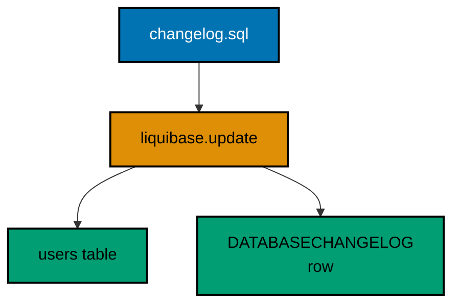

**`learning/code/ex-01-run-your-first-changelog/Main.java`**:

```java
// Example 1: Run Your First Changelog.
// A Liquibase changelog is a versioned list of changesets: each changeset
// runs once, in order, against the database. Liquibase records every run
// in its own DATABASECHANGELOG table, so a second run is a safe no-op.
// This program runs one SQL changelog, then proves the result by asking
// the database what exists now: the new table and the history row.
import java.sql.Connection; // => the handle every move and check shares
import java.sql.DriverManager; // => finds the PostgreSQL driver from the locked jars
import java.sql.ResultSet; // => walks the rows each verification query returns
import java.sql.Statement; // => carries the verification queries to the database
import java.util.Properties; // => carries the login without string-concatenated secrets
import liquibase.Liquibase; // => the entry point: configure, then update
import liquibase.Scope; // => silences progress narration for deterministic goldens
import liquibase.database.Database; // => Liquibase's view of our PostgreSQL connection
import liquibase.database.DatabaseFactory; // => picks the PostgreSQL implementation from the URL
import liquibase.database.jvm.JdbcConnection; // => adapts our JDBC handle to Liquibase
import liquibase.resource.DirectoryResourceAccessor; // => the current file-based changelog accessor
import liquibase.ui.LoggerUIService; // => reroutes progress lines into the silenced log

public class Main {

  // => one public class per file, named after the file
  static Connection connect() throws Exception {
    // => the harness starts PostgreSQL 18 and publishes these variables
    String host = System.getenv().getOrDefault("PGHOST", "localhost");
    // => default keeps local experimentation working outside the harness
    String url = "jdbc:postgresql://" + host + ":5432/postgres";
    // => trust auth accepts any password, so only the user matters
    Properties props = new Properties();
    // => Properties carries the login without string-concatenated secrets
    props.setProperty("user", System.getenv().getOrDefault("PGUSER", "postgres"));
    // => DriverManager finds the PostgreSQL driver from the locked jars
    return DriverManager.getConnection(url, props);
  } // => connect is the only place that knows connection details

  // => Liquibase narrates progress to its console UI by default; those lines
  // => differ between a first run and a rerun, so goldens cannot hold them
  static void runQuiet(Liquibase liquibase) throws Exception {
    // => the LOGGER service reroutes progress lines into the silenced JUL log
    Scope.child(
      java.util.Collections.singletonMap(Scope.Attr.ui.name(), new LoggerUIService()),
      // => the lambda runs inside the scope; main still throws Exception
      () -> liquibase.update("")
    );
    // => update("") runs every changeset with no context filter
  } // => quiet updates keep golden output identical on the harness double run

  // => every example counts tables through information_schema, never pg internals
  static int tablePresent(Connection conn, String table) throws Exception {
    // => information_schema is the portable way to ask what exists
    try (
      Statement st = conn.createStatement();
      // => try-with-resources closes the statement on every path
      ResultSet rs = st.executeQuery(
        // => a fixed literal is safe here: the table name is our constant
        "SELECT count(*) FROM information_schema.tables WHERE table_name = '" + table + "'"
      )
    ) {
      // => the query returns exactly one row with exactly one number
      rs.next();
      // => 1 means the migration created the table, 0 means it did not
      return rs.getInt(1);
    } // => the count answers the only question this check asks
  } // => helpers that verify stay separate from code that migrates

  // => the history table is Liquibase's own record of what already ran
  static int appliedCount(Connection conn) throws Exception {
    // => DATABASECHANGELOG gains one row per executed changeset
    try (
      Statement st = conn.createStatement();
      ResultSet rs = st.executeQuery("SELECT count(*) FROM databasechangelog")
    ) {
      // => a rerun adds zero rows, so the count is stable on double runs
      rs.next();
      // => the number is the proof that tracking happened, not just DDL
      return rs.getInt(1);
    } // => counting beats assuming the migration ran
  } // => reading history back is a habit every later example repeats

  public static void main(String[] args) throws Exception {
    // => silence JUL so the LOGGER service lines below disappear too
    java.util.logging.LogManager.getLogManager().reset();
    // => the entry point the harness runs
    try (Connection conn = connect()) {
      // => one connection serves the migration and both verifications
      Database database = DatabaseFactory.getInstance()
        // => the factory picks the PostgreSQL implementation from the URL
        .findCorrectDatabaseImplementation(new JdbcConnection(conn));
      // => JdbcConnection adapts our JDBC handle to Liquibase's database API
      Liquibase liquibase = new Liquibase(
        // => the changelog path is relative to the accessor root below
        "changelog.sql",
        // => DirectoryResourceAccessor is the current file-based accessor
        new DirectoryResourceAccessor(new java.io.File(".").getAbsoluteFile()),
        // => rooting at the unit directory keeps changelogs beside the program
        database
      );
      runQuiet(liquibase);
      // => the update ran quiet, so the transcript holds only our own prints
      System.out.println("users table present: " + tablePresent(conn, "users"));
      // => Output: users table present: 1
      System.out.println("changesets applied: " + appliedCount(conn));
      // => Output: changesets applied: 1
    } // => closing the connection ends the program with history intact
  } // => main migrates first, verifies second, prints last
}
```

**`learning/code/ex-01-run-your-first-changelog/changelog.sql`**:

```sql
-- liquibase formatted sql
-- => REQUIRED first line: marks this file as a Liquibase SQL changelog
-- => Without it Liquibase runs the SQL untracked, and nothing is recorded.
-- changeset course:001-create-users
-- => author "course" plus id "001-create-users" is this changeset's identity
-- => Liquibase stores (author, id, filename) in DATABASECHANGELOG on success
-- => Running it again later is a NO-OP because that row already exists
CREATE TABLE users (
  id SERIAL PRIMARY KEY,
  -- => SERIAL gives an auto-incrementing integer key, enough for this course
  username VARCHAR(50) NOT NULL
  -- => NOT NULL at creation time keeps the first migration honest
);
-- => Liquibase runs this DDL inside one transaction on PostgreSQL

-- rollback DROP TABLE users;
-- => every changeset that can be undone declares its reverse here
-- => Example 18 runs this line; until then it is a promise, not an action
```

**Output** (`learning/code/ex-01-run-your-first-changelog/expected/main.stdout.txt`):

```text
users table present: 1
changesets applied: 1
```

**Key takeaway**: A changelog pairs every changeset with a history row in the same transaction, so reruns are safe and history is queryable.

**Why it matters**: Untracked SQL scripts cannot answer what ran where; the history row turns a database into an auditable sequence of reviewed changes.

---

### Example 2: A Master Changelog Includes the Rest

One changelog file works until two teams share it, and then every migration starts with a merge conflict over who appends last. The master changelog solves the contention by containing no changesets at all: it only names a directory, and Liquibase discovers the files inside alphabetically at run time. Adding a migration becomes adding a file, which version control merges trivially, and the numeric prefixes turn alphabetical discovery into an explicit execution order anyone can read. The discipline the prefixes demand is real: a file without a numeric prefix sorts by name, and `add-index.sql` will happily run before `create-table.sql`, so the convention is load-bearing rather than cosmetic. (Concepts: co-01, co-04.)

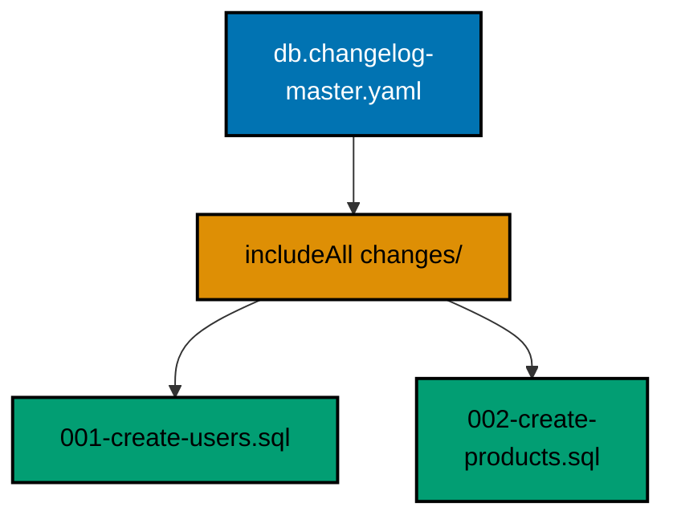

**`learning/code/ex-02-master-changelog-includes-rest/Main.java`**:

```java
// Example 2: A Master Changelog Includes the Rest.
// One master changelog delegates to many small files so developers add
// migrations by dropping a file into a directory, never by editing a shared
// list. Liquibase's includeAll discovers every file alphabetically, and the
// numeric prefixes below turn that discovery into a dependable execution
// order. This program runs the master file, then proves both tables exist
// and both changesets were tracked.
import java.sql.Connection; // => the handle every move and check shares
import java.sql.DriverManager; // => finds the PostgreSQL driver from the locked jars
import java.sql.ResultSet; // => walks the rows each verification query returns
import java.sql.Statement; // => carries the verification queries to the database
import java.util.Properties; // => carries the login without string-concatenated secrets
import liquibase.Liquibase; // => the entry point: configure, then update
import liquibase.Scope; // => silences progress narration for deterministic goldens
import liquibase.database.Database; // => Liquibase's view of our PostgreSQL connection
import liquibase.database.DatabaseFactory; // => picks the PostgreSQL implementation from the URL
import liquibase.database.jvm.JdbcConnection; // => adapts our JDBC handle to Liquibase
import liquibase.resource.DirectoryResourceAccessor; // => the current file-based changelog accessor
import liquibase.ui.LoggerUIService; // => reroutes progress lines into the silenced log

public class Main {

  // => one public class per file, named after the file
  static Connection connect() throws Exception {
    // => the harness starts PostgreSQL 18 and publishes these variables
    String host = System.getenv().getOrDefault("PGHOST", "localhost");
    // => default keeps local experimentation working outside the harness
    String url = "jdbc:postgresql://" + host + ":5432/postgres";
    // => trust auth accepts any password, so only the user matters
    Properties props = new Properties();
    // => Properties carries the login without string-concatenated secrets
    props.setProperty("user", System.getenv().getOrDefault("PGUSER", "postgres"));
    // => DriverManager finds the PostgreSQL driver from the locked jars
    return DriverManager.getConnection(url, props);
  } // => connect is the only place that knows connection details

  // => Liquibase narrates progress to its console UI by default; those lines
  // => differ between a first run and a rerun, so goldens cannot hold them
  static void runQuiet(Liquibase liquibase) throws Exception {
    // => the LOGGER service reroutes progress lines into the silenced JUL log
    Scope.child(
      java.util.Collections.singletonMap(Scope.Attr.ui.name(), new LoggerUIService()),
      // => the lambda runs inside the scope; main still throws Exception
      () -> liquibase.update("")
    );
    // => update("") runs every included changeset with no context filter
  } // => quiet updates keep golden output identical on the harness double run

  // => every example counts tables through information_schema, never pg internals
  static int tablePresent(Connection conn, String table) throws Exception {
    // => information_schema is the portable way to ask what exists
    try (
      Statement st = conn.createStatement();
      // => try-with-resources closes the statement on every path
      ResultSet rs = st.executeQuery(
        "SELECT count(*) FROM information_schema.tables WHERE table_name = '" + table + "'"
      )
    ) {
      // => the query returns exactly one row with exactly one number
      rs.next();
      // => 1 means the migration created the table, 0 means it did not
      return rs.getInt(1);
    } // => the count answers the only question this check asks
  } // => helpers that verify stay separate from code that migrates

  // => the history table is Liquibase's own record of what already ran
  static int appliedCount(Connection conn) throws Exception {
    // => DATABASECHANGELOG gains one row per executed changeset
    try (
      Statement st = conn.createStatement();
      ResultSet rs = st.executeQuery("SELECT count(*) FROM databasechangelog")
    ) {
      // => a rerun adds zero rows, so the count is stable on double runs
      rs.next();
      // => the number is the proof that tracking happened, not just DDL
      return rs.getInt(1);
    } // => counting beats assuming the migration ran
  } // => reading history back is a habit every later example repeats

  public static void main(String[] args) throws Exception {
    // => silence JUL so the LOGGER service lines below disappear too
    java.util.logging.LogManager.getLogManager().reset();
    // => the entry point the harness runs
    try (Connection conn = connect()) {
      // => one connection serves the migration and every verification
      Database database = DatabaseFactory.getInstance()
        // => the factory picks the PostgreSQL implementation from the URL
        .findCorrectDatabaseImplementation(new JdbcConnection(conn));
      // => JdbcConnection adapts our JDBC handle to Liquibase's database API
      Liquibase liquibase = new Liquibase(
        // => the master file delegates; it defines no changesets itself
        "db.changelog-master.yaml",
        // => DirectoryResourceAccessor is the current file-based accessor
        new DirectoryResourceAccessor(new java.io.File(".").getAbsoluteFile()),
        // => rooting at the unit directory keeps changelogs beside the program
        database
      );
      runQuiet(liquibase);
      // => the update ran quiet, so the transcript holds only our own prints
      System.out.println("users table present: " + tablePresent(conn, "users"));
      // => Output: users table present: 1
      System.out.println("products table present: " + tablePresent(conn, "products"));
      // => Output: products table present: 1
      System.out.println("changesets applied: " + appliedCount(conn));
      // => Output: changesets applied: 2
    } // => closing the connection ends the program with history intact
  } // => main migrates first, verifies second, prints last
}
```

**`learning/code/ex-02-master-changelog-includes-rest/db.changelog-master.yaml`**:

```yaml
databaseChangeLog: # => Root key required for every YAML changelog
  - includeAll: # => Discovers every changelog file in one directory
      path: changes/
      # => path is relative to this master file, not to the classpath
      # => Liquibase sorts the discovered files alphabetically before running
      # => Numeric prefixes (001-, 002-) make alphabetical order match intent
      # => A new migration is a new file here; this master never changes
```

**`learning/code/ex-02-master-changelog-includes-rest/changes/001-create-users.sql`**:

```sql
-- liquibase formatted sql
-- => REQUIRED first line: marks this file as a Liquibase SQL changelog
-- changeset course:001-create-users
-- => author "course", id "001-create-users": this changeset's identity
-- => 001- prefix sorts before 002-, so users exists before products
CREATE TABLE users (
  id SERIAL PRIMARY KEY,
  -- => SERIAL gives an auto-incrementing integer key, enough for this course
  username VARCHAR(50) NOT NULL
  -- => NOT NULL at creation time keeps the first migration honest
);

-- rollback DROP TABLE users;
-- => every changeset that can be undone declares its reverse here
```

**`learning/code/ex-02-master-changelog-includes-rest/changes/002-create-products.sql`**:

```sql
-- liquibase formatted sql
-- => REQUIRED first line: marks this file as a Liquibase SQL changelog
-- changeset course:002-create-products
-- => author "course", id "002-create-products": a distinct second identity
-- => included automatically because it sits in the scanned directory
CREATE TABLE products (
  id SERIAL PRIMARY KEY,
  -- => same key shape as users, so later joins stay simple
  name VARCHAR(255) NOT NULL
  -- => products need longer names than usernames allow
);

-- rollback DROP TABLE products;
-- => reverse order on rollback: products drops before users
```

**Output** (`learning/code/ex-02-master-changelog-includes-rest/expected/main.stdout.txt`):

```text
users table present: 1
products table present: 1
changesets applied: 2
```

**Key takeaway**: A master changelog with includeAll turns adding a migration into adding a numbered file, so parallel developers never edit a shared list.

**Why it matters**: Changelog merge conflicts are the most common migration-team friction; discovery plus numeric prefixes removes the shared file entirely.

---

### Example 3: Author and ID Name Every Changeset

Two developers can each add a changeset to the same file on the same day, and Liquibase must still tell them apart forever. The (author, id, filename) triple is that identity: the author names the team or the id stream, the id names the change within it, and the filename scopes both to one file. The convention matters more than any single value: personal names rot when people leave, bare sequence numbers collide across files, and vague ids like `fix-stuff` cannot be discussed in review. `{team}:{NNN-description}` survives all three because teams outlive members, numbers order within a file, and descriptions make history readable. This program runs one file with two authors and prints the stored triple per changeset, proving the history table remembers exactly who wrote what. (Concepts: co-01, co-04.)

**`learning/code/ex-03-author-and-id-name-changesets/Main.java`**:

```java
// Example 3: Author and ID Name Every Changeset.
// Liquibase identifies a changeset by (author, id, filename): that triple
// is the primary key of DATABASECHANGELOG. Teams use a {team}:{NNN-what}
// convention so two developers adding changesets to one file never collide.
// This program runs one file with two authors, then prints the recorded
// triple for each changeset in execution order.
import java.sql.Connection; // => the handle every move and check shares
import java.sql.DriverManager; // => finds the PostgreSQL driver from the locked jars
import java.sql.ResultSet; // => walks the rows each verification query returns
import java.sql.Statement; // => carries the verification queries to the database
import java.util.Properties; // => carries the login without string-concatenated secrets
import liquibase.Liquibase; // => the entry point: configure, then update
import liquibase.Scope; // => silences progress narration for deterministic goldens
import liquibase.database.Database; // => Liquibase's view of our PostgreSQL connection
import liquibase.database.DatabaseFactory; // => picks the PostgreSQL implementation from the URL
import liquibase.database.jvm.JdbcConnection; // => adapts our JDBC handle to Liquibase
import liquibase.resource.DirectoryResourceAccessor; // => the current file-based changelog accessor
import liquibase.ui.LoggerUIService; // => reroutes progress lines into the silenced log

public class Main {

  // => one public class per file, named after the file
  static Connection connect() throws Exception {
    // => the harness starts PostgreSQL 18 and publishes these variables
    String host = System.getenv().getOrDefault("PGHOST", "localhost");
    String url = "jdbc:postgresql://" + host + ":5432/postgres";
    Properties props = new Properties();
    // => trust auth accepts any password, so only the user matters
    props.setProperty("user", System.getenv().getOrDefault("PGUSER", "postgres"));
    // => DriverManager finds the PostgreSQL driver from the locked jars
    return DriverManager.getConnection(url, props);
  } // => connect is the only place that knows connection details

  // => Liquibase narrates progress to its console UI by default; those lines
  // => differ between a first run and a rerun, so goldens cannot hold them
  static void runQuiet(Liquibase liquibase) throws Exception {
    // => the LOGGER service reroutes progress lines into the silenced JUL log
    Scope.child(
      java.util.Collections.singletonMap(Scope.Attr.ui.name(), new LoggerUIService()),
      // => the lambda runs inside the scope; main still throws Exception
      () -> liquibase.update("")
    );
    // => update("") runs every changeset with no context filter
  } // => quiet updates keep golden output identical on the harness double run

  // => Liquibase stores the changelog path; only the file name is stable here
  static String shortName(String filename) {
    // => the logical path can carry directories, so keep the last segment
    int slash = filename.lastIndexOf('/');
    // => lastIndexOf returns -1 when there is no directory to strip
    return slash < 0 ? filename : filename.substring(slash + 1);
  } // => stable names keep golden output byte-identical on every machine

  public static void main(String[] args) throws Exception {
    // => silence JUL so the LOGGER service lines below disappear too
    java.util.logging.LogManager.getLogManager().reset();
    // => the entry point the harness runs
    try (Connection conn = connect()) {
      Database database = DatabaseFactory.getInstance()
        // => the factory picks the PostgreSQL implementation from the URL
        .findCorrectDatabaseImplementation(new JdbcConnection(conn));
      Liquibase liquibase = new Liquibase(
        // => one file holds two changesets from two different authors
        "changelog.sql",
        new DirectoryResourceAccessor(new java.io.File(".").getAbsoluteFile()),
        // => rooting at the unit directory keeps changelogs beside the program
        database
      );
      runQuiet(liquibase);
      // => the update ran quiet, so the transcript holds only our own prints
      try (
        Statement st = conn.createStatement();
        // => orderexecuted preserves the order Liquibase actually used
        ResultSet rs = st.executeQuery("SELECT id, author, filename FROM databasechangelog ORDER BY orderexecuted")
      ) {
        // => each row is the identity triple of one applied changeset
        // => a rerun adds zero rows, so these lines are stable on double runs
        while (rs.next()) {
          // => printing the triple shows what the history table remembers
          System.out.println(rs.getString(1) + " | " + rs.getString(2) + " | " + shortName(rs.getString(3)));
          // => the filename is Liquibase's logical path, stable across machines
        } // => two rows prove two authors share one file without colliding
      } // => reading history back is a habit every later example repeats
    } // => closing the connection ends the program with history intact
  } // => main migrates first, verifies second, prints last
}
```

**`learning/code/ex-03-author-and-id-name-changesets/changelog.sql`**:

```sql
-- liquibase formatted sql
-- => REQUIRED first line: marks this file as a Liquibase SQL changelog
-- changeset shop:001-create-customers
-- => author "shop" (team or project name, not a personal name)
-- => id "001-create-customers" (sequence plus short description)
-- => (shop, 001-create-customers, changelog.sql) is the stored identity
CREATE TABLE customers (
  id SERIAL PRIMARY KEY,
  -- => SERIAL gives an auto-incrementing integer key, enough for this course
  email VARCHAR(255) NOT NULL
  -- => customers are keyed by email in this small shop schema
);

-- rollback DROP TABLE customers;
-- => dropping the table reverses exactly what this changeset built

-- changeset billing:002-create-invoices
-- => a second author in the same file: no coordination needed to share it
-- => the id sequence continues because order still comes from file position
CREATE TABLE invoices (
  id SERIAL PRIMARY KEY,
  -- => invoices get their own independent sequence of ids
  total_cents INTEGER NOT NULL
  -- => money as integer cents avoids floating-point rounding entirely
);

-- rollback DROP TABLE invoices;
-- => each changeset carries its own reverse, independent of its neighbours
```

**Output** (`learning/code/ex-03-author-and-id-name-changesets/expected/main.stdout.txt`):

```text
001-create-customers | shop | changelog.sql
002-create-invoices | billing | changelog.sql
```

**Key takeaway**: The (author, id, filename) triple permanently identifies a changeset, so team-prefixed authors and descriptive ids keep shared files collision-free.

**Why it matters**: Identity collisions corrupt history silently; a naming convention chosen once prevents the class of conflict Example 54 dissects.

---

### Example 4: createTable Declares Tables in YAML

SQL changelogs say how; YAML changelogs say what. The createTable change type declares a table and its columns as data, and Liquibase generates the dialect for the connected database, which keeps one changelog runnable wherever the team runs it. Generated SQL also unlocks automatic rollback: Liquibase knows it created the table, so it knows dropping it reverses the change, with no handwritten rollback block to forget. The trade is expressiveness: anything beyond common DDL still wants SQL, which is why this course mixes both formats freely. This program runs one YAML changeset and proves both declared columns exist in the real catalog. (Concepts: co-01.)

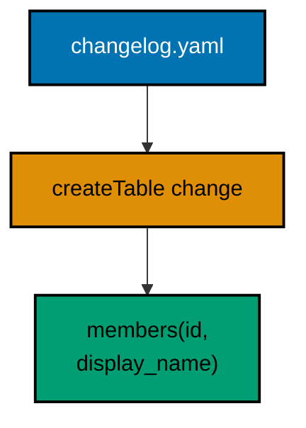

**`learning/code/ex-04-createtable-declares-tables-yaml/Main.java`**:

```java
// Example 4: createTable Declares Tables in YAML.
// The same migration can be written as data instead of SQL: YAML changelogs
// describe the change type and its columns, and Liquibase generates the
// PostgreSQL dialect. Generated SQL keeps migrations portable when one
// changelog must run against more than one database. This program runs one
// YAML changeset, then proves the table and both columns exist.
import java.sql.Connection; // => the handle every move and check shares
import java.sql.DriverManager; // => finds the PostgreSQL driver from the locked jars
import java.sql.ResultSet; // => walks the rows each verification query returns
import java.sql.Statement; // => carries the verification queries to the database
import java.util.Properties; // => carries the login without string-concatenated secrets
import liquibase.Liquibase; // => the entry point: configure, then update
import liquibase.Scope; // => silences progress narration for deterministic goldens
import liquibase.database.Database; // => Liquibase's view of our PostgreSQL connection
import liquibase.database.DatabaseFactory; // => picks the PostgreSQL implementation from the URL
import liquibase.database.jvm.JdbcConnection; // => adapts our JDBC handle to Liquibase
import liquibase.resource.DirectoryResourceAccessor; // => the current file-based changelog accessor
import liquibase.ui.LoggerUIService; // => reroutes progress lines into the silenced log

public class Main {

  // => one public class per file, named after the file

  // => one public class per file, named after the file
  // => connect is the only place that knows connection details
  static Connection connect() throws Exception {
    // => the harness starts PostgreSQL 18 and publishes these variables
    String host = System.getenv().getOrDefault("PGHOST", "localhost");
    String url = "jdbc:postgresql://" + host + ":5432/postgres";
    Properties props = new Properties();
    // => trust auth accepts any password, so only the user matters
    props.setProperty("user", System.getenv().getOrDefault("PGUSER", "postgres"));
    // => DriverManager finds the PostgreSQL driver from the locked jars
    return DriverManager.getConnection(url, props);
  } // => connect is the only place that knows connection details

  // => Liquibase narrates progress to its console UI by default; those lines
  // => differ between a first run and a rerun, so goldens cannot hold them
  // => one quiet runner covers the update below
  static void runQuiet(Liquibase liquibase) throws Exception {
    // => the LOGGER service reroutes progress lines into the silenced JUL log
    Scope.child(
      java.util.Collections.singletonMap(Scope.Attr.ui.name(), new LoggerUIService()),
      // => the lambda runs inside the scope; main still throws Exception
      () -> liquibase.update("")
    );
    // => update("") runs every changeset with no context filter
  } // => quiet updates keep golden output identical on the harness double run

  // => information_schema.columns answers "does this column exist" portably
  static int columnPresent(Connection conn, String table, String column) throws Exception {
    try (
      Statement st = conn.createStatement();
      ResultSet rs = st.executeQuery(
        "SELECT count(*) FROM information_schema.columns WHERE table_name = '" +
          table +
          "' AND column_name = '" +
          column +
          "'"
      )
    ) {
      // => the query returns exactly one row with exactly one number
      rs.next();
      // => 1 means the YAML declaration produced a real column
      return rs.getInt(1);
    } // => the count answers the only question this check asks
  } // => column checks verify generated SQL without parsing it

  // => the entry point the harness runs
  public static void main(String[] args) throws Exception {
    // => silence JUL so the LOGGER service lines below disappear too
    java.util.logging.LogManager.getLogManager().reset();
    // => the entry point the harness runs
    try (Connection conn = connect()) {
      Database database = DatabaseFactory.getInstance()
        // => the factory picks the PostgreSQL implementation from the URL
        .findCorrectDatabaseImplementation(new JdbcConnection(conn));
      Liquibase liquibase = new Liquibase(
        // => YAML changelogs need no format header, unlike SQL files
        "changelog.yaml",
        new DirectoryResourceAccessor(new java.io.File(".").getAbsoluteFile()),
        // => rooting at the unit directory keeps changelogs beside the program
        database
      );
      runQuiet(liquibase);
      // => the update ran quiet, so the transcript holds only our own prints
      System.out.println("members.id present: " + columnPresent(conn, "members", "id"));
      // => Output: members.id present: 1
      System.out.println("members.display_name present: " + columnPresent(conn, "members", "display_name"));
      // => Output: members.display_name present: 1
    } // => closing the connection ends the program with history intact
  } // => main migrates first, verifies second, prints last
}
```

**`learning/code/ex-04-createtable-declares-tables-yaml/changelog.yaml`**:

```yaml
databaseChangeLog: # => Root key required for every YAML changelog
  - changeSet: # => One changeset: the unit Liquibase tracks and runs once
      id: 001-create-members # => id plus author is this changeset's identity
      author: course # => team or project name, matching the SQL convention
      changes: # => the list of change types this changeset applies in order
        - createTable: # => declarative table creation; Liquibase writes the SQL
            tableName: members # => the table the generated DDL will create
            columns: # => every column the table starts life with
              - column: # => one column definition
                  name: id # => the primary key column
                  type: INT # => portable type; PostgreSQL renders integer
                  constraints: # => inline constraints travel with the column
                    primaryKey: true # => generated DDL names a primary key
                    nullable: false # => keys are never nullable
              - column: # => a second column definition
                  name: display_name # => snake_case matches SQL convention
                  type: VARCHAR(100) # => a bounded name fits members well
                  constraints: # => application-level rules belong in the schema
                    nullable: false # => every member must have a display name
# => rollback for createTable is automatic: Liquibase drops what it created
# => auto-rollback is why declarative changes beat raw SQL for simple DDL
```

**Output** (`learning/code/ex-04-createtable-declares-tables-yaml/expected/main.stdout.txt`):

```text
members.id present: 1
members.display_name present: 1
```

**Key takeaway**: Declarative change types generate dialect SQL and roll back automatically, trading raw-SQL expressiveness for portability.

**Why it matters**: Multi-database changelogs cannot carry handwritten dialect SQL; generated DDL keeps one migration true everywhere.

---

### Example 5: addColumn Extends a Live Table

Tables are born small and grow up in production, usually while holding rows nobody can afford to lose. Recreating a table to add a column means copying every row and rewinding every dependent object; altering it in place touches only the catalog. The addColumn changeset appends the column with its declared type, existing rows read NULL for it until something writes otherwise, and the change is tracked exactly like a creation. The verification habit this example establishes matters as much as the DDL: prove the new column exists and prove the old rows survived, because an alter that silently drops data is worse than one that fails loudly. (Concepts: co-01.)

**`learning/code/ex-05-addcolumn-extends-live-table/Main.java`**:

```java
// Example 5: addColumn Extends a Live Table.
// Real tables gain columns after they already hold rows: the alter must not
// disturb existing data. The addColumn change type appends one column with a
// declared type, and Liquibase records it like any other changeset. This
// program creates the table, adds the column in a second changeset, then
// proves the column exists and accepts writes.
import java.sql.Connection; // => the handle every move and check shares
import java.sql.DriverManager; // => finds the PostgreSQL driver from the locked jars
import java.sql.ResultSet; // => walks the rows each verification query returns
import java.sql.Statement; // => carries the verification queries to the database
import java.util.Properties; // => carries the login without string-concatenated secrets
import liquibase.Liquibase; // => the entry point: configure, then update
import liquibase.Scope; // => silences progress narration for deterministic goldens
import liquibase.database.Database; // => Liquibase's view of our PostgreSQL connection
import liquibase.database.DatabaseFactory; // => picks the PostgreSQL implementation from the URL
import liquibase.database.jvm.JdbcConnection; // => adapts our JDBC handle to Liquibase
import liquibase.resource.DirectoryResourceAccessor; // => the current file-based changelog accessor
import liquibase.ui.LoggerUIService; // => reroutes progress lines into the silenced log

public class Main {

  // => one public class per file, named after the file
  static Connection connect() throws Exception {
    // => the harness starts PostgreSQL 18 and publishes these variables
    String host = System.getenv().getOrDefault("PGHOST", "localhost");
    String url = "jdbc:postgresql://" + host + ":5432/postgres";
    Properties props = new Properties();
    // => trust auth accepts any password, so only the user matters
    props.setProperty("user", System.getenv().getOrDefault("PGUSER", "postgres"));
    // => DriverManager finds the PostgreSQL driver from the locked jars
    return DriverManager.getConnection(url, props);
  } // => connect is the only place that knows connection details

  // => Liquibase narrates progress to its console UI by default; those lines
  // => differ between a first run and a rerun, so goldens cannot hold them
  static void runQuiet(Liquibase liquibase) throws Exception {
    // => the LOGGER service reroutes progress lines into the silenced JUL log
    Scope.child(
      java.util.Collections.singletonMap(Scope.Attr.ui.name(), new LoggerUIService()),
      // => the lambda runs inside the scope; main still throws Exception
      () -> liquibase.update("")
    );
    // => update("") runs every changeset with no context filter
  } // => quiet updates keep golden output identical on the harness double run

  public static void main(String[] args) throws Exception {
    // => silence JUL so the LOGGER service lines below disappear too
    java.util.logging.LogManager.getLogManager().reset();
    // => the entry point the harness runs
    try (Connection conn = connect()) {
      Database database = DatabaseFactory.getInstance()
        // => the factory picks the PostgreSQL implementation from the URL
        .findCorrectDatabaseImplementation(new JdbcConnection(conn));
      Liquibase liquibase = new Liquibase(
        // => two changesets: create the table, then extend it
        "changelog.sql",
        new DirectoryResourceAccessor(new java.io.File(".").getAbsoluteFile()),
        // => rooting at the unit directory keeps changelogs beside the program
        database
      );
      runQuiet(liquibase);
      // => the update ran quiet, so the transcript holds only our own prints
      try (Statement st = conn.createStatement()) {
        // => one statement serves the seed and both verification queries
        st.execute("DELETE FROM players");
        // => delete-then-insert keeps the seed idempotent on the double run
        st.execute("INSERT INTO players (handle) VALUES ('anisa')");
        // => the insert uses only the original column, proving old writes still work
        try (
          ResultSet rs = st.executeQuery(
            "SELECT count(*) FROM information_schema.columns " +
              "WHERE table_name = 'players' AND column_name = 'level'"
          )
        ) {
          // => the new column must exist after the second changeset runs
          rs.next();
          System.out.println("players.level present: " + rs.getInt(1));
          // => Output: players.level present: 1
        } // => schema checks read information_schema, never pg internals
        try (ResultSet rs = st.executeQuery("SELECT count(*) FROM players")) {
          // => the seed row is the only row after the idempotent rewrite
          rs.next();
          System.out.println("players rows kept: " + rs.getInt(1));
          // => Output: players rows kept: 1
        } // => alters that lose rows are the failure this check guards against
      } // => closing the statement releases the database resources
    } // => closing the connection ends the program with history intact
  } // => main migrates first, verifies second, prints last
}
```

**`learning/code/ex-05-addcolumn-extends-live-table/changelog.sql`**:

```sql
-- liquibase formatted sql
-- => REQUIRED first line: marks this file as a Liquibase SQL changelog
-- changeset course:001-create-players
-- => the table exists first; later changesets extend it in place
CREATE TABLE players (
  id SERIAL PRIMARY KEY,
  -- => SERIAL gives an auto-incrementing integer key, enough for this course
  handle VARCHAR(50) NOT NULL
  -- => the only column the table starts life with
);

-- rollback DROP TABLE players;
-- => dropping the table reverses exactly what this changeset built

-- changeset course:002-add-level
-- => a second changeset alters the live table instead of recreating it
-- => existing rows keep their data; the new column starts NULL everywhere
ALTER TABLE players ADD COLUMN level INTEGER;
-- => plain SQL inside a tracked changeset: the best of both formats

-- rollback ALTER TABLE players DROP COLUMN level;
-- => additive changes reverse by dropping what was added
```

**Output** (`learning/code/ex-05-addcolumn-extends-live-table/expected/main.stdout.txt`):

```text
players.level present: 1
players rows kept: 1
```

**Key takeaway**: Extend live tables with additive changesets in place; verify the new column exists and the old rows survived.

**Why it matters**: Table recreation in production risks every row; in-place alters plus row-count proofs keep growth boring.

---

### Example 6: Constraints Guard New Columns

Application code validates input when it remembers to; constraints validate on every write whether the application remembers or not. A handle column with no rules eventually holds NULLs and duplicates, and both corrupt joins downstream. Attaching NOT NULL and UNIQUE as their own changesets, after the table exists, shows the migration pattern for rules discovered late: the schema evolves toward strictness without rebuilding anything. The two verifications mirror the two guarantees: attempt the forbidden write and watch the database refuse it, then count the catalog rows that record the rules. This example also teaches PostgreSQL 18's honest accounting: each SET NOT NULL surfaces as a CHECK constraint in the catalog, so the counts below name what the database really stores. (Concepts: co-01, co-05.)

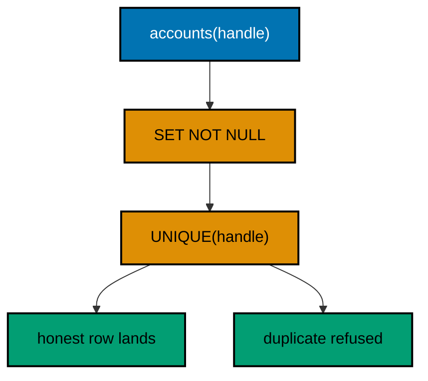

**`learning/code/ex-06-constraints-guard-new-columns/Main.java`**:

```java
// Example 6: Constraints Guard New Columns.
// A column without rules accepts anything: nulls where names belong,
// duplicates where identity lives. addNotNullConstraint and
// addUniqueConstraint attach those rules to an existing column, and the
// database enforces them on every later write. This program migrates the
// table, adds both constraints, then proves a duplicate handle is rejected
// while the constraint catalog records both rules.
import java.sql.Connection; // => the handle every move and check shares
import java.sql.DriverManager; // => finds the PostgreSQL driver from the locked jars
import java.sql.ResultSet; // => walks the rows each verification query returns
import java.sql.SQLException; // => the checked failure JDBC raises for refused rows
import java.sql.Statement; // => carries the verification queries to the database
import java.util.Properties; // => carries the login without string-concatenated secrets
import liquibase.Liquibase; // => the entry point: configure, then update
import liquibase.Scope; // => silences progress narration for deterministic goldens
import liquibase.database.Database; // => Liquibase's view of our PostgreSQL connection
import liquibase.database.DatabaseFactory; // => picks the PostgreSQL implementation from the URL
import liquibase.database.jvm.JdbcConnection; // => adapts our JDBC handle to Liquibase
import liquibase.resource.DirectoryResourceAccessor; // => the current file-based changelog accessor
import liquibase.ui.LoggerUIService; // => reroutes progress lines into the silenced log

public class Main {

  // => one public class per file, named after the file
  static Connection connect() throws Exception {
    // => the harness starts PostgreSQL 18 and publishes these variables
    String host = System.getenv().getOrDefault("PGHOST", "localhost");
    String url = "jdbc:postgresql://" + host + ":5432/postgres";
    Properties props = new Properties();
    // => trust auth accepts any password, so only the user matters
    props.setProperty("user", System.getenv().getOrDefault("PGUSER", "postgres"));
    // => DriverManager finds the PostgreSQL driver from the locked jars
    return DriverManager.getConnection(url, props);
  } // => connect is the only place that knows connection details

  // => Liquibase narrates progress to its console UI by default; those lines
  // => differ between a first run and a rerun, so goldens cannot hold them
  static void runQuiet(Liquibase liquibase) throws Exception {
    // => the LOGGER service reroutes progress lines into the silenced JUL log
    Scope.child(
      java.util.Collections.singletonMap(Scope.Attr.ui.name(), new LoggerUIService()),
      // => the lambda runs inside the scope; main still throws Exception
      () -> liquibase.update("")
    );
    // => update("") runs every changeset with no context filter
  } // => quiet updates keep golden output identical on the harness double run

  public static void main(String[] args) throws Exception {
    // => silence JUL so the LOGGER service lines below disappear too
    java.util.logging.LogManager.getLogManager().reset();
    // => the entry point the harness runs
    try (Connection conn = connect()) {
      Database database = DatabaseFactory.getInstance()
        // => the factory picks the PostgreSQL implementation from the URL
        .findCorrectDatabaseImplementation(new JdbcConnection(conn));
      Liquibase liquibase = new Liquibase(
        // => three changesets: create, then constrain, then constrain
        "changelog.sql",
        new DirectoryResourceAccessor(new java.io.File(".").getAbsoluteFile()),
        // => rooting at the unit directory keeps changelogs beside the program
        database
      );
      runQuiet(liquibase);
      // => close the migration transaction: verifications manage their own
      conn.commit();
      // => the update ran quiet, so the transcript holds only our own prints
      try (Statement st = conn.createStatement()) {
        // => one statement serves the probes and both verification queries
        st.execute("DELETE FROM accounts");
        // => delete-then-insert keeps the seed idempotent on the double run
        st.execute("INSERT INTO accounts (handle) VALUES ('budi')");
        // => the first handle lands fine: constraints allow honest rows
        conn.commit();
        // => commit the seed so the later rollback only undoes the probe
        boolean duplicateRejected = false;
        // => the flag records the outcome without printing driver internals
        try {
          // => a second identical handle must violate the unique rule
          st.execute("INSERT INTO accounts (handle) VALUES ('budi')");
        } catch (SQLException expected) {
          // => the exception type is stable; its message text is not asserted
          duplicateRejected = true;
          // => the failed write aborts the transaction, so roll back before
          // => the next query or every later command is ignored until then
          conn.rollback();
          // => catching proves the database enforced the constraint itself
        } // => no stack trace: the rejection is the expected behaviour
        System.out.println("duplicate handle rejected: " + duplicateRejected);
        // => Output: duplicate handle rejected: true
        try (
          ResultSet rs = st.executeQuery(
            "SELECT count(*) FROM information_schema.table_constraints " +
              "WHERE table_name = 'accounts' AND constraint_type = 'CHECK'"
          )
        ) {
          // => PostgreSQL 18 records each SET NOT NULL as a CHECK constraint,
          // => one for the key column and one for our new handle rule
          rs.next();
          System.out.println("not-null rules recorded: " + rs.getInt(1));
          // => Output: not-null rules recorded: 2
        } // => catalog counts verify the migration without vendor internals
        try (
          ResultSet rs = st.executeQuery(
            "SELECT count(*) FROM information_schema.table_constraints " +
              "WHERE table_name = 'accounts' AND constraint_type = 'UNIQUE'"
          )
        ) {
          // => the named unique constraint is the second rule we added
          rs.next();
          System.out.println("unique rules recorded: " + rs.getInt(1));
          // => Output: unique rules recorded: 1
        } // => one CHECK plus one UNIQUE is the whole contract of this file
      } // => closing the statement releases the database resources
    } // => closing the connection ends the program with history intact
  } // => main migrates first, verifies second, prints last
}
```

**`learning/code/ex-06-constraints-guard-new-columns/changelog.sql`**:

```sql
-- liquibase formatted sql
-- => REQUIRED first line: marks this file as a Liquibase SQL changelog
-- changeset course:001-create-accounts
-- => handles start nullable: constraints arrive as their own changesets
CREATE TABLE accounts (
  id SERIAL PRIMARY KEY,
  -- => SERIAL gives an auto-incrementing integer key, enough for this course
  handle VARCHAR(50)
  -- => deliberately born nullable so the next changeset has work to do
);

-- rollback DROP TABLE accounts;
-- => dropping the table reverses exactly what this changeset built

-- changeset course:002-require-handle
-- => NULL handles are a data bug: the schema should refuse them outright
ALTER TABLE accounts ALTER COLUMN handle SET NOT NULL;
-- => SET NOT NULL fails on a table that already holds NULLs, by design

-- rollback ALTER TABLE accounts ALTER COLUMN handle DROP NOT NULL;
-- => nullability reverses symmetrically when the rule is rolled back

-- changeset course:003-unique-handle
-- => duplicate handles would merge two users: uniqueness is identity here
ALTER TABLE accounts ADD CONSTRAINT uq_accounts_handle UNIQUE (handle);
-- => a named constraint produces error messages a human can act on

-- rollback ALTER TABLE accounts DROP CONSTRAINT uq_accounts_handle;
-- => named constraints drop by name, so naming them is load-bearing
```

**Output** (`learning/code/ex-06-constraints-guard-new-columns/expected/main.stdout.txt`):

```text
duplicate handle rejected: true
not-null rules recorded: 2
unique rules recorded: 1
```

**Key takeaway**: Constraints migrate like any other change, and the database enforces them on every write; prove both the refusal and the catalog record.

**Why it matters**: Application validation is advisory; schema constraints are the last line that never forgets, and late-discovered rules still migrate cleanly.

---

### Example 7: Indexes Speed the New Query Path

Unindexed lookups work fine until the table grows, and then every handle search scans millions of rows to return one. The failure arrives as latency, months after the migration that caused it, which makes the index the rare change whose absence hurts more than its presence costs. The createIndex changeset builds a B-tree the database maintains on every later write, and the cost is paid once at creation while the benefit compounds on every read. Verification pairs the catalog proof with the behaviour proof: pg_indexes must name the new index, and a lookup by the indexed column must return the seeded row. The catalog query names the index instead of counting the table's indexes because PostgreSQL also lists the primary key's backing index, a precision this example makes explicit. (Concepts: co-01.)

**`learning/code/ex-07-indexes-speed-new-query-path/Main.java`**:

```java
// Example 7: Indexes Speed the New Query Path.
// Queries by handle scan the whole table until an index gives PostgreSQL a
// shortcut. The createIndex change type builds a B-tree over one column,
// and the database keeps it current on every later write. This program
// migrates the table, adds the index, then proves the catalog records it
// and a lookup by handle returns the seeded row.
import java.sql.Connection; // => the handle every move and check shares
import java.sql.DriverManager; // => finds the PostgreSQL driver from the locked jars
import java.sql.ResultSet; // => walks the rows each verification query returns
import java.sql.Statement; // => carries the verification queries to the database
import java.util.Properties; // => carries the login without string-concatenated secrets
import liquibase.Liquibase; // => the entry point: configure, then update
import liquibase.Scope; // => silences progress narration for deterministic goldens
import liquibase.database.Database; // => Liquibase's view of our PostgreSQL connection
import liquibase.database.DatabaseFactory; // => picks the PostgreSQL implementation from the URL
import liquibase.database.jvm.JdbcConnection; // => adapts our JDBC handle to Liquibase
import liquibase.resource.DirectoryResourceAccessor; // => the current file-based changelog accessor
import liquibase.ui.LoggerUIService; // => reroutes progress lines into the silenced log

public class Main {

  // => one public class per file, named after the file
  static Connection connect() throws Exception {
    // => the harness starts PostgreSQL 18 and publishes these variables
    String host = System.getenv().getOrDefault("PGHOST", "localhost");
    String url = "jdbc:postgresql://" + host + ":5432/postgres";
    Properties props = new Properties();
    // => trust auth accepts any password, so only the user matters
    props.setProperty("user", System.getenv().getOrDefault("PGUSER", "postgres"));
    // => DriverManager finds the PostgreSQL driver from the locked jars
    return DriverManager.getConnection(url, props);
  } // => connect is the only place that knows connection details

  // => Liquibase narrates progress to its console UI by default; those lines
  // => differ between a first run and a rerun, so goldens cannot hold them
  static void runQuiet(Liquibase liquibase) throws Exception {
    // => the LOGGER service reroutes progress lines into the silenced JUL log
    Scope.child(
      java.util.Collections.singletonMap(Scope.Attr.ui.name(), new LoggerUIService()),
      // => the lambda runs inside the scope; main still throws Exception
      () -> liquibase.update("")
    );
    // => update("") runs every changeset with no context filter
  } // => quiet updates keep golden output identical on the harness double run

  public static void main(String[] args) throws Exception {
    // => silence JUL so the LOGGER service lines below disappear too
    java.util.logging.LogManager.getLogManager().reset();
    // => the entry point the harness runs
    try (Connection conn = connect()) {
      Database database = DatabaseFactory.getInstance()
        // => the factory picks the PostgreSQL implementation from the URL
        .findCorrectDatabaseImplementation(new JdbcConnection(conn));
      Liquibase liquibase = new Liquibase(
        // => two changesets: create the table, then index its handle
        "changelog.sql",
        new DirectoryResourceAccessor(new java.io.File(".").getAbsoluteFile()),
        // => rooting at the unit directory keeps changelogs beside the program
        database
      );
      runQuiet(liquibase);
      // => the update ran quiet, so the transcript holds only our own prints
      try (Statement st = conn.createStatement()) {
        // => one statement serves the seed and both verification queries
        st.execute("DELETE FROM members");
        // => delete-then-insert keeps the seed idempotent on the double run
        st.execute("INSERT INTO members (handle) VALUES ('citra')");
        // => the indexed column holds a row the lookup below must find
        try (ResultSet rs = st.executeQuery("SELECT count(*) FROM pg_indexes WHERE indexname = 'ix_members_handle'")) {
          // => pg_indexes lists every index including the primary key's own,
          // => so the check names our index instead of counting the table
          rs.next();
          System.out.println("members indexes recorded: " + rs.getInt(1));
          // => Output: members indexes recorded: 1
        } // => catalog counts verify the migration without explaining plans
        try (ResultSet rs = st.executeQuery("SELECT handle FROM members WHERE handle = 'citra'")) {
          // => the indexed lookup returns exactly the seeded row
          rs.next();
          System.out.println("lookup by handle finds: " + rs.getString(1));
          // => Output: lookup by handle finds: citra
        } // => behaviour plus catalog together prove the index works
      } // => closing the statement releases the database resources
    } // => closing the connection ends the program with history intact
  } // => main migrates first, verifies second, prints last
}
```

**`learning/code/ex-07-indexes-speed-new-query-path/changelog.sql`**:

```sql
-- liquibase formatted sql
-- => REQUIRED first line: marks this file as a Liquibase SQL changelog
-- changeset course:001-create-members
-- => the table exists first; the index arrives as its own changeset
CREATE TABLE members (
  id SERIAL PRIMARY KEY,
  -- => SERIAL gives an auto-incrementing integer key, enough for this course
  handle VARCHAR(50) NOT NULL
  -- => lookups by handle are the query path the index will serve
);

-- rollback DROP TABLE members;
-- => dropping the table reverses exactly what this changeset built

-- changeset course:002-index-handle
-- => a B-tree over handle turns full scans into index lookups
CREATE INDEX ix_members_handle ON members (handle);
-- => a named index shows up in pg_indexes under a name reviewers chose

-- rollback DROP INDEX ix_members_handle;
-- => indexes drop by name, so naming them is load-bearing
```

**Output** (`learning/code/ex-07-indexes-speed-new-query-path/expected/main.stdout.txt`):

```text
members indexes recorded: 1
lookup by handle finds: citra
```

**Key takeaway**: Index the columns the queries use, in their own changesets; prove the catalog record and the lookup behaviour together.

**Why it matters**: Missing indexes fail as latency months later; a named index migrated beside its table keeps the query path fast from day one.

---

### Example 8: Foreign Keys Link Two Tables

Two tables with a shared integer column look related, but the database does not know it: nothing stops a book from pointing at an author that never existed, and the orphan surfaces as a blank page in production. The foreign key turns the convention into a guarantee the database enforces on every write, in both directions that matter: inserts must reference a live row, and the referenced row cannot vanish while children point at it. Migrating the key as its own changeset, after both tables, keeps creation order explicit and gives the link a name reviewers can discuss. Verification mirrors the guarantee: the forbidden orphan must be refused, the honest book must land, and the catalog must record exactly one enforced link. (Concepts: co-01, co-05.)

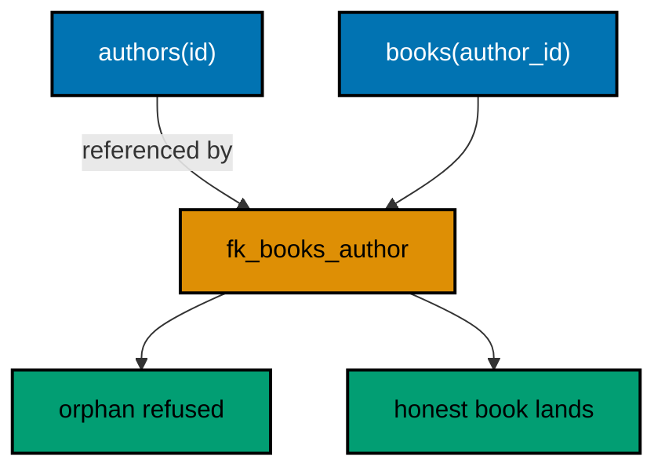

**`learning/code/ex-08-foreign-keys-link-two-tables/Main.java`**:

```java
// Example 8: Foreign Keys Link Two Tables.
// A bare author_id integer accepts any number, including ids no author has.
// addForeignKeyConstraint turns that integer into a relationship the
// database enforces: every book points at a real author or the write fails.
// This program migrates both tables plus the key, then proves an orphan
// book is rejected, an honest book lands, and the catalog records the link.
import java.sql.Connection; // => the handle every move and check shares
import java.sql.DriverManager; // => finds the PostgreSQL driver from the locked jars
import java.sql.ResultSet; // => walks the rows each verification query returns
import java.sql.SQLException; // => the checked failure JDBC raises for refused rows
import java.sql.Statement; // => carries the verification queries to the database
import java.util.Properties; // => carries the login without string-concatenated secrets
import liquibase.Liquibase; // => the entry point: configure, then update
import liquibase.Scope; // => silences progress narration for deterministic goldens
import liquibase.database.Database; // => Liquibase's view of our PostgreSQL connection
import liquibase.database.DatabaseFactory; // => picks the PostgreSQL implementation from the URL
import liquibase.database.jvm.JdbcConnection; // => adapts our JDBC handle to Liquibase
import liquibase.resource.DirectoryResourceAccessor; // => the current file-based changelog accessor
import liquibase.ui.LoggerUIService; // => reroutes progress lines into the silenced log

public class Main {

  // => one public class per file, named after the file
  static Connection connect() throws Exception {
    // => the harness starts PostgreSQL 18 and publishes these variables
    String host = System.getenv().getOrDefault("PGHOST", "localhost");
    String url = "jdbc:postgresql://" + host + ":5432/postgres";
    Properties props = new Properties();
    // => trust auth accepts any password, so only the user matters
    props.setProperty("user", System.getenv().getOrDefault("PGUSER", "postgres"));
    // => DriverManager finds the PostgreSQL driver from the locked jars
    return DriverManager.getConnection(url, props);
  } // => connect is the only place that knows connection details

  // => Liquibase narrates progress to its console UI by default; those lines
  // => differ between a first run and a rerun, so goldens cannot hold them
  static void runQuiet(Liquibase liquibase) throws Exception {
    // => the LOGGER service reroutes progress lines into the silenced JUL log
    Scope.child(
      java.util.Collections.singletonMap(Scope.Attr.ui.name(), new LoggerUIService()),
      // => the lambda runs inside the scope; main still throws Exception
      () -> liquibase.update("")
    );
    // => update("") runs every changeset with no context filter
  } // => quiet updates keep golden output identical on the harness double run

  public static void main(String[] args) throws Exception {
    // => silence JUL so the LOGGER service lines below disappear too
    java.util.logging.LogManager.getLogManager().reset();
    // => the entry point the harness runs
    try (Connection conn = connect()) {
      Database database = DatabaseFactory.getInstance()
        // => the factory picks the PostgreSQL implementation from the URL
        .findCorrectDatabaseImplementation(new JdbcConnection(conn));
      Liquibase liquibase = new Liquibase(
        // => three changesets: two tables, then the link between them
        "changelog.sql",
        new DirectoryResourceAccessor(new java.io.File(".").getAbsoluteFile()),
        // => rooting at the unit directory keeps changelogs beside the program
        database
      );
      runQuiet(liquibase);
      // => close the migration transaction: verifications manage their own
      conn.commit();
      // => the update ran quiet, so the transcript holds only our own prints
      try (Statement st = conn.createStatement()) {
        // => one statement serves the probes and both verification queries
        st.execute("DELETE FROM books");
        // => children delete first: the key forbids orphaning authors instead
        st.execute("DELETE FROM authors");
        // => delete-then-insert keeps the seeds idempotent on the double run
        st.execute("INSERT INTO authors (pen_name) VALUES ('sari')");
        // => one author exists now; the orphan probe below points at 999
        conn.commit();
        // => commit the seed so the later rollback only undoes the probe
        boolean orphanRejected = false;
        // => the flag records the outcome without printing driver internals
        try {
          // => author 999 exists never, so the key must refuse this book
          st.execute("INSERT INTO books (author_id, title) VALUES (999, 'Ghost')");
        } catch (SQLException expected) {
          // => the exception type is stable; its message text is not asserted
          orphanRejected = true;
          // => the failed write aborts the transaction, so roll back before
          // => the next insert or every later command is ignored until then
          conn.rollback();
          // => catching proves the database enforced the relationship itself
        } // => no stack trace: the rejection is the expected behaviour
        System.out.println("orphan book rejected: " + orphanRejected);
        // => Output: orphan book rejected: true
        int authorId;
        // => SERIAL sequences never restart on DELETE, so read the live id
        try (ResultSet key = st.executeQuery("SELECT id FROM authors WHERE pen_name = 'sari'")) {
          // => the seed above guarantees exactly one row with this pen name
          key.next();
          authorId = key.getInt(1);
          // => the id differs per run; hardcoding 1 breaks the double run
        } // => reading generated keys back beats assuming their values
        st.execute("INSERT INTO books (author_id, title) VALUES (" + authorId + ", 'Migrations')");
        // => the honest book points at the real author and lands fine
        try (ResultSet rs = st.executeQuery("SELECT count(*) FROM information_schema.referential_constraints")) {
          // => the catalog records one enforced link between the two tables
          rs.next();
          System.out.println("foreign keys recorded: " + rs.getInt(1));
          // => Output: foreign keys recorded: 1
        } // => catalog counts verify the migration without vendor internals
      } // => closing the statement releases the database resources
    } // => closing the connection ends the program with history intact
  } // => main migrates first, verifies second, prints last
}
```

**`learning/code/ex-08-foreign-keys-link-two-tables/changelog.sql`**:

```sql
-- liquibase formatted sql
-- => REQUIRED first line: marks this file as a Liquibase SQL changelog
-- changeset course:001-create-authors
-- => the referenced table must exist before the foreign key points at it
CREATE TABLE authors (
  id SERIAL PRIMARY KEY,
  -- => SERIAL gives an auto-incrementing integer key, enough for this course
  pen_name VARCHAR(100) NOT NULL
  -- => every author writes under exactly one pen name
);

-- rollback DROP TABLE authors;
-- => dropping the table reverses exactly what this changeset built

-- changeset course:002-create-books
-- => books carry the key; authors stay independent of their books
CREATE TABLE books (
  id SERIAL PRIMARY KEY,
  -- => books get their own independent sequence of ids
  author_id INTEGER NOT NULL,
  -- => born as a plain integer so the constraint changeset has work to do
  title VARCHAR(255) NOT NULL
  -- => a book without a title is a cataloguing bug
);

-- rollback DROP TABLE books;
-- => books drop before authors on rollback, reversing creation order

-- changeset course:003-link-books-to-authors
-- => the foreign key turns a bare integer into a guaranteed relationship
ALTER TABLE books
  ADD CONSTRAINT fk_books_author FOREIGN KEY (author_id) REFERENCES authors (id);
-- => a named constraint produces error messages a human can act on

-- rollback ALTER TABLE books DROP CONSTRAINT fk_books_author;
-- => named constraints drop by name, so naming them is load-bearing
```

**Output** (`learning/code/ex-08-foreign-keys-link-two-tables/expected/main.stdout.txt`):

```text
orphan book rejected: true
foreign keys recorded: 1
```

**Key takeaway**: Migrate relationships as named foreign-key changesets after both tables; prove the refusal, the honest write, and the catalog record.

**Why it matters**: Orphan rows surface as blank pages in production; a key migrated beside its tables makes the relationship unbreakable by accident.

---

### Example 9: DATABASECHANGELOG Records Every Run

Applied migrations leave a paper trail inside the database itself. DATABASECHANGELOG gains one row per executed changeset, recording the id, author, file, execution order, outcome, checksum, and tag. That table answers the questions deploys and audits keep asking: what ran, in which order, with what result. The how is a straight read: run two changesets, then select the stable history columns in execution order. Notice what the program does not print: the raw checksum value, which is a Liquibase internal rather than a contract, appears only as a present-or-absent flag. (Concepts: co-03, co-16.)

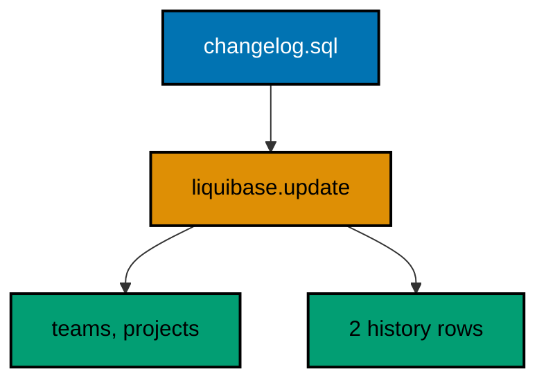

**`learning/code/ex-09-databasechangelog-records-every-run/Main.java`**:

```java
// Example 9: DATABASECHANGELOG Records Every Run.
// Liquibase remembers each executed changeset as a row in its own
// DATABASECHANGELOG table: id, author, file, execution order, outcome,
// checksum, and tag. Those rows are the audit trail every later example
// queries. This program runs two changesets, then prints the stable
// history columns for both rows in execution order.
import java.sql.Connection; // => the handle every move and check shares
import java.sql.DriverManager; // => finds the PostgreSQL driver from the locked jars
import java.sql.ResultSet; // => walks the rows each verification query returns
import java.sql.Statement; // => carries the verification queries to the database
import java.util.Properties; // => carries the login without string-concatenated secrets
import liquibase.Liquibase; // => the entry point: configure, then update
import liquibase.Scope; // => silences progress narration for deterministic goldens
import liquibase.database.Database; // => Liquibase's view of our PostgreSQL connection
import liquibase.database.DatabaseFactory; // => picks the PostgreSQL implementation from the URL
import liquibase.database.jvm.JdbcConnection; // => adapts our JDBC handle to Liquibase
import liquibase.resource.DirectoryResourceAccessor; // => the current file-based changelog accessor
import liquibase.ui.LoggerUIService; // => reroutes progress lines into the silenced log

public class Main {

  // => one public class per file, named after the file
  static Connection connect() throws Exception {
    // => the harness starts PostgreSQL 18 and publishes these variables
    String host = System.getenv().getOrDefault("PGHOST", "localhost");
    // => default keeps local experimentation working outside the harness
    String url = "jdbc:postgresql://" + host + ":5432/postgres";
    // => trust auth accepts any password, so only the user matters
    Properties props = new Properties();
    // => Properties carries the login without string-concatenated secrets
    props.setProperty("user", System.getenv().getOrDefault("PGUSER", "postgres"));
    // => DriverManager finds the PostgreSQL driver from the locked jars
    return DriverManager.getConnection(url, props);
  } // => connect is the only place that knows connection details

  // => Liquibase narrates progress to its console UI by default; those lines
  // => differ between a first run and a rerun, so goldens cannot hold them
  static void runQuiet(Liquibase liquibase) throws Exception {
    // => the LOGGER service reroutes progress lines into the silenced JUL log
    Scope.child(
      java.util.Collections.singletonMap(Scope.Attr.ui.name(), new LoggerUIService()),
      // => the lambda runs inside the scope; main still throws Exception
      () -> liquibase.update("")
    );
    // => update("") runs every changeset with no context filter
  } // => quiet updates keep golden output identical on the harness double run

  // => Liquibase stores the changelog path; only the file name is stable here
  static String shortName(String filename) {
    // => the logical path can carry directories, so keep the last segment
    int slash = filename.lastIndexOf('/');
    // => lastIndexOf returns -1 when there is no directory to strip
    return slash < 0 ? filename : filename.substring(slash + 1);
  } // => stable names keep golden output byte-identical on every machine

  public static void main(String[] args) throws Exception {
    // => silence JUL so the LOGGER service lines below disappear too
    java.util.logging.LogManager.getLogManager().reset();
    // => the entry point the harness runs
    try (Connection conn = connect()) {
      // => one connection serves the migration and the history read
      Database database = DatabaseFactory.getInstance()
        // => the factory picks the PostgreSQL implementation from the URL
        .findCorrectDatabaseImplementation(new JdbcConnection(conn));
      // => JdbcConnection adapts our JDBC handle to Liquibase's database API
      Liquibase liquibase = new Liquibase(
        // => two changesets: teams first, then projects
        "changelog.sql",
        // => DirectoryResourceAccessor is the current file-based accessor
        new DirectoryResourceAccessor(new java.io.File(".").getAbsoluteFile()),
        // => rooting at the unit directory keeps changelogs beside the program
        database
      );
      runQuiet(liquibase);
      // => the update ran quiet, so the transcript holds only our own prints
      try (
        Statement st = conn.createStatement();
        // => orderexecuted preserves the order Liquibase actually used
        ResultSet rs = st.executeQuery(
          // => every stable history column except the checksum value,
          // => whose text form is a Liquibase internal, not a contract
          "SELECT id, author, filename, orderexecuted, exectype," +
            " md5sum IS NOT NULL FROM databasechangelog ORDER BY orderexecuted"
        )
      ) {
        // => each row is one applied changeset with its recorded outcome
        // => a rerun adds zero rows, so these lines are stable on double runs
        while (rs.next()) {
          // => printing the row shows what the history table remembers
          System.out.println(
            rs.getString(1) +
              " | " +
              rs.getString(2) +
              " | " +
              shortName(rs.getString(3)) +
              " | order " +
              rs.getInt(4) +
              " | " +
              rs.getString(5) +
              " | checksum " +
              rs.getBoolean(6)
          );
          // => order numbers grow with each applied changeset, checksums mark
          // => every executed row, and EXECUTED marks the normal outcome
        } // => two rows prove two runs were recorded, not just executed
      } // => reading history back is a habit every later example repeats
    } // => closing the connection ends the program with history intact
  } // => main migrates first, verifies second, prints last
}
```

**`learning/code/ex-09-databasechangelog-records-every-run/changelog.sql`**:

```sql
-- liquibase formatted sql
-- => REQUIRED first line: marks this file as a Liquibase SQL changelog
-- => Without it Liquibase runs the SQL untracked, and nothing is recorded.
-- changeset course:001-make-teams
-- => the first changeset creates the teams table
-- => Liquibase stores (course, 001-make-teams, changelog.sql) on success
CREATE TABLE teams (
  id SERIAL PRIMARY KEY,
  -- => SERIAL gives an auto-incrementing integer key, enough for this course
  name VARCHAR(80) NOT NULL
  -- => team names are required from the first migration
);

-- rollback DROP TABLE teams;
-- => dropping the table reverses exactly what this changeset built

-- changeset course:002-make-projects
-- => the second changeset creates the projects table
-- => its history row carries orderexecuted 2, proving file order ran
CREATE TABLE projects (
  id SERIAL PRIMARY KEY,
  -- => projects get their own independent sequence of ids
  title VARCHAR(120) NOT NULL
  -- => project titles are required from the first migration
);

-- rollback DROP TABLE projects;
-- => each changeset carries its own reverse, independent of its neighbours
```

**Output** (`learning/code/ex-09-databasechangelog-records-every-run/expected/main.stdout.txt`):

```text
001-make-teams | course | changelog.sql | order 1 | EXECUTED | checksum true
002-make-projects | course | changelog.sql | order 2 | EXECUTED | checksum true
```

**Key takeaway**: Every executed changeset becomes a queryable history row; read id, author, file, order, and outcome back to prove what ran.

**Why it matters**: A migration without a recorded outcome is a rumor: when production breaks at night, the history table tells the responder exactly which changesets the database already holds, in which order they ran, and which one to suspect first. Teams that read history as a habit diagnose from evidence instead of reconstructing timelines from chat logs. The table is written in the same transaction as the change, so the record cannot disagree with reality: either both landed or neither did, and that atomicity is what makes the history trustworthy enough to roll back from.

---

### Example 10: Reruns Are No-Ops

Repeatable deploys rest on one guarantee: applying the same changelog twice changes nothing the second time. Liquibase compares each changeset against the history table and skips what already ran, so re-running a release is safe by construction rather than by caution. The program updates twice inside one run and prints both history counts. Equal counts prove the second pass applied zero changesets, on the first harness run and on the double run alike, because skips record nothing new. (Concepts: co-05, co-03.)

**`learning/code/ex-10-reruns-are-no-ops/Main.java`**:

```java
// Example 10: Reruns Are No-Ops.
// Applying the same changelog twice must change nothing the second time:
// Liquibase compares each changeset against DATABASECHANGELOG and skips
// what already ran. That idempotence is what makes deploys repeatable.
// This program updates twice inside one run and prints both history
// counts, proving the second pass applied zero changesets.
import java.sql.Connection; // => the handle every move and check shares
import java.sql.DriverManager; // => finds the PostgreSQL driver from the locked jars
import java.sql.ResultSet; // => walks the rows each verification query returns
import java.sql.Statement; // => carries the verification queries to the database
import java.util.Properties; // => carries the login without string-concatenated secrets
import liquibase.Liquibase; // => the entry point: configure, then update
import liquibase.Scope; // => silences progress narration for deterministic goldens
import liquibase.database.Database; // => Liquibase's view of our PostgreSQL connection
import liquibase.database.DatabaseFactory; // => picks the PostgreSQL implementation from the URL
import liquibase.database.jvm.JdbcConnection; // => adapts our JDBC handle to Liquibase
import liquibase.resource.DirectoryResourceAccessor; // => the current file-based changelog accessor
import liquibase.ui.LoggerUIService; // => reroutes progress lines into the silenced log

public class Main {

  // => one public class per file, named after the file
  static Connection connect() throws Exception {
    // => the harness starts PostgreSQL 18 and publishes these variables
    String host = System.getenv().getOrDefault("PGHOST", "localhost");
    // => default keeps local experimentation working outside the harness
    String url = "jdbc:postgresql://" + host + ":5432/postgres";
    // => trust auth accepts any password, so only the user matters
    Properties props = new Properties();
    // => Properties carries the login without string-concatenated secrets
    props.setProperty("user", System.getenv().getOrDefault("PGUSER", "postgres"));
    // => DriverManager finds the PostgreSQL driver from the locked jars
    return DriverManager.getConnection(url, props);
  } // => connect is the only place that knows connection details

  // => Liquibase narrates progress to its console UI by default; those lines
  // => differ between a first run and a rerun, so goldens cannot hold them
  static void runQuiet(Liquibase liquibase) throws Exception {
    // => the LOGGER service reroutes progress lines into the silenced JUL log
    Scope.child(
      java.util.Collections.singletonMap(Scope.Attr.ui.name(), new LoggerUIService()),
      // => the lambda runs inside the scope; main still throws Exception
      () -> liquibase.update("")
    );
    // => update("") runs every changeset with no context filter
  } // => quiet updates keep golden output identical on the harness double run

  // => the history table is Liquibase's own record of what already ran
  static int appliedCount(Connection conn) throws Exception {
    // => DATABASECHANGELOG gains one row per executed changeset
    try (
      Statement st = conn.createStatement();
      ResultSet rs = st.executeQuery("SELECT count(*) FROM databasechangelog")
    ) {
      // => the query returns exactly one row with exactly one number
      rs.next();
      // => the number only grows when a changeset actually executes
      return rs.getInt(1);
    } // => counting beats assuming the migration ran
  } // => reading history back is a habit every later example repeats

  public static void main(String[] args) throws Exception {
    // => silence JUL so the LOGGER service lines below disappear too
    java.util.logging.LogManager.getLogManager().reset();
    // => the entry point the harness runs
    try (Connection conn = connect()) {
      // => one connection serves both updates and both counts
      Database database = DatabaseFactory.getInstance()
        // => the factory picks the PostgreSQL implementation from the URL
        .findCorrectDatabaseImplementation(new JdbcConnection(conn));
      // => JdbcConnection adapts our JDBC handle to Liquibase's database API
      Liquibase liquibase = new Liquibase(
        // => two changesets: lanes first, then shipments
        "changelog.sql",
        // => DirectoryResourceAccessor is the current file-based accessor
        new DirectoryResourceAccessor(new java.io.File(".").getAbsoluteFile()),
        // => rooting at the unit directory keeps changelogs beside the program
        database
      );
      runQuiet(liquibase);
      // => the first pass applies whatever the history table still lacks
      System.out.println("applied after first update: " + appliedCount(conn));
      // => Output: applied after first update: 2
      runQuiet(liquibase);
      // => the second pass meets a complete history and skips everything
      System.out.println("applied after second update: " + appliedCount(conn));
      // => Output: applied after second update: 2
      // => equal counts prove the rerun was a safe no-op on either harness run
    } // => closing the connection ends the program with history intact
  } // => main migrates twice, verifies twice, prints last
}
```

**`learning/code/ex-10-reruns-are-no-ops/changelog.sql`**:

```sql
-- liquibase formatted sql
-- => REQUIRED first line: marks this file as a Liquibase SQL changelog
-- => Without it Liquibase runs the SQL untracked, and nothing is recorded.
-- changeset course:001-make-lanes
-- => the first changeset creates the lanes table
-- => its history row makes the second update skip it entirely
CREATE TABLE lanes (
  id SERIAL PRIMARY KEY,
  -- => SERIAL gives an auto-incrementing integer key, enough for this course
  code VARCHAR(20) NOT NULL
  -- => lane codes are required from the first migration
);

-- rollback DROP TABLE lanes;
-- => dropping the table reverses exactly what this changeset built

-- changeset course:002-make-shipments
-- => the second changeset creates the shipments table
-- => it is skipped on every later update for the same reason
CREATE TABLE shipments (
  id SERIAL PRIMARY KEY,
  -- => shipments get their own independent sequence of ids
  reference VARCHAR(40) NOT NULL
  -- => shipment references are required from the first migration
);

-- rollback DROP TABLE shipments;
-- => each changeset carries its own reverse, independent of its neighbours
```

**Output** (`learning/code/ex-10-reruns-are-no-ops/expected/main.stdout.txt`):

```text
applied after first update: 2
applied after second update: 2
```

**Key takeaway**: Updates compare against history and skip applied changesets, so reruns change nothing; equal counts across two updates prove it.

**Why it matters**: Deploys retry, pipelines re-run, and humans double-click: any migration that is not safe to attempt twice will eventually run twice and explode on objects that already exist. Idempotent reruns turn the changelog into a convergent state — run it once or five times and the database lands in the same place. That property is what lets a failed deploy retry without manual cleanup, and what lets a new environment build itself by running the whole history from scratch. Without it, every rerun is a gamble and every retry needs a human with a checklist.

---

### Example 11: Checksums Catch Edited History

Applied history is append-only, and checksums are the enforcement: each history row stores a checksum of the changeset that produced it, and every update recomputes and compares before running anything. Editing an already-applied changeset changes its checksum, and the next update refuses the whole run instead of applying a history nobody reviewed. The program applies two changesets, rewrites one stored checksum through JDBC to stand in for an edit, then retries: the retry fails checksum validation while both history rows stay intact. A reset preamble keeps the demonstration replayable on double runs. (Concepts: co-11, co-03.)

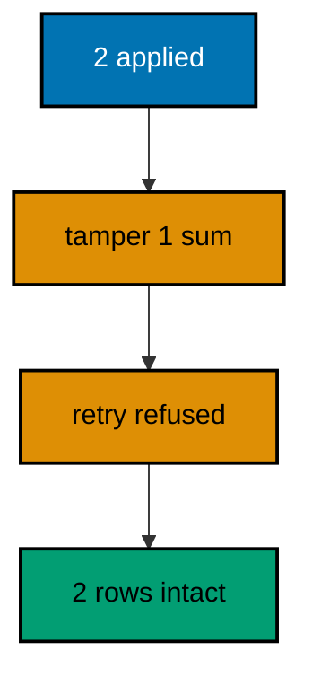

**`learning/code/ex-11-checksums-catch-edited-history/Main.java`**:

```java
// Example 11: Checksums Catch Edited History.
// Each history row stores a checksum of the changeset that produced it.
// Editing an already-applied changeset changes its checksum, and the next
// update refuses to run: history is append-only by default. This program
// applies two changesets, tampers one stored checksum through JDBC to stand
// in for an edit, then proves the next update fails checksum validation
// while the history stays intact.
import java.sql.Connection; // => the handle every move and check shares
import java.sql.DriverManager; // => finds the PostgreSQL driver from the locked jars
import java.sql.ResultSet; // => walks the rows each verification query returns
import java.sql.Statement; // => carries the verification queries to the database
import java.util.Properties; // => carries the login without string-concatenated secrets
import liquibase.Liquibase; // => the entry point: configure, then update
import liquibase.Scope; // => silences progress narration for deterministic goldens
import liquibase.database.Database; // => Liquibase's view of our PostgreSQL connection
import liquibase.database.DatabaseFactory; // => picks the PostgreSQL implementation from the URL
import liquibase.database.jvm.JdbcConnection; // => adapts our JDBC handle to Liquibase
import liquibase.exception.LiquibaseException; // => the stable type every expected failure wears
import liquibase.resource.DirectoryResourceAccessor; // => the current file-based changelog accessor
import liquibase.ui.LoggerUIService; // => reroutes progress lines into the silenced log

public class Main {

  // => one public class per file, named after the file
  static Connection connect() throws Exception {
    // => the harness starts PostgreSQL 18 and publishes these variables
    String host = System.getenv().getOrDefault("PGHOST", "localhost");
    // => default keeps local experimentation working outside the harness
    String url = "jdbc:postgresql://" + host + ":5432/postgres";
    // => trust auth accepts any password, so only the user matters
    Properties props = new Properties();
    // => Properties carries the login without string-concatenated secrets
    props.setProperty("user", System.getenv().getOrDefault("PGUSER", "postgres"));
    // => DriverManager finds the PostgreSQL driver from the locked jars
    return DriverManager.getConnection(url, props);
  } // => connect is the only place that knows connection details

  // => Liquibase narrates progress to its console UI by default; those lines
  // => differ between a first run and a rerun, so goldens cannot hold them
  static void runQuiet(Liquibase liquibase) throws Exception {
    // => the LOGGER service reroutes progress lines into the silenced JUL log
    Scope.child(
      java.util.Collections.singletonMap(Scope.Attr.ui.name(), new LoggerUIService()),
      // => the lambda runs inside the scope; main still throws Exception
      () -> liquibase.update("")
    );
    // => update("") runs every changeset with no context filter
  } // => quiet updates keep golden output identical on the harness double run

  // => a fresh demo slate keeps this program deterministic on double runs
  static void resetDemo(Connection conn) throws Exception {
    conn.setAutoCommit(false);
    // => manual commit makes every reset statement explicit and replayable
    // => the tampered checksum below persists, so every run starts clean
    try (Statement st = conn.createStatement()) {
      // => one statement serves the whole reset
      st.execute("DROP TABLE IF EXISTS gadgets");
      // => dropping last-created first unwinds the pair in reverse
      st.execute("DROP TABLE IF EXISTS widgets");
      // => dropping first removes the evidence of the previous run
      clearHistory(conn);
      // => deleting only our own rows leaves every other course untouched
      conn.commit();
      // => committing the reset makes the fresh update that follows honest
    } // => the next update always meets an empty history for our changesets
  } // => reset-then-run prints identical lines on the harness double run

  // => the history table may not exist before the first update, so forgetting
  // => our rows is guarded by an existence check on every run
  static void clearHistory(Connection conn) throws Exception {
    // => information_schema tells whether any history exists to forget
    try (
      Statement check = conn.createStatement();
      // => a separate statement keeps the check isolated from the delete
      ResultSet rs = check.executeQuery(
        "SELECT count(*) FROM information_schema.tables " + "WHERE table_name = 'databasechangelog'"
      )
    ) {
      // => the query returns exactly one row with exactly one number
      rs.next();
      // => forgetting runs only where a history table already exists
      if (rs.getInt(1) > 0) {
        // => deleting only our own rows leaves every other course untouched
        try (Statement forget = conn.createStatement()) {
          // => the delete runs only after the check proved the table exists
          forget.execute("DELETE FROM databasechangelog WHERE author = 'course'");
        } // => a missing table means a fresh database: nothing to forget
      } // => the guard keeps the first run as clean as the fiftieth
    } // => guarded forgetting keeps resets replayable on double runs
  } // => helpers that verify stay separate from code that migrates

  public static void main(String[] args) throws Exception {
    // => silence JUL so the LOGGER service lines below disappear too
    java.util.logging.LogManager.getLogManager().reset();
    // => the entry point the harness runs
    try (Connection conn = connect()) {
      // => one connection serves the migration, the tamper, and the retry
      resetDemo(conn);
      // => a clean slate means the tamper below behaves identically always
      Database database = DatabaseFactory.getInstance()
        // => the factory picks the PostgreSQL implementation from the URL
        .findCorrectDatabaseImplementation(new JdbcConnection(conn));
      // => JdbcConnection adapts our JDBC handle to Liquibase's database API
      Liquibase liquibase = new Liquibase(
        // => two changesets: widgets first, then gadgets
        "changelog.sql",
        // => DirectoryResourceAccessor is the current file-based accessor
        new DirectoryResourceAccessor(new java.io.File(".").getAbsoluteFile()),
        // => rooting at the unit directory keeps changelogs beside the program
        database
      );
      runQuiet(liquibase);
      // => both changesets apply against the clean slate
      conn.commit();
      // => committing pins the history rows the tamper below will edit
      try (Statement st = conn.createStatement()) {
        // => one statement tampers, then counts, then reports
        st.executeUpdate("UPDATE databasechangelog SET md5sum = '9:tampered' WHERE id = '001-make-widgets'");
        // => rewriting the stored checksum stands in for editing history
        // => a real edit changes the computed checksum; the effect matches
        conn.commit();
        // => the tampered row persists, so the retry below must confront it
        String failure = "none";
        // => the failure name records the outcome without printing internals
        try {
          // => the retry recomputes checksums and meets the tampered row
          runQuiet(
            new Liquibase(
              // => a second handle on the same changelog retries the run
              "changelog.sql",
              new DirectoryResourceAccessor(new java.io.File(".").getAbsoluteFile()),
              database
            )
          );
        } catch (LiquibaseException expected) {
          // => the exception type is stable; its message text is not asserted
          failure = expected.getClass().getSimpleName();
          // => catching proves validation refused the edited history
          conn.rollback();
          // => rolling back leaves the history exactly as the tamper left it
        } // => no stack trace: the refusal is the expected behaviour
        System.out.println("checksum failure: " + failure);
        // => Output: checksum failure: CommandExecutionException
        try (ResultSet rs = st.executeQuery("SELECT count(*) FROM databasechangelog")) {
          // => the failed retry must not add, remove, or repair any row
          rs.next();
          System.out.println("history rows intact: " + rs.getInt(1));
          // => Output: history rows intact: 2
        } // => intact history plus a loud failure is the whole guarantee
      } // => closing the statement releases the database resources
    } // => closing the connection ends the program with history intact
  } // => main migrates, tampers, retries, and reports the refusal
}
```

**`learning/code/ex-11-checksums-catch-edited-history/changelog.sql`**:

```sql
-- liquibase formatted sql
-- => REQUIRED first line: marks this file as a Liquibase SQL changelog
-- => Without it Liquibase runs the SQL untracked, and nothing is recorded.
-- changeset course:001-make-widgets
-- => the first changeset creates the widgets table
-- => its stored checksum is the one the program tampers with below
CREATE TABLE widgets (
  id SERIAL PRIMARY KEY,
  -- => SERIAL gives an auto-incrementing integer key, enough for this course
  sku VARCHAR(30) NOT NULL
  -- => widget skus are required from the first migration
);

-- rollback DROP TABLE widgets;
-- => dropping the table reverses exactly what this changeset built

-- changeset course:002-make-gadgets
-- => the second changeset creates the gadgets table
-- => its checksum stays honest, proving validation names the edited one
CREATE TABLE gadgets (
  id SERIAL PRIMARY KEY,
  -- => gadgets get their own independent sequence of ids
  sku VARCHAR(30) NOT NULL
  -- => gadget skus are required from the first migration
);

-- rollback DROP TABLE gadgets;
-- => each changeset carries its own reverse, independent of its neighbours
```

**Output** (`learning/code/ex-11-checksums-catch-edited-history/expected/main.stdout.txt`):

```text
checksum failure: CommandExecutionException
history rows intact: 2
```

**Key takeaway**: Stored checksums make applied history tamper-evident; the next update refuses edited changesets while leaving history intact.

**Why it matters**: Without checksum protection, a quiet edit to an old migration diverges every database that already ran the original, and the divergence surfaces weeks later as an inexplicable schema difference between environments. The refusal converts a silent corruption into a loud, immediate error naming the exact changeset, at the exact moment someone tries to deploy it. That is the difference between catching a mistake in a pull request and discovering it during an incident: the checksum check runs on every update, costs nothing, and never sleeps through a review.

---

### Example 12: Numeric Prefixes Order Changelogs

A master changelog that includes a directory runs the discovered files alphabetically, so the file names are the execution order: numeric prefixes turn naming into sequencing the whole team can read at a glance. New migrations arrive as new prefixed files while the master never changes. The program runs a master over three prefixed files, then prints the history ids in execution order to prove the prefixes decided the sequence. (Concepts: co-04.)

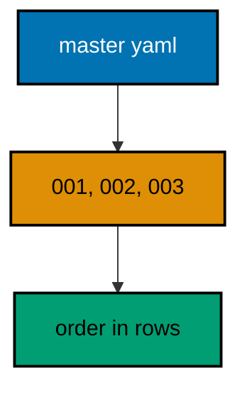

**`learning/code/ex-12-numeric-prefixes-order-changelogs/Main.java`**:

```java
// Example 12: Numeric Prefixes Order Changelogs.
// A master changelog that includes a directory runs the discovered files
// alphabetically, so numeric prefixes turn file names into an execution
// order the whole team can read. This program runs a master over three
// prefixed files, then prints the history ids in execution order to prove
// the prefixes decided the sequence.
import java.sql.Connection; // => the handle every move and check shares
import java.sql.DriverManager; // => finds the PostgreSQL driver from the locked jars
import java.sql.ResultSet; // => walks the rows each verification query returns
import java.sql.Statement; // => carries the verification queries to the database
import java.util.Properties; // => carries the login without string-concatenated secrets
import liquibase.Liquibase; // => the entry point: configure, then update
import liquibase.Scope; // => silences progress narration for deterministic goldens
import liquibase.database.Database; // => Liquibase's view of our PostgreSQL connection
import liquibase.database.DatabaseFactory; // => picks the PostgreSQL implementation from the URL
import liquibase.database.jvm.JdbcConnection; // => adapts our JDBC handle to Liquibase
import liquibase.resource.DirectoryResourceAccessor; // => the current file-based changelog accessor
import liquibase.ui.LoggerUIService; // => reroutes progress lines into the silenced log

public class Main {

  // => one public class per file, named after the file
  static Connection connect() throws Exception {
    // => the harness starts PostgreSQL 18 and publishes these variables
    String host = System.getenv().getOrDefault("PGHOST", "localhost");
    // => default keeps local experimentation working outside the harness
    String url = "jdbc:postgresql://" + host + ":5432/postgres";
    // => trust auth accepts any password, so only the user matters
    Properties props = new Properties();
    // => Properties carries the login without string-concatenated secrets
    props.setProperty("user", System.getenv().getOrDefault("PGUSER", "postgres"));
    // => DriverManager finds the PostgreSQL driver from the locked jars
    return DriverManager.getConnection(url, props);
  } // => connect is the only place that knows connection details

  // => Liquibase narrates progress to its console UI by default; those lines
  // => differ between a first run and a rerun, so goldens cannot hold them
  static void runQuiet(Liquibase liquibase) throws Exception {
    // => the LOGGER service reroutes progress lines into the silenced JUL log
    Scope.child(
      java.util.Collections.singletonMap(Scope.Attr.ui.name(), new LoggerUIService()),
      // => the lambda runs inside the scope; main still throws Exception
      () -> liquibase.update("")
    );
    // => update("") runs every included changeset with no context filter
  } // => quiet updates keep golden output identical on the harness double run

  public static void main(String[] args) throws Exception {
    // => silence JUL so the LOGGER service lines below disappear too
    java.util.logging.LogManager.getLogManager().reset();
    // => the entry point the harness runs
    try (Connection conn = connect()) {
      // => one connection serves the master run and the order read
      Database database = DatabaseFactory.getInstance()
        // => the factory picks the PostgreSQL implementation from the URL
        .findCorrectDatabaseImplementation(new JdbcConnection(conn));
      // => JdbcConnection adapts our JDBC handle to Liquibase's database API
      Liquibase liquibase = new Liquibase(
        // => the master delegates to the prefixed files in changes/
        "db.changelog-master.yaml",
        // => DirectoryResourceAccessor is the current file-based accessor
        new DirectoryResourceAccessor(new java.io.File(".").getAbsoluteFile()),
        // => rooting at the unit directory keeps changelogs beside the program
        database
      );
      runQuiet(liquibase);
      // => includeAll discovers the three files alphabetically by prefix
      try (
        Statement st = conn.createStatement();
        // => orderexecuted is the ground truth of the order that ran
        ResultSet rs = st.executeQuery("SELECT id FROM databasechangelog ORDER BY orderexecuted")
      ) {
        // => three rows prove three prefixed files ran exactly once each
        // => a rerun adds zero rows, so these lines are stable on double runs
        StringBuilder order = new StringBuilder();
        // => the builder collects the ids in the order they executed
        while (rs.next()) {
          // => each id is one prefixed file, in the sequence it ran
          if (order.length() > 0) {
            // => commas separate the steps without extra whitespace
            order.append(",");
          } // => the first id needs no separator before it
          order.append(rs.getString(1));
          // => appending preserves the database-reported execution order
        } // => the joined ids read as the migration sequence itself
        System.out.println("execution order: " + order);
        // => Output: execution order: 001-make-regions,002-make-zones,003-make-sites
      } // => reading history back is a habit every later example repeats
    } // => closing the connection ends the program with history intact
  } // => main runs the master, then proves the prefixes ordered it
}
```

**`learning/code/ex-12-numeric-prefixes-order-changelogs/db.changelog-master.yaml`**:

```yaml
databaseChangeLog: # => Root key required for every YAML changelog
  - includeAll: # => Discovers every changelog file in one directory
      path: changes/
      # => path is relative to this master file, not to the classpath
      # => Liquibase sorts the discovered files alphabetically before running
      # => Numeric prefixes (001-, 002-, 003-) make alphabetical order match intent
      # => A new migration is a new file here; this master never changes
```

**`learning/code/ex-12-numeric-prefixes-order-changelogs/changes/001-make-regions.sql`**:

```sql
-- liquibase formatted sql
-- => REQUIRED first line: marks this file as a Liquibase SQL changelog
-- => The 001 prefix makes this file sort first under includeAll.
-- changeset course:001-make-regions
-- => the first file in prefix order creates the regions table
CREATE TABLE regions (
  id SERIAL PRIMARY KEY,
  -- => SERIAL gives an auto-incrementing integer key, enough for this course
  name VARCHAR(60) NOT NULL
  -- => region names are required from the first migration
);

-- rollback DROP TABLE regions;
-- => dropping the table reverses exactly what this changeset built
```

**`learning/code/ex-12-numeric-prefixes-order-changelogs/changes/002-make-zones.sql`**:

```sql
-- liquibase formatted sql
-- => REQUIRED first line: marks this file as a Liquibase SQL changelog
-- => The 002 prefix makes this file sort second under includeAll.
-- changeset course:002-make-zones
-- => the second file in prefix order creates the zones table
CREATE TABLE zones (
  id SERIAL PRIMARY KEY,
  -- => SERIAL gives an auto-incrementing integer key, enough for this course
  name VARCHAR(60) NOT NULL
  -- => zone names are required from the first migration
);

-- rollback DROP TABLE zones;
-- => dropping the table reverses exactly what this changeset built
```

**`learning/code/ex-12-numeric-prefixes-order-changelogs/changes/003-make-sites.sql`**:

```sql
-- liquibase formatted sql
-- => REQUIRED first line: marks this file as a Liquibase SQL changelog
-- => The 003 prefix makes this file sort third under includeAll.
-- changeset course:003-make-sites
-- => the third file in prefix order creates the sites table
CREATE TABLE sites (
  id SERIAL PRIMARY KEY,
  -- => SERIAL gives an auto-incrementing integer key, enough for this course
  name VARCHAR(60) NOT NULL
  -- => site names are required from the first migration
);

-- rollback DROP TABLE sites;
-- => dropping the table reverses exactly what this changeset built
```

**Output** (`learning/code/ex-12-numeric-prefixes-order-changelogs/expected/main.stdout.txt`):

```text
execution order: 001-make-regions,002-make-zones,003-make-sites
```

**Key takeaway**: includeAll runs files alphabetically, so numeric prefixes make file names the reviewable execution order.

**Why it matters**: Execution order agreed by convention beats order agreed by meeting: when the next file sorts after the previous one by construction, no developer has to ask where their migration runs or negotiate a slot in a shared list. The master file stops being a merge conflict hotspot because nobody edits it to add a migration. And the history order becomes predictable from the repository listing alone, which means a reviewer can verify sequencing without running anything. Conventions that survive without enforcement are the ones worth keeping.

---

### Example 13: Contexts Gate Environment Changes

One changelog serves every environment when each changeset names the contexts it belongs to: demo seeds run under dev, production seeds under prod, and shared structure under no context at all, which means always. The update selects its contexts and Liquibase runs the matching subset, leaving the rest pending without complaint. The program updates with the dev context, then proves the shared and dev tables exist while the prod-only table was skipped. (Concepts: co-13, co-04.)

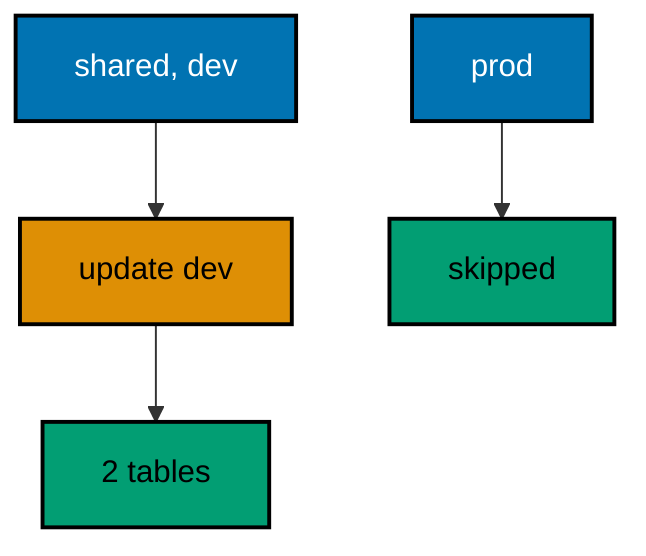

**`learning/code/ex-13-contexts-gate-environment-changes/Main.java`**:

```java
// Example 13: Contexts Gate Environment Changes.
// One changelog serves every environment when each changeset names the
// contexts it belongs to: dev-only seeds never reach production because
// the production update simply does not select them. This program updates
// with the dev context, then proves the shared and dev tables exist while
// the prod-only table was skipped.
import java.sql.Connection; // => the handle every move and check shares
import java.sql.DriverManager; // => finds the PostgreSQL driver from the locked jars
import java.sql.ResultSet; // => walks the rows each verification query returns
import java.sql.Statement; // => carries the verification queries to the database
import java.util.Properties; // => carries the login without string-concatenated secrets
import liquibase.Contexts; // => selects the environment-gated changes to run
import liquibase.Liquibase; // => the entry point: configure, then update
import liquibase.Scope; // => silences progress narration for deterministic goldens
import liquibase.database.Database; // => Liquibase's view of our PostgreSQL connection
import liquibase.database.DatabaseFactory; // => picks the PostgreSQL implementation from the URL
import liquibase.database.jvm.JdbcConnection; // => adapts our JDBC handle to Liquibase
import liquibase.resource.DirectoryResourceAccessor; // => the current file-based changelog accessor
import liquibase.ui.LoggerUIService; // => reroutes progress lines into the silenced log

public class Main {

  // => one public class per file, named after the file
  static Connection connect() throws Exception {
    // => the harness starts PostgreSQL 18 and publishes these variables
    String host = System.getenv().getOrDefault("PGHOST", "localhost");
    // => default keeps local experimentation working outside the harness
    String url = "jdbc:postgresql://" + host + ":5432/postgres";
    // => trust auth accepts any password, so only the user matters
    Properties props = new Properties();
    // => Properties carries the login without string-concatenated secrets
    props.setProperty("user", System.getenv().getOrDefault("PGUSER", "postgres"));
    // => DriverManager finds the PostgreSQL driver from the locked jars
    return DriverManager.getConnection(url, props);
  } // => connect is the only place that knows connection details

  // => contexts select which changesets an update runs, so the quiet runner
  // => takes the active contexts beside the Liquibase handle
  static void runQuietCtx(Liquibase liquibase, Contexts contexts) throws Exception {
    // => the LOGGER service reroutes progress lines into the silenced JUL log
    Scope.child(
      java.util.Collections.singletonMap(Scope.Attr.ui.name(), new LoggerUIService()),
      // => the lambda runs inside the scope; main still throws Exception
      () -> liquibase.update(contexts)
    );
    // => update(contexts) runs only changesets matching one active context
  } // => quiet updates keep golden output identical on the harness double run

  // => every example counts tables through information_schema, never pg internals
  static int tablePresent(Connection conn, String table) throws Exception {
    // => information_schema is the portable way to ask what exists
    try (
      Statement st = conn.createStatement();
      // => try-with-resources closes the statement on every path
      ResultSet rs = st.executeQuery(
        // => a fixed literal is safe here: the table name is our constant
        "SELECT count(*) FROM information_schema.tables WHERE table_name = '" + table + "'"
      )
    ) {
      // => the query returns exactly one row with exactly one number
      rs.next();
      // => 1 means the migration created the table, 0 means it did not
      return rs.getInt(1);
    } // => the count answers the only question this check asks
  } // => helpers that verify stay separate from code that migrates

  public static void main(String[] args) throws Exception {
    // => silence JUL so the LOGGER service lines below disappear too
    java.util.logging.LogManager.getLogManager().reset();
    // => the entry point the harness runs
    try (Connection conn = connect()) {
      // => one connection serves the context run and the three checks
      Database database = DatabaseFactory.getInstance()
        // => the factory picks the PostgreSQL implementation from the URL
        .findCorrectDatabaseImplementation(new JdbcConnection(conn));
      // => JdbcConnection adapts our JDBC handle to Liquibase's database API
      Liquibase liquibase = new Liquibase(
        // => three changesets: shared first, then one per environment
        "changelog.yaml",
        // => DirectoryResourceAccessor is the current file-based accessor
        new DirectoryResourceAccessor(new java.io.File(".").getAbsoluteFile()),
        // => rooting at the unit directory keeps changelogs beside the program
        database
      );
      runQuietCtx(liquibase, new Contexts("dev"));
      // => the dev context selects the shared plus the dev-only changeset
      System.out.println("shared table present: " + tablePresent(conn, "tenants"));
      // => Output: shared table present: 1
      System.out.println("dev seed present: " + tablePresent(conn, "dev_seeds"));
      // => Output: dev seed present: 1
      System.out.println("prod seed present: " + tablePresent(conn, "prod_seeds"));
      // => Output: prod seed present: 0
      // => a rerun selects the same two changesets and skips both as applied
    } // => closing the connection ends the program with history intact
  } // => main updates under one context, then proves the gate held
}
```

**`learning/code/ex-13-contexts-gate-environment-changes/changelog.yaml`**:

```yaml
databaseChangeLog: # => Root key required for every YAML changelog
  - changeSet: # => The shared changeset carries no context, so it always runs
      id: 001-make-tenants
      # => every environment needs the tenants table underneath its seeds
      author: course
      # => one author keeps the identity triples in this file uniform
      changes:
        - createTable: # => Declarative table creation, the YAML counterpart of DDL
            tableName: tenants
            # => the shared table both environment seeds build on
            columns:
              - column: # => One entry per column, name and type together
                  name: id
                  type: SERIAL
                  constraints:
                    primaryKey: true
              - column:
                  name: name
                  type: VARCHAR(80)
  - changeSet: # => The dev-only changeset runs solely under the dev context
      id: 002-seed-dev
      # => demo seeds must never leak into a production database
      author: course
      context: dev
      # => context dev selects this changeset only when dev is active
      changes:
        - createTable:
            tableName: dev_seeds
            # => the dev seed table exists only where dev context ran
            columns:
              - column:
                  name: id
                  type: SERIAL
                  constraints:
                    primaryKey: true
  - changeSet: # => The prod-only changeset runs solely under prod context
      id: 003-seed-prod
      # => placeholders stay pending until a prod-context update selects them
      author: course
      context: prod
      # => context prod leaves this changeset pending under the dev run
      changes:
        - createTable:
            tableName: prod_seeds
            # => absence of this table below proves the gate held
            columns:
              - column:
                  name: id
                  type: SERIAL
                  constraints:
                    primaryKey: true
```

**Output** (`learning/code/ex-13-contexts-gate-environment-changes/expected/main.stdout.txt`):

```text
shared table present: 1
dev seed present: 1
prod seed present: 0
```

**Key takeaway**: Contexts select environment subsets from one changelog, so dev-only changes never reach production and shared structure always runs.

**Why it matters**: Separate changelogs per environment drift apart within weeks: a fix lands in dev, nobody copies it to prod, and the environments stop being comparable. One changelog with contexts keeps every environment's story in one file where reviewers see dev and prod side by side. Skipped changesets stay pending rather than failing, so the same file promotes cleanly from dev to prod with only the context flag changing. The gate is declarative — written once beside the change — instead of procedural, which means it cannot be forgotten on a Friday deploy.

---

### Example 14: Labels Select Change Subsets

Contexts name environments, while labels name change batches: a release train carries label v1, the next carries v2, and one update ships exactly the labeled subset while the rest stays pending for its own train. Labels compose with contexts instead of replacing them, giving two independent selection axes over the same changelog. The program updates with the v1 label expression, then proves only the v1 table exists while the v2 table waits with one history row recorded. (Concepts: co-13.)

**`learning/code/ex-14-labels-select-change-subsets/Main.java`**:

```java
// Example 14: Labels Select Change Subsets.
// Contexts name environments; labels name change batches instead, so one
// update can carry a release train subset while the rest stays pending.
// This program updates with the v1 label expression, then proves only the
// v1 changeset ran while the v2 changeset waits for its own release.
import java.sql.Connection; // => the handle every move and check shares
import java.sql.DriverManager; // => finds the PostgreSQL driver from the locked jars
import java.sql.ResultSet; // => walks the rows each verification query returns
import java.sql.Statement; // => carries the verification queries to the database
import java.util.Properties; // => carries the login without string-concatenated secrets
import liquibase.Contexts; // => selects the environment-gated changes to run
import liquibase.LabelExpression; // => selects the labeled subset to run
import liquibase.Liquibase; // => the entry point: configure, then update
import liquibase.Scope; // => silences progress narration for deterministic goldens
import liquibase.database.Database; // => Liquibase's view of our PostgreSQL connection
import liquibase.database.DatabaseFactory; // => picks the PostgreSQL implementation from the URL
import liquibase.database.jvm.JdbcConnection; // => adapts our JDBC handle to Liquibase
import liquibase.resource.DirectoryResourceAccessor; // => the current file-based changelog accessor
import liquibase.ui.LoggerUIService; // => reroutes progress lines into the silenced log

public class Main {

  // => one public class per file, named after the file
  static Connection connect() throws Exception {
    // => the harness starts PostgreSQL 18 and publishes these variables
    String host = System.getenv().getOrDefault("PGHOST", "localhost");
    // => default keeps local experimentation working outside the harness
    String url = "jdbc:postgresql://" + host + ":5432/postgres";
    // => trust auth accepts any password, so only the user matters
    Properties props = new Properties();
    // => Properties carries the login without string-concatenated secrets
    props.setProperty("user", System.getenv().getOrDefault("PGUSER", "postgres"));
    // => DriverManager finds the PostgreSQL driver from the locked jars
    return DriverManager.getConnection(url, props);
  } // => connect is the only place that knows connection details

  // => labels select a release subset, so the quiet runner takes the label
  // => expression beside the Liquibase handle
  static void runQuietLabels(Liquibase liquibase, LabelExpression labels) throws Exception {
    // => the LOGGER service reroutes progress lines into the silenced JUL log
    Scope.child(
      java.util.Collections.singletonMap(Scope.Attr.ui.name(), new LoggerUIService()),
      // => the lambda runs inside the scope; main still throws Exception
      () -> liquibase.update(new Contexts(), labels)
    );
    // => update with empty contexts plus labels selects by label alone
  } // => quiet updates keep golden output identical on the harness double run

  // => the history table is Liquibase's own record of what already ran
  static int appliedCount(Connection conn) throws Exception {
    // => DATABASECHANGELOG gains one row per executed changeset
    try (
      Statement st = conn.createStatement();
      ResultSet rs = st.executeQuery("SELECT count(*) FROM databasechangelog")
    ) {
      // => the query returns exactly one row with exactly one number
      rs.next();
      // => one row here proves the label selected exactly one changeset
      return rs.getInt(1);
    } // => counting beats assuming the migration ran
  } // => reading history back is a habit every later example repeats

  // => every example counts tables through information_schema, never pg internals
  static int tablePresent(Connection conn, String table) throws Exception {
    // => information_schema is the portable way to ask what exists
    try (
      Statement st = conn.createStatement();
      // => try-with-resources closes the statement on every path
      ResultSet rs = st.executeQuery(
        // => a fixed literal is safe here: the table name is our constant
        "SELECT count(*) FROM information_schema.tables WHERE table_name = '" + table + "'"
      )
    ) {
      // => the query returns exactly one row with exactly one number
      rs.next();
      // => 1 means the migration created the table, 0 means it did not
      return rs.getInt(1);
    } // => the count answers the only question this check asks
  } // => helpers that verify stay separate from code that migrates

  public static void main(String[] args) throws Exception {
    // => silence JUL so the LOGGER service lines below disappear too
    java.util.logging.LogManager.getLogManager().reset();
    // => the entry point the harness runs
    try (Connection conn = connect()) {
      // => one connection serves the label run and the three checks
      Database database = DatabaseFactory.getInstance()
        // => the factory picks the PostgreSQL implementation from the URL
        .findCorrectDatabaseImplementation(new JdbcConnection(conn));
      // => JdbcConnection adapts our JDBC handle to Liquibase's database API
      Liquibase liquibase = new Liquibase(
        // => two changesets, one per release label
        "changelog.yaml",
        // => DirectoryResourceAccessor is the current file-based accessor
        new DirectoryResourceAccessor(new java.io.File(".").getAbsoluteFile()),
        // => rooting at the unit directory keeps changelogs beside the program
        database
      );
      runQuietLabels(liquibase, new LabelExpression("v1"));
      // => the v1 expression selects the v1 changeset and skips v2
      System.out.println("v1 table present: " + tablePresent(conn, "carts"));
      // => Output: v1 table present: 1
      System.out.println("v2 table present: " + tablePresent(conn, "coupons"));
      // => Output: v2 table present: 0
      System.out.println("changesets applied: " + appliedCount(conn));
      // => Output: changesets applied: 1
      // => a rerun selects the same single changeset and skips it as applied
    } // => closing the connection ends the program with history intact
  } // => main updates under one label, then proves the subset ran
}
```

**`learning/code/ex-14-labels-select-change-subsets/changelog.yaml`**:

```yaml
databaseChangeLog: # => Root key required for every YAML changelog
  - changeSet: # => The v1 changeset ships with the first release train
      id: 001-make-carts
      # => carts belong to the release the program selects below
      author: course
      # => one author keeps the identity triples in this file uniform
      labels: v1
      # => label v1 marks this changeset for the first release only
      changes:
        - createTable: # => Declarative table creation, the YAML counterpart of DDL
            tableName: carts
            # => the v1 table the verification below must find
            columns:
              - column: # => One entry per column, name and type together
                  name: id
                  type: SERIAL
                  constraints:
                    primaryKey: true
  - changeSet: # => The v2 changeset waits for its own release train
      id: 002-make-coupons
      # => coupons ship later, so this changeset stays pending for now
      author: course
      labels: v2
      # => label v2 excludes this changeset from the v1 expression run
      changes:
        - createTable:
            tableName: coupons
            # => absence of this table below proves the label held
            columns:
              - column:
                  name: id
                  type: SERIAL
                  constraints:
                    primaryKey: true
```

**Output** (`learning/code/ex-14-labels-select-change-subsets/expected/main.stdout.txt`):

```text
v1 table present: 1
v2 table present: 0
changesets applied: 1
```

**Key takeaway**: Label expressions ship release subsets from one changelog while unlabeled-by-the-run changesets stay pending for later trains.

**Why it matters**: Release trains slip: when v2 is not ready, v1 must still ship, and cherry-picking changesets by hand is how ordering bugs are born. Labels let the release manager select a coherent, pre-reviewed subset with one expression instead of assembling file lists under pressure. Unselected changesets wait in place with their order preserved, so the delayed train merges later without rebasing history. Selection becomes a runtime decision recorded in the deploy log rather than a file edit argued about in chat.

---

### Example 15: Preconditions Guard the Starting State

A changeset that assumes a table, an extension, or a row count should say so up front: preconditions check the assumption and fail loudly instead of letting half a migration run against the wrong database. Guards turn implicit expectations into reviewed, versioned declarations that refuse the whole update when the world does not match. The program runs a changelog whose first two changesets build and extend a ledger, then whose third demands a table nobody built: the update refuses, the ledger stands, and exactly two history rows prove the guard stopped everything after itself. (Concepts: co-16, co-05.)

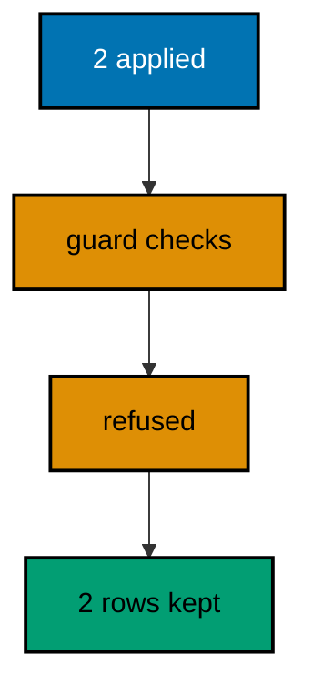

**`learning/code/ex-15-preconditions-guard-the-starting-state/Main.java`**:

```java
// Example 15: Preconditions Guard the Starting State.
// A changeset that assumes a table, extension, or row count should say so
// up front: preconditions check the assumption and fail loudly instead of
// letting half a migration run against the wrong database. This program
// runs a changelog whose last changeset demands a table that does not
// exist, then proves the update refused while the earlier work stayed put.
import java.sql.Connection; // => the handle every move and check shares
import java.sql.DriverManager; // => finds the PostgreSQL driver from the locked jars
import java.sql.ResultSet; // => walks the rows each verification query returns
import java.sql.Statement; // => carries the verification queries to the database
import java.util.Properties; // => carries the login without string-concatenated secrets
import liquibase.Liquibase; // => the entry point: configure, then update
import liquibase.Scope; // => silences progress narration for deterministic goldens
import liquibase.database.Database; // => Liquibase's view of our PostgreSQL connection
import liquibase.database.DatabaseFactory; // => picks the PostgreSQL implementation from the URL
import liquibase.database.jvm.JdbcConnection; // => adapts our JDBC handle to Liquibase
import liquibase.exception.LiquibaseException; // => the stable type every expected failure wears
import liquibase.resource.DirectoryResourceAccessor; // => the current file-based changelog accessor
import liquibase.ui.LoggerUIService; // => reroutes progress lines into the silenced log

public class Main {

  // => one public class per file, named after the file
  static Connection connect() throws Exception {
    // => the harness starts PostgreSQL 18 and publishes these variables
    String host = System.getenv().getOrDefault("PGHOST", "localhost");
    // => default keeps local experimentation working outside the harness
    String url = "jdbc:postgresql://" + host + ":5432/postgres";
    // => trust auth accepts any password, so only the user matters
    Properties props = new Properties();
    // => Properties carries the login without string-concatenated secrets
    props.setProperty("user", System.getenv().getOrDefault("PGUSER", "postgres"));
    // => DriverManager finds the PostgreSQL driver from the locked jars
    return DriverManager.getConnection(url, props);
  } // => connect is the only place that knows connection details

  // => Liquibase narrates progress to its console UI by default; those lines
  // => differ between a first run and a rerun, so goldens cannot hold them
  static void runQuiet(Liquibase liquibase) throws Exception {
    // => the LOGGER service reroutes progress lines into the silenced JUL log
    Scope.child(
      java.util.Collections.singletonMap(Scope.Attr.ui.name(), new LoggerUIService()),
      // => the lambda runs inside the scope; main still throws Exception
      () -> liquibase.update("")
    );
    // => update("") runs every changeset with no context filter
  } // => quiet updates keep golden output identical on the harness double run

  public static void main(String[] args) throws Exception {
    // => silence JUL so the LOGGER service lines below disappear too
    java.util.logging.LogManager.getLogManager().reset();
    // => the entry point the harness runs
    try (Connection conn = connect()) {
      // => one connection serves the guarded run and the three checks
      Database database = DatabaseFactory.getInstance()
        // => the factory picks the PostgreSQL implementation from the URL
        .findCorrectDatabaseImplementation(new JdbcConnection(conn));
      // => JdbcConnection adapts our JDBC handle to Liquibase's database API
      Liquibase liquibase = new Liquibase(
        // => three changesets: build, guarded build, impossible guard
        "changelog.yaml",
        // => DirectoryResourceAccessor is the current file-based accessor
        new DirectoryResourceAccessor(new java.io.File(".").getAbsoluteFile()),
        // => rooting at the unit directory keeps changelogs beside the program
        database
      );
      String failure = "none";
      // => the failure name records the outcome without printing internals
      try {
        // => the run applies the first two changesets, then meets the guard
        runQuiet(liquibase);
      } catch (LiquibaseException expected) {
        // => the exception type is stable; its message text is not asserted
        failure = expected.getClass().getSimpleName();
        // => catching proves the guard refused instead of half-applying
        conn.rollback();
        // => rolling back leaves the two applied changesets exactly as run
      } // => no stack trace: the refusal is the expected behaviour
      System.out.println("precondition failure: " + failure);
      // => Output: precondition failure: CommandExecutionException
      try (
        Statement st = conn.createStatement();
        ResultSet rs = st.executeQuery("SELECT count(*) FROM information_schema.tables WHERE table_name = 'ledger'")
      ) {
        // => the first changeset built the ledger before any guard ran
        rs.next();
        System.out.println("ledger table present: " + rs.getInt(1));
        // => Output: ledger table present: 1
      } // => earlier work stays put when a later guard refuses
      try (
        Statement st = conn.createStatement();
        ResultSet rs = st.executeQuery("SELECT count(*) FROM databasechangelog")
      ) {
        // => exactly the two runnable changesets were recorded, nothing more
        rs.next();
        System.out.println("changesets applied: " + rs.getInt(1));
        // => Output: changesets applied: 2
        // => a rerun replays the same story: two skips, then the same refusal
      } // => reading history back is a habit every later example repeats
    } // => closing the connection ends the program with history intact
  } // => main runs the guarded changelog, then proves the guard held
}
```

**`learning/code/ex-15-preconditions-guard-the-starting-state/changelog.yaml`**:

```yaml
databaseChangeLog: # => Root key required for every YAML changelog
  - changeSet: # => The base changeset builds the table later guards need
      id: 001-make-ledger
      # => every later assumption in this file starts from this table
      author: course
      # => one author keeps the identity triples in this file uniform
      changes:
        - createTable: # => Declarative table creation, the YAML counterpart of DDL
            tableName: ledger
            # => the ledger the passing guard below checks for
            columns:
              - column: # => One entry per column, name and type together
                  name: id
                  type: SERIAL
                  constraints:
                    primaryKey: true
  - changeSet: # => The guarded changeset runs only where the ledger exists
      id: 002-add-memo
      # => the passing guard proves assumptions can succeed, not just fail
      author: course
      preConditions: # => Preconditions state the starting state up front
        - onFail: HALT
          # => HALT refuses the whole update when the assumption is wrong
          onError: HALT
          # => errors in the check itself refuse just as loudly
          tableExists:
            # => the assumption: the ledger table must already exist
            tableName: ledger
            # => it does, because the first changeset built it just above
      changes:
        - addColumn: # => A guarded column addition on the proven table
            tableName: ledger
            columns:
              - column:
                  name: memo
                  type: VARCHAR(200)
  - changeSet: # => The impossible guard demands a table nobody built
      id: 003-needs-archive
      # => this changeset never runs: its assumption is wrong by design
      author: course
      preConditions:
        - onFail: HALT
          # => HALT turns the wrong assumption into a loud refusal
          onError: HALT
          tableExists:
            # => the assumption: an archive table must already exist
            tableName: archive
            # => it does not, so the update stops here instead of guessing
      changes:
        - createTable:
            tableName: archive_index
            # => this table is never created; the guard fires first
            columns:
              - column:
                  name: id
                  type: SERIAL
                  constraints:
                    primaryKey: true
```

**Output** (`learning/code/ex-15-preconditions-guard-the-starting-state/expected/main.stdout.txt`):

```text
precondition failure: CommandExecutionException
ledger table present: 1
changesets applied: 2
```

**Key takeaway**: Preconditions declare each changeset's assumptions and refuse the update loudly when the database does not match.

**Why it matters**: Migrations written against one schema version wreak havoc when run against another: columns get added twice, backfills divide by zero, grants apply to missing roles. Without guards, the failure lands mid-changelog as a cryptic database error after half the changes committed. Preconditions move the check before the damage, with a named assumption reviewers can read and argue about. A guard that fails in CI is a cheap conversation; a migration that half-applies in production is an incident with a sequel.

---

### Example 16: Parameters Parametrize One Changelog

One changelog serves every schema when its variable parts are parameters: the same file creates the table in whatever schema the runner names, so tenant deploys differ by a flag rather than by a fork. Parameters substitute before tracking, which means the history records the resolved run while the file stays generic. The program sets the schema parameter to public, runs the changelog, then proves the regs table landed where the parameter pointed with one history row recorded. (Concepts: co-13.)

**`learning/code/ex-16-parameters-parametrize-one-changelog/Main.java`**:

```java
// Example 16: Parameters Parametrize One Changelog.
// One changelog serves every schema when variable parts are parameters:
// the same file creates the table in any schema the runner names. This
// program sets the schema parameter to public, runs the changelog, then
// proves the regs table landed where the parameter pointed.
import java.sql.Connection; // => the handle every move and check shares
import java.sql.DriverManager; // => finds the PostgreSQL driver from the locked jars
import java.sql.ResultSet; // => walks the rows each verification query returns
import java.sql.Statement; // => carries the verification queries to the database
import java.util.Properties; // => carries the login without string-concatenated secrets
import liquibase.Liquibase; // => the entry point: configure, then update
import liquibase.Scope; // => silences progress narration for deterministic goldens
import liquibase.database.Database; // => Liquibase's view of our PostgreSQL connection
import liquibase.database.DatabaseFactory; // => picks the PostgreSQL implementation from the URL
import liquibase.database.jvm.JdbcConnection; // => adapts our JDBC handle to Liquibase
import liquibase.resource.DirectoryResourceAccessor; // => the current file-based changelog accessor
import liquibase.ui.LoggerUIService; // => reroutes progress lines into the silenced log

public class Main {

  // => one public class per file, named after the file
  static Connection connect() throws Exception {
    // => the harness starts PostgreSQL 18 and publishes these variables
    String host = System.getenv().getOrDefault("PGHOST", "localhost");
    // => default keeps local experimentation working outside the harness
    String url = "jdbc:postgresql://" + host + ":5432/postgres";
    // => trust auth accepts any password, so only the user matters
    Properties props = new Properties();
    // => Properties carries the login without string-concatenated secrets
    props.setProperty("user", System.getenv().getOrDefault("PGUSER", "postgres"));
    // => DriverManager finds the PostgreSQL driver from the locked jars
    return DriverManager.getConnection(url, props);
  } // => connect is the only place that knows connection details

  // => Liquibase narrates progress to its console UI by default; those lines
  // => differ between a first run and a rerun, so goldens cannot hold them
  static void runQuiet(Liquibase liquibase) throws Exception {
    // => the LOGGER service reroutes progress lines into the silenced JUL log
    Scope.child(
      java.util.Collections.singletonMap(Scope.Attr.ui.name(), new LoggerUIService()),
      // => the lambda runs inside the scope; main still throws Exception
      () -> liquibase.update("")
    );
    // => update("") runs every changeset with no context filter
  } // => quiet updates keep golden output identical on the harness double run

  public static void main(String[] args) throws Exception {
    // => silence JUL so the LOGGER service lines below disappear too
    java.util.logging.LogManager.getLogManager().reset();
    // => the entry point the harness runs
    try (Connection conn = connect()) {
      // => one connection serves the parametrized run and both checks
      Database database = DatabaseFactory.getInstance()
        // => the factory picks the PostgreSQL implementation from the URL
        .findCorrectDatabaseImplementation(new JdbcConnection(conn));
      // => JdbcConnection adapts our JDBC handle to Liquibase's database API
      Liquibase liquibase = new Liquibase(
        // => one changeset whose schema comes from a parameter
        "changelog.sql",
        // => DirectoryResourceAccessor is the current file-based accessor
        new DirectoryResourceAccessor(new java.io.File(".").getAbsoluteFile()),
        // => rooting at the unit directory keeps changelogs beside the program
        database
      );
      liquibase.setChangeLogParameter("schema", "public");
      // => the parameter fills every ${schema} placeholder before running
      // => a tenant deploy would set the same parameter to its own schema
      runQuiet(liquibase);
      // => the update ran quiet, so the transcript holds only our own prints
      try (
        Statement st = conn.createStatement();
        ResultSet rs = st.executeQuery("SELECT count(*) FROM information_schema.tables WHERE table_name = 'regs'")
      ) {
        // => the table name is fixed; only its schema came from a parameter
        rs.next();
        System.out.println("regs table present: " + rs.getInt(1));
        // => Output: regs table present: 1
      } // => information_schema answers without touching pg internals
      try (
        Statement st = conn.createStatement();
        ResultSet rs = st.executeQuery("SELECT count(*) FROM databasechangelog")
      ) {
        // => parameters substitute before tracking, so history holds one row
        rs.next();
        System.out.println("changesets applied: " + rs.getInt(1));
        // => Output: changesets applied: 1
        // => a rerun substitutes the same value and skips the applied row
      } // => reading history back is a habit every later example repeats
    } // => closing the connection ends the program with history intact
  } // => main sets the parameter, migrates, then proves where it landed
}
```

**`learning/code/ex-16-parameters-parametrize-one-changelog/changelog.sql`**:

```sql
-- liquibase formatted sql
-- => REQUIRED first line: marks this file as a Liquibase SQL changelog
-- => Without it Liquibase runs the SQL untracked, and nothing is recorded.
-- changeset course:001-make-regs
-- => the schema qualifier is a parameter, so this file serves any schema
-- => the program sets ${schema} to public before running
CREATE TABLE ${schema}.regs (
  id SERIAL PRIMARY KEY,
  -- => SERIAL gives an auto-incrementing integer key, enough for this course
  code VARCHAR(20) NOT NULL
  -- => registration codes are required from the first migration
);

-- rollback DROP TABLE ${schema}.regs;
-- => parameters substitute in rollback blocks exactly as in changes
```

**Output** (`learning/code/ex-16-parameters-parametrize-one-changelog/expected/main.stdout.txt`):

```text
regs table present: 1
changesets applied: 1
```

**Key takeaway**: Changelog parameters resolve one file against many targets, so tenant schemas deploy from the same reviewed text.

**Why it matters**: Copy-pasted changelogs per tenant rot at different speeds: a fix lands in nine copies and misses the tenth, and nobody can diff the fleet anymore. Parameters keep one canonical file where every target's differences are explicit values passed at runtime, visible in the deploy log. Reviewers read the logic once instead of diffing near-identical files for the one line that differs. And adding the eleventh tenant means passing one more value, not forking the file again and hoping the fork stays faithful.

---

### Example 17: Status Previews Pending Changes

Before touching the database, the status report lists the changesets an update would run: the deploy preview that CI shows and humans approve, generated from the same history comparison the update itself uses. Previewing turns merges from leaps of faith into reviewed statements of intent. The program resets its demo, asks for the status of two pending changesets, counts them from the report without printing its connection details, then updates and proves both applied. (Concepts: co-03.)

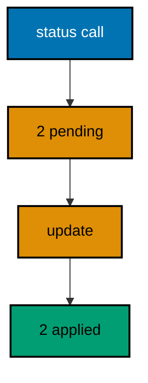

**`learning/code/ex-17-status-previews-pending-changes/Main.java`**:

```java
// Example 17: Status Previews Pending Changes.
// Before touching the database, the status report lists the changesets an
// update would run: the deploy preview that CI shows and humans approve.
// This program resets its demo, asks for the status of two pending
// changesets, counts them from the report, then updates and proves both
// applied.
import java.io.StringWriter; // => captures the rendered diff without touching the filesystem
import java.sql.Connection; // => the handle every move and check shares
import java.sql.DriverManager; // => finds the PostgreSQL driver from the locked jars
import java.sql.ResultSet; // => walks the rows each verification query returns
import java.sql.Statement; // => carries the verification queries to the database
import java.util.Properties; // => carries the login without string-concatenated secrets
import liquibase.Contexts; // => selects the environment-gated changes to run
import liquibase.LabelExpression; // => selects the labeled subset to run
import liquibase.Liquibase; // => the entry point: configure, then update
import liquibase.Scope; // => silences progress narration for deterministic goldens
import liquibase.database.Database; // => Liquibase's view of our PostgreSQL connection
import liquibase.database.DatabaseFactory; // => picks the PostgreSQL implementation from the URL
import liquibase.database.jvm.JdbcConnection; // => adapts our JDBC handle to Liquibase
import liquibase.resource.DirectoryResourceAccessor; // => the current file-based changelog accessor
import liquibase.ui.LoggerUIService; // => reroutes progress lines into the silenced log

public class Main {

  // => one public class per file, named after the file
  static Connection connect() throws Exception {
    // => the harness starts PostgreSQL 18 and publishes these variables
    String host = System.getenv().getOrDefault("PGHOST", "localhost");
    // => default keeps local experimentation working outside the harness
    String url = "jdbc:postgresql://" + host + ":5432/postgres";
    // => trust auth accepts any password, so only the user matters
    Properties props = new Properties();
    // => Properties carries the login without string-concatenated secrets
    props.setProperty("user", System.getenv().getOrDefault("PGUSER", "postgres"));
    // => DriverManager finds the PostgreSQL driver from the locked jars
    return DriverManager.getConnection(url, props);
  } // => connect is the only place that knows connection details

  // => Liquibase narrates progress to its console UI by default; those lines
  // => differ between a first run and a rerun, so goldens cannot hold them
  static void runQuiet(Liquibase liquibase) throws Exception {
    // => the LOGGER service reroutes progress lines into the silenced JUL log
    Scope.child(
      java.util.Collections.singletonMap(Scope.Attr.ui.name(), new LoggerUIService()),
      // => the lambda runs inside the scope; main still throws Exception
      () -> liquibase.update("")
    );
    // => update("") runs every changeset with no context filter
  } // => quiet updates keep golden output identical on the harness double run

  // => a fresh demo slate keeps the preview deterministic on double runs
  static void resetDemo(Connection conn) throws Exception {
    conn.setAutoCommit(false);
    // => manual commit makes every reset statement explicit and replayable
    // => the applied history persists, so every run starts clean
    try (Statement st = conn.createStatement()) {
      // => one statement serves the whole reset
      st.execute("DROP TABLE IF EXISTS plans");
      // => dropping first removes the evidence of the previous run
      st.execute("DROP TABLE IF EXISTS plan_items");
      // => both demo tables go, so the preview below always sees two pending
      clearHistory(conn);
      // => deleting only our own rows leaves every other course untouched
      conn.commit();
      // => committing the reset makes the preview that follows honest
    } // => the status report always previews the same two changesets
  } // => reset-then-preview prints identical lines on the harness double run

  // => the history table may not exist before the first update, so forgetting
  // => our rows is guarded by an existence check on every run
  static void clearHistory(Connection conn) throws Exception {
    // => information_schema tells whether any history exists to forget
    try (
      Statement check = conn.createStatement();
      // => a separate statement keeps the check isolated from the delete
      ResultSet rs = check.executeQuery(
        "SELECT count(*) FROM information_schema.tables " + "WHERE table_name = 'databasechangelog'"
      )
    ) {
      // => the query returns exactly one row with exactly one number
      rs.next();
      // => forgetting runs only where a history table already exists
      if (rs.getInt(1) > 0) {
        // => deleting only our own rows leaves every other course untouched
        try (Statement forget = conn.createStatement()) {
          // => the delete runs only after the check proved the table exists
          forget.execute("DELETE FROM databasechangelog WHERE author = 'course'");
        } // => a missing table means a fresh database: nothing to forget
      } // => the guard keeps the first run as clean as the fiftieth
    } // => guarded forgetting keeps resets replayable on double runs
  } // => helpers that verify stay separate from code that migrates

  public static void main(String[] args) throws Exception {
    // => silence JUL so the LOGGER service lines below disappear too
    java.util.logging.LogManager.getLogManager().reset();
    // => the entry point the harness runs
    try (Connection conn = connect()) {
      // => one connection serves the reset, the preview, and the update
      resetDemo(conn);
      // => a clean slate means the preview below always sees two pending
      Database database = DatabaseFactory.getInstance()
        // => the factory picks the PostgreSQL implementation from the URL
        .findCorrectDatabaseImplementation(new JdbcConnection(conn));
      // => JdbcConnection adapts our JDBC handle to Liquibase's database API
      Liquibase liquibase = new Liquibase(
        // => two changesets: plans first, then plan_items
        "changelog.sql",
        // => DirectoryResourceAccessor is the current file-based accessor
        new DirectoryResourceAccessor(new java.io.File(".").getAbsoluteFile()),
        // => rooting at the unit directory keeps changelogs beside the program
        database
      );
      StringWriter preview = new StringWriter();
      // => the writer captures the report instead of printing it directly
      // => the raw report carries connection details, so only counts leave it
      liquibase.reportStatus(true, new Contexts(), new LabelExpression(), preview);
      // => verbose status lists every changeset the update below would run
      int pending = 0;
      // => the counter keeps only the stable fact: how many are pending
      for (String line : preview.toString().split("\n")) {
        // => each report line is inspected, none is printed raw
        if (line.contains("001-make-plans") || line.contains("002-make-plan-items")) {
          // => our changeset ids appear exactly once each when pending
          pending++;
          // => counting ids survives report-layout changes across versions
        } // => layout may evolve; the ids it must name cannot
      } // => two hits prove the preview saw the same two changesets
      System.out.println("pending changesets: " + pending);
      // => Output: pending changesets: 2
      runQuiet(liquibase);
      // => the update ran quiet, so the transcript holds only our own prints
      try (
        Statement st = conn.createStatement();
        ResultSet rs = st.executeQuery("SELECT count(*) FROM databasechangelog")
      ) {
        // => the preview promised two, and the history now holds two
        rs.next();
        System.out.println("changesets applied: " + rs.getInt(1));
        // => Output: changesets applied: 2
      } // => reading history back is a habit every later example repeats
    } // => closing the connection ends the program with history intact
  } // => main previews the pending work, then does exactly that work
}
```

**`learning/code/ex-17-status-previews-pending-changes/changelog.sql`**:

```sql
-- liquibase formatted sql
-- => REQUIRED first line: marks this file as a Liquibase SQL changelog
-- => Without it Liquibase runs the SQL untracked, and nothing is recorded.
-- changeset course:001-make-plans
-- => the first changeset creates the plans table
-- => the status preview below names this id before anything runs
CREATE TABLE plans (
  id SERIAL PRIMARY KEY,
  -- => SERIAL gives an auto-incrementing integer key, enough for this course
  name VARCHAR(80) NOT NULL
  -- => plan names are required from the first migration
);

-- rollback DROP TABLE plans;
-- => dropping the table reverses exactly what this changeset built

-- changeset course:002-make-plan-items
-- => the second changeset creates the plan_items table
-- => the preview counts this id alongside the first one
CREATE TABLE plan_items (
  id SERIAL PRIMARY KEY,
  -- => items get their own independent sequence of ids
  label VARCHAR(80) NOT NULL
  -- => item labels are required from the first migration
);

-- rollback DROP TABLE plan_items;
-- => each changeset carries its own reverse, independent of its neighbours
```

**Output** (`learning/code/ex-17-status-previews-pending-changes/expected/main.stdout.txt`):

```text
pending changesets: 2
changesets applied: 2
```

**Key takeaway**: The status report previews pending changesets before any run, so merges and deploys state their intent for review.

**Why it matters**: Running a migration blind means discovering its contents from its side effects: tables appear that nobody announced, and the deploy log becomes the first documentation. A preview in the pull request shows reviewers exactly which changesets the merge will execute against each environment, turning migration review from folklore into reading. CI that fails on unexpected pending changesets catches the forgotten file before it becomes a production surprise. Preview first is cheap; explaining an unannounced table to stakeholders is not.

---

### Example 18: Roll Back One Changeset

Every changeset with a declared reverse can be undone on its own: the rollback runs the reverse and deletes the history row, leaving older changesets untouched. Single-step rollback is the smallest safe undo, the one developers reach for when the latest deploy misbehaves. The program applies two changesets, rolls back the latest one, then proves the older table and its history row stayed while the newer table is gone with one history row remaining. (Concepts: co-02, co-08.)

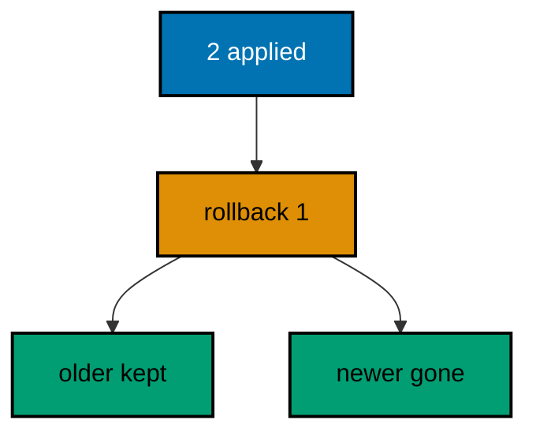

**`learning/code/ex-18-roll-back-one-changeset/Main.java`**:

```java
// Example 18: Roll Back One Changeset.
// Every changeset with a declared reverse can be undone on its own: the
// rollback runs the reverse and deletes the history row, leaving older
// changesets untouched. This program applies two changesets, rolls back
// the latest one, then proves the older table and its history row stayed
// while the newer table is gone.
import java.sql.Connection; // => the handle every move and check shares
import java.sql.DriverManager; // => finds the PostgreSQL driver from the locked jars
import java.sql.ResultSet; // => walks the rows each verification query returns
import java.sql.Statement; // => carries the verification queries to the database
import java.util.Properties; // => carries the login without string-concatenated secrets
import liquibase.Liquibase; // => the entry point: configure, then update
import liquibase.Scope; // => silences progress narration for deterministic goldens
import liquibase.database.Database; // => Liquibase's view of our PostgreSQL connection
import liquibase.database.DatabaseFactory; // => picks the PostgreSQL implementation from the URL
import liquibase.database.jvm.JdbcConnection; // => adapts our JDBC handle to Liquibase
import liquibase.resource.DirectoryResourceAccessor; // => the current file-based changelog accessor
import liquibase.ui.LoggerUIService; // => reroutes progress lines into the silenced log

public class Main {

  // => one public class per file, named after the file
  static Connection connect() throws Exception {
    // => the harness starts PostgreSQL 18 and publishes these variables
    String host = System.getenv().getOrDefault("PGHOST", "localhost");
    // => default keeps local experimentation working outside the harness
    String url = "jdbc:postgresql://" + host + ":5432/postgres";
    // => trust auth accepts any password, so only the user matters
    Properties props = new Properties();
    // => Properties carries the login without string-concatenated secrets
    props.setProperty("user", System.getenv().getOrDefault("PGUSER", "postgres"));
    // => DriverManager finds the PostgreSQL driver from the locked jars
    return DriverManager.getConnection(url, props);
  } // => connect is the only place that knows connection details

  // => Liquibase narrates progress to its console UI by default; those lines
  // => differ between a first run and a rerun, so goldens cannot hold them
  static void runQuiet(Liquibase liquibase) throws Exception {
    // => the LOGGER service reroutes progress lines into the silenced JUL log
    Scope.child(
      java.util.Collections.singletonMap(Scope.Attr.ui.name(), new LoggerUIService()),
      // => the lambda runs inside the scope; main still throws Exception
      () -> liquibase.update("")
    );
    // => update("") runs every changeset with no context filter
  } // => quiet updates keep golden output identical on the harness double run

  // => rollbacks narrate too, so the quiet runner covers the reverse path
  static void rollbackQuiet(Liquibase liquibase, int count) throws Exception {
    // => the LOGGER service reroutes progress lines into the silenced JUL log
    Scope.child(
      java.util.Collections.singletonMap(Scope.Attr.ui.name(), new LoggerUIService()),
      // => the lambda runs inside the scope; main still throws Exception
      () -> liquibase.rollback(count, "")
    );
    // => rollback(count, "") reverses the latest changesets in reverse order
  } // => quiet rollbacks keep golden output identical on double runs

  // => every example counts tables through information_schema, never pg internals
  static int tablePresent(Connection conn, String table) throws Exception {
    // => information_schema is the portable way to ask what exists
    try (
      Statement st = conn.createStatement();
      // => try-with-resources closes the statement on every path
      ResultSet rs = st.executeQuery(
        // => a fixed literal is safe here: the table name is our constant
        "SELECT count(*) FROM information_schema.tables WHERE table_name = '" + table + "'"
      )
    ) {
      // => the query returns exactly one row with exactly one number
      rs.next();
      // => 1 means the migration created the table, 0 means it did not
      return rs.getInt(1);
    } // => the count answers the only question this check asks
  } // => helpers that verify stay separate from code that migrates

  public static void main(String[] args) throws Exception {
    // => silence JUL so the LOGGER service lines below disappear too
    java.util.logging.LogManager.getLogManager().reset();
    // => the entry point the harness runs
    try (Connection conn = connect()) {
      // => one connection serves the update, the rollback, and the checks
      Database database = DatabaseFactory.getInstance()
        // => the factory picks the PostgreSQL implementation from the URL
        .findCorrectDatabaseImplementation(new JdbcConnection(conn));
      // => JdbcConnection adapts our JDBC handle to Liquibase's database API
      Liquibase liquibase = new Liquibase(
        // => two changesets: depots first, then routes
        "changelog.sql",
        // => DirectoryResourceAccessor is the current file-based accessor
        new DirectoryResourceAccessor(new java.io.File(".").getAbsoluteFile()),
        // => rooting at the unit directory keeps changelogs beside the program
        database
      );
      runQuiet(liquibase);
      // => both changesets apply; the history holds two rows
      rollbackQuiet(liquibase, 1);
      // => rolling back one reverses only the latest changeset
      System.out.println("depots table present: " + tablePresent(conn, "depots"));
      // => Output: depots table present: 1
      System.out.println("routes table present: " + tablePresent(conn, "routes"));
      // => Output: routes table present: 0
      try (
        Statement st = conn.createStatement();
        ResultSet rs = st.executeQuery("SELECT count(*) FROM databasechangelog")
      ) {
        // => the rollback deleted the routes history row, keeping depots
        rs.next();
        System.out.println("history rows after rollback: " + rs.getInt(1));
        // => Output: history rows after rollback: 1
        // => a rerun re-applies routes, rolls it back again, prints the same
      } // => reading history back is a habit every later example repeats
    } // => closing the connection ends the program with history intact
  } // => main migrates forward, steps one back, then proves the step
}
```

**`learning/code/ex-18-roll-back-one-changeset/changelog.sql`**:

```sql
-- liquibase formatted sql
-- => REQUIRED first line: marks this file as a Liquibase SQL changelog
-- => Without it Liquibase runs the SQL untracked, and nothing is recorded.
-- changeset course:001-make-depots
-- => the older changeset creates the depots table
-- => the rollback below stops before this row, so it survives
CREATE TABLE depots (
  id SERIAL PRIMARY KEY,
  -- => SERIAL gives an auto-incrementing integer key, enough for this course
  name VARCHAR(60) NOT NULL
  -- => depot names are required from the first migration
);

-- rollback DROP TABLE depots;
-- => this reverse never runs here; the count stops at the newer changeset

-- changeset course:002-make-routes
-- => the newer changeset creates the routes table
-- => rolling back one reverses exactly this changeset and deletes its row
CREATE TABLE routes (
  id SERIAL PRIMARY KEY,
  -- => routes get their own independent sequence of ids
  name VARCHAR(60) NOT NULL
  -- => route names are required from the first migration
);

-- rollback DROP TABLE routes;
-- => the rollback runs this line, then removes the history row
```

**Output** (`learning/code/ex-18-roll-back-one-changeset/expected/main.stdout.txt`):

```text
depots table present: 1
routes table present: 0
history rows after rollback: 1
```

**Key takeaway**: Rolling back one reverses only the latest changeset and deletes its history row, leaving older work untouched.

**Why it matters**: The most common production undo is also the smallest: the last deploy broke something, and everything before it is fine. A one-step rollback that surgeons out exactly the latest change — no more, no less — turns a panicked full revert into a routine operation. Because the reverse ships beside the change and the history tracks both directions, the undo is as reviewed as the change was. Teams that trust their single-step rollback deploy on Fridays; teams that do not, freeze.

---

### Example 19: Roll Back to a Tag

Tags name release points inside the history, and rolling back to a tag undoes everything after it in one move: the release goes back whole, without counting changesets under pressure. Tagging at release time buys a named, tested restore point for the price of one call. The program applies the first changeset, tags the release, applies two more, rolls back to the tag, then proves only the tagged table remains while both post-release tables are gone. (Concepts: co-02, co-08.)

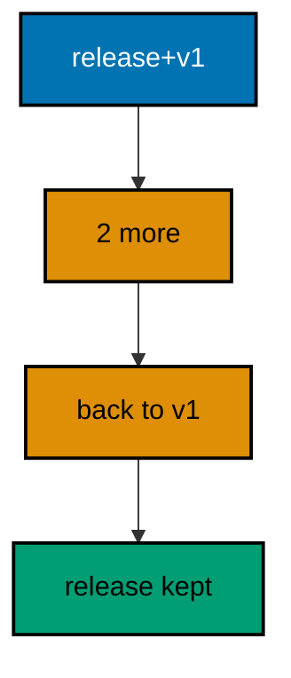

**`learning/code/ex-19-roll-back-to-a-tag/Main.java`**:

```java
// Example 19: Roll Back to a Tag.
// Tags name release points inside the history, and rolling back to a tag
// undoes everything after it in one move: the release goes back whole.
// This program applies the first changeset, tags the release, applies two
// more, rolls back to the tag, then proves only the tagged work remains.
import java.sql.Connection; // => the handle every move and check shares
import java.sql.DriverManager; // => finds the PostgreSQL driver from the locked jars
import java.sql.ResultSet; // => walks the rows each verification query returns
import java.sql.Statement; // => carries the verification queries to the database
import java.util.Properties; // => carries the login without string-concatenated secrets
import liquibase.Liquibase; // => the entry point: configure, then update
import liquibase.Scope; // => silences progress narration for deterministic goldens
import liquibase.database.Database; // => Liquibase's view of our PostgreSQL connection
import liquibase.database.DatabaseFactory; // => picks the PostgreSQL implementation from the URL
import liquibase.database.jvm.JdbcConnection; // => adapts our JDBC handle to Liquibase
import liquibase.resource.DirectoryResourceAccessor; // => the current file-based changelog accessor
import liquibase.ui.LoggerUIService; // => reroutes progress lines into the silenced log

public class Main {

  // => one public class per file, named after the file
  static Connection connect() throws Exception {
    // => the harness starts PostgreSQL 18 and publishes these variables
    String host = System.getenv().getOrDefault("PGHOST", "localhost");
    // => default keeps local experimentation working outside the harness
    String url = "jdbc:postgresql://" + host + ":5432/postgres";
    // => trust auth accepts any password, so only the user matters
    Properties props = new Properties();
    // => Properties carries the login without string-concatenated secrets
    props.setProperty("user", System.getenv().getOrDefault("PGUSER", "postgres"));
    // => DriverManager finds the PostgreSQL driver from the locked jars
    return DriverManager.getConnection(url, props);
  } // => connect is the only place that knows connection details

  // => Liquibase narrates on updates and rollbacks alike, so one quiet
  // => runner covers forward moves, tags, and reverse moves
  static void runQuiet(Liquibase liquibase, String step) throws Exception {
    // => the LOGGER service reroutes progress lines into the silenced JUL log
    Scope.child(
      java.util.Collections.singletonMap(Scope.Attr.ui.name(), new LoggerUIService()),
      // => the lambda runs inside the scope; main still throws Exception
      () -> {
        // => the step name selects the Liquibase move below
        switch (step) {
          case "first":
            // => apply only the first changeset, leaving two pending
            liquibase.update(1, "");
            break;
          case "rest":
            // => apply whatever the history still lacks
            liquibase.update("");
            break;
          case "tag":
            // => name the current release point v1 for the rollback below
            liquibase.tag("v1");
            break;
          default:
            // => roll back everything applied after the v1 tag
            liquibase.rollback("v1", "");
            break;
        } // => each branch is one honest Liquibase move, nothing hidden
      }
    );
    // => every branch stays inside the silenced scope, so goldens stay clean
  } // => quiet moves keep golden output identical on the harness double run

  // => every example counts tables through information_schema, never pg internals
  static int tablePresent(Connection conn, String table) throws Exception {
    // => information_schema is the portable way to ask what exists
    try (
      Statement st = conn.createStatement();
      // => try-with-resources closes the statement on every path
      ResultSet rs = st.executeQuery(
        // => a fixed literal is safe here: the table name is our constant
        "SELECT count(*) FROM information_schema.tables WHERE table_name = '" + table + "'"
      )
    ) {
      // => the query returns exactly one row with exactly one number
      rs.next();
      // => 1 means the migration created the table, 0 means it did not
      return rs.getInt(1);
    } // => the count answers the only question this check asks
  } // => helpers that verify stay separate from code that migrates

  public static void main(String[] args) throws Exception {
    // => silence JUL so the LOGGER service lines below disappear too
    java.util.logging.LogManager.getLogManager().reset();
    // => the entry point the harness runs
    try (Connection conn = connect()) {
      // => one connection serves the release, the tag, and the rollback
      Database database = DatabaseFactory.getInstance()
        // => the factory picks the PostgreSQL implementation from the URL
        .findCorrectDatabaseImplementation(new JdbcConnection(conn));
      // => JdbcConnection adapts our JDBC handle to Liquibase's database API
      Liquibase liquibase = new Liquibase(
        // => three changesets: one release, then two more
        "changelog.sql",
        // => DirectoryResourceAccessor is the current file-based accessor
        new DirectoryResourceAccessor(new java.io.File(".").getAbsoluteFile()),
        // => rooting at the unit directory keeps changelogs beside the program
        database
      );
      runQuiet(liquibase, "first");
      // => only the release changeset applies; two stay pending
      runQuiet(liquibase, "tag");
      // => the v1 tag lands on the release changeset's history row
      runQuiet(liquibase, "rest");
      // => the two pending changesets apply on top of the tagged release
      runQuiet(liquibase, "back");
      // => rolling back to v1 reverses both post-release changesets at once
      System.out.println("harbours table present: " + tablePresent(conn, "harbours"));
      // => Output: harbours table present: 1
      System.out.println("piers table present: " + tablePresent(conn, "piers"));
      // => Output: piers table present: 0
      System.out.println("ferries table present: " + tablePresent(conn, "ferries"));
      // => Output: ferries table present: 0
      // => a rerun replays release, tag, rest, and rollback identically
    } // => closing the connection ends the program with history intact
  } // => main releases, tags, extends, then returns to the tag
}
```

**`learning/code/ex-19-roll-back-to-a-tag/changelog.sql`**:

```sql
-- liquibase formatted sql
-- => REQUIRED first line: marks this file as a Liquibase SQL changelog
-- => Without it Liquibase runs the SQL untracked, and nothing is recorded.
-- changeset course:001-make-harbours
-- => the release changeset creates the harbours table
-- => the v1 tag lands on this row before the other two apply
CREATE TABLE harbours (
  id SERIAL PRIMARY KEY,
  -- => SERIAL gives an auto-incrementing integer key, enough for this course
  name VARCHAR(60) NOT NULL
  -- => harbour names are required from the first migration
);

-- rollback DROP TABLE harbours;
-- => this reverse never runs here; the tag rollback stops above it

-- changeset course:002-make-piers
-- => the first post-release changeset creates the piers table
-- => rolling back to v1 reverses this changeset and deletes its row
CREATE TABLE piers (
  id SERIAL PRIMARY KEY,
  -- => piers get their own independent sequence of ids
  name VARCHAR(60) NOT NULL
  -- => pier names are required from the first migration
);

-- rollback DROP TABLE piers;
-- => the tag rollback runs this line on its way back to v1

-- changeset course:003-make-ferries
-- => the second post-release changeset creates the ferries table
-- => it is the first reverse the tag rollback runs
CREATE TABLE ferries (
  id SERIAL PRIMARY KEY,
  -- => ferries get their own independent sequence of ids
  name VARCHAR(60) NOT NULL
  -- => ferry names are required from the first migration
);

-- rollback DROP TABLE ferries;
-- => the tag rollback runs this line first, then the piers reverse
```

**Output** (`learning/code/ex-19-roll-back-to-a-tag/expected/main.stdout.txt`):

```text
harbours table present: 1
piers table present: 0
ferries table present: 0
```

**Key takeaway**: Tags mark release points that rollbacks return to in one move, undoing every post-release changeset together.

**Why it matters**: Counting changesets during an incident is how you roll back one too few and leave the breakage half-deployed. A tag turns "undo the release" into a single named operation that cannot miscount, and the name means the same thing on every environment. Release tooling that tags automatically gives every deploy a return ticket; tooling that does not leaves the team doing arithmetic while the error budget burns. Name the point when it is calm so you can return to it when it is not.

---

### Example 20: Tags Mark Release Points

A tag writes a name onto the latest history row, turning an ordinal position into a meaningful milestone the whole team can reference. Tags live as data in the same history table, queryable beside everything else, which keeps release metadata where the release history already is. The program tags after the second changeset, applies a third, then prints each row's tag to prove the name landed exactly on the release point with its neighbours untagged. (Concepts: co-02.)

**`learning/code/ex-20-tags-mark-release-points/Main.java`**:

```java
// Example 20: Tags Mark Release Points.
// A tag writes a name onto the latest history row, so later moves can say
// "back to v1" instead of counting changesets. Tags are data in the same
// history table, queryable like everything else. This program tags after
// the second changeset, applies a third, then prints each row's tag to
// prove the name landed exactly on the release point.
import java.sql.Connection; // => the handle every move and check shares
import java.sql.DriverManager; // => finds the PostgreSQL driver from the locked jars
import java.sql.ResultSet; // => walks the rows each verification query returns
import java.sql.Statement; // => carries the verification queries to the database
import java.util.Properties; // => carries the login without string-concatenated secrets
import liquibase.Liquibase; // => the entry point: configure, then update
import liquibase.Scope; // => silences progress narration for deterministic goldens
import liquibase.database.Database; // => Liquibase's view of our PostgreSQL connection
import liquibase.database.DatabaseFactory; // => picks the PostgreSQL implementation from the URL
import liquibase.database.jvm.JdbcConnection; // => adapts our JDBC handle to Liquibase
import liquibase.resource.DirectoryResourceAccessor; // => the current file-based changelog accessor
import liquibase.ui.LoggerUIService; // => reroutes progress lines into the silenced log

public class Main {

  // => one public class per file, named after the file
  static Connection connect() throws Exception {
    // => the harness starts PostgreSQL 18 and publishes these variables
    String host = System.getenv().getOrDefault("PGHOST", "localhost");
    // => default keeps local experimentation working outside the harness
    String url = "jdbc:postgresql://" + host + ":5432/postgres";
    // => trust auth accepts any password, so only the user matters
    Properties props = new Properties();
    // => Properties carries the login without string-concatenated secrets
    props.setProperty("user", System.getenv().getOrDefault("PGUSER", "postgres"));
    // => DriverManager finds the PostgreSQL driver from the locked jars
    return DriverManager.getConnection(url, props);
  } // => connect is the only place that knows connection details

  // => Liquibase narrates on updates and tags alike, so one quiet runner
  // => covers the two updates and the tag between them
  static void runQuiet(Liquibase liquibase, String step) throws Exception {
    // => the LOGGER service reroutes progress lines into the silenced JUL log
    Scope.child(
      java.util.Collections.singletonMap(Scope.Attr.ui.name(), new LoggerUIService()),
      // => the lambda runs inside the scope; main still throws Exception
      () -> {
        // => the step name selects the Liquibase move below
        if (step.equals("tag")) {
          // => name the current release point v1 for later rollbacks
          liquibase.tag("v1");
        } else if (step.equals("pair")) {
          // => apply the first two changesets, leaving the third pending
          liquibase.update(2, "");
        } else {
          // => apply whatever the history still lacks
          liquibase.update("");
        } // => each branch is one honest Liquibase move, nothing hidden
      }
    );
    // => every branch stays inside the silenced scope, so goldens stay clean
  } // => quiet moves keep golden output identical on the harness double run

  // => the history table may not exist before the first update, so forgetting
  // => our rows is guarded by an existence check on every run
  static void clearHistory(Connection conn) throws Exception {
    // => information_schema tells whether any history exists to forget
    try (
      Statement check = conn.createStatement();
      // => a separate statement keeps the check isolated from the delete
      ResultSet rs = check.executeQuery(
        "SELECT count(*) FROM information_schema.tables " + "WHERE table_name = 'databasechangelog'"
      )
    ) {
      // => the query returns exactly one row with exactly one number
      rs.next();
      // => forgetting runs only where a history table already exists
      if (rs.getInt(1) > 0) {
        // => deleting only our own rows leaves every other course untouched
        try (Statement forget = conn.createStatement()) {
          // => the delete runs only after the check proved the table exists
          forget.execute("DELETE FROM databasechangelog WHERE author = 'course'");
        } // => a missing table means a fresh database: nothing to forget
      } // => the guard keeps the first run as clean as the fiftieth
    } // => guarded forgetting keeps resets replayable on double runs
  } // => helpers that verify stay separate from code that migrates

  public static void main(String[] args) throws Exception {
    // => silence JUL so the LOGGER service lines below disappear too
    java.util.logging.LogManager.getLogManager().reset();
    // => the entry point the harness runs
    try (Connection conn = connect()) {
      // => one connection serves the release, the tag, and the tag read
      conn.setAutoCommit(false);
      // => manual commit makes the preamble reset explicit and replayable
      try (Statement st = conn.createStatement()) {
        // => leftover tables would move the tag this example must place
        st.execute("DROP TABLE IF EXISTS tolls");
        // => dropping last-created first unwinds the release in reverse
        st.execute("DROP TABLE IF EXISTS locks");
        // => the tagged table goes so the tag below lands fresh
        st.execute("DROP TABLE IF EXISTS canals");
        // => dropping first keeps the release replayable on double runs
      } // => a clean slate replays the same tag placement on every run
      clearHistory(conn);
      // => forgetting past releases lets this run tag its own fresh
      conn.commit();
      // => committing pins the clean slate before the release pair below
      Database database = DatabaseFactory.getInstance()
        // => the factory picks the PostgreSQL implementation from the URL
        .findCorrectDatabaseImplementation(new JdbcConnection(conn));
      // => JdbcConnection adapts our JDBC handle to Liquibase's database API
      Liquibase liquibase = new Liquibase(
        // => three changesets: two for the release, one after it
        "changelog.sql",
        // => DirectoryResourceAccessor is the current file-based accessor
        new DirectoryResourceAccessor(new java.io.File(".").getAbsoluteFile()),
        // => rooting at the unit directory keeps changelogs beside the program
        database
      );
      runQuiet(liquibase, "pair");
      // => the release pair applies; the third changeset stays pending
      runQuiet(liquibase, "tag");
      // => the v1 tag lands on the latest history row, the second changeset
      runQuiet(liquibase, "rest");
      // => the post-release changeset applies without disturbing the tag
      try (
        Statement st = conn.createStatement();
        // => orderexecuted lists the release in the order it shipped
        ResultSet rs = st.executeQuery("SELECT id, tag FROM databasechangelog ORDER BY orderexecuted")
      ) {
        // => three rows prove the release plus its follow-up all applied
        // => a rerun replays pair, tag, and rest to the identical history
        while (rs.next()) {
          // => untagged rows print a dash so the tagged row stands out
          String tag = rs.getString(2);
          // => the driver returns null for the untagged history rows
          System.out.println(rs.getString(1) + " | tag " + (tag == null ? "-" : tag));
          // => exactly one row carries v1: the release point itself
        } // => the tag column is the release map future rollbacks read
      } // => reading history back is a habit every later example repeats
    } // => closing the connection ends the program with history intact
  } // => main releases two, tags the point, then shows the tags
}
```

**`learning/code/ex-20-tags-mark-release-points/changelog.sql`**:

```sql
-- liquibase formatted sql
-- => REQUIRED first line: marks this file as a Liquibase SQL changelog
-- => Without it Liquibase runs the SQL untracked, and nothing is recorded.
-- changeset course:001-make-canals
-- => the first release changeset creates the canals table
-- => it ships untagged; the tag lands on the second changeset below
CREATE TABLE canals (
  id SERIAL PRIMARY KEY,
  -- => SERIAL gives an auto-incrementing integer key, enough for this course
  name VARCHAR(60) NOT NULL
  -- => canal names are required from the first migration
);

-- rollback DROP TABLE canals;
-- => this reverse never runs here; no rollback happens in this example

-- changeset course:002-make-locks
-- => the second release changeset creates the locks table
-- => the v1 tag lands on this history row as the release point
CREATE TABLE locks (
  id SERIAL PRIMARY KEY,
  -- => locks get their own independent sequence of ids
  name VARCHAR(60) NOT NULL
  -- => lock names are required from the first migration
);

-- rollback DROP TABLE locks;
-- => this reverse never runs here; the example only tags, never rolls back

-- changeset course:003-make-tolls
-- => the post-release changeset creates the tolls table after the tag
-- => its row stays untagged, proving tags mark points, not ranges
CREATE TABLE tolls (
  id SERIAL PRIMARY KEY,
  -- => tolls get their own independent sequence of ids
  name VARCHAR(60) NOT NULL
  -- => toll names are required from the first migration
);

-- rollback DROP TABLE tolls;
-- => this reverse never runs here; the example only tags, never rolls back
```

**Output** (`learning/code/ex-20-tags-mark-release-points/expected/main.stdout.txt`):

```text
001-make-canals | tag -
002-make-locks | tag v1
003-make-tolls | tag -
```

**Key takeaway**: Tags are history data naming release milestones, so later moves can say back to v1 instead of counting changesets.

**Why it matters**: Ordinal positions rot: "roll back three" means something different after the next deploy adds two more changesets, but "back to v1" means the same thing forever. Named milestones let runbooks, pipelines, and humans reference releases unambiguously across weeks and environments. Because tags ride in the history table, they replicate with backups, audit with the same queries, and need no sidecar system to stay consistent. A release without a tag is a place you cannot return to by name.

---

### Example 21: Rollback Blocks Undo Raw SQL

Plain SQL changesets have no automatic reverse: the rollback block the author writes beside the change is the only way back, reviewed with the change itself rather than invented during an incident. Declaring the undo next to the do keeps the pair honest — a change without a reverse is visibly incomplete at review time. The program applies a raw SQL changeset, rolls it back through its declared block, then proves the table is gone and the history forgot the run entirely. (Concepts: co-02, co-08.)

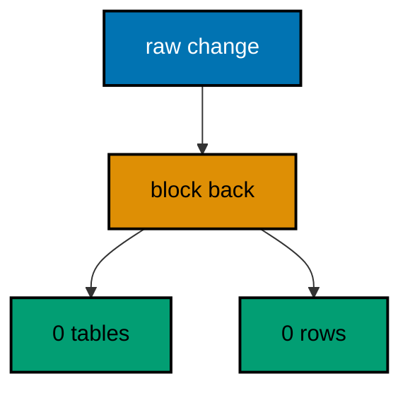

**`learning/code/ex-21-rollback-blocks-undo-raw-sql/Main.java`**:

```java
// Example 21: Rollback Blocks Undo Raw SQL.
// Plain SQL changesets have no automatic reverse: the rollback block the
// author writes is the only way back. Declaring it beside the change keeps
// the undo reviewed with the change itself. This program applies a raw SQL
// changeset, rolls it back through its declared block, then proves the
// table is gone and the history forgot the run.
import java.sql.Connection; // => the handle every move and check shares
import java.sql.DriverManager; // => finds the PostgreSQL driver from the locked jars
import java.sql.ResultSet; // => walks the rows each verification query returns
import java.sql.Statement; // => carries the verification queries to the database
import java.util.Properties; // => carries the login without string-concatenated secrets
import liquibase.Liquibase; // => the entry point: configure, then update
import liquibase.Scope; // => silences progress narration for deterministic goldens
import liquibase.database.Database; // => Liquibase's view of our PostgreSQL connection
import liquibase.database.DatabaseFactory; // => picks the PostgreSQL implementation from the URL
import liquibase.database.jvm.JdbcConnection; // => adapts our JDBC handle to Liquibase
import liquibase.resource.DirectoryResourceAccessor; // => the current file-based changelog accessor
import liquibase.ui.LoggerUIService; // => reroutes progress lines into the silenced log

public class Main {

  // => one public class per file, named after the file
  static Connection connect() throws Exception {
    // => the harness starts PostgreSQL 18 and publishes these variables
    String host = System.getenv().getOrDefault("PGHOST", "localhost");
    // => default keeps local experimentation working outside the harness
    String url = "jdbc:postgresql://" + host + ":5432/postgres";
    // => trust auth accepts any password, so only the user matters
    Properties props = new Properties();
    // => Properties carries the login without string-concatenated secrets
    props.setProperty("user", System.getenv().getOrDefault("PGUSER", "postgres"));
    // => DriverManager finds the PostgreSQL driver from the locked jars
    return DriverManager.getConnection(url, props);
  } // => connect is the only place that knows connection details

  // => Liquibase narrates on updates and rollbacks alike, so one quiet
  // => runner covers the forward move and the reverse move
  static void runQuiet(Liquibase liquibase, boolean forward) throws Exception {
    // => the LOGGER service reroutes progress lines into the silenced JUL log
    Scope.child(
      java.util.Collections.singletonMap(Scope.Attr.ui.name(), new LoggerUIService()),
      // => the lambda runs inside the scope; main still throws Exception
      () -> {
        // => the flag selects the direction of the Liquibase move
        if (forward) {
          // => run the raw SQL changeset forward first
          liquibase.update("");
        } else {
          // => then reverse it through its declared rollback block
          liquibase.rollback(1, "");
        } // => the block below is the only reverse raw SQL gets
      }
    );
    // => both directions stay inside the silenced scope, so goldens stay clean
  } // => quiet moves keep golden output identical on the harness double run

  public static void main(String[] args) throws Exception {
    // => silence JUL so the LOGGER service lines below disappear too
    java.util.logging.LogManager.getLogManager().reset();
    // => the entry point the harness runs
    try (Connection conn = connect()) {
      // => one connection serves the update, the rollback, and the checks
      Database database = DatabaseFactory.getInstance()
        // => the factory picks the PostgreSQL implementation from the URL
        .findCorrectDatabaseImplementation(new JdbcConnection(conn));
      // => JdbcConnection adapts our JDBC handle to Liquibase's database API
      Liquibase liquibase = new Liquibase(
        // => one raw SQL changeset with its declared rollback block
        "changelog.sql",
        // => DirectoryResourceAccessor is the current file-based accessor
        new DirectoryResourceAccessor(new java.io.File(".").getAbsoluteFile()),
        // => rooting at the unit directory keeps changelogs beside the program
        database
      );
      runQuiet(liquibase, true);
      // => the forward run creates the table and records the history row
      runQuiet(liquibase, false);
      // => the rollback executes the declared block and deletes the row
      try (
        Statement st = conn.createStatement();
        ResultSet rs = st.executeQuery("SELECT count(*) FROM information_schema.tables WHERE table_name = 'sheds'")
      ) {
        // => the declared block dropped exactly what the change built
        rs.next();
        System.out.println("sheds table present: " + rs.getInt(1));
        // => Output: sheds table present: 0
      } // => information_schema answers without touching pg internals
      try (
        Statement st = conn.createStatement();
        ResultSet rs = st.executeQuery("SELECT count(*) FROM databasechangelog")
      ) {
        // => the history forgot the run as thoroughly as the schema did
        rs.next();
        System.out.println("history rows after rollback: " + rs.getInt(1));
        // => Output: history rows after rollback: 0
        // => a rerun re-applies the changeset, then rolls it back again
      } // => reading history back is a habit every later example repeats
    } // => closing the connection ends the program with history intact
  } // => main runs the block forward, then back through its reverse
}
```

**`learning/code/ex-21-rollback-blocks-undo-raw-sql/changelog.sql`**:

```sql
-- liquibase formatted sql
-- => REQUIRED first line: marks this file as a Liquibase SQL changelog
-- => Without it Liquibase runs the SQL untracked, and nothing is recorded.
-- changeset course:001-make-sheds
-- => one raw SQL changeset: hand-written DDL with a hand-written reverse
-- => Liquibase cannot infer the undo; the block below declares it
CREATE TABLE sheds (
  id SERIAL PRIMARY KEY,
  -- => SERIAL gives an auto-incrementing integer key, enough for this course
  name VARCHAR(60) NOT NULL
  -- => shed names are required from the first migration
);

-- rollback DROP TABLE sheds;
-- => the declared block is the only reverse raw SQL changesets get
-- => Example 18 ran this line; here it carries the whole lesson instead
```

**Output** (`learning/code/ex-21-rollback-blocks-undo-raw-sql/expected/main.stdout.txt`):

```text
sheds table present: 0
history rows after rollback: 0
```

**Key takeaway**: Raw SQL changesets reverse only through their declared rollback blocks, so write the undo beside the change.

**Why it matters**: Hand-written SQL is the most expressive migration form and the only one with no automatic undo: without a declared block, reversing it means writing new SQL against a production database during an incident, which is exactly when judgment is worst. A block reviewed beside its change gets the same scrutiny as the change — edge cases, related rows, ordering — while the context is fresh. Rollback blocks are the cheapest incident insurance a migration author can buy, and the premium is paid once at review time.

---

### Example 22: Data Rollbacks Restore Rows

Schema rollbacks drop objects while data rollbacks restore rows: a changeset that inserts rows declares the delete that removes exactly those rows, so reversing it restores the table without touching its shape. Data reverses deserve the same review as schema reverses because wrong-row restores corrupt as surely as dropped tables. The program seeds two rows, rolls back the seed changeset, then proves the rows are gone while the table stands ready to seed again. (Concepts: co-02, co-08.)

**`learning/code/ex-22-data-rollbacks-restore-rows/Main.java`**:

```java
// Example 22: Data Rollbacks Restore Rows.
// Schema rollbacks drop objects; data rollbacks restore rows. A changeset
// that inserts rows should declare the delete that removes exactly those
// rows, so reversing it restores the table without touching its shape.
// This program seeds two rows, rolls back the seed, then proves the rows
// are gone while the table and its older history stand.
import java.sql.Connection; // => the handle every move and check shares
import java.sql.DriverManager; // => finds the PostgreSQL driver from the locked jars
import java.sql.ResultSet; // => walks the rows each verification query returns
import java.sql.Statement; // => carries the verification queries to the database
import java.util.Properties; // => carries the login without string-concatenated secrets
import liquibase.Liquibase; // => the entry point: configure, then update
import liquibase.Scope; // => silences progress narration for deterministic goldens
import liquibase.database.Database; // => Liquibase's view of our PostgreSQL connection
import liquibase.database.DatabaseFactory; // => picks the PostgreSQL implementation from the URL
import liquibase.database.jvm.JdbcConnection; // => adapts our JDBC handle to Liquibase
import liquibase.resource.DirectoryResourceAccessor; // => the current file-based changelog accessor
import liquibase.ui.LoggerUIService; // => reroutes progress lines into the silenced log

public class Main {

  // => one public class per file, named after the file
  static Connection connect() throws Exception {
    // => the harness starts PostgreSQL 18 and publishes these variables
    String host = System.getenv().getOrDefault("PGHOST", "localhost");
    // => default keeps local experimentation working outside the harness
    String url = "jdbc:postgresql://" + host + ":5432/postgres";
    // => trust auth accepts any password, so only the user matters
    Properties props = new Properties();
    // => Properties carries the login without string-concatenated secrets
    props.setProperty("user", System.getenv().getOrDefault("PGUSER", "postgres"));
    // => DriverManager finds the PostgreSQL driver from the locked jars
    return DriverManager.getConnection(url, props);
  } // => connect is the only place that knows connection details

  // => Liquibase narrates on updates and rollbacks alike, so one quiet
  // => runner covers the seed and its reversal
  static void runQuiet(Liquibase liquibase, boolean forward) throws Exception {
    // => the LOGGER service reroutes progress lines into the silenced JUL log
    Scope.child(
      java.util.Collections.singletonMap(Scope.Attr.ui.name(), new LoggerUIService()),
      // => the lambda runs inside the scope; main still throws Exception
      () -> {
        // => the flag selects the direction of the Liquibase move
        if (forward) {
          // => run both changesets: the table, then its seed rows
          liquibase.update("");
        } else {
          // => reverse only the seed changeset, keeping the table
          liquibase.rollback(1, "");
        } // => the seed's declared delete restores the empty table
      }
    );
    // => both directions stay inside the silenced scope, so goldens stay clean
  } // => quiet moves keep golden output identical on the harness double run

  // => row counts are the data rollback's own verification language
  static int rowCount(Connection conn, String table) throws Exception {
    // => counting rows answers whether the seed or its reversal won
    try (
      Statement st = conn.createStatement();
      // => try-with-resources closes the statement on every path
      ResultSet rs = st.executeQuery("SELECT count(*) FROM " + table)
    ) {
      // => the table name is our constant, so string building stays safe here
      rs.next();
      // => the number is the proof the data moved as the history claims
      return rs.getInt(1);
    } // => counts verify data without dumping rows into the transcript
  } // => helpers that verify stay separate from code that migrates

  public static void main(String[] args) throws Exception {
    // => silence JUL so the LOGGER service lines below disappear too
    java.util.logging.LogManager.getLogManager().reset();
    // => the entry point the harness runs
    try (Connection conn = connect()) {
      // => one connection serves the seed, the rollback, and the counts
      Database database = DatabaseFactory.getInstance()
        // => the factory picks the PostgreSQL implementation from the URL
        .findCorrectDatabaseImplementation(new JdbcConnection(conn));
      // => JdbcConnection adapts our JDBC handle to Liquibase's database API
      Liquibase liquibase = new Liquibase(
        // => two changesets: the table first, then its two seed rows
        "changelog.sql",
        // => DirectoryResourceAccessor is the current file-based accessor
        new DirectoryResourceAccessor(new java.io.File(".").getAbsoluteFile()),
        // => rooting at the unit directory keeps changelogs beside the program
        database
      );
      runQuiet(liquibase, true);
      // => the table exists and holds exactly the two seeded rows
      System.out.println("seeded rows before rollback: " + rowCount(conn, "bins"));
      // => Output: seeded rows before rollback: 2
      runQuiet(liquibase, false);
      // => the seed's declared delete removed exactly those two rows
      System.out.println("seeded rows after rollback: " + rowCount(conn, "bins"));
      // => Output: seeded rows after rollback: 0
      // => a rerun re-seeds the two rows, then removes them again identically
    } // => closing the connection ends the program with history intact
  } // => main seeds the rows, unseeds them, and counts both states
}
```

**`learning/code/ex-22-data-rollbacks-restore-rows/changelog.sql`**:

```sql
-- liquibase formatted sql
-- => REQUIRED first line: marks this file as a Liquibase SQL changelog
-- => Without it Liquibase runs the SQL untracked, and nothing is recorded.
-- changeset course:001-make-bins
-- => the table changeset creates the bins table with no rows yet
-- => the seed below is a separate changeset with its own reverse
CREATE TABLE bins (
  id SERIAL PRIMARY KEY,
  -- => SERIAL gives an auto-incrementing integer key, enough for this course
  code VARCHAR(20) NOT NULL
  -- => bin codes are required from the first migration
);

-- rollback DROP TABLE bins;
-- => this reverse never runs here; only the seed is rolled back

-- changeset course:002-seed-bins
-- => the seed changeset inserts exactly two rows into the bins table
-- => data changes deserve reverses as much as schema changes do
INSERT INTO bins (code) VALUES ('A-1'), ('A-2');

-- rollback DELETE FROM bins;
-- => the declared delete removes exactly the rows this changeset added
-- => the table survives with zero rows, ready to seed again
```

**Output** (`learning/code/ex-22-data-rollbacks-restore-rows/expected/main.stdout.txt`):

```text
seeded rows before rollback: 2
seeded rows after rollback: 0
```

**Key takeaway**: Seed changesets declare delete reverses that restore row state, so data rolls back as precisely as schema does.

**Why it matters**: Bad reference data breaks production as thoroughly as bad schema: wrong prices, wrong flags, wrong routing rules all ship as rows, and removing them by hand means writing deletes against live data under pressure. A declared delete reviewed beside its insert removes exactly the shipped rows — no more, no fewer — with the WHERE clause already argued about when minds were calm. Data rollbacks turn "unship those rows" from an incident improvisation into a tested operation with a known blast radius.

---

### Example 23: Rollbacks Without a Plan Fail Loudly

A changeset with no declared reverse and no inferable one cannot be rolled back, and Liquibase refuses instead of guessing: a guessed undo against production data is worse than no undo at all. Loud refusal at rollback time beats silent corruption every time, and the intact history shows exactly what stayed applied. The program applies a planless column addition, attempts the rollback, then proves the refusal left the column and its history row exactly in place. (Concepts: co-08, co-03.)

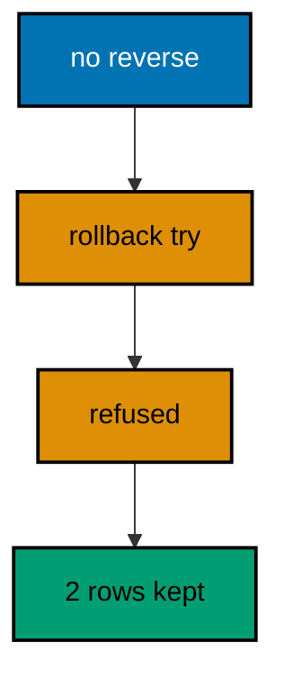

**`learning/code/ex-23-rollbacks-without-a-plan-fail-loudly/Main.java`**:

```java
// Example 23: Rollbacks Without a Plan Fail Loudly.
// A changeset with no declared reverse and no inferable one cannot be
// rolled back: Liquibase refuses instead of guessing, because a guessed
// undo against production data is worse than no undo. This program applies
// such a changeset, attempts the rollback, then proves the refusal left
// the change and its history row exactly in place.
import java.sql.Connection; // => the handle every move and check shares
import java.sql.DriverManager; // => finds the PostgreSQL driver from the locked jars
import java.sql.ResultSet; // => walks the rows each verification query returns
import java.sql.Statement; // => carries the verification queries to the database
import java.util.Properties; // => carries the login without string-concatenated secrets
import liquibase.Liquibase; // => the entry point: configure, then update
import liquibase.Scope; // => silences progress narration for deterministic goldens
import liquibase.database.Database; // => Liquibase's view of our PostgreSQL connection
import liquibase.database.DatabaseFactory; // => picks the PostgreSQL implementation from the URL
import liquibase.database.jvm.JdbcConnection; // => adapts our JDBC handle to Liquibase
import liquibase.exception.LiquibaseException; // => the stable type every expected failure wears
import liquibase.resource.DirectoryResourceAccessor; // => the current file-based changelog accessor
import liquibase.ui.LoggerUIService; // => reroutes progress lines into the silenced log

public class Main {

  // => one public class per file, named after the file
  static Connection connect() throws Exception {
    // => the harness starts PostgreSQL 18 and publishes these variables
    String host = System.getenv().getOrDefault("PGHOST", "localhost");
    // => default keeps local experimentation working outside the harness
    String url = "jdbc:postgresql://" + host + ":5432/postgres";
    // => trust auth accepts any password, so only the user matters
    Properties props = new Properties();
    // => Properties carries the login without string-concatenated secrets
    props.setProperty("user", System.getenv().getOrDefault("PGUSER", "postgres"));
    // => DriverManager finds the PostgreSQL driver from the locked jars
    return DriverManager.getConnection(url, props);
  } // => connect is the only place that knows connection details

  // => Liquibase narrates progress to its console UI by default; those lines
  // => differ between a first run and a rerun, so goldens cannot hold them
  static void runQuiet(Liquibase liquibase) throws Exception {
    // => the LOGGER service reroutes progress lines into the silenced JUL log
    Scope.child(
      java.util.Collections.singletonMap(Scope.Attr.ui.name(), new LoggerUIService()),
      // => the lambda runs inside the scope; main still throws Exception
      () -> liquibase.update("")
    );
    // => update("") runs every changeset with no context filter
  } // => quiet updates keep golden output identical on the harness double run

  public static void main(String[] args) throws Exception {
    // => silence JUL so the LOGGER service lines below disappear too
    java.util.logging.LogManager.getLogManager().reset();
    // => the entry point the harness runs
    try (Connection conn = connect()) {
      // => one connection serves the update, the refused rollback, and checks
      Database database = DatabaseFactory.getInstance()
        // => the factory picks the PostgreSQL implementation from the URL
        .findCorrectDatabaseImplementation(new JdbcConnection(conn));
      // => JdbcConnection adapts our JDBC handle to Liquibase's database API
      Liquibase liquibase = new Liquibase(
        // => one changeset with raw SQL and deliberately no reverse
        "changelog.sql",
        // => DirectoryResourceAccessor is the current file-based accessor
        new DirectoryResourceAccessor(new java.io.File(".").getAbsoluteFile()),
        // => rooting at the unit directory keeps changelogs beside the program
        database
      );
      runQuiet(liquibase);
      // => the forward run applies; the history holds one row
      String failure = "none";
      // => the failure name records the outcome without printing internals
      try {
        // => no declared reverse exists, so the rollback must refuse
        Scope.child(
          java.util.Collections.singletonMap(Scope.Attr.ui.name(), new LoggerUIService()),
          // => the rollback narrates too, so it stays inside a quiet scope
          () -> liquibase.rollback(1, "")
        );
      } catch (LiquibaseException expected) {
        // => the exception type is stable; its message text is not asserted
        failure = expected.getClass().getSimpleName();
        // => catching proves the refusal instead of a guessed undo
        conn.rollback();
        // => rolling back keeps the applied change exactly as it was
      } // => no stack trace: the refusal is the expected behaviour
      System.out.println("rollback failure: " + failure);
      // => Output: rollback failure: CommandExecutionException
      try (
        Statement st = conn.createStatement();
        ResultSet rs = st.executeQuery(
          "SELECT count(*) FROM information_schema.columns " + "WHERE table_name = 'crates' AND column_name = 'seal'"
        )
      ) {
        // => the refused rollback changed nothing: the column stands
        rs.next();
        System.out.println("unreversed column present: " + rs.getInt(1));
        // => Output: unreversed column present: 1
      } // => the schema is byte-identical to before the refused rollback
      try (
        Statement st = conn.createStatement();
        ResultSet rs = st.executeQuery("SELECT count(*) FROM databasechangelog")
      ) {
        // => the history row stands too: the change is still applied
        rs.next();
        System.out.println("history rows intact: " + rs.getInt(1));
        // => Output: history rows intact: 2
        // => a rerun skips the applied changeset, then refuses identically
      } // => reading history back is a habit every later example repeats
    } // => closing the connection ends the program with history intact
  } // => main applies the planless change, then proves the loud refusal
}
```

**`learning/code/ex-23-rollbacks-without-a-plan-fail-loudly/changelog.sql`**:

```sql
-- liquibase formatted sql
-- => REQUIRED first line: marks this file as a Liquibase SQL changelog
-- => Without it Liquibase runs the SQL untracked, and nothing is recorded.
-- changeset course:001-make-crates
-- => the table changeset carries its reverse, so it is not the problem
CREATE TABLE crates (
  id SERIAL PRIMARY KEY,
  -- => SERIAL gives an auto-incrementing integer key, enough for this course
  code VARCHAR(20) NOT NULL
  -- => crate codes are required from the first migration
);

-- rollback DROP TABLE crates;
-- => this reverse exists but never runs: the failure below fires first

-- changeset course:002-seal-crates
-- => raw SQL with deliberately no rollback block and no inferable reverse
-- => ADD COLUMN on raw SQL cannot be reversed automatically, by design
ALTER TABLE crates ADD COLUMN seal VARCHAR(20);
-- => the missing reverse is the whole lesson: rolling this back must fail
-- => a data-preserving reverse would need a compensating changeset instead
```

**Output** (`learning/code/ex-23-rollbacks-without-a-plan-fail-loudly/expected/main.stdout.txt`):

```text
rollback failure: CommandExecutionException
unreversed column present: 1
history rows intact: 2
```

**Key takeaway**: Changesets without reverses fail rollback loudly with history intact, instead of guessing an undo.

**Why it matters**: The most dangerous rollback is the one that looks successful while doing the wrong thing: a guessed reverse that drops the wrong rows or restores stale values corrupts quietly, and the corruption is discovered far from its cause. Refusal is honest — it says "no safe undo exists" while the evidence is fresh and the team is assembled. That honesty forces the real fix, a compensating changeset written deliberately, instead of papering over the gap with an approximate undo nobody reviewed. Fail loud now or debug silent corruption later.

---

### Example 24: Count-Based Rollbacks Span Files

Rollback counts ignore file boundaries: rolling back two undoes the two latest changesets wherever they live, which is exactly how a release rollback crosses the master file's includes without caring which file holds what. Counts compose with tags — count for "how many", tags for "back to where". The program runs a master over three single-changeset files, rolls back two, then proves only the oldest file's table survived while the two newer tables are gone. (Concepts: co-08.)

**`learning/code/ex-24-count-based-rollbacks-span-files/Main.java`**:

```java
// Example 24: Count-Based Rollbacks Span Files.
// Rollback counts ignore file boundaries: rolling back two undoes the two
// latest changesets wherever they live, which is exactly how a release
// rollback crosses the master file's includes. This program runs a master
// over three single-changeset files, rolls back two, then proves only the
// oldest file's table and history row survived.
import java.sql.Connection; // => the handle every move and check shares
import java.sql.DriverManager; // => finds the PostgreSQL driver from the locked jars
import java.sql.ResultSet; // => walks the rows each verification query returns
import java.sql.Statement; // => carries the verification queries to the database
import java.util.Properties; // => carries the login without string-concatenated secrets
import liquibase.Liquibase; // => the entry point: configure, then update
import liquibase.Scope; // => silences progress narration for deterministic goldens
import liquibase.database.Database; // => Liquibase's view of our PostgreSQL connection
import liquibase.database.DatabaseFactory; // => picks the PostgreSQL implementation from the URL
import liquibase.database.jvm.JdbcConnection; // => adapts our JDBC handle to Liquibase
import liquibase.resource.DirectoryResourceAccessor; // => the current file-based changelog accessor
import liquibase.ui.LoggerUIService; // => reroutes progress lines into the silenced log

public class Main {

  // => one public class per file, named after the file
  static Connection connect() throws Exception {
    // => the harness starts PostgreSQL 18 and publishes these variables
    String host = System.getenv().getOrDefault("PGHOST", "localhost");
    // => default keeps local experimentation working outside the harness
    String url = "jdbc:postgresql://" + host + ":5432/postgres";
    // => trust auth accepts any password, so only the user matters
    Properties props = new Properties();
    // => Properties carries the login without string-concatenated secrets
    props.setProperty("user", System.getenv().getOrDefault("PGUSER", "postgres"));
    // => DriverManager finds the PostgreSQL driver from the locked jars
    return DriverManager.getConnection(url, props);
  } // => connect is the only place that knows connection details

  // => Liquibase narrates on updates and rollbacks alike, so one quiet
  // => runner covers the master run and the cross-file rollback
  static void runQuiet(Liquibase liquibase, boolean forward) throws Exception {
    // => the LOGGER service reroutes progress lines into the silenced JUL log
    Scope.child(
      java.util.Collections.singletonMap(Scope.Attr.ui.name(), new LoggerUIService()),
      // => the lambda runs inside the scope; main still throws Exception
      () -> {
        // => the flag selects the direction of the Liquibase move
        if (forward) {
          // => run every included changeset across all three files
          liquibase.update("");
        } else {
          // => reverse the two latest changesets, wherever they live
          liquibase.rollback(2, "");
        } // => the count crosses the file boundary between 003 and 002
      }
    );
    // => both directions stay inside the silenced scope, so goldens stay clean
  } // => quiet moves keep golden output identical on the harness double run

  // => every example counts tables through information_schema, never pg internals
  static int tablePresent(Connection conn, String table) throws Exception {
    // => information_schema is the portable way to ask what exists
    try (
      Statement st = conn.createStatement();
      // => try-with-resources closes the statement on every path
      ResultSet rs = st.executeQuery(
        // => a fixed literal is safe here: the table name is our constant
        "SELECT count(*) FROM information_schema.tables WHERE table_name = '" + table + "'"
      )
    ) {
      // => the query returns exactly one row with exactly one number
      rs.next();
      // => 1 means the migration created the table, 0 means it did not
      return rs.getInt(1);
    } // => the count answers the only question this check asks
  } // => helpers that verify stay separate from code that migrates

  public static void main(String[] args) throws Exception {
    // => silence JUL so the LOGGER service lines below disappear too
    java.util.logging.LogManager.getLogManager().reset();
    // => the entry point the harness runs
    try (Connection conn = connect()) {
      // => one connection serves the master run, the rollback, and checks
      Database database = DatabaseFactory.getInstance()
        // => the factory picks the PostgreSQL implementation from the URL
        .findCorrectDatabaseImplementation(new JdbcConnection(conn));
      // => JdbcConnection adapts our JDBC handle to Liquibase's database API
      Liquibase liquibase = new Liquibase(
        // => the master delegates to the three single-changeset files
        "db.changelog-master.yaml",
        // => DirectoryResourceAccessor is the current file-based accessor
        new DirectoryResourceAccessor(new java.io.File(".").getAbsoluteFile()),
        // => rooting at the unit directory keeps changelogs beside the program
        database
      );
      runQuiet(liquibase, true);
      // => three files apply in prefix order; the history holds three rows
      runQuiet(liquibase, false);
      // => rolling back two removes the 003 and 002 tables across files
      System.out.println("quays table present: " + tablePresent(conn, "quays"));
      // => Output: quays table present: 1
      System.out.println("docks table present: " + tablePresent(conn, "docks"));
      // => Output: docks table present: 0
      System.out.println("marinas table present: " + tablePresent(conn, "marinas"));
      // => Output: marinas table present: 0
      // => a rerun re-applies the two pending files, then removes them again
    } // => closing the connection ends the program with history intact
  } // => main runs the master forward, then steps two files back
}
```

**`learning/code/ex-24-count-based-rollbacks-span-files/db.changelog-master.yaml`**:

```yaml
databaseChangeLog: # => Root key required for every YAML changelog
  - includeAll: # => Discovers every changelog file in one directory
      path: changes/
      # => path is relative to this master file, not to the classpath
      # => Liquibase sorts the discovered files alphabetically before running
      # => Numeric prefixes (001-, 002-, 003-) make alphabetical order match intent
      # => The rollback count below crosses these file boundaries freely
```

**`learning/code/ex-24-count-based-rollbacks-span-files/changes/001-make-quays.sql`**:

```sql
-- liquibase formatted sql
-- => REQUIRED first line: marks this file as a Liquibase SQL changelog
-- => The 001 prefix makes this file sort first under includeAll.
-- changeset course:001-make-quays
-- => the oldest changeset creates the quays table
-- => the count of two stops before this row, so it survives
CREATE TABLE quays (
  id SERIAL PRIMARY KEY,
  -- => SERIAL gives an auto-incrementing integer key, enough for this course
  name VARCHAR(60) NOT NULL
  -- => quay names are required from the first migration
);

-- rollback DROP TABLE quays;
-- => this reverse never runs here; the count stops at the newer files
```

**`learning/code/ex-24-count-based-rollbacks-span-files/changes/002-make-docks.sql`**:

```sql
-- liquibase formatted sql
-- => REQUIRED first line: marks this file as a Liquibase SQL changelog
-- => The 002 prefix makes this file sort second under includeAll.
-- changeset course:002-make-docks
-- => the middle changeset creates the docks table
-- => rolling back two reverses this changeset second
CREATE TABLE docks (
  id SERIAL PRIMARY KEY,
  -- => SERIAL gives an auto-incrementing integer key, enough for this course
  name VARCHAR(60) NOT NULL
  -- => dock names are required from the first migration
);

-- rollback DROP TABLE docks;
-- => the rollback runs this line after removing the 003 table
```

**`learning/code/ex-24-count-based-rollbacks-span-files/changes/003-make-marinas.sql`**:

```sql
-- liquibase formatted sql
-- => REQUIRED first line: marks this file as a Liquibase SQL changelog
-- => The 003 prefix makes this file sort third under includeAll.
-- changeset course:003-make-marinas
-- => the newest changeset creates the marinas table
-- => rolling back two reverses this changeset first
CREATE TABLE marinas (
  id SERIAL PRIMARY KEY,
  -- => SERIAL gives an auto-incrementing integer key, enough for this course
  name VARCHAR(60) NOT NULL
  -- => marina names are required from the first migration
);

-- rollback DROP TABLE marinas;
-- => the rollback runs this line first, then the 002 reverse
```

**Output** (`learning/code/ex-24-count-based-rollbacks-span-files/expected/main.stdout.txt`):

```text
quays table present: 1
docks table present: 0
marinas table present: 0
```

**Key takeaway**: Rollback counts undo the latest changesets across file boundaries, so releases roll back whole without file-by-file work.

**Why it matters**: Releases span files by design — no single file holds a whole release — so an undo scoped to one file would leave the other files' changes deployed and the system in a state nobody tested. Counts operate on the history order, which is the only order that matters at rollback time, regardless of how the work was filed. The operator states an intent ("undo the last two") instead of assembling a file list, and the history guarantees the statement means the same thing on every environment. Undo at the release's granularity, not the file's.

---

### Example 25: Validate Catches Errors Before Update

The validate move checks the whole changelog without touching the database: duplicate ids, broken guards, and checksum mismatches surface before any changeset runs, when fixes are still cheap and unapplied. Validation belongs in CI on every pull request, long before any environment is at stake. The program validates a changelog with a duplicated changeset id, then proves the refusal ran nothing by counting the history rows at zero. (Concepts: co-16.)

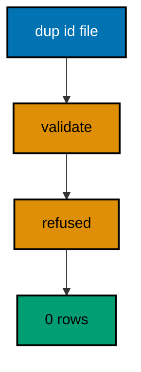

**`learning/code/ex-25-validate-catches-errors-before-update/Main.java`**:

```java
// Example 25: Validate Catches Errors Before Update.
// The validate move checks the whole changelog without touching the
// database: duplicate ids, broken preconditions, and checksum mismatches
// surface before any changeset runs. This program validates a changelog
// with a duplicated changeset id, then proves the refusal ran nothing by
// counting the history rows.
import java.sql.Connection; // => the handle every move and check shares
import java.sql.DriverManager; // => finds the PostgreSQL driver from the locked jars
import java.sql.ResultSet; // => walks the rows each verification query returns
import java.sql.Statement; // => carries the verification queries to the database
import java.util.Properties; // => carries the login without string-concatenated secrets
import liquibase.Liquibase; // => the entry point: configure, then update
import liquibase.Scope; // => silences progress narration for deterministic goldens
import liquibase.database.Database; // => Liquibase's view of our PostgreSQL connection
import liquibase.database.DatabaseFactory; // => picks the PostgreSQL implementation from the URL
import liquibase.database.jvm.JdbcConnection; // => adapts our JDBC handle to Liquibase
import liquibase.exception.LiquibaseException; // => the stable type every expected failure wears
import liquibase.resource.DirectoryResourceAccessor; // => the current file-based changelog accessor
import liquibase.ui.LoggerUIService; // => reroutes progress lines into the silenced log

public class Main {

  // => one public class per file, named after the file
  static Connection connect() throws Exception {
    // => the harness starts PostgreSQL 18 and publishes these variables
    String host = System.getenv().getOrDefault("PGHOST", "localhost");
    // => default keeps local experimentation working outside the harness
    String url = "jdbc:postgresql://" + host + ":5432/postgres";
    // => trust auth accepts any password, so only the user matters
    Properties props = new Properties();
    // => Properties carries the login without string-concatenated secrets
    props.setProperty("user", System.getenv().getOrDefault("PGUSER", "postgres"));
    // => DriverManager finds the PostgreSQL driver from the locked jars
    return DriverManager.getConnection(url, props);
  } // => connect is the only place that knows connection details

  public static void main(String[] args) throws Exception {
    // => silence JUL so the LOGGER service lines below disappear too
    java.util.logging.LogManager.getLogManager().reset();
    // => the entry point the harness runs
    try (Connection conn = connect()) {
      // => one connection serves the validation and the history count
      Database database = DatabaseFactory.getInstance()
        // => the factory picks the PostgreSQL implementation from the URL
        .findCorrectDatabaseImplementation(new JdbcConnection(conn));
      // => JdbcConnection adapts our JDBC handle to Liquibase's database API
      Liquibase liquibase = new Liquibase(
        // => two changesets share one id: the changelog is broken
        "changelog.sql",
        // => DirectoryResourceAccessor is the current file-based accessor
        new DirectoryResourceAccessor(new java.io.File(".").getAbsoluteFile()),
        // => rooting at the unit directory keeps changelogs beside the program
        database
      );
      String failure = "none";
      // => the failure name records the outcome without printing internals
      try {
        // => validation reads the changelog and the database, but runs nothing
        Scope.child(
          java.util.Collections.singletonMap(Scope.Attr.ui.name(), new LoggerUIService()),
          // => validation narrates too, so it stays inside a quiet scope
          () -> liquibase.validate()
        );
      } catch (LiquibaseException expected) {
        // => the exception type is stable; its message text is not asserted
        failure = expected.getClass().getSimpleName();
        // => catching proves the broken changelog never reached the database
        conn.rollback();
        // => rolling back keeps the untouched database exactly as it was
      } // => no stack trace: the refusal is the expected behaviour
      System.out.println("validation failure: " + failure);
      // => Output: validation failure: CommandExecutionException
      try (
        Statement st = conn.createStatement();
        ResultSet rs = st.executeQuery("SELECT count(*) FROM databasechangelog")
      ) {
        // => validation runs nothing, so the history stays empty
        rs.next();
        System.out.println("history rows after refused run: " + rs.getInt(1));
        // => Output: history rows after refused run: 0
        // => a rerun validates the same broken file and refuses identically
      } // => reading history back is a habit every later example repeats
    } // => closing the connection ends the program with history intact
  } // => main validates first, and the broken file never runs
}
```

**`learning/code/ex-25-validate-catches-errors-before-update/changelog.sql`**:

```sql
-- liquibase formatted sql
-- => REQUIRED first line: marks this file as a Liquibase SQL changelog
-- => Without it Liquibase runs the SQL untracked, and nothing is recorded.
-- changeset course:001-make-beacons
-- => the first changeset creates the beacons table
-- => the next block repeats this exact identity on purpose
CREATE TABLE beacons (
  id SERIAL PRIMARY KEY,
  -- => SERIAL gives an auto-incrementing integer key, enough for this course
  name VARCHAR(60) NOT NULL
  -- => beacon names are required from the first migration
);

-- rollback DROP TABLE beacons;
-- => this reverse never runs: validation refuses before any update

-- changeset course:001-make-beacons
-- => DELIBERATE BREAK: the same author and id as the changeset above
-- => two identities collide, so validation must refuse the whole changelog
CREATE TABLE beacon_dup (
  id SERIAL PRIMARY KEY
  -- => this table never exists: the refusal fires before anything runs
);

-- rollback DROP TABLE beacon_dup;
-- => this reverse never runs either; nothing in this file ever runs
```

**Output** (`learning/code/ex-25-validate-catches-errors-before-update/expected/main.stdout.txt`):

```text
validation failure: CommandExecutionException
history rows after refused run: 0
```

**Key takeaway**: Validate checks the changelog without running it, so broken files fail in review instead of mid-deploy.

**Why it matters**: A broken changelog discovered mid-deploy leaves the database half-migrated and the team choosing between rolling forward blind and rolling back partially — both bad options under time pressure. The same breakage discovered by validation in CI is a red check on a pull request with the author still available and no database touched. Shifting changelog checks left converts deployment incidents into review comments, which cost minutes instead of hours and never page anyone. The cheapest place to fail is before the first changeset runs.

---
