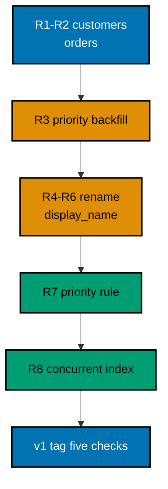

A small shop needs an order-management schema that can change without closing: customers gain a display name through a zero-downtime rename, orders gain a backfilled priority, the new rule lands as a real constraint, and the lookup index builds without locking writes. You ship the schema through eight Liquibase releases, tag the release, then prove the final state with five verification checks that count every changeset, the tag, and every row the releases carried.

## The story

The shop opens with two tables: `customers` with a `name`, and `orders` with a customer reference and a total. Reality arrives in waves familiar from the course. First the structure wave: release 1 creates `customers` with two seeded customers, and release 2 creates `orders` with two seeded orders linked by name lookup, never by hardcoded ids. Then the enrichment wave: release 3 adds a `priority` column and backfills it from each order's total, so the schema and the data travel together.

Then the naming wave: `name` is ambiguous, so release 4 adds `display_name` beside it (expand), release 5 copies every value across (migrate), and release 6 — a release later, after readers move — drops `name` (contract). That trio is the expand-migrate-contract from Examples 37 to 39, now carrying real customer data. Then the governance wave: release 7 locks the priority rule in as a `CHECK` constraint, so invalid rows fail loudly at insert. Finally the speed wave: release 8 builds the customer lookup index with `CONCURRENTLY`, outside a transaction, so orders keep flowing while reads get fast. Lookup seeding follows Example 33; the concurrent index follows Example 39. A `v1` tag seals the release, the return ticket for a future rollback.

## The migration ledger

| Release | Change                                          | Pattern                                     |
| ------- | ----------------------------------------------- | ------------------------------------------- |
| 001     | Create `customers`, seed two customers          | First migration, one table                  |
| 002     | Create `orders`, seed two orders by name lookup | Structure plus seed data                    |
| 003     | Add `priority` with backfill from totals        | Expand with immediate backfill              |
| 004     | Add `display_name` beside `name`                | Zero-downtime rename, step one (expand)     |
| 005     | Copy every name to `display_name`               | Zero-downtime rename, step two (migrate)    |
| 006     | Drop `name`                                     | Zero-downtime rename, step three (contract) |
| 007     | `CHECK` constraint on `priority`                | Rule at the boundary                        |
| 008     | Index `orders(customer_id)` with `CONCURRENTLY` | Index without locking writes                |

Eight releases, each reviewed in isolation, each replayable on every environment in prefix order. The history table after the run shows eight rows, all executed, the latest tagged `v1` — the same straight line the course preaches from Example 9 onward.

## Verification

The program runs the master, tags the release, then runs five checks: eight changesets in the history, the `v1` tag on the latest row, one high-priority order, two customers under the new name, and one concurrent index. Those five numbers pin the entire evolution: the backfill covered every order, the rename kept every customer, the rule and the index landed without touching a row. If any release lost data, the counts would say so before any human looked.



**`learning/capstone/code/Main.java`**:

```java
// Capstone: Order Management Across Eight Migrations.
// Eight releases build one order-management schema the way the course
// teaches: tables with keys first, a backfill second, a three-release
// rename third, a validated rule fourth, and a concurrent index last,
// sealed with a release tag. Run the master, tag the release, then prove
// every technique landed with five verification reads.
import java.sql.Connection; // => the handle every move and check shares
import java.sql.DriverManager; // => finds the PostgreSQL driver from the locked jars
import java.sql.ResultSet; // => walks the rows each verification query returns
import java.sql.Statement; // => carries the verification queries to the database
import java.util.Properties; // => carries the login without string-concatenated secrets
import liquibase.Liquibase; // => the entry point: configure, then update
import liquibase.Scope; // => silences progress narration for deterministic goldens
import liquibase.database.Database; // => Liquibase's view of our PostgreSQL connection
import liquibase.database.DatabaseFactory; // => picks the PostgreSQL implementation from the URL
import liquibase.database.jvm.JdbcConnection; // => adapts our JDBC handle to Liquibase
import liquibase.resource.DirectoryResourceAccessor; // => the current file-based changelog accessor
import liquibase.ui.LoggerUIService; // => reroutes progress lines into the silenced log

public class Main {

  // => one public class per file, named after the file
  static Connection connect() throws Exception {
    // => the harness starts PostgreSQL 18 and publishes these variables
    String host = System.getenv().getOrDefault("PGHOST", "localhost");
    // => default keeps local experimentation working outside the harness
    String url = "jdbc:postgresql://" + host + ":5432/postgres";
    // => trust auth accepts any password, so only the user matters
    Properties props = new Properties();
    // => Properties carries the login without string-concatenated secrets
    props.setProperty("user", System.getenv().getOrDefault("PGUSER", "postgres"));
    // => DriverManager finds the PostgreSQL driver from the locked jars
    return DriverManager.getConnection(url, props);
  } // => connect is the only place that knows connection details

  // => Liquibase narrates on updates and tags alike, so one quiet runner
  // => covers the master run and the release tag between the checks
  static void runQuiet(Liquibase liquibase, boolean tag) throws Exception {
    // => the LOGGER service reroutes progress lines into the silenced JUL log
    Scope.child(
      java.util.Collections.singletonMap(Scope.Attr.ui.name(), new LoggerUIService()),
      // => the lambda runs inside the scope; main still throws Exception
      () -> {
        // => the flag selects the release move after the migration below
        if (tag) {
          // => name the current release point v1 for future rollbacks
          liquibase.tag("v1");
        } else {
          // => apply the whole eight-release master in prefix order
          liquibase.update("");
        } // => migrate first, tag second, verify last
      }
    );
    // => both moves stay inside the silenced scope, so goldens stay clean
  } // => quiet moves keep golden output identical on the harness double run

  // => one helper asks every capstone check in the same shape
  static int askCount(Connection conn, String query) throws Exception {
    // => every check is a count query with exactly one row and one number
    try (
      Statement st = conn.createStatement();
      // => try-with-resources closes the statement on every path
      ResultSet rs = st.executeQuery(query)
    ) {
      // => the query returns exactly one row with exactly one number
      rs.next();
      // => the number is the check's answer, printed by the caller
      return rs.getInt(1);
    } // => counts verify releases without dumping state into the transcript
  } // => helpers that verify stay separate from code that ships

  public static void main(String[] args) throws Exception {
    // => silence JUL so the LOGGER service lines below disappear too
    java.util.logging.LogManager.getLogManager().reset();
    // => the entry point the harness runs
    try (Connection conn = connect()) {
      // => one connection serves the capstone run, the tag, and the checks
      Database database = DatabaseFactory.getInstance()
        // => the factory picks the PostgreSQL implementation from the URL
        .findCorrectDatabaseImplementation(new JdbcConnection(conn));
      // => JdbcConnection adapts our JDBC handle to Liquibase's database API
      Liquibase liquibase = new Liquibase(
        // => the master delegates to the eight release files
        "db.changelog-master.yaml",
        // => DirectoryResourceAccessor is the current file-based accessor
        new DirectoryResourceAccessor(new java.io.File(".").getAbsoluteFile()),
        // => rooting at the capstone folder keeps db beside the program
        database
      );
      runQuiet(liquibase, false);
      // => eight releases apply in prefix order; the history holds eight rows
      runQuiet(liquibase, true);
      // => the v1 tag lands on the latest history row, the concurrent index
      System.out.println("capstone changesets applied: " + askCount(conn, "SELECT count(*) FROM databasechangelog"));
      // => Output: capstone changesets applied: 8
      try (
        Statement st = conn.createStatement();
        ResultSet rs = st.executeQuery("SELECT tag FROM databasechangelog ORDER BY orderexecuted DESC LIMIT 1")
      ) {
        // => the latest row carries the release tag the program just set
        rs.next();
        System.out.println("release tag on latest: " + rs.getString(1));
        // => Output: release tag on latest: v1
      } // => the tag is the release's return ticket, readable from history
      System.out.println(
        "high priority orders: " + askCount(conn, "SELECT count(*) FROM orders WHERE priority = 'high'")
      );
      // => Output: high priority orders: 1
      System.out.println(
        "customers under new name: " + askCount(conn, "SELECT count(*) FROM customers WHERE display_name IS NOT NULL")
      );
      // => Output: customers under new name: 2
      System.out.println(
        "concurrent indexes: " +
          askCount(conn, "SELECT count(*) FROM pg_indexes WHERE indexname = 'ix_orders_customer'")
      );
      // => Output: concurrent indexes: 1
      // => a rerun skips all eight releases, re-tags, and prints the same
    } // => closing the connection ends the capstone with the release tagged
  } // => main migrates eight releases, tags one, and proves all five checks
}
```

**Releases** (`learning/capstone/code/db/releases/`): 001 creates customers and seeds two rows; 002 creates orders and seeds two rows by name lookup; 003 adds priority with backfill; 004 adds display_name; 005 copies names; 006 drops name; 007 adds the priority check; 008 builds the lookup index concurrently outside a transaction.

**Output** (`learning/capstone/code/expected/main/main.stdout.txt`):

```text
capstone changesets applied: 8
release tag on latest: v1
high priority orders: 1
customers under new name: 2
concurrent indexes: 1
```

This capstone is complete when all five checks print exact counts: the schema evolved, no row was lost, and the history is one straight, tagged line.
