Examples 26–53 migrate real data on live tables. Backfills fill new columns without losing rows (Examples 26–34), zero-downtime splits expand before they contract so no deploy needs a maintenance window (Examples 35–44), and baselining imports legacy databases under version control (Examples 45–53). Every example is a complete, runnable Java program under `learning/code/` driving Liquibase against the pinned PostgreSQL 18 service container; run each with the command in its own `run.yaml`.

---

### Example 26: Inserts Seed Reference Data

Reference rows are data, not schema: they ship as insert changesets after the table exists, reviewable beside the structure they fill rather than hidden in a hand-run script. Seeds version with the schema they populate, so every environment builds the same lookup values from the same file. The program runs a create changeset plus a seed changeset, then proves the table holds exactly the three seeded rows with two history rows recorded. (Concepts: co-06.)

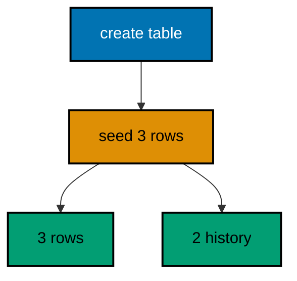

**`learning/code/ex-26-inserts-seed-reference-data/Main.java`**:

```java
// Example 26: Inserts Seed Reference Data.
// Reference rows are data, not schema: they ship as insert changesets
// after the table exists, reviewable beside the structure they fill.
// This program runs a create changeset plus a seed changeset, then proves
// the table holds exactly the three seeded rows.
import java.sql.Connection; // => the handle every move and check shares
import java.sql.DriverManager; // => finds the PostgreSQL driver from the locked jars
import java.sql.ResultSet; // => walks the rows each verification query returns
import java.sql.Statement; // => carries the verification queries to the database
import java.util.Properties; // => carries the login without string-concatenated secrets
import liquibase.Liquibase; // => the entry point: configure, then update
import liquibase.Scope; // => silences progress narration for deterministic goldens
import liquibase.database.Database; // => Liquibase's view of our PostgreSQL connection
import liquibase.database.DatabaseFactory; // => picks the PostgreSQL implementation from the URL
import liquibase.database.jvm.JdbcConnection; // => adapts our JDBC handle to Liquibase
import liquibase.resource.DirectoryResourceAccessor; // => the current file-based changelog accessor
import liquibase.ui.LoggerUIService; // => reroutes progress lines into the silenced log

public class Main {

  // => one public class per file, named after the file
  static Connection connect() throws Exception {
    // => the harness starts PostgreSQL 18 and publishes these variables
    String host = System.getenv().getOrDefault("PGHOST", "localhost");
    // => default keeps local experimentation working outside the harness
    String url = "jdbc:postgresql://" + host + ":5432/postgres";
    // => trust auth accepts any password, so only the user matters
    Properties props = new Properties();
    // => Properties carries the login without string-concatenated secrets
    props.setProperty("user", System.getenv().getOrDefault("PGUSER", "postgres"));
    // => DriverManager finds the PostgreSQL driver from the locked jars
    return DriverManager.getConnection(url, props);
  } // => connect is the only place that knows connection details

  // => Liquibase narrates progress to its console UI by default; those lines
  // => differ between a first run and a rerun, so goldens cannot hold them
  static void runQuiet(Liquibase liquibase) throws Exception {
    // => the LOGGER service reroutes progress lines into the silenced JUL log
    Scope.child(
      java.util.Collections.singletonMap(Scope.Attr.ui.name(), new LoggerUIService()),
      // => the lambda runs inside the scope; main still throws Exception
      () -> liquibase.update("")
    );
    // => update("") runs every changeset with no context filter
  } // => quiet updates keep golden output identical on the harness double run

  public static void main(String[] args) throws Exception {
    // => silence JUL so the LOGGER service lines below disappear too
    java.util.logging.LogManager.getLogManager().reset();
    // => the entry point the harness runs
    try (Connection conn = connect()) {
      // => one connection serves the seed run and both counts
      Database database = DatabaseFactory.getInstance()
        // => the factory picks the PostgreSQL implementation from the URL
        .findCorrectDatabaseImplementation(new JdbcConnection(conn));
      // => JdbcConnection adapts our JDBC handle to Liquibase's database API
      Liquibase liquibase = new Liquibase(
        // => two changesets: the table first, then its three seed rows
        "changelog.sql",
        // => DirectoryResourceAccessor is the current file-based accessor
        new DirectoryResourceAccessor(new java.io.File(".").getAbsoluteFile()),
        // => rooting at the unit directory keeps changelogs beside the program
        database
      );
      runQuiet(liquibase);
      // => the update ran quiet, so the transcript holds only our own prints
      try (Statement st = conn.createStatement(); ResultSet rs = st.executeQuery("SELECT count(*) FROM cultivars")) {
        // => three seeded rows prove the insert changeset ran exactly once
        rs.next();
        System.out.println("seeded rows: " + rs.getInt(1));
        // => Output: seeded rows: 3
      } // => counts verify data without dumping rows into the transcript
      try (
        Statement st = conn.createStatement();
        ResultSet rs = st.executeQuery("SELECT count(*) FROM databasechangelog")
      ) {
        // => structure plus seed are two tracked changesets, nothing more
        rs.next();
        System.out.println("changesets applied: " + rs.getInt(1));
        // => Output: changesets applied: 2
        // => a rerun skips both changesets and prints the identical counts
      } // => reading history back is a habit every later example repeats
    } // => closing the connection ends the program with history intact
  } // => main seeds the reference rows, then counts them
}
```

**`learning/code/ex-26-inserts-seed-reference-data/changelog.sql`**:

```sql
-- liquibase formatted sql
-- => REQUIRED first line: marks this file as a Liquibase SQL changelog
-- => Without it Liquibase runs the SQL untracked, and nothing is recorded.
-- changeset course:001-make-cultivars
-- => the structure changeset creates the cultivars table with no rows yet
-- => seeds arrive separately below, reviewable beside this structure
CREATE TABLE cultivars (
  id SERIAL PRIMARY KEY,
  -- => SERIAL gives an auto-incrementing integer key, enough for this course
  name VARCHAR(60) NOT NULL
  -- => cultivar names are required from the first migration
);

-- rollback DROP TABLE cultivars;
-- => dropping the table reverses exactly what this changeset built
-- changeset course:002-seed-cultivars
-- => the data changeset inserts exactly three reference rows
-- => reruns skip it as applied, so the rows never duplicate
INSERT INTO
  cultivars (name)
VALUES
  ('arabica'),
  ('robusta'),
  ('liberica');

-- rollback DELETE FROM cultivars;
-- => the declared delete removes exactly the rows this changeset added
```

**Output** (`learning/code/ex-26-inserts-seed-reference-data/expected/main.stdout.txt`):

```text
seeded rows: 3
changesets applied: 2
```

**Key takeaway**: Seed inserts ship as tracked changesets after their tables, so reference data versions with the schema it fills.

**Why it matters**: Reference data loaded by hand diverges by environment within weeks: staging has four rows, production has three, and nobody knows which is right. Seeds in the changelog build identical lookup values everywhere from the same reviewed file, and reruns skip them instead of duplicating. When a seed needs changing, the change is a new changeset with its own reverse, not an UPDATE fired at production from a laptop. Version the data with the structure or accept that environments will disagree about the world.

---

### Example 27: Updates Backfill a New Column

New columns start empty on old rows, and a backfill update computes each row's value from data already there: the schema changeset adds the column, the data changeset derives its values, and either can roll back alone. Keeping the two apart means a bad derivation reverts without dropping the column. The program adds a tier column, backfills it from the email domain, then proves no row lacks a tier and two distinct derived values resulted. (Concepts: co-06, co-07.)

**`learning/code/ex-27-updates-backfill-a-new-column/Main.java`**:

```java
// Example 27: Updates Backfill a New Column.
// New columns start empty on old rows; a backfill update computes each
// row's value from data already there. Schema and data stay separate
// changesets so either can roll back alone. This program adds a tier
// column, backfills it from the email domain, then proves every row
// carries the derived value.
import java.sql.Connection; // => the handle every move and check shares
import java.sql.DriverManager; // => finds the PostgreSQL driver from the locked jars
import java.sql.ResultSet; // => walks the rows each verification query returns
import java.sql.Statement; // => carries the verification queries to the database
import java.util.Properties; // => carries the login without string-concatenated secrets
import liquibase.Liquibase; // => the entry point: configure, then update
import liquibase.Scope; // => silences progress narration for deterministic goldens
import liquibase.database.Database; // => Liquibase's view of our PostgreSQL connection
import liquibase.database.DatabaseFactory; // => picks the PostgreSQL implementation from the URL
import liquibase.database.jvm.JdbcConnection; // => adapts our JDBC handle to Liquibase
import liquibase.resource.DirectoryResourceAccessor; // => the current file-based changelog accessor
import liquibase.ui.LoggerUIService; // => reroutes progress lines into the silenced log

public class Main {

  // => one public class per file, named after the file
  static Connection connect() throws Exception {
    // => the harness starts PostgreSQL 18 and publishes these variables
    String host = System.getenv().getOrDefault("PGHOST", "localhost");
    // => default keeps local experimentation working outside the harness
    String url = "jdbc:postgresql://" + host + ":5432/postgres";
    // => trust auth accepts any password, so only the user matters
    Properties props = new Properties();
    // => Properties carries the login without string-concatenated secrets
    props.setProperty("user", System.getenv().getOrDefault("PGUSER", "postgres"));
    // => DriverManager finds the PostgreSQL driver from the locked jars
    return DriverManager.getConnection(url, props);
  } // => connect is the only place that knows connection details

  // => Liquibase narrates progress to its console UI by default; those lines
  // => differ between a first run and a rerun, so goldens cannot hold them
  static void runQuiet(Liquibase liquibase) throws Exception {
    // => the LOGGER service reroutes progress lines into the silenced JUL log
    Scope.child(
      java.util.Collections.singletonMap(Scope.Attr.ui.name(), new LoggerUIService()),
      // => the lambda runs inside the scope; main still throws Exception
      () -> liquibase.update("")
    );
    // => update("") runs every changeset with no context filter
  } // => quiet updates keep golden output identical on the harness double run

  public static void main(String[] args) throws Exception {
    // => silence JUL so the LOGGER service lines below disappear too
    java.util.logging.LogManager.getLogManager().reset();
    // => the entry point the harness runs
    try (Connection conn = connect()) {
      // => one connection serves the backfill run and both checks
      Database database = DatabaseFactory.getInstance()
        // => the factory picks the PostgreSQL implementation from the URL
        .findCorrectDatabaseImplementation(new JdbcConnection(conn));
      // => JdbcConnection adapts our JDBC handle to Liquibase's database API
      Liquibase liquibase = new Liquibase(
        // => three changesets: table, column, then the backfill update
        "changelog.sql",
        // => DirectoryResourceAccessor is the current file-based accessor
        new DirectoryResourceAccessor(new java.io.File(".").getAbsoluteFile()),
        // => rooting at the unit directory keeps changelogs beside the program
        database
      );
      runQuiet(liquibase);
      // => the update ran quiet, so the transcript holds only our own prints
      try (
        Statement st = conn.createStatement();
        ResultSet rs = st.executeQuery("SELECT count(*) FROM subscribers WHERE tier IS NULL")
      ) {
        // => the backfill must leave zero rows without a derived tier
        rs.next();
        System.out.println("rows missing a tier: " + rs.getInt(1));
        // => Output: rows missing a tier: 0
      } // => zero nulls prove the backfill reached every old row
      try (
        Statement st = conn.createStatement();
        ResultSet rs = st.executeQuery("SELECT count(DISTINCT tier) FROM subscribers WHERE tier IN ('basic', 'pro')")
      ) {
        // => edu addresses became pro, everything else became basic
        rs.next();
        System.out.println("distinct derived tiers: " + rs.getInt(1));
        // => Output: distinct derived tiers: 2
        // => a rerun skips all three changesets and prints identical counts
      } // => derived values prove the update read each row before writing
    } // => closing the connection ends the program with history intact
  } // => main backfills the column, then proves no row was missed
}
```

**`learning/code/ex-27-updates-backfill-a-new-column/changelog.sql`**:

```sql
-- liquibase formatted sql
-- => REQUIRED first line: marks this file as a Liquibase SQL changelog
-- => Without it Liquibase runs the SQL untracked, and nothing is recorded.
-- changeset course:001-make-subscribers
-- => the table changeset creates subscribers and seeds three emails
-- => the tier column arrives later, so these rows start life tierless
CREATE TABLE subscribers (
  id SERIAL PRIMARY KEY,
  -- => SERIAL gives an auto-incrementing integer key, enough for this course
  email VARCHAR(120) NOT NULL
  -- => the email domain below decides each row's derived tier
);

INSERT INTO
  subscribers (email)
VALUES
  ('budi@kampus.edu'),
  ('sari@mail.id'),
  ('agus@kampus.edu');

-- => three seeded rows: two edu addresses and one regular address
-- => reruns skip this changeset as applied, so the rows never duplicate
-- rollback DROP TABLE subscribers;
-- => dropping the table reverses exactly what this changeset built
-- changeset course:002-add-tier
-- => the schema changeset adds the tier column, nullable for now
-- => old rows hold NULL until the backfill below derives their values
ALTER TABLE subscribers
ADD COLUMN tier VARCHAR(20);

-- rollback ALTER TABLE subscribers DROP COLUMN tier;
-- => dropping the column reverses exactly what this changeset added
-- changeset course:003-backfill-tier
-- => the data changeset derives every row's tier from its email domain
-- => reruns skip it as applied, so values never double-derive
UPDATE subscribers
SET
  tier = CASE
    WHEN email LIKE '%@kampus.edu' THEN 'pro'
    ELSE 'basic'
  END;

-- rollback UPDATE subscribers SET tier = NULL;
-- => nulling the column un-derives every row without dropping the column
```

**Output** (`learning/code/ex-27-updates-backfill-a-new-column/expected/main.stdout.txt`):

```text
rows missing a tier: 0
distinct derived tiers: 2
```

**Key takeaway**: Backfill updates derive new-column values from existing rows in their own changesets, separable from the schema change.

**Why it matters**: A new non-nullable column without a backfill locks every old row out of the new rule: writes fail, reads assume, and the deploy that added the column becomes the incident that fills it. Deriving values from data already present keeps the migration self-contained — no external mapping files, no manual steps, no second deploy. And when the derivation logic is wrong, only the data changeset rolls back while the column stands, so the fix is a corrected update rather than a schema rebuild. Backfill from what you have, in a step you can undo alone.

---

### Example 28: loadData Imports a CSV Fixture

Hand-written inserts do not scale to thousand-row reference sets: the loadData change loads a CSV file beside the changelog in one changeset, with columns mapped by header name and the file reviewed like code. Fixtures live in version control next to the migrations that consume them. The program loads four spice rows from seeds.csv, then proves the table holds exactly those four rows with two from Maluku. (Concepts: co-06.)

**`learning/code/ex-28-loaddata-imports-a-csv-fixture/Main.java`**:

```java
// Example 28: loadData Imports a CSV Fixture.
// Hand-written inserts do not scale to thousand-row reference sets; the
// loadData change loads a CSV file beside the changelog in one changeset,
// with columns mapped by header name. This program loads four spice rows
// from seeds.csv, then proves the table holds exactly those four rows.
import java.sql.Connection; // => the handle every move and check shares
import java.sql.DriverManager; // => finds the PostgreSQL driver from the locked jars
import java.sql.ResultSet; // => walks the rows each verification query returns
import java.sql.Statement; // => carries the verification queries to the database
import java.util.Properties; // => carries the login without string-concatenated secrets
import liquibase.Liquibase; // => the entry point: configure, then update
import liquibase.Scope; // => silences progress narration for deterministic goldens
import liquibase.database.Database; // => Liquibase's view of our PostgreSQL connection
import liquibase.database.DatabaseFactory; // => picks the PostgreSQL implementation from the URL
import liquibase.database.jvm.JdbcConnection; // => adapts our JDBC handle to Liquibase
import liquibase.resource.DirectoryResourceAccessor; // => the current file-based changelog accessor
import liquibase.ui.LoggerUIService; // => reroutes progress lines into the silenced log

public class Main {

  // => one public class per file, named after the file
  static Connection connect() throws Exception {
    // => the harness starts PostgreSQL 18 and publishes these variables
    String host = System.getenv().getOrDefault("PGHOST", "localhost");
    // => default keeps local experimentation working outside the harness
    String url = "jdbc:postgresql://" + host + ":5432/postgres";
    // => trust auth accepts any password, so only the user matters
    Properties props = new Properties();
    // => Properties carries the login without string-concatenated secrets
    props.setProperty("user", System.getenv().getOrDefault("PGUSER", "postgres"));
    // => DriverManager finds the PostgreSQL driver from the locked jars
    return DriverManager.getConnection(url, props);
  } // => connect is the only place that knows connection details

  // => Liquibase narrates progress to its console UI by default; those lines
  // => differ between a first run and a rerun, so goldens cannot hold them
  static void runQuiet(Liquibase liquibase) throws Exception {
    // => the LOGGER service reroutes progress lines into the silenced JUL log
    Scope.child(
      java.util.Collections.singletonMap(Scope.Attr.ui.name(), new LoggerUIService()),
      // => the lambda runs inside the scope; main still throws Exception
      () -> liquibase.update("")
    );
    // => update("") runs every changeset with no context filter
  } // => quiet updates keep golden output identical on the harness double run

  public static void main(String[] args) throws Exception {
    // => silence JUL so the LOGGER service lines below disappear too
    java.util.logging.LogManager.getLogManager().reset();
    // => the entry point the harness runs
    try (Connection conn = connect()) {
      // => one connection serves the load run and both checks
      Database database = DatabaseFactory.getInstance()
        // => the factory picks the PostgreSQL implementation from the URL
        .findCorrectDatabaseImplementation(new JdbcConnection(conn));
      // => JdbcConnection adapts our JDBC handle to Liquibase's database API
      Liquibase liquibase = new Liquibase(
        // => two changesets: the table first, then the CSV load
        "changelog.yaml",
        // => DirectoryResourceAccessor is the current file-based accessor
        new DirectoryResourceAccessor(new java.io.File(".").getAbsoluteFile()),
        // => rooting at the unit directory keeps changelogs beside the program
        database
      );
      runQuiet(liquibase);
      // => the update ran quiet, so the transcript holds only our own prints
      try (Statement st = conn.createStatement(); ResultSet rs = st.executeQuery("SELECT count(*) FROM spices")) {
        // => four CSV rows prove the load changeset ran exactly once
        rs.next();
        System.out.println("loaded rows: " + rs.getInt(1));
        // => Output: loaded rows: 4
      } // => counts verify data without dumping rows into the transcript
      try (
        Statement st = conn.createStatement();
        ResultSet rs = st.executeQuery("SELECT count(*) FROM spices WHERE origin = 'Maluku'")
      ) {
        // => two of the four rows carry the Maluku origin from the file
        rs.next();
        System.out.println("maluku rows: " + rs.getInt(1));
        // => Output: maluku rows: 2
        // => a rerun skips both changesets and prints the identical counts
      } // => header-mapped columns prove the CSV parsed as intended
    } // => closing the connection ends the program with history intact
  } // => main loads the CSV fixture, then counts what landed
}
```

**`learning/code/ex-28-loaddata-imports-a-csv-fixture/changelog.yaml`**:

```yaml
databaseChangeLog: # => Root key required for every YAML changelog
  - changeSet: # => The structure changeset creates the spices table first
      id: 001-make-spices
      # => loads always target a table an earlier changeset created
      author: course
      # => one author keeps the identity triples in this file uniform
      changes:
        - createTable: # => Declarative table creation, the YAML counterpart of DDL
            tableName: spices
            # => the spices the CSV load below fills
            columns:
              - column: # => One entry per column, name and type together
                  name: id
                  type: SERIAL
                  constraints:
                    primaryKey: true
              - column:
                  name: name
                  type: VARCHAR(60)
              - column:
                  name: origin
                  type: VARCHAR(60)
  - changeSet: # => The data changeset loads the CSV file in one move
      id: 002-load-spices
      # => reruns skip it as applied, so the rows never duplicate
      author: course
      changes:
        - loadData: # => loadData maps CSV headers onto table columns
            tableName: spices
            # => the table the four CSV rows land in
            file: seeds.csv
            # => the fixture lives beside this changelog in the unit folder
            relativeToChangelogFile: true
            # => relative resolution keeps the unit portable across machines
```

**`learning/code/ex-28-loaddata-imports-a-csv-fixture/seeds.csv`**:

```csv
name,origin
cengkeh,Maluku
pala,Maluku
lada,Lampung
kunyit,Java
```

**Output** (`learning/code/ex-28-loaddata-imports-a-csv-fixture/expected/main.stdout.txt`):

```text
loaded rows: 4
maluku rows: 2
```

**Key takeaway**: loadData imports CSV fixtures by header mapping in one changeset, so bulk reference data versions like any migration.

**Why it matters**: Bulk loads done outside the changelog are invisible to history: the rows exist but no changeset claims them, so no environment rebuild reproduces them and no rollback removes them. A CSV beside the changelog with a loadData changeset makes the fixture's contents reviewable in the same pull request as its table, and reruns skip the load instead of duplicating thousands of rows. Data that arrives without a changeset is data without provenance; loadData gives bulk rows the same audit trail single inserts already enjoy.

---

### Example 29: Batched Updates Migrate Large Tables

One giant update locks every row it touches until it commits; small ranged batches hold each lock briefly and survive interruption between batches, resuming from the next batch instead of restarting. Batching trades one long lock for several short ones that live traffic barely notices. The program seeds six rows, scores them in three two-row batches addressed by stable codes, then proves no row was missed and three score bands resulted. (Concepts: co-06, co-09.)

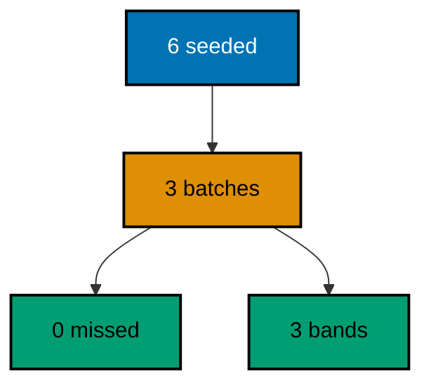

**`learning/code/ex-29-batched-updates-migrate-large-tables/Main.java`**:

```java
// Example 29: Batched Updates Migrate Large Tables.
// One giant update locks every row it touches until it commits; small
// ranged batches hold each lock briefly and survive interruption between
// batches. This program seeds six rows, scores them in three two-row
// batches, then proves no row was missed and three score bands resulted.
import java.sql.Connection; // => the handle every move and check shares
import java.sql.DriverManager; // => finds the PostgreSQL driver from the locked jars
import java.sql.ResultSet; // => walks the rows each verification query returns
import java.sql.Statement; // => carries the verification queries to the database
import java.util.Properties; // => carries the login without string-concatenated secrets
import liquibase.Liquibase; // => the entry point: configure, then update
import liquibase.Scope; // => silences progress narration for deterministic goldens
import liquibase.database.Database; // => Liquibase's view of our PostgreSQL connection
import liquibase.database.DatabaseFactory; // => picks the PostgreSQL implementation from the URL
import liquibase.database.jvm.JdbcConnection; // => adapts our JDBC handle to Liquibase
import liquibase.resource.DirectoryResourceAccessor; // => the current file-based changelog accessor
import liquibase.ui.LoggerUIService; // => reroutes progress lines into the silenced log

public class Main {

  // => one public class per file, named after the file
  static Connection connect() throws Exception {
    // => the harness starts PostgreSQL 18 and publishes these variables
    String host = System.getenv().getOrDefault("PGHOST", "localhost");
    // => default keeps local experimentation working outside the harness
    String url = "jdbc:postgresql://" + host + ":5432/postgres";
    // => trust auth accepts any password, so only the user matters
    Properties props = new Properties();
    // => Properties carries the login without string-concatenated secrets
    props.setProperty("user", System.getenv().getOrDefault("PGUSER", "postgres"));
    // => DriverManager finds the PostgreSQL driver from the locked jars
    return DriverManager.getConnection(url, props);
  } // => connect is the only place that knows connection details

  // => Liquibase narrates progress to its console UI by default; those lines
  // => differ between a first run and a rerun, so goldens cannot hold them
  static void runQuiet(Liquibase liquibase) throws Exception {
    // => the LOGGER service reroutes progress lines into the silenced JUL log
    Scope.child(
      java.util.Collections.singletonMap(Scope.Attr.ui.name(), new LoggerUIService()),
      // => the lambda runs inside the scope; main still throws Exception
      () -> liquibase.update("")
    );
    // => update("") runs every changeset with no context filter
  } // => quiet updates keep golden output identical on the harness double run

  public static void main(String[] args) throws Exception {
    // => silence JUL so the LOGGER service lines below disappear too
    java.util.logging.LogManager.getLogManager().reset();
    // => the entry point the harness runs
    try (Connection conn = connect()) {
      // => one connection serves the batch run and both checks
      Database database = DatabaseFactory.getInstance()
        // => the factory picks the PostgreSQL implementation from the URL
        .findCorrectDatabaseImplementation(new JdbcConnection(conn));
      // => JdbcConnection adapts our JDBC handle to Liquibase's database API
      Liquibase liquibase = new Liquibase(
        // => four changesets: the seed plus three two-row batches
        "changelog.sql",
        // => DirectoryResourceAccessor is the current file-based accessor
        new DirectoryResourceAccessor(new java.io.File(".").getAbsoluteFile()),
        // => rooting at the unit directory keeps changelogs beside the program
        database
      );
      runQuiet(liquibase);
      // => the update ran quiet, so the transcript holds only our own prints
      try (
        Statement st = conn.createStatement();
        ResultSet rs = st.executeQuery("SELECT count(*) FROM parcels WHERE score IS NULL")
      ) {
        // => three batches must leave zero rows unscored
        rs.next();
        System.out.println("unscored rows: " + rs.getInt(1));
        // => Output: unscored rows: 0
      } // => zero nulls prove the batches covered every seeded row
      try (
        Statement st = conn.createStatement();
        ResultSet rs = st.executeQuery("SELECT count(DISTINCT score) FROM parcels")
      ) {
        // => each batch wrote its own score band, three bands in total
        rs.next();
        System.out.println("distinct score bands: " + rs.getInt(1));
        // => Output: distinct score bands: 3
        // => a rerun skips all four changesets and prints identical counts
      } // => three bands prove three independent batches ran in order
    } // => closing the connection ends the program with history intact
  } // => main scores the table batch by batch, then proves full coverage
}
```

**`learning/code/ex-29-batched-updates-migrate-large-tables/changelog.sql`**:

```sql
-- liquibase formatted sql
-- => REQUIRED first line: marks this file as a Liquibase SQL changelog
-- => Without it Liquibase runs the SQL untracked, and nothing is recorded.
-- changeset course:001-seed-parcels
-- => the seed changeset creates the table and inserts six unscored rows
-- => stable codes (not ids) address the rows the batches below score
CREATE TABLE parcels (
  id SERIAL PRIMARY KEY,
  -- => SERIAL gives an auto-incrementing integer key, enough for this course
  code VARCHAR(20) NOT NULL,
  -- => codes are the stable batch keys; ids are never hardcoded
  score INTEGER
  -- => scores start NULL; each batch below fills its own two rows
);

INSERT INTO
  parcels (code)
VALUES
  ('B-1'),
  ('B-2'),
  ('B-3'),
  ('B-4'),
  ('B-5'),
  ('B-6');

-- => six seeded rows in three natural pairs for the three batches
-- rollback DROP TABLE parcels;
-- => dropping the table reverses the seed and every batch above it
-- changeset course:002-score-first-batch
-- => the first batch scores only the B-1 and B-2 rows
-- => a narrow WHERE keeps the locked row set small and brief
UPDATE parcels
SET
  score = 10
WHERE
  code IN ('B-1', 'B-2');

-- rollback UPDATE parcels SET score = NULL WHERE code IN ('B-1', 'B-2');
-- => nulling exactly the batch's rows reverses this batch alone
-- changeset course:003-score-second-batch
-- => the second batch scores only the B-3 and B-4 rows
-- => interruption between batches leaves completed bands committed
UPDATE parcels
SET
  score = 20
WHERE
  code IN ('B-3', 'B-4');

-- rollback UPDATE parcels SET score = NULL WHERE code IN ('B-3', 'B-4');
-- => each batch carries its own reverse, independent of its neighbours
-- changeset course:004-score-third-batch
-- => the third batch scores the final B-5 and B-6 rows
-- => three small commits beat one six-row lock for live tables
UPDATE parcels
SET
  score = 30
WHERE
  code IN ('B-5', 'B-6');

-- rollback UPDATE parcels SET score = NULL WHERE code IN ('B-5', 'B-6');
-- => the last batch reverses first when the release rolls back
```

**Output** (`learning/code/ex-29-batched-updates-migrate-large-tables/expected/main.stdout.txt`):

```text
unscored rows: 0
distinct score bands: 3
```

**Key takeaway**: Ranged batch updates migrate large tables under brief locks, resuming between batches instead of restarting.

**Why it matters**: A single update over millions of rows holds locks long enough to stall live traffic, and when it fails at ninety percent, the retry starts from zero while the lock clock restarts. Batches bound every lock to seconds and every failure to one batch's worth of redo, which turns a migration that needs a maintenance window into one that runs beside lunch traffic. Addressing batches by stable keys instead of ids keeps each batch's scope exact across reruns. Migrate at the speed of short locks and the table never notices you were there.

---

### Example 30: Schema First, Backfill Second

Data needs a place to land: the schema changeset must run before the backfill changeset, and the history order is the proof deploy reviewers read before approving. Order is a contract, not a suggestion — reversing it fails the backfill against a missing column. The program runs a schema-then-backfill pair, prints the execution order to prove structure landed before content, and counts the two stocked rows the schema prepared for. (Concepts: co-06, co-03.)

**`learning/code/ex-30-schema-first-backfill-second/Main.java`**:

```java
// Example 30: Schema First, Backfill Second.
// Data needs a place to land: the schema changeset must run before the
// backfill changeset, and the history order is the proof deploy reviewers
// read. This program runs a schema-then-backfill pair, then prints the
// execution order to prove structure landed before content.
import java.sql.Connection; // => the handle every move and check shares
import java.sql.DriverManager; // => finds the PostgreSQL driver from the locked jars
import java.sql.ResultSet; // => walks the rows each verification query returns
import java.sql.Statement; // => carries the verification queries to the database
import java.util.Properties; // => carries the login without string-concatenated secrets
import liquibase.Liquibase; // => the entry point: configure, then update
import liquibase.Scope; // => silences progress narration for deterministic goldens
import liquibase.database.Database; // => Liquibase's view of our PostgreSQL connection
import liquibase.database.DatabaseFactory; // => picks the PostgreSQL implementation from the URL
import liquibase.database.jvm.JdbcConnection; // => adapts our JDBC handle to Liquibase
import liquibase.resource.DirectoryResourceAccessor; // => the current file-based changelog accessor
import liquibase.ui.LoggerUIService; // => reroutes progress lines into the silenced log

public class Main {

  // => one public class per file, named after the file
  static Connection connect() throws Exception {
    // => the harness starts PostgreSQL 18 and publishes these variables
    String host = System.getenv().getOrDefault("PGHOST", "localhost");
    // => default keeps local experimentation working outside the harness
    String url = "jdbc:postgresql://" + host + ":5432/postgres";
    // => trust auth accepts any password, so only the user matters
    Properties props = new Properties();
    // => Properties carries the login without string-concatenated secrets
    props.setProperty("user", System.getenv().getOrDefault("PGUSER", "postgres"));
    // => DriverManager finds the PostgreSQL driver from the locked jars
    return DriverManager.getConnection(url, props);
  } // => connect is the only place that knows connection details

  // => Liquibase narrates progress to its console UI by default; those lines
  // => differ between a first run and a rerun, so goldens cannot hold them
  static void runQuiet(Liquibase liquibase) throws Exception {
    // => the LOGGER service reroutes progress lines into the silenced JUL log
    Scope.child(
      java.util.Collections.singletonMap(Scope.Attr.ui.name(), new LoggerUIService()),
      // => the lambda runs inside the scope; main still throws Exception
      () -> liquibase.update("")
    );
    // => update("") runs every changeset with no context filter
  } // => quiet updates keep golden output identical on the harness double run

  public static void main(String[] args) throws Exception {
    // => silence JUL so the LOGGER service lines below disappear too
    java.util.logging.LogManager.getLogManager().reset();
    // => the entry point the harness runs
    try (Connection conn = connect()) {
      // => one connection serves the ordered run and both checks
      Database database = DatabaseFactory.getInstance()
        // => the factory picks the PostgreSQL implementation from the URL
        .findCorrectDatabaseImplementation(new JdbcConnection(conn));
      // => JdbcConnection adapts our JDBC handle to Liquibase's database API
      Liquibase liquibase = new Liquibase(
        // => two changesets: the schema first, the backfill second
        "changelog.sql",
        // => DirectoryResourceAccessor is the current file-based accessor
        new DirectoryResourceAccessor(new java.io.File(".").getAbsoluteFile()),
        // => rooting at the unit directory keeps changelogs beside the program
        database
      );
      runQuiet(liquibase);
      // => file order runs the schema before the backfill, as reviewed
      try (
        Statement st = conn.createStatement();
        ResultSet rs = st.executeQuery("SELECT id FROM databasechangelog ORDER BY orderexecuted")
      ) {
        // => the execution order is the deploy contract in miniature
        StringBuilder order = new StringBuilder();
        // => the builder collects the ids in the order they executed
        while (rs.next()) {
          // => each id is one changeset, schema before backfill
          if (order.length() > 0) {
            // => commas separate the steps without extra whitespace
            order.append(",");
          } // => the first id needs no separator before it
          order.append(rs.getString(1));
          // => appending preserves the database-reported execution order
        } // => the joined ids read as the migration sequence itself
        System.out.println("execution order: " + order);
        // => Output: execution order: 001-make-shelves,002-stock-shelves
      } // => order numbers prove structure landed before content
      try (Statement st = conn.createStatement(); ResultSet rs = st.executeQuery("SELECT count(*) FROM shelves")) {
        // => the backfill stocked exactly the rows the schema prepared
        rs.next();
        System.out.println("stocked rows: " + rs.getInt(1));
        // => Output: stocked rows: 2
        // => a rerun skips both changesets and prints the identical lines
      } // => counts verify data without dumping rows into the transcript
    } // => closing the connection ends the program with history intact
  } // => main runs schema then backfill, and proves the sequence
}
```

**`learning/code/ex-30-schema-first-backfill-second/changelog.sql`**:

```sql
-- liquibase formatted sql
-- => REQUIRED first line: marks this file as a Liquibase SQL changelog
-- => Without it Liquibase runs the SQL untracked, and nothing is recorded.
-- changeset course:001-make-shelves
-- => the schema changeset creates the shelves table with no rows yet
-- => it must run first: the backfill below has nowhere to land otherwise
CREATE TABLE shelves (
  id SERIAL PRIMARY KEY,
  -- => SERIAL gives an auto-incrementing integer key, enough for this course
  code VARCHAR(20) NOT NULL
  -- => shelf codes are required from the first migration
);

-- rollback DROP TABLE shelves;
-- => dropping the table reverses the schema and orphans the backfill
-- changeset course:002-stock-shelves
-- => the data changeset stocks exactly two rows into the prepared table
-- => running second is load-bearing: the table must exist by now
INSERT INTO
  shelves (code)
VALUES
  ('S-1'),
  ('S-2');

-- rollback DELETE FROM shelves;
-- => the declared delete un-stocks without dropping the prepared schema
```

**Output** (`learning/code/ex-30-schema-first-backfill-second/expected/main.stdout.txt`):

```text
execution order: 001-make-shelves,002-stock-shelves
stocked rows: 2
```

**Key takeaway**: Schema changesets precede their backfills in file order, and the history order proves the contract held.

**Why it matters**: Backfills written before their columns fail loudly, but backfills merged in the wrong order fail silently on some environments and succeed on others, depending on which half of a reordered history ran first. File order is the only sequencing reviewers can verify without executing, which makes schema-before-data a reviewable property rather than a runtime hope. The history order then confirms every environment ran the contract as reviewed. Sequence is load-bearing in migrations; write it where everyone can read it and check it where no one can dispute it.

---

### Example 31: Deletes Remove Retired Rows

Retired rows are data, so their removal ships as a delete changeset with its own history row, not as a hand-run cleanup nobody recorded. Tracked deletes replay on every environment and roll back with declared reverses, while hand-run deletes work once on one database and leave the rest guessing. The program seeds four models, retires the two analog ones by kind, then proves exactly the digital rows remain with zero retired rows left. (Concepts: co-06, co-08.)

**`learning/code/ex-31-deletes-remove-retired-rows/Main.java`**:

```java
// Example 31: Deletes Remove Retired Rows.
// Retired rows are data, so their removal ships as a delete changeset with
// its own history row, not as a hand-run cleanup nobody recorded. This
// program seeds four oscilloscope models, retires the two analog ones,
// then proves exactly the digital rows remain.
import java.sql.Connection; // => the handle every move and check shares
import java.sql.DriverManager; // => finds the PostgreSQL driver from the locked jars
import java.sql.ResultSet; // => walks the rows each verification query returns
import java.sql.Statement; // => carries the verification queries to the database
import java.util.Properties; // => carries the login without string-concatenated secrets
import liquibase.Liquibase; // => the entry point: configure, then update
import liquibase.Scope; // => silences progress narration for deterministic goldens
import liquibase.database.Database; // => Liquibase's view of our PostgreSQL connection
import liquibase.database.DatabaseFactory; // => picks the PostgreSQL implementation from the URL
import liquibase.database.jvm.JdbcConnection; // => adapts our JDBC handle to Liquibase
import liquibase.resource.DirectoryResourceAccessor; // => the current file-based changelog accessor
import liquibase.ui.LoggerUIService; // => reroutes progress lines into the silenced log

public class Main {

  // => one public class per file, named after the file
  static Connection connect() throws Exception {
    // => the harness starts PostgreSQL 18 and publishes these variables
    String host = System.getenv().getOrDefault("PGHOST", "localhost");
    // => default keeps local experimentation working outside the harness
    String url = "jdbc:postgresql://" + host + ":5432/postgres";
    // => trust auth accepts any password, so only the user matters
    Properties props = new Properties();
    // => Properties carries the login without string-concatenated secrets
    props.setProperty("user", System.getenv().getOrDefault("PGUSER", "postgres"));
    // => DriverManager finds the PostgreSQL driver from the locked jars
    return DriverManager.getConnection(url, props);
  } // => connect is the only place that knows connection details

  // => Liquibase narrates progress to its console UI by default; those lines
  // => differ between a first run and a rerun, so goldens cannot hold them
  static void runQuiet(Liquibase liquibase) throws Exception {
    // => the LOGGER service reroutes progress lines into the silenced JUL log
    Scope.child(
      java.util.Collections.singletonMap(Scope.Attr.ui.name(), new LoggerUIService()),
      // => the lambda runs inside the scope; main still throws Exception
      () -> liquibase.update("")
    );
    // => update("") runs every changeset with no context filter
  } // => quiet updates keep golden output identical on the harness double run

  public static void main(String[] args) throws Exception {
    // => silence JUL so the LOGGER service lines below disappear too
    java.util.logging.LogManager.getLogManager().reset();
    // => the entry point the harness runs
    try (Connection conn = connect()) {
      // => one connection serves the retire run and both checks
      Database database = DatabaseFactory.getInstance()
        // => the factory picks the PostgreSQL implementation from the URL
        .findCorrectDatabaseImplementation(new JdbcConnection(conn));
      // => JdbcConnection adapts our JDBC handle to Liquibase's database API
      Liquibase liquibase = new Liquibase(
        // => two changesets: seed four models, then retire two
        "changelog.sql",
        // => DirectoryResourceAccessor is the current file-based accessor
        new DirectoryResourceAccessor(new java.io.File(".").getAbsoluteFile()),
        // => rooting at the unit directory keeps changelogs beside the program
        database
      );
      runQuiet(liquibase);
      // => the update ran quiet, so the transcript holds only our own prints
      try (Statement st = conn.createStatement(); ResultSet rs = st.executeQuery("SELECT count(*) FROM scopes")) {
        // => four seeded minus two retired leaves exactly two current rows
        rs.next();
        System.out.println("current rows: " + rs.getInt(1));
        // => Output: current rows: 2
      } // => counts verify data without dumping rows into the transcript
      try (
        Statement st = conn.createStatement();
        ResultSet rs = st.executeQuery("SELECT count(*) FROM scopes WHERE kind = 'analog'")
      ) {
        // => the retired kind must read zero: the delete was precise
        rs.next();
        System.out.println("retired rows remaining: " + rs.getInt(1));
        // => Output: retired rows remaining: 0
        // => a rerun skips both changesets and prints the identical counts
      } // => zero retired rows prove the WHERE clause aimed correctly
    } // => closing the connection ends the program with history intact
  } // => main retires the analog rows, then proves the digital remain
}
```

**`learning/code/ex-31-deletes-remove-retired-rows/changelog.sql`**:

```sql
-- liquibase formatted sql
-- => REQUIRED first line: marks this file as a Liquibase SQL changelog
-- => Without it Liquibase runs the SQL untracked, and nothing is recorded.
-- changeset course:001-seed-scopes
-- => the seed changeset creates the table with two analog and two digital rows
CREATE TABLE scopes (
  id SERIAL PRIMARY KEY,
  -- => SERIAL gives an auto-incrementing integer key, enough for this course
  model VARCHAR(40) NOT NULL,
  -- => model names identify each row for the retirement below
  kind VARCHAR(20) NOT NULL
  -- => the kind column is what the retirement changeset filters on
);

INSERT INTO
  scopes (model, kind)
VALUES
  ('OA-101', 'analog'),
  ('OA-102', 'analog'),
  ('OD-201', 'digital'),
  ('OD-202', 'digital');

-- => four seeded rows: the analog pair is already scheduled for retirement
-- rollback DROP TABLE scopes;
-- => dropping the table reverses the seed and the retirement together
-- changeset course:002-retire-analog
-- => the retirement changeset deletes exactly the analog rows
-- => a narrow WHERE keeps the digital rows untouched and reviewable
DELETE FROM scopes
WHERE
  kind = 'analog';

-- rollback INSERT INTO scopes (model, kind) VALUES ('OA-101', 'analog'), ('OA-102', 'analog');
-- => the reverse re-inserts the retired rows by their known values
-- => ids differ after restore, so rows are addressed by model, never by id
```

**Output** (`learning/code/ex-31-deletes-remove-retired-rows/expected/main.stdout.txt`):

```text
current rows: 2
retired rows remaining: 0
```

**Key takeaway**: Retirements ship as tracked delete changesets with declared reverses, so every environment removes the same rows.

**Why it matters**: Hand-run deletes are the number-one source of environment drift for data: production loses rows staging keeps, the bug reports stop reproducing, and nobody can reconstruct which cleanup ran where. A delete changeset applies the same WHERE clause everywhere with the clause itself under review, and its reverse re-inserts the retired values if the retirement was premature. Retirements are decisions with consequences; decisions belong in version control with reverses, not in shell history without witnesses.

---

### Example 32: Default Values Fill Old Rows

Adding a column with a default fills every existing row in the same statement that adds the column: no null window, no separate backfill, no deploy where old rows violate the new rule. The default is both the schema and the migration for existing data. The program seeds two members, adds a status column defaulting to active, then proves both old rows carry the default with zero rows missing a status. (Concepts: co-06.)

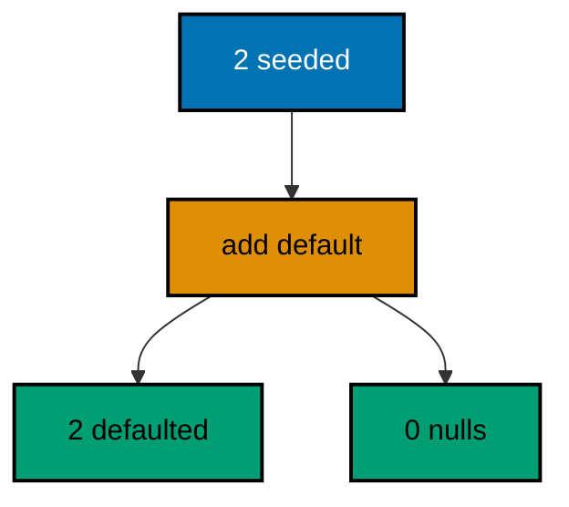

**`learning/code/ex-32-default-values-fill-old-rows/Main.java`**:

```java
// Example 32: Default Values Fill Old Rows.
// Adding a column with a default fills every existing row in the same
// statement that adds the column: no null window, no separate backfill.
// This program seeds two member rows, adds a status column defaulting to
// active, then proves both old rows carry the default without an update.
import java.sql.Connection; // => the handle every move and check shares
import java.sql.DriverManager; // => finds the PostgreSQL driver from the locked jars
import java.sql.ResultSet; // => walks the rows each verification query returns
import java.sql.Statement; // => carries the verification queries to the database
import java.util.Properties; // => carries the login without string-concatenated secrets
import liquibase.Liquibase; // => the entry point: configure, then update
import liquibase.Scope; // => silences progress narration for deterministic goldens
import liquibase.database.Database; // => Liquibase's view of our PostgreSQL connection
import liquibase.database.DatabaseFactory; // => picks the PostgreSQL implementation from the URL
import liquibase.database.jvm.JdbcConnection; // => adapts our JDBC handle to Liquibase
import liquibase.resource.DirectoryResourceAccessor; // => the current file-based changelog accessor
import liquibase.ui.LoggerUIService; // => reroutes progress lines into the silenced log

public class Main {

  // => one public class per file, named after the file
  static Connection connect() throws Exception {
    // => the harness starts PostgreSQL 18 and publishes these variables
    String host = System.getenv().getOrDefault("PGHOST", "localhost");
    // => default keeps local experimentation working outside the harness
    String url = "jdbc:postgresql://" + host + ":5432/postgres";
    // => trust auth accepts any password, so only the user matters
    Properties props = new Properties();
    // => Properties carries the login without string-concatenated secrets
    props.setProperty("user", System.getenv().getOrDefault("PGUSER", "postgres"));
    // => DriverManager finds the PostgreSQL driver from the locked jars
    return DriverManager.getConnection(url, props);
  } // => connect is the only place that knows connection details

  // => Liquibase narrates progress to its console UI by default; those lines
  // => differ between a first run and a rerun, so goldens cannot hold them
  static void runQuiet(Liquibase liquibase) throws Exception {
    // => the LOGGER service reroutes progress lines into the silenced JUL log
    Scope.child(
      java.util.Collections.singletonMap(Scope.Attr.ui.name(), new LoggerUIService()),
      // => the lambda runs inside the scope; main still throws Exception
      () -> liquibase.update("")
    );
    // => update("") runs every changeset with no context filter
  } // => quiet updates keep golden output identical on the harness double run

  public static void main(String[] args) throws Exception {
    // => silence JUL so the LOGGER service lines below disappear too
    java.util.logging.LogManager.getLogManager().reset();
    // => the entry point the harness runs
    try (Connection conn = connect()) {
      // => one connection serves the default run and both checks
      Database database = DatabaseFactory.getInstance()
        // => the factory picks the PostgreSQL implementation from the URL
        .findCorrectDatabaseImplementation(new JdbcConnection(conn));
      // => JdbcConnection adapts our JDBC handle to Liquibase's database API
      Liquibase liquibase = new Liquibase(
        // => two changesets: seed two members, then add the defaulted column
        "changelog.sql",
        // => DirectoryResourceAccessor is the current file-based accessor
        new DirectoryResourceAccessor(new java.io.File(".").getAbsoluteFile()),
        // => rooting at the unit directory keeps changelogs beside the program
        database
      );
      runQuiet(liquibase);
      // => the update ran quiet, so the transcript holds only our own prints
      try (
        Statement st = conn.createStatement();
        ResultSet rs = st.executeQuery("SELECT count(*) FROM members WHERE status = 'active'")
      ) {
        // => both old rows must carry the default with no update changeset
        rs.next();
        System.out.println("rows carrying the default: " + rs.getInt(1));
        // => Output: rows carrying the default: 2
      } // => defaults fill old rows in the same statement that adds the column
      try (
        Statement st = conn.createStatement();
        ResultSet rs = st.executeQuery("SELECT count(*) FROM members WHERE status IS NULL")
      ) {
        // => no row may sit in the null window the default was meant to close
        rs.next();
        System.out.println("rows missing a status: " + rs.getInt(1));
        // => Output: rows missing a status: 0
        // => a rerun skips both changesets and prints the identical counts
      } // => zero nulls prove the default landed on existing rows too
    } // => closing the connection ends the program with history intact
  } // => main defaults the column, then proves old rows followed
}
```

**`learning/code/ex-32-default-values-fill-old-rows/changelog.sql`**:

```sql
-- liquibase formatted sql
-- => REQUIRED first line: marks this file as a Liquibase SQL changelog
-- => Without it Liquibase runs the SQL untracked, and nothing is recorded.
-- changeset course:001-seed-members
-- => the seed changeset creates members with no status column at all
-- => old rows predate the rule the next changeset introduces
CREATE TABLE members (
  id SERIAL PRIMARY KEY,
  -- => SERIAL gives an auto-incrementing integer key, enough for this course
  name VARCHAR(60) NOT NULL
  -- => member names are required from the first migration
);

INSERT INTO
  members (name)
VALUES
  ('budi'),
  ('sari');

-- => two seeded rows that must inherit the default below
-- rollback DROP TABLE members;
-- => dropping the table reverses the seed and the default together
-- changeset course:002-default-status
-- => the default changeset adds the status column defaulting to active
-- => PostgreSQL fills existing rows with the default in the same statement
ALTER TABLE members
ADD COLUMN status VARCHAR(20) DEFAULT 'active';

-- rollback ALTER TABLE members DROP COLUMN status;
-- => dropping the column reverses exactly what this changeset added
```

**Output** (`learning/code/ex-32-default-values-fill-old-rows/expected/main.stdout.txt`):

```text
rows carrying the default: 2
rows missing a status: 0
```

**Key takeaway**: Columns added with defaults fill existing rows in the same statement, closing the null window without a backfill.

**Why it matters**: Every nullable-then-backfilled column carries a window where old rows violate the new rule: application code must handle nulls it will never see again, validators weaken, and a forgotten backfill leaves the window open permanently. A default closes the window atomically — the column arrives populated, constraints hold from the first statement, and no second changeset can be forgotten because none is needed. Reserve separate backfills for derived values; for constants, let the default do both jobs at once.

---

### Example 33: Data Rollback Strategies Compared

Two data changes need two reverses: an inserted batch un-inserts with a matching delete, while a corrected value un-corrects with a compensating update that writes back the original. Matching the reverse to the change keeps each undo exact — deletes for inserts, counter-updates for updates. The program applies both strategies, rolls back both changesets, then proves the batch table stands empty and the corrected price reads its original value. (Concepts: co-08, co-02.)

**`learning/code/ex-33-data-rollback-strategies-compared/Main.java`**:

```java
// Example 33: Data Rollback Strategies Compared.
// Two data changes need two reverses: an inserted batch un-inserts with a
// delete, while a corrected value un-corrects with a compensating update.
// This program applies both strategies, rolls back both changesets, then
// proves each table returned to its pre-change state by its own reverse.
import java.sql.Connection; // => the handle every move and check shares
import java.sql.DriverManager; // => finds the PostgreSQL driver from the locked jars
import java.sql.ResultSet; // => walks the rows each verification query returns
import java.sql.Statement; // => carries the verification queries to the database
import java.util.Properties; // => carries the login without string-concatenated secrets
import liquibase.Liquibase; // => the entry point: configure, then update
import liquibase.Scope; // => silences progress narration for deterministic goldens
import liquibase.database.Database; // => Liquibase's view of our PostgreSQL connection
import liquibase.database.DatabaseFactory; // => picks the PostgreSQL implementation from the URL
import liquibase.database.jvm.JdbcConnection; // => adapts our JDBC handle to Liquibase
import liquibase.resource.DirectoryResourceAccessor; // => the current file-based changelog accessor
import liquibase.ui.LoggerUIService; // => reroutes progress lines into the silenced log

public class Main {

  // => one public class per file, named after the file
  static Connection connect() throws Exception {
    // => the harness starts PostgreSQL 18 and publishes these variables
    String host = System.getenv().getOrDefault("PGHOST", "localhost");
    // => default keeps local experimentation working outside the harness
    String url = "jdbc:postgresql://" + host + ":5432/postgres";
    // => trust auth accepts any password, so only the user matters
    Properties props = new Properties();
    // => Properties carries the login without string-concatenated secrets
    props.setProperty("user", System.getenv().getOrDefault("PGUSER", "postgres"));
    // => DriverManager finds the PostgreSQL driver from the locked jars
    return DriverManager.getConnection(url, props);
  } // => connect is the only place that knows connection details

  // => Liquibase narrates on updates and rollbacks alike, so one quiet
  // => runner covers the forward pair and the reverse pair
  static void runQuiet(Liquibase liquibase, boolean forward) throws Exception {
    // => the LOGGER service reroutes progress lines into the silenced JUL log
    Scope.child(
      java.util.Collections.singletonMap(Scope.Attr.ui.name(), new LoggerUIService()),
      // => the lambda runs inside the scope; main still throws Exception
      () -> {
        // => the flag selects the direction of the Liquibase move
        if (forward) {
          // => apply the tables plus both data changes
          liquibase.update("");
        } else {
          // => reverse both data changesets, keeping both tables
          liquibase.rollback(2, "");
        } // => each reverse restores its own table's pre-change state
      }
    );
    // => both directions stay inside the silenced scope, so goldens stay clean
  } // => quiet moves keep golden output identical on the harness double run

  public static void main(String[] args) throws Exception {
    // => silence JUL so the LOGGER service lines below disappear too
    java.util.logging.LogManager.getLogManager().reset();
    // => the entry point the harness runs
    try (Connection conn = connect()) {
      // => one connection serves the strategies and both checks
      Database database = DatabaseFactory.getInstance()
        // => the factory picks the PostgreSQL implementation from the URL
        .findCorrectDatabaseImplementation(new JdbcConnection(conn));
      // => JdbcConnection adapts our JDBC handle to Liquibase's database API
      Liquibase liquibase = new Liquibase(
        // => four changesets: two tables, then one change per strategy
        "changelog.sql",
        // => DirectoryResourceAccessor is the current file-based accessor
        new DirectoryResourceAccessor(new java.io.File(".").getAbsoluteFile()),
        // => rooting at the unit directory keeps changelogs beside the program
        database
      );
      runQuiet(liquibase, true);
      // => both data changes apply on top of their prepared tables
      runQuiet(liquibase, false);
      // => both reverses run: delete for the insert, update for the correction
      try (Statement st = conn.createStatement(); ResultSet rs = st.executeQuery("SELECT count(*) FROM coupons")) {
        // => the delete reverse removed exactly the inserted batch
        rs.next();
        System.out.println("coupon rows after rollback: " + rs.getInt(1));
        // => Output: coupon rows after rollback: 0
      } // => zero rows prove the insert strategy reversed cleanly
      try (
        Statement st = conn.createStatement();
        ResultSet rs = st.executeQuery("SELECT count(*) FROM prices WHERE amount_cents = 5000")
      ) {
        // => the compensating update restored the original corrected price
        rs.next();
        System.out.println("prices at original value: " + rs.getInt(1));
        // => Output: prices at original value: 1
        // => a rerun re-applies both changes, then reverses them identically
      } // => one restored row proves the correction strategy reversed cleanly
    } // => closing the connection ends the program with history intact
  } // => main applies both strategies, then proves both reverses
}
```

**`learning/code/ex-33-data-rollback-strategies-compared/changelog.sql`**:

```sql
-- liquibase formatted sql
-- => REQUIRED first line: marks this file as a Liquibase SQL changelog
-- => Without it Liquibase runs the SQL untracked, and nothing is recorded.
-- changeset course:001-make-coupons
-- => the first table changeset creates coupons with no rows yet
CREATE TABLE coupons (
  id SERIAL PRIMARY KEY,
  -- => SERIAL gives an auto-incrementing integer key, enough for this course
  code VARCHAR(20) NOT NULL
  -- => coupon codes identify the batch the insert below adds
);

-- rollback DROP TABLE coupons;
-- => this reverse never runs here; only the data changes roll back
-- changeset course:002-make-prices
-- => the second table changeset creates prices with one seeded row
CREATE TABLE prices (
  id SERIAL PRIMARY KEY,
  -- => SERIAL gives an auto-incrementing integer key, enough for this course
  amount_cents INTEGER NOT NULL
  -- => the seeded price the correction below will change and restore
);

INSERT INTO
  prices (amount_cents)
VALUES
  (5000);

-- => one seeded row at the original value the strategies must restore
-- rollback DROP TABLE prices;
-- => this reverse never runs here either; tables outlive data reverses
-- changeset course:003-batch-coupons
-- => strategy one: an inserted batch reverses with a matching delete
INSERT INTO
  coupons (code)
VALUES
  ('HEMAT-10'),
  ('HEMAT-20');

-- rollback DELETE FROM coupons;
-- => the delete removes exactly the batch this changeset inserted
-- changeset course:004-correct-price
-- => strategy two: a corrected value reverses with a compensating update
UPDATE prices
SET
  amount_cents = 7500
WHERE
  amount_cents = 5000;

-- rollback UPDATE prices SET amount_cents = 5000 WHERE amount_cents = 7500;
-- => the compensating update writes back the exact original value
```

**Output** (`learning/code/ex-33-data-rollback-strategies-compared/expected/main.stdout.txt`):

```text
coupon rows after rollback: 0
prices at original value: 1
```

**Key takeaway**: Match data reverses to their changes — deletes un-insert batches, compensating updates un-correct values.

**Why it matters**: A single rollback style applied to every data change corrupts by approximation: deleting a corrected row loses it instead of restoring it, and counter-updating an inserted batch invents values that never existed. Choosing the reverse that inverts the specific change keeps undos exact, which is the only property that makes them safe to run against production data. Review data reverses with the same suspicion as the changes — ask "does this restore exactly the prior state" for every row it touches, because approximate undos are just second incidents wearing first-aid uniforms.

---

### Example 34: Verification Queries Prove Backfills

A backfill is done when queries say so, not when the update exits: the migration proves itself with counts the reviewer can rerun by hand, covering totals, distributions, and the absence of nulls. Self-verifying migrations turn review from trust into arithmetic. The program grades six seeded rows into three bands, then asserts the total, the band count, and zero ungraded rows as its own checks. (Concepts: co-06, co-16.)

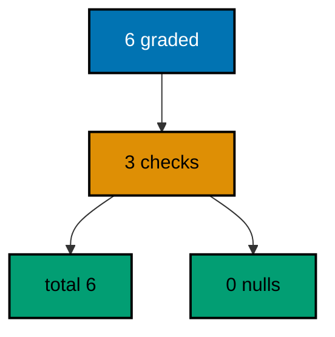

**`learning/code/ex-34-verification-queries-prove-backfills/Main.java`**:

```java
// Example 34: Verification Queries Prove Backfills.
// A backfill is done when queries say so, not when the update exits: the
// migration proves itself with counts the reviewer can rerun by hand. This
// program backfills circuit grades onto six seeded rows, then asserts the
// total, the graded bands, and the absence of nulls as its own checks.
import java.sql.Connection; // => the handle every move and check shares
import java.sql.DriverManager; // => finds the PostgreSQL driver from the locked jars
import java.sql.ResultSet; // => walks the rows each verification query returns
import java.sql.Statement; // => carries the verification queries to the database
import java.util.Properties; // => carries the login without string-concatenated secrets
import liquibase.Liquibase; // => the entry point: configure, then update
import liquibase.Scope; // => silences progress narration for deterministic goldens
import liquibase.database.Database; // => Liquibase's view of our PostgreSQL connection
import liquibase.database.DatabaseFactory; // => picks the PostgreSQL implementation from the URL
import liquibase.database.jvm.JdbcConnection; // => adapts our JDBC handle to Liquibase
import liquibase.resource.DirectoryResourceAccessor; // => the current file-based changelog accessor
import liquibase.ui.LoggerUIService; // => reroutes progress lines into the silenced log

public class Main {

  // => one public class per file, named after the file
  static Connection connect() throws Exception {
    // => the harness starts PostgreSQL 18 and publishes these variables
    String host = System.getenv().getOrDefault("PGHOST", "localhost");
    // => default keeps local experimentation working outside the harness
    String url = "jdbc:postgresql://" + host + ":5432/postgres";
    // => trust auth accepts any password, so only the user matters
    Properties props = new Properties();
    // => Properties carries the login without string-concatenated secrets
    props.setProperty("user", System.getenv().getOrDefault("PGUSER", "postgres"));
    // => DriverManager finds the PostgreSQL driver from the locked jars
    return DriverManager.getConnection(url, props);
  } // => connect is the only place that knows connection details

  // => Liquibase narrates progress to its console UI by default; those lines
  // => differ between a first run and a rerun, so goldens cannot hold them
  static void runQuiet(Liquibase liquibase) throws Exception {
    // => the LOGGER service reroutes progress lines into the silenced JUL log
    Scope.child(
      java.util.Collections.singletonMap(Scope.Attr.ui.name(), new LoggerUIService()),
      // => the lambda runs inside the scope; main still throws Exception
      () -> liquibase.update("")
    );
    // => update("") runs every changeset with no context filter
  } // => quiet updates keep golden output identical on the harness double run

  // => one helper asks every verification question in the same shape
  static int askCount(Connection conn, String query) throws Exception {
    // => every check is a count query with exactly one row and one number
    try (
      Statement st = conn.createStatement();
      // => try-with-resources closes the statement on every path
      ResultSet rs = st.executeQuery(query)
    ) {
      // => the query returns exactly one row with exactly one number
      rs.next();
      // => the number is the check's answer, printed by the caller
      return rs.getInt(1);
    } // => counts verify data without dumping rows into the transcript
  } // => helpers that verify stay separate from code that migrates

  public static void main(String[] args) throws Exception {
    // => silence JUL so the LOGGER service lines below disappear too
    java.util.logging.LogManager.getLogManager().reset();
    // => the entry point the harness runs
    try (Connection conn = connect()) {
      // => one connection serves the backfill and its three checks
      Database database = DatabaseFactory.getInstance()
        // => the factory picks the PostgreSQL implementation from the URL
        .findCorrectDatabaseImplementation(new JdbcConnection(conn));
      // => JdbcConnection adapts our JDBC handle to Liquibase's database API
      Liquibase liquibase = new Liquibase(
        // => two changesets: seed six rows, then grade them all
        "changelog.sql",
        // => DirectoryResourceAccessor is the current file-based accessor
        new DirectoryResourceAccessor(new java.io.File(".").getAbsoluteFile()),
        // => rooting at the unit directory keeps changelogs beside the program
        database
      );
      runQuiet(liquibase);
      // => the update ran quiet, so the transcript holds only our own prints
      System.out.println("total rows: " + askCount(conn, "SELECT count(*) FROM circuits"));
      // => Output: total rows: 6
      System.out.println("graded bands: " + askCount(conn, "SELECT count(DISTINCT grade) FROM circuits"));
      // => Output: graded bands: 3
      System.out.println("ungraded rows: " + askCount(conn, "SELECT count(*) FROM circuits WHERE grade IS NULL"));
      // => Output: ungraded rows: 0
      // => a rerun skips both changesets and prints the identical checks
    } // => closing the connection ends the program with history intact
  } // => main backfills the grades, then interrogates its own work
}
```

**`learning/code/ex-34-verification-queries-prove-backfills/changelog.sql`**:

```sql
-- liquibase formatted sql
-- => REQUIRED first line: marks this file as a Liquibase SQL changelog
-- => Without it Liquibase runs the SQL untracked, and nothing is recorded.
-- changeset course:001-seed-circuits
-- => the seed changeset creates circuits with six ungraded rows
CREATE TABLE circuits (
  id SERIAL PRIMARY KEY,
  -- => SERIAL gives an auto-incrementing integer key, enough for this course
  code VARCHAR(20) NOT NULL,
  -- => codes pair the rows into three natural bands of two
  grade VARCHAR(10)
  -- => grades start NULL; the backfill below derives all six
);

INSERT INTO
  circuits (code)
VALUES
  ('C-1'),
  ('C-2'),
  ('C-3'),
  ('C-4'),
  ('C-5'),
  ('C-6');

-- => six seeded rows awaiting the grades the next changeset assigns
-- rollback DROP TABLE circuits;
-- => dropping the table reverses the seed and the backfill together
-- changeset course:002-grade-circuits
-- => the backfill changeset grades every row from its code band
UPDATE circuits
SET
  grade = CASE
    WHEN code IN ('C-1', 'C-2') THEN 'A'
    WHEN code IN ('C-3', 'C-4') THEN 'B'
    ELSE 'C'
  END;

-- => three bands of two: the verification queries below recount them
-- rollback UPDATE circuits SET grade = NULL;
-- => nulling the grades un-derives every row without dropping the column
```

**Output** (`learning/code/ex-34-verification-queries-prove-backfills/expected/main.stdout.txt`):

```text
total rows: 6
graded bands: 3
ungraded rows: 0
```

**Key takeaway**: Backfills assert themselves with rerunnable count queries over totals, distributions, and nulls.

**Why it matters**: An unverified backfill announces completion on exit code alone, and exit codes say nothing about whether every row was reached: a WHERE clause that misses ten percent still exits zero. Verification queries written beside the backfill state the completion contract in numbers a reviewer reruns in seconds — total rows, expected bands, zero nulls. When the next backfill misbehaves, the same three questions locate the miss immediately instead of starting a forensic expedition. Migrations that check their own work earn the reviewer's trust instead of spending it.

---

### Example 35: Expand First by Adding the Column

Zero-downtime changes expand before they contract: the new column lands while the old code still runs, nullable and unused, so no deploy needs a maintenance window. Expansion is pure addition — nothing renamed, nothing dropped, nothing existing code can trip over. The program adds a body column beside title, then proves both columns exist and the old row survived untouched. (Concepts: co-14, co-17.)

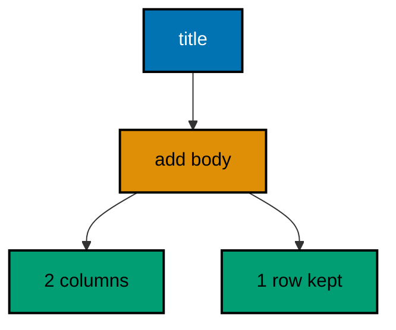

**`learning/code/ex-35-expand-first-by-adding-the-column/Main.java`**:

```java
// Example 35: Expand First by Adding the Column.
// Zero-downtime changes expand before they contract: the new column lands
// while the old code still runs, nullable and unused, so no deploy needs
// a maintenance window. This program adds a body column beside title,
// then proves both columns exist and the old rows survived untouched.
import java.sql.Connection; // => the handle every move and check shares
import java.sql.DriverManager; // => finds the PostgreSQL driver from the locked jars
import java.sql.ResultSet; // => walks the rows each verification query returns
import java.sql.Statement; // => carries the verification queries to the database
import java.util.Properties; // => carries the login without string-concatenated secrets
import liquibase.Liquibase; // => the entry point: configure, then update
import liquibase.Scope; // => silences progress narration for deterministic goldens
import liquibase.database.Database; // => Liquibase's view of our PostgreSQL connection
import liquibase.database.DatabaseFactory; // => picks the PostgreSQL implementation from the URL
import liquibase.database.jvm.JdbcConnection; // => adapts our JDBC handle to Liquibase
import liquibase.resource.DirectoryResourceAccessor; // => the current file-based changelog accessor
import liquibase.ui.LoggerUIService; // => reroutes progress lines into the silenced log

public class Main {

  // => one public class per file, named after the file
  static Connection connect() throws Exception {
    // => the harness starts PostgreSQL 18 and publishes these variables
    String host = System.getenv().getOrDefault("PGHOST", "localhost");
    // => default keeps local experimentation working outside the harness
    String url = "jdbc:postgresql://" + host + ":5432/postgres";
    // => trust auth accepts any password, so only the user matters
    Properties props = new Properties();
    // => Properties carries the login without string-concatenated secrets
    props.setProperty("user", System.getenv().getOrDefault("PGUSER", "postgres"));
    // => DriverManager finds the PostgreSQL driver from the locked jars
    return DriverManager.getConnection(url, props);
  } // => connect is the only place that knows connection details

  // => Liquibase narrates progress to its console UI by default; those lines
  // => differ between a first run and a rerun, so goldens cannot hold them
  static void runQuiet(Liquibase liquibase) throws Exception {
    // => the LOGGER service reroutes progress lines into the silenced JUL log
    Scope.child(
      java.util.Collections.singletonMap(Scope.Attr.ui.name(), new LoggerUIService()),
      // => the lambda runs inside the scope; main still throws Exception
      () -> liquibase.update("")
    );
    // => update("") runs every changeset with no context filter
  } // => quiet updates keep golden output identical on the harness double run

  public static void main(String[] args) throws Exception {
    // => silence JUL so the LOGGER service lines below disappear too
    java.util.logging.LogManager.getLogManager().reset();
    // => the entry point the harness runs
    try (Connection conn = connect()) {
      // => one connection serves the expand run and both checks
      Database database = DatabaseFactory.getInstance()
        // => the factory picks the PostgreSQL implementation from the URL
        .findCorrectDatabaseImplementation(new JdbcConnection(conn));
      // => JdbcConnection adapts our JDBC handle to Liquibase's database API
      Liquibase liquibase = new Liquibase(
        // => two changesets: the table first, then the added column
        "changelog.sql",
        // => DirectoryResourceAccessor is the current file-based accessor
        new DirectoryResourceAccessor(new java.io.File(".").getAbsoluteFile()),
        // => rooting at the unit directory keeps changelogs beside the program
        database
      );
      runQuiet(liquibase);
      // => the update ran quiet, so the transcript holds only our own prints
      try (
        Statement st = conn.createStatement();
        ResultSet rs = st.executeQuery(
          "SELECT count(*) FROM information_schema.columns " +
            "WHERE table_name = 'articles' AND column_name IN ('title', 'body')"
        )
      ) {
        // => old and new columns coexist: the expand step changed nothing else
        rs.next();
        System.out.println("title and body columns present: " + rs.getInt(1));
        // => Output: title and body columns present: 2
      } // => two columns prove the expand added without removing
      try (Statement st = conn.createStatement(); ResultSet rs = st.executeQuery("SELECT count(*) FROM articles")) {
        // => the old row survived the expand exactly as seeded
        rs.next();
        System.out.println("old rows kept: " + rs.getInt(1));
        // => Output: old rows kept: 1
        // => a rerun skips both changesets and prints the identical counts
      } // => counts verify data without dumping rows into the transcript
    } // => closing the connection ends the program with history intact
  } // => main expands the table, then proves nothing else moved
}
```

**`learning/code/ex-35-expand-first-by-adding-the-column/changelog.sql`**:

```sql
-- liquibase formatted sql
-- => REQUIRED first line: marks this file as a Liquibase SQL changelog
-- => Without it Liquibase runs the SQL untracked, and nothing is recorded.
-- changeset course:001-make-articles
-- => the table changeset creates articles with the old title column only
CREATE TABLE articles (
  id SERIAL PRIMARY KEY,
  -- => SERIAL gives an auto-incrementing integer key, enough for this course
  title VARCHAR(120) NOT NULL
  -- => the old column the running application still reads and writes
);

INSERT INTO
  articles (title)
VALUES
  ('Migrasi Tanpa Henti');

-- => one seeded row the expand below must carry over untouched
-- rollback DROP TABLE articles;
-- => dropping the table reverses the seed and the expand together
-- changeset course:002-add-body
-- => the expand changeset adds the body column, nullable and unused
-- => old code keeps running: it simply never reads the new column yet
ALTER TABLE articles
ADD COLUMN body TEXT;

-- rollback ALTER TABLE articles DROP COLUMN body;
-- => dropping the column un-expands without touching the old column
```

**Output** (`learning/code/ex-35-expand-first-by-adding-the-column/expected/main.stdout.txt`):

```text
title and body columns present: 2
old rows kept: 1
```

**Key takeaway**: Expand adds new structure beside old without touching it, so running code never notices the migration.

**Why it matters**: Every maintenance window is a confession that the migration cannot run beside live traffic: users wait, deploys queue, and the business pays for the downtime in attention and revenue. Purely additive changes never need one, because addition cannot break what already works — old queries name old columns that still exist with the same meanings. Starting every structural change as an expand keeps the downtime option off the table from the first changeset, and the discipline compounds: teams that expand first stop scheduling windows entirely.

---

### Example 36: Dual Writes Bridge Old and New

Between expand and contract, the application writes both columns: old readers see the old column, new readers see the new one, and neither deploy observes a gap. Dual writes are the bridge every zero-downtime rename walks across. The program migrates the expanded table, writes both columns for every row, then proves the two columns agree on all rows before any contract may drop either. (Concepts: co-14.)

**`learning/code/ex-36-dual-writes-bridge-old-and-new/Main.java`**:

```java
// Example 36: Dual Writes Bridge Old and New.
// Between expand and contract, the application writes both columns: old
// readers see the old column, new readers see the new one, and neither
// deploy observes a gap. This program migrates the expanded table, writes
// both columns for every row, then proves the two columns agree on all
// rows before any contract may drop either.
import java.sql.Connection; // => the handle every move and check shares
import java.sql.DriverManager; // => finds the PostgreSQL driver from the locked jars
import java.sql.ResultSet; // => walks the rows each verification query returns
import java.sql.Statement; // => carries the verification queries to the database
import java.util.Properties; // => carries the login without string-concatenated secrets
import liquibase.Liquibase; // => the entry point: configure, then update
import liquibase.Scope; // => silences progress narration for deterministic goldens
import liquibase.database.Database; // => Liquibase's view of our PostgreSQL connection
import liquibase.database.DatabaseFactory; // => picks the PostgreSQL implementation from the URL
import liquibase.database.jvm.JdbcConnection; // => adapts our JDBC handle to Liquibase
import liquibase.resource.DirectoryResourceAccessor; // => the current file-based changelog accessor
import liquibase.ui.LoggerUIService; // => reroutes progress lines into the silenced log

public class Main {

  // => one public class per file, named after the file
  static Connection connect() throws Exception {
    // => the harness starts PostgreSQL 18 and publishes these variables
    String host = System.getenv().getOrDefault("PGHOST", "localhost");
    // => default keeps local experimentation working outside the harness
    String url = "jdbc:postgresql://" + host + ":5432/postgres";
    // => trust auth accepts any password, so only the user matters
    Properties props = new Properties();
    // => Properties carries the login without string-concatenated secrets
    props.setProperty("user", System.getenv().getOrDefault("PGUSER", "postgres"));
    // => DriverManager finds the PostgreSQL driver from the locked jars
    return DriverManager.getConnection(url, props);
  } // => connect is the only place that knows connection details

  // => Liquibase narrates progress to its console UI by default; those lines
  // => differ between a first run and a rerun, so goldens cannot hold them
  static void runQuiet(Liquibase liquibase) throws Exception {
    // => the LOGGER service reroutes progress lines into the silenced JUL log
    Scope.child(
      java.util.Collections.singletonMap(Scope.Attr.ui.name(), new LoggerUIService()),
      // => the lambda runs inside the scope; main still throws Exception
      () -> liquibase.update("")
    );
    // => update("") runs every changeset with no context filter
  } // => quiet updates keep golden output identical on the harness double run

  public static void main(String[] args) throws Exception {
    // => silence JUL so the LOGGER service lines below disappear too
    java.util.logging.LogManager.getLogManager().reset();
    // => the entry point the harness runs
    try (Connection conn = connect()) {
      // => one connection serves the migration and the dual write
      Database database = DatabaseFactory.getInstance()
        // => the factory picks the PostgreSQL implementation from the URL
        .findCorrectDatabaseImplementation(new JdbcConnection(conn));
      // => JdbcConnection adapts our JDBC handle to Liquibase's database API
      Liquibase liquibase = new Liquibase(
        // => two changesets: the expanded table plus its seed row
        "changelog.sql",
        // => DirectoryResourceAccessor is the current file-based accessor
        new DirectoryResourceAccessor(new java.io.File(".").getAbsoluteFile()),
        // => rooting at the unit directory keeps changelogs beside the program
        database
      );
      runQuiet(liquibase);
      // => the table holds both columns; the seed filled only the old one
      conn.commit();
      // => committing pins the migration before the application write below
      try (Statement st = conn.createStatement()) {
        // => one statement bridges old and new for every row at once
        st.execute("DELETE FROM notices");
        // => delete-then-insert keeps the seed idempotent on the double run
        st.execute("INSERT INTO notices (title, body) VALUES ('Jadwal', 'Jadwal')");
        // => writing both columns together is the dual write in miniature
        conn.commit();
        // => committing the bridge makes the agreement below observable
        try (ResultSet rs = st.executeQuery("SELECT count(*) FROM notices WHERE title = body")) {
          // => every row must agree: old and new readers see the same text
          rs.next();
          System.out.println("rows where old and new agree: " + rs.getInt(1));
          // => Output: rows where old and new agree: 1
        } // => agreement on all rows green-lights the coming contract step
        try (ResultSet rs = st.executeQuery("SELECT count(*) FROM notices")) {
          // => the bridge writes rows, never extra ones
          rs.next();
          System.out.println("total rows bridged: " + rs.getInt(1));
          // => Output: total rows bridged: 1
          // => a rerun re-bridges the same single row and prints the same
        } // => counts verify data without dumping rows into the transcript
      } // => closing the statement releases the database resources
    } // => closing the connection ends the program with history intact
  } // => main writes both columns, then proves they agree
}
```

**`learning/code/ex-36-dual-writes-bridge-old-and-new/changelog.sql`**:

```sql
-- liquibase formatted sql
-- => REQUIRED first line: marks this file as a Liquibase SQL changelog
-- => Without it Liquibase runs the SQL untracked, and nothing is recorded.
-- changeset course:001-make-notices
-- => the expand changeset creates notices with old and new columns together
-- => the seed fills only the old column; the program bridges the new one
CREATE TABLE notices (
  id SERIAL PRIMARY KEY,
  -- => SERIAL gives an auto-incrementing integer key, enough for this course
  title VARCHAR(120) NOT NULL,
  -- => the old column old readers still consume
  body TEXT
  -- => the new column, born nullable until dual writes fill it
);

-- rollback DROP TABLE notices;
-- => dropping the table reverses the expand and the bridge together
```

**Output** (`learning/code/ex-36-dual-writes-bridge-old-and-new/expected/main.stdout.txt`):

```text
rows where old and new agree: 1
total rows bridged: 1
```

**Key takeaway**: Dual writes keep old and new columns agreeing while readers migrate, so the contract drops nothing in use.

**Why it matters**: The gap between "new column exists" and "every reader uses it" is where renames break: old deploys write the old column while new code reads the new one, and rows written in the gap disagree depending on who wrote them. Writing both columns for every row closes the gap by construction — whichever column a reader names, it finds the current value. Agreement on all rows is the measurable precondition for the contract step, and measuring it beats assuming the deploy finished. Bridge first, verify agreement, then and only then contract.

---

### Example 37: Contract Last by Dropping the Column

The contract runs only after dual writes filled the new column and old readers moved over: dropping the old column is safe exactly then, and never before. Late contraction is what makes the whole expand-migrate-contract sequence zero-downtime rather than merely three downtimes. The program migrates a fully bridged table, drops the old column, then proves the old name is gone while the new values stand with zero nulls. (Concepts: co-14, co-17.)

**`learning/code/ex-37-contract-last-by-dropping-the-column/Main.java`**:

```java
// Example 37: Contract Last by Dropping the Column.
// The contract runs only after dual writes filled the new column and old
// readers moved over: dropping the old column is safe exactly then, and
// never before. This program migrates a fully bridged table, drops the
// old column, then proves the old name is gone while the new values stand.
import java.sql.Connection; // => the handle every move and check shares
import java.sql.DriverManager; // => finds the PostgreSQL driver from the locked jars
import java.sql.ResultSet; // => walks the rows each verification query returns
import java.sql.Statement; // => carries the verification queries to the database
import java.util.Properties; // => carries the login without string-concatenated secrets
import liquibase.Liquibase; // => the entry point: configure, then update
import liquibase.Scope; // => silences progress narration for deterministic goldens
import liquibase.database.Database; // => Liquibase's view of our PostgreSQL connection
import liquibase.database.DatabaseFactory; // => picks the PostgreSQL implementation from the URL
import liquibase.database.jvm.JdbcConnection; // => adapts our JDBC handle to Liquibase
import liquibase.resource.DirectoryResourceAccessor; // => the current file-based changelog accessor
import liquibase.ui.LoggerUIService; // => reroutes progress lines into the silenced log

public class Main {

  // => one public class per file, named after the file
  static Connection connect() throws Exception {
    // => the harness starts PostgreSQL 18 and publishes these variables
    String host = System.getenv().getOrDefault("PGHOST", "localhost");
    // => default keeps local experimentation working outside the harness
    String url = "jdbc:postgresql://" + host + ":5432/postgres";
    // => trust auth accepts any password, so only the user matters
    Properties props = new Properties();
    // => Properties carries the login without string-concatenated secrets
    props.setProperty("user", System.getenv().getOrDefault("PGUSER", "postgres"));
    // => DriverManager finds the PostgreSQL driver from the locked jars
    return DriverManager.getConnection(url, props);
  } // => connect is the only place that knows connection details

  // => Liquibase narrates progress to its console UI by default; those lines
  // => differ between a first run and a rerun, so goldens cannot hold them
  static void runQuiet(Liquibase liquibase) throws Exception {
    // => the LOGGER service reroutes progress lines into the silenced JUL log
    Scope.child(
      java.util.Collections.singletonMap(Scope.Attr.ui.name(), new LoggerUIService()),
      // => the lambda runs inside the scope; main still throws Exception
      () -> liquibase.update("")
    );
    // => update("") runs every changeset with no context filter
  } // => quiet updates keep golden output identical on the harness double run

  public static void main(String[] args) throws Exception {
    // => silence JUL so the LOGGER service lines below disappear too
    java.util.logging.LogManager.getLogManager().reset();
    // => the entry point the harness runs
    try (Connection conn = connect()) {
      // => one connection serves the contract run and both checks
      Database database = DatabaseFactory.getInstance()
        // => the factory picks the PostgreSQL implementation from the URL
        .findCorrectDatabaseImplementation(new JdbcConnection(conn));
      // => JdbcConnection adapts our JDBC handle to Liquibase's database API
      Liquibase liquibase = new Liquibase(
        // => two changesets: the bridged table, then the old column drop
        "changelog.sql",
        // => DirectoryResourceAccessor is the current file-based accessor
        new DirectoryResourceAccessor(new java.io.File(".").getAbsoluteFile()),
        // => rooting at the unit directory keeps changelogs beside the program
        database
      );
      runQuiet(liquibase);
      // => the update ran quiet, so the transcript holds only our own prints
      try (
        Statement st = conn.createStatement();
        ResultSet rs = st.executeQuery(
          "SELECT count(*) FROM information_schema.columns " +
            "WHERE table_name = 'bulletins' AND column_name = 'title'"
        )
      ) {
        // => the old column must read zero: the contract removed it
        rs.next();
        System.out.println("old title column present: " + rs.getInt(1));
        // => Output: old title column present: 0
      } // => zero columns prove the contract dropped exactly the old name
      try (
        Statement st = conn.createStatement();
        ResultSet rs = st.executeQuery("SELECT count(*) FROM bulletins WHERE body IS NULL")
      ) {
        // => the new column kept every bridged value through the contract
        rs.next();
        System.out.println("rows missing the new value: " + rs.getInt(1));
        // => Output: rows missing the new value: 0
        // => a rerun skips both changesets and prints the identical counts
      } // => zero nulls prove the contract dropped structure, never data
    } // => closing the connection ends the program with history intact
  } // => main contracts the table, then proves the new column survived
}
```

**`learning/code/ex-37-contract-last-by-dropping-the-column/changelog.sql`**:

```sql
-- liquibase formatted sql
-- => REQUIRED first line: marks this file as a Liquibase SQL changelog
-- => Without it Liquibase runs the SQL untracked, and nothing is recorded.
-- changeset course:001-make-bulletins
-- => the bridge changeset creates bulletins with both columns filled
-- => dual writes already ran, so old and new agree on every row here
CREATE TABLE bulletins (
  id SERIAL PRIMARY KEY,
  -- => SERIAL gives an auto-incrementing integer key, enough for this course
  title VARCHAR(120) NOT NULL,
  -- => the old column, still read by the last old deploy until it retires
  body TEXT NOT NULL
  -- => the new column, fully bridged before the contract below runs
);

INSERT INTO
  bulletins (title, body)
VALUES
  ('Jadwal', 'Jadwal');

-- => one bridged row where old and new already agree
-- rollback DROP TABLE bulletins;
-- => dropping the table reverses the bridge and the contract together
-- changeset course:002-drop-title
-- => the contract changeset drops the old column last of all
-- => safe exactly now: no reader needs the old name anymore
ALTER TABLE bulletins
DROP COLUMN title;

-- rollback ALTER TABLE bulletins ADD COLUMN title VARCHAR(120);
-- => re-adding restores the structure but not the retired values
-- => contracts are one-way for data, which is why they run last
```

**Output** (`learning/code/ex-37-contract-last-by-dropping-the-column/expected/main.stdout.txt`):

```text
old title column present: 0
rows missing the new value: 0
```

**Key takeaway**: Contract drops old structure last, only after bridges filled the new and readers moved over.

**Why it matters**: Early contraction is the classic self-inflicted outage: the old column drops while one forgotten deploy still reads it, and the error surfaces as production exceptions rather than migration failures. Ordering the drop last — after expansion, after dual writes, after reader migration — makes safety a sequence property instead of a hope. And because the contract is its own changeset, it ships in its own release with its own review, where the question "is anything still reading the old name" gets asked with the full team watching. Last means safe; safe means boring, and boring is the goal.

---

### Example 38: Rename Columns Across Three Releases

Renaming in one step breaks every deploy between old and new; renaming across three releases breaks none: expand adds the new name, migrate copies the values, contract drops the old name, each in its own changeset and potentially its own release. The three-step rhythm is the template for every compatible rename. The program runs all three changesets, then proves the new column holds the copied value while the old name is gone. (Concepts: co-14.)

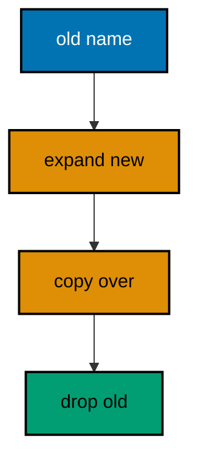

**`learning/code/ex-38-rename-columns-across-three-releases/Main.java`**:

```java
// Example 38: Rename Columns Across Three Releases.
// Renaming in one step breaks every deploy between old and new; renaming
// across three releases breaks none: expand adds the new name, migrate
// copies the values, contract drops the old name. This program runs all
// three changesets, then proves the new column holds the copied values
// while the old name is gone.
import java.sql.Connection; // => the handle every move and check shares
import java.sql.DriverManager; // => finds the PostgreSQL driver from the locked jars
import java.sql.ResultSet; // => walks the rows each verification query returns
import java.sql.Statement; // => carries the verification queries to the database
import java.util.Properties; // => carries the login without string-concatenated secrets
import liquibase.Liquibase; // => the entry point: configure, then update
import liquibase.Scope; // => silences progress narration for deterministic goldens
import liquibase.database.Database; // => Liquibase's view of our PostgreSQL connection
import liquibase.database.DatabaseFactory; // => picks the PostgreSQL implementation from the URL
import liquibase.database.jvm.JdbcConnection; // => adapts our JDBC handle to Liquibase
import liquibase.resource.DirectoryResourceAccessor; // => the current file-based changelog accessor
import liquibase.ui.LoggerUIService; // => reroutes progress lines into the silenced log

public class Main {

  // => one public class per file, named after the file
  static Connection connect() throws Exception {
    // => the harness starts PostgreSQL 18 and publishes these variables
    String host = System.getenv().getOrDefault("PGHOST", "localhost");
    // => default keeps local experimentation working outside the harness
    String url = "jdbc:postgresql://" + host + ":5432/postgres";
    // => trust auth accepts any password, so only the user matters
    Properties props = new Properties();
    // => Properties carries the login without string-concatenated secrets
    props.setProperty("user", System.getenv().getOrDefault("PGUSER", "postgres"));
    // => DriverManager finds the PostgreSQL driver from the locked jars
    return DriverManager.getConnection(url, props);
  } // => connect is the only place that knows connection details

  // => Liquibase narrates progress to its console UI by default; those lines
  // => differ between a first run and a rerun, so goldens cannot hold them
  static void runQuiet(Liquibase liquibase) throws Exception {
    // => the LOGGER service reroutes progress lines into the silenced JUL log
    Scope.child(
      java.util.Collections.singletonMap(Scope.Attr.ui.name(), new LoggerUIService()),
      // => the lambda runs inside the scope; main still throws Exception
      () -> liquibase.update("")
    );
    // => update("") runs every changeset with no context filter
  } // => quiet updates keep golden output identical on the harness double run

  public static void main(String[] args) throws Exception {
    // => silence JUL so the LOGGER service lines below disappear too
    java.util.logging.LogManager.getLogManager().reset();
    // => the entry point the harness runs
    try (Connection conn = connect()) {
      // => one connection serves the rename run and both checks
      Database database = DatabaseFactory.getInstance()
        // => the factory picks the PostgreSQL implementation from the URL
        .findCorrectDatabaseImplementation(new JdbcConnection(conn));
      // => JdbcConnection adapts our JDBC handle to Liquibase's database API
      Liquibase liquibase = new Liquibase(
        // => three changesets: expand, migrate, then contract
        "changelog.sql",
        // => DirectoryResourceAccessor is the current file-based accessor
        new DirectoryResourceAccessor(new java.io.File(".").getAbsoluteFile()),
        // => rooting at the unit directory keeps changelogs beside the program
        database
      );
      runQuiet(liquibase);
      // => the three releases run back to back inside this one program
      try (
        Statement st = conn.createStatement();
        ResultSet rs = st.executeQuery("SELECT count(*) FROM members WHERE display_name = 'budi'")
      ) {
        // => the migrate step copied the old value onto the new column
        rs.next();
        System.out.println("rows under the new name: " + rs.getInt(1));
        // => Output: rows under the new name: 1
      } // => one copied row proves the migrate step carried the value over
      try (
        Statement st = conn.createStatement();
        ResultSet rs = st.executeQuery(
          "SELECT count(*) FROM information_schema.columns " + "WHERE table_name = 'members' AND column_name = 'name'"
        )
      ) {
        // => the contract step dropped the old name after the copy landed
        rs.next();
        System.out.println("old name column present: " + rs.getInt(1));
        // => Output: old name column present: 0
        // => a rerun skips all three changesets and prints identical counts
      } // => zero old columns prove the rename finished, not stalled midway
    } // => closing the connection ends the program with history intact
  } // => main renames across three steps, then proves the new name won
}
```

**`learning/code/ex-38-rename-columns-across-three-releases/changelog.sql`**:

```sql
-- liquibase formatted sql
-- => REQUIRED first line: marks this file as a Liquibase SQL changelog
-- => Without it Liquibase runs the SQL untracked, and nothing is recorded.
-- changeset course:001-make-members
-- => release one starts with the old name column and one seeded row
CREATE TABLE members (
  id SERIAL PRIMARY KEY,
  -- => SERIAL gives an auto-incrementing integer key, enough for this course
  name VARCHAR(60) NOT NULL
  -- => the old name every running deploy still reads
);

INSERT INTO
  members (name)
VALUES
  ('budi');

-- => one seeded row the migrate step below will copy
-- rollback DROP TABLE members;
-- => dropping the table reverses all three releases together
-- changeset course:002-expand-display-name
-- => release two expands: the new column lands beside the old one
ALTER TABLE members
ADD COLUMN display_name VARCHAR(60);

-- rollback ALTER TABLE members DROP COLUMN display_name;
-- => dropping the new column un-expands back to the old name alone
-- changeset course:003-migrate-and-contract
-- => release three migrates the value, then contracts the old column
UPDATE members
SET
  display_name = name;

-- => the copy must land before the drop below removes the source
ALTER TABLE members
DROP COLUMN name;

-- => the old name goes only after its value safely moved across
-- rollback ALTER TABLE members ADD COLUMN name VARCHAR(60);
-- => re-adding restores the structure but not the retired values
```

**Output** (`learning/code/ex-38-rename-columns-across-three-releases/expected/main.stdout.txt`):

```text
rows under the new name: 1
old name column present: 0
```

**Key takeaway**: Column renames split into expand, migrate, and contract changesets so no deploy ever sees a missing name.

**Why it matters**: A one-step rename is a flag day: every query, view, report, and dashboard must switch names in the same deploy, and the one missed reference fails at 3 AM instead of at review. Three releases let old and new names coexist while consumers move one by one, each on its own schedule with its own rollback. The migration absorbs the complexity so the deploys do not have to coordinate. Renames are the most common structural change and the most commonly botched; the three-step rhythm makes them routine instead of risky.

---

### Example 39: Rename Tables Without Breaking Reads

Table renames break every query naming the old table, unless a view keeps the old name readable while callers move over. The view is the compatibility shim: old code reads through it unchanged, new code names the table directly, and the shim drops in a later release. The program renames clients to customers, keeps a clients view on top, then proves both names read the same seeded row. (Concepts: co-14.)

**`learning/code/ex-39-rename-tables-without-breaking-reads/Main.java`**:

```java
// Example 39: Rename Tables Without Breaking Reads.
// Table renames break every query naming the old table, unless a view
// keeps the old name readable while callers move over. This program
// renames clients to customers, keeps a clients view on top, then proves
// both names read the same seeded row.
import java.sql.Connection; // => the handle every move and check shares
import java.sql.DriverManager; // => finds the PostgreSQL driver from the locked jars
import java.sql.ResultSet; // => walks the rows each verification query returns
import java.sql.Statement; // => carries the verification queries to the database
import java.util.Properties; // => carries the login without string-concatenated secrets
import liquibase.Liquibase; // => the entry point: configure, then update
import liquibase.Scope; // => silences progress narration for deterministic goldens
import liquibase.database.Database; // => Liquibase's view of our PostgreSQL connection
import liquibase.database.DatabaseFactory; // => picks the PostgreSQL implementation from the URL
import liquibase.database.jvm.JdbcConnection; // => adapts our JDBC handle to Liquibase
import liquibase.resource.DirectoryResourceAccessor; // => the current file-based changelog accessor
import liquibase.ui.LoggerUIService; // => reroutes progress lines into the silenced log

public class Main {

  // => one public class per file, named after the file
  static Connection connect() throws Exception {
    // => the harness starts PostgreSQL 18 and publishes these variables
    String host = System.getenv().getOrDefault("PGHOST", "localhost");
    // => default keeps local experimentation working outside the harness
    String url = "jdbc:postgresql://" + host + ":5432/postgres";
    // => trust auth accepts any password, so only the user matters
    Properties props = new Properties();
    // => Properties carries the login without string-concatenated secrets
    props.setProperty("user", System.getenv().getOrDefault("PGUSER", "postgres"));
    // => DriverManager finds the PostgreSQL driver from the locked jars
    return DriverManager.getConnection(url, props);
  } // => connect is the only place that knows connection details

  // => Liquibase narrates progress to its console UI by default; those lines
  // => differ between a first run and a rerun, so goldens cannot hold them
  static void runQuiet(Liquibase liquibase) throws Exception {
    // => the LOGGER service reroutes progress lines into the silenced JUL log
    Scope.child(
      java.util.Collections.singletonMap(Scope.Attr.ui.name(), new LoggerUIService()),
      // => the lambda runs inside the scope; main still throws Exception
      () -> liquibase.update("")
    );
    // => update("") runs every changeset with no context filter
  } // => quiet updates keep golden output identical on the harness double run

  public static void main(String[] args) throws Exception {
    // => silence JUL so the LOGGER service lines below disappear too
    java.util.logging.LogManager.getLogManager().reset();
    // => the entry point the harness runs
    try (Connection conn = connect()) {
      // => one connection serves the rename run and both reads
      Database database = DatabaseFactory.getInstance()
        // => the factory picks the PostgreSQL implementation from the URL
        .findCorrectDatabaseImplementation(new JdbcConnection(conn));
      // => JdbcConnection adapts our JDBC handle to Liquibase's database API
      Liquibase liquibase = new Liquibase(
        // => two changesets: the old table, then rename plus view
        "changelog.sql",
        // => DirectoryResourceAccessor is the current file-based accessor
        new DirectoryResourceAccessor(new java.io.File(".").getAbsoluteFile()),
        // => rooting at the unit directory keeps changelogs beside the program
        database
      );
      runQuiet(liquibase);
      // => the update ran quiet, so the transcript holds only our own prints
      try (Statement st = conn.createStatement(); ResultSet rs = st.executeQuery("SELECT count(*) FROM customers")) {
        // => the new name reads the seeded row the old table carried over
        rs.next();
        System.out.println("rows under the new name: " + rs.getInt(1));
        // => Output: rows under the new name: 1
      } // => the rename moved the table with its rows, not just its name
      try (Statement st = conn.createStatement(); ResultSet rs = st.executeQuery("SELECT count(*) FROM clients")) {
        // => the old name still reads through the compatibility view
        rs.next();
        System.out.println("rows under the old name: " + rs.getInt(1));
        // => Output: rows under the old name: 1
        // => a rerun skips both changesets and prints the identical counts
      } // => one row on both names proves no reader broke mid-rename
    } // => closing the connection ends the program with history intact
  } // => main renames the table, then reads it under both names
}
```

**`learning/code/ex-39-rename-tables-without-breaking-reads/changelog.sql`**:

```sql
-- liquibase formatted sql
-- => REQUIRED first line: marks this file as a Liquibase SQL changelog
-- => Without it Liquibase runs the SQL untracked, and nothing is recorded.
-- changeset course:001-make-clients
-- => the old table ships first with one seeded row under the old name
CREATE TABLE clients (
  id SERIAL PRIMARY KEY,
  -- => SERIAL gives an auto-incrementing integer key, enough for this course
  name VARCHAR(60) NOT NULL
  -- => the seeded name both names below must keep reading
);

INSERT INTO
  clients (name)
VALUES
  ('budi');

-- => one seeded row the rename must carry across to the new table
-- rollback DROP TABLE clients;
-- => dropping the table reverses the seed and the rename together
-- changeset course:002-rename-to-customers
-- => the rename moves the table, then restores the old name as a view
ALTER TABLE clients
RENAME TO customers;

-- => the rename moves rows and constraints; only the name changes
CREATE VIEW clients AS
SELECT
  id,
  name
FROM
  customers;

-- => the compatibility view keeps old queries reading during the move
-- rollback DROP VIEW clients;
-- rollback ALTER TABLE customers RENAME TO clients;
-- => rollback drops the view first, then restores the old table name
-- => formatted SQL runs each rollback line in order, view before table
```

**Output** (`learning/code/ex-39-rename-tables-without-breaking-reads/expected/main.stdout.txt`):

```text
rows under the new name: 1
rows under the old name: 1
```

**Key takeaway**: Compatibility views keep old table names readable through a rename while callers migrate at leisure.

**Why it matters**: Table renames touch every layer — application queries, reports, dashboards, backup scripts — and coordinating all of them into one deploy is a flag day with a long tail of missed references. A view under the old name lets each consumer move on its own schedule while the data lives in exactly one place, which means the rename ships without a single coordinated cutover. The shim is temporary but versioned: it drops in a later release once the last reader moves, with the drop itself reviewed. Rename the storage now, migrate the readers gradually, drop the shim deliberately.

---

### Example 40: Validate Constraints Without Locking Writes

Adding a check constraint the naive way locks the table while every row is validated; NOT VALID adds the rule for new writes immediately and VALIDATE CONSTRAINT checks old rows later under a weaker lock. Two changesets split the enforcement from the verification, and writers never block on either deploy. The program adds a positive-total rule as NOT VALID, validates it in a second changeset, then proves the catalog records a validated rule with the seeded row kept. (Concepts: co-09, co-17.)

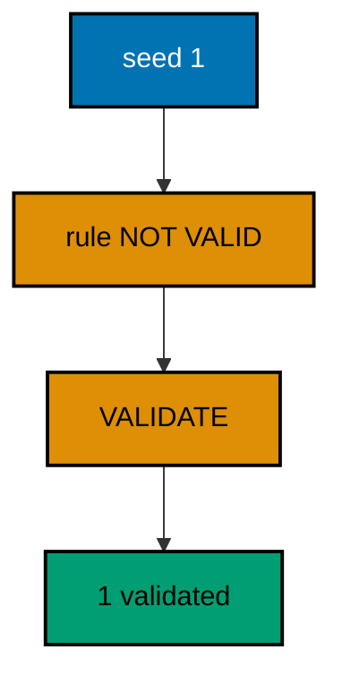

**`learning/code/ex-40-validate-constraints-without-locking-writes/Main.java`**:

```java
// Example 40: Validate Constraints Without Locking Writes.
// Adding a check constraint the naive way locks the table while every
// row is validated; NOT VALID adds the rule for new writes immediately
// and VALIDATE CONSTRAINT checks old rows later with a weaker lock. This
// program adds a positive-total rule as NOT VALID, validates it in a
// second changeset, then proves the catalog records a validated rule.
import java.sql.Connection; // => the handle every move and check shares
import java.sql.DriverManager; // => finds the PostgreSQL driver from the locked jars
import java.sql.ResultSet; // => walks the rows each verification query returns
import java.sql.Statement; // => carries the verification queries to the database
import java.util.Properties; // => carries the login without string-concatenated secrets
import liquibase.Liquibase; // => the entry point: configure, then update
import liquibase.Scope; // => silences progress narration for deterministic goldens
import liquibase.database.Database; // => Liquibase's view of our PostgreSQL connection
import liquibase.database.DatabaseFactory; // => picks the PostgreSQL implementation from the URL
import liquibase.database.jvm.JdbcConnection; // => adapts our JDBC handle to Liquibase
import liquibase.resource.DirectoryResourceAccessor; // => the current file-based changelog accessor
import liquibase.ui.LoggerUIService; // => reroutes progress lines into the silenced log

public class Main {

  // => one public class per file, named after the file
  static Connection connect() throws Exception {
    // => the harness starts PostgreSQL 18 and publishes these variables
    String host = System.getenv().getOrDefault("PGHOST", "localhost");
    // => default keeps local experimentation working outside the harness
    String url = "jdbc:postgresql://" + host + ":5432/postgres";
    // => trust auth accepts any password, so only the user matters
    Properties props = new Properties();
    // => Properties carries the login without string-concatenated secrets
    props.setProperty("user", System.getenv().getOrDefault("PGUSER", "postgres"));
    // => DriverManager finds the PostgreSQL driver from the locked jars
    return DriverManager.getConnection(url, props);
  } // => connect is the only place that knows connection details

  // => Liquibase narrates progress to its console UI by default; those lines
  // => differ between a first run and a rerun, so goldens cannot hold them
  static void runQuiet(Liquibase liquibase) throws Exception {
    // => the LOGGER service reroutes progress lines into the silenced JUL log
    Scope.child(
      java.util.Collections.singletonMap(Scope.Attr.ui.name(), new LoggerUIService()),
      // => the lambda runs inside the scope; main still throws Exception
      () -> liquibase.update("")
    );
    // => update("") runs every changeset with no context filter
  } // => quiet updates keep golden output identical on the harness double run

  public static void main(String[] args) throws Exception {
    // => silence JUL so the LOGGER service lines below disappear too
    java.util.logging.LogManager.getLogManager().reset();
    // => the entry point the harness runs
    try (Connection conn = connect()) {
      // => one connection serves the rule run and both checks
      Database database = DatabaseFactory.getInstance()
        // => the factory picks the PostgreSQL implementation from the URL
        .findCorrectDatabaseImplementation(new JdbcConnection(conn));
      // => JdbcConnection adapts our JDBC handle to Liquibase's database API
      Liquibase liquibase = new Liquibase(
        // => three changesets: table, unvalidated rule, then validation
        "changelog.sql",
        // => DirectoryResourceAccessor is the current file-based accessor
        new DirectoryResourceAccessor(new java.io.File(".").getAbsoluteFile()),
        // => rooting at the unit directory keeps changelogs beside the program
        database
      );
      runQuiet(liquibase);
      // => the update ran quiet, so the transcript holds only our own prints
      try (
        Statement st = conn.createStatement();
        ResultSet rs = st.executeQuery(
          "SELECT count(*) FROM pg_constraint " + "WHERE conname = 'ck_orders_total_positive' AND convalidated"
        )
      ) {
        // => pg_constraint records whether each rule finished validating
        rs.next();
        System.out.println("validated rules recorded: " + rs.getInt(1));
        // => Output: validated rules recorded: 1
      } // => one validated rule proves both changesets did their half
      try (Statement st = conn.createStatement(); ResultSet rs = st.executeQuery("SELECT count(*) FROM orders")) {
        // => the seeded order survived the rule and its later validation
        rs.next();
        System.out.println("old rows kept: " + rs.getInt(1));
        // => Output: old rows kept: 1
        // => a rerun skips all three changesets and prints identical counts
      } // => counts verify data without dumping rows into the transcript
    } // => closing the connection ends the program with history intact
  } // => main adds the rule loosely, then tightens it without blocking
}
```

**`learning/code/ex-40-validate-constraints-without-locking-writes/changelog.sql`**:

```sql
-- liquibase formatted sql
-- => REQUIRED first line: marks this file as a Liquibase SQL changelog
-- => Without it Liquibase runs the SQL untracked, and nothing is recorded.
-- changeset course:001-seed-orders
-- => the seed changeset creates orders with one honest positive row
CREATE TABLE orders (
  id SERIAL PRIMARY KEY,
  -- => SERIAL gives an auto-incrementing integer key, enough for this course
  total_cents INTEGER NOT NULL
  -- => the seeded total already satisfies the rule below
);

INSERT INTO
  orders (total_cents)
VALUES
  (5000);

-- => one seeded row the validation step must accept, never reject
-- rollback DROP TABLE orders;
-- => dropping the table reverses the seed and the rule together
-- changeset course:002-add-rule-not-valid
-- => the rule changeset guards new writes without scanning old rows
-- => NOT VALID skips the table scan, so writers never block on this deploy
ALTER TABLE orders ADD CONSTRAINT ck_orders_total_positive CHECK (total_cents > 0) NOT VALID;

-- rollback ALTER TABLE orders DROP CONSTRAINT ck_orders_total_positive;
-- => dropping the rule reverses exactly what this changeset added
-- changeset course:003-validate-rule
-- => the validation changeset checks old rows under a weaker lock
-- => writes continue during validation; only the rule's promise waits
ALTER TABLE orders VALIDATE CONSTRAINT ck_orders_total_positive;

-- rollback SELECT 1;
-- => validation leaves no schema object behind, so its reverse is a no-op
-- => the SELECT keeps the rollback block syntactically present but inert
```

**Output** (`learning/code/ex-40-validate-constraints-without-locking-writes/expected/main.stdout.txt`):

```text
validated rules recorded: 1
old rows kept: 1
```

**Key takeaway**: NOT VALID enforces rules on new writes at once while VALIDATE CONSTRAINT checks old rows later without blocking.

**Why it matters**: Constraint validation scans the whole table under a lock that blocks writes for the scan's duration: on a large table that means minutes of rejected traffic for a rule that protects data quality, not availability. Splitting enforcement from verification keeps writers flowing on both deploys — new rows obey immediately, old rows get checked when the lock is cheap. The catalog records which rules finished validating, so the second changeset is verifiable rather than hopeful. Protect the writes first, audit the history second, block nobody either time.

---

### Example 41: Create Indexes Concurrently

A plain CREATE INDEX locks writes until the build finishes; CONCURRENTLY builds without that lock, but refuses to run inside a transaction, so its changeset opts out of Liquibase's transaction wrapper with runInTransaction false. The opt-out is the whole trick — everything else reads like a normal index migration. The program builds a concurrent index outside any transaction, then proves the catalog records it and the seeded row stays readable through it. (Concepts: co-09, co-17.)

**`learning/code/ex-41-create-indexes-concurrently/Main.java`**:

```java
// Example 41: Create Indexes Concurrently.
// A plain CREATE INDEX locks writes until the build finishes; CONCURRENTLY
// builds without that lock, but refuses to run inside a transaction, so
// its changeset must opt out of Liquibase's transaction wrapper. This
// program builds a concurrent index outside any transaction, then proves
// the catalog records it and the seeded row stays readable through it.
import java.sql.Connection; // => the handle every move and check shares
import java.sql.DriverManager; // => finds the PostgreSQL driver from the locked jars
import java.sql.ResultSet; // => walks the rows each verification query returns
import java.sql.Statement; // => carries the verification queries to the database
import java.util.Properties; // => carries the login without string-concatenated secrets
import liquibase.Liquibase; // => the entry point: configure, then update
import liquibase.Scope; // => silences progress narration for deterministic goldens
import liquibase.database.Database; // => Liquibase's view of our PostgreSQL connection
import liquibase.database.DatabaseFactory; // => picks the PostgreSQL implementation from the URL
import liquibase.database.jvm.JdbcConnection; // => adapts our JDBC handle to Liquibase
import liquibase.resource.DirectoryResourceAccessor; // => the current file-based changelog accessor
import liquibase.ui.LoggerUIService; // => reroutes progress lines into the silenced log

public class Main {

  // => one public class per file, named after the file
  static Connection connect() throws Exception {
    // => the harness starts PostgreSQL 18 and publishes these variables
    String host = System.getenv().getOrDefault("PGHOST", "localhost");
    // => default keeps local experimentation working outside the harness
    String url = "jdbc:postgresql://" + host + ":5432/postgres";
    // => trust auth accepts any password, so only the user matters
    Properties props = new Properties();
    // => Properties carries the login without string-concatenated secrets
    props.setProperty("user", System.getenv().getOrDefault("PGUSER", "postgres"));
    // => DriverManager finds the PostgreSQL driver from the locked jars
    return DriverManager.getConnection(url, props);
  } // => connect is the only place that knows connection details

  // => Liquibase narrates progress to its console UI by default; those lines
  // => differ between a first run and a rerun, so goldens cannot hold them
  static void runQuiet(Liquibase liquibase) throws Exception {
    // => the LOGGER service reroutes progress lines into the silenced JUL log
    Scope.child(
      java.util.Collections.singletonMap(Scope.Attr.ui.name(), new LoggerUIService()),
      // => the lambda runs inside the scope; main still throws Exception
      () -> liquibase.update("")
    );
    // => update("") runs every changeset with no context filter
  } // => quiet updates keep golden output identical on the harness double run

  public static void main(String[] args) throws Exception {
    // => silence JUL so the LOGGER service lines below disappear too
    java.util.logging.LogManager.getLogManager().reset();
    // => the entry point the harness runs
    try (Connection conn = connect()) {
      // => one connection serves the concurrent build and both checks
      Database database = DatabaseFactory.getInstance()
        // => the factory picks the PostgreSQL implementation from the URL
        .findCorrectDatabaseImplementation(new JdbcConnection(conn));
      // => JdbcConnection adapts our JDBC handle to Liquibase's database API
      Liquibase liquibase = new Liquibase(
        // => two changesets: the table, then the concurrent index
        "changelog.sql",
        // => DirectoryResourceAccessor is the current file-based accessor
        new DirectoryResourceAccessor(new java.io.File(".").getAbsoluteFile()),
        // => rooting at the unit directory keeps changelogs beside the program
        database
      );
      runQuiet(liquibase);
      // => the index built without a transaction, writes never blocked
      try (
        Statement st = conn.createStatement();
        ResultSet rs = st.executeQuery("SELECT count(*) FROM pg_indexes WHERE indexname = 'ix_events_code'")
      ) {
        // => pg_indexes names our index instead of counting the table's own
        rs.next();
        System.out.println("concurrent indexes recorded: " + rs.getInt(1));
        // => Output: concurrent indexes recorded: 1
      } // => one named index proves the out-of-transaction build succeeded
      try (
        Statement st = conn.createStatement();
        ResultSet rs = st.executeQuery("SELECT count(*) FROM events WHERE code = 'E-1'")
      ) {
        // => the indexed lookup returns exactly the seeded row
        rs.next();
        System.out.println("rows found through the index: " + rs.getInt(1));
        // => Output: rows found through the index: 1
        // => a rerun skips both changesets and prints the identical counts
      } // => the lookup proves the index serves reads, not just catalogs
    } // => closing the connection ends the program with history intact
  } // => main builds the index concurrently, then reads through it
}
```

**`learning/code/ex-41-create-indexes-concurrently/changelog.sql`**:

```sql
-- liquibase formatted sql
-- => REQUIRED first line: marks this file as a Liquibase SQL changelog
-- => Without it Liquibase runs the SQL untracked, and nothing is recorded.
-- changeset course:001-seed-events
-- => the seed changeset creates events with one row worth indexing
CREATE TABLE events (
  id SERIAL PRIMARY KEY,
  -- => SERIAL gives an auto-incrementing integer key, enough for this course
  code VARCHAR(20) NOT NULL
  -- => the code column the concurrent index below will serve
);

INSERT INTO
  events (code)
VALUES
  ('E-1');

-- => one seeded row the indexed lookup below must find
-- rollback DROP TABLE events;
-- => dropping the table reverses the seed and the index together
-- changeset course:002-index-concurrent runInTransaction:false
-- => CONCURRENTLY refuses transactions, so this changeset opts out of the
-- => wrapper: runInTransaction false lets the build commit in its own steps
CREATE INDEX CONCURRENTLY ix_events_code ON events (code);

-- => the concurrent build takes no write lock; writers proceed throughout
-- rollback DROP INDEX ix_events_code;
-- => plain DROP INDEX reverses the concurrent build symmetrically
```

**Output** (`learning/code/ex-41-create-indexes-concurrently/expected/main.stdout.txt`):

```text
concurrent indexes recorded: 1
rows found through the index: 1
```

**Key takeaway**: Concurrent index builds opt out of the transaction wrapper, indexing live tables without blocking writes.

**Why it matters**: Missing indexes slow reads gradually while building them blocks writes suddenly, which perversely punishes the fix more than the problem: teams postpone the index because the build needs a window, and the slow queries compound meanwhile. CONCURRENTLY removes the window from the equation — the build proceeds beside traffic and takes longer instead of blocking. One attribute on the changeset is the entire difference between a planned outage and a background task. Index the live table the way it lives: concurrently, without asking traffic to wait.

---

### Example 42: Split a Table Across Deploys

Wide tables split without downtime when the new table fills from the old one while both stay readable: copy first, switch readers second, drop the old columns last in a much later release. The copy is an INSERT SELECT in a changeset, reviewable and rerunnable like any migration. The program copies order lines into their own table with a foreign key home, then proves both tables hold the same two rows side by side. (Concepts: co-14.)

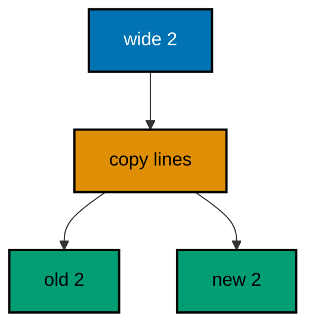

**`learning/code/ex-42-split-a-table-across-deploys/Main.java`**:

```java
// Example 42: Split a Table Across Deploys.
// Wide tables split without downtime when the new table fills from the
// old one while both stay readable: copy first, switch readers second,
// drop the old columns last. This program copies order lines into their
// own table, then proves both tables hold the same two rows side by side.
import java.sql.Connection; // => the handle every move and check shares
import java.sql.DriverManager; // => finds the PostgreSQL driver from the locked jars
import java.sql.ResultSet; // => walks the rows each verification query returns
import java.sql.Statement; // => carries the verification queries to the database
import java.util.Properties; // => carries the login without string-concatenated secrets
import liquibase.Liquibase; // => the entry point: configure, then update
import liquibase.Scope; // => silences progress narration for deterministic goldens
import liquibase.database.Database; // => Liquibase's view of our PostgreSQL connection
import liquibase.database.DatabaseFactory; // => picks the PostgreSQL implementation from the URL
import liquibase.database.jvm.JdbcConnection; // => adapts our JDBC handle to Liquibase
import liquibase.resource.DirectoryResourceAccessor; // => the current file-based changelog accessor
import liquibase.ui.LoggerUIService; // => reroutes progress lines into the silenced log

public class Main {

  // => one public class per file, named after the file
  static Connection connect() throws Exception {
    // => the harness starts PostgreSQL 18 and publishes these variables
    String host = System.getenv().getOrDefault("PGHOST", "localhost");
    // => default keeps local experimentation working outside the harness
    String url = "jdbc:postgresql://" + host + ":5432/postgres";
    // => trust auth accepts any password, so only the user matters
    Properties props = new Properties();
    // => Properties carries the login without string-concatenated secrets
    props.setProperty("user", System.getenv().getOrDefault("PGUSER", "postgres"));
    // => DriverManager finds the PostgreSQL driver from the locked jars
    return DriverManager.getConnection(url, props);
  } // => connect is the only place that knows connection details

  // => Liquibase narrates progress to its console UI by default; those lines
  // => differ between a first run and a rerun, so goldens cannot hold them
  static void runQuiet(Liquibase liquibase) throws Exception {
    // => the LOGGER service reroutes progress lines into the silenced JUL log
    Scope.child(
      java.util.Collections.singletonMap(Scope.Attr.ui.name(), new LoggerUIService()),
      // => the lambda runs inside the scope; main still throws Exception
      () -> liquibase.update("")
    );
    // => update("") runs every changeset with no context filter
  } // => quiet updates keep golden output identical on the harness double run

  public static void main(String[] args) throws Exception {
    // => silence JUL so the LOGGER service lines below disappear too
    java.util.logging.LogManager.getLogManager().reset();
    // => the entry point the harness runs
    try (Connection conn = connect()) {
      // => one connection serves the split run and both counts
      Database database = DatabaseFactory.getInstance()
        // => the factory picks the PostgreSQL implementation from the URL
        .findCorrectDatabaseImplementation(new JdbcConnection(conn));
      // => JdbcConnection adapts our JDBC handle to Liquibase's database API
      Liquibase liquibase = new Liquibase(
        // => two changesets: the wide table, then the split copy
        "changelog.sql",
        // => DirectoryResourceAccessor is the current file-based accessor
        new DirectoryResourceAccessor(new java.io.File(".").getAbsoluteFile()),
        // => rooting at the unit directory keeps changelogs beside the program
        database
      );
      runQuiet(liquibase);
      // => the update ran quiet, so the transcript holds only our own prints
      try (
        Statement st = conn.createStatement();
        ResultSet rs = st.executeQuery("SELECT count(*) FROM purchase_orders")
      ) {
        // => the old table keeps both rows while readers move over
        rs.next();
        System.out.println("rows in the old table: " + rs.getInt(1));
        // => Output: rows in the old table: 2
      } // => old rows stay put until the last reader switches, much later
      try (Statement st = conn.createStatement(); ResultSet rs = st.executeQuery("SELECT count(*) FROM order_lines")) {
        // => the new table holds the same two rows, copied by the split
        rs.next();
        System.out.println("rows in the new table: " + rs.getInt(1));
        // => Output: rows in the new table: 2
        // => a rerun skips both changesets and prints the identical counts
      } // => equal counts prove the copy lost nothing in transit
    } // => closing the connection ends the program with history intact
  } // => main splits the table, then counts both halves
}
```

**`learning/code/ex-42-split-a-table-across-deploys/changelog.sql`**:

```sql
-- liquibase formatted sql
-- => REQUIRED first line: marks this file as a Liquibase SQL changelog
-- => Without it Liquibase runs the SQL untracked, and nothing is recorded.
-- changeset course:001-make-wide-orders
-- => the wide table ships first with order headers and lines together
CREATE TABLE purchase_orders (
  id SERIAL PRIMARY KEY,
  -- => SERIAL gives an auto-incrementing integer key, enough for this course
  customer VARCHAR(60) NOT NULL,
  -- => the header half of each row stays on this table after the split
  item VARCHAR(60) NOT NULL
  -- => the line half below moves out into its own table
);

INSERT INTO
  purchase_orders (customer, item)
VALUES
  ('budi', 'kopi'),
  ('sari', 'teh');

-- => two wide rows the split below copies line by line
-- rollback DROP TABLE purchase_orders;
-- => dropping the table reverses the seed and the split together
-- changeset course:002-split-lines-out
-- => the split creates the lines table and copies every line across
CREATE TABLE order_lines (
  id SERIAL PRIMARY KEY,
  -- => lines get their own independent sequence of ids
  order_id INTEGER NOT NULL REFERENCES purchase_orders (id),
  -- => the foreign key keeps each copied line attached to its header
  item VARCHAR(60) NOT NULL
  -- => the copied item text the verification below recounts
);

INSERT INTO
  order_lines (order_id, item)
SELECT
  id,
  item
FROM
  purchase_orders;

-- => INSERT SELECT copies all rows in one statement, nothing hand-moved
-- rollback DROP TABLE order_lines;
-- => dropping the new table un-splits back to the wide shape alone
```

**Output** (`learning/code/ex-42-split-a-table-across-deploys/expected/main.stdout.txt`):

```text
rows in the old table: 2
rows in the new table: 2
```

**Key takeaway**: Table splits copy rows into the new table while the old stays readable, deferring reader switches and drops.

**Why it matters**: Wide tables grow until every query pays for columns it never reads, but splitting them in one deploy forces every reader to switch shapes simultaneously — another flag day with a long tail. Copying first decouples the storage change from the reader change: the data lives in both places while consumers move one by one, each verified against the old source still standing beside the new. The foreign key keeps the copy honest during the overlap. Split the storage now, move the readers gradually, drop the old columns when the last reader is gone.

---

### Example 43: Feature Flags Gate the New Path

Schema ships before code when a flag row decides which path runs: the migration adds the flag defaulting off, and a later change flips it on once readers are ready. Flags decouple deployment from release — the schema lands in one deploy, the behavior switches in a later, smaller, instantly reversible one. The program seeds two flags, flips the ready path, then proves the new checkout reads enabled while the new reports read waiting. (Concepts: co-14.)

**`learning/code/ex-43-feature-flags-gate-the-new-path/Main.java`**:

```java
// Example 43: Feature Flags Gate the New Path.
// Schema ships before code when a flag row decides which path runs: the
// migration adds the flag defaulting off, and a later change flips it on
// once readers are ready. This program seeds two flags, then proves the
// new checkout path reads enabled while the old report path reads waiting.
import java.sql.Connection; // => the handle every move and check shares
import java.sql.DriverManager; // => finds the PostgreSQL driver from the locked jars
import java.sql.ResultSet; // => walks the rows each verification query returns
import java.sql.Statement; // => carries the verification queries to the database
import java.util.Properties; // => carries the login without string-concatenated secrets
import liquibase.Liquibase; // => the entry point: configure, then update
import liquibase.Scope; // => silences progress narration for deterministic goldens
import liquibase.database.Database; // => Liquibase's view of our PostgreSQL connection
import liquibase.database.DatabaseFactory; // => picks the PostgreSQL implementation from the URL
import liquibase.database.jvm.JdbcConnection; // => adapts our JDBC handle to Liquibase
import liquibase.resource.DirectoryResourceAccessor; // => the current file-based changelog accessor
import liquibase.ui.LoggerUIService; // => reroutes progress lines into the silenced log

public class Main {

  // => one public class per file, named after the file
  static Connection connect() throws Exception {
    // => the harness starts PostgreSQL 18 and publishes these variables
    String host = System.getenv().getOrDefault("PGHOST", "localhost");
    // => default keeps local experimentation working outside the harness
    String url = "jdbc:postgresql://" + host + ":5432/postgres";
    // => trust auth accepts any password, so only the user matters
    Properties props = new Properties();
    // => Properties carries the login without string-concatenated secrets
    props.setProperty("user", System.getenv().getOrDefault("PGUSER", "postgres"));
    // => DriverManager finds the PostgreSQL driver from the locked jars
    return DriverManager.getConnection(url, props);
  } // => connect is the only place that knows connection details

  // => Liquibase narrates progress to its console UI by default; those lines
  // => differ between a first run and a rerun, so goldens cannot hold them
  static void runQuiet(Liquibase liquibase) throws Exception {
    // => the LOGGER service reroutes progress lines into the silenced JUL log
    Scope.child(
      java.util.Collections.singletonMap(Scope.Attr.ui.name(), new LoggerUIService()),
      // => the lambda runs inside the scope; main still throws Exception
      () -> liquibase.update("")
    );
    // => update("") runs every changeset with no context filter
  } // => quiet updates keep golden output identical on the harness double run

  // => one helper reads any flag by name, so both paths ask the same way
  static boolean flagOn(Connection conn, String name) throws Exception {
    // => flags are rows, so readers query them like any other data
    try (
      Statement st = conn.createStatement();
      // => try-with-resources closes the statement on every path
      ResultSet rs = st.executeQuery("SELECT enabled FROM feature_flags WHERE name = '" + name + "'")
    ) {
      // => the flag name is our constant, so string building stays safe here
      rs.next();
      // => exactly one row answers whether the new path may run
      return rs.getBoolean(1);
    } // => boolean answers keep the gate readable in the transcript
  } // => helpers that verify stay separate from code that migrates

  public static void main(String[] args) throws Exception {
    // => silence JUL so the LOGGER service lines below disappear too
    java.util.logging.LogManager.getLogManager().reset();
    // => the entry point the harness runs
    try (Connection conn = connect()) {
      // => one connection serves the flag migration and both reads
      Database database = DatabaseFactory.getInstance()
        // => the factory picks the PostgreSQL implementation from the URL
        .findCorrectDatabaseImplementation(new JdbcConnection(conn));
      // => JdbcConnection adapts our JDBC handle to Liquibase's database API
      Liquibase liquibase = new Liquibase(
        // => two changesets: the flags table, then the flip
        "changelog.sql",
        // => DirectoryResourceAccessor is the current file-based accessor
        new DirectoryResourceAccessor(new java.io.File(".").getAbsoluteFile()),
        // => rooting at the unit directory keeps changelogs beside the program
        database
      );
      runQuiet(liquibase);
      // => the flags shipped as data; readers decide paths from their rows
      System.out.println("new checkout path enabled: " + flagOn(conn, "new_checkout"));
      // => Output: new checkout path enabled: true
      System.out.println("new report path enabled: " + flagOn(conn, "new_reports"));
      // => Output: new report path enabled: false
      // => a rerun skips both changesets and prints the identical flags
    } // => closing the connection ends the program with history intact
  } // => main ships the flags, then reads which paths may run
}
```

**`learning/code/ex-43-feature-flags-gate-the-new-path/changelog.sql`**:

```sql
-- liquibase formatted sql
-- => REQUIRED first line: marks this file as a Liquibase SQL changelog
-- => Without it Liquibase runs the SQL untracked, and nothing is recorded.
-- changeset course:001-make-flags
-- => the flags table ships with both paths defaulting off
-- => schema lands first; no reader switches until a flag says so
CREATE TABLE feature_flags (
  name VARCHAR(60) PRIMARY KEY,
  -- => the flag name is the key readers ask for by constant
  enabled BOOLEAN NOT NULL DEFAULT FALSE
  -- => new paths start disabled: shipping the schema enables nothing
);

INSERT INTO
  feature_flags (name)
VALUES
  ('new_checkout'),
  ('new_reports');

-- => two dark flags; the flip below lights exactly one of them
-- rollback DROP TABLE feature_flags;
-- => dropping the table reverses the flags and the flip together
-- changeset course:002-flip-checkout
-- => the flip changeset lights the ready path once readers can take it
-- => flipping is data, so it ships as a tracked changeset like the rest
UPDATE feature_flags
SET
  enabled = TRUE
WHERE
  name = 'new_checkout';

-- rollback UPDATE feature_flags SET enabled = FALSE WHERE name = 'new_checkout';
-- => unflipping restores the dark default without dropping the flag
```

**Output** (`learning/code/ex-43-feature-flags-gate-the-new-path/expected/main.stdout.txt`):

```text
new checkout path enabled: true
new report path enabled: false
```

**Key takeaway**: Flag rows gate new paths independently of deploys, so schema ships first and behavior switches later.

**Why it matters**: Coupling schema changes to behavior changes forces both to succeed together or fail together: a slow reader migration blocks an urgent schema fix, and a bad behavior flip requires a schema rollback to undo. Flags separate the two axes — migrate the storage when ready, flip the behavior when proven, unflip in seconds when wrong. The flag's history as ordinary rows means flips audit like any data change. Ship the capability dark, light it when the evidence supports it, and keep the switch within arm's reach always.

---

### Example 44: Blue-Green Needs Compatible Migrations

Blue-green deploys run old and new code against one database during the switch, so every migration in the window must serve both: additive and nullable, never renaming or dropping. Compatibility is a property of each changeset, checked at review time against both code versions. The program adds a nullable tag column, then proves the old two-column read still works while the new column stands ready beside it. (Concepts: co-14, co-17.)

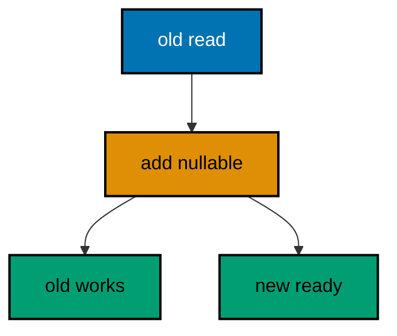

**`learning/code/ex-44-blue-green-needs-compatible-migrations/Main.java`**:

```java
// Example 44: Blue-Green Needs Compatible Migrations.
// Blue-green deploys run old and new code against one database during the
// switch, so every migration in the window must serve both: additive and
// nullable, never renaming or dropping. This program adds a nullable tag
// column, then proves the old two-column read still works while the new
// column stands ready beside it.
import java.sql.Connection; // => the handle every move and check shares
import java.sql.DriverManager; // => finds the PostgreSQL driver from the locked jars
import java.sql.ResultSet; // => walks the rows each verification query returns
import java.sql.Statement; // => carries the verification queries to the database
import java.util.Properties; // => carries the login without string-concatenated secrets
import liquibase.Liquibase; // => the entry point: configure, then update
import liquibase.Scope; // => silences progress narration for deterministic goldens
import liquibase.database.Database; // => Liquibase's view of our PostgreSQL connection
import liquibase.database.DatabaseFactory; // => picks the PostgreSQL implementation from the URL
import liquibase.database.jvm.JdbcConnection; // => adapts our JDBC handle to Liquibase
import liquibase.resource.DirectoryResourceAccessor; // => the current file-based changelog accessor
import liquibase.ui.LoggerUIService; // => reroutes progress lines into the silenced log

public class Main {

  // => one public class per file, named after the file
  static Connection connect() throws Exception {
    // => the harness starts PostgreSQL 18 and publishes these variables
    String host = System.getenv().getOrDefault("PGHOST", "localhost");
    // => default keeps local experimentation working outside the harness
    String url = "jdbc:postgresql://" + host + ":5432/postgres";
    // => trust auth accepts any password, so only the user matters
    Properties props = new Properties();
    // => Properties carries the login without string-concatenated secrets
    props.setProperty("user", System.getenv().getOrDefault("PGUSER", "postgres"));
    // => DriverManager finds the PostgreSQL driver from the locked jars
    return DriverManager.getConnection(url, props);
  } // => connect is the only place that knows connection details

  // => Liquibase narrates progress to its console UI by default; those lines
  // => differ between a first run and a rerun, so goldens cannot hold them
  static void runQuiet(Liquibase liquibase) throws Exception {
    // => the LOGGER service reroutes progress lines into the silenced JUL log
    Scope.child(
      java.util.Collections.singletonMap(Scope.Attr.ui.name(), new LoggerUIService()),
      // => the lambda runs inside the scope; main still throws Exception
      () -> liquibase.update("")
    );
    // => update("") runs every changeset with no context filter
  } // => quiet updates keep golden output identical on the harness double run

  public static void main(String[] args) throws Exception {
    // => silence JUL so the LOGGER service lines below disappear too
    java.util.logging.LogManager.getLogManager().reset();
    // => the entry point the harness runs
    try (Connection conn = connect()) {
      // => one connection serves the compatible run and both reads
      Database database = DatabaseFactory.getInstance()
        // => the factory picks the PostgreSQL implementation from the URL
        .findCorrectDatabaseImplementation(new JdbcConnection(conn));
      // => JdbcConnection adapts our JDBC handle to Liquibase's database API
      Liquibase liquibase = new Liquibase(
        // => two changesets: the products table, then the nullable tag
        "changelog.sql",
        // => DirectoryResourceAccessor is the current file-based accessor
        new DirectoryResourceAccessor(new java.io.File(".").getAbsoluteFile()),
        // => rooting at the unit directory keeps changelogs beside the program
        database
      );
      runQuiet(liquibase);
      // => the additive change serves old and new code at once
      try (Statement st = conn.createStatement(); ResultSet rs = st.executeQuery("SELECT id, name FROM goods")) {
        // => the old two-column read names no new column, by design
        int oldReads = 0;
        // => the counter proves the old shape still serves during the switch
        while (rs.next()) {
          // => each row the old code can still read counts once
          oldReads++;
          // => reading only old columns mimics the blue deploy exactly
        } // => the loop ends with the old deploy's whole worldview counted
        System.out.println("rows the old read still sees: " + oldReads);
        // => Output: rows the old read still sees: 1
      } // => old reads surviving proves the migration stayed compatible
      try (
        Statement st = conn.createStatement();
        ResultSet rs = st.executeQuery(
          "SELECT count(*) FROM information_schema.columns " + "WHERE table_name = 'goods' AND column_name = 'tag'"
        )
      ) {
        // => the new column stands ready for the green deploy beside it
        rs.next();
        System.out.println("new tag column present: " + rs.getInt(1));
        // => Output: new tag column present: 1
        // => a rerun skips both changesets and prints the identical reads
      } // => one new column proves the window carried exactly one addition
    } // => closing the connection ends the program with history intact
  } // => main migrates compatibly, then reads it both ways
}
```

**`learning/code/ex-44-blue-green-needs-compatible-migrations/changelog.sql`**:

```sql
-- liquibase formatted sql
-- => REQUIRED first line: marks this file as a Liquibase SQL changelog
-- => Without it Liquibase runs the SQL untracked, and nothing is recorded.
-- changeset course:001-make-goods
-- => the table changeset creates goods with the old two-column shape
CREATE TABLE goods (
  id SERIAL PRIMARY KEY,
  -- => SERIAL gives an auto-incrementing integer key, enough for this course
  name VARCHAR(60) NOT NULL
  -- => the old shape every blue-deploy query still names
);

INSERT INTO
  goods (name)
VALUES
  ('kopi');

-- => one seeded row both deploys must keep reading through the switch
-- rollback DROP TABLE goods;
-- => dropping the table reverses the seed and the addition together
-- changeset course:002-add-tag
-- => the compatible change adds a nullable column and nothing else
-- => nullable means old inserts without the column keep working untouched
ALTER TABLE goods
ADD COLUMN tag VARCHAR(30);

-- rollback ALTER TABLE goods DROP COLUMN tag;
-- => dropping the column un-adds without touching the old shape
```

**Output** (`learning/code/ex-44-blue-green-needs-compatible-migrations/expected/main.stdout.txt`):

```text
rows the old read still sees: 1
new tag column present: 1
```

**Key takeaway**: Blue-green windows admit only additive, nullable migrations that old and new code both tolerate.

**Why it matters**: A rename or a drop inside the switch window breaks whichever deploy still uses the old shape — and during the switch, both shapes are live by definition. Incompatible migrations turn the safest deploy strategy into a coin flip decided by traffic timing. Additive-and-nullable is a reviewable rule: the reviewer checks both code versions against the changeset and approves only what neither can trip over. Compatibility is not a property of the deploy choreography but of each migration; write every window migration to serve two masters and the switch stays boring.

---

### Example 45: changeLogSync Baselines Without Running

Databases that predate Liquibase already hold the schema: running the changelog would rebuild what exists and fail, so changeLogSync marks every changeset as ran without executing any, baselining the database under version control from today forward. Syncing adopts history; it never replays it. The program hand-builds a legacy table with one row, syncs its matching changelog, then proves the history holds one row while the hand-built row stayed untouched. (Concepts: co-12.)

**`learning/code/ex-45-changelogsync-baselines-without-running/Main.java`**:

```java
// Example 45: changeLogSync Baselines Without Running.
// Databases that predate Liquibase already hold the schema: running the
// changelog would rebuild what exists and fail. changeLogSync marks every
// changeset as ran without executing any, baselining the database under
// version control from today forward. This program hand-builds a legacy
// table, syncs its matching changelog, then proves the history filled
// while the hand-built rows stayed untouched.
import java.sql.Connection; // => the handle every move and check shares
import java.sql.DriverManager; // => finds the PostgreSQL driver from the locked jars
import java.sql.ResultSet; // => walks the rows each verification query returns
import java.sql.Statement; // => carries the verification queries to the database
import java.util.Properties; // => carries the login without string-concatenated secrets
import liquibase.Liquibase; // => the entry point: configure, then update
import liquibase.Scope; // => silences progress narration for deterministic goldens
import liquibase.database.Database; // => Liquibase's view of our PostgreSQL connection
import liquibase.database.DatabaseFactory; // => picks the PostgreSQL implementation from the URL
import liquibase.database.jvm.JdbcConnection; // => adapts our JDBC handle to Liquibase
import liquibase.resource.DirectoryResourceAccessor; // => the current file-based changelog accessor
import liquibase.ui.LoggerUIService; // => reroutes progress lines into the silenced log

public class Main {

  // => one public class per file, named after the file
  static Connection connect() throws Exception {
    // => the harness starts PostgreSQL 18 and publishes these variables
    String host = System.getenv().getOrDefault("PGHOST", "localhost");
    // => default keeps local experimentation working outside the harness
    String url = "jdbc:postgresql://" + host + ":5432/postgres";
    // => trust auth accepts any password, so only the user matters
    Properties props = new Properties();
    // => Properties carries the login without string-concatenated secrets
    props.setProperty("user", System.getenv().getOrDefault("PGUSER", "postgres"));
    // => DriverManager finds the PostgreSQL driver from the locked jars
    return DriverManager.getConnection(url, props);
  } // => connect is the only place that knows connection details

  // => the sync narrates too, so it runs inside the same quiet scope shape
  static void syncQuiet(Liquibase liquibase) throws Exception {
    // => the LOGGER service reroutes progress lines into the silenced JUL log
    Scope.child(
      java.util.Collections.singletonMap(Scope.Attr.ui.name(), new LoggerUIService()),
      // => the lambda runs inside the scope; main still throws Exception
      () -> liquibase.changeLogSync("")
    );
    // => changeLogSync marks changesets ran without executing any of them
  } // => quiet syncs keep golden output identical on the harness double run

  public static void main(String[] args) throws Exception {
    // => silence JUL so the LOGGER service lines below disappear too
    java.util.logging.LogManager.getLogManager().reset();
    // => the entry point the harness runs
    try (Connection conn = connect()) {
      conn.setAutoCommit(false);
      // => manual commit makes every preamble statement explicit and replayable
      // => one connection hand-builds the legacy shape, then syncs it
      try (Statement st = conn.createStatement()) {
        // => the legacy table predates Liquibase: no changeset ever built it
        st.execute("DROP TABLE IF EXISTS legacy_invoices");
        // => dropping first keeps the hand-build idempotent on double runs
        st.execute("CREATE TABLE legacy_invoices (id SERIAL PRIMARY KEY, total_cents INTEGER)");
        // => the legacy shape matches the changelog below column for column
        st.execute("DELETE FROM legacy_invoices");
        // => delete-then-insert keeps the seed idempotent on the double run
        st.execute("INSERT INTO legacy_invoices (total_cents) VALUES (9000)");
        // => one legacy row the sync must carry over untouched
        conn.commit();
        // => committing pins the legacy shape before the sync below
      } // => hand-built history is exactly what baselines are for
      Database database = DatabaseFactory.getInstance()
        // => the factory picks the PostgreSQL implementation from the URL
        .findCorrectDatabaseImplementation(new JdbcConnection(conn));
      // => JdbcConnection adapts our JDBC handle to Liquibase's database API
      Liquibase liquibase = new Liquibase(
        // => one changeset describing the already-existing table
        "changelog.sql",
        // => DirectoryResourceAccessor is the current file-based accessor
        new DirectoryResourceAccessor(new java.io.File(".").getAbsoluteFile()),
        // => rooting at the unit directory keeps changelogs beside the program
        database
      );
      syncQuiet(liquibase);
      // => the sync recorded the changeset; executing it would have failed
      try (
        Statement st = conn.createStatement();
        ResultSet rs = st.executeQuery("SELECT count(*) FROM databasechangelog")
      ) {
        // => the baseline is one tracked changeset that never executed
        rs.next();
        System.out.println("baselined changesets: " + rs.getInt(1));
        // => Output: baselined changesets: 1
      } // => one row proves the database joined version control today
      try (
        Statement st = conn.createStatement();
        ResultSet rs = st.executeQuery("SELECT count(*) FROM legacy_invoices")
      ) {
        // => the legacy row survived the sync exactly as hand-built
        rs.next();
        System.out.println("legacy rows kept: " + rs.getInt(1));
        // => Output: legacy rows kept: 1
        // => a rerun rebuilds the legacy shape, then syncs it no-op again
      } // => counts verify data without dumping rows into the transcript
    } // => closing the connection ends the program with history intact
  } // => main hand-builds the past, then baselines it without running
}
```

**`learning/code/ex-45-changelogsync-baselines-without-running/changelog.sql`**:

```sql
-- liquibase formatted sql
-- => REQUIRED first line: marks this file as a Liquibase SQL changelog
-- => Without it Liquibase runs the SQL untracked, and nothing is recorded.
-- changeset course:001-legacy-invoices
-- => the changeset describes the hand-built table column for column
-- => it must never execute here: the table already exists, so the sync
-- => marks it ran and every future changeset builds on top normally
CREATE TABLE legacy_invoices (
  id SERIAL PRIMARY KEY,
  -- => SERIAL matches the hand-built key exactly, or drift starts today
  total_cents INTEGER NOT NULL
  -- => the hand-built column is nullable; the baseline tightens nothing
);

-- rollback DROP TABLE legacy_invoices;
-- => this reverse never runs here; baselines record, they do not execute
```

**Output** (`learning/code/ex-45-changelogsync-baselines-without-running/expected/main.stdout.txt`):

```text
baselined changesets: 1
legacy rows kept: 1
```

**Key takeaway**: changeLogSync records existing schemas as ran without executing, adopting legacy databases into version control.

**Why it matters**: The alternative to baselining is replaying years of migrations against a database that already holds their results: every CREATE fails on existing objects, and the adoption project dies in the first hour. Syncing declares that the current state is the starting point, with the matching changelog as its description going forward — new changesets build on top normally from the next release. Legacy databases join version control without downtime, without rebuilds, and without pretending the past did not happen. Adopt the present, version the future.

---

### Example 46: generateChangeLog Captures the Real Schema

A legacy database becomes a changelog when generateChangeLog snapshots its schema into changeset form: the draft baseline the team reviews, corrects, and only then trusts. Generation captures reality; review converts it into intent. The program hand-builds a legacy widgets table, generates a changelog from the live database, then counts the generated lines naming that table. (Concepts: co-12.)

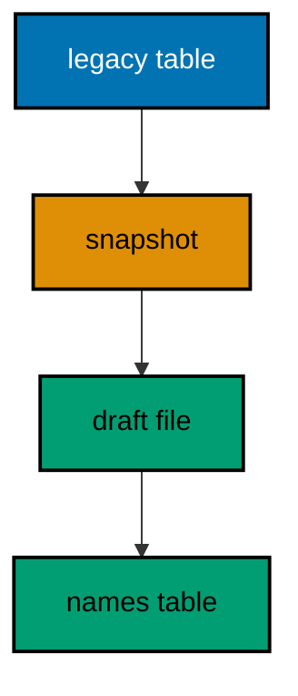

**`learning/code/ex-46-generatechangelog-captures-the-real-schema/Main.java`**:

```java
// Example 46: generateChangeLog Captures the Real Schema.
// A legacy database becomes a changelog when generateChangeLog snapshots
// its schema into changeset form: the draft baseline the team reviews,
// never blindly trusts. This program hand-builds a legacy widgets table,
// generates a changelog from the live database, then counts how many
// generated changesets describe that table.
import java.nio.file.Files; // => reads the generated changelog the diff wrote
import java.nio.file.Path; // => names the generated file without string paths
import java.sql.Connection; // => the handle every move and check shares
import java.sql.DriverManager; // => finds the PostgreSQL driver from the locked jars
import java.sql.Statement; // => carries the verification queries to the database
import java.util.List; // => holds the generated lines for counting
import java.util.Properties; // => carries the login without string-concatenated secrets
import liquibase.Scope; // => silences progress narration for deterministic goldens
import liquibase.command.CommandScope; // => runs diff-class commands outside update
import liquibase.ui.LoggerUIService; // => reroutes progress lines into the silenced log

public class Main {

  // => one public class per file, named after the file
  static Connection connect() throws Exception {
    // => the harness starts PostgreSQL 18 and publishes these variables
    String host = System.getenv().getOrDefault("PGHOST", "localhost");
    // => default keeps local experimentation working outside the harness
    String url = "jdbc:postgresql://" + host + ":5432/postgres";
    // => trust auth accepts any password, so only the user matters
    Properties props = new Properties();
    // => Properties carries the login without string-concatenated secrets
    props.setProperty("user", System.getenv().getOrDefault("PGUSER", "postgres"));
    // => DriverManager finds the PostgreSQL driver from the locked jars
    return DriverManager.getConnection(url, props);
  } // => connect is the only place that knows connection details

  // => commands narrate through the UI service too, so generation runs
  // => inside the same quiet scope shape as every update
  static void generateQuiet(String url) throws Exception {
    // => the LOGGER service reroutes progress lines into the silenced JUL log
    Scope.child(
      java.util.Collections.singletonMap(Scope.Attr.ui.name(), new LoggerUIService()),
      // => the lambda runs inside the scope; main still throws Exception
      () -> {
        // => the command snapshots the live database into a changelog file
        CommandScope generate = new CommandScope("generateChangeLog");
        // => generateChangeLog is Liquibase's own snapshot-to-file command
        generate.addArgumentValue("url", url);
        // => the url points the snapshot at our service database
        generate.addArgumentValue("username", "postgres");
        // => trust auth accepts the user without a password
        generate.addArgumentValue("password", "");
        // => the empty password matches the trust-auth service container
        generate.addArgumentValue("changelogFile", "gen.yaml");
        // => the draft baseline lands beside the program, never committed
        generate.addArgumentValue("overwriteOutputFile", true);
        // => overwriting keeps regeneration idempotent on the double run
        generate.addArgumentValue("author", "course");
        // => a fixed author keeps the draft readable for the review below
        generate.execute();
        // => the snapshot ran quiet, so only our own prints reach stdout
      }
    );
  } // => quiet commands keep golden output identical on double runs

  public static void main(String[] args) throws Exception {
    // => silence JUL so the LOGGER service lines below disappear too
    java.util.logging.LogManager.getLogManager().reset();
    // => the entry point the harness runs
    String host = System.getenv().getOrDefault("PGHOST", "localhost");
    // => the same host feeds JDBC and the snapshot command together
    String url = "jdbc:postgresql://" + host + ":5432/postgres";
    // => one url addresses the database from every angle in this program
    try (Connection conn = connect()) {
      conn.setAutoCommit(false);
      // => manual commit makes every preamble statement explicit and replayable
      // => one connection hand-builds the legacy shape to snapshot
      try (Statement st = conn.createStatement()) {
        // => the legacy table predates Liquibase: no changeset ever built it
        st.execute("DROP TABLE IF EXISTS legacy_widgets");
        // => dropping first keeps the hand-build idempotent on double runs
        st.execute("CREATE TABLE legacy_widgets (id SERIAL PRIMARY KEY, sku VARCHAR(30))");
        // => the legacy shape the snapshot below must capture faithfully
        conn.commit();
        // => committing pins the legacy shape before the snapshot below
      } // => hand-built history is exactly what snapshots are for
    } // => closing first lets the snapshot open its own connection cleanly
    generateQuiet(url);
    // => the draft baseline now sits in gen.yaml beside the program
    List<String> lines = Files.readAllLines(Path.of("gen.yaml"));
    // => the generated file is read, never printed: only counts leave it
    int mentions = 0;
    // => the counter keeps the stable fact: our table was captured once
    for (String line : lines) {
      // => each generated line is inspected, none is printed raw
      if (line.contains("legacy_widgets")) {
        // => our table name appears in its own createTable changeset
        mentions++;
        // => counting names survives generator-layout changes across versions
      } // => the draft's shape may evolve; its subject cannot
    } // => the review below starts from this count, not from blind trust
    System.out.println("generated lines naming our table: " + mentions);
    // => Output: generated lines naming our table: 2
    // => a rerun rebuilds the legacy shape and snapshots the identical draft
  } // => main snapshots the legacy table, then counts its capture
}
```

**Output** (`learning/code/ex-46-generatechangelog-captures-the-real-schema/expected/main.stdout.txt`):

```text
generated lines naming our table: 2
```

**Key takeaway**: generateChangeLog snapshots live schemas into draft changelogs that review converts into trusted baselines.

**Why it matters**: Hand-transcribing a legacy schema into changesets is slow and lossy: types drift, defaults vanish, and the transcription becomes a second source of truth that disagrees with the first. Snapshots capture the database as it actually is — every column, type, and constraint the engine reports — giving reviewers a complete starting point instead of a blank page. The draft is still a draft until humans verify each generated changeset, but verifying beats transcribing by an order of magnitude. Capture reality mechanically, then apply judgment where it counts.

---

### Example 47: Diffs Find Drift from the Changelog

Hand-applied hotfixes diverge the database from its changelog: the diff command compares a clean reference against the drifted database and names every unexpected object the history never authorized. Diffing turns suspicion into a list — the starting point of every reconcile. The program migrates a canonical table into two databases, hotfixes an extra table into one, diffs them with the report redirected into memory, then counts the report lines naming the drifted table. (Concepts: co-12.)

**`learning/code/ex-47-diffs-find-drift-from-the-changelog/Main.java`**:

```java
// Example 47: Diffs Find Drift from the Changelog.
// Hand-applied hotfixes diverge the database from its changelog: the diff
// command compares a clean reference against the drifted database and
// names every unexpected object. This program migrates a canonical table
// into two databases, hotfixes an extra table into one, diffs them, then
// counts how many report lines name the drifted table.
import java.sql.Connection; // => the handle every move and check shares
import java.sql.DriverManager; // => finds the PostgreSQL driver from the locked jars
import java.sql.Statement; // => carries the verification queries to the database
import java.util.Properties; // => carries the login without string-concatenated secrets
import liquibase.Liquibase; // => the entry point: configure, then update
import liquibase.Scope; // => silences progress narration for deterministic goldens
import liquibase.command.CommandScope; // => runs diff-class commands outside update
import liquibase.database.Database; // => Liquibase's view of our PostgreSQL connection
import liquibase.database.DatabaseFactory; // => picks the PostgreSQL implementation from the URL
import liquibase.database.jvm.JdbcConnection; // => adapts our JDBC handle to Liquibase
import liquibase.resource.DirectoryResourceAccessor; // => the current file-based changelog accessor
import liquibase.ui.LoggerUIService; // => reroutes progress lines into the silenced log

public class Main {

  // => one public class per file, named after the file
  static Connection connect() throws Exception {
    // => the harness starts PostgreSQL 18 and publishes these variables
    String host = System.getenv().getOrDefault("PGHOST", "localhost");
    // => default keeps local experimentation working outside the harness
    String url = "jdbc:postgresql://" + host + ":5432/postgres";
    // => trust auth accepts any password, so only the user matters
    Properties props = new Properties();
    // => Properties carries the login without string-concatenated secrets
    props.setProperty("user", System.getenv().getOrDefault("PGUSER", "postgres"));
    // => DriverManager finds the PostgreSQL driver from the locked jars
    return DriverManager.getConnection(url, props);
  } // => connect is the only place that knows connection details

  // => the reference database name is the one constant both runs share
  static String dbUrl(String db) {
    // => every handle in this program addresses one of two databases
    String host = System.getenv().getOrDefault("PGHOST", "localhost");
    // => the same host feeds JDBC urls and diff command urls together
    return "jdbc:postgresql://" + host + ":5432/" + db;
  } // => one builder keeps all four addresses spelled identically

  // => Liquibase narrates progress to its console UI by default; those lines
  // => differ between a first run and a rerun, so goldens cannot hold them
  static void runQuiet(Liquibase liquibase) throws Exception {
    // => the LOGGER service reroutes progress lines into the silenced JUL log
    Scope.child(
      java.util.Collections.singletonMap(Scope.Attr.ui.name(), new LoggerUIService()),
      // => the lambda runs inside the scope; main still throws Exception
      () -> liquibase.update("")
    );
    // => update("") runs every changeset with no context filter
  } // => quiet updates keep golden output identical on the harness double run

  public static void main(String[] args) throws Exception {
    // => silence JUL so the LOGGER service lines below disappear too
    java.util.logging.LogManager.getLogManager().reset();
    // => the entry point the harness runs
    try (Connection admin = connect()) {
      // => the admin handle owns the reference database lifecycle
      try (Statement st = admin.createStatement()) {
        // => dropping first keeps the reference idempotent on double runs
        st.execute("DROP DATABASE IF EXISTS driftref");
        // => a missing reference would diff against stale drift, so rebuild
        st.execute("CREATE DATABASE driftref");
        // => CREATE DATABASE commits itself; no transaction wraps it
      } // => the reference starts empty on every run, by construction
    } // => closing first releases the handle before migrating either side
    Properties refProps = new Properties();
    // => the reference login travels in Properties like every connection here
    refProps.setProperty("user", System.getenv().getOrDefault("PGUSER", "postgres"));
    // => trust auth accepts the bare user; the driver needs no password
    try (
      Connection conn = connect();
      // => the main handle migrates the drifted side below
      Connection ref = DriverManager.getConnection(dbUrl("driftref"), refProps)
    ) {
      // => the reference handle migrates the clean side beside it
      Database mainDb = DatabaseFactory.getInstance().findCorrectDatabaseImplementation(new JdbcConnection(conn));
      // => the factory picks the PostgreSQL implementation from the URL
      runQuiet(
        new Liquibase("canonical.sql", new DirectoryResourceAccessor(new java.io.File(".").getAbsoluteFile()), mainDb)
      );
      // => the drifted side holds the canonical table from here on
      Database refDb = DatabaseFactory.getInstance().findCorrectDatabaseImplementation(new JdbcConnection(ref));
      // => the same changelog migrates the reference to the identical shape
      runQuiet(
        new Liquibase("canonical.sql", new DirectoryResourceAccessor(new java.io.File(".").getAbsoluteFile()), refDb)
      );
      // => both sides match until the hotfix below diverges one of them
      try (Statement st = conn.createStatement()) {
        // => the hotfix bypasses Liquibase: no changeset, no history row
        st.execute("DROP TABLE IF EXISTS drift_orders");
        // => dropping first keeps the hotfix idempotent on the double run
        st.execute("CREATE TABLE drift_orders (id SERIAL PRIMARY KEY, note VARCHAR(60))");
        // => the untracked table is the drift the diff below must name
        conn.commit();
        // => committing pins the drift before the comparison below
      } // => drift is a fact about the schema, not about the history
      java.io.ByteArrayOutputStream buffer = new java.io.ByteArrayOutputStream();
      // => the buffer receives the printed report instead of the console
      java.io.PrintStream kept = System.out;
      // => the kept stream restores the console after the diff below
      System.setOut(new java.io.PrintStream(buffer, true, java.nio.charset.StandardCharsets.UTF_8));
      // => redirecting keeps connection urls out of the golden transcript
      try {
        // => the command prints its report to the redirected console
        Scope.child(
          java.util.Collections.singletonMap(Scope.Attr.ui.name(), new LoggerUIService()),
          // => the diff runs inside a quiet scope, main still throws
          () -> {
            // => the command compares the clean reference to the drifted side
            CommandScope diff = new CommandScope("diff");
            // => diff is Liquibase's own schema-comparison command
            diff.addArgumentValue("referenceUrl", dbUrl("driftref"));
            // => the reference side holds only the canonical table
            diff.addArgumentValue("referenceUsername", "postgres");
            // => trust auth accepts the bare user on the reference too
            diff.addArgumentValue("referencePassword", "");
            // => the empty password matches the trust-auth service container
            diff.addArgumentValue("url", dbUrl("postgres"));
            // => the comparison side holds canonical plus the hotfix table
            diff.addArgumentValue("username", "postgres");
            // => the same trust-auth user addresses the comparison side
            diff.addArgumentValue("password", "");
            // => identical credentials keep both sides equally reachable
            diff.execute();
            // => the report lands in the buffer, never on the console
          }
        );
      } finally {
        // => the console restores even when the comparison itself fails
        System.setOut(kept);
      } // => only our own prints reach stdout from here on
      int mentions = 0;
      // => the counter keeps the stable fact: the drift was named
      for (String line : buffer.toString(java.nio.charset.StandardCharsets.UTF_8).split("\n")) {
        // => each report line is inspected, none is printed raw
        // => the raw report carries connection urls, so only counts leave it
        if (line.contains("drift_orders")) {
          // => the drifted table name appears wherever the report lists it
          mentions++;
          // => counting names survives report-layout changes across versions
        } // => the layout may evolve; the drift it must name cannot
      } // => the count is the finding; the report stays out of the golden
      System.out.println("report lines naming the drift: " + mentions);
      // => Output: report lines naming the drift: 5
      // => a rerun rebuilds both sides and diffs the identical divergence
    } // => closing both handles ends the program with the drift in place
  } // => main diverges one side, then counts the diff's finding
}
```

**`learning/code/ex-47-diffs-find-drift-from-the-changelog/canonical.sql`**:

```sql
-- liquibase formatted sql
-- => REQUIRED first line: marks this file as a Liquibase SQL changelog
-- => Without it Liquibase runs the SQL untracked, and nothing is recorded.
-- changeset course:001-canonical-reports
-- => the canonical changeset both databases share before any drift
-- => identical history on both sides isolates the hotfix as the only diff
CREATE TABLE harbour_reports (
  id SERIAL PRIMARY KEY,
  -- => SERIAL gives an auto-incrementing integer key, enough for this course
  title VARCHAR(80) NOT NULL
  -- => report titles are required from the first migration
);

-- rollback DROP TABLE harbour_reports;
-- => this reverse never runs here; the example diffs, never rolls back
```

**Output** (`learning/code/ex-47-diffs-find-drift-from-the-changelog/expected/main.stdout.txt`):

```text
report lines naming the drift: 5
```

**Key takeaway**: Diff reports name every object the database holds beyond its changelog, turning drift suspicion into a list.

**Why it matters**: Drift hides until it hurts: a hotfix table nobody recorded becomes a dependency nobody knows about, and the next migration that renames around it breaks a report nobody remembered. Regular diffs surface the divergence while it is still one table with a known author, instead of an archaeology project months later. The report is also the reconcile's input — every unexpected object becomes a decision to adopt or remove. Databases drift; teams that diff know exactly how far and in which direction.

---

### Example 48: diffChangeLog Turns Drift into Changesets

Finding drift is half the job; capturing it as reviewable changesets is the other half. diffChangeLog writes the comparison as a changelog file the team reads, edits, and applies like any migration — drift becomes a pull request instead of a rumor. The program builds the same two-sided divergence, writes the drift to drift.yaml, then counts the generated lines naming the drifted table. (Concepts: co-12.)

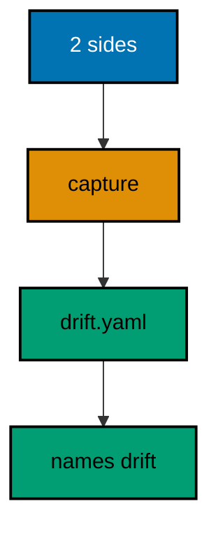

**`learning/code/ex-48-diffchangelog-turns-drift-into-changesets/Main.java`**:

```java
// Example 48: diffChangeLog Turns Drift into Changesets.
// Finding drift is half the job; capturing it as reviewable changesets is
// the other half. diffChangeLog writes the comparison as a changelog file
// the team reads, edits, and applies like any migration. This program
// builds the same two-sided divergence as the previous example, writes
// the drift to drift.yaml, then counts the generated changesets that
// describe the drifted table.
import java.nio.file.Files; // => reads the generated changelog the diff wrote
import java.nio.file.Path; // => names the generated file without string paths
import java.sql.Connection; // => the handle every move and check shares
import java.sql.DriverManager; // => finds the PostgreSQL driver from the locked jars
import java.sql.Statement; // => carries the verification queries to the database
import java.util.List; // => holds the generated lines for counting
import java.util.Properties; // => carries the login without string-concatenated secrets
import liquibase.Liquibase; // => the entry point: configure, then update
import liquibase.Scope; // => silences progress narration for deterministic goldens
import liquibase.command.CommandScope; // => runs diff-class commands outside update
import liquibase.database.Database; // => Liquibase's view of our PostgreSQL connection
import liquibase.database.DatabaseFactory; // => picks the PostgreSQL implementation from the URL
import liquibase.database.jvm.JdbcConnection; // => adapts our JDBC handle to Liquibase
import liquibase.resource.DirectoryResourceAccessor; // => the current file-based changelog accessor
import liquibase.ui.LoggerUIService; // => reroutes progress lines into the silenced log

public class Main {

  // => one public class per file, named after the file
  static Connection connect() throws Exception {
    // => the harness starts PostgreSQL 18 and publishes these variables
    String host = System.getenv().getOrDefault("PGHOST", "localhost");
    // => default keeps local experimentation working outside the harness
    String url = "jdbc:postgresql://" + host + ":5432/postgres";
    // => trust auth accepts any password, so only the user matters
    Properties props = new Properties();
    // => Properties carries the login without string-concatenated secrets
    props.setProperty("user", System.getenv().getOrDefault("PGUSER", "postgres"));
    // => DriverManager finds the PostgreSQL driver from the locked jars
    return DriverManager.getConnection(url, props);
  } // => connect is the only place that knows connection details

  // => the reference database name is the one constant both runs share
  static String dbUrl(String db) {
    // => every handle in this program addresses one of two databases
    String host = System.getenv().getOrDefault("PGHOST", "localhost");
    // => the same host feeds JDBC urls and diff command urls together
    return "jdbc:postgresql://" + host + ":5432/" + db;
  } // => one builder keeps all four addresses spelled identically

  // => Liquibase narrates progress to its console UI by default; those lines
  // => differ between a first run and a rerun, so goldens cannot hold them
  static void runQuiet(Liquibase liquibase) throws Exception {
    // => the LOGGER service reroutes progress lines into the silenced JUL log
    Scope.child(
      java.util.Collections.singletonMap(Scope.Attr.ui.name(), new LoggerUIService()),
      // => the lambda runs inside the scope; main still throws Exception
      () -> liquibase.update("")
    );
    // => update("") runs every changeset with no context filter
  } // => quiet updates keep golden output identical on the harness double run

  public static void main(String[] args) throws Exception {
    // => silence JUL so the LOGGER service lines below disappear too
    java.util.logging.LogManager.getLogManager().reset();
    // => the entry point the harness runs
    Files.deleteIfExists(Path.of("drift.yaml"));
    // => deleting first keeps regeneration idempotent on the double run
    try (Connection admin = connect()) {
      // => the admin handle owns the reference database lifecycle
      try (Statement st = admin.createStatement()) {
        // => dropping first keeps the reference idempotent on double runs
        st.execute("DROP DATABASE IF EXISTS driftref");
        // => a missing reference would diff against stale drift, so rebuild
        st.execute("CREATE DATABASE driftref");
        // => CREATE DATABASE commits itself; no transaction wraps it
      } // => the reference starts empty on every run, by construction
    } // => closing first releases the handle before migrating either side
    Properties refProps = new Properties();
    // => the reference login travels in Properties like every connection here
    refProps.setProperty("user", System.getenv().getOrDefault("PGUSER", "postgres"));
    // => trust auth accepts the bare user; the driver needs no password
    try (
      Connection conn = connect();
      // => the main handle migrates the drifted side below
      Connection ref = DriverManager.getConnection(dbUrl("driftref"), refProps)
    ) {
      // => the reference handle migrates the clean side beside it
      Database mainDb = DatabaseFactory.getInstance().findCorrectDatabaseImplementation(new JdbcConnection(conn));
      // => the factory picks the PostgreSQL implementation from the URL
      runQuiet(
        new Liquibase("canonical.sql", new DirectoryResourceAccessor(new java.io.File(".").getAbsoluteFile()), mainDb)
      );
      // => the drifted side holds the canonical table from here on
      Database refDb = DatabaseFactory.getInstance().findCorrectDatabaseImplementation(new JdbcConnection(ref));
      // => the same changelog migrates the reference to the identical shape
      runQuiet(
        new Liquibase("canonical.sql", new DirectoryResourceAccessor(new java.io.File(".").getAbsoluteFile()), refDb)
      );
      // => both sides match until the hotfix below diverges one of them
      try (Statement st = conn.createStatement()) {
        // => the hotfix bypasses Liquibase: no changeset, no history row
        st.execute("DROP TABLE IF EXISTS drift_orders");
        // => dropping first keeps the hotfix idempotent on the double run
        st.execute("CREATE TABLE drift_orders (id SERIAL PRIMARY KEY, note VARCHAR(60))");
        // => the untracked table is the drift the file below must capture
        conn.commit();
        // => committing pins the drift before the comparison below
      } // => drift is a fact about the schema, not about the history
      Scope.child(
        java.util.Collections.singletonMap(Scope.Attr.ui.name(), new LoggerUIService()),
        // => the command runs inside a quiet scope, main still throws
        () -> {
          // => the command turns the comparison into a changelog file
          CommandScope diffLog = new CommandScope("diffChangeLog");
          // => diffChangeLog is Liquibase's own drift-to-file command
          diffLog.addArgumentValue("referenceUrl", dbUrl("driftref"));
          // => the reference side holds only the canonical table
          diffLog.addArgumentValue("referenceUsername", "postgres");
          // => trust auth accepts the bare user on the reference too
          diffLog.addArgumentValue("referencePassword", "");
          // => the empty password matches the trust-auth service container
          diffLog.addArgumentValue("url", dbUrl("postgres"));
          // => the comparison side holds canonical plus the hotfix table
          diffLog.addArgumentValue("username", "postgres");
          // => the same trust-auth user addresses the comparison side
          diffLog.addArgumentValue("password", "");
          // => identical credentials keep both sides equally reachable
          diffLog.addArgumentValue("changelogFile", "drift.yaml");
          // => the captured drift lands beside the program for review
          diffLog.execute();
          // => the file ran quiet, so only our own prints reach stdout
        }
      );
      List<String> lines = Files.readAllLines(Path.of("drift.yaml"));
      // => the generated file is read, never printed: only counts leave it
      int mentions = 0;
      // => the counter keeps the stable fact: the drift was captured
      for (String line : lines) {
        // => each generated line is inspected, none is printed raw
        if (line.contains("drift_orders")) {
          // => the drifted table name appears in its own generated changeset
          mentions++;
          // => counting names survives generator-layout changes across versions
        } // => the draft's shape may evolve; its subject cannot
      } // => the review below starts from this count, not from blind trust
      System.out.println("generated lines naming the drift: " + mentions);
      // => Output: generated lines naming the drift: 1
      // => a rerun rebuilds both sides and captures the identical drift
    } // => closing both handles ends the program with the drift filed
  } // => main diverges one side, then files the drift as changesets
}
```

**`learning/code/ex-48-diffchangelog-turns-drift-into-changesets/canonical.sql`**:

```sql
-- liquibase formatted sql
-- => REQUIRED first line: marks this file as a Liquibase SQL changelog
-- => Without it Liquibase runs the SQL untracked, and nothing is recorded.
-- changeset course:001-canonical-reports
-- => the canonical changeset both databases share before any drift
-- => identical history on both sides isolates the hotfix as the only diff
CREATE TABLE harbour_reports (
  id SERIAL PRIMARY KEY,
  -- => SERIAL gives an auto-incrementing integer key, enough for this course
  title VARCHAR(80) NOT NULL
  -- => report titles are required from the first migration
);

-- rollback DROP TABLE harbour_reports;
-- => this reverse never runs here; the example diffs, never rolls back
```

**Output** (`learning/code/ex-48-diffchangelog-turns-drift-into-changesets/expected/main.stdout.txt`):

```text
generated lines naming the drift: 1
```

**Key takeaway**: diffChangeLog files drift as changesets, converting untracked divergence into reviewable migration text.

**Why it matters**: A drift report nobody acts on rots into background noise: the unexpected table stays, more arrive, and soon the report lists so much that nobody reads it. Filing the drift as a changelog forces the decision the report only suggests — adopt it as a real changeset or remove it — with the file itself as the review artifact. Captured drift enters the same pipeline as hand-written migrations: review, validation, history, rollback. Reports describe the problem; files resolve it, and resolution is what keeps the next report short.

---

### Example 49: Reconcile Drift Before the Next Release

A captured drift is a review ticket, not a migration: the team reads the generated file, decides the hotfix table should not exist, and applies the generated changelog to remove it before the next release ships on a clean comparison. Reconciling every cycle keeps drift from compounding across releases. The program captures the drift, applies the capture to the drifted side, re-captures, then proves the first capture named the drift once while the second names nothing. (Concepts: co-12.)

**`learning/code/ex-49-reconcile-drift-before-the-next-release/Main.java`**:

```java
// Example 49: Reconcile Drift Before the Next Release.
// A captured drift is a review ticket, not a migration: the team reads
// the generated file, decides the hotfix table should not exist, and
// applies the generated changelog to remove it before the next release.
// This program captures the drift, applies the capture to the drifted
// side, re-captures, then proves the second capture names nothing.
import java.nio.file.Files; // => reads the generated changelog the diff wrote
import java.nio.file.Path; // => names the generated file without string paths
import java.sql.Connection; // => the handle every move and check shares
import java.sql.DriverManager; // => finds the PostgreSQL driver from the locked jars
import java.sql.Statement; // => carries the verification queries to the database
import java.util.List; // => holds the generated lines for counting
import java.util.Properties; // => carries the login without string-concatenated secrets
import liquibase.Liquibase; // => the entry point: configure, then update
import liquibase.Scope; // => silences progress narration for deterministic goldens
import liquibase.command.CommandScope; // => runs diff-class commands outside update
import liquibase.database.Database; // => Liquibase's view of our PostgreSQL connection
import liquibase.database.DatabaseFactory; // => picks the PostgreSQL implementation from the URL
import liquibase.database.jvm.JdbcConnection; // => adapts our JDBC handle to Liquibase
import liquibase.resource.DirectoryResourceAccessor; // => the current file-based changelog accessor
import liquibase.ui.LoggerUIService; // => reroutes progress lines into the silenced log

public class Main {

  // => one public class per file, named after the file
  static Connection connect() throws Exception {
    // => the harness starts PostgreSQL 18 and publishes these variables
    String host = System.getenv().getOrDefault("PGHOST", "localhost");
    // => default keeps local experimentation working outside the harness
    String url = "jdbc:postgresql://" + host + ":5432/postgres";
    // => trust auth accepts any password, so only the user matters
    Properties props = new Properties();
    // => Properties carries the login without string-concatenated secrets
    props.setProperty("user", System.getenv().getOrDefault("PGUSER", "postgres"));
    // => DriverManager finds the PostgreSQL driver from the locked jars
    return DriverManager.getConnection(url, props);
  } // => connect is the only place that knows connection details

  // => the reference database name is the one constant both runs share
  static String dbUrl(String db) {
    // => every handle in this program addresses one of two databases
    String host = System.getenv().getOrDefault("PGHOST", "localhost");
    // => the same host feeds JDBC urls and diff command urls together
    return "jdbc:postgresql://" + host + ":5432/" + db;
  } // => one builder keeps all four addresses spelled identically

  // => the capture helper runs the same comparison twice: before the fix
  // => and after it, so the second count proves the reconcile worked
  static void captureDrift(String file) throws Exception {
    // => the file name selects which capture the caller is taking
    Scope.child(
      java.util.Collections.singletonMap(Scope.Attr.ui.name(), new LoggerUIService()),
      // => the command runs inside a quiet scope, main still throws
      () -> {
        // => the command turns the live comparison into a changelog file
        CommandScope diffLog = new CommandScope("diffChangeLog");
        // => diffChangeLog is Liquibase's own drift-to-file command
        diffLog.addArgumentValue("referenceUrl", dbUrl("driftref"));
        // => the reference side holds only the canonical table throughout
        diffLog.addArgumentValue("referenceUsername", "postgres");
        // => trust auth accepts the bare user on the reference too
        diffLog.addArgumentValue("referencePassword", "");
        // => the empty password matches the trust-auth service container
        diffLog.addArgumentValue("url", dbUrl("postgres"));
        // => the comparison side starts drifted and ends reconciled
        diffLog.addArgumentValue("username", "postgres");
        // => the same trust-auth user addresses the comparison side
        diffLog.addArgumentValue("password", "");
        // => identical credentials keep both sides equally reachable
        diffLog.addArgumentValue("changelogFile", file);
        // => each capture lands beside the program under its own name
        diffLog.execute();
        // => the file ran quiet, so only our own prints reach stdout
      }
    );
  } // => quiet captures keep golden output identical on double runs

  // => the file reader counts drift mentions without printing file bytes
  static int driftMentions(String file) throws Exception {
    // => the file name selects the capture the caller is grading
    if (!Files.exists(Path.of(file))) {
      // => an empty diff writes no file: no changesets means no drift
      return 0;
      // => zero without reading is the honest count of an absent capture
    } // => the guard keeps the reconciled capture at a stable zero
    List<String> lines = Files.readAllLines(Path.of(file));
    // => generated files are read, never printed: only counts leave them
    int mentions = 0;
    // => the counter keeps the stable fact each capture must prove
    for (String line : lines) {
      // => each generated line is inspected, none is printed raw
      if (line.contains("drift_orders")) {
        // => the drifted table name appears only while drift remains
        mentions++;
        // => counting names survives generator-layout changes across versions
      } // => the draft's shape may evolve; its subject cannot
    } // => zero mentions after the fix prove the reconcile held
    return mentions;
  } // => helpers that verify stay separate from code that reconciles

  public static void main(String[] args) throws Exception {
    // => silence JUL so the LOGGER service lines below disappear too
    java.util.logging.LogManager.getLogManager().reset();
    // => the entry point the harness runs
    Files.deleteIfExists(Path.of("drift.yaml"));
    // => deleting first keeps the first capture idempotent on double runs
    Files.deleteIfExists(Path.of("drift-after.yaml"));
    // => the second capture starts absent on every run as well
    try (Connection admin = connect()) {
      // => the admin handle owns the reference database lifecycle
      try (Statement st = admin.createStatement()) {
        // => dropping first keeps the reference idempotent on double runs
        st.execute("DROP DATABASE IF EXISTS driftref");
        // => a missing reference would diff against stale drift, so rebuild
        st.execute("CREATE DATABASE driftref");
        // => CREATE DATABASE commits itself; no transaction wraps it
      } // => the reference starts empty on every run, by construction
    } // => closing first releases the handle before migrating either side
    Properties refProps = new Properties();
    // => the reference login travels in Properties like every connection here
    refProps.setProperty("user", System.getenv().getOrDefault("PGUSER", "postgres"));
    // => trust auth accepts the bare user; the driver needs no password
    try (Connection conn = connect()) {
      // => the main handle owns the drifted side from here on
      Database mainDb = DatabaseFactory.getInstance().findCorrectDatabaseImplementation(new JdbcConnection(conn));
      // => the factory picks the PostgreSQL implementation from the URL
      DirectoryResourceAccessor accessor = new DirectoryResourceAccessor(new java.io.File(".").getAbsoluteFile());
      // => one accessor roots every changelog handle in this program
      runUpdate(new Liquibase("canonical.sql", accessor, mainDb));
      // => the drifted side holds the canonical table from here on
      try (Connection ref = DriverManager.getConnection(dbUrl("driftref"), refProps)) {
        // => the reference handle migrates the clean side beside it
        Database refDb = DatabaseFactory.getInstance().findCorrectDatabaseImplementation(new JdbcConnection(ref));
        // => the same changelog migrates the reference to the identical shape
        runUpdate(new Liquibase("canonical.sql", accessor, refDb));
        // => both sides match until the hotfix below diverges one of them
      } // => the reference closes; only its clean schema matters now
      try (Statement st = conn.createStatement()) {
        // => the hotfix bypasses Liquibase: no changeset, no history row
        st.execute("DROP TABLE IF EXISTS drift_orders");
        // => dropping first keeps the hotfix idempotent on the double run
        st.execute("CREATE TABLE drift_orders (id SERIAL PRIMARY KEY, note VARCHAR(60))");
        // => the untracked table is the drift the captures below track
        st.execute("DELETE FROM databasechangelog WHERE filename LIKE '%drift%.yaml'");
        // => forgetting past captures lets this run apply its own fresh one
        // => generated ids repeat across runs, so stale rows would no-op it
        conn.commit();
        // => committing pins the drift before the first capture below
      } // => drift is a fact about the schema, not about the history
      captureDrift("drift.yaml");
      // => the first capture files the drift for the review below
      System.out.println("drift lines before reconcile: " + driftMentions("drift.yaml"));
      // => Output: drift lines before reconcile: 1
      runUpdate(new Liquibase("drift.yaml", accessor, mainDb));
      // => applying the capture removes the drift the review rejected
      // => the generated drop runs as a tracked changeset like any other
      captureDrift("drift-after.yaml");
      // => the second capture diffs the reconciled side against the reference
      System.out.println("drift lines after reconcile: " + driftMentions("drift-after.yaml"));
      // => Output: drift lines after reconcile: 0
      // => a rerun rebuilds the drift, captures, removes, and recounts it
    } // => closing the main handle ends the program fully reconciled
  } // => main files the drift, removes it, then proves it is gone

  // => Liquibase narrates progress to its console UI by default; those lines
  // => differ between a first run and a rerun, so goldens cannot hold them
  static void runUpdate(Liquibase liquibase) throws Exception {
    // => the LOGGER service reroutes progress lines into the silenced JUL log
    Scope.child(
      java.util.Collections.singletonMap(Scope.Attr.ui.name(), new LoggerUIService()),
      // => the lambda runs inside the scope; callers still throw Exception
      () -> liquibase.update("")
    );
    // => update("") runs every changeset with no context filter
  } // => quiet updates keep golden output identical on the harness double run
}
```

**`learning/code/ex-49-reconcile-drift-before-the-next-release/canonical.sql`**:

```sql
-- liquibase formatted sql
-- => REQUIRED first line: marks this file as a Liquibase SQL changelog
-- => Without it Liquibase runs the SQL untracked, and nothing is recorded.
-- changeset course:001-canonical-reports
-- => the canonical changeset both databases share before any drift
-- => identical history on both sides isolates the hotfix as the only diff
CREATE TABLE harbour_reports (
  id SERIAL PRIMARY KEY,
  -- => SERIAL gives an auto-incrementing integer key, enough for this course
  title VARCHAR(80) NOT NULL
  -- => report titles are required from the first migration
);

-- rollback DROP TABLE harbour_reports;
-- => this reverse never runs here; the example reconciles, never rolls back
```

**Output** (`learning/code/ex-49-reconcile-drift-before-the-next-release/expected/main.stdout.txt`):

```text
drift lines before reconcile: 1
drift lines after reconcile: 0
```

**Key takeaway**: Reconcile applies captured drift decisions before releasing, so every release ships on a clean comparison.

**Why it matters**: Unreconciled drift compounds: this release's one unexpected table becomes next release's five, and the migration that finally collides with the pile faces an archaeology expedition instead of a review. Reconciling before each release — adopt or remove, decided explicitly — keeps the comparison clean enough that the next diff is short and readable. The discipline is cheap per cycle and priceless in aggregate: databases that reconcile stay explainable, and explainable databases accept migrations without surprises. Clean comparisons compound like interest; drift compounds like debt.

---

### Example 50: Separate Schemas Isolate Tenants

One database serves many tenants when each lives in its own schema: identical table names, disjoint rows, and a migration that addresses each schema explicitly. Schema separation isolates without multiplying databases, keeping operations single while data stays apart. The program creates two tenant schemas with the same invoices table in each, seeds one row apiece, then proves each schema holds exactly its own row. (Concepts: co-13.)

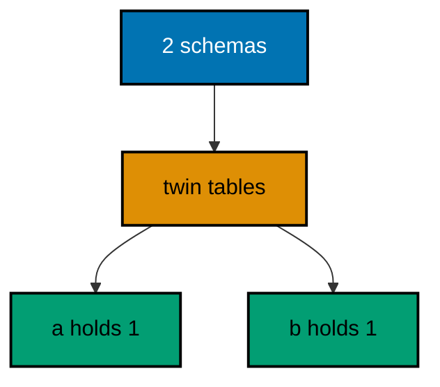

**`learning/code/ex-50-separate-schemas-isolate-tenants/Main.java`**:

```java
// Example 50: Separate Schemas Isolate Tenants.
// One database serves many tenants when each lives in its own schema:
// identical table names, disjoint rows, and a migration that addresses
// each schema explicitly. This program creates two tenant schemas with
// the same table in each, seeds one row apiece, then proves each schema
// holds exactly its own row.
import java.sql.Connection; // => the handle every move and check shares
import java.sql.DriverManager; // => finds the PostgreSQL driver from the locked jars
import java.sql.ResultSet; // => walks the rows each verification query returns
import java.sql.Statement; // => carries the verification queries to the database
import java.util.Properties; // => carries the login without string-concatenated secrets
import liquibase.Liquibase; // => the entry point: configure, then update
import liquibase.Scope; // => silences progress narration for deterministic goldens
import liquibase.database.Database; // => Liquibase's view of our PostgreSQL connection
import liquibase.database.DatabaseFactory; // => picks the PostgreSQL implementation from the URL
import liquibase.database.jvm.JdbcConnection; // => adapts our JDBC handle to Liquibase
import liquibase.resource.DirectoryResourceAccessor; // => the current file-based changelog accessor
import liquibase.ui.LoggerUIService; // => reroutes progress lines into the silenced log

public class Main {

  // => one public class per file, named after the file
  static Connection connect() throws Exception {
    // => the harness starts PostgreSQL 18 and publishes these variables
    String host = System.getenv().getOrDefault("PGHOST", "localhost");
    // => default keeps local experimentation working outside the harness
    String url = "jdbc:postgresql://" + host + ":5432/postgres";
    // => trust auth accepts any password, so only the user matters
    Properties props = new Properties();
    // => Properties carries the login without string-concatenated secrets
    props.setProperty("user", System.getenv().getOrDefault("PGUSER", "postgres"));
    // => DriverManager finds the PostgreSQL driver from the locked jars
    return DriverManager.getConnection(url, props);
  } // => connect is the only place that knows connection details

  // => Liquibase narrates progress to its console UI by default; those lines
  // => differ between a first run and a rerun, so goldens cannot hold them
  static void runQuiet(Liquibase liquibase) throws Exception {
    // => the LOGGER service reroutes progress lines into the silenced JUL log
    Scope.child(
      java.util.Collections.singletonMap(Scope.Attr.ui.name(), new LoggerUIService()),
      // => the lambda runs inside the scope; main still throws Exception
      () -> liquibase.update("")
    );
    // => update("") runs every changeset with no context filter
  } // => quiet updates keep golden output identical on the harness double run

  // => one helper counts any schema's invoices, so both tenants ask alike
  static int tenantRows(Connection conn, String schema) throws Exception {
    // => schema-qualified reads keep tenant data visibly separated
    try (
      Statement st = conn.createStatement();
      // => try-with-resources closes the statement on every path
      ResultSet rs = st.executeQuery("SELECT count(*) FROM " + schema + ".invoices")
    ) {
      // => the schema name is our constant, so string building stays safe here
      rs.next();
      // => each tenant's count answers only for its own schema
      return rs.getInt(1);
    } // => counts verify data without dumping rows into the transcript
  } // => helpers that verify stay separate from code that migrates

  // => the history table may not exist before the first update, so forgetting
  // => our rows is guarded by an existence check on every run
  static void clearHistory(Connection conn) throws Exception {
    // => information_schema tells whether any history exists to forget
    try (
      Statement check = conn.createStatement();
      // => a separate statement keeps the check isolated from the delete
      ResultSet rs = check.executeQuery(
        "SELECT count(*) FROM information_schema.tables " + "WHERE table_name = 'databasechangelog'"
      )
    ) {
      // => the query returns exactly one row with exactly one number
      rs.next();
      // => forgetting runs only where a history table already exists
      if (rs.getInt(1) > 0) {
        // => deleting only our own rows leaves every other course untouched
        try (Statement forget = conn.createStatement()) {
          // => the delete runs only after the check proved the table exists
          forget.execute("DELETE FROM databasechangelog WHERE author = 'course'");
        } // => a missing table means a fresh database: nothing to forget
      } // => the guard keeps the first run as clean as the fiftieth
    } // => guarded forgetting keeps resets replayable on double runs
  } // => helpers that verify stay separate from code that migrates

  public static void main(String[] args) throws Exception {
    // => silence JUL so the LOGGER service lines below disappear too
    java.util.logging.LogManager.getLogManager().reset();
    // => the entry point the harness runs
    try (Connection conn = connect()) {
      conn.setAutoCommit(false);
      // => manual commit makes every preamble statement explicit and replayable
      // => one connection serves the tenant migration and both counts
      try (Statement st = conn.createStatement()) {
        // => schemas outlive tables here, so both runs start by dropping them
        st.execute("DROP SCHEMA IF EXISTS tenant_a CASCADE");
        // => dropping first keeps the tenant build idempotent on double runs
        st.execute("DROP SCHEMA IF EXISTS tenant_b CASCADE");
        // => both tenants rebuild from nothing on every run, identically
        clearHistory(conn);
        // => forgetting past tenant rows lets this run migrate them fresh
        conn.commit();
        // => committing pins the clean slate before the migration below
      } // => a clean slate keeps tenant counts identical on the double run
      Database database = DatabaseFactory.getInstance()
        // => the factory picks the PostgreSQL implementation from the URL
        .findCorrectDatabaseImplementation(new JdbcConnection(conn));
      // => JdbcConnection adapts our JDBC handle to Liquibase's database API
      Liquibase liquibase = new Liquibase(
        // => one changeset builds both schemas with their seeded rows
        "changelog.sql",
        // => DirectoryResourceAccessor is the current file-based accessor
        new DirectoryResourceAccessor(new java.io.File(".").getAbsoluteFile()),
        // => rooting at the unit directory keeps changelogs beside the program
        database
      );
      runQuiet(liquibase);
      // => the update ran quiet, so the transcript holds only our own prints
      System.out.println("tenant_a invoices: " + tenantRows(conn, "tenant_a"));
      // => Output: tenant_a invoices: 1
      System.out.println("tenant_b invoices: " + tenantRows(conn, "tenant_b"));
      // => Output: tenant_b invoices: 1
      // => identical tables, disjoint rows: isolation in two counts
    } // => closing the connection ends the program with tenants separated
  } // => main houses two tenants, then proves neither sees the other
}
```

**`learning/code/ex-50-separate-schemas-isolate-tenants/changelog.sql`**:

```sql
-- liquibase formatted sql
-- => REQUIRED first line: marks this file as a Liquibase SQL changelog
-- => Without it Liquibase runs the SQL untracked, and nothing is recorded.
-- changeset course:001-make-tenant-schemas
-- => one changeset houses both tenants with identical invoice tables
-- => schema-qualified names keep the twins disjoint from birth
CREATE SCHEMA tenant_a;

CREATE SCHEMA tenant_b;

-- => both schemas exist before either table references them below
CREATE TABLE tenant_a.invoices (
  id SERIAL PRIMARY KEY,
  -- => SERIAL gives an auto-incrementing integer key, enough for this course
  total_cents INTEGER NOT NULL
  -- => tenant_a's row below never leaks into tenant_b's table
);

CREATE TABLE tenant_b.invoices (
  id SERIAL PRIMARY KEY,
  -- => twin tables share names but never share rows across schemas
  total_cents INTEGER NOT NULL
  -- => tenant_b's row below never leaks into tenant_a's table
);

INSERT INTO
  tenant_a.invoices (total_cents)
VALUES
  (1000);

INSERT INTO
  tenant_b.invoices (total_cents)
VALUES
  (2000);

-- => one seeded row per tenant: the isolation the program recounts
-- rollback DROP SCHEMA tenant_a CASCADE;
-- rollback DROP SCHEMA tenant_b CASCADE;
-- => cascading drops reverse both schemas with their tables and rows
```

**Output** (`learning/code/ex-50-separate-schemas-isolate-tenants/expected/main.stdout.txt`):

```text
tenant_a invoices: 1
tenant_b invoices: 1
```

**Key takeaway**: Schema-qualified migrations house identical tenant tables with disjoint rows in one database.

**Why it matters**: One database per tenant multiplies operations linearly: backups, upgrades, connection pools, and monitoring all scale with the customer count instead of staying constant. Schemas give each tenant a namespace with the same isolation guarantees for ordinary queries at a fraction of the operational cost. Schema-qualified migrations keep the twins in lockstep — the same changeset builds every tenant's table — so the fleet never forks by accident. Isolate the data, share the operations, and version them together.

---

### Example 51: JSONB Columns Evolve Flexible Data

Not every attribute deserves its own column: JSONB carries evolving product attributes without a migration per attribute, while path queries keep the flexible parts readable. Structure for the stable, documents for the volatile — one table serves both without a deploy per new field. The program stores two products with nested origins, then proves a JSON path query finds exactly the Maluku one among two stored documents. (Concepts: co-10.)

**`learning/code/ex-51-jsonb-columns-evolve-flexible-data/Main.java`**:

```java
// Example 51: JSONB Columns Evolve Flexible Data.
// Not every attribute deserves its own column: JSONB carries evolving
// product attributes without a migration per attribute, while generated
// columns and indexes keep the flexible parts queryable. This program
// stores two products with nested attributes, then proves a JSON path
// query finds exactly the Indonesian one.
import java.sql.Connection; // => the handle every move and check shares
import java.sql.DriverManager; // => finds the PostgreSQL driver from the locked jars
import java.sql.ResultSet; // => walks the rows each verification query returns
import java.sql.Statement; // => carries the verification queries to the database
import java.util.Properties; // => carries the login without string-concatenated secrets
import liquibase.Liquibase; // => the entry point: configure, then update
import liquibase.Scope; // => silences progress narration for deterministic goldens
import liquibase.database.Database; // => Liquibase's view of our PostgreSQL connection
import liquibase.database.DatabaseFactory; // => picks the PostgreSQL implementation from the URL
import liquibase.database.jvm.JdbcConnection; // => adapts our JDBC handle to Liquibase
import liquibase.resource.DirectoryResourceAccessor; // => the current file-based changelog accessor
import liquibase.ui.LoggerUIService; // => reroutes progress lines into the silenced log

public class Main {

  // => one public class per file, named after the file
  static Connection connect() throws Exception {
    // => the harness starts PostgreSQL 18 and publishes these variables
    String host = System.getenv().getOrDefault("PGHOST", "localhost");
    // => default keeps local experimentation working outside the harness
    String url = "jdbc:postgresql://" + host + ":5432/postgres";
    // => trust auth accepts any password, so only the user matters
    Properties props = new Properties();
    // => Properties carries the login without string-concatenated secrets
    props.setProperty("user", System.getenv().getOrDefault("PGUSER", "postgres"));
    // => DriverManager finds the PostgreSQL driver from the locked jars
    return DriverManager.getConnection(url, props);
  } // => connect is the only place that knows connection details

  // => Liquibase narrates progress to its console UI by default; those lines
  // => differ between a first run and a rerun, so goldens cannot hold them
  static void runQuiet(Liquibase liquibase) throws Exception {
    // => the LOGGER service reroutes progress lines into the silenced JUL log
    Scope.child(
      java.util.Collections.singletonMap(Scope.Attr.ui.name(), new LoggerUIService()),
      // => the lambda runs inside the scope; main still throws Exception
      () -> liquibase.update("")
    );
    // => update("") runs every changeset with no context filter
  } // => quiet updates keep golden output identical on the harness double run

  public static void main(String[] args) throws Exception {
    // => silence JUL so the LOGGER service lines below disappear too
    java.util.logging.LogManager.getLogManager().reset();
    // => the entry point the harness runs
    try (Connection conn = connect()) {
      // => one connection serves the JSONB run and both path queries
      Database database = DatabaseFactory.getInstance()
        // => the factory picks the PostgreSQL implementation from the URL
        .findCorrectDatabaseImplementation(new JdbcConnection(conn));
      // => JdbcConnection adapts our JDBC handle to Liquibase's database API
      Liquibase liquibase = new Liquibase(
        // => two changesets: the JSONB table, then its two documents
        "changelog.sql",
        // => DirectoryResourceAccessor is the current file-based accessor
        new DirectoryResourceAccessor(new java.io.File(".").getAbsoluteFile()),
        // => rooting at the unit directory keeps changelogs beside the program
        database
      );
      runQuiet(liquibase);
      // => the update ran quiet, so the transcript holds only our own prints
      try (Statement st = conn.createStatement(); ResultSet rs = st.executeQuery("SELECT count(*) FROM produce")) {
        // => both seeded documents landed in the flexible column
        rs.next();
        System.out.println("stored documents: " + rs.getInt(1));
        // => Output: stored documents: 2
      } // => two documents prove the seed changeset ran exactly once
      try (
        Statement st = conn.createStatement();
        ResultSet rs = st.executeQuery("SELECT count(*) FROM produce WHERE attrs ->> 'origin' = 'Maluku'")
      ) {
        // => the path query reads inside the document without a new column
        rs.next();
        System.out.println("documents from Maluku: " + rs.getInt(1));
        // => Output: documents from Maluku: 1
        // => a rerun skips both changesets and prints the identical counts
      } // => one match proves flexible data stays queryable, not opaque
    } // => closing the connection ends the program with data evolving freely
  } // => main stores two documents, then queries inside one
}
```

**`learning/code/ex-51-jsonb-columns-evolve-flexible-data/changelog.sql`**:

```sql
-- liquibase formatted sql
-- => REQUIRED first line: marks this file as a Liquibase SQL changelog
-- => Without it Liquibase runs the SQL untracked, and nothing is recorded.
-- changeset course:001-make-produce
-- => the table changeset carries one JSONB column for evolving attributes
-- => new attributes arrive as document keys, never as new migrations
CREATE TABLE produce (
  id SERIAL PRIMARY KEY,
  -- => SERIAL gives an auto-incrementing integer key, enough for this course
  name VARCHAR(60) NOT NULL,
  -- => the stable name column queries keep using while attrs evolves
  attrs JSONB NOT NULL
  -- => the flexible document: origins today, grades tomorrow, no DDL
);

-- rollback DROP TABLE produce;
-- => dropping the table reverses the documents and their queries together
-- changeset course:002-seed-produce
-- => the seed changeset stores two documents with nested origins
INSERT INTO
  produce (name, attrs)
VALUES
  ('cengkeh', '{"origin": "Maluku", "grade": "AB"}'),
  ('lada', '{"origin": "Lampung", "grade": "FAQ"}');

-- => single-quoted JSON inside SQL strings: the path query below reads it
-- rollback DELETE FROM produce;
-- => the declared delete un-stores both documents without dropping the table
```

**Output** (`learning/code/ex-51-jsonb-columns-evolve-flexible-data/expected/main.stdout.txt`):

```text
stored documents: 2
documents from Maluku: 1
```

**Key takeaway**: JSONB columns evolve volatile attributes without per-field migrations while path queries keep them readable.

**Why it matters**: Attribute-per-column migration grinds product iteration to the database's pace: every new product field waits for a changeset, a review, and a deploy window, and the changelog fills with columns that mattered for one quarter. Documents absorb volatile attributes at write speed while the stable columns keep their constraints and indexes. Path queries mean the flexibility never becomes opacity — analysts read inside documents with ordinary SQL. Migrate the shape that is stable; document the rest and query it anyway.

---

### Example 52: Views Version the Read Contract

Tables evolve while readers should not have to: a view freezes one read shape per version, so v1 queries keep working while v2 exposes the new column beside it. Versioned views decouple storage changes from reader migrations, letting each move on its own schedule. The program builds two view versions over one table, then proves both versions read the same seeded row in their own shape. (Concepts: co-10, co-14.)

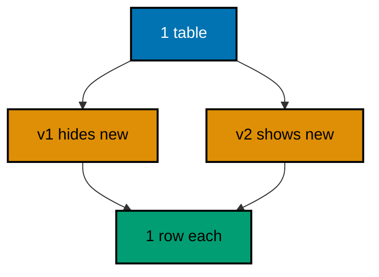

**`learning/code/ex-52-views-version-the-read-contract/Main.java`**:

```java
// Example 52: Views Version the Read Contract.
// Tables evolve; readers should not have to. A view freezes one read
// shape per version, so v1 queries keep working while v2 exposes the new
// column beside it. This program builds two view versions over one table,
// then proves both versions read the same seeded row in their own shape.
import java.sql.Connection; // => the handle every move and check shares
import java.sql.DriverManager; // => finds the PostgreSQL driver from the locked jars
import java.sql.ResultSet; // => walks the rows each verification query returns
import java.sql.Statement; // => carries the verification queries to the database
import java.util.Properties; // => carries the login without string-concatenated secrets
import liquibase.Liquibase; // => the entry point: configure, then update
import liquibase.Scope; // => silences progress narration for deterministic goldens
import liquibase.database.Database; // => Liquibase's view of our PostgreSQL connection
import liquibase.database.DatabaseFactory; // => picks the PostgreSQL implementation from the URL
import liquibase.database.jvm.JdbcConnection; // => adapts our JDBC handle to Liquibase
import liquibase.resource.DirectoryResourceAccessor; // => the current file-based changelog accessor
import liquibase.ui.LoggerUIService; // => reroutes progress lines into the silenced log

public class Main {

  // => one public class per file, named after the file
  static Connection connect() throws Exception {
    // => the harness starts PostgreSQL 18 and publishes these variables
    String host = System.getenv().getOrDefault("PGHOST", "localhost");
    // => default keeps local experimentation working outside the harness
    String url = "jdbc:postgresql://" + host + ":5432/postgres";
    // => trust auth accepts any password, so only the user matters
    Properties props = new Properties();
    // => Properties carries the login without string-concatenated secrets
    props.setProperty("user", System.getenv().getOrDefault("PGUSER", "postgres"));
    // => DriverManager finds the PostgreSQL driver from the locked jars
    return DriverManager.getConnection(url, props);
  } // => connect is the only place that knows connection details

  // => Liquibase narrates progress to its console UI by default; those lines
  // => differ between a first run and a rerun, so goldens cannot hold them
  static void runQuiet(Liquibase liquibase) throws Exception {
    // => the LOGGER service reroutes progress lines into the silenced JUL log
    Scope.child(
      java.util.Collections.singletonMap(Scope.Attr.ui.name(), new LoggerUIService()),
      // => the lambda runs inside the scope; main still throws Exception
      () -> liquibase.update("")
    );
    // => update("") runs every changeset with no context filter
  } // => quiet updates keep golden output identical on the harness double run

  public static void main(String[] args) throws Exception {
    // => silence JUL so the LOGGER service lines below disappear too
    java.util.logging.LogManager.getLogManager().reset();
    // => the entry point the harness runs
    try (Connection conn = connect()) {
      // => one connection serves the versioned run and both view reads
      Database database = DatabaseFactory.getInstance()
        // => the factory picks the PostgreSQL implementation from the URL
        .findCorrectDatabaseImplementation(new JdbcConnection(conn));
      // => JdbcConnection adapts our JDBC handle to Liquibase's database API
      Liquibase liquibase = new Liquibase(
        // => two changesets: the table, then its two view versions
        "changelog.sql",
        // => DirectoryResourceAccessor is the current file-based accessor
        new DirectoryResourceAccessor(new java.io.File(".").getAbsoluteFile()),
        // => rooting at the unit directory keeps changelogs beside the program
        database
      );
      runQuiet(liquibase);
      // => the table plus both frozen read shapes exist from here on
      try (Statement st = conn.createStatement(); ResultSet rs = st.executeQuery("SELECT count(*) FROM teas_v1")) {
        // => the v1 shape exposes the old single column to old readers
        rs.next();
        System.out.println("rows through v1: " + rs.getInt(1));
        // => Output: rows through v1: 1
      } // => one row proves the old contract survived the new column
      try (
        Statement st = conn.createStatement();
        ResultSet rs = st.executeQuery("SELECT count(*) FROM teas_v2 WHERE origin = 'Maluku'")
      ) {
        // => the v2 shape exposes the new column to migrated readers
        rs.next();
        System.out.println("rows through v2: " + rs.getInt(1));
        // => Output: rows through v2: 1
        // => a rerun skips both changesets and prints the identical reads
      } // => one row on both versions proves the contract split cleanly
    } // => closing the connection ends the program with reads versioned
  } // => main versions the reads, then reads both versions
}
```

**`learning/code/ex-52-views-version-the-read-contract/changelog.sql`**:

```sql
-- liquibase formatted sql
-- => REQUIRED first line: marks this file as a Liquibase SQL changelog
-- => Without it Liquibase runs the SQL untracked, and nothing is recorded.
-- changeset course:001-make-teas
-- => the table changeset creates teas with the new origin column included
CREATE TABLE teas (
  id SERIAL PRIMARY KEY,
  -- => SERIAL gives an auto-incrementing integer key, enough for this course
  name VARCHAR(60) NOT NULL,
  -- => the old column every v1 reader still names
  origin VARCHAR(60)
  -- => the new column only v2 readers may name
);

INSERT INTO
  teas (name, origin)
VALUES
  ('teh melati', 'Maluku');

-- => one seeded row both view versions below must keep reading
-- rollback DROP TABLE teas;
-- => dropping the table reverses the rows and both versions together
-- changeset course:002-version-views
-- => the version changeset freezes one read shape per reader generation
CREATE VIEW teas_v1 AS
SELECT
  id,
  name
FROM
  teas;

-- => v1 hides the new column: old readers never see a shape they lack
CREATE VIEW teas_v2 AS
SELECT
  id,
  name,
  origin
FROM
  teas;

-- => v2 exposes the new column: migrated readers move here at leisure
-- rollback DROP VIEW teas_v2;
-- rollback DROP VIEW teas_v1;
-- => dropping the new version first restores the single-shape past
```

**Output** (`learning/code/ex-52-views-version-the-read-contract/expected/main.stdout.txt`):

```text
rows through v1: 1
rows through v2: 1
```

**Key takeaway**: Versioned views freeze one read shape per reader generation, so storage evolves without breaking reads.

**Why it matters**: Every added column is a silent contract change for readers that SELECT-star or map positionally: they receive fields they never asked for, and strict mappers fail on the unfamiliar. Frozen view versions let storage evolve while each reader generation keeps the exact shape it was written against, migrating views forward deliberately instead of absorbing storage changes accidentally. The version in the view name makes the contract visible in every query. Evolve the tables freely; freeze what the readers signed up for.

---

### Example 53: Squash Old Migrations into One Baseline

Years of small migrations slow fresh installs: squashing folds them into one baseline file that builds the same end state, while the old files retire. The squash is a fresh-install fast path, not a rewrite of history — existing databases keep their rows. The program applies a three-file history, syncs its single-file squash without executing it, then proves three tables stand described by three old rows plus one squash row. (Concepts: co-12.)

**`learning/code/ex-53-squash-old-migrations-into-one-baseline/Main.java`**:

```java
// Example 53: Squash Old Migrations into One Baseline.
// Years of small migrations slow fresh installs: squashing folds them
// into one baseline file that builds the same end state, while the old
// files retire. This program applies a three-file history, syncs its
// single-file squash without executing it, then proves three old rows
// plus one squash row describe the same three tables.
import java.sql.Connection; // => the handle every move and check shares
import java.sql.DriverManager; // => finds the PostgreSQL driver from the locked jars
import java.sql.ResultSet; // => walks the rows each verification query returns
import java.sql.Statement; // => carries the verification queries to the database
import java.util.Properties; // => carries the login without string-concatenated secrets
import liquibase.Liquibase; // => the entry point: configure, then update
import liquibase.Scope; // => silences progress narration for deterministic goldens
import liquibase.database.Database; // => Liquibase's view of our PostgreSQL connection
import liquibase.database.DatabaseFactory; // => picks the PostgreSQL implementation from the URL
import liquibase.database.jvm.JdbcConnection; // => adapts our JDBC handle to Liquibase
import liquibase.resource.DirectoryResourceAccessor; // => the current file-based changelog accessor
import liquibase.ui.LoggerUIService; // => reroutes progress lines into the silenced log

public class Main {

  // => one public class per file, named after the file
  static Connection connect() throws Exception {
    // => the harness starts PostgreSQL 18 and publishes these variables
    String host = System.getenv().getOrDefault("PGHOST", "localhost");
    // => default keeps local experimentation working outside the harness
    String url = "jdbc:postgresql://" + host + ":5432/postgres";
    // => trust auth accepts any password, so only the user matters
    Properties props = new Properties();
    // => Properties carries the login without string-concatenated secrets
    props.setProperty("user", System.getenv().getOrDefault("PGUSER", "postgres"));
    // => DriverManager finds the PostgreSQL driver from the locked jars
    return DriverManager.getConnection(url, props);
  } // => connect is the only place that knows connection details

  // => history grows file by file here, so the quiet runner takes the
  // => changelog to run plus a flag for syncing instead of executing
  static void runQuiet(Liquibase liquibase, boolean syncOnly) throws Exception {
    // => the LOGGER service reroutes progress lines into the silenced JUL log
    Scope.child(
      java.util.Collections.singletonMap(Scope.Attr.ui.name(), new LoggerUIService()),
      // => the lambda runs inside the scope; main still throws Exception
      () -> {
        // => the flag selects execution for history and sync for the squash
        if (syncOnly) {
          // => the squash describes built tables, so it syncs without running
          liquibase.changeLogSync("");
        } else {
          // => the old files execute normally, building the three tables
          liquibase.update("");
        } // => execute for history, sync for the squash that replaces it
      }
    );
    // => both moves stay inside the silenced scope, so goldens stay clean
  } // => quiet moves keep golden output identical on the harness double run

  public static void main(String[] args) throws Exception {
    // => silence JUL so the LOGGER service lines below disappear too
    java.util.logging.LogManager.getLogManager().reset();
    // => the entry point the harness runs
    try (Connection conn = connect()) {
      // => one connection serves the history run, the sync, and the checks
      Database database = DatabaseFactory.getInstance()
        // => the factory picks the PostgreSQL implementation from the URL
        .findCorrectDatabaseImplementation(new JdbcConnection(conn));
      // => JdbcConnection adapts our JDBC handle to Liquibase's database API
      DirectoryResourceAccessor accessor = new DirectoryResourceAccessor(new java.io.File(".").getAbsoluteFile());
      // => one accessor roots the master and the squash in the same folder
      runQuiet(new Liquibase("db.changelog-master.yaml", accessor, database), false);
      // => three old files build the three tables the squash describes
      runQuiet(new Liquibase("squashed.yaml", accessor, database), true);
      // => the squash syncs: executing it would rebuild existing tables
      try (
        Statement st = conn.createStatement();
        ResultSet rs = st.executeQuery(
          "SELECT count(*) FROM information_schema.tables " + "WHERE table_name IN ('harbours', 'piers', 'ferries')"
        )
      ) {
        // => old files plus squash agree on the same three tables
        rs.next();
        System.out.println("tables described by both: " + rs.getInt(1));
        // => Output: tables described by both: 3
      } // => three tables prove the squash captured the whole history
      try (
        Statement st = conn.createStatement();
        ResultSet rs = st.executeQuery("SELECT count(*) FROM databasechangelog")
      ) {
        // => three executed rows plus one synced squash row share the history
        rs.next();
        System.out.println("history rows old plus squash: " + rs.getInt(1));
        // => Output: history rows old plus squash: 4
        // => a rerun no-ops the master and the sync to identical counts
      } // => reading history back is a habit every later example repeats
    } // => closing the connection ends the program with history squashed
  } // => main migrates the long way, then baselines the short way
}
```

**`learning/code/ex-53-squash-old-migrations-into-one-baseline/db.changelog-master.yaml`**:

```yaml
databaseChangeLog: # => Root key required for every YAML changelog
  - includeAll: # => Discovers every changelog file in one directory
      path: changes/
      # => path is relative to this master file, not to the classpath
      # => Liquibase sorts the discovered files alphabetically before running
      # => Three small files are the long history the squash below replaces
```

**`learning/code/ex-53-squash-old-migrations-into-one-baseline/squashed.yaml`**:

```yaml
databaseChangeLog: # => Root key required for every YAML changelog
  - changeSet: # => The squash folds three files into one tracked baseline
      id: 001-squashed-harbours
      # => fresh installs run this single changeset instead of the old three
      author: course
      # => the squash author signs the folded baseline like any changeset
      changes:
        - createTable: # => The folded end state: all three tables at once
            tableName: harbours
            # => the first table the old history built file by file
            columns:
              - column: # => One entry per column, name and type together
                  name: id
                  type: SERIAL
                  constraints:
                    primaryKey: true
              - column:
                  name: name
                  type: VARCHAR(60)
        - createTable:
            tableName: piers
            # => the second table the old history built file by file
            columns:
              - column:
                  name: id
                  type: SERIAL
                  constraints:
                    primaryKey: true
              - column:
                  name: name
                  type: VARCHAR(60)
        - createTable:
            tableName: ferries
            # => the third table the old history built file by file
            columns:
              - column:
                  name: id
                  type: SERIAL
                  constraints:
                    primaryKey: true
```

**`learning/code/ex-53-squash-old-migrations-into-one-baseline/changes/001-make-harbours.sql`**:

```sql
-- liquibase formatted sql
-- => REQUIRED first line: marks this file as a Liquibase SQL changelog
-- => The 001 prefix makes this file sort first under includeAll.
-- changeset course:001-make-harbours
-- => the first old file creates the harbours table
CREATE TABLE harbours (
  id SERIAL PRIMARY KEY,
  -- => SERIAL gives an auto-incrementing integer key, enough for this course
  name VARCHAR(60) NOT NULL
  -- => harbour names are required from the first migration
);

-- rollback DROP TABLE harbours;
-- => this reverse never runs here; the squash retires these files instead
```

**`learning/code/ex-53-squash-old-migrations-into-one-baseline/changes/002-make-piers.sql`**:

```sql
-- liquibase formatted sql
-- => REQUIRED first line: marks this file as a Liquibase SQL changelog
-- => The 002 prefix makes this file sort second under includeAll.
-- changeset course:002-make-piers
-- => the second old file creates the piers table
CREATE TABLE piers (
  id SERIAL PRIMARY KEY,
  -- => SERIAL gives an auto-incrementing integer key, enough for this course
  name VARCHAR(60) NOT NULL
  -- => pier names are required from the first migration
);

-- rollback DROP TABLE piers;
-- => this reverse never runs here; the squash retires these files instead
```

**`learning/code/ex-53-squash-old-migrations-into-one-baseline/changes/003-make-ferries.sql`**:

```sql
-- liquibase formatted sql
-- => REQUIRED first line: marks this file as a Liquibase SQL changelog
-- => The 003 prefix makes this file sort third under includeAll.
-- changeset course:003-make-ferries
-- => the third old file creates the ferries table
CREATE TABLE ferries (
  id SERIAL PRIMARY KEY,
  -- => SERIAL gives an auto-incrementing integer key, enough for this course
  name VARCHAR(60) NOT NULL
  -- => ferry names are required from the first migration
);

-- rollback DROP TABLE ferries;
-- => this reverse never runs here; the squash retires these files instead
```

**Output** (`learning/code/ex-53-squash-old-migrations-into-one-baseline/expected/main.stdout.txt`):

```text
tables described by both: 3
history rows old plus squash: 4
```

**Key takeaway**: Squashes fold long histories into single baselines for fresh installs while existing databases keep their rows.

**Why it matters**: Fresh environments that replay thousands of migrations inherit every past mistake's runtime cost: minutes of deploys, flaky old data fixes, and changesets that only ever worked against long-gone states. A squash gives new databases the current shape in one reviewed file while migrated databases keep their exact history — both paths converge on the same schema without sharing the journey. Retire the old files only after the squash proves itself, and the install time drops from coffee break to heartbeat. New databases deserve a fast path, not a history lesson.

---
