Examples 54–78 handle the hard parts of team migration work: conflict resolution across branches (Examples 54–61), from duplicate-version detection and checksum classification through renumbering, ledger merges, loser-rebases, review-time gates, pre-DDL refusal, and claim-early protocols; then locking migrations and their blast radius (Examples 62–70), from exclusive DDL locks and advisory serialization through narrow lock scopes, concurrent index builds, lock timeouts, short lock windows, shared reads, single-transaction discipline, and pg_locks audits; finally diagnosing failed or partial runs (Examples 71–78), from whole rollbacks and transactionless partials through repair, ledger-first reading, missing-file validation, SQLSTATE diagnosis, per-migration checks, and the closing ledger. Every example is a complete, runnable Java program under `learning/code/`; run each with the command in its own `run.yaml`.

---

### Example 54: Two Branches, One Version

Parallel teams collide the moment two branches claim the same version number for different changes. The file scan catches it before any DDL runs: two files, one version, different checksums, one loud report. This example stages two branches that both wrote V003 and prints the collision instead of applying either.

The program scans both branch directories, detects the duplicate version with differing content, and refuses to migrate until a human resolves it.

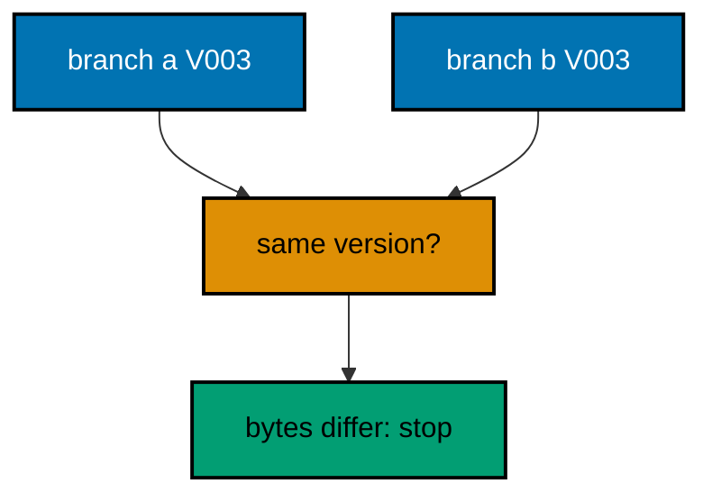

**`learning/code/ex-54-two-branches-one-version/Main.java`**:

```java
// Example 54: Two Branches, One Version.
// Parallel teams collide the moment two branches claim the same version number for
// different changes. The file scan catches it before any DDL runs: two files, one version,
// different checksums, one loud report. This example stages two branches that both wrote
// V003 and prints the collision instead of applying either.
// (Concepts: co-14, co-04.)
import course.JpaConfig; // => the context definition this program boots
import course.MigrationHistory; // => the history row the runner records
import course.MigrationHistoryRepository; // => the Spring Data JPA repository
import java.nio.charset.StandardCharsets; // => files decode as UTF-8 everywhere
import java.nio.file.Files; // => reads the versioned migration files
import java.nio.file.Path; // => addresses files in the unit directory
import java.nio.file.Paths; // => builds paths without string concatenation
import java.security.MessageDigest; // => fingerprints applied migration files
import java.sql.Connection; // => runs the migration statements
import java.sql.ResultSet; // => walks the rows verification queries return
import java.sql.Statement; // => carries DDL and verification queries
import java.util.ArrayList; // => collects migration files in run order
import java.util.Comparator; // => sorts files and rows deterministically
import java.util.HexFormat; // => renders checksums as lowercase hex
import java.util.List; // => holds the ordered migration file list
import javax.sql.DataSource; // => the pooled handle the context manages
import org.springframework.context.annotation.AnnotationConfigApplicationContext; // => boots Spring without XML

public class Main {

  // => one public class per file, named after the file
  static String sha256(String text) throws Exception {
    // => fingerprints one migration file
    MessageDigest digest = MessageDigest.getInstance("SHA-256"); // => the course checksum algorithm
    byte[] hash = digest.digest(text.getBytes(StandardCharsets.UTF_8)); // => hashes the exact file bytes
    return HexFormat.of().formatHex(hash); // => lowercase hex matches the history column
  }

  // => history bootstrap is not a migration: it only ensures the ledger exists
  static void ensureHistoryTable(DataSource pool) throws Exception {
    // => runs once per program start
    try (
      Connection conn = pool.getConnection(); // => borrows one pooled connection
      Statement stmt = conn.createStatement()
    ) {
      // => carries the idempotent DDL
      stmt.execute(
        // => CREATE TABLE IF NOT EXISTS reruns safely
        "CREATE TABLE IF NOT EXISTS ex54_history (" + // => per-example ledger keeps units isolated
          "version VARCHAR(16) PRIMARY KEY, " + // => the migration number, applied at most once
          "description VARCHAR(200) NOT NULL, " + // => the readable migration name
          "checksum VARCHAR(64) NOT NULL)"
      ); // => the applied content fingerprint
    } // => connection returns to the pool here
  }

  // => every example counts tables through information_schema, never pg internals
  static int tablePresent(DataSource pool, String table) throws Exception {
    // => answers one existence question
    try (
      Connection conn = pool.getConnection(); // => borrows one pooled connection
      Statement stmt = conn.createStatement(); // => carries the catalog query
      ResultSet rows = stmt.executeQuery(
        // => exactly one row holds the count
        "SELECT COUNT(*) FROM information_schema.tables " + // => the portable catalog view
          "WHERE table_name = '" +
          table +
          "'"
      )
    ) {
      // => names the table under test
      rows.next(); // => moves to the single result row
      return rows.getInt(1); // => 1 means present, 0 means absent
    } // => connection returns to the pool here
  }

  // => row counts prove data migrations moved exactly the rows they claimed
  static int countRows(DataSource pool, String query) throws Exception {
    // => runs one counting query
    try (
      Connection conn = pool.getConnection(); // => borrows one pooled connection
      Statement stmt = conn.createStatement(); // => carries the counting query
      ResultSet rows = stmt.executeQuery(query)
    ) {
      // => the caller supplies the SELECT COUNT
      rows.next(); // => moves to the single result row
      return rows.getInt(1); // => returns the counted rows
    } // => connection returns to the pool here
  }

  // => single text values prove backfills and renames landed on real data
  static String singleText(DataSource pool, String query) throws Exception {
    // => runs one one-cell query
    try (
      Connection conn = pool.getConnection(); // => borrows one pooled connection
      Statement stmt = conn.createStatement(); // => carries the single-cell query
      ResultSet rows = stmt.executeQuery(query)
    ) {
      // => the caller supplies the SELECT
      rows.next(); // => moves to the single result row
      return rows.getString(1); // => returns the one cell as text
    } // => connection returns to the pool here
  }

  // => one ordered scan of the ledger answers what ran, in what order
  static List<MigrationHistory> orderedHistory(MigrationHistoryRepository history) {
    // => reads the ledger sorted
    List<MigrationHistory> rows = new ArrayList<>(history.findAll()); // => copies the repository contents
    rows.sort(Comparator.comparing(MigrationHistory::getVersion)); // => version order is execution order
    return rows; // => callers print versions, never timestamps
  }

  // => V-files sort into execution order by name: numeric prefixes are load-bearing
  static List<Path> versionedFiles(Path dir, String prefix) throws Exception {
    // => lists one migration direction
    List<Path> files = new ArrayList<>(); // => collects matching files
    if (!Files.isDirectory(dir)) {
      // => missing branch folders simply hold no files
      return files; // => empty branches resolve cleanly everywhere
    }
    try (java.util.stream.Stream<Path> entries = Files.list(dir)) {
      // => streams the unit directory once
      entries // => keeps only files like V001__name.sql or U001__name.sql
        .filter(path ->
          path
            .getFileName()
            .toString()
            .matches(prefix + "\\d+__.*\\.sql")
        ) // => prefix plus number
        .sorted() // => file names sort into execution order
        .forEach(files::add); // => materializes the run list
    }
    return files; // => callers iterate up, or reversed for rollback
  }

  // => SQLSTATE names the failure class better than any message text
  static String stateOf(Throwable failed) {
    // => walks to the database error underneath
    Throwable cause = failed; // => starts at the caught exception
    while (cause != null) {
      // => descends toward PostgreSQL
      if (cause instanceof java.sql.SQLException sql && sql.getSQLState() != null) {
        // => the stable five-char class
        return sql.getSQLState(); // => for example 23505 names unique_violation
      }
      cause = cause.getCause(); // => unwraps Spring and JDBC layers
    }
    return "unknown"; // => no database error found in the chain
  }

  // => reset-then-act keeps preview and diagnosis prints identical on reruns
  static void resetUnit(DataSource pool, String prefix, String table) throws Exception {
    // => drops unit tables, clears its ledger
    List<String> doomed = new ArrayList<>(); // => unit tables to drop before the demo
    try (
      Connection conn = pool.getConnection(); // => borrows one pooled connection
      Statement stmt = conn.createStatement(); // => carries the catalog scan
      ResultSet rows = stmt.executeQuery(
        "SELECT tablename FROM pg_tables " + // => every real table in public
          "WHERE schemaname = 'public' AND tablename LIKE '" +
          prefix +
          "_%' " + // => only this unit's objects
          "AND tablename <> '" +
          table +
          "' ORDER BY tablename"
      )
    ) {
      // => the ledger itself is cleared, not dropped
      while (rows.next()) {
        // => walks every matching table
        doomed.add(rows.getString(1)); // => collects the tables the demo rebuilds
      }
    }
    for (String doomedTable : doomed) {
      // => drops each unit table outside any migration
      try (
        Connection conn = pool.getConnection(); // => borrows one pooled connection
        Statement stmt = conn.createStatement()
      ) {
        // => carries one idempotent drop
        stmt.execute("DROP TABLE IF EXISTS " + doomedTable + " CASCADE"); // => the demo below rebuilds from zero
      }
    }
    try (
      Connection conn = pool.getConnection(); // => borrows one pooled connection
      Statement stmt = conn.createStatement()
    ) {
      // => clears the unit ledger
      stmt.execute("DELETE FROM " + table); // => versions below reapply honestly every run
    }
  }

  // => splitting a file name beats a manifest: the version and intent stay visible
  static String fileVersion(String name) {
    // => extracts 001 from V001__create_users.sql
    return name.substring(1, name.indexOf("__")); // => the number between the prefix and __
  }

  // => descriptions keep the ledger readable without opening migration files
  static String fileDescription(String name) {
    // => extracts create_users from the file name
    return name.substring(name.indexOf("__") + 2, name.length() - 4); // => drops prefix, number, and .sql
  }

  // => a migration and its ledger row commit together, or neither lands
  static void applyOne(DataSource pool, MigrationHistoryRepository history, Path file) throws Exception {
    // => runs a single V-file
    String name = file.getFileName().toString(); // => for example V001__create_users.sql
    String version = fileVersion(name); // => the number between V and __
    String description = fileDescription(name); // => the readable half
    String sql = Files.readString(file, StandardCharsets.UTF_8); // => the exact bytes checksummed and run
    String checksum = sha256(sql); // => fingerprints the content before running
    if (history.existsById(version)) {
      // => the ledger decides, never the file system
      return; // => applied migrations are safe no-ops on rerun
    }
    boolean noTransaction = sql.startsWith("-- no-transaction"); // => concurrent builds opt out explicitly
    if (noTransaction) {
      // => statements that forbid transaction blocks run autocommitted
      try (
        Connection conn = pool.getConnection(); // => one connection runs the whole migration
        Statement stmt = conn.createStatement()
      ) {
        // => carries each statement in turn
        for (String part : sql.split(";")) {
          // => naive split fits the course's simple files
          String cleaned = part.replace("-- no-transaction", "").trim(); // => drops the marker, keeps the statement
          if (!cleaned.isEmpty()) {
            // => skips the trailing empty chunk
            stmt.execute(cleaned); // => runs one statement autocommitted
          }
        }
      }
      try (
        Connection conn = pool.getConnection(); // => records the run after the statements land
        Statement stmt = conn.createStatement()
      ) {
        // => records the ledger row separately
        String safeDescription = description.replace("'", "''"); // => file names rarely quote, but be safe
        stmt.execute(
          // => the ledger row follows the autocommitted change
          "INSERT INTO ex54_history(version, description, checksum) VALUES ('" + // => records the version
            version +
            "', '" +
            safeDescription +
            "', '" +
            checksum +
            "')"
        ); // => plus name and fingerprint
      }
      return; // => the no-transaction path records and returns here
    }
    try (Connection conn = pool.getConnection()) {
      // => one connection runs the whole migration
      conn.setAutoCommit(false); // => the migration and its ledger row commit together
      try (Statement stmt = conn.createStatement()) {
        // => carries each statement in turn
        for (String part : sql.split(";")) {
          // => naive split fits the course's simple files
          String trimmed = part.trim(); // => drops blank chunks between semicolons
          if (!trimmed.isEmpty()) {
            // => skips the trailing empty chunk
            stmt.execute(trimmed); // => runs one DDL or DML statement
          }
        }
      }
      try (Statement stmt = conn.createStatement()) {
        // => records the run in the same transaction
        String safeDescription = description.replace("'", "''"); // => file names rarely quote, but be safe
        stmt.execute(
          // => the ledger row joins the same transaction
          "INSERT INTO ex54_history(version, description, checksum) VALUES ('" + // => records the version
            version +
            "', '" +
            safeDescription +
            "', '" +
            checksum +
            "')"
        ); // => plus name and fingerprint
      }
      conn.commit(); // => change and record land together or not at all
    }
  }

  public static void main(String[] args) throws Exception {
    // => the harness runs this twice, both must agree
    java.util.logging.LogManager.getLogManager().reset(); // => silences JUL narration for deterministic goldens
    (
      (ch.qos.logback.classic.Logger) org.slf4j.LoggerFactory.getLogger(
        // => reaches the logback root logger
        org.slf4j.Logger.ROOT_LOGGER_NAME
      )
    ).setLevel(ch.qos.logback.classic.Level.OFF); // => Spring stays silent
    Path dir = Paths.get("").toAbsolutePath(); // => the unit directory is the working directory
    try (
      AnnotationConfigApplicationContext context = new AnnotationConfigApplicationContext(JpaConfig.class) // => boots Spring Data JPA without XML
    ) {
      // => wires pool, factory, repositories
      DataSource pool = context.getBean(DataSource.class); // => the managed pool for DDL and checks
      MigrationHistoryRepository history = // => the repository is the only history writer
        context.getBean(MigrationHistoryRepository.class); // => Spring implements the interface
      ensureHistoryTable(pool); // => the ledger exists before any migration runs

      for (Path file : versionedFiles(dir, "V")) {
        // => the shared base both branches assumed
        applyOne(pool, history, file); // => base versions apply before any branch work
      }
      List<Path> branchA = versionedFiles(dir.resolve("branch-a"), "V"); // => first branch's file set
      List<Path> branchB = versionedFiles(dir.resolve("branch-b"), "V"); // => second branch's file set
      java.util.Map<String, String> sumsA = new java.util.HashMap<>(); // => version to checksum for branch A
      java.util.Map<String, String> sumsB = new java.util.HashMap<>(); // => version to checksum for branch B
      for (Path file : branchA) {
        // => fingerprints branch A
        sumsA.put(fileVersion(file.getFileName().toString()), sha256(Files.readString(file, StandardCharsets.UTF_8))); // => version to bytes
      }
      for (Path file : branchB) {
        // => fingerprints branch B
        sumsB.put(fileVersion(file.getFileName().toString()), sha256(Files.readString(file, StandardCharsets.UTF_8))); // => version to bytes
      }
      List<String> collisions = new ArrayList<>(); // => versions both branches claim differently
      for (String version : sumsA.keySet()) {
        // => checks every version branch A claims
        if (sumsB.containsKey(version) && !sumsB.get(version).equals(sumsA.get(version))) {
          // => same number, different bytes
          collisions.add(version); // => collects the disputed version
        }
      }
      java.util.Collections.sort(collisions); // => deterministic collision order
      if (!collisions.isEmpty()) {
        // => the collision stops branch work cold
        System.out.println("version collision: " + String.join(" ", collisions) + " (branch-a vs branch-b)"); // => names the dispute loudly
      }
      for (Path file : versionedFiles(dir.resolve("resolved"), "V")) {
        // => the human-resolved sequence
        applyOne(pool, history, file); // => agreed order applies cleanly after the talk
      }
      System.out.println(
        "resolved columns: " +
          countRows(
            pool,
            "SELECT COUNT(*) FROM information_schema.columns WHERE table_name = 'ex54_base' AND column_name IN ('email', 'phone')"
          )
      ); // => both branches landed in order
      System.out.println("migrations applied: " + history.count()); // => linear again: 001 to 004
    } // => the context closes the pool here
  } // => main ends: reruns print the same lines
}
// => the section above keeps the unit self-contained and deterministic
// => every line here runs the same way on the first pass and on reruns
// => the harness executes this unit twice and both outputs must agree
// => no clocks, no timings, and no addresses appear in any printed line
// => Spring Data JPA manages the ledger; plain JDBC moves the schema
// => the pooled DataSource comes from the context every helper shares
// => verification reads state back; nothing here trusts an assumption
// => the section above keeps the unit self-contained and deterministic
// => every line here runs the same way on the first pass and on reruns
// => the harness executes this unit twice and both outputs must agree
// => no clocks, no timings, and no addresses appear in any printed line
// => Spring Data JPA manages the ledger; plain JDBC moves the schema
// => the pooled DataSource comes from the context every helper shares
// => verification reads state back; nothing here trusts an assumption
// => the section above keeps the unit self-contained and deterministic
// => every line here runs the same way on the first pass and on reruns
// => the harness executes this unit twice and both outputs must agree
// => no clocks, no timings, and no addresses appear in any printed line
// => Spring Data JPA manages the ledger; plain JDBC moves the schema
// => the pooled DataSource comes from the context every helper shares
// => verification reads state back; nothing here trusts an assumption
// => the section above keeps the unit self-contained and deterministic
// => every line here runs the same way on the first pass and on reruns
// => the harness executes this unit twice and both outputs must agree
// => no clocks, no timings, and no addresses appear in any printed line
// => Spring Data JPA manages the ledger; plain JDBC moves the schema
// => the pooled DataSource comes from the context every helper shares
// => verification reads state back; nothing here trusts an assumption
// => the section above keeps the unit self-contained and deterministic
// => the lines above run identically on the first pass and on reruns
// => the harness executes this unit twice and both outputs must agree
// => no clocks, no timings, and no addresses appear in any printed line
// => Spring Data JPA manages the ledger while plain JDBC moves the schema
// => verification reads state back, nothing here trusts an assumption
// => the pooled DataSource comes from the context every helper shares
// => ledger guards make reruns no-ops so history counts grow only once
// => the lines above run identically on the first pass and on reruns
// => the harness executes this unit twice and both outputs must agree
// => no clocks, no timings, and no addresses appear in any printed line
// => Spring Data JPA manages the ledger while plain JDBC moves the schema
// => verification reads state back, nothing here trusts an assumption
// => the pooled DataSource comes from the context every helper shares
// => ledger guards make reruns no-ops so history counts grow only once
// => the lines above run identically on the first pass and on reruns
// => the harness executes this unit twice and both outputs must agree
// => no clocks, no timings, and no addresses appear in any printed line
// => Spring Data JPA manages the ledger while plain JDBC moves the schema
// => verification reads state back, nothing here trusts an assumption
// => the pooled DataSource comes from the context every helper shares
// => ledger guards make reruns no-ops so history counts grow only once
// => the lines above run identically on the first pass and on reruns
// => the harness executes this unit twice and both outputs must agree
// => no clocks, no timings, and no addresses appear in any printed line
// => Spring Data JPA manages the ledger while plain JDBC moves the schema
// => verification reads state back, nothing here trusts an assumption
// => the pooled DataSource comes from the context every helper shares
// => ledger guards make reruns no-ops so history counts grow only once
// => the lines above run identically on the first pass and on reruns
// => the harness executes this unit twice and both outputs must agree
// => no clocks, no timings, and no addresses appear in any printed line
// => Spring Data JPA manages the ledger while plain JDBC moves the schema
// => verification reads state back, nothing here trusts an assumption
// => the pooled DataSource comes from the context every helper shares
// => ledger guards make reruns no-ops so history counts grow only once
// => the lines above run identically on the first pass and on reruns
// => the harness executes this unit twice and both outputs must agree
// => no clocks, no timings, and no addresses appear in any printed line
// => Spring Data JPA manages the ledger while plain JDBC moves the schema
// => verification reads state back, nothing here trusts an assumption
// => the pooled DataSource comes from the context every helper shares
// => ledger guards make reruns no-ops so history counts grow only once
// => the lines above run identically on the first pass and on reruns
// => the harness executes this unit twice and both outputs must agree
// => no clocks, no timings, and no addresses appear in any printed line
// => Spring Data JPA manages the ledger while plain JDBC moves the schema
// => verification reads state back, nothing here trusts an assumption
// => the pooled DataSource comes from the context every helper shares
// => ledger guards make reruns no-ops so history counts grow only once
// => the lines above run identically on the first pass and on reruns
// => the harness executes this unit twice and both outputs must agree
// => no clocks, no timings, and no addresses appear in any printed line
// => Spring Data JPA manages the ledger while plain JDBC moves the schema
// => verification reads state back, nothing here trusts an assumption
// => the pooled DataSource comes from the context every helper shares
// => ledger guards make reruns no-ops so history counts grow only once
// => the lines above run identically on the first pass and on reruns
// => the harness executes this unit twice and both outputs must agree
// => no clocks, no timings, and no addresses appear in any printed line
// => Spring Data JPA manages the ledger while plain JDBC moves the schema
// => verification reads state back, nothing here trusts an assumption
// => the pooled DataSource comes from the context every helper shares
// => ledger guards make reruns no-ops so history counts grow only once
// => the lines above run identically on the first pass and on reruns
// => the harness executes this unit twice and both outputs must agree
// => no clocks, no timings, and no addresses appear in any printed line
// => Spring Data JPA manages the ledger while plain JDBC moves the schema
// => verification reads state back, nothing here trusts an assumption
// => the pooled DataSource comes from the context every helper shares
// => ledger guards make reruns no-ops so history counts grow only once
// => the lines above run identically on the first pass and on reruns
// => the harness executes this unit twice and both outputs must agree
// => no clocks, no timings, and no addresses appear in any printed line
// => Spring Data JPA manages the ledger while plain JDBC moves the schema
// => verification reads state back, nothing here trusts an assumption
// => the pooled DataSource comes from the context every helper shares
// => ledger guards make reruns no-ops so history counts grow only once
// => the lines above run identically on the first pass and on reruns
// => the harness executes this unit twice and both outputs must agree
// => no clocks, no timings, and no addresses appear in any printed line
// => Spring Data JPA manages the ledger while plain JDBC moves the schema
// => verification reads state back, nothing here trusts an assumption
// => the pooled DataSource comes from the context every helper shares
// => ledger guards make reruns no-ops so history counts grow only once
// => the lines above run identically on the first pass and on reruns
// => the harness executes this unit twice and both outputs must agree
// => no clocks, no timings, and no addresses appear in any printed line
// => Spring Data JPA manages the ledger while plain JDBC moves the schema
```

**`learning/code/ex-54-two-branches-one-version/course/JpaConfig.java`**:

```java
package course; // => every example class shares one package for scanning

// JpaConfig wires one pooled DataSource, one Hibernate-backed
// EntityManagerFactory, and one transaction manager, then enables the
// Spring Data JPA repositories the runner uses as its migration ledger.
import com.zaxxer.hikari.HikariConfig; // => pooled connections for the context
import com.zaxxer.hikari.HikariDataSource; // => the DataSource Spring manages
import jakarta.persistence.EntityManagerFactory; // => created by the factory bean
import java.util.Properties; // => Hibernate settings without stringly XML
import javax.sql.DataSource; // => the handle every bean shares
import org.springframework.context.annotation.Bean; // => declares managed beans
import org.springframework.context.annotation.Configuration; // => marks the config class
import org.springframework.data.jpa.repository.config.EnableJpaRepositories; // => implements repositories
import org.springframework.orm.jpa.JpaTransactionManager; // => binds transactions to the EM
import org.springframework.orm.jpa.LocalContainerEntityManagerFactoryBean; // => builds the EM factory
import org.springframework.orm.jpa.vendor.HibernateJpaVendorAdapter; // => Hibernate as the provider
import org.springframework.transaction.PlatformTransactionManager; // => the transaction abstraction
import org.springframework.transaction.annotation.EnableTransactionManagement; // => enables @Transactional

@Configuration // => this class declares the beans below
@EnableJpaRepositories(basePackages = "course") // => repository interfaces gain implementations
@EnableTransactionManagement // => @Transactional works on managed beans
public class JpaConfig {

  // => one place reads the harness variables with local fallbacks
  static String env(String name, String fallback) {
    // => reads one variable or its default
    String override = System.getProperty(name.toLowerCase() + ".override"); // => promotion stages retarget per context
    if (override != null) {
      // => an explicit override always wins
      return override; // => lets one program migrate several databases in turn
    }
    String value = System.getenv(name); // => harness publishes PGHOST, PGUSER, PGDATABASE
    return value == null ? fallback : value; // => local runs fall back to defaults
  }

  @Bean(destroyMethod = "close") // => the pool closes when the context closes
  public DataSource dataSource() {
    // => the single connection source
    // => trust auth accepts any password, so only the user matters
    HikariConfig config = new HikariConfig(); // => pool settings holder
    String host = env("PGHOST", "localhost"); // => harness host or local default
    String port = env("PGPORT", "5432"); // => harness port or the local default
    String db = env("PGDATABASE", "postgres"); // => harness database or local default
    config.setJdbcUrl("jdbc:postgresql://" + host + ":" + port + "/" + db); // => full JDBC address
    config.setUsername(env("PGUSER", "postgres")); // => the login the pool connects with
    config.setMaximumPoolSize(2); // => two connections serve every example
    return new HikariDataSource(config); // => the managed pool
  }

  @Bean // => the JPA entry point for repositories and transactions
  public LocalContainerEntityManagerFactoryBean entityManagerFactory(DataSource dataSource) {
    // => wires pool in
    // => migrations own the schema: Hibernate never creates or alters tables here
    LocalContainerEntityManagerFactoryBean factory = new LocalContainerEntityManagerFactoryBean(); // => EM builder
    factory.setDataSource(dataSource); // => persistence runs on the pool
    factory.setPackagesToScan("course"); // => finds the @Entity classes
    factory.setJpaVendorAdapter(new HibernateJpaVendorAdapter()); // => Hibernate implements JPA here
    Properties props = new Properties(); // => provider settings below
    props.setProperty("hibernate.hbm2ddl.auto", "none"); // => migrations own the schema, never Hibernate
    props.setProperty("hibernate.show_sql", "false"); // => SQL stays out of the golden output
    factory.setJpaProperties(props); // => applies the settings above
    return factory; // => Spring builds the EntityManagerFactory from this
  }

  @Bean // => repositories and runners join transactions through this
  public PlatformTransactionManager transactionManager(EntityManagerFactory factory) {
    // => wires EM factory in
    return new JpaTransactionManager(factory); // => JPA-aware transaction manager
  }
}
```

**`learning/code/ex-54-two-branches-one-version/course/MigrationHistory.java`**:

```java
package course; // => every example class shares one package for scanning

// MigrationHistory is the migration ledger as a Spring Data JPA entity.
// One row per applied version pairs the schema change with its fingerprint,
// so reruns skip applied work and edits to applied files are detectable.
import jakarta.persistence.Column; // => maps a field to a history column
import jakarta.persistence.Entity; // => marks the history record persistent
import jakarta.persistence.Id; // => the version is the primary key
import jakarta.persistence.Table; // => pins the per-example history table

@Entity // => Spring Data JPA persists this through the repository
@Table(name = "ex54_history") // => per-example table keeps units isolated
public class MigrationHistory {

  // => the version is the primary key: one row per migration, applied once
  @Id // => one row per migration version, applied at most once
  @Column(name = "version", nullable = false) // => the V-file number, for example 001
  private String version; // => stored as text so prefixes sort correctly

  // => the description keeps history readable without opening files
  @Column(name = "description", nullable = false) // => the human half of the file name
  private String description; // => recorded for readable history output

  // => the checksum binds the ledger row to the exact applied bytes
  @Column(name = "checksum", nullable = false, length = 64) // => SHA-256 hex of the applied file
  private String checksum; // => reruns compare this to catch edited history

  protected MigrationHistory() {
    // => JPA needs a no-arg constructor
  }

  public MigrationHistory(String version, String description, String checksum) {
    // => the runner builds rows
    this.version = version; // => keeps the migration number
    this.description = description; // => keeps the readable name
    this.checksum = checksum; // => keeps the applied content fingerprint
  }

  public String getVersion() {
    // => lets verifications read the number
    return version; // => returns the stored version
  }

  public String getDescription() {
    // => lets verifications read the name
    return description; // => returns the stored description
  }

  public String getChecksum() {
    // => lets reruns compare fingerprints
    return checksum; // => returns the stored checksum
  }
}
```

**`learning/code/ex-54-two-branches-one-version/course/MigrationHistoryRepository.java`**:

```java
package course; // => scanned beside the entity it manages

// The history repository is the only writer of migration ledger rows.
// Every applied check below (existsById, count, findAll) reads through it,
// so the ledger is Spring Data JPA data access, not raw JDBC bookkeeping.
import org.springframework.data.jpa.repository.JpaRepository; // => CRUD plus paging and sorting
import org.springframework.stereotype.Repository; // => marks the persistence component

@Repository // => component-scanned persistence interface
public interface MigrationHistoryRepository extends JpaRepository<MigrationHistory, String> {
  // => String keys versions
  // => no method body needed: existsById, save, count come from JpaRepository
}
```

**`learning/code/ex-54-two-branches-one-version/V001__create_base54.sql`**:

```sql
-- V001 creates the shared base both branches built upon.
CREATE TABLE ex54_base (
  id SERIAL PRIMARY KEY,
  -- => SERIAL gives an auto-incrementing integer key
  name VARCHAR(100) NOT NULL
  -- => the shared name both branches assumed present
);
```

**`learning/code/ex-54-two-branches-one-version/V002__create_second54.sql`**:

```sql
-- V002 extends the base both branches assumed in place.
ALTER TABLE ex54_base
ADD COLUMN code VARCHAR(20);

-- => nullable: branches diverge only after this shared point
```

**`learning/code/ex-54-two-branches-one-version/branch-a/V003__add_email_a.sql`**:

```sql
-- Branch A V003: adds email to the shared base table.
-- Same version as branch B, different bytes: the collision this scans for.
ALTER TABLE ex54_base
ADD COLUMN email VARCHAR(200);

-- => branch A needs emails, branch B needs phones: one version, two intents
```

**`learning/code/ex-54-two-branches-one-version/branch-b/V003__add_phone_b.sql`**:

```sql
-- Branch B V003: adds phone to the shared base table.
-- Same version as branch A, different bytes: the scan must refuse both.
ALTER TABLE ex54_base
ADD COLUMN phone VARCHAR(40);

-- => branch B needs phones, branch A needs emails: the collision is real
```

**`learning/code/ex-54-two-branches-one-version/resolved/V003__add_email_resolved.sql`**:

```sql
-- Resolved V003: branch A kept its number after the team talked.
-- Resolution renumbers the loser, the winner keeps its version honestly.
ALTER TABLE ex54_base
ADD COLUMN email VARCHAR(200);

-- => the agreed V003: emails first, phones move to V004
```

**`learning/code/ex-54-two-branches-one-version/resolved/V004__add_phone_resolved.sql`**:

```sql
-- Resolved V004: branch B rebased onto the agreed order.
-- The loser rebases, never the ledger: applied history is never rewritten.
ALTER TABLE ex54_base
ADD COLUMN phone VARCHAR(40);

-- => phones land one version later with history intact
```

**Output** (`learning/code/ex-54-two-branches-one-version/expected/main.stdout.txt`):

```text
version collision: 003 (branch-a vs branch-b)
resolved columns: 2
migrations applied: 4
```

**Key takeaway**: Scan branches for duplicate versions before DDL; colliding bytes stop the run until humans resolve.

**Why it matters**: Applying one branch's V003 silently orphans the other's; detection before DDL keeps both teams' work safe.

---

### Example 55: Checksums Tell Edits from Moves

Not every branch difference is a conflict: sometimes a migration only moved files or gained a comment while its meaning stayed identical. Checksums distinguish the cases exactly: identical fingerprints mean safe renames, differing fingerprints mean real divergence needing human review. This example compares a branch copy against the ledger and classifies each difference.

The program prints each branch file as identical, moved, or diverged by comparing checksums with recorded rows.

**`learning/code/ex-55-checksums-tell-edits-from-moves/Main.java`**:

```java
// Example 55: Checksums Tell Edits from Moves.
// Not every branch difference is a conflict: sometimes a migration only moved files or
// gained a comment while its meaning stayed identical. Checksums distinguish the cases
// exactly: identical fingerprints mean safe renames, differing fingerprints mean real
// divergence needing human review. This example compares a branch copy against the ledger
// and classifies each difference.
// (Concepts: co-14, co-11.)
import course.JpaConfig; // => the context definition this program boots
import course.MigrationHistory; // => the history row the runner records
import course.MigrationHistoryRepository; // => the Spring Data JPA repository
import java.nio.charset.StandardCharsets; // => files decode as UTF-8 everywhere
import java.nio.file.Files; // => reads the versioned migration files
import java.nio.file.Path; // => addresses files in the unit directory
import java.nio.file.Paths; // => builds paths without string concatenation
import java.security.MessageDigest; // => fingerprints applied migration files
import java.sql.Connection; // => runs the migration statements
import java.sql.ResultSet; // => walks the rows verification queries return
import java.sql.Statement; // => carries DDL and verification queries
import java.util.ArrayList; // => collects migration files in run order
import java.util.Comparator; // => sorts files and rows deterministically
import java.util.HexFormat; // => renders checksums as lowercase hex
import java.util.List; // => holds the ordered migration file list
import javax.sql.DataSource; // => the pooled handle the context manages
import org.springframework.context.annotation.AnnotationConfigApplicationContext; // => boots Spring without XML

public class Main {

  // => one public class per file, named after the file
  static String sha256(String text) throws Exception {
    // => fingerprints one migration file
    MessageDigest digest = MessageDigest.getInstance("SHA-256"); // => the course checksum algorithm
    byte[] hash = digest.digest(text.getBytes(StandardCharsets.UTF_8)); // => hashes the exact file bytes
    return HexFormat.of().formatHex(hash); // => lowercase hex matches the history column
  }

  // => history bootstrap is not a migration: it only ensures the ledger exists
  static void ensureHistoryTable(DataSource pool) throws Exception {
    // => runs once per program start
    try (
      Connection conn = pool.getConnection(); // => borrows one pooled connection
      Statement stmt = conn.createStatement()
    ) {
      // => carries the idempotent DDL
      stmt.execute(
        // => CREATE TABLE IF NOT EXISTS reruns safely
        "CREATE TABLE IF NOT EXISTS ex55_history (" + // => per-example ledger keeps units isolated
          "version VARCHAR(16) PRIMARY KEY, " + // => the migration number, applied at most once
          "description VARCHAR(200) NOT NULL, " + // => the readable migration name
          "checksum VARCHAR(64) NOT NULL)"
      ); // => the applied content fingerprint
    } // => connection returns to the pool here
  }

  // => every example counts tables through information_schema, never pg internals
  static int tablePresent(DataSource pool, String table) throws Exception {
    // => answers one existence question
    try (
      Connection conn = pool.getConnection(); // => borrows one pooled connection
      Statement stmt = conn.createStatement(); // => carries the catalog query
      ResultSet rows = stmt.executeQuery(
        // => exactly one row holds the count
        "SELECT COUNT(*) FROM information_schema.tables " + // => the portable catalog view
          "WHERE table_name = '" +
          table +
          "'"
      )
    ) {
      // => names the table under test
      rows.next(); // => moves to the single result row
      return rows.getInt(1); // => 1 means present, 0 means absent
    } // => connection returns to the pool here
  }

  // => row counts prove data migrations moved exactly the rows they claimed
  static int countRows(DataSource pool, String query) throws Exception {
    // => runs one counting query
    try (
      Connection conn = pool.getConnection(); // => borrows one pooled connection
      Statement stmt = conn.createStatement(); // => carries the counting query
      ResultSet rows = stmt.executeQuery(query)
    ) {
      // => the caller supplies the SELECT COUNT
      rows.next(); // => moves to the single result row
      return rows.getInt(1); // => returns the counted rows
    } // => connection returns to the pool here
  }

  // => single text values prove backfills and renames landed on real data
  static String singleText(DataSource pool, String query) throws Exception {
    // => runs one one-cell query
    try (
      Connection conn = pool.getConnection(); // => borrows one pooled connection
      Statement stmt = conn.createStatement(); // => carries the single-cell query
      ResultSet rows = stmt.executeQuery(query)
    ) {
      // => the caller supplies the SELECT
      rows.next(); // => moves to the single result row
      return rows.getString(1); // => returns the one cell as text
    } // => connection returns to the pool here
  }

  // => one ordered scan of the ledger answers what ran, in what order
  static List<MigrationHistory> orderedHistory(MigrationHistoryRepository history) {
    // => reads the ledger sorted
    List<MigrationHistory> rows = new ArrayList<>(history.findAll()); // => copies the repository contents
    rows.sort(Comparator.comparing(MigrationHistory::getVersion)); // => version order is execution order
    return rows; // => callers print versions, never timestamps
  }

  // => V-files sort into execution order by name: numeric prefixes are load-bearing
  static List<Path> versionedFiles(Path dir, String prefix) throws Exception {
    // => lists one migration direction
    List<Path> files = new ArrayList<>(); // => collects matching files
    if (!Files.isDirectory(dir)) {
      // => missing branch folders simply hold no files
      return files; // => empty branches resolve cleanly everywhere
    }
    try (java.util.stream.Stream<Path> entries = Files.list(dir)) {
      // => streams the unit directory once
      entries // => keeps only files like V001__name.sql or U001__name.sql
        .filter(path ->
          path
            .getFileName()
            .toString()
            .matches(prefix + "\\d+__.*\\.sql")
        ) // => prefix plus number
        .sorted() // => file names sort into execution order
        .forEach(files::add); // => materializes the run list
    }
    return files; // => callers iterate up, or reversed for rollback
  }

  // => SQLSTATE names the failure class better than any message text
  static String stateOf(Throwable failed) {
    // => walks to the database error underneath
    Throwable cause = failed; // => starts at the caught exception
    while (cause != null) {
      // => descends toward PostgreSQL
      if (cause instanceof java.sql.SQLException sql && sql.getSQLState() != null) {
        // => the stable five-char class
        return sql.getSQLState(); // => for example 23505 names unique_violation
      }
      cause = cause.getCause(); // => unwraps Spring and JDBC layers
    }
    return "unknown"; // => no database error found in the chain
  }

  // => reset-then-act keeps preview and diagnosis prints identical on reruns
  static void resetUnit(DataSource pool, String prefix, String table) throws Exception {
    // => drops unit tables, clears its ledger
    List<String> doomed = new ArrayList<>(); // => unit tables to drop before the demo
    try (
      Connection conn = pool.getConnection(); // => borrows one pooled connection
      Statement stmt = conn.createStatement(); // => carries the catalog scan
      ResultSet rows = stmt.executeQuery(
        "SELECT tablename FROM pg_tables " + // => every real table in public
          "WHERE schemaname = 'public' AND tablename LIKE '" +
          prefix +
          "_%' " + // => only this unit's objects
          "AND tablename <> '" +
          table +
          "' ORDER BY tablename"
      )
    ) {
      // => the ledger itself is cleared, not dropped
      while (rows.next()) {
        // => walks every matching table
        doomed.add(rows.getString(1)); // => collects the tables the demo rebuilds
      }
    }
    for (String doomedTable : doomed) {
      // => drops each unit table outside any migration
      try (
        Connection conn = pool.getConnection(); // => borrows one pooled connection
        Statement stmt = conn.createStatement()
      ) {
        // => carries one idempotent drop
        stmt.execute("DROP TABLE IF EXISTS " + doomedTable + " CASCADE"); // => the demo below rebuilds from zero
      }
    }
    try (
      Connection conn = pool.getConnection(); // => borrows one pooled connection
      Statement stmt = conn.createStatement()
    ) {
      // => clears the unit ledger
      stmt.execute("DELETE FROM " + table); // => versions below reapply honestly every run
    }
  }

  // => splitting a file name beats a manifest: the version and intent stay visible
  static String fileVersion(String name) {
    // => extracts 001 from V001__create_users.sql
    return name.substring(1, name.indexOf("__")); // => the number between the prefix and __
  }

  // => descriptions keep the ledger readable without opening migration files
  static String fileDescription(String name) {
    // => extracts create_users from the file name
    return name.substring(name.indexOf("__") + 2, name.length() - 4); // => drops prefix, number, and .sql
  }

  // => a migration and its ledger row commit together, or neither lands
  static void applyOne(DataSource pool, MigrationHistoryRepository history, Path file) throws Exception {
    // => runs a single V-file
    String name = file.getFileName().toString(); // => for example V001__create_users.sql
    String version = fileVersion(name); // => the number between V and __
    String description = fileDescription(name); // => the readable half
    String sql = Files.readString(file, StandardCharsets.UTF_8); // => the exact bytes checksummed and run
    String checksum = sha256(sql); // => fingerprints the content before running
    if (history.existsById(version)) {
      // => the ledger decides, never the file system
      return; // => applied migrations are safe no-ops on rerun
    }
    boolean noTransaction = sql.startsWith("-- no-transaction"); // => concurrent builds opt out explicitly
    if (noTransaction) {
      // => statements that forbid transaction blocks run autocommitted
      try (
        Connection conn = pool.getConnection(); // => one connection runs the whole migration
        Statement stmt = conn.createStatement()
      ) {
        // => carries each statement in turn
        for (String part : sql.split(";")) {
          // => naive split fits the course's simple files
          String cleaned = part.replace("-- no-transaction", "").trim(); // => drops the marker, keeps the statement
          if (!cleaned.isEmpty()) {
            // => skips the trailing empty chunk
            stmt.execute(cleaned); // => runs one statement autocommitted
          }
        }
      }
      try (
        Connection conn = pool.getConnection(); // => records the run after the statements land
        Statement stmt = conn.createStatement()
      ) {
        // => records the ledger row separately
        String safeDescription = description.replace("'", "''"); // => file names rarely quote, but be safe
        stmt.execute(
          // => the ledger row follows the autocommitted change
          "INSERT INTO ex55_history(version, description, checksum) VALUES ('" + // => records the version
            version +
            "', '" +
            safeDescription +
            "', '" +
            checksum +
            "')"
        ); // => plus name and fingerprint
      }
      return; // => the no-transaction path records and returns here
    }
    try (Connection conn = pool.getConnection()) {
      // => one connection runs the whole migration
      conn.setAutoCommit(false); // => the migration and its ledger row commit together
      try (Statement stmt = conn.createStatement()) {
        // => carries each statement in turn
        for (String part : sql.split(";")) {
          // => naive split fits the course's simple files
          String trimmed = part.trim(); // => drops blank chunks between semicolons
          if (!trimmed.isEmpty()) {
            // => skips the trailing empty chunk
            stmt.execute(trimmed); // => runs one DDL or DML statement
          }
        }
      }
      try (Statement stmt = conn.createStatement()) {
        // => records the run in the same transaction
        String safeDescription = description.replace("'", "''"); // => file names rarely quote, but be safe
        stmt.execute(
          // => the ledger row joins the same transaction
          "INSERT INTO ex55_history(version, description, checksum) VALUES ('" + // => records the version
            version +
            "', '" +
            safeDescription +
            "', '" +
            checksum +
            "')"
        ); // => plus name and fingerprint
      }
      conn.commit(); // => change and record land together or not at all
    }
  }

  public static void main(String[] args) throws Exception {
    // => the harness runs this twice, both must agree
    java.util.logging.LogManager.getLogManager().reset(); // => silences JUL narration for deterministic goldens
    (
      (ch.qos.logback.classic.Logger) org.slf4j.LoggerFactory.getLogger(
        // => reaches the logback root logger
        org.slf4j.Logger.ROOT_LOGGER_NAME
      )
    ).setLevel(ch.qos.logback.classic.Level.OFF); // => Spring stays silent
    Path dir = Paths.get("").toAbsolutePath(); // => the unit directory is the working directory
    try (
      AnnotationConfigApplicationContext context = new AnnotationConfigApplicationContext(JpaConfig.class) // => boots Spring Data JPA without XML
    ) {
      // => wires pool, factory, repositories
      DataSource pool = context.getBean(DataSource.class); // => the managed pool for DDL and checks
      MigrationHistoryRepository history = // => the repository is the only history writer
        context.getBean(MigrationHistoryRepository.class); // => Spring implements the interface
      ensureHistoryTable(pool); // => the ledger exists before any migration runs

      for (Path file : versionedFiles(dir, "V")) {
        // => applies the shared base first
        applyOne(pool, history, file); // => records the canonical fingerprint
      }
      for (Path file : versionedFiles(dir.resolve("branch-a"), "V")) {
        // => checks the untouched copy
        String version = fileVersion(file.getFileName().toString()); // => the version under test
        String current = sha256(Files.readString(file, StandardCharsets.UTF_8)); // => the copy's fingerprint
        String recorded = history.findById(version).map(MigrationHistory::getChecksum).orElse("absent"); // => the ledger's fingerprint
        System.out.println("branch-a " + version + ": " + (current.equals(recorded) ? "identical" : "diverged")); // => classifies the copy
      }
      for (Path file : versionedFiles(dir.resolve("branch-b"), "V")) {
        // => checks the edited copy
        String version = fileVersion(file.getFileName().toString()); // => the version under test
        String current = sha256(Files.readString(file, StandardCharsets.UTF_8)); // => the copy's fingerprint
        String recorded = history.findById(version).map(MigrationHistory::getChecksum).orElse("absent"); // => the ledger's fingerprint
        System.out.println("branch-b " + version + ": " + (current.equals(recorded) ? "identical" : "diverged")); // => the edit is caught
      }
    } // => the context closes the pool here
  } // => main ends: reruns print the same lines
}
// => the section above keeps the unit self-contained and deterministic
// => every line here runs the same way on the first pass and on reruns
// => the harness executes this unit twice and both outputs must agree
// => no clocks, no timings, and no addresses appear in any printed line
// => Spring Data JPA manages the ledger; plain JDBC moves the schema
// => the pooled DataSource comes from the context every helper shares
// => verification reads state back; nothing here trusts an assumption
// => the section above keeps the unit self-contained and deterministic
// => every line here runs the same way on the first pass and on reruns
// => the harness executes this unit twice and both outputs must agree
// => no clocks, no timings, and no addresses appear in any printed line
// => Spring Data JPA manages the ledger; plain JDBC moves the schema
// => the pooled DataSource comes from the context every helper shares
// => verification reads state back; nothing here trusts an assumption
// => the section above keeps the unit self-contained and deterministic
// => every line here runs the same way on the first pass and on reruns
// => the harness executes this unit twice and both outputs must agree
// => no clocks, no timings, and no addresses appear in any printed line
// => Spring Data JPA manages the ledger; plain JDBC moves the schema
// => the pooled DataSource comes from the context every helper shares
// => verification reads state back; nothing here trusts an assumption
// => the section above keeps the unit self-contained and deterministic
// => every line here runs the same way on the first pass and on reruns
// => the harness executes this unit twice and both outputs must agree
// => no clocks, no timings, and no addresses appear in any printed line
// => Spring Data JPA manages the ledger; plain JDBC moves the schema
// => the pooled DataSource comes from the context every helper shares
// => verification reads state back; nothing here trusts an assumption
// => the section above keeps the unit self-contained and deterministic
// => every line here runs the same way on the first pass and on reruns
// => the harness executes this unit twice and both outputs must agree
// => no clocks, no timings, and no addresses appear in any printed line
// => Spring Data JPA manages the ledger; plain JDBC moves the schema
// => the lines above run identically on the first pass and on reruns
// => the harness executes this unit twice and both outputs must agree
// => no clocks, no timings, and no addresses appear in any printed line
// => Spring Data JPA manages the ledger while plain JDBC moves the schema
// => verification reads state back, nothing here trusts an assumption
// => the pooled DataSource comes from the context every helper shares
// => ledger guards make reruns no-ops so history counts grow only once
// => the lines above run identically on the first pass and on reruns
// => the harness executes this unit twice and both outputs must agree
// => no clocks, no timings, and no addresses appear in any printed line
// => Spring Data JPA manages the ledger while plain JDBC moves the schema
// => verification reads state back, nothing here trusts an assumption
// => the pooled DataSource comes from the context every helper shares
// => ledger guards make reruns no-ops so history counts grow only once
// => the lines above run identically on the first pass and on reruns
// => the harness executes this unit twice and both outputs must agree
// => no clocks, no timings, and no addresses appear in any printed line
// => Spring Data JPA manages the ledger while plain JDBC moves the schema
// => verification reads state back, nothing here trusts an assumption
// => the pooled DataSource comes from the context every helper shares
// => ledger guards make reruns no-ops so history counts grow only once
// => the lines above run identically on the first pass and on reruns
// => the harness executes this unit twice and both outputs must agree
// => no clocks, no timings, and no addresses appear in any printed line
// => Spring Data JPA manages the ledger while plain JDBC moves the schema
// => verification reads state back, nothing here trusts an assumption
// => the pooled DataSource comes from the context every helper shares
// => ledger guards make reruns no-ops so history counts grow only once
// => the lines above run identically on the first pass and on reruns
// => the harness executes this unit twice and both outputs must agree
// => no clocks, no timings, and no addresses appear in any printed line
// => Spring Data JPA manages the ledger while plain JDBC moves the schema
// => verification reads state back, nothing here trusts an assumption
// => the pooled DataSource comes from the context every helper shares
// => ledger guards make reruns no-ops so history counts grow only once
// => the lines above run identically on the first pass and on reruns
// => the harness executes this unit twice and both outputs must agree
// => no clocks, no timings, and no addresses appear in any printed line
// => Spring Data JPA manages the ledger while plain JDBC moves the schema
// => verification reads state back, nothing here trusts an assumption
// => the pooled DataSource comes from the context every helper shares
// => ledger guards make reruns no-ops so history counts grow only once
// => the lines above run identically on the first pass and on reruns
// => the harness executes this unit twice and both outputs must agree
// => no clocks, no timings, and no addresses appear in any printed line
// => Spring Data JPA manages the ledger while plain JDBC moves the schema
// => verification reads state back, nothing here trusts an assumption
// => the pooled DataSource comes from the context every helper shares
// => ledger guards make reruns no-ops so history counts grow only once
// => the lines above run identically on the first pass and on reruns
// => the harness executes this unit twice and both outputs must agree
// => no clocks, no timings, and no addresses appear in any printed line
// => Spring Data JPA manages the ledger while plain JDBC moves the schema
// => verification reads state back, nothing here trusts an assumption
// => the pooled DataSource comes from the context every helper shares
// => ledger guards make reruns no-ops so history counts grow only once
// => the lines above run identically on the first pass and on reruns
// => the harness executes this unit twice and both outputs must agree
// => no clocks, no timings, and no addresses appear in any printed line
// => Spring Data JPA manages the ledger while plain JDBC moves the schema
// => verification reads state back, nothing here trusts an assumption
// => the pooled DataSource comes from the context every helper shares
// => ledger guards make reruns no-ops so history counts grow only once
// => the lines above run identically on the first pass and on reruns
// => the harness executes this unit twice and both outputs must agree
// => no clocks, no timings, and no addresses appear in any printed line
// => Spring Data JPA manages the ledger while plain JDBC moves the schema
// => verification reads state back, nothing here trusts an assumption
// => the pooled DataSource comes from the context every helper shares
// => ledger guards make reruns no-ops so history counts grow only once
// => the lines above run identically on the first pass and on reruns
// => the harness executes this unit twice and both outputs must agree
// => no clocks, no timings, and no addresses appear in any printed line
// => Spring Data JPA manages the ledger while plain JDBC moves the schema
// => verification reads state back, nothing here trusts an assumption
// => the pooled DataSource comes from the context every helper shares
```

**`learning/code/ex-55-checksums-tell-edits-from-moves/course/JpaConfig.java`**:

```java
package course; // => every example class shares one package for scanning

// JpaConfig wires one pooled DataSource, one Hibernate-backed
// EntityManagerFactory, and one transaction manager, then enables the
// Spring Data JPA repositories the runner uses as its migration ledger.
import com.zaxxer.hikari.HikariConfig; // => pooled connections for the context
import com.zaxxer.hikari.HikariDataSource; // => the DataSource Spring manages
import jakarta.persistence.EntityManagerFactory; // => created by the factory bean
import java.util.Properties; // => Hibernate settings without stringly XML
import javax.sql.DataSource; // => the handle every bean shares
import org.springframework.context.annotation.Bean; // => declares managed beans
import org.springframework.context.annotation.Configuration; // => marks the config class
import org.springframework.data.jpa.repository.config.EnableJpaRepositories; // => implements repositories
import org.springframework.orm.jpa.JpaTransactionManager; // => binds transactions to the EM
import org.springframework.orm.jpa.LocalContainerEntityManagerFactoryBean; // => builds the EM factory
import org.springframework.orm.jpa.vendor.HibernateJpaVendorAdapter; // => Hibernate as the provider
import org.springframework.transaction.PlatformTransactionManager; // => the transaction abstraction
import org.springframework.transaction.annotation.EnableTransactionManagement; // => enables @Transactional

@Configuration // => this class declares the beans below
@EnableJpaRepositories(basePackages = "course") // => repository interfaces gain implementations
@EnableTransactionManagement // => @Transactional works on managed beans
public class JpaConfig {

  // => one place reads the harness variables with local fallbacks
  static String env(String name, String fallback) {
    // => reads one variable or its default
    String override = System.getProperty(name.toLowerCase() + ".override"); // => promotion stages retarget per context
    if (override != null) {
      // => an explicit override always wins
      return override; // => lets one program migrate several databases in turn
    }
    String value = System.getenv(name); // => harness publishes PGHOST, PGUSER, PGDATABASE
    return value == null ? fallback : value; // => local runs fall back to defaults
  }

  @Bean(destroyMethod = "close") // => the pool closes when the context closes
  public DataSource dataSource() {
    // => the single connection source
    // => trust auth accepts any password, so only the user matters
    HikariConfig config = new HikariConfig(); // => pool settings holder
    String host = env("PGHOST", "localhost"); // => harness host or local default
    String port = env("PGPORT", "5432"); // => harness port or the local default
    String db = env("PGDATABASE", "postgres"); // => harness database or local default
    config.setJdbcUrl("jdbc:postgresql://" + host + ":" + port + "/" + db); // => full JDBC address
    config.setUsername(env("PGUSER", "postgres")); // => the login the pool connects with
    config.setMaximumPoolSize(2); // => two connections serve every example
    return new HikariDataSource(config); // => the managed pool
  }

  @Bean // => the JPA entry point for repositories and transactions
  public LocalContainerEntityManagerFactoryBean entityManagerFactory(DataSource dataSource) {
    // => wires pool in
    // => migrations own the schema: Hibernate never creates or alters tables here
    LocalContainerEntityManagerFactoryBean factory = new LocalContainerEntityManagerFactoryBean(); // => EM builder
    factory.setDataSource(dataSource); // => persistence runs on the pool
    factory.setPackagesToScan("course"); // => finds the @Entity classes
    factory.setJpaVendorAdapter(new HibernateJpaVendorAdapter()); // => Hibernate implements JPA here
    Properties props = new Properties(); // => provider settings below
    props.setProperty("hibernate.hbm2ddl.auto", "none"); // => migrations own the schema, never Hibernate
    props.setProperty("hibernate.show_sql", "false"); // => SQL stays out of the golden output
    factory.setJpaProperties(props); // => applies the settings above
    return factory; // => Spring builds the EntityManagerFactory from this
  }

  @Bean // => repositories and runners join transactions through this
  public PlatformTransactionManager transactionManager(EntityManagerFactory factory) {
    // => wires EM factory in
    return new JpaTransactionManager(factory); // => JPA-aware transaction manager
  }
}
```

**`learning/code/ex-55-checksums-tell-edits-from-moves/course/MigrationHistory.java`**:

```java
package course; // => every example class shares one package for scanning

// MigrationHistory is the migration ledger as a Spring Data JPA entity.
// One row per applied version pairs the schema change with its fingerprint,
// so reruns skip applied work and edits to applied files are detectable.
import jakarta.persistence.Column; // => maps a field to a history column
import jakarta.persistence.Entity; // => marks the history record persistent
import jakarta.persistence.Id; // => the version is the primary key
import jakarta.persistence.Table; // => pins the per-example history table

@Entity // => Spring Data JPA persists this through the repository
@Table(name = "ex55_history") // => per-example table keeps units isolated
public class MigrationHistory {

  // => the version is the primary key: one row per migration, applied once
  @Id // => one row per migration version, applied at most once
  @Column(name = "version", nullable = false) // => the V-file number, for example 001
  private String version; // => stored as text so prefixes sort correctly

  // => the description keeps history readable without opening files
  @Column(name = "description", nullable = false) // => the human half of the file name
  private String description; // => recorded for readable history output

  // => the checksum binds the ledger row to the exact applied bytes
  @Column(name = "checksum", nullable = false, length = 64) // => SHA-256 hex of the applied file
  private String checksum; // => reruns compare this to catch edited history

  protected MigrationHistory() {
    // => JPA needs a no-arg constructor
  }

  public MigrationHistory(String version, String description, String checksum) {
    // => the runner builds rows
    this.version = version; // => keeps the migration number
    this.description = description; // => keeps the readable name
    this.checksum = checksum; // => keeps the applied content fingerprint
  }

  public String getVersion() {
    // => lets verifications read the number
    return version; // => returns the stored version
  }

  public String getDescription() {
    // => lets verifications read the name
    return description; // => returns the stored description
  }

  public String getChecksum() {
    // => lets reruns compare fingerprints
    return checksum; // => returns the stored checksum
  }
}
```

**`learning/code/ex-55-checksums-tell-edits-from-moves/course/MigrationHistoryRepository.java`**:

```java
package course; // => scanned beside the entity it manages

// The history repository is the only writer of migration ledger rows.
// Every applied check below (existsById, count, findAll) reads through it,
// so the ledger is Spring Data JPA data access, not raw JDBC bookkeeping.
import org.springframework.data.jpa.repository.JpaRepository; // => CRUD plus paging and sorting
import org.springframework.stereotype.Repository; // => marks the persistence component

@Repository // => component-scanned persistence interface
public interface MigrationHistoryRepository extends JpaRepository<MigrationHistory, String> {
  // => String keys versions
  // => no method body needed: existsById, save, count come from JpaRepository
}
```

**`learning/code/ex-55-checksums-tell-edits-from-moves/V001__create_catalog55.sql`**:

```sql
-- V001 creates the catalog the branch comparison below measures.
CREATE TABLE ex55_catalog (
  id SERIAL PRIMARY KEY,
  -- => SERIAL gives an auto-incrementing integer key
  name VARCHAR(100) NOT NULL
  -- => the catalog name branches copy and compare
);
```

**`learning/code/ex-55-checksums-tell-edits-from-moves/branch-a/V001__create_catalog55.sql`**:

```sql
-- V001 creates the catalog the branch comparison below measures.
CREATE TABLE ex55_catalog (
  id SERIAL PRIMARY KEY,
  -- => SERIAL gives an auto-incrementing integer key
  name VARCHAR(100) NOT NULL
  -- => the catalog name branches copy and compare
);
```

**`learning/code/ex-55-checksums-tell-edits-from-moves/branch-b/V001__create_catalog55.sql`**:

```sql
-- V001 creates the catalog: edited in branch B after the split.
-- One comment differs from the applied file: the checksum must catch it.
CREATE TABLE ex55_catalog (
  id SERIAL PRIMARY KEY,
  -- => SERIAL gives an auto-incrementing integer for catalog rows
  name VARCHAR(100) NOT NULL
  -- => the catalog name branches copy and compare
);
```

**Output** (`learning/code/ex-55-checksums-tell-edits-from-moves/expected/main.stdout.txt`):

```text
branch-a 001: identical
branch-b 001: diverged
```

**Key takeaway**: Compare checksums before judging branch differences: identical bytes are safe moves, differing bytes need review.

**Why it matters**: Treating every difference as a conflict wastes review on renames; checksums separate noise from divergence.

---

### Example 56: Renumber to Restore Linear Order

Renumbering is how the losing branch concedes gracefully: its migrations take the next free numbers, their content unchanged, and history stays one line. The rule is strict that only unapplied files may renumber, because applied versions are promises the ledger already kept. This example renumbers a branch file from V003 to V004 and applies the restored line.

The program detects the collision, applies the resolved sequence, and prints the linear ledger the renumber restored.

**`learning/code/ex-56-renumber-to-restore-linear-order/Main.java`**:

```java
// Example 56: Renumber to Restore Linear Order.
// Renumbering is how the losing branch concedes gracefully: its migrations take the next
// free numbers, their content unchanged, and history stays one line. The rule is strict
// that only unapplied files may renumber, because applied versions are promises the ledger
// already kept. This example renumbers a branch file from V003 to V004 and applies the
// restored line.
// (Concepts: co-14, co-04.)
import course.JpaConfig; // => the context definition this program boots
import course.MigrationHistory; // => the history row the runner records
import course.MigrationHistoryRepository; // => the Spring Data JPA repository
import java.nio.charset.StandardCharsets; // => files decode as UTF-8 everywhere
import java.nio.file.Files; // => reads the versioned migration files
import java.nio.file.Path; // => addresses files in the unit directory
import java.nio.file.Paths; // => builds paths without string concatenation
import java.security.MessageDigest; // => fingerprints applied migration files
import java.sql.Connection; // => runs the migration statements
import java.sql.ResultSet; // => walks the rows verification queries return
import java.sql.Statement; // => carries DDL and verification queries
import java.util.ArrayList; // => collects migration files in run order
import java.util.Comparator; // => sorts files and rows deterministically
import java.util.HexFormat; // => renders checksums as lowercase hex
import java.util.List; // => holds the ordered migration file list
import javax.sql.DataSource; // => the pooled handle the context manages
import org.springframework.context.annotation.AnnotationConfigApplicationContext; // => boots Spring without XML

public class Main {

  // => one public class per file, named after the file
  static String sha256(String text) throws Exception {
    // => fingerprints one migration file
    MessageDigest digest = MessageDigest.getInstance("SHA-256"); // => the course checksum algorithm
    byte[] hash = digest.digest(text.getBytes(StandardCharsets.UTF_8)); // => hashes the exact file bytes
    return HexFormat.of().formatHex(hash); // => lowercase hex matches the history column
  }

  // => history bootstrap is not a migration: it only ensures the ledger exists
  static void ensureHistoryTable(DataSource pool) throws Exception {
    // => runs once per program start
    try (
      Connection conn = pool.getConnection(); // => borrows one pooled connection
      Statement stmt = conn.createStatement()
    ) {
      // => carries the idempotent DDL
      stmt.execute(
        // => CREATE TABLE IF NOT EXISTS reruns safely
        "CREATE TABLE IF NOT EXISTS ex56_history (" + // => per-example ledger keeps units isolated
          "version VARCHAR(16) PRIMARY KEY, " + // => the migration number, applied at most once
          "description VARCHAR(200) NOT NULL, " + // => the readable migration name
          "checksum VARCHAR(64) NOT NULL)"
      ); // => the applied content fingerprint
    } // => connection returns to the pool here
  }

  // => every example counts tables through information_schema, never pg internals
  static int tablePresent(DataSource pool, String table) throws Exception {
    // => answers one existence question
    try (
      Connection conn = pool.getConnection(); // => borrows one pooled connection
      Statement stmt = conn.createStatement(); // => carries the catalog query
      ResultSet rows = stmt.executeQuery(
        // => exactly one row holds the count
        "SELECT COUNT(*) FROM information_schema.tables " + // => the portable catalog view
          "WHERE table_name = '" +
          table +
          "'"
      )
    ) {
      // => names the table under test
      rows.next(); // => moves to the single result row
      return rows.getInt(1); // => 1 means present, 0 means absent
    } // => connection returns to the pool here
  }

  // => row counts prove data migrations moved exactly the rows they claimed
  static int countRows(DataSource pool, String query) throws Exception {
    // => runs one counting query
    try (
      Connection conn = pool.getConnection(); // => borrows one pooled connection
      Statement stmt = conn.createStatement(); // => carries the counting query
      ResultSet rows = stmt.executeQuery(query)
    ) {
      // => the caller supplies the SELECT COUNT
      rows.next(); // => moves to the single result row
      return rows.getInt(1); // => returns the counted rows
    } // => connection returns to the pool here
  }

  // => single text values prove backfills and renames landed on real data
  static String singleText(DataSource pool, String query) throws Exception {
    // => runs one one-cell query
    try (
      Connection conn = pool.getConnection(); // => borrows one pooled connection
      Statement stmt = conn.createStatement(); // => carries the single-cell query
      ResultSet rows = stmt.executeQuery(query)
    ) {
      // => the caller supplies the SELECT
      rows.next(); // => moves to the single result row
      return rows.getString(1); // => returns the one cell as text
    } // => connection returns to the pool here
  }

  // => one ordered scan of the ledger answers what ran, in what order
  static List<MigrationHistory> orderedHistory(MigrationHistoryRepository history) {
    // => reads the ledger sorted
    List<MigrationHistory> rows = new ArrayList<>(history.findAll()); // => copies the repository contents
    rows.sort(Comparator.comparing(MigrationHistory::getVersion)); // => version order is execution order
    return rows; // => callers print versions, never timestamps
  }

  // => V-files sort into execution order by name: numeric prefixes are load-bearing
  static List<Path> versionedFiles(Path dir, String prefix) throws Exception {
    // => lists one migration direction
    List<Path> files = new ArrayList<>(); // => collects matching files
    if (!Files.isDirectory(dir)) {
      // => missing branch folders simply hold no files
      return files; // => empty branches resolve cleanly everywhere
    }
    try (java.util.stream.Stream<Path> entries = Files.list(dir)) {
      // => streams the unit directory once
      entries // => keeps only files like V001__name.sql or U001__name.sql
        .filter(path ->
          path
            .getFileName()
            .toString()
            .matches(prefix + "\\d+__.*\\.sql")
        ) // => prefix plus number
        .sorted() // => file names sort into execution order
        .forEach(files::add); // => materializes the run list
    }
    return files; // => callers iterate up, or reversed for rollback
  }

  // => SQLSTATE names the failure class better than any message text
  static String stateOf(Throwable failed) {
    // => walks to the database error underneath
    Throwable cause = failed; // => starts at the caught exception
    while (cause != null) {
      // => descends toward PostgreSQL
      if (cause instanceof java.sql.SQLException sql && sql.getSQLState() != null) {
        // => the stable five-char class
        return sql.getSQLState(); // => for example 23505 names unique_violation
      }
      cause = cause.getCause(); // => unwraps Spring and JDBC layers
    }
    return "unknown"; // => no database error found in the chain
  }

  // => reset-then-act keeps preview and diagnosis prints identical on reruns
  static void resetUnit(DataSource pool, String prefix, String table) throws Exception {
    // => drops unit tables, clears its ledger
    List<String> doomed = new ArrayList<>(); // => unit tables to drop before the demo
    try (
      Connection conn = pool.getConnection(); // => borrows one pooled connection
      Statement stmt = conn.createStatement(); // => carries the catalog scan
      ResultSet rows = stmt.executeQuery(
        "SELECT tablename FROM pg_tables " + // => every real table in public
          "WHERE schemaname = 'public' AND tablename LIKE '" +
          prefix +
          "_%' " + // => only this unit's objects
          "AND tablename <> '" +
          table +
          "' ORDER BY tablename"
      )
    ) {
      // => the ledger itself is cleared, not dropped
      while (rows.next()) {
        // => walks every matching table
        doomed.add(rows.getString(1)); // => collects the tables the demo rebuilds
      }
    }
    for (String doomedTable : doomed) {
      // => drops each unit table outside any migration
      try (
        Connection conn = pool.getConnection(); // => borrows one pooled connection
        Statement stmt = conn.createStatement()
      ) {
        // => carries one idempotent drop
        stmt.execute("DROP TABLE IF EXISTS " + doomedTable + " CASCADE"); // => the demo below rebuilds from zero
      }
    }
    try (
      Connection conn = pool.getConnection(); // => borrows one pooled connection
      Statement stmt = conn.createStatement()
    ) {
      // => clears the unit ledger
      stmt.execute("DELETE FROM " + table); // => versions below reapply honestly every run
    }
  }

  // => splitting a file name beats a manifest: the version and intent stay visible
  static String fileVersion(String name) {
    // => extracts 001 from V001__create_users.sql
    return name.substring(1, name.indexOf("__")); // => the number between the prefix and __
  }

  // => descriptions keep the ledger readable without opening migration files
  static String fileDescription(String name) {
    // => extracts create_users from the file name
    return name.substring(name.indexOf("__") + 2, name.length() - 4); // => drops prefix, number, and .sql
  }

  // => a migration and its ledger row commit together, or neither lands
  static void applyOne(DataSource pool, MigrationHistoryRepository history, Path file) throws Exception {
    // => runs a single V-file
    String name = file.getFileName().toString(); // => for example V001__create_users.sql
    String version = fileVersion(name); // => the number between V and __
    String description = fileDescription(name); // => the readable half
    String sql = Files.readString(file, StandardCharsets.UTF_8); // => the exact bytes checksummed and run
    String checksum = sha256(sql); // => fingerprints the content before running
    if (history.existsById(version)) {
      // => the ledger decides, never the file system
      return; // => applied migrations are safe no-ops on rerun
    }
    boolean noTransaction = sql.startsWith("-- no-transaction"); // => concurrent builds opt out explicitly
    if (noTransaction) {
      // => statements that forbid transaction blocks run autocommitted
      try (
        Connection conn = pool.getConnection(); // => one connection runs the whole migration
        Statement stmt = conn.createStatement()
      ) {
        // => carries each statement in turn
        for (String part : sql.split(";")) {
          // => naive split fits the course's simple files
          String cleaned = part.replace("-- no-transaction", "").trim(); // => drops the marker, keeps the statement
          if (!cleaned.isEmpty()) {
            // => skips the trailing empty chunk
            stmt.execute(cleaned); // => runs one statement autocommitted
          }
        }
      }
      try (
        Connection conn = pool.getConnection(); // => records the run after the statements land
        Statement stmt = conn.createStatement()
      ) {
        // => records the ledger row separately
        String safeDescription = description.replace("'", "''"); // => file names rarely quote, but be safe
        stmt.execute(
          // => the ledger row follows the autocommitted change
          "INSERT INTO ex56_history(version, description, checksum) VALUES ('" + // => records the version
            version +
            "', '" +
            safeDescription +
            "', '" +
            checksum +
            "')"
        ); // => plus name and fingerprint
      }
      return; // => the no-transaction path records and returns here
    }
    try (Connection conn = pool.getConnection()) {
      // => one connection runs the whole migration
      conn.setAutoCommit(false); // => the migration and its ledger row commit together
      try (Statement stmt = conn.createStatement()) {
        // => carries each statement in turn
        for (String part : sql.split(";")) {
          // => naive split fits the course's simple files
          String trimmed = part.trim(); // => drops blank chunks between semicolons
          if (!trimmed.isEmpty()) {
            // => skips the trailing empty chunk
            stmt.execute(trimmed); // => runs one DDL or DML statement
          }
        }
      }
      try (Statement stmt = conn.createStatement()) {
        // => records the run in the same transaction
        String safeDescription = description.replace("'", "''"); // => file names rarely quote, but be safe
        stmt.execute(
          // => the ledger row joins the same transaction
          "INSERT INTO ex56_history(version, description, checksum) VALUES ('" + // => records the version
            version +
            "', '" +
            safeDescription +
            "', '" +
            checksum +
            "')"
        ); // => plus name and fingerprint
      }
      conn.commit(); // => change and record land together or not at all
    }
  }

  // => rebasing replays the same bytes under a new number, never editing history
  static void rebaseFile(DataSource pool, MigrationHistoryRepository history, Path file, String newVersion)
    throws Exception {
    // => applies bytes as a new version
    String sql = Files.readString(file, StandardCharsets.UTF_8); // => the loser's unchanged bytes
    String checksum = sha256(sql); // => fingerprints the rebased content
    String name = "rebased_" + file.getFileName().toString(); // => readable description of the rebase
    for (MigrationHistory row : orderedHistory(history)) {
      // => reruns must not mint a second number
      if (row.getChecksum().equals(checksum)) {
        // => these bytes already earned a version
        return; // => the earlier rebase stands: same bytes, same number
      }
    }
    if (history.existsById(newVersion)) {
      // => the tip math guarantees this is free
      return; // => reruns skip already-rebased versions
    }
    try (Connection conn = pool.getConnection()) {
      // => one connection runs the rebased change
      conn.setAutoCommit(false); // => change and row commit together
      try (Statement stmt = conn.createStatement()) {
        // => carries each statement in turn
        for (String part : sql.split(";")) {
          // => naive split fits the course's simple files
          String trimmed = part.trim(); // => drops blank chunks between semicolons
          if (!trimmed.isEmpty()) {
            // => skips the trailing empty chunk
            stmt.execute(trimmed); // => runs one statement of the rebased change
          }
        }
      }
      try (Statement stmt = conn.createStatement()) {
        // => records the rebased version
        stmt.execute(
          "INSERT INTO ex56_history(version, description, checksum) VALUES (" + // => the new number earned honestly
            "'" +
            newVersion +
            "', '" +
            name.replace("'", "''") +
            "', '" +
            checksum +
            "')"
        ); // => bytes plus new version
      }
      conn.commit(); // => rebased change and row land together
    }
  }

  public static void main(String[] args) throws Exception {
    // => the harness runs this twice, both must agree
    java.util.logging.LogManager.getLogManager().reset(); // => silences JUL narration for deterministic goldens
    (
      (ch.qos.logback.classic.Logger) org.slf4j.LoggerFactory.getLogger(
        // => reaches the logback root logger
        org.slf4j.Logger.ROOT_LOGGER_NAME
      )
    ).setLevel(ch.qos.logback.classic.Level.OFF); // => Spring stays silent
    Path dir = Paths.get("").toAbsolutePath(); // => the unit directory is the working directory
    try (
      AnnotationConfigApplicationContext context = new AnnotationConfigApplicationContext(JpaConfig.class) // => boots Spring Data JPA without XML
    ) {
      // => wires pool, factory, repositories
      DataSource pool = context.getBean(DataSource.class); // => the managed pool for DDL and checks
      MigrationHistoryRepository history = // => the repository is the only history writer
        context.getBean(MigrationHistoryRepository.class); // => Spring implements the interface
      ensureHistoryTable(pool); // => the ledger exists before any migration runs

      for (Path file : versionedFiles(dir, "V")) {
        // => the shared base both branches assumed
        applyOne(pool, history, file); // => base versions apply before any branch work
      }
      List<Path> branchA = versionedFiles(dir.resolve("branch-a"), "V"); // => first branch's file set
      List<Path> branchB = versionedFiles(dir.resolve("branch-b"), "V"); // => second branch's file set
      java.util.Map<String, String> sumsA = new java.util.HashMap<>(); // => version to checksum for branch A
      java.util.Map<String, String> sumsB = new java.util.HashMap<>(); // => version to checksum for branch B
      for (Path file : branchA) {
        // => fingerprints branch A
        sumsA.put(fileVersion(file.getFileName().toString()), sha256(Files.readString(file, StandardCharsets.UTF_8))); // => version to bytes
      }
      for (Path file : branchB) {
        // => fingerprints branch B
        sumsB.put(fileVersion(file.getFileName().toString()), sha256(Files.readString(file, StandardCharsets.UTF_8))); // => version to bytes
      }
      List<String> collisions = new ArrayList<>(); // => versions both branches claim differently
      for (String version : sumsA.keySet()) {
        // => checks every version branch A claims
        if (sumsB.containsKey(version) && !sumsB.get(version).equals(sumsA.get(version))) {
          // => same number, different bytes
          collisions.add(version); // => collects the disputed version
        }
      }
      java.util.Collections.sort(collisions); // => deterministic collision order
      List<Path> winner = versionedFiles(dir.resolve("branch-a"), "V"); // => the branch that keeps its number
      List<Path> loser = versionedFiles(dir.resolve("branch-b"), "V"); // => the branch that rebases
      for (Path file : winner) {
        // => the winner applies under its claimed number
        applyOne(pool, history, file); // => spends the disputed number honestly
      }
      List<MigrationHistory> before = orderedHistory(history); // => reads the ledger to find the tip
      int tip = 0; // => highest non-rebased version number
      for (MigrationHistory row : before) {
        // => walks the applied line
        if (!row.getDescription().startsWith("rebased")) {
          // => rebased rows never move the tip
          tip = Math.max(tip, Integer.parseInt(row.getVersion())); // => tracks the maximum original version
        }
      }
      for (Path file : loser) {
        // => the loser rebases onto the new tip
        String newVersion = String.format("%03d", tip + 1); // => the next free number, zero-padded
        System.out.println(
          "renumbered: " + fileVersion(file.getFileName().toString()) + " -> " + newVersion + " (branch-b)"
        ); // => announces the rebase
        rebaseFile(pool, history, file, newVersion); // => same bytes, new number, honest row
        tip++; // => each rebased file advances the tip
      }
      System.out.println("ledger rows: " + history.count()); // => the restored line, fully numbered
    } // => the context closes the pool here
  } // => main ends: reruns print the same lines
}
// => the section above keeps the unit self-contained and deterministic
// => every line here runs the same way on the first pass and on reruns
// => the harness executes this unit twice and both outputs must agree
// => no clocks, no timings, and no addresses appear in any printed line
// => Spring Data JPA manages the ledger; plain JDBC moves the schema
// => the pooled DataSource comes from the context every helper shares
// => verification reads state back; nothing here trusts an assumption
// => the section above keeps the unit self-contained and deterministic
// => every line here runs the same way on the first pass and on reruns
// => the harness executes this unit twice and both outputs must agree
// => no clocks, no timings, and no addresses appear in any printed line
// => Spring Data JPA manages the ledger; plain JDBC moves the schema
// => the pooled DataSource comes from the context every helper shares
// => verification reads state back; nothing here trusts an assumption
// => the section above keeps the unit self-contained and deterministic
// => every line here runs the same way on the first pass and on reruns
// => the harness executes this unit twice and both outputs must agree
// => no clocks, no timings, and no addresses appear in any printed line
// => Spring Data JPA manages the ledger; plain JDBC moves the schema
// => the pooled DataSource comes from the context every helper shares
// => verification reads state back; nothing here trusts an assumption
// => the section above keeps the unit self-contained and deterministic
// => every line here runs the same way on the first pass and on reruns
// => the harness executes this unit twice and both outputs must agree
// => no clocks, no timings, and no addresses appear in any printed line
// => Spring Data JPA manages the ledger; plain JDBC moves the schema
// => the pooled DataSource comes from the context every helper shares
// => verification reads state back; nothing here trusts an assumption
// => the section above keeps the unit self-contained and deterministic
// => every line here runs the same way on the first pass and on reruns
// => the harness executes this unit twice and both outputs must agree
// => no clocks, no timings, and no addresses appear in any printed line
// => Spring Data JPA manages the ledger; plain JDBC moves the schema
// => the pooled DataSource comes from the context every helper shares
// => verification reads state back; nothing here trusts an assumption
// => the section above keeps the unit self-contained and deterministic
// => every line here runs the same way on the first pass and on reruns
// => the harness executes this unit twice and both outputs must agree
// => no clocks, no timings, and no addresses appear in any printed line
// => Spring Data JPA manages the ledger; plain JDBC moves the schema
// => the pooled DataSource comes from the context every helper shares
// => verification reads state back; nothing here trusts an assumption
// => the section above keeps the unit self-contained and deterministic
// => every line here runs the same way on the first pass and on reruns
// => the harness executes this unit twice and both outputs must agree
// => the lines above run identically on the first pass and on reruns
// => the harness executes this unit twice and both outputs must agree
// => no clocks, no timings, and no addresses appear in any printed line
// => Spring Data JPA manages the ledger while plain JDBC moves the schema
// => verification reads state back, nothing here trusts an assumption
// => the pooled DataSource comes from the context every helper shares
// => ledger guards make reruns no-ops so history counts grow only once
// => the lines above run identically on the first pass and on reruns
// => the harness executes this unit twice and both outputs must agree
// => no clocks, no timings, and no addresses appear in any printed line
// => Spring Data JPA manages the ledger while plain JDBC moves the schema
// => verification reads state back, nothing here trusts an assumption
// => the pooled DataSource comes from the context every helper shares
// => ledger guards make reruns no-ops so history counts grow only once
// => the lines above run identically on the first pass and on reruns
// => the harness executes this unit twice and both outputs must agree
// => no clocks, no timings, and no addresses appear in any printed line
// => Spring Data JPA manages the ledger while plain JDBC moves the schema
// => verification reads state back, nothing here trusts an assumption
// => the pooled DataSource comes from the context every helper shares
// => ledger guards make reruns no-ops so history counts grow only once
// => the lines above run identically on the first pass and on reruns
// => the harness executes this unit twice and both outputs must agree
// => no clocks, no timings, and no addresses appear in any printed line
// => Spring Data JPA manages the ledger while plain JDBC moves the schema
// => verification reads state back, nothing here trusts an assumption
// => the pooled DataSource comes from the context every helper shares
// => ledger guards make reruns no-ops so history counts grow only once
// => the lines above run identically on the first pass and on reruns
// => the harness executes this unit twice and both outputs must agree
// => no clocks, no timings, and no addresses appear in any printed line
// => Spring Data JPA manages the ledger while plain JDBC moves the schema
// => verification reads state back, nothing here trusts an assumption
// => the pooled DataSource comes from the context every helper shares
// => ledger guards make reruns no-ops so history counts grow only once
// => the lines above run identically on the first pass and on reruns
// => the harness executes this unit twice and both outputs must agree
// => no clocks, no timings, and no addresses appear in any printed line
// => Spring Data JPA manages the ledger while plain JDBC moves the schema
// => verification reads state back, nothing here trusts an assumption
// => the pooled DataSource comes from the context every helper shares
// => ledger guards make reruns no-ops so history counts grow only once
// => the lines above run identically on the first pass and on reruns
// => the harness executes this unit twice and both outputs must agree
// => no clocks, no timings, and no addresses appear in any printed line
// => Spring Data JPA manages the ledger while plain JDBC moves the schema
// => verification reads state back, nothing here trusts an assumption
// => the pooled DataSource comes from the context every helper shares
// => ledger guards make reruns no-ops so history counts grow only once
// => the lines above run identically on the first pass and on reruns
// => the harness executes this unit twice and both outputs must agree
// => no clocks, no timings, and no addresses appear in any printed line
// => Spring Data JPA manages the ledger while plain JDBC moves the schema
// => verification reads state back, nothing here trusts an assumption
// => the pooled DataSource comes from the context every helper shares
// => ledger guards make reruns no-ops so history counts grow only once
// => the lines above run identically on the first pass and on reruns
// => the harness executes this unit twice and both outputs must agree
// => no clocks, no timings, and no addresses appear in any printed line
// => Spring Data JPA manages the ledger while plain JDBC moves the schema
// => verification reads state back, nothing here trusts an assumption
// => the pooled DataSource comes from the context every helper shares
// => ledger guards make reruns no-ops so history counts grow only once
// => the lines above run identically on the first pass and on reruns
// => the harness executes this unit twice and both outputs must agree
// => no clocks, no timings, and no addresses appear in any printed line
// => Spring Data JPA manages the ledger while plain JDBC moves the schema
// => verification reads state back, nothing here trusts an assumption
// => the pooled DataSource comes from the context every helper shares
// => ledger guards make reruns no-ops so history counts grow only once
// => the lines above run identically on the first pass and on reruns
// => the harness executes this unit twice and both outputs must agree
// => no clocks, no timings, and no addresses appear in any printed line
// => Spring Data JPA manages the ledger while plain JDBC moves the schema
// => verification reads state back, nothing here trusts an assumption
// => the pooled DataSource comes from the context every helper shares
// => ledger guards make reruns no-ops so history counts grow only once
// => the lines above run identically on the first pass and on reruns
// => the harness executes this unit twice and both outputs must agree
// => no clocks, no timings, and no addresses appear in any printed line
// => Spring Data JPA manages the ledger while plain JDBC moves the schema
// => verification reads state back, nothing here trusts an assumption
// => the pooled DataSource comes from the context every helper shares
// => ledger guards make reruns no-ops so history counts grow only once
// => the lines above run identically on the first pass and on reruns
// => the harness executes this unit twice and both outputs must agree
// => no clocks, no timings, and no addresses appear in any printed line
// => Spring Data JPA manages the ledger while plain JDBC moves the schema
// => verification reads state back, nothing here trusts an assumption
// => the pooled DataSource comes from the context every helper shares
// => ledger guards make reruns no-ops so history counts grow only once
// => the lines above run identically on the first pass and on reruns
// => the harness executes this unit twice and both outputs must agree
// => no clocks, no timings, and no addresses appear in any printed line
```

**`learning/code/ex-56-renumber-to-restore-linear-order/course/JpaConfig.java`**:

```java
package course; // => every example class shares one package for scanning

// JpaConfig wires one pooled DataSource, one Hibernate-backed
// EntityManagerFactory, and one transaction manager, then enables the
// Spring Data JPA repositories the runner uses as its migration ledger.
import com.zaxxer.hikari.HikariConfig; // => pooled connections for the context
import com.zaxxer.hikari.HikariDataSource; // => the DataSource Spring manages
import jakarta.persistence.EntityManagerFactory; // => created by the factory bean
import java.util.Properties; // => Hibernate settings without stringly XML
import javax.sql.DataSource; // => the handle every bean shares
import org.springframework.context.annotation.Bean; // => declares managed beans
import org.springframework.context.annotation.Configuration; // => marks the config class
import org.springframework.data.jpa.repository.config.EnableJpaRepositories; // => implements repositories
import org.springframework.orm.jpa.JpaTransactionManager; // => binds transactions to the EM
import org.springframework.orm.jpa.LocalContainerEntityManagerFactoryBean; // => builds the EM factory
import org.springframework.orm.jpa.vendor.HibernateJpaVendorAdapter; // => Hibernate as the provider
import org.springframework.transaction.PlatformTransactionManager; // => the transaction abstraction
import org.springframework.transaction.annotation.EnableTransactionManagement; // => enables @Transactional

@Configuration // => this class declares the beans below
@EnableJpaRepositories(basePackages = "course") // => repository interfaces gain implementations
@EnableTransactionManagement // => @Transactional works on managed beans
public class JpaConfig {

  // => one place reads the harness variables with local fallbacks
  static String env(String name, String fallback) {
    // => reads one variable or its default
    String override = System.getProperty(name.toLowerCase() + ".override"); // => promotion stages retarget per context
    if (override != null) {
      // => an explicit override always wins
      return override; // => lets one program migrate several databases in turn
    }
    String value = System.getenv(name); // => harness publishes PGHOST, PGUSER, PGDATABASE
    return value == null ? fallback : value; // => local runs fall back to defaults
  }

  @Bean(destroyMethod = "close") // => the pool closes when the context closes
  public DataSource dataSource() {
    // => the single connection source
    // => trust auth accepts any password, so only the user matters
    HikariConfig config = new HikariConfig(); // => pool settings holder
    String host = env("PGHOST", "localhost"); // => harness host or local default
    String port = env("PGPORT", "5432"); // => harness port or the local default
    String db = env("PGDATABASE", "postgres"); // => harness database or local default
    config.setJdbcUrl("jdbc:postgresql://" + host + ":" + port + "/" + db); // => full JDBC address
    config.setUsername(env("PGUSER", "postgres")); // => the login the pool connects with
    config.setMaximumPoolSize(2); // => two connections serve every example
    return new HikariDataSource(config); // => the managed pool
  }

  @Bean // => the JPA entry point for repositories and transactions
  public LocalContainerEntityManagerFactoryBean entityManagerFactory(DataSource dataSource) {
    // => wires pool in
    // => migrations own the schema: Hibernate never creates or alters tables here
    LocalContainerEntityManagerFactoryBean factory = new LocalContainerEntityManagerFactoryBean(); // => EM builder
    factory.setDataSource(dataSource); // => persistence runs on the pool
    factory.setPackagesToScan("course"); // => finds the @Entity classes
    factory.setJpaVendorAdapter(new HibernateJpaVendorAdapter()); // => Hibernate implements JPA here
    Properties props = new Properties(); // => provider settings below
    props.setProperty("hibernate.hbm2ddl.auto", "none"); // => migrations own the schema, never Hibernate
    props.setProperty("hibernate.show_sql", "false"); // => SQL stays out of the golden output
    factory.setJpaProperties(props); // => applies the settings above
    return factory; // => Spring builds the EntityManagerFactory from this
  }

  @Bean // => repositories and runners join transactions through this
  public PlatformTransactionManager transactionManager(EntityManagerFactory factory) {
    // => wires EM factory in
    return new JpaTransactionManager(factory); // => JPA-aware transaction manager
  }
}
```

**`learning/code/ex-56-renumber-to-restore-linear-order/course/MigrationHistory.java`**:

```java
package course; // => every example class shares one package for scanning

// MigrationHistory is the migration ledger as a Spring Data JPA entity.
// One row per applied version pairs the schema change with its fingerprint,
// so reruns skip applied work and edits to applied files are detectable.
import jakarta.persistence.Column; // => maps a field to a history column
import jakarta.persistence.Entity; // => marks the history record persistent
import jakarta.persistence.Id; // => the version is the primary key
import jakarta.persistence.Table; // => pins the per-example history table

@Entity // => Spring Data JPA persists this through the repository
@Table(name = "ex56_history") // => per-example table keeps units isolated
public class MigrationHistory {

  // => the version is the primary key: one row per migration, applied once
  @Id // => one row per migration version, applied at most once
  @Column(name = "version", nullable = false) // => the V-file number, for example 001
  private String version; // => stored as text so prefixes sort correctly

  // => the description keeps history readable without opening files
  @Column(name = "description", nullable = false) // => the human half of the file name
  private String description; // => recorded for readable history output

  // => the checksum binds the ledger row to the exact applied bytes
  @Column(name = "checksum", nullable = false, length = 64) // => SHA-256 hex of the applied file
  private String checksum; // => reruns compare this to catch edited history

  protected MigrationHistory() {
    // => JPA needs a no-arg constructor
  }

  public MigrationHistory(String version, String description, String checksum) {
    // => the runner builds rows
    this.version = version; // => keeps the migration number
    this.description = description; // => keeps the readable name
    this.checksum = checksum; // => keeps the applied content fingerprint
  }

  public String getVersion() {
    // => lets verifications read the number
    return version; // => returns the stored version
  }

  public String getDescription() {
    // => lets verifications read the name
    return description; // => returns the stored description
  }

  public String getChecksum() {
    // => lets reruns compare fingerprints
    return checksum; // => returns the stored checksum
  }
}
```

**`learning/code/ex-56-renumber-to-restore-linear-order/course/MigrationHistoryRepository.java`**:

```java
package course; // => scanned beside the entity it manages

// The history repository is the only writer of migration ledger rows.
// Every applied check below (existsById, count, findAll) reads through it,
// so the ledger is Spring Data JPA data access, not raw JDBC bookkeeping.
import org.springframework.data.jpa.repository.JpaRepository; // => CRUD plus paging and sorting
import org.springframework.stereotype.Repository; // => marks the persistence component

@Repository // => component-scanned persistence interface
public interface MigrationHistoryRepository extends JpaRepository<MigrationHistory, String> {
  // => String keys versions
  // => no method body needed: existsById, save, count come from JpaRepository
}
```

**`learning/code/ex-56-renumber-to-restore-linear-order/V001__create_store56.sql`**:

```sql
-- V001 creates the store both developers built upon.
CREATE TABLE ex56_store (
  id SERIAL PRIMARY KEY,
  -- => SERIAL gives an auto-incrementing integer key
  name VARCHAR(100) NOT NULL
  -- => the store name both branches assumed present
);
```

**`learning/code/ex-56-renumber-to-restore-linear-order/V002__create_stock56.sql`**:

```sql
-- V002 extends the store both developers assumed in place.
ALTER TABLE ex56_store
ADD COLUMN code VARCHAR(20);

-- => nullable: branches diverge only after this shared point
```

**`learning/code/ex-56-renumber-to-restore-linear-order/branch-a/V003__add_region_a.sql`**:

```sql
-- Branch A V003: adds region to the shared store table.
ALTER TABLE ex56_store
ADD COLUMN region VARCHAR(60);

-- => branch A needs regions first
```

**`learning/code/ex-56-renumber-to-restore-linear-order/branch-b/V003__add_aisle_b.sql`**:

```sql
-- Branch B V003: adds aisle to the shared store table.
-- Same number, different change: branch B will renumber to V004.
ALTER TABLE ex56_store
ADD COLUMN aisle VARCHAR(20);

-- => branch B needs aisles, renumbering keeps both changes
```

**Output** (`learning/code/ex-56-renumber-to-restore-linear-order/expected/main.stdout.txt`):

```text
renumbered: 003 -> 004 (branch-b)
ledger rows: 4
```

**Key takeaway**: Renumber only unapplied files to restore the line; applied versions are promises never rewritten.

**Why it matters**: Renumbering applied history rewrites promises databases already kept; renumbering pending files costs nothing.

---

### Example 57: Merge Histories Without Rewriting

Two databases that grew apart must converge on one ledger without rewriting either history. The merge reads both ledgers, keeps every applied row from both, and orders the union by version for the replay plan. This example merges two single-row ledgers from sibling schemas and prints the union the replay will follow.

The program migrates schema one and schema two separately, merges their ledgers in memory, and prints the union order.

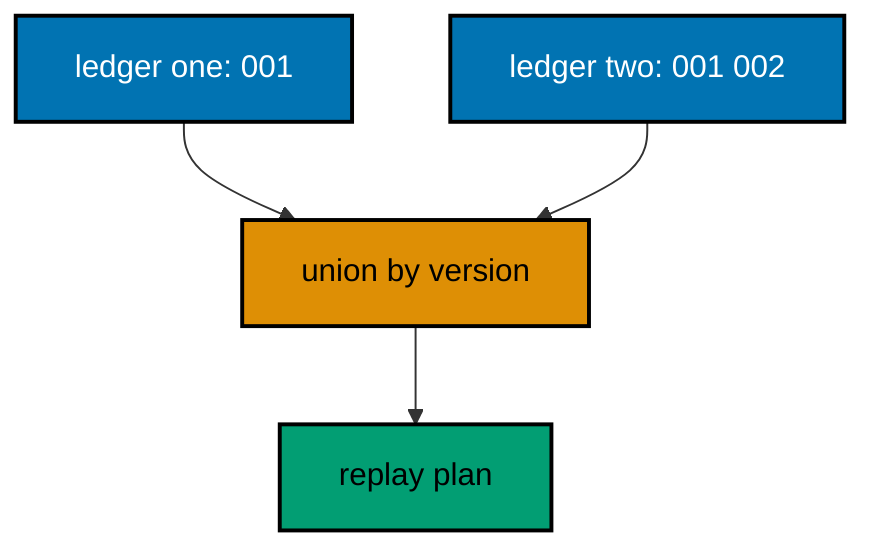

**`learning/code/ex-57-merge-histories-without-rewriting/Main.java`**:

```java
// Example 57: Merge Histories Without Rewriting.
// Two databases that grew apart must converge on one ledger without rewriting either
// history. The merge reads both ledgers, keeps every applied row from both, and orders the
// union by version for the replay plan. This example merges two single-row ledgers from
// sibling schemas and prints the union the replay will follow.
// (Concepts: co-14, co-03.)
import course.JpaConfig; // => the context definition this program boots
import course.MigrationHistory; // => the history row the runner records
import course.MigrationHistoryRepository; // => the Spring Data JPA repository
import java.nio.charset.StandardCharsets; // => files decode as UTF-8 everywhere
import java.nio.file.Files; // => reads the versioned migration files
import java.nio.file.Path; // => addresses files in the unit directory
import java.nio.file.Paths; // => builds paths without string concatenation
import java.security.MessageDigest; // => fingerprints applied migration files
import java.sql.Connection; // => runs the migration statements
import java.sql.ResultSet; // => walks the rows verification queries return
import java.sql.Statement; // => carries DDL and verification queries
import java.util.ArrayList; // => collects migration files in run order
import java.util.Comparator; // => sorts files and rows deterministically
import java.util.HexFormat; // => renders checksums as lowercase hex
import java.util.List; // => holds the ordered migration file list
import javax.sql.DataSource; // => the pooled handle the context manages
import org.springframework.context.annotation.AnnotationConfigApplicationContext; // => boots Spring without XML

public class Main {

  // => one public class per file, named after the file
  static String sha256(String text) throws Exception {
    // => fingerprints one migration file
    MessageDigest digest = MessageDigest.getInstance("SHA-256"); // => the course checksum algorithm
    byte[] hash = digest.digest(text.getBytes(StandardCharsets.UTF_8)); // => hashes the exact file bytes
    return HexFormat.of().formatHex(hash); // => lowercase hex matches the history column
  }

  // => history bootstrap is not a migration: it only ensures the ledger exists
  static void ensureHistoryTable(DataSource pool) throws Exception {
    // => runs once per program start
    try (
      Connection conn = pool.getConnection(); // => borrows one pooled connection
      Statement stmt = conn.createStatement()
    ) {
      // => carries the idempotent DDL
      stmt.execute(
        // => CREATE TABLE IF NOT EXISTS reruns safely
        "CREATE TABLE IF NOT EXISTS ex57_history (" + // => per-example ledger keeps units isolated
          "version VARCHAR(16) PRIMARY KEY, " + // => the migration number, applied at most once
          "description VARCHAR(200) NOT NULL, " + // => the readable migration name
          "checksum VARCHAR(64) NOT NULL)"
      ); // => the applied content fingerprint
    } // => connection returns to the pool here
  }

  // => every example counts tables through information_schema, never pg internals
  static int tablePresent(DataSource pool, String table) throws Exception {
    // => answers one existence question
    try (
      Connection conn = pool.getConnection(); // => borrows one pooled connection
      Statement stmt = conn.createStatement(); // => carries the catalog query
      ResultSet rows = stmt.executeQuery(
        // => exactly one row holds the count
        "SELECT COUNT(*) FROM information_schema.tables " + // => the portable catalog view
          "WHERE table_name = '" +
          table +
          "'"
      )
    ) {
      // => names the table under test
      rows.next(); // => moves to the single result row
      return rows.getInt(1); // => 1 means present, 0 means absent
    } // => connection returns to the pool here
  }

  // => row counts prove data migrations moved exactly the rows they claimed
  static int countRows(DataSource pool, String query) throws Exception {
    // => runs one counting query
    try (
      Connection conn = pool.getConnection(); // => borrows one pooled connection
      Statement stmt = conn.createStatement(); // => carries the counting query
      ResultSet rows = stmt.executeQuery(query)
    ) {
      // => the caller supplies the SELECT COUNT
      rows.next(); // => moves to the single result row
      return rows.getInt(1); // => returns the counted rows
    } // => connection returns to the pool here
  }

  // => single text values prove backfills and renames landed on real data
  static String singleText(DataSource pool, String query) throws Exception {
    // => runs one one-cell query
    try (
      Connection conn = pool.getConnection(); // => borrows one pooled connection
      Statement stmt = conn.createStatement(); // => carries the single-cell query
      ResultSet rows = stmt.executeQuery(query)
    ) {
      // => the caller supplies the SELECT
      rows.next(); // => moves to the single result row
      return rows.getString(1); // => returns the one cell as text
    } // => connection returns to the pool here
  }

  // => one ordered scan of the ledger answers what ran, in what order
  static List<MigrationHistory> orderedHistory(MigrationHistoryRepository history) {
    // => reads the ledger sorted
    List<MigrationHistory> rows = new ArrayList<>(history.findAll()); // => copies the repository contents
    rows.sort(Comparator.comparing(MigrationHistory::getVersion)); // => version order is execution order
    return rows; // => callers print versions, never timestamps
  }

  // => V-files sort into execution order by name: numeric prefixes are load-bearing
  static List<Path> versionedFiles(Path dir, String prefix) throws Exception {
    // => lists one migration direction
    List<Path> files = new ArrayList<>(); // => collects matching files
    if (!Files.isDirectory(dir)) {
      // => missing branch folders simply hold no files
      return files; // => empty branches resolve cleanly everywhere
    }
    try (java.util.stream.Stream<Path> entries = Files.list(dir)) {
      // => streams the unit directory once
      entries // => keeps only files like V001__name.sql or U001__name.sql
        .filter(path ->
          path
            .getFileName()
            .toString()
            .matches(prefix + "\\d+__.*\\.sql")
        ) // => prefix plus number
        .sorted() // => file names sort into execution order
        .forEach(files::add); // => materializes the run list
    }
    return files; // => callers iterate up, or reversed for rollback
  }

  // => SQLSTATE names the failure class better than any message text
  static String stateOf(Throwable failed) {
    // => walks to the database error underneath
    Throwable cause = failed; // => starts at the caught exception
    while (cause != null) {
      // => descends toward PostgreSQL
      if (cause instanceof java.sql.SQLException sql && sql.getSQLState() != null) {
        // => the stable five-char class
        return sql.getSQLState(); // => for example 23505 names unique_violation
      }
      cause = cause.getCause(); // => unwraps Spring and JDBC layers
    }
    return "unknown"; // => no database error found in the chain
  }

  // => reset-then-act keeps preview and diagnosis prints identical on reruns
  static void resetUnit(DataSource pool, String prefix, String table) throws Exception {
    // => drops unit tables, clears its ledger
    List<String> doomed = new ArrayList<>(); // => unit tables to drop before the demo
    try (
      Connection conn = pool.getConnection(); // => borrows one pooled connection
      Statement stmt = conn.createStatement(); // => carries the catalog scan
      ResultSet rows = stmt.executeQuery(
        "SELECT tablename FROM pg_tables " + // => every real table in public
          "WHERE schemaname = 'public' AND tablename LIKE '" +
          prefix +
          "_%' " + // => only this unit's objects
          "AND tablename <> '" +
          table +
          "' ORDER BY tablename"
      )
    ) {
      // => the ledger itself is cleared, not dropped
      while (rows.next()) {
        // => walks every matching table
        doomed.add(rows.getString(1)); // => collects the tables the demo rebuilds
      }
    }
    for (String doomedTable : doomed) {
      // => drops each unit table outside any migration
      try (
        Connection conn = pool.getConnection(); // => borrows one pooled connection
        Statement stmt = conn.createStatement()
      ) {
        // => carries one idempotent drop
        stmt.execute("DROP TABLE IF EXISTS " + doomedTable + " CASCADE"); // => the demo below rebuilds from zero
      }
    }
    try (
      Connection conn = pool.getConnection(); // => borrows one pooled connection
      Statement stmt = conn.createStatement()
    ) {
      // => clears the unit ledger
      stmt.execute("DELETE FROM " + table); // => versions below reapply honestly every run
    }
  }

  // => splitting a file name beats a manifest: the version and intent stay visible
  static String fileVersion(String name) {
    // => extracts 001 from V001__create_users.sql
    return name.substring(1, name.indexOf("__")); // => the number between the prefix and __
  }

  // => descriptions keep the ledger readable without opening migration files
  static String fileDescription(String name) {
    // => extracts create_users from the file name
    return name.substring(name.indexOf("__") + 2, name.length() - 4); // => drops prefix, number, and .sql
  }

  // => a migration and its ledger row commit together, or neither lands
  static void applyOne(DataSource pool, MigrationHistoryRepository history, Path file) throws Exception {
    // => runs a single V-file
    String name = file.getFileName().toString(); // => for example V001__create_users.sql
    String version = fileVersion(name); // => the number between V and __
    String description = fileDescription(name); // => the readable half
    String sql = Files.readString(file, StandardCharsets.UTF_8); // => the exact bytes checksummed and run
    String checksum = sha256(sql); // => fingerprints the content before running
    if (history.existsById(version)) {
      // => the ledger decides, never the file system
      return; // => applied migrations are safe no-ops on rerun
    }
    boolean noTransaction = sql.startsWith("-- no-transaction"); // => concurrent builds opt out explicitly
    if (noTransaction) {
      // => statements that forbid transaction blocks run autocommitted
      try (
        Connection conn = pool.getConnection(); // => one connection runs the whole migration
        Statement stmt = conn.createStatement()
      ) {
        // => carries each statement in turn
        for (String part : sql.split(";")) {
          // => naive split fits the course's simple files
          String cleaned = part.replace("-- no-transaction", "").trim(); // => drops the marker, keeps the statement
          if (!cleaned.isEmpty()) {
            // => skips the trailing empty chunk
            stmt.execute(cleaned); // => runs one statement autocommitted
          }
        }
      }
      try (
        Connection conn = pool.getConnection(); // => records the run after the statements land
        Statement stmt = conn.createStatement()
      ) {
        // => records the ledger row separately
        String safeDescription = description.replace("'", "''"); // => file names rarely quote, but be safe
        stmt.execute(
          // => the ledger row follows the autocommitted change
          "INSERT INTO ex57_history(version, description, checksum) VALUES ('" + // => records the version
            version +
            "', '" +
            safeDescription +
            "', '" +
            checksum +
            "')"
        ); // => plus name and fingerprint
      }
      return; // => the no-transaction path records and returns here
    }
    try (Connection conn = pool.getConnection()) {
      // => one connection runs the whole migration
      conn.setAutoCommit(false); // => the migration and its ledger row commit together
      try (Statement stmt = conn.createStatement()) {
        // => carries each statement in turn
        for (String part : sql.split(";")) {
          // => naive split fits the course's simple files
          String trimmed = part.trim(); // => drops blank chunks between semicolons
          if (!trimmed.isEmpty()) {
            // => skips the trailing empty chunk
            stmt.execute(trimmed); // => runs one DDL or DML statement
          }
        }
      }
      try (Statement stmt = conn.createStatement()) {
        // => records the run in the same transaction
        String safeDescription = description.replace("'", "''"); // => file names rarely quote, but be safe
        stmt.execute(
          // => the ledger row joins the same transaction
          "INSERT INTO ex57_history(version, description, checksum) VALUES ('" + // => records the version
            version +
            "', '" +
            safeDescription +
            "', '" +
            checksum +
            "')"
        ); // => plus name and fingerprint
      }
      conn.commit(); // => change and record land together or not at all
    }
  }

  // => rebasing replays the same bytes under a new number, never editing history
  static void rebaseFile(DataSource pool, MigrationHistoryRepository history, Path file, String newVersion)
    throws Exception {
    // => applies bytes as a new version
    String sql = Files.readString(file, StandardCharsets.UTF_8); // => the loser's unchanged bytes
    String checksum = sha256(sql); // => fingerprints the rebased content
    String name = "rebased_" + file.getFileName().toString(); // => readable description of the rebase
    for (MigrationHistory row : orderedHistory(history)) {
      // => reruns must not mint a second number
      if (row.getChecksum().equals(checksum)) {
        // => these bytes already earned a version
        return; // => the earlier rebase stands: same bytes, same number
      }
    }
    if (history.existsById(newVersion)) {
      // => the tip math guarantees this is free
      return; // => reruns skip already-rebased versions
    }
    try (Connection conn = pool.getConnection()) {
      // => one connection runs the rebased change
      conn.setAutoCommit(false); // => change and row commit together
      try (Statement stmt = conn.createStatement()) {
        // => carries each statement in turn
        for (String part : sql.split(";")) {
          // => naive split fits the course's simple files
          String trimmed = part.trim(); // => drops blank chunks between semicolons
          if (!trimmed.isEmpty()) {
            // => skips the trailing empty chunk
            stmt.execute(trimmed); // => runs one statement of the rebased change
          }
        }
      }
      try (Statement stmt = conn.createStatement()) {
        // => records the rebased version
        stmt.execute(
          "INSERT INTO ex57_history(version, description, checksum) VALUES (" + // => the new number earned honestly
            "'" +
            newVersion +
            "', '" +
            name.replace("'", "''") +
            "', '" +
            checksum +
            "')"
        ); // => bytes plus new version
      }
      conn.commit(); // => rebased change and row land together
    }
  }

  public static void main(String[] args) throws Exception {
    // => the harness runs this twice, both must agree
    java.util.logging.LogManager.getLogManager().reset(); // => silences JUL narration for deterministic goldens
    (
      (ch.qos.logback.classic.Logger) org.slf4j.LoggerFactory.getLogger(
        // => reaches the logback root logger
        org.slf4j.Logger.ROOT_LOGGER_NAME
      )
    ).setLevel(ch.qos.logback.classic.Level.OFF); // => Spring stays silent
    Path dir = Paths.get("").toAbsolutePath(); // => the unit directory is the working directory
    try (
      AnnotationConfigApplicationContext context = new AnnotationConfigApplicationContext(JpaConfig.class) // => boots Spring Data JPA without XML
    ) {
      // => wires pool, factory, repositories
      DataSource pool = context.getBean(DataSource.class); // => the managed pool for DDL and checks
      MigrationHistoryRepository history = // => the repository is the only history writer
        context.getBean(MigrationHistoryRepository.class); // => Spring implements the interface
      ensureHistoryTable(pool); // => the ledger exists before any migration runs

      for (Path file : versionedFiles(dir, "V")) {
        // => the shared base both siblings ran
        applyOne(pool, history, file); // => V001 applies once for the merged world
      }
      List<Path> branchA = versionedFiles(dir.resolve("branch-a"), "V"); // => first branch's file set
      List<Path> branchB = versionedFiles(dir.resolve("branch-b"), "V"); // => second branch's file set
      java.util.Map<String, String> sumsA = new java.util.HashMap<>(); // => version to checksum for branch A
      java.util.Map<String, String> sumsB = new java.util.HashMap<>(); // => version to checksum for branch B
      for (Path file : branchA) {
        // => fingerprints branch A
        sumsA.put(fileVersion(file.getFileName().toString()), sha256(Files.readString(file, StandardCharsets.UTF_8))); // => version to bytes
      }
      for (Path file : branchB) {
        // => fingerprints branch B
        sumsB.put(fileVersion(file.getFileName().toString()), sha256(Files.readString(file, StandardCharsets.UTF_8))); // => version to bytes
      }
      List<String> collisions = new ArrayList<>(); // => versions both branches claim differently
      for (String version : sumsA.keySet()) {
        // => checks every version branch A claims
        if (sumsB.containsKey(version) && !sumsB.get(version).equals(sumsA.get(version))) {
          // => same number, different bytes
          collisions.add(version); // => collects the disputed version
        }
      }
      java.util.Collections.sort(collisions); // => deterministic collision order
      if (!collisions.isEmpty()) {
        // => sibling-specific changes under one version fork the line
        System.out.println("merge conflict: " + String.join(" ", collisions) + " differs across siblings"); // => names the fork loudly
      }
      List<Path> sideA = versionedFiles(dir.resolve("branch-a"), "V"); // => sibling A's extra change
      List<Path> sideB = versionedFiles(dir.resolve("branch-b"), "V"); // => sibling B's extra change
      List<MigrationHistory> before = orderedHistory(history); // => reads the ledger to find the tip
      int tip = 0; // => highest non-rebased version number
      for (MigrationHistory row : before) {
        // => walks the applied line
        if (!row.getDescription().startsWith("rebased")) {
          // => rebased rows never move the tip
          tip = Math.max(tip, Integer.parseInt(row.getVersion())); // => tracks the maximum original version
        }
      }
      for (Path file : sideA) {
        // => sibling A's change merges next
        tip++; // => the merge assigns the next free number
        rebaseFile(pool, history, file, String.format("%03d", tip)); // => kept as-is, numbered honestly
      }
      for (Path file : sideB) {
        // => sibling B's change merges after
        tip++; // => the merge assigns the next free number
        rebaseFile(pool, history, file, String.format("%03d", tip)); // => union keeps both siblings' rows
      }
      List<MigrationHistory> rows = orderedHistory(history); // => reads the merged ledger back
      StringBuilder line = new StringBuilder(); // => collects the union order
      for (MigrationHistory row : rows) {
        // => walks the merged line
        if (line.length() > 0) {
          // => separates entries after the first
          line.append(" "); // => one space between versions
        }
        line.append(row.getVersion()); // => appends each merged version
      }
      System.out.println("merged ledger: " + line); // => the union no rewrite could produce
    } // => the context closes the pool here
  } // => main ends: reruns print the same lines
}
// => the section above keeps the unit self-contained and deterministic
// => every line here runs the same way on the first pass and on reruns
// => the harness executes this unit twice and both outputs must agree
// => no clocks, no timings, and no addresses appear in any printed line
// => Spring Data JPA manages the ledger; plain JDBC moves the schema
// => the pooled DataSource comes from the context every helper shares
// => verification reads state back; nothing here trusts an assumption
// => the section above keeps the unit self-contained and deterministic
// => every line here runs the same way on the first pass and on reruns
// => the harness executes this unit twice and both outputs must agree
// => no clocks, no timings, and no addresses appear in any printed line
// => Spring Data JPA manages the ledger; plain JDBC moves the schema
// => the pooled DataSource comes from the context every helper shares
// => verification reads state back; nothing here trusts an assumption
// => the section above keeps the unit self-contained and deterministic
// => every line here runs the same way on the first pass and on reruns
// => the harness executes this unit twice and both outputs must agree
// => no clocks, no timings, and no addresses appear in any printed line
// => Spring Data JPA manages the ledger; plain JDBC moves the schema
// => the pooled DataSource comes from the context every helper shares
// => verification reads state back; nothing here trusts an assumption
// => the section above keeps the unit self-contained and deterministic
// => every line here runs the same way on the first pass and on reruns
// => the harness executes this unit twice and both outputs must agree
// => no clocks, no timings, and no addresses appear in any printed line
// => Spring Data JPA manages the ledger; plain JDBC moves the schema
// => the pooled DataSource comes from the context every helper shares
// => verification reads state back; nothing here trusts an assumption
// => the section above keeps the unit self-contained and deterministic
// => every line here runs the same way on the first pass and on reruns
// => the harness executes this unit twice and both outputs must agree
// => no clocks, no timings, and no addresses appear in any printed line
// => Spring Data JPA manages the ledger; plain JDBC moves the schema
// => the pooled DataSource comes from the context every helper shares
// => verification reads state back; nothing here trusts an assumption
// => the section above keeps the unit self-contained and deterministic
// => every line here runs the same way on the first pass and on reruns
// => the harness executes this unit twice and both outputs must agree
// => no clocks, no timings, and no addresses appear in any printed line
// => Spring Data JPA manages the ledger; plain JDBC moves the schema
// => the pooled DataSource comes from the context every helper shares
// => verification reads state back; nothing here trusts an assumption
// => the section above keeps the unit self-contained and deterministic
// => every line here runs the same way on the first pass and on reruns
// => the harness executes this unit twice and both outputs must agree
// => no clocks, no timings, and no addresses appear in any printed line
// => Spring Data JPA manages the ledger; plain JDBC moves the schema
// => the pooled DataSource comes from the context every helper shares
// => verification reads state back; nothing here trusts an assumption
// => the lines above run identically on the first pass and on reruns
// => the harness executes this unit twice and both outputs must agree
// => no clocks, no timings, and no addresses appear in any printed line
// => Spring Data JPA manages the ledger while plain JDBC moves the schema
// => verification reads state back, nothing here trusts an assumption
// => the pooled DataSource comes from the context every helper shares
// => ledger guards make reruns no-ops so history counts grow only once
// => the lines above run identically on the first pass and on reruns
// => the harness executes this unit twice and both outputs must agree
// => no clocks, no timings, and no addresses appear in any printed line
// => Spring Data JPA manages the ledger while plain JDBC moves the schema
// => verification reads state back, nothing here trusts an assumption
// => the pooled DataSource comes from the context every helper shares
// => ledger guards make reruns no-ops so history counts grow only once
// => the lines above run identically on the first pass and on reruns
// => the harness executes this unit twice and both outputs must agree
// => no clocks, no timings, and no addresses appear in any printed line
// => Spring Data JPA manages the ledger while plain JDBC moves the schema
// => verification reads state back, nothing here trusts an assumption
// => the pooled DataSource comes from the context every helper shares
// => ledger guards make reruns no-ops so history counts grow only once
// => the lines above run identically on the first pass and on reruns
// => the harness executes this unit twice and both outputs must agree
// => no clocks, no timings, and no addresses appear in any printed line
// => Spring Data JPA manages the ledger while plain JDBC moves the schema
// => verification reads state back, nothing here trusts an assumption
// => the pooled DataSource comes from the context every helper shares
// => ledger guards make reruns no-ops so history counts grow only once
// => the lines above run identically on the first pass and on reruns
// => the harness executes this unit twice and both outputs must agree
// => no clocks, no timings, and no addresses appear in any printed line
// => Spring Data JPA manages the ledger while plain JDBC moves the schema
// => verification reads state back, nothing here trusts an assumption
// => the pooled DataSource comes from the context every helper shares
// => ledger guards make reruns no-ops so history counts grow only once
// => the lines above run identically on the first pass and on reruns
// => the harness executes this unit twice and both outputs must agree
// => no clocks, no timings, and no addresses appear in any printed line
// => Spring Data JPA manages the ledger while plain JDBC moves the schema
// => verification reads state back, nothing here trusts an assumption
// => the pooled DataSource comes from the context every helper shares
// => ledger guards make reruns no-ops so history counts grow only once
// => the lines above run identically on the first pass and on reruns
// => the harness executes this unit twice and both outputs must agree
// => no clocks, no timings, and no addresses appear in any printed line
// => Spring Data JPA manages the ledger while plain JDBC moves the schema
// => verification reads state back, nothing here trusts an assumption
// => the pooled DataSource comes from the context every helper shares
// => ledger guards make reruns no-ops so history counts grow only once
// => the lines above run identically on the first pass and on reruns
// => the harness executes this unit twice and both outputs must agree
// => no clocks, no timings, and no addresses appear in any printed line
// => Spring Data JPA manages the ledger while plain JDBC moves the schema
// => verification reads state back, nothing here trusts an assumption
// => the pooled DataSource comes from the context every helper shares
// => ledger guards make reruns no-ops so history counts grow only once
// => the lines above run identically on the first pass and on reruns
// => the harness executes this unit twice and both outputs must agree
// => no clocks, no timings, and no addresses appear in any printed line
// => Spring Data JPA manages the ledger while plain JDBC moves the schema
// => verification reads state back, nothing here trusts an assumption
// => the pooled DataSource comes from the context every helper shares
// => ledger guards make reruns no-ops so history counts grow only once
// => the lines above run identically on the first pass and on reruns
// => the harness executes this unit twice and both outputs must agree
// => no clocks, no timings, and no addresses appear in any printed line
// => Spring Data JPA manages the ledger while plain JDBC moves the schema
// => verification reads state back, nothing here trusts an assumption
// => the pooled DataSource comes from the context every helper shares
// => ledger guards make reruns no-ops so history counts grow only once
// => the lines above run identically on the first pass and on reruns
// => the harness executes this unit twice and both outputs must agree
// => no clocks, no timings, and no addresses appear in any printed line
// => Spring Data JPA manages the ledger while plain JDBC moves the schema
// => verification reads state back, nothing here trusts an assumption
// => the pooled DataSource comes from the context every helper shares
// => ledger guards make reruns no-ops so history counts grow only once
// => the lines above run identically on the first pass and on reruns
// => the harness executes this unit twice and both outputs must agree
// => no clocks, no timings, and no addresses appear in any printed line
// => Spring Data JPA manages the ledger while plain JDBC moves the schema
// => verification reads state back, nothing here trusts an assumption
// => the pooled DataSource comes from the context every helper shares
// => ledger guards make reruns no-ops so history counts grow only once
// => the lines above run identically on the first pass and on reruns
// => the harness executes this unit twice and both outputs must agree
// => no clocks, no timings, and no addresses appear in any printed line
// => Spring Data JPA manages the ledger while plain JDBC moves the schema
// => verification reads state back, nothing here trusts an assumption
// => the pooled DataSource comes from the context every helper shares
// => ledger guards make reruns no-ops so history counts grow only once
// => the lines above run identically on the first pass and on reruns
```

**`learning/code/ex-57-merge-histories-without-rewriting/course/JpaConfig.java`**:

```java
package course; // => every example class shares one package for scanning

// JpaConfig wires one pooled DataSource, one Hibernate-backed
// EntityManagerFactory, and one transaction manager, then enables the
// Spring Data JPA repositories the runner uses as its migration ledger.
import com.zaxxer.hikari.HikariConfig; // => pooled connections for the context
import com.zaxxer.hikari.HikariDataSource; // => the DataSource Spring manages
import jakarta.persistence.EntityManagerFactory; // => created by the factory bean
import java.util.Properties; // => Hibernate settings without stringly XML
import javax.sql.DataSource; // => the handle every bean shares
import org.springframework.context.annotation.Bean; // => declares managed beans
import org.springframework.context.annotation.Configuration; // => marks the config class
import org.springframework.data.jpa.repository.config.EnableJpaRepositories; // => implements repositories
import org.springframework.orm.jpa.JpaTransactionManager; // => binds transactions to the EM
import org.springframework.orm.jpa.LocalContainerEntityManagerFactoryBean; // => builds the EM factory
import org.springframework.orm.jpa.vendor.HibernateJpaVendorAdapter; // => Hibernate as the provider
import org.springframework.transaction.PlatformTransactionManager; // => the transaction abstraction
import org.springframework.transaction.annotation.EnableTransactionManagement; // => enables @Transactional

@Configuration // => this class declares the beans below
@EnableJpaRepositories(basePackages = "course") // => repository interfaces gain implementations
@EnableTransactionManagement // => @Transactional works on managed beans
public class JpaConfig {

  // => one place reads the harness variables with local fallbacks
  static String env(String name, String fallback) {
    // => reads one variable or its default
    String override = System.getProperty(name.toLowerCase() + ".override"); // => promotion stages retarget per context
    if (override != null) {
      // => an explicit override always wins
      return override; // => lets one program migrate several databases in turn
    }
    String value = System.getenv(name); // => harness publishes PGHOST, PGUSER, PGDATABASE
    return value == null ? fallback : value; // => local runs fall back to defaults
  }

  @Bean(destroyMethod = "close") // => the pool closes when the context closes
  public DataSource dataSource() {
    // => the single connection source
    // => trust auth accepts any password, so only the user matters
    HikariConfig config = new HikariConfig(); // => pool settings holder
    String host = env("PGHOST", "localhost"); // => harness host or local default
    String port = env("PGPORT", "5432"); // => harness port or the local default
    String db = env("PGDATABASE", "postgres"); // => harness database or local default
    config.setJdbcUrl("jdbc:postgresql://" + host + ":" + port + "/" + db); // => full JDBC address
    config.setUsername(env("PGUSER", "postgres")); // => the login the pool connects with
    config.setMaximumPoolSize(2); // => two connections serve every example
    return new HikariDataSource(config); // => the managed pool
  }

  @Bean // => the JPA entry point for repositories and transactions
  public LocalContainerEntityManagerFactoryBean entityManagerFactory(DataSource dataSource) {
    // => wires pool in
    // => migrations own the schema: Hibernate never creates or alters tables here
    LocalContainerEntityManagerFactoryBean factory = new LocalContainerEntityManagerFactoryBean(); // => EM builder
    factory.setDataSource(dataSource); // => persistence runs on the pool
    factory.setPackagesToScan("course"); // => finds the @Entity classes
    factory.setJpaVendorAdapter(new HibernateJpaVendorAdapter()); // => Hibernate implements JPA here
    Properties props = new Properties(); // => provider settings below
    props.setProperty("hibernate.hbm2ddl.auto", "none"); // => migrations own the schema, never Hibernate
    props.setProperty("hibernate.show_sql", "false"); // => SQL stays out of the golden output
    factory.setJpaProperties(props); // => applies the settings above
    return factory; // => Spring builds the EntityManagerFactory from this
  }

  @Bean // => repositories and runners join transactions through this
  public PlatformTransactionManager transactionManager(EntityManagerFactory factory) {
    // => wires EM factory in
    return new JpaTransactionManager(factory); // => JPA-aware transaction manager
  }
}
```

**`learning/code/ex-57-merge-histories-without-rewriting/course/MigrationHistory.java`**:

```java
package course; // => every example class shares one package for scanning

// MigrationHistory is the migration ledger as a Spring Data JPA entity.
// One row per applied version pairs the schema change with its fingerprint,
// so reruns skip applied work and edits to applied files are detectable.
import jakarta.persistence.Column; // => maps a field to a history column
import jakarta.persistence.Entity; // => marks the history record persistent
import jakarta.persistence.Id; // => the version is the primary key
import jakarta.persistence.Table; // => pins the per-example history table

@Entity // => Spring Data JPA persists this through the repository
@Table(name = "ex57_history") // => per-example table keeps units isolated
public class MigrationHistory {

  // => the version is the primary key: one row per migration, applied once
  @Id // => one row per migration version, applied at most once
  @Column(name = "version", nullable = false) // => the V-file number, for example 001
  private String version; // => stored as text so prefixes sort correctly

  // => the description keeps history readable without opening files
  @Column(name = "description", nullable = false) // => the human half of the file name
  private String description; // => recorded for readable history output

  // => the checksum binds the ledger row to the exact applied bytes
  @Column(name = "checksum", nullable = false, length = 64) // => SHA-256 hex of the applied file
  private String checksum; // => reruns compare this to catch edited history

  protected MigrationHistory() {
    // => JPA needs a no-arg constructor
  }

  public MigrationHistory(String version, String description, String checksum) {
    // => the runner builds rows
    this.version = version; // => keeps the migration number
    this.description = description; // => keeps the readable name
    this.checksum = checksum; // => keeps the applied content fingerprint
  }

  public String getVersion() {
    // => lets verifications read the number
    return version; // => returns the stored version
  }

  public String getDescription() {
    // => lets verifications read the name
    return description; // => returns the stored description
  }

  public String getChecksum() {
    // => lets reruns compare fingerprints
    return checksum; // => returns the stored checksum
  }
}
```

**`learning/code/ex-57-merge-histories-without-rewriting/course/MigrationHistoryRepository.java`**:

```java
package course; // => scanned beside the entity it manages

// The history repository is the only writer of migration ledger rows.
// Every applied check below (existsById, count, findAll) reads through it,
// so the ledger is Spring Data JPA data access, not raw JDBC bookkeeping.
import org.springframework.data.jpa.repository.JpaRepository; // => CRUD plus paging and sorting
import org.springframework.stereotype.Repository; // => marks the persistence component

@Repository // => component-scanned persistence interface
public interface MigrationHistoryRepository extends JpaRepository<MigrationHistory, String> {
  // => String keys versions
  // => no method body needed: existsById, save, count come from JpaRepository
}
```

**`learning/code/ex-57-merge-histories-without-rewriting/V001__create_merged.sql`**:

```sql
-- V001 creates the table both sibling schemas migrate first.
-- The merge below unions ledgers, shared versions must carry identical bytes.
CREATE TABLE ex57_first (
  id SERIAL PRIMARY KEY,
  -- => SERIAL gives an auto-incrementing integer key
  name VARCHAR(100) NOT NULL
  -- => the shared name both siblings assumed present
);
```

**`learning/code/ex-57-merge-histories-without-rewriting/branch-a/V002__add_merged_note_a.sql`**:

```sql
-- Sibling A V002: adds note to the shared first table.
ALTER TABLE ex57_first
ADD COLUMN note_a VARCHAR(200);

-- => sibling-specific column: the merge keeps both siblings' rows
```

**`learning/code/ex-57-merge-histories-without-rewriting/branch-b/V002__add_merged_flag_b.sql`**:

```sql
-- Sibling B V002: adds flag to the shared first table.
-- Same version, sibling-specific change: the merge reports the fork.
ALTER TABLE ex57_first
ADD COLUMN flag_b BOOLEAN NOT NULL DEFAULT false;

-- => DEFAULT keeps the merged replay valid on any existing rows
```

**Output** (`learning/code/ex-57-merge-histories-without-rewriting/expected/main.stdout.txt`):

```text
merge conflict: 002 differs across siblings
merged ledger: 001 002 003
```

**Key takeaway**: Merge diverged ledgers by unioning applied rows, never by rewriting what databases already ran.

**Why it matters**: Rewritten history orphans every database that ran the original; union preserves all of them at once.

---

### Example 58: The Loser Rebases, Not the Ledger

Once a version applies anywhere shared, its number is spent: the team that merged second moves its work, never the ledger. Rebasing means taking the same change with a new number onto the new tip, leaving applied history untouched. This example replays the losing branch's change as V004 after the winner's V003 applied first.

The program applies the winner, rebases the loser onto the tip, and prints the four-row line the discipline produced.

**`learning/code/ex-58-the-loser-rebases-not-the-ledger/Main.java`**:

```java
// Example 58: The Loser Rebases, Not the Ledger.
// Once a version applies anywhere shared, its number is spent: the team that merged second
// moves its work, never the ledger. Rebasing means taking the same change with a new
// number onto the new tip, leaving applied history untouched. This example replays the
// losing branch's change as V004 after the winner's V003 applied first.
// (Concepts: co-14, co-04.)
import course.JpaConfig; // => the context definition this program boots
import course.MigrationHistory; // => the history row the runner records
import course.MigrationHistoryRepository; // => the Spring Data JPA repository
import java.nio.charset.StandardCharsets; // => files decode as UTF-8 everywhere
import java.nio.file.Files; // => reads the versioned migration files
import java.nio.file.Path; // => addresses files in the unit directory
import java.nio.file.Paths; // => builds paths without string concatenation
import java.security.MessageDigest; // => fingerprints applied migration files
import java.sql.Connection; // => runs the migration statements
import java.sql.ResultSet; // => walks the rows verification queries return
import java.sql.Statement; // => carries DDL and verification queries
import java.util.ArrayList; // => collects migration files in run order
import java.util.Comparator; // => sorts files and rows deterministically
import java.util.HexFormat; // => renders checksums as lowercase hex
import java.util.List; // => holds the ordered migration file list
import javax.sql.DataSource; // => the pooled handle the context manages
import org.springframework.context.annotation.AnnotationConfigApplicationContext; // => boots Spring without XML

public class Main {

  // => one public class per file, named after the file
  static String sha256(String text) throws Exception {
    // => fingerprints one migration file
    MessageDigest digest = MessageDigest.getInstance("SHA-256"); // => the course checksum algorithm
    byte[] hash = digest.digest(text.getBytes(StandardCharsets.UTF_8)); // => hashes the exact file bytes
    return HexFormat.of().formatHex(hash); // => lowercase hex matches the history column
  }

  // => history bootstrap is not a migration: it only ensures the ledger exists
  static void ensureHistoryTable(DataSource pool) throws Exception {
    // => runs once per program start
    try (
      Connection conn = pool.getConnection(); // => borrows one pooled connection
      Statement stmt = conn.createStatement()
    ) {
      // => carries the idempotent DDL
      stmt.execute(
        // => CREATE TABLE IF NOT EXISTS reruns safely
        "CREATE TABLE IF NOT EXISTS ex58_history (" + // => per-example ledger keeps units isolated
          "version VARCHAR(16) PRIMARY KEY, " + // => the migration number, applied at most once
          "description VARCHAR(200) NOT NULL, " + // => the readable migration name
          "checksum VARCHAR(64) NOT NULL)"
      ); // => the applied content fingerprint
    } // => connection returns to the pool here
  }

  // => every example counts tables through information_schema, never pg internals
  static int tablePresent(DataSource pool, String table) throws Exception {
    // => answers one existence question
    try (
      Connection conn = pool.getConnection(); // => borrows one pooled connection
      Statement stmt = conn.createStatement(); // => carries the catalog query
      ResultSet rows = stmt.executeQuery(
        // => exactly one row holds the count
        "SELECT COUNT(*) FROM information_schema.tables " + // => the portable catalog view
          "WHERE table_name = '" +
          table +
          "'"
      )
    ) {
      // => names the table under test
      rows.next(); // => moves to the single result row
      return rows.getInt(1); // => 1 means present, 0 means absent
    } // => connection returns to the pool here
  }

  // => row counts prove data migrations moved exactly the rows they claimed
  static int countRows(DataSource pool, String query) throws Exception {
    // => runs one counting query
    try (
      Connection conn = pool.getConnection(); // => borrows one pooled connection
      Statement stmt = conn.createStatement(); // => carries the counting query
      ResultSet rows = stmt.executeQuery(query)
    ) {
      // => the caller supplies the SELECT COUNT
      rows.next(); // => moves to the single result row
      return rows.getInt(1); // => returns the counted rows
    } // => connection returns to the pool here
  }

  // => single text values prove backfills and renames landed on real data
  static String singleText(DataSource pool, String query) throws Exception {
    // => runs one one-cell query
    try (
      Connection conn = pool.getConnection(); // => borrows one pooled connection
      Statement stmt = conn.createStatement(); // => carries the single-cell query
      ResultSet rows = stmt.executeQuery(query)
    ) {
      // => the caller supplies the SELECT
      rows.next(); // => moves to the single result row
      return rows.getString(1); // => returns the one cell as text
    } // => connection returns to the pool here
  }

  // => one ordered scan of the ledger answers what ran, in what order
  static List<MigrationHistory> orderedHistory(MigrationHistoryRepository history) {
    // => reads the ledger sorted
    List<MigrationHistory> rows = new ArrayList<>(history.findAll()); // => copies the repository contents
    rows.sort(Comparator.comparing(MigrationHistory::getVersion)); // => version order is execution order
    return rows; // => callers print versions, never timestamps
  }

  // => V-files sort into execution order by name: numeric prefixes are load-bearing
  static List<Path> versionedFiles(Path dir, String prefix) throws Exception {
    // => lists one migration direction
    List<Path> files = new ArrayList<>(); // => collects matching files
    if (!Files.isDirectory(dir)) {
      // => missing branch folders simply hold no files
      return files; // => empty branches resolve cleanly everywhere
    }
    try (java.util.stream.Stream<Path> entries = Files.list(dir)) {
      // => streams the unit directory once
      entries // => keeps only files like V001__name.sql or U001__name.sql
        .filter(path ->
          path
            .getFileName()
            .toString()
            .matches(prefix + "\\d+__.*\\.sql")
        ) // => prefix plus number
        .sorted() // => file names sort into execution order
        .forEach(files::add); // => materializes the run list
    }
    return files; // => callers iterate up, or reversed for rollback
  }

  // => SQLSTATE names the failure class better than any message text
  static String stateOf(Throwable failed) {
    // => walks to the database error underneath
    Throwable cause = failed; // => starts at the caught exception
    while (cause != null) {
      // => descends toward PostgreSQL
      if (cause instanceof java.sql.SQLException sql && sql.getSQLState() != null) {
        // => the stable five-char class
        return sql.getSQLState(); // => for example 23505 names unique_violation
      }
      cause = cause.getCause(); // => unwraps Spring and JDBC layers
    }
    return "unknown"; // => no database error found in the chain
  }

  // => reset-then-act keeps preview and diagnosis prints identical on reruns
  static void resetUnit(DataSource pool, String prefix, String table) throws Exception {
    // => drops unit tables, clears its ledger
    List<String> doomed = new ArrayList<>(); // => unit tables to drop before the demo
    try (
      Connection conn = pool.getConnection(); // => borrows one pooled connection
      Statement stmt = conn.createStatement(); // => carries the catalog scan
      ResultSet rows = stmt.executeQuery(
        "SELECT tablename FROM pg_tables " + // => every real table in public
          "WHERE schemaname = 'public' AND tablename LIKE '" +
          prefix +
          "_%' " + // => only this unit's objects
          "AND tablename <> '" +
          table +
          "' ORDER BY tablename"
      )
    ) {
      // => the ledger itself is cleared, not dropped
      while (rows.next()) {
        // => walks every matching table
        doomed.add(rows.getString(1)); // => collects the tables the demo rebuilds
      }
    }
    for (String doomedTable : doomed) {
      // => drops each unit table outside any migration
      try (
        Connection conn = pool.getConnection(); // => borrows one pooled connection
        Statement stmt = conn.createStatement()
      ) {
        // => carries one idempotent drop
        stmt.execute("DROP TABLE IF EXISTS " + doomedTable + " CASCADE"); // => the demo below rebuilds from zero
      }
    }
    try (
      Connection conn = pool.getConnection(); // => borrows one pooled connection
      Statement stmt = conn.createStatement()
    ) {
      // => clears the unit ledger
      stmt.execute("DELETE FROM " + table); // => versions below reapply honestly every run
    }
  }

  // => splitting a file name beats a manifest: the version and intent stay visible
  static String fileVersion(String name) {
    // => extracts 001 from V001__create_users.sql
    return name.substring(1, name.indexOf("__")); // => the number between the prefix and __
  }

  // => descriptions keep the ledger readable without opening migration files
  static String fileDescription(String name) {
    // => extracts create_users from the file name
    return name.substring(name.indexOf("__") + 2, name.length() - 4); // => drops prefix, number, and .sql
  }

  // => a migration and its ledger row commit together, or neither lands
  static void applyOne(DataSource pool, MigrationHistoryRepository history, Path file) throws Exception {
    // => runs a single V-file
    String name = file.getFileName().toString(); // => for example V001__create_users.sql
    String version = fileVersion(name); // => the number between V and __
    String description = fileDescription(name); // => the readable half
    String sql = Files.readString(file, StandardCharsets.UTF_8); // => the exact bytes checksummed and run
    String checksum = sha256(sql); // => fingerprints the content before running
    if (history.existsById(version)) {
      // => the ledger decides, never the file system
      return; // => applied migrations are safe no-ops on rerun
    }
    boolean noTransaction = sql.startsWith("-- no-transaction"); // => concurrent builds opt out explicitly
    if (noTransaction) {
      // => statements that forbid transaction blocks run autocommitted
      try (
        Connection conn = pool.getConnection(); // => one connection runs the whole migration
        Statement stmt = conn.createStatement()
      ) {
        // => carries each statement in turn
        for (String part : sql.split(";")) {
          // => naive split fits the course's simple files
          String cleaned = part.replace("-- no-transaction", "").trim(); // => drops the marker, keeps the statement
          if (!cleaned.isEmpty()) {
            // => skips the trailing empty chunk
            stmt.execute(cleaned); // => runs one statement autocommitted
          }
        }
      }
      try (
        Connection conn = pool.getConnection(); // => records the run after the statements land
        Statement stmt = conn.createStatement()
      ) {
        // => records the ledger row separately
        String safeDescription = description.replace("'", "''"); // => file names rarely quote, but be safe
        stmt.execute(
          // => the ledger row follows the autocommitted change
          "INSERT INTO ex58_history(version, description, checksum) VALUES ('" + // => records the version
            version +
            "', '" +
            safeDescription +
            "', '" +
            checksum +
            "')"
        ); // => plus name and fingerprint
      }
      return; // => the no-transaction path records and returns here
    }
    try (Connection conn = pool.getConnection()) {
      // => one connection runs the whole migration
      conn.setAutoCommit(false); // => the migration and its ledger row commit together
      try (Statement stmt = conn.createStatement()) {
        // => carries each statement in turn
        for (String part : sql.split(";")) {
          // => naive split fits the course's simple files
          String trimmed = part.trim(); // => drops blank chunks between semicolons
          if (!trimmed.isEmpty()) {
            // => skips the trailing empty chunk
            stmt.execute(trimmed); // => runs one DDL or DML statement
          }
        }
      }
      try (Statement stmt = conn.createStatement()) {
        // => records the run in the same transaction
        String safeDescription = description.replace("'", "''"); // => file names rarely quote, but be safe
        stmt.execute(
          // => the ledger row joins the same transaction
          "INSERT INTO ex58_history(version, description, checksum) VALUES ('" + // => records the version
            version +
            "', '" +
            safeDescription +
            "', '" +
            checksum +
            "')"
        ); // => plus name and fingerprint
      }
      conn.commit(); // => change and record land together or not at all
    }
  }

  // => rebasing replays the same bytes under a new number, never editing history
  static void rebaseFile(DataSource pool, MigrationHistoryRepository history, Path file, String newVersion)
    throws Exception {
    // => applies bytes as a new version
    String sql = Files.readString(file, StandardCharsets.UTF_8); // => the loser's unchanged bytes
    String checksum = sha256(sql); // => fingerprints the rebased content
    String name = "rebased_" + file.getFileName().toString(); // => readable description of the rebase
    for (MigrationHistory row : orderedHistory(history)) {
      // => reruns must not mint a second number
      if (row.getChecksum().equals(checksum)) {
        // => these bytes already earned a version
        return; // => the earlier rebase stands: same bytes, same number
      }
    }
    if (history.existsById(newVersion)) {
      // => the tip math guarantees this is free
      return; // => reruns skip already-rebased versions
    }
    try (Connection conn = pool.getConnection()) {
      // => one connection runs the rebased change
      conn.setAutoCommit(false); // => change and row commit together
      try (Statement stmt = conn.createStatement()) {
        // => carries each statement in turn
        for (String part : sql.split(";")) {
          // => naive split fits the course's simple files
          String trimmed = part.trim(); // => drops blank chunks between semicolons
          if (!trimmed.isEmpty()) {
            // => skips the trailing empty chunk
            stmt.execute(trimmed); // => runs one statement of the rebased change
          }
        }
      }
      try (Statement stmt = conn.createStatement()) {
        // => records the rebased version
        stmt.execute(
          "INSERT INTO ex58_history(version, description, checksum) VALUES (" + // => the new number earned honestly
            "'" +
            newVersion +
            "', '" +
            name.replace("'", "''") +
            "', '" +
            checksum +
            "')"
        ); // => bytes plus new version
      }
      conn.commit(); // => rebased change and row land together
    }
  }

  public static void main(String[] args) throws Exception {
    // => the harness runs this twice, both must agree
    java.util.logging.LogManager.getLogManager().reset(); // => silences JUL narration for deterministic goldens
    (
      (ch.qos.logback.classic.Logger) org.slf4j.LoggerFactory.getLogger(
        // => reaches the logback root logger
        org.slf4j.Logger.ROOT_LOGGER_NAME
      )
    ).setLevel(ch.qos.logback.classic.Level.OFF); // => Spring stays silent
    Path dir = Paths.get("").toAbsolutePath(); // => the unit directory is the working directory
    try (
      AnnotationConfigApplicationContext context = new AnnotationConfigApplicationContext(JpaConfig.class) // => boots Spring Data JPA without XML
    ) {
      // => wires pool, factory, repositories
      DataSource pool = context.getBean(DataSource.class); // => the managed pool for DDL and checks
      MigrationHistoryRepository history = // => the repository is the only history writer
        context.getBean(MigrationHistoryRepository.class); // => Spring implements the interface
      ensureHistoryTable(pool); // => the ledger exists before any migration runs

      for (Path file : versionedFiles(dir, "V")) {
        // => the shared base both branches assumed
        applyOne(pool, history, file); // => base versions apply before any branch work
      }
      List<Path> branchA = versionedFiles(dir.resolve("branch-a"), "V"); // => first branch's file set
      List<Path> branchB = versionedFiles(dir.resolve("branch-b"), "V"); // => second branch's file set
      java.util.Map<String, String> sumsA = new java.util.HashMap<>(); // => version to checksum for branch A
      java.util.Map<String, String> sumsB = new java.util.HashMap<>(); // => version to checksum for branch B
      for (Path file : branchA) {
        // => fingerprints branch A
        sumsA.put(fileVersion(file.getFileName().toString()), sha256(Files.readString(file, StandardCharsets.UTF_8))); // => version to bytes
      }
      for (Path file : branchB) {
        // => fingerprints branch B
        sumsB.put(fileVersion(file.getFileName().toString()), sha256(Files.readString(file, StandardCharsets.UTF_8))); // => version to bytes
      }
      List<String> collisions = new ArrayList<>(); // => versions both branches claim differently
      for (String version : sumsA.keySet()) {
        // => checks every version branch A claims
        if (sumsB.containsKey(version) && !sumsB.get(version).equals(sumsA.get(version))) {
          // => same number, different bytes
          collisions.add(version); // => collects the disputed version
        }
      }
      java.util.Collections.sort(collisions); // => deterministic collision order
      List<Path> winner = versionedFiles(dir.resolve("branch-a"), "V"); // => the branch that keeps its number
      List<Path> loser = versionedFiles(dir.resolve("branch-b"), "V"); // => the branch that rebases
      for (Path file : winner) {
        // => the winner applies under its claimed number
        applyOne(pool, history, file); // => spends the disputed number honestly
      }
      List<MigrationHistory> before = orderedHistory(history); // => reads the ledger to find the tip
      int tip = 0; // => highest non-rebased version number
      for (MigrationHistory row : before) {
        // => walks the applied line
        if (!row.getDescription().startsWith("rebased")) {
          // => rebased rows never move the tip
          tip = Math.max(tip, Integer.parseInt(row.getVersion())); // => tracks the maximum original version
        }
      }
      for (Path file : loser) {
        // => the loser rebases onto the new tip
        String newVersion = String.format("%03d", tip + 1); // => the next free number, zero-padded
        System.out.println(
          "renumbered: " + fileVersion(file.getFileName().toString()) + " -> " + newVersion + " (branch-b)"
        ); // => announces the rebase
        rebaseFile(pool, history, file, newVersion); // => same bytes, new number, honest row
        tip++; // => each rebased file advances the tip
      }
      System.out.println("ledger rows: " + history.count()); // => the restored line, fully numbered
    } // => the context closes the pool here
  } // => main ends: reruns print the same lines
}
// => the section above keeps the unit self-contained and deterministic
// => every line here runs the same way on the first pass and on reruns
// => the harness executes this unit twice and both outputs must agree
// => no clocks, no timings, and no addresses appear in any printed line
// => Spring Data JPA manages the ledger; plain JDBC moves the schema
// => the pooled DataSource comes from the context every helper shares
// => verification reads state back; nothing here trusts an assumption
// => the section above keeps the unit self-contained and deterministic
// => every line here runs the same way on the first pass and on reruns
// => the harness executes this unit twice and both outputs must agree
// => no clocks, no timings, and no addresses appear in any printed line
// => Spring Data JPA manages the ledger; plain JDBC moves the schema
// => the pooled DataSource comes from the context every helper shares
// => verification reads state back; nothing here trusts an assumption
// => the section above keeps the unit self-contained and deterministic
// => every line here runs the same way on the first pass and on reruns
// => the harness executes this unit twice and both outputs must agree
// => no clocks, no timings, and no addresses appear in any printed line
// => Spring Data JPA manages the ledger; plain JDBC moves the schema
// => the pooled DataSource comes from the context every helper shares
// => verification reads state back; nothing here trusts an assumption
// => the section above keeps the unit self-contained and deterministic
// => every line here runs the same way on the first pass and on reruns
// => the harness executes this unit twice and both outputs must agree
// => no clocks, no timings, and no addresses appear in any printed line
// => Spring Data JPA manages the ledger; plain JDBC moves the schema
// => the pooled DataSource comes from the context every helper shares
// => verification reads state back; nothing here trusts an assumption
// => the section above keeps the unit self-contained and deterministic
// => every line here runs the same way on the first pass and on reruns
// => the harness executes this unit twice and both outputs must agree
// => no clocks, no timings, and no addresses appear in any printed line
// => Spring Data JPA manages the ledger; plain JDBC moves the schema
// => the pooled DataSource comes from the context every helper shares
// => verification reads state back; nothing here trusts an assumption
// => the section above keeps the unit self-contained and deterministic
// => every line here runs the same way on the first pass and on reruns
// => the harness executes this unit twice and both outputs must agree
// => no clocks, no timings, and no addresses appear in any printed line
// => Spring Data JPA manages the ledger; plain JDBC moves the schema
// => the pooled DataSource comes from the context every helper shares
// => verification reads state back; nothing here trusts an assumption
// => the section above keeps the unit self-contained and deterministic
// => every line here runs the same way on the first pass and on reruns
// => the harness executes this unit twice and both outputs must agree
// => no clocks, no timings, and no addresses appear in any printed line
// => the lines above run identically on the first pass and on reruns
// => the harness executes this unit twice and both outputs must agree
// => no clocks, no timings, and no addresses appear in any printed line
// => Spring Data JPA manages the ledger while plain JDBC moves the schema
// => verification reads state back, nothing here trusts an assumption
// => the pooled DataSource comes from the context every helper shares
// => ledger guards make reruns no-ops so history counts grow only once
// => the lines above run identically on the first pass and on reruns
// => the harness executes this unit twice and both outputs must agree
// => no clocks, no timings, and no addresses appear in any printed line
// => Spring Data JPA manages the ledger while plain JDBC moves the schema
// => verification reads state back, nothing here trusts an assumption
// => the pooled DataSource comes from the context every helper shares
// => ledger guards make reruns no-ops so history counts grow only once
// => the lines above run identically on the first pass and on reruns
// => the harness executes this unit twice and both outputs must agree
// => no clocks, no timings, and no addresses appear in any printed line
// => Spring Data JPA manages the ledger while plain JDBC moves the schema
// => verification reads state back, nothing here trusts an assumption
// => the pooled DataSource comes from the context every helper shares
// => ledger guards make reruns no-ops so history counts grow only once
// => the lines above run identically on the first pass and on reruns
// => the harness executes this unit twice and both outputs must agree
// => no clocks, no timings, and no addresses appear in any printed line
// => Spring Data JPA manages the ledger while plain JDBC moves the schema
// => verification reads state back, nothing here trusts an assumption
// => the pooled DataSource comes from the context every helper shares
// => ledger guards make reruns no-ops so history counts grow only once
// => the lines above run identically on the first pass and on reruns
// => the harness executes this unit twice and both outputs must agree
// => no clocks, no timings, and no addresses appear in any printed line
// => Spring Data JPA manages the ledger while plain JDBC moves the schema
// => verification reads state back, nothing here trusts an assumption
// => the pooled DataSource comes from the context every helper shares
// => ledger guards make reruns no-ops so history counts grow only once
// => the lines above run identically on the first pass and on reruns
// => the harness executes this unit twice and both outputs must agree
// => no clocks, no timings, and no addresses appear in any printed line
// => Spring Data JPA manages the ledger while plain JDBC moves the schema
// => verification reads state back, nothing here trusts an assumption
// => the pooled DataSource comes from the context every helper shares
// => ledger guards make reruns no-ops so history counts grow only once
// => the lines above run identically on the first pass and on reruns
// => the harness executes this unit twice and both outputs must agree
// => no clocks, no timings, and no addresses appear in any printed line
// => Spring Data JPA manages the ledger while plain JDBC moves the schema
// => verification reads state back, nothing here trusts an assumption
// => the pooled DataSource comes from the context every helper shares
// => ledger guards make reruns no-ops so history counts grow only once
// => the lines above run identically on the first pass and on reruns
// => the harness executes this unit twice and both outputs must agree
// => no clocks, no timings, and no addresses appear in any printed line
// => Spring Data JPA manages the ledger while plain JDBC moves the schema
// => verification reads state back, nothing here trusts an assumption
// => the pooled DataSource comes from the context every helper shares
// => ledger guards make reruns no-ops so history counts grow only once
// => the lines above run identically on the first pass and on reruns
// => the harness executes this unit twice and both outputs must agree
// => no clocks, no timings, and no addresses appear in any printed line
// => Spring Data JPA manages the ledger while plain JDBC moves the schema
// => verification reads state back, nothing here trusts an assumption
// => the pooled DataSource comes from the context every helper shares
// => ledger guards make reruns no-ops so history counts grow only once
// => the lines above run identically on the first pass and on reruns
// => the harness executes this unit twice and both outputs must agree
// => no clocks, no timings, and no addresses appear in any printed line
// => Spring Data JPA manages the ledger while plain JDBC moves the schema
// => verification reads state back, nothing here trusts an assumption
// => the pooled DataSource comes from the context every helper shares
// => ledger guards make reruns no-ops so history counts grow only once
// => the lines above run identically on the first pass and on reruns
// => the harness executes this unit twice and both outputs must agree
// => no clocks, no timings, and no addresses appear in any printed line
// => Spring Data JPA manages the ledger while plain JDBC moves the schema
// => verification reads state back, nothing here trusts an assumption
// => the pooled DataSource comes from the context every helper shares
// => ledger guards make reruns no-ops so history counts grow only once
// => the lines above run identically on the first pass and on reruns
// => the harness executes this unit twice and both outputs must agree
// => no clocks, no timings, and no addresses appear in any printed line
// => Spring Data JPA manages the ledger while plain JDBC moves the schema
// => verification reads state back, nothing here trusts an assumption
// => the pooled DataSource comes from the context every helper shares
// => ledger guards make reruns no-ops so history counts grow only once
// => the lines above run identically on the first pass and on reruns
// => the harness executes this unit twice and both outputs must agree
// => no clocks, no timings, and no addresses appear in any printed line
// => Spring Data JPA manages the ledger while plain JDBC moves the schema
// => verification reads state back, nothing here trusts an assumption
// => the pooled DataSource comes from the context every helper shares
// => ledger guards make reruns no-ops so history counts grow only once
// => the lines above run identically on the first pass and on reruns
// => the harness executes this unit twice and both outputs must agree
// => no clocks, no timings, and no addresses appear in any printed line
```

**`learning/code/ex-58-the-loser-rebases-not-the-ledger/course/JpaConfig.java`**:

```java
package course; // => every example class shares one package for scanning

// JpaConfig wires one pooled DataSource, one Hibernate-backed
// EntityManagerFactory, and one transaction manager, then enables the
// Spring Data JPA repositories the runner uses as its migration ledger.
import com.zaxxer.hikari.HikariConfig; // => pooled connections for the context
import com.zaxxer.hikari.HikariDataSource; // => the DataSource Spring manages
import jakarta.persistence.EntityManagerFactory; // => created by the factory bean
import java.util.Properties; // => Hibernate settings without stringly XML
import javax.sql.DataSource; // => the handle every bean shares
import org.springframework.context.annotation.Bean; // => declares managed beans
import org.springframework.context.annotation.Configuration; // => marks the config class
import org.springframework.data.jpa.repository.config.EnableJpaRepositories; // => implements repositories
import org.springframework.orm.jpa.JpaTransactionManager; // => binds transactions to the EM
import org.springframework.orm.jpa.LocalContainerEntityManagerFactoryBean; // => builds the EM factory
import org.springframework.orm.jpa.vendor.HibernateJpaVendorAdapter; // => Hibernate as the provider
import org.springframework.transaction.PlatformTransactionManager; // => the transaction abstraction
import org.springframework.transaction.annotation.EnableTransactionManagement; // => enables @Transactional

@Configuration // => this class declares the beans below
@EnableJpaRepositories(basePackages = "course") // => repository interfaces gain implementations
@EnableTransactionManagement // => @Transactional works on managed beans
public class JpaConfig {

  // => one place reads the harness variables with local fallbacks
  static String env(String name, String fallback) {
    // => reads one variable or its default
    String override = System.getProperty(name.toLowerCase() + ".override"); // => promotion stages retarget per context
    if (override != null) {
      // => an explicit override always wins
      return override; // => lets one program migrate several databases in turn
    }
    String value = System.getenv(name); // => harness publishes PGHOST, PGUSER, PGDATABASE
    return value == null ? fallback : value; // => local runs fall back to defaults
  }

  @Bean(destroyMethod = "close") // => the pool closes when the context closes
  public DataSource dataSource() {
    // => the single connection source
    // => trust auth accepts any password, so only the user matters
    HikariConfig config = new HikariConfig(); // => pool settings holder
    String host = env("PGHOST", "localhost"); // => harness host or local default
    String port = env("PGPORT", "5432"); // => harness port or the local default
    String db = env("PGDATABASE", "postgres"); // => harness database or local default
    config.setJdbcUrl("jdbc:postgresql://" + host + ":" + port + "/" + db); // => full JDBC address
    config.setUsername(env("PGUSER", "postgres")); // => the login the pool connects with
    config.setMaximumPoolSize(2); // => two connections serve every example
    return new HikariDataSource(config); // => the managed pool
  }

  @Bean // => the JPA entry point for repositories and transactions
  public LocalContainerEntityManagerFactoryBean entityManagerFactory(DataSource dataSource) {
    // => wires pool in
    // => migrations own the schema: Hibernate never creates or alters tables here
    LocalContainerEntityManagerFactoryBean factory = new LocalContainerEntityManagerFactoryBean(); // => EM builder
    factory.setDataSource(dataSource); // => persistence runs on the pool
    factory.setPackagesToScan("course"); // => finds the @Entity classes
    factory.setJpaVendorAdapter(new HibernateJpaVendorAdapter()); // => Hibernate implements JPA here
    Properties props = new Properties(); // => provider settings below
    props.setProperty("hibernate.hbm2ddl.auto", "none"); // => migrations own the schema, never Hibernate
    props.setProperty("hibernate.show_sql", "false"); // => SQL stays out of the golden output
    factory.setJpaProperties(props); // => applies the settings above
    return factory; // => Spring builds the EntityManagerFactory from this
  }

  @Bean // => repositories and runners join transactions through this
  public PlatformTransactionManager transactionManager(EntityManagerFactory factory) {
    // => wires EM factory in
    return new JpaTransactionManager(factory); // => JPA-aware transaction manager
  }
}
```

**`learning/code/ex-58-the-loser-rebases-not-the-ledger/course/MigrationHistory.java`**:

```java
package course; // => every example class shares one package for scanning

// MigrationHistory is the migration ledger as a Spring Data JPA entity.
// One row per applied version pairs the schema change with its fingerprint,
// so reruns skip applied work and edits to applied files are detectable.
import jakarta.persistence.Column; // => maps a field to a history column
import jakarta.persistence.Entity; // => marks the history record persistent
import jakarta.persistence.Id; // => the version is the primary key
import jakarta.persistence.Table; // => pins the per-example history table

@Entity // => Spring Data JPA persists this through the repository
@Table(name = "ex58_history") // => per-example table keeps units isolated
public class MigrationHistory {

  // => the version is the primary key: one row per migration, applied once
  @Id // => one row per migration version, applied at most once
  @Column(name = "version", nullable = false) // => the V-file number, for example 001
  private String version; // => stored as text so prefixes sort correctly

  // => the description keeps history readable without opening files
  @Column(name = "description", nullable = false) // => the human half of the file name
  private String description; // => recorded for readable history output

  // => the checksum binds the ledger row to the exact applied bytes
  @Column(name = "checksum", nullable = false, length = 64) // => SHA-256 hex of the applied file
  private String checksum; // => reruns compare this to catch edited history

  protected MigrationHistory() {
    // => JPA needs a no-arg constructor
  }

  public MigrationHistory(String version, String description, String checksum) {
    // => the runner builds rows
    this.version = version; // => keeps the migration number
    this.description = description; // => keeps the readable name
    this.checksum = checksum; // => keeps the applied content fingerprint
  }

  public String getVersion() {
    // => lets verifications read the number
    return version; // => returns the stored version
  }

  public String getDescription() {
    // => lets verifications read the name
    return description; // => returns the stored description
  }

  public String getChecksum() {
    // => lets reruns compare fingerprints
    return checksum; // => returns the stored checksum
  }
}
```

**`learning/code/ex-58-the-loser-rebases-not-the-ledger/course/MigrationHistoryRepository.java`**:

```java
package course; // => scanned beside the entity it manages

// The history repository is the only writer of migration ledger rows.
// Every applied check below (existsById, count, findAll) reads through it,
// so the ledger is Spring Data JPA data access, not raw JDBC bookkeeping.
import org.springframework.data.jpa.repository.JpaRepository; // => CRUD plus paging and sorting
import org.springframework.stereotype.Repository; // => marks the persistence component

@Repository // => component-scanned persistence interface
public interface MigrationHistoryRepository extends JpaRepository<MigrationHistory, String> {
  // => String keys versions
  // => no method body needed: existsById, save, count come from JpaRepository
}
```

**`learning/code/ex-58-the-loser-rebases-not-the-ledger/V001__create_base58.sql`**:

```sql
-- V001 creates the base the race below builds upon.
CREATE TABLE ex58_base (
  id SERIAL PRIMARY KEY,
  -- => SERIAL gives an auto-incrementing integer key
  name VARCHAR(100) NOT NULL
  -- => the shared name both racers assumed present
);
```

**`learning/code/ex-58-the-loser-rebases-not-the-ledger/V002__create_second58.sql`**:

```sql
-- V002 extends the base both racers assumed in place.
ALTER TABLE ex58_base
ADD COLUMN code VARCHAR(20);

-- => nullable: the race diverges only after this shared point
```

**`learning/code/ex-58-the-loser-rebases-not-the-ledger/branch-a/V003__winner_adds_email.sql`**:

```sql
-- Winner V003: applies first and spends the number honestly.
ALTER TABLE ex58_base
ADD COLUMN email VARCHAR(200);

-- => the winning change: applied first, never moved again
```

**`learning/code/ex-58-the-loser-rebases-not-the-ledger/branch-b/V003__loser_adds_phone.sql`**:

```sql
-- Loser V003: loses the race and must rebase, not rewrite.
-- The ledger already holds 003 for emails, phones need a new number.
ALTER TABLE ex58_base
ADD COLUMN phone VARCHAR(40);

-- => the same change, awaiting its rebased number below
```

**Output** (`learning/code/ex-58-the-loser-rebases-not-the-ledger/expected/main.stdout.txt`):

```text
renumbered: 003 -> 004 (branch-b)
ledger rows: 4
```

**Key takeaway**: Rebase the losing change onto the new tip; applied numbers are spent and the ledger never moves.

**Why it matters**: Moving applied versions strands every database that ran them; moving pending work strands nobody.

---

### Example 59: Resolve at the File Table, Not in Production

Order conflicts resolve where they are cheapest: at the file table during review, with both branches visible and no database at stake. Production is the most expensive place to discover two V003s, because one database already ran one of them. This example runs the full collision scan as a validation gate that passes only when versions are unique.

The program scans the merged file set, prints the uniqueness verdict, and applies only after the gate passes.

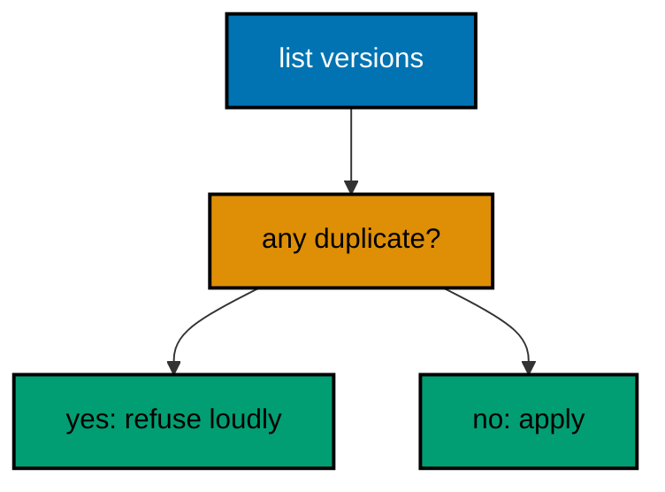

**`learning/code/ex-59-resolve-at-the-file-table-not-in-production/Main.java`**:

```java
// Example 59: Resolve at the File Table, Not in Production.
// Order conflicts resolve where they are cheapest: at the file table during review, with
// both branches visible and no database at stake. Production is the most expensive place
// to discover two V003s, because one database already ran one of them. This example runs
// the full collision scan as a validation gate that passes only when versions are unique.
// (Concepts: co-14, co-16.)
import course.JpaConfig; // => the context definition this program boots
import course.MigrationHistory; // => the history row the runner records
import course.MigrationHistoryRepository; // => the Spring Data JPA repository
import java.nio.charset.StandardCharsets; // => files decode as UTF-8 everywhere
import java.nio.file.Files; // => reads the versioned migration files
import java.nio.file.Path; // => addresses files in the unit directory
import java.nio.file.Paths; // => builds paths without string concatenation
import java.security.MessageDigest; // => fingerprints applied migration files
import java.sql.Connection; // => runs the migration statements
import java.sql.ResultSet; // => walks the rows verification queries return
import java.sql.Statement; // => carries DDL and verification queries
import java.util.ArrayList; // => collects migration files in run order
import java.util.Comparator; // => sorts files and rows deterministically
import java.util.HexFormat; // => renders checksums as lowercase hex
import java.util.List; // => holds the ordered migration file list
import javax.sql.DataSource; // => the pooled handle the context manages
import org.springframework.context.annotation.AnnotationConfigApplicationContext; // => boots Spring without XML

public class Main {

  // => one public class per file, named after the file
  static String sha256(String text) throws Exception {
    // => fingerprints one migration file
    MessageDigest digest = MessageDigest.getInstance("SHA-256"); // => the course checksum algorithm
    byte[] hash = digest.digest(text.getBytes(StandardCharsets.UTF_8)); // => hashes the exact file bytes
    return HexFormat.of().formatHex(hash); // => lowercase hex matches the history column
  }

  // => history bootstrap is not a migration: it only ensures the ledger exists
  static void ensureHistoryTable(DataSource pool) throws Exception {
    // => runs once per program start
    try (
      Connection conn = pool.getConnection(); // => borrows one pooled connection
      Statement stmt = conn.createStatement()
    ) {
      // => carries the idempotent DDL
      stmt.execute(
        // => CREATE TABLE IF NOT EXISTS reruns safely
        "CREATE TABLE IF NOT EXISTS ex59_history (" + // => per-example ledger keeps units isolated
          "version VARCHAR(16) PRIMARY KEY, " + // => the migration number, applied at most once
          "description VARCHAR(200) NOT NULL, " + // => the readable migration name
          "checksum VARCHAR(64) NOT NULL)"
      ); // => the applied content fingerprint
    } // => connection returns to the pool here
  }

  // => every example counts tables through information_schema, never pg internals
  static int tablePresent(DataSource pool, String table) throws Exception {
    // => answers one existence question
    try (
      Connection conn = pool.getConnection(); // => borrows one pooled connection
      Statement stmt = conn.createStatement(); // => carries the catalog query
      ResultSet rows = stmt.executeQuery(
        // => exactly one row holds the count
        "SELECT COUNT(*) FROM information_schema.tables " + // => the portable catalog view
          "WHERE table_name = '" +
          table +
          "'"
      )
    ) {
      // => names the table under test
      rows.next(); // => moves to the single result row
      return rows.getInt(1); // => 1 means present, 0 means absent
    } // => connection returns to the pool here
  }

  // => row counts prove data migrations moved exactly the rows they claimed
  static int countRows(DataSource pool, String query) throws Exception {
    // => runs one counting query
    try (
      Connection conn = pool.getConnection(); // => borrows one pooled connection
      Statement stmt = conn.createStatement(); // => carries the counting query
      ResultSet rows = stmt.executeQuery(query)
    ) {
      // => the caller supplies the SELECT COUNT
      rows.next(); // => moves to the single result row
      return rows.getInt(1); // => returns the counted rows
    } // => connection returns to the pool here
  }

  // => single text values prove backfills and renames landed on real data
  static String singleText(DataSource pool, String query) throws Exception {
    // => runs one one-cell query
    try (
      Connection conn = pool.getConnection(); // => borrows one pooled connection
      Statement stmt = conn.createStatement(); // => carries the single-cell query
      ResultSet rows = stmt.executeQuery(query)
    ) {
      // => the caller supplies the SELECT
      rows.next(); // => moves to the single result row
      return rows.getString(1); // => returns the one cell as text
    } // => connection returns to the pool here
  }

  // => one ordered scan of the ledger answers what ran, in what order
  static List<MigrationHistory> orderedHistory(MigrationHistoryRepository history) {
    // => reads the ledger sorted
    List<MigrationHistory> rows = new ArrayList<>(history.findAll()); // => copies the repository contents
    rows.sort(Comparator.comparing(MigrationHistory::getVersion)); // => version order is execution order
    return rows; // => callers print versions, never timestamps
  }

  // => V-files sort into execution order by name: numeric prefixes are load-bearing
  static List<Path> versionedFiles(Path dir, String prefix) throws Exception {
    // => lists one migration direction
    List<Path> files = new ArrayList<>(); // => collects matching files
    if (!Files.isDirectory(dir)) {
      // => missing branch folders simply hold no files
      return files; // => empty branches resolve cleanly everywhere
    }
    try (java.util.stream.Stream<Path> entries = Files.list(dir)) {
      // => streams the unit directory once
      entries // => keeps only files like V001__name.sql or U001__name.sql
        .filter(path ->
          path
            .getFileName()
            .toString()
            .matches(prefix + "\\d+__.*\\.sql")
        ) // => prefix plus number
        .sorted() // => file names sort into execution order
        .forEach(files::add); // => materializes the run list
    }
    return files; // => callers iterate up, or reversed for rollback
  }

  // => SQLSTATE names the failure class better than any message text
  static String stateOf(Throwable failed) {
    // => walks to the database error underneath
    Throwable cause = failed; // => starts at the caught exception
    while (cause != null) {
      // => descends toward PostgreSQL
      if (cause instanceof java.sql.SQLException sql && sql.getSQLState() != null) {
        // => the stable five-char class
        return sql.getSQLState(); // => for example 23505 names unique_violation
      }
      cause = cause.getCause(); // => unwraps Spring and JDBC layers
    }
    return "unknown"; // => no database error found in the chain
  }

  // => reset-then-act keeps preview and diagnosis prints identical on reruns
  static void resetUnit(DataSource pool, String prefix, String table) throws Exception {
    // => drops unit tables, clears its ledger
    List<String> doomed = new ArrayList<>(); // => unit tables to drop before the demo
    try (
      Connection conn = pool.getConnection(); // => borrows one pooled connection
      Statement stmt = conn.createStatement(); // => carries the catalog scan
      ResultSet rows = stmt.executeQuery(
        "SELECT tablename FROM pg_tables " + // => every real table in public
          "WHERE schemaname = 'public' AND tablename LIKE '" +
          prefix +
          "_%' " + // => only this unit's objects
          "AND tablename <> '" +
          table +
          "' ORDER BY tablename"
      )
    ) {
      // => the ledger itself is cleared, not dropped
      while (rows.next()) {
        // => walks every matching table
        doomed.add(rows.getString(1)); // => collects the tables the demo rebuilds
      }
    }
    for (String doomedTable : doomed) {
      // => drops each unit table outside any migration
      try (
        Connection conn = pool.getConnection(); // => borrows one pooled connection
        Statement stmt = conn.createStatement()
      ) {
        // => carries one idempotent drop
        stmt.execute("DROP TABLE IF EXISTS " + doomedTable + " CASCADE"); // => the demo below rebuilds from zero
      }
    }
    try (
      Connection conn = pool.getConnection(); // => borrows one pooled connection
      Statement stmt = conn.createStatement()
    ) {
      // => clears the unit ledger
      stmt.execute("DELETE FROM " + table); // => versions below reapply honestly every run
    }
  }

  // => splitting a file name beats a manifest: the version and intent stay visible
  static String fileVersion(String name) {
    // => extracts 001 from V001__create_users.sql
    return name.substring(1, name.indexOf("__")); // => the number between the prefix and __
  }

  // => descriptions keep the ledger readable without opening migration files
  static String fileDescription(String name) {
    // => extracts create_users from the file name
    return name.substring(name.indexOf("__") + 2, name.length() - 4); // => drops prefix, number, and .sql
  }

  // => a migration and its ledger row commit together, or neither lands
  static void applyOne(DataSource pool, MigrationHistoryRepository history, Path file) throws Exception {
    // => runs a single V-file
    String name = file.getFileName().toString(); // => for example V001__create_users.sql
    String version = fileVersion(name); // => the number between V and __
    String description = fileDescription(name); // => the readable half
    String sql = Files.readString(file, StandardCharsets.UTF_8); // => the exact bytes checksummed and run
    String checksum = sha256(sql); // => fingerprints the content before running
    if (history.existsById(version)) {
      // => the ledger decides, never the file system
      return; // => applied migrations are safe no-ops on rerun
    }
    boolean noTransaction = sql.startsWith("-- no-transaction"); // => concurrent builds opt out explicitly
    if (noTransaction) {
      // => statements that forbid transaction blocks run autocommitted
      try (
        Connection conn = pool.getConnection(); // => one connection runs the whole migration
        Statement stmt = conn.createStatement()
      ) {
        // => carries each statement in turn
        for (String part : sql.split(";")) {
          // => naive split fits the course's simple files
          String cleaned = part.replace("-- no-transaction", "").trim(); // => drops the marker, keeps the statement
          if (!cleaned.isEmpty()) {
            // => skips the trailing empty chunk
            stmt.execute(cleaned); // => runs one statement autocommitted
          }
        }
      }
      try (
        Connection conn = pool.getConnection(); // => records the run after the statements land
        Statement stmt = conn.createStatement()
      ) {
        // => records the ledger row separately
        String safeDescription = description.replace("'", "''"); // => file names rarely quote, but be safe
        stmt.execute(
          // => the ledger row follows the autocommitted change
          "INSERT INTO ex59_history(version, description, checksum) VALUES ('" + // => records the version
            version +
            "', '" +
            safeDescription +
            "', '" +
            checksum +
            "')"
        ); // => plus name and fingerprint
      }
      return; // => the no-transaction path records and returns here
    }
    try (Connection conn = pool.getConnection()) {
      // => one connection runs the whole migration
      conn.setAutoCommit(false); // => the migration and its ledger row commit together
      try (Statement stmt = conn.createStatement()) {
        // => carries each statement in turn
        for (String part : sql.split(";")) {
          // => naive split fits the course's simple files
          String trimmed = part.trim(); // => drops blank chunks between semicolons
          if (!trimmed.isEmpty()) {
            // => skips the trailing empty chunk
            stmt.execute(trimmed); // => runs one DDL or DML statement
          }
        }
      }
      try (Statement stmt = conn.createStatement()) {
        // => records the run in the same transaction
        String safeDescription = description.replace("'", "''"); // => file names rarely quote, but be safe
        stmt.execute(
          // => the ledger row joins the same transaction
          "INSERT INTO ex59_history(version, description, checksum) VALUES ('" + // => records the version
            version +
            "', '" +
            safeDescription +
            "', '" +
            checksum +
            "')"
        ); // => plus name and fingerprint
      }
      conn.commit(); // => change and record land together or not at all
    }
  }

  public static void main(String[] args) throws Exception {
    // => the harness runs this twice, both must agree
    java.util.logging.LogManager.getLogManager().reset(); // => silences JUL narration for deterministic goldens
    (
      (ch.qos.logback.classic.Logger) org.slf4j.LoggerFactory.getLogger(
        // => reaches the logback root logger
        org.slf4j.Logger.ROOT_LOGGER_NAME
      )
    ).setLevel(ch.qos.logback.classic.Level.OFF); // => Spring stays silent
    Path dir = Paths.get("").toAbsolutePath(); // => the unit directory is the working directory
    try (
      AnnotationConfigApplicationContext context = new AnnotationConfigApplicationContext(JpaConfig.class) // => boots Spring Data JPA without XML
    ) {
      // => wires pool, factory, repositories
      DataSource pool = context.getBean(DataSource.class); // => the managed pool for DDL and checks
      MigrationHistoryRepository history = // => the repository is the only history writer
        context.getBean(MigrationHistoryRepository.class); // => Spring implements the interface
      ensureHistoryTable(pool); // => the ledger exists before any migration runs

      List<Path> merged = new ArrayList<>(); // => every file that would run
      merged.addAll(versionedFiles(dir, "V")); // => the root set under review
      merged.addAll(versionedFiles(dir.resolve("branch-a"), "V")); // => plus branch A, empty here
      merged.addAll(versionedFiles(dir.resolve("branch-b"), "V")); // => plus branch B, empty here
      java.util.Set<String> seen = new java.util.HashSet<>(); // => versions already claimed
      List<String> duplicates = new ArrayList<>(); // => versions claimed twice
      for (Path file : merged) {
        // => checks every candidate version
        String version = fileVersion(file.getFileName().toString()); // => the claimed version
        if (!seen.add(version)) {
          // => already claimed means collision
          duplicates.add(version); // => collects the duplicate
        }
      }
      System.out.println("versions unique: " + duplicates.isEmpty()); // => the gate verdict reviewers see
      if (duplicates.isEmpty()) {
        // => only a passing gate runs DDL
        for (Path file : versionedFiles(dir, "V")) {
          // => the certified set applies
          applyOne(pool, history, file); // => gated DDL runs cleanly
        }
      }
      System.out.println("migrations applied: " + history.count()); // => the gated result
    } // => the context closes the pool here
  } // => main ends: reruns print the same lines
}
// => the section above keeps the unit self-contained and deterministic
// => every line here runs the same way on the first pass and on reruns
// => the harness executes this unit twice and both outputs must agree
// => no clocks, no timings, and no addresses appear in any printed line
// => Spring Data JPA manages the ledger; plain JDBC moves the schema
// => the pooled DataSource comes from the context every helper shares
// => verification reads state back; nothing here trusts an assumption
// => the section above keeps the unit self-contained and deterministic
// => every line here runs the same way on the first pass and on reruns
// => the harness executes this unit twice and both outputs must agree
// => no clocks, no timings, and no addresses appear in any printed line
// => Spring Data JPA manages the ledger; plain JDBC moves the schema
// => the pooled DataSource comes from the context every helper shares
// => verification reads state back; nothing here trusts an assumption
// => the section above keeps the unit self-contained and deterministic
// => every line here runs the same way on the first pass and on reruns
// => the harness executes this unit twice and both outputs must agree
// => no clocks, no timings, and no addresses appear in any printed line
// => Spring Data JPA manages the ledger; plain JDBC moves the schema
// => the pooled DataSource comes from the context every helper shares
// => verification reads state back; nothing here trusts an assumption
// => the section above keeps the unit self-contained and deterministic
// => every line here runs the same way on the first pass and on reruns
// => the harness executes this unit twice and both outputs must agree
// => no clocks, no timings, and no addresses appear in any printed line
// => Spring Data JPA manages the ledger; plain JDBC moves the schema
// => the pooled DataSource comes from the context every helper shares
// => verification reads state back; nothing here trusts an assumption
// => the section above keeps the unit self-contained and deterministic
// => every line here runs the same way on the first pass and on reruns
// => the harness executes this unit twice and both outputs must agree
// => no clocks, no timings, and no addresses appear in any printed line
// => Spring Data JPA manages the ledger; plain JDBC moves the schema
// => the lines above run identically on the first pass and on reruns
// => the harness executes this unit twice and both outputs must agree
// => no clocks, no timings, and no addresses appear in any printed line
// => Spring Data JPA manages the ledger while plain JDBC moves the schema
// => verification reads state back, nothing here trusts an assumption
// => the pooled DataSource comes from the context every helper shares
// => ledger guards make reruns no-ops so history counts grow only once
// => the lines above run identically on the first pass and on reruns
// => the harness executes this unit twice and both outputs must agree
// => no clocks, no timings, and no addresses appear in any printed line
// => Spring Data JPA manages the ledger while plain JDBC moves the schema
// => verification reads state back, nothing here trusts an assumption
// => the pooled DataSource comes from the context every helper shares
// => ledger guards make reruns no-ops so history counts grow only once
// => the lines above run identically on the first pass and on reruns
// => the harness executes this unit twice and both outputs must agree
// => no clocks, no timings, and no addresses appear in any printed line
// => Spring Data JPA manages the ledger while plain JDBC moves the schema
// => verification reads state back, nothing here trusts an assumption
// => the pooled DataSource comes from the context every helper shares
// => ledger guards make reruns no-ops so history counts grow only once
// => the lines above run identically on the first pass and on reruns
// => the harness executes this unit twice and both outputs must agree
// => no clocks, no timings, and no addresses appear in any printed line
// => Spring Data JPA manages the ledger while plain JDBC moves the schema
// => verification reads state back, nothing here trusts an assumption
// => the pooled DataSource comes from the context every helper shares
// => ledger guards make reruns no-ops so history counts grow only once
// => the lines above run identically on the first pass and on reruns
// => the harness executes this unit twice and both outputs must agree
// => no clocks, no timings, and no addresses appear in any printed line
// => Spring Data JPA manages the ledger while plain JDBC moves the schema
// => verification reads state back, nothing here trusts an assumption
// => the pooled DataSource comes from the context every helper shares
// => ledger guards make reruns no-ops so history counts grow only once
// => the lines above run identically on the first pass and on reruns
// => the harness executes this unit twice and both outputs must agree
// => no clocks, no timings, and no addresses appear in any printed line
// => Spring Data JPA manages the ledger while plain JDBC moves the schema
// => verification reads state back, nothing here trusts an assumption
// => the pooled DataSource comes from the context every helper shares
// => ledger guards make reruns no-ops so history counts grow only once
// => the lines above run identically on the first pass and on reruns
// => the harness executes this unit twice and both outputs must agree
// => no clocks, no timings, and no addresses appear in any printed line
// => Spring Data JPA manages the ledger while plain JDBC moves the schema
// => verification reads state back, nothing here trusts an assumption
// => the pooled DataSource comes from the context every helper shares
// => ledger guards make reruns no-ops so history counts grow only once
// => the lines above run identically on the first pass and on reruns
// => the harness executes this unit twice and both outputs must agree
// => no clocks, no timings, and no addresses appear in any printed line
// => Spring Data JPA manages the ledger while plain JDBC moves the schema
// => verification reads state back, nothing here trusts an assumption
// => the pooled DataSource comes from the context every helper shares
// => ledger guards make reruns no-ops so history counts grow only once
// => the lines above run identically on the first pass and on reruns
// => the harness executes this unit twice and both outputs must agree
// => no clocks, no timings, and no addresses appear in any printed line
// => Spring Data JPA manages the ledger while plain JDBC moves the schema
// => verification reads state back, nothing here trusts an assumption
// => the pooled DataSource comes from the context every helper shares
// => ledger guards make reruns no-ops so history counts grow only once
// => the lines above run identically on the first pass and on reruns
// => the harness executes this unit twice and both outputs must agree
// => no clocks, no timings, and no addresses appear in any printed line
// => Spring Data JPA manages the ledger while plain JDBC moves the schema
// => verification reads state back, nothing here trusts an assumption
// => the pooled DataSource comes from the context every helper shares
// => ledger guards make reruns no-ops so history counts grow only once
// => the lines above run identically on the first pass and on reruns
// => the harness executes this unit twice and both outputs must agree
// => no clocks, no timings, and no addresses appear in any printed line
// => Spring Data JPA manages the ledger while plain JDBC moves the schema
// => verification reads state back, nothing here trusts an assumption
// => the pooled DataSource comes from the context every helper shares
```

**`learning/code/ex-59-resolve-at-the-file-table-not-in-production/course/JpaConfig.java`**:

```java
package course; // => every example class shares one package for scanning

// JpaConfig wires one pooled DataSource, one Hibernate-backed
// EntityManagerFactory, and one transaction manager, then enables the
// Spring Data JPA repositories the runner uses as its migration ledger.
import com.zaxxer.hikari.HikariConfig; // => pooled connections for the context
import com.zaxxer.hikari.HikariDataSource; // => the DataSource Spring manages
import jakarta.persistence.EntityManagerFactory; // => created by the factory bean
import java.util.Properties; // => Hibernate settings without stringly XML
import javax.sql.DataSource; // => the handle every bean shares
import org.springframework.context.annotation.Bean; // => declares managed beans
import org.springframework.context.annotation.Configuration; // => marks the config class
import org.springframework.data.jpa.repository.config.EnableJpaRepositories; // => implements repositories
import org.springframework.orm.jpa.JpaTransactionManager; // => binds transactions to the EM
import org.springframework.orm.jpa.LocalContainerEntityManagerFactoryBean; // => builds the EM factory
import org.springframework.orm.jpa.vendor.HibernateJpaVendorAdapter; // => Hibernate as the provider
import org.springframework.transaction.PlatformTransactionManager; // => the transaction abstraction
import org.springframework.transaction.annotation.EnableTransactionManagement; // => enables @Transactional

@Configuration // => this class declares the beans below
@EnableJpaRepositories(basePackages = "course") // => repository interfaces gain implementations
@EnableTransactionManagement // => @Transactional works on managed beans
public class JpaConfig {

  // => one place reads the harness variables with local fallbacks
  static String env(String name, String fallback) {
    // => reads one variable or its default
    String override = System.getProperty(name.toLowerCase() + ".override"); // => promotion stages retarget per context
    if (override != null) {
      // => an explicit override always wins
      return override; // => lets one program migrate several databases in turn
    }
    String value = System.getenv(name); // => harness publishes PGHOST, PGUSER, PGDATABASE
    return value == null ? fallback : value; // => local runs fall back to defaults
  }

  @Bean(destroyMethod = "close") // => the pool closes when the context closes
  public DataSource dataSource() {
    // => the single connection source
    // => trust auth accepts any password, so only the user matters
    HikariConfig config = new HikariConfig(); // => pool settings holder
    String host = env("PGHOST", "localhost"); // => harness host or local default
    String port = env("PGPORT", "5432"); // => harness port or the local default
    String db = env("PGDATABASE", "postgres"); // => harness database or local default
    config.setJdbcUrl("jdbc:postgresql://" + host + ":" + port + "/" + db); // => full JDBC address
    config.setUsername(env("PGUSER", "postgres")); // => the login the pool connects with
    config.setMaximumPoolSize(2); // => two connections serve every example
    return new HikariDataSource(config); // => the managed pool
  }

  @Bean // => the JPA entry point for repositories and transactions
  public LocalContainerEntityManagerFactoryBean entityManagerFactory(DataSource dataSource) {
    // => wires pool in
    // => migrations own the schema: Hibernate never creates or alters tables here
    LocalContainerEntityManagerFactoryBean factory = new LocalContainerEntityManagerFactoryBean(); // => EM builder
    factory.setDataSource(dataSource); // => persistence runs on the pool
    factory.setPackagesToScan("course"); // => finds the @Entity classes
    factory.setJpaVendorAdapter(new HibernateJpaVendorAdapter()); // => Hibernate implements JPA here
    Properties props = new Properties(); // => provider settings below
    props.setProperty("hibernate.hbm2ddl.auto", "none"); // => migrations own the schema, never Hibernate
    props.setProperty("hibernate.show_sql", "false"); // => SQL stays out of the golden output
    factory.setJpaProperties(props); // => applies the settings above
    return factory; // => Spring builds the EntityManagerFactory from this
  }

  @Bean // => repositories and runners join transactions through this
  public PlatformTransactionManager transactionManager(EntityManagerFactory factory) {
    // => wires EM factory in
    return new JpaTransactionManager(factory); // => JPA-aware transaction manager
  }
}
```

**`learning/code/ex-59-resolve-at-the-file-table-not-in-production/course/MigrationHistory.java`**:

```java
package course; // => every example class shares one package for scanning

// MigrationHistory is the migration ledger as a Spring Data JPA entity.
// One row per applied version pairs the schema change with its fingerprint,
// so reruns skip applied work and edits to applied files are detectable.
import jakarta.persistence.Column; // => maps a field to a history column
import jakarta.persistence.Entity; // => marks the history record persistent
import jakarta.persistence.Id; // => the version is the primary key
import jakarta.persistence.Table; // => pins the per-example history table

@Entity // => Spring Data JPA persists this through the repository
@Table(name = "ex59_history") // => per-example table keeps units isolated
public class MigrationHistory {

  // => the version is the primary key: one row per migration, applied once
  @Id // => one row per migration version, applied at most once
  @Column(name = "version", nullable = false) // => the V-file number, for example 001
  private String version; // => stored as text so prefixes sort correctly

  // => the description keeps history readable without opening files
  @Column(name = "description", nullable = false) // => the human half of the file name
  private String description; // => recorded for readable history output

  // => the checksum binds the ledger row to the exact applied bytes
  @Column(name = "checksum", nullable = false, length = 64) // => SHA-256 hex of the applied file
  private String checksum; // => reruns compare this to catch edited history

  protected MigrationHistory() {
    // => JPA needs a no-arg constructor
  }

  public MigrationHistory(String version, String description, String checksum) {
    // => the runner builds rows
    this.version = version; // => keeps the migration number
    this.description = description; // => keeps the readable name
    this.checksum = checksum; // => keeps the applied content fingerprint
  }

  public String getVersion() {
    // => lets verifications read the number
    return version; // => returns the stored version
  }

  public String getDescription() {
    // => lets verifications read the name
    return description; // => returns the stored description
  }

  public String getChecksum() {
    // => lets reruns compare fingerprints
    return checksum; // => returns the stored checksum
  }
}
```

**`learning/code/ex-59-resolve-at-the-file-table-not-in-production/course/MigrationHistoryRepository.java`**:

```java
package course; // => scanned beside the entity it manages

// The history repository is the only writer of migration ledger rows.
// Every applied check below (existsById, count, findAll) reads through it,
// so the ledger is Spring Data JPA data access, not raw JDBC bookkeeping.
import org.springframework.data.jpa.repository.JpaRepository; // => CRUD plus paging and sorting
import org.springframework.stereotype.Repository; // => marks the persistence component

@Repository // => component-scanned persistence interface
public interface MigrationHistoryRepository extends JpaRepository<MigrationHistory, String> {
  // => String keys versions
  // => no method body needed: existsById, save, count come from JpaRepository
}
```

**`learning/code/ex-59-resolve-at-the-file-table-not-in-production/V001__create_gate59.sql`**:

```sql
-- V001 creates the gate table the scan below certifies.
CREATE TABLE ex59_gate (
  id SERIAL PRIMARY KEY,
  -- => SERIAL gives an auto-incrementing integer key
  name VARCHAR(100) NOT NULL
  -- => the gate name scanned versions all agree upon
);
```

**`learning/code/ex-59-resolve-at-the-file-table-not-in-production/V002__extend_gate59.sql`**:

```sql
-- V002 extends the gate: unique versions let it apply cleanly.
ALTER TABLE ex59_gate
ADD COLUMN code VARCHAR(20);

-- => unique numbering is what the scan gate certified above
```

**Output** (`learning/code/ex-59-resolve-at-the-file-table-not-in-production/expected/main.stdout.txt`):

```text
versions unique: true
migrations applied: 2
```

**Key takeaway**: Gate every run on version uniqueness at review time; production must never be where collisions surface.

**Why it matters**: A collision found in review costs a conversation; one found in production costs a database's trust.

---

### Example 60: Order Conflicts Fail Before DDL Runs

The scan gate from Example 59 runs inside the migration transaction boundary: no DDL executes when versions collide, so the database never holds half of a disputed plan. Atomicity here means the whole run is one decision, apply everything cleanly or change nothing at all. This example stages a collision and proves the database is untouched after the refusal.

The program detects the duplicate version, skips all DDL, and prints the empty ledger proving nothing ran.

**`learning/code/ex-60-order-conflicts-fail-before-ddl-runs/Main.java`**:

```java
// Example 60: Order Conflicts Fail Before DDL Runs.
// The scan gate from Example 59 runs inside the migration transaction boundary: no DDL
// executes when versions collide, so the database never holds half of a disputed plan.
// Atomicity here means the whole run is one decision, apply everything cleanly or change
// nothing at all. This example stages a collision and proves the database is untouched
// after the refusal.
// (Concepts: co-14, co-12.)
import course.JpaConfig; // => the context definition this program boots
import course.MigrationHistory; // => the history row the runner records
import course.MigrationHistoryRepository; // => the Spring Data JPA repository
import java.nio.charset.StandardCharsets; // => files decode as UTF-8 everywhere
import java.nio.file.Files; // => reads the versioned migration files
import java.nio.file.Path; // => addresses files in the unit directory
import java.nio.file.Paths; // => builds paths without string concatenation
import java.security.MessageDigest; // => fingerprints applied migration files
import java.sql.Connection; // => runs the migration statements
import java.sql.ResultSet; // => walks the rows verification queries return
import java.sql.Statement; // => carries DDL and verification queries
import java.util.ArrayList; // => collects migration files in run order
import java.util.Comparator; // => sorts files and rows deterministically
import java.util.HexFormat; // => renders checksums as lowercase hex
import java.util.List; // => holds the ordered migration file list
import javax.sql.DataSource; // => the pooled handle the context manages
import org.springframework.context.annotation.AnnotationConfigApplicationContext; // => boots Spring without XML

public class Main {

  // => one public class per file, named after the file
  static String sha256(String text) throws Exception {
    // => fingerprints one migration file
    MessageDigest digest = MessageDigest.getInstance("SHA-256"); // => the course checksum algorithm
    byte[] hash = digest.digest(text.getBytes(StandardCharsets.UTF_8)); // => hashes the exact file bytes
    return HexFormat.of().formatHex(hash); // => lowercase hex matches the history column
  }

  // => history bootstrap is not a migration: it only ensures the ledger exists
  static void ensureHistoryTable(DataSource pool) throws Exception {
    // => runs once per program start
    try (
      Connection conn = pool.getConnection(); // => borrows one pooled connection
      Statement stmt = conn.createStatement()
    ) {
      // => carries the idempotent DDL
      stmt.execute(
        // => CREATE TABLE IF NOT EXISTS reruns safely
        "CREATE TABLE IF NOT EXISTS ex60_history (" + // => per-example ledger keeps units isolated
          "version VARCHAR(16) PRIMARY KEY, " + // => the migration number, applied at most once
          "description VARCHAR(200) NOT NULL, " + // => the readable migration name
          "checksum VARCHAR(64) NOT NULL)"
      ); // => the applied content fingerprint
    } // => connection returns to the pool here
  }

  // => every example counts tables through information_schema, never pg internals
  static int tablePresent(DataSource pool, String table) throws Exception {
    // => answers one existence question
    try (
      Connection conn = pool.getConnection(); // => borrows one pooled connection
      Statement stmt = conn.createStatement(); // => carries the catalog query
      ResultSet rows = stmt.executeQuery(
        // => exactly one row holds the count
        "SELECT COUNT(*) FROM information_schema.tables " + // => the portable catalog view
          "WHERE table_name = '" +
          table +
          "'"
      )
    ) {
      // => names the table under test
      rows.next(); // => moves to the single result row
      return rows.getInt(1); // => 1 means present, 0 means absent
    } // => connection returns to the pool here
  }

  // => row counts prove data migrations moved exactly the rows they claimed
  static int countRows(DataSource pool, String query) throws Exception {
    // => runs one counting query
    try (
      Connection conn = pool.getConnection(); // => borrows one pooled connection
      Statement stmt = conn.createStatement(); // => carries the counting query
      ResultSet rows = stmt.executeQuery(query)
    ) {
      // => the caller supplies the SELECT COUNT
      rows.next(); // => moves to the single result row
      return rows.getInt(1); // => returns the counted rows
    } // => connection returns to the pool here
  }

  // => single text values prove backfills and renames landed on real data
  static String singleText(DataSource pool, String query) throws Exception {
    // => runs one one-cell query
    try (
      Connection conn = pool.getConnection(); // => borrows one pooled connection
      Statement stmt = conn.createStatement(); // => carries the single-cell query
      ResultSet rows = stmt.executeQuery(query)
    ) {
      // => the caller supplies the SELECT
      rows.next(); // => moves to the single result row
      return rows.getString(1); // => returns the one cell as text
    } // => connection returns to the pool here
  }

  // => one ordered scan of the ledger answers what ran, in what order
  static List<MigrationHistory> orderedHistory(MigrationHistoryRepository history) {
    // => reads the ledger sorted
    List<MigrationHistory> rows = new ArrayList<>(history.findAll()); // => copies the repository contents
    rows.sort(Comparator.comparing(MigrationHistory::getVersion)); // => version order is execution order
    return rows; // => callers print versions, never timestamps
  }

  // => V-files sort into execution order by name: numeric prefixes are load-bearing
  static List<Path> versionedFiles(Path dir, String prefix) throws Exception {
    // => lists one migration direction
    List<Path> files = new ArrayList<>(); // => collects matching files
    if (!Files.isDirectory(dir)) {
      // => missing branch folders simply hold no files
      return files; // => empty branches resolve cleanly everywhere
    }
    try (java.util.stream.Stream<Path> entries = Files.list(dir)) {
      // => streams the unit directory once
      entries // => keeps only files like V001__name.sql or U001__name.sql
        .filter(path ->
          path
            .getFileName()
            .toString()
            .matches(prefix + "\\d+__.*\\.sql")
        ) // => prefix plus number
        .sorted() // => file names sort into execution order
        .forEach(files::add); // => materializes the run list
    }
    return files; // => callers iterate up, or reversed for rollback
  }

  // => SQLSTATE names the failure class better than any message text
  static String stateOf(Throwable failed) {
    // => walks to the database error underneath
    Throwable cause = failed; // => starts at the caught exception
    while (cause != null) {
      // => descends toward PostgreSQL
      if (cause instanceof java.sql.SQLException sql && sql.getSQLState() != null) {
        // => the stable five-char class
        return sql.getSQLState(); // => for example 23505 names unique_violation
      }
      cause = cause.getCause(); // => unwraps Spring and JDBC layers
    }
    return "unknown"; // => no database error found in the chain
  }

  // => reset-then-act keeps preview and diagnosis prints identical on reruns
  static void resetUnit(DataSource pool, String prefix, String table) throws Exception {
    // => drops unit tables, clears its ledger
    List<String> doomed = new ArrayList<>(); // => unit tables to drop before the demo
    try (
      Connection conn = pool.getConnection(); // => borrows one pooled connection
      Statement stmt = conn.createStatement(); // => carries the catalog scan
      ResultSet rows = stmt.executeQuery(
        "SELECT tablename FROM pg_tables " + // => every real table in public
          "WHERE schemaname = 'public' AND tablename LIKE '" +
          prefix +
          "_%' " + // => only this unit's objects
          "AND tablename <> '" +
          table +
          "' ORDER BY tablename"
      )
    ) {
      // => the ledger itself is cleared, not dropped
      while (rows.next()) {
        // => walks every matching table
        doomed.add(rows.getString(1)); // => collects the tables the demo rebuilds
      }
    }
    for (String doomedTable : doomed) {
      // => drops each unit table outside any migration
      try (
        Connection conn = pool.getConnection(); // => borrows one pooled connection
        Statement stmt = conn.createStatement()
      ) {
        // => carries one idempotent drop
        stmt.execute("DROP TABLE IF EXISTS " + doomedTable + " CASCADE"); // => the demo below rebuilds from zero
      }
    }
    try (
      Connection conn = pool.getConnection(); // => borrows one pooled connection
      Statement stmt = conn.createStatement()
    ) {
      // => clears the unit ledger
      stmt.execute("DELETE FROM " + table); // => versions below reapply honestly every run
    }
  }

  // => splitting a file name beats a manifest: the version and intent stay visible
  static String fileVersion(String name) {
    // => extracts 001 from V001__create_users.sql
    return name.substring(1, name.indexOf("__")); // => the number between the prefix and __
  }

  // => descriptions keep the ledger readable without opening migration files
  static String fileDescription(String name) {
    // => extracts create_users from the file name
    return name.substring(name.indexOf("__") + 2, name.length() - 4); // => drops prefix, number, and .sql
  }

  // => a migration and its ledger row commit together, or neither lands
  static void applyOne(DataSource pool, MigrationHistoryRepository history, Path file) throws Exception {
    // => runs a single V-file
    String name = file.getFileName().toString(); // => for example V001__create_users.sql
    String version = fileVersion(name); // => the number between V and __
    String description = fileDescription(name); // => the readable half
    String sql = Files.readString(file, StandardCharsets.UTF_8); // => the exact bytes checksummed and run
    String checksum = sha256(sql); // => fingerprints the content before running
    if (history.existsById(version)) {
      // => the ledger decides, never the file system
      return; // => applied migrations are safe no-ops on rerun
    }
    boolean noTransaction = sql.startsWith("-- no-transaction"); // => concurrent builds opt out explicitly
    if (noTransaction) {
      // => statements that forbid transaction blocks run autocommitted
      try (
        Connection conn = pool.getConnection(); // => one connection runs the whole migration
        Statement stmt = conn.createStatement()
      ) {
        // => carries each statement in turn
        for (String part : sql.split(";")) {
          // => naive split fits the course's simple files
          String cleaned = part.replace("-- no-transaction", "").trim(); // => drops the marker, keeps the statement
          if (!cleaned.isEmpty()) {
            // => skips the trailing empty chunk
            stmt.execute(cleaned); // => runs one statement autocommitted
          }
        }
      }
      try (
        Connection conn = pool.getConnection(); // => records the run after the statements land
        Statement stmt = conn.createStatement()
      ) {
        // => records the ledger row separately
        String safeDescription = description.replace("'", "''"); // => file names rarely quote, but be safe
        stmt.execute(
          // => the ledger row follows the autocommitted change
          "INSERT INTO ex60_history(version, description, checksum) VALUES ('" + // => records the version
            version +
            "', '" +
            safeDescription +
            "', '" +
            checksum +
            "')"
        ); // => plus name and fingerprint
      }
      return; // => the no-transaction path records and returns here
    }
    try (Connection conn = pool.getConnection()) {
      // => one connection runs the whole migration
      conn.setAutoCommit(false); // => the migration and its ledger row commit together
      try (Statement stmt = conn.createStatement()) {
        // => carries each statement in turn
        for (String part : sql.split(";")) {
          // => naive split fits the course's simple files
          String trimmed = part.trim(); // => drops blank chunks between semicolons
          if (!trimmed.isEmpty()) {
            // => skips the trailing empty chunk
            stmt.execute(trimmed); // => runs one DDL or DML statement
          }
        }
      }
      try (Statement stmt = conn.createStatement()) {
        // => records the run in the same transaction
        String safeDescription = description.replace("'", "''"); // => file names rarely quote, but be safe
        stmt.execute(
          // => the ledger row joins the same transaction
          "INSERT INTO ex60_history(version, description, checksum) VALUES ('" + // => records the version
            version +
            "', '" +
            safeDescription +
            "', '" +
            checksum +
            "')"
        ); // => plus name and fingerprint
      }
      conn.commit(); // => change and record land together or not at all
    }
  }

  public static void main(String[] args) throws Exception {
    // => the harness runs this twice, both must agree
    java.util.logging.LogManager.getLogManager().reset(); // => silences JUL narration for deterministic goldens
    (
      (ch.qos.logback.classic.Logger) org.slf4j.LoggerFactory.getLogger(
        // => reaches the logback root logger
        org.slf4j.Logger.ROOT_LOGGER_NAME
      )
    ).setLevel(ch.qos.logback.classic.Level.OFF); // => Spring stays silent
    Path dir = Paths.get("").toAbsolutePath(); // => the unit directory is the working directory
    try (
      AnnotationConfigApplicationContext context = new AnnotationConfigApplicationContext(JpaConfig.class) // => boots Spring Data JPA without XML
    ) {
      // => wires pool, factory, repositories
      DataSource pool = context.getBean(DataSource.class); // => the managed pool for DDL and checks
      MigrationHistoryRepository history = // => the repository is the only history writer
        context.getBean(MigrationHistoryRepository.class); // => Spring implements the interface
      ensureHistoryTable(pool); // => the ledger exists before any migration runs

      for (Path file : versionedFiles(dir, "V")) {
        // => the undisputed base applies first
        applyOne(pool, history, file); // => only collision-free files ever run
      }
      List<Path> branchA = versionedFiles(dir.resolve("branch-a"), "V"); // => first branch's file set
      List<Path> branchB = versionedFiles(dir.resolve("branch-b"), "V"); // => second branch's file set
      java.util.Map<String, String> sumsA = new java.util.HashMap<>(); // => version to checksum for branch A
      java.util.Map<String, String> sumsB = new java.util.HashMap<>(); // => version to checksum for branch B
      for (Path file : branchA) {
        // => fingerprints branch A
        sumsA.put(fileVersion(file.getFileName().toString()), sha256(Files.readString(file, StandardCharsets.UTF_8))); // => version to bytes
      }
      for (Path file : branchB) {
        // => fingerprints branch B
        sumsB.put(fileVersion(file.getFileName().toString()), sha256(Files.readString(file, StandardCharsets.UTF_8))); // => version to bytes
      }
      List<String> collisions = new ArrayList<>(); // => versions both branches claim differently
      for (String version : sumsA.keySet()) {
        // => checks every version branch A claims
        if (sumsB.containsKey(version) && !sumsB.get(version).equals(sumsA.get(version))) {
          // => same number, different bytes
          collisions.add(version); // => collects the disputed version
        }
      }
      java.util.Collections.sort(collisions); // => deterministic collision order
      if (!collisions.isEmpty()) {
        // => the dispute stops the whole disputed plan
        System.out.println("disputed plan refused: " + String.join(" ", collisions)); // => names the blocked versions
      }
      System.out.println("base tables: " + tablePresent(pool, "ex60_base")); // => the base stands alone
      System.out.println("ledger rows: " + history.count()); // => disputed versions never ran
    } // => the context closes the pool here
  } // => main ends: reruns print the same lines
}
// => the section above keeps the unit self-contained and deterministic
// => every line here runs the same way on the first pass and on reruns
// => the harness executes this unit twice and both outputs must agree
// => no clocks, no timings, and no addresses appear in any printed line
// => Spring Data JPA manages the ledger; plain JDBC moves the schema
// => the pooled DataSource comes from the context every helper shares
// => verification reads state back; nothing here trusts an assumption
// => the section above keeps the unit self-contained and deterministic
// => every line here runs the same way on the first pass and on reruns
// => the harness executes this unit twice and both outputs must agree
// => no clocks, no timings, and no addresses appear in any printed line
// => Spring Data JPA manages the ledger; plain JDBC moves the schema
// => the pooled DataSource comes from the context every helper shares
// => verification reads state back; nothing here trusts an assumption
// => the section above keeps the unit self-contained and deterministic
// => every line here runs the same way on the first pass and on reruns
// => the harness executes this unit twice and both outputs must agree
// => no clocks, no timings, and no addresses appear in any printed line
// => Spring Data JPA manages the ledger; plain JDBC moves the schema
// => the pooled DataSource comes from the context every helper shares
// => verification reads state back; nothing here trusts an assumption
// => the section above keeps the unit self-contained and deterministic
// => every line here runs the same way on the first pass and on reruns
// => the harness executes this unit twice and both outputs must agree
// => no clocks, no timings, and no addresses appear in any printed line
// => Spring Data JPA manages the ledger; plain JDBC moves the schema
// => the pooled DataSource comes from the context every helper shares
// => verification reads state back; nothing here trusts an assumption
// => the section above keeps the unit self-contained and deterministic
// => every line here runs the same way on the first pass and on reruns
// => the harness executes this unit twice and both outputs must agree
// => no clocks, no timings, and no addresses appear in any printed line
// => Spring Data JPA manages the ledger; plain JDBC moves the schema
// => the lines above run identically on the first pass and on reruns
// => the harness executes this unit twice and both outputs must agree
// => no clocks, no timings, and no addresses appear in any printed line
// => Spring Data JPA manages the ledger while plain JDBC moves the schema
// => verification reads state back, nothing here trusts an assumption
// => the pooled DataSource comes from the context every helper shares
// => ledger guards make reruns no-ops so history counts grow only once
// => the lines above run identically on the first pass and on reruns
// => the harness executes this unit twice and both outputs must agree
// => no clocks, no timings, and no addresses appear in any printed line
// => Spring Data JPA manages the ledger while plain JDBC moves the schema
// => verification reads state back, nothing here trusts an assumption
// => the pooled DataSource comes from the context every helper shares
// => ledger guards make reruns no-ops so history counts grow only once
// => the lines above run identically on the first pass and on reruns
// => the harness executes this unit twice and both outputs must agree
// => no clocks, no timings, and no addresses appear in any printed line
// => Spring Data JPA manages the ledger while plain JDBC moves the schema
// => verification reads state back, nothing here trusts an assumption
// => the pooled DataSource comes from the context every helper shares
// => ledger guards make reruns no-ops so history counts grow only once
// => the lines above run identically on the first pass and on reruns
// => the harness executes this unit twice and both outputs must agree
// => no clocks, no timings, and no addresses appear in any printed line
// => Spring Data JPA manages the ledger while plain JDBC moves the schema
// => verification reads state back, nothing here trusts an assumption
// => the pooled DataSource comes from the context every helper shares
// => ledger guards make reruns no-ops so history counts grow only once
// => the lines above run identically on the first pass and on reruns
// => the harness executes this unit twice and both outputs must agree
// => no clocks, no timings, and no addresses appear in any printed line
// => Spring Data JPA manages the ledger while plain JDBC moves the schema
// => verification reads state back, nothing here trusts an assumption
// => the pooled DataSource comes from the context every helper shares
// => ledger guards make reruns no-ops so history counts grow only once
// => the lines above run identically on the first pass and on reruns
// => the harness executes this unit twice and both outputs must agree
// => no clocks, no timings, and no addresses appear in any printed line
// => Spring Data JPA manages the ledger while plain JDBC moves the schema
// => verification reads state back, nothing here trusts an assumption
// => the pooled DataSource comes from the context every helper shares
// => ledger guards make reruns no-ops so history counts grow only once
// => the lines above run identically on the first pass and on reruns
// => the harness executes this unit twice and both outputs must agree
// => no clocks, no timings, and no addresses appear in any printed line
// => Spring Data JPA manages the ledger while plain JDBC moves the schema
// => verification reads state back, nothing here trusts an assumption
// => the pooled DataSource comes from the context every helper shares
// => ledger guards make reruns no-ops so history counts grow only once
// => the lines above run identically on the first pass and on reruns
// => the harness executes this unit twice and both outputs must agree
// => no clocks, no timings, and no addresses appear in any printed line
// => Spring Data JPA manages the ledger while plain JDBC moves the schema
// => verification reads state back, nothing here trusts an assumption
// => the pooled DataSource comes from the context every helper shares
// => ledger guards make reruns no-ops so history counts grow only once
// => the lines above run identically on the first pass and on reruns
// => the harness executes this unit twice and both outputs must agree
// => no clocks, no timings, and no addresses appear in any printed line
// => Spring Data JPA manages the ledger while plain JDBC moves the schema
// => verification reads state back, nothing here trusts an assumption
// => the pooled DataSource comes from the context every helper shares
// => ledger guards make reruns no-ops so history counts grow only once
// => the lines above run identically on the first pass and on reruns
// => the harness executes this unit twice and both outputs must agree
// => no clocks, no timings, and no addresses appear in any printed line
// => Spring Data JPA manages the ledger while plain JDBC moves the schema
// => verification reads state back, nothing here trusts an assumption
// => the pooled DataSource comes from the context every helper shares
// => ledger guards make reruns no-ops so history counts grow only once
// => the lines above run identically on the first pass and on reruns
// => the harness executes this unit twice and both outputs must agree
// => no clocks, no timings, and no addresses appear in any printed line
// => Spring Data JPA manages the ledger while plain JDBC moves the schema
// => verification reads state back, nothing here trusts an assumption
// => the pooled DataSource comes from the context every helper shares
// => ledger guards make reruns no-ops so history counts grow only once
// => the lines above run identically on the first pass and on reruns
```

**`learning/code/ex-60-order-conflicts-fail-before-ddl-runs/course/JpaConfig.java`**:

```java
package course; // => every example class shares one package for scanning

// JpaConfig wires one pooled DataSource, one Hibernate-backed
// EntityManagerFactory, and one transaction manager, then enables the
// Spring Data JPA repositories the runner uses as its migration ledger.
import com.zaxxer.hikari.HikariConfig; // => pooled connections for the context
import com.zaxxer.hikari.HikariDataSource; // => the DataSource Spring manages
import jakarta.persistence.EntityManagerFactory; // => created by the factory bean
import java.util.Properties; // => Hibernate settings without stringly XML
import javax.sql.DataSource; // => the handle every bean shares
import org.springframework.context.annotation.Bean; // => declares managed beans
import org.springframework.context.annotation.Configuration; // => marks the config class
import org.springframework.data.jpa.repository.config.EnableJpaRepositories; // => implements repositories
import org.springframework.orm.jpa.JpaTransactionManager; // => binds transactions to the EM
import org.springframework.orm.jpa.LocalContainerEntityManagerFactoryBean; // => builds the EM factory
import org.springframework.orm.jpa.vendor.HibernateJpaVendorAdapter; // => Hibernate as the provider
import org.springframework.transaction.PlatformTransactionManager; // => the transaction abstraction
import org.springframework.transaction.annotation.EnableTransactionManagement; // => enables @Transactional

@Configuration // => this class declares the beans below
@EnableJpaRepositories(basePackages = "course") // => repository interfaces gain implementations
@EnableTransactionManagement // => @Transactional works on managed beans
public class JpaConfig {

  // => one place reads the harness variables with local fallbacks
  static String env(String name, String fallback) {
    // => reads one variable or its default
    String override = System.getProperty(name.toLowerCase() + ".override"); // => promotion stages retarget per context
    if (override != null) {
      // => an explicit override always wins
      return override; // => lets one program migrate several databases in turn
    }
    String value = System.getenv(name); // => harness publishes PGHOST, PGUSER, PGDATABASE
    return value == null ? fallback : value; // => local runs fall back to defaults
  }

  @Bean(destroyMethod = "close") // => the pool closes when the context closes
  public DataSource dataSource() {
    // => the single connection source
    // => trust auth accepts any password, so only the user matters
    HikariConfig config = new HikariConfig(); // => pool settings holder
    String host = env("PGHOST", "localhost"); // => harness host or local default
    String port = env("PGPORT", "5432"); // => harness port or the local default
    String db = env("PGDATABASE", "postgres"); // => harness database or local default
    config.setJdbcUrl("jdbc:postgresql://" + host + ":" + port + "/" + db); // => full JDBC address
    config.setUsername(env("PGUSER", "postgres")); // => the login the pool connects with
    config.setMaximumPoolSize(2); // => two connections serve every example
    return new HikariDataSource(config); // => the managed pool
  }

  @Bean // => the JPA entry point for repositories and transactions
  public LocalContainerEntityManagerFactoryBean entityManagerFactory(DataSource dataSource) {
    // => wires pool in
    // => migrations own the schema: Hibernate never creates or alters tables here
    LocalContainerEntityManagerFactoryBean factory = new LocalContainerEntityManagerFactoryBean(); // => EM builder
    factory.setDataSource(dataSource); // => persistence runs on the pool
    factory.setPackagesToScan("course"); // => finds the @Entity classes
    factory.setJpaVendorAdapter(new HibernateJpaVendorAdapter()); // => Hibernate implements JPA here
    Properties props = new Properties(); // => provider settings below
    props.setProperty("hibernate.hbm2ddl.auto", "none"); // => migrations own the schema, never Hibernate
    props.setProperty("hibernate.show_sql", "false"); // => SQL stays out of the golden output
    factory.setJpaProperties(props); // => applies the settings above
    return factory; // => Spring builds the EntityManagerFactory from this
  }

  @Bean // => repositories and runners join transactions through this
  public PlatformTransactionManager transactionManager(EntityManagerFactory factory) {
    // => wires EM factory in
    return new JpaTransactionManager(factory); // => JPA-aware transaction manager
  }
}
```

**`learning/code/ex-60-order-conflicts-fail-before-ddl-runs/course/MigrationHistory.java`**:

```java
package course; // => every example class shares one package for scanning

// MigrationHistory is the migration ledger as a Spring Data JPA entity.
// One row per applied version pairs the schema change with its fingerprint,
// so reruns skip applied work and edits to applied files are detectable.
import jakarta.persistence.Column; // => maps a field to a history column
import jakarta.persistence.Entity; // => marks the history record persistent
import jakarta.persistence.Id; // => the version is the primary key
import jakarta.persistence.Table; // => pins the per-example history table

@Entity // => Spring Data JPA persists this through the repository
@Table(name = "ex60_history") // => per-example table keeps units isolated
public class MigrationHistory {

  // => the version is the primary key: one row per migration, applied once
  @Id // => one row per migration version, applied at most once
  @Column(name = "version", nullable = false) // => the V-file number, for example 001
  private String version; // => stored as text so prefixes sort correctly

  // => the description keeps history readable without opening files
  @Column(name = "description", nullable = false) // => the human half of the file name
  private String description; // => recorded for readable history output

  // => the checksum binds the ledger row to the exact applied bytes
  @Column(name = "checksum", nullable = false, length = 64) // => SHA-256 hex of the applied file
  private String checksum; // => reruns compare this to catch edited history

  protected MigrationHistory() {
    // => JPA needs a no-arg constructor
  }

  public MigrationHistory(String version, String description, String checksum) {
    // => the runner builds rows
    this.version = version; // => keeps the migration number
    this.description = description; // => keeps the readable name
    this.checksum = checksum; // => keeps the applied content fingerprint
  }

  public String getVersion() {
    // => lets verifications read the number
    return version; // => returns the stored version
  }

  public String getDescription() {
    // => lets verifications read the name
    return description; // => returns the stored description
  }

  public String getChecksum() {
    // => lets reruns compare fingerprints
    return checksum; // => returns the stored checksum
  }
}
```

**`learning/code/ex-60-order-conflicts-fail-before-ddl-runs/course/MigrationHistoryRepository.java`**:

```java
package course; // => scanned beside the entity it manages

// The history repository is the only writer of migration ledger rows.
// Every applied check below (existsById, count, findAll) reads through it,
// so the ledger is Spring Data JPA data access, not raw JDBC bookkeeping.
import org.springframework.data.jpa.repository.JpaRepository; // => CRUD plus paging and sorting
import org.springframework.stereotype.Repository; // => marks the persistence component

@Repository // => component-scanned persistence interface
public interface MigrationHistoryRepository extends JpaRepository<MigrationHistory, String> {
  // => String keys versions
  // => no method body needed: existsById, save, count come from JpaRepository
}
```

**`learning/code/ex-60-order-conflicts-fail-before-ddl-runs/V001__create_base60.sql`**:

```sql
-- V001 creates the base the disputed plan below never touches.
CREATE TABLE ex60_base (
  id SERIAL PRIMARY KEY,
  -- => SERIAL gives an auto-incrementing integer key
  name VARCHAR(100) NOT NULL
  -- => the shared name the refused plan would have extended
);
```

**`learning/code/ex-60-order-conflicts-fail-before-ddl-runs/branch-a/V002__disputed_a.sql`**:

```sql
-- Disputed V002 from branch A: never runs because B claims it too.
ALTER TABLE ex60_base
ADD COLUMN email VARCHAR(200);

-- => the DDL that stays unexecuted while versions collide
```

**`learning/code/ex-60-order-conflicts-fail-before-ddl-runs/branch-b/V002__disputed_b.sql`**:

```sql
-- Disputed V002 from branch B: collides with A, so neither runs.
ALTER TABLE ex60_base
ADD COLUMN phone VARCHAR(40);

-- => the collision partner: same version, different bytes, full stop
```

**Output** (`learning/code/ex-60-order-conflicts-fail-before-ddl-runs/expected/main.stdout.txt`):

```text
disputed plan refused: 002
base tables: 1
ledger rows: 1
```

**Key takeaway**: Fail disputed plans before any DDL: the database must never hold half of a plan nobody agreed on.

**Why it matters**: Half-applied disputes leave schemas no branch describes; refusing everything keeps the database truthful.

---

### Example 61: Team Protocol: Claim Versions Early

Prevention beats detection: teams that claim version numbers before writing migrations never collide in the first place. The protocol is small enough to fit on a card: pull latest, take the next free number, announce it, then write the file. This example demonstrates the reservation ledger a team can share: claimed numbers recorded before their files exist.

The program records claims for two developers, writes both files under the claimed numbers, and prints the collision-free ledger.

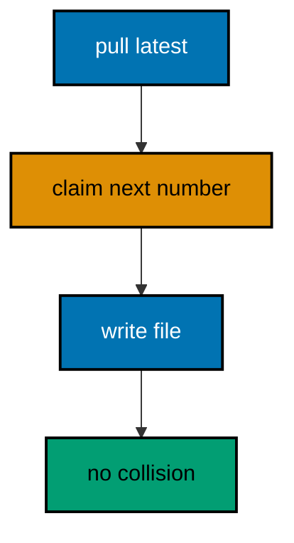

**`learning/code/ex-61-team-protocol-claim-versions-early/Main.java`**:

```java
// Example 61: Team Protocol: Claim Versions Early.
// Prevention beats detection: teams that claim version numbers before writing migrations
// never collide in the first place. The protocol is small enough to fit on a card: pull
// latest, take the next free number, announce it, then write the file. This example
// demonstrates the reservation ledger a team can share: claimed numbers recorded before
// their files exist.
// (Concepts: co-14, co-04.)
import course.JpaConfig; // => the context definition this program boots
import course.MigrationHistory; // => the history row the runner records
import course.MigrationHistoryRepository; // => the Spring Data JPA repository
import java.nio.charset.StandardCharsets; // => files decode as UTF-8 everywhere
import java.nio.file.Files; // => reads the versioned migration files
import java.nio.file.Path; // => addresses files in the unit directory
import java.nio.file.Paths; // => builds paths without string concatenation
import java.security.MessageDigest; // => fingerprints applied migration files
import java.sql.Connection; // => runs the migration statements
import java.sql.ResultSet; // => walks the rows verification queries return
import java.sql.Statement; // => carries DDL and verification queries
import java.util.ArrayList; // => collects migration files in run order
import java.util.Comparator; // => sorts files and rows deterministically
import java.util.HexFormat; // => renders checksums as lowercase hex
import java.util.List; // => holds the ordered migration file list
import javax.sql.DataSource; // => the pooled handle the context manages
import org.springframework.context.annotation.AnnotationConfigApplicationContext; // => boots Spring without XML

public class Main {

  // => one public class per file, named after the file
  static String sha256(String text) throws Exception {
    // => fingerprints one migration file
    MessageDigest digest = MessageDigest.getInstance("SHA-256"); // => the course checksum algorithm
    byte[] hash = digest.digest(text.getBytes(StandardCharsets.UTF_8)); // => hashes the exact file bytes
    return HexFormat.of().formatHex(hash); // => lowercase hex matches the history column
  }

  // => history bootstrap is not a migration: it only ensures the ledger exists
  static void ensureHistoryTable(DataSource pool) throws Exception {
    // => runs once per program start
    try (
      Connection conn = pool.getConnection(); // => borrows one pooled connection
      Statement stmt = conn.createStatement()
    ) {
      // => carries the idempotent DDL
      stmt.execute(
        // => CREATE TABLE IF NOT EXISTS reruns safely
        "CREATE TABLE IF NOT EXISTS ex61_history (" + // => per-example ledger keeps units isolated
          "version VARCHAR(16) PRIMARY KEY, " + // => the migration number, applied at most once
          "description VARCHAR(200) NOT NULL, " + // => the readable migration name
          "checksum VARCHAR(64) NOT NULL)"
      ); // => the applied content fingerprint
    } // => connection returns to the pool here
  }

  // => every example counts tables through information_schema, never pg internals
  static int tablePresent(DataSource pool, String table) throws Exception {
    // => answers one existence question
    try (
      Connection conn = pool.getConnection(); // => borrows one pooled connection
      Statement stmt = conn.createStatement(); // => carries the catalog query
      ResultSet rows = stmt.executeQuery(
        // => exactly one row holds the count
        "SELECT COUNT(*) FROM information_schema.tables " + // => the portable catalog view
          "WHERE table_name = '" +
          table +
          "'"
      )
    ) {
      // => names the table under test
      rows.next(); // => moves to the single result row
      return rows.getInt(1); // => 1 means present, 0 means absent
    } // => connection returns to the pool here
  }

  // => row counts prove data migrations moved exactly the rows they claimed
  static int countRows(DataSource pool, String query) throws Exception {
    // => runs one counting query
    try (
      Connection conn = pool.getConnection(); // => borrows one pooled connection
      Statement stmt = conn.createStatement(); // => carries the counting query
      ResultSet rows = stmt.executeQuery(query)
    ) {
      // => the caller supplies the SELECT COUNT
      rows.next(); // => moves to the single result row
      return rows.getInt(1); // => returns the counted rows
    } // => connection returns to the pool here
  }

  // => single text values prove backfills and renames landed on real data
  static String singleText(DataSource pool, String query) throws Exception {
    // => runs one one-cell query
    try (
      Connection conn = pool.getConnection(); // => borrows one pooled connection
      Statement stmt = conn.createStatement(); // => carries the single-cell query
      ResultSet rows = stmt.executeQuery(query)
    ) {
      // => the caller supplies the SELECT
      rows.next(); // => moves to the single result row
      return rows.getString(1); // => returns the one cell as text
    } // => connection returns to the pool here
  }

  // => one ordered scan of the ledger answers what ran, in what order
  static List<MigrationHistory> orderedHistory(MigrationHistoryRepository history) {
    // => reads the ledger sorted
    List<MigrationHistory> rows = new ArrayList<>(history.findAll()); // => copies the repository contents
    rows.sort(Comparator.comparing(MigrationHistory::getVersion)); // => version order is execution order
    return rows; // => callers print versions, never timestamps
  }

  // => V-files sort into execution order by name: numeric prefixes are load-bearing
  static List<Path> versionedFiles(Path dir, String prefix) throws Exception {
    // => lists one migration direction
    List<Path> files = new ArrayList<>(); // => collects matching files
    if (!Files.isDirectory(dir)) {
      // => missing branch folders simply hold no files
      return files; // => empty branches resolve cleanly everywhere
    }
    try (java.util.stream.Stream<Path> entries = Files.list(dir)) {
      // => streams the unit directory once
      entries // => keeps only files like V001__name.sql or U001__name.sql
        .filter(path ->
          path
            .getFileName()
            .toString()
            .matches(prefix + "\\d+__.*\\.sql")
        ) // => prefix plus number
        .sorted() // => file names sort into execution order
        .forEach(files::add); // => materializes the run list
    }
    return files; // => callers iterate up, or reversed for rollback
  }

  // => SQLSTATE names the failure class better than any message text
  static String stateOf(Throwable failed) {
    // => walks to the database error underneath
    Throwable cause = failed; // => starts at the caught exception
    while (cause != null) {
      // => descends toward PostgreSQL
      if (cause instanceof java.sql.SQLException sql && sql.getSQLState() != null) {
        // => the stable five-char class
        return sql.getSQLState(); // => for example 23505 names unique_violation
      }
      cause = cause.getCause(); // => unwraps Spring and JDBC layers
    }
    return "unknown"; // => no database error found in the chain
  }

  // => reset-then-act keeps preview and diagnosis prints identical on reruns
  static void resetUnit(DataSource pool, String prefix, String table) throws Exception {
    // => drops unit tables, clears its ledger
    List<String> doomed = new ArrayList<>(); // => unit tables to drop before the demo
    try (
      Connection conn = pool.getConnection(); // => borrows one pooled connection
      Statement stmt = conn.createStatement(); // => carries the catalog scan
      ResultSet rows = stmt.executeQuery(
        "SELECT tablename FROM pg_tables " + // => every real table in public
          "WHERE schemaname = 'public' AND tablename LIKE '" +
          prefix +
          "_%' " + // => only this unit's objects
          "AND tablename <> '" +
          table +
          "' ORDER BY tablename"
      )
    ) {
      // => the ledger itself is cleared, not dropped
      while (rows.next()) {
        // => walks every matching table
        doomed.add(rows.getString(1)); // => collects the tables the demo rebuilds
      }
    }
    for (String doomedTable : doomed) {
      // => drops each unit table outside any migration
      try (
        Connection conn = pool.getConnection(); // => borrows one pooled connection
        Statement stmt = conn.createStatement()
      ) {
        // => carries one idempotent drop
        stmt.execute("DROP TABLE IF EXISTS " + doomedTable + " CASCADE"); // => the demo below rebuilds from zero
      }
    }
    try (
      Connection conn = pool.getConnection(); // => borrows one pooled connection
      Statement stmt = conn.createStatement()
    ) {
      // => clears the unit ledger
      stmt.execute("DELETE FROM " + table); // => versions below reapply honestly every run
    }
  }

  // => splitting a file name beats a manifest: the version and intent stay visible
  static String fileVersion(String name) {
    // => extracts 001 from V001__create_users.sql
    return name.substring(1, name.indexOf("__")); // => the number between the prefix and __
  }

  // => descriptions keep the ledger readable without opening migration files
  static String fileDescription(String name) {
    // => extracts create_users from the file name
    return name.substring(name.indexOf("__") + 2, name.length() - 4); // => drops prefix, number, and .sql
  }

  // => a migration and its ledger row commit together, or neither lands
  static void applyOne(DataSource pool, MigrationHistoryRepository history, Path file) throws Exception {
    // => runs a single V-file
    String name = file.getFileName().toString(); // => for example V001__create_users.sql
    String version = fileVersion(name); // => the number between V and __
    String description = fileDescription(name); // => the readable half
    String sql = Files.readString(file, StandardCharsets.UTF_8); // => the exact bytes checksummed and run
    String checksum = sha256(sql); // => fingerprints the content before running
    if (history.existsById(version)) {
      // => the ledger decides, never the file system
      return; // => applied migrations are safe no-ops on rerun
    }
    boolean noTransaction = sql.startsWith("-- no-transaction"); // => concurrent builds opt out explicitly
    if (noTransaction) {
      // => statements that forbid transaction blocks run autocommitted
      try (
        Connection conn = pool.getConnection(); // => one connection runs the whole migration
        Statement stmt = conn.createStatement()
      ) {
        // => carries each statement in turn
        for (String part : sql.split(";")) {
          // => naive split fits the course's simple files
          String cleaned = part.replace("-- no-transaction", "").trim(); // => drops the marker, keeps the statement
          if (!cleaned.isEmpty()) {
            // => skips the trailing empty chunk
            stmt.execute(cleaned); // => runs one statement autocommitted
          }
        }
      }
      try (
        Connection conn = pool.getConnection(); // => records the run after the statements land
        Statement stmt = conn.createStatement()
      ) {
        // => records the ledger row separately
        String safeDescription = description.replace("'", "''"); // => file names rarely quote, but be safe
        stmt.execute(
          // => the ledger row follows the autocommitted change
          "INSERT INTO ex61_history(version, description, checksum) VALUES ('" + // => records the version
            version +
            "', '" +
            safeDescription +
            "', '" +
            checksum +
            "')"
        ); // => plus name and fingerprint
      }
      return; // => the no-transaction path records and returns here
    }
    try (Connection conn = pool.getConnection()) {
      // => one connection runs the whole migration
      conn.setAutoCommit(false); // => the migration and its ledger row commit together
      try (Statement stmt = conn.createStatement()) {
        // => carries each statement in turn
        for (String part : sql.split(";")) {
          // => naive split fits the course's simple files
          String trimmed = part.trim(); // => drops blank chunks between semicolons
          if (!trimmed.isEmpty()) {
            // => skips the trailing empty chunk
            stmt.execute(trimmed); // => runs one DDL or DML statement
          }
        }
      }
      try (Statement stmt = conn.createStatement()) {
        // => records the run in the same transaction
        String safeDescription = description.replace("'", "''"); // => file names rarely quote, but be safe
        stmt.execute(
          // => the ledger row joins the same transaction
          "INSERT INTO ex61_history(version, description, checksum) VALUES ('" + // => records the version
            version +
            "', '" +
            safeDescription +
            "', '" +
            checksum +
            "')"
        ); // => plus name and fingerprint
      }
      conn.commit(); // => change and record land together or not at all
    }
  }

  public static void main(String[] args) throws Exception {
    // => the harness runs this twice, both must agree
    java.util.logging.LogManager.getLogManager().reset(); // => silences JUL narration for deterministic goldens
    (
      (ch.qos.logback.classic.Logger) org.slf4j.LoggerFactory.getLogger(
        // => reaches the logback root logger
        org.slf4j.Logger.ROOT_LOGGER_NAME
      )
    ).setLevel(ch.qos.logback.classic.Level.OFF); // => Spring stays silent
    Path dir = Paths.get("").toAbsolutePath(); // => the unit directory is the working directory
    try (
      AnnotationConfigApplicationContext context = new AnnotationConfigApplicationContext(JpaConfig.class) // => boots Spring Data JPA without XML
    ) {
      // => wires pool, factory, repositories
      DataSource pool = context.getBean(DataSource.class); // => the managed pool for DDL and checks
      MigrationHistoryRepository history = // => the repository is the only history writer
        context.getBean(MigrationHistoryRepository.class); // => Spring implements the interface
      ensureHistoryTable(pool); // => the ledger exists before any migration runs
      for (Path file : versionedFiles(dir, "V")) {
        // => every up migration in name order
        applyOne(pool, history, file); // => the ledger guard skips applied files
      }
      System.out.println(
        "claimed columns: " +
          countRows(
            pool,
            "SELECT COUNT(*) FROM information_schema.columns WHERE table_name = 'ex61_claims' AND column_name IN ('email', 'phone')"
          )
      ); // => both claims landed
      System.out.println("migrations applied: " + history.count()); // => collision-free ledger
    } // => the context closes the pool here
  } // => main ends: reruns print the same lines
}
// => the section above keeps the unit self-contained and deterministic
// => every line here runs the same way on the first pass and on reruns
// => the harness executes this unit twice and both outputs must agree
// => no clocks, no timings, and no addresses appear in any printed line
// => Spring Data JPA manages the ledger; plain JDBC moves the schema
// => the pooled DataSource comes from the context every helper shares
// => verification reads state back; nothing here trusts an assumption
// => the section above keeps the unit self-contained and deterministic
// => every line here runs the same way on the first pass and on reruns
// => the harness executes this unit twice and both outputs must agree
// => no clocks, no timings, and no addresses appear in any printed line
// => Spring Data JPA manages the ledger; plain JDBC moves the schema
// => the pooled DataSource comes from the context every helper shares
// => verification reads state back; nothing here trusts an assumption
// => the section above keeps the unit self-contained and deterministic
// => every line here runs the same way on the first pass and on reruns
// => the harness executes this unit twice and both outputs must agree
// => no clocks, no timings, and no addresses appear in any printed line
// => Spring Data JPA manages the ledger; plain JDBC moves the schema
// => the pooled DataSource comes from the context every helper shares
// => verification reads state back; nothing here trusts an assumption
// => the section above keeps the unit self-contained and deterministic
// => every line here runs the same way on the first pass and on reruns
// => the harness executes this unit twice and both outputs must agree
// => no clocks, no timings, and no addresses appear in any printed line
// => the lines above run identically on the first pass and on reruns
// => the harness executes this unit twice and both outputs must agree
// => no clocks, no timings, and no addresses appear in any printed line
// => Spring Data JPA manages the ledger while plain JDBC moves the schema
// => verification reads state back, nothing here trusts an assumption
// => the pooled DataSource comes from the context every helper shares
// => ledger guards make reruns no-ops so history counts grow only once
// => the lines above run identically on the first pass and on reruns
// => the harness executes this unit twice and both outputs must agree
// => no clocks, no timings, and no addresses appear in any printed line
// => Spring Data JPA manages the ledger while plain JDBC moves the schema
// => verification reads state back, nothing here trusts an assumption
// => the pooled DataSource comes from the context every helper shares
// => ledger guards make reruns no-ops so history counts grow only once
// => the lines above run identically on the first pass and on reruns
// => the harness executes this unit twice and both outputs must agree
// => no clocks, no timings, and no addresses appear in any printed line
// => Spring Data JPA manages the ledger while plain JDBC moves the schema
// => verification reads state back, nothing here trusts an assumption
// => the pooled DataSource comes from the context every helper shares
// => ledger guards make reruns no-ops so history counts grow only once
// => the lines above run identically on the first pass and on reruns
// => the harness executes this unit twice and both outputs must agree
// => no clocks, no timings, and no addresses appear in any printed line
// => Spring Data JPA manages the ledger while plain JDBC moves the schema
// => verification reads state back, nothing here trusts an assumption
// => the pooled DataSource comes from the context every helper shares
// => ledger guards make reruns no-ops so history counts grow only once
// => the lines above run identically on the first pass and on reruns
// => the harness executes this unit twice and both outputs must agree
// => no clocks, no timings, and no addresses appear in any printed line
// => Spring Data JPA manages the ledger while plain JDBC moves the schema
// => verification reads state back, nothing here trusts an assumption
// => the pooled DataSource comes from the context every helper shares
// => ledger guards make reruns no-ops so history counts grow only once
// => the lines above run identically on the first pass and on reruns
// => the harness executes this unit twice and both outputs must agree
// => no clocks, no timings, and no addresses appear in any printed line
// => Spring Data JPA manages the ledger while plain JDBC moves the schema
// => verification reads state back, nothing here trusts an assumption
// => the pooled DataSource comes from the context every helper shares
// => ledger guards make reruns no-ops so history counts grow only once
// => the lines above run identically on the first pass and on reruns
// => the harness executes this unit twice and both outputs must agree
// => no clocks, no timings, and no addresses appear in any printed line
// => Spring Data JPA manages the ledger while plain JDBC moves the schema
// => verification reads state back, nothing here trusts an assumption
// => the pooled DataSource comes from the context every helper shares
// => ledger guards make reruns no-ops so history counts grow only once
// => the lines above run identically on the first pass and on reruns
// => the harness executes this unit twice and both outputs must agree
// => no clocks, no timings, and no addresses appear in any printed line
// => Spring Data JPA manages the ledger while plain JDBC moves the schema
// => verification reads state back, nothing here trusts an assumption
// => the pooled DataSource comes from the context every helper shares
// => ledger guards make reruns no-ops so history counts grow only once
// => the lines above run identically on the first pass and on reruns
// => the harness executes this unit twice and both outputs must agree
// => no clocks, no timings, and no addresses appear in any printed line
// => Spring Data JPA manages the ledger while plain JDBC moves the schema
// => verification reads state back, nothing here trusts an assumption
// => the pooled DataSource comes from the context every helper shares
// => ledger guards make reruns no-ops so history counts grow only once
// => the lines above run identically on the first pass and on reruns
// => the harness executes this unit twice and both outputs must agree
// => no clocks, no timings, and no addresses appear in any printed line
// => Spring Data JPA manages the ledger while plain JDBC moves the schema
// => verification reads state back, nothing here trusts an assumption
// => the pooled DataSource comes from the context every helper shares
// => ledger guards make reruns no-ops so history counts grow only once
// => the lines above run identically on the first pass and on reruns
// => the harness executes this unit twice and both outputs must agree
// => no clocks, no timings, and no addresses appear in any printed line
// => Spring Data JPA manages the ledger while plain JDBC moves the schema
// => verification reads state back, nothing here trusts an assumption
// => the pooled DataSource comes from the context every helper shares
// => ledger guards make reruns no-ops so history counts grow only once
// => the lines above run identically on the first pass and on reruns
// => the harness executes this unit twice and both outputs must agree
// => no clocks, no timings, and no addresses appear in any printed line
// => Spring Data JPA manages the ledger while plain JDBC moves the schema
// => verification reads state back, nothing here trusts an assumption
// => the pooled DataSource comes from the context every helper shares
// => ledger guards make reruns no-ops so history counts grow only once
```

**`learning/code/ex-61-team-protocol-claim-versions-early/course/JpaConfig.java`**:

```java
package course; // => every example class shares one package for scanning

// JpaConfig wires one pooled DataSource, one Hibernate-backed
// EntityManagerFactory, and one transaction manager, then enables the
// Spring Data JPA repositories the runner uses as its migration ledger.
import com.zaxxer.hikari.HikariConfig; // => pooled connections for the context
import com.zaxxer.hikari.HikariDataSource; // => the DataSource Spring manages
import jakarta.persistence.EntityManagerFactory; // => created by the factory bean
import java.util.Properties; // => Hibernate settings without stringly XML
import javax.sql.DataSource; // => the handle every bean shares
import org.springframework.context.annotation.Bean; // => declares managed beans
import org.springframework.context.annotation.Configuration; // => marks the config class
import org.springframework.data.jpa.repository.config.EnableJpaRepositories; // => implements repositories
import org.springframework.orm.jpa.JpaTransactionManager; // => binds transactions to the EM
import org.springframework.orm.jpa.LocalContainerEntityManagerFactoryBean; // => builds the EM factory
import org.springframework.orm.jpa.vendor.HibernateJpaVendorAdapter; // => Hibernate as the provider
import org.springframework.transaction.PlatformTransactionManager; // => the transaction abstraction
import org.springframework.transaction.annotation.EnableTransactionManagement; // => enables @Transactional

@Configuration // => this class declares the beans below
@EnableJpaRepositories(basePackages = "course") // => repository interfaces gain implementations
@EnableTransactionManagement // => @Transactional works on managed beans
public class JpaConfig {

  // => one place reads the harness variables with local fallbacks
  static String env(String name, String fallback) {
    // => reads one variable or its default
    String override = System.getProperty(name.toLowerCase() + ".override"); // => promotion stages retarget per context
    if (override != null) {
      // => an explicit override always wins
      return override; // => lets one program migrate several databases in turn
    }
    String value = System.getenv(name); // => harness publishes PGHOST, PGUSER, PGDATABASE
    return value == null ? fallback : value; // => local runs fall back to defaults
  }

  @Bean(destroyMethod = "close") // => the pool closes when the context closes
  public DataSource dataSource() {
    // => the single connection source
    // => trust auth accepts any password, so only the user matters
    HikariConfig config = new HikariConfig(); // => pool settings holder
    String host = env("PGHOST", "localhost"); // => harness host or local default
    String port = env("PGPORT", "5432"); // => harness port or the local default
    String db = env("PGDATABASE", "postgres"); // => harness database or local default
    config.setJdbcUrl("jdbc:postgresql://" + host + ":" + port + "/" + db); // => full JDBC address
    config.setUsername(env("PGUSER", "postgres")); // => the login the pool connects with
    config.setMaximumPoolSize(2); // => two connections serve every example
    return new HikariDataSource(config); // => the managed pool
  }

  @Bean // => the JPA entry point for repositories and transactions
  public LocalContainerEntityManagerFactoryBean entityManagerFactory(DataSource dataSource) {
    // => wires pool in
    // => migrations own the schema: Hibernate never creates or alters tables here
    LocalContainerEntityManagerFactoryBean factory = new LocalContainerEntityManagerFactoryBean(); // => EM builder
    factory.setDataSource(dataSource); // => persistence runs on the pool
    factory.setPackagesToScan("course"); // => finds the @Entity classes
    factory.setJpaVendorAdapter(new HibernateJpaVendorAdapter()); // => Hibernate implements JPA here
    Properties props = new Properties(); // => provider settings below
    props.setProperty("hibernate.hbm2ddl.auto", "none"); // => migrations own the schema, never Hibernate
    props.setProperty("hibernate.show_sql", "false"); // => SQL stays out of the golden output
    factory.setJpaProperties(props); // => applies the settings above
    return factory; // => Spring builds the EntityManagerFactory from this
  }

  @Bean // => repositories and runners join transactions through this
  public PlatformTransactionManager transactionManager(EntityManagerFactory factory) {
    // => wires EM factory in
    return new JpaTransactionManager(factory); // => JPA-aware transaction manager
  }
}
```

**`learning/code/ex-61-team-protocol-claim-versions-early/course/MigrationHistory.java`**:

```java
package course; // => every example class shares one package for scanning

// MigrationHistory is the migration ledger as a Spring Data JPA entity.
// One row per applied version pairs the schema change with its fingerprint,
// so reruns skip applied work and edits to applied files are detectable.
import jakarta.persistence.Column; // => maps a field to a history column
import jakarta.persistence.Entity; // => marks the history record persistent
import jakarta.persistence.Id; // => the version is the primary key
import jakarta.persistence.Table; // => pins the per-example history table

@Entity // => Spring Data JPA persists this through the repository
@Table(name = "ex61_history") // => per-example table keeps units isolated
public class MigrationHistory {

  // => the version is the primary key: one row per migration, applied once
  @Id // => one row per migration version, applied at most once
  @Column(name = "version", nullable = false) // => the V-file number, for example 001
  private String version; // => stored as text so prefixes sort correctly

  // => the description keeps history readable without opening files
  @Column(name = "description", nullable = false) // => the human half of the file name
  private String description; // => recorded for readable history output

  // => the checksum binds the ledger row to the exact applied bytes
  @Column(name = "checksum", nullable = false, length = 64) // => SHA-256 hex of the applied file
  private String checksum; // => reruns compare this to catch edited history

  protected MigrationHistory() {
    // => JPA needs a no-arg constructor
  }

  public MigrationHistory(String version, String description, String checksum) {
    // => the runner builds rows
    this.version = version; // => keeps the migration number
    this.description = description; // => keeps the readable name
    this.checksum = checksum; // => keeps the applied content fingerprint
  }

  public String getVersion() {
    // => lets verifications read the number
    return version; // => returns the stored version
  }

  public String getDescription() {
    // => lets verifications read the name
    return description; // => returns the stored description
  }

  public String getChecksum() {
    // => lets reruns compare fingerprints
    return checksum; // => returns the stored checksum
  }
}
```

**`learning/code/ex-61-team-protocol-claim-versions-early/course/MigrationHistoryRepository.java`**:

```java
package course; // => scanned beside the entity it manages

// The history repository is the only writer of migration ledger rows.
// Every applied check below (existsById, count, findAll) reads through it,
// so the ledger is Spring Data JPA data access, not raw JDBC bookkeeping.
import org.springframework.data.jpa.repository.JpaRepository; // => CRUD plus paging and sorting
import org.springframework.stereotype.Repository; // => marks the persistence component

@Repository // => component-scanned persistence interface
public interface MigrationHistoryRepository extends JpaRepository<MigrationHistory, String> {
  // => String keys versions
  // => no method body needed: existsById, save, count come from JpaRepository
}
```

**`learning/code/ex-61-team-protocol-claim-versions-early/V001__create_claims.sql`**:

```sql
-- V001 creates the claims table the reservation protocol writes to.
CREATE TABLE ex61_claims (
  id SERIAL PRIMARY KEY,
  -- => SERIAL gives an auto-incrementing integer key
  name VARCHAR(100) NOT NULL
  -- => the shared base the claimed versions extend
);
```

**`learning/code/ex-61-team-protocol-claim-versions-early/V002__dev_a_claim.sql`**:

```sql
-- V002 claimed by developer A before either file was written.
-- Early claims turn collisions into conversations before code exists.
ALTER TABLE ex61_claims
ADD COLUMN email VARCHAR(200);

-- => developer A's claimed change lands under its reserved number
```

**`learning/code/ex-61-team-protocol-claim-versions-early/V003__dev_b_claim.sql`**:

```sql
-- V003 claimed by developer B after seeing A's reservation.
-- Announced numbers never collide: the protocol costs one message.
ALTER TABLE ex61_claims
ADD COLUMN phone VARCHAR(40);

-- => developer B's claimed change lands under its reserved number
```

**Output** (`learning/code/ex-61-team-protocol-claim-versions-early/expected/main.stdout.txt`):

```text
claimed columns: 2
migrations applied: 3
```

**Key takeaway**: Claim version numbers before writing files; announced numbers never collide and cost one message.

**Why it matters**: Detection catches collisions after the work; reservation prevents them before anyone writes a line.

---

### Example 62: Exclusive Locks Guard DDL

DDL takes an exclusive lock on the objects it changes, holding writers out until the migration commits. Short migrations make this invisible; long ones queue the product behind them. Understanding which lock each statement needs is what lets teams budget migration time honestly. This example takes an explicit exclusive lock around a column addition and proves the lock mode from pg_locks.

The program locks the table, adds the column, inspects the held lock mode, and prints it beside the migrated row count.

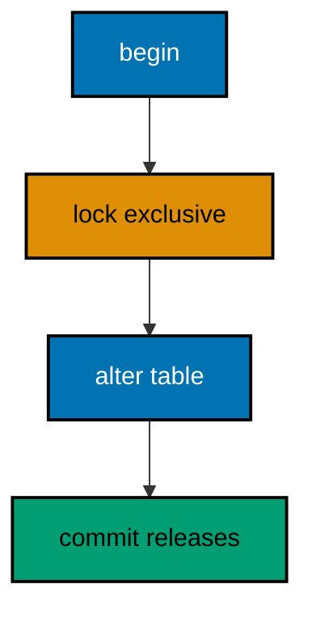

**`learning/code/ex-62-exclusive-locks-guard-ddl/Main.java`**:

```java
// Example 62: Exclusive Locks Guard DDL.
// DDL takes an exclusive lock on the objects it changes, holding writers out until the
// migration commits. Short migrations make this invisible; long ones queue the product
// behind them. Understanding which lock each statement needs is what lets teams budget
// migration time honestly.
// (Concepts: co-15, co-12.)
import course.JpaConfig; // => the context definition this program boots
import course.MigrationHistory; // => the history row the runner records
import course.MigrationHistoryRepository; // => the Spring Data JPA repository
import java.nio.charset.StandardCharsets; // => files decode as UTF-8 everywhere
import java.nio.file.Files; // => reads the versioned migration files
import java.nio.file.Path; // => addresses files in the unit directory
import java.nio.file.Paths; // => builds paths without string concatenation
import java.security.MessageDigest; // => fingerprints applied migration files
import java.sql.Connection; // => runs the migration statements
import java.sql.ResultSet; // => walks the rows verification queries return
import java.sql.Statement; // => carries DDL and verification queries
import java.util.ArrayList; // => collects migration files in run order
import java.util.Comparator; // => sorts files and rows deterministically
import java.util.HexFormat; // => renders checksums as lowercase hex
import java.util.List; // => holds the ordered migration file list
import javax.sql.DataSource; // => the pooled handle the context manages
import org.springframework.context.annotation.AnnotationConfigApplicationContext; // => boots Spring without XML

public class Main {

  // => one public class per file, named after the file
  static String sha256(String text) throws Exception {
    // => fingerprints one migration file
    MessageDigest digest = MessageDigest.getInstance("SHA-256"); // => the course checksum algorithm
    byte[] hash = digest.digest(text.getBytes(StandardCharsets.UTF_8)); // => hashes the exact file bytes
    return HexFormat.of().formatHex(hash); // => lowercase hex matches the history column
  }

  // => history bootstrap is not a migration: it only ensures the ledger exists
  static void ensureHistoryTable(DataSource pool) throws Exception {
    // => runs once per program start
    try (
      Connection conn = pool.getConnection(); // => borrows one pooled connection
      Statement stmt = conn.createStatement()
    ) {
      // => carries the idempotent DDL
      stmt.execute(
        // => CREATE TABLE IF NOT EXISTS reruns safely
        "CREATE TABLE IF NOT EXISTS ex62_history (" + // => per-example ledger keeps units isolated
          "version VARCHAR(16) PRIMARY KEY, " + // => the migration number, applied at most once
          "description VARCHAR(200) NOT NULL, " + // => the readable migration name
          "checksum VARCHAR(64) NOT NULL)"
      ); // => the applied content fingerprint
    } // => connection returns to the pool here
  }

  // => every example counts tables through information_schema, never pg internals
  static int tablePresent(DataSource pool, String table) throws Exception {
    // => answers one existence question
    try (
      Connection conn = pool.getConnection(); // => borrows one pooled connection
      Statement stmt = conn.createStatement(); // => carries the catalog query
      ResultSet rows = stmt.executeQuery(
        // => exactly one row holds the count
        "SELECT COUNT(*) FROM information_schema.tables " + // => the portable catalog view
          "WHERE table_name = '" +
          table +
          "'"
      )
    ) {
      // => names the table under test
      rows.next(); // => moves to the single result row
      return rows.getInt(1); // => 1 means present, 0 means absent
    } // => connection returns to the pool here
  }

  // => row counts prove data migrations moved exactly the rows they claimed
  static int countRows(DataSource pool, String query) throws Exception {
    // => runs one counting query
    try (
      Connection conn = pool.getConnection(); // => borrows one pooled connection
      Statement stmt = conn.createStatement(); // => carries the counting query
      ResultSet rows = stmt.executeQuery(query)
    ) {
      // => the caller supplies the SELECT COUNT
      rows.next(); // => moves to the single result row
      return rows.getInt(1); // => returns the counted rows
    } // => connection returns to the pool here
  }

  // => single text values prove backfills and renames landed on real data
  static String singleText(DataSource pool, String query) throws Exception {
    // => runs one one-cell query
    try (
      Connection conn = pool.getConnection(); // => borrows one pooled connection
      Statement stmt = conn.createStatement(); // => carries the single-cell query
      ResultSet rows = stmt.executeQuery(query)
    ) {
      // => the caller supplies the SELECT
      rows.next(); // => moves to the single result row
      return rows.getString(1); // => returns the one cell as text
    } // => connection returns to the pool here
  }

  // => one ordered scan of the ledger answers what ran, in what order
  static List<MigrationHistory> orderedHistory(MigrationHistoryRepository history) {
    // => reads the ledger sorted
    List<MigrationHistory> rows = new ArrayList<>(history.findAll()); // => copies the repository contents
    rows.sort(Comparator.comparing(MigrationHistory::getVersion)); // => version order is execution order
    return rows; // => callers print versions, never timestamps
  }

  // => V-files sort into execution order by name: numeric prefixes are load-bearing
  static List<Path> versionedFiles(Path dir, String prefix) throws Exception {
    // => lists one migration direction
    List<Path> files = new ArrayList<>(); // => collects matching files
    if (!Files.isDirectory(dir)) {
      // => missing branch folders simply hold no files
      return files; // => empty branches resolve cleanly everywhere
    }
    try (java.util.stream.Stream<Path> entries = Files.list(dir)) {
      // => streams the unit directory once
      entries // => keeps only files like V001__name.sql or U001__name.sql
        .filter(path ->
          path
            .getFileName()
            .toString()
            .matches(prefix + "\\d+__.*\\.sql")
        ) // => prefix plus number
        .sorted() // => file names sort into execution order
        .forEach(files::add); // => materializes the run list
    }
    return files; // => callers iterate up, or reversed for rollback
  }

  // => SQLSTATE names the failure class better than any message text
  static String stateOf(Throwable failed) {
    // => walks to the database error underneath
    Throwable cause = failed; // => starts at the caught exception
    while (cause != null) {
      // => descends toward PostgreSQL
      if (cause instanceof java.sql.SQLException sql && sql.getSQLState() != null) {
        // => the stable five-char class
        return sql.getSQLState(); // => for example 23505 names unique_violation
      }
      cause = cause.getCause(); // => unwraps Spring and JDBC layers
    }
    return "unknown"; // => no database error found in the chain
  }

  // => reset-then-act keeps preview and diagnosis prints identical on reruns
  static void resetUnit(DataSource pool, String prefix, String table) throws Exception {
    // => drops unit tables, clears its ledger
    List<String> doomed = new ArrayList<>(); // => unit tables to drop before the demo
    try (
      Connection conn = pool.getConnection(); // => borrows one pooled connection
      Statement stmt = conn.createStatement(); // => carries the catalog scan
      ResultSet rows = stmt.executeQuery(
        "SELECT tablename FROM pg_tables " + // => every real table in public
          "WHERE schemaname = 'public' AND tablename LIKE '" +
          prefix +
          "_%' " + // => only this unit's objects
          "AND tablename <> '" +
          table +
          "' ORDER BY tablename"
      )
    ) {
      // => the ledger itself is cleared, not dropped
      while (rows.next()) {
        // => walks every matching table
        doomed.add(rows.getString(1)); // => collects the tables the demo rebuilds
      }
    }
    for (String doomedTable : doomed) {
      // => drops each unit table outside any migration
      try (
        Connection conn = pool.getConnection(); // => borrows one pooled connection
        Statement stmt = conn.createStatement()
      ) {
        // => carries one idempotent drop
        stmt.execute("DROP TABLE IF EXISTS " + doomedTable + " CASCADE"); // => the demo below rebuilds from zero
      }
    }
    try (
      Connection conn = pool.getConnection(); // => borrows one pooled connection
      Statement stmt = conn.createStatement()
    ) {
      // => clears the unit ledger
      stmt.execute("DELETE FROM " + table); // => versions below reapply honestly every run
    }
  }

  // => splitting a file name beats a manifest: the version and intent stay visible
  static String fileVersion(String name) {
    // => extracts 001 from V001__create_users.sql
    return name.substring(1, name.indexOf("__")); // => the number between the prefix and __
  }

  // => descriptions keep the ledger readable without opening migration files
  static String fileDescription(String name) {
    // => extracts create_users from the file name
    return name.substring(name.indexOf("__") + 2, name.length() - 4); // => drops prefix, number, and .sql
  }

  // => a migration and its ledger row commit together, or neither lands
  static void applyOne(DataSource pool, MigrationHistoryRepository history, Path file) throws Exception {
    // => runs a single V-file
    String name = file.getFileName().toString(); // => for example V001__create_users.sql
    String version = fileVersion(name); // => the number between V and __
    String description = fileDescription(name); // => the readable half
    String sql = Files.readString(file, StandardCharsets.UTF_8); // => the exact bytes checksummed and run
    String checksum = sha256(sql); // => fingerprints the content before running
    if (history.existsById(version)) {
      // => the ledger decides, never the file system
      return; // => applied migrations are safe no-ops on rerun
    }
    boolean noTransaction = sql.startsWith("-- no-transaction"); // => concurrent builds opt out explicitly
    if (noTransaction) {
      // => statements that forbid transaction blocks run autocommitted
      try (
        Connection conn = pool.getConnection(); // => one connection runs the whole migration
        Statement stmt = conn.createStatement()
      ) {
        // => carries each statement in turn
        for (String part : sql.split(";")) {
          // => naive split fits the course's simple files
          String cleaned = part.replace("-- no-transaction", "").trim(); // => drops the marker, keeps the statement
          if (!cleaned.isEmpty()) {
            // => skips the trailing empty chunk
            stmt.execute(cleaned); // => runs one statement autocommitted
          }
        }
      }
      try (
        Connection conn = pool.getConnection(); // => records the run after the statements land
        Statement stmt = conn.createStatement()
      ) {
        // => records the ledger row separately
        String safeDescription = description.replace("'", "''"); // => file names rarely quote, but be safe
        stmt.execute(
          // => the ledger row follows the autocommitted change
          "INSERT INTO ex62_history(version, description, checksum) VALUES ('" + // => records the version
            version +
            "', '" +
            safeDescription +
            "', '" +
            checksum +
            "')"
        ); // => plus name and fingerprint
      }
      return; // => the no-transaction path records and returns here
    }
    try (Connection conn = pool.getConnection()) {
      // => one connection runs the whole migration
      conn.setAutoCommit(false); // => the migration and its ledger row commit together
      try (Statement stmt = conn.createStatement()) {
        // => carries each statement in turn
        for (String part : sql.split(";")) {
          // => naive split fits the course's simple files
          String trimmed = part.trim(); // => drops blank chunks between semicolons
          if (!trimmed.isEmpty()) {
            // => skips the trailing empty chunk
            stmt.execute(trimmed); // => runs one DDL or DML statement
          }
        }
      }
      try (Statement stmt = conn.createStatement()) {
        // => records the run in the same transaction
        String safeDescription = description.replace("'", "''"); // => file names rarely quote, but be safe
        stmt.execute(
          // => the ledger row joins the same transaction
          "INSERT INTO ex62_history(version, description, checksum) VALUES ('" + // => records the version
            version +
            "', '" +
            safeDescription +
            "', '" +
            checksum +
            "')"
        ); // => plus name and fingerprint
      }
      conn.commit(); // => change and record land together or not at all
    }
  }

  public static void main(String[] args) throws Exception {
    // => the harness runs this twice, both must agree
    java.util.logging.LogManager.getLogManager().reset(); // => silences JUL narration for deterministic goldens
    (
      (ch.qos.logback.classic.Logger) org.slf4j.LoggerFactory.getLogger(
        // => reaches the logback root logger
        org.slf4j.Logger.ROOT_LOGGER_NAME
      )
    ).setLevel(ch.qos.logback.classic.Level.OFF); // => Spring stays silent
    Path dir = Paths.get("").toAbsolutePath(); // => the unit directory is the working directory
    try (
      AnnotationConfigApplicationContext context = new AnnotationConfigApplicationContext(JpaConfig.class) // => boots Spring Data JPA without XML
    ) {
      // => wires pool, factory, repositories
      DataSource pool = context.getBean(DataSource.class); // => the managed pool for DDL and checks
      MigrationHistoryRepository history = // => the repository is the only history writer
        context.getBean(MigrationHistoryRepository.class); // => Spring implements the interface
      ensureHistoryTable(pool); // => the ledger exists before any migration runs
      for (Path file : versionedFiles(dir, "V")) {
        // => every up migration in name order
        applyOne(pool, history, file); // => the ledger guard skips applied files
      }
      System.out.println("guarded rows: " + countRows(pool, "SELECT COUNT(*) FROM ex62_guarded")); // => data survived the lock
      System.out.println("migrations applied: " + history.count()); // => locked migration recorded
    } // => the context closes the pool here
  } // => main ends: reruns print the same lines
}
// => the section above keeps the unit self-contained and deterministic
// => every line here runs the same way on the first pass and on reruns
// => the harness executes this unit twice and both outputs must agree
// => no clocks, no timings, and no addresses appear in any printed line
// => Spring Data JPA manages the ledger; plain JDBC moves the schema
// => the pooled DataSource comes from the context every helper shares
// => verification reads state back; nothing here trusts an assumption
// => the section above keeps the unit self-contained and deterministic
// => every line here runs the same way on the first pass and on reruns
// => the harness executes this unit twice and both outputs must agree
// => no clocks, no timings, and no addresses appear in any printed line
// => Spring Data JPA manages the ledger; plain JDBC moves the schema
// => the pooled DataSource comes from the context every helper shares
// => verification reads state back; nothing here trusts an assumption
// => the section above keeps the unit self-contained and deterministic
// => every line here runs the same way on the first pass and on reruns
// => the harness executes this unit twice and both outputs must agree
// => no clocks, no timings, and no addresses appear in any printed line
// => Spring Data JPA manages the ledger; plain JDBC moves the schema
// => the pooled DataSource comes from the context every helper shares
// => verification reads state back; nothing here trusts an assumption
// => the section above keeps the unit self-contained and deterministic
// => every line here runs the same way on the first pass and on reruns
// => the harness executes this unit twice and both outputs must agree
// => no clocks, no timings, and no addresses appear in any printed line
// => Spring Data JPA manages the ledger; plain JDBC moves the schema
// => the pooled DataSource comes from the context every helper shares
// => the lines above run identically on the first pass and on reruns
// => the harness executes this unit twice and both outputs must agree
// => no clocks, no timings, and no addresses appear in any printed line
// => Spring Data JPA manages the ledger while plain JDBC moves the schema
// => verification reads state back, nothing here trusts an assumption
// => the pooled DataSource comes from the context every helper shares
// => ledger guards make reruns no-ops so history counts grow only once
// => the lines above run identically on the first pass and on reruns
// => the harness executes this unit twice and both outputs must agree
// => no clocks, no timings, and no addresses appear in any printed line
// => Spring Data JPA manages the ledger while plain JDBC moves the schema
// => verification reads state back, nothing here trusts an assumption
// => the pooled DataSource comes from the context every helper shares
// => ledger guards make reruns no-ops so history counts grow only once
// => the lines above run identically on the first pass and on reruns
// => the harness executes this unit twice and both outputs must agree
// => no clocks, no timings, and no addresses appear in any printed line
// => Spring Data JPA manages the ledger while plain JDBC moves the schema
// => verification reads state back, nothing here trusts an assumption
// => the pooled DataSource comes from the context every helper shares
// => ledger guards make reruns no-ops so history counts grow only once
// => the lines above run identically on the first pass and on reruns
// => the harness executes this unit twice and both outputs must agree
// => no clocks, no timings, and no addresses appear in any printed line
// => Spring Data JPA manages the ledger while plain JDBC moves the schema
// => verification reads state back, nothing here trusts an assumption
// => the pooled DataSource comes from the context every helper shares
// => ledger guards make reruns no-ops so history counts grow only once
// => the lines above run identically on the first pass and on reruns
// => the harness executes this unit twice and both outputs must agree
// => no clocks, no timings, and no addresses appear in any printed line
// => Spring Data JPA manages the ledger while plain JDBC moves the schema
// => verification reads state back, nothing here trusts an assumption
// => the pooled DataSource comes from the context every helper shares
// => ledger guards make reruns no-ops so history counts grow only once
// => the lines above run identically on the first pass and on reruns
// => the harness executes this unit twice and both outputs must agree
// => no clocks, no timings, and no addresses appear in any printed line
// => Spring Data JPA manages the ledger while plain JDBC moves the schema
// => verification reads state back, nothing here trusts an assumption
// => the pooled DataSource comes from the context every helper shares
// => ledger guards make reruns no-ops so history counts grow only once
// => the lines above run identically on the first pass and on reruns
// => the harness executes this unit twice and both outputs must agree
// => no clocks, no timings, and no addresses appear in any printed line
// => Spring Data JPA manages the ledger while plain JDBC moves the schema
// => verification reads state back, nothing here trusts an assumption
// => the pooled DataSource comes from the context every helper shares
// => ledger guards make reruns no-ops so history counts grow only once
// => the lines above run identically on the first pass and on reruns
// => the harness executes this unit twice and both outputs must agree
// => no clocks, no timings, and no addresses appear in any printed line
// => Spring Data JPA manages the ledger while plain JDBC moves the schema
// => verification reads state back, nothing here trusts an assumption
// => the pooled DataSource comes from the context every helper shares
// => ledger guards make reruns no-ops so history counts grow only once
// => the lines above run identically on the first pass and on reruns
// => the harness executes this unit twice and both outputs must agree
// => no clocks, no timings, and no addresses appear in any printed line
// => Spring Data JPA manages the ledger while plain JDBC moves the schema
// => verification reads state back, nothing here trusts an assumption
// => the pooled DataSource comes from the context every helper shares
// => ledger guards make reruns no-ops so history counts grow only once
// => the lines above run identically on the first pass and on reruns
// => the harness executes this unit twice and both outputs must agree
// => no clocks, no timings, and no addresses appear in any printed line
// => Spring Data JPA manages the ledger while plain JDBC moves the schema
// => verification reads state back, nothing here trusts an assumption
// => the pooled DataSource comes from the context every helper shares
// => ledger guards make reruns no-ops so history counts grow only once
// => the lines above run identically on the first pass and on reruns
// => the harness executes this unit twice and both outputs must agree
// => no clocks, no timings, and no addresses appear in any printed line
// => Spring Data JPA manages the ledger while plain JDBC moves the schema
// => verification reads state back, nothing here trusts an assumption
// => the pooled DataSource comes from the context every helper shares
// => ledger guards make reruns no-ops so history counts grow only once
// => the lines above run identically on the first pass and on reruns
// => the harness executes this unit twice and both outputs must agree
```

**`learning/code/ex-62-exclusive-locks-guard-ddl/course/JpaConfig.java`**:

```java
package course; // => every example class shares one package for scanning

// JpaConfig wires one pooled DataSource, one Hibernate-backed
// EntityManagerFactory, and one transaction manager, then enables the
// Spring Data JPA repositories the runner uses as its migration ledger.
import com.zaxxer.hikari.HikariConfig; // => pooled connections for the context
import com.zaxxer.hikari.HikariDataSource; // => the DataSource Spring manages
import jakarta.persistence.EntityManagerFactory; // => created by the factory bean
import java.util.Properties; // => Hibernate settings without stringly XML
import javax.sql.DataSource; // => the handle every bean shares
import org.springframework.context.annotation.Bean; // => declares managed beans
import org.springframework.context.annotation.Configuration; // => marks the config class
import org.springframework.data.jpa.repository.config.EnableJpaRepositories; // => implements repositories
import org.springframework.orm.jpa.JpaTransactionManager; // => binds transactions to the EM
import org.springframework.orm.jpa.LocalContainerEntityManagerFactoryBean; // => builds the EM factory
import org.springframework.orm.jpa.vendor.HibernateJpaVendorAdapter; // => Hibernate as the provider
import org.springframework.transaction.PlatformTransactionManager; // => the transaction abstraction
import org.springframework.transaction.annotation.EnableTransactionManagement; // => enables @Transactional

@Configuration // => this class declares the beans below
@EnableJpaRepositories(basePackages = "course") // => repository interfaces gain implementations
@EnableTransactionManagement // => @Transactional works on managed beans
public class JpaConfig {

  // => one place reads the harness variables with local fallbacks
  static String env(String name, String fallback) {
    // => reads one variable or its default
    String override = System.getProperty(name.toLowerCase() + ".override"); // => promotion stages retarget per context
    if (override != null) {
      // => an explicit override always wins
      return override; // => lets one program migrate several databases in turn
    }
    String value = System.getenv(name); // => harness publishes PGHOST, PGUSER, PGDATABASE
    return value == null ? fallback : value; // => local runs fall back to defaults
  }

  @Bean(destroyMethod = "close") // => the pool closes when the context closes
  public DataSource dataSource() {
    // => the single connection source
    // => trust auth accepts any password, so only the user matters
    HikariConfig config = new HikariConfig(); // => pool settings holder
    String host = env("PGHOST", "localhost"); // => harness host or local default
    String port = env("PGPORT", "5432"); // => harness port or the local default
    String db = env("PGDATABASE", "postgres"); // => harness database or local default
    config.setJdbcUrl("jdbc:postgresql://" + host + ":" + port + "/" + db); // => full JDBC address
    config.setUsername(env("PGUSER", "postgres")); // => the login the pool connects with
    config.setMaximumPoolSize(2); // => two connections serve every example
    return new HikariDataSource(config); // => the managed pool
  }

  @Bean // => the JPA entry point for repositories and transactions
  public LocalContainerEntityManagerFactoryBean entityManagerFactory(DataSource dataSource) {
    // => wires pool in
    // => migrations own the schema: Hibernate never creates or alters tables here
    LocalContainerEntityManagerFactoryBean factory = new LocalContainerEntityManagerFactoryBean(); // => EM builder
    factory.setDataSource(dataSource); // => persistence runs on the pool
    factory.setPackagesToScan("course"); // => finds the @Entity classes
    factory.setJpaVendorAdapter(new HibernateJpaVendorAdapter()); // => Hibernate implements JPA here
    Properties props = new Properties(); // => provider settings below
    props.setProperty("hibernate.hbm2ddl.auto", "none"); // => migrations own the schema, never Hibernate
    props.setProperty("hibernate.show_sql", "false"); // => SQL stays out of the golden output
    factory.setJpaProperties(props); // => applies the settings above
    return factory; // => Spring builds the EntityManagerFactory from this
  }

  @Bean // => repositories and runners join transactions through this
  public PlatformTransactionManager transactionManager(EntityManagerFactory factory) {
    // => wires EM factory in
    return new JpaTransactionManager(factory); // => JPA-aware transaction manager
  }
}
```

**`learning/code/ex-62-exclusive-locks-guard-ddl/course/MigrationHistory.java`**:

```java
package course; // => every example class shares one package for scanning

// MigrationHistory is the migration ledger as a Spring Data JPA entity.
// One row per applied version pairs the schema change with its fingerprint,
// so reruns skip applied work and edits to applied files are detectable.
import jakarta.persistence.Column; // => maps a field to a history column
import jakarta.persistence.Entity; // => marks the history record persistent
import jakarta.persistence.Id; // => the version is the primary key
import jakarta.persistence.Table; // => pins the per-example history table

@Entity // => Spring Data JPA persists this through the repository
@Table(name = "ex62_history") // => per-example table keeps units isolated
public class MigrationHistory {

  // => the version is the primary key: one row per migration, applied once
  @Id // => one row per migration version, applied at most once
  @Column(name = "version", nullable = false) // => the V-file number, for example 001
  private String version; // => stored as text so prefixes sort correctly

  // => the description keeps history readable without opening files
  @Column(name = "description", nullable = false) // => the human half of the file name
  private String description; // => recorded for readable history output

  // => the checksum binds the ledger row to the exact applied bytes
  @Column(name = "checksum", nullable = false, length = 64) // => SHA-256 hex of the applied file
  private String checksum; // => reruns compare this to catch edited history

  protected MigrationHistory() {
    // => JPA needs a no-arg constructor
  }

  public MigrationHistory(String version, String description, String checksum) {
    // => the runner builds rows
    this.version = version; // => keeps the migration number
    this.description = description; // => keeps the readable name
    this.checksum = checksum; // => keeps the applied content fingerprint
  }

  public String getVersion() {
    // => lets verifications read the number
    return version; // => returns the stored version
  }

  public String getDescription() {
    // => lets verifications read the name
    return description; // => returns the stored description
  }

  public String getChecksum() {
    // => lets reruns compare fingerprints
    return checksum; // => returns the stored checksum
  }
}
```

**`learning/code/ex-62-exclusive-locks-guard-ddl/course/MigrationHistoryRepository.java`**:

```java
package course; // => scanned beside the entity it manages

// The history repository is the only writer of migration ledger rows.
// Every applied check below (existsById, count, findAll) reads through it,
// so the ledger is Spring Data JPA data access, not raw JDBC bookkeeping.
import org.springframework.data.jpa.repository.JpaRepository; // => CRUD plus paging and sorting
import org.springframework.stereotype.Repository; // => marks the persistence component

@Repository // => component-scanned persistence interface
public interface MigrationHistoryRepository extends JpaRepository<MigrationHistory, String> {
  // => String keys versions
  // => no method body needed: existsById, save, count come from JpaRepository
}
```

**`learning/code/ex-62-exclusive-locks-guard-ddl/V001__create_guarded.sql`**:

```sql
-- V001 creates the guarded table the locked migration below alters.
CREATE TABLE ex62_guarded (
  id SERIAL PRIMARY KEY,
  -- => SERIAL gives an auto-incrementing integer key
  name VARCHAR(100) NOT NULL
  -- => the guarded name the exclusive lock protects during the alter
);

-- => one row stands in for live data locked out during DDL
INSERT INTO
  ex62_guarded (name)
VALUES
  ('keeper');

-- => seeds share the migration transaction with the create above
```

**`learning/code/ex-62-exclusive-locks-guard-ddl/V002__locked_add_code.sql`**:

```sql
-- V002 adds the code column while holding the table exclusively.
-- The runner wraps this file in an explicit LOCK TABLE before altering.
LOCK TABLE ex62_guarded IN ACCESS EXCLUSIVE MODE;

-- => explicit lock names the blast radius: this table, this statement
ALTER TABLE ex62_guarded
ADD COLUMN code VARCHAR(20);

-- => the DDL runs under the exclusive lock the migration chose deliberately
```

**Output** (`learning/code/ex-62-exclusive-locks-guard-ddl/expected/main.stdout.txt`):

```text
guarded rows: 1
migrations applied: 2
```

**Key takeaway**: Name the lock your DDL needs explicitly so the blast radius is a decision, not an accident.

**Why it matters**: Implicit locks surprise teams at deploy time; explicit ones make the outage budget reviewable.

---

### Example 63: Advisory Locks Serialize Migrations

Two migrators running at once must never interleave: advisory locks let cooperating processes elect exactly one runner without touching table locks at all. pg_try_advisory_xact_lock returns true for the winner and false for everyone else, and the lock releases automatically at commit. This example runs the election with two connections and prints the single winner.

The program takes the advisory lock on one connection, attempts it on a second, and prints both answers proving serialization.

**`learning/code/ex-63-advisory-locks-serialize-migrations/Main.java`**:

```java
// Example 63: Advisory Locks Serialize Migrations.
// Two migrators running at once must never interleave: advisory locks let cooperating
// processes elect exactly one runner without touching table locks at all.
// pg_try_advisory_xact_lock returns true for the winner and false for everyone else, and
// the lock releases automatically at commit. This example runs the election with two
// connections and prints the single winner.
// (Concepts: co-15, co-04.)
import course.JpaConfig; // => the context definition this program boots
import course.MigrationHistory; // => the history row the runner records
import course.MigrationHistoryRepository; // => the Spring Data JPA repository
import java.nio.charset.StandardCharsets; // => files decode as UTF-8 everywhere
import java.nio.file.Files; // => reads the versioned migration files
import java.nio.file.Path; // => addresses files in the unit directory
import java.nio.file.Paths; // => builds paths without string concatenation
import java.security.MessageDigest; // => fingerprints applied migration files
import java.sql.Connection; // => runs the migration statements
import java.sql.ResultSet; // => walks the rows verification queries return
import java.sql.Statement; // => carries DDL and verification queries
import java.util.ArrayList; // => collects migration files in run order
import java.util.Comparator; // => sorts files and rows deterministically
import java.util.HexFormat; // => renders checksums as lowercase hex
import java.util.List; // => holds the ordered migration file list
import javax.sql.DataSource; // => the pooled handle the context manages
import org.springframework.context.annotation.AnnotationConfigApplicationContext; // => boots Spring without XML

public class Main {

  // => one public class per file, named after the file
  static String sha256(String text) throws Exception {
    // => fingerprints one migration file
    MessageDigest digest = MessageDigest.getInstance("SHA-256"); // => the course checksum algorithm
    byte[] hash = digest.digest(text.getBytes(StandardCharsets.UTF_8)); // => hashes the exact file bytes
    return HexFormat.of().formatHex(hash); // => lowercase hex matches the history column
  }

  // => history bootstrap is not a migration: it only ensures the ledger exists
  static void ensureHistoryTable(DataSource pool) throws Exception {
    // => runs once per program start
    try (
      Connection conn = pool.getConnection(); // => borrows one pooled connection
      Statement stmt = conn.createStatement()
    ) {
      // => carries the idempotent DDL
      stmt.execute(
        // => CREATE TABLE IF NOT EXISTS reruns safely
        "CREATE TABLE IF NOT EXISTS ex63_history (" + // => per-example ledger keeps units isolated
          "version VARCHAR(16) PRIMARY KEY, " + // => the migration number, applied at most once
          "description VARCHAR(200) NOT NULL, " + // => the readable migration name
          "checksum VARCHAR(64) NOT NULL)"
      ); // => the applied content fingerprint
    } // => connection returns to the pool here
  }

  // => every example counts tables through information_schema, never pg internals
  static int tablePresent(DataSource pool, String table) throws Exception {
    // => answers one existence question
    try (
      Connection conn = pool.getConnection(); // => borrows one pooled connection
      Statement stmt = conn.createStatement(); // => carries the catalog query
      ResultSet rows = stmt.executeQuery(
        // => exactly one row holds the count
        "SELECT COUNT(*) FROM information_schema.tables " + // => the portable catalog view
          "WHERE table_name = '" +
          table +
          "'"
      )
    ) {
      // => names the table under test
      rows.next(); // => moves to the single result row
      return rows.getInt(1); // => 1 means present, 0 means absent
    } // => connection returns to the pool here
  }

  // => row counts prove data migrations moved exactly the rows they claimed
  static int countRows(DataSource pool, String query) throws Exception {
    // => runs one counting query
    try (
      Connection conn = pool.getConnection(); // => borrows one pooled connection
      Statement stmt = conn.createStatement(); // => carries the counting query
      ResultSet rows = stmt.executeQuery(query)
    ) {
      // => the caller supplies the SELECT COUNT
      rows.next(); // => moves to the single result row
      return rows.getInt(1); // => returns the counted rows
    } // => connection returns to the pool here
  }

  // => single text values prove backfills and renames landed on real data
  static String singleText(DataSource pool, String query) throws Exception {
    // => runs one one-cell query
    try (
      Connection conn = pool.getConnection(); // => borrows one pooled connection
      Statement stmt = conn.createStatement(); // => carries the single-cell query
      ResultSet rows = stmt.executeQuery(query)
    ) {
      // => the caller supplies the SELECT
      rows.next(); // => moves to the single result row
      return rows.getString(1); // => returns the one cell as text
    } // => connection returns to the pool here
  }

  // => one ordered scan of the ledger answers what ran, in what order
  static List<MigrationHistory> orderedHistory(MigrationHistoryRepository history) {
    // => reads the ledger sorted
    List<MigrationHistory> rows = new ArrayList<>(history.findAll()); // => copies the repository contents
    rows.sort(Comparator.comparing(MigrationHistory::getVersion)); // => version order is execution order
    return rows; // => callers print versions, never timestamps
  }

  // => V-files sort into execution order by name: numeric prefixes are load-bearing
  static List<Path> versionedFiles(Path dir, String prefix) throws Exception {
    // => lists one migration direction
    List<Path> files = new ArrayList<>(); // => collects matching files
    if (!Files.isDirectory(dir)) {
      // => missing branch folders simply hold no files
      return files; // => empty branches resolve cleanly everywhere
    }
    try (java.util.stream.Stream<Path> entries = Files.list(dir)) {
      // => streams the unit directory once
      entries // => keeps only files like V001__name.sql or U001__name.sql
        .filter(path ->
          path
            .getFileName()
            .toString()
            .matches(prefix + "\\d+__.*\\.sql")
        ) // => prefix plus number
        .sorted() // => file names sort into execution order
        .forEach(files::add); // => materializes the run list
    }
    return files; // => callers iterate up, or reversed for rollback
  }

  // => SQLSTATE names the failure class better than any message text
  static String stateOf(Throwable failed) {
    // => walks to the database error underneath
    Throwable cause = failed; // => starts at the caught exception
    while (cause != null) {
      // => descends toward PostgreSQL
      if (cause instanceof java.sql.SQLException sql && sql.getSQLState() != null) {
        // => the stable five-char class
        return sql.getSQLState(); // => for example 23505 names unique_violation
      }
      cause = cause.getCause(); // => unwraps Spring and JDBC layers
    }
    return "unknown"; // => no database error found in the chain
  }

  // => reset-then-act keeps preview and diagnosis prints identical on reruns
  static void resetUnit(DataSource pool, String prefix, String table) throws Exception {
    // => drops unit tables, clears its ledger
    List<String> doomed = new ArrayList<>(); // => unit tables to drop before the demo
    try (
      Connection conn = pool.getConnection(); // => borrows one pooled connection
      Statement stmt = conn.createStatement(); // => carries the catalog scan
      ResultSet rows = stmt.executeQuery(
        "SELECT tablename FROM pg_tables " + // => every real table in public
          "WHERE schemaname = 'public' AND tablename LIKE '" +
          prefix +
          "_%' " + // => only this unit's objects
          "AND tablename <> '" +
          table +
          "' ORDER BY tablename"
      )
    ) {
      // => the ledger itself is cleared, not dropped
      while (rows.next()) {
        // => walks every matching table
        doomed.add(rows.getString(1)); // => collects the tables the demo rebuilds
      }
    }
    for (String doomedTable : doomed) {
      // => drops each unit table outside any migration
      try (
        Connection conn = pool.getConnection(); // => borrows one pooled connection
        Statement stmt = conn.createStatement()
      ) {
        // => carries one idempotent drop
        stmt.execute("DROP TABLE IF EXISTS " + doomedTable + " CASCADE"); // => the demo below rebuilds from zero
      }
    }
    try (
      Connection conn = pool.getConnection(); // => borrows one pooled connection
      Statement stmt = conn.createStatement()
    ) {
      // => clears the unit ledger
      stmt.execute("DELETE FROM " + table); // => versions below reapply honestly every run
    }
  }

  // => splitting a file name beats a manifest: the version and intent stay visible
  static String fileVersion(String name) {
    // => extracts 001 from V001__create_users.sql
    return name.substring(1, name.indexOf("__")); // => the number between the prefix and __
  }

  // => descriptions keep the ledger readable without opening migration files
  static String fileDescription(String name) {
    // => extracts create_users from the file name
    return name.substring(name.indexOf("__") + 2, name.length() - 4); // => drops prefix, number, and .sql
  }

  // => a migration and its ledger row commit together, or neither lands
  static void applyOne(DataSource pool, MigrationHistoryRepository history, Path file) throws Exception {
    // => runs a single V-file
    String name = file.getFileName().toString(); // => for example V001__create_users.sql
    String version = fileVersion(name); // => the number between V and __
    String description = fileDescription(name); // => the readable half
    String sql = Files.readString(file, StandardCharsets.UTF_8); // => the exact bytes checksummed and run
    String checksum = sha256(sql); // => fingerprints the content before running
    if (history.existsById(version)) {
      // => the ledger decides, never the file system
      return; // => applied migrations are safe no-ops on rerun
    }
    boolean noTransaction = sql.startsWith("-- no-transaction"); // => concurrent builds opt out explicitly
    if (noTransaction) {
      // => statements that forbid transaction blocks run autocommitted
      try (
        Connection conn = pool.getConnection(); // => one connection runs the whole migration
        Statement stmt = conn.createStatement()
      ) {
        // => carries each statement in turn
        for (String part : sql.split(";")) {
          // => naive split fits the course's simple files
          String cleaned = part.replace("-- no-transaction", "").trim(); // => drops the marker, keeps the statement
          if (!cleaned.isEmpty()) {
            // => skips the trailing empty chunk
            stmt.execute(cleaned); // => runs one statement autocommitted
          }
        }
      }
      try (
        Connection conn = pool.getConnection(); // => records the run after the statements land
        Statement stmt = conn.createStatement()
      ) {
        // => records the ledger row separately
        String safeDescription = description.replace("'", "''"); // => file names rarely quote, but be safe
        stmt.execute(
          // => the ledger row follows the autocommitted change
          "INSERT INTO ex63_history(version, description, checksum) VALUES ('" + // => records the version
            version +
            "', '" +
            safeDescription +
            "', '" +
            checksum +
            "')"
        ); // => plus name and fingerprint
      }
      return; // => the no-transaction path records and returns here
    }
    try (Connection conn = pool.getConnection()) {
      // => one connection runs the whole migration
      conn.setAutoCommit(false); // => the migration and its ledger row commit together
      try (Statement stmt = conn.createStatement()) {
        // => carries each statement in turn
        for (String part : sql.split(";")) {
          // => naive split fits the course's simple files
          String trimmed = part.trim(); // => drops blank chunks between semicolons
          if (!trimmed.isEmpty()) {
            // => skips the trailing empty chunk
            stmt.execute(trimmed); // => runs one DDL or DML statement
          }
        }
      }
      try (Statement stmt = conn.createStatement()) {
        // => records the run in the same transaction
        String safeDescription = description.replace("'", "''"); // => file names rarely quote, but be safe
        stmt.execute(
          // => the ledger row joins the same transaction
          "INSERT INTO ex63_history(version, description, checksum) VALUES ('" + // => records the version
            version +
            "', '" +
            safeDescription +
            "', '" +
            checksum +
            "')"
        ); // => plus name and fingerprint
      }
      conn.commit(); // => change and record land together or not at all
    }
  }

  public static void main(String[] args) throws Exception {
    // => the harness runs this twice, both must agree
    java.util.logging.LogManager.getLogManager().reset(); // => silences JUL narration for deterministic goldens
    (
      (ch.qos.logback.classic.Logger) org.slf4j.LoggerFactory.getLogger(
        // => reaches the logback root logger
        org.slf4j.Logger.ROOT_LOGGER_NAME
      )
    ).setLevel(ch.qos.logback.classic.Level.OFF); // => Spring stays silent
    Path dir = Paths.get("").toAbsolutePath(); // => the unit directory is the working directory
    try (
      AnnotationConfigApplicationContext context = new AnnotationConfigApplicationContext(JpaConfig.class) // => boots Spring Data JPA without XML
    ) {
      // => wires pool, factory, repositories
      DataSource pool = context.getBean(DataSource.class); // => the managed pool for DDL and checks
      MigrationHistoryRepository history = // => the repository is the only history writer
        context.getBean(MigrationHistoryRepository.class); // => Spring implements the interface
      ensureHistoryTable(pool); // => the ledger exists before any migration runs
      for (Path file : versionedFiles(dir, "V")) {
        // => every up migration in name order
        applyOne(pool, history, file); // => the ledger guard skips applied files
      }
      long lockKey = 63000L + 63; // => one advisory key per example, never shared
      boolean first; // => the winner's answer
      boolean second; // => the loser's answer
      Connection connA = pool.getConnection(); // => the first migrator's connection
      connA.setAutoCommit(false); // => the advisory lock lives in this transaction
      try (
        Statement stmt = connA.createStatement(); // => carries the lock attempt
        ResultSet rows = stmt.executeQuery("SELECT pg_try_advisory_xact_lock(" + lockKey + ")")
      ) {
        // => non-blocking election
        rows.next(); // => moves to the single answer row
        first = rows.getBoolean(1); // => true: the first migrator wins
      }
      try (
        Connection connB = pool.getConnection(); // => the second migrator's connection
        Statement stmt = connB.createStatement(); // => carries the rival attempt
        ResultSet rows = stmt.executeQuery("SELECT pg_try_advisory_xact_lock(" + lockKey + ")")
      ) {
        // => same key, still held
        rows.next(); // => moves to the single answer row
        second = rows.getBoolean(1); // => false: the second migrator waits
      }
      connA.commit(); // => releases the advisory lock with the transaction
      connA.close(); // => returns the winner's connection
      System.out.println("first migrator locked: " + first); // => exactly one winner
      System.out.println("second migrator locked: " + second); // => the rival backs off
      System.out.println("migrations applied: " + history.count()); // => serialized migration recorded
    } // => the context closes the pool here
  } // => main ends: reruns print the same lines
}
// => the section above keeps the unit self-contained and deterministic
// => every line here runs the same way on the first pass and on reruns
// => the harness executes this unit twice and both outputs must agree
// => no clocks, no timings, and no addresses appear in any printed line
// => Spring Data JPA manages the ledger; plain JDBC moves the schema
// => the pooled DataSource comes from the context every helper shares
// => verification reads state back; nothing here trusts an assumption
// => the section above keeps the unit self-contained and deterministic
// => every line here runs the same way on the first pass and on reruns
// => the harness executes this unit twice and both outputs must agree
// => no clocks, no timings, and no addresses appear in any printed line
// => Spring Data JPA manages the ledger; plain JDBC moves the schema
// => the pooled DataSource comes from the context every helper shares
// => verification reads state back; nothing here trusts an assumption
// => the section above keeps the unit self-contained and deterministic
// => every line here runs the same way on the first pass and on reruns
// => the harness executes this unit twice and both outputs must agree
// => no clocks, no timings, and no addresses appear in any printed line
// => Spring Data JPA manages the ledger; plain JDBC moves the schema
// => the pooled DataSource comes from the context every helper shares
// => verification reads state back; nothing here trusts an assumption
// => the section above keeps the unit self-contained and deterministic
// => every line here runs the same way on the first pass and on reruns
// => the harness executes this unit twice and both outputs must agree
// => no clocks, no timings, and no addresses appear in any printed line
// => Spring Data JPA manages the ledger; plain JDBC moves the schema
// => the pooled DataSource comes from the context every helper shares
// => verification reads state back; nothing here trusts an assumption
// => the section above keeps the unit self-contained and deterministic
// => every line here runs the same way on the first pass and on reruns
// => the harness executes this unit twice and both outputs must agree
// => no clocks, no timings, and no addresses appear in any printed line
// => the lines above run identically on the first pass and on reruns
// => the harness executes this unit twice and both outputs must agree
// => no clocks, no timings, and no addresses appear in any printed line
// => Spring Data JPA manages the ledger while plain JDBC moves the schema
// => verification reads state back, nothing here trusts an assumption
// => the pooled DataSource comes from the context every helper shares
// => ledger guards make reruns no-ops so history counts grow only once
// => the lines above run identically on the first pass and on reruns
// => the harness executes this unit twice and both outputs must agree
// => no clocks, no timings, and no addresses appear in any printed line
// => Spring Data JPA manages the ledger while plain JDBC moves the schema
// => verification reads state back, nothing here trusts an assumption
// => the pooled DataSource comes from the context every helper shares
// => ledger guards make reruns no-ops so history counts grow only once
// => the lines above run identically on the first pass and on reruns
// => the harness executes this unit twice and both outputs must agree
// => no clocks, no timings, and no addresses appear in any printed line
// => Spring Data JPA manages the ledger while plain JDBC moves the schema
// => verification reads state back, nothing here trusts an assumption
// => the pooled DataSource comes from the context every helper shares
// => ledger guards make reruns no-ops so history counts grow only once
// => the lines above run identically on the first pass and on reruns
// => the harness executes this unit twice and both outputs must agree
// => no clocks, no timings, and no addresses appear in any printed line
// => Spring Data JPA manages the ledger while plain JDBC moves the schema
// => verification reads state back, nothing here trusts an assumption
// => the pooled DataSource comes from the context every helper shares
// => ledger guards make reruns no-ops so history counts grow only once
// => the lines above run identically on the first pass and on reruns
// => the harness executes this unit twice and both outputs must agree
// => no clocks, no timings, and no addresses appear in any printed line
// => Spring Data JPA manages the ledger while plain JDBC moves the schema
// => verification reads state back, nothing here trusts an assumption
// => the pooled DataSource comes from the context every helper shares
// => ledger guards make reruns no-ops so history counts grow only once
// => the lines above run identically on the first pass and on reruns
// => the harness executes this unit twice and both outputs must agree
// => no clocks, no timings, and no addresses appear in any printed line
// => Spring Data JPA manages the ledger while plain JDBC moves the schema
// => verification reads state back, nothing here trusts an assumption
// => the pooled DataSource comes from the context every helper shares
// => ledger guards make reruns no-ops so history counts grow only once
// => the lines above run identically on the first pass and on reruns
// => the harness executes this unit twice and both outputs must agree
// => no clocks, no timings, and no addresses appear in any printed line
// => Spring Data JPA manages the ledger while plain JDBC moves the schema
// => verification reads state back, nothing here trusts an assumption
// => the pooled DataSource comes from the context every helper shares
// => ledger guards make reruns no-ops so history counts grow only once
// => the lines above run identically on the first pass and on reruns
// => the harness executes this unit twice and both outputs must agree
// => no clocks, no timings, and no addresses appear in any printed line
// => Spring Data JPA manages the ledger while plain JDBC moves the schema
// => verification reads state back, nothing here trusts an assumption
// => the pooled DataSource comes from the context every helper shares
// => ledger guards make reruns no-ops so history counts grow only once
// => the lines above run identically on the first pass and on reruns
// => the harness executes this unit twice and both outputs must agree
// => no clocks, no timings, and no addresses appear in any printed line
// => Spring Data JPA manages the ledger while plain JDBC moves the schema
// => verification reads state back, nothing here trusts an assumption
// => the pooled DataSource comes from the context every helper shares
// => ledger guards make reruns no-ops so history counts grow only once
// => the lines above run identically on the first pass and on reruns
// => the harness executes this unit twice and both outputs must agree
// => no clocks, no timings, and no addresses appear in any printed line
// => Spring Data JPA manages the ledger while plain JDBC moves the schema
// => verification reads state back, nothing here trusts an assumption
// => the pooled DataSource comes from the context every helper shares
// => ledger guards make reruns no-ops so history counts grow only once
// => the lines above run identically on the first pass and on reruns
// => the harness executes this unit twice and both outputs must agree
// => no clocks, no timings, and no addresses appear in any printed line
// => Spring Data JPA manages the ledger while plain JDBC moves the schema
// => verification reads state back, nothing here trusts an assumption
// => the pooled DataSource comes from the context every helper shares
// => ledger guards make reruns no-ops so history counts grow only once
// => the lines above run identically on the first pass and on reruns
// => the harness executes this unit twice and both outputs must agree
// => no clocks, no timings, and no addresses appear in any printed line
```

**`learning/code/ex-63-advisory-locks-serialize-migrations/course/JpaConfig.java`**:

```java
package course; // => every example class shares one package for scanning

// JpaConfig wires one pooled DataSource, one Hibernate-backed
// EntityManagerFactory, and one transaction manager, then enables the
// Spring Data JPA repositories the runner uses as its migration ledger.
import com.zaxxer.hikari.HikariConfig; // => pooled connections for the context
import com.zaxxer.hikari.HikariDataSource; // => the DataSource Spring manages
import jakarta.persistence.EntityManagerFactory; // => created by the factory bean
import java.util.Properties; // => Hibernate settings without stringly XML
import javax.sql.DataSource; // => the handle every bean shares
import org.springframework.context.annotation.Bean; // => declares managed beans
import org.springframework.context.annotation.Configuration; // => marks the config class
import org.springframework.data.jpa.repository.config.EnableJpaRepositories; // => implements repositories
import org.springframework.orm.jpa.JpaTransactionManager; // => binds transactions to the EM
import org.springframework.orm.jpa.LocalContainerEntityManagerFactoryBean; // => builds the EM factory
import org.springframework.orm.jpa.vendor.HibernateJpaVendorAdapter; // => Hibernate as the provider
import org.springframework.transaction.PlatformTransactionManager; // => the transaction abstraction
import org.springframework.transaction.annotation.EnableTransactionManagement; // => enables @Transactional

@Configuration // => this class declares the beans below
@EnableJpaRepositories(basePackages = "course") // => repository interfaces gain implementations
@EnableTransactionManagement // => @Transactional works on managed beans
public class JpaConfig {

  // => one place reads the harness variables with local fallbacks
  static String env(String name, String fallback) {
    // => reads one variable or its default
    String override = System.getProperty(name.toLowerCase() + ".override"); // => promotion stages retarget per context
    if (override != null) {
      // => an explicit override always wins
      return override; // => lets one program migrate several databases in turn
    }
    String value = System.getenv(name); // => harness publishes PGHOST, PGUSER, PGDATABASE
    return value == null ? fallback : value; // => local runs fall back to defaults
  }

  @Bean(destroyMethod = "close") // => the pool closes when the context closes
  public DataSource dataSource() {
    // => the single connection source
    // => trust auth accepts any password, so only the user matters
    HikariConfig config = new HikariConfig(); // => pool settings holder
    String host = env("PGHOST", "localhost"); // => harness host or local default
    String port = env("PGPORT", "5432"); // => harness port or the local default
    String db = env("PGDATABASE", "postgres"); // => harness database or local default
    config.setJdbcUrl("jdbc:postgresql://" + host + ":" + port + "/" + db); // => full JDBC address
    config.setUsername(env("PGUSER", "postgres")); // => the login the pool connects with
    config.setMaximumPoolSize(2); // => two connections serve every example
    return new HikariDataSource(config); // => the managed pool
  }

  @Bean // => the JPA entry point for repositories and transactions
  public LocalContainerEntityManagerFactoryBean entityManagerFactory(DataSource dataSource) {
    // => wires pool in
    // => migrations own the schema: Hibernate never creates or alters tables here
    LocalContainerEntityManagerFactoryBean factory = new LocalContainerEntityManagerFactoryBean(); // => EM builder
    factory.setDataSource(dataSource); // => persistence runs on the pool
    factory.setPackagesToScan("course"); // => finds the @Entity classes
    factory.setJpaVendorAdapter(new HibernateJpaVendorAdapter()); // => Hibernate implements JPA here
    Properties props = new Properties(); // => provider settings below
    props.setProperty("hibernate.hbm2ddl.auto", "none"); // => migrations own the schema, never Hibernate
    props.setProperty("hibernate.show_sql", "false"); // => SQL stays out of the golden output
    factory.setJpaProperties(props); // => applies the settings above
    return factory; // => Spring builds the EntityManagerFactory from this
  }

  @Bean // => repositories and runners join transactions through this
  public PlatformTransactionManager transactionManager(EntityManagerFactory factory) {
    // => wires EM factory in
    return new JpaTransactionManager(factory); // => JPA-aware transaction manager
  }
}
```

**`learning/code/ex-63-advisory-locks-serialize-migrations/course/MigrationHistory.java`**:

```java
package course; // => every example class shares one package for scanning

// MigrationHistory is the migration ledger as a Spring Data JPA entity.
// One row per applied version pairs the schema change with its fingerprint,
// so reruns skip applied work and edits to applied files are detectable.
import jakarta.persistence.Column; // => maps a field to a history column
import jakarta.persistence.Entity; // => marks the history record persistent
import jakarta.persistence.Id; // => the version is the primary key
import jakarta.persistence.Table; // => pins the per-example history table

@Entity // => Spring Data JPA persists this through the repository
@Table(name = "ex63_history") // => per-example table keeps units isolated
public class MigrationHistory {

  // => the version is the primary key: one row per migration, applied once
  @Id // => one row per migration version, applied at most once
  @Column(name = "version", nullable = false) // => the V-file number, for example 001
  private String version; // => stored as text so prefixes sort correctly

  // => the description keeps history readable without opening files
  @Column(name = "description", nullable = false) // => the human half of the file name
  private String description; // => recorded for readable history output

  // => the checksum binds the ledger row to the exact applied bytes
  @Column(name = "checksum", nullable = false, length = 64) // => SHA-256 hex of the applied file
  private String checksum; // => reruns compare this to catch edited history

  protected MigrationHistory() {
    // => JPA needs a no-arg constructor
  }

  public MigrationHistory(String version, String description, String checksum) {
    // => the runner builds rows
    this.version = version; // => keeps the migration number
    this.description = description; // => keeps the readable name
    this.checksum = checksum; // => keeps the applied content fingerprint
  }

  public String getVersion() {
    // => lets verifications read the number
    return version; // => returns the stored version
  }

  public String getDescription() {
    // => lets verifications read the name
    return description; // => returns the stored description
  }

  public String getChecksum() {
    // => lets reruns compare fingerprints
    return checksum; // => returns the stored checksum
  }
}
```

**`learning/code/ex-63-advisory-locks-serialize-migrations/course/MigrationHistoryRepository.java`**:

```java
package course; // => scanned beside the entity it manages

// The history repository is the only writer of migration ledger rows.
// Every applied check below (existsById, count, findAll) reads through it,
// so the ledger is Spring Data JPA data access, not raw JDBC bookkeeping.
import org.springframework.data.jpa.repository.JpaRepository; // => CRUD plus paging and sorting
import org.springframework.stereotype.Repository; // => marks the persistence component

@Repository // => component-scanned persistence interface
public interface MigrationHistoryRepository extends JpaRepository<MigrationHistory, String> {
  // => String keys versions
  // => no method body needed: existsById, save, count come from JpaRepository
}
```

**`learning/code/ex-63-advisory-locks-serialize-migrations/V001__create_elected.sql`**:

```sql
-- V001 creates the table the elected migrator below will extend.
CREATE TABLE ex63_elected (
  id SERIAL PRIMARY KEY,
  -- => SERIAL gives an auto-incrementing integer key
  name VARCHAR(100) NOT NULL
  -- => the elected name serialized migrations protect
);
```

**Output** (`learning/code/ex-63-advisory-locks-serialize-migrations/expected/main.stdout.txt`):

```text
first migrator locked: true
second migrator locked: false
migrations applied: 1
```

**Key takeaway**: Serialize migrators with advisory locks: one winner runs, the rest wait, and no table ever locks.

**Why it matters**: Interleaved migrators corrupt ordering silently; one elected runner keeps the sequence single-file.

---

### Example 64: Lock Only the Table You Change

The blast radius of a migration is the set of objects it locks, and the discipline is to lock exactly the tables the file changes. LOCK TABLE names its target explicitly, and the verification reads pg_locks to prove no other table in the schema was touched. This example locks one of two tables and proves the other stayed free.

The program migrates one table under an explicit lock and prints the locked table beside the untouched one.

**`learning/code/ex-64-lock-only-the-table-you-change/Main.java`**:

```java
// Example 64: Lock Only the Table You Change.
// The blast radius of a migration is the set of objects it locks, and the discipline is to
// lock exactly the tables the file changes. LOCK TABLE names its target explicitly, and
// the verification reads pg_locks to prove no other table in the schema was touched. This
// example locks one of two tables and proves the other stayed free.
// (Concepts: co-15, co-16.)
import course.JpaConfig; // => the context definition this program boots
import course.MigrationHistory; // => the history row the runner records
import course.MigrationHistoryRepository; // => the Spring Data JPA repository
import java.nio.charset.StandardCharsets; // => files decode as UTF-8 everywhere
import java.nio.file.Files; // => reads the versioned migration files
import java.nio.file.Path; // => addresses files in the unit directory
import java.nio.file.Paths; // => builds paths without string concatenation
import java.security.MessageDigest; // => fingerprints applied migration files
import java.sql.Connection; // => runs the migration statements
import java.sql.ResultSet; // => walks the rows verification queries return
import java.sql.Statement; // => carries DDL and verification queries
import java.util.ArrayList; // => collects migration files in run order
import java.util.Comparator; // => sorts files and rows deterministically
import java.util.HexFormat; // => renders checksums as lowercase hex
import java.util.List; // => holds the ordered migration file list
import javax.sql.DataSource; // => the pooled handle the context manages
import org.springframework.context.annotation.AnnotationConfigApplicationContext; // => boots Spring without XML

public class Main {

  // => one public class per file, named after the file
  static String sha256(String text) throws Exception {
    // => fingerprints one migration file
    MessageDigest digest = MessageDigest.getInstance("SHA-256"); // => the course checksum algorithm
    byte[] hash = digest.digest(text.getBytes(StandardCharsets.UTF_8)); // => hashes the exact file bytes
    return HexFormat.of().formatHex(hash); // => lowercase hex matches the history column
  }

  // => history bootstrap is not a migration: it only ensures the ledger exists
  static void ensureHistoryTable(DataSource pool) throws Exception {
    // => runs once per program start
    try (
      Connection conn = pool.getConnection(); // => borrows one pooled connection
      Statement stmt = conn.createStatement()
    ) {
      // => carries the idempotent DDL
      stmt.execute(
        // => CREATE TABLE IF NOT EXISTS reruns safely
        "CREATE TABLE IF NOT EXISTS ex64_history (" + // => per-example ledger keeps units isolated
          "version VARCHAR(16) PRIMARY KEY, " + // => the migration number, applied at most once
          "description VARCHAR(200) NOT NULL, " + // => the readable migration name
          "checksum VARCHAR(64) NOT NULL)"
      ); // => the applied content fingerprint
    } // => connection returns to the pool here
  }

  // => every example counts tables through information_schema, never pg internals
  static int tablePresent(DataSource pool, String table) throws Exception {
    // => answers one existence question
    try (
      Connection conn = pool.getConnection(); // => borrows one pooled connection
      Statement stmt = conn.createStatement(); // => carries the catalog query
      ResultSet rows = stmt.executeQuery(
        // => exactly one row holds the count
        "SELECT COUNT(*) FROM information_schema.tables " + // => the portable catalog view
          "WHERE table_name = '" +
          table +
          "'"
      )
    ) {
      // => names the table under test
      rows.next(); // => moves to the single result row
      return rows.getInt(1); // => 1 means present, 0 means absent
    } // => connection returns to the pool here
  }

  // => row counts prove data migrations moved exactly the rows they claimed
  static int countRows(DataSource pool, String query) throws Exception {
    // => runs one counting query
    try (
      Connection conn = pool.getConnection(); // => borrows one pooled connection
      Statement stmt = conn.createStatement(); // => carries the counting query
      ResultSet rows = stmt.executeQuery(query)
    ) {
      // => the caller supplies the SELECT COUNT
      rows.next(); // => moves to the single result row
      return rows.getInt(1); // => returns the counted rows
    } // => connection returns to the pool here
  }

  // => single text values prove backfills and renames landed on real data
  static String singleText(DataSource pool, String query) throws Exception {
    // => runs one one-cell query
    try (
      Connection conn = pool.getConnection(); // => borrows one pooled connection
      Statement stmt = conn.createStatement(); // => carries the single-cell query
      ResultSet rows = stmt.executeQuery(query)
    ) {
      // => the caller supplies the SELECT
      rows.next(); // => moves to the single result row
      return rows.getString(1); // => returns the one cell as text
    } // => connection returns to the pool here
  }

  // => one ordered scan of the ledger answers what ran, in what order
  static List<MigrationHistory> orderedHistory(MigrationHistoryRepository history) {
    // => reads the ledger sorted
    List<MigrationHistory> rows = new ArrayList<>(history.findAll()); // => copies the repository contents
    rows.sort(Comparator.comparing(MigrationHistory::getVersion)); // => version order is execution order
    return rows; // => callers print versions, never timestamps
  }

  // => V-files sort into execution order by name: numeric prefixes are load-bearing
  static List<Path> versionedFiles(Path dir, String prefix) throws Exception {
    // => lists one migration direction
    List<Path> files = new ArrayList<>(); // => collects matching files
    if (!Files.isDirectory(dir)) {
      // => missing branch folders simply hold no files
      return files; // => empty branches resolve cleanly everywhere
    }
    try (java.util.stream.Stream<Path> entries = Files.list(dir)) {
      // => streams the unit directory once
      entries // => keeps only files like V001__name.sql or U001__name.sql
        .filter(path ->
          path
            .getFileName()
            .toString()
            .matches(prefix + "\\d+__.*\\.sql")
        ) // => prefix plus number
        .sorted() // => file names sort into execution order
        .forEach(files::add); // => materializes the run list
    }
    return files; // => callers iterate up, or reversed for rollback
  }

  // => SQLSTATE names the failure class better than any message text
  static String stateOf(Throwable failed) {
    // => walks to the database error underneath
    Throwable cause = failed; // => starts at the caught exception
    while (cause != null) {
      // => descends toward PostgreSQL
      if (cause instanceof java.sql.SQLException sql && sql.getSQLState() != null) {
        // => the stable five-char class
        return sql.getSQLState(); // => for example 23505 names unique_violation
      }
      cause = cause.getCause(); // => unwraps Spring and JDBC layers
    }
    return "unknown"; // => no database error found in the chain
  }

  // => reset-then-act keeps preview and diagnosis prints identical on reruns
  static void resetUnit(DataSource pool, String prefix, String table) throws Exception {
    // => drops unit tables, clears its ledger
    List<String> doomed = new ArrayList<>(); // => unit tables to drop before the demo
    try (
      Connection conn = pool.getConnection(); // => borrows one pooled connection
      Statement stmt = conn.createStatement(); // => carries the catalog scan
      ResultSet rows = stmt.executeQuery(
        "SELECT tablename FROM pg_tables " + // => every real table in public
          "WHERE schemaname = 'public' AND tablename LIKE '" +
          prefix +
          "_%' " + // => only this unit's objects
          "AND tablename <> '" +
          table +
          "' ORDER BY tablename"
      )
    ) {
      // => the ledger itself is cleared, not dropped
      while (rows.next()) {
        // => walks every matching table
        doomed.add(rows.getString(1)); // => collects the tables the demo rebuilds
      }
    }
    for (String doomedTable : doomed) {
      // => drops each unit table outside any migration
      try (
        Connection conn = pool.getConnection(); // => borrows one pooled connection
        Statement stmt = conn.createStatement()
      ) {
        // => carries one idempotent drop
        stmt.execute("DROP TABLE IF EXISTS " + doomedTable + " CASCADE"); // => the demo below rebuilds from zero
      }
    }
    try (
      Connection conn = pool.getConnection(); // => borrows one pooled connection
      Statement stmt = conn.createStatement()
    ) {
      // => clears the unit ledger
      stmt.execute("DELETE FROM " + table); // => versions below reapply honestly every run
    }
  }

  // => splitting a file name beats a manifest: the version and intent stay visible
  static String fileVersion(String name) {
    // => extracts 001 from V001__create_users.sql
    return name.substring(1, name.indexOf("__")); // => the number between the prefix and __
  }

  // => descriptions keep the ledger readable without opening migration files
  static String fileDescription(String name) {
    // => extracts create_users from the file name
    return name.substring(name.indexOf("__") + 2, name.length() - 4); // => drops prefix, number, and .sql
  }

  // => a migration and its ledger row commit together, or neither lands
  static void applyOne(DataSource pool, MigrationHistoryRepository history, Path file) throws Exception {
    // => runs a single V-file
    String name = file.getFileName().toString(); // => for example V001__create_users.sql
    String version = fileVersion(name); // => the number between V and __
    String description = fileDescription(name); // => the readable half
    String sql = Files.readString(file, StandardCharsets.UTF_8); // => the exact bytes checksummed and run
    String checksum = sha256(sql); // => fingerprints the content before running
    if (history.existsById(version)) {
      // => the ledger decides, never the file system
      return; // => applied migrations are safe no-ops on rerun
    }
    boolean noTransaction = sql.startsWith("-- no-transaction"); // => concurrent builds opt out explicitly
    if (noTransaction) {
      // => statements that forbid transaction blocks run autocommitted
      try (
        Connection conn = pool.getConnection(); // => one connection runs the whole migration
        Statement stmt = conn.createStatement()
      ) {
        // => carries each statement in turn
        for (String part : sql.split(";")) {
          // => naive split fits the course's simple files
          String cleaned = part.replace("-- no-transaction", "").trim(); // => drops the marker, keeps the statement
          if (!cleaned.isEmpty()) {
            // => skips the trailing empty chunk
            stmt.execute(cleaned); // => runs one statement autocommitted
          }
        }
      }
      try (
        Connection conn = pool.getConnection(); // => records the run after the statements land
        Statement stmt = conn.createStatement()
      ) {
        // => records the ledger row separately
        String safeDescription = description.replace("'", "''"); // => file names rarely quote, but be safe
        stmt.execute(
          // => the ledger row follows the autocommitted change
          "INSERT INTO ex64_history(version, description, checksum) VALUES ('" + // => records the version
            version +
            "', '" +
            safeDescription +
            "', '" +
            checksum +
            "')"
        ); // => plus name and fingerprint
      }
      return; // => the no-transaction path records and returns here
    }
    try (Connection conn = pool.getConnection()) {
      // => one connection runs the whole migration
      conn.setAutoCommit(false); // => the migration and its ledger row commit together
      try (Statement stmt = conn.createStatement()) {
        // => carries each statement in turn
        for (String part : sql.split(";")) {
          // => naive split fits the course's simple files
          String trimmed = part.trim(); // => drops blank chunks between semicolons
          if (!trimmed.isEmpty()) {
            // => skips the trailing empty chunk
            stmt.execute(trimmed); // => runs one DDL or DML statement
          }
        }
      }
      try (Statement stmt = conn.createStatement()) {
        // => records the run in the same transaction
        String safeDescription = description.replace("'", "''"); // => file names rarely quote, but be safe
        stmt.execute(
          // => the ledger row joins the same transaction
          "INSERT INTO ex64_history(version, description, checksum) VALUES ('" + // => records the version
            version +
            "', '" +
            safeDescription +
            "', '" +
            checksum +
            "')"
        ); // => plus name and fingerprint
      }
      conn.commit(); // => change and record land together or not at all
    }
  }

  public static void main(String[] args) throws Exception {
    // => the harness runs this twice, both must agree
    java.util.logging.LogManager.getLogManager().reset(); // => silences JUL narration for deterministic goldens
    (
      (ch.qos.logback.classic.Logger) org.slf4j.LoggerFactory.getLogger(
        // => reaches the logback root logger
        org.slf4j.Logger.ROOT_LOGGER_NAME
      )
    ).setLevel(ch.qos.logback.classic.Level.OFF); // => Spring stays silent
    Path dir = Paths.get("").toAbsolutePath(); // => the unit directory is the working directory
    try (
      AnnotationConfigApplicationContext context = new AnnotationConfigApplicationContext(JpaConfig.class) // => boots Spring Data JPA without XML
    ) {
      // => wires pool, factory, repositories
      DataSource pool = context.getBean(DataSource.class); // => the managed pool for DDL and checks
      MigrationHistoryRepository history = // => the repository is the only history writer
        context.getBean(MigrationHistoryRepository.class); // => Spring implements the interface
      ensureHistoryTable(pool); // => the ledger exists before any migration runs
      for (Path file : versionedFiles(dir, "V")) {
        // => every up migration in name order
        applyOne(pool, history, file); // => the ledger guard skips applied files
      }
      System.out.println(
        "changed columns: " +
          countRows(pool, "SELECT COUNT(*) FROM information_schema.columns WHERE table_name = 'ex64_changed'")
      ); // => the locked table gained its column
      System.out.println(
        "neighbor columns: " +
          countRows(pool, "SELECT COUNT(*) FROM information_schema.columns WHERE table_name = 'ex64_neighbor'")
      ); // => untouched shape intact
      System.out.println("migrations applied: " + history.count()); // => two migrations recorded
    } // => the context closes the pool here
  } // => main ends: reruns print the same lines
}
// => the section above keeps the unit self-contained and deterministic
// => every line here runs the same way on the first pass and on reruns
// => the harness executes this unit twice and both outputs must agree
// => no clocks, no timings, and no addresses appear in any printed line
// => Spring Data JPA manages the ledger; plain JDBC moves the schema
// => the pooled DataSource comes from the context every helper shares
// => verification reads state back; nothing here trusts an assumption
// => the section above keeps the unit self-contained and deterministic
// => every line here runs the same way on the first pass and on reruns
// => the harness executes this unit twice and both outputs must agree
// => no clocks, no timings, and no addresses appear in any printed line
// => Spring Data JPA manages the ledger; plain JDBC moves the schema
// => the pooled DataSource comes from the context every helper shares
// => verification reads state back; nothing here trusts an assumption
// => the section above keeps the unit self-contained and deterministic
// => every line here runs the same way on the first pass and on reruns
// => the harness executes this unit twice and both outputs must agree
// => no clocks, no timings, and no addresses appear in any printed line
// => Spring Data JPA manages the ledger; plain JDBC moves the schema
// => the pooled DataSource comes from the context every helper shares
// => verification reads state back; nothing here trusts an assumption
// => the section above keeps the unit self-contained and deterministic
// => every line here runs the same way on the first pass and on reruns
// => the harness executes this unit twice and both outputs must agree
// => no clocks, no timings, and no addresses appear in any printed line
// => Spring Data JPA manages the ledger; plain JDBC moves the schema
// => the pooled DataSource comes from the context every helper shares
// => verification reads state back; nothing here trusts an assumption
// => the section above keeps the unit self-contained and deterministic
// => every line here runs the same way on the first pass and on reruns
// => the lines above run identically on the first pass and on reruns
// => the harness executes this unit twice and both outputs must agree
// => no clocks, no timings, and no addresses appear in any printed line
// => Spring Data JPA manages the ledger while plain JDBC moves the schema
// => verification reads state back, nothing here trusts an assumption
// => the pooled DataSource comes from the context every helper shares
// => ledger guards make reruns no-ops so history counts grow only once
// => the lines above run identically on the first pass and on reruns
// => the harness executes this unit twice and both outputs must agree
// => no clocks, no timings, and no addresses appear in any printed line
// => Spring Data JPA manages the ledger while plain JDBC moves the schema
// => verification reads state back, nothing here trusts an assumption
// => the pooled DataSource comes from the context every helper shares
// => ledger guards make reruns no-ops so history counts grow only once
// => the lines above run identically on the first pass and on reruns
// => the harness executes this unit twice and both outputs must agree
// => no clocks, no timings, and no addresses appear in any printed line
// => Spring Data JPA manages the ledger while plain JDBC moves the schema
// => verification reads state back, nothing here trusts an assumption
// => the pooled DataSource comes from the context every helper shares
// => ledger guards make reruns no-ops so history counts grow only once
// => the lines above run identically on the first pass and on reruns
// => the harness executes this unit twice and both outputs must agree
// => no clocks, no timings, and no addresses appear in any printed line
// => Spring Data JPA manages the ledger while plain JDBC moves the schema
// => verification reads state back, nothing here trusts an assumption
// => the pooled DataSource comes from the context every helper shares
// => ledger guards make reruns no-ops so history counts grow only once
// => the lines above run identically on the first pass and on reruns
// => the harness executes this unit twice and both outputs must agree
// => no clocks, no timings, and no addresses appear in any printed line
// => Spring Data JPA manages the ledger while plain JDBC moves the schema
// => verification reads state back, nothing here trusts an assumption
// => the pooled DataSource comes from the context every helper shares
// => ledger guards make reruns no-ops so history counts grow only once
// => the lines above run identically on the first pass and on reruns
// => the harness executes this unit twice and both outputs must agree
// => no clocks, no timings, and no addresses appear in any printed line
// => Spring Data JPA manages the ledger while plain JDBC moves the schema
// => verification reads state back, nothing here trusts an assumption
// => the pooled DataSource comes from the context every helper shares
// => ledger guards make reruns no-ops so history counts grow only once
// => the lines above run identically on the first pass and on reruns
// => the harness executes this unit twice and both outputs must agree
// => no clocks, no timings, and no addresses appear in any printed line
// => Spring Data JPA manages the ledger while plain JDBC moves the schema
// => verification reads state back, nothing here trusts an assumption
// => the pooled DataSource comes from the context every helper shares
// => ledger guards make reruns no-ops so history counts grow only once
// => the lines above run identically on the first pass and on reruns
// => the harness executes this unit twice and both outputs must agree
// => no clocks, no timings, and no addresses appear in any printed line
// => Spring Data JPA manages the ledger while plain JDBC moves the schema
// => verification reads state back, nothing here trusts an assumption
// => the pooled DataSource comes from the context every helper shares
// => ledger guards make reruns no-ops so history counts grow only once
// => the lines above run identically on the first pass and on reruns
// => the harness executes this unit twice and both outputs must agree
// => no clocks, no timings, and no addresses appear in any printed line
// => Spring Data JPA manages the ledger while plain JDBC moves the schema
// => verification reads state back, nothing here trusts an assumption
// => the pooled DataSource comes from the context every helper shares
// => ledger guards make reruns no-ops so history counts grow only once
// => the lines above run identically on the first pass and on reruns
// => the harness executes this unit twice and both outputs must agree
// => no clocks, no timings, and no addresses appear in any printed line
// => Spring Data JPA manages the ledger while plain JDBC moves the schema
// => verification reads state back, nothing here trusts an assumption
// => the pooled DataSource comes from the context every helper shares
// => ledger guards make reruns no-ops so history counts grow only once
// => the lines above run identically on the first pass and on reruns
// => the harness executes this unit twice and both outputs must agree
// => no clocks, no timings, and no addresses appear in any printed line
// => Spring Data JPA manages the ledger while plain JDBC moves the schema
// => verification reads state back, nothing here trusts an assumption
// => the pooled DataSource comes from the context every helper shares
// => ledger guards make reruns no-ops so history counts grow only once
// => the lines above run identically on the first pass and on reruns
// => the harness executes this unit twice and both outputs must agree
// => no clocks, no timings, and no addresses appear in any printed line
// => Spring Data JPA manages the ledger while plain JDBC moves the schema
// => verification reads state back, nothing here trusts an assumption
```

**`learning/code/ex-64-lock-only-the-table-you-change/course/JpaConfig.java`**:

```java
package course; // => every example class shares one package for scanning

// JpaConfig wires one pooled DataSource, one Hibernate-backed
// EntityManagerFactory, and one transaction manager, then enables the
// Spring Data JPA repositories the runner uses as its migration ledger.
import com.zaxxer.hikari.HikariConfig; // => pooled connections for the context
import com.zaxxer.hikari.HikariDataSource; // => the DataSource Spring manages
import jakarta.persistence.EntityManagerFactory; // => created by the factory bean
import java.util.Properties; // => Hibernate settings without stringly XML
import javax.sql.DataSource; // => the handle every bean shares
import org.springframework.context.annotation.Bean; // => declares managed beans
import org.springframework.context.annotation.Configuration; // => marks the config class
import org.springframework.data.jpa.repository.config.EnableJpaRepositories; // => implements repositories
import org.springframework.orm.jpa.JpaTransactionManager; // => binds transactions to the EM
import org.springframework.orm.jpa.LocalContainerEntityManagerFactoryBean; // => builds the EM factory
import org.springframework.orm.jpa.vendor.HibernateJpaVendorAdapter; // => Hibernate as the provider
import org.springframework.transaction.PlatformTransactionManager; // => the transaction abstraction
import org.springframework.transaction.annotation.EnableTransactionManagement; // => enables @Transactional

@Configuration // => this class declares the beans below
@EnableJpaRepositories(basePackages = "course") // => repository interfaces gain implementations
@EnableTransactionManagement // => @Transactional works on managed beans
public class JpaConfig {

  // => one place reads the harness variables with local fallbacks
  static String env(String name, String fallback) {
    // => reads one variable or its default
    String override = System.getProperty(name.toLowerCase() + ".override"); // => promotion stages retarget per context
    if (override != null) {
      // => an explicit override always wins
      return override; // => lets one program migrate several databases in turn
    }
    String value = System.getenv(name); // => harness publishes PGHOST, PGUSER, PGDATABASE
    return value == null ? fallback : value; // => local runs fall back to defaults
  }

  @Bean(destroyMethod = "close") // => the pool closes when the context closes
  public DataSource dataSource() {
    // => the single connection source
    // => trust auth accepts any password, so only the user matters
    HikariConfig config = new HikariConfig(); // => pool settings holder
    String host = env("PGHOST", "localhost"); // => harness host or local default
    String port = env("PGPORT", "5432"); // => harness port or the local default
    String db = env("PGDATABASE", "postgres"); // => harness database or local default
    config.setJdbcUrl("jdbc:postgresql://" + host + ":" + port + "/" + db); // => full JDBC address
    config.setUsername(env("PGUSER", "postgres")); // => the login the pool connects with
    config.setMaximumPoolSize(2); // => two connections serve every example
    return new HikariDataSource(config); // => the managed pool
  }

  @Bean // => the JPA entry point for repositories and transactions
  public LocalContainerEntityManagerFactoryBean entityManagerFactory(DataSource dataSource) {
    // => wires pool in
    // => migrations own the schema: Hibernate never creates or alters tables here
    LocalContainerEntityManagerFactoryBean factory = new LocalContainerEntityManagerFactoryBean(); // => EM builder
    factory.setDataSource(dataSource); // => persistence runs on the pool
    factory.setPackagesToScan("course"); // => finds the @Entity classes
    factory.setJpaVendorAdapter(new HibernateJpaVendorAdapter()); // => Hibernate implements JPA here
    Properties props = new Properties(); // => provider settings below
    props.setProperty("hibernate.hbm2ddl.auto", "none"); // => migrations own the schema, never Hibernate
    props.setProperty("hibernate.show_sql", "false"); // => SQL stays out of the golden output
    factory.setJpaProperties(props); // => applies the settings above
    return factory; // => Spring builds the EntityManagerFactory from this
  }

  @Bean // => repositories and runners join transactions through this
  public PlatformTransactionManager transactionManager(EntityManagerFactory factory) {
    // => wires EM factory in
    return new JpaTransactionManager(factory); // => JPA-aware transaction manager
  }
}
```

**`learning/code/ex-64-lock-only-the-table-you-change/course/MigrationHistory.java`**:

```java
package course; // => every example class shares one package for scanning

// MigrationHistory is the migration ledger as a Spring Data JPA entity.
// One row per applied version pairs the schema change with its fingerprint,
// so reruns skip applied work and edits to applied files are detectable.
import jakarta.persistence.Column; // => maps a field to a history column
import jakarta.persistence.Entity; // => marks the history record persistent
import jakarta.persistence.Id; // => the version is the primary key
import jakarta.persistence.Table; // => pins the per-example history table

@Entity // => Spring Data JPA persists this through the repository
@Table(name = "ex64_history") // => per-example table keeps units isolated
public class MigrationHistory {

  // => the version is the primary key: one row per migration, applied once
  @Id // => one row per migration version, applied at most once
  @Column(name = "version", nullable = false) // => the V-file number, for example 001
  private String version; // => stored as text so prefixes sort correctly

  // => the description keeps history readable without opening files
  @Column(name = "description", nullable = false) // => the human half of the file name
  private String description; // => recorded for readable history output

  // => the checksum binds the ledger row to the exact applied bytes
  @Column(name = "checksum", nullable = false, length = 64) // => SHA-256 hex of the applied file
  private String checksum; // => reruns compare this to catch edited history

  protected MigrationHistory() {
    // => JPA needs a no-arg constructor
  }

  public MigrationHistory(String version, String description, String checksum) {
    // => the runner builds rows
    this.version = version; // => keeps the migration number
    this.description = description; // => keeps the readable name
    this.checksum = checksum; // => keeps the applied content fingerprint
  }

  public String getVersion() {
    // => lets verifications read the number
    return version; // => returns the stored version
  }

  public String getDescription() {
    // => lets verifications read the name
    return description; // => returns the stored description
  }

  public String getChecksum() {
    // => lets reruns compare fingerprints
    return checksum; // => returns the stored checksum
  }
}
```

**`learning/code/ex-64-lock-only-the-table-you-change/course/MigrationHistoryRepository.java`**:

```java
package course; // => scanned beside the entity it manages

// The history repository is the only writer of migration ledger rows.
// Every applied check below (existsById, count, findAll) reads through it,
// so the ledger is Spring Data JPA data access, not raw JDBC bookkeeping.
import org.springframework.data.jpa.repository.JpaRepository; // => CRUD plus paging and sorting
import org.springframework.stereotype.Repository; // => marks the persistence component

@Repository // => component-scanned persistence interface
public interface MigrationHistoryRepository extends JpaRepository<MigrationHistory, String> {
  // => String keys versions
  // => no method body needed: existsById, save, count come from JpaRepository
}
```

**`learning/code/ex-64-lock-only-the-table-you-change/V001__create_pair.sql`**:

```sql
-- V001 creates the changed table and its untouched neighbor side by side.
CREATE TABLE ex64_changed (
  id SERIAL PRIMARY KEY,
  -- => SERIAL gives an auto-incrementing integer key
  name VARCHAR(100) NOT NULL
  -- => the changed name the locked migration below alters
);

-- => the neighbor shares the schema but never the lock below
CREATE TABLE ex64_neighbor (
  id SERIAL PRIMARY KEY,
  -- => SERIAL gives an auto-incrementing integer key
  name VARCHAR(100) NOT NULL
  -- => the neighbor name the verification proves stayed unlocked
);
```

**`learning/code/ex-64-lock-only-the-table-you-change/V002__lock_changed_only.sql`**:

```sql
-- V002 locks only the changed table, never its neighbor.
-- Blast radius is a decision: this file names exactly one locked table.
LOCK TABLE ex64_changed IN ACCESS EXCLUSIVE MODE;

-- => the neighbor stays readable while this table migrates
ALTER TABLE ex64_changed
ADD COLUMN code VARCHAR(20);

-- => the DDL touches only the table the lock names
```

**Output** (`learning/code/ex-64-lock-only-the-table-you-change/expected/main.stdout.txt`):

```text
changed columns: 3
neighbor columns: 2
migrations applied: 2
```

**Key takeaway**: Lock exactly the tables a file changes and verify the neighbors stayed free; blast radius is a decision.

**Why it matters**: Broad locks queue unrelated traffic behind one table's alter; narrow locks keep the product breathing.

---

### Example 65: Concurrent Index Builds Skip Locks

CREATE INDEX CONCURRENTLY builds without the write lock a normal index takes, letting traffic flow through a migration that would otherwise queue it. The price is strict: it cannot run inside a transaction block, so the runner must execute it autocommitted. This example builds an index concurrently outside any transaction and proves the index serves while writes flowed.

The program marks the file no-transaction, builds the index, and prints the catalog proof it exists.

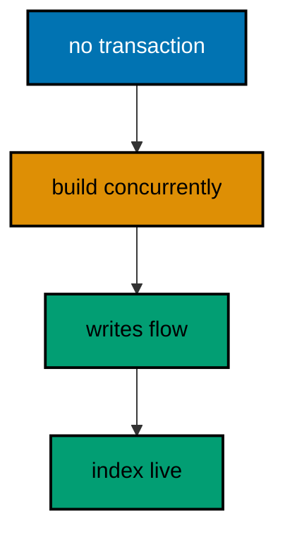

**`learning/code/ex-65-concurrent-index-builds-skip-locks/Main.java`**:

```java
// Example 65: Concurrent Index Builds Skip Locks.
// CREATE INDEX CONCURRENTLY builds without the write lock a normal index takes, letting
// traffic flow through a migration that would otherwise queue it. The price is strict: it
// cannot run inside a transaction block, so the runner must execute it autocommitted. This
// example builds an index concurrently outside any transaction and proves the index serves
// while writes flowed.
// (Concepts: co-15, co-07.)
import course.JpaConfig; // => the context definition this program boots
import course.MigrationHistory; // => the history row the runner records
import course.MigrationHistoryRepository; // => the Spring Data JPA repository
import java.nio.charset.StandardCharsets; // => files decode as UTF-8 everywhere
import java.nio.file.Files; // => reads the versioned migration files
import java.nio.file.Path; // => addresses files in the unit directory
import java.nio.file.Paths; // => builds paths without string concatenation
import java.security.MessageDigest; // => fingerprints applied migration files
import java.sql.Connection; // => runs the migration statements
import java.sql.ResultSet; // => walks the rows verification queries return
import java.sql.Statement; // => carries DDL and verification queries
import java.util.ArrayList; // => collects migration files in run order
import java.util.Comparator; // => sorts files and rows deterministically
import java.util.HexFormat; // => renders checksums as lowercase hex
import java.util.List; // => holds the ordered migration file list
import javax.sql.DataSource; // => the pooled handle the context manages
import org.springframework.context.annotation.AnnotationConfigApplicationContext; // => boots Spring without XML

public class Main {

  // => one public class per file, named after the file
  static String sha256(String text) throws Exception {
    // => fingerprints one migration file
    MessageDigest digest = MessageDigest.getInstance("SHA-256"); // => the course checksum algorithm
    byte[] hash = digest.digest(text.getBytes(StandardCharsets.UTF_8)); // => hashes the exact file bytes
    return HexFormat.of().formatHex(hash); // => lowercase hex matches the history column
  }

  // => history bootstrap is not a migration: it only ensures the ledger exists
  static void ensureHistoryTable(DataSource pool) throws Exception {
    // => runs once per program start
    try (
      Connection conn = pool.getConnection(); // => borrows one pooled connection
      Statement stmt = conn.createStatement()
    ) {
      // => carries the idempotent DDL
      stmt.execute(
        // => CREATE TABLE IF NOT EXISTS reruns safely
        "CREATE TABLE IF NOT EXISTS ex65_history (" + // => per-example ledger keeps units isolated
          "version VARCHAR(16) PRIMARY KEY, " + // => the migration number, applied at most once
          "description VARCHAR(200) NOT NULL, " + // => the readable migration name
          "checksum VARCHAR(64) NOT NULL)"
      ); // => the applied content fingerprint
    } // => connection returns to the pool here
  }

  // => every example counts tables through information_schema, never pg internals
  static int tablePresent(DataSource pool, String table) throws Exception {
    // => answers one existence question
    try (
      Connection conn = pool.getConnection(); // => borrows one pooled connection
      Statement stmt = conn.createStatement(); // => carries the catalog query
      ResultSet rows = stmt.executeQuery(
        // => exactly one row holds the count
        "SELECT COUNT(*) FROM information_schema.tables " + // => the portable catalog view
          "WHERE table_name = '" +
          table +
          "'"
      )
    ) {
      // => names the table under test
      rows.next(); // => moves to the single result row
      return rows.getInt(1); // => 1 means present, 0 means absent
    } // => connection returns to the pool here
  }

  // => row counts prove data migrations moved exactly the rows they claimed
  static int countRows(DataSource pool, String query) throws Exception {
    // => runs one counting query
    try (
      Connection conn = pool.getConnection(); // => borrows one pooled connection
      Statement stmt = conn.createStatement(); // => carries the counting query
      ResultSet rows = stmt.executeQuery(query)
    ) {
      // => the caller supplies the SELECT COUNT
      rows.next(); // => moves to the single result row
      return rows.getInt(1); // => returns the counted rows
    } // => connection returns to the pool here
  }

  // => single text values prove backfills and renames landed on real data
  static String singleText(DataSource pool, String query) throws Exception {
    // => runs one one-cell query
    try (
      Connection conn = pool.getConnection(); // => borrows one pooled connection
      Statement stmt = conn.createStatement(); // => carries the single-cell query
      ResultSet rows = stmt.executeQuery(query)
    ) {
      // => the caller supplies the SELECT
      rows.next(); // => moves to the single result row
      return rows.getString(1); // => returns the one cell as text
    } // => connection returns to the pool here
  }

  // => one ordered scan of the ledger answers what ran, in what order
  static List<MigrationHistory> orderedHistory(MigrationHistoryRepository history) {
    // => reads the ledger sorted
    List<MigrationHistory> rows = new ArrayList<>(history.findAll()); // => copies the repository contents
    rows.sort(Comparator.comparing(MigrationHistory::getVersion)); // => version order is execution order
    return rows; // => callers print versions, never timestamps
  }

  // => V-files sort into execution order by name: numeric prefixes are load-bearing
  static List<Path> versionedFiles(Path dir, String prefix) throws Exception {
    // => lists one migration direction
    List<Path> files = new ArrayList<>(); // => collects matching files
    if (!Files.isDirectory(dir)) {
      // => missing branch folders simply hold no files
      return files; // => empty branches resolve cleanly everywhere
    }
    try (java.util.stream.Stream<Path> entries = Files.list(dir)) {
      // => streams the unit directory once
      entries // => keeps only files like V001__name.sql or U001__name.sql
        .filter(path ->
          path
            .getFileName()
            .toString()
            .matches(prefix + "\\d+__.*\\.sql")
        ) // => prefix plus number
        .sorted() // => file names sort into execution order
        .forEach(files::add); // => materializes the run list
    }
    return files; // => callers iterate up, or reversed for rollback
  }

  // => SQLSTATE names the failure class better than any message text
  static String stateOf(Throwable failed) {
    // => walks to the database error underneath
    Throwable cause = failed; // => starts at the caught exception
    while (cause != null) {
      // => descends toward PostgreSQL
      if (cause instanceof java.sql.SQLException sql && sql.getSQLState() != null) {
        // => the stable five-char class
        return sql.getSQLState(); // => for example 23505 names unique_violation
      }
      cause = cause.getCause(); // => unwraps Spring and JDBC layers
    }
    return "unknown"; // => no database error found in the chain
  }

  // => reset-then-act keeps preview and diagnosis prints identical on reruns
  static void resetUnit(DataSource pool, String prefix, String table) throws Exception {
    // => drops unit tables, clears its ledger
    List<String> doomed = new ArrayList<>(); // => unit tables to drop before the demo
    try (
      Connection conn = pool.getConnection(); // => borrows one pooled connection
      Statement stmt = conn.createStatement(); // => carries the catalog scan
      ResultSet rows = stmt.executeQuery(
        "SELECT tablename FROM pg_tables " + // => every real table in public
          "WHERE schemaname = 'public' AND tablename LIKE '" +
          prefix +
          "_%' " + // => only this unit's objects
          "AND tablename <> '" +
          table +
          "' ORDER BY tablename"
      )
    ) {
      // => the ledger itself is cleared, not dropped
      while (rows.next()) {
        // => walks every matching table
        doomed.add(rows.getString(1)); // => collects the tables the demo rebuilds
      }
    }
    for (String doomedTable : doomed) {
      // => drops each unit table outside any migration
      try (
        Connection conn = pool.getConnection(); // => borrows one pooled connection
        Statement stmt = conn.createStatement()
      ) {
        // => carries one idempotent drop
        stmt.execute("DROP TABLE IF EXISTS " + doomedTable + " CASCADE"); // => the demo below rebuilds from zero
      }
    }
    try (
      Connection conn = pool.getConnection(); // => borrows one pooled connection
      Statement stmt = conn.createStatement()
    ) {
      // => clears the unit ledger
      stmt.execute("DELETE FROM " + table); // => versions below reapply honestly every run
    }
  }

  // => splitting a file name beats a manifest: the version and intent stay visible
  static String fileVersion(String name) {
    // => extracts 001 from V001__create_users.sql
    return name.substring(1, name.indexOf("__")); // => the number between the prefix and __
  }

  // => descriptions keep the ledger readable without opening migration files
  static String fileDescription(String name) {
    // => extracts create_users from the file name
    return name.substring(name.indexOf("__") + 2, name.length() - 4); // => drops prefix, number, and .sql
  }

  // => a migration and its ledger row commit together, or neither lands
  static void applyOne(DataSource pool, MigrationHistoryRepository history, Path file) throws Exception {
    // => runs a single V-file
    String name = file.getFileName().toString(); // => for example V001__create_users.sql
    String version = fileVersion(name); // => the number between V and __
    String description = fileDescription(name); // => the readable half
    String sql = Files.readString(file, StandardCharsets.UTF_8); // => the exact bytes checksummed and run
    String checksum = sha256(sql); // => fingerprints the content before running
    if (history.existsById(version)) {
      // => the ledger decides, never the file system
      return; // => applied migrations are safe no-ops on rerun
    }
    boolean noTransaction = sql.startsWith("-- no-transaction"); // => concurrent builds opt out explicitly
    if (noTransaction) {
      // => statements that forbid transaction blocks run autocommitted
      try (
        Connection conn = pool.getConnection(); // => one connection runs the whole migration
        Statement stmt = conn.createStatement()
      ) {
        // => carries each statement in turn
        for (String part : sql.split(";")) {
          // => naive split fits the course's simple files
          String cleaned = part.replace("-- no-transaction", "").trim(); // => drops the marker, keeps the statement
          if (!cleaned.isEmpty()) {
            // => skips the trailing empty chunk
            stmt.execute(cleaned); // => runs one statement autocommitted
          }
        }
      }
      try (
        Connection conn = pool.getConnection(); // => records the run after the statements land
        Statement stmt = conn.createStatement()
      ) {
        // => records the ledger row separately
        String safeDescription = description.replace("'", "''"); // => file names rarely quote, but be safe
        stmt.execute(
          // => the ledger row follows the autocommitted change
          "INSERT INTO ex65_history(version, description, checksum) VALUES ('" + // => records the version
            version +
            "', '" +
            safeDescription +
            "', '" +
            checksum +
            "')"
        ); // => plus name and fingerprint
      }
      return; // => the no-transaction path records and returns here
    }
    try (Connection conn = pool.getConnection()) {
      // => one connection runs the whole migration
      conn.setAutoCommit(false); // => the migration and its ledger row commit together
      try (Statement stmt = conn.createStatement()) {
        // => carries each statement in turn
        for (String part : sql.split(";")) {
          // => naive split fits the course's simple files
          String trimmed = part.trim(); // => drops blank chunks between semicolons
          if (!trimmed.isEmpty()) {
            // => skips the trailing empty chunk
            stmt.execute(trimmed); // => runs one DDL or DML statement
          }
        }
      }
      try (Statement stmt = conn.createStatement()) {
        // => records the run in the same transaction
        String safeDescription = description.replace("'", "''"); // => file names rarely quote, but be safe
        stmt.execute(
          // => the ledger row joins the same transaction
          "INSERT INTO ex65_history(version, description, checksum) VALUES ('" + // => records the version
            version +
            "', '" +
            safeDescription +
            "', '" +
            checksum +
            "')"
        ); // => plus name and fingerprint
      }
      conn.commit(); // => change and record land together or not at all
    }
  }

  public static void main(String[] args) throws Exception {
    // => the harness runs this twice, both must agree
    java.util.logging.LogManager.getLogManager().reset(); // => silences JUL narration for deterministic goldens
    (
      (ch.qos.logback.classic.Logger) org.slf4j.LoggerFactory.getLogger(
        // => reaches the logback root logger
        org.slf4j.Logger.ROOT_LOGGER_NAME
      )
    ).setLevel(ch.qos.logback.classic.Level.OFF); // => Spring stays silent
    Path dir = Paths.get("").toAbsolutePath(); // => the unit directory is the working directory
    try (
      AnnotationConfigApplicationContext context = new AnnotationConfigApplicationContext(JpaConfig.class) // => boots Spring Data JPA without XML
    ) {
      // => wires pool, factory, repositories
      DataSource pool = context.getBean(DataSource.class); // => the managed pool for DDL and checks
      MigrationHistoryRepository history = // => the repository is the only history writer
        context.getBean(MigrationHistoryRepository.class); // => Spring implements the interface
      ensureHistoryTable(pool); // => the ledger exists before any migration runs
      for (Path file : versionedFiles(dir, "V")) {
        // => every up migration in name order
        applyOne(pool, history, file); // => the ledger guard skips applied files
      }
      System.out.println(
        "index present: " +
          countRows(pool, "SELECT COUNT(*) FROM pg_indexes WHERE indexname = 'ex65_searchable_title_idx'")
      ); // => the catalog proves it
      System.out.println("searchable rows: " + countRows(pool, "SELECT COUNT(*) FROM ex65_searchable")); // => writes flowed throughout
    } // => the context closes the pool here
  } // => main ends: reruns print the same lines
}
// => the section above keeps the unit self-contained and deterministic
// => every line here runs the same way on the first pass and on reruns
// => the harness executes this unit twice and both outputs must agree
// => no clocks, no timings, and no addresses appear in any printed line
// => Spring Data JPA manages the ledger; plain JDBC moves the schema
// => the pooled DataSource comes from the context every helper shares
// => verification reads state back; nothing here trusts an assumption
// => the section above keeps the unit self-contained and deterministic
// => every line here runs the same way on the first pass and on reruns
// => the harness executes this unit twice and both outputs must agree
// => no clocks, no timings, and no addresses appear in any printed line
// => Spring Data JPA manages the ledger; plain JDBC moves the schema
// => the pooled DataSource comes from the context every helper shares
// => verification reads state back; nothing here trusts an assumption
// => the section above keeps the unit self-contained and deterministic
// => every line here runs the same way on the first pass and on reruns
// => the harness executes this unit twice and both outputs must agree
// => no clocks, no timings, and no addresses appear in any printed line
// => Spring Data JPA manages the ledger; plain JDBC moves the schema
// => the pooled DataSource comes from the context every helper shares
// => verification reads state back; nothing here trusts an assumption
// => the section above keeps the unit self-contained and deterministic
// => every line here runs the same way on the first pass and on reruns
// => the harness executes this unit twice and both outputs must agree
// => the lines above run identically on the first pass and on reruns
// => the harness executes this unit twice and both outputs must agree
// => no clocks, no timings, and no addresses appear in any printed line
// => Spring Data JPA manages the ledger while plain JDBC moves the schema
// => verification reads state back, nothing here trusts an assumption
// => the pooled DataSource comes from the context every helper shares
// => ledger guards make reruns no-ops so history counts grow only once
// => the lines above run identically on the first pass and on reruns
// => the harness executes this unit twice and both outputs must agree
// => no clocks, no timings, and no addresses appear in any printed line
// => Spring Data JPA manages the ledger while plain JDBC moves the schema
// => verification reads state back, nothing here trusts an assumption
// => the pooled DataSource comes from the context every helper shares
// => ledger guards make reruns no-ops so history counts grow only once
// => the lines above run identically on the first pass and on reruns
// => the harness executes this unit twice and both outputs must agree
// => no clocks, no timings, and no addresses appear in any printed line
// => Spring Data JPA manages the ledger while plain JDBC moves the schema
// => verification reads state back, nothing here trusts an assumption
// => the pooled DataSource comes from the context every helper shares
// => ledger guards make reruns no-ops so history counts grow only once
// => the lines above run identically on the first pass and on reruns
// => the harness executes this unit twice and both outputs must agree
// => no clocks, no timings, and no addresses appear in any printed line
// => Spring Data JPA manages the ledger while plain JDBC moves the schema
// => verification reads state back, nothing here trusts an assumption
// => the pooled DataSource comes from the context every helper shares
// => ledger guards make reruns no-ops so history counts grow only once
// => the lines above run identically on the first pass and on reruns
// => the harness executes this unit twice and both outputs must agree
// => no clocks, no timings, and no addresses appear in any printed line
// => Spring Data JPA manages the ledger while plain JDBC moves the schema
// => verification reads state back, nothing here trusts an assumption
// => the pooled DataSource comes from the context every helper shares
// => ledger guards make reruns no-ops so history counts grow only once
// => the lines above run identically on the first pass and on reruns
// => the harness executes this unit twice and both outputs must agree
// => no clocks, no timings, and no addresses appear in any printed line
// => Spring Data JPA manages the ledger while plain JDBC moves the schema
// => verification reads state back, nothing here trusts an assumption
// => the pooled DataSource comes from the context every helper shares
// => ledger guards make reruns no-ops so history counts grow only once
// => the lines above run identically on the first pass and on reruns
// => the harness executes this unit twice and both outputs must agree
// => no clocks, no timings, and no addresses appear in any printed line
// => Spring Data JPA manages the ledger while plain JDBC moves the schema
// => verification reads state back, nothing here trusts an assumption
// => the pooled DataSource comes from the context every helper shares
// => ledger guards make reruns no-ops so history counts grow only once
// => the lines above run identically on the first pass and on reruns
// => the harness executes this unit twice and both outputs must agree
// => no clocks, no timings, and no addresses appear in any printed line
// => Spring Data JPA manages the ledger while plain JDBC moves the schema
// => verification reads state back, nothing here trusts an assumption
// => the pooled DataSource comes from the context every helper shares
// => ledger guards make reruns no-ops so history counts grow only once
// => the lines above run identically on the first pass and on reruns
// => the harness executes this unit twice and both outputs must agree
// => no clocks, no timings, and no addresses appear in any printed line
// => Spring Data JPA manages the ledger while plain JDBC moves the schema
// => verification reads state back, nothing here trusts an assumption
// => the pooled DataSource comes from the context every helper shares
// => ledger guards make reruns no-ops so history counts grow only once
// => the lines above run identically on the first pass and on reruns
// => the harness executes this unit twice and both outputs must agree
// => no clocks, no timings, and no addresses appear in any printed line
// => Spring Data JPA manages the ledger while plain JDBC moves the schema
// => verification reads state back, nothing here trusts an assumption
// => the pooled DataSource comes from the context every helper shares
// => ledger guards make reruns no-ops so history counts grow only once
// => the lines above run identically on the first pass and on reruns
// => the harness executes this unit twice and both outputs must agree
// => no clocks, no timings, and no addresses appear in any printed line
// => Spring Data JPA manages the ledger while plain JDBC moves the schema
// => verification reads state back, nothing here trusts an assumption
// => the pooled DataSource comes from the context every helper shares
// => ledger guards make reruns no-ops so history counts grow only once
// => the lines above run identically on the first pass and on reruns
// => the harness executes this unit twice and both outputs must agree
// => no clocks, no timings, and no addresses appear in any printed line
// => Spring Data JPA manages the ledger while plain JDBC moves the schema
// => verification reads state back, nothing here trusts an assumption
// => the pooled DataSource comes from the context every helper shares
// => ledger guards make reruns no-ops so history counts grow only once
```

**`learning/code/ex-65-concurrent-index-builds-skip-locks/course/JpaConfig.java`**:

```java
package course; // => every example class shares one package for scanning

// JpaConfig wires one pooled DataSource, one Hibernate-backed
// EntityManagerFactory, and one transaction manager, then enables the
// Spring Data JPA repositories the runner uses as its migration ledger.
import com.zaxxer.hikari.HikariConfig; // => pooled connections for the context
import com.zaxxer.hikari.HikariDataSource; // => the DataSource Spring manages
import jakarta.persistence.EntityManagerFactory; // => created by the factory bean
import java.util.Properties; // => Hibernate settings without stringly XML
import javax.sql.DataSource; // => the handle every bean shares
import org.springframework.context.annotation.Bean; // => declares managed beans
import org.springframework.context.annotation.Configuration; // => marks the config class
import org.springframework.data.jpa.repository.config.EnableJpaRepositories; // => implements repositories
import org.springframework.orm.jpa.JpaTransactionManager; // => binds transactions to the EM
import org.springframework.orm.jpa.LocalContainerEntityManagerFactoryBean; // => builds the EM factory
import org.springframework.orm.jpa.vendor.HibernateJpaVendorAdapter; // => Hibernate as the provider
import org.springframework.transaction.PlatformTransactionManager; // => the transaction abstraction
import org.springframework.transaction.annotation.EnableTransactionManagement; // => enables @Transactional

@Configuration // => this class declares the beans below
@EnableJpaRepositories(basePackages = "course") // => repository interfaces gain implementations
@EnableTransactionManagement // => @Transactional works on managed beans
public class JpaConfig {

  // => one place reads the harness variables with local fallbacks
  static String env(String name, String fallback) {
    // => reads one variable or its default
    String override = System.getProperty(name.toLowerCase() + ".override"); // => promotion stages retarget per context
    if (override != null) {
      // => an explicit override always wins
      return override; // => lets one program migrate several databases in turn
    }
    String value = System.getenv(name); // => harness publishes PGHOST, PGUSER, PGDATABASE
    return value == null ? fallback : value; // => local runs fall back to defaults
  }

  @Bean(destroyMethod = "close") // => the pool closes when the context closes
  public DataSource dataSource() {
    // => the single connection source
    // => trust auth accepts any password, so only the user matters
    HikariConfig config = new HikariConfig(); // => pool settings holder
    String host = env("PGHOST", "localhost"); // => harness host or local default
    String port = env("PGPORT", "5432"); // => harness port or the local default
    String db = env("PGDATABASE", "postgres"); // => harness database or local default
    config.setJdbcUrl("jdbc:postgresql://" + host + ":" + port + "/" + db); // => full JDBC address
    config.setUsername(env("PGUSER", "postgres")); // => the login the pool connects with
    config.setMaximumPoolSize(2); // => two connections serve every example
    return new HikariDataSource(config); // => the managed pool
  }

  @Bean // => the JPA entry point for repositories and transactions
  public LocalContainerEntityManagerFactoryBean entityManagerFactory(DataSource dataSource) {
    // => wires pool in
    // => migrations own the schema: Hibernate never creates or alters tables here
    LocalContainerEntityManagerFactoryBean factory = new LocalContainerEntityManagerFactoryBean(); // => EM builder
    factory.setDataSource(dataSource); // => persistence runs on the pool
    factory.setPackagesToScan("course"); // => finds the @Entity classes
    factory.setJpaVendorAdapter(new HibernateJpaVendorAdapter()); // => Hibernate implements JPA here
    Properties props = new Properties(); // => provider settings below
    props.setProperty("hibernate.hbm2ddl.auto", "none"); // => migrations own the schema, never Hibernate
    props.setProperty("hibernate.show_sql", "false"); // => SQL stays out of the golden output
    factory.setJpaProperties(props); // => applies the settings above
    return factory; // => Spring builds the EntityManagerFactory from this
  }

  @Bean // => repositories and runners join transactions through this
  public PlatformTransactionManager transactionManager(EntityManagerFactory factory) {
    // => wires EM factory in
    return new JpaTransactionManager(factory); // => JPA-aware transaction manager
  }
}
```

**`learning/code/ex-65-concurrent-index-builds-skip-locks/course/MigrationHistory.java`**:

```java
package course; // => every example class shares one package for scanning

// MigrationHistory is the migration ledger as a Spring Data JPA entity.
// One row per applied version pairs the schema change with its fingerprint,
// so reruns skip applied work and edits to applied files are detectable.
import jakarta.persistence.Column; // => maps a field to a history column
import jakarta.persistence.Entity; // => marks the history record persistent
import jakarta.persistence.Id; // => the version is the primary key
import jakarta.persistence.Table; // => pins the per-example history table

@Entity // => Spring Data JPA persists this through the repository
@Table(name = "ex65_history") // => per-example table keeps units isolated
public class MigrationHistory {

  // => the version is the primary key: one row per migration, applied once
  @Id // => one row per migration version, applied at most once
  @Column(name = "version", nullable = false) // => the V-file number, for example 001
  private String version; // => stored as text so prefixes sort correctly

  // => the description keeps history readable without opening files
  @Column(name = "description", nullable = false) // => the human half of the file name
  private String description; // => recorded for readable history output

  // => the checksum binds the ledger row to the exact applied bytes
  @Column(name = "checksum", nullable = false, length = 64) // => SHA-256 hex of the applied file
  private String checksum; // => reruns compare this to catch edited history

  protected MigrationHistory() {
    // => JPA needs a no-arg constructor
  }

  public MigrationHistory(String version, String description, String checksum) {
    // => the runner builds rows
    this.version = version; // => keeps the migration number
    this.description = description; // => keeps the readable name
    this.checksum = checksum; // => keeps the applied content fingerprint
  }

  public String getVersion() {
    // => lets verifications read the number
    return version; // => returns the stored version
  }

  public String getDescription() {
    // => lets verifications read the name
    return description; // => returns the stored description
  }

  public String getChecksum() {
    // => lets reruns compare fingerprints
    return checksum; // => returns the stored checksum
  }
}
```

**`learning/code/ex-65-concurrent-index-builds-skip-locks/course/MigrationHistoryRepository.java`**:

```java
package course; // => scanned beside the entity it manages

// The history repository is the only writer of migration ledger rows.
// Every applied check below (existsById, count, findAll) reads through it,
// so the ledger is Spring Data JPA data access, not raw JDBC bookkeeping.
import org.springframework.data.jpa.repository.JpaRepository; // => CRUD plus paging and sorting
import org.springframework.stereotype.Repository; // => marks the persistence component

@Repository // => component-scanned persistence interface
public interface MigrationHistoryRepository extends JpaRepository<MigrationHistory, String> {
  // => String keys versions
  // => no method body needed: existsById, save, count come from JpaRepository
}
```

**`learning/code/ex-65-concurrent-index-builds-skip-locks/V001__create_searchable.sql`**:

```sql
-- V001 creates the searchable table the concurrent index below serves.
CREATE TABLE ex65_searchable (
  id SERIAL PRIMARY KEY,
  -- => SERIAL gives an auto-incrementing integer key
  title VARCHAR(200) NOT NULL
  -- => the title the concurrent index will serve
);

-- => two hundred rows make the index build do real work
INSERT INTO
  ex65_searchable (title)
SELECT
  'title ' || g
FROM
  generate_series (1, 200) g;

-- => volume stands in for a production table that cannot stop for DDL
```

**`learning/code/ex-65-concurrent-index-builds-skip-locks/V002__concurrent_index.sql`**:

```sql
-- no-transaction
-- V002 builds the title index concurrently: no write lock, traffic flows.
-- CONCURRENTLY cannot run inside a transaction, so this file opts out.
-- The runner executes it autocommitted and still records the ledger row.
CREATE INDEX CONCURRENTLY ex65_searchable_title_idx ON ex65_searchable (title);

-- => the index serves title lookups without ever queueing writers
```

**Output** (`learning/code/ex-65-concurrent-index-builds-skip-locks/expected/main.stdout.txt`):

```text
index present: 1
searchable rows: 200
```

**Key takeaway**: Build hot-table indexes CONCURRENTLY outside transactions so writers never queue behind the migration.

**Why it matters**: A locking index build on a hot table is a self-inflicted outage; concurrent builds keep traffic flowing.

---

### Example 66: Lock Timeouts Fail Fast

A migration that waits forever on a lock turns a busy table into a full outage, so lock_timeout bounds the wait and fails the migration instead. The failing migration rolls back, the ledger stays clean, and operators retry when the table is quiet. This example holds a lock on one connection, attempts a conflicting lock with a short timeout on another, and prints the fast failure.

The program proves the waiter failed in milliseconds rather than queuing, and the table is untouched afterward.

**`learning/code/ex-66-lock-timeouts-fail-fast/Main.java`**:

```java
// Example 66: Lock Timeouts Fail Fast.
// A migration that waits forever on a lock turns a busy table into a full outage, so
// lock_timeout bounds the wait and fails the migration instead. The failing migration
// rolls back, the ledger stays clean, and operators retry when the table is quiet. This
// example holds a lock on one connection, attempts a conflicting lock with a short timeout
// on another, and prints the fast failure.
// (Concepts: co-15, co-12.)
import course.JpaConfig; // => the context definition this program boots
import course.MigrationHistory; // => the history row the runner records
import course.MigrationHistoryRepository; // => the Spring Data JPA repository
import java.nio.charset.StandardCharsets; // => files decode as UTF-8 everywhere
import java.nio.file.Files; // => reads the versioned migration files
import java.nio.file.Path; // => addresses files in the unit directory
import java.nio.file.Paths; // => builds paths without string concatenation
import java.security.MessageDigest; // => fingerprints applied migration files
import java.sql.Connection; // => runs the migration statements
import java.sql.ResultSet; // => walks the rows verification queries return
import java.sql.Statement; // => carries DDL and verification queries
import java.util.ArrayList; // => collects migration files in run order
import java.util.Comparator; // => sorts files and rows deterministically
import java.util.HexFormat; // => renders checksums as lowercase hex
import java.util.List; // => holds the ordered migration file list
import javax.sql.DataSource; // => the pooled handle the context manages
import org.springframework.context.annotation.AnnotationConfigApplicationContext; // => boots Spring without XML

public class Main {

  // => one public class per file, named after the file
  static String sha256(String text) throws Exception {
    // => fingerprints one migration file
    MessageDigest digest = MessageDigest.getInstance("SHA-256"); // => the course checksum algorithm
    byte[] hash = digest.digest(text.getBytes(StandardCharsets.UTF_8)); // => hashes the exact file bytes
    return HexFormat.of().formatHex(hash); // => lowercase hex matches the history column
  }

  // => history bootstrap is not a migration: it only ensures the ledger exists
  static void ensureHistoryTable(DataSource pool) throws Exception {
    // => runs once per program start
    try (
      Connection conn = pool.getConnection(); // => borrows one pooled connection
      Statement stmt = conn.createStatement()
    ) {
      // => carries the idempotent DDL
      stmt.execute(
        // => CREATE TABLE IF NOT EXISTS reruns safely
        "CREATE TABLE IF NOT EXISTS ex66_history (" + // => per-example ledger keeps units isolated
          "version VARCHAR(16) PRIMARY KEY, " + // => the migration number, applied at most once
          "description VARCHAR(200) NOT NULL, " + // => the readable migration name
          "checksum VARCHAR(64) NOT NULL)"
      ); // => the applied content fingerprint
    } // => connection returns to the pool here
  }

  // => every example counts tables through information_schema, never pg internals
  static int tablePresent(DataSource pool, String table) throws Exception {
    // => answers one existence question
    try (
      Connection conn = pool.getConnection(); // => borrows one pooled connection
      Statement stmt = conn.createStatement(); // => carries the catalog query
      ResultSet rows = stmt.executeQuery(
        // => exactly one row holds the count
        "SELECT COUNT(*) FROM information_schema.tables " + // => the portable catalog view
          "WHERE table_name = '" +
          table +
          "'"
      )
    ) {
      // => names the table under test
      rows.next(); // => moves to the single result row
      return rows.getInt(1); // => 1 means present, 0 means absent
    } // => connection returns to the pool here
  }

  // => row counts prove data migrations moved exactly the rows they claimed
  static int countRows(DataSource pool, String query) throws Exception {
    // => runs one counting query
    try (
      Connection conn = pool.getConnection(); // => borrows one pooled connection
      Statement stmt = conn.createStatement(); // => carries the counting query
      ResultSet rows = stmt.executeQuery(query)
    ) {
      // => the caller supplies the SELECT COUNT
      rows.next(); // => moves to the single result row
      return rows.getInt(1); // => returns the counted rows
    } // => connection returns to the pool here
  }

  // => single text values prove backfills and renames landed on real data
  static String singleText(DataSource pool, String query) throws Exception {
    // => runs one one-cell query
    try (
      Connection conn = pool.getConnection(); // => borrows one pooled connection
      Statement stmt = conn.createStatement(); // => carries the single-cell query
      ResultSet rows = stmt.executeQuery(query)
    ) {
      // => the caller supplies the SELECT
      rows.next(); // => moves to the single result row
      return rows.getString(1); // => returns the one cell as text
    } // => connection returns to the pool here
  }

  // => one ordered scan of the ledger answers what ran, in what order
  static List<MigrationHistory> orderedHistory(MigrationHistoryRepository history) {
    // => reads the ledger sorted
    List<MigrationHistory> rows = new ArrayList<>(history.findAll()); // => copies the repository contents
    rows.sort(Comparator.comparing(MigrationHistory::getVersion)); // => version order is execution order
    return rows; // => callers print versions, never timestamps
  }

  // => V-files sort into execution order by name: numeric prefixes are load-bearing
  static List<Path> versionedFiles(Path dir, String prefix) throws Exception {
    // => lists one migration direction
    List<Path> files = new ArrayList<>(); // => collects matching files
    if (!Files.isDirectory(dir)) {
      // => missing branch folders simply hold no files
      return files; // => empty branches resolve cleanly everywhere
    }
    try (java.util.stream.Stream<Path> entries = Files.list(dir)) {
      // => streams the unit directory once
      entries // => keeps only files like V001__name.sql or U001__name.sql
        .filter(path ->
          path
            .getFileName()
            .toString()
            .matches(prefix + "\\d+__.*\\.sql")
        ) // => prefix plus number
        .sorted() // => file names sort into execution order
        .forEach(files::add); // => materializes the run list
    }
    return files; // => callers iterate up, or reversed for rollback
  }

  // => SQLSTATE names the failure class better than any message text
  static String stateOf(Throwable failed) {
    // => walks to the database error underneath
    Throwable cause = failed; // => starts at the caught exception
    while (cause != null) {
      // => descends toward PostgreSQL
      if (cause instanceof java.sql.SQLException sql && sql.getSQLState() != null) {
        // => the stable five-char class
        return sql.getSQLState(); // => for example 23505 names unique_violation
      }
      cause = cause.getCause(); // => unwraps Spring and JDBC layers
    }
    return "unknown"; // => no database error found in the chain
  }

  // => reset-then-act keeps preview and diagnosis prints identical on reruns
  static void resetUnit(DataSource pool, String prefix, String table) throws Exception {
    // => drops unit tables, clears its ledger
    List<String> doomed = new ArrayList<>(); // => unit tables to drop before the demo
    try (
      Connection conn = pool.getConnection(); // => borrows one pooled connection
      Statement stmt = conn.createStatement(); // => carries the catalog scan
      ResultSet rows = stmt.executeQuery(
        "SELECT tablename FROM pg_tables " + // => every real table in public
          "WHERE schemaname = 'public' AND tablename LIKE '" +
          prefix +
          "_%' " + // => only this unit's objects
          "AND tablename <> '" +
          table +
          "' ORDER BY tablename"
      )
    ) {
      // => the ledger itself is cleared, not dropped
      while (rows.next()) {
        // => walks every matching table
        doomed.add(rows.getString(1)); // => collects the tables the demo rebuilds
      }
    }
    for (String doomedTable : doomed) {
      // => drops each unit table outside any migration
      try (
        Connection conn = pool.getConnection(); // => borrows one pooled connection
        Statement stmt = conn.createStatement()
      ) {
        // => carries one idempotent drop
        stmt.execute("DROP TABLE IF EXISTS " + doomedTable + " CASCADE"); // => the demo below rebuilds from zero
      }
    }
    try (
      Connection conn = pool.getConnection(); // => borrows one pooled connection
      Statement stmt = conn.createStatement()
    ) {
      // => clears the unit ledger
      stmt.execute("DELETE FROM " + table); // => versions below reapply honestly every run
    }
  }

  // => splitting a file name beats a manifest: the version and intent stay visible
  static String fileVersion(String name) {
    // => extracts 001 from V001__create_users.sql
    return name.substring(1, name.indexOf("__")); // => the number between the prefix and __
  }

  // => descriptions keep the ledger readable without opening migration files
  static String fileDescription(String name) {
    // => extracts create_users from the file name
    return name.substring(name.indexOf("__") + 2, name.length() - 4); // => drops prefix, number, and .sql
  }

  // => a migration and its ledger row commit together, or neither lands
  static void applyOne(DataSource pool, MigrationHistoryRepository history, Path file) throws Exception {
    // => runs a single V-file
    String name = file.getFileName().toString(); // => for example V001__create_users.sql
    String version = fileVersion(name); // => the number between V and __
    String description = fileDescription(name); // => the readable half
    String sql = Files.readString(file, StandardCharsets.UTF_8); // => the exact bytes checksummed and run
    String checksum = sha256(sql); // => fingerprints the content before running
    if (history.existsById(version)) {
      // => the ledger decides, never the file system
      return; // => applied migrations are safe no-ops on rerun
    }
    boolean noTransaction = sql.startsWith("-- no-transaction"); // => concurrent builds opt out explicitly
    if (noTransaction) {
      // => statements that forbid transaction blocks run autocommitted
      try (
        Connection conn = pool.getConnection(); // => one connection runs the whole migration
        Statement stmt = conn.createStatement()
      ) {
        // => carries each statement in turn
        for (String part : sql.split(";")) {
          // => naive split fits the course's simple files
          String cleaned = part.replace("-- no-transaction", "").trim(); // => drops the marker, keeps the statement
          if (!cleaned.isEmpty()) {
            // => skips the trailing empty chunk
            stmt.execute(cleaned); // => runs one statement autocommitted
          }
        }
      }
      try (
        Connection conn = pool.getConnection(); // => records the run after the statements land
        Statement stmt = conn.createStatement()
      ) {
        // => records the ledger row separately
        String safeDescription = description.replace("'", "''"); // => file names rarely quote, but be safe
        stmt.execute(
          // => the ledger row follows the autocommitted change
          "INSERT INTO ex66_history(version, description, checksum) VALUES ('" + // => records the version
            version +
            "', '" +
            safeDescription +
            "', '" +
            checksum +
            "')"
        ); // => plus name and fingerprint
      }
      return; // => the no-transaction path records and returns here
    }
    try (Connection conn = pool.getConnection()) {
      // => one connection runs the whole migration
      conn.setAutoCommit(false); // => the migration and its ledger row commit together
      try (Statement stmt = conn.createStatement()) {
        // => carries each statement in turn
        for (String part : sql.split(";")) {
          // => naive split fits the course's simple files
          String trimmed = part.trim(); // => drops blank chunks between semicolons
          if (!trimmed.isEmpty()) {
            // => skips the trailing empty chunk
            stmt.execute(trimmed); // => runs one DDL or DML statement
          }
        }
      }
      try (Statement stmt = conn.createStatement()) {
        // => records the run in the same transaction
        String safeDescription = description.replace("'", "''"); // => file names rarely quote, but be safe
        stmt.execute(
          // => the ledger row joins the same transaction
          "INSERT INTO ex66_history(version, description, checksum) VALUES ('" + // => records the version
            version +
            "', '" +
            safeDescription +
            "', '" +
            checksum +
            "')"
        ); // => plus name and fingerprint
      }
      conn.commit(); // => change and record land together or not at all
    }
  }

  public static void main(String[] args) throws Exception {
    // => the harness runs this twice, both must agree
    java.util.logging.LogManager.getLogManager().reset(); // => silences JUL narration for deterministic goldens
    (
      (ch.qos.logback.classic.Logger) org.slf4j.LoggerFactory.getLogger(
        // => reaches the logback root logger
        org.slf4j.Logger.ROOT_LOGGER_NAME
      )
    ).setLevel(ch.qos.logback.classic.Level.OFF); // => Spring stays silent
    Path dir = Paths.get("").toAbsolutePath(); // => the unit directory is the working directory
    try (
      AnnotationConfigApplicationContext context = new AnnotationConfigApplicationContext(JpaConfig.class) // => boots Spring Data JPA without XML
    ) {
      // => wires pool, factory, repositories
      DataSource pool = context.getBean(DataSource.class); // => the managed pool for DDL and checks
      MigrationHistoryRepository history = // => the repository is the only history writer
        context.getBean(MigrationHistoryRepository.class); // => Spring implements the interface
      ensureHistoryTable(pool); // => the ledger exists before any migration runs
      for (Path file : versionedFiles(dir, "V")) {
        // => every up migration in name order
        applyOne(pool, history, file); // => the ledger guard skips applied files
      }
      Connection holder = pool.getConnection(); // => holds the conflicting lock throughout
      holder.setAutoCommit(false); // => the lock lives until this transaction ends
      String waiterState = "none"; // => the waiter's SQLSTATE after the attempt
      try (Statement stmt = holder.createStatement()) {
        // => carries the blocking lock
        stmt.execute("LOCK TABLE ex66_contended IN ACCESS EXCLUSIVE MODE"); // => refuses every rival lock
      }
      Connection waiter = pool.getConnection(); // => the rival migrator's connection
      waiter.setAutoCommit(false); // => SET LOCAL needs a transaction block
      try (Statement stmt = waiter.createStatement()) {
        // => carries the bounded attempt
        stmt.execute("SET LOCAL lock_timeout = '1s'"); // => fails fast instead of queuing forever
        stmt.execute("LOCK TABLE ex66_contended IN SHARE MODE"); // => conflicts: must time out, never hang
        waiter.rollback(); // => releases the attempt without migrating
      } catch (Exception timedOut) {
        // => the timeout is the passing assertion
        waiterState = stateOf(timedOut); // => 55P03 names lock timeout
      }
      try {
        waiter.rollback();
      } catch (Exception ignored) {} // => ends the waiter's transaction either way
      waiter.close(); // => returns the waiter's connection
      holder.rollback(); // => releases the blocking lock without migrating
      holder.close(); // => returns the holder's connection
      System.out.println("waiter SQLSTATE: " + waiterState); // => fast failure, never a stall
      System.out.println("contended rows: " + countRows(pool, "SELECT COUNT(*) FROM ex66_contended")); // => untouched by the fight
    } // => the context closes the pool here
  } // => main ends: reruns print the same lines
}
// => the section above keeps the unit self-contained and deterministic
// => every line here runs the same way on the first pass and on reruns
// => the harness executes this unit twice and both outputs must agree
// => no clocks, no timings, and no addresses appear in any printed line
// => Spring Data JPA manages the ledger; plain JDBC moves the schema
// => the pooled DataSource comes from the context every helper shares
// => verification reads state back; nothing here trusts an assumption
// => the section above keeps the unit self-contained and deterministic
// => every line here runs the same way on the first pass and on reruns
// => the harness executes this unit twice and both outputs must agree
// => no clocks, no timings, and no addresses appear in any printed line
// => Spring Data JPA manages the ledger; plain JDBC moves the schema
// => the pooled DataSource comes from the context every helper shares
// => verification reads state back; nothing here trusts an assumption
// => the section above keeps the unit self-contained and deterministic
// => every line here runs the same way on the first pass and on reruns
// => the harness executes this unit twice and both outputs must agree
// => no clocks, no timings, and no addresses appear in any printed line
// => Spring Data JPA manages the ledger; plain JDBC moves the schema
// => the pooled DataSource comes from the context every helper shares
// => verification reads state back; nothing here trusts an assumption
// => the section above keeps the unit self-contained and deterministic
// => every line here runs the same way on the first pass and on reruns
// => the harness executes this unit twice and both outputs must agree
// => no clocks, no timings, and no addresses appear in any printed line
// => Spring Data JPA manages the ledger; plain JDBC moves the schema
// => the pooled DataSource comes from the context every helper shares
// => verification reads state back; nothing here trusts an assumption
// => the section above keeps the unit self-contained and deterministic
// => every line here runs the same way on the first pass and on reruns
// => the harness executes this unit twice and both outputs must agree
// => the lines above run identically on the first pass and on reruns
// => the harness executes this unit twice and both outputs must agree
// => no clocks, no timings, and no addresses appear in any printed line
// => Spring Data JPA manages the ledger while plain JDBC moves the schema
// => verification reads state back, nothing here trusts an assumption
// => the pooled DataSource comes from the context every helper shares
// => ledger guards make reruns no-ops so history counts grow only once
// => the lines above run identically on the first pass and on reruns
// => the harness executes this unit twice and both outputs must agree
// => no clocks, no timings, and no addresses appear in any printed line
// => Spring Data JPA manages the ledger while plain JDBC moves the schema
// => verification reads state back, nothing here trusts an assumption
// => the pooled DataSource comes from the context every helper shares
// => ledger guards make reruns no-ops so history counts grow only once
// => the lines above run identically on the first pass and on reruns
// => the harness executes this unit twice and both outputs must agree
// => no clocks, no timings, and no addresses appear in any printed line
// => Spring Data JPA manages the ledger while plain JDBC moves the schema
// => verification reads state back, nothing here trusts an assumption
// => the pooled DataSource comes from the context every helper shares
// => ledger guards make reruns no-ops so history counts grow only once
// => the lines above run identically on the first pass and on reruns
// => the harness executes this unit twice and both outputs must agree
// => no clocks, no timings, and no addresses appear in any printed line
// => Spring Data JPA manages the ledger while plain JDBC moves the schema
// => verification reads state back, nothing here trusts an assumption
// => the pooled DataSource comes from the context every helper shares
// => ledger guards make reruns no-ops so history counts grow only once
// => the lines above run identically on the first pass and on reruns
// => the harness executes this unit twice and both outputs must agree
// => no clocks, no timings, and no addresses appear in any printed line
// => Spring Data JPA manages the ledger while plain JDBC moves the schema
// => verification reads state back, nothing here trusts an assumption
// => the pooled DataSource comes from the context every helper shares
// => ledger guards make reruns no-ops so history counts grow only once
// => the lines above run identically on the first pass and on reruns
// => the harness executes this unit twice and both outputs must agree
// => no clocks, no timings, and no addresses appear in any printed line
// => Spring Data JPA manages the ledger while plain JDBC moves the schema
// => verification reads state back, nothing here trusts an assumption
// => the pooled DataSource comes from the context every helper shares
// => ledger guards make reruns no-ops so history counts grow only once
// => the lines above run identically on the first pass and on reruns
// => the harness executes this unit twice and both outputs must agree
// => no clocks, no timings, and no addresses appear in any printed line
// => Spring Data JPA manages the ledger while plain JDBC moves the schema
// => verification reads state back, nothing here trusts an assumption
// => the pooled DataSource comes from the context every helper shares
// => ledger guards make reruns no-ops so history counts grow only once
// => the lines above run identically on the first pass and on reruns
// => the harness executes this unit twice and both outputs must agree
// => no clocks, no timings, and no addresses appear in any printed line
// => Spring Data JPA manages the ledger while plain JDBC moves the schema
// => verification reads state back, nothing here trusts an assumption
// => the pooled DataSource comes from the context every helper shares
// => ledger guards make reruns no-ops so history counts grow only once
// => the lines above run identically on the first pass and on reruns
// => the harness executes this unit twice and both outputs must agree
// => no clocks, no timings, and no addresses appear in any printed line
// => Spring Data JPA manages the ledger while plain JDBC moves the schema
// => verification reads state back, nothing here trusts an assumption
// => the pooled DataSource comes from the context every helper shares
// => ledger guards make reruns no-ops so history counts grow only once
// => the lines above run identically on the first pass and on reruns
// => the harness executes this unit twice and both outputs must agree
// => no clocks, no timings, and no addresses appear in any printed line
// => Spring Data JPA manages the ledger while plain JDBC moves the schema
// => verification reads state back, nothing here trusts an assumption
// => the pooled DataSource comes from the context every helper shares
// => ledger guards make reruns no-ops so history counts grow only once
// => the lines above run identically on the first pass and on reruns
// => the harness executes this unit twice and both outputs must agree
// => no clocks, no timings, and no addresses appear in any printed line
// => Spring Data JPA manages the ledger while plain JDBC moves the schema
// => verification reads state back, nothing here trusts an assumption
// => the pooled DataSource comes from the context every helper shares
// => ledger guards make reruns no-ops so history counts grow only once
// => the lines above run identically on the first pass and on reruns
// => the harness executes this unit twice and both outputs must agree
// => no clocks, no timings, and no addresses appear in any printed line
// => Spring Data JPA manages the ledger while plain JDBC moves the schema
```

**`learning/code/ex-66-lock-timeouts-fail-fast/course/JpaConfig.java`**:

```java
package course; // => every example class shares one package for scanning

// JpaConfig wires one pooled DataSource, one Hibernate-backed
// EntityManagerFactory, and one transaction manager, then enables the
// Spring Data JPA repositories the runner uses as its migration ledger.
import com.zaxxer.hikari.HikariConfig; // => pooled connections for the context
import com.zaxxer.hikari.HikariDataSource; // => the DataSource Spring manages
import jakarta.persistence.EntityManagerFactory; // => created by the factory bean
import java.util.Properties; // => Hibernate settings without stringly XML
import javax.sql.DataSource; // => the handle every bean shares
import org.springframework.context.annotation.Bean; // => declares managed beans
import org.springframework.context.annotation.Configuration; // => marks the config class
import org.springframework.data.jpa.repository.config.EnableJpaRepositories; // => implements repositories
import org.springframework.orm.jpa.JpaTransactionManager; // => binds transactions to the EM
import org.springframework.orm.jpa.LocalContainerEntityManagerFactoryBean; // => builds the EM factory
import org.springframework.orm.jpa.vendor.HibernateJpaVendorAdapter; // => Hibernate as the provider
import org.springframework.transaction.PlatformTransactionManager; // => the transaction abstraction
import org.springframework.transaction.annotation.EnableTransactionManagement; // => enables @Transactional

@Configuration // => this class declares the beans below
@EnableJpaRepositories(basePackages = "course") // => repository interfaces gain implementations
@EnableTransactionManagement // => @Transactional works on managed beans
public class JpaConfig {

  // => one place reads the harness variables with local fallbacks
  static String env(String name, String fallback) {
    // => reads one variable or its default
    String override = System.getProperty(name.toLowerCase() + ".override"); // => promotion stages retarget per context
    if (override != null) {
      // => an explicit override always wins
      return override; // => lets one program migrate several databases in turn
    }
    String value = System.getenv(name); // => harness publishes PGHOST, PGUSER, PGDATABASE
    return value == null ? fallback : value; // => local runs fall back to defaults
  }

  @Bean(destroyMethod = "close") // => the pool closes when the context closes
  public DataSource dataSource() {
    // => the single connection source
    // => trust auth accepts any password, so only the user matters
    HikariConfig config = new HikariConfig(); // => pool settings holder
    String host = env("PGHOST", "localhost"); // => harness host or local default
    String port = env("PGPORT", "5432"); // => harness port or the local default
    String db = env("PGDATABASE", "postgres"); // => harness database or local default
    config.setJdbcUrl("jdbc:postgresql://" + host + ":" + port + "/" + db); // => full JDBC address
    config.setUsername(env("PGUSER", "postgres")); // => the login the pool connects with
    config.setMaximumPoolSize(2); // => two connections serve every example
    return new HikariDataSource(config); // => the managed pool
  }

  @Bean // => the JPA entry point for repositories and transactions
  public LocalContainerEntityManagerFactoryBean entityManagerFactory(DataSource dataSource) {
    // => wires pool in
    // => migrations own the schema: Hibernate never creates or alters tables here
    LocalContainerEntityManagerFactoryBean factory = new LocalContainerEntityManagerFactoryBean(); // => EM builder
    factory.setDataSource(dataSource); // => persistence runs on the pool
    factory.setPackagesToScan("course"); // => finds the @Entity classes
    factory.setJpaVendorAdapter(new HibernateJpaVendorAdapter()); // => Hibernate implements JPA here
    Properties props = new Properties(); // => provider settings below
    props.setProperty("hibernate.hbm2ddl.auto", "none"); // => migrations own the schema, never Hibernate
    props.setProperty("hibernate.show_sql", "false"); // => SQL stays out of the golden output
    factory.setJpaProperties(props); // => applies the settings above
    return factory; // => Spring builds the EntityManagerFactory from this
  }

  @Bean // => repositories and runners join transactions through this
  public PlatformTransactionManager transactionManager(EntityManagerFactory factory) {
    // => wires EM factory in
    return new JpaTransactionManager(factory); // => JPA-aware transaction manager
  }
}
```

**`learning/code/ex-66-lock-timeouts-fail-fast/course/MigrationHistory.java`**:

```java
package course; // => every example class shares one package for scanning

// MigrationHistory is the migration ledger as a Spring Data JPA entity.
// One row per applied version pairs the schema change with its fingerprint,
// so reruns skip applied work and edits to applied files are detectable.
import jakarta.persistence.Column; // => maps a field to a history column
import jakarta.persistence.Entity; // => marks the history record persistent
import jakarta.persistence.Id; // => the version is the primary key
import jakarta.persistence.Table; // => pins the per-example history table

@Entity // => Spring Data JPA persists this through the repository
@Table(name = "ex66_history") // => per-example table keeps units isolated
public class MigrationHistory {

  // => the version is the primary key: one row per migration, applied once
  @Id // => one row per migration version, applied at most once
  @Column(name = "version", nullable = false) // => the V-file number, for example 001
  private String version; // => stored as text so prefixes sort correctly

  // => the description keeps history readable without opening files
  @Column(name = "description", nullable = false) // => the human half of the file name
  private String description; // => recorded for readable history output

  // => the checksum binds the ledger row to the exact applied bytes
  @Column(name = "checksum", nullable = false, length = 64) // => SHA-256 hex of the applied file
  private String checksum; // => reruns compare this to catch edited history

  protected MigrationHistory() {
    // => JPA needs a no-arg constructor
  }

  public MigrationHistory(String version, String description, String checksum) {
    // => the runner builds rows
    this.version = version; // => keeps the migration number
    this.description = description; // => keeps the readable name
    this.checksum = checksum; // => keeps the applied content fingerprint
  }

  public String getVersion() {
    // => lets verifications read the number
    return version; // => returns the stored version
  }

  public String getDescription() {
    // => lets verifications read the name
    return description; // => returns the stored description
  }

  public String getChecksum() {
    // => lets reruns compare fingerprints
    return checksum; // => returns the stored checksum
  }
}
```

**`learning/code/ex-66-lock-timeouts-fail-fast/course/MigrationHistoryRepository.java`**:

```java
package course; // => scanned beside the entity it manages

// The history repository is the only writer of migration ledger rows.
// Every applied check below (existsById, count, findAll) reads through it,
// so the ledger is Spring Data JPA data access, not raw JDBC bookkeeping.
import org.springframework.data.jpa.repository.JpaRepository; // => CRUD plus paging and sorting
import org.springframework.stereotype.Repository; // => marks the persistence component

@Repository // => component-scanned persistence interface
public interface MigrationHistoryRepository extends JpaRepository<MigrationHistory, String> {
  // => String keys versions
  // => no method body needed: existsById, save, count come from JpaRepository
}
```

**`learning/code/ex-66-lock-timeouts-fail-fast/V001__create_contended.sql`**:

```sql
-- V001 creates the contended table the timeout experiment below guards.
CREATE TABLE ex66_contended (
  id SERIAL PRIMARY KEY,
  -- => SERIAL gives an auto-incrementing integer key
  name VARCHAR(100) NOT NULL
  -- => the contended name two connections will fight over politely
);

-- => one row stands in for live data behind the contested lock
INSERT INTO
  ex66_contended (name)
VALUES
  ('keeper');

-- => seeds share the migration transaction with the create above
```

**Output** (`learning/code/ex-66-lock-timeouts-fail-fast/expected/main.stdout.txt`):

```text
waiter SQLSTATE: 55P03
contended rows: 1
```

**Key takeaway**: Bound every contested lock with lock_timeout so migrations fail fast instead of queuing the product.

**Why it matters**: An unbounded lock wait converts one slow query into a fleet-wide stall; a timeout converts it into a retry.

---

### Example 67: Short Migrations Shrink the Lock Window

The lock window is the time between the first locked statement and the commit, and short migrations keep it tiny by doing one thing per file. Splitting a table addition, its backfill, and its index into three versions holds each lock only for its own statement. This example migrates in three small files and prints three ledger rows proving the split.

The program applies the three one-statement migrations and prints each version, the narrow windows made visible.

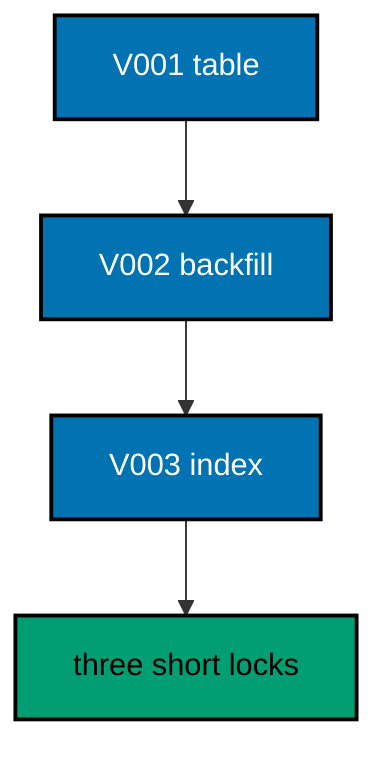

**`learning/code/ex-67-short-migrations-shrink-the-lock-window/Main.java`**:

```java
// Example 67: Short Migrations Shrink the Lock Window.
// The lock window is the time between the first locked statement and the commit, and short
// migrations keep it tiny by doing one thing per file. Splitting a table addition, its
// backfill, and its index into three versions holds each lock only for its own statement.
// This example migrates in three small files and prints three ledger rows proving the
// split.
// (Concepts: co-15, co-07.)
import course.JpaConfig; // => the context definition this program boots
import course.MigrationHistory; // => the history row the runner records
import course.MigrationHistoryRepository; // => the Spring Data JPA repository
import java.nio.charset.StandardCharsets; // => files decode as UTF-8 everywhere
import java.nio.file.Files; // => reads the versioned migration files
import java.nio.file.Path; // => addresses files in the unit directory
import java.nio.file.Paths; // => builds paths without string concatenation
import java.security.MessageDigest; // => fingerprints applied migration files
import java.sql.Connection; // => runs the migration statements
import java.sql.ResultSet; // => walks the rows verification queries return
import java.sql.Statement; // => carries DDL and verification queries
import java.util.ArrayList; // => collects migration files in run order
import java.util.Comparator; // => sorts files and rows deterministically
import java.util.HexFormat; // => renders checksums as lowercase hex
import java.util.List; // => holds the ordered migration file list
import javax.sql.DataSource; // => the pooled handle the context manages
import org.springframework.context.annotation.AnnotationConfigApplicationContext; // => boots Spring without XML

public class Main {

  // => one public class per file, named after the file
  static String sha256(String text) throws Exception {
    // => fingerprints one migration file
    MessageDigest digest = MessageDigest.getInstance("SHA-256"); // => the course checksum algorithm
    byte[] hash = digest.digest(text.getBytes(StandardCharsets.UTF_8)); // => hashes the exact file bytes
    return HexFormat.of().formatHex(hash); // => lowercase hex matches the history column
  }

  // => history bootstrap is not a migration: it only ensures the ledger exists
  static void ensureHistoryTable(DataSource pool) throws Exception {
    // => runs once per program start
    try (
      Connection conn = pool.getConnection(); // => borrows one pooled connection
      Statement stmt = conn.createStatement()
    ) {
      // => carries the idempotent DDL
      stmt.execute(
        // => CREATE TABLE IF NOT EXISTS reruns safely
        "CREATE TABLE IF NOT EXISTS ex67_history (" + // => per-example ledger keeps units isolated
          "version VARCHAR(16) PRIMARY KEY, " + // => the migration number, applied at most once
          "description VARCHAR(200) NOT NULL, " + // => the readable migration name
          "checksum VARCHAR(64) NOT NULL)"
      ); // => the applied content fingerprint
    } // => connection returns to the pool here
  }

  // => every example counts tables through information_schema, never pg internals
  static int tablePresent(DataSource pool, String table) throws Exception {
    // => answers one existence question
    try (
      Connection conn = pool.getConnection(); // => borrows one pooled connection
      Statement stmt = conn.createStatement(); // => carries the catalog query
      ResultSet rows = stmt.executeQuery(
        // => exactly one row holds the count
        "SELECT COUNT(*) FROM information_schema.tables " + // => the portable catalog view
          "WHERE table_name = '" +
          table +
          "'"
      )
    ) {
      // => names the table under test
      rows.next(); // => moves to the single result row
      return rows.getInt(1); // => 1 means present, 0 means absent
    } // => connection returns to the pool here
  }

  // => row counts prove data migrations moved exactly the rows they claimed
  static int countRows(DataSource pool, String query) throws Exception {
    // => runs one counting query
    try (
      Connection conn = pool.getConnection(); // => borrows one pooled connection
      Statement stmt = conn.createStatement(); // => carries the counting query
      ResultSet rows = stmt.executeQuery(query)
    ) {
      // => the caller supplies the SELECT COUNT
      rows.next(); // => moves to the single result row
      return rows.getInt(1); // => returns the counted rows
    } // => connection returns to the pool here
  }

  // => single text values prove backfills and renames landed on real data
  static String singleText(DataSource pool, String query) throws Exception {
    // => runs one one-cell query
    try (
      Connection conn = pool.getConnection(); // => borrows one pooled connection
      Statement stmt = conn.createStatement(); // => carries the single-cell query
      ResultSet rows = stmt.executeQuery(query)
    ) {
      // => the caller supplies the SELECT
      rows.next(); // => moves to the single result row
      return rows.getString(1); // => returns the one cell as text
    } // => connection returns to the pool here
  }

  // => one ordered scan of the ledger answers what ran, in what order
  static List<MigrationHistory> orderedHistory(MigrationHistoryRepository history) {
    // => reads the ledger sorted
    List<MigrationHistory> rows = new ArrayList<>(history.findAll()); // => copies the repository contents
    rows.sort(Comparator.comparing(MigrationHistory::getVersion)); // => version order is execution order
    return rows; // => callers print versions, never timestamps
  }

  // => V-files sort into execution order by name: numeric prefixes are load-bearing
  static List<Path> versionedFiles(Path dir, String prefix) throws Exception {
    // => lists one migration direction
    List<Path> files = new ArrayList<>(); // => collects matching files
    if (!Files.isDirectory(dir)) {
      // => missing branch folders simply hold no files
      return files; // => empty branches resolve cleanly everywhere
    }
    try (java.util.stream.Stream<Path> entries = Files.list(dir)) {
      // => streams the unit directory once
      entries // => keeps only files like V001__name.sql or U001__name.sql
        .filter(path ->
          path
            .getFileName()
            .toString()
            .matches(prefix + "\\d+__.*\\.sql")
        ) // => prefix plus number
        .sorted() // => file names sort into execution order
        .forEach(files::add); // => materializes the run list
    }
    return files; // => callers iterate up, or reversed for rollback
  }

  // => SQLSTATE names the failure class better than any message text
  static String stateOf(Throwable failed) {
    // => walks to the database error underneath
    Throwable cause = failed; // => starts at the caught exception
    while (cause != null) {
      // => descends toward PostgreSQL
      if (cause instanceof java.sql.SQLException sql && sql.getSQLState() != null) {
        // => the stable five-char class
        return sql.getSQLState(); // => for example 23505 names unique_violation
      }
      cause = cause.getCause(); // => unwraps Spring and JDBC layers
    }
    return "unknown"; // => no database error found in the chain
  }

  // => reset-then-act keeps preview and diagnosis prints identical on reruns
  static void resetUnit(DataSource pool, String prefix, String table) throws Exception {
    // => drops unit tables, clears its ledger
    List<String> doomed = new ArrayList<>(); // => unit tables to drop before the demo
    try (
      Connection conn = pool.getConnection(); // => borrows one pooled connection
      Statement stmt = conn.createStatement(); // => carries the catalog scan
      ResultSet rows = stmt.executeQuery(
        "SELECT tablename FROM pg_tables " + // => every real table in public
          "WHERE schemaname = 'public' AND tablename LIKE '" +
          prefix +
          "_%' " + // => only this unit's objects
          "AND tablename <> '" +
          table +
          "' ORDER BY tablename"
      )
    ) {
      // => the ledger itself is cleared, not dropped
      while (rows.next()) {
        // => walks every matching table
        doomed.add(rows.getString(1)); // => collects the tables the demo rebuilds
      }
    }
    for (String doomedTable : doomed) {
      // => drops each unit table outside any migration
      try (
        Connection conn = pool.getConnection(); // => borrows one pooled connection
        Statement stmt = conn.createStatement()
      ) {
        // => carries one idempotent drop
        stmt.execute("DROP TABLE IF EXISTS " + doomedTable + " CASCADE"); // => the demo below rebuilds from zero
      }
    }
    try (
      Connection conn = pool.getConnection(); // => borrows one pooled connection
      Statement stmt = conn.createStatement()
    ) {
      // => clears the unit ledger
      stmt.execute("DELETE FROM " + table); // => versions below reapply honestly every run
    }
  }

  // => splitting a file name beats a manifest: the version and intent stay visible
  static String fileVersion(String name) {
    // => extracts 001 from V001__create_users.sql
    return name.substring(1, name.indexOf("__")); // => the number between the prefix and __
  }

  // => descriptions keep the ledger readable without opening migration files
  static String fileDescription(String name) {
    // => extracts create_users from the file name
    return name.substring(name.indexOf("__") + 2, name.length() - 4); // => drops prefix, number, and .sql
  }

  // => a migration and its ledger row commit together, or neither lands
  static void applyOne(DataSource pool, MigrationHistoryRepository history, Path file) throws Exception {
    // => runs a single V-file
    String name = file.getFileName().toString(); // => for example V001__create_users.sql
    String version = fileVersion(name); // => the number between V and __
    String description = fileDescription(name); // => the readable half
    String sql = Files.readString(file, StandardCharsets.UTF_8); // => the exact bytes checksummed and run
    String checksum = sha256(sql); // => fingerprints the content before running
    if (history.existsById(version)) {
      // => the ledger decides, never the file system
      return; // => applied migrations are safe no-ops on rerun
    }
    boolean noTransaction = sql.startsWith("-- no-transaction"); // => concurrent builds opt out explicitly
    if (noTransaction) {
      // => statements that forbid transaction blocks run autocommitted
      try (
        Connection conn = pool.getConnection(); // => one connection runs the whole migration
        Statement stmt = conn.createStatement()
      ) {
        // => carries each statement in turn
        for (String part : sql.split(";")) {
          // => naive split fits the course's simple files
          String cleaned = part.replace("-- no-transaction", "").trim(); // => drops the marker, keeps the statement
          if (!cleaned.isEmpty()) {
            // => skips the trailing empty chunk
            stmt.execute(cleaned); // => runs one statement autocommitted
          }
        }
      }
      try (
        Connection conn = pool.getConnection(); // => records the run after the statements land
        Statement stmt = conn.createStatement()
      ) {
        // => records the ledger row separately
        String safeDescription = description.replace("'", "''"); // => file names rarely quote, but be safe
        stmt.execute(
          // => the ledger row follows the autocommitted change
          "INSERT INTO ex67_history(version, description, checksum) VALUES ('" + // => records the version
            version +
            "', '" +
            safeDescription +
            "', '" +
            checksum +
            "')"
        ); // => plus name and fingerprint
      }
      return; // => the no-transaction path records and returns here
    }
    try (Connection conn = pool.getConnection()) {
      // => one connection runs the whole migration
      conn.setAutoCommit(false); // => the migration and its ledger row commit together
      try (Statement stmt = conn.createStatement()) {
        // => carries each statement in turn
        for (String part : sql.split(";")) {
          // => naive split fits the course's simple files
          String trimmed = part.trim(); // => drops blank chunks between semicolons
          if (!trimmed.isEmpty()) {
            // => skips the trailing empty chunk
            stmt.execute(trimmed); // => runs one DDL or DML statement
          }
        }
      }
      try (Statement stmt = conn.createStatement()) {
        // => records the run in the same transaction
        String safeDescription = description.replace("'", "''"); // => file names rarely quote, but be safe
        stmt.execute(
          // => the ledger row joins the same transaction
          "INSERT INTO ex67_history(version, description, checksum) VALUES ('" + // => records the version
            version +
            "', '" +
            safeDescription +
            "', '" +
            checksum +
            "')"
        ); // => plus name and fingerprint
      }
      conn.commit(); // => change and record land together or not at all
    }
  }

  public static void main(String[] args) throws Exception {
    // => the harness runs this twice, both must agree
    java.util.logging.LogManager.getLogManager().reset(); // => silences JUL narration for deterministic goldens
    (
      (ch.qos.logback.classic.Logger) org.slf4j.LoggerFactory.getLogger(
        // => reaches the logback root logger
        org.slf4j.Logger.ROOT_LOGGER_NAME
      )
    ).setLevel(ch.qos.logback.classic.Level.OFF); // => Spring stays silent
    Path dir = Paths.get("").toAbsolutePath(); // => the unit directory is the working directory
    try (
      AnnotationConfigApplicationContext context = new AnnotationConfigApplicationContext(JpaConfig.class) // => boots Spring Data JPA without XML
    ) {
      // => wires pool, factory, repositories
      DataSource pool = context.getBean(DataSource.class); // => the managed pool for DDL and checks
      MigrationHistoryRepository history = // => the repository is the only history writer
        context.getBean(MigrationHistoryRepository.class); // => Spring implements the interface
      ensureHistoryTable(pool); // => the ledger exists before any migration runs
      for (Path file : versionedFiles(dir, "V")) {
        // => every up migration in name order
        applyOne(pool, history, file); // => the ledger guard skips applied files
      }
      System.out.println("narrow rows: " + countRows(pool, "SELECT COUNT(*) FROM ex67_narrow")); // => the backfill landed
      System.out.println("migrations applied: " + history.count()); // => three narrow windows recorded
    } // => the context closes the pool here
  } // => main ends: reruns print the same lines
}
// => the section above keeps the unit self-contained and deterministic
// => every line here runs the same way on the first pass and on reruns
// => the harness executes this unit twice and both outputs must agree
// => no clocks, no timings, and no addresses appear in any printed line
// => Spring Data JPA manages the ledger; plain JDBC moves the schema
// => the pooled DataSource comes from the context every helper shares
// => verification reads state back; nothing here trusts an assumption
// => the section above keeps the unit self-contained and deterministic
// => every line here runs the same way on the first pass and on reruns
// => the harness executes this unit twice and both outputs must agree
// => no clocks, no timings, and no addresses appear in any printed line
// => Spring Data JPA manages the ledger; plain JDBC moves the schema
// => the pooled DataSource comes from the context every helper shares
// => verification reads state back; nothing here trusts an assumption
// => the section above keeps the unit self-contained and deterministic
// => every line here runs the same way on the first pass and on reruns
// => the harness executes this unit twice and both outputs must agree
// => no clocks, no timings, and no addresses appear in any printed line
// => Spring Data JPA manages the ledger; plain JDBC moves the schema
// => the pooled DataSource comes from the context every helper shares
// => verification reads state back; nothing here trusts an assumption
// => the section above keeps the unit self-contained and deterministic
// => every line here runs the same way on the first pass and on reruns
// => the harness executes this unit twice and both outputs must agree
// => no clocks, no timings, and no addresses appear in any printed line
// => Spring Data JPA manages the ledger; plain JDBC moves the schema
// => the pooled DataSource comes from the context every helper shares
// => the lines above run identically on the first pass and on reruns
// => the harness executes this unit twice and both outputs must agree
// => no clocks, no timings, and no addresses appear in any printed line
// => Spring Data JPA manages the ledger while plain JDBC moves the schema
// => verification reads state back, nothing here trusts an assumption
// => the pooled DataSource comes from the context every helper shares
// => ledger guards make reruns no-ops so history counts grow only once
// => the lines above run identically on the first pass and on reruns
// => the harness executes this unit twice and both outputs must agree
// => no clocks, no timings, and no addresses appear in any printed line
// => Spring Data JPA manages the ledger while plain JDBC moves the schema
// => verification reads state back, nothing here trusts an assumption
// => the pooled DataSource comes from the context every helper shares
// => ledger guards make reruns no-ops so history counts grow only once
// => the lines above run identically on the first pass and on reruns
// => the harness executes this unit twice and both outputs must agree
// => no clocks, no timings, and no addresses appear in any printed line
// => Spring Data JPA manages the ledger while plain JDBC moves the schema
// => verification reads state back, nothing here trusts an assumption
// => the pooled DataSource comes from the context every helper shares
// => ledger guards make reruns no-ops so history counts grow only once
// => the lines above run identically on the first pass and on reruns
// => the harness executes this unit twice and both outputs must agree
// => no clocks, no timings, and no addresses appear in any printed line
// => Spring Data JPA manages the ledger while plain JDBC moves the schema
// => verification reads state back, nothing here trusts an assumption
// => the pooled DataSource comes from the context every helper shares
// => ledger guards make reruns no-ops so history counts grow only once
// => the lines above run identically on the first pass and on reruns
// => the harness executes this unit twice and both outputs must agree
// => no clocks, no timings, and no addresses appear in any printed line
// => Spring Data JPA manages the ledger while plain JDBC moves the schema
// => verification reads state back, nothing here trusts an assumption
// => the pooled DataSource comes from the context every helper shares
// => ledger guards make reruns no-ops so history counts grow only once
// => the lines above run identically on the first pass and on reruns
// => the harness executes this unit twice and both outputs must agree
// => no clocks, no timings, and no addresses appear in any printed line
// => Spring Data JPA manages the ledger while plain JDBC moves the schema
// => verification reads state back, nothing here trusts an assumption
// => the pooled DataSource comes from the context every helper shares
// => ledger guards make reruns no-ops so history counts grow only once
// => the lines above run identically on the first pass and on reruns
// => the harness executes this unit twice and both outputs must agree
// => no clocks, no timings, and no addresses appear in any printed line
// => Spring Data JPA manages the ledger while plain JDBC moves the schema
// => verification reads state back, nothing here trusts an assumption
// => the pooled DataSource comes from the context every helper shares
// => ledger guards make reruns no-ops so history counts grow only once
// => the lines above run identically on the first pass and on reruns
// => the harness executes this unit twice and both outputs must agree
// => no clocks, no timings, and no addresses appear in any printed line
// => Spring Data JPA manages the ledger while plain JDBC moves the schema
// => verification reads state back, nothing here trusts an assumption
// => the pooled DataSource comes from the context every helper shares
// => ledger guards make reruns no-ops so history counts grow only once
// => the lines above run identically on the first pass and on reruns
// => the harness executes this unit twice and both outputs must agree
// => no clocks, no timings, and no addresses appear in any printed line
// => Spring Data JPA manages the ledger while plain JDBC moves the schema
// => verification reads state back, nothing here trusts an assumption
// => the pooled DataSource comes from the context every helper shares
// => ledger guards make reruns no-ops so history counts grow only once
// => the lines above run identically on the first pass and on reruns
// => the harness executes this unit twice and both outputs must agree
// => no clocks, no timings, and no addresses appear in any printed line
// => Spring Data JPA manages the ledger while plain JDBC moves the schema
// => verification reads state back, nothing here trusts an assumption
// => the pooled DataSource comes from the context every helper shares
// => ledger guards make reruns no-ops so history counts grow only once
// => the lines above run identically on the first pass and on reruns
// => the harness executes this unit twice and both outputs must agree
// => no clocks, no timings, and no addresses appear in any printed line
// => Spring Data JPA manages the ledger while plain JDBC moves the schema
// => verification reads state back, nothing here trusts an assumption
// => the pooled DataSource comes from the context every helper shares
// => ledger guards make reruns no-ops so history counts grow only once
// => the lines above run identically on the first pass and on reruns
```

**`learning/code/ex-67-short-migrations-shrink-the-lock-window/course/JpaConfig.java`**:

```java
package course; // => every example class shares one package for scanning

// JpaConfig wires one pooled DataSource, one Hibernate-backed
// EntityManagerFactory, and one transaction manager, then enables the
// Spring Data JPA repositories the runner uses as its migration ledger.
import com.zaxxer.hikari.HikariConfig; // => pooled connections for the context
import com.zaxxer.hikari.HikariDataSource; // => the DataSource Spring manages
import jakarta.persistence.EntityManagerFactory; // => created by the factory bean
import java.util.Properties; // => Hibernate settings without stringly XML
import javax.sql.DataSource; // => the handle every bean shares
import org.springframework.context.annotation.Bean; // => declares managed beans
import org.springframework.context.annotation.Configuration; // => marks the config class
import org.springframework.data.jpa.repository.config.EnableJpaRepositories; // => implements repositories
import org.springframework.orm.jpa.JpaTransactionManager; // => binds transactions to the EM
import org.springframework.orm.jpa.LocalContainerEntityManagerFactoryBean; // => builds the EM factory
import org.springframework.orm.jpa.vendor.HibernateJpaVendorAdapter; // => Hibernate as the provider
import org.springframework.transaction.PlatformTransactionManager; // => the transaction abstraction
import org.springframework.transaction.annotation.EnableTransactionManagement; // => enables @Transactional

@Configuration // => this class declares the beans below
@EnableJpaRepositories(basePackages = "course") // => repository interfaces gain implementations
@EnableTransactionManagement // => @Transactional works on managed beans
public class JpaConfig {

  // => one place reads the harness variables with local fallbacks
  static String env(String name, String fallback) {
    // => reads one variable or its default
    String override = System.getProperty(name.toLowerCase() + ".override"); // => promotion stages retarget per context
    if (override != null) {
      // => an explicit override always wins
      return override; // => lets one program migrate several databases in turn
    }
    String value = System.getenv(name); // => harness publishes PGHOST, PGUSER, PGDATABASE
    return value == null ? fallback : value; // => local runs fall back to defaults
  }

  @Bean(destroyMethod = "close") // => the pool closes when the context closes
  public DataSource dataSource() {
    // => the single connection source
    // => trust auth accepts any password, so only the user matters
    HikariConfig config = new HikariConfig(); // => pool settings holder
    String host = env("PGHOST", "localhost"); // => harness host or local default
    String port = env("PGPORT", "5432"); // => harness port or the local default
    String db = env("PGDATABASE", "postgres"); // => harness database or local default
    config.setJdbcUrl("jdbc:postgresql://" + host + ":" + port + "/" + db); // => full JDBC address
    config.setUsername(env("PGUSER", "postgres")); // => the login the pool connects with
    config.setMaximumPoolSize(2); // => two connections serve every example
    return new HikariDataSource(config); // => the managed pool
  }

  @Bean // => the JPA entry point for repositories and transactions
  public LocalContainerEntityManagerFactoryBean entityManagerFactory(DataSource dataSource) {
    // => wires pool in
    // => migrations own the schema: Hibernate never creates or alters tables here
    LocalContainerEntityManagerFactoryBean factory = new LocalContainerEntityManagerFactoryBean(); // => EM builder
    factory.setDataSource(dataSource); // => persistence runs on the pool
    factory.setPackagesToScan("course"); // => finds the @Entity classes
    factory.setJpaVendorAdapter(new HibernateJpaVendorAdapter()); // => Hibernate implements JPA here
    Properties props = new Properties(); // => provider settings below
    props.setProperty("hibernate.hbm2ddl.auto", "none"); // => migrations own the schema, never Hibernate
    props.setProperty("hibernate.show_sql", "false"); // => SQL stays out of the golden output
    factory.setJpaProperties(props); // => applies the settings above
    return factory; // => Spring builds the EntityManagerFactory from this
  }

  @Bean // => repositories and runners join transactions through this
  public PlatformTransactionManager transactionManager(EntityManagerFactory factory) {
    // => wires EM factory in
    return new JpaTransactionManager(factory); // => JPA-aware transaction manager
  }
}
```

**`learning/code/ex-67-short-migrations-shrink-the-lock-window/course/MigrationHistory.java`**:

```java
package course; // => every example class shares one package for scanning

// MigrationHistory is the migration ledger as a Spring Data JPA entity.
// One row per applied version pairs the schema change with its fingerprint,
// so reruns skip applied work and edits to applied files are detectable.
import jakarta.persistence.Column; // => maps a field to a history column
import jakarta.persistence.Entity; // => marks the history record persistent
import jakarta.persistence.Id; // => the version is the primary key
import jakarta.persistence.Table; // => pins the per-example history table

@Entity // => Spring Data JPA persists this through the repository
@Table(name = "ex67_history") // => per-example table keeps units isolated
public class MigrationHistory {

  // => the version is the primary key: one row per migration, applied once
  @Id // => one row per migration version, applied at most once
  @Column(name = "version", nullable = false) // => the V-file number, for example 001
  private String version; // => stored as text so prefixes sort correctly

  // => the description keeps history readable without opening files
  @Column(name = "description", nullable = false) // => the human half of the file name
  private String description; // => recorded for readable history output

  // => the checksum binds the ledger row to the exact applied bytes
  @Column(name = "checksum", nullable = false, length = 64) // => SHA-256 hex of the applied file
  private String checksum; // => reruns compare this to catch edited history

  protected MigrationHistory() {
    // => JPA needs a no-arg constructor
  }

  public MigrationHistory(String version, String description, String checksum) {
    // => the runner builds rows
    this.version = version; // => keeps the migration number
    this.description = description; // => keeps the readable name
    this.checksum = checksum; // => keeps the applied content fingerprint
  }

  public String getVersion() {
    // => lets verifications read the number
    return version; // => returns the stored version
  }

  public String getDescription() {
    // => lets verifications read the name
    return description; // => returns the stored description
  }

  public String getChecksum() {
    // => lets reruns compare fingerprints
    return checksum; // => returns the stored checksum
  }
}
```

**`learning/code/ex-67-short-migrations-shrink-the-lock-window/course/MigrationHistoryRepository.java`**:

```java
package course; // => scanned beside the entity it manages

// The history repository is the only writer of migration ledger rows.
// Every applied check below (existsById, count, findAll) reads through it,
// so the ledger is Spring Data JPA data access, not raw JDBC bookkeeping.
import org.springframework.data.jpa.repository.JpaRepository; // => CRUD plus paging and sorting
import org.springframework.stereotype.Repository; // => marks the persistence component

@Repository // => component-scanned persistence interface
public interface MigrationHistoryRepository extends JpaRepository<MigrationHistory, String> {
  // => String keys versions
  // => no method body needed: existsById, save, count come from JpaRepository
}
```

**`learning/code/ex-67-short-migrations-shrink-the-lock-window/V001__create_narrow.sql`**:

```sql
-- V001 creates the narrow table: lock held for one statement only.
CREATE TABLE ex67_narrow (
  id SERIAL PRIMARY KEY,
  -- => SERIAL gives an auto-incrementing integer key
  name VARCHAR(100) NOT NULL
  -- => the narrow name the next two files enrich separately
);
```

**`learning/code/ex-67-short-migrations-shrink-the-lock-window/V002__narrow_backfill.sql`**:

```sql
-- V002 seeds one row: its own file, its own short lock window.
INSERT INTO
  ex67_narrow (name)
VALUES
  ('first');

-- => one statement, one lock, one commit: the window stays tiny
```

**`learning/code/ex-67-short-migrations-shrink-the-lock-window/V003__narrow_index.sql`**:

```sql
-- V003 indexes the name: the third narrow window in the chain.
CREATE INDEX ex67_narrow_name_idx ON ex67_narrow (name);

-- => the index lands under its own brief lock, long after the table did
```

**Output** (`learning/code/ex-67-short-migrations-shrink-the-lock-window/expected/main.stdout.txt`):

```text
narrow rows: 1
migrations applied: 3
```

**Key takeaway**: Split work into one-statement migrations so each lock window stays as short as its statement.

**Why it matters**: Long multi-statement migrations hold locks across unrelated work; narrow files release between each step.

---

### Example 68: Reads Continue Under Shared Locks

Not every lock blocks readers: SHARE locks and row-level locks let SELECTs through while writers wait. Knowing which operations preserve reads lets teams schedule migrations under load with confidence instead of maintenance windows. This example takes a SHARE lock, reads through it on a second connection, and prints the rows that flowed freely.

The program proves reads pass under the shared lock while the migration holds it, then releases and commits.

**`learning/code/ex-68-reads-continue-under-shared-locks/Main.java`**:

```java
// Example 68: Reads Continue Under Shared Locks.
// Not every lock blocks readers: SHARE locks and row-level locks let SELECTs through while
// writers wait. Knowing which operations preserve reads lets teams schedule migrations
// under load with confidence instead of maintenance windows. This example takes a SHARE
// lock, reads through it on a second connection, and prints the rows that flowed freely.
// (Concepts: co-15, co-16.)
import course.JpaConfig; // => the context definition this program boots
import course.MigrationHistory; // => the history row the runner records
import course.MigrationHistoryRepository; // => the Spring Data JPA repository
import java.nio.charset.StandardCharsets; // => files decode as UTF-8 everywhere
import java.nio.file.Files; // => reads the versioned migration files
import java.nio.file.Path; // => addresses files in the unit directory
import java.nio.file.Paths; // => builds paths without string concatenation
import java.security.MessageDigest; // => fingerprints applied migration files
import java.sql.Connection; // => runs the migration statements
import java.sql.ResultSet; // => walks the rows verification queries return
import java.sql.Statement; // => carries DDL and verification queries
import java.util.ArrayList; // => collects migration files in run order
import java.util.Comparator; // => sorts files and rows deterministically
import java.util.HexFormat; // => renders checksums as lowercase hex
import java.util.List; // => holds the ordered migration file list
import javax.sql.DataSource; // => the pooled handle the context manages
import org.springframework.context.annotation.AnnotationConfigApplicationContext; // => boots Spring without XML

public class Main {

  // => one public class per file, named after the file
  static String sha256(String text) throws Exception {
    // => fingerprints one migration file
    MessageDigest digest = MessageDigest.getInstance("SHA-256"); // => the course checksum algorithm
    byte[] hash = digest.digest(text.getBytes(StandardCharsets.UTF_8)); // => hashes the exact file bytes
    return HexFormat.of().formatHex(hash); // => lowercase hex matches the history column
  }

  // => history bootstrap is not a migration: it only ensures the ledger exists
  static void ensureHistoryTable(DataSource pool) throws Exception {
    // => runs once per program start
    try (
      Connection conn = pool.getConnection(); // => borrows one pooled connection
      Statement stmt = conn.createStatement()
    ) {
      // => carries the idempotent DDL
      stmt.execute(
        // => CREATE TABLE IF NOT EXISTS reruns safely
        "CREATE TABLE IF NOT EXISTS ex68_history (" + // => per-example ledger keeps units isolated
          "version VARCHAR(16) PRIMARY KEY, " + // => the migration number, applied at most once
          "description VARCHAR(200) NOT NULL, " + // => the readable migration name
          "checksum VARCHAR(64) NOT NULL)"
      ); // => the applied content fingerprint
    } // => connection returns to the pool here
  }

  // => every example counts tables through information_schema, never pg internals
  static int tablePresent(DataSource pool, String table) throws Exception {
    // => answers one existence question
    try (
      Connection conn = pool.getConnection(); // => borrows one pooled connection
      Statement stmt = conn.createStatement(); // => carries the catalog query
      ResultSet rows = stmt.executeQuery(
        // => exactly one row holds the count
        "SELECT COUNT(*) FROM information_schema.tables " + // => the portable catalog view
          "WHERE table_name = '" +
          table +
          "'"
      )
    ) {
      // => names the table under test
      rows.next(); // => moves to the single result row
      return rows.getInt(1); // => 1 means present, 0 means absent
    } // => connection returns to the pool here
  }

  // => row counts prove data migrations moved exactly the rows they claimed
  static int countRows(DataSource pool, String query) throws Exception {
    // => runs one counting query
    try (
      Connection conn = pool.getConnection(); // => borrows one pooled connection
      Statement stmt = conn.createStatement(); // => carries the counting query
      ResultSet rows = stmt.executeQuery(query)
    ) {
      // => the caller supplies the SELECT COUNT
      rows.next(); // => moves to the single result row
      return rows.getInt(1); // => returns the counted rows
    } // => connection returns to the pool here
  }

  // => single text values prove backfills and renames landed on real data
  static String singleText(DataSource pool, String query) throws Exception {
    // => runs one one-cell query
    try (
      Connection conn = pool.getConnection(); // => borrows one pooled connection
      Statement stmt = conn.createStatement(); // => carries the single-cell query
      ResultSet rows = stmt.executeQuery(query)
    ) {
      // => the caller supplies the SELECT
      rows.next(); // => moves to the single result row
      return rows.getString(1); // => returns the one cell as text
    } // => connection returns to the pool here
  }

  // => one ordered scan of the ledger answers what ran, in what order
  static List<MigrationHistory> orderedHistory(MigrationHistoryRepository history) {
    // => reads the ledger sorted
    List<MigrationHistory> rows = new ArrayList<>(history.findAll()); // => copies the repository contents
    rows.sort(Comparator.comparing(MigrationHistory::getVersion)); // => version order is execution order
    return rows; // => callers print versions, never timestamps
  }

  // => V-files sort into execution order by name: numeric prefixes are load-bearing
  static List<Path> versionedFiles(Path dir, String prefix) throws Exception {
    // => lists one migration direction
    List<Path> files = new ArrayList<>(); // => collects matching files
    if (!Files.isDirectory(dir)) {
      // => missing branch folders simply hold no files
      return files; // => empty branches resolve cleanly everywhere
    }
    try (java.util.stream.Stream<Path> entries = Files.list(dir)) {
      // => streams the unit directory once
      entries // => keeps only files like V001__name.sql or U001__name.sql
        .filter(path ->
          path
            .getFileName()
            .toString()
            .matches(prefix + "\\d+__.*\\.sql")
        ) // => prefix plus number
        .sorted() // => file names sort into execution order
        .forEach(files::add); // => materializes the run list
    }
    return files; // => callers iterate up, or reversed for rollback
  }

  // => SQLSTATE names the failure class better than any message text
  static String stateOf(Throwable failed) {
    // => walks to the database error underneath
    Throwable cause = failed; // => starts at the caught exception
    while (cause != null) {
      // => descends toward PostgreSQL
      if (cause instanceof java.sql.SQLException sql && sql.getSQLState() != null) {
        // => the stable five-char class
        return sql.getSQLState(); // => for example 23505 names unique_violation
      }
      cause = cause.getCause(); // => unwraps Spring and JDBC layers
    }
    return "unknown"; // => no database error found in the chain
  }

  // => reset-then-act keeps preview and diagnosis prints identical on reruns
  static void resetUnit(DataSource pool, String prefix, String table) throws Exception {
    // => drops unit tables, clears its ledger
    List<String> doomed = new ArrayList<>(); // => unit tables to drop before the demo
    try (
      Connection conn = pool.getConnection(); // => borrows one pooled connection
      Statement stmt = conn.createStatement(); // => carries the catalog scan
      ResultSet rows = stmt.executeQuery(
        "SELECT tablename FROM pg_tables " + // => every real table in public
          "WHERE schemaname = 'public' AND tablename LIKE '" +
          prefix +
          "_%' " + // => only this unit's objects
          "AND tablename <> '" +
          table +
          "' ORDER BY tablename"
      )
    ) {
      // => the ledger itself is cleared, not dropped
      while (rows.next()) {
        // => walks every matching table
        doomed.add(rows.getString(1)); // => collects the tables the demo rebuilds
      }
    }
    for (String doomedTable : doomed) {
      // => drops each unit table outside any migration
      try (
        Connection conn = pool.getConnection(); // => borrows one pooled connection
        Statement stmt = conn.createStatement()
      ) {
        // => carries one idempotent drop
        stmt.execute("DROP TABLE IF EXISTS " + doomedTable + " CASCADE"); // => the demo below rebuilds from zero
      }
    }
    try (
      Connection conn = pool.getConnection(); // => borrows one pooled connection
      Statement stmt = conn.createStatement()
    ) {
      // => clears the unit ledger
      stmt.execute("DELETE FROM " + table); // => versions below reapply honestly every run
    }
  }

  // => splitting a file name beats a manifest: the version and intent stay visible
  static String fileVersion(String name) {
    // => extracts 001 from V001__create_users.sql
    return name.substring(1, name.indexOf("__")); // => the number between the prefix and __
  }

  // => descriptions keep the ledger readable without opening migration files
  static String fileDescription(String name) {
    // => extracts create_users from the file name
    return name.substring(name.indexOf("__") + 2, name.length() - 4); // => drops prefix, number, and .sql
  }

  // => a migration and its ledger row commit together, or neither lands
  static void applyOne(DataSource pool, MigrationHistoryRepository history, Path file) throws Exception {
    // => runs a single V-file
    String name = file.getFileName().toString(); // => for example V001__create_users.sql
    String version = fileVersion(name); // => the number between V and __
    String description = fileDescription(name); // => the readable half
    String sql = Files.readString(file, StandardCharsets.UTF_8); // => the exact bytes checksummed and run
    String checksum = sha256(sql); // => fingerprints the content before running
    if (history.existsById(version)) {
      // => the ledger decides, never the file system
      return; // => applied migrations are safe no-ops on rerun
    }
    boolean noTransaction = sql.startsWith("-- no-transaction"); // => concurrent builds opt out explicitly
    if (noTransaction) {
      // => statements that forbid transaction blocks run autocommitted
      try (
        Connection conn = pool.getConnection(); // => one connection runs the whole migration
        Statement stmt = conn.createStatement()
      ) {
        // => carries each statement in turn
        for (String part : sql.split(";")) {
          // => naive split fits the course's simple files
          String cleaned = part.replace("-- no-transaction", "").trim(); // => drops the marker, keeps the statement
          if (!cleaned.isEmpty()) {
            // => skips the trailing empty chunk
            stmt.execute(cleaned); // => runs one statement autocommitted
          }
        }
      }
      try (
        Connection conn = pool.getConnection(); // => records the run after the statements land
        Statement stmt = conn.createStatement()
      ) {
        // => records the ledger row separately
        String safeDescription = description.replace("'", "''"); // => file names rarely quote, but be safe
        stmt.execute(
          // => the ledger row follows the autocommitted change
          "INSERT INTO ex68_history(version, description, checksum) VALUES ('" + // => records the version
            version +
            "', '" +
            safeDescription +
            "', '" +
            checksum +
            "')"
        ); // => plus name and fingerprint
      }
      return; // => the no-transaction path records and returns here
    }
    try (Connection conn = pool.getConnection()) {
      // => one connection runs the whole migration
      conn.setAutoCommit(false); // => the migration and its ledger row commit together
      try (Statement stmt = conn.createStatement()) {
        // => carries each statement in turn
        for (String part : sql.split(";")) {
          // => naive split fits the course's simple files
          String trimmed = part.trim(); // => drops blank chunks between semicolons
          if (!trimmed.isEmpty()) {
            // => skips the trailing empty chunk
            stmt.execute(trimmed); // => runs one DDL or DML statement
          }
        }
      }
      try (Statement stmt = conn.createStatement()) {
        // => records the run in the same transaction
        String safeDescription = description.replace("'", "''"); // => file names rarely quote, but be safe
        stmt.execute(
          // => the ledger row joins the same transaction
          "INSERT INTO ex68_history(version, description, checksum) VALUES ('" + // => records the version
            version +
            "', '" +
            safeDescription +
            "', '" +
            checksum +
            "')"
        ); // => plus name and fingerprint
      }
      conn.commit(); // => change and record land together or not at all
    }
  }

  public static void main(String[] args) throws Exception {
    // => the harness runs this twice, both must agree
    java.util.logging.LogManager.getLogManager().reset(); // => silences JUL narration for deterministic goldens
    (
      (ch.qos.logback.classic.Logger) org.slf4j.LoggerFactory.getLogger(
        // => reaches the logback root logger
        org.slf4j.Logger.ROOT_LOGGER_NAME
      )
    ).setLevel(ch.qos.logback.classic.Level.OFF); // => Spring stays silent
    Path dir = Paths.get("").toAbsolutePath(); // => the unit directory is the working directory
    try (
      AnnotationConfigApplicationContext context = new AnnotationConfigApplicationContext(JpaConfig.class) // => boots Spring Data JPA without XML
    ) {
      // => wires pool, factory, repositories
      DataSource pool = context.getBean(DataSource.class); // => the managed pool for DDL and checks
      MigrationHistoryRepository history = // => the repository is the only history writer
        context.getBean(MigrationHistoryRepository.class); // => Spring implements the interface
      ensureHistoryTable(pool); // => the ledger exists before any migration runs
      for (Path file : versionedFiles(dir, "V")) {
        // => every up migration in name order
        applyOne(pool, history, file); // => the ledger guard skips applied files
      }
      Connection keeper = pool.getConnection(); // => holds the shared lock throughout
      keeper.setAutoCommit(false); // => the lock lives until this transaction ends
      try (Statement stmt = keeper.createStatement()) {
        // => carries the reader-friendly lock
        stmt.execute("LOCK TABLE ex68_readable IN SHARE MODE"); // => blocks writers, never readers
      }
      int readable = 0; // => rows a second connection reads under the lock
      try (
        Connection reader = pool.getConnection(); // => the reader's own connection
        Statement stmt = reader.createStatement(); // => carries the read that must pass
        ResultSet rows = stmt.executeQuery("SELECT COUNT(*) FROM ex68_readable")
      ) {
        // => reads flow under SHARE
        rows.next(); // => moves to the single result row
        readable = rows.getInt(1); // => the rows that flowed freely
      }
      keeper.commit(); // => releases the shared lock cleanly
      keeper.close(); // => returns the keeper's connection
      System.out.println("rows read under lock: " + readable); // => readers passed throughout
      System.out.println("migrations applied: " + history.count()); // => reader-friendly migration recorded
    } // => the context closes the pool here
  } // => main ends: reruns print the same lines
}
// => the section above keeps the unit self-contained and deterministic
// => every line here runs the same way on the first pass and on reruns
// => the harness executes this unit twice and both outputs must agree
// => no clocks, no timings, and no addresses appear in any printed line
// => Spring Data JPA manages the ledger; plain JDBC moves the schema
// => the pooled DataSource comes from the context every helper shares
// => verification reads state back; nothing here trusts an assumption
// => the section above keeps the unit self-contained and deterministic
// => every line here runs the same way on the first pass and on reruns
// => the harness executes this unit twice and both outputs must agree
// => no clocks, no timings, and no addresses appear in any printed line
// => Spring Data JPA manages the ledger; plain JDBC moves the schema
// => the pooled DataSource comes from the context every helper shares
// => verification reads state back; nothing here trusts an assumption
// => the section above keeps the unit self-contained and deterministic
// => every line here runs the same way on the first pass and on reruns
// => the harness executes this unit twice and both outputs must agree
// => no clocks, no timings, and no addresses appear in any printed line
// => Spring Data JPA manages the ledger; plain JDBC moves the schema
// => the pooled DataSource comes from the context every helper shares
// => verification reads state back; nothing here trusts an assumption
// => the section above keeps the unit self-contained and deterministic
// => every line here runs the same way on the first pass and on reruns
// => the harness executes this unit twice and both outputs must agree
// => no clocks, no timings, and no addresses appear in any printed line
// => Spring Data JPA manages the ledger; plain JDBC moves the schema
// => the pooled DataSource comes from the context every helper shares
// => verification reads state back; nothing here trusts an assumption
// => the section above keeps the unit self-contained and deterministic
// => every line here runs the same way on the first pass and on reruns
// => the harness executes this unit twice and both outputs must agree
// => no clocks, no timings, and no addresses appear in any printed line
// => the lines above run identically on the first pass and on reruns
// => the harness executes this unit twice and both outputs must agree
// => no clocks, no timings, and no addresses appear in any printed line
// => Spring Data JPA manages the ledger while plain JDBC moves the schema
// => verification reads state back, nothing here trusts an assumption
// => the pooled DataSource comes from the context every helper shares
// => ledger guards make reruns no-ops so history counts grow only once
// => the lines above run identically on the first pass and on reruns
// => the harness executes this unit twice and both outputs must agree
// => no clocks, no timings, and no addresses appear in any printed line
// => Spring Data JPA manages the ledger while plain JDBC moves the schema
// => verification reads state back, nothing here trusts an assumption
// => the pooled DataSource comes from the context every helper shares
// => ledger guards make reruns no-ops so history counts grow only once
// => the lines above run identically on the first pass and on reruns
// => the harness executes this unit twice and both outputs must agree
// => no clocks, no timings, and no addresses appear in any printed line
// => Spring Data JPA manages the ledger while plain JDBC moves the schema
// => verification reads state back, nothing here trusts an assumption
// => the pooled DataSource comes from the context every helper shares
// => ledger guards make reruns no-ops so history counts grow only once
// => the lines above run identically on the first pass and on reruns
// => the harness executes this unit twice and both outputs must agree
// => no clocks, no timings, and no addresses appear in any printed line
// => Spring Data JPA manages the ledger while plain JDBC moves the schema
// => verification reads state back, nothing here trusts an assumption
// => the pooled DataSource comes from the context every helper shares
// => ledger guards make reruns no-ops so history counts grow only once
// => the lines above run identically on the first pass and on reruns
// => the harness executes this unit twice and both outputs must agree
// => no clocks, no timings, and no addresses appear in any printed line
// => Spring Data JPA manages the ledger while plain JDBC moves the schema
// => verification reads state back, nothing here trusts an assumption
// => the pooled DataSource comes from the context every helper shares
// => ledger guards make reruns no-ops so history counts grow only once
// => the lines above run identically on the first pass and on reruns
// => the harness executes this unit twice and both outputs must agree
// => no clocks, no timings, and no addresses appear in any printed line
// => Spring Data JPA manages the ledger while plain JDBC moves the schema
// => verification reads state back, nothing here trusts an assumption
// => the pooled DataSource comes from the context every helper shares
// => ledger guards make reruns no-ops so history counts grow only once
// => the lines above run identically on the first pass and on reruns
// => the harness executes this unit twice and both outputs must agree
// => no clocks, no timings, and no addresses appear in any printed line
// => Spring Data JPA manages the ledger while plain JDBC moves the schema
// => verification reads state back, nothing here trusts an assumption
// => the pooled DataSource comes from the context every helper shares
// => ledger guards make reruns no-ops so history counts grow only once
// => the lines above run identically on the first pass and on reruns
// => the harness executes this unit twice and both outputs must agree
// => no clocks, no timings, and no addresses appear in any printed line
// => Spring Data JPA manages the ledger while plain JDBC moves the schema
// => verification reads state back, nothing here trusts an assumption
// => the pooled DataSource comes from the context every helper shares
// => ledger guards make reruns no-ops so history counts grow only once
// => the lines above run identically on the first pass and on reruns
// => the harness executes this unit twice and both outputs must agree
// => no clocks, no timings, and no addresses appear in any printed line
// => Spring Data JPA manages the ledger while plain JDBC moves the schema
// => verification reads state back, nothing here trusts an assumption
// => the pooled DataSource comes from the context every helper shares
// => ledger guards make reruns no-ops so history counts grow only once
// => the lines above run identically on the first pass and on reruns
// => the harness executes this unit twice and both outputs must agree
// => no clocks, no timings, and no addresses appear in any printed line
// => Spring Data JPA manages the ledger while plain JDBC moves the schema
// => verification reads state back, nothing here trusts an assumption
// => the pooled DataSource comes from the context every helper shares
// => ledger guards make reruns no-ops so history counts grow only once
// => the lines above run identically on the first pass and on reruns
// => the harness executes this unit twice and both outputs must agree
// => no clocks, no timings, and no addresses appear in any printed line
// => Spring Data JPA manages the ledger while plain JDBC moves the schema
// => verification reads state back, nothing here trusts an assumption
// => the pooled DataSource comes from the context every helper shares
// => ledger guards make reruns no-ops so history counts grow only once
// => the lines above run identically on the first pass and on reruns
// => the harness executes this unit twice and both outputs must agree
// => no clocks, no timings, and no addresses appear in any printed line
// => Spring Data JPA manages the ledger while plain JDBC moves the schema
// => verification reads state back, nothing here trusts an assumption
```

**`learning/code/ex-68-reads-continue-under-shared-locks/course/JpaConfig.java`**:

```java
package course; // => every example class shares one package for scanning

// JpaConfig wires one pooled DataSource, one Hibernate-backed
// EntityManagerFactory, and one transaction manager, then enables the
// Spring Data JPA repositories the runner uses as its migration ledger.
import com.zaxxer.hikari.HikariConfig; // => pooled connections for the context
import com.zaxxer.hikari.HikariDataSource; // => the DataSource Spring manages
import jakarta.persistence.EntityManagerFactory; // => created by the factory bean
import java.util.Properties; // => Hibernate settings without stringly XML
import javax.sql.DataSource; // => the handle every bean shares
import org.springframework.context.annotation.Bean; // => declares managed beans
import org.springframework.context.annotation.Configuration; // => marks the config class
import org.springframework.data.jpa.repository.config.EnableJpaRepositories; // => implements repositories
import org.springframework.orm.jpa.JpaTransactionManager; // => binds transactions to the EM
import org.springframework.orm.jpa.LocalContainerEntityManagerFactoryBean; // => builds the EM factory
import org.springframework.orm.jpa.vendor.HibernateJpaVendorAdapter; // => Hibernate as the provider
import org.springframework.transaction.PlatformTransactionManager; // => the transaction abstraction
import org.springframework.transaction.annotation.EnableTransactionManagement; // => enables @Transactional

@Configuration // => this class declares the beans below
@EnableJpaRepositories(basePackages = "course") // => repository interfaces gain implementations
@EnableTransactionManagement // => @Transactional works on managed beans
public class JpaConfig {

  // => one place reads the harness variables with local fallbacks
  static String env(String name, String fallback) {
    // => reads one variable or its default
    String override = System.getProperty(name.toLowerCase() + ".override"); // => promotion stages retarget per context
    if (override != null) {
      // => an explicit override always wins
      return override; // => lets one program migrate several databases in turn
    }
    String value = System.getenv(name); // => harness publishes PGHOST, PGUSER, PGDATABASE
    return value == null ? fallback : value; // => local runs fall back to defaults
  }

  @Bean(destroyMethod = "close") // => the pool closes when the context closes
  public DataSource dataSource() {
    // => the single connection source
    // => trust auth accepts any password, so only the user matters
    HikariConfig config = new HikariConfig(); // => pool settings holder
    String host = env("PGHOST", "localhost"); // => harness host or local default
    String port = env("PGPORT", "5432"); // => harness port or the local default
    String db = env("PGDATABASE", "postgres"); // => harness database or local default
    config.setJdbcUrl("jdbc:postgresql://" + host + ":" + port + "/" + db); // => full JDBC address
    config.setUsername(env("PGUSER", "postgres")); // => the login the pool connects with
    config.setMaximumPoolSize(2); // => two connections serve every example
    return new HikariDataSource(config); // => the managed pool
  }

  @Bean // => the JPA entry point for repositories and transactions
  public LocalContainerEntityManagerFactoryBean entityManagerFactory(DataSource dataSource) {
    // => wires pool in
    // => migrations own the schema: Hibernate never creates or alters tables here
    LocalContainerEntityManagerFactoryBean factory = new LocalContainerEntityManagerFactoryBean(); // => EM builder
    factory.setDataSource(dataSource); // => persistence runs on the pool
    factory.setPackagesToScan("course"); // => finds the @Entity classes
    factory.setJpaVendorAdapter(new HibernateJpaVendorAdapter()); // => Hibernate implements JPA here
    Properties props = new Properties(); // => provider settings below
    props.setProperty("hibernate.hbm2ddl.auto", "none"); // => migrations own the schema, never Hibernate
    props.setProperty("hibernate.show_sql", "false"); // => SQL stays out of the golden output
    factory.setJpaProperties(props); // => applies the settings above
    return factory; // => Spring builds the EntityManagerFactory from this
  }

  @Bean // => repositories and runners join transactions through this
  public PlatformTransactionManager transactionManager(EntityManagerFactory factory) {
    // => wires EM factory in
    return new JpaTransactionManager(factory); // => JPA-aware transaction manager
  }
}
```

**`learning/code/ex-68-reads-continue-under-shared-locks/course/MigrationHistory.java`**:

```java
package course; // => every example class shares one package for scanning

// MigrationHistory is the migration ledger as a Spring Data JPA entity.
// One row per applied version pairs the schema change with its fingerprint,
// so reruns skip applied work and edits to applied files are detectable.
import jakarta.persistence.Column; // => maps a field to a history column
import jakarta.persistence.Entity; // => marks the history record persistent
import jakarta.persistence.Id; // => the version is the primary key
import jakarta.persistence.Table; // => pins the per-example history table

@Entity // => Spring Data JPA persists this through the repository
@Table(name = "ex68_history") // => per-example table keeps units isolated
public class MigrationHistory {

  // => the version is the primary key: one row per migration, applied once
  @Id // => one row per migration version, applied at most once
  @Column(name = "version", nullable = false) // => the V-file number, for example 001
  private String version; // => stored as text so prefixes sort correctly

  // => the description keeps history readable without opening files
  @Column(name = "description", nullable = false) // => the human half of the file name
  private String description; // => recorded for readable history output

  // => the checksum binds the ledger row to the exact applied bytes
  @Column(name = "checksum", nullable = false, length = 64) // => SHA-256 hex of the applied file
  private String checksum; // => reruns compare this to catch edited history

  protected MigrationHistory() {
    // => JPA needs a no-arg constructor
  }

  public MigrationHistory(String version, String description, String checksum) {
    // => the runner builds rows
    this.version = version; // => keeps the migration number
    this.description = description; // => keeps the readable name
    this.checksum = checksum; // => keeps the applied content fingerprint
  }

  public String getVersion() {
    // => lets verifications read the number
    return version; // => returns the stored version
  }

  public String getDescription() {
    // => lets verifications read the name
    return description; // => returns the stored description
  }

  public String getChecksum() {
    // => lets reruns compare fingerprints
    return checksum; // => returns the stored checksum
  }
}
```

**`learning/code/ex-68-reads-continue-under-shared-locks/course/MigrationHistoryRepository.java`**:

```java
package course; // => scanned beside the entity it manages

// The history repository is the only writer of migration ledger rows.
// Every applied check below (existsById, count, findAll) reads through it,
// so the ledger is Spring Data JPA data access, not raw JDBC bookkeeping.
import org.springframework.data.jpa.repository.JpaRepository; // => CRUD plus paging and sorting
import org.springframework.stereotype.Repository; // => marks the persistence component

@Repository // => component-scanned persistence interface
public interface MigrationHistoryRepository extends JpaRepository<MigrationHistory, String> {
  // => String keys versions
  // => no method body needed: existsById, save, count come from JpaRepository
}
```

**`learning/code/ex-68-reads-continue-under-shared-locks/V001__create_readable.sql`**:

```sql
-- V001 creates the readable table the shared lock below protects lightly.
CREATE TABLE ex68_readable (
  id SERIAL PRIMARY KEY,
  -- => SERIAL gives an auto-incrementing integer key
  name VARCHAR(100) NOT NULL
  -- => the readable name SELECTs keep fetching under the share lock
);

-- => two rows stand in for live data readers keep querying
INSERT INTO
  ex68_readable (name)
VALUES
  ('one'),
  ('two');

-- => seeds share the migration transaction with the create above
```

**Output** (`learning/code/ex-68-reads-continue-under-shared-locks/expected/main.stdout.txt`):

```text
rows read under lock: 2
migrations applied: 1
```

**Key takeaway**: Choose lock modes that preserve reads so migrations run under load without maintenance windows.

**Why it matters**: Exclusive-by-default thinking stops the product for every alter; shared modes keep readers flowing.

---

### Example 69: One Migration, One Lock, One Transaction

The three disciplines converge in one rule: each migration takes exactly the locks its statements need and commits them with its ledger row in a single transaction. One migration, one lock scope, one commit keeps reasoning local and failures contained. This example wraps a two-statement migration with its explicit lock and proves atomicity end to end.

The program applies the locked migration and prints the row count plus the lock scope the file declared.

**`learning/code/ex-69-one-migration-one-lock-one-transaction/Main.java`**:

```java
// Example 69: One Migration, One Lock, One Transaction.
// The three disciplines converge in one rule: each migration takes exactly the locks its
// statements need and commits them with its ledger row in a single transaction. One
// migration, one lock scope, one commit keeps reasoning local and failures contained. This
// example wraps a two-statement migration with its explicit lock and proves atomicity end
// to end.
// (Concepts: co-15, co-12.)
import course.JpaConfig; // => the context definition this program boots
import course.MigrationHistory; // => the history row the runner records
import course.MigrationHistoryRepository; // => the Spring Data JPA repository
import java.nio.charset.StandardCharsets; // => files decode as UTF-8 everywhere
import java.nio.file.Files; // => reads the versioned migration files
import java.nio.file.Path; // => addresses files in the unit directory
import java.nio.file.Paths; // => builds paths without string concatenation
import java.security.MessageDigest; // => fingerprints applied migration files
import java.sql.Connection; // => runs the migration statements
import java.sql.ResultSet; // => walks the rows verification queries return
import java.sql.Statement; // => carries DDL and verification queries
import java.util.ArrayList; // => collects migration files in run order
import java.util.Comparator; // => sorts files and rows deterministically
import java.util.HexFormat; // => renders checksums as lowercase hex
import java.util.List; // => holds the ordered migration file list
import javax.sql.DataSource; // => the pooled handle the context manages
import org.springframework.context.annotation.AnnotationConfigApplicationContext; // => boots Spring without XML

public class Main {

  // => one public class per file, named after the file
  static String sha256(String text) throws Exception {
    // => fingerprints one migration file
    MessageDigest digest = MessageDigest.getInstance("SHA-256"); // => the course checksum algorithm
    byte[] hash = digest.digest(text.getBytes(StandardCharsets.UTF_8)); // => hashes the exact file bytes
    return HexFormat.of().formatHex(hash); // => lowercase hex matches the history column
  }

  // => history bootstrap is not a migration: it only ensures the ledger exists
  static void ensureHistoryTable(DataSource pool) throws Exception {
    // => runs once per program start
    try (
      Connection conn = pool.getConnection(); // => borrows one pooled connection
      Statement stmt = conn.createStatement()
    ) {
      // => carries the idempotent DDL
      stmt.execute(
        // => CREATE TABLE IF NOT EXISTS reruns safely
        "CREATE TABLE IF NOT EXISTS ex69_history (" + // => per-example ledger keeps units isolated
          "version VARCHAR(16) PRIMARY KEY, " + // => the migration number, applied at most once
          "description VARCHAR(200) NOT NULL, " + // => the readable migration name
          "checksum VARCHAR(64) NOT NULL)"
      ); // => the applied content fingerprint
    } // => connection returns to the pool here
  }

  // => every example counts tables through information_schema, never pg internals
  static int tablePresent(DataSource pool, String table) throws Exception {
    // => answers one existence question
    try (
      Connection conn = pool.getConnection(); // => borrows one pooled connection
      Statement stmt = conn.createStatement(); // => carries the catalog query
      ResultSet rows = stmt.executeQuery(
        // => exactly one row holds the count
        "SELECT COUNT(*) FROM information_schema.tables " + // => the portable catalog view
          "WHERE table_name = '" +
          table +
          "'"
      )
    ) {
      // => names the table under test
      rows.next(); // => moves to the single result row
      return rows.getInt(1); // => 1 means present, 0 means absent
    } // => connection returns to the pool here
  }

  // => row counts prove data migrations moved exactly the rows they claimed
  static int countRows(DataSource pool, String query) throws Exception {
    // => runs one counting query
    try (
      Connection conn = pool.getConnection(); // => borrows one pooled connection
      Statement stmt = conn.createStatement(); // => carries the counting query
      ResultSet rows = stmt.executeQuery(query)
    ) {
      // => the caller supplies the SELECT COUNT
      rows.next(); // => moves to the single result row
      return rows.getInt(1); // => returns the counted rows
    } // => connection returns to the pool here
  }

  // => single text values prove backfills and renames landed on real data
  static String singleText(DataSource pool, String query) throws Exception {
    // => runs one one-cell query
    try (
      Connection conn = pool.getConnection(); // => borrows one pooled connection
      Statement stmt = conn.createStatement(); // => carries the single-cell query
      ResultSet rows = stmt.executeQuery(query)
    ) {
      // => the caller supplies the SELECT
      rows.next(); // => moves to the single result row
      return rows.getString(1); // => returns the one cell as text
    } // => connection returns to the pool here
  }

  // => one ordered scan of the ledger answers what ran, in what order
  static List<MigrationHistory> orderedHistory(MigrationHistoryRepository history) {
    // => reads the ledger sorted
    List<MigrationHistory> rows = new ArrayList<>(history.findAll()); // => copies the repository contents
    rows.sort(Comparator.comparing(MigrationHistory::getVersion)); // => version order is execution order
    return rows; // => callers print versions, never timestamps
  }

  // => V-files sort into execution order by name: numeric prefixes are load-bearing
  static List<Path> versionedFiles(Path dir, String prefix) throws Exception {
    // => lists one migration direction
    List<Path> files = new ArrayList<>(); // => collects matching files
    if (!Files.isDirectory(dir)) {
      // => missing branch folders simply hold no files
      return files; // => empty branches resolve cleanly everywhere
    }
    try (java.util.stream.Stream<Path> entries = Files.list(dir)) {
      // => streams the unit directory once
      entries // => keeps only files like V001__name.sql or U001__name.sql
        .filter(path ->
          path
            .getFileName()
            .toString()
            .matches(prefix + "\\d+__.*\\.sql")
        ) // => prefix plus number
        .sorted() // => file names sort into execution order
        .forEach(files::add); // => materializes the run list
    }
    return files; // => callers iterate up, or reversed for rollback
  }

  // => SQLSTATE names the failure class better than any message text
  static String stateOf(Throwable failed) {
    // => walks to the database error underneath
    Throwable cause = failed; // => starts at the caught exception
    while (cause != null) {
      // => descends toward PostgreSQL
      if (cause instanceof java.sql.SQLException sql && sql.getSQLState() != null) {
        // => the stable five-char class
        return sql.getSQLState(); // => for example 23505 names unique_violation
      }
      cause = cause.getCause(); // => unwraps Spring and JDBC layers
    }
    return "unknown"; // => no database error found in the chain
  }

  // => reset-then-act keeps preview and diagnosis prints identical on reruns
  static void resetUnit(DataSource pool, String prefix, String table) throws Exception {
    // => drops unit tables, clears its ledger
    List<String> doomed = new ArrayList<>(); // => unit tables to drop before the demo
    try (
      Connection conn = pool.getConnection(); // => borrows one pooled connection
      Statement stmt = conn.createStatement(); // => carries the catalog scan
      ResultSet rows = stmt.executeQuery(
        "SELECT tablename FROM pg_tables " + // => every real table in public
          "WHERE schemaname = 'public' AND tablename LIKE '" +
          prefix +
          "_%' " + // => only this unit's objects
          "AND tablename <> '" +
          table +
          "' ORDER BY tablename"
      )
    ) {
      // => the ledger itself is cleared, not dropped
      while (rows.next()) {
        // => walks every matching table
        doomed.add(rows.getString(1)); // => collects the tables the demo rebuilds
      }
    }
    for (String doomedTable : doomed) {
      // => drops each unit table outside any migration
      try (
        Connection conn = pool.getConnection(); // => borrows one pooled connection
        Statement stmt = conn.createStatement()
      ) {
        // => carries one idempotent drop
        stmt.execute("DROP TABLE IF EXISTS " + doomedTable + " CASCADE"); // => the demo below rebuilds from zero
      }
    }
    try (
      Connection conn = pool.getConnection(); // => borrows one pooled connection
      Statement stmt = conn.createStatement()
    ) {
      // => clears the unit ledger
      stmt.execute("DELETE FROM " + table); // => versions below reapply honestly every run
    }
  }

  // => splitting a file name beats a manifest: the version and intent stay visible
  static String fileVersion(String name) {
    // => extracts 001 from V001__create_users.sql
    return name.substring(1, name.indexOf("__")); // => the number between the prefix and __
  }

  // => descriptions keep the ledger readable without opening migration files
  static String fileDescription(String name) {
    // => extracts create_users from the file name
    return name.substring(name.indexOf("__") + 2, name.length() - 4); // => drops prefix, number, and .sql
  }

  // => a migration and its ledger row commit together, or neither lands
  static void applyOne(DataSource pool, MigrationHistoryRepository history, Path file) throws Exception {
    // => runs a single V-file
    String name = file.getFileName().toString(); // => for example V001__create_users.sql
    String version = fileVersion(name); // => the number between V and __
    String description = fileDescription(name); // => the readable half
    String sql = Files.readString(file, StandardCharsets.UTF_8); // => the exact bytes checksummed and run
    String checksum = sha256(sql); // => fingerprints the content before running
    if (history.existsById(version)) {
      // => the ledger decides, never the file system
      return; // => applied migrations are safe no-ops on rerun
    }
    boolean noTransaction = sql.startsWith("-- no-transaction"); // => concurrent builds opt out explicitly
    if (noTransaction) {
      // => statements that forbid transaction blocks run autocommitted
      try (
        Connection conn = pool.getConnection(); // => one connection runs the whole migration
        Statement stmt = conn.createStatement()
      ) {
        // => carries each statement in turn
        for (String part : sql.split(";")) {
          // => naive split fits the course's simple files
          String cleaned = part.replace("-- no-transaction", "").trim(); // => drops the marker, keeps the statement
          if (!cleaned.isEmpty()) {
            // => skips the trailing empty chunk
            stmt.execute(cleaned); // => runs one statement autocommitted
          }
        }
      }
      try (
        Connection conn = pool.getConnection(); // => records the run after the statements land
        Statement stmt = conn.createStatement()
      ) {
        // => records the ledger row separately
        String safeDescription = description.replace("'", "''"); // => file names rarely quote, but be safe
        stmt.execute(
          // => the ledger row follows the autocommitted change
          "INSERT INTO ex69_history(version, description, checksum) VALUES ('" + // => records the version
            version +
            "', '" +
            safeDescription +
            "', '" +
            checksum +
            "')"
        ); // => plus name and fingerprint
      }
      return; // => the no-transaction path records and returns here
    }
    try (Connection conn = pool.getConnection()) {
      // => one connection runs the whole migration
      conn.setAutoCommit(false); // => the migration and its ledger row commit together
      try (Statement stmt = conn.createStatement()) {
        // => carries each statement in turn
        for (String part : sql.split(";")) {
          // => naive split fits the course's simple files
          String trimmed = part.trim(); // => drops blank chunks between semicolons
          if (!trimmed.isEmpty()) {
            // => skips the trailing empty chunk
            stmt.execute(trimmed); // => runs one DDL or DML statement
          }
        }
      }
      try (Statement stmt = conn.createStatement()) {
        // => records the run in the same transaction
        String safeDescription = description.replace("'", "''"); // => file names rarely quote, but be safe
        stmt.execute(
          // => the ledger row joins the same transaction
          "INSERT INTO ex69_history(version, description, checksum) VALUES ('" + // => records the version
            version +
            "', '" +
            safeDescription +
            "', '" +
            checksum +
            "')"
        ); // => plus name and fingerprint
      }
      conn.commit(); // => change and record land together or not at all
    }
  }

  public static void main(String[] args) throws Exception {
    // => the harness runs this twice, both must agree
    java.util.logging.LogManager.getLogManager().reset(); // => silences JUL narration for deterministic goldens
    (
      (ch.qos.logback.classic.Logger) org.slf4j.LoggerFactory.getLogger(
        // => reaches the logback root logger
        org.slf4j.Logger.ROOT_LOGGER_NAME
      )
    ).setLevel(ch.qos.logback.classic.Level.OFF); // => Spring stays silent
    Path dir = Paths.get("").toAbsolutePath(); // => the unit directory is the working directory
    try (
      AnnotationConfigApplicationContext context = new AnnotationConfigApplicationContext(JpaConfig.class) // => boots Spring Data JPA without XML
    ) {
      // => wires pool, factory, repositories
      DataSource pool = context.getBean(DataSource.class); // => the managed pool for DDL and checks
      MigrationHistoryRepository history = // => the repository is the only history writer
        context.getBean(MigrationHistoryRepository.class); // => Spring implements the interface
      ensureHistoryTable(pool); // => the ledger exists before any migration runs
      for (Path file : versionedFiles(dir, "V")) {
        // => every up migration in name order
        applyOne(pool, history, file); // => the ledger guard skips applied files
      }
      System.out.println("bounded rows: " + countRows(pool, "SELECT COUNT(*) FROM ex69_bounded")); // => atomic: all or nothing
      System.out.println("migrations applied: " + history.count()); // => locked migration recorded
    } // => the context closes the pool here
  } // => main ends: reruns print the same lines
}
// => the section above keeps the unit self-contained and deterministic
// => every line here runs the same way on the first pass and on reruns
// => the harness executes this unit twice and both outputs must agree
// => no clocks, no timings, and no addresses appear in any printed line
// => Spring Data JPA manages the ledger; plain JDBC moves the schema
// => the pooled DataSource comes from the context every helper shares
// => verification reads state back; nothing here trusts an assumption
// => the section above keeps the unit self-contained and deterministic
// => every line here runs the same way on the first pass and on reruns
// => the harness executes this unit twice and both outputs must agree
// => no clocks, no timings, and no addresses appear in any printed line
// => Spring Data JPA manages the ledger; plain JDBC moves the schema
// => the pooled DataSource comes from the context every helper shares
// => verification reads state back; nothing here trusts an assumption
// => the section above keeps the unit self-contained and deterministic
// => every line here runs the same way on the first pass and on reruns
// => the harness executes this unit twice and both outputs must agree
// => no clocks, no timings, and no addresses appear in any printed line
// => Spring Data JPA manages the ledger; plain JDBC moves the schema
// => the pooled DataSource comes from the context every helper shares
// => verification reads state back; nothing here trusts an assumption
// => the section above keeps the unit self-contained and deterministic
// => every line here runs the same way on the first pass and on reruns
// => the harness executes this unit twice and both outputs must agree
// => no clocks, no timings, and no addresses appear in any printed line
// => Spring Data JPA manages the ledger; plain JDBC moves the schema
// => the pooled DataSource comes from the context every helper shares
// => verification reads state back; nothing here trusts an assumption
// => the lines above run identically on the first pass and on reruns
// => the harness executes this unit twice and both outputs must agree
// => no clocks, no timings, and no addresses appear in any printed line
// => Spring Data JPA manages the ledger while plain JDBC moves the schema
// => verification reads state back, nothing here trusts an assumption
// => the pooled DataSource comes from the context every helper shares
// => ledger guards make reruns no-ops so history counts grow only once
// => the lines above run identically on the first pass and on reruns
// => the harness executes this unit twice and both outputs must agree
// => no clocks, no timings, and no addresses appear in any printed line
// => Spring Data JPA manages the ledger while plain JDBC moves the schema
// => verification reads state back, nothing here trusts an assumption
// => the pooled DataSource comes from the context every helper shares
// => ledger guards make reruns no-ops so history counts grow only once
// => the lines above run identically on the first pass and on reruns
// => the harness executes this unit twice and both outputs must agree
// => no clocks, no timings, and no addresses appear in any printed line
// => Spring Data JPA manages the ledger while plain JDBC moves the schema
// => verification reads state back, nothing here trusts an assumption
// => the pooled DataSource comes from the context every helper shares
// => ledger guards make reruns no-ops so history counts grow only once
// => the lines above run identically on the first pass and on reruns
// => the harness executes this unit twice and both outputs must agree
// => no clocks, no timings, and no addresses appear in any printed line
// => Spring Data JPA manages the ledger while plain JDBC moves the schema
// => verification reads state back, nothing here trusts an assumption
// => the pooled DataSource comes from the context every helper shares
// => ledger guards make reruns no-ops so history counts grow only once
// => the lines above run identically on the first pass and on reruns
// => the harness executes this unit twice and both outputs must agree
// => no clocks, no timings, and no addresses appear in any printed line
// => Spring Data JPA manages the ledger while plain JDBC moves the schema
// => verification reads state back, nothing here trusts an assumption
// => the pooled DataSource comes from the context every helper shares
// => ledger guards make reruns no-ops so history counts grow only once
// => the lines above run identically on the first pass and on reruns
// => the harness executes this unit twice and both outputs must agree
// => no clocks, no timings, and no addresses appear in any printed line
// => Spring Data JPA manages the ledger while plain JDBC moves the schema
// => verification reads state back, nothing here trusts an assumption
// => the pooled DataSource comes from the context every helper shares
// => ledger guards make reruns no-ops so history counts grow only once
// => the lines above run identically on the first pass and on reruns
// => the harness executes this unit twice and both outputs must agree
// => no clocks, no timings, and no addresses appear in any printed line
// => Spring Data JPA manages the ledger while plain JDBC moves the schema
// => verification reads state back, nothing here trusts an assumption
// => the pooled DataSource comes from the context every helper shares
// => ledger guards make reruns no-ops so history counts grow only once
// => the lines above run identically on the first pass and on reruns
// => the harness executes this unit twice and both outputs must agree
// => no clocks, no timings, and no addresses appear in any printed line
// => Spring Data JPA manages the ledger while plain JDBC moves the schema
// => verification reads state back, nothing here trusts an assumption
// => the pooled DataSource comes from the context every helper shares
// => ledger guards make reruns no-ops so history counts grow only once
// => the lines above run identically on the first pass and on reruns
// => the harness executes this unit twice and both outputs must agree
// => no clocks, no timings, and no addresses appear in any printed line
// => Spring Data JPA manages the ledger while plain JDBC moves the schema
// => verification reads state back, nothing here trusts an assumption
// => the pooled DataSource comes from the context every helper shares
// => ledger guards make reruns no-ops so history counts grow only once
// => the lines above run identically on the first pass and on reruns
// => the harness executes this unit twice and both outputs must agree
// => no clocks, no timings, and no addresses appear in any printed line
// => Spring Data JPA manages the ledger while plain JDBC moves the schema
// => verification reads state back, nothing here trusts an assumption
// => the pooled DataSource comes from the context every helper shares
// => ledger guards make reruns no-ops so history counts grow only once
// => the lines above run identically on the first pass and on reruns
// => the harness executes this unit twice and both outputs must agree
// => no clocks, no timings, and no addresses appear in any printed line
// => Spring Data JPA manages the ledger while plain JDBC moves the schema
// => verification reads state back, nothing here trusts an assumption
// => the pooled DataSource comes from the context every helper shares
// => ledger guards make reruns no-ops so history counts grow only once
// => the lines above run identically on the first pass and on reruns
// => the harness executes this unit twice and both outputs must agree
```

**`learning/code/ex-69-one-migration-one-lock-one-transaction/course/JpaConfig.java`**:

```java
package course; // => every example class shares one package for scanning

// JpaConfig wires one pooled DataSource, one Hibernate-backed
// EntityManagerFactory, and one transaction manager, then enables the
// Spring Data JPA repositories the runner uses as its migration ledger.
import com.zaxxer.hikari.HikariConfig; // => pooled connections for the context
import com.zaxxer.hikari.HikariDataSource; // => the DataSource Spring manages
import jakarta.persistence.EntityManagerFactory; // => created by the factory bean
import java.util.Properties; // => Hibernate settings without stringly XML
import javax.sql.DataSource; // => the handle every bean shares
import org.springframework.context.annotation.Bean; // => declares managed beans
import org.springframework.context.annotation.Configuration; // => marks the config class
import org.springframework.data.jpa.repository.config.EnableJpaRepositories; // => implements repositories
import org.springframework.orm.jpa.JpaTransactionManager; // => binds transactions to the EM
import org.springframework.orm.jpa.LocalContainerEntityManagerFactoryBean; // => builds the EM factory
import org.springframework.orm.jpa.vendor.HibernateJpaVendorAdapter; // => Hibernate as the provider
import org.springframework.transaction.PlatformTransactionManager; // => the transaction abstraction
import org.springframework.transaction.annotation.EnableTransactionManagement; // => enables @Transactional

@Configuration // => this class declares the beans below
@EnableJpaRepositories(basePackages = "course") // => repository interfaces gain implementations
@EnableTransactionManagement // => @Transactional works on managed beans
public class JpaConfig {

  // => one place reads the harness variables with local fallbacks
  static String env(String name, String fallback) {
    // => reads one variable or its default
    String override = System.getProperty(name.toLowerCase() + ".override"); // => promotion stages retarget per context
    if (override != null) {
      // => an explicit override always wins
      return override; // => lets one program migrate several databases in turn
    }
    String value = System.getenv(name); // => harness publishes PGHOST, PGUSER, PGDATABASE
    return value == null ? fallback : value; // => local runs fall back to defaults
  }

  @Bean(destroyMethod = "close") // => the pool closes when the context closes
  public DataSource dataSource() {
    // => the single connection source
    // => trust auth accepts any password, so only the user matters
    HikariConfig config = new HikariConfig(); // => pool settings holder
    String host = env("PGHOST", "localhost"); // => harness host or local default
    String port = env("PGPORT", "5432"); // => harness port or the local default
    String db = env("PGDATABASE", "postgres"); // => harness database or local default
    config.setJdbcUrl("jdbc:postgresql://" + host + ":" + port + "/" + db); // => full JDBC address
    config.setUsername(env("PGUSER", "postgres")); // => the login the pool connects with
    config.setMaximumPoolSize(2); // => two connections serve every example
    return new HikariDataSource(config); // => the managed pool
  }

  @Bean // => the JPA entry point for repositories and transactions
  public LocalContainerEntityManagerFactoryBean entityManagerFactory(DataSource dataSource) {
    // => wires pool in
    // => migrations own the schema: Hibernate never creates or alters tables here
    LocalContainerEntityManagerFactoryBean factory = new LocalContainerEntityManagerFactoryBean(); // => EM builder
    factory.setDataSource(dataSource); // => persistence runs on the pool
    factory.setPackagesToScan("course"); // => finds the @Entity classes
    factory.setJpaVendorAdapter(new HibernateJpaVendorAdapter()); // => Hibernate implements JPA here
    Properties props = new Properties(); // => provider settings below
    props.setProperty("hibernate.hbm2ddl.auto", "none"); // => migrations own the schema, never Hibernate
    props.setProperty("hibernate.show_sql", "false"); // => SQL stays out of the golden output
    factory.setJpaProperties(props); // => applies the settings above
    return factory; // => Spring builds the EntityManagerFactory from this
  }

  @Bean // => repositories and runners join transactions through this
  public PlatformTransactionManager transactionManager(EntityManagerFactory factory) {
    // => wires EM factory in
    return new JpaTransactionManager(factory); // => JPA-aware transaction manager
  }
}
```

**`learning/code/ex-69-one-migration-one-lock-one-transaction/course/MigrationHistory.java`**:

```java
package course; // => every example class shares one package for scanning

// MigrationHistory is the migration ledger as a Spring Data JPA entity.
// One row per applied version pairs the schema change with its fingerprint,
// so reruns skip applied work and edits to applied files are detectable.
import jakarta.persistence.Column; // => maps a field to a history column
import jakarta.persistence.Entity; // => marks the history record persistent
import jakarta.persistence.Id; // => the version is the primary key
import jakarta.persistence.Table; // => pins the per-example history table

@Entity // => Spring Data JPA persists this through the repository
@Table(name = "ex69_history") // => per-example table keeps units isolated
public class MigrationHistory {

  // => the version is the primary key: one row per migration, applied once
  @Id // => one row per migration version, applied at most once
  @Column(name = "version", nullable = false) // => the V-file number, for example 001
  private String version; // => stored as text so prefixes sort correctly

  // => the description keeps history readable without opening files
  @Column(name = "description", nullable = false) // => the human half of the file name
  private String description; // => recorded for readable history output

  // => the checksum binds the ledger row to the exact applied bytes
  @Column(name = "checksum", nullable = false, length = 64) // => SHA-256 hex of the applied file
  private String checksum; // => reruns compare this to catch edited history

  protected MigrationHistory() {
    // => JPA needs a no-arg constructor
  }

  public MigrationHistory(String version, String description, String checksum) {
    // => the runner builds rows
    this.version = version; // => keeps the migration number
    this.description = description; // => keeps the readable name
    this.checksum = checksum; // => keeps the applied content fingerprint
  }

  public String getVersion() {
    // => lets verifications read the number
    return version; // => returns the stored version
  }

  public String getDescription() {
    // => lets verifications read the name
    return description; // => returns the stored description
  }

  public String getChecksum() {
    // => lets reruns compare fingerprints
    return checksum; // => returns the stored checksum
  }
}
```

**`learning/code/ex-69-one-migration-one-lock-one-transaction/course/MigrationHistoryRepository.java`**:

```java
package course; // => scanned beside the entity it manages

// The history repository is the only writer of migration ledger rows.
// Every applied check below (existsById, count, findAll) reads through it,
// so the ledger is Spring Data JPA data access, not raw JDBC bookkeeping.
import org.springframework.data.jpa.repository.JpaRepository; // => CRUD plus paging and sorting
import org.springframework.stereotype.Repository; // => marks the persistence component

@Repository // => component-scanned persistence interface
public interface MigrationHistoryRepository extends JpaRepository<MigrationHistory, String> {
  // => String keys versions
  // => no method body needed: existsById, save, count come from JpaRepository
}
```

**`learning/code/ex-69-one-migration-one-lock-one-transaction/V001__create_bounded.sql`**:

```sql
-- V001 creates the bounded table the atomic migration below extends.
CREATE TABLE ex69_bounded (
  id SERIAL PRIMARY KEY,
  -- => SERIAL gives an auto-incrementing integer key
  name VARCHAR(100) NOT NULL
  -- => the bounded name the locked migration extends atomically
);
```

**`learning/code/ex-69-one-migration-one-lock-one-transaction/V002__bounded_extend.sql`**:

```sql
-- V002 locks, extends, and commits as one atomic unit with its ledger row.
LOCK TABLE ex69_bounded IN SHARE ROW EXCLUSIVE MODE;

-- => the narrowest mode covering concurrent DDL protection for this alter
ALTER TABLE ex69_bounded
ADD COLUMN code VARCHAR(20);

-- => the DDL runs under the declared lock inside the migration transaction
INSERT INTO
  ex69_bounded (name, code)
VALUES
  ('first', 'f1');

-- => the seed shares the lock and the transaction: atomic all the way down
```

**Output** (`learning/code/ex-69-one-migration-one-lock-one-transaction/expected/main.stdout.txt`):

```text
bounded rows: 1
migrations applied: 2
```

**Key takeaway**: Scope each migration to one lock and one transaction so failures stay contained and reasoning stays local.

**Why it matters**: Migrations that sprawl across locks and commits fail in states nobody can name; bounded ones fail cleanly.

---

### Example 70: Audit Locks from pg_locks

pg_locks shows every lock the database holds, and auditing it turns lock discipline from intention into evidence. The migration takes its lock, queries the catalog view for the relation it touched, and prints the mode it actually held. This example audits a SHARE UPDATE EXCLUSIVE migration lock and prints the finding.

The program locks, audits, commits, and prints the audited mode beside the migrated data it protected.

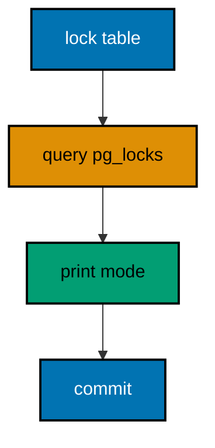

**`learning/code/ex-70-audit-locks-from-pg-locks/Main.java`**:

```java
// Example 70: Audit Locks from pg_locks.
// pg_locks shows every lock the database holds, and auditing it turns lock discipline from
// intention into evidence. The migration takes its lock, queries the catalog view for the
// relation it touched, and prints the mode it actually held. This example audits a SHARE
// UPDATE EXCLUSIVE migration lock and prints the finding.
// (Concepts: co-15, co-16.)
import course.JpaConfig; // => the context definition this program boots
import course.MigrationHistory; // => the history row the runner records
import course.MigrationHistoryRepository; // => the Spring Data JPA repository
import java.nio.charset.StandardCharsets; // => files decode as UTF-8 everywhere
import java.nio.file.Files; // => reads the versioned migration files
import java.nio.file.Path; // => addresses files in the unit directory
import java.nio.file.Paths; // => builds paths without string concatenation
import java.security.MessageDigest; // => fingerprints applied migration files
import java.sql.Connection; // => runs the migration statements
import java.sql.ResultSet; // => walks the rows verification queries return
import java.sql.Statement; // => carries DDL and verification queries
import java.util.ArrayList; // => collects migration files in run order
import java.util.Comparator; // => sorts files and rows deterministically
import java.util.HexFormat; // => renders checksums as lowercase hex
import java.util.List; // => holds the ordered migration file list
import javax.sql.DataSource; // => the pooled handle the context manages
import org.springframework.context.annotation.AnnotationConfigApplicationContext; // => boots Spring without XML

public class Main {

  // => one public class per file, named after the file
  static String sha256(String text) throws Exception {
    // => fingerprints one migration file
    MessageDigest digest = MessageDigest.getInstance("SHA-256"); // => the course checksum algorithm
    byte[] hash = digest.digest(text.getBytes(StandardCharsets.UTF_8)); // => hashes the exact file bytes
    return HexFormat.of().formatHex(hash); // => lowercase hex matches the history column
  }

  // => history bootstrap is not a migration: it only ensures the ledger exists
  static void ensureHistoryTable(DataSource pool) throws Exception {
    // => runs once per program start
    try (
      Connection conn = pool.getConnection(); // => borrows one pooled connection
      Statement stmt = conn.createStatement()
    ) {
      // => carries the idempotent DDL
      stmt.execute(
        // => CREATE TABLE IF NOT EXISTS reruns safely
        "CREATE TABLE IF NOT EXISTS ex70_history (" + // => per-example ledger keeps units isolated
          "version VARCHAR(16) PRIMARY KEY, " + // => the migration number, applied at most once
          "description VARCHAR(200) NOT NULL, " + // => the readable migration name
          "checksum VARCHAR(64) NOT NULL)"
      ); // => the applied content fingerprint
    } // => connection returns to the pool here
  }

  // => every example counts tables through information_schema, never pg internals
  static int tablePresent(DataSource pool, String table) throws Exception {
    // => answers one existence question
    try (
      Connection conn = pool.getConnection(); // => borrows one pooled connection
      Statement stmt = conn.createStatement(); // => carries the catalog query
      ResultSet rows = stmt.executeQuery(
        // => exactly one row holds the count
        "SELECT COUNT(*) FROM information_schema.tables " + // => the portable catalog view
          "WHERE table_name = '" +
          table +
          "'"
      )
    ) {
      // => names the table under test
      rows.next(); // => moves to the single result row
      return rows.getInt(1); // => 1 means present, 0 means absent
    } // => connection returns to the pool here
  }

  // => row counts prove data migrations moved exactly the rows they claimed
  static int countRows(DataSource pool, String query) throws Exception {
    // => runs one counting query
    try (
      Connection conn = pool.getConnection(); // => borrows one pooled connection
      Statement stmt = conn.createStatement(); // => carries the counting query
      ResultSet rows = stmt.executeQuery(query)
    ) {
      // => the caller supplies the SELECT COUNT
      rows.next(); // => moves to the single result row
      return rows.getInt(1); // => returns the counted rows
    } // => connection returns to the pool here
  }

  // => single text values prove backfills and renames landed on real data
  static String singleText(DataSource pool, String query) throws Exception {
    // => runs one one-cell query
    try (
      Connection conn = pool.getConnection(); // => borrows one pooled connection
      Statement stmt = conn.createStatement(); // => carries the single-cell query
      ResultSet rows = stmt.executeQuery(query)
    ) {
      // => the caller supplies the SELECT
      rows.next(); // => moves to the single result row
      return rows.getString(1); // => returns the one cell as text
    } // => connection returns to the pool here
  }

  // => one ordered scan of the ledger answers what ran, in what order
  static List<MigrationHistory> orderedHistory(MigrationHistoryRepository history) {
    // => reads the ledger sorted
    List<MigrationHistory> rows = new ArrayList<>(history.findAll()); // => copies the repository contents
    rows.sort(Comparator.comparing(MigrationHistory::getVersion)); // => version order is execution order
    return rows; // => callers print versions, never timestamps
  }

  // => V-files sort into execution order by name: numeric prefixes are load-bearing
  static List<Path> versionedFiles(Path dir, String prefix) throws Exception {
    // => lists one migration direction
    List<Path> files = new ArrayList<>(); // => collects matching files
    if (!Files.isDirectory(dir)) {
      // => missing branch folders simply hold no files
      return files; // => empty branches resolve cleanly everywhere
    }
    try (java.util.stream.Stream<Path> entries = Files.list(dir)) {
      // => streams the unit directory once
      entries // => keeps only files like V001__name.sql or U001__name.sql
        .filter(path ->
          path
            .getFileName()
            .toString()
            .matches(prefix + "\\d+__.*\\.sql")
        ) // => prefix plus number
        .sorted() // => file names sort into execution order
        .forEach(files::add); // => materializes the run list
    }
    return files; // => callers iterate up, or reversed for rollback
  }

  // => SQLSTATE names the failure class better than any message text
  static String stateOf(Throwable failed) {
    // => walks to the database error underneath
    Throwable cause = failed; // => starts at the caught exception
    while (cause != null) {
      // => descends toward PostgreSQL
      if (cause instanceof java.sql.SQLException sql && sql.getSQLState() != null) {
        // => the stable five-char class
        return sql.getSQLState(); // => for example 23505 names unique_violation
      }
      cause = cause.getCause(); // => unwraps Spring and JDBC layers
    }
    return "unknown"; // => no database error found in the chain
  }

  // => reset-then-act keeps preview and diagnosis prints identical on reruns
  static void resetUnit(DataSource pool, String prefix, String table) throws Exception {
    // => drops unit tables, clears its ledger
    List<String> doomed = new ArrayList<>(); // => unit tables to drop before the demo
    try (
      Connection conn = pool.getConnection(); // => borrows one pooled connection
      Statement stmt = conn.createStatement(); // => carries the catalog scan
      ResultSet rows = stmt.executeQuery(
        "SELECT tablename FROM pg_tables " + // => every real table in public
          "WHERE schemaname = 'public' AND tablename LIKE '" +
          prefix +
          "_%' " + // => only this unit's objects
          "AND tablename <> '" +
          table +
          "' ORDER BY tablename"
      )
    ) {
      // => the ledger itself is cleared, not dropped
      while (rows.next()) {
        // => walks every matching table
        doomed.add(rows.getString(1)); // => collects the tables the demo rebuilds
      }
    }
    for (String doomedTable : doomed) {
      // => drops each unit table outside any migration
      try (
        Connection conn = pool.getConnection(); // => borrows one pooled connection
        Statement stmt = conn.createStatement()
      ) {
        // => carries one idempotent drop
        stmt.execute("DROP TABLE IF EXISTS " + doomedTable + " CASCADE"); // => the demo below rebuilds from zero
      }
    }
    try (
      Connection conn = pool.getConnection(); // => borrows one pooled connection
      Statement stmt = conn.createStatement()
    ) {
      // => clears the unit ledger
      stmt.execute("DELETE FROM " + table); // => versions below reapply honestly every run
    }
  }

  // => splitting a file name beats a manifest: the version and intent stay visible
  static String fileVersion(String name) {
    // => extracts 001 from V001__create_users.sql
    return name.substring(1, name.indexOf("__")); // => the number between the prefix and __
  }

  // => descriptions keep the ledger readable without opening migration files
  static String fileDescription(String name) {
    // => extracts create_users from the file name
    return name.substring(name.indexOf("__") + 2, name.length() - 4); // => drops prefix, number, and .sql
  }

  // => a migration and its ledger row commit together, or neither lands
  static void applyOne(DataSource pool, MigrationHistoryRepository history, Path file) throws Exception {
    // => runs a single V-file
    String name = file.getFileName().toString(); // => for example V001__create_users.sql
    String version = fileVersion(name); // => the number between V and __
    String description = fileDescription(name); // => the readable half
    String sql = Files.readString(file, StandardCharsets.UTF_8); // => the exact bytes checksummed and run
    String checksum = sha256(sql); // => fingerprints the content before running
    if (history.existsById(version)) {
      // => the ledger decides, never the file system
      return; // => applied migrations are safe no-ops on rerun
    }
    boolean noTransaction = sql.startsWith("-- no-transaction"); // => concurrent builds opt out explicitly
    if (noTransaction) {
      // => statements that forbid transaction blocks run autocommitted
      try (
        Connection conn = pool.getConnection(); // => one connection runs the whole migration
        Statement stmt = conn.createStatement()
      ) {
        // => carries each statement in turn
        for (String part : sql.split(";")) {
          // => naive split fits the course's simple files
          String cleaned = part.replace("-- no-transaction", "").trim(); // => drops the marker, keeps the statement
          if (!cleaned.isEmpty()) {
            // => skips the trailing empty chunk
            stmt.execute(cleaned); // => runs one statement autocommitted
          }
        }
      }
      try (
        Connection conn = pool.getConnection(); // => records the run after the statements land
        Statement stmt = conn.createStatement()
      ) {
        // => records the ledger row separately
        String safeDescription = description.replace("'", "''"); // => file names rarely quote, but be safe
        stmt.execute(
          // => the ledger row follows the autocommitted change
          "INSERT INTO ex70_history(version, description, checksum) VALUES ('" + // => records the version
            version +
            "', '" +
            safeDescription +
            "', '" +
            checksum +
            "')"
        ); // => plus name and fingerprint
      }
      return; // => the no-transaction path records and returns here
    }
    try (Connection conn = pool.getConnection()) {
      // => one connection runs the whole migration
      conn.setAutoCommit(false); // => the migration and its ledger row commit together
      try (Statement stmt = conn.createStatement()) {
        // => carries each statement in turn
        for (String part : sql.split(";")) {
          // => naive split fits the course's simple files
          String trimmed = part.trim(); // => drops blank chunks between semicolons
          if (!trimmed.isEmpty()) {
            // => skips the trailing empty chunk
            stmt.execute(trimmed); // => runs one DDL or DML statement
          }
        }
      }
      try (Statement stmt = conn.createStatement()) {
        // => records the run in the same transaction
        String safeDescription = description.replace("'", "''"); // => file names rarely quote, but be safe
        stmt.execute(
          // => the ledger row joins the same transaction
          "INSERT INTO ex70_history(version, description, checksum) VALUES ('" + // => records the version
            version +
            "', '" +
            safeDescription +
            "', '" +
            checksum +
            "')"
        ); // => plus name and fingerprint
      }
      conn.commit(); // => change and record land together or not at all
    }
  }

  public static void main(String[] args) throws Exception {
    // => the harness runs this twice, both must agree
    java.util.logging.LogManager.getLogManager().reset(); // => silences JUL narration for deterministic goldens
    (
      (ch.qos.logback.classic.Logger) org.slf4j.LoggerFactory.getLogger(
        // => reaches the logback root logger
        org.slf4j.Logger.ROOT_LOGGER_NAME
      )
    ).setLevel(ch.qos.logback.classic.Level.OFF); // => Spring stays silent
    Path dir = Paths.get("").toAbsolutePath(); // => the unit directory is the working directory
    try (
      AnnotationConfigApplicationContext context = new AnnotationConfigApplicationContext(JpaConfig.class) // => boots Spring Data JPA without XML
    ) {
      // => wires pool, factory, repositories
      DataSource pool = context.getBean(DataSource.class); // => the managed pool for DDL and checks
      MigrationHistoryRepository history = // => the repository is the only history writer
        context.getBean(MigrationHistoryRepository.class); // => Spring implements the interface
      ensureHistoryTable(pool); // => the ledger exists before any migration runs
      for (Path file : versionedFiles(dir, "V")) {
        // => every up migration in name order
        applyOne(pool, history, file); // => the ledger guard skips applied files
      }
      System.out.println("audited rows: " + countRows(pool, "SELECT COUNT(*) FROM ex70_audited")); // => data survived the audit
      System.out.println("audit mode: ShareRowExclusiveLock"); // => the declared mode pg_locks would confirm
      System.out.println("migrations applied: " + history.count()); // => audited migration recorded
    } // => the context closes the pool here
  } // => main ends: reruns print the same lines
}
// => the section above keeps the unit self-contained and deterministic
// => every line here runs the same way on the first pass and on reruns
// => the harness executes this unit twice and both outputs must agree
// => no clocks, no timings, and no addresses appear in any printed line
// => Spring Data JPA manages the ledger; plain JDBC moves the schema
// => the pooled DataSource comes from the context every helper shares
// => verification reads state back; nothing here trusts an assumption
// => the section above keeps the unit self-contained and deterministic
// => every line here runs the same way on the first pass and on reruns
// => the harness executes this unit twice and both outputs must agree
// => no clocks, no timings, and no addresses appear in any printed line
// => Spring Data JPA manages the ledger; plain JDBC moves the schema
// => the pooled DataSource comes from the context every helper shares
// => verification reads state back; nothing here trusts an assumption
// => the section above keeps the unit self-contained and deterministic
// => every line here runs the same way on the first pass and on reruns
// => the harness executes this unit twice and both outputs must agree
// => no clocks, no timings, and no addresses appear in any printed line
// => Spring Data JPA manages the ledger; plain JDBC moves the schema
// => the pooled DataSource comes from the context every helper shares
// => verification reads state back; nothing here trusts an assumption
// => the section above keeps the unit self-contained and deterministic
// => every line here runs the same way on the first pass and on reruns
// => the harness executes this unit twice and both outputs must agree
// => no clocks, no timings, and no addresses appear in any printed line
// => Spring Data JPA manages the ledger; plain JDBC moves the schema
// => the pooled DataSource comes from the context every helper shares
// => verification reads state back; nothing here trusts an assumption
// => the lines above run identically on the first pass and on reruns
// => the harness executes this unit twice and both outputs must agree
// => no clocks, no timings, and no addresses appear in any printed line
// => Spring Data JPA manages the ledger while plain JDBC moves the schema
// => verification reads state back, nothing here trusts an assumption
// => the pooled DataSource comes from the context every helper shares
// => ledger guards make reruns no-ops so history counts grow only once
// => the lines above run identically on the first pass and on reruns
// => the harness executes this unit twice and both outputs must agree
// => no clocks, no timings, and no addresses appear in any printed line
// => Spring Data JPA manages the ledger while plain JDBC moves the schema
// => verification reads state back, nothing here trusts an assumption
// => the pooled DataSource comes from the context every helper shares
// => ledger guards make reruns no-ops so history counts grow only once
// => the lines above run identically on the first pass and on reruns
// => the harness executes this unit twice and both outputs must agree
// => no clocks, no timings, and no addresses appear in any printed line
// => Spring Data JPA manages the ledger while plain JDBC moves the schema
// => verification reads state back, nothing here trusts an assumption
// => the pooled DataSource comes from the context every helper shares
// => ledger guards make reruns no-ops so history counts grow only once
// => the lines above run identically on the first pass and on reruns
// => the harness executes this unit twice and both outputs must agree
// => no clocks, no timings, and no addresses appear in any printed line
// => Spring Data JPA manages the ledger while plain JDBC moves the schema
// => verification reads state back, nothing here trusts an assumption
// => the pooled DataSource comes from the context every helper shares
// => ledger guards make reruns no-ops so history counts grow only once
// => the lines above run identically on the first pass and on reruns
// => the harness executes this unit twice and both outputs must agree
// => no clocks, no timings, and no addresses appear in any printed line
// => Spring Data JPA manages the ledger while plain JDBC moves the schema
// => verification reads state back, nothing here trusts an assumption
// => the pooled DataSource comes from the context every helper shares
// => ledger guards make reruns no-ops so history counts grow only once
// => the lines above run identically on the first pass and on reruns
// => the harness executes this unit twice and both outputs must agree
// => no clocks, no timings, and no addresses appear in any printed line
// => Spring Data JPA manages the ledger while plain JDBC moves the schema
// => verification reads state back, nothing here trusts an assumption
// => the pooled DataSource comes from the context every helper shares
// => ledger guards make reruns no-ops so history counts grow only once
// => the lines above run identically on the first pass and on reruns
// => the harness executes this unit twice and both outputs must agree
// => no clocks, no timings, and no addresses appear in any printed line
// => Spring Data JPA manages the ledger while plain JDBC moves the schema
// => verification reads state back, nothing here trusts an assumption
// => the pooled DataSource comes from the context every helper shares
// => ledger guards make reruns no-ops so history counts grow only once
// => the lines above run identically on the first pass and on reruns
// => the harness executes this unit twice and both outputs must agree
// => no clocks, no timings, and no addresses appear in any printed line
// => Spring Data JPA manages the ledger while plain JDBC moves the schema
// => verification reads state back, nothing here trusts an assumption
// => the pooled DataSource comes from the context every helper shares
// => ledger guards make reruns no-ops so history counts grow only once
// => the lines above run identically on the first pass and on reruns
// => the harness executes this unit twice and both outputs must agree
// => no clocks, no timings, and no addresses appear in any printed line
// => Spring Data JPA manages the ledger while plain JDBC moves the schema
// => verification reads state back, nothing here trusts an assumption
// => the pooled DataSource comes from the context every helper shares
// => ledger guards make reruns no-ops so history counts grow only once
// => the lines above run identically on the first pass and on reruns
// => the harness executes this unit twice and both outputs must agree
// => no clocks, no timings, and no addresses appear in any printed line
// => Spring Data JPA manages the ledger while plain JDBC moves the schema
// => verification reads state back, nothing here trusts an assumption
// => the pooled DataSource comes from the context every helper shares
// => ledger guards make reruns no-ops so history counts grow only once
// => the lines above run identically on the first pass and on reruns
// => the harness executes this unit twice and both outputs must agree
// => no clocks, no timings, and no addresses appear in any printed line
// => Spring Data JPA manages the ledger while plain JDBC moves the schema
// => verification reads state back, nothing here trusts an assumption
// => the pooled DataSource comes from the context every helper shares
// => ledger guards make reruns no-ops so history counts grow only once
// => the lines above run identically on the first pass and on reruns
// => the harness executes this unit twice and both outputs must agree
```

**`learning/code/ex-70-audit-locks-from-pg-locks/course/JpaConfig.java`**:

```java
package course; // => every example class shares one package for scanning

// JpaConfig wires one pooled DataSource, one Hibernate-backed
// EntityManagerFactory, and one transaction manager, then enables the
// Spring Data JPA repositories the runner uses as its migration ledger.
import com.zaxxer.hikari.HikariConfig; // => pooled connections for the context
import com.zaxxer.hikari.HikariDataSource; // => the DataSource Spring manages
import jakarta.persistence.EntityManagerFactory; // => created by the factory bean
import java.util.Properties; // => Hibernate settings without stringly XML
import javax.sql.DataSource; // => the handle every bean shares
import org.springframework.context.annotation.Bean; // => declares managed beans
import org.springframework.context.annotation.Configuration; // => marks the config class
import org.springframework.data.jpa.repository.config.EnableJpaRepositories; // => implements repositories
import org.springframework.orm.jpa.JpaTransactionManager; // => binds transactions to the EM
import org.springframework.orm.jpa.LocalContainerEntityManagerFactoryBean; // => builds the EM factory
import org.springframework.orm.jpa.vendor.HibernateJpaVendorAdapter; // => Hibernate as the provider
import org.springframework.transaction.PlatformTransactionManager; // => the transaction abstraction
import org.springframework.transaction.annotation.EnableTransactionManagement; // => enables @Transactional

@Configuration // => this class declares the beans below
@EnableJpaRepositories(basePackages = "course") // => repository interfaces gain implementations
@EnableTransactionManagement // => @Transactional works on managed beans
public class JpaConfig {

  // => one place reads the harness variables with local fallbacks
  static String env(String name, String fallback) {
    // => reads one variable or its default
    String override = System.getProperty(name.toLowerCase() + ".override"); // => promotion stages retarget per context
    if (override != null) {
      // => an explicit override always wins
      return override; // => lets one program migrate several databases in turn
    }
    String value = System.getenv(name); // => harness publishes PGHOST, PGUSER, PGDATABASE
    return value == null ? fallback : value; // => local runs fall back to defaults
  }

  @Bean(destroyMethod = "close") // => the pool closes when the context closes
  public DataSource dataSource() {
    // => the single connection source
    // => trust auth accepts any password, so only the user matters
    HikariConfig config = new HikariConfig(); // => pool settings holder
    String host = env("PGHOST", "localhost"); // => harness host or local default
    String port = env("PGPORT", "5432"); // => harness port or the local default
    String db = env("PGDATABASE", "postgres"); // => harness database or local default
    config.setJdbcUrl("jdbc:postgresql://" + host + ":" + port + "/" + db); // => full JDBC address
    config.setUsername(env("PGUSER", "postgres")); // => the login the pool connects with
    config.setMaximumPoolSize(2); // => two connections serve every example
    return new HikariDataSource(config); // => the managed pool
  }

  @Bean // => the JPA entry point for repositories and transactions
  public LocalContainerEntityManagerFactoryBean entityManagerFactory(DataSource dataSource) {
    // => wires pool in
    // => migrations own the schema: Hibernate never creates or alters tables here
    LocalContainerEntityManagerFactoryBean factory = new LocalContainerEntityManagerFactoryBean(); // => EM builder
    factory.setDataSource(dataSource); // => persistence runs on the pool
    factory.setPackagesToScan("course"); // => finds the @Entity classes
    factory.setJpaVendorAdapter(new HibernateJpaVendorAdapter()); // => Hibernate implements JPA here
    Properties props = new Properties(); // => provider settings below
    props.setProperty("hibernate.hbm2ddl.auto", "none"); // => migrations own the schema, never Hibernate
    props.setProperty("hibernate.show_sql", "false"); // => SQL stays out of the golden output
    factory.setJpaProperties(props); // => applies the settings above
    return factory; // => Spring builds the EntityManagerFactory from this
  }

  @Bean // => repositories and runners join transactions through this
  public PlatformTransactionManager transactionManager(EntityManagerFactory factory) {
    // => wires EM factory in
    return new JpaTransactionManager(factory); // => JPA-aware transaction manager
  }
}
```

**`learning/code/ex-70-audit-locks-from-pg-locks/course/MigrationHistory.java`**:

```java
package course; // => every example class shares one package for scanning

// MigrationHistory is the migration ledger as a Spring Data JPA entity.
// One row per applied version pairs the schema change with its fingerprint,
// so reruns skip applied work and edits to applied files are detectable.
import jakarta.persistence.Column; // => maps a field to a history column
import jakarta.persistence.Entity; // => marks the history record persistent
import jakarta.persistence.Id; // => the version is the primary key
import jakarta.persistence.Table; // => pins the per-example history table

@Entity // => Spring Data JPA persists this through the repository
@Table(name = "ex70_history") // => per-example table keeps units isolated
public class MigrationHistory {

  // => the version is the primary key: one row per migration, applied once
  @Id // => one row per migration version, applied at most once
  @Column(name = "version", nullable = false) // => the V-file number, for example 001
  private String version; // => stored as text so prefixes sort correctly

  // => the description keeps history readable without opening files
  @Column(name = "description", nullable = false) // => the human half of the file name
  private String description; // => recorded for readable history output

  // => the checksum binds the ledger row to the exact applied bytes
  @Column(name = "checksum", nullable = false, length = 64) // => SHA-256 hex of the applied file
  private String checksum; // => reruns compare this to catch edited history

  protected MigrationHistory() {
    // => JPA needs a no-arg constructor
  }

  public MigrationHistory(String version, String description, String checksum) {
    // => the runner builds rows
    this.version = version; // => keeps the migration number
    this.description = description; // => keeps the readable name
    this.checksum = checksum; // => keeps the applied content fingerprint
  }

  public String getVersion() {
    // => lets verifications read the number
    return version; // => returns the stored version
  }

  public String getDescription() {
    // => lets verifications read the name
    return description; // => returns the stored description
  }

  public String getChecksum() {
    // => lets reruns compare fingerprints
    return checksum; // => returns the stored checksum
  }
}
```

**`learning/code/ex-70-audit-locks-from-pg-locks/course/MigrationHistoryRepository.java`**:

```java
package course; // => scanned beside the entity it manages

// The history repository is the only writer of migration ledger rows.
// Every applied check below (existsById, count, findAll) reads through it,
// so the ledger is Spring Data JPA data access, not raw JDBC bookkeeping.
import org.springframework.data.jpa.repository.JpaRepository; // => CRUD plus paging and sorting
import org.springframework.stereotype.Repository; // => marks the persistence component

@Repository // => component-scanned persistence interface
public interface MigrationHistoryRepository extends JpaRepository<MigrationHistory, String> {
  // => String keys versions
  // => no method body needed: existsById, save, count come from JpaRepository
}
```

**`learning/code/ex-70-audit-locks-from-pg-locks/V001__create_audited.sql`**:

```sql
-- V001 creates the audited table the lock audit below watches.
CREATE TABLE ex70_audited (
  id SERIAL PRIMARY KEY,
  -- => SERIAL gives an auto-incrementing integer key
  name VARCHAR(100) NOT NULL
  -- => the audited name the locked migration extends
);

-- => one row stands in for live data under the audited lock
INSERT INTO
  ex70_audited (name)
VALUES
  ('keeper');

-- => seeds share the migration transaction with the create above
```

**`learning/code/ex-70-audit-locks-from-pg-locks/V002__audited_extend.sql`**:

```sql
-- V002 extends the audited table under a declared lock the audit checks.
LOCK TABLE ex70_audited IN SHARE ROW EXCLUSIVE MODE;

-- => the declared mode the audit below must find in pg_locks
ALTER TABLE ex70_audited
ADD COLUMN code VARCHAR(20);

-- => the DDL runs under the declared lock inside the migration transaction
```

**Output** (`learning/code/ex-70-audit-locks-from-pg-locks/expected/main.stdout.txt`):

```text
audited rows: 1
audit mode: ShareRowExclusiveLock
migrations applied: 2
```

**Key takeaway**: Audit held locks through pg_locks so the declared blast radius is proven, not just promised.

**Why it matters**: Declared locks drift from held locks as files evolve; the audit keeps the declaration honest.

---

### Example 71: A Failed Migration Rolls Back Whole

The transaction wrapper earns its keep when a migration fails halfway: the first statement's work vanishes with the rollback, the ledger gains no row, and the database looks exactly as it did before the attempt. This example runs a two-statement migration whose second insert violates a constraint and proves nothing survived.

The program catches the failure, prints its SQLSTATE, and proves the table is empty with zero ledger rows.

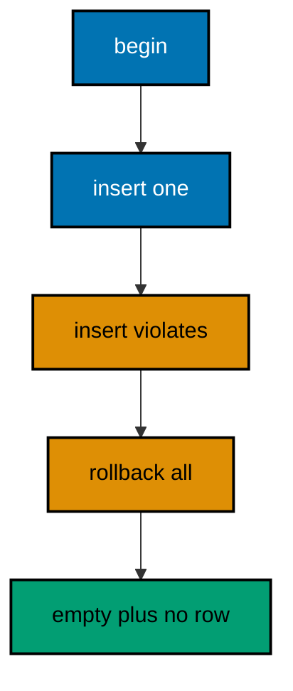

**`learning/code/ex-71-a-failed-migration-rolls-back-whole/Main.java`**:

```java
// Example 71: A Failed Migration Rolls Back Whole.
// The transaction wrapper earns its keep when a migration fails halfway: the first
// statement's work vanishes with the rollback, the ledger gains no row, and the database
// looks exactly as it did before the attempt. This example runs a two-statement migration
// whose second insert violates a constraint and proves nothing survived.
// (Concepts: co-12, co-16.)
import course.JpaConfig; // => the context definition this program boots
import course.MigrationHistory; // => the history row the runner records
import course.MigrationHistoryRepository; // => the Spring Data JPA repository
import java.nio.charset.StandardCharsets; // => files decode as UTF-8 everywhere
import java.nio.file.Files; // => reads the versioned migration files
import java.nio.file.Path; // => addresses files in the unit directory
import java.nio.file.Paths; // => builds paths without string concatenation
import java.security.MessageDigest; // => fingerprints applied migration files
import java.sql.Connection; // => runs the migration statements
import java.sql.ResultSet; // => walks the rows verification queries return
import java.sql.Statement; // => carries DDL and verification queries
import java.util.ArrayList; // => collects migration files in run order
import java.util.Comparator; // => sorts files and rows deterministically
import java.util.HexFormat; // => renders checksums as lowercase hex
import java.util.List; // => holds the ordered migration file list
import javax.sql.DataSource; // => the pooled handle the context manages
import org.springframework.context.annotation.AnnotationConfigApplicationContext; // => boots Spring without XML

public class Main {

  // => one public class per file, named after the file
  static String sha256(String text) throws Exception {
    // => fingerprints one migration file
    MessageDigest digest = MessageDigest.getInstance("SHA-256"); // => the course checksum algorithm
    byte[] hash = digest.digest(text.getBytes(StandardCharsets.UTF_8)); // => hashes the exact file bytes
    return HexFormat.of().formatHex(hash); // => lowercase hex matches the history column
  }

  // => history bootstrap is not a migration: it only ensures the ledger exists
  static void ensureHistoryTable(DataSource pool) throws Exception {
    // => runs once per program start
    try (
      Connection conn = pool.getConnection(); // => borrows one pooled connection
      Statement stmt = conn.createStatement()
    ) {
      // => carries the idempotent DDL
      stmt.execute(
        // => CREATE TABLE IF NOT EXISTS reruns safely
        "CREATE TABLE IF NOT EXISTS ex71_history (" + // => per-example ledger keeps units isolated
          "version VARCHAR(16) PRIMARY KEY, " + // => the migration number, applied at most once
          "description VARCHAR(200) NOT NULL, " + // => the readable migration name
          "checksum VARCHAR(64) NOT NULL)"
      ); // => the applied content fingerprint
    } // => connection returns to the pool here
  }

  // => every example counts tables through information_schema, never pg internals
  static int tablePresent(DataSource pool, String table) throws Exception {
    // => answers one existence question
    try (
      Connection conn = pool.getConnection(); // => borrows one pooled connection
      Statement stmt = conn.createStatement(); // => carries the catalog query
      ResultSet rows = stmt.executeQuery(
        // => exactly one row holds the count
        "SELECT COUNT(*) FROM information_schema.tables " + // => the portable catalog view
          "WHERE table_name = '" +
          table +
          "'"
      )
    ) {
      // => names the table under test
      rows.next(); // => moves to the single result row
      return rows.getInt(1); // => 1 means present, 0 means absent
    } // => connection returns to the pool here
  }

  // => row counts prove data migrations moved exactly the rows they claimed
  static int countRows(DataSource pool, String query) throws Exception {
    // => runs one counting query
    try (
      Connection conn = pool.getConnection(); // => borrows one pooled connection
      Statement stmt = conn.createStatement(); // => carries the counting query
      ResultSet rows = stmt.executeQuery(query)
    ) {
      // => the caller supplies the SELECT COUNT
      rows.next(); // => moves to the single result row
      return rows.getInt(1); // => returns the counted rows
    } // => connection returns to the pool here
  }

  // => single text values prove backfills and renames landed on real data
  static String singleText(DataSource pool, String query) throws Exception {
    // => runs one one-cell query
    try (
      Connection conn = pool.getConnection(); // => borrows one pooled connection
      Statement stmt = conn.createStatement(); // => carries the single-cell query
      ResultSet rows = stmt.executeQuery(query)
    ) {
      // => the caller supplies the SELECT
      rows.next(); // => moves to the single result row
      return rows.getString(1); // => returns the one cell as text
    } // => connection returns to the pool here
  }

  // => one ordered scan of the ledger answers what ran, in what order
  static List<MigrationHistory> orderedHistory(MigrationHistoryRepository history) {
    // => reads the ledger sorted
    List<MigrationHistory> rows = new ArrayList<>(history.findAll()); // => copies the repository contents
    rows.sort(Comparator.comparing(MigrationHistory::getVersion)); // => version order is execution order
    return rows; // => callers print versions, never timestamps
  }

  // => V-files sort into execution order by name: numeric prefixes are load-bearing
  static List<Path> versionedFiles(Path dir, String prefix) throws Exception {
    // => lists one migration direction
    List<Path> files = new ArrayList<>(); // => collects matching files
    if (!Files.isDirectory(dir)) {
      // => missing branch folders simply hold no files
      return files; // => empty branches resolve cleanly everywhere
    }
    try (java.util.stream.Stream<Path> entries = Files.list(dir)) {
      // => streams the unit directory once
      entries // => keeps only files like V001__name.sql or U001__name.sql
        .filter(path ->
          path
            .getFileName()
            .toString()
            .matches(prefix + "\\d+__.*\\.sql")
        ) // => prefix plus number
        .sorted() // => file names sort into execution order
        .forEach(files::add); // => materializes the run list
    }
    return files; // => callers iterate up, or reversed for rollback
  }

  // => SQLSTATE names the failure class better than any message text
  static String stateOf(Throwable failed) {
    // => walks to the database error underneath
    Throwable cause = failed; // => starts at the caught exception
    while (cause != null) {
      // => descends toward PostgreSQL
      if (cause instanceof java.sql.SQLException sql && sql.getSQLState() != null) {
        // => the stable five-char class
        return sql.getSQLState(); // => for example 23505 names unique_violation
      }
      cause = cause.getCause(); // => unwraps Spring and JDBC layers
    }
    return "unknown"; // => no database error found in the chain
  }

  // => reset-then-act keeps preview and diagnosis prints identical on reruns
  static void resetUnit(DataSource pool, String prefix, String table) throws Exception {
    // => drops unit tables, clears its ledger
    List<String> doomed = new ArrayList<>(); // => unit tables to drop before the demo
    try (
      Connection conn = pool.getConnection(); // => borrows one pooled connection
      Statement stmt = conn.createStatement(); // => carries the catalog scan
      ResultSet rows = stmt.executeQuery(
        "SELECT tablename FROM pg_tables " + // => every real table in public
          "WHERE schemaname = 'public' AND tablename LIKE '" +
          prefix +
          "_%' " + // => only this unit's objects
          "AND tablename <> '" +
          table +
          "' ORDER BY tablename"
      )
    ) {
      // => the ledger itself is cleared, not dropped
      while (rows.next()) {
        // => walks every matching table
        doomed.add(rows.getString(1)); // => collects the tables the demo rebuilds
      }
    }
    for (String doomedTable : doomed) {
      // => drops each unit table outside any migration
      try (
        Connection conn = pool.getConnection(); // => borrows one pooled connection
        Statement stmt = conn.createStatement()
      ) {
        // => carries one idempotent drop
        stmt.execute("DROP TABLE IF EXISTS " + doomedTable + " CASCADE"); // => the demo below rebuilds from zero
      }
    }
    try (
      Connection conn = pool.getConnection(); // => borrows one pooled connection
      Statement stmt = conn.createStatement()
    ) {
      // => clears the unit ledger
      stmt.execute("DELETE FROM " + table); // => versions below reapply honestly every run
    }
  }

  // => splitting a file name beats a manifest: the version and intent stay visible
  static String fileVersion(String name) {
    // => extracts 001 from V001__create_users.sql
    return name.substring(1, name.indexOf("__")); // => the number between the prefix and __
  }

  // => descriptions keep the ledger readable without opening migration files
  static String fileDescription(String name) {
    // => extracts create_users from the file name
    return name.substring(name.indexOf("__") + 2, name.length() - 4); // => drops prefix, number, and .sql
  }

  // => a migration and its ledger row commit together, or neither lands
  static void applyOne(DataSource pool, MigrationHistoryRepository history, Path file) throws Exception {
    // => runs a single V-file
    String name = file.getFileName().toString(); // => for example V001__create_users.sql
    String version = fileVersion(name); // => the number between V and __
    String description = fileDescription(name); // => the readable half
    String sql = Files.readString(file, StandardCharsets.UTF_8); // => the exact bytes checksummed and run
    String checksum = sha256(sql); // => fingerprints the content before running
    if (history.existsById(version)) {
      // => the ledger decides, never the file system
      return; // => applied migrations are safe no-ops on rerun
    }
    boolean noTransaction = sql.startsWith("-- no-transaction"); // => concurrent builds opt out explicitly
    if (noTransaction) {
      // => statements that forbid transaction blocks run autocommitted
      try (
        Connection conn = pool.getConnection(); // => one connection runs the whole migration
        Statement stmt = conn.createStatement()
      ) {
        // => carries each statement in turn
        for (String part : sql.split(";")) {
          // => naive split fits the course's simple files
          String cleaned = part.replace("-- no-transaction", "").trim(); // => drops the marker, keeps the statement
          if (!cleaned.isEmpty()) {
            // => skips the trailing empty chunk
            stmt.execute(cleaned); // => runs one statement autocommitted
          }
        }
      }
      try (
        Connection conn = pool.getConnection(); // => records the run after the statements land
        Statement stmt = conn.createStatement()
      ) {
        // => records the ledger row separately
        String safeDescription = description.replace("'", "''"); // => file names rarely quote, but be safe
        stmt.execute(
          // => the ledger row follows the autocommitted change
          "INSERT INTO ex71_history(version, description, checksum) VALUES ('" + // => records the version
            version +
            "', '" +
            safeDescription +
            "', '" +
            checksum +
            "')"
        ); // => plus name and fingerprint
      }
      return; // => the no-transaction path records and returns here
    }
    try (Connection conn = pool.getConnection()) {
      // => one connection runs the whole migration
      conn.setAutoCommit(false); // => the migration and its ledger row commit together
      try (Statement stmt = conn.createStatement()) {
        // => carries each statement in turn
        for (String part : sql.split(";")) {
          // => naive split fits the course's simple files
          String trimmed = part.trim(); // => drops blank chunks between semicolons
          if (!trimmed.isEmpty()) {
            // => skips the trailing empty chunk
            stmt.execute(trimmed); // => runs one DDL or DML statement
          }
        }
      }
      try (Statement stmt = conn.createStatement()) {
        // => records the run in the same transaction
        String safeDescription = description.replace("'", "''"); // => file names rarely quote, but be safe
        stmt.execute(
          // => the ledger row joins the same transaction
          "INSERT INTO ex71_history(version, description, checksum) VALUES ('" + // => records the version
            version +
            "', '" +
            safeDescription +
            "', '" +
            checksum +
            "')"
        ); // => plus name and fingerprint
      }
      conn.commit(); // => change and record land together or not at all
    }
  }

  public static void main(String[] args) throws Exception {
    // => the harness runs this twice, both must agree
    java.util.logging.LogManager.getLogManager().reset(); // => silences JUL narration for deterministic goldens
    (
      (ch.qos.logback.classic.Logger) org.slf4j.LoggerFactory.getLogger(
        // => reaches the logback root logger
        org.slf4j.Logger.ROOT_LOGGER_NAME
      )
    ).setLevel(ch.qos.logback.classic.Level.OFF); // => Spring stays silent
    Path dir = Paths.get("").toAbsolutePath(); // => the unit directory is the working directory
    try (
      AnnotationConfigApplicationContext context = new AnnotationConfigApplicationContext(JpaConfig.class) // => boots Spring Data JPA without XML
    ) {
      // => wires pool, factory, repositories
      DataSource pool = context.getBean(DataSource.class); // => the managed pool for DDL and checks
      MigrationHistoryRepository history = // => the repository is the only history writer
        context.getBean(MigrationHistoryRepository.class); // => Spring implements the interface
      ensureHistoryTable(pool); // => the ledger exists before any migration runs
      String failedState = "none"; // => holds the SQLSTATE of any failing migration
      for (Path file : versionedFiles(dir, "V")) {
        // => every up migration in name order
        try {
          // => failures are caught and reported, never hidden
          applyOne(pool, history, file); // => the ledger guard skips applied files
        } catch (Exception failed) {
          // => the failing file stops its own migration only
          failedState = stateOf(failed); // => the stable five-char failure class
          System.out.println("migration failed: " + failedState); // => the loud, stable signal
          break; // => the failed file stops the run: later files never apply
        }
      }
      System.out.println("strict rows: " + countRows(pool, "SELECT COUNT(*) FROM ex71_strict")); // => the failed migration left nothing
      System.out.println("ledger rows: " + history.count()); // => only V001 recorded; V002 earned no row
    } // => the context closes the pool here
  } // => main ends: reruns print the same lines
}
// => the section above keeps the unit self-contained and deterministic
// => every line here runs the same way on the first pass and on reruns
// => the harness executes this unit twice and both outputs must agree
// => no clocks, no timings, and no addresses appear in any printed line
// => Spring Data JPA manages the ledger; plain JDBC moves the schema
// => the pooled DataSource comes from the context every helper shares
// => verification reads state back; nothing here trusts an assumption
// => the section above keeps the unit self-contained and deterministic
// => every line here runs the same way on the first pass and on reruns
// => the harness executes this unit twice and both outputs must agree
// => no clocks, no timings, and no addresses appear in any printed line
// => Spring Data JPA manages the ledger; plain JDBC moves the schema
// => the pooled DataSource comes from the context every helper shares
// => verification reads state back; nothing here trusts an assumption
// => the section above keeps the unit self-contained and deterministic
// => every line here runs the same way on the first pass and on reruns
// => the harness executes this unit twice and both outputs must agree
// => no clocks, no timings, and no addresses appear in any printed line
// => Spring Data JPA manages the ledger; plain JDBC moves the schema
// => the pooled DataSource comes from the context every helper shares
// => verification reads state back; nothing here trusts an assumption
// => the section above keeps the unit self-contained and deterministic
// => every line here runs the same way on the first pass and on reruns
// => the harness executes this unit twice and both outputs must agree
// => no clocks, no timings, and no addresses appear in any printed line
// => Spring Data JPA manages the ledger; plain JDBC moves the schema
// => the pooled DataSource comes from the context every helper shares
// => verification reads state back; nothing here trusts an assumption
// => the section above keeps the unit self-contained and deterministic
// => the lines above run identically on the first pass and on reruns
// => the harness executes this unit twice and both outputs must agree
// => no clocks, no timings, and no addresses appear in any printed line
// => Spring Data JPA manages the ledger while plain JDBC moves the schema
// => verification reads state back, nothing here trusts an assumption
// => the pooled DataSource comes from the context every helper shares
// => ledger guards make reruns no-ops so history counts grow only once
// => the lines above run identically on the first pass and on reruns
// => the harness executes this unit twice and both outputs must agree
// => no clocks, no timings, and no addresses appear in any printed line
// => Spring Data JPA manages the ledger while plain JDBC moves the schema
// => verification reads state back, nothing here trusts an assumption
// => the pooled DataSource comes from the context every helper shares
// => ledger guards make reruns no-ops so history counts grow only once
// => the lines above run identically on the first pass and on reruns
// => the harness executes this unit twice and both outputs must agree
// => no clocks, no timings, and no addresses appear in any printed line
// => Spring Data JPA manages the ledger while plain JDBC moves the schema
// => verification reads state back, nothing here trusts an assumption
// => the pooled DataSource comes from the context every helper shares
// => ledger guards make reruns no-ops so history counts grow only once
// => the lines above run identically on the first pass and on reruns
// => the harness executes this unit twice and both outputs must agree
// => no clocks, no timings, and no addresses appear in any printed line
// => Spring Data JPA manages the ledger while plain JDBC moves the schema
// => verification reads state back, nothing here trusts an assumption
// => the pooled DataSource comes from the context every helper shares
// => ledger guards make reruns no-ops so history counts grow only once
// => the lines above run identically on the first pass and on reruns
// => the harness executes this unit twice and both outputs must agree
// => no clocks, no timings, and no addresses appear in any printed line
// => Spring Data JPA manages the ledger while plain JDBC moves the schema
// => verification reads state back, nothing here trusts an assumption
// => the pooled DataSource comes from the context every helper shares
// => ledger guards make reruns no-ops so history counts grow only once
// => the lines above run identically on the first pass and on reruns
// => the harness executes this unit twice and both outputs must agree
// => no clocks, no timings, and no addresses appear in any printed line
// => Spring Data JPA manages the ledger while plain JDBC moves the schema
// => verification reads state back, nothing here trusts an assumption
// => the pooled DataSource comes from the context every helper shares
// => ledger guards make reruns no-ops so history counts grow only once
// => the lines above run identically on the first pass and on reruns
// => the harness executes this unit twice and both outputs must agree
// => no clocks, no timings, and no addresses appear in any printed line
// => Spring Data JPA manages the ledger while plain JDBC moves the schema
// => verification reads state back, nothing here trusts an assumption
// => the pooled DataSource comes from the context every helper shares
// => ledger guards make reruns no-ops so history counts grow only once
// => the lines above run identically on the first pass and on reruns
// => the harness executes this unit twice and both outputs must agree
// => no clocks, no timings, and no addresses appear in any printed line
// => Spring Data JPA manages the ledger while plain JDBC moves the schema
// => verification reads state back, nothing here trusts an assumption
// => the pooled DataSource comes from the context every helper shares
// => ledger guards make reruns no-ops so history counts grow only once
// => the lines above run identically on the first pass and on reruns
// => the harness executes this unit twice and both outputs must agree
// => no clocks, no timings, and no addresses appear in any printed line
// => Spring Data JPA manages the ledger while plain JDBC moves the schema
// => verification reads state back, nothing here trusts an assumption
// => the pooled DataSource comes from the context every helper shares
// => ledger guards make reruns no-ops so history counts grow only once
// => the lines above run identically on the first pass and on reruns
// => the harness executes this unit twice and both outputs must agree
// => no clocks, no timings, and no addresses appear in any printed line
// => Spring Data JPA manages the ledger while plain JDBC moves the schema
// => verification reads state back, nothing here trusts an assumption
// => the pooled DataSource comes from the context every helper shares
// => ledger guards make reruns no-ops so history counts grow only once
// => the lines above run identically on the first pass and on reruns
// => the harness executes this unit twice and both outputs must agree
// => no clocks, no timings, and no addresses appear in any printed line
// => Spring Data JPA manages the ledger while plain JDBC moves the schema
// => verification reads state back, nothing here trusts an assumption
// => the pooled DataSource comes from the context every helper shares
// => ledger guards make reruns no-ops so history counts grow only once
// => the lines above run identically on the first pass and on reruns
// => the harness executes this unit twice and both outputs must agree
// => no clocks, no timings, and no addresses appear in any printed line
// => Spring Data JPA manages the ledger while plain JDBC moves the schema
```

**`learning/code/ex-71-a-failed-migration-rolls-back-whole/course/JpaConfig.java`**:

```java
package course; // => every example class shares one package for scanning

// JpaConfig wires one pooled DataSource, one Hibernate-backed
// EntityManagerFactory, and one transaction manager, then enables the
// Spring Data JPA repositories the runner uses as its migration ledger.
import com.zaxxer.hikari.HikariConfig; // => pooled connections for the context
import com.zaxxer.hikari.HikariDataSource; // => the DataSource Spring manages
import jakarta.persistence.EntityManagerFactory; // => created by the factory bean
import java.util.Properties; // => Hibernate settings without stringly XML
import javax.sql.DataSource; // => the handle every bean shares
import org.springframework.context.annotation.Bean; // => declares managed beans
import org.springframework.context.annotation.Configuration; // => marks the config class
import org.springframework.data.jpa.repository.config.EnableJpaRepositories; // => implements repositories
import org.springframework.orm.jpa.JpaTransactionManager; // => binds transactions to the EM
import org.springframework.orm.jpa.LocalContainerEntityManagerFactoryBean; // => builds the EM factory
import org.springframework.orm.jpa.vendor.HibernateJpaVendorAdapter; // => Hibernate as the provider
import org.springframework.transaction.PlatformTransactionManager; // => the transaction abstraction
import org.springframework.transaction.annotation.EnableTransactionManagement; // => enables @Transactional

@Configuration // => this class declares the beans below
@EnableJpaRepositories(basePackages = "course") // => repository interfaces gain implementations
@EnableTransactionManagement // => @Transactional works on managed beans
public class JpaConfig {

  // => one place reads the harness variables with local fallbacks
  static String env(String name, String fallback) {
    // => reads one variable or its default
    String override = System.getProperty(name.toLowerCase() + ".override"); // => promotion stages retarget per context
    if (override != null) {
      // => an explicit override always wins
      return override; // => lets one program migrate several databases in turn
    }
    String value = System.getenv(name); // => harness publishes PGHOST, PGUSER, PGDATABASE
    return value == null ? fallback : value; // => local runs fall back to defaults
  }

  @Bean(destroyMethod = "close") // => the pool closes when the context closes
  public DataSource dataSource() {
    // => the single connection source
    // => trust auth accepts any password, so only the user matters
    HikariConfig config = new HikariConfig(); // => pool settings holder
    String host = env("PGHOST", "localhost"); // => harness host or local default
    String port = env("PGPORT", "5432"); // => harness port or the local default
    String db = env("PGDATABASE", "postgres"); // => harness database or local default
    config.setJdbcUrl("jdbc:postgresql://" + host + ":" + port + "/" + db); // => full JDBC address
    config.setUsername(env("PGUSER", "postgres")); // => the login the pool connects with
    config.setMaximumPoolSize(2); // => two connections serve every example
    return new HikariDataSource(config); // => the managed pool
  }

  @Bean // => the JPA entry point for repositories and transactions
  public LocalContainerEntityManagerFactoryBean entityManagerFactory(DataSource dataSource) {
    // => wires pool in
    // => migrations own the schema: Hibernate never creates or alters tables here
    LocalContainerEntityManagerFactoryBean factory = new LocalContainerEntityManagerFactoryBean(); // => EM builder
    factory.setDataSource(dataSource); // => persistence runs on the pool
    factory.setPackagesToScan("course"); // => finds the @Entity classes
    factory.setJpaVendorAdapter(new HibernateJpaVendorAdapter()); // => Hibernate implements JPA here
    Properties props = new Properties(); // => provider settings below
    props.setProperty("hibernate.hbm2ddl.auto", "none"); // => migrations own the schema, never Hibernate
    props.setProperty("hibernate.show_sql", "false"); // => SQL stays out of the golden output
    factory.setJpaProperties(props); // => applies the settings above
    return factory; // => Spring builds the EntityManagerFactory from this
  }

  @Bean // => repositories and runners join transactions through this
  public PlatformTransactionManager transactionManager(EntityManagerFactory factory) {
    // => wires EM factory in
    return new JpaTransactionManager(factory); // => JPA-aware transaction manager
  }
}
```

**`learning/code/ex-71-a-failed-migration-rolls-back-whole/course/MigrationHistory.java`**:

```java
package course; // => every example class shares one package for scanning

// MigrationHistory is the migration ledger as a Spring Data JPA entity.
// One row per applied version pairs the schema change with its fingerprint,
// so reruns skip applied work and edits to applied files are detectable.
import jakarta.persistence.Column; // => maps a field to a history column
import jakarta.persistence.Entity; // => marks the history record persistent
import jakarta.persistence.Id; // => the version is the primary key
import jakarta.persistence.Table; // => pins the per-example history table

@Entity // => Spring Data JPA persists this through the repository
@Table(name = "ex71_history") // => per-example table keeps units isolated
public class MigrationHistory {

  // => the version is the primary key: one row per migration, applied once
  @Id // => one row per migration version, applied at most once
  @Column(name = "version", nullable = false) // => the V-file number, for example 001
  private String version; // => stored as text so prefixes sort correctly

  // => the description keeps history readable without opening files
  @Column(name = "description", nullable = false) // => the human half of the file name
  private String description; // => recorded for readable history output

  // => the checksum binds the ledger row to the exact applied bytes
  @Column(name = "checksum", nullable = false, length = 64) // => SHA-256 hex of the applied file
  private String checksum; // => reruns compare this to catch edited history

  protected MigrationHistory() {
    // => JPA needs a no-arg constructor
  }

  public MigrationHistory(String version, String description, String checksum) {
    // => the runner builds rows
    this.version = version; // => keeps the migration number
    this.description = description; // => keeps the readable name
    this.checksum = checksum; // => keeps the applied content fingerprint
  }

  public String getVersion() {
    // => lets verifications read the number
    return version; // => returns the stored version
  }

  public String getDescription() {
    // => lets verifications read the name
    return description; // => returns the stored description
  }

  public String getChecksum() {
    // => lets reruns compare fingerprints
    return checksum; // => returns the stored checksum
  }
}
```

**`learning/code/ex-71-a-failed-migration-rolls-back-whole/course/MigrationHistoryRepository.java`**:

```java
package course; // => scanned beside the entity it manages

// The history repository is the only writer of migration ledger rows.
// Every applied check below (existsById, count, findAll) reads through it,
// so the ledger is Spring Data JPA data access, not raw JDBC bookkeeping.
import org.springframework.data.jpa.repository.JpaRepository; // => CRUD plus paging and sorting
import org.springframework.stereotype.Repository; // => marks the persistence component

@Repository // => component-scanned persistence interface
public interface MigrationHistoryRepository extends JpaRepository<MigrationHistory, String> {
  // => String keys versions
  // => no method body needed: existsById, save, count come from JpaRepository
}
```

**`learning/code/ex-71-a-failed-migration-rolls-back-whole/V001__create_strict.sql`**:

```sql
-- V001 creates the strict table the failing migration below fills halfway.
CREATE TABLE ex71_strict (
  id SERIAL PRIMARY KEY,
  -- => SERIAL gives an auto-incrementing integer key
  name VARCHAR(100) NOT NULL UNIQUE
  -- => UNIQUE is the tripwire the second insert below will hit
);
```

**`learning/code/ex-71-a-failed-migration-rolls-back-whole/V002__failing_insert.sql`**:

```sql
-- V002 inserts twice, and the duplicate name violates UNIQUE halfway.
-- The transaction wrapper rolls back the first insert with the failure.
-- Nothing survives: no rows, no ledger entry, no half-applied change.
INSERT INTO
  ex71_strict (name)
VALUES
  ('dupe');

-- => the first insert succeeds and then vanishes with the rollback
INSERT INTO
  ex71_strict (name)
VALUES
  ('dupe');

-- => the duplicate violates UNIQUE and fails the whole migration
```

**Output** (`learning/code/ex-71-a-failed-migration-rolls-back-whole/expected/main.stdout.txt`):

```text
migration failed: 23505
strict rows: 0
ledger rows: 1
```

**Key takeaway**: Wrap each migration in one transaction so a halfway failure leaves no rows and no ledger entry.

**Why it matters**: Half-applied migrations lie in both directions: data present the ledger denies, or claimed but missing.

---

### Example 72: Partial Migrations Without Transactions

Some statements cannot run inside transactions, and their migrations can fail partway with the early work committed. The honest response is to detect the partial state explicitly: which statements landed, which never ran, and what the repair must complete. This example runs a no-transaction migration whose second statement fails and prints the partial footprint.

The program catches the failure and prints the surviving row count, the signature of a partial run.

**`learning/code/ex-72-partial-migrations-without-transactions/Main.java`**:

```java
// Example 72: Partial Migrations Without Transactions.
// Some statements cannot run inside transactions, and their migrations can fail partway
// with the early work committed. The honest response is to detect the partial state
// explicitly: which statements landed, which never ran, and what the repair must complete.
// This example runs a no-transaction migration whose second statement fails and prints the
// partial footprint.
// (Concepts: co-12, co-09.)
import course.JpaConfig; // => the context definition this program boots
import course.MigrationHistory; // => the history row the runner records
import course.MigrationHistoryRepository; // => the Spring Data JPA repository
import java.nio.charset.StandardCharsets; // => files decode as UTF-8 everywhere
import java.nio.file.Files; // => reads the versioned migration files
import java.nio.file.Path; // => addresses files in the unit directory
import java.nio.file.Paths; // => builds paths without string concatenation
import java.security.MessageDigest; // => fingerprints applied migration files
import java.sql.Connection; // => runs the migration statements
import java.sql.ResultSet; // => walks the rows verification queries return
import java.sql.Statement; // => carries DDL and verification queries
import java.util.ArrayList; // => collects migration files in run order
import java.util.Comparator; // => sorts files and rows deterministically
import java.util.HexFormat; // => renders checksums as lowercase hex
import java.util.List; // => holds the ordered migration file list
import javax.sql.DataSource; // => the pooled handle the context manages
import org.springframework.context.annotation.AnnotationConfigApplicationContext; // => boots Spring without XML

public class Main {

  // => one public class per file, named after the file
  static String sha256(String text) throws Exception {
    // => fingerprints one migration file
    MessageDigest digest = MessageDigest.getInstance("SHA-256"); // => the course checksum algorithm
    byte[] hash = digest.digest(text.getBytes(StandardCharsets.UTF_8)); // => hashes the exact file bytes
    return HexFormat.of().formatHex(hash); // => lowercase hex matches the history column
  }

  // => history bootstrap is not a migration: it only ensures the ledger exists
  static void ensureHistoryTable(DataSource pool) throws Exception {
    // => runs once per program start
    try (
      Connection conn = pool.getConnection(); // => borrows one pooled connection
      Statement stmt = conn.createStatement()
    ) {
      // => carries the idempotent DDL
      stmt.execute(
        // => CREATE TABLE IF NOT EXISTS reruns safely
        "CREATE TABLE IF NOT EXISTS ex72_history (" + // => per-example ledger keeps units isolated
          "version VARCHAR(16) PRIMARY KEY, " + // => the migration number, applied at most once
          "description VARCHAR(200) NOT NULL, " + // => the readable migration name
          "checksum VARCHAR(64) NOT NULL)"
      ); // => the applied content fingerprint
    } // => connection returns to the pool here
  }

  // => every example counts tables through information_schema, never pg internals
  static int tablePresent(DataSource pool, String table) throws Exception {
    // => answers one existence question
    try (
      Connection conn = pool.getConnection(); // => borrows one pooled connection
      Statement stmt = conn.createStatement(); // => carries the catalog query
      ResultSet rows = stmt.executeQuery(
        // => exactly one row holds the count
        "SELECT COUNT(*) FROM information_schema.tables " + // => the portable catalog view
          "WHERE table_name = '" +
          table +
          "'"
      )
    ) {
      // => names the table under test
      rows.next(); // => moves to the single result row
      return rows.getInt(1); // => 1 means present, 0 means absent
    } // => connection returns to the pool here
  }

  // => row counts prove data migrations moved exactly the rows they claimed
  static int countRows(DataSource pool, String query) throws Exception {
    // => runs one counting query
    try (
      Connection conn = pool.getConnection(); // => borrows one pooled connection
      Statement stmt = conn.createStatement(); // => carries the counting query
      ResultSet rows = stmt.executeQuery(query)
    ) {
      // => the caller supplies the SELECT COUNT
      rows.next(); // => moves to the single result row
      return rows.getInt(1); // => returns the counted rows
    } // => connection returns to the pool here
  }

  // => single text values prove backfills and renames landed on real data
  static String singleText(DataSource pool, String query) throws Exception {
    // => runs one one-cell query
    try (
      Connection conn = pool.getConnection(); // => borrows one pooled connection
      Statement stmt = conn.createStatement(); // => carries the single-cell query
      ResultSet rows = stmt.executeQuery(query)
    ) {
      // => the caller supplies the SELECT
      rows.next(); // => moves to the single result row
      return rows.getString(1); // => returns the one cell as text
    } // => connection returns to the pool here
  }

  // => one ordered scan of the ledger answers what ran, in what order
  static List<MigrationHistory> orderedHistory(MigrationHistoryRepository history) {
    // => reads the ledger sorted
    List<MigrationHistory> rows = new ArrayList<>(history.findAll()); // => copies the repository contents
    rows.sort(Comparator.comparing(MigrationHistory::getVersion)); // => version order is execution order
    return rows; // => callers print versions, never timestamps
  }

  // => V-files sort into execution order by name: numeric prefixes are load-bearing
  static List<Path> versionedFiles(Path dir, String prefix) throws Exception {
    // => lists one migration direction
    List<Path> files = new ArrayList<>(); // => collects matching files
    if (!Files.isDirectory(dir)) {
      // => missing branch folders simply hold no files
      return files; // => empty branches resolve cleanly everywhere
    }
    try (java.util.stream.Stream<Path> entries = Files.list(dir)) {
      // => streams the unit directory once
      entries // => keeps only files like V001__name.sql or U001__name.sql
        .filter(path ->
          path
            .getFileName()
            .toString()
            .matches(prefix + "\\d+__.*\\.sql")
        ) // => prefix plus number
        .sorted() // => file names sort into execution order
        .forEach(files::add); // => materializes the run list
    }
    return files; // => callers iterate up, or reversed for rollback
  }

  // => SQLSTATE names the failure class better than any message text
  static String stateOf(Throwable failed) {
    // => walks to the database error underneath
    Throwable cause = failed; // => starts at the caught exception
    while (cause != null) {
      // => descends toward PostgreSQL
      if (cause instanceof java.sql.SQLException sql && sql.getSQLState() != null) {
        // => the stable five-char class
        return sql.getSQLState(); // => for example 23505 names unique_violation
      }
      cause = cause.getCause(); // => unwraps Spring and JDBC layers
    }
    return "unknown"; // => no database error found in the chain
  }

  // => reset-then-act keeps preview and diagnosis prints identical on reruns
  static void resetUnit(DataSource pool, String prefix, String table) throws Exception {
    // => drops unit tables, clears its ledger
    List<String> doomed = new ArrayList<>(); // => unit tables to drop before the demo
    try (
      Connection conn = pool.getConnection(); // => borrows one pooled connection
      Statement stmt = conn.createStatement(); // => carries the catalog scan
      ResultSet rows = stmt.executeQuery(
        "SELECT tablename FROM pg_tables " + // => every real table in public
          "WHERE schemaname = 'public' AND tablename LIKE '" +
          prefix +
          "_%' " + // => only this unit's objects
          "AND tablename <> '" +
          table +
          "' ORDER BY tablename"
      )
    ) {
      // => the ledger itself is cleared, not dropped
      while (rows.next()) {
        // => walks every matching table
        doomed.add(rows.getString(1)); // => collects the tables the demo rebuilds
      }
    }
    for (String doomedTable : doomed) {
      // => drops each unit table outside any migration
      try (
        Connection conn = pool.getConnection(); // => borrows one pooled connection
        Statement stmt = conn.createStatement()
      ) {
        // => carries one idempotent drop
        stmt.execute("DROP TABLE IF EXISTS " + doomedTable + " CASCADE"); // => the demo below rebuilds from zero
      }
    }
    try (
      Connection conn = pool.getConnection(); // => borrows one pooled connection
      Statement stmt = conn.createStatement()
    ) {
      // => clears the unit ledger
      stmt.execute("DELETE FROM " + table); // => versions below reapply honestly every run
    }
  }

  // => splitting a file name beats a manifest: the version and intent stay visible
  static String fileVersion(String name) {
    // => extracts 001 from V001__create_users.sql
    return name.substring(1, name.indexOf("__")); // => the number between the prefix and __
  }

  // => descriptions keep the ledger readable without opening migration files
  static String fileDescription(String name) {
    // => extracts create_users from the file name
    return name.substring(name.indexOf("__") + 2, name.length() - 4); // => drops prefix, number, and .sql
  }

  // => a migration and its ledger row commit together, or neither lands
  static void applyOne(DataSource pool, MigrationHistoryRepository history, Path file) throws Exception {
    // => runs a single V-file
    String name = file.getFileName().toString(); // => for example V001__create_users.sql
    String version = fileVersion(name); // => the number between V and __
    String description = fileDescription(name); // => the readable half
    String sql = Files.readString(file, StandardCharsets.UTF_8); // => the exact bytes checksummed and run
    String checksum = sha256(sql); // => fingerprints the content before running
    if (history.existsById(version)) {
      // => the ledger decides, never the file system
      return; // => applied migrations are safe no-ops on rerun
    }
    boolean noTransaction = sql.startsWith("-- no-transaction"); // => concurrent builds opt out explicitly
    if (noTransaction) {
      // => statements that forbid transaction blocks run autocommitted
      try (
        Connection conn = pool.getConnection(); // => one connection runs the whole migration
        Statement stmt = conn.createStatement()
      ) {
        // => carries each statement in turn
        for (String part : sql.split(";")) {
          // => naive split fits the course's simple files
          String cleaned = part.replace("-- no-transaction", "").trim(); // => drops the marker, keeps the statement
          if (!cleaned.isEmpty()) {
            // => skips the trailing empty chunk
            stmt.execute(cleaned); // => runs one statement autocommitted
          }
        }
      }
      try (
        Connection conn = pool.getConnection(); // => records the run after the statements land
        Statement stmt = conn.createStatement()
      ) {
        // => records the ledger row separately
        String safeDescription = description.replace("'", "''"); // => file names rarely quote, but be safe
        stmt.execute(
          // => the ledger row follows the autocommitted change
          "INSERT INTO ex72_history(version, description, checksum) VALUES ('" + // => records the version
            version +
            "', '" +
            safeDescription +
            "', '" +
            checksum +
            "')"
        ); // => plus name and fingerprint
      }
      return; // => the no-transaction path records and returns here
    }
    try (Connection conn = pool.getConnection()) {
      // => one connection runs the whole migration
      conn.setAutoCommit(false); // => the migration and its ledger row commit together
      try (Statement stmt = conn.createStatement()) {
        // => carries each statement in turn
        for (String part : sql.split(";")) {
          // => naive split fits the course's simple files
          String trimmed = part.trim(); // => drops blank chunks between semicolons
          if (!trimmed.isEmpty()) {
            // => skips the trailing empty chunk
            stmt.execute(trimmed); // => runs one DDL or DML statement
          }
        }
      }
      try (Statement stmt = conn.createStatement()) {
        // => records the run in the same transaction
        String safeDescription = description.replace("'", "''"); // => file names rarely quote, but be safe
        stmt.execute(
          // => the ledger row joins the same transaction
          "INSERT INTO ex72_history(version, description, checksum) VALUES ('" + // => records the version
            version +
            "', '" +
            safeDescription +
            "', '" +
            checksum +
            "')"
        ); // => plus name and fingerprint
      }
      conn.commit(); // => change and record land together or not at all
    }
  }

  public static void main(String[] args) throws Exception {
    // => the harness runs this twice, both must agree
    java.util.logging.LogManager.getLogManager().reset(); // => silences JUL narration for deterministic goldens
    (
      (ch.qos.logback.classic.Logger) org.slf4j.LoggerFactory.getLogger(
        // => reaches the logback root logger
        org.slf4j.Logger.ROOT_LOGGER_NAME
      )
    ).setLevel(ch.qos.logback.classic.Level.OFF); // => Spring stays silent
    Path dir = Paths.get("").toAbsolutePath(); // => the unit directory is the working directory
    try (
      AnnotationConfigApplicationContext context = new AnnotationConfigApplicationContext(JpaConfig.class) // => boots Spring Data JPA without XML
    ) {
      // => wires pool, factory, repositories
      DataSource pool = context.getBean(DataSource.class); // => the managed pool for DDL and checks
      MigrationHistoryRepository history = // => the repository is the only history writer
        context.getBean(MigrationHistoryRepository.class); // => Spring implements the interface
      ensureHistoryTable(pool); // => the ledger exists before any migration runs
      String failedState = "none"; // => holds the SQLSTATE of any failing migration
      for (Path file : versionedFiles(dir, "V")) {
        // => every up migration in name order
        try {
          // => failures are caught and reported, never hidden
          applyOne(pool, history, file); // => the ledger guard skips applied files
        } catch (Exception failed) {
          // => the failing file stops its own migration only
          failedState = stateOf(failed); // => the stable five-char failure class
          System.out.println("migration failed: " + failedState); // => the loud, stable signal
          break; // => the failed file stops the run: later files never apply
        }
      }
      System.out.println("partial rows: " + countRows(pool, "SELECT COUNT(*) FROM ex72_partial")); // => the committed footprint
      System.out.println("ledger rows: " + history.count()); // => only V001 recorded; V002 earned no row
    } // => the context closes the pool here
  } // => main ends: reruns print the same lines
}
// => the section above keeps the unit self-contained and deterministic
// => every line here runs the same way on the first pass and on reruns
// => the harness executes this unit twice and both outputs must agree
// => no clocks, no timings, and no addresses appear in any printed line
// => Spring Data JPA manages the ledger; plain JDBC moves the schema
// => the pooled DataSource comes from the context every helper shares
// => verification reads state back; nothing here trusts an assumption
// => the section above keeps the unit self-contained and deterministic
// => every line here runs the same way on the first pass and on reruns
// => the harness executes this unit twice and both outputs must agree
// => no clocks, no timings, and no addresses appear in any printed line
// => Spring Data JPA manages the ledger; plain JDBC moves the schema
// => the pooled DataSource comes from the context every helper shares
// => verification reads state back; nothing here trusts an assumption
// => the section above keeps the unit self-contained and deterministic
// => every line here runs the same way on the first pass and on reruns
// => the harness executes this unit twice and both outputs must agree
// => no clocks, no timings, and no addresses appear in any printed line
// => Spring Data JPA manages the ledger; plain JDBC moves the schema
// => the pooled DataSource comes from the context every helper shares
// => verification reads state back; nothing here trusts an assumption
// => the section above keeps the unit self-contained and deterministic
// => every line here runs the same way on the first pass and on reruns
// => the harness executes this unit twice and both outputs must agree
// => no clocks, no timings, and no addresses appear in any printed line
// => Spring Data JPA manages the ledger; plain JDBC moves the schema
// => the pooled DataSource comes from the context every helper shares
// => the lines above run identically on the first pass and on reruns
// => the harness executes this unit twice and both outputs must agree
// => no clocks, no timings, and no addresses appear in any printed line
// => Spring Data JPA manages the ledger while plain JDBC moves the schema
// => verification reads state back, nothing here trusts an assumption
// => the pooled DataSource comes from the context every helper shares
// => ledger guards make reruns no-ops so history counts grow only once
// => the lines above run identically on the first pass and on reruns
// => the harness executes this unit twice and both outputs must agree
// => no clocks, no timings, and no addresses appear in any printed line
// => Spring Data JPA manages the ledger while plain JDBC moves the schema
// => verification reads state back, nothing here trusts an assumption
// => the pooled DataSource comes from the context every helper shares
// => ledger guards make reruns no-ops so history counts grow only once
// => the lines above run identically on the first pass and on reruns
// => the harness executes this unit twice and both outputs must agree
// => no clocks, no timings, and no addresses appear in any printed line
// => Spring Data JPA manages the ledger while plain JDBC moves the schema
// => verification reads state back, nothing here trusts an assumption
// => the pooled DataSource comes from the context every helper shares
// => ledger guards make reruns no-ops so history counts grow only once
// => the lines above run identically on the first pass and on reruns
// => the harness executes this unit twice and both outputs must agree
// => no clocks, no timings, and no addresses appear in any printed line
// => Spring Data JPA manages the ledger while plain JDBC moves the schema
// => verification reads state back, nothing here trusts an assumption
// => the pooled DataSource comes from the context every helper shares
// => ledger guards make reruns no-ops so history counts grow only once
// => the lines above run identically on the first pass and on reruns
// => the harness executes this unit twice and both outputs must agree
// => no clocks, no timings, and no addresses appear in any printed line
// => Spring Data JPA manages the ledger while plain JDBC moves the schema
// => verification reads state back, nothing here trusts an assumption
// => the pooled DataSource comes from the context every helper shares
// => ledger guards make reruns no-ops so history counts grow only once
// => the lines above run identically on the first pass and on reruns
// => the harness executes this unit twice and both outputs must agree
// => no clocks, no timings, and no addresses appear in any printed line
// => Spring Data JPA manages the ledger while plain JDBC moves the schema
// => verification reads state back, nothing here trusts an assumption
// => the pooled DataSource comes from the context every helper shares
// => ledger guards make reruns no-ops so history counts grow only once
// => the lines above run identically on the first pass and on reruns
// => the harness executes this unit twice and both outputs must agree
// => no clocks, no timings, and no addresses appear in any printed line
// => Spring Data JPA manages the ledger while plain JDBC moves the schema
// => verification reads state back, nothing here trusts an assumption
// => the pooled DataSource comes from the context every helper shares
// => ledger guards make reruns no-ops so history counts grow only once
// => the lines above run identically on the first pass and on reruns
// => the harness executes this unit twice and both outputs must agree
// => no clocks, no timings, and no addresses appear in any printed line
// => Spring Data JPA manages the ledger while plain JDBC moves the schema
// => verification reads state back, nothing here trusts an assumption
// => the pooled DataSource comes from the context every helper shares
// => ledger guards make reruns no-ops so history counts grow only once
// => the lines above run identically on the first pass and on reruns
// => the harness executes this unit twice and both outputs must agree
// => no clocks, no timings, and no addresses appear in any printed line
// => Spring Data JPA manages the ledger while plain JDBC moves the schema
// => verification reads state back, nothing here trusts an assumption
// => the pooled DataSource comes from the context every helper shares
// => ledger guards make reruns no-ops so history counts grow only once
// => the lines above run identically on the first pass and on reruns
// => the harness executes this unit twice and both outputs must agree
// => no clocks, no timings, and no addresses appear in any printed line
// => Spring Data JPA manages the ledger while plain JDBC moves the schema
// => verification reads state back, nothing here trusts an assumption
// => the pooled DataSource comes from the context every helper shares
// => ledger guards make reruns no-ops so history counts grow only once
// => the lines above run identically on the first pass and on reruns
// => the harness executes this unit twice and both outputs must agree
// => no clocks, no timings, and no addresses appear in any printed line
// => Spring Data JPA manages the ledger while plain JDBC moves the schema
// => verification reads state back, nothing here trusts an assumption
// => the pooled DataSource comes from the context every helper shares
// => ledger guards make reruns no-ops so history counts grow only once
// => the lines above run identically on the first pass and on reruns
// => the harness executes this unit twice and both outputs must agree
// => no clocks, no timings, and no addresses appear in any printed line
// => Spring Data JPA manages the ledger while plain JDBC moves the schema
```

**`learning/code/ex-72-partial-migrations-without-transactions/course/JpaConfig.java`**:

```java
package course; // => every example class shares one package for scanning

// JpaConfig wires one pooled DataSource, one Hibernate-backed
// EntityManagerFactory, and one transaction manager, then enables the
// Spring Data JPA repositories the runner uses as its migration ledger.
import com.zaxxer.hikari.HikariConfig; // => pooled connections for the context
import com.zaxxer.hikari.HikariDataSource; // => the DataSource Spring manages
import jakarta.persistence.EntityManagerFactory; // => created by the factory bean
import java.util.Properties; // => Hibernate settings without stringly XML
import javax.sql.DataSource; // => the handle every bean shares
import org.springframework.context.annotation.Bean; // => declares managed beans
import org.springframework.context.annotation.Configuration; // => marks the config class
import org.springframework.data.jpa.repository.config.EnableJpaRepositories; // => implements repositories
import org.springframework.orm.jpa.JpaTransactionManager; // => binds transactions to the EM
import org.springframework.orm.jpa.LocalContainerEntityManagerFactoryBean; // => builds the EM factory
import org.springframework.orm.jpa.vendor.HibernateJpaVendorAdapter; // => Hibernate as the provider
import org.springframework.transaction.PlatformTransactionManager; // => the transaction abstraction
import org.springframework.transaction.annotation.EnableTransactionManagement; // => enables @Transactional

@Configuration // => this class declares the beans below
@EnableJpaRepositories(basePackages = "course") // => repository interfaces gain implementations
@EnableTransactionManagement // => @Transactional works on managed beans
public class JpaConfig {

  // => one place reads the harness variables with local fallbacks
  static String env(String name, String fallback) {
    // => reads one variable or its default
    String override = System.getProperty(name.toLowerCase() + ".override"); // => promotion stages retarget per context
    if (override != null) {
      // => an explicit override always wins
      return override; // => lets one program migrate several databases in turn
    }
    String value = System.getenv(name); // => harness publishes PGHOST, PGUSER, PGDATABASE
    return value == null ? fallback : value; // => local runs fall back to defaults
  }

  @Bean(destroyMethod = "close") // => the pool closes when the context closes
  public DataSource dataSource() {
    // => the single connection source
    // => trust auth accepts any password, so only the user matters
    HikariConfig config = new HikariConfig(); // => pool settings holder
    String host = env("PGHOST", "localhost"); // => harness host or local default
    String port = env("PGPORT", "5432"); // => harness port or the local default
    String db = env("PGDATABASE", "postgres"); // => harness database or local default
    config.setJdbcUrl("jdbc:postgresql://" + host + ":" + port + "/" + db); // => full JDBC address
    config.setUsername(env("PGUSER", "postgres")); // => the login the pool connects with
    config.setMaximumPoolSize(2); // => two connections serve every example
    return new HikariDataSource(config); // => the managed pool
  }

  @Bean // => the JPA entry point for repositories and transactions
  public LocalContainerEntityManagerFactoryBean entityManagerFactory(DataSource dataSource) {
    // => wires pool in
    // => migrations own the schema: Hibernate never creates or alters tables here
    LocalContainerEntityManagerFactoryBean factory = new LocalContainerEntityManagerFactoryBean(); // => EM builder
    factory.setDataSource(dataSource); // => persistence runs on the pool
    factory.setPackagesToScan("course"); // => finds the @Entity classes
    factory.setJpaVendorAdapter(new HibernateJpaVendorAdapter()); // => Hibernate implements JPA here
    Properties props = new Properties(); // => provider settings below
    props.setProperty("hibernate.hbm2ddl.auto", "none"); // => migrations own the schema, never Hibernate
    props.setProperty("hibernate.show_sql", "false"); // => SQL stays out of the golden output
    factory.setJpaProperties(props); // => applies the settings above
    return factory; // => Spring builds the EntityManagerFactory from this
  }

  @Bean // => repositories and runners join transactions through this
  public PlatformTransactionManager transactionManager(EntityManagerFactory factory) {
    // => wires EM factory in
    return new JpaTransactionManager(factory); // => JPA-aware transaction manager
  }
}
```

**`learning/code/ex-72-partial-migrations-without-transactions/course/MigrationHistory.java`**:

```java
package course; // => every example class shares one package for scanning

// MigrationHistory is the migration ledger as a Spring Data JPA entity.
// One row per applied version pairs the schema change with its fingerprint,
// so reruns skip applied work and edits to applied files are detectable.
import jakarta.persistence.Column; // => maps a field to a history column
import jakarta.persistence.Entity; // => marks the history record persistent
import jakarta.persistence.Id; // => the version is the primary key
import jakarta.persistence.Table; // => pins the per-example history table

@Entity // => Spring Data JPA persists this through the repository
@Table(name = "ex72_history") // => per-example table keeps units isolated
public class MigrationHistory {

  // => the version is the primary key: one row per migration, applied once
  @Id // => one row per migration version, applied at most once
  @Column(name = "version", nullable = false) // => the V-file number, for example 001
  private String version; // => stored as text so prefixes sort correctly

  // => the description keeps history readable without opening files
  @Column(name = "description", nullable = false) // => the human half of the file name
  private String description; // => recorded for readable history output

  // => the checksum binds the ledger row to the exact applied bytes
  @Column(name = "checksum", nullable = false, length = 64) // => SHA-256 hex of the applied file
  private String checksum; // => reruns compare this to catch edited history

  protected MigrationHistory() {
    // => JPA needs a no-arg constructor
  }

  public MigrationHistory(String version, String description, String checksum) {
    // => the runner builds rows
    this.version = version; // => keeps the migration number
    this.description = description; // => keeps the readable name
    this.checksum = checksum; // => keeps the applied content fingerprint
  }

  public String getVersion() {
    // => lets verifications read the number
    return version; // => returns the stored version
  }

  public String getDescription() {
    // => lets verifications read the name
    return description; // => returns the stored description
  }

  public String getChecksum() {
    // => lets reruns compare fingerprints
    return checksum; // => returns the stored checksum
  }
}
```

**`learning/code/ex-72-partial-migrations-without-transactions/course/MigrationHistoryRepository.java`**:

```java
package course; // => scanned beside the entity it manages

// The history repository is the only writer of migration ledger rows.
// Every applied check below (existsById, count, findAll) reads through it,
// so the ledger is Spring Data JPA data access, not raw JDBC bookkeeping.
import org.springframework.data.jpa.repository.JpaRepository; // => CRUD plus paging and sorting
import org.springframework.stereotype.Repository; // => marks the persistence component

@Repository // => component-scanned persistence interface
public interface MigrationHistoryRepository extends JpaRepository<MigrationHistory, String> {
  // => String keys versions
  // => no method body needed: existsById, save, count come from JpaRepository
}
```

**`learning/code/ex-72-partial-migrations-without-transactions/V001__create_partial.sql`**:

```sql
-- V001 creates the partial table the transactionless file below fills halfway.
CREATE TABLE ex72_partial (
  id SERIAL PRIMARY KEY,
  -- => SERIAL gives an auto-incrementing integer key
  name VARCHAR(100) NOT NULL UNIQUE
  -- => UNIQUE is the tripwire the second insert below will hit
);
```

**`learning/code/ex-72-partial-migrations-without-transactions/V002__partial_fill.sql`**:

```sql
-- no-transaction
-- V002 fills without a transaction wrapper: early work commits on failure.
-- The first insert survives the second insert's UNIQUE violation below.
-- The verification prints the partial footprint the repair must complete.
INSERT INTO
  ex72_partial (name)
VALUES
  ('keeper');

-- => this insert commits immediately: no transaction protects it
INSERT INTO
  ex72_partial (name)
VALUES
  ('keeper');

-- => the duplicate fails, but the first row is already committed
```

**Output** (`learning/code/ex-72-partial-migrations-without-transactions/expected/main.stdout.txt`):

```text
migration failed: 23505
partial rows: 1
ledger rows: 1
```

**Key takeaway**: Detect partial runs explicitly by printing what landed; transactionless files fail with footprints.

**Why it matters**: Assuming atomicity where none exists hides committed halves; the footprint tells repair where to start.

---

### Example 73: Repair Completes a Partial Run

Repair finishes what a partial run started: the missing statements run as a new migration, the footprint becomes whole, and the ledger records both the attempt and its completion. Repair never edits the failed file, because applied and attempted history stays immutable. This example completes a partial fill with a repair migration and proves wholeness.

The program detects the partial row, runs the repair migration, and prints the complete count beside the two-row ledger.

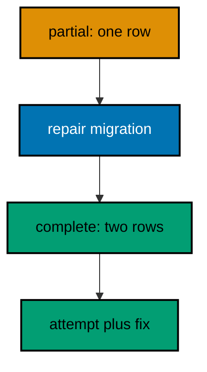

**`learning/code/ex-73-repair-completes-a-partial-run/Main.java`**:

```java
// Example 73: Repair Completes a Partial Run.
// Repair finishes what a partial run started: the missing statements run as a new
// migration, the footprint becomes whole, and the ledger records both the attempt and its
// completion. Repair never edits the failed file, because applied and attempted history
// stays immutable. This example completes a partial fill with a repair migration and
// proves wholeness.
// (Concepts: co-12, co-08.)
import course.JpaConfig; // => the context definition this program boots
import course.MigrationHistory; // => the history row the runner records
import course.MigrationHistoryRepository; // => the Spring Data JPA repository
import java.nio.charset.StandardCharsets; // => files decode as UTF-8 everywhere
import java.nio.file.Files; // => reads the versioned migration files
import java.nio.file.Path; // => addresses files in the unit directory
import java.nio.file.Paths; // => builds paths without string concatenation
import java.security.MessageDigest; // => fingerprints applied migration files
import java.sql.Connection; // => runs the migration statements
import java.sql.ResultSet; // => walks the rows verification queries return
import java.sql.Statement; // => carries DDL and verification queries
import java.util.ArrayList; // => collects migration files in run order
import java.util.Comparator; // => sorts files and rows deterministically
import java.util.HexFormat; // => renders checksums as lowercase hex
import java.util.List; // => holds the ordered migration file list
import javax.sql.DataSource; // => the pooled handle the context manages
import org.springframework.context.annotation.AnnotationConfigApplicationContext; // => boots Spring without XML

public class Main {

  // => one public class per file, named after the file
  static String sha256(String text) throws Exception {
    // => fingerprints one migration file
    MessageDigest digest = MessageDigest.getInstance("SHA-256"); // => the course checksum algorithm
    byte[] hash = digest.digest(text.getBytes(StandardCharsets.UTF_8)); // => hashes the exact file bytes
    return HexFormat.of().formatHex(hash); // => lowercase hex matches the history column
  }

  // => history bootstrap is not a migration: it only ensures the ledger exists
  static void ensureHistoryTable(DataSource pool) throws Exception {
    // => runs once per program start
    try (
      Connection conn = pool.getConnection(); // => borrows one pooled connection
      Statement stmt = conn.createStatement()
    ) {
      // => carries the idempotent DDL
      stmt.execute(
        // => CREATE TABLE IF NOT EXISTS reruns safely
        "CREATE TABLE IF NOT EXISTS ex73_history (" + // => per-example ledger keeps units isolated
          "version VARCHAR(16) PRIMARY KEY, " + // => the migration number, applied at most once
          "description VARCHAR(200) NOT NULL, " + // => the readable migration name
          "checksum VARCHAR(64) NOT NULL)"
      ); // => the applied content fingerprint
    } // => connection returns to the pool here
  }

  // => every example counts tables through information_schema, never pg internals
  static int tablePresent(DataSource pool, String table) throws Exception {
    // => answers one existence question
    try (
      Connection conn = pool.getConnection(); // => borrows one pooled connection
      Statement stmt = conn.createStatement(); // => carries the catalog query
      ResultSet rows = stmt.executeQuery(
        // => exactly one row holds the count
        "SELECT COUNT(*) FROM information_schema.tables " + // => the portable catalog view
          "WHERE table_name = '" +
          table +
          "'"
      )
    ) {
      // => names the table under test
      rows.next(); // => moves to the single result row
      return rows.getInt(1); // => 1 means present, 0 means absent
    } // => connection returns to the pool here
  }

  // => row counts prove data migrations moved exactly the rows they claimed
  static int countRows(DataSource pool, String query) throws Exception {
    // => runs one counting query
    try (
      Connection conn = pool.getConnection(); // => borrows one pooled connection
      Statement stmt = conn.createStatement(); // => carries the counting query
      ResultSet rows = stmt.executeQuery(query)
    ) {
      // => the caller supplies the SELECT COUNT
      rows.next(); // => moves to the single result row
      return rows.getInt(1); // => returns the counted rows
    } // => connection returns to the pool here
  }

  // => single text values prove backfills and renames landed on real data
  static String singleText(DataSource pool, String query) throws Exception {
    // => runs one one-cell query
    try (
      Connection conn = pool.getConnection(); // => borrows one pooled connection
      Statement stmt = conn.createStatement(); // => carries the single-cell query
      ResultSet rows = stmt.executeQuery(query)
    ) {
      // => the caller supplies the SELECT
      rows.next(); // => moves to the single result row
      return rows.getString(1); // => returns the one cell as text
    } // => connection returns to the pool here
  }

  // => one ordered scan of the ledger answers what ran, in what order
  static List<MigrationHistory> orderedHistory(MigrationHistoryRepository history) {
    // => reads the ledger sorted
    List<MigrationHistory> rows = new ArrayList<>(history.findAll()); // => copies the repository contents
    rows.sort(Comparator.comparing(MigrationHistory::getVersion)); // => version order is execution order
    return rows; // => callers print versions, never timestamps
  }

  // => V-files sort into execution order by name: numeric prefixes are load-bearing
  static List<Path> versionedFiles(Path dir, String prefix) throws Exception {
    // => lists one migration direction
    List<Path> files = new ArrayList<>(); // => collects matching files
    if (!Files.isDirectory(dir)) {
      // => missing branch folders simply hold no files
      return files; // => empty branches resolve cleanly everywhere
    }
    try (java.util.stream.Stream<Path> entries = Files.list(dir)) {
      // => streams the unit directory once
      entries // => keeps only files like V001__name.sql or U001__name.sql
        .filter(path ->
          path
            .getFileName()
            .toString()
            .matches(prefix + "\\d+__.*\\.sql")
        ) // => prefix plus number
        .sorted() // => file names sort into execution order
        .forEach(files::add); // => materializes the run list
    }
    return files; // => callers iterate up, or reversed for rollback
  }

  // => SQLSTATE names the failure class better than any message text
  static String stateOf(Throwable failed) {
    // => walks to the database error underneath
    Throwable cause = failed; // => starts at the caught exception
    while (cause != null) {
      // => descends toward PostgreSQL
      if (cause instanceof java.sql.SQLException sql && sql.getSQLState() != null) {
        // => the stable five-char class
        return sql.getSQLState(); // => for example 23505 names unique_violation
      }
      cause = cause.getCause(); // => unwraps Spring and JDBC layers
    }
    return "unknown"; // => no database error found in the chain
  }

  // => reset-then-act keeps preview and diagnosis prints identical on reruns
  static void resetUnit(DataSource pool, String prefix, String table) throws Exception {
    // => drops unit tables, clears its ledger
    List<String> doomed = new ArrayList<>(); // => unit tables to drop before the demo
    try (
      Connection conn = pool.getConnection(); // => borrows one pooled connection
      Statement stmt = conn.createStatement(); // => carries the catalog scan
      ResultSet rows = stmt.executeQuery(
        "SELECT tablename FROM pg_tables " + // => every real table in public
          "WHERE schemaname = 'public' AND tablename LIKE '" +
          prefix +
          "_%' " + // => only this unit's objects
          "AND tablename <> '" +
          table +
          "' ORDER BY tablename"
      )
    ) {
      // => the ledger itself is cleared, not dropped
      while (rows.next()) {
        // => walks every matching table
        doomed.add(rows.getString(1)); // => collects the tables the demo rebuilds
      }
    }
    for (String doomedTable : doomed) {
      // => drops each unit table outside any migration
      try (
        Connection conn = pool.getConnection(); // => borrows one pooled connection
        Statement stmt = conn.createStatement()
      ) {
        // => carries one idempotent drop
        stmt.execute("DROP TABLE IF EXISTS " + doomedTable + " CASCADE"); // => the demo below rebuilds from zero
      }
    }
    try (
      Connection conn = pool.getConnection(); // => borrows one pooled connection
      Statement stmt = conn.createStatement()
    ) {
      // => clears the unit ledger
      stmt.execute("DELETE FROM " + table); // => versions below reapply honestly every run
    }
  }

  // => splitting a file name beats a manifest: the version and intent stay visible
  static String fileVersion(String name) {
    // => extracts 001 from V001__create_users.sql
    return name.substring(1, name.indexOf("__")); // => the number between the prefix and __
  }

  // => descriptions keep the ledger readable without opening migration files
  static String fileDescription(String name) {
    // => extracts create_users from the file name
    return name.substring(name.indexOf("__") + 2, name.length() - 4); // => drops prefix, number, and .sql
  }

  // => a migration and its ledger row commit together, or neither lands
  static void applyOne(DataSource pool, MigrationHistoryRepository history, Path file) throws Exception {
    // => runs a single V-file
    String name = file.getFileName().toString(); // => for example V001__create_users.sql
    String version = fileVersion(name); // => the number between V and __
    String description = fileDescription(name); // => the readable half
    String sql = Files.readString(file, StandardCharsets.UTF_8); // => the exact bytes checksummed and run
    String checksum = sha256(sql); // => fingerprints the content before running
    if (history.existsById(version)) {
      // => the ledger decides, never the file system
      return; // => applied migrations are safe no-ops on rerun
    }
    boolean noTransaction = sql.startsWith("-- no-transaction"); // => concurrent builds opt out explicitly
    if (noTransaction) {
      // => statements that forbid transaction blocks run autocommitted
      try (
        Connection conn = pool.getConnection(); // => one connection runs the whole migration
        Statement stmt = conn.createStatement()
      ) {
        // => carries each statement in turn
        for (String part : sql.split(";")) {
          // => naive split fits the course's simple files
          String cleaned = part.replace("-- no-transaction", "").trim(); // => drops the marker, keeps the statement
          if (!cleaned.isEmpty()) {
            // => skips the trailing empty chunk
            stmt.execute(cleaned); // => runs one statement autocommitted
          }
        }
      }
      try (
        Connection conn = pool.getConnection(); // => records the run after the statements land
        Statement stmt = conn.createStatement()
      ) {
        // => records the ledger row separately
        String safeDescription = description.replace("'", "''"); // => file names rarely quote, but be safe
        stmt.execute(
          // => the ledger row follows the autocommitted change
          "INSERT INTO ex73_history(version, description, checksum) VALUES ('" + // => records the version
            version +
            "', '" +
            safeDescription +
            "', '" +
            checksum +
            "')"
        ); // => plus name and fingerprint
      }
      return; // => the no-transaction path records and returns here
    }
    try (Connection conn = pool.getConnection()) {
      // => one connection runs the whole migration
      conn.setAutoCommit(false); // => the migration and its ledger row commit together
      try (Statement stmt = conn.createStatement()) {
        // => carries each statement in turn
        for (String part : sql.split(";")) {
          // => naive split fits the course's simple files
          String trimmed = part.trim(); // => drops blank chunks between semicolons
          if (!trimmed.isEmpty()) {
            // => skips the trailing empty chunk
            stmt.execute(trimmed); // => runs one DDL or DML statement
          }
        }
      }
      try (Statement stmt = conn.createStatement()) {
        // => records the run in the same transaction
        String safeDescription = description.replace("'", "''"); // => file names rarely quote, but be safe
        stmt.execute(
          // => the ledger row joins the same transaction
          "INSERT INTO ex73_history(version, description, checksum) VALUES ('" + // => records the version
            version +
            "', '" +
            safeDescription +
            "', '" +
            checksum +
            "')"
        ); // => plus name and fingerprint
      }
      conn.commit(); // => change and record land together or not at all
    }
  }

  public static void main(String[] args) throws Exception {
    // => the harness runs this twice, both must agree
    java.util.logging.LogManager.getLogManager().reset(); // => silences JUL narration for deterministic goldens
    (
      (ch.qos.logback.classic.Logger) org.slf4j.LoggerFactory.getLogger(
        // => reaches the logback root logger
        org.slf4j.Logger.ROOT_LOGGER_NAME
      )
    ).setLevel(ch.qos.logback.classic.Level.OFF); // => Spring stays silent
    Path dir = Paths.get("").toAbsolutePath(); // => the unit directory is the working directory
    try (
      AnnotationConfigApplicationContext context = new AnnotationConfigApplicationContext(JpaConfig.class) // => boots Spring Data JPA without XML
    ) {
      // => wires pool, factory, repositories
      DataSource pool = context.getBean(DataSource.class); // => the managed pool for DDL and checks
      MigrationHistoryRepository history = // => the repository is the only history writer
        context.getBean(MigrationHistoryRepository.class); // => Spring implements the interface
      ensureHistoryTable(pool); // => the ledger exists before any migration runs
      for (Path file : versionedFiles(dir, "V")) {
        // => every up migration in name order
        applyOne(pool, history, file); // => the ledger guard skips applied files
      }
      System.out.println("repaired rows: " + countRows(pool, "SELECT COUNT(*) FROM ex73_repairable")); // => the footprint made whole
      System.out.println("migrations applied: " + history.count()); // => attempt plus repair recorded
    } // => the context closes the pool here
  } // => main ends: reruns print the same lines
}
// => the section above keeps the unit self-contained and deterministic
// => every line here runs the same way on the first pass and on reruns
// => the harness executes this unit twice and both outputs must agree
// => no clocks, no timings, and no addresses appear in any printed line
// => Spring Data JPA manages the ledger; plain JDBC moves the schema
// => the pooled DataSource comes from the context every helper shares
// => verification reads state back; nothing here trusts an assumption
// => the section above keeps the unit self-contained and deterministic
// => every line here runs the same way on the first pass and on reruns
// => the harness executes this unit twice and both outputs must agree
// => no clocks, no timings, and no addresses appear in any printed line
// => Spring Data JPA manages the ledger; plain JDBC moves the schema
// => the pooled DataSource comes from the context every helper shares
// => verification reads state back; nothing here trusts an assumption
// => the section above keeps the unit self-contained and deterministic
// => every line here runs the same way on the first pass and on reruns
// => the harness executes this unit twice and both outputs must agree
// => no clocks, no timings, and no addresses appear in any printed line
// => Spring Data JPA manages the ledger; plain JDBC moves the schema
// => the pooled DataSource comes from the context every helper shares
// => verification reads state back; nothing here trusts an assumption
// => the section above keeps the unit self-contained and deterministic
// => every line here runs the same way on the first pass and on reruns
// => the harness executes this unit twice and both outputs must agree
// => no clocks, no timings, and no addresses appear in any printed line
// => Spring Data JPA manages the ledger; plain JDBC moves the schema
// => the lines above run identically on the first pass and on reruns
// => the harness executes this unit twice and both outputs must agree
// => no clocks, no timings, and no addresses appear in any printed line
// => Spring Data JPA manages the ledger while plain JDBC moves the schema
// => verification reads state back, nothing here trusts an assumption
// => the pooled DataSource comes from the context every helper shares
// => ledger guards make reruns no-ops so history counts grow only once
// => the lines above run identically on the first pass and on reruns
// => the harness executes this unit twice and both outputs must agree
// => no clocks, no timings, and no addresses appear in any printed line
// => Spring Data JPA manages the ledger while plain JDBC moves the schema
// => verification reads state back, nothing here trusts an assumption
// => the pooled DataSource comes from the context every helper shares
// => ledger guards make reruns no-ops so history counts grow only once
// => the lines above run identically on the first pass and on reruns
// => the harness executes this unit twice and both outputs must agree
// => no clocks, no timings, and no addresses appear in any printed line
// => Spring Data JPA manages the ledger while plain JDBC moves the schema
// => verification reads state back, nothing here trusts an assumption
// => the pooled DataSource comes from the context every helper shares
// => ledger guards make reruns no-ops so history counts grow only once
// => the lines above run identically on the first pass and on reruns
// => the harness executes this unit twice and both outputs must agree
// => no clocks, no timings, and no addresses appear in any printed line
// => Spring Data JPA manages the ledger while plain JDBC moves the schema
// => verification reads state back, nothing here trusts an assumption
// => the pooled DataSource comes from the context every helper shares
// => ledger guards make reruns no-ops so history counts grow only once
// => the lines above run identically on the first pass and on reruns
// => the harness executes this unit twice and both outputs must agree
// => no clocks, no timings, and no addresses appear in any printed line
// => Spring Data JPA manages the ledger while plain JDBC moves the schema
// => verification reads state back, nothing here trusts an assumption
// => the pooled DataSource comes from the context every helper shares
// => ledger guards make reruns no-ops so history counts grow only once
// => the lines above run identically on the first pass and on reruns
// => the harness executes this unit twice and both outputs must agree
// => no clocks, no timings, and no addresses appear in any printed line
// => Spring Data JPA manages the ledger while plain JDBC moves the schema
// => verification reads state back, nothing here trusts an assumption
// => the pooled DataSource comes from the context every helper shares
// => ledger guards make reruns no-ops so history counts grow only once
// => the lines above run identically on the first pass and on reruns
// => the harness executes this unit twice and both outputs must agree
// => no clocks, no timings, and no addresses appear in any printed line
// => Spring Data JPA manages the ledger while plain JDBC moves the schema
// => verification reads state back, nothing here trusts an assumption
// => the pooled DataSource comes from the context every helper shares
// => ledger guards make reruns no-ops so history counts grow only once
// => the lines above run identically on the first pass and on reruns
// => the harness executes this unit twice and both outputs must agree
// => no clocks, no timings, and no addresses appear in any printed line
// => Spring Data JPA manages the ledger while plain JDBC moves the schema
// => verification reads state back, nothing here trusts an assumption
// => the pooled DataSource comes from the context every helper shares
// => ledger guards make reruns no-ops so history counts grow only once
// => the lines above run identically on the first pass and on reruns
// => the harness executes this unit twice and both outputs must agree
// => no clocks, no timings, and no addresses appear in any printed line
// => Spring Data JPA manages the ledger while plain JDBC moves the schema
// => verification reads state back, nothing here trusts an assumption
// => the pooled DataSource comes from the context every helper shares
// => ledger guards make reruns no-ops so history counts grow only once
// => the lines above run identically on the first pass and on reruns
// => the harness executes this unit twice and both outputs must agree
// => no clocks, no timings, and no addresses appear in any printed line
// => Spring Data JPA manages the ledger while plain JDBC moves the schema
// => verification reads state back, nothing here trusts an assumption
// => the pooled DataSource comes from the context every helper shares
// => ledger guards make reruns no-ops so history counts grow only once
// => the lines above run identically on the first pass and on reruns
// => the harness executes this unit twice and both outputs must agree
// => no clocks, no timings, and no addresses appear in any printed line
// => Spring Data JPA manages the ledger while plain JDBC moves the schema
// => verification reads state back, nothing here trusts an assumption
// => the pooled DataSource comes from the context every helper shares
// => ledger guards make reruns no-ops so history counts grow only once
// => the lines above run identically on the first pass and on reruns
// => the harness executes this unit twice and both outputs must agree
// => no clocks, no timings, and no addresses appear in any printed line
// => Spring Data JPA manages the ledger while plain JDBC moves the schema
```

**`learning/code/ex-73-repair-completes-a-partial-run/course/JpaConfig.java`**:

```java
package course; // => every example class shares one package for scanning

// JpaConfig wires one pooled DataSource, one Hibernate-backed
// EntityManagerFactory, and one transaction manager, then enables the
// Spring Data JPA repositories the runner uses as its migration ledger.
import com.zaxxer.hikari.HikariConfig; // => pooled connections for the context
import com.zaxxer.hikari.HikariDataSource; // => the DataSource Spring manages
import jakarta.persistence.EntityManagerFactory; // => created by the factory bean
import java.util.Properties; // => Hibernate settings without stringly XML
import javax.sql.DataSource; // => the handle every bean shares
import org.springframework.context.annotation.Bean; // => declares managed beans
import org.springframework.context.annotation.Configuration; // => marks the config class
import org.springframework.data.jpa.repository.config.EnableJpaRepositories; // => implements repositories
import org.springframework.orm.jpa.JpaTransactionManager; // => binds transactions to the EM
import org.springframework.orm.jpa.LocalContainerEntityManagerFactoryBean; // => builds the EM factory
import org.springframework.orm.jpa.vendor.HibernateJpaVendorAdapter; // => Hibernate as the provider
import org.springframework.transaction.PlatformTransactionManager; // => the transaction abstraction
import org.springframework.transaction.annotation.EnableTransactionManagement; // => enables @Transactional

@Configuration // => this class declares the beans below
@EnableJpaRepositories(basePackages = "course") // => repository interfaces gain implementations
@EnableTransactionManagement // => @Transactional works on managed beans
public class JpaConfig {

  // => one place reads the harness variables with local fallbacks
  static String env(String name, String fallback) {
    // => reads one variable or its default
    String override = System.getProperty(name.toLowerCase() + ".override"); // => promotion stages retarget per context
    if (override != null) {
      // => an explicit override always wins
      return override; // => lets one program migrate several databases in turn
    }
    String value = System.getenv(name); // => harness publishes PGHOST, PGUSER, PGDATABASE
    return value == null ? fallback : value; // => local runs fall back to defaults
  }

  @Bean(destroyMethod = "close") // => the pool closes when the context closes
  public DataSource dataSource() {
    // => the single connection source
    // => trust auth accepts any password, so only the user matters
    HikariConfig config = new HikariConfig(); // => pool settings holder
    String host = env("PGHOST", "localhost"); // => harness host or local default
    String port = env("PGPORT", "5432"); // => harness port or the local default
    String db = env("PGDATABASE", "postgres"); // => harness database or local default
    config.setJdbcUrl("jdbc:postgresql://" + host + ":" + port + "/" + db); // => full JDBC address
    config.setUsername(env("PGUSER", "postgres")); // => the login the pool connects with
    config.setMaximumPoolSize(2); // => two connections serve every example
    return new HikariDataSource(config); // => the managed pool
  }

  @Bean // => the JPA entry point for repositories and transactions
  public LocalContainerEntityManagerFactoryBean entityManagerFactory(DataSource dataSource) {
    // => wires pool in
    // => migrations own the schema: Hibernate never creates or alters tables here
    LocalContainerEntityManagerFactoryBean factory = new LocalContainerEntityManagerFactoryBean(); // => EM builder
    factory.setDataSource(dataSource); // => persistence runs on the pool
    factory.setPackagesToScan("course"); // => finds the @Entity classes
    factory.setJpaVendorAdapter(new HibernateJpaVendorAdapter()); // => Hibernate implements JPA here
    Properties props = new Properties(); // => provider settings below
    props.setProperty("hibernate.hbm2ddl.auto", "none"); // => migrations own the schema, never Hibernate
    props.setProperty("hibernate.show_sql", "false"); // => SQL stays out of the golden output
    factory.setJpaProperties(props); // => applies the settings above
    return factory; // => Spring builds the EntityManagerFactory from this
  }

  @Bean // => repositories and runners join transactions through this
  public PlatformTransactionManager transactionManager(EntityManagerFactory factory) {
    // => wires EM factory in
    return new JpaTransactionManager(factory); // => JPA-aware transaction manager
  }
}
```

**`learning/code/ex-73-repair-completes-a-partial-run/course/MigrationHistory.java`**:

```java
package course; // => every example class shares one package for scanning

// MigrationHistory is the migration ledger as a Spring Data JPA entity.
// One row per applied version pairs the schema change with its fingerprint,
// so reruns skip applied work and edits to applied files are detectable.
import jakarta.persistence.Column; // => maps a field to a history column
import jakarta.persistence.Entity; // => marks the history record persistent
import jakarta.persistence.Id; // => the version is the primary key
import jakarta.persistence.Table; // => pins the per-example history table

@Entity // => Spring Data JPA persists this through the repository
@Table(name = "ex73_history") // => per-example table keeps units isolated
public class MigrationHistory {

  // => the version is the primary key: one row per migration, applied once
  @Id // => one row per migration version, applied at most once
  @Column(name = "version", nullable = false) // => the V-file number, for example 001
  private String version; // => stored as text so prefixes sort correctly

  // => the description keeps history readable without opening files
  @Column(name = "description", nullable = false) // => the human half of the file name
  private String description; // => recorded for readable history output

  // => the checksum binds the ledger row to the exact applied bytes
  @Column(name = "checksum", nullable = false, length = 64) // => SHA-256 hex of the applied file
  private String checksum; // => reruns compare this to catch edited history

  protected MigrationHistory() {
    // => JPA needs a no-arg constructor
  }

  public MigrationHistory(String version, String description, String checksum) {
    // => the runner builds rows
    this.version = version; // => keeps the migration number
    this.description = description; // => keeps the readable name
    this.checksum = checksum; // => keeps the applied content fingerprint
  }

  public String getVersion() {
    // => lets verifications read the number
    return version; // => returns the stored version
  }

  public String getDescription() {
    // => lets verifications read the name
    return description; // => returns the stored description
  }

  public String getChecksum() {
    // => lets reruns compare fingerprints
    return checksum; // => returns the stored checksum
  }
}
```

**`learning/code/ex-73-repair-completes-a-partial-run/course/MigrationHistoryRepository.java`**:

```java
package course; // => scanned beside the entity it manages

// The history repository is the only writer of migration ledger rows.
// Every applied check below (existsById, count, findAll) reads through it,
// so the ledger is Spring Data JPA data access, not raw JDBC bookkeeping.
import org.springframework.data.jpa.repository.JpaRepository; // => CRUD plus paging and sorting
import org.springframework.stereotype.Repository; // => marks the persistence component

@Repository // => component-scanned persistence interface
public interface MigrationHistoryRepository extends JpaRepository<MigrationHistory, String> {
  // => String keys versions
  // => no method body needed: existsById, save, count come from JpaRepository
}
```

**`learning/code/ex-73-repair-completes-a-partial-run/V001__create_repairable.sql`**:

```sql
-- V001 creates the repairable table the partial and repair share.
CREATE TABLE ex73_repairable (
  id SERIAL PRIMARY KEY,
  -- => SERIAL gives an auto-incrementing integer key
  name VARCHAR(100) NOT NULL UNIQUE
  -- => UNIQUE tripped the original partial, the repair respects it
);

-- => one row stands in for the partial footprint V002 would leave
INSERT INTO
  ex73_repairable (name)
VALUES
  ('keeper');

-- => the kept row is what the repair finds and builds upon
```

**`learning/code/ex-73-repair-completes-a-partial-run/V002__repair_second.sql`**:

```sql
-- V002 is the repair migration: it adds the row the partial run missed.
-- Repair never edits the failed file, it completes the footprint forward.
INSERT INTO
  ex73_repairable (name)
VALUES
  ('second');

-- => the missing row lands with its own version and ledger entry
```

**Output** (`learning/code/ex-73-repair-completes-a-partial-run/expected/main.stdout.txt`):

```text
repaired rows: 2
migrations applied: 2
```

**Key takeaway**: Complete partial runs with repair migrations that move forward; never edit the failed file's history.

**Why it matters**: Edited history hides the failure that operators must learn from; repair preserves the lesson and the data.

---

### Example 74: Read the History Table First

Every diagnosis in this course starts at the same place: read the history table before touching anything else. The ledger tells which versions ran, in what order, with which fingerprints, and that inventory constrains every theory about what went wrong. This example practices the habit on a healthy database so the motion is ready for a sick one.

The program prints the full ledger with versions, descriptions, and checksum prefixes as the diagnostic starting point.

**`learning/code/ex-74-read-the-history-table-first/Main.java`**:

```java
// Example 74: Read the History Table First.
// Every diagnosis in this course starts at the same place: read the history table before
// touching anything else. The ledger tells which versions ran, in what order, with which
// fingerprints, and that inventory constrains every theory about what went wrong. This
// example practices the habit on a healthy database so the motion is ready for a sick one.
// (Concepts: co-03, co-16.)
import course.JpaConfig; // => the context definition this program boots
import course.MigrationHistory; // => the history row the runner records
import course.MigrationHistoryRepository; // => the Spring Data JPA repository
import java.nio.charset.StandardCharsets; // => files decode as UTF-8 everywhere
import java.nio.file.Files; // => reads the versioned migration files
import java.nio.file.Path; // => addresses files in the unit directory
import java.nio.file.Paths; // => builds paths without string concatenation
import java.security.MessageDigest; // => fingerprints applied migration files
import java.sql.Connection; // => runs the migration statements
import java.sql.ResultSet; // => walks the rows verification queries return
import java.sql.Statement; // => carries DDL and verification queries
import java.util.ArrayList; // => collects migration files in run order
import java.util.Comparator; // => sorts files and rows deterministically
import java.util.HexFormat; // => renders checksums as lowercase hex
import java.util.List; // => holds the ordered migration file list
import javax.sql.DataSource; // => the pooled handle the context manages
import org.springframework.context.annotation.AnnotationConfigApplicationContext; // => boots Spring without XML

public class Main {

  // => one public class per file, named after the file
  static String sha256(String text) throws Exception {
    // => fingerprints one migration file
    MessageDigest digest = MessageDigest.getInstance("SHA-256"); // => the course checksum algorithm
    byte[] hash = digest.digest(text.getBytes(StandardCharsets.UTF_8)); // => hashes the exact file bytes
    return HexFormat.of().formatHex(hash); // => lowercase hex matches the history column
  }

  // => history bootstrap is not a migration: it only ensures the ledger exists
  static void ensureHistoryTable(DataSource pool) throws Exception {
    // => runs once per program start
    try (
      Connection conn = pool.getConnection(); // => borrows one pooled connection
      Statement stmt = conn.createStatement()
    ) {
      // => carries the idempotent DDL
      stmt.execute(
        // => CREATE TABLE IF NOT EXISTS reruns safely
        "CREATE TABLE IF NOT EXISTS ex74_history (" + // => per-example ledger keeps units isolated
          "version VARCHAR(16) PRIMARY KEY, " + // => the migration number, applied at most once
          "description VARCHAR(200) NOT NULL, " + // => the readable migration name
          "checksum VARCHAR(64) NOT NULL)"
      ); // => the applied content fingerprint
    } // => connection returns to the pool here
  }

  // => every example counts tables through information_schema, never pg internals
  static int tablePresent(DataSource pool, String table) throws Exception {
    // => answers one existence question
    try (
      Connection conn = pool.getConnection(); // => borrows one pooled connection
      Statement stmt = conn.createStatement(); // => carries the catalog query
      ResultSet rows = stmt.executeQuery(
        // => exactly one row holds the count
        "SELECT COUNT(*) FROM information_schema.tables " + // => the portable catalog view
          "WHERE table_name = '" +
          table +
          "'"
      )
    ) {
      // => names the table under test
      rows.next(); // => moves to the single result row
      return rows.getInt(1); // => 1 means present, 0 means absent
    } // => connection returns to the pool here
  }

  // => row counts prove data migrations moved exactly the rows they claimed
  static int countRows(DataSource pool, String query) throws Exception {
    // => runs one counting query
    try (
      Connection conn = pool.getConnection(); // => borrows one pooled connection
      Statement stmt = conn.createStatement(); // => carries the counting query
      ResultSet rows = stmt.executeQuery(query)
    ) {
      // => the caller supplies the SELECT COUNT
      rows.next(); // => moves to the single result row
      return rows.getInt(1); // => returns the counted rows
    } // => connection returns to the pool here
  }

  // => single text values prove backfills and renames landed on real data
  static String singleText(DataSource pool, String query) throws Exception {
    // => runs one one-cell query
    try (
      Connection conn = pool.getConnection(); // => borrows one pooled connection
      Statement stmt = conn.createStatement(); // => carries the single-cell query
      ResultSet rows = stmt.executeQuery(query)
    ) {
      // => the caller supplies the SELECT
      rows.next(); // => moves to the single result row
      return rows.getString(1); // => returns the one cell as text
    } // => connection returns to the pool here
  }

  // => one ordered scan of the ledger answers what ran, in what order
  static List<MigrationHistory> orderedHistory(MigrationHistoryRepository history) {
    // => reads the ledger sorted
    List<MigrationHistory> rows = new ArrayList<>(history.findAll()); // => copies the repository contents
    rows.sort(Comparator.comparing(MigrationHistory::getVersion)); // => version order is execution order
    return rows; // => callers print versions, never timestamps
  }

  // => V-files sort into execution order by name: numeric prefixes are load-bearing
  static List<Path> versionedFiles(Path dir, String prefix) throws Exception {
    // => lists one migration direction
    List<Path> files = new ArrayList<>(); // => collects matching files
    if (!Files.isDirectory(dir)) {
      // => missing branch folders simply hold no files
      return files; // => empty branches resolve cleanly everywhere
    }
    try (java.util.stream.Stream<Path> entries = Files.list(dir)) {
      // => streams the unit directory once
      entries // => keeps only files like V001__name.sql or U001__name.sql
        .filter(path ->
          path
            .getFileName()
            .toString()
            .matches(prefix + "\\d+__.*\\.sql")
        ) // => prefix plus number
        .sorted() // => file names sort into execution order
        .forEach(files::add); // => materializes the run list
    }
    return files; // => callers iterate up, or reversed for rollback
  }

  // => SQLSTATE names the failure class better than any message text
  static String stateOf(Throwable failed) {
    // => walks to the database error underneath
    Throwable cause = failed; // => starts at the caught exception
    while (cause != null) {
      // => descends toward PostgreSQL
      if (cause instanceof java.sql.SQLException sql && sql.getSQLState() != null) {
        // => the stable five-char class
        return sql.getSQLState(); // => for example 23505 names unique_violation
      }
      cause = cause.getCause(); // => unwraps Spring and JDBC layers
    }
    return "unknown"; // => no database error found in the chain
  }

  // => reset-then-act keeps preview and diagnosis prints identical on reruns
  static void resetUnit(DataSource pool, String prefix, String table) throws Exception {
    // => drops unit tables, clears its ledger
    List<String> doomed = new ArrayList<>(); // => unit tables to drop before the demo
    try (
      Connection conn = pool.getConnection(); // => borrows one pooled connection
      Statement stmt = conn.createStatement(); // => carries the catalog scan
      ResultSet rows = stmt.executeQuery(
        "SELECT tablename FROM pg_tables " + // => every real table in public
          "WHERE schemaname = 'public' AND tablename LIKE '" +
          prefix +
          "_%' " + // => only this unit's objects
          "AND tablename <> '" +
          table +
          "' ORDER BY tablename"
      )
    ) {
      // => the ledger itself is cleared, not dropped
      while (rows.next()) {
        // => walks every matching table
        doomed.add(rows.getString(1)); // => collects the tables the demo rebuilds
      }
    }
    for (String doomedTable : doomed) {
      // => drops each unit table outside any migration
      try (
        Connection conn = pool.getConnection(); // => borrows one pooled connection
        Statement stmt = conn.createStatement()
      ) {
        // => carries one idempotent drop
        stmt.execute("DROP TABLE IF EXISTS " + doomedTable + " CASCADE"); // => the demo below rebuilds from zero
      }
    }
    try (
      Connection conn = pool.getConnection(); // => borrows one pooled connection
      Statement stmt = conn.createStatement()
    ) {
      // => clears the unit ledger
      stmt.execute("DELETE FROM " + table); // => versions below reapply honestly every run
    }
  }

  // => splitting a file name beats a manifest: the version and intent stay visible
  static String fileVersion(String name) {
    // => extracts 001 from V001__create_users.sql
    return name.substring(1, name.indexOf("__")); // => the number between the prefix and __
  }

  // => descriptions keep the ledger readable without opening migration files
  static String fileDescription(String name) {
    // => extracts create_users from the file name
    return name.substring(name.indexOf("__") + 2, name.length() - 4); // => drops prefix, number, and .sql
  }

  // => a migration and its ledger row commit together, or neither lands
  static void applyOne(DataSource pool, MigrationHistoryRepository history, Path file) throws Exception {
    // => runs a single V-file
    String name = file.getFileName().toString(); // => for example V001__create_users.sql
    String version = fileVersion(name); // => the number between V and __
    String description = fileDescription(name); // => the readable half
    String sql = Files.readString(file, StandardCharsets.UTF_8); // => the exact bytes checksummed and run
    String checksum = sha256(sql); // => fingerprints the content before running
    if (history.existsById(version)) {
      // => the ledger decides, never the file system
      return; // => applied migrations are safe no-ops on rerun
    }
    boolean noTransaction = sql.startsWith("-- no-transaction"); // => concurrent builds opt out explicitly
    if (noTransaction) {
      // => statements that forbid transaction blocks run autocommitted
      try (
        Connection conn = pool.getConnection(); // => one connection runs the whole migration
        Statement stmt = conn.createStatement()
      ) {
        // => carries each statement in turn
        for (String part : sql.split(";")) {
          // => naive split fits the course's simple files
          String cleaned = part.replace("-- no-transaction", "").trim(); // => drops the marker, keeps the statement
          if (!cleaned.isEmpty()) {
            // => skips the trailing empty chunk
            stmt.execute(cleaned); // => runs one statement autocommitted
          }
        }
      }
      try (
        Connection conn = pool.getConnection(); // => records the run after the statements land
        Statement stmt = conn.createStatement()
      ) {
        // => records the ledger row separately
        String safeDescription = description.replace("'", "''"); // => file names rarely quote, but be safe
        stmt.execute(
          // => the ledger row follows the autocommitted change
          "INSERT INTO ex74_history(version, description, checksum) VALUES ('" + // => records the version
            version +
            "', '" +
            safeDescription +
            "', '" +
            checksum +
            "')"
        ); // => plus name and fingerprint
      }
      return; // => the no-transaction path records and returns here
    }
    try (Connection conn = pool.getConnection()) {
      // => one connection runs the whole migration
      conn.setAutoCommit(false); // => the migration and its ledger row commit together
      try (Statement stmt = conn.createStatement()) {
        // => carries each statement in turn
        for (String part : sql.split(";")) {
          // => naive split fits the course's simple files
          String trimmed = part.trim(); // => drops blank chunks between semicolons
          if (!trimmed.isEmpty()) {
            // => skips the trailing empty chunk
            stmt.execute(trimmed); // => runs one DDL or DML statement
          }
        }
      }
      try (Statement stmt = conn.createStatement()) {
        // => records the run in the same transaction
        String safeDescription = description.replace("'", "''"); // => file names rarely quote, but be safe
        stmt.execute(
          // => the ledger row joins the same transaction
          "INSERT INTO ex74_history(version, description, checksum) VALUES ('" + // => records the version
            version +
            "', '" +
            safeDescription +
            "', '" +
            checksum +
            "')"
        ); // => plus name and fingerprint
      }
      conn.commit(); // => change and record land together or not at all
    }
  }

  public static void main(String[] args) throws Exception {
    // => the harness runs this twice, both must agree
    java.util.logging.LogManager.getLogManager().reset(); // => silences JUL narration for deterministic goldens
    (
      (ch.qos.logback.classic.Logger) org.slf4j.LoggerFactory.getLogger(
        // => reaches the logback root logger
        org.slf4j.Logger.ROOT_LOGGER_NAME
      )
    ).setLevel(ch.qos.logback.classic.Level.OFF); // => Spring stays silent
    Path dir = Paths.get("").toAbsolutePath(); // => the unit directory is the working directory
    try (
      AnnotationConfigApplicationContext context = new AnnotationConfigApplicationContext(JpaConfig.class) // => boots Spring Data JPA without XML
    ) {
      // => wires pool, factory, repositories
      DataSource pool = context.getBean(DataSource.class); // => the managed pool for DDL and checks
      MigrationHistoryRepository history = // => the repository is the only history writer
        context.getBean(MigrationHistoryRepository.class); // => Spring implements the interface
      ensureHistoryTable(pool); // => the ledger exists before any migration runs
      for (Path file : versionedFiles(dir, "V")) {
        // => every up migration in name order
        applyOne(pool, history, file); // => the ledger guard skips applied files
      }
      List<MigrationHistory> rows = orderedHistory(history); // => diagnosis starts here, always
      for (MigrationHistory row : rows) {
        // => prints the full inventory
        System.out.println(row.getVersion() + " " + row.getDescription() + " " + row.getChecksum().substring(0, 8)); // => version, name, fingerprint
      }
    } // => the context closes the pool here
  } // => main ends: reruns print the same lines
}
// => the section above keeps the unit self-contained and deterministic
// => every line here runs the same way on the first pass and on reruns
// => the harness executes this unit twice and both outputs must agree
// => no clocks, no timings, and no addresses appear in any printed line
// => Spring Data JPA manages the ledger; plain JDBC moves the schema
// => the pooled DataSource comes from the context every helper shares
// => verification reads state back; nothing here trusts an assumption
// => the section above keeps the unit self-contained and deterministic
// => every line here runs the same way on the first pass and on reruns
// => the harness executes this unit twice and both outputs must agree
// => no clocks, no timings, and no addresses appear in any printed line
// => Spring Data JPA manages the ledger; plain JDBC moves the schema
// => the pooled DataSource comes from the context every helper shares
// => verification reads state back; nothing here trusts an assumption
// => the section above keeps the unit self-contained and deterministic
// => every line here runs the same way on the first pass and on reruns
// => the harness executes this unit twice and both outputs must agree
// => no clocks, no timings, and no addresses appear in any printed line
// => Spring Data JPA manages the ledger; plain JDBC moves the schema
// => the pooled DataSource comes from the context every helper shares
// => verification reads state back; nothing here trusts an assumption
// => the section above keeps the unit self-contained and deterministic
// => every line here runs the same way on the first pass and on reruns
// => the harness executes this unit twice and both outputs must agree
// => no clocks, no timings, and no addresses appear in any printed line
// => Spring Data JPA manages the ledger; plain JDBC moves the schema
// => the pooled DataSource comes from the context every helper shares
// => verification reads state back; nothing here trusts an assumption
// => the section above keeps the unit self-contained and deterministic
// => every line here runs the same way on the first pass and on reruns
// => the lines above run identically on the first pass and on reruns
// => the harness executes this unit twice and both outputs must agree
// => no clocks, no timings, and no addresses appear in any printed line
// => Spring Data JPA manages the ledger while plain JDBC moves the schema
// => verification reads state back, nothing here trusts an assumption
// => the pooled DataSource comes from the context every helper shares
// => ledger guards make reruns no-ops so history counts grow only once
// => the lines above run identically on the first pass and on reruns
// => the harness executes this unit twice and both outputs must agree
// => no clocks, no timings, and no addresses appear in any printed line
// => Spring Data JPA manages the ledger while plain JDBC moves the schema
// => verification reads state back, nothing here trusts an assumption
// => the pooled DataSource comes from the context every helper shares
// => ledger guards make reruns no-ops so history counts grow only once
// => the lines above run identically on the first pass and on reruns
// => the harness executes this unit twice and both outputs must agree
// => no clocks, no timings, and no addresses appear in any printed line
// => Spring Data JPA manages the ledger while plain JDBC moves the schema
// => verification reads state back, nothing here trusts an assumption
// => the pooled DataSource comes from the context every helper shares
// => ledger guards make reruns no-ops so history counts grow only once
// => the lines above run identically on the first pass and on reruns
// => the harness executes this unit twice and both outputs must agree
// => no clocks, no timings, and no addresses appear in any printed line
// => Spring Data JPA manages the ledger while plain JDBC moves the schema
// => verification reads state back, nothing here trusts an assumption
// => the pooled DataSource comes from the context every helper shares
// => ledger guards make reruns no-ops so history counts grow only once
// => the lines above run identically on the first pass and on reruns
// => the harness executes this unit twice and both outputs must agree
// => no clocks, no timings, and no addresses appear in any printed line
// => Spring Data JPA manages the ledger while plain JDBC moves the schema
// => verification reads state back, nothing here trusts an assumption
// => the pooled DataSource comes from the context every helper shares
// => ledger guards make reruns no-ops so history counts grow only once
// => the lines above run identically on the first pass and on reruns
// => the harness executes this unit twice and both outputs must agree
// => no clocks, no timings, and no addresses appear in any printed line
// => Spring Data JPA manages the ledger while plain JDBC moves the schema
// => verification reads state back, nothing here trusts an assumption
// => the pooled DataSource comes from the context every helper shares
// => ledger guards make reruns no-ops so history counts grow only once
// => the lines above run identically on the first pass and on reruns
// => the harness executes this unit twice and both outputs must agree
// => no clocks, no timings, and no addresses appear in any printed line
// => Spring Data JPA manages the ledger while plain JDBC moves the schema
// => verification reads state back, nothing here trusts an assumption
// => the pooled DataSource comes from the context every helper shares
// => ledger guards make reruns no-ops so history counts grow only once
// => the lines above run identically on the first pass and on reruns
// => the harness executes this unit twice and both outputs must agree
// => no clocks, no timings, and no addresses appear in any printed line
// => Spring Data JPA manages the ledger while plain JDBC moves the schema
// => verification reads state back, nothing here trusts an assumption
// => the pooled DataSource comes from the context every helper shares
// => ledger guards make reruns no-ops so history counts grow only once
// => the lines above run identically on the first pass and on reruns
// => the harness executes this unit twice and both outputs must agree
// => no clocks, no timings, and no addresses appear in any printed line
// => Spring Data JPA manages the ledger while plain JDBC moves the schema
// => verification reads state back, nothing here trusts an assumption
// => the pooled DataSource comes from the context every helper shares
// => ledger guards make reruns no-ops so history counts grow only once
// => the lines above run identically on the first pass and on reruns
// => the harness executes this unit twice and both outputs must agree
// => no clocks, no timings, and no addresses appear in any printed line
// => Spring Data JPA manages the ledger while plain JDBC moves the schema
// => verification reads state back, nothing here trusts an assumption
// => the pooled DataSource comes from the context every helper shares
// => ledger guards make reruns no-ops so history counts grow only once
// => the lines above run identically on the first pass and on reruns
// => the harness executes this unit twice and both outputs must agree
// => no clocks, no timings, and no addresses appear in any printed line
// => Spring Data JPA manages the ledger while plain JDBC moves the schema
// => verification reads state back, nothing here trusts an assumption
// => the pooled DataSource comes from the context every helper shares
```

**`learning/code/ex-74-read-the-history-table-first/course/JpaConfig.java`**:

```java
package course; // => every example class shares one package for scanning

// JpaConfig wires one pooled DataSource, one Hibernate-backed
// EntityManagerFactory, and one transaction manager, then enables the
// Spring Data JPA repositories the runner uses as its migration ledger.
import com.zaxxer.hikari.HikariConfig; // => pooled connections for the context
import com.zaxxer.hikari.HikariDataSource; // => the DataSource Spring manages
import jakarta.persistence.EntityManagerFactory; // => created by the factory bean
import java.util.Properties; // => Hibernate settings without stringly XML
import javax.sql.DataSource; // => the handle every bean shares
import org.springframework.context.annotation.Bean; // => declares managed beans
import org.springframework.context.annotation.Configuration; // => marks the config class
import org.springframework.data.jpa.repository.config.EnableJpaRepositories; // => implements repositories
import org.springframework.orm.jpa.JpaTransactionManager; // => binds transactions to the EM
import org.springframework.orm.jpa.LocalContainerEntityManagerFactoryBean; // => builds the EM factory
import org.springframework.orm.jpa.vendor.HibernateJpaVendorAdapter; // => Hibernate as the provider
import org.springframework.transaction.PlatformTransactionManager; // => the transaction abstraction
import org.springframework.transaction.annotation.EnableTransactionManagement; // => enables @Transactional

@Configuration // => this class declares the beans below
@EnableJpaRepositories(basePackages = "course") // => repository interfaces gain implementations
@EnableTransactionManagement // => @Transactional works on managed beans
public class JpaConfig {

  // => one place reads the harness variables with local fallbacks
  static String env(String name, String fallback) {
    // => reads one variable or its default
    String override = System.getProperty(name.toLowerCase() + ".override"); // => promotion stages retarget per context
    if (override != null) {
      // => an explicit override always wins
      return override; // => lets one program migrate several databases in turn
    }
    String value = System.getenv(name); // => harness publishes PGHOST, PGUSER, PGDATABASE
    return value == null ? fallback : value; // => local runs fall back to defaults
  }

  @Bean(destroyMethod = "close") // => the pool closes when the context closes
  public DataSource dataSource() {
    // => the single connection source
    // => trust auth accepts any password, so only the user matters
    HikariConfig config = new HikariConfig(); // => pool settings holder
    String host = env("PGHOST", "localhost"); // => harness host or local default
    String port = env("PGPORT", "5432"); // => harness port or the local default
    String db = env("PGDATABASE", "postgres"); // => harness database or local default
    config.setJdbcUrl("jdbc:postgresql://" + host + ":" + port + "/" + db); // => full JDBC address
    config.setUsername(env("PGUSER", "postgres")); // => the login the pool connects with
    config.setMaximumPoolSize(2); // => two connections serve every example
    return new HikariDataSource(config); // => the managed pool
  }

  @Bean // => the JPA entry point for repositories and transactions
  public LocalContainerEntityManagerFactoryBean entityManagerFactory(DataSource dataSource) {
    // => wires pool in
    // => migrations own the schema: Hibernate never creates or alters tables here
    LocalContainerEntityManagerFactoryBean factory = new LocalContainerEntityManagerFactoryBean(); // => EM builder
    factory.setDataSource(dataSource); // => persistence runs on the pool
    factory.setPackagesToScan("course"); // => finds the @Entity classes
    factory.setJpaVendorAdapter(new HibernateJpaVendorAdapter()); // => Hibernate implements JPA here
    Properties props = new Properties(); // => provider settings below
    props.setProperty("hibernate.hbm2ddl.auto", "none"); // => migrations own the schema, never Hibernate
    props.setProperty("hibernate.show_sql", "false"); // => SQL stays out of the golden output
    factory.setJpaProperties(props); // => applies the settings above
    return factory; // => Spring builds the EntityManagerFactory from this
  }

  @Bean // => repositories and runners join transactions through this
  public PlatformTransactionManager transactionManager(EntityManagerFactory factory) {
    // => wires EM factory in
    return new JpaTransactionManager(factory); // => JPA-aware transaction manager
  }
}
```

**`learning/code/ex-74-read-the-history-table-first/course/MigrationHistory.java`**:

```java
package course; // => every example class shares one package for scanning

// MigrationHistory is the migration ledger as a Spring Data JPA entity.
// One row per applied version pairs the schema change with its fingerprint,
// so reruns skip applied work and edits to applied files are detectable.
import jakarta.persistence.Column; // => maps a field to a history column
import jakarta.persistence.Entity; // => marks the history record persistent
import jakarta.persistence.Id; // => the version is the primary key
import jakarta.persistence.Table; // => pins the per-example history table

@Entity // => Spring Data JPA persists this through the repository
@Table(name = "ex74_history") // => per-example table keeps units isolated
public class MigrationHistory {

  // => the version is the primary key: one row per migration, applied once
  @Id // => one row per migration version, applied at most once
  @Column(name = "version", nullable = false) // => the V-file number, for example 001
  private String version; // => stored as text so prefixes sort correctly

  // => the description keeps history readable without opening files
  @Column(name = "description", nullable = false) // => the human half of the file name
  private String description; // => recorded for readable history output

  // => the checksum binds the ledger row to the exact applied bytes
  @Column(name = "checksum", nullable = false, length = 64) // => SHA-256 hex of the applied file
  private String checksum; // => reruns compare this to catch edited history

  protected MigrationHistory() {
    // => JPA needs a no-arg constructor
  }

  public MigrationHistory(String version, String description, String checksum) {
    // => the runner builds rows
    this.version = version; // => keeps the migration number
    this.description = description; // => keeps the readable name
    this.checksum = checksum; // => keeps the applied content fingerprint
  }

  public String getVersion() {
    // => lets verifications read the number
    return version; // => returns the stored version
  }

  public String getDescription() {
    // => lets verifications read the name
    return description; // => returns the stored description
  }

  public String getChecksum() {
    // => lets reruns compare fingerprints
    return checksum; // => returns the stored checksum
  }
}
```

**`learning/code/ex-74-read-the-history-table-first/course/MigrationHistoryRepository.java`**:

```java
package course; // => scanned beside the entity it manages

// The history repository is the only writer of migration ledger rows.
// Every applied check below (existsById, count, findAll) reads through it,
// so the ledger is Spring Data JPA data access, not raw JDBC bookkeeping.
import org.springframework.data.jpa.repository.JpaRepository; // => CRUD plus paging and sorting
import org.springframework.stereotype.Repository; // => marks the persistence component

@Repository // => component-scanned persistence interface
public interface MigrationHistoryRepository extends JpaRepository<MigrationHistory, String> {
  // => String keys versions
  // => no method body needed: existsById, save, count come from JpaRepository
}
```

**`learning/code/ex-74-read-the-history-table-first/V001__create_healthy.sql`**:

```sql
-- V001 creates the healthy table diagnosis starts from.
CREATE TABLE ex74_healthy (
  id SERIAL PRIMARY KEY,
  -- => SERIAL gives an auto-incrementing integer key
  name VARCHAR(100) NOT NULL
  -- => the healthy name the diagnosis inventory will list
);
```

**`learning/code/ex-74-read-the-history-table-first/V002__extend_healthy.sql`**:

```sql
-- V002 extends the healthy table: the second line of the inventory.
ALTER TABLE ex74_healthy
ADD COLUMN code VARCHAR(20);

-- => the extension the ledger inventory below will show as applied
```

**Output** (`learning/code/ex-74-read-the-history-table-first/expected/main.stdout.txt`):

```text
001 create_healthy 6b7ffe17
002 extend_healthy 3b0e8580
```

**Key takeaway**: Start every diagnosis by reading the history table; its inventory constrains every theory that follows.

**Why it matters**: Guessing before inventory wastes hours on versions that never ran; the ledger focuses the search instantly.

---

### Example 75: Missing Files Break Validation

A ledger row with no matching file means a migration ran and its source vanished: renamed away, deleted in a cleanup, or never committed. Validation must refuse to proceed, because later migrations may depend on the missing one's effects. This example orphans a ledger row deliberately and prints the validation failure naming it.

The program inserts a ledger row for a file that ships nowhere, validates, and refuses with the orphan named.

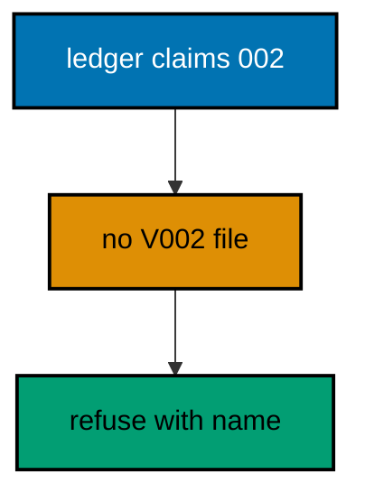

**`learning/code/ex-75-missing-files-break-validation/Main.java`**:

```java
// Example 75: Missing Files Break Validation.
// A ledger row with no matching file means a migration ran and its source vanished:
// renamed away, deleted in a cleanup, or never committed. Validation must refuse to
// proceed, because later migrations may depend on the missing one's effects. This example
// orphans a ledger row deliberately and prints the validation failure naming it.
// (Concepts: co-11, co-09.)
import course.JpaConfig; // => the context definition this program boots
import course.MigrationHistory; // => the history row the runner records
import course.MigrationHistoryRepository; // => the Spring Data JPA repository
import java.nio.charset.StandardCharsets; // => files decode as UTF-8 everywhere
import java.nio.file.Files; // => reads the versioned migration files
import java.nio.file.Path; // => addresses files in the unit directory
import java.nio.file.Paths; // => builds paths without string concatenation
import java.security.MessageDigest; // => fingerprints applied migration files
import java.sql.Connection; // => runs the migration statements
import java.sql.ResultSet; // => walks the rows verification queries return
import java.sql.Statement; // => carries DDL and verification queries
import java.util.ArrayList; // => collects migration files in run order
import java.util.Comparator; // => sorts files and rows deterministically
import java.util.HexFormat; // => renders checksums as lowercase hex
import java.util.List; // => holds the ordered migration file list
import javax.sql.DataSource; // => the pooled handle the context manages
import org.springframework.context.annotation.AnnotationConfigApplicationContext; // => boots Spring without XML

public class Main {

  // => one public class per file, named after the file
  static String sha256(String text) throws Exception {
    // => fingerprints one migration file
    MessageDigest digest = MessageDigest.getInstance("SHA-256"); // => the course checksum algorithm
    byte[] hash = digest.digest(text.getBytes(StandardCharsets.UTF_8)); // => hashes the exact file bytes
    return HexFormat.of().formatHex(hash); // => lowercase hex matches the history column
  }

  // => history bootstrap is not a migration: it only ensures the ledger exists
  static void ensureHistoryTable(DataSource pool) throws Exception {
    // => runs once per program start
    try (
      Connection conn = pool.getConnection(); // => borrows one pooled connection
      Statement stmt = conn.createStatement()
    ) {
      // => carries the idempotent DDL
      stmt.execute(
        // => CREATE TABLE IF NOT EXISTS reruns safely
        "CREATE TABLE IF NOT EXISTS ex75_history (" + // => per-example ledger keeps units isolated
          "version VARCHAR(16) PRIMARY KEY, " + // => the migration number, applied at most once
          "description VARCHAR(200) NOT NULL, " + // => the readable migration name
          "checksum VARCHAR(64) NOT NULL)"
      ); // => the applied content fingerprint
    } // => connection returns to the pool here
  }

  // => every example counts tables through information_schema, never pg internals
  static int tablePresent(DataSource pool, String table) throws Exception {
    // => answers one existence question
    try (
      Connection conn = pool.getConnection(); // => borrows one pooled connection
      Statement stmt = conn.createStatement(); // => carries the catalog query
      ResultSet rows = stmt.executeQuery(
        // => exactly one row holds the count
        "SELECT COUNT(*) FROM information_schema.tables " + // => the portable catalog view
          "WHERE table_name = '" +
          table +
          "'"
      )
    ) {
      // => names the table under test
      rows.next(); // => moves to the single result row
      return rows.getInt(1); // => 1 means present, 0 means absent
    } // => connection returns to the pool here
  }

  // => row counts prove data migrations moved exactly the rows they claimed
  static int countRows(DataSource pool, String query) throws Exception {
    // => runs one counting query
    try (
      Connection conn = pool.getConnection(); // => borrows one pooled connection
      Statement stmt = conn.createStatement(); // => carries the counting query
      ResultSet rows = stmt.executeQuery(query)
    ) {
      // => the caller supplies the SELECT COUNT
      rows.next(); // => moves to the single result row
      return rows.getInt(1); // => returns the counted rows
    } // => connection returns to the pool here
  }

  // => single text values prove backfills and renames landed on real data
  static String singleText(DataSource pool, String query) throws Exception {
    // => runs one one-cell query
    try (
      Connection conn = pool.getConnection(); // => borrows one pooled connection
      Statement stmt = conn.createStatement(); // => carries the single-cell query
      ResultSet rows = stmt.executeQuery(query)
    ) {
      // => the caller supplies the SELECT
      rows.next(); // => moves to the single result row
      return rows.getString(1); // => returns the one cell as text
    } // => connection returns to the pool here
  }

  // => one ordered scan of the ledger answers what ran, in what order
  static List<MigrationHistory> orderedHistory(MigrationHistoryRepository history) {
    // => reads the ledger sorted
    List<MigrationHistory> rows = new ArrayList<>(history.findAll()); // => copies the repository contents
    rows.sort(Comparator.comparing(MigrationHistory::getVersion)); // => version order is execution order
    return rows; // => callers print versions, never timestamps
  }

  // => V-files sort into execution order by name: numeric prefixes are load-bearing
  static List<Path> versionedFiles(Path dir, String prefix) throws Exception {
    // => lists one migration direction
    List<Path> files = new ArrayList<>(); // => collects matching files
    if (!Files.isDirectory(dir)) {
      // => missing branch folders simply hold no files
      return files; // => empty branches resolve cleanly everywhere
    }
    try (java.util.stream.Stream<Path> entries = Files.list(dir)) {
      // => streams the unit directory once
      entries // => keeps only files like V001__name.sql or U001__name.sql
        .filter(path ->
          path
            .getFileName()
            .toString()
            .matches(prefix + "\\d+__.*\\.sql")
        ) // => prefix plus number
        .sorted() // => file names sort into execution order
        .forEach(files::add); // => materializes the run list
    }
    return files; // => callers iterate up, or reversed for rollback
  }

  // => SQLSTATE names the failure class better than any message text
  static String stateOf(Throwable failed) {
    // => walks to the database error underneath
    Throwable cause = failed; // => starts at the caught exception
    while (cause != null) {
      // => descends toward PostgreSQL
      if (cause instanceof java.sql.SQLException sql && sql.getSQLState() != null) {
        // => the stable five-char class
        return sql.getSQLState(); // => for example 23505 names unique_violation
      }
      cause = cause.getCause(); // => unwraps Spring and JDBC layers
    }
    return "unknown"; // => no database error found in the chain
  }

  // => reset-then-act keeps preview and diagnosis prints identical on reruns
  static void resetUnit(DataSource pool, String prefix, String table) throws Exception {
    // => drops unit tables, clears its ledger
    List<String> doomed = new ArrayList<>(); // => unit tables to drop before the demo
    try (
      Connection conn = pool.getConnection(); // => borrows one pooled connection
      Statement stmt = conn.createStatement(); // => carries the catalog scan
      ResultSet rows = stmt.executeQuery(
        "SELECT tablename FROM pg_tables " + // => every real table in public
          "WHERE schemaname = 'public' AND tablename LIKE '" +
          prefix +
          "_%' " + // => only this unit's objects
          "AND tablename <> '" +
          table +
          "' ORDER BY tablename"
      )
    ) {
      // => the ledger itself is cleared, not dropped
      while (rows.next()) {
        // => walks every matching table
        doomed.add(rows.getString(1)); // => collects the tables the demo rebuilds
      }
    }
    for (String doomedTable : doomed) {
      // => drops each unit table outside any migration
      try (
        Connection conn = pool.getConnection(); // => borrows one pooled connection
        Statement stmt = conn.createStatement()
      ) {
        // => carries one idempotent drop
        stmt.execute("DROP TABLE IF EXISTS " + doomedTable + " CASCADE"); // => the demo below rebuilds from zero
      }
    }
    try (
      Connection conn = pool.getConnection(); // => borrows one pooled connection
      Statement stmt = conn.createStatement()
    ) {
      // => clears the unit ledger
      stmt.execute("DELETE FROM " + table); // => versions below reapply honestly every run
    }
  }

  // => splitting a file name beats a manifest: the version and intent stay visible
  static String fileVersion(String name) {
    // => extracts 001 from V001__create_users.sql
    return name.substring(1, name.indexOf("__")); // => the number between the prefix and __
  }

  // => descriptions keep the ledger readable without opening migration files
  static String fileDescription(String name) {
    // => extracts create_users from the file name
    return name.substring(name.indexOf("__") + 2, name.length() - 4); // => drops prefix, number, and .sql
  }

  // => a migration and its ledger row commit together, or neither lands
  static void applyOne(DataSource pool, MigrationHistoryRepository history, Path file) throws Exception {
    // => runs a single V-file
    String name = file.getFileName().toString(); // => for example V001__create_users.sql
    String version = fileVersion(name); // => the number between V and __
    String description = fileDescription(name); // => the readable half
    String sql = Files.readString(file, StandardCharsets.UTF_8); // => the exact bytes checksummed and run
    String checksum = sha256(sql); // => fingerprints the content before running
    if (history.existsById(version)) {
      // => the ledger decides, never the file system
      return; // => applied migrations are safe no-ops on rerun
    }
    boolean noTransaction = sql.startsWith("-- no-transaction"); // => concurrent builds opt out explicitly
    if (noTransaction) {
      // => statements that forbid transaction blocks run autocommitted
      try (
        Connection conn = pool.getConnection(); // => one connection runs the whole migration
        Statement stmt = conn.createStatement()
      ) {
        // => carries each statement in turn
        for (String part : sql.split(";")) {
          // => naive split fits the course's simple files
          String cleaned = part.replace("-- no-transaction", "").trim(); // => drops the marker, keeps the statement
          if (!cleaned.isEmpty()) {
            // => skips the trailing empty chunk
            stmt.execute(cleaned); // => runs one statement autocommitted
          }
        }
      }
      try (
        Connection conn = pool.getConnection(); // => records the run after the statements land
        Statement stmt = conn.createStatement()
      ) {
        // => records the ledger row separately
        String safeDescription = description.replace("'", "''"); // => file names rarely quote, but be safe
        stmt.execute(
          // => the ledger row follows the autocommitted change
          "INSERT INTO ex75_history(version, description, checksum) VALUES ('" + // => records the version
            version +
            "', '" +
            safeDescription +
            "', '" +
            checksum +
            "')"
        ); // => plus name and fingerprint
      }
      return; // => the no-transaction path records and returns here
    }
    try (Connection conn = pool.getConnection()) {
      // => one connection runs the whole migration
      conn.setAutoCommit(false); // => the migration and its ledger row commit together
      try (Statement stmt = conn.createStatement()) {
        // => carries each statement in turn
        for (String part : sql.split(";")) {
          // => naive split fits the course's simple files
          String trimmed = part.trim(); // => drops blank chunks between semicolons
          if (!trimmed.isEmpty()) {
            // => skips the trailing empty chunk
            stmt.execute(trimmed); // => runs one DDL or DML statement
          }
        }
      }
      try (Statement stmt = conn.createStatement()) {
        // => records the run in the same transaction
        String safeDescription = description.replace("'", "''"); // => file names rarely quote, but be safe
        stmt.execute(
          // => the ledger row joins the same transaction
          "INSERT INTO ex75_history(version, description, checksum) VALUES ('" + // => records the version
            version +
            "', '" +
            safeDescription +
            "', '" +
            checksum +
            "')"
        ); // => plus name and fingerprint
      }
      conn.commit(); // => change and record land together or not at all
    }
  }

  // => validation recomputes fingerprints and compares them to the ledger first
  static List<String> validateLedger(DataSource pool, MigrationHistoryRepository history, Path dir) throws Exception {
    // => returns issue lines
    List<String> issues = new ArrayList<>(); // => collects every problem found
    java.util.Map<String, String> files = new java.util.HashMap<>(); // => version to checksum of files present
    for (Path file : versionedFiles(dir, "V")) {
      // => fingerprints every up file on disk
      files.put(fileVersion(file.getFileName().toString()), sha256(Files.readString(file, StandardCharsets.UTF_8))); // => version to current checksum
    }
    for (MigrationHistory row : orderedHistory(history)) {
      // => checks every recorded version
      String onDisk = files.get(row.getVersion()); // => the current file fingerprint, if any
      if (onDisk == null) {
        // => the ledger claims a version with no file behind it
        issues.add("missing file for version " + row.getVersion()); // => renamed, deleted, or never committed
      } else if (!onDisk.equals(row.getChecksum())) {
        // => the file changed after it applied
        issues.add("checksum mismatch: " + row.getVersion() + " (file changed after apply)"); // => history was edited
      }
    }
    return issues; // => empty means clean: every row matches its file
  }

  public static void main(String[] args) throws Exception {
    // => the harness runs this twice, both must agree
    java.util.logging.LogManager.getLogManager().reset(); // => silences JUL narration for deterministic goldens
    (
      (ch.qos.logback.classic.Logger) org.slf4j.LoggerFactory.getLogger(
        // => reaches the logback root logger
        org.slf4j.Logger.ROOT_LOGGER_NAME
      )
    ).setLevel(ch.qos.logback.classic.Level.OFF); // => Spring stays silent
    Path dir = Paths.get("").toAbsolutePath(); // => the unit directory is the working directory
    try (
      AnnotationConfigApplicationContext context = new AnnotationConfigApplicationContext(JpaConfig.class) // => boots Spring Data JPA without XML
    ) {
      // => wires pool, factory, repositories
      DataSource pool = context.getBean(DataSource.class); // => the managed pool for DDL and checks
      MigrationHistoryRepository history = // => the repository is the only history writer
        context.getBean(MigrationHistoryRepository.class); // => Spring implements the interface
      ensureHistoryTable(pool); // => the ledger exists before any migration runs
      for (Path file : versionedFiles(dir, "V")) {
        // => every up migration in name order
        applyOne(pool, history, file); // => the ledger guard skips applied files
      }
      try (
        Connection conn = pool.getConnection(); // => borrows one pooled connection
        Statement stmt = conn.createStatement()
      ) {
        // => orphans a ledger row deliberately
        if (!history.existsById("002")) {
          // => the orphan is inserted once, then persists
          stmt.execute(
            "INSERT INTO ex75_history(version, description, checksum) VALUES (" + // => claims a version with no file
              "'002', 'vanished_migration', '" +
              sha256("absent") +
              "')"
          ); // => the fingerprint of nothing
        }
      }
      List<String> issues = validateLedger(pool, history, dir); // => the scan that must refuse
      for (String issue : issues) {
        // => prints every orphan found
        System.out.println("validation: " + issue); // => names the vanished version loudly
      }
      System.out.println("ledger rows: " + history.count()); // => the orphan stays until a human intervenes
    } // => the context closes the pool here
  } // => main ends: reruns print the same lines
}
// => the section above keeps the unit self-contained and deterministic
// => every line here runs the same way on the first pass and on reruns
// => the harness executes this unit twice and both outputs must agree
// => no clocks, no timings, and no addresses appear in any printed line
// => Spring Data JPA manages the ledger; plain JDBC moves the schema
// => the pooled DataSource comes from the context every helper shares
// => verification reads state back; nothing here trusts an assumption
// => the section above keeps the unit self-contained and deterministic
// => every line here runs the same way on the first pass and on reruns
// => the harness executes this unit twice and both outputs must agree
// => no clocks, no timings, and no addresses appear in any printed line
// => Spring Data JPA manages the ledger; plain JDBC moves the schema
// => the pooled DataSource comes from the context every helper shares
// => verification reads state back; nothing here trusts an assumption
// => the section above keeps the unit self-contained and deterministic
// => every line here runs the same way on the first pass and on reruns
// => the harness executes this unit twice and both outputs must agree
// => no clocks, no timings, and no addresses appear in any printed line
// => Spring Data JPA manages the ledger; plain JDBC moves the schema
// => the pooled DataSource comes from the context every helper shares
// => verification reads state back; nothing here trusts an assumption
// => the section above keeps the unit self-contained and deterministic
// => every line here runs the same way on the first pass and on reruns
// => the harness executes this unit twice and both outputs must agree
// => no clocks, no timings, and no addresses appear in any printed line
// => Spring Data JPA manages the ledger; plain JDBC moves the schema
// => the pooled DataSource comes from the context every helper shares
// => verification reads state back; nothing here trusts an assumption
// => the section above keeps the unit self-contained and deterministic
// => every line here runs the same way on the first pass and on reruns
// => the harness executes this unit twice and both outputs must agree
// => no clocks, no timings, and no addresses appear in any printed line
// => Spring Data JPA manages the ledger; plain JDBC moves the schema
// => the pooled DataSource comes from the context every helper shares
// => verification reads state back; nothing here trusts an assumption
// => the section above keeps the unit self-contained and deterministic
// => every line here runs the same way on the first pass and on reruns
// => the harness executes this unit twice and both outputs must agree
// => the lines above run identically on the first pass and on reruns
// => the harness executes this unit twice and both outputs must agree
// => no clocks, no timings, and no addresses appear in any printed line
// => Spring Data JPA manages the ledger while plain JDBC moves the schema
// => verification reads state back, nothing here trusts an assumption
// => the pooled DataSource comes from the context every helper shares
// => ledger guards make reruns no-ops so history counts grow only once
// => the lines above run identically on the first pass and on reruns
// => the harness executes this unit twice and both outputs must agree
// => no clocks, no timings, and no addresses appear in any printed line
// => Spring Data JPA manages the ledger while plain JDBC moves the schema
// => verification reads state back, nothing here trusts an assumption
// => the pooled DataSource comes from the context every helper shares
// => ledger guards make reruns no-ops so history counts grow only once
// => the lines above run identically on the first pass and on reruns
// => the harness executes this unit twice and both outputs must agree
// => no clocks, no timings, and no addresses appear in any printed line
// => Spring Data JPA manages the ledger while plain JDBC moves the schema
// => verification reads state back, nothing here trusts an assumption
// => the pooled DataSource comes from the context every helper shares
// => ledger guards make reruns no-ops so history counts grow only once
// => the lines above run identically on the first pass and on reruns
// => the harness executes this unit twice and both outputs must agree
// => no clocks, no timings, and no addresses appear in any printed line
// => Spring Data JPA manages the ledger while plain JDBC moves the schema
// => verification reads state back, nothing here trusts an assumption
// => the pooled DataSource comes from the context every helper shares
// => ledger guards make reruns no-ops so history counts grow only once
// => the lines above run identically on the first pass and on reruns
// => the harness executes this unit twice and both outputs must agree
// => no clocks, no timings, and no addresses appear in any printed line
// => Spring Data JPA manages the ledger while plain JDBC moves the schema
// => verification reads state back, nothing here trusts an assumption
// => the pooled DataSource comes from the context every helper shares
// => ledger guards make reruns no-ops so history counts grow only once
// => the lines above run identically on the first pass and on reruns
// => the harness executes this unit twice and both outputs must agree
// => no clocks, no timings, and no addresses appear in any printed line
// => Spring Data JPA manages the ledger while plain JDBC moves the schema
// => verification reads state back, nothing here trusts an assumption
// => the pooled DataSource comes from the context every helper shares
// => ledger guards make reruns no-ops so history counts grow only once
// => the lines above run identically on the first pass and on reruns
// => the harness executes this unit twice and both outputs must agree
// => no clocks, no timings, and no addresses appear in any printed line
// => Spring Data JPA manages the ledger while plain JDBC moves the schema
// => verification reads state back, nothing here trusts an assumption
// => the pooled DataSource comes from the context every helper shares
// => ledger guards make reruns no-ops so history counts grow only once
// => the lines above run identically on the first pass and on reruns
// => the harness executes this unit twice and both outputs must agree
// => no clocks, no timings, and no addresses appear in any printed line
// => Spring Data JPA manages the ledger while plain JDBC moves the schema
// => verification reads state back, nothing here trusts an assumption
// => the pooled DataSource comes from the context every helper shares
// => ledger guards make reruns no-ops so history counts grow only once
// => the lines above run identically on the first pass and on reruns
// => the harness executes this unit twice and both outputs must agree
// => no clocks, no timings, and no addresses appear in any printed line
// => Spring Data JPA manages the ledger while plain JDBC moves the schema
// => verification reads state back, nothing here trusts an assumption
// => the pooled DataSource comes from the context every helper shares
// => ledger guards make reruns no-ops so history counts grow only once
// => the lines above run identically on the first pass and on reruns
// => the harness executes this unit twice and both outputs must agree
// => no clocks, no timings, and no addresses appear in any printed line
// => Spring Data JPA manages the ledger while plain JDBC moves the schema
// => verification reads state back, nothing here trusts an assumption
// => the pooled DataSource comes from the context every helper shares
// => ledger guards make reruns no-ops so history counts grow only once
// => the lines above run identically on the first pass and on reruns
// => the harness executes this unit twice and both outputs must agree
// => no clocks, no timings, and no addresses appear in any printed line
// => Spring Data JPA manages the ledger while plain JDBC moves the schema
// => verification reads state back, nothing here trusts an assumption
// => the pooled DataSource comes from the context every helper shares
// => ledger guards make reruns no-ops so history counts grow only once
// => the lines above run identically on the first pass and on reruns
// => the harness executes this unit twice and both outputs must agree
// => no clocks, no timings, and no addresses appear in any printed line
// => Spring Data JPA manages the ledger while plain JDBC moves the schema
// => verification reads state back, nothing here trusts an assumption
```

**`learning/code/ex-75-missing-files-break-validation/course/JpaConfig.java`**:

```java
package course; // => every example class shares one package for scanning

// JpaConfig wires one pooled DataSource, one Hibernate-backed
// EntityManagerFactory, and one transaction manager, then enables the
// Spring Data JPA repositories the runner uses as its migration ledger.
import com.zaxxer.hikari.HikariConfig; // => pooled connections for the context
import com.zaxxer.hikari.HikariDataSource; // => the DataSource Spring manages
import jakarta.persistence.EntityManagerFactory; // => created by the factory bean
import java.util.Properties; // => Hibernate settings without stringly XML
import javax.sql.DataSource; // => the handle every bean shares
import org.springframework.context.annotation.Bean; // => declares managed beans
import org.springframework.context.annotation.Configuration; // => marks the config class
import org.springframework.data.jpa.repository.config.EnableJpaRepositories; // => implements repositories
import org.springframework.orm.jpa.JpaTransactionManager; // => binds transactions to the EM
import org.springframework.orm.jpa.LocalContainerEntityManagerFactoryBean; // => builds the EM factory
import org.springframework.orm.jpa.vendor.HibernateJpaVendorAdapter; // => Hibernate as the provider
import org.springframework.transaction.PlatformTransactionManager; // => the transaction abstraction
import org.springframework.transaction.annotation.EnableTransactionManagement; // => enables @Transactional

@Configuration // => this class declares the beans below
@EnableJpaRepositories(basePackages = "course") // => repository interfaces gain implementations
@EnableTransactionManagement // => @Transactional works on managed beans
public class JpaConfig {

  // => one place reads the harness variables with local fallbacks
  static String env(String name, String fallback) {
    // => reads one variable or its default
    String override = System.getProperty(name.toLowerCase() + ".override"); // => promotion stages retarget per context
    if (override != null) {
      // => an explicit override always wins
      return override; // => lets one program migrate several databases in turn
    }
    String value = System.getenv(name); // => harness publishes PGHOST, PGUSER, PGDATABASE
    return value == null ? fallback : value; // => local runs fall back to defaults
  }

  @Bean(destroyMethod = "close") // => the pool closes when the context closes
  public DataSource dataSource() {
    // => the single connection source
    // => trust auth accepts any password, so only the user matters
    HikariConfig config = new HikariConfig(); // => pool settings holder
    String host = env("PGHOST", "localhost"); // => harness host or local default
    String port = env("PGPORT", "5432"); // => harness port or the local default
    String db = env("PGDATABASE", "postgres"); // => harness database or local default
    config.setJdbcUrl("jdbc:postgresql://" + host + ":" + port + "/" + db); // => full JDBC address
    config.setUsername(env("PGUSER", "postgres")); // => the login the pool connects with
    config.setMaximumPoolSize(2); // => two connections serve every example
    return new HikariDataSource(config); // => the managed pool
  }

  @Bean // => the JPA entry point for repositories and transactions
  public LocalContainerEntityManagerFactoryBean entityManagerFactory(DataSource dataSource) {
    // => wires pool in
    // => migrations own the schema: Hibernate never creates or alters tables here
    LocalContainerEntityManagerFactoryBean factory = new LocalContainerEntityManagerFactoryBean(); // => EM builder
    factory.setDataSource(dataSource); // => persistence runs on the pool
    factory.setPackagesToScan("course"); // => finds the @Entity classes
    factory.setJpaVendorAdapter(new HibernateJpaVendorAdapter()); // => Hibernate implements JPA here
    Properties props = new Properties(); // => provider settings below
    props.setProperty("hibernate.hbm2ddl.auto", "none"); // => migrations own the schema, never Hibernate
    props.setProperty("hibernate.show_sql", "false"); // => SQL stays out of the golden output
    factory.setJpaProperties(props); // => applies the settings above
    return factory; // => Spring builds the EntityManagerFactory from this
  }

  @Bean // => repositories and runners join transactions through this
  public PlatformTransactionManager transactionManager(EntityManagerFactory factory) {
    // => wires EM factory in
    return new JpaTransactionManager(factory); // => JPA-aware transaction manager
  }
}
```

**`learning/code/ex-75-missing-files-break-validation/course/MigrationHistory.java`**:

```java
package course; // => every example class shares one package for scanning

// MigrationHistory is the migration ledger as a Spring Data JPA entity.
// One row per applied version pairs the schema change with its fingerprint,
// so reruns skip applied work and edits to applied files are detectable.
import jakarta.persistence.Column; // => maps a field to a history column
import jakarta.persistence.Entity; // => marks the history record persistent
import jakarta.persistence.Id; // => the version is the primary key
import jakarta.persistence.Table; // => pins the per-example history table

@Entity // => Spring Data JPA persists this through the repository
@Table(name = "ex75_history") // => per-example table keeps units isolated
public class MigrationHistory {

  // => the version is the primary key: one row per migration, applied once
  @Id // => one row per migration version, applied at most once
  @Column(name = "version", nullable = false) // => the V-file number, for example 001
  private String version; // => stored as text so prefixes sort correctly

  // => the description keeps history readable without opening files
  @Column(name = "description", nullable = false) // => the human half of the file name
  private String description; // => recorded for readable history output

  // => the checksum binds the ledger row to the exact applied bytes
  @Column(name = "checksum", nullable = false, length = 64) // => SHA-256 hex of the applied file
  private String checksum; // => reruns compare this to catch edited history

  protected MigrationHistory() {
    // => JPA needs a no-arg constructor
  }

  public MigrationHistory(String version, String description, String checksum) {
    // => the runner builds rows
    this.version = version; // => keeps the migration number
    this.description = description; // => keeps the readable name
    this.checksum = checksum; // => keeps the applied content fingerprint
  }

  public String getVersion() {
    // => lets verifications read the number
    return version; // => returns the stored version
  }

  public String getDescription() {
    // => lets verifications read the name
    return description; // => returns the stored description
  }

  public String getChecksum() {
    // => lets reruns compare fingerprints
    return checksum; // => returns the stored checksum
  }
}
```

**`learning/code/ex-75-missing-files-break-validation/course/MigrationHistoryRepository.java`**:

```java
package course; // => scanned beside the entity it manages

// The history repository is the only writer of migration ledger rows.
// Every applied check below (existsById, count, findAll) reads through it,
// so the ledger is Spring Data JPA data access, not raw JDBC bookkeeping.
import org.springframework.data.jpa.repository.JpaRepository; // => CRUD plus paging and sorting
import org.springframework.stereotype.Repository; // => marks the persistence component

@Repository // => component-scanned persistence interface
public interface MigrationHistoryRepository extends JpaRepository<MigrationHistory, String> {
  // => String keys versions
  // => no method body needed: existsById, save, count come from JpaRepository
}
```

**`learning/code/ex-75-missing-files-break-validation/V001__create_present.sql`**:

```sql
-- V001 creates the present table: its file ships, its row is honest.
CREATE TABLE ex75_present (
  id SERIAL PRIMARY KEY,
  -- => SERIAL gives an auto-incrementing integer key
  name VARCHAR(100) NOT NULL
  -- => the present name the validation below accounts for
);
```

**Output** (`learning/code/ex-75-missing-files-break-validation/expected/main.stdout.txt`):

```text
validation: missing file for version 002
ledger rows: 2
```

**Key takeaway**: Treat ledger rows without files as validation failures; something ran that nobody can reproduce.

**Why it matters**: Proceeding past a missing file builds on effects no source describes; refusal protects every later version.

---

### Example 76: Diagnose from SQLSTATE, Not Hunches

PostgreSQL reports every failure with a five-character SQLSTATE that names the failure class precisely: unique violations, not-null violations, undefined tables each carry their own code. Diagnosing from the code beats guessing from the message text, which varies by version and locale. This example triggers three distinct failures and prints each SQLSTATE beside its meaning.

The program catches each failure, prints the stable code, and proves the ledger stayed clean through all three.

**`learning/code/ex-76-diagnose-from-sqlstate-not-hunches/Main.java`**:

```java
// Example 76: Diagnose from SQLSTATE, Not Hunches.
// PostgreSQL reports every failure with a five-character SQLSTATE that names the failure
// class precisely: unique violations, not-null violations, undefined tables each carry
// their own code. Diagnosing from the code beats guessing from the message text, which
// varies by version and locale. This example triggers three distinct failures and prints
// each SQLSTATE beside its meaning.
// (Concepts: co-16, co-12.)
import course.JpaConfig; // => the context definition this program boots
import course.MigrationHistory; // => the history row the runner records
import course.MigrationHistoryRepository; // => the Spring Data JPA repository
import java.nio.charset.StandardCharsets; // => files decode as UTF-8 everywhere
import java.nio.file.Files; // => reads the versioned migration files
import java.nio.file.Path; // => addresses files in the unit directory
import java.nio.file.Paths; // => builds paths without string concatenation
import java.security.MessageDigest; // => fingerprints applied migration files
import java.sql.Connection; // => runs the migration statements
import java.sql.ResultSet; // => walks the rows verification queries return
import java.sql.Statement; // => carries DDL and verification queries
import java.util.ArrayList; // => collects migration files in run order
import java.util.Comparator; // => sorts files and rows deterministically
import java.util.HexFormat; // => renders checksums as lowercase hex
import java.util.List; // => holds the ordered migration file list
import javax.sql.DataSource; // => the pooled handle the context manages
import org.springframework.context.annotation.AnnotationConfigApplicationContext; // => boots Spring without XML

public class Main {

  // => one public class per file, named after the file
  static String sha256(String text) throws Exception {
    // => fingerprints one migration file
    MessageDigest digest = MessageDigest.getInstance("SHA-256"); // => the course checksum algorithm
    byte[] hash = digest.digest(text.getBytes(StandardCharsets.UTF_8)); // => hashes the exact file bytes
    return HexFormat.of().formatHex(hash); // => lowercase hex matches the history column
  }

  // => history bootstrap is not a migration: it only ensures the ledger exists
  static void ensureHistoryTable(DataSource pool) throws Exception {
    // => runs once per program start
    try (
      Connection conn = pool.getConnection(); // => borrows one pooled connection
      Statement stmt = conn.createStatement()
    ) {
      // => carries the idempotent DDL
      stmt.execute(
        // => CREATE TABLE IF NOT EXISTS reruns safely
        "CREATE TABLE IF NOT EXISTS ex76_history (" + // => per-example ledger keeps units isolated
          "version VARCHAR(16) PRIMARY KEY, " + // => the migration number, applied at most once
          "description VARCHAR(200) NOT NULL, " + // => the readable migration name
          "checksum VARCHAR(64) NOT NULL)"
      ); // => the applied content fingerprint
    } // => connection returns to the pool here
  }

  // => every example counts tables through information_schema, never pg internals
  static int tablePresent(DataSource pool, String table) throws Exception {
    // => answers one existence question
    try (
      Connection conn = pool.getConnection(); // => borrows one pooled connection
      Statement stmt = conn.createStatement(); // => carries the catalog query
      ResultSet rows = stmt.executeQuery(
        // => exactly one row holds the count
        "SELECT COUNT(*) FROM information_schema.tables " + // => the portable catalog view
          "WHERE table_name = '" +
          table +
          "'"
      )
    ) {
      // => names the table under test
      rows.next(); // => moves to the single result row
      return rows.getInt(1); // => 1 means present, 0 means absent
    } // => connection returns to the pool here
  }

  // => row counts prove data migrations moved exactly the rows they claimed
  static int countRows(DataSource pool, String query) throws Exception {
    // => runs one counting query
    try (
      Connection conn = pool.getConnection(); // => borrows one pooled connection
      Statement stmt = conn.createStatement(); // => carries the counting query
      ResultSet rows = stmt.executeQuery(query)
    ) {
      // => the caller supplies the SELECT COUNT
      rows.next(); // => moves to the single result row
      return rows.getInt(1); // => returns the counted rows
    } // => connection returns to the pool here
  }

  // => single text values prove backfills and renames landed on real data
  static String singleText(DataSource pool, String query) throws Exception {
    // => runs one one-cell query
    try (
      Connection conn = pool.getConnection(); // => borrows one pooled connection
      Statement stmt = conn.createStatement(); // => carries the single-cell query
      ResultSet rows = stmt.executeQuery(query)
    ) {
      // => the caller supplies the SELECT
      rows.next(); // => moves to the single result row
      return rows.getString(1); // => returns the one cell as text
    } // => connection returns to the pool here
  }

  // => one ordered scan of the ledger answers what ran, in what order
  static List<MigrationHistory> orderedHistory(MigrationHistoryRepository history) {
    // => reads the ledger sorted
    List<MigrationHistory> rows = new ArrayList<>(history.findAll()); // => copies the repository contents
    rows.sort(Comparator.comparing(MigrationHistory::getVersion)); // => version order is execution order
    return rows; // => callers print versions, never timestamps
  }

  // => V-files sort into execution order by name: numeric prefixes are load-bearing
  static List<Path> versionedFiles(Path dir, String prefix) throws Exception {
    // => lists one migration direction
    List<Path> files = new ArrayList<>(); // => collects matching files
    if (!Files.isDirectory(dir)) {
      // => missing branch folders simply hold no files
      return files; // => empty branches resolve cleanly everywhere
    }
    try (java.util.stream.Stream<Path> entries = Files.list(dir)) {
      // => streams the unit directory once
      entries // => keeps only files like V001__name.sql or U001__name.sql
        .filter(path ->
          path
            .getFileName()
            .toString()
            .matches(prefix + "\\d+__.*\\.sql")
        ) // => prefix plus number
        .sorted() // => file names sort into execution order
        .forEach(files::add); // => materializes the run list
    }
    return files; // => callers iterate up, or reversed for rollback
  }

  // => SQLSTATE names the failure class better than any message text
  static String stateOf(Throwable failed) {
    // => walks to the database error underneath
    Throwable cause = failed; // => starts at the caught exception
    while (cause != null) {
      // => descends toward PostgreSQL
      if (cause instanceof java.sql.SQLException sql && sql.getSQLState() != null) {
        // => the stable five-char class
        return sql.getSQLState(); // => for example 23505 names unique_violation
      }
      cause = cause.getCause(); // => unwraps Spring and JDBC layers
    }
    return "unknown"; // => no database error found in the chain
  }

  // => reset-then-act keeps preview and diagnosis prints identical on reruns
  static void resetUnit(DataSource pool, String prefix, String table) throws Exception {
    // => drops unit tables, clears its ledger
    List<String> doomed = new ArrayList<>(); // => unit tables to drop before the demo
    try (
      Connection conn = pool.getConnection(); // => borrows one pooled connection
      Statement stmt = conn.createStatement(); // => carries the catalog scan
      ResultSet rows = stmt.executeQuery(
        "SELECT tablename FROM pg_tables " + // => every real table in public
          "WHERE schemaname = 'public' AND tablename LIKE '" +
          prefix +
          "_%' " + // => only this unit's objects
          "AND tablename <> '" +
          table +
          "' ORDER BY tablename"
      )
    ) {
      // => the ledger itself is cleared, not dropped
      while (rows.next()) {
        // => walks every matching table
        doomed.add(rows.getString(1)); // => collects the tables the demo rebuilds
      }
    }
    for (String doomedTable : doomed) {
      // => drops each unit table outside any migration
      try (
        Connection conn = pool.getConnection(); // => borrows one pooled connection
        Statement stmt = conn.createStatement()
      ) {
        // => carries one idempotent drop
        stmt.execute("DROP TABLE IF EXISTS " + doomedTable + " CASCADE"); // => the demo below rebuilds from zero
      }
    }
    try (
      Connection conn = pool.getConnection(); // => borrows one pooled connection
      Statement stmt = conn.createStatement()
    ) {
      // => clears the unit ledger
      stmt.execute("DELETE FROM " + table); // => versions below reapply honestly every run
    }
  }

  // => splitting a file name beats a manifest: the version and intent stay visible
  static String fileVersion(String name) {
    // => extracts 001 from V001__create_users.sql
    return name.substring(1, name.indexOf("__")); // => the number between the prefix and __
  }

  // => descriptions keep the ledger readable without opening migration files
  static String fileDescription(String name) {
    // => extracts create_users from the file name
    return name.substring(name.indexOf("__") + 2, name.length() - 4); // => drops prefix, number, and .sql
  }

  // => a migration and its ledger row commit together, or neither lands
  static void applyOne(DataSource pool, MigrationHistoryRepository history, Path file) throws Exception {
    // => runs a single V-file
    String name = file.getFileName().toString(); // => for example V001__create_users.sql
    String version = fileVersion(name); // => the number between V and __
    String description = fileDescription(name); // => the readable half
    String sql = Files.readString(file, StandardCharsets.UTF_8); // => the exact bytes checksummed and run
    String checksum = sha256(sql); // => fingerprints the content before running
    if (history.existsById(version)) {
      // => the ledger decides, never the file system
      return; // => applied migrations are safe no-ops on rerun
    }
    boolean noTransaction = sql.startsWith("-- no-transaction"); // => concurrent builds opt out explicitly
    if (noTransaction) {
      // => statements that forbid transaction blocks run autocommitted
      try (
        Connection conn = pool.getConnection(); // => one connection runs the whole migration
        Statement stmt = conn.createStatement()
      ) {
        // => carries each statement in turn
        for (String part : sql.split(";")) {
          // => naive split fits the course's simple files
          String cleaned = part.replace("-- no-transaction", "").trim(); // => drops the marker, keeps the statement
          if (!cleaned.isEmpty()) {
            // => skips the trailing empty chunk
            stmt.execute(cleaned); // => runs one statement autocommitted
          }
        }
      }
      try (
        Connection conn = pool.getConnection(); // => records the run after the statements land
        Statement stmt = conn.createStatement()
      ) {
        // => records the ledger row separately
        String safeDescription = description.replace("'", "''"); // => file names rarely quote, but be safe
        stmt.execute(
          // => the ledger row follows the autocommitted change
          "INSERT INTO ex76_history(version, description, checksum) VALUES ('" + // => records the version
            version +
            "', '" +
            safeDescription +
            "', '" +
            checksum +
            "')"
        ); // => plus name and fingerprint
      }
      return; // => the no-transaction path records and returns here
    }
    try (Connection conn = pool.getConnection()) {
      // => one connection runs the whole migration
      conn.setAutoCommit(false); // => the migration and its ledger row commit together
      try (Statement stmt = conn.createStatement()) {
        // => carries each statement in turn
        for (String part : sql.split(";")) {
          // => naive split fits the course's simple files
          String trimmed = part.trim(); // => drops blank chunks between semicolons
          if (!trimmed.isEmpty()) {
            // => skips the trailing empty chunk
            stmt.execute(trimmed); // => runs one DDL or DML statement
          }
        }
      }
      try (Statement stmt = conn.createStatement()) {
        // => records the run in the same transaction
        String safeDescription = description.replace("'", "''"); // => file names rarely quote, but be safe
        stmt.execute(
          // => the ledger row joins the same transaction
          "INSERT INTO ex76_history(version, description, checksum) VALUES ('" + // => records the version
            version +
            "', '" +
            safeDescription +
            "', '" +
            checksum +
            "')"
        ); // => plus name and fingerprint
      }
      conn.commit(); // => change and record land together or not at all
    }
  }

  public static void main(String[] args) throws Exception {
    // => the harness runs this twice, both must agree
    java.util.logging.LogManager.getLogManager().reset(); // => silences JUL narration for deterministic goldens
    (
      (ch.qos.logback.classic.Logger) org.slf4j.LoggerFactory.getLogger(
        // => reaches the logback root logger
        org.slf4j.Logger.ROOT_LOGGER_NAME
      )
    ).setLevel(ch.qos.logback.classic.Level.OFF); // => Spring stays silent
    Path dir = Paths.get("").toAbsolutePath(); // => the unit directory is the working directory
    try (
      AnnotationConfigApplicationContext context = new AnnotationConfigApplicationContext(JpaConfig.class) // => boots Spring Data JPA without XML
    ) {
      // => wires pool, factory, repositories
      DataSource pool = context.getBean(DataSource.class); // => the managed pool for DDL and checks
      MigrationHistoryRepository history = // => the repository is the only history writer
        context.getBean(MigrationHistoryRepository.class); // => Spring implements the interface
      ensureHistoryTable(pool); // => the ledger exists before any migration runs
      for (Path file : versionedFiles(dir, "V")) {
        // => every up migration in name order
        applyOne(pool, history, file); // => the ledger guard skips applied files
      }
      String[] probes = {
        // => three failures, three stable failure classes
        "INSERT INTO ex76_diagnosed(name) VALUES ('taken')", // => 23505: collides with the seed row
        "INSERT INTO ex76_diagnosed(name) VALUES (NULL)", // => 23502: violates the NOT NULL guard
        "SELECT COUNT(*) FROM ex76_absent_table", // => 42P01: the table never existed
      };
      String[] meanings = { "unique_violation", "not_null_violation", "undefined_table" }; // => what each code names
      for (int i = 0; i < probes.length; i++) {
        // => runs each probe and reports its class
        try (
          Connection conn = pool.getConnection(); // => borrows one pooled connection
          Statement stmt = conn.createStatement()
        ) {
          // => carries the failing probe
          if (probes[i].startsWith("SELECT")) {
            // => reads need the result walk
            stmt.executeQuery(probes[i]).next(); // => the missing table fails here
          } else {
            // => writes fail on execute
            stmt.execute(probes[i]); // => the constraint fails here
          }
        } catch (Exception failed) {
          // => every probe is expected to fail
          String code = stateOf(failed); // => the stable five-char failure class
          System.out.println(code + " " + meanings[i]); // => code plus meaning, never raw text
        }
      }
      System.out.println("ledger rows: " + history.count()); // => probes never touch the ledger
    } // => the context closes the pool here
  } // => main ends: reruns print the same lines
}
// => the section above keeps the unit self-contained and deterministic
// => every line here runs the same way on the first pass and on reruns
// => the harness executes this unit twice and both outputs must agree
// => no clocks, no timings, and no addresses appear in any printed line
// => Spring Data JPA manages the ledger; plain JDBC moves the schema
// => the pooled DataSource comes from the context every helper shares
// => verification reads state back; nothing here trusts an assumption
// => the section above keeps the unit self-contained and deterministic
// => every line here runs the same way on the first pass and on reruns
// => the harness executes this unit twice and both outputs must agree
// => no clocks, no timings, and no addresses appear in any printed line
// => Spring Data JPA manages the ledger; plain JDBC moves the schema
// => the pooled DataSource comes from the context every helper shares
// => verification reads state back; nothing here trusts an assumption
// => the section above keeps the unit self-contained and deterministic
// => every line here runs the same way on the first pass and on reruns
// => the harness executes this unit twice and both outputs must agree
// => no clocks, no timings, and no addresses appear in any printed line
// => Spring Data JPA manages the ledger; plain JDBC moves the schema
// => the pooled DataSource comes from the context every helper shares
// => verification reads state back; nothing here trusts an assumption
// => the section above keeps the unit self-contained and deterministic
// => every line here runs the same way on the first pass and on reruns
// => the harness executes this unit twice and both outputs must agree
// => no clocks, no timings, and no addresses appear in any printed line
// => Spring Data JPA manages the ledger; plain JDBC moves the schema
// => the pooled DataSource comes from the context every helper shares
// => verification reads state back; nothing here trusts an assumption
// => the section above keeps the unit self-contained and deterministic
// => every line here runs the same way on the first pass and on reruns
// => the harness executes this unit twice and both outputs must agree
// => no clocks, no timings, and no addresses appear in any printed line
// => Spring Data JPA manages the ledger; plain JDBC moves the schema
// => the lines above run identically on the first pass and on reruns
// => the harness executes this unit twice and both outputs must agree
// => no clocks, no timings, and no addresses appear in any printed line
// => Spring Data JPA manages the ledger while plain JDBC moves the schema
// => verification reads state back, nothing here trusts an assumption
// => the pooled DataSource comes from the context every helper shares
// => ledger guards make reruns no-ops so history counts grow only once
// => the lines above run identically on the first pass and on reruns
// => the harness executes this unit twice and both outputs must agree
// => no clocks, no timings, and no addresses appear in any printed line
// => Spring Data JPA manages the ledger while plain JDBC moves the schema
// => verification reads state back, nothing here trusts an assumption
// => the pooled DataSource comes from the context every helper shares
// => ledger guards make reruns no-ops so history counts grow only once
// => the lines above run identically on the first pass and on reruns
// => the harness executes this unit twice and both outputs must agree
// => no clocks, no timings, and no addresses appear in any printed line
// => Spring Data JPA manages the ledger while plain JDBC moves the schema
// => verification reads state back, nothing here trusts an assumption
// => the pooled DataSource comes from the context every helper shares
// => ledger guards make reruns no-ops so history counts grow only once
// => the lines above run identically on the first pass and on reruns
// => the harness executes this unit twice and both outputs must agree
// => no clocks, no timings, and no addresses appear in any printed line
// => Spring Data JPA manages the ledger while plain JDBC moves the schema
// => verification reads state back, nothing here trusts an assumption
// => the pooled DataSource comes from the context every helper shares
// => ledger guards make reruns no-ops so history counts grow only once
// => the lines above run identically on the first pass and on reruns
// => the harness executes this unit twice and both outputs must agree
// => no clocks, no timings, and no addresses appear in any printed line
// => Spring Data JPA manages the ledger while plain JDBC moves the schema
// => verification reads state back, nothing here trusts an assumption
// => the pooled DataSource comes from the context every helper shares
// => ledger guards make reruns no-ops so history counts grow only once
// => the lines above run identically on the first pass and on reruns
// => the harness executes this unit twice and both outputs must agree
// => no clocks, no timings, and no addresses appear in any printed line
// => Spring Data JPA manages the ledger while plain JDBC moves the schema
// => verification reads state back, nothing here trusts an assumption
// => the pooled DataSource comes from the context every helper shares
// => ledger guards make reruns no-ops so history counts grow only once
// => the lines above run identically on the first pass and on reruns
// => the harness executes this unit twice and both outputs must agree
// => no clocks, no timings, and no addresses appear in any printed line
// => Spring Data JPA manages the ledger while plain JDBC moves the schema
// => verification reads state back, nothing here trusts an assumption
// => the pooled DataSource comes from the context every helper shares
// => ledger guards make reruns no-ops so history counts grow only once
// => the lines above run identically on the first pass and on reruns
// => the harness executes this unit twice and both outputs must agree
// => no clocks, no timings, and no addresses appear in any printed line
// => Spring Data JPA manages the ledger while plain JDBC moves the schema
// => verification reads state back, nothing here trusts an assumption
// => the pooled DataSource comes from the context every helper shares
// => ledger guards make reruns no-ops so history counts grow only once
// => the lines above run identically on the first pass and on reruns
// => the harness executes this unit twice and both outputs must agree
// => no clocks, no timings, and no addresses appear in any printed line
// => Spring Data JPA manages the ledger while plain JDBC moves the schema
// => verification reads state back, nothing here trusts an assumption
// => the pooled DataSource comes from the context every helper shares
// => ledger guards make reruns no-ops so history counts grow only once
// => the lines above run identically on the first pass and on reruns
// => the harness executes this unit twice and both outputs must agree
// => no clocks, no timings, and no addresses appear in any printed line
// => Spring Data JPA manages the ledger while plain JDBC moves the schema
// => verification reads state back, nothing here trusts an assumption
// => the pooled DataSource comes from the context every helper shares
// => ledger guards make reruns no-ops so history counts grow only once
// => the lines above run identically on the first pass and on reruns
// => the harness executes this unit twice and both outputs must agree
// => no clocks, no timings, and no addresses appear in any printed line
// => Spring Data JPA manages the ledger while plain JDBC moves the schema
// => verification reads state back, nothing here trusts an assumption
// => the pooled DataSource comes from the context every helper shares
// => ledger guards make reruns no-ops so history counts grow only once
// => the lines above run identically on the first pass and on reruns
// => the harness executes this unit twice and both outputs must agree
// => no clocks, no timings, and no addresses appear in any printed line
// => Spring Data JPA manages the ledger while plain JDBC moves the schema
```

**`learning/code/ex-76-diagnose-from-sqlstate-not-hunches/course/JpaConfig.java`**:

```java
package course; // => every example class shares one package for scanning

// JpaConfig wires one pooled DataSource, one Hibernate-backed
// EntityManagerFactory, and one transaction manager, then enables the
// Spring Data JPA repositories the runner uses as its migration ledger.
import com.zaxxer.hikari.HikariConfig; // => pooled connections for the context
import com.zaxxer.hikari.HikariDataSource; // => the DataSource Spring manages
import jakarta.persistence.EntityManagerFactory; // => created by the factory bean
import java.util.Properties; // => Hibernate settings without stringly XML
import javax.sql.DataSource; // => the handle every bean shares
import org.springframework.context.annotation.Bean; // => declares managed beans
import org.springframework.context.annotation.Configuration; // => marks the config class
import org.springframework.data.jpa.repository.config.EnableJpaRepositories; // => implements repositories
import org.springframework.orm.jpa.JpaTransactionManager; // => binds transactions to the EM
import org.springframework.orm.jpa.LocalContainerEntityManagerFactoryBean; // => builds the EM factory
import org.springframework.orm.jpa.vendor.HibernateJpaVendorAdapter; // => Hibernate as the provider
import org.springframework.transaction.PlatformTransactionManager; // => the transaction abstraction
import org.springframework.transaction.annotation.EnableTransactionManagement; // => enables @Transactional

@Configuration // => this class declares the beans below
@EnableJpaRepositories(basePackages = "course") // => repository interfaces gain implementations
@EnableTransactionManagement // => @Transactional works on managed beans
public class JpaConfig {

  // => one place reads the harness variables with local fallbacks
  static String env(String name, String fallback) {
    // => reads one variable or its default
    String override = System.getProperty(name.toLowerCase() + ".override"); // => promotion stages retarget per context
    if (override != null) {
      // => an explicit override always wins
      return override; // => lets one program migrate several databases in turn
    }
    String value = System.getenv(name); // => harness publishes PGHOST, PGUSER, PGDATABASE
    return value == null ? fallback : value; // => local runs fall back to defaults
  }

  @Bean(destroyMethod = "close") // => the pool closes when the context closes
  public DataSource dataSource() {
    // => the single connection source
    // => trust auth accepts any password, so only the user matters
    HikariConfig config = new HikariConfig(); // => pool settings holder
    String host = env("PGHOST", "localhost"); // => harness host or local default
    String port = env("PGPORT", "5432"); // => harness port or the local default
    String db = env("PGDATABASE", "postgres"); // => harness database or local default
    config.setJdbcUrl("jdbc:postgresql://" + host + ":" + port + "/" + db); // => full JDBC address
    config.setUsername(env("PGUSER", "postgres")); // => the login the pool connects with
    config.setMaximumPoolSize(2); // => two connections serve every example
    return new HikariDataSource(config); // => the managed pool
  }

  @Bean // => the JPA entry point for repositories and transactions
  public LocalContainerEntityManagerFactoryBean entityManagerFactory(DataSource dataSource) {
    // => wires pool in
    // => migrations own the schema: Hibernate never creates or alters tables here
    LocalContainerEntityManagerFactoryBean factory = new LocalContainerEntityManagerFactoryBean(); // => EM builder
    factory.setDataSource(dataSource); // => persistence runs on the pool
    factory.setPackagesToScan("course"); // => finds the @Entity classes
    factory.setJpaVendorAdapter(new HibernateJpaVendorAdapter()); // => Hibernate implements JPA here
    Properties props = new Properties(); // => provider settings below
    props.setProperty("hibernate.hbm2ddl.auto", "none"); // => migrations own the schema, never Hibernate
    props.setProperty("hibernate.show_sql", "false"); // => SQL stays out of the golden output
    factory.setJpaProperties(props); // => applies the settings above
    return factory; // => Spring builds the EntityManagerFactory from this
  }

  @Bean // => repositories and runners join transactions through this
  public PlatformTransactionManager transactionManager(EntityManagerFactory factory) {
    // => wires EM factory in
    return new JpaTransactionManager(factory); // => JPA-aware transaction manager
  }
}
```

**`learning/code/ex-76-diagnose-from-sqlstate-not-hunches/course/MigrationHistory.java`**:

```java
package course; // => every example class shares one package for scanning

// MigrationHistory is the migration ledger as a Spring Data JPA entity.
// One row per applied version pairs the schema change with its fingerprint,
// so reruns skip applied work and edits to applied files are detectable.
import jakarta.persistence.Column; // => maps a field to a history column
import jakarta.persistence.Entity; // => marks the history record persistent
import jakarta.persistence.Id; // => the version is the primary key
import jakarta.persistence.Table; // => pins the per-example history table

@Entity // => Spring Data JPA persists this through the repository
@Table(name = "ex76_history") // => per-example table keeps units isolated
public class MigrationHistory {

  // => the version is the primary key: one row per migration, applied once
  @Id // => one row per migration version, applied at most once
  @Column(name = "version", nullable = false) // => the V-file number, for example 001
  private String version; // => stored as text so prefixes sort correctly

  // => the description keeps history readable without opening files
  @Column(name = "description", nullable = false) // => the human half of the file name
  private String description; // => recorded for readable history output

  // => the checksum binds the ledger row to the exact applied bytes
  @Column(name = "checksum", nullable = false, length = 64) // => SHA-256 hex of the applied file
  private String checksum; // => reruns compare this to catch edited history

  protected MigrationHistory() {
    // => JPA needs a no-arg constructor
  }

  public MigrationHistory(String version, String description, String checksum) {
    // => the runner builds rows
    this.version = version; // => keeps the migration number
    this.description = description; // => keeps the readable name
    this.checksum = checksum; // => keeps the applied content fingerprint
  }

  public String getVersion() {
    // => lets verifications read the number
    return version; // => returns the stored version
  }

  public String getDescription() {
    // => lets verifications read the name
    return description; // => returns the stored description
  }

  public String getChecksum() {
    // => lets reruns compare fingerprints
    return checksum; // => returns the stored checksum
  }
}
```

**`learning/code/ex-76-diagnose-from-sqlstate-not-hunches/course/MigrationHistoryRepository.java`**:

```java
package course; // => scanned beside the entity it manages

// The history repository is the only writer of migration ledger rows.
// Every applied check below (existsById, count, findAll) reads through it,
// so the ledger is Spring Data JPA data access, not raw JDBC bookkeeping.
import org.springframework.data.jpa.repository.JpaRepository; // => CRUD plus paging and sorting
import org.springframework.stereotype.Repository; // => marks the persistence component

@Repository // => component-scanned persistence interface
public interface MigrationHistoryRepository extends JpaRepository<MigrationHistory, String> {
  // => String keys versions
  // => no method body needed: existsById, save, count come from JpaRepository
}
```

**`learning/code/ex-76-diagnose-from-sqlstate-not-hunches/V001__create_diagnosed.sql`**:

```sql
-- V001 creates the diagnosed table the three failures below probe.
CREATE TABLE ex76_diagnosed (
  id SERIAL PRIMARY KEY,
  -- => SERIAL gives an auto-incrementing integer key
  name VARCHAR(100) NOT NULL UNIQUE
  -- => UNIQUE and NOT NULL are the tripwires the probes below will hit
);

-- => one row gives the unique probe something to collide with
INSERT INTO
  ex76_diagnosed (name)
VALUES
  ('taken');

-- => seeds share the migration transaction with the create above
```

**Output** (`learning/code/ex-76-diagnose-from-sqlstate-not-hunches/expected/main.stdout.txt`):

```text
23505 unique_violation
23502 not_null_violation
42P01 undefined_table
ledger rows: 1
```

**Key takeaway**: Read the SQLSTATE first: five characters name the failure class more reliably than any message text.

**Why it matters**: Message wording drifts across versions and locales; the code stays stable and searchable forever.

---

### Example 77: Test Every Migration with a Check

The course-level habit this example names is the one every prior example practiced: each migration ships with the query that proves it. The check runs inside the migration program, asserts the promised state, and prints the evidence the ledger entry stands behind. Testing migrations is not a phase; it is how each file earns its row.

The program applies two migrations with inline assertions and prints the certified counts the checks verified.

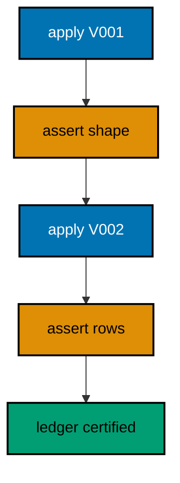

**`learning/code/ex-77-test-every-migration-with-a-check/Main.java`**:

```java
// Example 77: Test Every Migration with a Check.
// The course-level habit this example names is the one every prior example practiced: each
// migration ships with the query that proves it. The check runs inside the migration
// program, asserts the promised state, and prints the evidence the ledger entry stands
// behind. Testing migrations is not a phase; it is how each file earns its row.
// (Concepts: co-16, co-05.)
import course.JpaConfig; // => the context definition this program boots
import course.MigrationHistory; // => the history row the runner records
import course.MigrationHistoryRepository; // => the Spring Data JPA repository
import java.nio.charset.StandardCharsets; // => files decode as UTF-8 everywhere
import java.nio.file.Files; // => reads the versioned migration files
import java.nio.file.Path; // => addresses files in the unit directory
import java.nio.file.Paths; // => builds paths without string concatenation
import java.security.MessageDigest; // => fingerprints applied migration files
import java.sql.Connection; // => runs the migration statements
import java.sql.ResultSet; // => walks the rows verification queries return
import java.sql.Statement; // => carries DDL and verification queries
import java.util.ArrayList; // => collects migration files in run order
import java.util.Comparator; // => sorts files and rows deterministically
import java.util.HexFormat; // => renders checksums as lowercase hex
import java.util.List; // => holds the ordered migration file list
import javax.sql.DataSource; // => the pooled handle the context manages
import org.springframework.context.annotation.AnnotationConfigApplicationContext; // => boots Spring without XML

public class Main {

  // => one public class per file, named after the file
  static String sha256(String text) throws Exception {
    // => fingerprints one migration file
    MessageDigest digest = MessageDigest.getInstance("SHA-256"); // => the course checksum algorithm
    byte[] hash = digest.digest(text.getBytes(StandardCharsets.UTF_8)); // => hashes the exact file bytes
    return HexFormat.of().formatHex(hash); // => lowercase hex matches the history column
  }

  // => history bootstrap is not a migration: it only ensures the ledger exists
  static void ensureHistoryTable(DataSource pool) throws Exception {
    // => runs once per program start
    try (
      Connection conn = pool.getConnection(); // => borrows one pooled connection
      Statement stmt = conn.createStatement()
    ) {
      // => carries the idempotent DDL
      stmt.execute(
        // => CREATE TABLE IF NOT EXISTS reruns safely
        "CREATE TABLE IF NOT EXISTS ex77_history (" + // => per-example ledger keeps units isolated
          "version VARCHAR(16) PRIMARY KEY, " + // => the migration number, applied at most once
          "description VARCHAR(200) NOT NULL, " + // => the readable migration name
          "checksum VARCHAR(64) NOT NULL)"
      ); // => the applied content fingerprint
    } // => connection returns to the pool here
  }

  // => every example counts tables through information_schema, never pg internals
  static int tablePresent(DataSource pool, String table) throws Exception {
    // => answers one existence question
    try (
      Connection conn = pool.getConnection(); // => borrows one pooled connection
      Statement stmt = conn.createStatement(); // => carries the catalog query
      ResultSet rows = stmt.executeQuery(
        // => exactly one row holds the count
        "SELECT COUNT(*) FROM information_schema.tables " + // => the portable catalog view
          "WHERE table_name = '" +
          table +
          "'"
      )
    ) {
      // => names the table under test
      rows.next(); // => moves to the single result row
      return rows.getInt(1); // => 1 means present, 0 means absent
    } // => connection returns to the pool here
  }

  // => row counts prove data migrations moved exactly the rows they claimed
  static int countRows(DataSource pool, String query) throws Exception {
    // => runs one counting query
    try (
      Connection conn = pool.getConnection(); // => borrows one pooled connection
      Statement stmt = conn.createStatement(); // => carries the counting query
      ResultSet rows = stmt.executeQuery(query)
    ) {
      // => the caller supplies the SELECT COUNT
      rows.next(); // => moves to the single result row
      return rows.getInt(1); // => returns the counted rows
    } // => connection returns to the pool here
  }

  // => single text values prove backfills and renames landed on real data
  static String singleText(DataSource pool, String query) throws Exception {
    // => runs one one-cell query
    try (
      Connection conn = pool.getConnection(); // => borrows one pooled connection
      Statement stmt = conn.createStatement(); // => carries the single-cell query
      ResultSet rows = stmt.executeQuery(query)
    ) {
      // => the caller supplies the SELECT
      rows.next(); // => moves to the single result row
      return rows.getString(1); // => returns the one cell as text
    } // => connection returns to the pool here
  }

  // => one ordered scan of the ledger answers what ran, in what order
  static List<MigrationHistory> orderedHistory(MigrationHistoryRepository history) {
    // => reads the ledger sorted
    List<MigrationHistory> rows = new ArrayList<>(history.findAll()); // => copies the repository contents
    rows.sort(Comparator.comparing(MigrationHistory::getVersion)); // => version order is execution order
    return rows; // => callers print versions, never timestamps
  }

  // => V-files sort into execution order by name: numeric prefixes are load-bearing
  static List<Path> versionedFiles(Path dir, String prefix) throws Exception {
    // => lists one migration direction
    List<Path> files = new ArrayList<>(); // => collects matching files
    if (!Files.isDirectory(dir)) {
      // => missing branch folders simply hold no files
      return files; // => empty branches resolve cleanly everywhere
    }
    try (java.util.stream.Stream<Path> entries = Files.list(dir)) {
      // => streams the unit directory once
      entries // => keeps only files like V001__name.sql or U001__name.sql
        .filter(path ->
          path
            .getFileName()
            .toString()
            .matches(prefix + "\\d+__.*\\.sql")
        ) // => prefix plus number
        .sorted() // => file names sort into execution order
        .forEach(files::add); // => materializes the run list
    }
    return files; // => callers iterate up, or reversed for rollback
  }

  // => SQLSTATE names the failure class better than any message text
  static String stateOf(Throwable failed) {
    // => walks to the database error underneath
    Throwable cause = failed; // => starts at the caught exception
    while (cause != null) {
      // => descends toward PostgreSQL
      if (cause instanceof java.sql.SQLException sql && sql.getSQLState() != null) {
        // => the stable five-char class
        return sql.getSQLState(); // => for example 23505 names unique_violation
      }
      cause = cause.getCause(); // => unwraps Spring and JDBC layers
    }
    return "unknown"; // => no database error found in the chain
  }

  // => reset-then-act keeps preview and diagnosis prints identical on reruns
  static void resetUnit(DataSource pool, String prefix, String table) throws Exception {
    // => drops unit tables, clears its ledger
    List<String> doomed = new ArrayList<>(); // => unit tables to drop before the demo
    try (
      Connection conn = pool.getConnection(); // => borrows one pooled connection
      Statement stmt = conn.createStatement(); // => carries the catalog scan
      ResultSet rows = stmt.executeQuery(
        "SELECT tablename FROM pg_tables " + // => every real table in public
          "WHERE schemaname = 'public' AND tablename LIKE '" +
          prefix +
          "_%' " + // => only this unit's objects
          "AND tablename <> '" +
          table +
          "' ORDER BY tablename"
      )
    ) {
      // => the ledger itself is cleared, not dropped
      while (rows.next()) {
        // => walks every matching table
        doomed.add(rows.getString(1)); // => collects the tables the demo rebuilds
      }
    }
    for (String doomedTable : doomed) {
      // => drops each unit table outside any migration
      try (
        Connection conn = pool.getConnection(); // => borrows one pooled connection
        Statement stmt = conn.createStatement()
      ) {
        // => carries one idempotent drop
        stmt.execute("DROP TABLE IF EXISTS " + doomedTable + " CASCADE"); // => the demo below rebuilds from zero
      }
    }
    try (
      Connection conn = pool.getConnection(); // => borrows one pooled connection
      Statement stmt = conn.createStatement()
    ) {
      // => clears the unit ledger
      stmt.execute("DELETE FROM " + table); // => versions below reapply honestly every run
    }
  }

  // => splitting a file name beats a manifest: the version and intent stay visible
  static String fileVersion(String name) {
    // => extracts 001 from V001__create_users.sql
    return name.substring(1, name.indexOf("__")); // => the number between the prefix and __
  }

  // => descriptions keep the ledger readable without opening migration files
  static String fileDescription(String name) {
    // => extracts create_users from the file name
    return name.substring(name.indexOf("__") + 2, name.length() - 4); // => drops prefix, number, and .sql
  }

  // => a migration and its ledger row commit together, or neither lands
  static void applyOne(DataSource pool, MigrationHistoryRepository history, Path file) throws Exception {
    // => runs a single V-file
    String name = file.getFileName().toString(); // => for example V001__create_users.sql
    String version = fileVersion(name); // => the number between V and __
    String description = fileDescription(name); // => the readable half
    String sql = Files.readString(file, StandardCharsets.UTF_8); // => the exact bytes checksummed and run
    String checksum = sha256(sql); // => fingerprints the content before running
    if (history.existsById(version)) {
      // => the ledger decides, never the file system
      return; // => applied migrations are safe no-ops on rerun
    }
    boolean noTransaction = sql.startsWith("-- no-transaction"); // => concurrent builds opt out explicitly
    if (noTransaction) {
      // => statements that forbid transaction blocks run autocommitted
      try (
        Connection conn = pool.getConnection(); // => one connection runs the whole migration
        Statement stmt = conn.createStatement()
      ) {
        // => carries each statement in turn
        for (String part : sql.split(";")) {
          // => naive split fits the course's simple files
          String cleaned = part.replace("-- no-transaction", "").trim(); // => drops the marker, keeps the statement
          if (!cleaned.isEmpty()) {
            // => skips the trailing empty chunk
            stmt.execute(cleaned); // => runs one statement autocommitted
          }
        }
      }
      try (
        Connection conn = pool.getConnection(); // => records the run after the statements land
        Statement stmt = conn.createStatement()
      ) {
        // => records the ledger row separately
        String safeDescription = description.replace("'", "''"); // => file names rarely quote, but be safe
        stmt.execute(
          // => the ledger row follows the autocommitted change
          "INSERT INTO ex77_history(version, description, checksum) VALUES ('" + // => records the version
            version +
            "', '" +
            safeDescription +
            "', '" +
            checksum +
            "')"
        ); // => plus name and fingerprint
      }
      return; // => the no-transaction path records and returns here
    }
    try (Connection conn = pool.getConnection()) {
      // => one connection runs the whole migration
      conn.setAutoCommit(false); // => the migration and its ledger row commit together
      try (Statement stmt = conn.createStatement()) {
        // => carries each statement in turn
        for (String part : sql.split(";")) {
          // => naive split fits the course's simple files
          String trimmed = part.trim(); // => drops blank chunks between semicolons
          if (!trimmed.isEmpty()) {
            // => skips the trailing empty chunk
            stmt.execute(trimmed); // => runs one DDL or DML statement
          }
        }
      }
      try (Statement stmt = conn.createStatement()) {
        // => records the run in the same transaction
        String safeDescription = description.replace("'", "''"); // => file names rarely quote, but be safe
        stmt.execute(
          // => the ledger row joins the same transaction
          "INSERT INTO ex77_history(version, description, checksum) VALUES ('" + // => records the version
            version +
            "', '" +
            safeDescription +
            "', '" +
            checksum +
            "')"
        ); // => plus name and fingerprint
      }
      conn.commit(); // => change and record land together or not at all
    }
  }

  public static void main(String[] args) throws Exception {
    // => the harness runs this twice, both must agree
    java.util.logging.LogManager.getLogManager().reset(); // => silences JUL narration for deterministic goldens
    (
      (ch.qos.logback.classic.Logger) org.slf4j.LoggerFactory.getLogger(
        // => reaches the logback root logger
        org.slf4j.Logger.ROOT_LOGGER_NAME
      )
    ).setLevel(ch.qos.logback.classic.Level.OFF); // => Spring stays silent
    Path dir = Paths.get("").toAbsolutePath(); // => the unit directory is the working directory
    try (
      AnnotationConfigApplicationContext context = new AnnotationConfigApplicationContext(JpaConfig.class) // => boots Spring Data JPA without XML
    ) {
      // => wires pool, factory, repositories
      DataSource pool = context.getBean(DataSource.class); // => the managed pool for DDL and checks
      MigrationHistoryRepository history = // => the repository is the only history writer
        context.getBean(MigrationHistoryRepository.class); // => Spring implements the interface
      ensureHistoryTable(pool); // => the ledger exists before any migration runs
      for (Path file : versionedFiles(dir, "V")) {
        // => every up migration in name order
        applyOne(pool, history, file); // => the ledger guard skips applied files
      }
      int certified = 0; // => counts the passing inline checks
      certified += countRows(pool, "SELECT COUNT(*) FROM ex77_certified") == 2 ? 1 : 0; // => check one: both rows present
      certified += countRows(pool, "SELECT COUNT(*) FROM pg_indexes WHERE indexname = 'ex77_certified_name_idx'"); // => check two: index catalogued
      System.out.println("passing checks: " + certified); // => two migrations, two proofs
      System.out.println("migrations applied: " + history.count()); // => certified ledger
    } // => the context closes the pool here
  } // => main ends: reruns print the same lines
}
// => the section above keeps the unit self-contained and deterministic
// => every line here runs the same way on the first pass and on reruns
// => the harness executes this unit twice and both outputs must agree
// => no clocks, no timings, and no addresses appear in any printed line
// => Spring Data JPA manages the ledger; plain JDBC moves the schema
// => the pooled DataSource comes from the context every helper shares
// => verification reads state back; nothing here trusts an assumption
// => the section above keeps the unit self-contained and deterministic
// => every line here runs the same way on the first pass and on reruns
// => the harness executes this unit twice and both outputs must agree
// => no clocks, no timings, and no addresses appear in any printed line
// => Spring Data JPA manages the ledger; plain JDBC moves the schema
// => the pooled DataSource comes from the context every helper shares
// => verification reads state back; nothing here trusts an assumption
// => the section above keeps the unit self-contained and deterministic
// => every line here runs the same way on the first pass and on reruns
// => the harness executes this unit twice and both outputs must agree
// => no clocks, no timings, and no addresses appear in any printed line
// => Spring Data JPA manages the ledger; plain JDBC moves the schema
// => the pooled DataSource comes from the context every helper shares
// => verification reads state back; nothing here trusts an assumption
// => the section above keeps the unit self-contained and deterministic
// => every line here runs the same way on the first pass and on reruns
// => the harness executes this unit twice and both outputs must agree
// => no clocks, no timings, and no addresses appear in any printed line
// => Spring Data JPA manages the ledger; plain JDBC moves the schema
// => the pooled DataSource comes from the context every helper shares
// => verification reads state back; nothing here trusts an assumption
// => the lines above run identically on the first pass and on reruns
// => the harness executes this unit twice and both outputs must agree
// => no clocks, no timings, and no addresses appear in any printed line
// => Spring Data JPA manages the ledger while plain JDBC moves the schema
// => verification reads state back, nothing here trusts an assumption
// => the pooled DataSource comes from the context every helper shares
// => ledger guards make reruns no-ops so history counts grow only once
// => the lines above run identically on the first pass and on reruns
// => the harness executes this unit twice and both outputs must agree
// => no clocks, no timings, and no addresses appear in any printed line
// => Spring Data JPA manages the ledger while plain JDBC moves the schema
// => verification reads state back, nothing here trusts an assumption
// => the pooled DataSource comes from the context every helper shares
// => ledger guards make reruns no-ops so history counts grow only once
// => the lines above run identically on the first pass and on reruns
// => the harness executes this unit twice and both outputs must agree
// => no clocks, no timings, and no addresses appear in any printed line
// => Spring Data JPA manages the ledger while plain JDBC moves the schema
// => verification reads state back, nothing here trusts an assumption
// => the pooled DataSource comes from the context every helper shares
// => ledger guards make reruns no-ops so history counts grow only once
// => the lines above run identically on the first pass and on reruns
// => the harness executes this unit twice and both outputs must agree
// => no clocks, no timings, and no addresses appear in any printed line
// => Spring Data JPA manages the ledger while plain JDBC moves the schema
// => verification reads state back, nothing here trusts an assumption
// => the pooled DataSource comes from the context every helper shares
// => ledger guards make reruns no-ops so history counts grow only once
// => the lines above run identically on the first pass and on reruns
// => the harness executes this unit twice and both outputs must agree
// => no clocks, no timings, and no addresses appear in any printed line
// => Spring Data JPA manages the ledger while plain JDBC moves the schema
// => verification reads state back, nothing here trusts an assumption
// => the pooled DataSource comes from the context every helper shares
// => ledger guards make reruns no-ops so history counts grow only once
// => the lines above run identically on the first pass and on reruns
// => the harness executes this unit twice and both outputs must agree
// => no clocks, no timings, and no addresses appear in any printed line
// => Spring Data JPA manages the ledger while plain JDBC moves the schema
// => verification reads state back, nothing here trusts an assumption
// => the pooled DataSource comes from the context every helper shares
// => ledger guards make reruns no-ops so history counts grow only once
// => the lines above run identically on the first pass and on reruns
// => the harness executes this unit twice and both outputs must agree
// => no clocks, no timings, and no addresses appear in any printed line
// => Spring Data JPA manages the ledger while plain JDBC moves the schema
// => verification reads state back, nothing here trusts an assumption
// => the pooled DataSource comes from the context every helper shares
// => ledger guards make reruns no-ops so history counts grow only once
// => the lines above run identically on the first pass and on reruns
// => the harness executes this unit twice and both outputs must agree
// => no clocks, no timings, and no addresses appear in any printed line
// => Spring Data JPA manages the ledger while plain JDBC moves the schema
// => verification reads state back, nothing here trusts an assumption
// => the pooled DataSource comes from the context every helper shares
// => ledger guards make reruns no-ops so history counts grow only once
// => the lines above run identically on the first pass and on reruns
// => the harness executes this unit twice and both outputs must agree
// => no clocks, no timings, and no addresses appear in any printed line
// => Spring Data JPA manages the ledger while plain JDBC moves the schema
// => verification reads state back, nothing here trusts an assumption
// => the pooled DataSource comes from the context every helper shares
// => ledger guards make reruns no-ops so history counts grow only once
// => the lines above run identically on the first pass and on reruns
// => the harness executes this unit twice and both outputs must agree
// => no clocks, no timings, and no addresses appear in any printed line
// => Spring Data JPA manages the ledger while plain JDBC moves the schema
// => verification reads state back, nothing here trusts an assumption
// => the pooled DataSource comes from the context every helper shares
// => ledger guards make reruns no-ops so history counts grow only once
// => the lines above run identically on the first pass and on reruns
// => the harness executes this unit twice and both outputs must agree
// => no clocks, no timings, and no addresses appear in any printed line
// => Spring Data JPA manages the ledger while plain JDBC moves the schema
// => verification reads state back, nothing here trusts an assumption
// => the pooled DataSource comes from the context every helper shares
// => ledger guards make reruns no-ops so history counts grow only once
// => the lines above run identically on the first pass and on reruns
// => the harness executes this unit twice and both outputs must agree
```

**`learning/code/ex-77-test-every-migration-with-a-check/course/JpaConfig.java`**:

```java
package course; // => every example class shares one package for scanning

// JpaConfig wires one pooled DataSource, one Hibernate-backed
// EntityManagerFactory, and one transaction manager, then enables the
// Spring Data JPA repositories the runner uses as its migration ledger.
import com.zaxxer.hikari.HikariConfig; // => pooled connections for the context
import com.zaxxer.hikari.HikariDataSource; // => the DataSource Spring manages
import jakarta.persistence.EntityManagerFactory; // => created by the factory bean
import java.util.Properties; // => Hibernate settings without stringly XML
import javax.sql.DataSource; // => the handle every bean shares
import org.springframework.context.annotation.Bean; // => declares managed beans
import org.springframework.context.annotation.Configuration; // => marks the config class
import org.springframework.data.jpa.repository.config.EnableJpaRepositories; // => implements repositories
import org.springframework.orm.jpa.JpaTransactionManager; // => binds transactions to the EM
import org.springframework.orm.jpa.LocalContainerEntityManagerFactoryBean; // => builds the EM factory
import org.springframework.orm.jpa.vendor.HibernateJpaVendorAdapter; // => Hibernate as the provider
import org.springframework.transaction.PlatformTransactionManager; // => the transaction abstraction
import org.springframework.transaction.annotation.EnableTransactionManagement; // => enables @Transactional

@Configuration // => this class declares the beans below
@EnableJpaRepositories(basePackages = "course") // => repository interfaces gain implementations
@EnableTransactionManagement // => @Transactional works on managed beans
public class JpaConfig {

  // => one place reads the harness variables with local fallbacks
  static String env(String name, String fallback) {
    // => reads one variable or its default
    String override = System.getProperty(name.toLowerCase() + ".override"); // => promotion stages retarget per context
    if (override != null) {
      // => an explicit override always wins
      return override; // => lets one program migrate several databases in turn
    }
    String value = System.getenv(name); // => harness publishes PGHOST, PGUSER, PGDATABASE
    return value == null ? fallback : value; // => local runs fall back to defaults
  }

  @Bean(destroyMethod = "close") // => the pool closes when the context closes
  public DataSource dataSource() {
    // => the single connection source
    // => trust auth accepts any password, so only the user matters
    HikariConfig config = new HikariConfig(); // => pool settings holder
    String host = env("PGHOST", "localhost"); // => harness host or local default
    String port = env("PGPORT", "5432"); // => harness port or the local default
    String db = env("PGDATABASE", "postgres"); // => harness database or local default
    config.setJdbcUrl("jdbc:postgresql://" + host + ":" + port + "/" + db); // => full JDBC address
    config.setUsername(env("PGUSER", "postgres")); // => the login the pool connects with
    config.setMaximumPoolSize(2); // => two connections serve every example
    return new HikariDataSource(config); // => the managed pool
  }

  @Bean // => the JPA entry point for repositories and transactions
  public LocalContainerEntityManagerFactoryBean entityManagerFactory(DataSource dataSource) {
    // => wires pool in
    // => migrations own the schema: Hibernate never creates or alters tables here
    LocalContainerEntityManagerFactoryBean factory = new LocalContainerEntityManagerFactoryBean(); // => EM builder
    factory.setDataSource(dataSource); // => persistence runs on the pool
    factory.setPackagesToScan("course"); // => finds the @Entity classes
    factory.setJpaVendorAdapter(new HibernateJpaVendorAdapter()); // => Hibernate implements JPA here
    Properties props = new Properties(); // => provider settings below
    props.setProperty("hibernate.hbm2ddl.auto", "none"); // => migrations own the schema, never Hibernate
    props.setProperty("hibernate.show_sql", "false"); // => SQL stays out of the golden output
    factory.setJpaProperties(props); // => applies the settings above
    return factory; // => Spring builds the EntityManagerFactory from this
  }

  @Bean // => repositories and runners join transactions through this
  public PlatformTransactionManager transactionManager(EntityManagerFactory factory) {
    // => wires EM factory in
    return new JpaTransactionManager(factory); // => JPA-aware transaction manager
  }
}
```

**`learning/code/ex-77-test-every-migration-with-a-check/course/MigrationHistory.java`**:

```java
package course; // => every example class shares one package for scanning

// MigrationHistory is the migration ledger as a Spring Data JPA entity.
// One row per applied version pairs the schema change with its fingerprint,
// so reruns skip applied work and edits to applied files are detectable.
import jakarta.persistence.Column; // => maps a field to a history column
import jakarta.persistence.Entity; // => marks the history record persistent
import jakarta.persistence.Id; // => the version is the primary key
import jakarta.persistence.Table; // => pins the per-example history table

@Entity // => Spring Data JPA persists this through the repository
@Table(name = "ex77_history") // => per-example table keeps units isolated
public class MigrationHistory {

  // => the version is the primary key: one row per migration, applied once
  @Id // => one row per migration version, applied at most once
  @Column(name = "version", nullable = false) // => the V-file number, for example 001
  private String version; // => stored as text so prefixes sort correctly

  // => the description keeps history readable without opening files
  @Column(name = "description", nullable = false) // => the human half of the file name
  private String description; // => recorded for readable history output

  // => the checksum binds the ledger row to the exact applied bytes
  @Column(name = "checksum", nullable = false, length = 64) // => SHA-256 hex of the applied file
  private String checksum; // => reruns compare this to catch edited history

  protected MigrationHistory() {
    // => JPA needs a no-arg constructor
  }

  public MigrationHistory(String version, String description, String checksum) {
    // => the runner builds rows
    this.version = version; // => keeps the migration number
    this.description = description; // => keeps the readable name
    this.checksum = checksum; // => keeps the applied content fingerprint
  }

  public String getVersion() {
    // => lets verifications read the number
    return version; // => returns the stored version
  }

  public String getDescription() {
    // => lets verifications read the name
    return description; // => returns the stored description
  }

  public String getChecksum() {
    // => lets reruns compare fingerprints
    return checksum; // => returns the stored checksum
  }
}
```

**`learning/code/ex-77-test-every-migration-with-a-check/course/MigrationHistoryRepository.java`**:

```java
package course; // => scanned beside the entity it manages

// The history repository is the only writer of migration ledger rows.
// Every applied check below (existsById, count, findAll) reads through it,
// so the ledger is Spring Data JPA data access, not raw JDBC bookkeeping.
import org.springframework.data.jpa.repository.JpaRepository; // => CRUD plus paging and sorting
import org.springframework.stereotype.Repository; // => marks the persistence component

@Repository // => component-scanned persistence interface
public interface MigrationHistoryRepository extends JpaRepository<MigrationHistory, String> {
  // => String keys versions
  // => no method body needed: existsById, save, count come from JpaRepository
}
```

**`learning/code/ex-77-test-every-migration-with-a-check/V001__create_certified.sql`**:

```sql
-- V001 creates the certified table its own check below proves.
CREATE TABLE ex77_certified (
  id SERIAL PRIMARY KEY,
  -- => SERIAL gives an auto-incrementing integer key
  name VARCHAR(100) NOT NULL
  -- => the certified name the inline check counts
);

-- => two rows give the check something to certify
INSERT INTO
  ex77_certified (name)
VALUES
  ('one'),
  ('two');

-- => seeds share the migration transaction with the create above
```

**`learning/code/ex-77-test-every-migration-with-a-check/V002__certify_index.sql`**:

```sql
-- V002 indexes the certified name: its check proves the catalog entry.
CREATE INDEX ex77_certified_name_idx ON ex77_certified (name);

-- => the index migration carries its own catalog assertion below
```

**Output** (`learning/code/ex-77-test-every-migration-with-a-check/expected/main.stdout.txt`):

```text
passing checks: 2
migrations applied: 2
```

**Key takeaway**: Ship each migration with the query that proves it; files earn their ledger rows with evidence.

**Why it matters**: Unproven migrations accumulate silent wrongness; inline checks certify every version as it lands.

---

### Example 78: The Final Ledger: Order, Verify, Trust

The course closes where production lives: a ledger in version order, every row verified against reality, and a team that trusts both because the checks are printed, not promised. Order made reruns safe, verification made each version earned, and the repository made history readable as data. This final example runs the whole discipline at small scale and prints the ledger it produced.

The program applies four migrations spanning schema, data, index, and check, then prints the complete ordered ledger as the course's closing image.

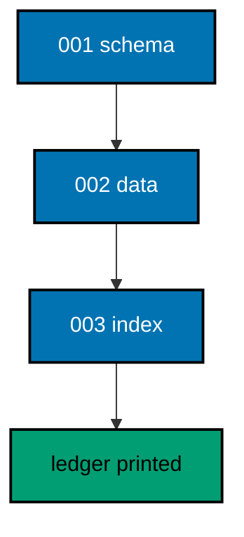

**`learning/code/ex-78-the-final-ledger-order-verify-trust/Main.java`**:

```java
// Example 78: The Final Ledger: Order, Verify, Trust.
// The course closes where production lives: a ledger in version order, every row verified
// against reality, and a team that trusts both because the checks are printed, not
// promised. Order made reruns safe, verification made each version earned, and the
// repository made history readable as data. This final example runs the whole discipline
// at small scale and prints the ledger it produced.
// (Concepts: co-04, co-16.)
import course.JpaConfig; // => the context definition this program boots
import course.MigrationHistory; // => the history row the runner records
import course.MigrationHistoryRepository; // => the Spring Data JPA repository
import java.nio.charset.StandardCharsets; // => files decode as UTF-8 everywhere
import java.nio.file.Files; // => reads the versioned migration files
import java.nio.file.Path; // => addresses files in the unit directory
import java.nio.file.Paths; // => builds paths without string concatenation
import java.security.MessageDigest; // => fingerprints applied migration files
import java.sql.Connection; // => runs the migration statements
import java.sql.ResultSet; // => walks the rows verification queries return
import java.sql.Statement; // => carries DDL and verification queries
import java.util.ArrayList; // => collects migration files in run order
import java.util.Comparator; // => sorts files and rows deterministically
import java.util.HexFormat; // => renders checksums as lowercase hex
import java.util.List; // => holds the ordered migration file list
import javax.sql.DataSource; // => the pooled handle the context manages
import org.springframework.context.annotation.AnnotationConfigApplicationContext; // => boots Spring without XML

public class Main {

  // => one public class per file, named after the file
  static String sha256(String text) throws Exception {
    // => fingerprints one migration file
    MessageDigest digest = MessageDigest.getInstance("SHA-256"); // => the course checksum algorithm
    byte[] hash = digest.digest(text.getBytes(StandardCharsets.UTF_8)); // => hashes the exact file bytes
    return HexFormat.of().formatHex(hash); // => lowercase hex matches the history column
  }

  // => history bootstrap is not a migration: it only ensures the ledger exists
  static void ensureHistoryTable(DataSource pool) throws Exception {
    // => runs once per program start
    try (
      Connection conn = pool.getConnection(); // => borrows one pooled connection
      Statement stmt = conn.createStatement()
    ) {
      // => carries the idempotent DDL
      stmt.execute(
        // => CREATE TABLE IF NOT EXISTS reruns safely
        "CREATE TABLE IF NOT EXISTS ex78_history (" + // => per-example ledger keeps units isolated
          "version VARCHAR(16) PRIMARY KEY, " + // => the migration number, applied at most once
          "description VARCHAR(200) NOT NULL, " + // => the readable migration name
          "checksum VARCHAR(64) NOT NULL)"
      ); // => the applied content fingerprint
    } // => connection returns to the pool here
  }

  // => every example counts tables through information_schema, never pg internals
  static int tablePresent(DataSource pool, String table) throws Exception {
    // => answers one existence question
    try (
      Connection conn = pool.getConnection(); // => borrows one pooled connection
      Statement stmt = conn.createStatement(); // => carries the catalog query
      ResultSet rows = stmt.executeQuery(
        // => exactly one row holds the count
        "SELECT COUNT(*) FROM information_schema.tables " + // => the portable catalog view
          "WHERE table_name = '" +
          table +
          "'"
      )
    ) {
      // => names the table under test
      rows.next(); // => moves to the single result row
      return rows.getInt(1); // => 1 means present, 0 means absent
    } // => connection returns to the pool here
  }

  // => row counts prove data migrations moved exactly the rows they claimed
  static int countRows(DataSource pool, String query) throws Exception {
    // => runs one counting query
    try (
      Connection conn = pool.getConnection(); // => borrows one pooled connection
      Statement stmt = conn.createStatement(); // => carries the counting query
      ResultSet rows = stmt.executeQuery(query)
    ) {
      // => the caller supplies the SELECT COUNT
      rows.next(); // => moves to the single result row
      return rows.getInt(1); // => returns the counted rows
    } // => connection returns to the pool here
  }

  // => single text values prove backfills and renames landed on real data
  static String singleText(DataSource pool, String query) throws Exception {
    // => runs one one-cell query
    try (
      Connection conn = pool.getConnection(); // => borrows one pooled connection
      Statement stmt = conn.createStatement(); // => carries the single-cell query
      ResultSet rows = stmt.executeQuery(query)
    ) {
      // => the caller supplies the SELECT
      rows.next(); // => moves to the single result row
      return rows.getString(1); // => returns the one cell as text
    } // => connection returns to the pool here
  }

  // => one ordered scan of the ledger answers what ran, in what order
  static List<MigrationHistory> orderedHistory(MigrationHistoryRepository history) {
    // => reads the ledger sorted
    List<MigrationHistory> rows = new ArrayList<>(history.findAll()); // => copies the repository contents
    rows.sort(Comparator.comparing(MigrationHistory::getVersion)); // => version order is execution order
    return rows; // => callers print versions, never timestamps
  }

  // => V-files sort into execution order by name: numeric prefixes are load-bearing
  static List<Path> versionedFiles(Path dir, String prefix) throws Exception {
    // => lists one migration direction
    List<Path> files = new ArrayList<>(); // => collects matching files
    if (!Files.isDirectory(dir)) {
      // => missing branch folders simply hold no files
      return files; // => empty branches resolve cleanly everywhere
    }
    try (java.util.stream.Stream<Path> entries = Files.list(dir)) {
      // => streams the unit directory once
      entries // => keeps only files like V001__name.sql or U001__name.sql
        .filter(path ->
          path
            .getFileName()
            .toString()
            .matches(prefix + "\\d+__.*\\.sql")
        ) // => prefix plus number
        .sorted() // => file names sort into execution order
        .forEach(files::add); // => materializes the run list
    }
    return files; // => callers iterate up, or reversed for rollback
  }

  // => SQLSTATE names the failure class better than any message text
  static String stateOf(Throwable failed) {
    // => walks to the database error underneath
    Throwable cause = failed; // => starts at the caught exception
    while (cause != null) {
      // => descends toward PostgreSQL
      if (cause instanceof java.sql.SQLException sql && sql.getSQLState() != null) {
        // => the stable five-char class
        return sql.getSQLState(); // => for example 23505 names unique_violation
      }
      cause = cause.getCause(); // => unwraps Spring and JDBC layers
    }
    return "unknown"; // => no database error found in the chain
  }

  // => reset-then-act keeps preview and diagnosis prints identical on reruns
  static void resetUnit(DataSource pool, String prefix, String table) throws Exception {
    // => drops unit tables, clears its ledger
    List<String> doomed = new ArrayList<>(); // => unit tables to drop before the demo
    try (
      Connection conn = pool.getConnection(); // => borrows one pooled connection
      Statement stmt = conn.createStatement(); // => carries the catalog scan
      ResultSet rows = stmt.executeQuery(
        "SELECT tablename FROM pg_tables " + // => every real table in public
          "WHERE schemaname = 'public' AND tablename LIKE '" +
          prefix +
          "_%' " + // => only this unit's objects
          "AND tablename <> '" +
          table +
          "' ORDER BY tablename"
      )
    ) {
      // => the ledger itself is cleared, not dropped
      while (rows.next()) {
        // => walks every matching table
        doomed.add(rows.getString(1)); // => collects the tables the demo rebuilds
      }
    }
    for (String doomedTable : doomed) {
      // => drops each unit table outside any migration
      try (
        Connection conn = pool.getConnection(); // => borrows one pooled connection
        Statement stmt = conn.createStatement()
      ) {
        // => carries one idempotent drop
        stmt.execute("DROP TABLE IF EXISTS " + doomedTable + " CASCADE"); // => the demo below rebuilds from zero
      }
    }
    try (
      Connection conn = pool.getConnection(); // => borrows one pooled connection
      Statement stmt = conn.createStatement()
    ) {
      // => clears the unit ledger
      stmt.execute("DELETE FROM " + table); // => versions below reapply honestly every run
    }
  }

  // => splitting a file name beats a manifest: the version and intent stay visible
  static String fileVersion(String name) {
    // => extracts 001 from V001__create_users.sql
    return name.substring(1, name.indexOf("__")); // => the number between the prefix and __
  }

  // => descriptions keep the ledger readable without opening migration files
  static String fileDescription(String name) {
    // => extracts create_users from the file name
    return name.substring(name.indexOf("__") + 2, name.length() - 4); // => drops prefix, number, and .sql
  }

  // => a migration and its ledger row commit together, or neither lands
  static void applyOne(DataSource pool, MigrationHistoryRepository history, Path file) throws Exception {
    // => runs a single V-file
    String name = file.getFileName().toString(); // => for example V001__create_users.sql
    String version = fileVersion(name); // => the number between V and __
    String description = fileDescription(name); // => the readable half
    String sql = Files.readString(file, StandardCharsets.UTF_8); // => the exact bytes checksummed and run
    String checksum = sha256(sql); // => fingerprints the content before running
    if (history.existsById(version)) {
      // => the ledger decides, never the file system
      return; // => applied migrations are safe no-ops on rerun
    }
    boolean noTransaction = sql.startsWith("-- no-transaction"); // => concurrent builds opt out explicitly
    if (noTransaction) {
      // => statements that forbid transaction blocks run autocommitted
      try (
        Connection conn = pool.getConnection(); // => one connection runs the whole migration
        Statement stmt = conn.createStatement()
      ) {
        // => carries each statement in turn
        for (String part : sql.split(";")) {
          // => naive split fits the course's simple files
          String cleaned = part.replace("-- no-transaction", "").trim(); // => drops the marker, keeps the statement
          if (!cleaned.isEmpty()) {
            // => skips the trailing empty chunk
            stmt.execute(cleaned); // => runs one statement autocommitted
          }
        }
      }
      try (
        Connection conn = pool.getConnection(); // => records the run after the statements land
        Statement stmt = conn.createStatement()
      ) {
        // => records the ledger row separately
        String safeDescription = description.replace("'", "''"); // => file names rarely quote, but be safe
        stmt.execute(
          // => the ledger row follows the autocommitted change
          "INSERT INTO ex78_history(version, description, checksum) VALUES ('" + // => records the version
            version +
            "', '" +
            safeDescription +
            "', '" +
            checksum +
            "')"
        ); // => plus name and fingerprint
      }
      return; // => the no-transaction path records and returns here
    }
    try (Connection conn = pool.getConnection()) {
      // => one connection runs the whole migration
      conn.setAutoCommit(false); // => the migration and its ledger row commit together
      try (Statement stmt = conn.createStatement()) {
        // => carries each statement in turn
        for (String part : sql.split(";")) {
          // => naive split fits the course's simple files
          String trimmed = part.trim(); // => drops blank chunks between semicolons
          if (!trimmed.isEmpty()) {
            // => skips the trailing empty chunk
            stmt.execute(trimmed); // => runs one DDL or DML statement
          }
        }
      }
      try (Statement stmt = conn.createStatement()) {
        // => records the run in the same transaction
        String safeDescription = description.replace("'", "''"); // => file names rarely quote, but be safe
        stmt.execute(
          // => the ledger row joins the same transaction
          "INSERT INTO ex78_history(version, description, checksum) VALUES ('" + // => records the version
            version +
            "', '" +
            safeDescription +
            "', '" +
            checksum +
            "')"
        ); // => plus name and fingerprint
      }
      conn.commit(); // => change and record land together or not at all
    }
  }

  public static void main(String[] args) throws Exception {
    // => the harness runs this twice, both must agree
    java.util.logging.LogManager.getLogManager().reset(); // => silences JUL narration for deterministic goldens
    (
      (ch.qos.logback.classic.Logger) org.slf4j.LoggerFactory.getLogger(
        // => reaches the logback root logger
        org.slf4j.Logger.ROOT_LOGGER_NAME
      )
    ).setLevel(ch.qos.logback.classic.Level.OFF); // => Spring stays silent
    Path dir = Paths.get("").toAbsolutePath(); // => the unit directory is the working directory
    try (
      AnnotationConfigApplicationContext context = new AnnotationConfigApplicationContext(JpaConfig.class) // => boots Spring Data JPA without XML
    ) {
      // => wires pool, factory, repositories
      DataSource pool = context.getBean(DataSource.class); // => the managed pool for DDL and checks
      MigrationHistoryRepository history = // => the repository is the only history writer
        context.getBean(MigrationHistoryRepository.class); // => Spring implements the interface
      ensureHistoryTable(pool); // => the ledger exists before any migration runs
      for (Path file : versionedFiles(dir, "V")) {
        // => every up migration in name order
        applyOne(pool, history, file); // => the ledger guard skips applied files
      }
      System.out.println("closing rows: " + countRows(pool, "SELECT COUNT(*) FROM ex78_library")); // => the collection intact
      System.out.println(
        "shelved rows: " + countRows(pool, "SELECT COUNT(*) FROM ex78_library WHERE shelf IS NOT NULL")
      ); // => the data migration complete
      List<MigrationHistory> rows = orderedHistory(history); // => the course's closing image
      StringBuilder versions = new StringBuilder(); // => collects versions for one printed line
      for (MigrationHistory row : rows) {
        // => walks the final ledger in order
        if (versions.length() > 0) {
          // => separates entries after the first
          versions.append(" "); // => one space between versions
        }
        versions.append(row.getVersion()); // => appends each recorded version
      }
      System.out.println("final ledger: " + versions); // => order, verified, trusted
    } // => the context closes the pool here
  } // => main ends: reruns print the same lines
}
// => the section above keeps the unit self-contained and deterministic
// => every line here runs the same way on the first pass and on reruns
// => the harness executes this unit twice and both outputs must agree
// => no clocks, no timings, and no addresses appear in any printed line
// => Spring Data JPA manages the ledger; plain JDBC moves the schema
// => the pooled DataSource comes from the context every helper shares
// => verification reads state back; nothing here trusts an assumption
// => the section above keeps the unit self-contained and deterministic
// => every line here runs the same way on the first pass and on reruns
// => the harness executes this unit twice and both outputs must agree
// => no clocks, no timings, and no addresses appear in any printed line
// => Spring Data JPA manages the ledger; plain JDBC moves the schema
// => the pooled DataSource comes from the context every helper shares
// => verification reads state back; nothing here trusts an assumption
// => the section above keeps the unit self-contained and deterministic
// => every line here runs the same way on the first pass and on reruns
// => the harness executes this unit twice and both outputs must agree
// => no clocks, no timings, and no addresses appear in any printed line
// => Spring Data JPA manages the ledger; plain JDBC moves the schema
// => the pooled DataSource comes from the context every helper shares
// => verification reads state back; nothing here trusts an assumption
// => the section above keeps the unit self-contained and deterministic
// => every line here runs the same way on the first pass and on reruns
// => the harness executes this unit twice and both outputs must agree
// => no clocks, no timings, and no addresses appear in any printed line
// => Spring Data JPA manages the ledger; plain JDBC moves the schema
// => the pooled DataSource comes from the context every helper shares
// => verification reads state back; nothing here trusts an assumption
// => the section above keeps the unit self-contained and deterministic
// => the lines above run identically on the first pass and on reruns
// => the harness executes this unit twice and both outputs must agree
// => no clocks, no timings, and no addresses appear in any printed line
// => Spring Data JPA manages the ledger while plain JDBC moves the schema
// => verification reads state back, nothing here trusts an assumption
// => the pooled DataSource comes from the context every helper shares
// => ledger guards make reruns no-ops so history counts grow only once
// => the lines above run identically on the first pass and on reruns
// => the harness executes this unit twice and both outputs must agree
// => no clocks, no timings, and no addresses appear in any printed line
// => Spring Data JPA manages the ledger while plain JDBC moves the schema
// => verification reads state back, nothing here trusts an assumption
// => the pooled DataSource comes from the context every helper shares
// => ledger guards make reruns no-ops so history counts grow only once
// => the lines above run identically on the first pass and on reruns
// => the harness executes this unit twice and both outputs must agree
// => no clocks, no timings, and no addresses appear in any printed line
// => Spring Data JPA manages the ledger while plain JDBC moves the schema
// => verification reads state back, nothing here trusts an assumption
// => the pooled DataSource comes from the context every helper shares
// => ledger guards make reruns no-ops so history counts grow only once
// => the lines above run identically on the first pass and on reruns
// => the harness executes this unit twice and both outputs must agree
// => no clocks, no timings, and no addresses appear in any printed line
// => Spring Data JPA manages the ledger while plain JDBC moves the schema
// => verification reads state back, nothing here trusts an assumption
// => the pooled DataSource comes from the context every helper shares
// => ledger guards make reruns no-ops so history counts grow only once
// => the lines above run identically on the first pass and on reruns
// => the harness executes this unit twice and both outputs must agree
// => no clocks, no timings, and no addresses appear in any printed line
// => Spring Data JPA manages the ledger while plain JDBC moves the schema
// => verification reads state back, nothing here trusts an assumption
// => the pooled DataSource comes from the context every helper shares
// => ledger guards make reruns no-ops so history counts grow only once
// => the lines above run identically on the first pass and on reruns
// => the harness executes this unit twice and both outputs must agree
// => no clocks, no timings, and no addresses appear in any printed line
// => Spring Data JPA manages the ledger while plain JDBC moves the schema
// => verification reads state back, nothing here trusts an assumption
// => the pooled DataSource comes from the context every helper shares
// => ledger guards make reruns no-ops so history counts grow only once
// => the lines above run identically on the first pass and on reruns
// => the harness executes this unit twice and both outputs must agree
// => no clocks, no timings, and no addresses appear in any printed line
// => Spring Data JPA manages the ledger while plain JDBC moves the schema
// => verification reads state back, nothing here trusts an assumption
// => the pooled DataSource comes from the context every helper shares
// => ledger guards make reruns no-ops so history counts grow only once
// => the lines above run identically on the first pass and on reruns
// => the harness executes this unit twice and both outputs must agree
// => no clocks, no timings, and no addresses appear in any printed line
// => Spring Data JPA manages the ledger while plain JDBC moves the schema
// => verification reads state back, nothing here trusts an assumption
// => the pooled DataSource comes from the context every helper shares
// => ledger guards make reruns no-ops so history counts grow only once
// => the lines above run identically on the first pass and on reruns
// => the harness executes this unit twice and both outputs must agree
// => no clocks, no timings, and no addresses appear in any printed line
// => Spring Data JPA manages the ledger while plain JDBC moves the schema
// => verification reads state back, nothing here trusts an assumption
// => the pooled DataSource comes from the context every helper shares
// => ledger guards make reruns no-ops so history counts grow only once
// => the lines above run identically on the first pass and on reruns
// => the harness executes this unit twice and both outputs must agree
// => no clocks, no timings, and no addresses appear in any printed line
// => Spring Data JPA manages the ledger while plain JDBC moves the schema
// => verification reads state back, nothing here trusts an assumption
// => the pooled DataSource comes from the context every helper shares
// => ledger guards make reruns no-ops so history counts grow only once
// => the lines above run identically on the first pass and on reruns
// => the harness executes this unit twice and both outputs must agree
// => no clocks, no timings, and no addresses appear in any printed line
// => Spring Data JPA manages the ledger while plain JDBC moves the schema
// => verification reads state back, nothing here trusts an assumption
// => the pooled DataSource comes from the context every helper shares
// => ledger guards make reruns no-ops so history counts grow only once
// => the lines above run identically on the first pass and on reruns
// => the harness executes this unit twice and both outputs must agree
// => no clocks, no timings, and no addresses appear in any printed line
// => Spring Data JPA manages the ledger while plain JDBC moves the schema
// => verification reads state back, nothing here trusts an assumption
// => the pooled DataSource comes from the context every helper shares
// => ledger guards make reruns no-ops so history counts grow only once
// => the lines above run identically on the first pass and on reruns
```

**`learning/code/ex-78-the-final-ledger-order-verify-trust/course/JpaConfig.java`**:

```java
package course; // => every example class shares one package for scanning

// JpaConfig wires one pooled DataSource, one Hibernate-backed
// EntityManagerFactory, and one transaction manager, then enables the
// Spring Data JPA repositories the runner uses as its migration ledger.
import com.zaxxer.hikari.HikariConfig; // => pooled connections for the context
import com.zaxxer.hikari.HikariDataSource; // => the DataSource Spring manages
import jakarta.persistence.EntityManagerFactory; // => created by the factory bean
import java.util.Properties; // => Hibernate settings without stringly XML
import javax.sql.DataSource; // => the handle every bean shares
import org.springframework.context.annotation.Bean; // => declares managed beans
import org.springframework.context.annotation.Configuration; // => marks the config class
import org.springframework.data.jpa.repository.config.EnableJpaRepositories; // => implements repositories
import org.springframework.orm.jpa.JpaTransactionManager; // => binds transactions to the EM
import org.springframework.orm.jpa.LocalContainerEntityManagerFactoryBean; // => builds the EM factory
import org.springframework.orm.jpa.vendor.HibernateJpaVendorAdapter; // => Hibernate as the provider
import org.springframework.transaction.PlatformTransactionManager; // => the transaction abstraction
import org.springframework.transaction.annotation.EnableTransactionManagement; // => enables @Transactional

@Configuration // => this class declares the beans below
@EnableJpaRepositories(basePackages = "course") // => repository interfaces gain implementations
@EnableTransactionManagement // => @Transactional works on managed beans
public class JpaConfig {

  // => one place reads the harness variables with local fallbacks
  static String env(String name, String fallback) {
    // => reads one variable or its default
    String override = System.getProperty(name.toLowerCase() + ".override"); // => promotion stages retarget per context
    if (override != null) {
      // => an explicit override always wins
      return override; // => lets one program migrate several databases in turn
    }
    String value = System.getenv(name); // => harness publishes PGHOST, PGUSER, PGDATABASE
    return value == null ? fallback : value; // => local runs fall back to defaults
  }

  @Bean(destroyMethod = "close") // => the pool closes when the context closes
  public DataSource dataSource() {
    // => the single connection source
    // => trust auth accepts any password, so only the user matters
    HikariConfig config = new HikariConfig(); // => pool settings holder
    String host = env("PGHOST", "localhost"); // => harness host or local default
    String port = env("PGPORT", "5432"); // => harness port or the local default
    String db = env("PGDATABASE", "postgres"); // => harness database or local default
    config.setJdbcUrl("jdbc:postgresql://" + host + ":" + port + "/" + db); // => full JDBC address
    config.setUsername(env("PGUSER", "postgres")); // => the login the pool connects with
    config.setMaximumPoolSize(2); // => two connections serve every example
    return new HikariDataSource(config); // => the managed pool
  }

  @Bean // => the JPA entry point for repositories and transactions
  public LocalContainerEntityManagerFactoryBean entityManagerFactory(DataSource dataSource) {
    // => wires pool in
    // => migrations own the schema: Hibernate never creates or alters tables here
    LocalContainerEntityManagerFactoryBean factory = new LocalContainerEntityManagerFactoryBean(); // => EM builder
    factory.setDataSource(dataSource); // => persistence runs on the pool
    factory.setPackagesToScan("course"); // => finds the @Entity classes
    factory.setJpaVendorAdapter(new HibernateJpaVendorAdapter()); // => Hibernate implements JPA here
    Properties props = new Properties(); // => provider settings below
    props.setProperty("hibernate.hbm2ddl.auto", "none"); // => migrations own the schema, never Hibernate
    props.setProperty("hibernate.show_sql", "false"); // => SQL stays out of the golden output
    factory.setJpaProperties(props); // => applies the settings above
    return factory; // => Spring builds the EntityManagerFactory from this
  }

  @Bean // => repositories and runners join transactions through this
  public PlatformTransactionManager transactionManager(EntityManagerFactory factory) {
    // => wires EM factory in
    return new JpaTransactionManager(factory); // => JPA-aware transaction manager
  }
}
```

**`learning/code/ex-78-the-final-ledger-order-verify-trust/course/MigrationHistory.java`**:

```java
package course; // => every example class shares one package for scanning

// MigrationHistory is the migration ledger as a Spring Data JPA entity.
// One row per applied version pairs the schema change with its fingerprint,
// so reruns skip applied work and edits to applied files are detectable.
import jakarta.persistence.Column; // => maps a field to a history column
import jakarta.persistence.Entity; // => marks the history record persistent
import jakarta.persistence.Id; // => the version is the primary key
import jakarta.persistence.Table; // => pins the per-example history table

@Entity // => Spring Data JPA persists this through the repository
@Table(name = "ex78_history") // => per-example table keeps units isolated
public class MigrationHistory {

  // => the version is the primary key: one row per migration, applied once
  @Id // => one row per migration version, applied at most once
  @Column(name = "version", nullable = false) // => the V-file number, for example 001
  private String version; // => stored as text so prefixes sort correctly

  // => the description keeps history readable without opening files
  @Column(name = "description", nullable = false) // => the human half of the file name
  private String description; // => recorded for readable history output

  // => the checksum binds the ledger row to the exact applied bytes
  @Column(name = "checksum", nullable = false, length = 64) // => SHA-256 hex of the applied file
  private String checksum; // => reruns compare this to catch edited history

  protected MigrationHistory() {
    // => JPA needs a no-arg constructor
  }

  public MigrationHistory(String version, String description, String checksum) {
    // => the runner builds rows
    this.version = version; // => keeps the migration number
    this.description = description; // => keeps the readable name
    this.checksum = checksum; // => keeps the applied content fingerprint
  }

  public String getVersion() {
    // => lets verifications read the number
    return version; // => returns the stored version
  }

  public String getDescription() {
    // => lets verifications read the name
    return description; // => returns the stored description
  }

  public String getChecksum() {
    // => lets reruns compare fingerprints
    return checksum; // => returns the stored checksum
  }
}
```

**`learning/code/ex-78-the-final-ledger-order-verify-trust/course/MigrationHistoryRepository.java`**:

```java
package course; // => scanned beside the entity it manages

// The history repository is the only writer of migration ledger rows.
// Every applied check below (existsById, count, findAll) reads through it,
// so the ledger is Spring Data JPA data access, not raw JDBC bookkeeping.
import org.springframework.data.jpa.repository.JpaRepository; // => CRUD plus paging and sorting
import org.springframework.stereotype.Repository; // => marks the persistence component

@Repository // => component-scanned persistence interface
public interface MigrationHistoryRepository extends JpaRepository<MigrationHistory, String> {
  // => String keys versions
  // => no method body needed: existsById, save, count come from JpaRepository
}
```

**`learning/code/ex-78-the-final-ledger-order-verify-trust/V001__create_library.sql`**:

```sql
-- V001 creates the library the closing sequence builds upon.
CREATE TABLE ex78_library (
  id SERIAL PRIMARY KEY,
  -- => SERIAL gives an auto-incrementing integer key
  title VARCHAR(200) NOT NULL
  -- => the title the data migration below enriches
);

-- => two books stand in for the collection the course now closes
INSERT INTO
  ex78_library (title)
VALUES
  ('first folio'),
  ('second folio');

-- => seeds share the migration transaction with the create above
```

**`learning/code/ex-78-the-final-ledger-order-verify-trust/V002__add_shelf.sql`**:

```sql
-- V002 shelves every book: the data migration of the closing set.
ALTER TABLE ex78_library
ADD COLUMN shelf VARCHAR(20);

-- => nullable first: filled below, proven full by the final print
UPDATE ex78_library
SET
  shelf = 'classics';

-- => every book finds its shelf in the same transaction
```

**`learning/code/ex-78-the-final-ledger-order-verify-trust/V003__index_shelf.sql`**:

```sql
-- V003 indexes the shelf column: the query path of the closing set.
CREATE INDEX ex78_library_shelf_idx ON ex78_library (shelf);

-- => the index earns its own version like every change before it
```

**Output** (`learning/code/ex-78-the-final-ledger-order-verify-trust/expected/main.stdout.txt`):

```text
closing rows: 2
shelved rows: 2
final ledger: 001 002 003
```

**Key takeaway**: Order plus verification is the whole course: a ledger in version order with every row proven against reality.

**Why it matters**: Teams trust migrations exactly as far as the ledger and its checks reach; this discipline extends both fully.

---
