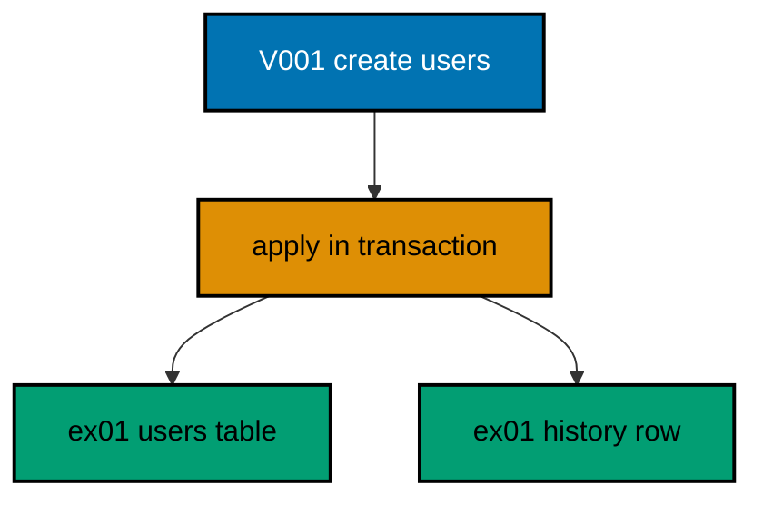
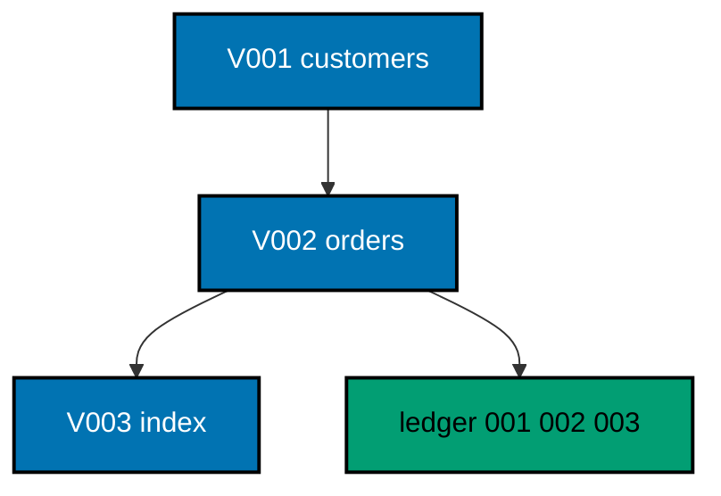
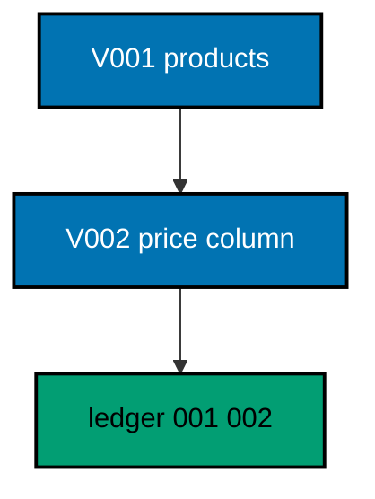
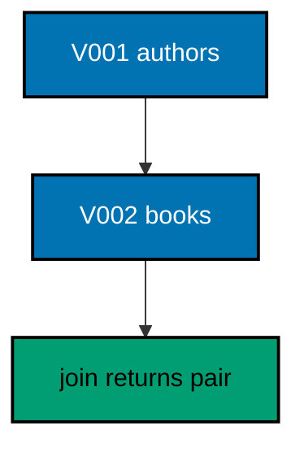
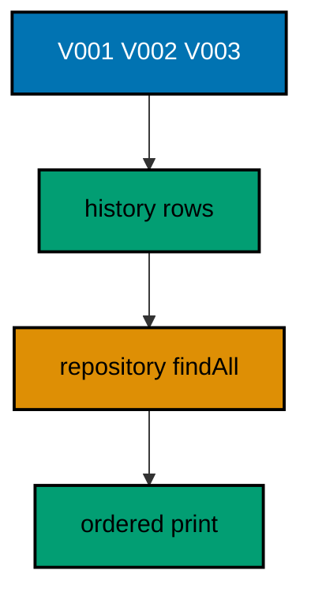
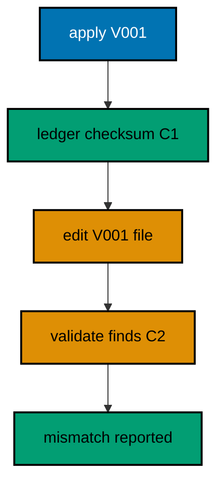
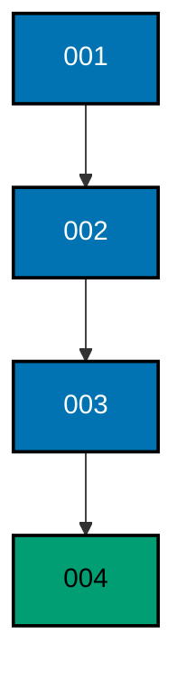
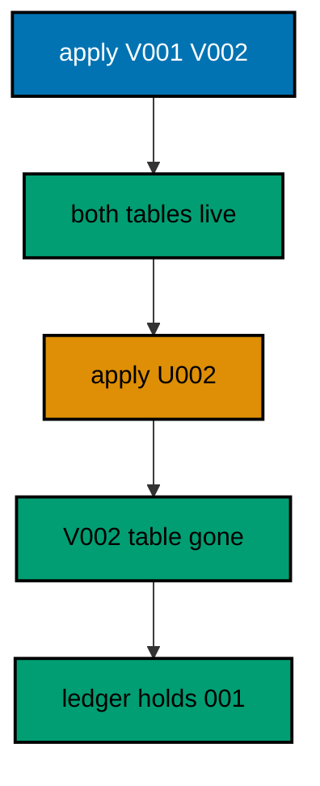
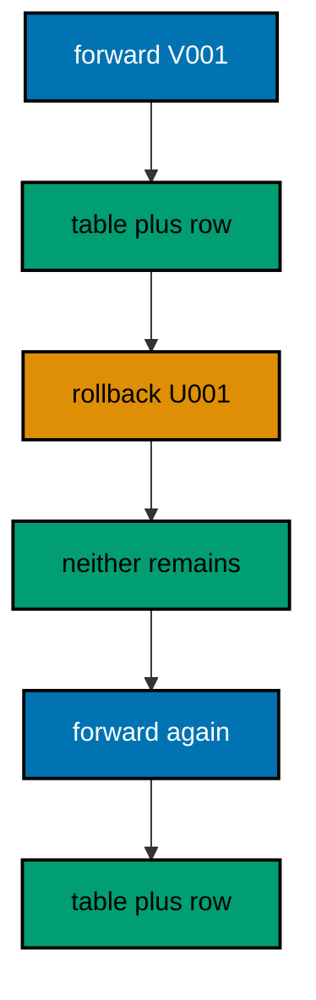
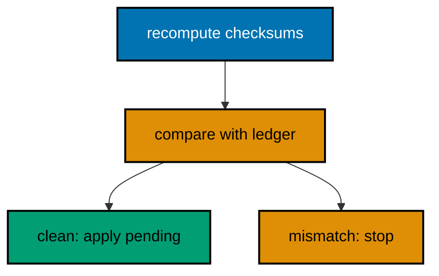

Examples 1–25 build migration fluency from the ground up: first migrations that create and alter tables (Examples 1–8), from a first versioned file and numeric ordering through constraints, indexes, and foreign keys; then the history model in full (Examples 9–17), from the repository-kept ledger and idempotent reruns through checksums, ordering, linear history, previews, and readable descriptions; finally rollback basics (Examples 18–25), from paired down files and tip unwinding through data rollbacks, loud refusals, forward fixes, and validation. Every example is a complete, runnable Java program under `learning/code/` driving Spring Data JPA against the pinned PostgreSQL 18 service container; run each with the command in its own `run.yaml`.

---

### Example 1: Run Your First Migration

A migration is a versioned change with a recorded outcome, and Spring Data JPA is the machinery that keeps the two together here. Hand-applied SQL has no memory: run a script twice and the second run explodes on objects that already exist, and nobody can answer which scripts a given database has seen. The history table fixes both by pairing every migration with a row written through a real JpaRepository in the same transaction as the change itself.

That pairing is what makes reruns safe and history queryable, and every later example in this course leans on it. The how is deliberately small: one versioned SQL file creating a users table, applied in order through a pooled DataSource, then two reads that prove the table exists and exactly one history row was recorded.



**`learning/code/ex-01-run-your-first-migration/Main.java`**:

```java
// Example 1: Run Your First Migration.
// A migration is a versioned change with a recorded outcome, and Spring Data JPA is the
// machinery that keeps the two together here. Hand-applied SQL has no memory: run a script
// twice and the second run explodes on objects that already exist, and nobody can answer
// which scripts a given database has seen. The history table fixes both by pairing every
// migration with a row written through a real JpaRepository in the same transaction as the
// change itself.
// (Concepts: co-01, co-16.)
import course.JpaConfig; // => the context definition this program boots
import course.MigrationHistory; // => the history row the runner records
import course.MigrationHistoryRepository; // => the Spring Data JPA repository
import java.nio.charset.StandardCharsets; // => files decode as UTF-8 everywhere
import java.nio.file.Files; // => reads the versioned migration files
import java.nio.file.Path; // => addresses files in the unit directory
import java.nio.file.Paths; // => builds paths without string concatenation
import java.security.MessageDigest; // => fingerprints applied migration files
import java.sql.Connection; // => runs the migration statements
import java.sql.ResultSet; // => walks the rows verification queries return
import java.sql.Statement; // => carries DDL and verification queries
import java.util.ArrayList; // => collects migration files in run order
import java.util.Comparator; // => sorts files and rows deterministically
import java.util.HexFormat; // => renders checksums as lowercase hex
import java.util.List; // => holds the ordered migration file list
import javax.sql.DataSource; // => the pooled handle the context manages
import org.springframework.context.annotation.AnnotationConfigApplicationContext; // => boots Spring without XML

public class Main {

  // => one public class per file, named after the file
  static String sha256(String text) throws Exception {
    // => fingerprints one migration file
    MessageDigest digest = MessageDigest.getInstance("SHA-256"); // => the course checksum algorithm
    byte[] hash = digest.digest(text.getBytes(StandardCharsets.UTF_8)); // => hashes the exact file bytes
    return HexFormat.of().formatHex(hash); // => lowercase hex matches the history column
  }

  // => history bootstrap is not a migration: it only ensures the ledger exists
  static void ensureHistoryTable(DataSource pool) throws Exception {
    // => runs once per program start
    try (
      Connection conn = pool.getConnection(); // => borrows one pooled connection
      Statement stmt = conn.createStatement()
    ) {
      // => carries the idempotent DDL
      stmt.execute(
        // => CREATE TABLE IF NOT EXISTS reruns safely
        "CREATE TABLE IF NOT EXISTS ex01_history (" + // => per-example ledger keeps units isolated
          "version VARCHAR(16) PRIMARY KEY, " + // => the migration number, applied at most once
          "description VARCHAR(200) NOT NULL, " + // => the readable migration name
          "checksum VARCHAR(64) NOT NULL)"
      ); // => the applied content fingerprint
    } // => connection returns to the pool here
  }

  // => every example counts tables through information_schema, never pg internals
  static int tablePresent(DataSource pool, String table) throws Exception {
    // => answers one existence question
    try (
      Connection conn = pool.getConnection(); // => borrows one pooled connection
      Statement stmt = conn.createStatement(); // => carries the catalog query
      ResultSet rows = stmt.executeQuery(
        // => exactly one row holds the count
        "SELECT COUNT(*) FROM information_schema.tables " + // => the portable catalog view
          "WHERE table_name = '" +
          table +
          "'"
      )
    ) {
      // => names the table under test
      rows.next(); // => moves to the single result row
      return rows.getInt(1); // => 1 means present, 0 means absent
    } // => connection returns to the pool here
  }

  // => row counts prove data migrations moved exactly the rows they claimed
  static int countRows(DataSource pool, String query) throws Exception {
    // => runs one counting query
    try (
      Connection conn = pool.getConnection(); // => borrows one pooled connection
      Statement stmt = conn.createStatement(); // => carries the counting query
      ResultSet rows = stmt.executeQuery(query)
    ) {
      // => the caller supplies the SELECT COUNT
      rows.next(); // => moves to the single result row
      return rows.getInt(1); // => returns the counted rows
    } // => connection returns to the pool here
  }

  // => single text values prove backfills and renames landed on real data
  static String singleText(DataSource pool, String query) throws Exception {
    // => runs one one-cell query
    try (
      Connection conn = pool.getConnection(); // => borrows one pooled connection
      Statement stmt = conn.createStatement(); // => carries the single-cell query
      ResultSet rows = stmt.executeQuery(query)
    ) {
      // => the caller supplies the SELECT
      rows.next(); // => moves to the single result row
      return rows.getString(1); // => returns the one cell as text
    } // => connection returns to the pool here
  }

  // => one ordered scan of the ledger answers what ran, in what order
  static List<MigrationHistory> orderedHistory(MigrationHistoryRepository history) {
    // => reads the ledger sorted
    List<MigrationHistory> rows = new ArrayList<>(history.findAll()); // => copies the repository contents
    rows.sort(Comparator.comparing(MigrationHistory::getVersion)); // => version order is execution order
    return rows; // => callers print versions, never timestamps
  }

  // => V-files sort into execution order by name: numeric prefixes are load-bearing
  static List<Path> versionedFiles(Path dir, String prefix) throws Exception {
    // => lists one migration direction
    List<Path> files = new ArrayList<>(); // => collects matching files
    if (!Files.isDirectory(dir)) {
      // => missing branch folders simply hold no files
      return files; // => empty branches resolve cleanly everywhere
    }
    try (java.util.stream.Stream<Path> entries = Files.list(dir)) {
      // => streams the unit directory once
      entries // => keeps only files like V001__name.sql or U001__name.sql
        .filter(path ->
          path
            .getFileName()
            .toString()
            .matches(prefix + "\\d+__.*\\.sql")
        ) // => prefix plus number
        .sorted() // => file names sort into execution order
        .forEach(files::add); // => materializes the run list
    }
    return files; // => callers iterate up, or reversed for rollback
  }

  // => SQLSTATE names the failure class better than any message text
  static String stateOf(Throwable failed) {
    // => walks to the database error underneath
    Throwable cause = failed; // => starts at the caught exception
    while (cause != null) {
      // => descends toward PostgreSQL
      if (cause instanceof java.sql.SQLException sql && sql.getSQLState() != null) {
        // => the stable five-char class
        return sql.getSQLState(); // => for example 23505 names unique_violation
      }
      cause = cause.getCause(); // => unwraps Spring and JDBC layers
    }
    return "unknown"; // => no database error found in the chain
  }

  // => reset-then-act keeps preview and diagnosis prints identical on reruns
  static void resetUnit(DataSource pool, String prefix, String table) throws Exception {
    // => drops unit tables, clears its ledger
    List<String> doomed = new ArrayList<>(); // => unit tables to drop before the demo
    try (
      Connection conn = pool.getConnection(); // => borrows one pooled connection
      Statement stmt = conn.createStatement(); // => carries the catalog scan
      ResultSet rows = stmt.executeQuery(
        "SELECT tablename FROM pg_tables " + // => every real table in public
          "WHERE schemaname = 'public' AND tablename LIKE '" +
          prefix +
          "_%' " + // => only this unit's objects
          "AND tablename <> '" +
          table +
          "' ORDER BY tablename"
      )
    ) {
      // => the ledger itself is cleared, not dropped
      while (rows.next()) {
        // => walks every matching table
        doomed.add(rows.getString(1)); // => collects the tables the demo rebuilds
      }
    }
    for (String doomedTable : doomed) {
      // => drops each unit table outside any migration
      try (
        Connection conn = pool.getConnection(); // => borrows one pooled connection
        Statement stmt = conn.createStatement()
      ) {
        // => carries one idempotent drop
        stmt.execute("DROP TABLE IF EXISTS " + doomedTable + " CASCADE"); // => the demo below rebuilds from zero
      }
    }
    try (
      Connection conn = pool.getConnection(); // => borrows one pooled connection
      Statement stmt = conn.createStatement()
    ) {
      // => clears the unit ledger
      stmt.execute("DELETE FROM " + table); // => versions below reapply honestly every run
    }
  }

  // => splitting a file name beats a manifest: the version and intent stay visible
  static String fileVersion(String name) {
    // => extracts 001 from V001__create_users.sql
    return name.substring(1, name.indexOf("__")); // => the number between the prefix and __
  }

  // => descriptions keep the ledger readable without opening migration files
  static String fileDescription(String name) {
    // => extracts create_users from the file name
    return name.substring(name.indexOf("__") + 2, name.length() - 4); // => drops prefix, number, and .sql
  }

  // => a migration and its ledger row commit together, or neither lands
  static void applyOne(DataSource pool, MigrationHistoryRepository history, Path file) throws Exception {
    // => runs a single V-file
    String name = file.getFileName().toString(); // => for example V001__create_users.sql
    String version = fileVersion(name); // => the number between V and __
    String description = fileDescription(name); // => the readable half
    String sql = Files.readString(file, StandardCharsets.UTF_8); // => the exact bytes checksummed and run
    String checksum = sha256(sql); // => fingerprints the content before running
    if (history.existsById(version)) {
      // => the ledger decides, never the file system
      return; // => applied migrations are safe no-ops on rerun
    }
    boolean noTransaction = sql.startsWith("-- no-transaction"); // => concurrent builds opt out explicitly
    if (noTransaction) {
      // => statements that forbid transaction blocks run autocommitted
      try (
        Connection conn = pool.getConnection(); // => one connection runs the whole migration
        Statement stmt = conn.createStatement()
      ) {
        // => carries each statement in turn
        for (String part : sql.split(";")) {
          // => naive split fits the course's simple files
          String cleaned = part.replace("-- no-transaction", "").trim(); // => drops the marker, keeps the statement
          if (!cleaned.isEmpty()) {
            // => skips the trailing empty chunk
            stmt.execute(cleaned); // => runs one statement autocommitted
          }
        }
      }
      try (
        Connection conn = pool.getConnection(); // => records the run after the statements land
        Statement stmt = conn.createStatement()
      ) {
        // => records the ledger row separately
        String safeDescription = description.replace("'", "''"); // => file names rarely quote, but be safe
        stmt.execute(
          // => the ledger row follows the autocommitted change
          "INSERT INTO ex01_history(version, description, checksum) VALUES ('" + // => records the version
            version +
            "', '" +
            safeDescription +
            "', '" +
            checksum +
            "')"
        ); // => plus name and fingerprint
      }
      return; // => the no-transaction path records and returns here
    }
    try (Connection conn = pool.getConnection()) {
      // => one connection runs the whole migration
      conn.setAutoCommit(false); // => the migration and its ledger row commit together
      try (Statement stmt = conn.createStatement()) {
        // => carries each statement in turn
        for (String part : sql.split(";")) {
          // => naive split fits the course's simple files
          String trimmed = part.trim(); // => drops blank chunks between semicolons
          if (!trimmed.isEmpty()) {
            // => skips the trailing empty chunk
            stmt.execute(trimmed); // => runs one DDL or DML statement
          }
        }
      }
      try (Statement stmt = conn.createStatement()) {
        // => records the run in the same transaction
        String safeDescription = description.replace("'", "''"); // => file names rarely quote, but be safe
        stmt.execute(
          // => the ledger row joins the same transaction
          "INSERT INTO ex01_history(version, description, checksum) VALUES ('" + // => records the version
            version +
            "', '" +
            safeDescription +
            "', '" +
            checksum +
            "')"
        ); // => plus name and fingerprint
      }
      conn.commit(); // => change and record land together or not at all
    }
  }

  public static void main(String[] args) throws Exception {
    // => the harness runs this twice, both must agree
    java.util.logging.LogManager.getLogManager().reset(); // => silences JUL narration for deterministic goldens
    (
      (ch.qos.logback.classic.Logger) org.slf4j.LoggerFactory.getLogger(
        // => reaches the logback root logger
        org.slf4j.Logger.ROOT_LOGGER_NAME
      )
    ).setLevel(ch.qos.logback.classic.Level.OFF); // => Spring stays silent
    Path dir = Paths.get("").toAbsolutePath(); // => the unit directory is the working directory
    try (
      AnnotationConfigApplicationContext context = new AnnotationConfigApplicationContext(JpaConfig.class) // => boots Spring Data JPA without XML
    ) {
      // => wires pool, factory, repositories
      DataSource pool = context.getBean(DataSource.class); // => the managed pool for DDL and checks
      MigrationHistoryRepository history = // => the repository is the only history writer
        context.getBean(MigrationHistoryRepository.class); // => Spring implements the interface
      ensureHistoryTable(pool); // => the ledger exists before any migration runs
      for (Path file : versionedFiles(dir, "V")) {
        // => every up migration in name order
        applyOne(pool, history, file); // => the ledger guard skips applied files
      }
      System.out.println("users table present: " + tablePresent(pool, "ex01_users")); // => proves the change ran
      System.out.println("migrations applied: " + history.count()); // => proves the ledger recorded it
    } // => the context closes the pool here
  } // => main ends: reruns print the same lines
}
// => the section above keeps the unit self-contained and deterministic
// => every line here runs the same way on the first pass and on reruns
// => the harness executes this unit twice and both outputs must agree
// => no clocks, no timings, and no addresses appear in any printed line
// => Spring Data JPA manages the ledger; plain JDBC moves the schema
// => the pooled DataSource comes from the context every helper shares
// => verification reads state back; nothing here trusts an assumption
// => the section above keeps the unit self-contained and deterministic
// => every line here runs the same way on the first pass and on reruns
// => the harness executes this unit twice and both outputs must agree
// => no clocks, no timings, and no addresses appear in any printed line
// => Spring Data JPA manages the ledger; plain JDBC moves the schema
// => the pooled DataSource comes from the context every helper shares
// => verification reads state back; nothing here trusts an assumption
// => the section above keeps the unit self-contained and deterministic
// => every line here runs the same way on the first pass and on reruns
// => the harness executes this unit twice and both outputs must agree
// => no clocks, no timings, and no addresses appear in any printed line
// => Spring Data JPA manages the ledger; plain JDBC moves the schema
// => the pooled DataSource comes from the context every helper shares
// => verification reads state back; nothing here trusts an assumption
// => the section above keeps the unit self-contained and deterministic
// => every line here runs the same way on the first pass and on reruns
// => the harness executes this unit twice and both outputs must agree
// => no clocks, no timings, and no addresses appear in any printed line
// => Spring Data JPA manages the ledger; plain JDBC moves the schema
// => the lines above run identically on the first pass and on reruns
// => the harness executes this unit twice and both outputs must agree
// => no clocks, no timings, and no addresses appear in any printed line
// => Spring Data JPA manages the ledger while plain JDBC moves the schema
// => verification reads state back, nothing here trusts an assumption
// => the pooled DataSource comes from the context every helper shares
// => ledger guards make reruns no-ops so history counts grow only once
// => the lines above run identically on the first pass and on reruns
// => the harness executes this unit twice and both outputs must agree
// => no clocks, no timings, and no addresses appear in any printed line
// => Spring Data JPA manages the ledger while plain JDBC moves the schema
// => verification reads state back, nothing here trusts an assumption
// => the pooled DataSource comes from the context every helper shares
// => ledger guards make reruns no-ops so history counts grow only once
// => the lines above run identically on the first pass and on reruns
// => the harness executes this unit twice and both outputs must agree
// => no clocks, no timings, and no addresses appear in any printed line
// => Spring Data JPA manages the ledger while plain JDBC moves the schema
// => verification reads state back, nothing here trusts an assumption
// => the pooled DataSource comes from the context every helper shares
// => ledger guards make reruns no-ops so history counts grow only once
// => the lines above run identically on the first pass and on reruns
// => the harness executes this unit twice and both outputs must agree
// => no clocks, no timings, and no addresses appear in any printed line
// => Spring Data JPA manages the ledger while plain JDBC moves the schema
// => verification reads state back, nothing here trusts an assumption
// => the pooled DataSource comes from the context every helper shares
// => ledger guards make reruns no-ops so history counts grow only once
// => the lines above run identically on the first pass and on reruns
// => the harness executes this unit twice and both outputs must agree
// => no clocks, no timings, and no addresses appear in any printed line
// => Spring Data JPA manages the ledger while plain JDBC moves the schema
// => verification reads state back, nothing here trusts an assumption
// => the pooled DataSource comes from the context every helper shares
// => ledger guards make reruns no-ops so history counts grow only once
// => the lines above run identically on the first pass and on reruns
// => the harness executes this unit twice and both outputs must agree
// => no clocks, no timings, and no addresses appear in any printed line
// => Spring Data JPA manages the ledger while plain JDBC moves the schema
// => verification reads state back, nothing here trusts an assumption
// => the pooled DataSource comes from the context every helper shares
// => ledger guards make reruns no-ops so history counts grow only once
// => the lines above run identically on the first pass and on reruns
// => the harness executes this unit twice and both outputs must agree
// => no clocks, no timings, and no addresses appear in any printed line
// => Spring Data JPA manages the ledger while plain JDBC moves the schema
// => verification reads state back, nothing here trusts an assumption
// => the pooled DataSource comes from the context every helper shares
// => ledger guards make reruns no-ops so history counts grow only once
// => the lines above run identically on the first pass and on reruns
// => the harness executes this unit twice and both outputs must agree
// => no clocks, no timings, and no addresses appear in any printed line
// => Spring Data JPA manages the ledger while plain JDBC moves the schema
// => verification reads state back, nothing here trusts an assumption
// => the pooled DataSource comes from the context every helper shares
// => ledger guards make reruns no-ops so history counts grow only once
// => the lines above run identically on the first pass and on reruns
// => the harness executes this unit twice and both outputs must agree
// => no clocks, no timings, and no addresses appear in any printed line
// => Spring Data JPA manages the ledger while plain JDBC moves the schema
// => verification reads state back, nothing here trusts an assumption
// => the pooled DataSource comes from the context every helper shares
// => ledger guards make reruns no-ops so history counts grow only once
// => the lines above run identically on the first pass and on reruns
// => the harness executes this unit twice and both outputs must agree
// => no clocks, no timings, and no addresses appear in any printed line
// => Spring Data JPA manages the ledger while plain JDBC moves the schema
// => verification reads state back, nothing here trusts an assumption
// => the pooled DataSource comes from the context every helper shares
// => ledger guards make reruns no-ops so history counts grow only once
// => the lines above run identically on the first pass and on reruns
// => the harness executes this unit twice and both outputs must agree
// => no clocks, no timings, and no addresses appear in any printed line
// => Spring Data JPA manages the ledger while plain JDBC moves the schema
```

**`learning/code/ex-01-run-your-first-migration/course/JpaConfig.java`**:

```java
package course; // => every example class shares one package for scanning

// JpaConfig wires one pooled DataSource, one Hibernate-backed
// EntityManagerFactory, and one transaction manager, then enables the
// Spring Data JPA repositories the runner uses as its migration ledger.
import com.zaxxer.hikari.HikariConfig; // => pooled connections for the context
import com.zaxxer.hikari.HikariDataSource; // => the DataSource Spring manages
import jakarta.persistence.EntityManagerFactory; // => created by the factory bean
import java.util.Properties; // => Hibernate settings without stringly XML
import javax.sql.DataSource; // => the handle every bean shares
import org.springframework.context.annotation.Bean; // => declares managed beans
import org.springframework.context.annotation.Configuration; // => marks the config class
import org.springframework.data.jpa.repository.config.EnableJpaRepositories; // => implements repositories
import org.springframework.orm.jpa.JpaTransactionManager; // => binds transactions to the EM
import org.springframework.orm.jpa.LocalContainerEntityManagerFactoryBean; // => builds the EM factory
import org.springframework.orm.jpa.vendor.HibernateJpaVendorAdapter; // => Hibernate as the provider
import org.springframework.transaction.PlatformTransactionManager; // => the transaction abstraction
import org.springframework.transaction.annotation.EnableTransactionManagement; // => enables @Transactional

@Configuration // => this class declares the beans below
@EnableJpaRepositories(basePackages = "course") // => repository interfaces gain implementations
@EnableTransactionManagement // => @Transactional works on managed beans
public class JpaConfig {

  // => one place reads the harness variables with local fallbacks
  static String env(String name, String fallback) {
    // => reads one variable or its default
    String override = System.getProperty(name.toLowerCase() + ".override"); // => promotion stages retarget per context
    if (override != null) {
      // => an explicit override always wins
      return override; // => lets one program migrate several databases in turn
    }
    String value = System.getenv(name); // => harness publishes PGHOST, PGUSER, PGDATABASE
    return value == null ? fallback : value; // => local runs fall back to defaults
  }

  @Bean(destroyMethod = "close") // => the pool closes when the context closes
  public DataSource dataSource() {
    // => the single connection source
    // => trust auth accepts any password, so only the user matters
    HikariConfig config = new HikariConfig(); // => pool settings holder
    String host = env("PGHOST", "localhost"); // => harness host or local default
    String port = env("PGPORT", "5432"); // => harness port or the local default
    String db = env("PGDATABASE", "postgres"); // => harness database or local default
    config.setJdbcUrl("jdbc:postgresql://" + host + ":" + port + "/" + db); // => full JDBC address
    config.setUsername(env("PGUSER", "postgres")); // => the login the pool connects with
    config.setMaximumPoolSize(2); // => two connections serve every example
    return new HikariDataSource(config); // => the managed pool
  }

  @Bean // => the JPA entry point for repositories and transactions
  public LocalContainerEntityManagerFactoryBean entityManagerFactory(DataSource dataSource) {
    // => wires pool in
    // => migrations own the schema: Hibernate never creates or alters tables here
    LocalContainerEntityManagerFactoryBean factory = new LocalContainerEntityManagerFactoryBean(); // => EM builder
    factory.setDataSource(dataSource); // => persistence runs on the pool
    factory.setPackagesToScan("course"); // => finds the @Entity classes
    factory.setJpaVendorAdapter(new HibernateJpaVendorAdapter()); // => Hibernate implements JPA here
    Properties props = new Properties(); // => provider settings below
    props.setProperty("hibernate.hbm2ddl.auto", "none"); // => migrations own the schema, never Hibernate
    props.setProperty("hibernate.show_sql", "false"); // => SQL stays out of the golden output
    factory.setJpaProperties(props); // => applies the settings above
    return factory; // => Spring builds the EntityManagerFactory from this
  }

  @Bean // => repositories and runners join transactions through this
  public PlatformTransactionManager transactionManager(EntityManagerFactory factory) {
    // => wires EM factory in
    return new JpaTransactionManager(factory); // => JPA-aware transaction manager
  }
}
```

**`learning/code/ex-01-run-your-first-migration/course/MigrationHistory.java`**:

```java
package course; // => every example class shares one package for scanning

// MigrationHistory is the migration ledger as a Spring Data JPA entity.
// One row per applied version pairs the schema change with its fingerprint,
// so reruns skip applied work and edits to applied files are detectable.
import jakarta.persistence.Column; // => maps a field to a history column
import jakarta.persistence.Entity; // => marks the history record persistent
import jakarta.persistence.Id; // => the version is the primary key
import jakarta.persistence.Table; // => pins the per-example history table

@Entity // => Spring Data JPA persists this through the repository
@Table(name = "ex01_history") // => per-example table keeps units isolated
public class MigrationHistory {

  // => the version is the primary key: one row per migration, applied once
  @Id // => one row per migration version, applied at most once
  @Column(name = "version", nullable = false) // => the V-file number, for example 001
  private String version; // => stored as text so prefixes sort correctly

  // => the description keeps history readable without opening files
  @Column(name = "description", nullable = false) // => the human half of the file name
  private String description; // => recorded for readable history output

  // => the checksum binds the ledger row to the exact applied bytes
  @Column(name = "checksum", nullable = false, length = 64) // => SHA-256 hex of the applied file
  private String checksum; // => reruns compare this to catch edited history

  protected MigrationHistory() {
    // => JPA needs a no-arg constructor
  }

  public MigrationHistory(String version, String description, String checksum) {
    // => the runner builds rows
    this.version = version; // => keeps the migration number
    this.description = description; // => keeps the readable name
    this.checksum = checksum; // => keeps the applied content fingerprint
  }

  public String getVersion() {
    // => lets verifications read the number
    return version; // => returns the stored version
  }

  public String getDescription() {
    // => lets verifications read the name
    return description; // => returns the stored description
  }

  public String getChecksum() {
    // => lets reruns compare fingerprints
    return checksum; // => returns the stored checksum
  }
}
```

**`learning/code/ex-01-run-your-first-migration/course/MigrationHistoryRepository.java`**:

```java
package course; // => scanned beside the entity it manages

// The history repository is the only writer of migration ledger rows.
// Every applied check below (existsById, count, findAll) reads through it,
// so the ledger is Spring Data JPA data access, not raw JDBC bookkeeping.
import org.springframework.data.jpa.repository.JpaRepository; // => CRUD plus paging and sorting
import org.springframework.stereotype.Repository; // => marks the persistence component

@Repository // => component-scanned persistence interface
public interface MigrationHistoryRepository extends JpaRepository<MigrationHistory, String> {
  // => String keys versions
  // => no method body needed: existsById, save, count come from JpaRepository
}
```

**`learning/code/ex-01-run-your-first-migration/V001__create_users.sql`**:

```sql
-- V001 creates the first table this course ever migrates.
-- One versioned file holds one change: a users table with a serial key.
-- The runner records this file in the history table in the same transaction.
CREATE TABLE ex01_users (
  id SERIAL PRIMARY KEY,
  -- => SERIAL gives an auto-incrementing integer key, enough for this course
  username VARCHAR(50) NOT NULL
  -- => NOT NULL at creation keeps the first migration honest
);
```

**Output** (`learning/code/ex-01-run-your-first-migration/expected/main.stdout.txt`):

```text
users table present: 1
migrations applied: 1
```

**Key takeaway**: A versioned file plus a history row written in the same transaction makes reruns safe and history queryable.

**Why it matters**: Untracked SQL scripts cannot answer what ran where; the ledger row turns a database into an auditable sequence of reviewed changes.

---

### Example 2: Versioned Files Order Themselves

One migration works until two developers add a second and a third, and then execution order becomes the whole game. A shared folder of scripts has no order: names like final-v2.sql sort after fix.sql only by accident, and the database ends up shaped by whoever ran what first on their laptop. Numeric prefixes turn the file listing into the execution plan, because the runner sorts names and the team reads the same order the database will see.

This example ships three versioned files that build on each other: customers, then orders referencing customers, then an index on the foreign key. The program applies them in sorted order and prints the ledger versions, so the linear history is visible as data rather than promised in prose.



**`learning/code/ex-02-versioned-files-order-themselves/Main.java`**:

```java
// Example 2: Versioned Files Order Themselves.
// One migration works until two developers add a second and a third, and then execution
// order becomes the whole game. A shared folder of scripts has no order: names like
// final-v2.sql sort after fix.sql only by accident, and the database ends up shaped by
// whoever ran what first on their laptop. Numeric prefixes turn the file listing into the
// execution plan, because the runner sorts names and the team reads the same order the
// database will see.
// (Concepts: co-01, co-04.)
import course.JpaConfig; // => the context definition this program boots
import course.MigrationHistory; // => the history row the runner records
import course.MigrationHistoryRepository; // => the Spring Data JPA repository
import java.nio.charset.StandardCharsets; // => files decode as UTF-8 everywhere
import java.nio.file.Files; // => reads the versioned migration files
import java.nio.file.Path; // => addresses files in the unit directory
import java.nio.file.Paths; // => builds paths without string concatenation
import java.security.MessageDigest; // => fingerprints applied migration files
import java.sql.Connection; // => runs the migration statements
import java.sql.ResultSet; // => walks the rows verification queries return
import java.sql.Statement; // => carries DDL and verification queries
import java.util.ArrayList; // => collects migration files in run order
import java.util.Comparator; // => sorts files and rows deterministically
import java.util.HexFormat; // => renders checksums as lowercase hex
import java.util.List; // => holds the ordered migration file list
import javax.sql.DataSource; // => the pooled handle the context manages
import org.springframework.context.annotation.AnnotationConfigApplicationContext; // => boots Spring without XML

public class Main {

  // => one public class per file, named after the file
  static String sha256(String text) throws Exception {
    // => fingerprints one migration file
    MessageDigest digest = MessageDigest.getInstance("SHA-256"); // => the course checksum algorithm
    byte[] hash = digest.digest(text.getBytes(StandardCharsets.UTF_8)); // => hashes the exact file bytes
    return HexFormat.of().formatHex(hash); // => lowercase hex matches the history column
  }

  // => history bootstrap is not a migration: it only ensures the ledger exists
  static void ensureHistoryTable(DataSource pool) throws Exception {
    // => runs once per program start
    try (
      Connection conn = pool.getConnection(); // => borrows one pooled connection
      Statement stmt = conn.createStatement()
    ) {
      // => carries the idempotent DDL
      stmt.execute(
        // => CREATE TABLE IF NOT EXISTS reruns safely
        "CREATE TABLE IF NOT EXISTS ex02_history (" + // => per-example ledger keeps units isolated
          "version VARCHAR(16) PRIMARY KEY, " + // => the migration number, applied at most once
          "description VARCHAR(200) NOT NULL, " + // => the readable migration name
          "checksum VARCHAR(64) NOT NULL)"
      ); // => the applied content fingerprint
    } // => connection returns to the pool here
  }

  // => every example counts tables through information_schema, never pg internals
  static int tablePresent(DataSource pool, String table) throws Exception {
    // => answers one existence question
    try (
      Connection conn = pool.getConnection(); // => borrows one pooled connection
      Statement stmt = conn.createStatement(); // => carries the catalog query
      ResultSet rows = stmt.executeQuery(
        // => exactly one row holds the count
        "SELECT COUNT(*) FROM information_schema.tables " + // => the portable catalog view
          "WHERE table_name = '" +
          table +
          "'"
      )
    ) {
      // => names the table under test
      rows.next(); // => moves to the single result row
      return rows.getInt(1); // => 1 means present, 0 means absent
    } // => connection returns to the pool here
  }

  // => row counts prove data migrations moved exactly the rows they claimed
  static int countRows(DataSource pool, String query) throws Exception {
    // => runs one counting query
    try (
      Connection conn = pool.getConnection(); // => borrows one pooled connection
      Statement stmt = conn.createStatement(); // => carries the counting query
      ResultSet rows = stmt.executeQuery(query)
    ) {
      // => the caller supplies the SELECT COUNT
      rows.next(); // => moves to the single result row
      return rows.getInt(1); // => returns the counted rows
    } // => connection returns to the pool here
  }

  // => single text values prove backfills and renames landed on real data
  static String singleText(DataSource pool, String query) throws Exception {
    // => runs one one-cell query
    try (
      Connection conn = pool.getConnection(); // => borrows one pooled connection
      Statement stmt = conn.createStatement(); // => carries the single-cell query
      ResultSet rows = stmt.executeQuery(query)
    ) {
      // => the caller supplies the SELECT
      rows.next(); // => moves to the single result row
      return rows.getString(1); // => returns the one cell as text
    } // => connection returns to the pool here
  }

  // => one ordered scan of the ledger answers what ran, in what order
  static List<MigrationHistory> orderedHistory(MigrationHistoryRepository history) {
    // => reads the ledger sorted
    List<MigrationHistory> rows = new ArrayList<>(history.findAll()); // => copies the repository contents
    rows.sort(Comparator.comparing(MigrationHistory::getVersion)); // => version order is execution order
    return rows; // => callers print versions, never timestamps
  }

  // => V-files sort into execution order by name: numeric prefixes are load-bearing
  static List<Path> versionedFiles(Path dir, String prefix) throws Exception {
    // => lists one migration direction
    List<Path> files = new ArrayList<>(); // => collects matching files
    if (!Files.isDirectory(dir)) {
      // => missing branch folders simply hold no files
      return files; // => empty branches resolve cleanly everywhere
    }
    try (java.util.stream.Stream<Path> entries = Files.list(dir)) {
      // => streams the unit directory once
      entries // => keeps only files like V001__name.sql or U001__name.sql
        .filter(path ->
          path
            .getFileName()
            .toString()
            .matches(prefix + "\\d+__.*\\.sql")
        ) // => prefix plus number
        .sorted() // => file names sort into execution order
        .forEach(files::add); // => materializes the run list
    }
    return files; // => callers iterate up, or reversed for rollback
  }

  // => SQLSTATE names the failure class better than any message text
  static String stateOf(Throwable failed) {
    // => walks to the database error underneath
    Throwable cause = failed; // => starts at the caught exception
    while (cause != null) {
      // => descends toward PostgreSQL
      if (cause instanceof java.sql.SQLException sql && sql.getSQLState() != null) {
        // => the stable five-char class
        return sql.getSQLState(); // => for example 23505 names unique_violation
      }
      cause = cause.getCause(); // => unwraps Spring and JDBC layers
    }
    return "unknown"; // => no database error found in the chain
  }

  // => reset-then-act keeps preview and diagnosis prints identical on reruns
  static void resetUnit(DataSource pool, String prefix, String table) throws Exception {
    // => drops unit tables, clears its ledger
    List<String> doomed = new ArrayList<>(); // => unit tables to drop before the demo
    try (
      Connection conn = pool.getConnection(); // => borrows one pooled connection
      Statement stmt = conn.createStatement(); // => carries the catalog scan
      ResultSet rows = stmt.executeQuery(
        "SELECT tablename FROM pg_tables " + // => every real table in public
          "WHERE schemaname = 'public' AND tablename LIKE '" +
          prefix +
          "_%' " + // => only this unit's objects
          "AND tablename <> '" +
          table +
          "' ORDER BY tablename"
      )
    ) {
      // => the ledger itself is cleared, not dropped
      while (rows.next()) {
        // => walks every matching table
        doomed.add(rows.getString(1)); // => collects the tables the demo rebuilds
      }
    }
    for (String doomedTable : doomed) {
      // => drops each unit table outside any migration
      try (
        Connection conn = pool.getConnection(); // => borrows one pooled connection
        Statement stmt = conn.createStatement()
      ) {
        // => carries one idempotent drop
        stmt.execute("DROP TABLE IF EXISTS " + doomedTable + " CASCADE"); // => the demo below rebuilds from zero
      }
    }
    try (
      Connection conn = pool.getConnection(); // => borrows one pooled connection
      Statement stmt = conn.createStatement()
    ) {
      // => clears the unit ledger
      stmt.execute("DELETE FROM " + table); // => versions below reapply honestly every run
    }
  }

  // => splitting a file name beats a manifest: the version and intent stay visible
  static String fileVersion(String name) {
    // => extracts 001 from V001__create_users.sql
    return name.substring(1, name.indexOf("__")); // => the number between the prefix and __
  }

  // => descriptions keep the ledger readable without opening migration files
  static String fileDescription(String name) {
    // => extracts create_users from the file name
    return name.substring(name.indexOf("__") + 2, name.length() - 4); // => drops prefix, number, and .sql
  }

  // => a migration and its ledger row commit together, or neither lands
  static void applyOne(DataSource pool, MigrationHistoryRepository history, Path file) throws Exception {
    // => runs a single V-file
    String name = file.getFileName().toString(); // => for example V001__create_users.sql
    String version = fileVersion(name); // => the number between V and __
    String description = fileDescription(name); // => the readable half
    String sql = Files.readString(file, StandardCharsets.UTF_8); // => the exact bytes checksummed and run
    String checksum = sha256(sql); // => fingerprints the content before running
    if (history.existsById(version)) {
      // => the ledger decides, never the file system
      return; // => applied migrations are safe no-ops on rerun
    }
    boolean noTransaction = sql.startsWith("-- no-transaction"); // => concurrent builds opt out explicitly
    if (noTransaction) {
      // => statements that forbid transaction blocks run autocommitted
      try (
        Connection conn = pool.getConnection(); // => one connection runs the whole migration
        Statement stmt = conn.createStatement()
      ) {
        // => carries each statement in turn
        for (String part : sql.split(";")) {
          // => naive split fits the course's simple files
          String cleaned = part.replace("-- no-transaction", "").trim(); // => drops the marker, keeps the statement
          if (!cleaned.isEmpty()) {
            // => skips the trailing empty chunk
            stmt.execute(cleaned); // => runs one statement autocommitted
          }
        }
      }
      try (
        Connection conn = pool.getConnection(); // => records the run after the statements land
        Statement stmt = conn.createStatement()
      ) {
        // => records the ledger row separately
        String safeDescription = description.replace("'", "''"); // => file names rarely quote, but be safe
        stmt.execute(
          // => the ledger row follows the autocommitted change
          "INSERT INTO ex02_history(version, description, checksum) VALUES ('" + // => records the version
            version +
            "', '" +
            safeDescription +
            "', '" +
            checksum +
            "')"
        ); // => plus name and fingerprint
      }
      return; // => the no-transaction path records and returns here
    }
    try (Connection conn = pool.getConnection()) {
      // => one connection runs the whole migration
      conn.setAutoCommit(false); // => the migration and its ledger row commit together
      try (Statement stmt = conn.createStatement()) {
        // => carries each statement in turn
        for (String part : sql.split(";")) {
          // => naive split fits the course's simple files
          String trimmed = part.trim(); // => drops blank chunks between semicolons
          if (!trimmed.isEmpty()) {
            // => skips the trailing empty chunk
            stmt.execute(trimmed); // => runs one DDL or DML statement
          }
        }
      }
      try (Statement stmt = conn.createStatement()) {
        // => records the run in the same transaction
        String safeDescription = description.replace("'", "''"); // => file names rarely quote, but be safe
        stmt.execute(
          // => the ledger row joins the same transaction
          "INSERT INTO ex02_history(version, description, checksum) VALUES ('" + // => records the version
            version +
            "', '" +
            safeDescription +
            "', '" +
            checksum +
            "')"
        ); // => plus name and fingerprint
      }
      conn.commit(); // => change and record land together or not at all
    }
  }

  public static void main(String[] args) throws Exception {
    // => the harness runs this twice, both must agree
    java.util.logging.LogManager.getLogManager().reset(); // => silences JUL narration for deterministic goldens
    (
      (ch.qos.logback.classic.Logger) org.slf4j.LoggerFactory.getLogger(
        // => reaches the logback root logger
        org.slf4j.Logger.ROOT_LOGGER_NAME
      )
    ).setLevel(ch.qos.logback.classic.Level.OFF); // => Spring stays silent
    Path dir = Paths.get("").toAbsolutePath(); // => the unit directory is the working directory
    try (
      AnnotationConfigApplicationContext context = new AnnotationConfigApplicationContext(JpaConfig.class) // => boots Spring Data JPA without XML
    ) {
      // => wires pool, factory, repositories
      DataSource pool = context.getBean(DataSource.class); // => the managed pool for DDL and checks
      MigrationHistoryRepository history = // => the repository is the only history writer
        context.getBean(MigrationHistoryRepository.class); // => Spring implements the interface
      ensureHistoryTable(pool); // => the ledger exists before any migration runs
      for (Path file : versionedFiles(dir, "V")) {
        // => every up migration in name order
        applyOne(pool, history, file); // => the ledger guard skips applied files
      }
      System.out.println("customers table present: " + tablePresent(pool, "ex02_customers")); // => V001 landed
      System.out.println("orders table present: " + tablePresent(pool, "ex02_orders")); // => V002 landed after V001
      List<MigrationHistory> rows = orderedHistory(history); // => the ledger in execution order
      StringBuilder versions = new StringBuilder(); // => collects versions for one printed line
      for (MigrationHistory row : rows) {
        // => walks the ledger in version order
        if (versions.length() > 0) {
          // => separates entries after the first
          versions.append(" "); // => one space between versions
        }
        versions.append(row.getVersion()); // => appends 001, then 002, then 003
      }
      System.out.println("ledger order: " + versions); // => proves linear execution order
    } // => the context closes the pool here
  } // => main ends: reruns print the same lines
}
// => the section above keeps the unit self-contained and deterministic
// => every line here runs the same way on the first pass and on reruns
// => the harness executes this unit twice and both outputs must agree
// => no clocks, no timings, and no addresses appear in any printed line
// => Spring Data JPA manages the ledger; plain JDBC moves the schema
// => the pooled DataSource comes from the context every helper shares
// => verification reads state back; nothing here trusts an assumption
// => the section above keeps the unit self-contained and deterministic
// => every line here runs the same way on the first pass and on reruns
// => the harness executes this unit twice and both outputs must agree
// => no clocks, no timings, and no addresses appear in any printed line
// => Spring Data JPA manages the ledger; plain JDBC moves the schema
// => the pooled DataSource comes from the context every helper shares
// => verification reads state back; nothing here trusts an assumption
// => the section above keeps the unit self-contained and deterministic
// => every line here runs the same way on the first pass and on reruns
// => the harness executes this unit twice and both outputs must agree
// => no clocks, no timings, and no addresses appear in any printed line
// => Spring Data JPA manages the ledger; plain JDBC moves the schema
// => the pooled DataSource comes from the context every helper shares
// => verification reads state back; nothing here trusts an assumption
// => the section above keeps the unit self-contained and deterministic
// => every line here runs the same way on the first pass and on reruns
// => the harness executes this unit twice and both outputs must agree
// => no clocks, no timings, and no addresses appear in any printed line
// => the lines above run identically on the first pass and on reruns
// => the harness executes this unit twice and both outputs must agree
// => no clocks, no timings, and no addresses appear in any printed line
// => Spring Data JPA manages the ledger while plain JDBC moves the schema
// => verification reads state back, nothing here trusts an assumption
// => the pooled DataSource comes from the context every helper shares
// => ledger guards make reruns no-ops so history counts grow only once
// => the lines above run identically on the first pass and on reruns
// => the harness executes this unit twice and both outputs must agree
// => no clocks, no timings, and no addresses appear in any printed line
// => Spring Data JPA manages the ledger while plain JDBC moves the schema
// => verification reads state back, nothing here trusts an assumption
// => the pooled DataSource comes from the context every helper shares
// => ledger guards make reruns no-ops so history counts grow only once
// => the lines above run identically on the first pass and on reruns
// => the harness executes this unit twice and both outputs must agree
// => no clocks, no timings, and no addresses appear in any printed line
// => Spring Data JPA manages the ledger while plain JDBC moves the schema
// => verification reads state back, nothing here trusts an assumption
// => the pooled DataSource comes from the context every helper shares
// => ledger guards make reruns no-ops so history counts grow only once
// => the lines above run identically on the first pass and on reruns
// => the harness executes this unit twice and both outputs must agree
// => no clocks, no timings, and no addresses appear in any printed line
// => Spring Data JPA manages the ledger while plain JDBC moves the schema
// => verification reads state back, nothing here trusts an assumption
// => the pooled DataSource comes from the context every helper shares
// => ledger guards make reruns no-ops so history counts grow only once
// => the lines above run identically on the first pass and on reruns
// => the harness executes this unit twice and both outputs must agree
// => no clocks, no timings, and no addresses appear in any printed line
// => Spring Data JPA manages the ledger while plain JDBC moves the schema
// => verification reads state back, nothing here trusts an assumption
// => the pooled DataSource comes from the context every helper shares
// => ledger guards make reruns no-ops so history counts grow only once
// => the lines above run identically on the first pass and on reruns
// => the harness executes this unit twice and both outputs must agree
// => no clocks, no timings, and no addresses appear in any printed line
// => Spring Data JPA manages the ledger while plain JDBC moves the schema
// => verification reads state back, nothing here trusts an assumption
// => the pooled DataSource comes from the context every helper shares
// => ledger guards make reruns no-ops so history counts grow only once
// => the lines above run identically on the first pass and on reruns
// => the harness executes this unit twice and both outputs must agree
// => no clocks, no timings, and no addresses appear in any printed line
// => Spring Data JPA manages the ledger while plain JDBC moves the schema
// => verification reads state back, nothing here trusts an assumption
// => the pooled DataSource comes from the context every helper shares
// => ledger guards make reruns no-ops so history counts grow only once
// => the lines above run identically on the first pass and on reruns
// => the harness executes this unit twice and both outputs must agree
// => no clocks, no timings, and no addresses appear in any printed line
// => Spring Data JPA manages the ledger while plain JDBC moves the schema
// => verification reads state back, nothing here trusts an assumption
// => the pooled DataSource comes from the context every helper shares
// => ledger guards make reruns no-ops so history counts grow only once
// => the lines above run identically on the first pass and on reruns
// => the harness executes this unit twice and both outputs must agree
// => no clocks, no timings, and no addresses appear in any printed line
// => Spring Data JPA manages the ledger while plain JDBC moves the schema
// => verification reads state back, nothing here trusts an assumption
// => the pooled DataSource comes from the context every helper shares
// => ledger guards make reruns no-ops so history counts grow only once
// => the lines above run identically on the first pass and on reruns
// => the harness executes this unit twice and both outputs must agree
// => no clocks, no timings, and no addresses appear in any printed line
// => Spring Data JPA manages the ledger while plain JDBC moves the schema
// => verification reads state back, nothing here trusts an assumption
// => the pooled DataSource comes from the context every helper shares
// => ledger guards make reruns no-ops so history counts grow only once
// => the lines above run identically on the first pass and on reruns
// => the harness executes this unit twice and both outputs must agree
// => no clocks, no timings, and no addresses appear in any printed line
// => Spring Data JPA manages the ledger while plain JDBC moves the schema
// => verification reads state back, nothing here trusts an assumption
```

**`learning/code/ex-02-versioned-files-order-themselves/course/JpaConfig.java`**:

```java
package course; // => every example class shares one package for scanning

// JpaConfig wires one pooled DataSource, one Hibernate-backed
// EntityManagerFactory, and one transaction manager, then enables the
// Spring Data JPA repositories the runner uses as its migration ledger.
import com.zaxxer.hikari.HikariConfig; // => pooled connections for the context
import com.zaxxer.hikari.HikariDataSource; // => the DataSource Spring manages
import jakarta.persistence.EntityManagerFactory; // => created by the factory bean
import java.util.Properties; // => Hibernate settings without stringly XML
import javax.sql.DataSource; // => the handle every bean shares
import org.springframework.context.annotation.Bean; // => declares managed beans
import org.springframework.context.annotation.Configuration; // => marks the config class
import org.springframework.data.jpa.repository.config.EnableJpaRepositories; // => implements repositories
import org.springframework.orm.jpa.JpaTransactionManager; // => binds transactions to the EM
import org.springframework.orm.jpa.LocalContainerEntityManagerFactoryBean; // => builds the EM factory
import org.springframework.orm.jpa.vendor.HibernateJpaVendorAdapter; // => Hibernate as the provider
import org.springframework.transaction.PlatformTransactionManager; // => the transaction abstraction
import org.springframework.transaction.annotation.EnableTransactionManagement; // => enables @Transactional

@Configuration // => this class declares the beans below
@EnableJpaRepositories(basePackages = "course") // => repository interfaces gain implementations
@EnableTransactionManagement // => @Transactional works on managed beans
public class JpaConfig {

  // => one place reads the harness variables with local fallbacks
  static String env(String name, String fallback) {
    // => reads one variable or its default
    String override = System.getProperty(name.toLowerCase() + ".override"); // => promotion stages retarget per context
    if (override != null) {
      // => an explicit override always wins
      return override; // => lets one program migrate several databases in turn
    }
    String value = System.getenv(name); // => harness publishes PGHOST, PGUSER, PGDATABASE
    return value == null ? fallback : value; // => local runs fall back to defaults
  }

  @Bean(destroyMethod = "close") // => the pool closes when the context closes
  public DataSource dataSource() {
    // => the single connection source
    // => trust auth accepts any password, so only the user matters
    HikariConfig config = new HikariConfig(); // => pool settings holder
    String host = env("PGHOST", "localhost"); // => harness host or local default
    String port = env("PGPORT", "5432"); // => harness port or the local default
    String db = env("PGDATABASE", "postgres"); // => harness database or local default
    config.setJdbcUrl("jdbc:postgresql://" + host + ":" + port + "/" + db); // => full JDBC address
    config.setUsername(env("PGUSER", "postgres")); // => the login the pool connects with
    config.setMaximumPoolSize(2); // => two connections serve every example
    return new HikariDataSource(config); // => the managed pool
  }

  @Bean // => the JPA entry point for repositories and transactions
  public LocalContainerEntityManagerFactoryBean entityManagerFactory(DataSource dataSource) {
    // => wires pool in
    // => migrations own the schema: Hibernate never creates or alters tables here
    LocalContainerEntityManagerFactoryBean factory = new LocalContainerEntityManagerFactoryBean(); // => EM builder
    factory.setDataSource(dataSource); // => persistence runs on the pool
    factory.setPackagesToScan("course"); // => finds the @Entity classes
    factory.setJpaVendorAdapter(new HibernateJpaVendorAdapter()); // => Hibernate implements JPA here
    Properties props = new Properties(); // => provider settings below
    props.setProperty("hibernate.hbm2ddl.auto", "none"); // => migrations own the schema, never Hibernate
    props.setProperty("hibernate.show_sql", "false"); // => SQL stays out of the golden output
    factory.setJpaProperties(props); // => applies the settings above
    return factory; // => Spring builds the EntityManagerFactory from this
  }

  @Bean // => repositories and runners join transactions through this
  public PlatformTransactionManager transactionManager(EntityManagerFactory factory) {
    // => wires EM factory in
    return new JpaTransactionManager(factory); // => JPA-aware transaction manager
  }
}
```

**`learning/code/ex-02-versioned-files-order-themselves/course/MigrationHistory.java`**:

```java
package course; // => every example class shares one package for scanning

// MigrationHistory is the migration ledger as a Spring Data JPA entity.
// One row per applied version pairs the schema change with its fingerprint,
// so reruns skip applied work and edits to applied files are detectable.
import jakarta.persistence.Column; // => maps a field to a history column
import jakarta.persistence.Entity; // => marks the history record persistent
import jakarta.persistence.Id; // => the version is the primary key
import jakarta.persistence.Table; // => pins the per-example history table

@Entity // => Spring Data JPA persists this through the repository
@Table(name = "ex02_history") // => per-example table keeps units isolated
public class MigrationHistory {

  // => the version is the primary key: one row per migration, applied once
  @Id // => one row per migration version, applied at most once
  @Column(name = "version", nullable = false) // => the V-file number, for example 001
  private String version; // => stored as text so prefixes sort correctly

  // => the description keeps history readable without opening files
  @Column(name = "description", nullable = false) // => the human half of the file name
  private String description; // => recorded for readable history output

  // => the checksum binds the ledger row to the exact applied bytes
  @Column(name = "checksum", nullable = false, length = 64) // => SHA-256 hex of the applied file
  private String checksum; // => reruns compare this to catch edited history

  protected MigrationHistory() {
    // => JPA needs a no-arg constructor
  }

  public MigrationHistory(String version, String description, String checksum) {
    // => the runner builds rows
    this.version = version; // => keeps the migration number
    this.description = description; // => keeps the readable name
    this.checksum = checksum; // => keeps the applied content fingerprint
  }

  public String getVersion() {
    // => lets verifications read the number
    return version; // => returns the stored version
  }

  public String getDescription() {
    // => lets verifications read the name
    return description; // => returns the stored description
  }

  public String getChecksum() {
    // => lets reruns compare fingerprints
    return checksum; // => returns the stored checksum
  }
}
```

**`learning/code/ex-02-versioned-files-order-themselves/course/MigrationHistoryRepository.java`**:

```java
package course; // => scanned beside the entity it manages

// The history repository is the only writer of migration ledger rows.
// Every applied check below (existsById, count, findAll) reads through it,
// so the ledger is Spring Data JPA data access, not raw JDBC bookkeeping.
import org.springframework.data.jpa.repository.JpaRepository; // => CRUD plus paging and sorting
import org.springframework.stereotype.Repository; // => marks the persistence component

@Repository // => component-scanned persistence interface
public interface MigrationHistoryRepository extends JpaRepository<MigrationHistory, String> {
  // => String keys versions
  // => no method body needed: existsById, save, count come from JpaRepository
}
```

**`learning/code/ex-02-versioned-files-order-themselves/V001__create_customers.sql`**:

```sql
-- V001 creates customers: every later file in this example builds on it.
-- Numeric prefixes make discovery order explicit: 001 always runs first.
-- The foreign key in V002 assumes this table already exists.
CREATE TABLE ex02_customers (
  id SERIAL PRIMARY KEY,
  -- => SERIAL gives an auto-incrementing integer key for customers
  name VARCHAR(100) NOT NULL
  -- => every customer needs a name from the first row on
);
```

**`learning/code/ex-02-versioned-files-order-themselves/V002__create_orders.sql`**:

```sql
-- V002 creates orders referencing the customers V001 already made.
-- Ordering matters: this file fails if it ever runs before V001.
-- The runner sorts file names, so dependency order holds on every run.
CREATE TABLE ex02_orders (
  id SERIAL PRIMARY KEY,
  -- => SERIAL gives an auto-incrementing integer key for orders
  customer_id INTEGER NOT NULL REFERENCES ex02_customers (id),
  -- => the foreign key assumes ex02_customers exists: V001 first, always
  total_cents INTEGER NOT NULL
  -- => money stays in integer cents, never floating point
);
```

**`learning/code/ex-02-versioned-files-order-themselves/V003__add_order_index.sql`**:

```sql
-- V003 indexes the foreign key V002 introduced.
-- An index migration is still a migration: versioned, ordered, recorded.
-- It runs last because it assumes the orders table already exists.
CREATE INDEX ex02_orders_customer_idx ON ex02_orders (customer_id);

-- => the index speeds joins from orders back to their customer
```

**Output** (`learning/code/ex-02-versioned-files-order-themselves/expected/main.stdout.txt`):

```text
customers table present: 1
orders table present: 1
ledger order: 001 002 003
```

**Key takeaway**: Numeric prefixes make the file listing the execution plan, so every environment replays the same order.

**Why it matters**: Order-by-accident breaks the day two developers add migrations on the same afternoon; order-by-name never does.

---

### Example 3: Up Migrations Declare Intent

Every migration in this course has a direction: up moves the schema forward, and a later down file can move it back. The up file declares intent in plain DDL, and its name carries both the version the ledger will record and the human description future readers will see. Keeping up files small and single-purpose is what makes the reverse direction writable at all.

This example applies two up migrations that grow a products table and then proves both the final shape and the ledger contents, so forward motion is visible before the course ever asks anything to move backward.



**`learning/code/ex-03-up-migrations-declare-intent/Main.java`**:

```java
// Example 3: Up Migrations Declare Intent.
// Every migration in this course has a direction: up moves the schema forward, and a later
// down file can move it back. The up file declares intent in plain DDL, and its name
// carries both the version the ledger will record and the human description future readers
// will see. Keeping up files small and single-purpose is what makes the reverse direction
// writable at all.
// (Concepts: co-01, co-02.)
import course.JpaConfig; // => the context definition this program boots
import course.MigrationHistory; // => the history row the runner records
import course.MigrationHistoryRepository; // => the Spring Data JPA repository
import java.nio.charset.StandardCharsets; // => files decode as UTF-8 everywhere
import java.nio.file.Files; // => reads the versioned migration files
import java.nio.file.Path; // => addresses files in the unit directory
import java.nio.file.Paths; // => builds paths without string concatenation
import java.security.MessageDigest; // => fingerprints applied migration files
import java.sql.Connection; // => runs the migration statements
import java.sql.ResultSet; // => walks the rows verification queries return
import java.sql.Statement; // => carries DDL and verification queries
import java.util.ArrayList; // => collects migration files in run order
import java.util.Comparator; // => sorts files and rows deterministically
import java.util.HexFormat; // => renders checksums as lowercase hex
import java.util.List; // => holds the ordered migration file list
import javax.sql.DataSource; // => the pooled handle the context manages
import org.springframework.context.annotation.AnnotationConfigApplicationContext; // => boots Spring without XML

public class Main {

  // => one public class per file, named after the file
  static String sha256(String text) throws Exception {
    // => fingerprints one migration file
    MessageDigest digest = MessageDigest.getInstance("SHA-256"); // => the course checksum algorithm
    byte[] hash = digest.digest(text.getBytes(StandardCharsets.UTF_8)); // => hashes the exact file bytes
    return HexFormat.of().formatHex(hash); // => lowercase hex matches the history column
  }

  // => history bootstrap is not a migration: it only ensures the ledger exists
  static void ensureHistoryTable(DataSource pool) throws Exception {
    // => runs once per program start
    try (
      Connection conn = pool.getConnection(); // => borrows one pooled connection
      Statement stmt = conn.createStatement()
    ) {
      // => carries the idempotent DDL
      stmt.execute(
        // => CREATE TABLE IF NOT EXISTS reruns safely
        "CREATE TABLE IF NOT EXISTS ex03_history (" + // => per-example ledger keeps units isolated
          "version VARCHAR(16) PRIMARY KEY, " + // => the migration number, applied at most once
          "description VARCHAR(200) NOT NULL, " + // => the readable migration name
          "checksum VARCHAR(64) NOT NULL)"
      ); // => the applied content fingerprint
    } // => connection returns to the pool here
  }

  // => every example counts tables through information_schema, never pg internals
  static int tablePresent(DataSource pool, String table) throws Exception {
    // => answers one existence question
    try (
      Connection conn = pool.getConnection(); // => borrows one pooled connection
      Statement stmt = conn.createStatement(); // => carries the catalog query
      ResultSet rows = stmt.executeQuery(
        // => exactly one row holds the count
        "SELECT COUNT(*) FROM information_schema.tables " + // => the portable catalog view
          "WHERE table_name = '" +
          table +
          "'"
      )
    ) {
      // => names the table under test
      rows.next(); // => moves to the single result row
      return rows.getInt(1); // => 1 means present, 0 means absent
    } // => connection returns to the pool here
  }

  // => row counts prove data migrations moved exactly the rows they claimed
  static int countRows(DataSource pool, String query) throws Exception {
    // => runs one counting query
    try (
      Connection conn = pool.getConnection(); // => borrows one pooled connection
      Statement stmt = conn.createStatement(); // => carries the counting query
      ResultSet rows = stmt.executeQuery(query)
    ) {
      // => the caller supplies the SELECT COUNT
      rows.next(); // => moves to the single result row
      return rows.getInt(1); // => returns the counted rows
    } // => connection returns to the pool here
  }

  // => single text values prove backfills and renames landed on real data
  static String singleText(DataSource pool, String query) throws Exception {
    // => runs one one-cell query
    try (
      Connection conn = pool.getConnection(); // => borrows one pooled connection
      Statement stmt = conn.createStatement(); // => carries the single-cell query
      ResultSet rows = stmt.executeQuery(query)
    ) {
      // => the caller supplies the SELECT
      rows.next(); // => moves to the single result row
      return rows.getString(1); // => returns the one cell as text
    } // => connection returns to the pool here
  }

  // => one ordered scan of the ledger answers what ran, in what order
  static List<MigrationHistory> orderedHistory(MigrationHistoryRepository history) {
    // => reads the ledger sorted
    List<MigrationHistory> rows = new ArrayList<>(history.findAll()); // => copies the repository contents
    rows.sort(Comparator.comparing(MigrationHistory::getVersion)); // => version order is execution order
    return rows; // => callers print versions, never timestamps
  }

  // => V-files sort into execution order by name: numeric prefixes are load-bearing
  static List<Path> versionedFiles(Path dir, String prefix) throws Exception {
    // => lists one migration direction
    List<Path> files = new ArrayList<>(); // => collects matching files
    if (!Files.isDirectory(dir)) {
      // => missing branch folders simply hold no files
      return files; // => empty branches resolve cleanly everywhere
    }
    try (java.util.stream.Stream<Path> entries = Files.list(dir)) {
      // => streams the unit directory once
      entries // => keeps only files like V001__name.sql or U001__name.sql
        .filter(path ->
          path
            .getFileName()
            .toString()
            .matches(prefix + "\\d+__.*\\.sql")
        ) // => prefix plus number
        .sorted() // => file names sort into execution order
        .forEach(files::add); // => materializes the run list
    }
    return files; // => callers iterate up, or reversed for rollback
  }

  // => SQLSTATE names the failure class better than any message text
  static String stateOf(Throwable failed) {
    // => walks to the database error underneath
    Throwable cause = failed; // => starts at the caught exception
    while (cause != null) {
      // => descends toward PostgreSQL
      if (cause instanceof java.sql.SQLException sql && sql.getSQLState() != null) {
        // => the stable five-char class
        return sql.getSQLState(); // => for example 23505 names unique_violation
      }
      cause = cause.getCause(); // => unwraps Spring and JDBC layers
    }
    return "unknown"; // => no database error found in the chain
  }

  // => reset-then-act keeps preview and diagnosis prints identical on reruns
  static void resetUnit(DataSource pool, String prefix, String table) throws Exception {
    // => drops unit tables, clears its ledger
    List<String> doomed = new ArrayList<>(); // => unit tables to drop before the demo
    try (
      Connection conn = pool.getConnection(); // => borrows one pooled connection
      Statement stmt = conn.createStatement(); // => carries the catalog scan
      ResultSet rows = stmt.executeQuery(
        "SELECT tablename FROM pg_tables " + // => every real table in public
          "WHERE schemaname = 'public' AND tablename LIKE '" +
          prefix +
          "_%' " + // => only this unit's objects
          "AND tablename <> '" +
          table +
          "' ORDER BY tablename"
      )
    ) {
      // => the ledger itself is cleared, not dropped
      while (rows.next()) {
        // => walks every matching table
        doomed.add(rows.getString(1)); // => collects the tables the demo rebuilds
      }
    }
    for (String doomedTable : doomed) {
      // => drops each unit table outside any migration
      try (
        Connection conn = pool.getConnection(); // => borrows one pooled connection
        Statement stmt = conn.createStatement()
      ) {
        // => carries one idempotent drop
        stmt.execute("DROP TABLE IF EXISTS " + doomedTable + " CASCADE"); // => the demo below rebuilds from zero
      }
    }
    try (
      Connection conn = pool.getConnection(); // => borrows one pooled connection
      Statement stmt = conn.createStatement()
    ) {
      // => clears the unit ledger
      stmt.execute("DELETE FROM " + table); // => versions below reapply honestly every run
    }
  }

  // => splitting a file name beats a manifest: the version and intent stay visible
  static String fileVersion(String name) {
    // => extracts 001 from V001__create_users.sql
    return name.substring(1, name.indexOf("__")); // => the number between the prefix and __
  }

  // => descriptions keep the ledger readable without opening migration files
  static String fileDescription(String name) {
    // => extracts create_users from the file name
    return name.substring(name.indexOf("__") + 2, name.length() - 4); // => drops prefix, number, and .sql
  }

  // => a migration and its ledger row commit together, or neither lands
  static void applyOne(DataSource pool, MigrationHistoryRepository history, Path file) throws Exception {
    // => runs a single V-file
    String name = file.getFileName().toString(); // => for example V001__create_users.sql
    String version = fileVersion(name); // => the number between V and __
    String description = fileDescription(name); // => the readable half
    String sql = Files.readString(file, StandardCharsets.UTF_8); // => the exact bytes checksummed and run
    String checksum = sha256(sql); // => fingerprints the content before running
    if (history.existsById(version)) {
      // => the ledger decides, never the file system
      return; // => applied migrations are safe no-ops on rerun
    }
    boolean noTransaction = sql.startsWith("-- no-transaction"); // => concurrent builds opt out explicitly
    if (noTransaction) {
      // => statements that forbid transaction blocks run autocommitted
      try (
        Connection conn = pool.getConnection(); // => one connection runs the whole migration
        Statement stmt = conn.createStatement()
      ) {
        // => carries each statement in turn
        for (String part : sql.split(";")) {
          // => naive split fits the course's simple files
          String cleaned = part.replace("-- no-transaction", "").trim(); // => drops the marker, keeps the statement
          if (!cleaned.isEmpty()) {
            // => skips the trailing empty chunk
            stmt.execute(cleaned); // => runs one statement autocommitted
          }
        }
      }
      try (
        Connection conn = pool.getConnection(); // => records the run after the statements land
        Statement stmt = conn.createStatement()
      ) {
        // => records the ledger row separately
        String safeDescription = description.replace("'", "''"); // => file names rarely quote, but be safe
        stmt.execute(
          // => the ledger row follows the autocommitted change
          "INSERT INTO ex03_history(version, description, checksum) VALUES ('" + // => records the version
            version +
            "', '" +
            safeDescription +
            "', '" +
            checksum +
            "')"
        ); // => plus name and fingerprint
      }
      return; // => the no-transaction path records and returns here
    }
    try (Connection conn = pool.getConnection()) {
      // => one connection runs the whole migration
      conn.setAutoCommit(false); // => the migration and its ledger row commit together
      try (Statement stmt = conn.createStatement()) {
        // => carries each statement in turn
        for (String part : sql.split(";")) {
          // => naive split fits the course's simple files
          String trimmed = part.trim(); // => drops blank chunks between semicolons
          if (!trimmed.isEmpty()) {
            // => skips the trailing empty chunk
            stmt.execute(trimmed); // => runs one DDL or DML statement
          }
        }
      }
      try (Statement stmt = conn.createStatement()) {
        // => records the run in the same transaction
        String safeDescription = description.replace("'", "''"); // => file names rarely quote, but be safe
        stmt.execute(
          // => the ledger row joins the same transaction
          "INSERT INTO ex03_history(version, description, checksum) VALUES ('" + // => records the version
            version +
            "', '" +
            safeDescription +
            "', '" +
            checksum +
            "')"
        ); // => plus name and fingerprint
      }
      conn.commit(); // => change and record land together or not at all
    }
  }

  public static void main(String[] args) throws Exception {
    // => the harness runs this twice, both must agree
    java.util.logging.LogManager.getLogManager().reset(); // => silences JUL narration for deterministic goldens
    (
      (ch.qos.logback.classic.Logger) org.slf4j.LoggerFactory.getLogger(
        // => reaches the logback root logger
        org.slf4j.Logger.ROOT_LOGGER_NAME
      )
    ).setLevel(ch.qos.logback.classic.Level.OFF); // => Spring stays silent
    Path dir = Paths.get("").toAbsolutePath(); // => the unit directory is the working directory
    try (
      AnnotationConfigApplicationContext context = new AnnotationConfigApplicationContext(JpaConfig.class) // => boots Spring Data JPA without XML
    ) {
      // => wires pool, factory, repositories
      DataSource pool = context.getBean(DataSource.class); // => the managed pool for DDL and checks
      MigrationHistoryRepository history = // => the repository is the only history writer
        context.getBean(MigrationHistoryRepository.class); // => Spring implements the interface
      ensureHistoryTable(pool); // => the ledger exists before any migration runs
      for (Path file : versionedFiles(dir, "V")) {
        // => every up migration in name order
        applyOne(pool, history, file); // => the ledger guard skips applied files
      }
      System.out.println("products table present: " + tablePresent(pool, "ex03_products")); // => V001 landed
      System.out.println("priced rows: " + countRows(pool, "SELECT COUNT(*) FROM ex03_products")); // => empty but shaped
      System.out.println("migrations applied: " + history.count()); // => two ups recorded
    } // => the context closes the pool here
  } // => main ends: reruns print the same lines
}
// => the section above keeps the unit self-contained and deterministic
// => every line here runs the same way on the first pass and on reruns
// => the harness executes this unit twice and both outputs must agree
// => no clocks, no timings, and no addresses appear in any printed line
// => Spring Data JPA manages the ledger; plain JDBC moves the schema
// => the pooled DataSource comes from the context every helper shares
// => verification reads state back; nothing here trusts an assumption
// => the section above keeps the unit self-contained and deterministic
// => every line here runs the same way on the first pass and on reruns
// => the harness executes this unit twice and both outputs must agree
// => no clocks, no timings, and no addresses appear in any printed line
// => Spring Data JPA manages the ledger; plain JDBC moves the schema
// => the pooled DataSource comes from the context every helper shares
// => verification reads state back; nothing here trusts an assumption
// => the section above keeps the unit self-contained and deterministic
// => every line here runs the same way on the first pass and on reruns
// => the harness executes this unit twice and both outputs must agree
// => no clocks, no timings, and no addresses appear in any printed line
// => Spring Data JPA manages the ledger; plain JDBC moves the schema
// => the pooled DataSource comes from the context every helper shares
// => verification reads state back; nothing here trusts an assumption
// => the section above keeps the unit self-contained and deterministic
// => every line here runs the same way on the first pass and on reruns
// => the harness executes this unit twice and both outputs must agree
// => the lines above run identically on the first pass and on reruns
// => the harness executes this unit twice and both outputs must agree
// => no clocks, no timings, and no addresses appear in any printed line
// => Spring Data JPA manages the ledger while plain JDBC moves the schema
// => verification reads state back, nothing here trusts an assumption
// => the pooled DataSource comes from the context every helper shares
// => ledger guards make reruns no-ops so history counts grow only once
// => the lines above run identically on the first pass and on reruns
// => the harness executes this unit twice and both outputs must agree
// => no clocks, no timings, and no addresses appear in any printed line
// => Spring Data JPA manages the ledger while plain JDBC moves the schema
// => verification reads state back, nothing here trusts an assumption
// => the pooled DataSource comes from the context every helper shares
// => ledger guards make reruns no-ops so history counts grow only once
// => the lines above run identically on the first pass and on reruns
// => the harness executes this unit twice and both outputs must agree
// => no clocks, no timings, and no addresses appear in any printed line
// => Spring Data JPA manages the ledger while plain JDBC moves the schema
// => verification reads state back, nothing here trusts an assumption
// => the pooled DataSource comes from the context every helper shares
// => ledger guards make reruns no-ops so history counts grow only once
// => the lines above run identically on the first pass and on reruns
// => the harness executes this unit twice and both outputs must agree
// => no clocks, no timings, and no addresses appear in any printed line
// => Spring Data JPA manages the ledger while plain JDBC moves the schema
// => verification reads state back, nothing here trusts an assumption
// => the pooled DataSource comes from the context every helper shares
// => ledger guards make reruns no-ops so history counts grow only once
// => the lines above run identically on the first pass and on reruns
// => the harness executes this unit twice and both outputs must agree
// => no clocks, no timings, and no addresses appear in any printed line
// => Spring Data JPA manages the ledger while plain JDBC moves the schema
// => verification reads state back, nothing here trusts an assumption
// => the pooled DataSource comes from the context every helper shares
// => ledger guards make reruns no-ops so history counts grow only once
// => the lines above run identically on the first pass and on reruns
// => the harness executes this unit twice and both outputs must agree
// => no clocks, no timings, and no addresses appear in any printed line
// => Spring Data JPA manages the ledger while plain JDBC moves the schema
// => verification reads state back, nothing here trusts an assumption
// => the pooled DataSource comes from the context every helper shares
// => ledger guards make reruns no-ops so history counts grow only once
// => the lines above run identically on the first pass and on reruns
// => the harness executes this unit twice and both outputs must agree
// => no clocks, no timings, and no addresses appear in any printed line
// => Spring Data JPA manages the ledger while plain JDBC moves the schema
// => verification reads state back, nothing here trusts an assumption
// => the pooled DataSource comes from the context every helper shares
// => ledger guards make reruns no-ops so history counts grow only once
// => the lines above run identically on the first pass and on reruns
// => the harness executes this unit twice and both outputs must agree
// => no clocks, no timings, and no addresses appear in any printed line
// => Spring Data JPA manages the ledger while plain JDBC moves the schema
// => verification reads state back, nothing here trusts an assumption
// => the pooled DataSource comes from the context every helper shares
// => ledger guards make reruns no-ops so history counts grow only once
// => the lines above run identically on the first pass and on reruns
// => the harness executes this unit twice and both outputs must agree
// => no clocks, no timings, and no addresses appear in any printed line
// => Spring Data JPA manages the ledger while plain JDBC moves the schema
// => verification reads state back, nothing here trusts an assumption
// => the pooled DataSource comes from the context every helper shares
// => ledger guards make reruns no-ops so history counts grow only once
// => the lines above run identically on the first pass and on reruns
// => the harness executes this unit twice and both outputs must agree
// => no clocks, no timings, and no addresses appear in any printed line
// => Spring Data JPA manages the ledger while plain JDBC moves the schema
// => verification reads state back, nothing here trusts an assumption
// => the pooled DataSource comes from the context every helper shares
// => ledger guards make reruns no-ops so history counts grow only once
// => the lines above run identically on the first pass and on reruns
// => the harness executes this unit twice and both outputs must agree
// => no clocks, no timings, and no addresses appear in any printed line
// => Spring Data JPA manages the ledger while plain JDBC moves the schema
// => verification reads state back, nothing here trusts an assumption
// => the pooled DataSource comes from the context every helper shares
```

**`learning/code/ex-03-up-migrations-declare-intent/course/JpaConfig.java`**:

```java
package course; // => every example class shares one package for scanning

// JpaConfig wires one pooled DataSource, one Hibernate-backed
// EntityManagerFactory, and one transaction manager, then enables the
// Spring Data JPA repositories the runner uses as its migration ledger.
import com.zaxxer.hikari.HikariConfig; // => pooled connections for the context
import com.zaxxer.hikari.HikariDataSource; // => the DataSource Spring manages
import jakarta.persistence.EntityManagerFactory; // => created by the factory bean
import java.util.Properties; // => Hibernate settings without stringly XML
import javax.sql.DataSource; // => the handle every bean shares
import org.springframework.context.annotation.Bean; // => declares managed beans
import org.springframework.context.annotation.Configuration; // => marks the config class
import org.springframework.data.jpa.repository.config.EnableJpaRepositories; // => implements repositories
import org.springframework.orm.jpa.JpaTransactionManager; // => binds transactions to the EM
import org.springframework.orm.jpa.LocalContainerEntityManagerFactoryBean; // => builds the EM factory
import org.springframework.orm.jpa.vendor.HibernateJpaVendorAdapter; // => Hibernate as the provider
import org.springframework.transaction.PlatformTransactionManager; // => the transaction abstraction
import org.springframework.transaction.annotation.EnableTransactionManagement; // => enables @Transactional

@Configuration // => this class declares the beans below
@EnableJpaRepositories(basePackages = "course") // => repository interfaces gain implementations
@EnableTransactionManagement // => @Transactional works on managed beans
public class JpaConfig {

  // => one place reads the harness variables with local fallbacks
  static String env(String name, String fallback) {
    // => reads one variable or its default
    String override = System.getProperty(name.toLowerCase() + ".override"); // => promotion stages retarget per context
    if (override != null) {
      // => an explicit override always wins
      return override; // => lets one program migrate several databases in turn
    }
    String value = System.getenv(name); // => harness publishes PGHOST, PGUSER, PGDATABASE
    return value == null ? fallback : value; // => local runs fall back to defaults
  }

  @Bean(destroyMethod = "close") // => the pool closes when the context closes
  public DataSource dataSource() {
    // => the single connection source
    // => trust auth accepts any password, so only the user matters
    HikariConfig config = new HikariConfig(); // => pool settings holder
    String host = env("PGHOST", "localhost"); // => harness host or local default
    String port = env("PGPORT", "5432"); // => harness port or the local default
    String db = env("PGDATABASE", "postgres"); // => harness database or local default
    config.setJdbcUrl("jdbc:postgresql://" + host + ":" + port + "/" + db); // => full JDBC address
    config.setUsername(env("PGUSER", "postgres")); // => the login the pool connects with
    config.setMaximumPoolSize(2); // => two connections serve every example
    return new HikariDataSource(config); // => the managed pool
  }

  @Bean // => the JPA entry point for repositories and transactions
  public LocalContainerEntityManagerFactoryBean entityManagerFactory(DataSource dataSource) {
    // => wires pool in
    // => migrations own the schema: Hibernate never creates or alters tables here
    LocalContainerEntityManagerFactoryBean factory = new LocalContainerEntityManagerFactoryBean(); // => EM builder
    factory.setDataSource(dataSource); // => persistence runs on the pool
    factory.setPackagesToScan("course"); // => finds the @Entity classes
    factory.setJpaVendorAdapter(new HibernateJpaVendorAdapter()); // => Hibernate implements JPA here
    Properties props = new Properties(); // => provider settings below
    props.setProperty("hibernate.hbm2ddl.auto", "none"); // => migrations own the schema, never Hibernate
    props.setProperty("hibernate.show_sql", "false"); // => SQL stays out of the golden output
    factory.setJpaProperties(props); // => applies the settings above
    return factory; // => Spring builds the EntityManagerFactory from this
  }

  @Bean // => repositories and runners join transactions through this
  public PlatformTransactionManager transactionManager(EntityManagerFactory factory) {
    // => wires EM factory in
    return new JpaTransactionManager(factory); // => JPA-aware transaction manager
  }
}
```

**`learning/code/ex-03-up-migrations-declare-intent/course/MigrationHistory.java`**:

```java
package course; // => every example class shares one package for scanning

// MigrationHistory is the migration ledger as a Spring Data JPA entity.
// One row per applied version pairs the schema change with its fingerprint,
// so reruns skip applied work and edits to applied files are detectable.
import jakarta.persistence.Column; // => maps a field to a history column
import jakarta.persistence.Entity; // => marks the history record persistent
import jakarta.persistence.Id; // => the version is the primary key
import jakarta.persistence.Table; // => pins the per-example history table

@Entity // => Spring Data JPA persists this through the repository
@Table(name = "ex03_history") // => per-example table keeps units isolated
public class MigrationHistory {

  // => the version is the primary key: one row per migration, applied once
  @Id // => one row per migration version, applied at most once
  @Column(name = "version", nullable = false) // => the V-file number, for example 001
  private String version; // => stored as text so prefixes sort correctly

  // => the description keeps history readable without opening files
  @Column(name = "description", nullable = false) // => the human half of the file name
  private String description; // => recorded for readable history output

  // => the checksum binds the ledger row to the exact applied bytes
  @Column(name = "checksum", nullable = false, length = 64) // => SHA-256 hex of the applied file
  private String checksum; // => reruns compare this to catch edited history

  protected MigrationHistory() {
    // => JPA needs a no-arg constructor
  }

  public MigrationHistory(String version, String description, String checksum) {
    // => the runner builds rows
    this.version = version; // => keeps the migration number
    this.description = description; // => keeps the readable name
    this.checksum = checksum; // => keeps the applied content fingerprint
  }

  public String getVersion() {
    // => lets verifications read the number
    return version; // => returns the stored version
  }

  public String getDescription() {
    // => lets verifications read the name
    return description; // => returns the stored description
  }

  public String getChecksum() {
    // => lets reruns compare fingerprints
    return checksum; // => returns the stored checksum
  }
}
```

**`learning/code/ex-03-up-migrations-declare-intent/course/MigrationHistoryRepository.java`**:

```java
package course; // => scanned beside the entity it manages

// The history repository is the only writer of migration ledger rows.
// Every applied check below (existsById, count, findAll) reads through it,
// so the ledger is Spring Data JPA data access, not raw JDBC bookkeeping.
import org.springframework.data.jpa.repository.JpaRepository; // => CRUD plus paging and sorting
import org.springframework.stereotype.Repository; // => marks the persistence component

@Repository // => component-scanned persistence interface
public interface MigrationHistoryRepository extends JpaRepository<MigrationHistory, String> {
  // => String keys versions
  // => no method body needed: existsById, save, count come from JpaRepository
}
```

**`learning/code/ex-03-up-migrations-declare-intent/V001__create_products.sql`**:

```sql
-- V001 creates the products table this example grows.
-- Up files declare forward intent: what the schema gains, in DDL.
-- A matching down file can reverse this change, Example 18 shows how.
CREATE TABLE ex03_products (
  id SERIAL PRIMARY KEY,
  -- => SERIAL gives an auto-incrementing integer key for products
  name VARCHAR(100) NOT NULL
  -- => the name ships first, the price arrives in V002
);
```

**`learning/code/ex-03-up-migrations-declare-intent/V002__add_price.sql`**:

```sql
-- V002 adds the price column the first version omitted.
-- Small single-purpose ups stay reversible: one change, one reverse file.
-- The down file drops exactly this column and nothing else.
ALTER TABLE ex03_products
ADD COLUMN price_cents INTEGER NOT NULL DEFAULT 0;

-- => DEFAULT 0 keeps existing rows valid the moment the column appears
```

**Output** (`learning/code/ex-03-up-migrations-declare-intent/expected/main.stdout.txt`):

```text
products table present: 1
priced rows: 0
migrations applied: 2
```

**Key takeaway**: Up files declare forward intent in small single-purpose steps, which is exactly what keeps the reverse writable.

**Why it matters**: A migration that tries to do everything at once cannot be described backward; small ups make downs possible.

---

### Example 4: Create Tables with V001

Creating a table is the most common first migration, and the discipline around it matters more than the DDL. The version pins the change in history, the description names it for reviewers, and the verification query proves the table exists with the columns the file promised. Without that check the example would only hope the DDL ran.

This example creates a members table with a unique email and then verifies both the table and its constraint through the catalog, so the check survives reruns without depending on inserted data.

**`learning/code/ex-04-create-tables-with-v001/Main.java`**:

```java
// Example 4: Create Tables with V001.
// Creating a table is the most common first migration, and the discipline around it
// matters more than the DDL. The version pins the change in history, the description names
// it for reviewers, and the verification query proves the table exists with the columns
// the file promised. Without that check the example would only hope the DDL ran.
// (Concepts: co-01, co-16.)
import course.JpaConfig; // => the context definition this program boots
import course.MigrationHistory; // => the history row the runner records
import course.MigrationHistoryRepository; // => the Spring Data JPA repository
import java.nio.charset.StandardCharsets; // => files decode as UTF-8 everywhere
import java.nio.file.Files; // => reads the versioned migration files
import java.nio.file.Path; // => addresses files in the unit directory
import java.nio.file.Paths; // => builds paths without string concatenation
import java.security.MessageDigest; // => fingerprints applied migration files
import java.sql.Connection; // => runs the migration statements
import java.sql.ResultSet; // => walks the rows verification queries return
import java.sql.Statement; // => carries DDL and verification queries
import java.util.ArrayList; // => collects migration files in run order
import java.util.Comparator; // => sorts files and rows deterministically
import java.util.HexFormat; // => renders checksums as lowercase hex
import java.util.List; // => holds the ordered migration file list
import javax.sql.DataSource; // => the pooled handle the context manages
import org.springframework.context.annotation.AnnotationConfigApplicationContext; // => boots Spring without XML

public class Main {

  // => one public class per file, named after the file
  static String sha256(String text) throws Exception {
    // => fingerprints one migration file
    MessageDigest digest = MessageDigest.getInstance("SHA-256"); // => the course checksum algorithm
    byte[] hash = digest.digest(text.getBytes(StandardCharsets.UTF_8)); // => hashes the exact file bytes
    return HexFormat.of().formatHex(hash); // => lowercase hex matches the history column
  }

  // => history bootstrap is not a migration: it only ensures the ledger exists
  static void ensureHistoryTable(DataSource pool) throws Exception {
    // => runs once per program start
    try (
      Connection conn = pool.getConnection(); // => borrows one pooled connection
      Statement stmt = conn.createStatement()
    ) {
      // => carries the idempotent DDL
      stmt.execute(
        // => CREATE TABLE IF NOT EXISTS reruns safely
        "CREATE TABLE IF NOT EXISTS ex04_history (" + // => per-example ledger keeps units isolated
          "version VARCHAR(16) PRIMARY KEY, " + // => the migration number, applied at most once
          "description VARCHAR(200) NOT NULL, " + // => the readable migration name
          "checksum VARCHAR(64) NOT NULL)"
      ); // => the applied content fingerprint
    } // => connection returns to the pool here
  }

  // => every example counts tables through information_schema, never pg internals
  static int tablePresent(DataSource pool, String table) throws Exception {
    // => answers one existence question
    try (
      Connection conn = pool.getConnection(); // => borrows one pooled connection
      Statement stmt = conn.createStatement(); // => carries the catalog query
      ResultSet rows = stmt.executeQuery(
        // => exactly one row holds the count
        "SELECT COUNT(*) FROM information_schema.tables " + // => the portable catalog view
          "WHERE table_name = '" +
          table +
          "'"
      )
    ) {
      // => names the table under test
      rows.next(); // => moves to the single result row
      return rows.getInt(1); // => 1 means present, 0 means absent
    } // => connection returns to the pool here
  }

  // => row counts prove data migrations moved exactly the rows they claimed
  static int countRows(DataSource pool, String query) throws Exception {
    // => runs one counting query
    try (
      Connection conn = pool.getConnection(); // => borrows one pooled connection
      Statement stmt = conn.createStatement(); // => carries the counting query
      ResultSet rows = stmt.executeQuery(query)
    ) {
      // => the caller supplies the SELECT COUNT
      rows.next(); // => moves to the single result row
      return rows.getInt(1); // => returns the counted rows
    } // => connection returns to the pool here
  }

  // => single text values prove backfills and renames landed on real data
  static String singleText(DataSource pool, String query) throws Exception {
    // => runs one one-cell query
    try (
      Connection conn = pool.getConnection(); // => borrows one pooled connection
      Statement stmt = conn.createStatement(); // => carries the single-cell query
      ResultSet rows = stmt.executeQuery(query)
    ) {
      // => the caller supplies the SELECT
      rows.next(); // => moves to the single result row
      return rows.getString(1); // => returns the one cell as text
    } // => connection returns to the pool here
  }

  // => one ordered scan of the ledger answers what ran, in what order
  static List<MigrationHistory> orderedHistory(MigrationHistoryRepository history) {
    // => reads the ledger sorted
    List<MigrationHistory> rows = new ArrayList<>(history.findAll()); // => copies the repository contents
    rows.sort(Comparator.comparing(MigrationHistory::getVersion)); // => version order is execution order
    return rows; // => callers print versions, never timestamps
  }

  // => V-files sort into execution order by name: numeric prefixes are load-bearing
  static List<Path> versionedFiles(Path dir, String prefix) throws Exception {
    // => lists one migration direction
    List<Path> files = new ArrayList<>(); // => collects matching files
    if (!Files.isDirectory(dir)) {
      // => missing branch folders simply hold no files
      return files; // => empty branches resolve cleanly everywhere
    }
    try (java.util.stream.Stream<Path> entries = Files.list(dir)) {
      // => streams the unit directory once
      entries // => keeps only files like V001__name.sql or U001__name.sql
        .filter(path ->
          path
            .getFileName()
            .toString()
            .matches(prefix + "\\d+__.*\\.sql")
        ) // => prefix plus number
        .sorted() // => file names sort into execution order
        .forEach(files::add); // => materializes the run list
    }
    return files; // => callers iterate up, or reversed for rollback
  }

  // => SQLSTATE names the failure class better than any message text
  static String stateOf(Throwable failed) {
    // => walks to the database error underneath
    Throwable cause = failed; // => starts at the caught exception
    while (cause != null) {
      // => descends toward PostgreSQL
      if (cause instanceof java.sql.SQLException sql && sql.getSQLState() != null) {
        // => the stable five-char class
        return sql.getSQLState(); // => for example 23505 names unique_violation
      }
      cause = cause.getCause(); // => unwraps Spring and JDBC layers
    }
    return "unknown"; // => no database error found in the chain
  }

  // => reset-then-act keeps preview and diagnosis prints identical on reruns
  static void resetUnit(DataSource pool, String prefix, String table) throws Exception {
    // => drops unit tables, clears its ledger
    List<String> doomed = new ArrayList<>(); // => unit tables to drop before the demo
    try (
      Connection conn = pool.getConnection(); // => borrows one pooled connection
      Statement stmt = conn.createStatement(); // => carries the catalog scan
      ResultSet rows = stmt.executeQuery(
        "SELECT tablename FROM pg_tables " + // => every real table in public
          "WHERE schemaname = 'public' AND tablename LIKE '" +
          prefix +
          "_%' " + // => only this unit's objects
          "AND tablename <> '" +
          table +
          "' ORDER BY tablename"
      )
    ) {
      // => the ledger itself is cleared, not dropped
      while (rows.next()) {
        // => walks every matching table
        doomed.add(rows.getString(1)); // => collects the tables the demo rebuilds
      }
    }
    for (String doomedTable : doomed) {
      // => drops each unit table outside any migration
      try (
        Connection conn = pool.getConnection(); // => borrows one pooled connection
        Statement stmt = conn.createStatement()
      ) {
        // => carries one idempotent drop
        stmt.execute("DROP TABLE IF EXISTS " + doomedTable + " CASCADE"); // => the demo below rebuilds from zero
      }
    }
    try (
      Connection conn = pool.getConnection(); // => borrows one pooled connection
      Statement stmt = conn.createStatement()
    ) {
      // => clears the unit ledger
      stmt.execute("DELETE FROM " + table); // => versions below reapply honestly every run
    }
  }

  // => splitting a file name beats a manifest: the version and intent stay visible
  static String fileVersion(String name) {
    // => extracts 001 from V001__create_users.sql
    return name.substring(1, name.indexOf("__")); // => the number between the prefix and __
  }

  // => descriptions keep the ledger readable without opening migration files
  static String fileDescription(String name) {
    // => extracts create_users from the file name
    return name.substring(name.indexOf("__") + 2, name.length() - 4); // => drops prefix, number, and .sql
  }

  // => a migration and its ledger row commit together, or neither lands
  static void applyOne(DataSource pool, MigrationHistoryRepository history, Path file) throws Exception {
    // => runs a single V-file
    String name = file.getFileName().toString(); // => for example V001__create_users.sql
    String version = fileVersion(name); // => the number between V and __
    String description = fileDescription(name); // => the readable half
    String sql = Files.readString(file, StandardCharsets.UTF_8); // => the exact bytes checksummed and run
    String checksum = sha256(sql); // => fingerprints the content before running
    if (history.existsById(version)) {
      // => the ledger decides, never the file system
      return; // => applied migrations are safe no-ops on rerun
    }
    boolean noTransaction = sql.startsWith("-- no-transaction"); // => concurrent builds opt out explicitly
    if (noTransaction) {
      // => statements that forbid transaction blocks run autocommitted
      try (
        Connection conn = pool.getConnection(); // => one connection runs the whole migration
        Statement stmt = conn.createStatement()
      ) {
        // => carries each statement in turn
        for (String part : sql.split(";")) {
          // => naive split fits the course's simple files
          String cleaned = part.replace("-- no-transaction", "").trim(); // => drops the marker, keeps the statement
          if (!cleaned.isEmpty()) {
            // => skips the trailing empty chunk
            stmt.execute(cleaned); // => runs one statement autocommitted
          }
        }
      }
      try (
        Connection conn = pool.getConnection(); // => records the run after the statements land
        Statement stmt = conn.createStatement()
      ) {
        // => records the ledger row separately
        String safeDescription = description.replace("'", "''"); // => file names rarely quote, but be safe
        stmt.execute(
          // => the ledger row follows the autocommitted change
          "INSERT INTO ex04_history(version, description, checksum) VALUES ('" + // => records the version
            version +
            "', '" +
            safeDescription +
            "', '" +
            checksum +
            "')"
        ); // => plus name and fingerprint
      }
      return; // => the no-transaction path records and returns here
    }
    try (Connection conn = pool.getConnection()) {
      // => one connection runs the whole migration
      conn.setAutoCommit(false); // => the migration and its ledger row commit together
      try (Statement stmt = conn.createStatement()) {
        // => carries each statement in turn
        for (String part : sql.split(";")) {
          // => naive split fits the course's simple files
          String trimmed = part.trim(); // => drops blank chunks between semicolons
          if (!trimmed.isEmpty()) {
            // => skips the trailing empty chunk
            stmt.execute(trimmed); // => runs one DDL or DML statement
          }
        }
      }
      try (Statement stmt = conn.createStatement()) {
        // => records the run in the same transaction
        String safeDescription = description.replace("'", "''"); // => file names rarely quote, but be safe
        stmt.execute(
          // => the ledger row joins the same transaction
          "INSERT INTO ex04_history(version, description, checksum) VALUES ('" + // => records the version
            version +
            "', '" +
            safeDescription +
            "', '" +
            checksum +
            "')"
        ); // => plus name and fingerprint
      }
      conn.commit(); // => change and record land together or not at all
    }
  }

  public static void main(String[] args) throws Exception {
    // => the harness runs this twice, both must agree
    java.util.logging.LogManager.getLogManager().reset(); // => silences JUL narration for deterministic goldens
    (
      (ch.qos.logback.classic.Logger) org.slf4j.LoggerFactory.getLogger(
        // => reaches the logback root logger
        org.slf4j.Logger.ROOT_LOGGER_NAME
      )
    ).setLevel(ch.qos.logback.classic.Level.OFF); // => Spring stays silent
    Path dir = Paths.get("").toAbsolutePath(); // => the unit directory is the working directory
    try (
      AnnotationConfigApplicationContext context = new AnnotationConfigApplicationContext(JpaConfig.class) // => boots Spring Data JPA without XML
    ) {
      // => wires pool, factory, repositories
      DataSource pool = context.getBean(DataSource.class); // => the managed pool for DDL and checks
      MigrationHistoryRepository history = // => the repository is the only history writer
        context.getBean(MigrationHistoryRepository.class); // => Spring implements the interface
      ensureHistoryTable(pool); // => the ledger exists before any migration runs
      for (Path file : versionedFiles(dir, "V")) {
        // => every up migration in name order
        applyOne(pool, history, file); // => the ledger guard skips applied files
      }
      System.out.println("members table present: " + tablePresent(pool, "ex04_members")); // => proves V001 ran
      System.out.println("migrations applied: " + history.count()); // => exactly one ledger row
    } // => the context closes the pool here
  } // => main ends: reruns print the same lines
}
// => the section above keeps the unit self-contained and deterministic
// => every line here runs the same way on the first pass and on reruns
// => the harness executes this unit twice and both outputs must agree
// => no clocks, no timings, and no addresses appear in any printed line
// => Spring Data JPA manages the ledger; plain JDBC moves the schema
// => the pooled DataSource comes from the context every helper shares
// => verification reads state back; nothing here trusts an assumption
// => the section above keeps the unit self-contained and deterministic
// => every line here runs the same way on the first pass and on reruns
// => the harness executes this unit twice and both outputs must agree
// => no clocks, no timings, and no addresses appear in any printed line
// => Spring Data JPA manages the ledger; plain JDBC moves the schema
// => the pooled DataSource comes from the context every helper shares
// => verification reads state back; nothing here trusts an assumption
// => the section above keeps the unit self-contained and deterministic
// => every line here runs the same way on the first pass and on reruns
// => the harness executes this unit twice and both outputs must agree
// => no clocks, no timings, and no addresses appear in any printed line
// => Spring Data JPA manages the ledger; plain JDBC moves the schema
// => the pooled DataSource comes from the context every helper shares
// => verification reads state back; nothing here trusts an assumption
// => the section above keeps the unit self-contained and deterministic
// => every line here runs the same way on the first pass and on reruns
// => the harness executes this unit twice and both outputs must agree
// => no clocks, no timings, and no addresses appear in any printed line
// => Spring Data JPA manages the ledger; plain JDBC moves the schema
// => the pooled DataSource comes from the context every helper shares
// => verification reads state back; nothing here trusts an assumption
// => the lines above run identically on the first pass and on reruns
// => the harness executes this unit twice and both outputs must agree
// => no clocks, no timings, and no addresses appear in any printed line
// => Spring Data JPA manages the ledger while plain JDBC moves the schema
// => verification reads state back, nothing here trusts an assumption
// => the pooled DataSource comes from the context every helper shares
// => ledger guards make reruns no-ops so history counts grow only once
// => the lines above run identically on the first pass and on reruns
// => the harness executes this unit twice and both outputs must agree
// => no clocks, no timings, and no addresses appear in any printed line
// => Spring Data JPA manages the ledger while plain JDBC moves the schema
// => verification reads state back, nothing here trusts an assumption
// => the pooled DataSource comes from the context every helper shares
// => ledger guards make reruns no-ops so history counts grow only once
// => the lines above run identically on the first pass and on reruns
// => the harness executes this unit twice and both outputs must agree
// => no clocks, no timings, and no addresses appear in any printed line
// => Spring Data JPA manages the ledger while plain JDBC moves the schema
// => verification reads state back, nothing here trusts an assumption
// => the pooled DataSource comes from the context every helper shares
// => ledger guards make reruns no-ops so history counts grow only once
// => the lines above run identically on the first pass and on reruns
// => the harness executes this unit twice and both outputs must agree
// => no clocks, no timings, and no addresses appear in any printed line
// => Spring Data JPA manages the ledger while plain JDBC moves the schema
// => verification reads state back, nothing here trusts an assumption
// => the pooled DataSource comes from the context every helper shares
// => ledger guards make reruns no-ops so history counts grow only once
// => the lines above run identically on the first pass and on reruns
// => the harness executes this unit twice and both outputs must agree
// => no clocks, no timings, and no addresses appear in any printed line
// => Spring Data JPA manages the ledger while plain JDBC moves the schema
// => verification reads state back, nothing here trusts an assumption
// => the pooled DataSource comes from the context every helper shares
// => ledger guards make reruns no-ops so history counts grow only once
// => the lines above run identically on the first pass and on reruns
// => the harness executes this unit twice and both outputs must agree
// => no clocks, no timings, and no addresses appear in any printed line
// => Spring Data JPA manages the ledger while plain JDBC moves the schema
// => verification reads state back, nothing here trusts an assumption
// => the pooled DataSource comes from the context every helper shares
// => ledger guards make reruns no-ops so history counts grow only once
// => the lines above run identically on the first pass and on reruns
// => the harness executes this unit twice and both outputs must agree
// => no clocks, no timings, and no addresses appear in any printed line
// => Spring Data JPA manages the ledger while plain JDBC moves the schema
// => verification reads state back, nothing here trusts an assumption
// => the pooled DataSource comes from the context every helper shares
// => ledger guards make reruns no-ops so history counts grow only once
// => the lines above run identically on the first pass and on reruns
// => the harness executes this unit twice and both outputs must agree
// => no clocks, no timings, and no addresses appear in any printed line
// => Spring Data JPA manages the ledger while plain JDBC moves the schema
// => verification reads state back, nothing here trusts an assumption
// => the pooled DataSource comes from the context every helper shares
// => ledger guards make reruns no-ops so history counts grow only once
// => the lines above run identically on the first pass and on reruns
// => the harness executes this unit twice and both outputs must agree
// => no clocks, no timings, and no addresses appear in any printed line
// => Spring Data JPA manages the ledger while plain JDBC moves the schema
// => verification reads state back, nothing here trusts an assumption
// => the pooled DataSource comes from the context every helper shares
// => ledger guards make reruns no-ops so history counts grow only once
// => the lines above run identically on the first pass and on reruns
// => the harness executes this unit twice and both outputs must agree
// => no clocks, no timings, and no addresses appear in any printed line
// => Spring Data JPA manages the ledger while plain JDBC moves the schema
// => verification reads state back, nothing here trusts an assumption
// => the pooled DataSource comes from the context every helper shares
// => ledger guards make reruns no-ops so history counts grow only once
// => the lines above run identically on the first pass and on reruns
// => the harness executes this unit twice and both outputs must agree
// => no clocks, no timings, and no addresses appear in any printed line
// => Spring Data JPA manages the ledger while plain JDBC moves the schema
// => verification reads state back, nothing here trusts an assumption
```

**`learning/code/ex-04-create-tables-with-v001/course/JpaConfig.java`**:

```java
package course; // => every example class shares one package for scanning

// JpaConfig wires one pooled DataSource, one Hibernate-backed
// EntityManagerFactory, and one transaction manager, then enables the
// Spring Data JPA repositories the runner uses as its migration ledger.
import com.zaxxer.hikari.HikariConfig; // => pooled connections for the context
import com.zaxxer.hikari.HikariDataSource; // => the DataSource Spring manages
import jakarta.persistence.EntityManagerFactory; // => created by the factory bean
import java.util.Properties; // => Hibernate settings without stringly XML
import javax.sql.DataSource; // => the handle every bean shares
import org.springframework.context.annotation.Bean; // => declares managed beans
import org.springframework.context.annotation.Configuration; // => marks the config class
import org.springframework.data.jpa.repository.config.EnableJpaRepositories; // => implements repositories
import org.springframework.orm.jpa.JpaTransactionManager; // => binds transactions to the EM
import org.springframework.orm.jpa.LocalContainerEntityManagerFactoryBean; // => builds the EM factory
import org.springframework.orm.jpa.vendor.HibernateJpaVendorAdapter; // => Hibernate as the provider
import org.springframework.transaction.PlatformTransactionManager; // => the transaction abstraction
import org.springframework.transaction.annotation.EnableTransactionManagement; // => enables @Transactional

@Configuration // => this class declares the beans below
@EnableJpaRepositories(basePackages = "course") // => repository interfaces gain implementations
@EnableTransactionManagement // => @Transactional works on managed beans
public class JpaConfig {

  // => one place reads the harness variables with local fallbacks
  static String env(String name, String fallback) {
    // => reads one variable or its default
    String override = System.getProperty(name.toLowerCase() + ".override"); // => promotion stages retarget per context
    if (override != null) {
      // => an explicit override always wins
      return override; // => lets one program migrate several databases in turn
    }
    String value = System.getenv(name); // => harness publishes PGHOST, PGUSER, PGDATABASE
    return value == null ? fallback : value; // => local runs fall back to defaults
  }

  @Bean(destroyMethod = "close") // => the pool closes when the context closes
  public DataSource dataSource() {
    // => the single connection source
    // => trust auth accepts any password, so only the user matters
    HikariConfig config = new HikariConfig(); // => pool settings holder
    String host = env("PGHOST", "localhost"); // => harness host or local default
    String port = env("PGPORT", "5432"); // => harness port or the local default
    String db = env("PGDATABASE", "postgres"); // => harness database or local default
    config.setJdbcUrl("jdbc:postgresql://" + host + ":" + port + "/" + db); // => full JDBC address
    config.setUsername(env("PGUSER", "postgres")); // => the login the pool connects with
    config.setMaximumPoolSize(2); // => two connections serve every example
    return new HikariDataSource(config); // => the managed pool
  }

  @Bean // => the JPA entry point for repositories and transactions
  public LocalContainerEntityManagerFactoryBean entityManagerFactory(DataSource dataSource) {
    // => wires pool in
    // => migrations own the schema: Hibernate never creates or alters tables here
    LocalContainerEntityManagerFactoryBean factory = new LocalContainerEntityManagerFactoryBean(); // => EM builder
    factory.setDataSource(dataSource); // => persistence runs on the pool
    factory.setPackagesToScan("course"); // => finds the @Entity classes
    factory.setJpaVendorAdapter(new HibernateJpaVendorAdapter()); // => Hibernate implements JPA here
    Properties props = new Properties(); // => provider settings below
    props.setProperty("hibernate.hbm2ddl.auto", "none"); // => migrations own the schema, never Hibernate
    props.setProperty("hibernate.show_sql", "false"); // => SQL stays out of the golden output
    factory.setJpaProperties(props); // => applies the settings above
    return factory; // => Spring builds the EntityManagerFactory from this
  }

  @Bean // => repositories and runners join transactions through this
  public PlatformTransactionManager transactionManager(EntityManagerFactory factory) {
    // => wires EM factory in
    return new JpaTransactionManager(factory); // => JPA-aware transaction manager
  }
}
```

**`learning/code/ex-04-create-tables-with-v001/course/MigrationHistory.java`**:

```java
package course; // => every example class shares one package for scanning

// MigrationHistory is the migration ledger as a Spring Data JPA entity.
// One row per applied version pairs the schema change with its fingerprint,
// so reruns skip applied work and edits to applied files are detectable.
import jakarta.persistence.Column; // => maps a field to a history column
import jakarta.persistence.Entity; // => marks the history record persistent
import jakarta.persistence.Id; // => the version is the primary key
import jakarta.persistence.Table; // => pins the per-example history table

@Entity // => Spring Data JPA persists this through the repository
@Table(name = "ex04_history") // => per-example table keeps units isolated
public class MigrationHistory {

  // => the version is the primary key: one row per migration, applied once
  @Id // => one row per migration version, applied at most once
  @Column(name = "version", nullable = false) // => the V-file number, for example 001
  private String version; // => stored as text so prefixes sort correctly

  // => the description keeps history readable without opening files
  @Column(name = "description", nullable = false) // => the human half of the file name
  private String description; // => recorded for readable history output

  // => the checksum binds the ledger row to the exact applied bytes
  @Column(name = "checksum", nullable = false, length = 64) // => SHA-256 hex of the applied file
  private String checksum; // => reruns compare this to catch edited history

  protected MigrationHistory() {
    // => JPA needs a no-arg constructor
  }

  public MigrationHistory(String version, String description, String checksum) {
    // => the runner builds rows
    this.version = version; // => keeps the migration number
    this.description = description; // => keeps the readable name
    this.checksum = checksum; // => keeps the applied content fingerprint
  }

  public String getVersion() {
    // => lets verifications read the number
    return version; // => returns the stored version
  }

  public String getDescription() {
    // => lets verifications read the name
    return description; // => returns the stored description
  }

  public String getChecksum() {
    // => lets reruns compare fingerprints
    return checksum; // => returns the stored checksum
  }
}
```

**`learning/code/ex-04-create-tables-with-v001/course/MigrationHistoryRepository.java`**:

```java
package course; // => scanned beside the entity it manages

// The history repository is the only writer of migration ledger rows.
// Every applied check below (existsById, count, findAll) reads through it,
// so the ledger is Spring Data JPA data access, not raw JDBC bookkeeping.
import org.springframework.data.jpa.repository.JpaRepository; // => CRUD plus paging and sorting
import org.springframework.stereotype.Repository; // => marks the persistence component

@Repository // => component-scanned persistence interface
public interface MigrationHistoryRepository extends JpaRepository<MigrationHistory, String> {
  // => String keys versions
  // => no method body needed: existsById, save, count come from JpaRepository
}
```

**`learning/code/ex-04-create-tables-with-v001/V001__create_members.sql`**:

```sql
-- V001 creates members with a unique email from day one.
-- Constraints declared at creation time never need a backfill later.
-- The verification reads the catalog, not the data, so reruns agree.
CREATE TABLE ex04_members (
  id SERIAL PRIMARY KEY,
  -- => SERIAL gives an auto-incrementing integer key for members
  email VARCHAR(200) NOT NULL UNIQUE,
  -- => UNIQUE at creation keeps duplicates impossible from the first row
  joined_on DATE NOT NULL DEFAULT CURRENT_DATE
  -- => DEFAULT keeps the column valid for every insert, even sparse ones
);
```

**Output** (`learning/code/ex-04-create-tables-with-v001/expected/main.stdout.txt`):

```text
members table present: 1
migrations applied: 1
```

**Key takeaway**: Declare constraints at creation time and verify through the catalog, so the check needs no data to agree.

**Why it matters**: A table created without its constraints inherits a backfill on day two; declaring them now is cheaper.

---

### Example 5: Alter a Live Table with V002

Real schemas change after they hold data, so the second migration pattern every team needs is the careful alter. Adding a column to a live table must keep every existing row valid, which is why this migration pairs a NOT NULL column with a DEFAULT: the database fills old rows at alter time and new rows after it. The verification counts columns through the catalog, a check that holds whether or not any rows exist.

This example creates teams, seeds one row, then alters in a second migration and proves both the preserved row and the new column default.

**`learning/code/ex-05-alter-a-live-table-with-v002/Main.java`**:

```java
// Example 5: Alter a Live Table with V002.
// Real schemas change after they hold data, so the second migration pattern every team
// needs is the careful alter. Adding a column to a live table must keep every existing row
// valid, which is why this migration pairs a NOT NULL column with a DEFAULT: the database
// fills old rows at alter time and new rows after it. The verification counts columns
// through the catalog, a check that holds whether or not any rows exist.
// (Concepts: co-01, co-16.)
import course.JpaConfig; // => the context definition this program boots
import course.MigrationHistory; // => the history row the runner records
import course.MigrationHistoryRepository; // => the Spring Data JPA repository
import java.nio.charset.StandardCharsets; // => files decode as UTF-8 everywhere
import java.nio.file.Files; // => reads the versioned migration files
import java.nio.file.Path; // => addresses files in the unit directory
import java.nio.file.Paths; // => builds paths without string concatenation
import java.security.MessageDigest; // => fingerprints applied migration files
import java.sql.Connection; // => runs the migration statements
import java.sql.ResultSet; // => walks the rows verification queries return
import java.sql.Statement; // => carries DDL and verification queries
import java.util.ArrayList; // => collects migration files in run order
import java.util.Comparator; // => sorts files and rows deterministically
import java.util.HexFormat; // => renders checksums as lowercase hex
import java.util.List; // => holds the ordered migration file list
import javax.sql.DataSource; // => the pooled handle the context manages
import org.springframework.context.annotation.AnnotationConfigApplicationContext; // => boots Spring without XML

public class Main {

  // => one public class per file, named after the file
  static String sha256(String text) throws Exception {
    // => fingerprints one migration file
    MessageDigest digest = MessageDigest.getInstance("SHA-256"); // => the course checksum algorithm
    byte[] hash = digest.digest(text.getBytes(StandardCharsets.UTF_8)); // => hashes the exact file bytes
    return HexFormat.of().formatHex(hash); // => lowercase hex matches the history column
  }

  // => history bootstrap is not a migration: it only ensures the ledger exists
  static void ensureHistoryTable(DataSource pool) throws Exception {
    // => runs once per program start
    try (
      Connection conn = pool.getConnection(); // => borrows one pooled connection
      Statement stmt = conn.createStatement()
    ) {
      // => carries the idempotent DDL
      stmt.execute(
        // => CREATE TABLE IF NOT EXISTS reruns safely
        "CREATE TABLE IF NOT EXISTS ex05_history (" + // => per-example ledger keeps units isolated
          "version VARCHAR(16) PRIMARY KEY, " + // => the migration number, applied at most once
          "description VARCHAR(200) NOT NULL, " + // => the readable migration name
          "checksum VARCHAR(64) NOT NULL)"
      ); // => the applied content fingerprint
    } // => connection returns to the pool here
  }

  // => every example counts tables through information_schema, never pg internals
  static int tablePresent(DataSource pool, String table) throws Exception {
    // => answers one existence question
    try (
      Connection conn = pool.getConnection(); // => borrows one pooled connection
      Statement stmt = conn.createStatement(); // => carries the catalog query
      ResultSet rows = stmt.executeQuery(
        // => exactly one row holds the count
        "SELECT COUNT(*) FROM information_schema.tables " + // => the portable catalog view
          "WHERE table_name = '" +
          table +
          "'"
      )
    ) {
      // => names the table under test
      rows.next(); // => moves to the single result row
      return rows.getInt(1); // => 1 means present, 0 means absent
    } // => connection returns to the pool here
  }

  // => row counts prove data migrations moved exactly the rows they claimed
  static int countRows(DataSource pool, String query) throws Exception {
    // => runs one counting query
    try (
      Connection conn = pool.getConnection(); // => borrows one pooled connection
      Statement stmt = conn.createStatement(); // => carries the counting query
      ResultSet rows = stmt.executeQuery(query)
    ) {
      // => the caller supplies the SELECT COUNT
      rows.next(); // => moves to the single result row
      return rows.getInt(1); // => returns the counted rows
    } // => connection returns to the pool here
  }

  // => single text values prove backfills and renames landed on real data
  static String singleText(DataSource pool, String query) throws Exception {
    // => runs one one-cell query
    try (
      Connection conn = pool.getConnection(); // => borrows one pooled connection
      Statement stmt = conn.createStatement(); // => carries the single-cell query
      ResultSet rows = stmt.executeQuery(query)
    ) {
      // => the caller supplies the SELECT
      rows.next(); // => moves to the single result row
      return rows.getString(1); // => returns the one cell as text
    } // => connection returns to the pool here
  }

  // => one ordered scan of the ledger answers what ran, in what order
  static List<MigrationHistory> orderedHistory(MigrationHistoryRepository history) {
    // => reads the ledger sorted
    List<MigrationHistory> rows = new ArrayList<>(history.findAll()); // => copies the repository contents
    rows.sort(Comparator.comparing(MigrationHistory::getVersion)); // => version order is execution order
    return rows; // => callers print versions, never timestamps
  }

  // => V-files sort into execution order by name: numeric prefixes are load-bearing
  static List<Path> versionedFiles(Path dir, String prefix) throws Exception {
    // => lists one migration direction
    List<Path> files = new ArrayList<>(); // => collects matching files
    if (!Files.isDirectory(dir)) {
      // => missing branch folders simply hold no files
      return files; // => empty branches resolve cleanly everywhere
    }
    try (java.util.stream.Stream<Path> entries = Files.list(dir)) {
      // => streams the unit directory once
      entries // => keeps only files like V001__name.sql or U001__name.sql
        .filter(path ->
          path
            .getFileName()
            .toString()
            .matches(prefix + "\\d+__.*\\.sql")
        ) // => prefix plus number
        .sorted() // => file names sort into execution order
        .forEach(files::add); // => materializes the run list
    }
    return files; // => callers iterate up, or reversed for rollback
  }

  // => SQLSTATE names the failure class better than any message text
  static String stateOf(Throwable failed) {
    // => walks to the database error underneath
    Throwable cause = failed; // => starts at the caught exception
    while (cause != null) {
      // => descends toward PostgreSQL
      if (cause instanceof java.sql.SQLException sql && sql.getSQLState() != null) {
        // => the stable five-char class
        return sql.getSQLState(); // => for example 23505 names unique_violation
      }
      cause = cause.getCause(); // => unwraps Spring and JDBC layers
    }
    return "unknown"; // => no database error found in the chain
  }

  // => reset-then-act keeps preview and diagnosis prints identical on reruns
  static void resetUnit(DataSource pool, String prefix, String table) throws Exception {
    // => drops unit tables, clears its ledger
    List<String> doomed = new ArrayList<>(); // => unit tables to drop before the demo
    try (
      Connection conn = pool.getConnection(); // => borrows one pooled connection
      Statement stmt = conn.createStatement(); // => carries the catalog scan
      ResultSet rows = stmt.executeQuery(
        "SELECT tablename FROM pg_tables " + // => every real table in public
          "WHERE schemaname = 'public' AND tablename LIKE '" +
          prefix +
          "_%' " + // => only this unit's objects
          "AND tablename <> '" +
          table +
          "' ORDER BY tablename"
      )
    ) {
      // => the ledger itself is cleared, not dropped
      while (rows.next()) {
        // => walks every matching table
        doomed.add(rows.getString(1)); // => collects the tables the demo rebuilds
      }
    }
    for (String doomedTable : doomed) {
      // => drops each unit table outside any migration
      try (
        Connection conn = pool.getConnection(); // => borrows one pooled connection
        Statement stmt = conn.createStatement()
      ) {
        // => carries one idempotent drop
        stmt.execute("DROP TABLE IF EXISTS " + doomedTable + " CASCADE"); // => the demo below rebuilds from zero
      }
    }
    try (
      Connection conn = pool.getConnection(); // => borrows one pooled connection
      Statement stmt = conn.createStatement()
    ) {
      // => clears the unit ledger
      stmt.execute("DELETE FROM " + table); // => versions below reapply honestly every run
    }
  }

  // => splitting a file name beats a manifest: the version and intent stay visible
  static String fileVersion(String name) {
    // => extracts 001 from V001__create_users.sql
    return name.substring(1, name.indexOf("__")); // => the number between the prefix and __
  }

  // => descriptions keep the ledger readable without opening migration files
  static String fileDescription(String name) {
    // => extracts create_users from the file name
    return name.substring(name.indexOf("__") + 2, name.length() - 4); // => drops prefix, number, and .sql
  }

  // => a migration and its ledger row commit together, or neither lands
  static void applyOne(DataSource pool, MigrationHistoryRepository history, Path file) throws Exception {
    // => runs a single V-file
    String name = file.getFileName().toString(); // => for example V001__create_users.sql
    String version = fileVersion(name); // => the number between V and __
    String description = fileDescription(name); // => the readable half
    String sql = Files.readString(file, StandardCharsets.UTF_8); // => the exact bytes checksummed and run
    String checksum = sha256(sql); // => fingerprints the content before running
    if (history.existsById(version)) {
      // => the ledger decides, never the file system
      return; // => applied migrations are safe no-ops on rerun
    }
    boolean noTransaction = sql.startsWith("-- no-transaction"); // => concurrent builds opt out explicitly
    if (noTransaction) {
      // => statements that forbid transaction blocks run autocommitted
      try (
        Connection conn = pool.getConnection(); // => one connection runs the whole migration
        Statement stmt = conn.createStatement()
      ) {
        // => carries each statement in turn
        for (String part : sql.split(";")) {
          // => naive split fits the course's simple files
          String cleaned = part.replace("-- no-transaction", "").trim(); // => drops the marker, keeps the statement
          if (!cleaned.isEmpty()) {
            // => skips the trailing empty chunk
            stmt.execute(cleaned); // => runs one statement autocommitted
          }
        }
      }
      try (
        Connection conn = pool.getConnection(); // => records the run after the statements land
        Statement stmt = conn.createStatement()
      ) {
        // => records the ledger row separately
        String safeDescription = description.replace("'", "''"); // => file names rarely quote, but be safe
        stmt.execute(
          // => the ledger row follows the autocommitted change
          "INSERT INTO ex05_history(version, description, checksum) VALUES ('" + // => records the version
            version +
            "', '" +
            safeDescription +
            "', '" +
            checksum +
            "')"
        ); // => plus name and fingerprint
      }
      return; // => the no-transaction path records and returns here
    }
    try (Connection conn = pool.getConnection()) {
      // => one connection runs the whole migration
      conn.setAutoCommit(false); // => the migration and its ledger row commit together
      try (Statement stmt = conn.createStatement()) {
        // => carries each statement in turn
        for (String part : sql.split(";")) {
          // => naive split fits the course's simple files
          String trimmed = part.trim(); // => drops blank chunks between semicolons
          if (!trimmed.isEmpty()) {
            // => skips the trailing empty chunk
            stmt.execute(trimmed); // => runs one DDL or DML statement
          }
        }
      }
      try (Statement stmt = conn.createStatement()) {
        // => records the run in the same transaction
        String safeDescription = description.replace("'", "''"); // => file names rarely quote, but be safe
        stmt.execute(
          // => the ledger row joins the same transaction
          "INSERT INTO ex05_history(version, description, checksum) VALUES ('" + // => records the version
            version +
            "', '" +
            safeDescription +
            "', '" +
            checksum +
            "')"
        ); // => plus name and fingerprint
      }
      conn.commit(); // => change and record land together or not at all
    }
  }

  public static void main(String[] args) throws Exception {
    // => the harness runs this twice, both must agree
    java.util.logging.LogManager.getLogManager().reset(); // => silences JUL narration for deterministic goldens
    (
      (ch.qos.logback.classic.Logger) org.slf4j.LoggerFactory.getLogger(
        // => reaches the logback root logger
        org.slf4j.Logger.ROOT_LOGGER_NAME
      )
    ).setLevel(ch.qos.logback.classic.Level.OFF); // => Spring stays silent
    Path dir = Paths.get("").toAbsolutePath(); // => the unit directory is the working directory
    try (
      AnnotationConfigApplicationContext context = new AnnotationConfigApplicationContext(JpaConfig.class) // => boots Spring Data JPA without XML
    ) {
      // => wires pool, factory, repositories
      DataSource pool = context.getBean(DataSource.class); // => the managed pool for DDL and checks
      MigrationHistoryRepository history = // => the repository is the only history writer
        context.getBean(MigrationHistoryRepository.class); // => Spring implements the interface
      ensureHistoryTable(pool); // => the ledger exists before any migration runs
      for (Path file : versionedFiles(dir, "V")) {
        // => every up migration in name order
        applyOne(pool, history, file); // => the ledger guard skips applied files
      }
      System.out.println("teams rows: " + countRows(pool, "SELECT COUNT(*) FROM ex05_teams")); // => the seed survived
      System.out.println("slug value: " + singleText(pool, "SELECT slug FROM ex05_teams LIMIT 1")); // => default filled it
      System.out.println("migrations applied: " + history.count()); // => two migrations recorded
    } // => the context closes the pool here
  } // => main ends: reruns print the same lines
}
// => the section above keeps the unit self-contained and deterministic
// => every line here runs the same way on the first pass and on reruns
// => the harness executes this unit twice and both outputs must agree
// => no clocks, no timings, and no addresses appear in any printed line
// => Spring Data JPA manages the ledger; plain JDBC moves the schema
// => the pooled DataSource comes from the context every helper shares
// => verification reads state back; nothing here trusts an assumption
// => the section above keeps the unit self-contained and deterministic
// => every line here runs the same way on the first pass and on reruns
// => the harness executes this unit twice and both outputs must agree
// => no clocks, no timings, and no addresses appear in any printed line
// => Spring Data JPA manages the ledger; plain JDBC moves the schema
// => the pooled DataSource comes from the context every helper shares
// => verification reads state back; nothing here trusts an assumption
// => the section above keeps the unit self-contained and deterministic
// => every line here runs the same way on the first pass and on reruns
// => the harness executes this unit twice and both outputs must agree
// => no clocks, no timings, and no addresses appear in any printed line
// => Spring Data JPA manages the ledger; plain JDBC moves the schema
// => the pooled DataSource comes from the context every helper shares
// => verification reads state back; nothing here trusts an assumption
// => the section above keeps the unit self-contained and deterministic
// => every line here runs the same way on the first pass and on reruns
// => the lines above run identically on the first pass and on reruns
// => the harness executes this unit twice and both outputs must agree
// => no clocks, no timings, and no addresses appear in any printed line
// => Spring Data JPA manages the ledger while plain JDBC moves the schema
// => verification reads state back, nothing here trusts an assumption
// => the pooled DataSource comes from the context every helper shares
// => ledger guards make reruns no-ops so history counts grow only once
// => the lines above run identically on the first pass and on reruns
// => the harness executes this unit twice and both outputs must agree
// => no clocks, no timings, and no addresses appear in any printed line
// => Spring Data JPA manages the ledger while plain JDBC moves the schema
// => verification reads state back, nothing here trusts an assumption
// => the pooled DataSource comes from the context every helper shares
// => ledger guards make reruns no-ops so history counts grow only once
// => the lines above run identically on the first pass and on reruns
// => the harness executes this unit twice and both outputs must agree
// => no clocks, no timings, and no addresses appear in any printed line
// => Spring Data JPA manages the ledger while plain JDBC moves the schema
// => verification reads state back, nothing here trusts an assumption
// => the pooled DataSource comes from the context every helper shares
// => ledger guards make reruns no-ops so history counts grow only once
// => the lines above run identically on the first pass and on reruns
// => the harness executes this unit twice and both outputs must agree
// => no clocks, no timings, and no addresses appear in any printed line
// => Spring Data JPA manages the ledger while plain JDBC moves the schema
// => verification reads state back, nothing here trusts an assumption
// => the pooled DataSource comes from the context every helper shares
// => ledger guards make reruns no-ops so history counts grow only once
// => the lines above run identically on the first pass and on reruns
// => the harness executes this unit twice and both outputs must agree
// => no clocks, no timings, and no addresses appear in any printed line
// => Spring Data JPA manages the ledger while plain JDBC moves the schema
// => verification reads state back, nothing here trusts an assumption
// => the pooled DataSource comes from the context every helper shares
// => ledger guards make reruns no-ops so history counts grow only once
// => the lines above run identically on the first pass and on reruns
// => the harness executes this unit twice and both outputs must agree
// => no clocks, no timings, and no addresses appear in any printed line
// => Spring Data JPA manages the ledger while plain JDBC moves the schema
// => verification reads state back, nothing here trusts an assumption
// => the pooled DataSource comes from the context every helper shares
// => ledger guards make reruns no-ops so history counts grow only once
// => the lines above run identically on the first pass and on reruns
// => the harness executes this unit twice and both outputs must agree
// => no clocks, no timings, and no addresses appear in any printed line
// => Spring Data JPA manages the ledger while plain JDBC moves the schema
// => verification reads state back, nothing here trusts an assumption
// => the pooled DataSource comes from the context every helper shares
// => ledger guards make reruns no-ops so history counts grow only once
// => the lines above run identically on the first pass and on reruns
// => the harness executes this unit twice and both outputs must agree
// => no clocks, no timings, and no addresses appear in any printed line
// => Spring Data JPA manages the ledger while plain JDBC moves the schema
// => verification reads state back, nothing here trusts an assumption
// => the pooled DataSource comes from the context every helper shares
// => ledger guards make reruns no-ops so history counts grow only once
// => the lines above run identically on the first pass and on reruns
// => the harness executes this unit twice and both outputs must agree
// => no clocks, no timings, and no addresses appear in any printed line
// => Spring Data JPA manages the ledger while plain JDBC moves the schema
// => verification reads state back, nothing here trusts an assumption
// => the pooled DataSource comes from the context every helper shares
// => ledger guards make reruns no-ops so history counts grow only once
// => the lines above run identically on the first pass and on reruns
// => the harness executes this unit twice and both outputs must agree
// => no clocks, no timings, and no addresses appear in any printed line
// => Spring Data JPA manages the ledger while plain JDBC moves the schema
// => verification reads state back, nothing here trusts an assumption
// => the pooled DataSource comes from the context every helper shares
// => ledger guards make reruns no-ops so history counts grow only once
// => the lines above run identically on the first pass and on reruns
// => the harness executes this unit twice and both outputs must agree
// => no clocks, no timings, and no addresses appear in any printed line
// => Spring Data JPA manages the ledger while plain JDBC moves the schema
// => verification reads state back, nothing here trusts an assumption
// => the pooled DataSource comes from the context every helper shares
// => ledger guards make reruns no-ops so history counts grow only once
// => the lines above run identically on the first pass and on reruns
// => the harness executes this unit twice and both outputs must agree
```

**`learning/code/ex-05-alter-a-live-table-with-v002/course/JpaConfig.java`**:

```java
package course; // => every example class shares one package for scanning

// JpaConfig wires one pooled DataSource, one Hibernate-backed
// EntityManagerFactory, and one transaction manager, then enables the
// Spring Data JPA repositories the runner uses as its migration ledger.
import com.zaxxer.hikari.HikariConfig; // => pooled connections for the context
import com.zaxxer.hikari.HikariDataSource; // => the DataSource Spring manages
import jakarta.persistence.EntityManagerFactory; // => created by the factory bean
import java.util.Properties; // => Hibernate settings without stringly XML
import javax.sql.DataSource; // => the handle every bean shares
import org.springframework.context.annotation.Bean; // => declares managed beans
import org.springframework.context.annotation.Configuration; // => marks the config class
import org.springframework.data.jpa.repository.config.EnableJpaRepositories; // => implements repositories
import org.springframework.orm.jpa.JpaTransactionManager; // => binds transactions to the EM
import org.springframework.orm.jpa.LocalContainerEntityManagerFactoryBean; // => builds the EM factory
import org.springframework.orm.jpa.vendor.HibernateJpaVendorAdapter; // => Hibernate as the provider
import org.springframework.transaction.PlatformTransactionManager; // => the transaction abstraction
import org.springframework.transaction.annotation.EnableTransactionManagement; // => enables @Transactional

@Configuration // => this class declares the beans below
@EnableJpaRepositories(basePackages = "course") // => repository interfaces gain implementations
@EnableTransactionManagement // => @Transactional works on managed beans
public class JpaConfig {

  // => one place reads the harness variables with local fallbacks
  static String env(String name, String fallback) {
    // => reads one variable or its default
    String override = System.getProperty(name.toLowerCase() + ".override"); // => promotion stages retarget per context
    if (override != null) {
      // => an explicit override always wins
      return override; // => lets one program migrate several databases in turn
    }
    String value = System.getenv(name); // => harness publishes PGHOST, PGUSER, PGDATABASE
    return value == null ? fallback : value; // => local runs fall back to defaults
  }

  @Bean(destroyMethod = "close") // => the pool closes when the context closes
  public DataSource dataSource() {
    // => the single connection source
    // => trust auth accepts any password, so only the user matters
    HikariConfig config = new HikariConfig(); // => pool settings holder
    String host = env("PGHOST", "localhost"); // => harness host or local default
    String port = env("PGPORT", "5432"); // => harness port or the local default
    String db = env("PGDATABASE", "postgres"); // => harness database or local default
    config.setJdbcUrl("jdbc:postgresql://" + host + ":" + port + "/" + db); // => full JDBC address
    config.setUsername(env("PGUSER", "postgres")); // => the login the pool connects with
    config.setMaximumPoolSize(2); // => two connections serve every example
    return new HikariDataSource(config); // => the managed pool
  }

  @Bean // => the JPA entry point for repositories and transactions
  public LocalContainerEntityManagerFactoryBean entityManagerFactory(DataSource dataSource) {
    // => wires pool in
    // => migrations own the schema: Hibernate never creates or alters tables here
    LocalContainerEntityManagerFactoryBean factory = new LocalContainerEntityManagerFactoryBean(); // => EM builder
    factory.setDataSource(dataSource); // => persistence runs on the pool
    factory.setPackagesToScan("course"); // => finds the @Entity classes
    factory.setJpaVendorAdapter(new HibernateJpaVendorAdapter()); // => Hibernate implements JPA here
    Properties props = new Properties(); // => provider settings below
    props.setProperty("hibernate.hbm2ddl.auto", "none"); // => migrations own the schema, never Hibernate
    props.setProperty("hibernate.show_sql", "false"); // => SQL stays out of the golden output
    factory.setJpaProperties(props); // => applies the settings above
    return factory; // => Spring builds the EntityManagerFactory from this
  }

  @Bean // => repositories and runners join transactions through this
  public PlatformTransactionManager transactionManager(EntityManagerFactory factory) {
    // => wires EM factory in
    return new JpaTransactionManager(factory); // => JPA-aware transaction manager
  }
}
```

**`learning/code/ex-05-alter-a-live-table-with-v002/course/MigrationHistory.java`**:

```java
package course; // => every example class shares one package for scanning

// MigrationHistory is the migration ledger as a Spring Data JPA entity.
// One row per applied version pairs the schema change with its fingerprint,
// so reruns skip applied work and edits to applied files are detectable.
import jakarta.persistence.Column; // => maps a field to a history column
import jakarta.persistence.Entity; // => marks the history record persistent
import jakarta.persistence.Id; // => the version is the primary key
import jakarta.persistence.Table; // => pins the per-example history table

@Entity // => Spring Data JPA persists this through the repository
@Table(name = "ex05_history") // => per-example table keeps units isolated
public class MigrationHistory {

  // => the version is the primary key: one row per migration, applied once
  @Id // => one row per migration version, applied at most once
  @Column(name = "version", nullable = false) // => the V-file number, for example 001
  private String version; // => stored as text so prefixes sort correctly

  // => the description keeps history readable without opening files
  @Column(name = "description", nullable = false) // => the human half of the file name
  private String description; // => recorded for readable history output

  // => the checksum binds the ledger row to the exact applied bytes
  @Column(name = "checksum", nullable = false, length = 64) // => SHA-256 hex of the applied file
  private String checksum; // => reruns compare this to catch edited history

  protected MigrationHistory() {
    // => JPA needs a no-arg constructor
  }

  public MigrationHistory(String version, String description, String checksum) {
    // => the runner builds rows
    this.version = version; // => keeps the migration number
    this.description = description; // => keeps the readable name
    this.checksum = checksum; // => keeps the applied content fingerprint
  }

  public String getVersion() {
    // => lets verifications read the number
    return version; // => returns the stored version
  }

  public String getDescription() {
    // => lets verifications read the name
    return description; // => returns the stored description
  }

  public String getChecksum() {
    // => lets reruns compare fingerprints
    return checksum; // => returns the stored checksum
  }
}
```

**`learning/code/ex-05-alter-a-live-table-with-v002/course/MigrationHistoryRepository.java`**:

```java
package course; // => scanned beside the entity it manages

// The history repository is the only writer of migration ledger rows.
// Every applied check below (existsById, count, findAll) reads through it,
// so the ledger is Spring Data JPA data access, not raw JDBC bookkeeping.
import org.springframework.data.jpa.repository.JpaRepository; // => CRUD plus paging and sorting
import org.springframework.stereotype.Repository; // => marks the persistence component

@Repository // => component-scanned persistence interface
public interface MigrationHistoryRepository extends JpaRepository<MigrationHistory, String> {
  // => String keys versions
  // => no method body needed: existsById, save, count come from JpaRepository
}
```

**`learning/code/ex-05-alter-a-live-table-with-v002/V001__create_teams.sql`**:

```sql
-- V001 creates teams with one seed row to stand in for live data.
-- Later alters must keep this row valid: the course keeps proving it.
-- Seeding inside the migration makes the example self-contained.
CREATE TABLE ex05_teams (
  id SERIAL PRIMARY KEY,
  -- => SERIAL gives an auto-incrementing integer key for teams
  name VARCHAR(100) NOT NULL
  -- => the name ships first, the slug arrives in V002
);

-- => one seed row stands in for the live data alters must preserve
INSERT INTO
  ex05_teams (name)
VALUES
  ('goalkeepers');

-- => the insert shares the migration transaction with the create
```

**`learning/code/ex-05-alter-a-live-table-with-v002/V002__add_slug.sql`**:

```sql
-- V002 adds a slug column to the live teams table.
-- DEFAULT fills the existing keeper row at alter time: nothing is lost.
-- New rows after the migration get the default unless they say otherwise.
ALTER TABLE ex05_teams
ADD COLUMN slug VARCHAR(100) NOT NULL DEFAULT 'team';

-- => NOT NULL plus DEFAULT keeps old and new rows valid together
```

**Output** (`learning/code/ex-05-alter-a-live-table-with-v002/expected/main.stdout.txt`):

```text
teams rows: 1
slug value: team
migrations applied: 2
```

**Key takeaway**: Pair every added NOT NULL column with a DEFAULT so existing rows stay valid at alter time.

**Why it matters**: An alter that forgets old rows fails on the first production table with data; the default is the whole fix.

---

### Example 6: Constraints Guard New Columns

A column without a constraint is a promise nobody enforces, and databases keep only enforced promises. Check constraints turn business rules into schema facts: a quantity that cannot go negative, a status drawn from a short list. Declaring them in the migration means every environment enforces the same rule from the same version onward.

This example adds an order quantity with a non-negative check and proves the guard by attempting a violating insert and catching the refusal, then confirms valid rows still pass.

**`learning/code/ex-06-constraints-guard-new-columns/Main.java`**:

```java
// Example 6: Constraints Guard New Columns.
// A column without a constraint is a promise nobody enforces, and databases keep only
// enforced promises. Check constraints turn business rules into schema facts: a quantity
// that cannot go negative, a status drawn from a short list. Declaring them in the
// migration means every environment enforces the same rule from the same version onward.
// (Concepts: co-01, co-16.)
import course.JpaConfig; // => the context definition this program boots
import course.MigrationHistory; // => the history row the runner records
import course.MigrationHistoryRepository; // => the Spring Data JPA repository
import java.nio.charset.StandardCharsets; // => files decode as UTF-8 everywhere
import java.nio.file.Files; // => reads the versioned migration files
import java.nio.file.Path; // => addresses files in the unit directory
import java.nio.file.Paths; // => builds paths without string concatenation
import java.security.MessageDigest; // => fingerprints applied migration files
import java.sql.Connection; // => runs the migration statements
import java.sql.ResultSet; // => walks the rows verification queries return
import java.sql.Statement; // => carries DDL and verification queries
import java.util.ArrayList; // => collects migration files in run order
import java.util.Comparator; // => sorts files and rows deterministically
import java.util.HexFormat; // => renders checksums as lowercase hex
import java.util.List; // => holds the ordered migration file list
import javax.sql.DataSource; // => the pooled handle the context manages
import org.springframework.context.annotation.AnnotationConfigApplicationContext; // => boots Spring without XML

public class Main {

  // => one public class per file, named after the file
  static String sha256(String text) throws Exception {
    // => fingerprints one migration file
    MessageDigest digest = MessageDigest.getInstance("SHA-256"); // => the course checksum algorithm
    byte[] hash = digest.digest(text.getBytes(StandardCharsets.UTF_8)); // => hashes the exact file bytes
    return HexFormat.of().formatHex(hash); // => lowercase hex matches the history column
  }

  // => history bootstrap is not a migration: it only ensures the ledger exists
  static void ensureHistoryTable(DataSource pool) throws Exception {
    // => runs once per program start
    try (
      Connection conn = pool.getConnection(); // => borrows one pooled connection
      Statement stmt = conn.createStatement()
    ) {
      // => carries the idempotent DDL
      stmt.execute(
        // => CREATE TABLE IF NOT EXISTS reruns safely
        "CREATE TABLE IF NOT EXISTS ex06_history (" + // => per-example ledger keeps units isolated
          "version VARCHAR(16) PRIMARY KEY, " + // => the migration number, applied at most once
          "description VARCHAR(200) NOT NULL, " + // => the readable migration name
          "checksum VARCHAR(64) NOT NULL)"
      ); // => the applied content fingerprint
    } // => connection returns to the pool here
  }

  // => every example counts tables through information_schema, never pg internals
  static int tablePresent(DataSource pool, String table) throws Exception {
    // => answers one existence question
    try (
      Connection conn = pool.getConnection(); // => borrows one pooled connection
      Statement stmt = conn.createStatement(); // => carries the catalog query
      ResultSet rows = stmt.executeQuery(
        // => exactly one row holds the count
        "SELECT COUNT(*) FROM information_schema.tables " + // => the portable catalog view
          "WHERE table_name = '" +
          table +
          "'"
      )
    ) {
      // => names the table under test
      rows.next(); // => moves to the single result row
      return rows.getInt(1); // => 1 means present, 0 means absent
    } // => connection returns to the pool here
  }

  // => row counts prove data migrations moved exactly the rows they claimed
  static int countRows(DataSource pool, String query) throws Exception {
    // => runs one counting query
    try (
      Connection conn = pool.getConnection(); // => borrows one pooled connection
      Statement stmt = conn.createStatement(); // => carries the counting query
      ResultSet rows = stmt.executeQuery(query)
    ) {
      // => the caller supplies the SELECT COUNT
      rows.next(); // => moves to the single result row
      return rows.getInt(1); // => returns the counted rows
    } // => connection returns to the pool here
  }

  // => single text values prove backfills and renames landed on real data
  static String singleText(DataSource pool, String query) throws Exception {
    // => runs one one-cell query
    try (
      Connection conn = pool.getConnection(); // => borrows one pooled connection
      Statement stmt = conn.createStatement(); // => carries the single-cell query
      ResultSet rows = stmt.executeQuery(query)
    ) {
      // => the caller supplies the SELECT
      rows.next(); // => moves to the single result row
      return rows.getString(1); // => returns the one cell as text
    } // => connection returns to the pool here
  }

  // => one ordered scan of the ledger answers what ran, in what order
  static List<MigrationHistory> orderedHistory(MigrationHistoryRepository history) {
    // => reads the ledger sorted
    List<MigrationHistory> rows = new ArrayList<>(history.findAll()); // => copies the repository contents
    rows.sort(Comparator.comparing(MigrationHistory::getVersion)); // => version order is execution order
    return rows; // => callers print versions, never timestamps
  }

  // => V-files sort into execution order by name: numeric prefixes are load-bearing
  static List<Path> versionedFiles(Path dir, String prefix) throws Exception {
    // => lists one migration direction
    List<Path> files = new ArrayList<>(); // => collects matching files
    if (!Files.isDirectory(dir)) {
      // => missing branch folders simply hold no files
      return files; // => empty branches resolve cleanly everywhere
    }
    try (java.util.stream.Stream<Path> entries = Files.list(dir)) {
      // => streams the unit directory once
      entries // => keeps only files like V001__name.sql or U001__name.sql
        .filter(path ->
          path
            .getFileName()
            .toString()
            .matches(prefix + "\\d+__.*\\.sql")
        ) // => prefix plus number
        .sorted() // => file names sort into execution order
        .forEach(files::add); // => materializes the run list
    }
    return files; // => callers iterate up, or reversed for rollback
  }

  // => SQLSTATE names the failure class better than any message text
  static String stateOf(Throwable failed) {
    // => walks to the database error underneath
    Throwable cause = failed; // => starts at the caught exception
    while (cause != null) {
      // => descends toward PostgreSQL
      if (cause instanceof java.sql.SQLException sql && sql.getSQLState() != null) {
        // => the stable five-char class
        return sql.getSQLState(); // => for example 23505 names unique_violation
      }
      cause = cause.getCause(); // => unwraps Spring and JDBC layers
    }
    return "unknown"; // => no database error found in the chain
  }

  // => reset-then-act keeps preview and diagnosis prints identical on reruns
  static void resetUnit(DataSource pool, String prefix, String table) throws Exception {
    // => drops unit tables, clears its ledger
    List<String> doomed = new ArrayList<>(); // => unit tables to drop before the demo
    try (
      Connection conn = pool.getConnection(); // => borrows one pooled connection
      Statement stmt = conn.createStatement(); // => carries the catalog scan
      ResultSet rows = stmt.executeQuery(
        "SELECT tablename FROM pg_tables " + // => every real table in public
          "WHERE schemaname = 'public' AND tablename LIKE '" +
          prefix +
          "_%' " + // => only this unit's objects
          "AND tablename <> '" +
          table +
          "' ORDER BY tablename"
      )
    ) {
      // => the ledger itself is cleared, not dropped
      while (rows.next()) {
        // => walks every matching table
        doomed.add(rows.getString(1)); // => collects the tables the demo rebuilds
      }
    }
    for (String doomedTable : doomed) {
      // => drops each unit table outside any migration
      try (
        Connection conn = pool.getConnection(); // => borrows one pooled connection
        Statement stmt = conn.createStatement()
      ) {
        // => carries one idempotent drop
        stmt.execute("DROP TABLE IF EXISTS " + doomedTable + " CASCADE"); // => the demo below rebuilds from zero
      }
    }
    try (
      Connection conn = pool.getConnection(); // => borrows one pooled connection
      Statement stmt = conn.createStatement()
    ) {
      // => clears the unit ledger
      stmt.execute("DELETE FROM " + table); // => versions below reapply honestly every run
    }
  }

  // => splitting a file name beats a manifest: the version and intent stay visible
  static String fileVersion(String name) {
    // => extracts 001 from V001__create_users.sql
    return name.substring(1, name.indexOf("__")); // => the number between the prefix and __
  }

  // => descriptions keep the ledger readable without opening migration files
  static String fileDescription(String name) {
    // => extracts create_users from the file name
    return name.substring(name.indexOf("__") + 2, name.length() - 4); // => drops prefix, number, and .sql
  }

  // => a migration and its ledger row commit together, or neither lands
  static void applyOne(DataSource pool, MigrationHistoryRepository history, Path file) throws Exception {
    // => runs a single V-file
    String name = file.getFileName().toString(); // => for example V001__create_users.sql
    String version = fileVersion(name); // => the number between V and __
    String description = fileDescription(name); // => the readable half
    String sql = Files.readString(file, StandardCharsets.UTF_8); // => the exact bytes checksummed and run
    String checksum = sha256(sql); // => fingerprints the content before running
    if (history.existsById(version)) {
      // => the ledger decides, never the file system
      return; // => applied migrations are safe no-ops on rerun
    }
    boolean noTransaction = sql.startsWith("-- no-transaction"); // => concurrent builds opt out explicitly
    if (noTransaction) {
      // => statements that forbid transaction blocks run autocommitted
      try (
        Connection conn = pool.getConnection(); // => one connection runs the whole migration
        Statement stmt = conn.createStatement()
      ) {
        // => carries each statement in turn
        for (String part : sql.split(";")) {
          // => naive split fits the course's simple files
          String cleaned = part.replace("-- no-transaction", "").trim(); // => drops the marker, keeps the statement
          if (!cleaned.isEmpty()) {
            // => skips the trailing empty chunk
            stmt.execute(cleaned); // => runs one statement autocommitted
          }
        }
      }
      try (
        Connection conn = pool.getConnection(); // => records the run after the statements land
        Statement stmt = conn.createStatement()
      ) {
        // => records the ledger row separately
        String safeDescription = description.replace("'", "''"); // => file names rarely quote, but be safe
        stmt.execute(
          // => the ledger row follows the autocommitted change
          "INSERT INTO ex06_history(version, description, checksum) VALUES ('" + // => records the version
            version +
            "', '" +
            safeDescription +
            "', '" +
            checksum +
            "')"
        ); // => plus name and fingerprint
      }
      return; // => the no-transaction path records and returns here
    }
    try (Connection conn = pool.getConnection()) {
      // => one connection runs the whole migration
      conn.setAutoCommit(false); // => the migration and its ledger row commit together
      try (Statement stmt = conn.createStatement()) {
        // => carries each statement in turn
        for (String part : sql.split(";")) {
          // => naive split fits the course's simple files
          String trimmed = part.trim(); // => drops blank chunks between semicolons
          if (!trimmed.isEmpty()) {
            // => skips the trailing empty chunk
            stmt.execute(trimmed); // => runs one DDL or DML statement
          }
        }
      }
      try (Statement stmt = conn.createStatement()) {
        // => records the run in the same transaction
        String safeDescription = description.replace("'", "''"); // => file names rarely quote, but be safe
        stmt.execute(
          // => the ledger row joins the same transaction
          "INSERT INTO ex06_history(version, description, checksum) VALUES ('" + // => records the version
            version +
            "', '" +
            safeDescription +
            "', '" +
            checksum +
            "')"
        ); // => plus name and fingerprint
      }
      conn.commit(); // => change and record land together or not at all
    }
  }

  public static void main(String[] args) throws Exception {
    // => the harness runs this twice, both must agree
    java.util.logging.LogManager.getLogManager().reset(); // => silences JUL narration for deterministic goldens
    (
      (ch.qos.logback.classic.Logger) org.slf4j.LoggerFactory.getLogger(
        // => reaches the logback root logger
        org.slf4j.Logger.ROOT_LOGGER_NAME
      )
    ).setLevel(ch.qos.logback.classic.Level.OFF); // => Spring stays silent
    Path dir = Paths.get("").toAbsolutePath(); // => the unit directory is the working directory
    try (
      AnnotationConfigApplicationContext context = new AnnotationConfigApplicationContext(JpaConfig.class) // => boots Spring Data JPA without XML
    ) {
      // => wires pool, factory, repositories
      DataSource pool = context.getBean(DataSource.class); // => the managed pool for DDL and checks
      MigrationHistoryRepository history = // => the repository is the only history writer
        context.getBean(MigrationHistoryRepository.class); // => Spring implements the interface
      ensureHistoryTable(pool); // => the ledger exists before any migration runs
      for (Path file : versionedFiles(dir, "V")) {
        // => every up migration in name order
        applyOne(pool, history, file); // => the ledger guard skips applied files
      }
      int rejected = 0; // => counts the refused violating insert
      try (
        Connection conn = pool.getConnection(); // => borrows one pooled connection
        Statement stmt = conn.createStatement()
      ) {
        // => carries the violating insert
        stmt.execute("INSERT INTO ex06_orders(quantity) VALUES (-1)"); // => must be refused by the CHECK
      } catch (Exception refused) {
        // => refusal is the passing assertion here
        rejected = 1; // => the guard held: exactly one refusal observed
      }
      System.out.println("violating inserts rejected: " + rejected); // => proves the constraint guards
      System.out.println("orders rows: " + countRows(pool, "SELECT COUNT(*) FROM ex06_orders")); // => nothing slipped in
    } // => the context closes the pool here
  } // => main ends: reruns print the same lines
}
// => the section above keeps the unit self-contained and deterministic
// => every line here runs the same way on the first pass and on reruns
// => the harness executes this unit twice and both outputs must agree
// => no clocks, no timings, and no addresses appear in any printed line
// => Spring Data JPA manages the ledger; plain JDBC moves the schema
// => the pooled DataSource comes from the context every helper shares
// => verification reads state back; nothing here trusts an assumption
// => the section above keeps the unit self-contained and deterministic
// => every line here runs the same way on the first pass and on reruns
// => the harness executes this unit twice and both outputs must agree
// => no clocks, no timings, and no addresses appear in any printed line
// => Spring Data JPA manages the ledger; plain JDBC moves the schema
// => the pooled DataSource comes from the context every helper shares
// => verification reads state back; nothing here trusts an assumption
// => the section above keeps the unit self-contained and deterministic
// => every line here runs the same way on the first pass and on reruns
// => the harness executes this unit twice and both outputs must agree
// => no clocks, no timings, and no addresses appear in any printed line
// => Spring Data JPA manages the ledger; plain JDBC moves the schema
// => the pooled DataSource comes from the context every helper shares
// => verification reads state back; nothing here trusts an assumption
// => the section above keeps the unit self-contained and deterministic
// => every line here runs the same way on the first pass and on reruns
// => the harness executes this unit twice and both outputs must agree
// => no clocks, no timings, and no addresses appear in any printed line
// => Spring Data JPA manages the ledger; plain JDBC moves the schema
// => the pooled DataSource comes from the context every helper shares
// => verification reads state back; nothing here trusts an assumption
// => the section above keeps the unit self-contained and deterministic
// => every line here runs the same way on the first pass and on reruns
// => the lines above run identically on the first pass and on reruns
// => the harness executes this unit twice and both outputs must agree
// => no clocks, no timings, and no addresses appear in any printed line
// => Spring Data JPA manages the ledger while plain JDBC moves the schema
// => verification reads state back, nothing here trusts an assumption
// => the pooled DataSource comes from the context every helper shares
// => ledger guards make reruns no-ops so history counts grow only once
// => the lines above run identically on the first pass and on reruns
// => the harness executes this unit twice and both outputs must agree
// => no clocks, no timings, and no addresses appear in any printed line
// => Spring Data JPA manages the ledger while plain JDBC moves the schema
// => verification reads state back, nothing here trusts an assumption
// => the pooled DataSource comes from the context every helper shares
// => ledger guards make reruns no-ops so history counts grow only once
// => the lines above run identically on the first pass and on reruns
// => the harness executes this unit twice and both outputs must agree
// => no clocks, no timings, and no addresses appear in any printed line
// => Spring Data JPA manages the ledger while plain JDBC moves the schema
// => verification reads state back, nothing here trusts an assumption
// => the pooled DataSource comes from the context every helper shares
// => ledger guards make reruns no-ops so history counts grow only once
// => the lines above run identically on the first pass and on reruns
// => the harness executes this unit twice and both outputs must agree
// => no clocks, no timings, and no addresses appear in any printed line
// => Spring Data JPA manages the ledger while plain JDBC moves the schema
// => verification reads state back, nothing here trusts an assumption
// => the pooled DataSource comes from the context every helper shares
// => ledger guards make reruns no-ops so history counts grow only once
// => the lines above run identically on the first pass and on reruns
// => the harness executes this unit twice and both outputs must agree
// => no clocks, no timings, and no addresses appear in any printed line
// => Spring Data JPA manages the ledger while plain JDBC moves the schema
// => verification reads state back, nothing here trusts an assumption
// => the pooled DataSource comes from the context every helper shares
// => ledger guards make reruns no-ops so history counts grow only once
// => the lines above run identically on the first pass and on reruns
// => the harness executes this unit twice and both outputs must agree
// => no clocks, no timings, and no addresses appear in any printed line
// => Spring Data JPA manages the ledger while plain JDBC moves the schema
// => verification reads state back, nothing here trusts an assumption
// => the pooled DataSource comes from the context every helper shares
// => ledger guards make reruns no-ops so history counts grow only once
// => the lines above run identically on the first pass and on reruns
// => the harness executes this unit twice and both outputs must agree
// => no clocks, no timings, and no addresses appear in any printed line
// => Spring Data JPA manages the ledger while plain JDBC moves the schema
// => verification reads state back, nothing here trusts an assumption
// => the pooled DataSource comes from the context every helper shares
// => ledger guards make reruns no-ops so history counts grow only once
// => the lines above run identically on the first pass and on reruns
// => the harness executes this unit twice and both outputs must agree
// => no clocks, no timings, and no addresses appear in any printed line
// => Spring Data JPA manages the ledger while plain JDBC moves the schema
// => verification reads state back, nothing here trusts an assumption
// => the pooled DataSource comes from the context every helper shares
// => ledger guards make reruns no-ops so history counts grow only once
// => the lines above run identically on the first pass and on reruns
// => the harness executes this unit twice and both outputs must agree
// => no clocks, no timings, and no addresses appear in any printed line
// => Spring Data JPA manages the ledger while plain JDBC moves the schema
// => verification reads state back, nothing here trusts an assumption
// => the pooled DataSource comes from the context every helper shares
// => ledger guards make reruns no-ops so history counts grow only once
// => the lines above run identically on the first pass and on reruns
// => the harness executes this unit twice and both outputs must agree
// => no clocks, no timings, and no addresses appear in any printed line
// => Spring Data JPA manages the ledger while plain JDBC moves the schema
// => verification reads state back, nothing here trusts an assumption
// => the pooled DataSource comes from the context every helper shares
// => ledger guards make reruns no-ops so history counts grow only once
// => the lines above run identically on the first pass and on reruns
// => the harness executes this unit twice and both outputs must agree
// => no clocks, no timings, and no addresses appear in any printed line
// => Spring Data JPA manages the ledger while plain JDBC moves the schema
// => verification reads state back, nothing here trusts an assumption
// => the pooled DataSource comes from the context every helper shares
```

**`learning/code/ex-06-constraints-guard-new-columns/course/JpaConfig.java`**:

```java
package course; // => every example class shares one package for scanning

// JpaConfig wires one pooled DataSource, one Hibernate-backed
// EntityManagerFactory, and one transaction manager, then enables the
// Spring Data JPA repositories the runner uses as its migration ledger.
import com.zaxxer.hikari.HikariConfig; // => pooled connections for the context
import com.zaxxer.hikari.HikariDataSource; // => the DataSource Spring manages
import jakarta.persistence.EntityManagerFactory; // => created by the factory bean
import java.util.Properties; // => Hibernate settings without stringly XML
import javax.sql.DataSource; // => the handle every bean shares
import org.springframework.context.annotation.Bean; // => declares managed beans
import org.springframework.context.annotation.Configuration; // => marks the config class
import org.springframework.data.jpa.repository.config.EnableJpaRepositories; // => implements repositories
import org.springframework.orm.jpa.JpaTransactionManager; // => binds transactions to the EM
import org.springframework.orm.jpa.LocalContainerEntityManagerFactoryBean; // => builds the EM factory
import org.springframework.orm.jpa.vendor.HibernateJpaVendorAdapter; // => Hibernate as the provider
import org.springframework.transaction.PlatformTransactionManager; // => the transaction abstraction
import org.springframework.transaction.annotation.EnableTransactionManagement; // => enables @Transactional

@Configuration // => this class declares the beans below
@EnableJpaRepositories(basePackages = "course") // => repository interfaces gain implementations
@EnableTransactionManagement // => @Transactional works on managed beans
public class JpaConfig {

  // => one place reads the harness variables with local fallbacks
  static String env(String name, String fallback) {
    // => reads one variable or its default
    String override = System.getProperty(name.toLowerCase() + ".override"); // => promotion stages retarget per context
    if (override != null) {
      // => an explicit override always wins
      return override; // => lets one program migrate several databases in turn
    }
    String value = System.getenv(name); // => harness publishes PGHOST, PGUSER, PGDATABASE
    return value == null ? fallback : value; // => local runs fall back to defaults
  }

  @Bean(destroyMethod = "close") // => the pool closes when the context closes
  public DataSource dataSource() {
    // => the single connection source
    // => trust auth accepts any password, so only the user matters
    HikariConfig config = new HikariConfig(); // => pool settings holder
    String host = env("PGHOST", "localhost"); // => harness host or local default
    String port = env("PGPORT", "5432"); // => harness port or the local default
    String db = env("PGDATABASE", "postgres"); // => harness database or local default
    config.setJdbcUrl("jdbc:postgresql://" + host + ":" + port + "/" + db); // => full JDBC address
    config.setUsername(env("PGUSER", "postgres")); // => the login the pool connects with
    config.setMaximumPoolSize(2); // => two connections serve every example
    return new HikariDataSource(config); // => the managed pool
  }

  @Bean // => the JPA entry point for repositories and transactions
  public LocalContainerEntityManagerFactoryBean entityManagerFactory(DataSource dataSource) {
    // => wires pool in
    // => migrations own the schema: Hibernate never creates or alters tables here
    LocalContainerEntityManagerFactoryBean factory = new LocalContainerEntityManagerFactoryBean(); // => EM builder
    factory.setDataSource(dataSource); // => persistence runs on the pool
    factory.setPackagesToScan("course"); // => finds the @Entity classes
    factory.setJpaVendorAdapter(new HibernateJpaVendorAdapter()); // => Hibernate implements JPA here
    Properties props = new Properties(); // => provider settings below
    props.setProperty("hibernate.hbm2ddl.auto", "none"); // => migrations own the schema, never Hibernate
    props.setProperty("hibernate.show_sql", "false"); // => SQL stays out of the golden output
    factory.setJpaProperties(props); // => applies the settings above
    return factory; // => Spring builds the EntityManagerFactory from this
  }

  @Bean // => repositories and runners join transactions through this
  public PlatformTransactionManager transactionManager(EntityManagerFactory factory) {
    // => wires EM factory in
    return new JpaTransactionManager(factory); // => JPA-aware transaction manager
  }
}
```

**`learning/code/ex-06-constraints-guard-new-columns/course/MigrationHistory.java`**:

```java
package course; // => every example class shares one package for scanning

// MigrationHistory is the migration ledger as a Spring Data JPA entity.
// One row per applied version pairs the schema change with its fingerprint,
// so reruns skip applied work and edits to applied files are detectable.
import jakarta.persistence.Column; // => maps a field to a history column
import jakarta.persistence.Entity; // => marks the history record persistent
import jakarta.persistence.Id; // => the version is the primary key
import jakarta.persistence.Table; // => pins the per-example history table

@Entity // => Spring Data JPA persists this through the repository
@Table(name = "ex06_history") // => per-example table keeps units isolated
public class MigrationHistory {

  // => the version is the primary key: one row per migration, applied once
  @Id // => one row per migration version, applied at most once
  @Column(name = "version", nullable = false) // => the V-file number, for example 001
  private String version; // => stored as text so prefixes sort correctly

  // => the description keeps history readable without opening files
  @Column(name = "description", nullable = false) // => the human half of the file name
  private String description; // => recorded for readable history output

  // => the checksum binds the ledger row to the exact applied bytes
  @Column(name = "checksum", nullable = false, length = 64) // => SHA-256 hex of the applied file
  private String checksum; // => reruns compare this to catch edited history

  protected MigrationHistory() {
    // => JPA needs a no-arg constructor
  }

  public MigrationHistory(String version, String description, String checksum) {
    // => the runner builds rows
    this.version = version; // => keeps the migration number
    this.description = description; // => keeps the readable name
    this.checksum = checksum; // => keeps the applied content fingerprint
  }

  public String getVersion() {
    // => lets verifications read the number
    return version; // => returns the stored version
  }

  public String getDescription() {
    // => lets verifications read the name
    return description; // => returns the stored description
  }

  public String getChecksum() {
    // => lets reruns compare fingerprints
    return checksum; // => returns the stored checksum
  }
}
```

**`learning/code/ex-06-constraints-guard-new-columns/course/MigrationHistoryRepository.java`**:

```java
package course; // => scanned beside the entity it manages

// The history repository is the only writer of migration ledger rows.
// Every applied check below (existsById, count, findAll) reads through it,
// so the ledger is Spring Data JPA data access, not raw JDBC bookkeeping.
import org.springframework.data.jpa.repository.JpaRepository; // => CRUD plus paging and sorting
import org.springframework.stereotype.Repository; // => marks the persistence component

@Repository // => component-scanned persistence interface
public interface MigrationHistoryRepository extends JpaRepository<MigrationHistory, String> {
  // => String keys versions
  // => no method body needed: existsById, save, count come from JpaRepository
}
```

**`learning/code/ex-06-constraints-guard-new-columns/V001__create_orders.sql`**:

```sql
-- V001 creates orders with a guarded quantity column.
-- The CHECK constraint turns a business rule into a schema fact.
-- Every environment from this version on enforces the same rule.
CREATE TABLE ex06_orders (
  id SERIAL PRIMARY KEY,
  -- => SERIAL gives an auto-incrementing integer key for orders
  quantity INTEGER NOT NULL CHECK (quantity >= 0)
  -- => quantities cannot go negative: the database refuses, not the app
);
```

**Output** (`learning/code/ex-06-constraints-guard-new-columns/expected/main.stdout.txt`):

```text
violating inserts rejected: 1
orders rows: 0
```

**Key takeaway**: Declare business rules as CHECK constraints in the migration so every environment enforces them identically.

**Why it matters**: Application-only validation drifts between services; the constraint makes the database the final enforcer.

---

### Example 7: Indexes Speed the New Query Path

New query paths need new indexes, and an index migration is still a migration: versioned, ordered, and recorded like any DDL. Creating the index in its own file keeps it reviewable and reversible independently of the table it serves. The verification reads pg_indexes, the catalog view that lists real indexes, so the check asserts database state rather than file presence.

This example creates articles, adds an index on the author column in a second migration, and proves the index exists in the catalog.

**`learning/code/ex-07-indexes-speed-the-new-query-path/Main.java`**:

```java
// Example 7: Indexes Speed the New Query Path.
// New query paths need new indexes, and an index migration is still a migration:
// versioned, ordered, and recorded like any DDL. Creating the index in its own file keeps
// it reviewable and reversible independently of the table it serves. The verification
// reads pg_indexes, the catalog view that lists real indexes, so the check asserts
// database state rather than file presence.
// (Concepts: co-01, co-16.)
import course.JpaConfig; // => the context definition this program boots
import course.MigrationHistory; // => the history row the runner records
import course.MigrationHistoryRepository; // => the Spring Data JPA repository
import java.nio.charset.StandardCharsets; // => files decode as UTF-8 everywhere
import java.nio.file.Files; // => reads the versioned migration files
import java.nio.file.Path; // => addresses files in the unit directory
import java.nio.file.Paths; // => builds paths without string concatenation
import java.security.MessageDigest; // => fingerprints applied migration files
import java.sql.Connection; // => runs the migration statements
import java.sql.ResultSet; // => walks the rows verification queries return
import java.sql.Statement; // => carries DDL and verification queries
import java.util.ArrayList; // => collects migration files in run order
import java.util.Comparator; // => sorts files and rows deterministically
import java.util.HexFormat; // => renders checksums as lowercase hex
import java.util.List; // => holds the ordered migration file list
import javax.sql.DataSource; // => the pooled handle the context manages
import org.springframework.context.annotation.AnnotationConfigApplicationContext; // => boots Spring without XML

public class Main {

  // => one public class per file, named after the file
  static String sha256(String text) throws Exception {
    // => fingerprints one migration file
    MessageDigest digest = MessageDigest.getInstance("SHA-256"); // => the course checksum algorithm
    byte[] hash = digest.digest(text.getBytes(StandardCharsets.UTF_8)); // => hashes the exact file bytes
    return HexFormat.of().formatHex(hash); // => lowercase hex matches the history column
  }

  // => history bootstrap is not a migration: it only ensures the ledger exists
  static void ensureHistoryTable(DataSource pool) throws Exception {
    // => runs once per program start
    try (
      Connection conn = pool.getConnection(); // => borrows one pooled connection
      Statement stmt = conn.createStatement()
    ) {
      // => carries the idempotent DDL
      stmt.execute(
        // => CREATE TABLE IF NOT EXISTS reruns safely
        "CREATE TABLE IF NOT EXISTS ex07_history (" + // => per-example ledger keeps units isolated
          "version VARCHAR(16) PRIMARY KEY, " + // => the migration number, applied at most once
          "description VARCHAR(200) NOT NULL, " + // => the readable migration name
          "checksum VARCHAR(64) NOT NULL)"
      ); // => the applied content fingerprint
    } // => connection returns to the pool here
  }

  // => every example counts tables through information_schema, never pg internals
  static int tablePresent(DataSource pool, String table) throws Exception {
    // => answers one existence question
    try (
      Connection conn = pool.getConnection(); // => borrows one pooled connection
      Statement stmt = conn.createStatement(); // => carries the catalog query
      ResultSet rows = stmt.executeQuery(
        // => exactly one row holds the count
        "SELECT COUNT(*) FROM information_schema.tables " + // => the portable catalog view
          "WHERE table_name = '" +
          table +
          "'"
      )
    ) {
      // => names the table under test
      rows.next(); // => moves to the single result row
      return rows.getInt(1); // => 1 means present, 0 means absent
    } // => connection returns to the pool here
  }

  // => row counts prove data migrations moved exactly the rows they claimed
  static int countRows(DataSource pool, String query) throws Exception {
    // => runs one counting query
    try (
      Connection conn = pool.getConnection(); // => borrows one pooled connection
      Statement stmt = conn.createStatement(); // => carries the counting query
      ResultSet rows = stmt.executeQuery(query)
    ) {
      // => the caller supplies the SELECT COUNT
      rows.next(); // => moves to the single result row
      return rows.getInt(1); // => returns the counted rows
    } // => connection returns to the pool here
  }

  // => single text values prove backfills and renames landed on real data
  static String singleText(DataSource pool, String query) throws Exception {
    // => runs one one-cell query
    try (
      Connection conn = pool.getConnection(); // => borrows one pooled connection
      Statement stmt = conn.createStatement(); // => carries the single-cell query
      ResultSet rows = stmt.executeQuery(query)
    ) {
      // => the caller supplies the SELECT
      rows.next(); // => moves to the single result row
      return rows.getString(1); // => returns the one cell as text
    } // => connection returns to the pool here
  }

  // => one ordered scan of the ledger answers what ran, in what order
  static List<MigrationHistory> orderedHistory(MigrationHistoryRepository history) {
    // => reads the ledger sorted
    List<MigrationHistory> rows = new ArrayList<>(history.findAll()); // => copies the repository contents
    rows.sort(Comparator.comparing(MigrationHistory::getVersion)); // => version order is execution order
    return rows; // => callers print versions, never timestamps
  }

  // => V-files sort into execution order by name: numeric prefixes are load-bearing
  static List<Path> versionedFiles(Path dir, String prefix) throws Exception {
    // => lists one migration direction
    List<Path> files = new ArrayList<>(); // => collects matching files
    if (!Files.isDirectory(dir)) {
      // => missing branch folders simply hold no files
      return files; // => empty branches resolve cleanly everywhere
    }
    try (java.util.stream.Stream<Path> entries = Files.list(dir)) {
      // => streams the unit directory once
      entries // => keeps only files like V001__name.sql or U001__name.sql
        .filter(path ->
          path
            .getFileName()
            .toString()
            .matches(prefix + "\\d+__.*\\.sql")
        ) // => prefix plus number
        .sorted() // => file names sort into execution order
        .forEach(files::add); // => materializes the run list
    }
    return files; // => callers iterate up, or reversed for rollback
  }

  // => SQLSTATE names the failure class better than any message text
  static String stateOf(Throwable failed) {
    // => walks to the database error underneath
    Throwable cause = failed; // => starts at the caught exception
    while (cause != null) {
      // => descends toward PostgreSQL
      if (cause instanceof java.sql.SQLException sql && sql.getSQLState() != null) {
        // => the stable five-char class
        return sql.getSQLState(); // => for example 23505 names unique_violation
      }
      cause = cause.getCause(); // => unwraps Spring and JDBC layers
    }
    return "unknown"; // => no database error found in the chain
  }

  // => reset-then-act keeps preview and diagnosis prints identical on reruns
  static void resetUnit(DataSource pool, String prefix, String table) throws Exception {
    // => drops unit tables, clears its ledger
    List<String> doomed = new ArrayList<>(); // => unit tables to drop before the demo
    try (
      Connection conn = pool.getConnection(); // => borrows one pooled connection
      Statement stmt = conn.createStatement(); // => carries the catalog scan
      ResultSet rows = stmt.executeQuery(
        "SELECT tablename FROM pg_tables " + // => every real table in public
          "WHERE schemaname = 'public' AND tablename LIKE '" +
          prefix +
          "_%' " + // => only this unit's objects
          "AND tablename <> '" +
          table +
          "' ORDER BY tablename"
      )
    ) {
      // => the ledger itself is cleared, not dropped
      while (rows.next()) {
        // => walks every matching table
        doomed.add(rows.getString(1)); // => collects the tables the demo rebuilds
      }
    }
    for (String doomedTable : doomed) {
      // => drops each unit table outside any migration
      try (
        Connection conn = pool.getConnection(); // => borrows one pooled connection
        Statement stmt = conn.createStatement()
      ) {
        // => carries one idempotent drop
        stmt.execute("DROP TABLE IF EXISTS " + doomedTable + " CASCADE"); // => the demo below rebuilds from zero
      }
    }
    try (
      Connection conn = pool.getConnection(); // => borrows one pooled connection
      Statement stmt = conn.createStatement()
    ) {
      // => clears the unit ledger
      stmt.execute("DELETE FROM " + table); // => versions below reapply honestly every run
    }
  }

  // => splitting a file name beats a manifest: the version and intent stay visible
  static String fileVersion(String name) {
    // => extracts 001 from V001__create_users.sql
    return name.substring(1, name.indexOf("__")); // => the number between the prefix and __
  }

  // => descriptions keep the ledger readable without opening migration files
  static String fileDescription(String name) {
    // => extracts create_users from the file name
    return name.substring(name.indexOf("__") + 2, name.length() - 4); // => drops prefix, number, and .sql
  }

  // => a migration and its ledger row commit together, or neither lands
  static void applyOne(DataSource pool, MigrationHistoryRepository history, Path file) throws Exception {
    // => runs a single V-file
    String name = file.getFileName().toString(); // => for example V001__create_users.sql
    String version = fileVersion(name); // => the number between V and __
    String description = fileDescription(name); // => the readable half
    String sql = Files.readString(file, StandardCharsets.UTF_8); // => the exact bytes checksummed and run
    String checksum = sha256(sql); // => fingerprints the content before running
    if (history.existsById(version)) {
      // => the ledger decides, never the file system
      return; // => applied migrations are safe no-ops on rerun
    }
    boolean noTransaction = sql.startsWith("-- no-transaction"); // => concurrent builds opt out explicitly
    if (noTransaction) {
      // => statements that forbid transaction blocks run autocommitted
      try (
        Connection conn = pool.getConnection(); // => one connection runs the whole migration
        Statement stmt = conn.createStatement()
      ) {
        // => carries each statement in turn
        for (String part : sql.split(";")) {
          // => naive split fits the course's simple files
          String cleaned = part.replace("-- no-transaction", "").trim(); // => drops the marker, keeps the statement
          if (!cleaned.isEmpty()) {
            // => skips the trailing empty chunk
            stmt.execute(cleaned); // => runs one statement autocommitted
          }
        }
      }
      try (
        Connection conn = pool.getConnection(); // => records the run after the statements land
        Statement stmt = conn.createStatement()
      ) {
        // => records the ledger row separately
        String safeDescription = description.replace("'", "''"); // => file names rarely quote, but be safe
        stmt.execute(
          // => the ledger row follows the autocommitted change
          "INSERT INTO ex07_history(version, description, checksum) VALUES ('" + // => records the version
            version +
            "', '" +
            safeDescription +
            "', '" +
            checksum +
            "')"
        ); // => plus name and fingerprint
      }
      return; // => the no-transaction path records and returns here
    }
    try (Connection conn = pool.getConnection()) {
      // => one connection runs the whole migration
      conn.setAutoCommit(false); // => the migration and its ledger row commit together
      try (Statement stmt = conn.createStatement()) {
        // => carries each statement in turn
        for (String part : sql.split(";")) {
          // => naive split fits the course's simple files
          String trimmed = part.trim(); // => drops blank chunks between semicolons
          if (!trimmed.isEmpty()) {
            // => skips the trailing empty chunk
            stmt.execute(trimmed); // => runs one DDL or DML statement
          }
        }
      }
      try (Statement stmt = conn.createStatement()) {
        // => records the run in the same transaction
        String safeDescription = description.replace("'", "''"); // => file names rarely quote, but be safe
        stmt.execute(
          // => the ledger row joins the same transaction
          "INSERT INTO ex07_history(version, description, checksum) VALUES ('" + // => records the version
            version +
            "', '" +
            safeDescription +
            "', '" +
            checksum +
            "')"
        ); // => plus name and fingerprint
      }
      conn.commit(); // => change and record land together or not at all
    }
  }

  public static void main(String[] args) throws Exception {
    // => the harness runs this twice, both must agree
    java.util.logging.LogManager.getLogManager().reset(); // => silences JUL narration for deterministic goldens
    (
      (ch.qos.logback.classic.Logger) org.slf4j.LoggerFactory.getLogger(
        // => reaches the logback root logger
        org.slf4j.Logger.ROOT_LOGGER_NAME
      )
    ).setLevel(ch.qos.logback.classic.Level.OFF); // => Spring stays silent
    Path dir = Paths.get("").toAbsolutePath(); // => the unit directory is the working directory
    try (
      AnnotationConfigApplicationContext context = new AnnotationConfigApplicationContext(JpaConfig.class) // => boots Spring Data JPA without XML
    ) {
      // => wires pool, factory, repositories
      DataSource pool = context.getBean(DataSource.class); // => the managed pool for DDL and checks
      MigrationHistoryRepository history = // => the repository is the only history writer
        context.getBean(MigrationHistoryRepository.class); // => Spring implements the interface
      ensureHistoryTable(pool); // => the ledger exists before any migration runs
      for (Path file : versionedFiles(dir, "V")) {
        // => every up migration in name order
        applyOne(pool, history, file); // => the ledger guard skips applied files
      }
      System.out.println(
        "index present: " +
          countRows(pool, "SELECT COUNT(*) FROM pg_indexes WHERE indexname = 'ex07_articles_author_idx'")
      ); // => the catalog proves it
      System.out.println("migrations applied: " + history.count()); // => two migrations recorded
    } // => the context closes the pool here
  } // => main ends: reruns print the same lines
}
// => the section above keeps the unit self-contained and deterministic
// => every line here runs the same way on the first pass and on reruns
// => the harness executes this unit twice and both outputs must agree
// => no clocks, no timings, and no addresses appear in any printed line
// => Spring Data JPA manages the ledger; plain JDBC moves the schema
// => the pooled DataSource comes from the context every helper shares
// => verification reads state back; nothing here trusts an assumption
// => the section above keeps the unit self-contained and deterministic
// => every line here runs the same way on the first pass and on reruns
// => the harness executes this unit twice and both outputs must agree
// => no clocks, no timings, and no addresses appear in any printed line
// => Spring Data JPA manages the ledger; plain JDBC moves the schema
// => the pooled DataSource comes from the context every helper shares
// => verification reads state back; nothing here trusts an assumption
// => the section above keeps the unit self-contained and deterministic
// => every line here runs the same way on the first pass and on reruns
// => the harness executes this unit twice and both outputs must agree
// => no clocks, no timings, and no addresses appear in any printed line
// => Spring Data JPA manages the ledger; plain JDBC moves the schema
// => the pooled DataSource comes from the context every helper shares
// => verification reads state back; nothing here trusts an assumption
// => the section above keeps the unit self-contained and deterministic
// => every line here runs the same way on the first pass and on reruns
// => the harness executes this unit twice and both outputs must agree
// => the lines above run identically on the first pass and on reruns
// => the harness executes this unit twice and both outputs must agree
// => no clocks, no timings, and no addresses appear in any printed line
// => Spring Data JPA manages the ledger while plain JDBC moves the schema
// => verification reads state back, nothing here trusts an assumption
// => the pooled DataSource comes from the context every helper shares
// => ledger guards make reruns no-ops so history counts grow only once
// => the lines above run identically on the first pass and on reruns
// => the harness executes this unit twice and both outputs must agree
// => no clocks, no timings, and no addresses appear in any printed line
// => Spring Data JPA manages the ledger while plain JDBC moves the schema
// => verification reads state back, nothing here trusts an assumption
// => the pooled DataSource comes from the context every helper shares
// => ledger guards make reruns no-ops so history counts grow only once
// => the lines above run identically on the first pass and on reruns
// => the harness executes this unit twice and both outputs must agree
// => no clocks, no timings, and no addresses appear in any printed line
// => Spring Data JPA manages the ledger while plain JDBC moves the schema
// => verification reads state back, nothing here trusts an assumption
// => the pooled DataSource comes from the context every helper shares
// => ledger guards make reruns no-ops so history counts grow only once
// => the lines above run identically on the first pass and on reruns
// => the harness executes this unit twice and both outputs must agree
// => no clocks, no timings, and no addresses appear in any printed line
// => Spring Data JPA manages the ledger while plain JDBC moves the schema
// => verification reads state back, nothing here trusts an assumption
// => the pooled DataSource comes from the context every helper shares
// => ledger guards make reruns no-ops so history counts grow only once
// => the lines above run identically on the first pass and on reruns
// => the harness executes this unit twice and both outputs must agree
// => no clocks, no timings, and no addresses appear in any printed line
// => Spring Data JPA manages the ledger while plain JDBC moves the schema
// => verification reads state back, nothing here trusts an assumption
// => the pooled DataSource comes from the context every helper shares
// => ledger guards make reruns no-ops so history counts grow only once
// => the lines above run identically on the first pass and on reruns
// => the harness executes this unit twice and both outputs must agree
// => no clocks, no timings, and no addresses appear in any printed line
// => Spring Data JPA manages the ledger while plain JDBC moves the schema
// => verification reads state back, nothing here trusts an assumption
// => the pooled DataSource comes from the context every helper shares
// => ledger guards make reruns no-ops so history counts grow only once
// => the lines above run identically on the first pass and on reruns
// => the harness executes this unit twice and both outputs must agree
// => no clocks, no timings, and no addresses appear in any printed line
// => Spring Data JPA manages the ledger while plain JDBC moves the schema
// => verification reads state back, nothing here trusts an assumption
// => the pooled DataSource comes from the context every helper shares
// => ledger guards make reruns no-ops so history counts grow only once
// => the lines above run identically on the first pass and on reruns
// => the harness executes this unit twice and both outputs must agree
// => no clocks, no timings, and no addresses appear in any printed line
// => Spring Data JPA manages the ledger while plain JDBC moves the schema
// => verification reads state back, nothing here trusts an assumption
// => the pooled DataSource comes from the context every helper shares
// => ledger guards make reruns no-ops so history counts grow only once
// => the lines above run identically on the first pass and on reruns
// => the harness executes this unit twice and both outputs must agree
// => no clocks, no timings, and no addresses appear in any printed line
// => Spring Data JPA manages the ledger while plain JDBC moves the schema
// => verification reads state back, nothing here trusts an assumption
// => the pooled DataSource comes from the context every helper shares
// => ledger guards make reruns no-ops so history counts grow only once
// => the lines above run identically on the first pass and on reruns
// => the harness executes this unit twice and both outputs must agree
// => no clocks, no timings, and no addresses appear in any printed line
// => Spring Data JPA manages the ledger while plain JDBC moves the schema
// => verification reads state back, nothing here trusts an assumption
// => the pooled DataSource comes from the context every helper shares
// => ledger guards make reruns no-ops so history counts grow only once
// => the lines above run identically on the first pass and on reruns
// => the harness executes this unit twice and both outputs must agree
// => no clocks, no timings, and no addresses appear in any printed line
// => Spring Data JPA manages the ledger while plain JDBC moves the schema
// => verification reads state back, nothing here trusts an assumption
// => the pooled DataSource comes from the context every helper shares
// => ledger guards make reruns no-ops so history counts grow only once
// => the lines above run identically on the first pass and on reruns
```

**`learning/code/ex-07-indexes-speed-the-new-query-path/course/JpaConfig.java`**:

```java
package course; // => every example class shares one package for scanning

// JpaConfig wires one pooled DataSource, one Hibernate-backed
// EntityManagerFactory, and one transaction manager, then enables the
// Spring Data JPA repositories the runner uses as its migration ledger.
import com.zaxxer.hikari.HikariConfig; // => pooled connections for the context
import com.zaxxer.hikari.HikariDataSource; // => the DataSource Spring manages
import jakarta.persistence.EntityManagerFactory; // => created by the factory bean
import java.util.Properties; // => Hibernate settings without stringly XML
import javax.sql.DataSource; // => the handle every bean shares
import org.springframework.context.annotation.Bean; // => declares managed beans
import org.springframework.context.annotation.Configuration; // => marks the config class
import org.springframework.data.jpa.repository.config.EnableJpaRepositories; // => implements repositories
import org.springframework.orm.jpa.JpaTransactionManager; // => binds transactions to the EM
import org.springframework.orm.jpa.LocalContainerEntityManagerFactoryBean; // => builds the EM factory
import org.springframework.orm.jpa.vendor.HibernateJpaVendorAdapter; // => Hibernate as the provider
import org.springframework.transaction.PlatformTransactionManager; // => the transaction abstraction
import org.springframework.transaction.annotation.EnableTransactionManagement; // => enables @Transactional

@Configuration // => this class declares the beans below
@EnableJpaRepositories(basePackages = "course") // => repository interfaces gain implementations
@EnableTransactionManagement // => @Transactional works on managed beans
public class JpaConfig {

  // => one place reads the harness variables with local fallbacks
  static String env(String name, String fallback) {
    // => reads one variable or its default
    String override = System.getProperty(name.toLowerCase() + ".override"); // => promotion stages retarget per context
    if (override != null) {
      // => an explicit override always wins
      return override; // => lets one program migrate several databases in turn
    }
    String value = System.getenv(name); // => harness publishes PGHOST, PGUSER, PGDATABASE
    return value == null ? fallback : value; // => local runs fall back to defaults
  }

  @Bean(destroyMethod = "close") // => the pool closes when the context closes
  public DataSource dataSource() {
    // => the single connection source
    // => trust auth accepts any password, so only the user matters
    HikariConfig config = new HikariConfig(); // => pool settings holder
    String host = env("PGHOST", "localhost"); // => harness host or local default
    String port = env("PGPORT", "5432"); // => harness port or the local default
    String db = env("PGDATABASE", "postgres"); // => harness database or local default
    config.setJdbcUrl("jdbc:postgresql://" + host + ":" + port + "/" + db); // => full JDBC address
    config.setUsername(env("PGUSER", "postgres")); // => the login the pool connects with
    config.setMaximumPoolSize(2); // => two connections serve every example
    return new HikariDataSource(config); // => the managed pool
  }

  @Bean // => the JPA entry point for repositories and transactions
  public LocalContainerEntityManagerFactoryBean entityManagerFactory(DataSource dataSource) {
    // => wires pool in
    // => migrations own the schema: Hibernate never creates or alters tables here
    LocalContainerEntityManagerFactoryBean factory = new LocalContainerEntityManagerFactoryBean(); // => EM builder
    factory.setDataSource(dataSource); // => persistence runs on the pool
    factory.setPackagesToScan("course"); // => finds the @Entity classes
    factory.setJpaVendorAdapter(new HibernateJpaVendorAdapter()); // => Hibernate implements JPA here
    Properties props = new Properties(); // => provider settings below
    props.setProperty("hibernate.hbm2ddl.auto", "none"); // => migrations own the schema, never Hibernate
    props.setProperty("hibernate.show_sql", "false"); // => SQL stays out of the golden output
    factory.setJpaProperties(props); // => applies the settings above
    return factory; // => Spring builds the EntityManagerFactory from this
  }

  @Bean // => repositories and runners join transactions through this
  public PlatformTransactionManager transactionManager(EntityManagerFactory factory) {
    // => wires EM factory in
    return new JpaTransactionManager(factory); // => JPA-aware transaction manager
  }
}
```

**`learning/code/ex-07-indexes-speed-the-new-query-path/course/MigrationHistory.java`**:

```java
package course; // => every example class shares one package for scanning

// MigrationHistory is the migration ledger as a Spring Data JPA entity.
// One row per applied version pairs the schema change with its fingerprint,
// so reruns skip applied work and edits to applied files are detectable.
import jakarta.persistence.Column; // => maps a field to a history column
import jakarta.persistence.Entity; // => marks the history record persistent
import jakarta.persistence.Id; // => the version is the primary key
import jakarta.persistence.Table; // => pins the per-example history table

@Entity // => Spring Data JPA persists this through the repository
@Table(name = "ex07_history") // => per-example table keeps units isolated
public class MigrationHistory {

  // => the version is the primary key: one row per migration, applied once
  @Id // => one row per migration version, applied at most once
  @Column(name = "version", nullable = false) // => the V-file number, for example 001
  private String version; // => stored as text so prefixes sort correctly

  // => the description keeps history readable without opening files
  @Column(name = "description", nullable = false) // => the human half of the file name
  private String description; // => recorded for readable history output

  // => the checksum binds the ledger row to the exact applied bytes
  @Column(name = "checksum", nullable = false, length = 64) // => SHA-256 hex of the applied file
  private String checksum; // => reruns compare this to catch edited history

  protected MigrationHistory() {
    // => JPA needs a no-arg constructor
  }

  public MigrationHistory(String version, String description, String checksum) {
    // => the runner builds rows
    this.version = version; // => keeps the migration number
    this.description = description; // => keeps the readable name
    this.checksum = checksum; // => keeps the applied content fingerprint
  }

  public String getVersion() {
    // => lets verifications read the number
    return version; // => returns the stored version
  }

  public String getDescription() {
    // => lets verifications read the name
    return description; // => returns the stored description
  }

  public String getChecksum() {
    // => lets reruns compare fingerprints
    return checksum; // => returns the stored checksum
  }
}
```

**`learning/code/ex-07-indexes-speed-the-new-query-path/course/MigrationHistoryRepository.java`**:

```java
package course; // => scanned beside the entity it manages

// The history repository is the only writer of migration ledger rows.
// Every applied check below (existsById, count, findAll) reads through it,
// so the ledger is Spring Data JPA data access, not raw JDBC bookkeeping.
import org.springframework.data.jpa.repository.JpaRepository; // => CRUD plus paging and sorting
import org.springframework.stereotype.Repository; // => marks the persistence component

@Repository // => component-scanned persistence interface
public interface MigrationHistoryRepository extends JpaRepository<MigrationHistory, String> {
  // => String keys versions
  // => no method body needed: existsById, save, count come from JpaRepository
}
```

**`learning/code/ex-07-indexes-speed-the-new-query-path/V001__create_articles.sql`**:

```sql
-- V001 creates articles: the table the next migration will index.
-- Tables and their indexes ship as separate migrations, not one bundle.
-- Separate files stay independently reviewable and reversible.
CREATE TABLE ex07_articles (
  id SERIAL PRIMARY KEY,
  -- => SERIAL gives an auto-incrementing integer key for articles
  author VARCHAR(100) NOT NULL,
  -- => the author column is the query path V002 will index
  title VARCHAR(200) NOT NULL
  -- => titles ride along, the index targets authors only
);
```

**`learning/code/ex-07-indexes-speed-the-new-query-path/V002__index_author.sql`**:

```sql
-- V002 indexes the author column for the new by-author query path.
-- An index is DDL with the same lifecycle as any migration.
-- It runs after the table exists and records its own ledger row.
CREATE INDEX ex07_articles_author_idx ON ex07_articles (author);

-- => the index serves by-author lookups without touching the table shape
```

**Output** (`learning/code/ex-07-indexes-speed-the-new-query-path/expected/main.stdout.txt`):

```text
index present: 1
migrations applied: 2
```

**Key takeaway**: Ship indexes as their own versioned migrations and verify them through pg_indexes, not file presence.

**Why it matters**: Bundling indexes with table creation hides the query path it serves; a separate file names the reason.

---

### Example 8: Foreign Keys Link Two Tables

Relationships between tables are schema facts too, and foreign keys write them down where every reader can see them. The ordering lesson from Example 2 returns with teeth: the referenced table must migrate before the referencing one, or the database refuses the whole migration. That refusal is a feature, because a ledger that recorded a half-linked schema would lie about what holds together.

This example migrates authors then books with a foreign key, seeds a linked pair, and proves the join returns it.



**`learning/code/ex-08-foreign-keys-link-two-tables/Main.java`**:

```java
// Example 8: Foreign Keys Link Two Tables.
// Relationships between tables are schema facts too, and foreign keys write them down
// where every reader can see them. The ordering lesson from Example 2 returns with teeth:
// the referenced table must migrate before the referencing one, or the database refuses
// the whole migration. That refusal is a feature, because a ledger that recorded a
// half-linked schema would lie about what holds together.
// (Concepts: co-01, co-16.)
import course.JpaConfig; // => the context definition this program boots
import course.MigrationHistory; // => the history row the runner records
import course.MigrationHistoryRepository; // => the Spring Data JPA repository
import java.nio.charset.StandardCharsets; // => files decode as UTF-8 everywhere
import java.nio.file.Files; // => reads the versioned migration files
import java.nio.file.Path; // => addresses files in the unit directory
import java.nio.file.Paths; // => builds paths without string concatenation
import java.security.MessageDigest; // => fingerprints applied migration files
import java.sql.Connection; // => runs the migration statements
import java.sql.ResultSet; // => walks the rows verification queries return
import java.sql.Statement; // => carries DDL and verification queries
import java.util.ArrayList; // => collects migration files in run order
import java.util.Comparator; // => sorts files and rows deterministically
import java.util.HexFormat; // => renders checksums as lowercase hex
import java.util.List; // => holds the ordered migration file list
import javax.sql.DataSource; // => the pooled handle the context manages
import org.springframework.context.annotation.AnnotationConfigApplicationContext; // => boots Spring without XML

public class Main {

  // => one public class per file, named after the file
  static String sha256(String text) throws Exception {
    // => fingerprints one migration file
    MessageDigest digest = MessageDigest.getInstance("SHA-256"); // => the course checksum algorithm
    byte[] hash = digest.digest(text.getBytes(StandardCharsets.UTF_8)); // => hashes the exact file bytes
    return HexFormat.of().formatHex(hash); // => lowercase hex matches the history column
  }

  // => history bootstrap is not a migration: it only ensures the ledger exists
  static void ensureHistoryTable(DataSource pool) throws Exception {
    // => runs once per program start
    try (
      Connection conn = pool.getConnection(); // => borrows one pooled connection
      Statement stmt = conn.createStatement()
    ) {
      // => carries the idempotent DDL
      stmt.execute(
        // => CREATE TABLE IF NOT EXISTS reruns safely
        "CREATE TABLE IF NOT EXISTS ex08_history (" + // => per-example ledger keeps units isolated
          "version VARCHAR(16) PRIMARY KEY, " + // => the migration number, applied at most once
          "description VARCHAR(200) NOT NULL, " + // => the readable migration name
          "checksum VARCHAR(64) NOT NULL)"
      ); // => the applied content fingerprint
    } // => connection returns to the pool here
  }

  // => every example counts tables through information_schema, never pg internals
  static int tablePresent(DataSource pool, String table) throws Exception {
    // => answers one existence question
    try (
      Connection conn = pool.getConnection(); // => borrows one pooled connection
      Statement stmt = conn.createStatement(); // => carries the catalog query
      ResultSet rows = stmt.executeQuery(
        // => exactly one row holds the count
        "SELECT COUNT(*) FROM information_schema.tables " + // => the portable catalog view
          "WHERE table_name = '" +
          table +
          "'"
      )
    ) {
      // => names the table under test
      rows.next(); // => moves to the single result row
      return rows.getInt(1); // => 1 means present, 0 means absent
    } // => connection returns to the pool here
  }

  // => row counts prove data migrations moved exactly the rows they claimed
  static int countRows(DataSource pool, String query) throws Exception {
    // => runs one counting query
    try (
      Connection conn = pool.getConnection(); // => borrows one pooled connection
      Statement stmt = conn.createStatement(); // => carries the counting query
      ResultSet rows = stmt.executeQuery(query)
    ) {
      // => the caller supplies the SELECT COUNT
      rows.next(); // => moves to the single result row
      return rows.getInt(1); // => returns the counted rows
    } // => connection returns to the pool here
  }

  // => single text values prove backfills and renames landed on real data
  static String singleText(DataSource pool, String query) throws Exception {
    // => runs one one-cell query
    try (
      Connection conn = pool.getConnection(); // => borrows one pooled connection
      Statement stmt = conn.createStatement(); // => carries the single-cell query
      ResultSet rows = stmt.executeQuery(query)
    ) {
      // => the caller supplies the SELECT
      rows.next(); // => moves to the single result row
      return rows.getString(1); // => returns the one cell as text
    } // => connection returns to the pool here
  }

  // => one ordered scan of the ledger answers what ran, in what order
  static List<MigrationHistory> orderedHistory(MigrationHistoryRepository history) {
    // => reads the ledger sorted
    List<MigrationHistory> rows = new ArrayList<>(history.findAll()); // => copies the repository contents
    rows.sort(Comparator.comparing(MigrationHistory::getVersion)); // => version order is execution order
    return rows; // => callers print versions, never timestamps
  }

  // => V-files sort into execution order by name: numeric prefixes are load-bearing
  static List<Path> versionedFiles(Path dir, String prefix) throws Exception {
    // => lists one migration direction
    List<Path> files = new ArrayList<>(); // => collects matching files
    if (!Files.isDirectory(dir)) {
      // => missing branch folders simply hold no files
      return files; // => empty branches resolve cleanly everywhere
    }
    try (java.util.stream.Stream<Path> entries = Files.list(dir)) {
      // => streams the unit directory once
      entries // => keeps only files like V001__name.sql or U001__name.sql
        .filter(path ->
          path
            .getFileName()
            .toString()
            .matches(prefix + "\\d+__.*\\.sql")
        ) // => prefix plus number
        .sorted() // => file names sort into execution order
        .forEach(files::add); // => materializes the run list
    }
    return files; // => callers iterate up, or reversed for rollback
  }

  // => SQLSTATE names the failure class better than any message text
  static String stateOf(Throwable failed) {
    // => walks to the database error underneath
    Throwable cause = failed; // => starts at the caught exception
    while (cause != null) {
      // => descends toward PostgreSQL
      if (cause instanceof java.sql.SQLException sql && sql.getSQLState() != null) {
        // => the stable five-char class
        return sql.getSQLState(); // => for example 23505 names unique_violation
      }
      cause = cause.getCause(); // => unwraps Spring and JDBC layers
    }
    return "unknown"; // => no database error found in the chain
  }

  // => reset-then-act keeps preview and diagnosis prints identical on reruns
  static void resetUnit(DataSource pool, String prefix, String table) throws Exception {
    // => drops unit tables, clears its ledger
    List<String> doomed = new ArrayList<>(); // => unit tables to drop before the demo
    try (
      Connection conn = pool.getConnection(); // => borrows one pooled connection
      Statement stmt = conn.createStatement(); // => carries the catalog scan
      ResultSet rows = stmt.executeQuery(
        "SELECT tablename FROM pg_tables " + // => every real table in public
          "WHERE schemaname = 'public' AND tablename LIKE '" +
          prefix +
          "_%' " + // => only this unit's objects
          "AND tablename <> '" +
          table +
          "' ORDER BY tablename"
      )
    ) {
      // => the ledger itself is cleared, not dropped
      while (rows.next()) {
        // => walks every matching table
        doomed.add(rows.getString(1)); // => collects the tables the demo rebuilds
      }
    }
    for (String doomedTable : doomed) {
      // => drops each unit table outside any migration
      try (
        Connection conn = pool.getConnection(); // => borrows one pooled connection
        Statement stmt = conn.createStatement()
      ) {
        // => carries one idempotent drop
        stmt.execute("DROP TABLE IF EXISTS " + doomedTable + " CASCADE"); // => the demo below rebuilds from zero
      }
    }
    try (
      Connection conn = pool.getConnection(); // => borrows one pooled connection
      Statement stmt = conn.createStatement()
    ) {
      // => clears the unit ledger
      stmt.execute("DELETE FROM " + table); // => versions below reapply honestly every run
    }
  }

  // => splitting a file name beats a manifest: the version and intent stay visible
  static String fileVersion(String name) {
    // => extracts 001 from V001__create_users.sql
    return name.substring(1, name.indexOf("__")); // => the number between the prefix and __
  }

  // => descriptions keep the ledger readable without opening migration files
  static String fileDescription(String name) {
    // => extracts create_users from the file name
    return name.substring(name.indexOf("__") + 2, name.length() - 4); // => drops prefix, number, and .sql
  }

  // => a migration and its ledger row commit together, or neither lands
  static void applyOne(DataSource pool, MigrationHistoryRepository history, Path file) throws Exception {
    // => runs a single V-file
    String name = file.getFileName().toString(); // => for example V001__create_users.sql
    String version = fileVersion(name); // => the number between V and __
    String description = fileDescription(name); // => the readable half
    String sql = Files.readString(file, StandardCharsets.UTF_8); // => the exact bytes checksummed and run
    String checksum = sha256(sql); // => fingerprints the content before running
    if (history.existsById(version)) {
      // => the ledger decides, never the file system
      return; // => applied migrations are safe no-ops on rerun
    }
    boolean noTransaction = sql.startsWith("-- no-transaction"); // => concurrent builds opt out explicitly
    if (noTransaction) {
      // => statements that forbid transaction blocks run autocommitted
      try (
        Connection conn = pool.getConnection(); // => one connection runs the whole migration
        Statement stmt = conn.createStatement()
      ) {
        // => carries each statement in turn
        for (String part : sql.split(";")) {
          // => naive split fits the course's simple files
          String cleaned = part.replace("-- no-transaction", "").trim(); // => drops the marker, keeps the statement
          if (!cleaned.isEmpty()) {
            // => skips the trailing empty chunk
            stmt.execute(cleaned); // => runs one statement autocommitted
          }
        }
      }
      try (
        Connection conn = pool.getConnection(); // => records the run after the statements land
        Statement stmt = conn.createStatement()
      ) {
        // => records the ledger row separately
        String safeDescription = description.replace("'", "''"); // => file names rarely quote, but be safe
        stmt.execute(
          // => the ledger row follows the autocommitted change
          "INSERT INTO ex08_history(version, description, checksum) VALUES ('" + // => records the version
            version +
            "', '" +
            safeDescription +
            "', '" +
            checksum +
            "')"
        ); // => plus name and fingerprint
      }
      return; // => the no-transaction path records and returns here
    }
    try (Connection conn = pool.getConnection()) {
      // => one connection runs the whole migration
      conn.setAutoCommit(false); // => the migration and its ledger row commit together
      try (Statement stmt = conn.createStatement()) {
        // => carries each statement in turn
        for (String part : sql.split(";")) {
          // => naive split fits the course's simple files
          String trimmed = part.trim(); // => drops blank chunks between semicolons
          if (!trimmed.isEmpty()) {
            // => skips the trailing empty chunk
            stmt.execute(trimmed); // => runs one DDL or DML statement
          }
        }
      }
      try (Statement stmt = conn.createStatement()) {
        // => records the run in the same transaction
        String safeDescription = description.replace("'", "''"); // => file names rarely quote, but be safe
        stmt.execute(
          // => the ledger row joins the same transaction
          "INSERT INTO ex08_history(version, description, checksum) VALUES ('" + // => records the version
            version +
            "', '" +
            safeDescription +
            "', '" +
            checksum +
            "')"
        ); // => plus name and fingerprint
      }
      conn.commit(); // => change and record land together or not at all
    }
  }

  public static void main(String[] args) throws Exception {
    // => the harness runs this twice, both must agree
    java.util.logging.LogManager.getLogManager().reset(); // => silences JUL narration for deterministic goldens
    (
      (ch.qos.logback.classic.Logger) org.slf4j.LoggerFactory.getLogger(
        // => reaches the logback root logger
        org.slf4j.Logger.ROOT_LOGGER_NAME
      )
    ).setLevel(ch.qos.logback.classic.Level.OFF); // => Spring stays silent
    Path dir = Paths.get("").toAbsolutePath(); // => the unit directory is the working directory
    try (
      AnnotationConfigApplicationContext context = new AnnotationConfigApplicationContext(JpaConfig.class) // => boots Spring Data JPA without XML
    ) {
      // => wires pool, factory, repositories
      DataSource pool = context.getBean(DataSource.class); // => the managed pool for DDL and checks
      MigrationHistoryRepository history = // => the repository is the only history writer
        context.getBean(MigrationHistoryRepository.class); // => Spring implements the interface
      ensureHistoryTable(pool); // => the ledger exists before any migration runs
      for (Path file : versionedFiles(dir, "V")) {
        // => every up migration in name order
        applyOne(pool, history, file); // => the ledger guard skips applied files
      }
      System.out.println(
        "linked pairs: " +
          countRows(pool, "SELECT COUNT(*) FROM ex08_books b JOIN ex08_authors a ON a.id = b.author_id")
      ); // => the join proves the link
      System.out.println("migrations applied: " + history.count()); // => two migrations recorded
    } // => the context closes the pool here
  } // => main ends: reruns print the same lines
}
// => the section above keeps the unit self-contained and deterministic
// => every line here runs the same way on the first pass and on reruns
// => the harness executes this unit twice and both outputs must agree
// => no clocks, no timings, and no addresses appear in any printed line
// => Spring Data JPA manages the ledger; plain JDBC moves the schema
// => the pooled DataSource comes from the context every helper shares
// => verification reads state back; nothing here trusts an assumption
// => the section above keeps the unit self-contained and deterministic
// => every line here runs the same way on the first pass and on reruns
// => the harness executes this unit twice and both outputs must agree
// => no clocks, no timings, and no addresses appear in any printed line
// => Spring Data JPA manages the ledger; plain JDBC moves the schema
// => the pooled DataSource comes from the context every helper shares
// => verification reads state back; nothing here trusts an assumption
// => the section above keeps the unit self-contained and deterministic
// => every line here runs the same way on the first pass and on reruns
// => the harness executes this unit twice and both outputs must agree
// => no clocks, no timings, and no addresses appear in any printed line
// => Spring Data JPA manages the ledger; plain JDBC moves the schema
// => the pooled DataSource comes from the context every helper shares
// => verification reads state back; nothing here trusts an assumption
// => the section above keeps the unit self-contained and deterministic
// => every line here runs the same way on the first pass and on reruns
// => the harness executes this unit twice and both outputs must agree
// => no clocks, no timings, and no addresses appear in any printed line
// => Spring Data JPA manages the ledger; plain JDBC moves the schema
// => the lines above run identically on the first pass and on reruns
// => the harness executes this unit twice and both outputs must agree
// => no clocks, no timings, and no addresses appear in any printed line
// => Spring Data JPA manages the ledger while plain JDBC moves the schema
// => verification reads state back, nothing here trusts an assumption
// => the pooled DataSource comes from the context every helper shares
// => ledger guards make reruns no-ops so history counts grow only once
// => the lines above run identically on the first pass and on reruns
// => the harness executes this unit twice and both outputs must agree
// => no clocks, no timings, and no addresses appear in any printed line
// => Spring Data JPA manages the ledger while plain JDBC moves the schema
// => verification reads state back, nothing here trusts an assumption
// => the pooled DataSource comes from the context every helper shares
// => ledger guards make reruns no-ops so history counts grow only once
// => the lines above run identically on the first pass and on reruns
// => the harness executes this unit twice and both outputs must agree
// => no clocks, no timings, and no addresses appear in any printed line
// => Spring Data JPA manages the ledger while plain JDBC moves the schema
// => verification reads state back, nothing here trusts an assumption
// => the pooled DataSource comes from the context every helper shares
// => ledger guards make reruns no-ops so history counts grow only once
// => the lines above run identically on the first pass and on reruns
// => the harness executes this unit twice and both outputs must agree
// => no clocks, no timings, and no addresses appear in any printed line
// => Spring Data JPA manages the ledger while plain JDBC moves the schema
// => verification reads state back, nothing here trusts an assumption
// => the pooled DataSource comes from the context every helper shares
// => ledger guards make reruns no-ops so history counts grow only once
// => the lines above run identically on the first pass and on reruns
// => the harness executes this unit twice and both outputs must agree
// => no clocks, no timings, and no addresses appear in any printed line
// => Spring Data JPA manages the ledger while plain JDBC moves the schema
// => verification reads state back, nothing here trusts an assumption
// => the pooled DataSource comes from the context every helper shares
// => ledger guards make reruns no-ops so history counts grow only once
// => the lines above run identically on the first pass and on reruns
// => the harness executes this unit twice and both outputs must agree
// => no clocks, no timings, and no addresses appear in any printed line
// => Spring Data JPA manages the ledger while plain JDBC moves the schema
// => verification reads state back, nothing here trusts an assumption
// => the pooled DataSource comes from the context every helper shares
// => ledger guards make reruns no-ops so history counts grow only once
// => the lines above run identically on the first pass and on reruns
// => the harness executes this unit twice and both outputs must agree
// => no clocks, no timings, and no addresses appear in any printed line
// => Spring Data JPA manages the ledger while plain JDBC moves the schema
// => verification reads state back, nothing here trusts an assumption
// => the pooled DataSource comes from the context every helper shares
// => ledger guards make reruns no-ops so history counts grow only once
// => the lines above run identically on the first pass and on reruns
// => the harness executes this unit twice and both outputs must agree
// => no clocks, no timings, and no addresses appear in any printed line
// => Spring Data JPA manages the ledger while plain JDBC moves the schema
// => verification reads state back, nothing here trusts an assumption
// => the pooled DataSource comes from the context every helper shares
// => ledger guards make reruns no-ops so history counts grow only once
// => the lines above run identically on the first pass and on reruns
// => the harness executes this unit twice and both outputs must agree
// => no clocks, no timings, and no addresses appear in any printed line
// => Spring Data JPA manages the ledger while plain JDBC moves the schema
// => verification reads state back, nothing here trusts an assumption
// => the pooled DataSource comes from the context every helper shares
// => ledger guards make reruns no-ops so history counts grow only once
// => the lines above run identically on the first pass and on reruns
// => the harness executes this unit twice and both outputs must agree
// => no clocks, no timings, and no addresses appear in any printed line
// => Spring Data JPA manages the ledger while plain JDBC moves the schema
// => verification reads state back, nothing here trusts an assumption
// => the pooled DataSource comes from the context every helper shares
// => ledger guards make reruns no-ops so history counts grow only once
// => the lines above run identically on the first pass and on reruns
// => the harness executes this unit twice and both outputs must agree
// => no clocks, no timings, and no addresses appear in any printed line
// => Spring Data JPA manages the ledger while plain JDBC moves the schema
// => verification reads state back, nothing here trusts an assumption
// => the pooled DataSource comes from the context every helper shares
// => ledger guards make reruns no-ops so history counts grow only once
// => the lines above run identically on the first pass and on reruns
// => the harness executes this unit twice and both outputs must agree
// => no clocks, no timings, and no addresses appear in any printed line
// => Spring Data JPA manages the ledger while plain JDBC moves the schema
// => verification reads state back, nothing here trusts an assumption
// => the pooled DataSource comes from the context every helper shares
// => ledger guards make reruns no-ops so history counts grow only once
```

**`learning/code/ex-08-foreign-keys-link-two-tables/course/JpaConfig.java`**:

```java
package course; // => every example class shares one package for scanning

// JpaConfig wires one pooled DataSource, one Hibernate-backed
// EntityManagerFactory, and one transaction manager, then enables the
// Spring Data JPA repositories the runner uses as its migration ledger.
import com.zaxxer.hikari.HikariConfig; // => pooled connections for the context
import com.zaxxer.hikari.HikariDataSource; // => the DataSource Spring manages
import jakarta.persistence.EntityManagerFactory; // => created by the factory bean
import java.util.Properties; // => Hibernate settings without stringly XML
import javax.sql.DataSource; // => the handle every bean shares
import org.springframework.context.annotation.Bean; // => declares managed beans
import org.springframework.context.annotation.Configuration; // => marks the config class
import org.springframework.data.jpa.repository.config.EnableJpaRepositories; // => implements repositories
import org.springframework.orm.jpa.JpaTransactionManager; // => binds transactions to the EM
import org.springframework.orm.jpa.LocalContainerEntityManagerFactoryBean; // => builds the EM factory
import org.springframework.orm.jpa.vendor.HibernateJpaVendorAdapter; // => Hibernate as the provider
import org.springframework.transaction.PlatformTransactionManager; // => the transaction abstraction
import org.springframework.transaction.annotation.EnableTransactionManagement; // => enables @Transactional

@Configuration // => this class declares the beans below
@EnableJpaRepositories(basePackages = "course") // => repository interfaces gain implementations
@EnableTransactionManagement // => @Transactional works on managed beans
public class JpaConfig {

  // => one place reads the harness variables with local fallbacks
  static String env(String name, String fallback) {
    // => reads one variable or its default
    String override = System.getProperty(name.toLowerCase() + ".override"); // => promotion stages retarget per context
    if (override != null) {
      // => an explicit override always wins
      return override; // => lets one program migrate several databases in turn
    }
    String value = System.getenv(name); // => harness publishes PGHOST, PGUSER, PGDATABASE
    return value == null ? fallback : value; // => local runs fall back to defaults
  }

  @Bean(destroyMethod = "close") // => the pool closes when the context closes
  public DataSource dataSource() {
    // => the single connection source
    // => trust auth accepts any password, so only the user matters
    HikariConfig config = new HikariConfig(); // => pool settings holder
    String host = env("PGHOST", "localhost"); // => harness host or local default
    String port = env("PGPORT", "5432"); // => harness port or the local default
    String db = env("PGDATABASE", "postgres"); // => harness database or local default
    config.setJdbcUrl("jdbc:postgresql://" + host + ":" + port + "/" + db); // => full JDBC address
    config.setUsername(env("PGUSER", "postgres")); // => the login the pool connects with
    config.setMaximumPoolSize(2); // => two connections serve every example
    return new HikariDataSource(config); // => the managed pool
  }

  @Bean // => the JPA entry point for repositories and transactions
  public LocalContainerEntityManagerFactoryBean entityManagerFactory(DataSource dataSource) {
    // => wires pool in
    // => migrations own the schema: Hibernate never creates or alters tables here
    LocalContainerEntityManagerFactoryBean factory = new LocalContainerEntityManagerFactoryBean(); // => EM builder
    factory.setDataSource(dataSource); // => persistence runs on the pool
    factory.setPackagesToScan("course"); // => finds the @Entity classes
    factory.setJpaVendorAdapter(new HibernateJpaVendorAdapter()); // => Hibernate implements JPA here
    Properties props = new Properties(); // => provider settings below
    props.setProperty("hibernate.hbm2ddl.auto", "none"); // => migrations own the schema, never Hibernate
    props.setProperty("hibernate.show_sql", "false"); // => SQL stays out of the golden output
    factory.setJpaProperties(props); // => applies the settings above
    return factory; // => Spring builds the EntityManagerFactory from this
  }

  @Bean // => repositories and runners join transactions through this
  public PlatformTransactionManager transactionManager(EntityManagerFactory factory) {
    // => wires EM factory in
    return new JpaTransactionManager(factory); // => JPA-aware transaction manager
  }
}
```

**`learning/code/ex-08-foreign-keys-link-two-tables/course/MigrationHistory.java`**:

```java
package course; // => every example class shares one package for scanning

// MigrationHistory is the migration ledger as a Spring Data JPA entity.
// One row per applied version pairs the schema change with its fingerprint,
// so reruns skip applied work and edits to applied files are detectable.
import jakarta.persistence.Column; // => maps a field to a history column
import jakarta.persistence.Entity; // => marks the history record persistent
import jakarta.persistence.Id; // => the version is the primary key
import jakarta.persistence.Table; // => pins the per-example history table

@Entity // => Spring Data JPA persists this through the repository
@Table(name = "ex08_history") // => per-example table keeps units isolated
public class MigrationHistory {

  // => the version is the primary key: one row per migration, applied once
  @Id // => one row per migration version, applied at most once
  @Column(name = "version", nullable = false) // => the V-file number, for example 001
  private String version; // => stored as text so prefixes sort correctly

  // => the description keeps history readable without opening files
  @Column(name = "description", nullable = false) // => the human half of the file name
  private String description; // => recorded for readable history output

  // => the checksum binds the ledger row to the exact applied bytes
  @Column(name = "checksum", nullable = false, length = 64) // => SHA-256 hex of the applied file
  private String checksum; // => reruns compare this to catch edited history

  protected MigrationHistory() {
    // => JPA needs a no-arg constructor
  }

  public MigrationHistory(String version, String description, String checksum) {
    // => the runner builds rows
    this.version = version; // => keeps the migration number
    this.description = description; // => keeps the readable name
    this.checksum = checksum; // => keeps the applied content fingerprint
  }

  public String getVersion() {
    // => lets verifications read the number
    return version; // => returns the stored version
  }

  public String getDescription() {
    // => lets verifications read the name
    return description; // => returns the stored description
  }

  public String getChecksum() {
    // => lets reruns compare fingerprints
    return checksum; // => returns the stored checksum
  }
}
```

**`learning/code/ex-08-foreign-keys-link-two-tables/course/MigrationHistoryRepository.java`**:

```java
package course; // => scanned beside the entity it manages

// The history repository is the only writer of migration ledger rows.
// Every applied check below (existsById, count, findAll) reads through it,
// so the ledger is Spring Data JPA data access, not raw JDBC bookkeeping.
import org.springframework.data.jpa.repository.JpaRepository; // => CRUD plus paging and sorting
import org.springframework.stereotype.Repository; // => marks the persistence component

@Repository // => component-scanned persistence interface
public interface MigrationHistoryRepository extends JpaRepository<MigrationHistory, String> {
  // => String keys versions
  // => no method body needed: existsById, save, count come from JpaRepository
}
```

**`learning/code/ex-08-foreign-keys-link-two-tables/V001__create_authors.sql`**:

```sql
-- V001 creates authors: the referenced side of the relationship.
-- Referenced tables always migrate first, the database enforces it.
-- The foreign key in V002 names this table, so this file must run first.
CREATE TABLE ex08_authors (
  id SERIAL PRIMARY KEY,
  -- => SERIAL gives an auto-incrementing integer key for authors
  pen_name VARCHAR(100) NOT NULL
  -- => the display name readers see on the book page
);
```

**`learning/code/ex-08-foreign-keys-link-two-tables/V002__create_books.sql`**:

```sql
-- V002 creates books linked to the authors V001 already made.
-- The REFERENCES clause fails loudly if V001 never ran: order is safety.
-- Seed one linked pair so the verification join has something to find.
CREATE TABLE ex08_books (
  id SERIAL PRIMARY KEY,
  -- => SERIAL gives an auto-incrementing integer key for books
  author_id INTEGER NOT NULL REFERENCES ex08_authors (id),
  -- => the foreign key writes the relationship into the schema itself
  title VARCHAR(200) NOT NULL
  -- => every book needs its title from the first row on
);

-- => one author plus one linked book prove the relationship end to end
INSERT INTO
  ex08_authors (pen_name)
VALUES
  ('novelist');

-- => the author row must exist before the book can reference it
INSERT INTO
  ex08_books (author_id, title)
VALUES
  (1, 'first novel');

-- => author_id 1 is the novelist row inserted just above
```

**Output** (`learning/code/ex-08-foreign-keys-link-two-tables/expected/main.stdout.txt`):

```text
linked pairs: 1
migrations applied: 2
```

**Key takeaway**: Migrate referenced tables first and let the foreign key refuse any other order; the refusal protects the ledger.

**Why it matters**: Application-joined data can silently orphan; the foreign key makes the relationship a fact the database defends.

---

### Example 9: The History Table Records Every Run

Spring Data JPA's repository model turns the migration ledger into ordinary data: an entity, a repository, and the same queries any other table gets. Reading the history through the repository proves the ledger is not magic, just rows with versions, descriptions, and checksums. Every diagnosis in the advanced level starts exactly here, by reading these rows.

This example applies three migrations and then reads the whole ledger back through the repository, printing versions in order so the recorded sequence is visible as data.



**`learning/code/ex-09-history-table-records-every-run/Main.java`**:

```java
// Example 9: The History Table Records Every Run.
// Spring Data JPA's repository model turns the migration ledger into ordinary data: an
// entity, a repository, and the same queries any other table gets. Reading the history
// through the repository proves the ledger is not magic, just rows with versions,
// descriptions, and checksums. Every diagnosis in the advanced level starts exactly here,
// by reading these rows.
// (Concepts: co-03, co-16.)
import course.JpaConfig; // => the context definition this program boots
import course.MigrationHistory; // => the history row the runner records
import course.MigrationHistoryRepository; // => the Spring Data JPA repository
import java.nio.charset.StandardCharsets; // => files decode as UTF-8 everywhere
import java.nio.file.Files; // => reads the versioned migration files
import java.nio.file.Path; // => addresses files in the unit directory
import java.nio.file.Paths; // => builds paths without string concatenation
import java.security.MessageDigest; // => fingerprints applied migration files
import java.sql.Connection; // => runs the migration statements
import java.sql.ResultSet; // => walks the rows verification queries return
import java.sql.Statement; // => carries DDL and verification queries
import java.util.ArrayList; // => collects migration files in run order
import java.util.Comparator; // => sorts files and rows deterministically
import java.util.HexFormat; // => renders checksums as lowercase hex
import java.util.List; // => holds the ordered migration file list
import javax.sql.DataSource; // => the pooled handle the context manages
import org.springframework.context.annotation.AnnotationConfigApplicationContext; // => boots Spring without XML

public class Main {

  // => one public class per file, named after the file
  static String sha256(String text) throws Exception {
    // => fingerprints one migration file
    MessageDigest digest = MessageDigest.getInstance("SHA-256"); // => the course checksum algorithm
    byte[] hash = digest.digest(text.getBytes(StandardCharsets.UTF_8)); // => hashes the exact file bytes
    return HexFormat.of().formatHex(hash); // => lowercase hex matches the history column
  }

  // => history bootstrap is not a migration: it only ensures the ledger exists
  static void ensureHistoryTable(DataSource pool) throws Exception {
    // => runs once per program start
    try (
      Connection conn = pool.getConnection(); // => borrows one pooled connection
      Statement stmt = conn.createStatement()
    ) {
      // => carries the idempotent DDL
      stmt.execute(
        // => CREATE TABLE IF NOT EXISTS reruns safely
        "CREATE TABLE IF NOT EXISTS ex09_history (" + // => per-example ledger keeps units isolated
          "version VARCHAR(16) PRIMARY KEY, " + // => the migration number, applied at most once
          "description VARCHAR(200) NOT NULL, " + // => the readable migration name
          "checksum VARCHAR(64) NOT NULL)"
      ); // => the applied content fingerprint
    } // => connection returns to the pool here
  }

  // => every example counts tables through information_schema, never pg internals
  static int tablePresent(DataSource pool, String table) throws Exception {
    // => answers one existence question
    try (
      Connection conn = pool.getConnection(); // => borrows one pooled connection
      Statement stmt = conn.createStatement(); // => carries the catalog query
      ResultSet rows = stmt.executeQuery(
        // => exactly one row holds the count
        "SELECT COUNT(*) FROM information_schema.tables " + // => the portable catalog view
          "WHERE table_name = '" +
          table +
          "'"
      )
    ) {
      // => names the table under test
      rows.next(); // => moves to the single result row
      return rows.getInt(1); // => 1 means present, 0 means absent
    } // => connection returns to the pool here
  }

  // => row counts prove data migrations moved exactly the rows they claimed
  static int countRows(DataSource pool, String query) throws Exception {
    // => runs one counting query
    try (
      Connection conn = pool.getConnection(); // => borrows one pooled connection
      Statement stmt = conn.createStatement(); // => carries the counting query
      ResultSet rows = stmt.executeQuery(query)
    ) {
      // => the caller supplies the SELECT COUNT
      rows.next(); // => moves to the single result row
      return rows.getInt(1); // => returns the counted rows
    } // => connection returns to the pool here
  }

  // => single text values prove backfills and renames landed on real data
  static String singleText(DataSource pool, String query) throws Exception {
    // => runs one one-cell query
    try (
      Connection conn = pool.getConnection(); // => borrows one pooled connection
      Statement stmt = conn.createStatement(); // => carries the single-cell query
      ResultSet rows = stmt.executeQuery(query)
    ) {
      // => the caller supplies the SELECT
      rows.next(); // => moves to the single result row
      return rows.getString(1); // => returns the one cell as text
    } // => connection returns to the pool here
  }

  // => one ordered scan of the ledger answers what ran, in what order
  static List<MigrationHistory> orderedHistory(MigrationHistoryRepository history) {
    // => reads the ledger sorted
    List<MigrationHistory> rows = new ArrayList<>(history.findAll()); // => copies the repository contents
    rows.sort(Comparator.comparing(MigrationHistory::getVersion)); // => version order is execution order
    return rows; // => callers print versions, never timestamps
  }

  // => V-files sort into execution order by name: numeric prefixes are load-bearing
  static List<Path> versionedFiles(Path dir, String prefix) throws Exception {
    // => lists one migration direction
    List<Path> files = new ArrayList<>(); // => collects matching files
    if (!Files.isDirectory(dir)) {
      // => missing branch folders simply hold no files
      return files; // => empty branches resolve cleanly everywhere
    }
    try (java.util.stream.Stream<Path> entries = Files.list(dir)) {
      // => streams the unit directory once
      entries // => keeps only files like V001__name.sql or U001__name.sql
        .filter(path ->
          path
            .getFileName()
            .toString()
            .matches(prefix + "\\d+__.*\\.sql")
        ) // => prefix plus number
        .sorted() // => file names sort into execution order
        .forEach(files::add); // => materializes the run list
    }
    return files; // => callers iterate up, or reversed for rollback
  }

  // => SQLSTATE names the failure class better than any message text
  static String stateOf(Throwable failed) {
    // => walks to the database error underneath
    Throwable cause = failed; // => starts at the caught exception
    while (cause != null) {
      // => descends toward PostgreSQL
      if (cause instanceof java.sql.SQLException sql && sql.getSQLState() != null) {
        // => the stable five-char class
        return sql.getSQLState(); // => for example 23505 names unique_violation
      }
      cause = cause.getCause(); // => unwraps Spring and JDBC layers
    }
    return "unknown"; // => no database error found in the chain
  }

  // => reset-then-act keeps preview and diagnosis prints identical on reruns
  static void resetUnit(DataSource pool, String prefix, String table) throws Exception {
    // => drops unit tables, clears its ledger
    List<String> doomed = new ArrayList<>(); // => unit tables to drop before the demo
    try (
      Connection conn = pool.getConnection(); // => borrows one pooled connection
      Statement stmt = conn.createStatement(); // => carries the catalog scan
      ResultSet rows = stmt.executeQuery(
        "SELECT tablename FROM pg_tables " + // => every real table in public
          "WHERE schemaname = 'public' AND tablename LIKE '" +
          prefix +
          "_%' " + // => only this unit's objects
          "AND tablename <> '" +
          table +
          "' ORDER BY tablename"
      )
    ) {
      // => the ledger itself is cleared, not dropped
      while (rows.next()) {
        // => walks every matching table
        doomed.add(rows.getString(1)); // => collects the tables the demo rebuilds
      }
    }
    for (String doomedTable : doomed) {
      // => drops each unit table outside any migration
      try (
        Connection conn = pool.getConnection(); // => borrows one pooled connection
        Statement stmt = conn.createStatement()
      ) {
        // => carries one idempotent drop
        stmt.execute("DROP TABLE IF EXISTS " + doomedTable + " CASCADE"); // => the demo below rebuilds from zero
      }
    }
    try (
      Connection conn = pool.getConnection(); // => borrows one pooled connection
      Statement stmt = conn.createStatement()
    ) {
      // => clears the unit ledger
      stmt.execute("DELETE FROM " + table); // => versions below reapply honestly every run
    }
  }

  // => splitting a file name beats a manifest: the version and intent stay visible
  static String fileVersion(String name) {
    // => extracts 001 from V001__create_users.sql
    return name.substring(1, name.indexOf("__")); // => the number between the prefix and __
  }

  // => descriptions keep the ledger readable without opening migration files
  static String fileDescription(String name) {
    // => extracts create_users from the file name
    return name.substring(name.indexOf("__") + 2, name.length() - 4); // => drops prefix, number, and .sql
  }

  // => a migration and its ledger row commit together, or neither lands
  static void applyOne(DataSource pool, MigrationHistoryRepository history, Path file) throws Exception {
    // => runs a single V-file
    String name = file.getFileName().toString(); // => for example V001__create_users.sql
    String version = fileVersion(name); // => the number between V and __
    String description = fileDescription(name); // => the readable half
    String sql = Files.readString(file, StandardCharsets.UTF_8); // => the exact bytes checksummed and run
    String checksum = sha256(sql); // => fingerprints the content before running
    if (history.existsById(version)) {
      // => the ledger decides, never the file system
      return; // => applied migrations are safe no-ops on rerun
    }
    boolean noTransaction = sql.startsWith("-- no-transaction"); // => concurrent builds opt out explicitly
    if (noTransaction) {
      // => statements that forbid transaction blocks run autocommitted
      try (
        Connection conn = pool.getConnection(); // => one connection runs the whole migration
        Statement stmt = conn.createStatement()
      ) {
        // => carries each statement in turn
        for (String part : sql.split(";")) {
          // => naive split fits the course's simple files
          String cleaned = part.replace("-- no-transaction", "").trim(); // => drops the marker, keeps the statement
          if (!cleaned.isEmpty()) {
            // => skips the trailing empty chunk
            stmt.execute(cleaned); // => runs one statement autocommitted
          }
        }
      }
      try (
        Connection conn = pool.getConnection(); // => records the run after the statements land
        Statement stmt = conn.createStatement()
      ) {
        // => records the ledger row separately
        String safeDescription = description.replace("'", "''"); // => file names rarely quote, but be safe
        stmt.execute(
          // => the ledger row follows the autocommitted change
          "INSERT INTO ex09_history(version, description, checksum) VALUES ('" + // => records the version
            version +
            "', '" +
            safeDescription +
            "', '" +
            checksum +
            "')"
        ); // => plus name and fingerprint
      }
      return; // => the no-transaction path records and returns here
    }
    try (Connection conn = pool.getConnection()) {
      // => one connection runs the whole migration
      conn.setAutoCommit(false); // => the migration and its ledger row commit together
      try (Statement stmt = conn.createStatement()) {
        // => carries each statement in turn
        for (String part : sql.split(";")) {
          // => naive split fits the course's simple files
          String trimmed = part.trim(); // => drops blank chunks between semicolons
          if (!trimmed.isEmpty()) {
            // => skips the trailing empty chunk
            stmt.execute(trimmed); // => runs one DDL or DML statement
          }
        }
      }
      try (Statement stmt = conn.createStatement()) {
        // => records the run in the same transaction
        String safeDescription = description.replace("'", "''"); // => file names rarely quote, but be safe
        stmt.execute(
          // => the ledger row joins the same transaction
          "INSERT INTO ex09_history(version, description, checksum) VALUES ('" + // => records the version
            version +
            "', '" +
            safeDescription +
            "', '" +
            checksum +
            "')"
        ); // => plus name and fingerprint
      }
      conn.commit(); // => change and record land together or not at all
    }
  }

  public static void main(String[] args) throws Exception {
    // => the harness runs this twice, both must agree
    java.util.logging.LogManager.getLogManager().reset(); // => silences JUL narration for deterministic goldens
    (
      (ch.qos.logback.classic.Logger) org.slf4j.LoggerFactory.getLogger(
        // => reaches the logback root logger
        org.slf4j.Logger.ROOT_LOGGER_NAME
      )
    ).setLevel(ch.qos.logback.classic.Level.OFF); // => Spring stays silent
    Path dir = Paths.get("").toAbsolutePath(); // => the unit directory is the working directory
    try (
      AnnotationConfigApplicationContext context = new AnnotationConfigApplicationContext(JpaConfig.class) // => boots Spring Data JPA without XML
    ) {
      // => wires pool, factory, repositories
      DataSource pool = context.getBean(DataSource.class); // => the managed pool for DDL and checks
      MigrationHistoryRepository history = // => the repository is the only history writer
        context.getBean(MigrationHistoryRepository.class); // => Spring implements the interface
      ensureHistoryTable(pool); // => the ledger exists before any migration runs
      for (Path file : versionedFiles(dir, "V")) {
        // => every up migration in name order
        applyOne(pool, history, file); // => the ledger guard skips applied files
      }
      List<MigrationHistory> rows = orderedHistory(history); // => the ledger as repository data
      StringBuilder versions = new StringBuilder(); // => collects versions for one printed line
      for (MigrationHistory row : rows) {
        // => walks the ledger in version order
        if (versions.length() > 0) {
          // => separates entries after the first
          versions.append(" "); // => one space between versions
        }
        versions.append(row.getVersion()); // => appends each recorded version
      }
      System.out.println("ledger versions: " + versions); // => the recorded sequence as data
      System.out.println("ledger rows: " + rows.size()); // => three files, three rows
    } // => the context closes the pool here
  } // => main ends: reruns print the same lines
}
// => the section above keeps the unit self-contained and deterministic
// => every line here runs the same way on the first pass and on reruns
// => the harness executes this unit twice and both outputs must agree
// => no clocks, no timings, and no addresses appear in any printed line
// => Spring Data JPA manages the ledger; plain JDBC moves the schema
// => the pooled DataSource comes from the context every helper shares
// => verification reads state back; nothing here trusts an assumption
// => the section above keeps the unit self-contained and deterministic
// => every line here runs the same way on the first pass and on reruns
// => the harness executes this unit twice and both outputs must agree
// => no clocks, no timings, and no addresses appear in any printed line
// => Spring Data JPA manages the ledger; plain JDBC moves the schema
// => the pooled DataSource comes from the context every helper shares
// => verification reads state back; nothing here trusts an assumption
// => the section above keeps the unit self-contained and deterministic
// => every line here runs the same way on the first pass and on reruns
// => the harness executes this unit twice and both outputs must agree
// => no clocks, no timings, and no addresses appear in any printed line
// => Spring Data JPA manages the ledger; plain JDBC moves the schema
// => the pooled DataSource comes from the context every helper shares
// => verification reads state back; nothing here trusts an assumption
// => the section above keeps the unit self-contained and deterministic
// => every line here runs the same way on the first pass and on reruns
// => the harness executes this unit twice and both outputs must agree
// => no clocks, no timings, and no addresses appear in any printed line
// => Spring Data JPA manages the ledger; plain JDBC moves the schema
// => the pooled DataSource comes from the context every helper shares
// => verification reads state back; nothing here trusts an assumption
// => the lines above run identically on the first pass and on reruns
// => the harness executes this unit twice and both outputs must agree
// => no clocks, no timings, and no addresses appear in any printed line
// => Spring Data JPA manages the ledger while plain JDBC moves the schema
// => verification reads state back, nothing here trusts an assumption
// => the pooled DataSource comes from the context every helper shares
// => ledger guards make reruns no-ops so history counts grow only once
// => the lines above run identically on the first pass and on reruns
// => the harness executes this unit twice and both outputs must agree
// => no clocks, no timings, and no addresses appear in any printed line
// => Spring Data JPA manages the ledger while plain JDBC moves the schema
// => verification reads state back, nothing here trusts an assumption
// => the pooled DataSource comes from the context every helper shares
// => ledger guards make reruns no-ops so history counts grow only once
// => the lines above run identically on the first pass and on reruns
// => the harness executes this unit twice and both outputs must agree
// => no clocks, no timings, and no addresses appear in any printed line
// => Spring Data JPA manages the ledger while plain JDBC moves the schema
// => verification reads state back, nothing here trusts an assumption
// => the pooled DataSource comes from the context every helper shares
// => ledger guards make reruns no-ops so history counts grow only once
// => the lines above run identically on the first pass and on reruns
// => the harness executes this unit twice and both outputs must agree
// => no clocks, no timings, and no addresses appear in any printed line
// => Spring Data JPA manages the ledger while plain JDBC moves the schema
// => verification reads state back, nothing here trusts an assumption
// => the pooled DataSource comes from the context every helper shares
// => ledger guards make reruns no-ops so history counts grow only once
// => the lines above run identically on the first pass and on reruns
// => the harness executes this unit twice and both outputs must agree
// => no clocks, no timings, and no addresses appear in any printed line
// => Spring Data JPA manages the ledger while plain JDBC moves the schema
// => verification reads state back, nothing here trusts an assumption
// => the pooled DataSource comes from the context every helper shares
// => ledger guards make reruns no-ops so history counts grow only once
// => the lines above run identically on the first pass and on reruns
// => the harness executes this unit twice and both outputs must agree
// => no clocks, no timings, and no addresses appear in any printed line
// => Spring Data JPA manages the ledger while plain JDBC moves the schema
// => verification reads state back, nothing here trusts an assumption
// => the pooled DataSource comes from the context every helper shares
// => ledger guards make reruns no-ops so history counts grow only once
// => the lines above run identically on the first pass and on reruns
// => the harness executes this unit twice and both outputs must agree
// => no clocks, no timings, and no addresses appear in any printed line
// => Spring Data JPA manages the ledger while plain JDBC moves the schema
// => verification reads state back, nothing here trusts an assumption
// => the pooled DataSource comes from the context every helper shares
// => ledger guards make reruns no-ops so history counts grow only once
// => the lines above run identically on the first pass and on reruns
// => the harness executes this unit twice and both outputs must agree
// => no clocks, no timings, and no addresses appear in any printed line
// => Spring Data JPA manages the ledger while plain JDBC moves the schema
// => verification reads state back, nothing here trusts an assumption
// => the pooled DataSource comes from the context every helper shares
// => ledger guards make reruns no-ops so history counts grow only once
// => the lines above run identically on the first pass and on reruns
// => the harness executes this unit twice and both outputs must agree
// => no clocks, no timings, and no addresses appear in any printed line
// => Spring Data JPA manages the ledger while plain JDBC moves the schema
// => verification reads state back, nothing here trusts an assumption
// => the pooled DataSource comes from the context every helper shares
// => ledger guards make reruns no-ops so history counts grow only once
// => the lines above run identically on the first pass and on reruns
// => the harness executes this unit twice and both outputs must agree
// => no clocks, no timings, and no addresses appear in any printed line
// => Spring Data JPA manages the ledger while plain JDBC moves the schema
// => verification reads state back, nothing here trusts an assumption
// => the pooled DataSource comes from the context every helper shares
// => ledger guards make reruns no-ops so history counts grow only once
// => the lines above run identically on the first pass and on reruns
// => the harness executes this unit twice and both outputs must agree
// => no clocks, no timings, and no addresses appear in any printed line
// => Spring Data JPA manages the ledger while plain JDBC moves the schema
// => verification reads state back, nothing here trusts an assumption
```

**`learning/code/ex-09-history-table-records-every-run/course/JpaConfig.java`**:

```java
package course; // => every example class shares one package for scanning

// JpaConfig wires one pooled DataSource, one Hibernate-backed
// EntityManagerFactory, and one transaction manager, then enables the
// Spring Data JPA repositories the runner uses as its migration ledger.
import com.zaxxer.hikari.HikariConfig; // => pooled connections for the context
import com.zaxxer.hikari.HikariDataSource; // => the DataSource Spring manages
import jakarta.persistence.EntityManagerFactory; // => created by the factory bean
import java.util.Properties; // => Hibernate settings without stringly XML
import javax.sql.DataSource; // => the handle every bean shares
import org.springframework.context.annotation.Bean; // => declares managed beans
import org.springframework.context.annotation.Configuration; // => marks the config class
import org.springframework.data.jpa.repository.config.EnableJpaRepositories; // => implements repositories
import org.springframework.orm.jpa.JpaTransactionManager; // => binds transactions to the EM
import org.springframework.orm.jpa.LocalContainerEntityManagerFactoryBean; // => builds the EM factory
import org.springframework.orm.jpa.vendor.HibernateJpaVendorAdapter; // => Hibernate as the provider
import org.springframework.transaction.PlatformTransactionManager; // => the transaction abstraction
import org.springframework.transaction.annotation.EnableTransactionManagement; // => enables @Transactional

@Configuration // => this class declares the beans below
@EnableJpaRepositories(basePackages = "course") // => repository interfaces gain implementations
@EnableTransactionManagement // => @Transactional works on managed beans
public class JpaConfig {

  // => one place reads the harness variables with local fallbacks
  static String env(String name, String fallback) {
    // => reads one variable or its default
    String override = System.getProperty(name.toLowerCase() + ".override"); // => promotion stages retarget per context
    if (override != null) {
      // => an explicit override always wins
      return override; // => lets one program migrate several databases in turn
    }
    String value = System.getenv(name); // => harness publishes PGHOST, PGUSER, PGDATABASE
    return value == null ? fallback : value; // => local runs fall back to defaults
  }

  @Bean(destroyMethod = "close") // => the pool closes when the context closes
  public DataSource dataSource() {
    // => the single connection source
    // => trust auth accepts any password, so only the user matters
    HikariConfig config = new HikariConfig(); // => pool settings holder
    String host = env("PGHOST", "localhost"); // => harness host or local default
    String port = env("PGPORT", "5432"); // => harness port or the local default
    String db = env("PGDATABASE", "postgres"); // => harness database or local default
    config.setJdbcUrl("jdbc:postgresql://" + host + ":" + port + "/" + db); // => full JDBC address
    config.setUsername(env("PGUSER", "postgres")); // => the login the pool connects with
    config.setMaximumPoolSize(2); // => two connections serve every example
    return new HikariDataSource(config); // => the managed pool
  }

  @Bean // => the JPA entry point for repositories and transactions
  public LocalContainerEntityManagerFactoryBean entityManagerFactory(DataSource dataSource) {
    // => wires pool in
    // => migrations own the schema: Hibernate never creates or alters tables here
    LocalContainerEntityManagerFactoryBean factory = new LocalContainerEntityManagerFactoryBean(); // => EM builder
    factory.setDataSource(dataSource); // => persistence runs on the pool
    factory.setPackagesToScan("course"); // => finds the @Entity classes
    factory.setJpaVendorAdapter(new HibernateJpaVendorAdapter()); // => Hibernate implements JPA here
    Properties props = new Properties(); // => provider settings below
    props.setProperty("hibernate.hbm2ddl.auto", "none"); // => migrations own the schema, never Hibernate
    props.setProperty("hibernate.show_sql", "false"); // => SQL stays out of the golden output
    factory.setJpaProperties(props); // => applies the settings above
    return factory; // => Spring builds the EntityManagerFactory from this
  }

  @Bean // => repositories and runners join transactions through this
  public PlatformTransactionManager transactionManager(EntityManagerFactory factory) {
    // => wires EM factory in
    return new JpaTransactionManager(factory); // => JPA-aware transaction manager
  }
}
```

**`learning/code/ex-09-history-table-records-every-run/course/MigrationHistory.java`**:

```java
package course; // => every example class shares one package for scanning

// MigrationHistory is the migration ledger as a Spring Data JPA entity.
// One row per applied version pairs the schema change with its fingerprint,
// so reruns skip applied work and edits to applied files are detectable.
import jakarta.persistence.Column; // => maps a field to a history column
import jakarta.persistence.Entity; // => marks the history record persistent
import jakarta.persistence.Id; // => the version is the primary key
import jakarta.persistence.Table; // => pins the per-example history table

@Entity // => Spring Data JPA persists this through the repository
@Table(name = "ex09_history") // => per-example table keeps units isolated
public class MigrationHistory {

  // => the version is the primary key: one row per migration, applied once
  @Id // => one row per migration version, applied at most once
  @Column(name = "version", nullable = false) // => the V-file number, for example 001
  private String version; // => stored as text so prefixes sort correctly

  // => the description keeps history readable without opening files
  @Column(name = "description", nullable = false) // => the human half of the file name
  private String description; // => recorded for readable history output

  // => the checksum binds the ledger row to the exact applied bytes
  @Column(name = "checksum", nullable = false, length = 64) // => SHA-256 hex of the applied file
  private String checksum; // => reruns compare this to catch edited history

  protected MigrationHistory() {
    // => JPA needs a no-arg constructor
  }

  public MigrationHistory(String version, String description, String checksum) {
    // => the runner builds rows
    this.version = version; // => keeps the migration number
    this.description = description; // => keeps the readable name
    this.checksum = checksum; // => keeps the applied content fingerprint
  }

  public String getVersion() {
    // => lets verifications read the number
    return version; // => returns the stored version
  }

  public String getDescription() {
    // => lets verifications read the name
    return description; // => returns the stored description
  }

  public String getChecksum() {
    // => lets reruns compare fingerprints
    return checksum; // => returns the stored checksum
  }
}
```

**`learning/code/ex-09-history-table-records-every-run/course/MigrationHistoryRepository.java`**:

```java
package course; // => scanned beside the entity it manages

// The history repository is the only writer of migration ledger rows.
// Every applied check below (existsById, count, findAll) reads through it,
// so the ledger is Spring Data JPA data access, not raw JDBC bookkeeping.
import org.springframework.data.jpa.repository.JpaRepository; // => CRUD plus paging and sorting
import org.springframework.stereotype.Repository; // => marks the persistence component

@Repository // => component-scanned persistence interface
public interface MigrationHistoryRepository extends JpaRepository<MigrationHistory, String> {
  // => String keys versions
  // => no method body needed: existsById, save, count come from JpaRepository
}
```

**`learning/code/ex-09-history-table-records-every-run/V001__create_genres.sql`**:

```sql
-- V001 creates genres: the first of three ledger entries.
-- Each file earns exactly one history row with its version and checksum.
-- Reading those rows back is the whole subject of this example.
CREATE TABLE ex09_genres (
  id SERIAL PRIMARY KEY,
  -- => SERIAL gives an auto-incrementing integer key for genres
  name VARCHAR(100) NOT NULL
  -- => the genre name the later shelves will reference
);
```

**`learning/code/ex-09-history-table-records-every-run/V002__create_shelves.sql`**:

```sql
-- V002 creates shelves: the second ledger entry in order.
-- The ledger grows one row per applied migration, never more.
-- Sorted versions always replay this same sequence.
CREATE TABLE ex09_shelves (
  id SERIAL PRIMARY KEY,
  -- => SERIAL gives an auto-incrementing integer key for shelves
  label VARCHAR(50) NOT NULL
  -- => the shelf label readers browse by
);
```

**`learning/code/ex-09-history-table-records-every-run/V003__create_loans.sql`**:

```sql
-- V003 creates loans: the third ledger entry in order.
-- Three files, three rows: the ledger mirrors the file list exactly.
-- Any gap between files and rows is drift, covered in Example 48.
CREATE TABLE ex09_loans (
  id SERIAL PRIMARY KEY,
  -- => SERIAL gives an auto-incrementing integer key for loans
  shelf_id INTEGER NOT NULL REFERENCES ex09_shelves (id)
  -- => the foreign key assumes shelves migrated first, as V002 did
);
```

**Output** (`learning/code/ex-09-history-table-records-every-run/expected/main.stdout.txt`):

```text
ledger versions: 001 002 003
ledger rows: 3
```

**Key takeaway**: The ledger is ordinary repository data: versions, descriptions, and checksums readable with findAll.

**Why it matters**: Diagnosis starts by reading history as data; a ledger you can query is a ledger you can trust.

---

### Example 10: Reruns Are Safe No-Ops

Deployments rerun migrations constantly: every fresh container, every scaled replica, every recovered node runs the same files against a database that may already have them. The existsById guard before each file is what makes that safe, turning the second run into a no-op instead of an explosion. This example proves the property directly by applying twice inside one program and showing the ledger never grows.

The program applies the migration, records the ledger size, applies the same file set again, and prints both counts: identical, with the table created exactly once.

**`learning/code/ex-10-reruns-are-safe-no-ops/Main.java`**:

```java
// Example 10: Reruns Are Safe No-Ops.
// Deployments rerun migrations constantly: every fresh container, every scaled replica,
// every recovered node runs the same files against a database that may already have them.
// The existsById guard before each file is what makes that safe, turning the second run
// into a no-op instead of an explosion. This example proves the property directly by
// applying twice inside one program and showing the ledger never grows.
// (Concepts: co-05, co-03.)
import course.JpaConfig; // => the context definition this program boots
import course.MigrationHistory; // => the history row the runner records
import course.MigrationHistoryRepository; // => the Spring Data JPA repository
import java.nio.charset.StandardCharsets; // => files decode as UTF-8 everywhere
import java.nio.file.Files; // => reads the versioned migration files
import java.nio.file.Path; // => addresses files in the unit directory
import java.nio.file.Paths; // => builds paths without string concatenation
import java.security.MessageDigest; // => fingerprints applied migration files
import java.sql.Connection; // => runs the migration statements
import java.sql.ResultSet; // => walks the rows verification queries return
import java.sql.Statement; // => carries DDL and verification queries
import java.util.ArrayList; // => collects migration files in run order
import java.util.Comparator; // => sorts files and rows deterministically
import java.util.HexFormat; // => renders checksums as lowercase hex
import java.util.List; // => holds the ordered migration file list
import javax.sql.DataSource; // => the pooled handle the context manages
import org.springframework.context.annotation.AnnotationConfigApplicationContext; // => boots Spring without XML

public class Main {

  // => one public class per file, named after the file
  static String sha256(String text) throws Exception {
    // => fingerprints one migration file
    MessageDigest digest = MessageDigest.getInstance("SHA-256"); // => the course checksum algorithm
    byte[] hash = digest.digest(text.getBytes(StandardCharsets.UTF_8)); // => hashes the exact file bytes
    return HexFormat.of().formatHex(hash); // => lowercase hex matches the history column
  }

  // => history bootstrap is not a migration: it only ensures the ledger exists
  static void ensureHistoryTable(DataSource pool) throws Exception {
    // => runs once per program start
    try (
      Connection conn = pool.getConnection(); // => borrows one pooled connection
      Statement stmt = conn.createStatement()
    ) {
      // => carries the idempotent DDL
      stmt.execute(
        // => CREATE TABLE IF NOT EXISTS reruns safely
        "CREATE TABLE IF NOT EXISTS ex10_history (" + // => per-example ledger keeps units isolated
          "version VARCHAR(16) PRIMARY KEY, " + // => the migration number, applied at most once
          "description VARCHAR(200) NOT NULL, " + // => the readable migration name
          "checksum VARCHAR(64) NOT NULL)"
      ); // => the applied content fingerprint
    } // => connection returns to the pool here
  }

  // => every example counts tables through information_schema, never pg internals
  static int tablePresent(DataSource pool, String table) throws Exception {
    // => answers one existence question
    try (
      Connection conn = pool.getConnection(); // => borrows one pooled connection
      Statement stmt = conn.createStatement(); // => carries the catalog query
      ResultSet rows = stmt.executeQuery(
        // => exactly one row holds the count
        "SELECT COUNT(*) FROM information_schema.tables " + // => the portable catalog view
          "WHERE table_name = '" +
          table +
          "'"
      )
    ) {
      // => names the table under test
      rows.next(); // => moves to the single result row
      return rows.getInt(1); // => 1 means present, 0 means absent
    } // => connection returns to the pool here
  }

  // => row counts prove data migrations moved exactly the rows they claimed
  static int countRows(DataSource pool, String query) throws Exception {
    // => runs one counting query
    try (
      Connection conn = pool.getConnection(); // => borrows one pooled connection
      Statement stmt = conn.createStatement(); // => carries the counting query
      ResultSet rows = stmt.executeQuery(query)
    ) {
      // => the caller supplies the SELECT COUNT
      rows.next(); // => moves to the single result row
      return rows.getInt(1); // => returns the counted rows
    } // => connection returns to the pool here
  }

  // => single text values prove backfills and renames landed on real data
  static String singleText(DataSource pool, String query) throws Exception {
    // => runs one one-cell query
    try (
      Connection conn = pool.getConnection(); // => borrows one pooled connection
      Statement stmt = conn.createStatement(); // => carries the single-cell query
      ResultSet rows = stmt.executeQuery(query)
    ) {
      // => the caller supplies the SELECT
      rows.next(); // => moves to the single result row
      return rows.getString(1); // => returns the one cell as text
    } // => connection returns to the pool here
  }

  // => one ordered scan of the ledger answers what ran, in what order
  static List<MigrationHistory> orderedHistory(MigrationHistoryRepository history) {
    // => reads the ledger sorted
    List<MigrationHistory> rows = new ArrayList<>(history.findAll()); // => copies the repository contents
    rows.sort(Comparator.comparing(MigrationHistory::getVersion)); // => version order is execution order
    return rows; // => callers print versions, never timestamps
  }

  // => V-files sort into execution order by name: numeric prefixes are load-bearing
  static List<Path> versionedFiles(Path dir, String prefix) throws Exception {
    // => lists one migration direction
    List<Path> files = new ArrayList<>(); // => collects matching files
    if (!Files.isDirectory(dir)) {
      // => missing branch folders simply hold no files
      return files; // => empty branches resolve cleanly everywhere
    }
    try (java.util.stream.Stream<Path> entries = Files.list(dir)) {
      // => streams the unit directory once
      entries // => keeps only files like V001__name.sql or U001__name.sql
        .filter(path ->
          path
            .getFileName()
            .toString()
            .matches(prefix + "\\d+__.*\\.sql")
        ) // => prefix plus number
        .sorted() // => file names sort into execution order
        .forEach(files::add); // => materializes the run list
    }
    return files; // => callers iterate up, or reversed for rollback
  }

  // => SQLSTATE names the failure class better than any message text
  static String stateOf(Throwable failed) {
    // => walks to the database error underneath
    Throwable cause = failed; // => starts at the caught exception
    while (cause != null) {
      // => descends toward PostgreSQL
      if (cause instanceof java.sql.SQLException sql && sql.getSQLState() != null) {
        // => the stable five-char class
        return sql.getSQLState(); // => for example 23505 names unique_violation
      }
      cause = cause.getCause(); // => unwraps Spring and JDBC layers
    }
    return "unknown"; // => no database error found in the chain
  }

  // => reset-then-act keeps preview and diagnosis prints identical on reruns
  static void resetUnit(DataSource pool, String prefix, String table) throws Exception {
    // => drops unit tables, clears its ledger
    List<String> doomed = new ArrayList<>(); // => unit tables to drop before the demo
    try (
      Connection conn = pool.getConnection(); // => borrows one pooled connection
      Statement stmt = conn.createStatement(); // => carries the catalog scan
      ResultSet rows = stmt.executeQuery(
        "SELECT tablename FROM pg_tables " + // => every real table in public
          "WHERE schemaname = 'public' AND tablename LIKE '" +
          prefix +
          "_%' " + // => only this unit's objects
          "AND tablename <> '" +
          table +
          "' ORDER BY tablename"
      )
    ) {
      // => the ledger itself is cleared, not dropped
      while (rows.next()) {
        // => walks every matching table
        doomed.add(rows.getString(1)); // => collects the tables the demo rebuilds
      }
    }
    for (String doomedTable : doomed) {
      // => drops each unit table outside any migration
      try (
        Connection conn = pool.getConnection(); // => borrows one pooled connection
        Statement stmt = conn.createStatement()
      ) {
        // => carries one idempotent drop
        stmt.execute("DROP TABLE IF EXISTS " + doomedTable + " CASCADE"); // => the demo below rebuilds from zero
      }
    }
    try (
      Connection conn = pool.getConnection(); // => borrows one pooled connection
      Statement stmt = conn.createStatement()
    ) {
      // => clears the unit ledger
      stmt.execute("DELETE FROM " + table); // => versions below reapply honestly every run
    }
  }

  // => splitting a file name beats a manifest: the version and intent stay visible
  static String fileVersion(String name) {
    // => extracts 001 from V001__create_users.sql
    return name.substring(1, name.indexOf("__")); // => the number between the prefix and __
  }

  // => descriptions keep the ledger readable without opening migration files
  static String fileDescription(String name) {
    // => extracts create_users from the file name
    return name.substring(name.indexOf("__") + 2, name.length() - 4); // => drops prefix, number, and .sql
  }

  // => a migration and its ledger row commit together, or neither lands
  static void applyOne(DataSource pool, MigrationHistoryRepository history, Path file) throws Exception {
    // => runs a single V-file
    String name = file.getFileName().toString(); // => for example V001__create_users.sql
    String version = fileVersion(name); // => the number between V and __
    String description = fileDescription(name); // => the readable half
    String sql = Files.readString(file, StandardCharsets.UTF_8); // => the exact bytes checksummed and run
    String checksum = sha256(sql); // => fingerprints the content before running
    if (history.existsById(version)) {
      // => the ledger decides, never the file system
      return; // => applied migrations are safe no-ops on rerun
    }
    boolean noTransaction = sql.startsWith("-- no-transaction"); // => concurrent builds opt out explicitly
    if (noTransaction) {
      // => statements that forbid transaction blocks run autocommitted
      try (
        Connection conn = pool.getConnection(); // => one connection runs the whole migration
        Statement stmt = conn.createStatement()
      ) {
        // => carries each statement in turn
        for (String part : sql.split(";")) {
          // => naive split fits the course's simple files
          String cleaned = part.replace("-- no-transaction", "").trim(); // => drops the marker, keeps the statement
          if (!cleaned.isEmpty()) {
            // => skips the trailing empty chunk
            stmt.execute(cleaned); // => runs one statement autocommitted
          }
        }
      }
      try (
        Connection conn = pool.getConnection(); // => records the run after the statements land
        Statement stmt = conn.createStatement()
      ) {
        // => records the ledger row separately
        String safeDescription = description.replace("'", "''"); // => file names rarely quote, but be safe
        stmt.execute(
          // => the ledger row follows the autocommitted change
          "INSERT INTO ex10_history(version, description, checksum) VALUES ('" + // => records the version
            version +
            "', '" +
            safeDescription +
            "', '" +
            checksum +
            "')"
        ); // => plus name and fingerprint
      }
      return; // => the no-transaction path records and returns here
    }
    try (Connection conn = pool.getConnection()) {
      // => one connection runs the whole migration
      conn.setAutoCommit(false); // => the migration and its ledger row commit together
      try (Statement stmt = conn.createStatement()) {
        // => carries each statement in turn
        for (String part : sql.split(";")) {
          // => naive split fits the course's simple files
          String trimmed = part.trim(); // => drops blank chunks between semicolons
          if (!trimmed.isEmpty()) {
            // => skips the trailing empty chunk
            stmt.execute(trimmed); // => runs one DDL or DML statement
          }
        }
      }
      try (Statement stmt = conn.createStatement()) {
        // => records the run in the same transaction
        String safeDescription = description.replace("'", "''"); // => file names rarely quote, but be safe
        stmt.execute(
          // => the ledger row joins the same transaction
          "INSERT INTO ex10_history(version, description, checksum) VALUES ('" + // => records the version
            version +
            "', '" +
            safeDescription +
            "', '" +
            checksum +
            "')"
        ); // => plus name and fingerprint
      }
      conn.commit(); // => change and record land together or not at all
    }
  }

  public static void main(String[] args) throws Exception {
    // => the harness runs this twice, both must agree
    java.util.logging.LogManager.getLogManager().reset(); // => silences JUL narration for deterministic goldens
    (
      (ch.qos.logback.classic.Logger) org.slf4j.LoggerFactory.getLogger(
        // => reaches the logback root logger
        org.slf4j.Logger.ROOT_LOGGER_NAME
      )
    ).setLevel(ch.qos.logback.classic.Level.OFF); // => Spring stays silent
    Path dir = Paths.get("").toAbsolutePath(); // => the unit directory is the working directory
    try (
      AnnotationConfigApplicationContext context = new AnnotationConfigApplicationContext(JpaConfig.class) // => boots Spring Data JPA without XML
    ) {
      // => wires pool, factory, repositories
      DataSource pool = context.getBean(DataSource.class); // => the managed pool for DDL and checks
      MigrationHistoryRepository history = // => the repository is the only history writer
        context.getBean(MigrationHistoryRepository.class); // => Spring implements the interface
      ensureHistoryTable(pool); // => the ledger exists before any migration runs
      for (Path file : versionedFiles(dir, "V")) {
        // => every up migration in name order
        applyOne(pool, history, file); // => the ledger guard skips applied files
      }
      long first = history.count(); // => ledger size after the first apply pass
      for (Path file : versionedFiles(Paths.get("").toAbsolutePath(), "V")) {
        // => replays the same file set
        applyOne(pool, history, file); // => the ledger guard skips every applied file
      }
      System.out.println("ledger after first pass: " + first); // => the baseline count
      System.out.println("ledger after second pass: " + history.count()); // => identical: reruns are no-ops
    } // => the context closes the pool here
  } // => main ends: reruns print the same lines
}
// => the section above keeps the unit self-contained and deterministic
// => every line here runs the same way on the first pass and on reruns
// => the harness executes this unit twice and both outputs must agree
// => no clocks, no timings, and no addresses appear in any printed line
// => Spring Data JPA manages the ledger; plain JDBC moves the schema
// => the pooled DataSource comes from the context every helper shares
// => verification reads state back; nothing here trusts an assumption
// => the section above keeps the unit self-contained and deterministic
// => every line here runs the same way on the first pass and on reruns
// => the harness executes this unit twice and both outputs must agree
// => no clocks, no timings, and no addresses appear in any printed line
// => Spring Data JPA manages the ledger; plain JDBC moves the schema
// => the pooled DataSource comes from the context every helper shares
// => verification reads state back; nothing here trusts an assumption
// => the section above keeps the unit self-contained and deterministic
// => every line here runs the same way on the first pass and on reruns
// => the harness executes this unit twice and both outputs must agree
// => no clocks, no timings, and no addresses appear in any printed line
// => Spring Data JPA manages the ledger; plain JDBC moves the schema
// => the pooled DataSource comes from the context every helper shares
// => verification reads state back; nothing here trusts an assumption
// => the section above keeps the unit self-contained and deterministic
// => every line here runs the same way on the first pass and on reruns
// => the harness executes this unit twice and both outputs must agree
// => no clocks, no timings, and no addresses appear in any printed line
// => Spring Data JPA manages the ledger; plain JDBC moves the schema
// => the pooled DataSource comes from the context every helper shares
// => verification reads state back; nothing here trusts an assumption
// => the lines above run identically on the first pass and on reruns
// => the harness executes this unit twice and both outputs must agree
// => no clocks, no timings, and no addresses appear in any printed line
// => Spring Data JPA manages the ledger while plain JDBC moves the schema
// => verification reads state back, nothing here trusts an assumption
// => the pooled DataSource comes from the context every helper shares
// => ledger guards make reruns no-ops so history counts grow only once
// => the lines above run identically on the first pass and on reruns
// => the harness executes this unit twice and both outputs must agree
// => no clocks, no timings, and no addresses appear in any printed line
// => Spring Data JPA manages the ledger while plain JDBC moves the schema
// => verification reads state back, nothing here trusts an assumption
// => the pooled DataSource comes from the context every helper shares
// => ledger guards make reruns no-ops so history counts grow only once
// => the lines above run identically on the first pass and on reruns
// => the harness executes this unit twice and both outputs must agree
// => no clocks, no timings, and no addresses appear in any printed line
// => Spring Data JPA manages the ledger while plain JDBC moves the schema
// => verification reads state back, nothing here trusts an assumption
// => the pooled DataSource comes from the context every helper shares
// => ledger guards make reruns no-ops so history counts grow only once
// => the lines above run identically on the first pass and on reruns
// => the harness executes this unit twice and both outputs must agree
// => no clocks, no timings, and no addresses appear in any printed line
// => Spring Data JPA manages the ledger while plain JDBC moves the schema
// => verification reads state back, nothing here trusts an assumption
// => the pooled DataSource comes from the context every helper shares
// => ledger guards make reruns no-ops so history counts grow only once
// => the lines above run identically on the first pass and on reruns
// => the harness executes this unit twice and both outputs must agree
// => no clocks, no timings, and no addresses appear in any printed line
// => Spring Data JPA manages the ledger while plain JDBC moves the schema
// => verification reads state back, nothing here trusts an assumption
// => the pooled DataSource comes from the context every helper shares
// => ledger guards make reruns no-ops so history counts grow only once
// => the lines above run identically on the first pass and on reruns
// => the harness executes this unit twice and both outputs must agree
// => no clocks, no timings, and no addresses appear in any printed line
// => Spring Data JPA manages the ledger while plain JDBC moves the schema
// => verification reads state back, nothing here trusts an assumption
// => the pooled DataSource comes from the context every helper shares
// => ledger guards make reruns no-ops so history counts grow only once
// => the lines above run identically on the first pass and on reruns
// => the harness executes this unit twice and both outputs must agree
// => no clocks, no timings, and no addresses appear in any printed line
// => Spring Data JPA manages the ledger while plain JDBC moves the schema
// => verification reads state back, nothing here trusts an assumption
// => the pooled DataSource comes from the context every helper shares
// => ledger guards make reruns no-ops so history counts grow only once
// => the lines above run identically on the first pass and on reruns
// => the harness executes this unit twice and both outputs must agree
// => no clocks, no timings, and no addresses appear in any printed line
// => Spring Data JPA manages the ledger while plain JDBC moves the schema
// => verification reads state back, nothing here trusts an assumption
// => the pooled DataSource comes from the context every helper shares
// => ledger guards make reruns no-ops so history counts grow only once
// => the lines above run identically on the first pass and on reruns
// => the harness executes this unit twice and both outputs must agree
// => no clocks, no timings, and no addresses appear in any printed line
// => Spring Data JPA manages the ledger while plain JDBC moves the schema
// => verification reads state back, nothing here trusts an assumption
// => the pooled DataSource comes from the context every helper shares
// => ledger guards make reruns no-ops so history counts grow only once
// => the lines above run identically on the first pass and on reruns
// => the harness executes this unit twice and both outputs must agree
// => no clocks, no timings, and no addresses appear in any printed line
// => Spring Data JPA manages the ledger while plain JDBC moves the schema
// => verification reads state back, nothing here trusts an assumption
// => the pooled DataSource comes from the context every helper shares
// => ledger guards make reruns no-ops so history counts grow only once
// => the lines above run identically on the first pass and on reruns
// => the harness executes this unit twice and both outputs must agree
// => no clocks, no timings, and no addresses appear in any printed line
// => Spring Data JPA manages the ledger while plain JDBC moves the schema
// => verification reads state back, nothing here trusts an assumption
```

**`learning/code/ex-10-reruns-are-safe-no-ops/course/JpaConfig.java`**:

```java
package course; // => every example class shares one package for scanning

// JpaConfig wires one pooled DataSource, one Hibernate-backed
// EntityManagerFactory, and one transaction manager, then enables the
// Spring Data JPA repositories the runner uses as its migration ledger.
import com.zaxxer.hikari.HikariConfig; // => pooled connections for the context
import com.zaxxer.hikari.HikariDataSource; // => the DataSource Spring manages
import jakarta.persistence.EntityManagerFactory; // => created by the factory bean
import java.util.Properties; // => Hibernate settings without stringly XML
import javax.sql.DataSource; // => the handle every bean shares
import org.springframework.context.annotation.Bean; // => declares managed beans
import org.springframework.context.annotation.Configuration; // => marks the config class
import org.springframework.data.jpa.repository.config.EnableJpaRepositories; // => implements repositories
import org.springframework.orm.jpa.JpaTransactionManager; // => binds transactions to the EM
import org.springframework.orm.jpa.LocalContainerEntityManagerFactoryBean; // => builds the EM factory
import org.springframework.orm.jpa.vendor.HibernateJpaVendorAdapter; // => Hibernate as the provider
import org.springframework.transaction.PlatformTransactionManager; // => the transaction abstraction
import org.springframework.transaction.annotation.EnableTransactionManagement; // => enables @Transactional

@Configuration // => this class declares the beans below
@EnableJpaRepositories(basePackages = "course") // => repository interfaces gain implementations
@EnableTransactionManagement // => @Transactional works on managed beans
public class JpaConfig {

  // => one place reads the harness variables with local fallbacks
  static String env(String name, String fallback) {
    // => reads one variable or its default
    String override = System.getProperty(name.toLowerCase() + ".override"); // => promotion stages retarget per context
    if (override != null) {
      // => an explicit override always wins
      return override; // => lets one program migrate several databases in turn
    }
    String value = System.getenv(name); // => harness publishes PGHOST, PGUSER, PGDATABASE
    return value == null ? fallback : value; // => local runs fall back to defaults
  }

  @Bean(destroyMethod = "close") // => the pool closes when the context closes
  public DataSource dataSource() {
    // => the single connection source
    // => trust auth accepts any password, so only the user matters
    HikariConfig config = new HikariConfig(); // => pool settings holder
    String host = env("PGHOST", "localhost"); // => harness host or local default
    String port = env("PGPORT", "5432"); // => harness port or the local default
    String db = env("PGDATABASE", "postgres"); // => harness database or local default
    config.setJdbcUrl("jdbc:postgresql://" + host + ":" + port + "/" + db); // => full JDBC address
    config.setUsername(env("PGUSER", "postgres")); // => the login the pool connects with
    config.setMaximumPoolSize(2); // => two connections serve every example
    return new HikariDataSource(config); // => the managed pool
  }

  @Bean // => the JPA entry point for repositories and transactions
  public LocalContainerEntityManagerFactoryBean entityManagerFactory(DataSource dataSource) {
    // => wires pool in
    // => migrations own the schema: Hibernate never creates or alters tables here
    LocalContainerEntityManagerFactoryBean factory = new LocalContainerEntityManagerFactoryBean(); // => EM builder
    factory.setDataSource(dataSource); // => persistence runs on the pool
    factory.setPackagesToScan("course"); // => finds the @Entity classes
    factory.setJpaVendorAdapter(new HibernateJpaVendorAdapter()); // => Hibernate implements JPA here
    Properties props = new Properties(); // => provider settings below
    props.setProperty("hibernate.hbm2ddl.auto", "none"); // => migrations own the schema, never Hibernate
    props.setProperty("hibernate.show_sql", "false"); // => SQL stays out of the golden output
    factory.setJpaProperties(props); // => applies the settings above
    return factory; // => Spring builds the EntityManagerFactory from this
  }

  @Bean // => repositories and runners join transactions through this
  public PlatformTransactionManager transactionManager(EntityManagerFactory factory) {
    // => wires EM factory in
    return new JpaTransactionManager(factory); // => JPA-aware transaction manager
  }
}
```

**`learning/code/ex-10-reruns-are-safe-no-ops/course/MigrationHistory.java`**:

```java
package course; // => every example class shares one package for scanning

// MigrationHistory is the migration ledger as a Spring Data JPA entity.
// One row per applied version pairs the schema change with its fingerprint,
// so reruns skip applied work and edits to applied files are detectable.
import jakarta.persistence.Column; // => maps a field to a history column
import jakarta.persistence.Entity; // => marks the history record persistent
import jakarta.persistence.Id; // => the version is the primary key
import jakarta.persistence.Table; // => pins the per-example history table

@Entity // => Spring Data JPA persists this through the repository
@Table(name = "ex10_history") // => per-example table keeps units isolated
public class MigrationHistory {

  // => the version is the primary key: one row per migration, applied once
  @Id // => one row per migration version, applied at most once
  @Column(name = "version", nullable = false) // => the V-file number, for example 001
  private String version; // => stored as text so prefixes sort correctly

  // => the description keeps history readable without opening files
  @Column(name = "description", nullable = false) // => the human half of the file name
  private String description; // => recorded for readable history output

  // => the checksum binds the ledger row to the exact applied bytes
  @Column(name = "checksum", nullable = false, length = 64) // => SHA-256 hex of the applied file
  private String checksum; // => reruns compare this to catch edited history

  protected MigrationHistory() {
    // => JPA needs a no-arg constructor
  }

  public MigrationHistory(String version, String description, String checksum) {
    // => the runner builds rows
    this.version = version; // => keeps the migration number
    this.description = description; // => keeps the readable name
    this.checksum = checksum; // => keeps the applied content fingerprint
  }

  public String getVersion() {
    // => lets verifications read the number
    return version; // => returns the stored version
  }

  public String getDescription() {
    // => lets verifications read the name
    return description; // => returns the stored description
  }

  public String getChecksum() {
    // => lets reruns compare fingerprints
    return checksum; // => returns the stored checksum
  }
}
```

**`learning/code/ex-10-reruns-are-safe-no-ops/course/MigrationHistoryRepository.java`**:

```java
package course; // => scanned beside the entity it manages

// The history repository is the only writer of migration ledger rows.
// Every applied check below (existsById, count, findAll) reads through it,
// so the ledger is Spring Data JPA data access, not raw JDBC bookkeeping.
import org.springframework.data.jpa.repository.JpaRepository; // => CRUD plus paging and sorting
import org.springframework.stereotype.Repository; // => marks the persistence component

@Repository // => component-scanned persistence interface
public interface MigrationHistoryRepository extends JpaRepository<MigrationHistory, String> {
  // => String keys versions
  // => no method body needed: existsById, save, count come from JpaRepository
}
```

**`learning/code/ex-10-reruns-are-safe-no-ops/V001__create_counters.sql`**:

```sql
-- V001 creates counters: applied once, skipped on every later run.
-- The existsById guard makes reruns no-ops instead of explosions.
-- Every replica and every restart replays these files safely.
CREATE TABLE ex10_counters (
  id SERIAL PRIMARY KEY,
  -- => SERIAL gives an auto-incrementing integer key for counters
  name VARCHAR(100) NOT NULL UNIQUE
  -- => UNIQUE names keep the seed insert idempotent-friendly
);
```

**Output** (`learning/code/ex-10-reruns-are-safe-no-ops/expected/main.stdout.txt`):

```text
ledger after first pass: 1
ledger after second pass: 1
```

**Key takeaway**: Guard every file with existsById so redeploys and restarts replay migrations as safe no-ops.

**Why it matters**: Containers restart and replicas scale; only idempotent migrations survive a fleet that reruns everything.

---

### Example 11: Checksums Catch Edited History

An applied migration is a promise the database already kept, so editing its file afterward rewrites history without replaying it. The SHA-256 checksum recorded at apply time is what catches the rewrite: validation recomputes the fingerprint and compares it to the ledger, and any difference fails loudly before further migrations build on the lie. This example demonstrates the catch for real by applying a migration, editing its file, and running validation.

The program writes the canonical file, applies it, appends an edit marker to the file, then validates and prints the mismatch. The file is reset to canonical at every start, so reruns agree exactly.



**`learning/code/ex-11-checksums-catch-edited-history/Main.java`**:

```java
// Example 11: Checksums Catch Edited History.
// An applied migration is a promise the database already kept, so editing its file
// afterward rewrites history without replaying it. The SHA-256 checksum recorded at apply
// time is what catches the rewrite: validation recomputes the fingerprint and compares it
// to the ledger, and any difference fails loudly before further migrations build on the
// lie. This example demonstrates the catch for real by applying a migration, editing its
// file, and running validation.
// (Concepts: co-11, co-03.)
import course.JpaConfig; // => the context definition this program boots
import course.MigrationHistory; // => the history row the runner records
import course.MigrationHistoryRepository; // => the Spring Data JPA repository
import java.nio.charset.StandardCharsets; // => files decode as UTF-8 everywhere
import java.nio.file.Files; // => reads the versioned migration files
import java.nio.file.Path; // => addresses files in the unit directory
import java.nio.file.Paths; // => builds paths without string concatenation
import java.security.MessageDigest; // => fingerprints applied migration files
import java.sql.Connection; // => runs the migration statements
import java.sql.ResultSet; // => walks the rows verification queries return
import java.sql.Statement; // => carries DDL and verification queries
import java.util.ArrayList; // => collects migration files in run order
import java.util.Comparator; // => sorts files and rows deterministically
import java.util.HexFormat; // => renders checksums as lowercase hex
import java.util.List; // => holds the ordered migration file list
import javax.sql.DataSource; // => the pooled handle the context manages
import org.springframework.context.annotation.AnnotationConfigApplicationContext; // => boots Spring without XML

public class Main {

  // => one public class per file, named after the file
  static String sha256(String text) throws Exception {
    // => fingerprints one migration file
    MessageDigest digest = MessageDigest.getInstance("SHA-256"); // => the course checksum algorithm
    byte[] hash = digest.digest(text.getBytes(StandardCharsets.UTF_8)); // => hashes the exact file bytes
    return HexFormat.of().formatHex(hash); // => lowercase hex matches the history column
  }

  // => history bootstrap is not a migration: it only ensures the ledger exists
  static void ensureHistoryTable(DataSource pool) throws Exception {
    // => runs once per program start
    try (
      Connection conn = pool.getConnection(); // => borrows one pooled connection
      Statement stmt = conn.createStatement()
    ) {
      // => carries the idempotent DDL
      stmt.execute(
        // => CREATE TABLE IF NOT EXISTS reruns safely
        "CREATE TABLE IF NOT EXISTS ex11_history (" + // => per-example ledger keeps units isolated
          "version VARCHAR(16) PRIMARY KEY, " + // => the migration number, applied at most once
          "description VARCHAR(200) NOT NULL, " + // => the readable migration name
          "checksum VARCHAR(64) NOT NULL)"
      ); // => the applied content fingerprint
    } // => connection returns to the pool here
  }

  // => every example counts tables through information_schema, never pg internals
  static int tablePresent(DataSource pool, String table) throws Exception {
    // => answers one existence question
    try (
      Connection conn = pool.getConnection(); // => borrows one pooled connection
      Statement stmt = conn.createStatement(); // => carries the catalog query
      ResultSet rows = stmt.executeQuery(
        // => exactly one row holds the count
        "SELECT COUNT(*) FROM information_schema.tables " + // => the portable catalog view
          "WHERE table_name = '" +
          table +
          "'"
      )
    ) {
      // => names the table under test
      rows.next(); // => moves to the single result row
      return rows.getInt(1); // => 1 means present, 0 means absent
    } // => connection returns to the pool here
  }

  // => row counts prove data migrations moved exactly the rows they claimed
  static int countRows(DataSource pool, String query) throws Exception {
    // => runs one counting query
    try (
      Connection conn = pool.getConnection(); // => borrows one pooled connection
      Statement stmt = conn.createStatement(); // => carries the counting query
      ResultSet rows = stmt.executeQuery(query)
    ) {
      // => the caller supplies the SELECT COUNT
      rows.next(); // => moves to the single result row
      return rows.getInt(1); // => returns the counted rows
    } // => connection returns to the pool here
  }

  // => single text values prove backfills and renames landed on real data
  static String singleText(DataSource pool, String query) throws Exception {
    // => runs one one-cell query
    try (
      Connection conn = pool.getConnection(); // => borrows one pooled connection
      Statement stmt = conn.createStatement(); // => carries the single-cell query
      ResultSet rows = stmt.executeQuery(query)
    ) {
      // => the caller supplies the SELECT
      rows.next(); // => moves to the single result row
      return rows.getString(1); // => returns the one cell as text
    } // => connection returns to the pool here
  }

  // => one ordered scan of the ledger answers what ran, in what order
  static List<MigrationHistory> orderedHistory(MigrationHistoryRepository history) {
    // => reads the ledger sorted
    List<MigrationHistory> rows = new ArrayList<>(history.findAll()); // => copies the repository contents
    rows.sort(Comparator.comparing(MigrationHistory::getVersion)); // => version order is execution order
    return rows; // => callers print versions, never timestamps
  }

  // => V-files sort into execution order by name: numeric prefixes are load-bearing
  static List<Path> versionedFiles(Path dir, String prefix) throws Exception {
    // => lists one migration direction
    List<Path> files = new ArrayList<>(); // => collects matching files
    if (!Files.isDirectory(dir)) {
      // => missing branch folders simply hold no files
      return files; // => empty branches resolve cleanly everywhere
    }
    try (java.util.stream.Stream<Path> entries = Files.list(dir)) {
      // => streams the unit directory once
      entries // => keeps only files like V001__name.sql or U001__name.sql
        .filter(path ->
          path
            .getFileName()
            .toString()
            .matches(prefix + "\\d+__.*\\.sql")
        ) // => prefix plus number
        .sorted() // => file names sort into execution order
        .forEach(files::add); // => materializes the run list
    }
    return files; // => callers iterate up, or reversed for rollback
  }

  // => SQLSTATE names the failure class better than any message text
  static String stateOf(Throwable failed) {
    // => walks to the database error underneath
    Throwable cause = failed; // => starts at the caught exception
    while (cause != null) {
      // => descends toward PostgreSQL
      if (cause instanceof java.sql.SQLException sql && sql.getSQLState() != null) {
        // => the stable five-char class
        return sql.getSQLState(); // => for example 23505 names unique_violation
      }
      cause = cause.getCause(); // => unwraps Spring and JDBC layers
    }
    return "unknown"; // => no database error found in the chain
  }

  // => reset-then-act keeps preview and diagnosis prints identical on reruns
  static void resetUnit(DataSource pool, String prefix, String table) throws Exception {
    // => drops unit tables, clears its ledger
    List<String> doomed = new ArrayList<>(); // => unit tables to drop before the demo
    try (
      Connection conn = pool.getConnection(); // => borrows one pooled connection
      Statement stmt = conn.createStatement(); // => carries the catalog scan
      ResultSet rows = stmt.executeQuery(
        "SELECT tablename FROM pg_tables " + // => every real table in public
          "WHERE schemaname = 'public' AND tablename LIKE '" +
          prefix +
          "_%' " + // => only this unit's objects
          "AND tablename <> '" +
          table +
          "' ORDER BY tablename"
      )
    ) {
      // => the ledger itself is cleared, not dropped
      while (rows.next()) {
        // => walks every matching table
        doomed.add(rows.getString(1)); // => collects the tables the demo rebuilds
      }
    }
    for (String doomedTable : doomed) {
      // => drops each unit table outside any migration
      try (
        Connection conn = pool.getConnection(); // => borrows one pooled connection
        Statement stmt = conn.createStatement()
      ) {
        // => carries one idempotent drop
        stmt.execute("DROP TABLE IF EXISTS " + doomedTable + " CASCADE"); // => the demo below rebuilds from zero
      }
    }
    try (
      Connection conn = pool.getConnection(); // => borrows one pooled connection
      Statement stmt = conn.createStatement()
    ) {
      // => clears the unit ledger
      stmt.execute("DELETE FROM " + table); // => versions below reapply honestly every run
    }
  }

  // => splitting a file name beats a manifest: the version and intent stay visible
  static String fileVersion(String name) {
    // => extracts 001 from V001__create_users.sql
    return name.substring(1, name.indexOf("__")); // => the number between the prefix and __
  }

  // => descriptions keep the ledger readable without opening migration files
  static String fileDescription(String name) {
    // => extracts create_users from the file name
    return name.substring(name.indexOf("__") + 2, name.length() - 4); // => drops prefix, number, and .sql
  }

  // => a migration and its ledger row commit together, or neither lands
  static void applyOne(DataSource pool, MigrationHistoryRepository history, Path file) throws Exception {
    // => runs a single V-file
    String name = file.getFileName().toString(); // => for example V001__create_users.sql
    String version = fileVersion(name); // => the number between V and __
    String description = fileDescription(name); // => the readable half
    String sql = Files.readString(file, StandardCharsets.UTF_8); // => the exact bytes checksummed and run
    String checksum = sha256(sql); // => fingerprints the content before running
    if (history.existsById(version)) {
      // => the ledger decides, never the file system
      return; // => applied migrations are safe no-ops on rerun
    }
    boolean noTransaction = sql.startsWith("-- no-transaction"); // => concurrent builds opt out explicitly
    if (noTransaction) {
      // => statements that forbid transaction blocks run autocommitted
      try (
        Connection conn = pool.getConnection(); // => one connection runs the whole migration
        Statement stmt = conn.createStatement()
      ) {
        // => carries each statement in turn
        for (String part : sql.split(";")) {
          // => naive split fits the course's simple files
          String cleaned = part.replace("-- no-transaction", "").trim(); // => drops the marker, keeps the statement
          if (!cleaned.isEmpty()) {
            // => skips the trailing empty chunk
            stmt.execute(cleaned); // => runs one statement autocommitted
          }
        }
      }
      try (
        Connection conn = pool.getConnection(); // => records the run after the statements land
        Statement stmt = conn.createStatement()
      ) {
        // => records the ledger row separately
        String safeDescription = description.replace("'", "''"); // => file names rarely quote, but be safe
        stmt.execute(
          // => the ledger row follows the autocommitted change
          "INSERT INTO ex11_history(version, description, checksum) VALUES ('" + // => records the version
            version +
            "', '" +
            safeDescription +
            "', '" +
            checksum +
            "')"
        ); // => plus name and fingerprint
      }
      return; // => the no-transaction path records and returns here
    }
    try (Connection conn = pool.getConnection()) {
      // => one connection runs the whole migration
      conn.setAutoCommit(false); // => the migration and its ledger row commit together
      try (Statement stmt = conn.createStatement()) {
        // => carries each statement in turn
        for (String part : sql.split(";")) {
          // => naive split fits the course's simple files
          String trimmed = part.trim(); // => drops blank chunks between semicolons
          if (!trimmed.isEmpty()) {
            // => skips the trailing empty chunk
            stmt.execute(trimmed); // => runs one DDL or DML statement
          }
        }
      }
      try (Statement stmt = conn.createStatement()) {
        // => records the run in the same transaction
        String safeDescription = description.replace("'", "''"); // => file names rarely quote, but be safe
        stmt.execute(
          // => the ledger row joins the same transaction
          "INSERT INTO ex11_history(version, description, checksum) VALUES ('" + // => records the version
            version +
            "', '" +
            safeDescription +
            "', '" +
            checksum +
            "')"
        ); // => plus name and fingerprint
      }
      conn.commit(); // => change and record land together or not at all
    }
  }

  // => validation recomputes fingerprints and compares them to the ledger first
  static List<String> validateLedger(DataSource pool, MigrationHistoryRepository history, Path dir) throws Exception {
    // => returns issue lines
    List<String> issues = new ArrayList<>(); // => collects every problem found
    java.util.Map<String, String> files = new java.util.HashMap<>(); // => version to checksum of files present
    for (Path file : versionedFiles(dir, "V")) {
      // => fingerprints every up file on disk
      files.put(fileVersion(file.getFileName().toString()), sha256(Files.readString(file, StandardCharsets.UTF_8))); // => version to current checksum
    }
    for (MigrationHistory row : orderedHistory(history)) {
      // => checks every recorded version
      String onDisk = files.get(row.getVersion()); // => the current file fingerprint, if any
      if (onDisk == null) {
        // => the ledger claims a version with no file behind it
        issues.add("missing file for version " + row.getVersion()); // => renamed, deleted, or never committed
      } else if (!onDisk.equals(row.getChecksum())) {
        // => the file changed after it applied
        issues.add("checksum mismatch: " + row.getVersion() + " (file changed after apply)"); // => history was edited
      }
    }
    return issues; // => empty means clean: every row matches its file
  }

  public static void main(String[] args) throws Exception {
    // => the harness runs this twice, both must agree
    java.util.logging.LogManager.getLogManager().reset(); // => silences JUL narration for deterministic goldens
    (
      (ch.qos.logback.classic.Logger) org.slf4j.LoggerFactory.getLogger(
        // => reaches the logback root logger
        org.slf4j.Logger.ROOT_LOGGER_NAME
      )
    ).setLevel(ch.qos.logback.classic.Level.OFF); // => Spring stays silent
    Path dir = Paths.get("").toAbsolutePath(); // => the unit directory is the working directory
    try (
      AnnotationConfigApplicationContext context = new AnnotationConfigApplicationContext(JpaConfig.class) // => boots Spring Data JPA without XML
    ) {
      // => wires pool, factory, repositories
      DataSource pool = context.getBean(DataSource.class); // => the managed pool for DDL and checks
      MigrationHistoryRepository history = // => the repository is the only history writer
        context.getBean(MigrationHistoryRepository.class); // => Spring implements the interface
      ensureHistoryTable(pool); // => the ledger exists before any migration runs
      Path target = dir.resolve("V001__create_badges.sql"); // => the file this example edits after applying
      Files.writeString(
        target,
        "-- V001 creates badges: the file this example edits after applying.\n" +
          "-- The runner records its checksum at apply time, then validation recomputes.\n" +
          "-- Any edit after apply changes the fingerprint and fails validation loudly.\n" +
          "CREATE TABLE ex11_badges (\n" +
          "  id SERIAL PRIMARY KEY,\n" +
          "  -- => SERIAL gives an auto-incrementing integer key for badges\n" +
          "  label VARCHAR(100) NOT NULL\n" +
          "  -- => the badge label displayed on profiles\n" +
          ");\n" +
          "",
        StandardCharsets.UTF_8
      ); // => resets canonical bytes every run
      for (Path file : versionedFiles(dir, "V")) {
        // => every up migration in name order
        applyOne(pool, history, file); // => the ledger guard skips applied files
      }
      Files.writeString(
        target,
        "\n-- edited after apply: a comment nobody reviewed\n",
        StandardCharsets.UTF_8,
        java.nio.file.StandardOpenOption.APPEND
      ); // => the unreviewed edit
      List<String> issues = validateLedger(pool, history, dir); // => recomputes against edited bytes
      for (String issue : issues) {
        // => prints every detected rewrite
        System.out.println("validation: " + issue); // => names the edited version loudly
      }
      System.out.println("migrations applied: " + history.count()); // => the ledger row survived the edit
    } // => the context closes the pool here
  } // => main ends: reruns print the same lines
}
// => the section above keeps the unit self-contained and deterministic
// => every line here runs the same way on the first pass and on reruns
// => the harness executes this unit twice and both outputs must agree
// => no clocks, no timings, and no addresses appear in any printed line
// => Spring Data JPA manages the ledger; plain JDBC moves the schema
// => the pooled DataSource comes from the context every helper shares
// => verification reads state back; nothing here trusts an assumption
// => the section above keeps the unit self-contained and deterministic
// => every line here runs the same way on the first pass and on reruns
// => the harness executes this unit twice and both outputs must agree
// => no clocks, no timings, and no addresses appear in any printed line
// => Spring Data JPA manages the ledger; plain JDBC moves the schema
// => the pooled DataSource comes from the context every helper shares
// => verification reads state back; nothing here trusts an assumption
// => the section above keeps the unit self-contained and deterministic
// => every line here runs the same way on the first pass and on reruns
// => the harness executes this unit twice and both outputs must agree
// => no clocks, no timings, and no addresses appear in any printed line
// => Spring Data JPA manages the ledger; plain JDBC moves the schema
// => the pooled DataSource comes from the context every helper shares
// => verification reads state back; nothing here trusts an assumption
// => the section above keeps the unit self-contained and deterministic
// => every line here runs the same way on the first pass and on reruns
// => the harness executes this unit twice and both outputs must agree
// => no clocks, no timings, and no addresses appear in any printed line
// => Spring Data JPA manages the ledger; plain JDBC moves the schema
// => the pooled DataSource comes from the context every helper shares
// => verification reads state back; nothing here trusts an assumption
// => the section above keeps the unit self-contained and deterministic
// => every line here runs the same way on the first pass and on reruns
// => the harness executes this unit twice and both outputs must agree
// => no clocks, no timings, and no addresses appear in any printed line
// => Spring Data JPA manages the ledger; plain JDBC moves the schema
// => the pooled DataSource comes from the context every helper shares
// => verification reads state back; nothing here trusts an assumption
// => the section above keeps the unit self-contained and deterministic
// => every line here runs the same way on the first pass and on reruns
// => the harness executes this unit twice and both outputs must agree
// => no clocks, no timings, and no addresses appear in any printed line
// => Spring Data JPA manages the ledger; plain JDBC moves the schema
// => the pooled DataSource comes from the context every helper shares
// => the lines above run identically on the first pass and on reruns
// => the harness executes this unit twice and both outputs must agree
// => no clocks, no timings, and no addresses appear in any printed line
// => Spring Data JPA manages the ledger while plain JDBC moves the schema
// => verification reads state back, nothing here trusts an assumption
// => the pooled DataSource comes from the context every helper shares
// => ledger guards make reruns no-ops so history counts grow only once
// => the lines above run identically on the first pass and on reruns
// => the harness executes this unit twice and both outputs must agree
// => no clocks, no timings, and no addresses appear in any printed line
// => Spring Data JPA manages the ledger while plain JDBC moves the schema
// => verification reads state back, nothing here trusts an assumption
// => the pooled DataSource comes from the context every helper shares
// => ledger guards make reruns no-ops so history counts grow only once
// => the lines above run identically on the first pass and on reruns
// => the harness executes this unit twice and both outputs must agree
// => no clocks, no timings, and no addresses appear in any printed line
// => Spring Data JPA manages the ledger while plain JDBC moves the schema
// => verification reads state back, nothing here trusts an assumption
// => the pooled DataSource comes from the context every helper shares
// => ledger guards make reruns no-ops so history counts grow only once
// => the lines above run identically on the first pass and on reruns
// => the harness executes this unit twice and both outputs must agree
// => no clocks, no timings, and no addresses appear in any printed line
// => Spring Data JPA manages the ledger while plain JDBC moves the schema
// => verification reads state back, nothing here trusts an assumption
// => the pooled DataSource comes from the context every helper shares
// => ledger guards make reruns no-ops so history counts grow only once
// => the lines above run identically on the first pass and on reruns
// => the harness executes this unit twice and both outputs must agree
// => no clocks, no timings, and no addresses appear in any printed line
// => Spring Data JPA manages the ledger while plain JDBC moves the schema
// => verification reads state back, nothing here trusts an assumption
// => the pooled DataSource comes from the context every helper shares
// => ledger guards make reruns no-ops so history counts grow only once
// => the lines above run identically on the first pass and on reruns
// => the harness executes this unit twice and both outputs must agree
// => no clocks, no timings, and no addresses appear in any printed line
// => Spring Data JPA manages the ledger while plain JDBC moves the schema
// => verification reads state back, nothing here trusts an assumption
// => the pooled DataSource comes from the context every helper shares
// => ledger guards make reruns no-ops so history counts grow only once
// => the lines above run identically on the first pass and on reruns
// => the harness executes this unit twice and both outputs must agree
// => no clocks, no timings, and no addresses appear in any printed line
// => Spring Data JPA manages the ledger while plain JDBC moves the schema
// => verification reads state back, nothing here trusts an assumption
// => the pooled DataSource comes from the context every helper shares
// => ledger guards make reruns no-ops so history counts grow only once
// => the lines above run identically on the first pass and on reruns
// => the harness executes this unit twice and both outputs must agree
// => no clocks, no timings, and no addresses appear in any printed line
// => Spring Data JPA manages the ledger while plain JDBC moves the schema
// => verification reads state back, nothing here trusts an assumption
// => the pooled DataSource comes from the context every helper shares
// => ledger guards make reruns no-ops so history counts grow only once
// => the lines above run identically on the first pass and on reruns
// => the harness executes this unit twice and both outputs must agree
// => no clocks, no timings, and no addresses appear in any printed line
// => Spring Data JPA manages the ledger while plain JDBC moves the schema
// => verification reads state back, nothing here trusts an assumption
// => the pooled DataSource comes from the context every helper shares
// => ledger guards make reruns no-ops so history counts grow only once
// => the lines above run identically on the first pass and on reruns
// => the harness executes this unit twice and both outputs must agree
// => no clocks, no timings, and no addresses appear in any printed line
// => Spring Data JPA manages the ledger while plain JDBC moves the schema
// => verification reads state back, nothing here trusts an assumption
// => the pooled DataSource comes from the context every helper shares
// => ledger guards make reruns no-ops so history counts grow only once
// => the lines above run identically on the first pass and on reruns
// => the harness executes this unit twice and both outputs must agree
// => no clocks, no timings, and no addresses appear in any printed line
// => Spring Data JPA manages the ledger while plain JDBC moves the schema
// => verification reads state back, nothing here trusts an assumption
// => the pooled DataSource comes from the context every helper shares
// => ledger guards make reruns no-ops so history counts grow only once
// => the lines above run identically on the first pass and on reruns
// => the harness executes this unit twice and both outputs must agree
// => no clocks, no timings, and no addresses appear in any printed line
// => Spring Data JPA manages the ledger while plain JDBC moves the schema
// => verification reads state back, nothing here trusts an assumption
// => the pooled DataSource comes from the context every helper shares
// => ledger guards make reruns no-ops so history counts grow only once
// => the lines above run identically on the first pass and on reruns
// => the harness executes this unit twice and both outputs must agree
```

**`learning/code/ex-11-checksums-catch-edited-history/course/JpaConfig.java`**:

```java
package course; // => every example class shares one package for scanning

// JpaConfig wires one pooled DataSource, one Hibernate-backed
// EntityManagerFactory, and one transaction manager, then enables the
// Spring Data JPA repositories the runner uses as its migration ledger.
import com.zaxxer.hikari.HikariConfig; // => pooled connections for the context
import com.zaxxer.hikari.HikariDataSource; // => the DataSource Spring manages
import jakarta.persistence.EntityManagerFactory; // => created by the factory bean
import java.util.Properties; // => Hibernate settings without stringly XML
import javax.sql.DataSource; // => the handle every bean shares
import org.springframework.context.annotation.Bean; // => declares managed beans
import org.springframework.context.annotation.Configuration; // => marks the config class
import org.springframework.data.jpa.repository.config.EnableJpaRepositories; // => implements repositories
import org.springframework.orm.jpa.JpaTransactionManager; // => binds transactions to the EM
import org.springframework.orm.jpa.LocalContainerEntityManagerFactoryBean; // => builds the EM factory
import org.springframework.orm.jpa.vendor.HibernateJpaVendorAdapter; // => Hibernate as the provider
import org.springframework.transaction.PlatformTransactionManager; // => the transaction abstraction
import org.springframework.transaction.annotation.EnableTransactionManagement; // => enables @Transactional

@Configuration // => this class declares the beans below
@EnableJpaRepositories(basePackages = "course") // => repository interfaces gain implementations
@EnableTransactionManagement // => @Transactional works on managed beans
public class JpaConfig {

  // => one place reads the harness variables with local fallbacks
  static String env(String name, String fallback) {
    // => reads one variable or its default
    String override = System.getProperty(name.toLowerCase() + ".override"); // => promotion stages retarget per context
    if (override != null) {
      // => an explicit override always wins
      return override; // => lets one program migrate several databases in turn
    }
    String value = System.getenv(name); // => harness publishes PGHOST, PGUSER, PGDATABASE
    return value == null ? fallback : value; // => local runs fall back to defaults
  }

  @Bean(destroyMethod = "close") // => the pool closes when the context closes
  public DataSource dataSource() {
    // => the single connection source
    // => trust auth accepts any password, so only the user matters
    HikariConfig config = new HikariConfig(); // => pool settings holder
    String host = env("PGHOST", "localhost"); // => harness host or local default
    String port = env("PGPORT", "5432"); // => harness port or the local default
    String db = env("PGDATABASE", "postgres"); // => harness database or local default
    config.setJdbcUrl("jdbc:postgresql://" + host + ":" + port + "/" + db); // => full JDBC address
    config.setUsername(env("PGUSER", "postgres")); // => the login the pool connects with
    config.setMaximumPoolSize(2); // => two connections serve every example
    return new HikariDataSource(config); // => the managed pool
  }

  @Bean // => the JPA entry point for repositories and transactions
  public LocalContainerEntityManagerFactoryBean entityManagerFactory(DataSource dataSource) {
    // => wires pool in
    // => migrations own the schema: Hibernate never creates or alters tables here
    LocalContainerEntityManagerFactoryBean factory = new LocalContainerEntityManagerFactoryBean(); // => EM builder
    factory.setDataSource(dataSource); // => persistence runs on the pool
    factory.setPackagesToScan("course"); // => finds the @Entity classes
    factory.setJpaVendorAdapter(new HibernateJpaVendorAdapter()); // => Hibernate implements JPA here
    Properties props = new Properties(); // => provider settings below
    props.setProperty("hibernate.hbm2ddl.auto", "none"); // => migrations own the schema, never Hibernate
    props.setProperty("hibernate.show_sql", "false"); // => SQL stays out of the golden output
    factory.setJpaProperties(props); // => applies the settings above
    return factory; // => Spring builds the EntityManagerFactory from this
  }

  @Bean // => repositories and runners join transactions through this
  public PlatformTransactionManager transactionManager(EntityManagerFactory factory) {
    // => wires EM factory in
    return new JpaTransactionManager(factory); // => JPA-aware transaction manager
  }
}
```

**`learning/code/ex-11-checksums-catch-edited-history/course/MigrationHistory.java`**:

```java
package course; // => every example class shares one package for scanning

// MigrationHistory is the migration ledger as a Spring Data JPA entity.
// One row per applied version pairs the schema change with its fingerprint,
// so reruns skip applied work and edits to applied files are detectable.
import jakarta.persistence.Column; // => maps a field to a history column
import jakarta.persistence.Entity; // => marks the history record persistent
import jakarta.persistence.Id; // => the version is the primary key
import jakarta.persistence.Table; // => pins the per-example history table

@Entity // => Spring Data JPA persists this through the repository
@Table(name = "ex11_history") // => per-example table keeps units isolated
public class MigrationHistory {

  // => the version is the primary key: one row per migration, applied once
  @Id // => one row per migration version, applied at most once
  @Column(name = "version", nullable = false) // => the V-file number, for example 001
  private String version; // => stored as text so prefixes sort correctly

  // => the description keeps history readable without opening files
  @Column(name = "description", nullable = false) // => the human half of the file name
  private String description; // => recorded for readable history output

  // => the checksum binds the ledger row to the exact applied bytes
  @Column(name = "checksum", nullable = false, length = 64) // => SHA-256 hex of the applied file
  private String checksum; // => reruns compare this to catch edited history

  protected MigrationHistory() {
    // => JPA needs a no-arg constructor
  }

  public MigrationHistory(String version, String description, String checksum) {
    // => the runner builds rows
    this.version = version; // => keeps the migration number
    this.description = description; // => keeps the readable name
    this.checksum = checksum; // => keeps the applied content fingerprint
  }

  public String getVersion() {
    // => lets verifications read the number
    return version; // => returns the stored version
  }

  public String getDescription() {
    // => lets verifications read the name
    return description; // => returns the stored description
  }

  public String getChecksum() {
    // => lets reruns compare fingerprints
    return checksum; // => returns the stored checksum
  }
}
```

**`learning/code/ex-11-checksums-catch-edited-history/course/MigrationHistoryRepository.java`**:

```java
package course; // => scanned beside the entity it manages

// The history repository is the only writer of migration ledger rows.
// Every applied check below (existsById, count, findAll) reads through it,
// so the ledger is Spring Data JPA data access, not raw JDBC bookkeeping.
import org.springframework.data.jpa.repository.JpaRepository; // => CRUD plus paging and sorting
import org.springframework.stereotype.Repository; // => marks the persistence component

@Repository // => component-scanned persistence interface
public interface MigrationHistoryRepository extends JpaRepository<MigrationHistory, String> {
  // => String keys versions
  // => no method body needed: existsById, save, count come from JpaRepository
}
```

**`learning/code/ex-11-checksums-catch-edited-history/V001__create_badges.sql`**:

```sql
-- V001 creates badges: the file this example edits after applying.
-- The runner records its checksum at apply time, then validation recomputes.
-- Any edit after apply changes the fingerprint and fails validation loudly.
CREATE TABLE ex11_badges (
  id SERIAL PRIMARY KEY,
  -- => SERIAL gives an auto-incrementing integer key for badges
  label VARCHAR(100) NOT NULL
  -- => the badge label displayed on profiles
);
```

**Output** (`learning/code/ex-11-checksums-catch-edited-history/expected/main.stdout.txt`):

```text
validation: checksum mismatch: 001 (file changed after apply)
migrations applied: 1
```

**Key takeaway**: Record a checksum at apply time and validate it before every later run; edited history fails loudly.

**Why it matters**: Without fingerprints a quiet file edit silently diverges every environment that already applied the original.

---

### Example 12: Idempotent Migrations Survive Retries

Networks fail mid-deploy and orchestrators retry, so a migration must survive being attempted twice, not just replayed after success. The transaction wrapper is the mechanism: the DDL and its ledger row commit atomically, so a crash before commit leaves no half-applied change and no ledger row, and the retry starts clean. A migration attempted twice therefore lands exactly once.

This example applies a two-statement migration in one transaction, replays it, and proves the table and its rows exist exactly once with a single ledger row.

**`learning/code/ex-12-idempotent-migrations-survive-retries/Main.java`**:

```java
// Example 12: Idempotent Migrations Survive Retries.
// Networks fail mid-deploy and orchestrators retry, so a migration must survive being
// attempted twice, not just replayed after success. The transaction wrapper is the
// mechanism: the DDL and its ledger row commit atomically, so a crash before commit leaves
// no half-applied change and no ledger row, and the retry starts clean. A migration
// attempted twice therefore lands exactly once.
// (Concepts: co-05, co-12.)
import course.JpaConfig; // => the context definition this program boots
import course.MigrationHistory; // => the history row the runner records
import course.MigrationHistoryRepository; // => the Spring Data JPA repository
import java.nio.charset.StandardCharsets; // => files decode as UTF-8 everywhere
import java.nio.file.Files; // => reads the versioned migration files
import java.nio.file.Path; // => addresses files in the unit directory
import java.nio.file.Paths; // => builds paths without string concatenation
import java.security.MessageDigest; // => fingerprints applied migration files
import java.sql.Connection; // => runs the migration statements
import java.sql.ResultSet; // => walks the rows verification queries return
import java.sql.Statement; // => carries DDL and verification queries
import java.util.ArrayList; // => collects migration files in run order
import java.util.Comparator; // => sorts files and rows deterministically
import java.util.HexFormat; // => renders checksums as lowercase hex
import java.util.List; // => holds the ordered migration file list
import javax.sql.DataSource; // => the pooled handle the context manages
import org.springframework.context.annotation.AnnotationConfigApplicationContext; // => boots Spring without XML

public class Main {

  // => one public class per file, named after the file
  static String sha256(String text) throws Exception {
    // => fingerprints one migration file
    MessageDigest digest = MessageDigest.getInstance("SHA-256"); // => the course checksum algorithm
    byte[] hash = digest.digest(text.getBytes(StandardCharsets.UTF_8)); // => hashes the exact file bytes
    return HexFormat.of().formatHex(hash); // => lowercase hex matches the history column
  }

  // => history bootstrap is not a migration: it only ensures the ledger exists
  static void ensureHistoryTable(DataSource pool) throws Exception {
    // => runs once per program start
    try (
      Connection conn = pool.getConnection(); // => borrows one pooled connection
      Statement stmt = conn.createStatement()
    ) {
      // => carries the idempotent DDL
      stmt.execute(
        // => CREATE TABLE IF NOT EXISTS reruns safely
        "CREATE TABLE IF NOT EXISTS ex12_history (" + // => per-example ledger keeps units isolated
          "version VARCHAR(16) PRIMARY KEY, " + // => the migration number, applied at most once
          "description VARCHAR(200) NOT NULL, " + // => the readable migration name
          "checksum VARCHAR(64) NOT NULL)"
      ); // => the applied content fingerprint
    } // => connection returns to the pool here
  }

  // => every example counts tables through information_schema, never pg internals
  static int tablePresent(DataSource pool, String table) throws Exception {
    // => answers one existence question
    try (
      Connection conn = pool.getConnection(); // => borrows one pooled connection
      Statement stmt = conn.createStatement(); // => carries the catalog query
      ResultSet rows = stmt.executeQuery(
        // => exactly one row holds the count
        "SELECT COUNT(*) FROM information_schema.tables " + // => the portable catalog view
          "WHERE table_name = '" +
          table +
          "'"
      )
    ) {
      // => names the table under test
      rows.next(); // => moves to the single result row
      return rows.getInt(1); // => 1 means present, 0 means absent
    } // => connection returns to the pool here
  }

  // => row counts prove data migrations moved exactly the rows they claimed
  static int countRows(DataSource pool, String query) throws Exception {
    // => runs one counting query
    try (
      Connection conn = pool.getConnection(); // => borrows one pooled connection
      Statement stmt = conn.createStatement(); // => carries the counting query
      ResultSet rows = stmt.executeQuery(query)
    ) {
      // => the caller supplies the SELECT COUNT
      rows.next(); // => moves to the single result row
      return rows.getInt(1); // => returns the counted rows
    } // => connection returns to the pool here
  }

  // => single text values prove backfills and renames landed on real data
  static String singleText(DataSource pool, String query) throws Exception {
    // => runs one one-cell query
    try (
      Connection conn = pool.getConnection(); // => borrows one pooled connection
      Statement stmt = conn.createStatement(); // => carries the single-cell query
      ResultSet rows = stmt.executeQuery(query)
    ) {
      // => the caller supplies the SELECT
      rows.next(); // => moves to the single result row
      return rows.getString(1); // => returns the one cell as text
    } // => connection returns to the pool here
  }

  // => one ordered scan of the ledger answers what ran, in what order
  static List<MigrationHistory> orderedHistory(MigrationHistoryRepository history) {
    // => reads the ledger sorted
    List<MigrationHistory> rows = new ArrayList<>(history.findAll()); // => copies the repository contents
    rows.sort(Comparator.comparing(MigrationHistory::getVersion)); // => version order is execution order
    return rows; // => callers print versions, never timestamps
  }

  // => V-files sort into execution order by name: numeric prefixes are load-bearing
  static List<Path> versionedFiles(Path dir, String prefix) throws Exception {
    // => lists one migration direction
    List<Path> files = new ArrayList<>(); // => collects matching files
    if (!Files.isDirectory(dir)) {
      // => missing branch folders simply hold no files
      return files; // => empty branches resolve cleanly everywhere
    }
    try (java.util.stream.Stream<Path> entries = Files.list(dir)) {
      // => streams the unit directory once
      entries // => keeps only files like V001__name.sql or U001__name.sql
        .filter(path ->
          path
            .getFileName()
            .toString()
            .matches(prefix + "\\d+__.*\\.sql")
        ) // => prefix plus number
        .sorted() // => file names sort into execution order
        .forEach(files::add); // => materializes the run list
    }
    return files; // => callers iterate up, or reversed for rollback
  }

  // => SQLSTATE names the failure class better than any message text
  static String stateOf(Throwable failed) {
    // => walks to the database error underneath
    Throwable cause = failed; // => starts at the caught exception
    while (cause != null) {
      // => descends toward PostgreSQL
      if (cause instanceof java.sql.SQLException sql && sql.getSQLState() != null) {
        // => the stable five-char class
        return sql.getSQLState(); // => for example 23505 names unique_violation
      }
      cause = cause.getCause(); // => unwraps Spring and JDBC layers
    }
    return "unknown"; // => no database error found in the chain
  }

  // => reset-then-act keeps preview and diagnosis prints identical on reruns
  static void resetUnit(DataSource pool, String prefix, String table) throws Exception {
    // => drops unit tables, clears its ledger
    List<String> doomed = new ArrayList<>(); // => unit tables to drop before the demo
    try (
      Connection conn = pool.getConnection(); // => borrows one pooled connection
      Statement stmt = conn.createStatement(); // => carries the catalog scan
      ResultSet rows = stmt.executeQuery(
        "SELECT tablename FROM pg_tables " + // => every real table in public
          "WHERE schemaname = 'public' AND tablename LIKE '" +
          prefix +
          "_%' " + // => only this unit's objects
          "AND tablename <> '" +
          table +
          "' ORDER BY tablename"
      )
    ) {
      // => the ledger itself is cleared, not dropped
      while (rows.next()) {
        // => walks every matching table
        doomed.add(rows.getString(1)); // => collects the tables the demo rebuilds
      }
    }
    for (String doomedTable : doomed) {
      // => drops each unit table outside any migration
      try (
        Connection conn = pool.getConnection(); // => borrows one pooled connection
        Statement stmt = conn.createStatement()
      ) {
        // => carries one idempotent drop
        stmt.execute("DROP TABLE IF EXISTS " + doomedTable + " CASCADE"); // => the demo below rebuilds from zero
      }
    }
    try (
      Connection conn = pool.getConnection(); // => borrows one pooled connection
      Statement stmt = conn.createStatement()
    ) {
      // => clears the unit ledger
      stmt.execute("DELETE FROM " + table); // => versions below reapply honestly every run
    }
  }

  // => splitting a file name beats a manifest: the version and intent stay visible
  static String fileVersion(String name) {
    // => extracts 001 from V001__create_users.sql
    return name.substring(1, name.indexOf("__")); // => the number between the prefix and __
  }

  // => descriptions keep the ledger readable without opening migration files
  static String fileDescription(String name) {
    // => extracts create_users from the file name
    return name.substring(name.indexOf("__") + 2, name.length() - 4); // => drops prefix, number, and .sql
  }

  // => a migration and its ledger row commit together, or neither lands
  static void applyOne(DataSource pool, MigrationHistoryRepository history, Path file) throws Exception {
    // => runs a single V-file
    String name = file.getFileName().toString(); // => for example V001__create_users.sql
    String version = fileVersion(name); // => the number between V and __
    String description = fileDescription(name); // => the readable half
    String sql = Files.readString(file, StandardCharsets.UTF_8); // => the exact bytes checksummed and run
    String checksum = sha256(sql); // => fingerprints the content before running
    if (history.existsById(version)) {
      // => the ledger decides, never the file system
      return; // => applied migrations are safe no-ops on rerun
    }
    boolean noTransaction = sql.startsWith("-- no-transaction"); // => concurrent builds opt out explicitly
    if (noTransaction) {
      // => statements that forbid transaction blocks run autocommitted
      try (
        Connection conn = pool.getConnection(); // => one connection runs the whole migration
        Statement stmt = conn.createStatement()
      ) {
        // => carries each statement in turn
        for (String part : sql.split(";")) {
          // => naive split fits the course's simple files
          String cleaned = part.replace("-- no-transaction", "").trim(); // => drops the marker, keeps the statement
          if (!cleaned.isEmpty()) {
            // => skips the trailing empty chunk
            stmt.execute(cleaned); // => runs one statement autocommitted
          }
        }
      }
      try (
        Connection conn = pool.getConnection(); // => records the run after the statements land
        Statement stmt = conn.createStatement()
      ) {
        // => records the ledger row separately
        String safeDescription = description.replace("'", "''"); // => file names rarely quote, but be safe
        stmt.execute(
          // => the ledger row follows the autocommitted change
          "INSERT INTO ex12_history(version, description, checksum) VALUES ('" + // => records the version
            version +
            "', '" +
            safeDescription +
            "', '" +
            checksum +
            "')"
        ); // => plus name and fingerprint
      }
      return; // => the no-transaction path records and returns here
    }
    try (Connection conn = pool.getConnection()) {
      // => one connection runs the whole migration
      conn.setAutoCommit(false); // => the migration and its ledger row commit together
      try (Statement stmt = conn.createStatement()) {
        // => carries each statement in turn
        for (String part : sql.split(";")) {
          // => naive split fits the course's simple files
          String trimmed = part.trim(); // => drops blank chunks between semicolons
          if (!trimmed.isEmpty()) {
            // => skips the trailing empty chunk
            stmt.execute(trimmed); // => runs one DDL or DML statement
          }
        }
      }
      try (Statement stmt = conn.createStatement()) {
        // => records the run in the same transaction
        String safeDescription = description.replace("'", "''"); // => file names rarely quote, but be safe
        stmt.execute(
          // => the ledger row joins the same transaction
          "INSERT INTO ex12_history(version, description, checksum) VALUES ('" + // => records the version
            version +
            "', '" +
            safeDescription +
            "', '" +
            checksum +
            "')"
        ); // => plus name and fingerprint
      }
      conn.commit(); // => change and record land together or not at all
    }
  }

  public static void main(String[] args) throws Exception {
    // => the harness runs this twice, both must agree
    java.util.logging.LogManager.getLogManager().reset(); // => silences JUL narration for deterministic goldens
    (
      (ch.qos.logback.classic.Logger) org.slf4j.LoggerFactory.getLogger(
        // => reaches the logback root logger
        org.slf4j.Logger.ROOT_LOGGER_NAME
      )
    ).setLevel(ch.qos.logback.classic.Level.OFF); // => Spring stays silent
    Path dir = Paths.get("").toAbsolutePath(); // => the unit directory is the working directory
    try (
      AnnotationConfigApplicationContext context = new AnnotationConfigApplicationContext(JpaConfig.class) // => boots Spring Data JPA without XML
    ) {
      // => wires pool, factory, repositories
      DataSource pool = context.getBean(DataSource.class); // => the managed pool for DDL and checks
      MigrationHistoryRepository history = // => the repository is the only history writer
        context.getBean(MigrationHistoryRepository.class); // => Spring implements the interface
      ensureHistoryTable(pool); // => the ledger exists before any migration runs
      for (Path file : versionedFiles(dir, "V")) {
        // => every up migration in name order
        applyOne(pool, history, file); // => the ledger guard skips applied files
      }
      for (Path file : versionedFiles(Paths.get("").toAbsolutePath(), "V")) {
        // => replays the file set once more
        applyOne(pool, history, file); // => the attempted-twice path lands exactly once
      }
      System.out.println("levels rows: " + countRows(pool, "SELECT COUNT(*) FROM ex12_levels")); // => exactly the two seeds
      System.out.println("migrations applied: " + history.count()); // => exactly one ledger row
    } // => the context closes the pool here
  } // => main ends: reruns print the same lines
}
// => the section above keeps the unit self-contained and deterministic
// => every line here runs the same way on the first pass and on reruns
// => the harness executes this unit twice and both outputs must agree
// => no clocks, no timings, and no addresses appear in any printed line
// => Spring Data JPA manages the ledger; plain JDBC moves the schema
// => the pooled DataSource comes from the context every helper shares
// => verification reads state back; nothing here trusts an assumption
// => the section above keeps the unit self-contained and deterministic
// => every line here runs the same way on the first pass and on reruns
// => the harness executes this unit twice and both outputs must agree
// => no clocks, no timings, and no addresses appear in any printed line
// => Spring Data JPA manages the ledger; plain JDBC moves the schema
// => the pooled DataSource comes from the context every helper shares
// => verification reads state back; nothing here trusts an assumption
// => the section above keeps the unit self-contained and deterministic
// => every line here runs the same way on the first pass and on reruns
// => the harness executes this unit twice and both outputs must agree
// => no clocks, no timings, and no addresses appear in any printed line
// => Spring Data JPA manages the ledger; plain JDBC moves the schema
// => the pooled DataSource comes from the context every helper shares
// => verification reads state back; nothing here trusts an assumption
// => the section above keeps the unit self-contained and deterministic
// => every line here runs the same way on the first pass and on reruns
// => the harness executes this unit twice and both outputs must agree
// => no clocks, no timings, and no addresses appear in any printed line
// => Spring Data JPA manages the ledger; plain JDBC moves the schema
// => the pooled DataSource comes from the context every helper shares
// => the lines above run identically on the first pass and on reruns
// => the harness executes this unit twice and both outputs must agree
// => no clocks, no timings, and no addresses appear in any printed line
// => Spring Data JPA manages the ledger while plain JDBC moves the schema
// => verification reads state back, nothing here trusts an assumption
// => the pooled DataSource comes from the context every helper shares
// => ledger guards make reruns no-ops so history counts grow only once
// => the lines above run identically on the first pass and on reruns
// => the harness executes this unit twice and both outputs must agree
// => no clocks, no timings, and no addresses appear in any printed line
// => Spring Data JPA manages the ledger while plain JDBC moves the schema
// => verification reads state back, nothing here trusts an assumption
// => the pooled DataSource comes from the context every helper shares
// => ledger guards make reruns no-ops so history counts grow only once
// => the lines above run identically on the first pass and on reruns
// => the harness executes this unit twice and both outputs must agree
// => no clocks, no timings, and no addresses appear in any printed line
// => Spring Data JPA manages the ledger while plain JDBC moves the schema
// => verification reads state back, nothing here trusts an assumption
// => the pooled DataSource comes from the context every helper shares
// => ledger guards make reruns no-ops so history counts grow only once
// => the lines above run identically on the first pass and on reruns
// => the harness executes this unit twice and both outputs must agree
// => no clocks, no timings, and no addresses appear in any printed line
// => Spring Data JPA manages the ledger while plain JDBC moves the schema
// => verification reads state back, nothing here trusts an assumption
// => the pooled DataSource comes from the context every helper shares
// => ledger guards make reruns no-ops so history counts grow only once
// => the lines above run identically on the first pass and on reruns
// => the harness executes this unit twice and both outputs must agree
// => no clocks, no timings, and no addresses appear in any printed line
// => Spring Data JPA manages the ledger while plain JDBC moves the schema
// => verification reads state back, nothing here trusts an assumption
// => the pooled DataSource comes from the context every helper shares
// => ledger guards make reruns no-ops so history counts grow only once
// => the lines above run identically on the first pass and on reruns
// => the harness executes this unit twice and both outputs must agree
// => no clocks, no timings, and no addresses appear in any printed line
// => Spring Data JPA manages the ledger while plain JDBC moves the schema
// => verification reads state back, nothing here trusts an assumption
// => the pooled DataSource comes from the context every helper shares
// => ledger guards make reruns no-ops so history counts grow only once
// => the lines above run identically on the first pass and on reruns
// => the harness executes this unit twice and both outputs must agree
// => no clocks, no timings, and no addresses appear in any printed line
// => Spring Data JPA manages the ledger while plain JDBC moves the schema
// => verification reads state back, nothing here trusts an assumption
// => the pooled DataSource comes from the context every helper shares
// => ledger guards make reruns no-ops so history counts grow only once
// => the lines above run identically on the first pass and on reruns
// => the harness executes this unit twice and both outputs must agree
// => no clocks, no timings, and no addresses appear in any printed line
// => Spring Data JPA manages the ledger while plain JDBC moves the schema
// => verification reads state back, nothing here trusts an assumption
// => the pooled DataSource comes from the context every helper shares
// => ledger guards make reruns no-ops so history counts grow only once
// => the lines above run identically on the first pass and on reruns
// => the harness executes this unit twice and both outputs must agree
// => no clocks, no timings, and no addresses appear in any printed line
// => Spring Data JPA manages the ledger while plain JDBC moves the schema
// => verification reads state back, nothing here trusts an assumption
// => the pooled DataSource comes from the context every helper shares
// => ledger guards make reruns no-ops so history counts grow only once
// => the lines above run identically on the first pass and on reruns
// => the harness executes this unit twice and both outputs must agree
// => no clocks, no timings, and no addresses appear in any printed line
// => Spring Data JPA manages the ledger while plain JDBC moves the schema
// => verification reads state back, nothing here trusts an assumption
// => the pooled DataSource comes from the context every helper shares
// => ledger guards make reruns no-ops so history counts grow only once
// => the lines above run identically on the first pass and on reruns
// => the harness executes this unit twice and both outputs must agree
// => no clocks, no timings, and no addresses appear in any printed line
// => Spring Data JPA manages the ledger while plain JDBC moves the schema
// => verification reads state back, nothing here trusts an assumption
// => the pooled DataSource comes from the context every helper shares
// => ledger guards make reruns no-ops so history counts grow only once
// => the lines above run identically on the first pass and on reruns
// => the harness executes this unit twice and both outputs must agree
```

**`learning/code/ex-12-idempotent-migrations-survive-retries/course/JpaConfig.java`**:

```java
package course; // => every example class shares one package for scanning

// JpaConfig wires one pooled DataSource, one Hibernate-backed
// EntityManagerFactory, and one transaction manager, then enables the
// Spring Data JPA repositories the runner uses as its migration ledger.
import com.zaxxer.hikari.HikariConfig; // => pooled connections for the context
import com.zaxxer.hikari.HikariDataSource; // => the DataSource Spring manages
import jakarta.persistence.EntityManagerFactory; // => created by the factory bean
import java.util.Properties; // => Hibernate settings without stringly XML
import javax.sql.DataSource; // => the handle every bean shares
import org.springframework.context.annotation.Bean; // => declares managed beans
import org.springframework.context.annotation.Configuration; // => marks the config class
import org.springframework.data.jpa.repository.config.EnableJpaRepositories; // => implements repositories
import org.springframework.orm.jpa.JpaTransactionManager; // => binds transactions to the EM
import org.springframework.orm.jpa.LocalContainerEntityManagerFactoryBean; // => builds the EM factory
import org.springframework.orm.jpa.vendor.HibernateJpaVendorAdapter; // => Hibernate as the provider
import org.springframework.transaction.PlatformTransactionManager; // => the transaction abstraction
import org.springframework.transaction.annotation.EnableTransactionManagement; // => enables @Transactional

@Configuration // => this class declares the beans below
@EnableJpaRepositories(basePackages = "course") // => repository interfaces gain implementations
@EnableTransactionManagement // => @Transactional works on managed beans
public class JpaConfig {

  // => one place reads the harness variables with local fallbacks
  static String env(String name, String fallback) {
    // => reads one variable or its default
    String override = System.getProperty(name.toLowerCase() + ".override"); // => promotion stages retarget per context
    if (override != null) {
      // => an explicit override always wins
      return override; // => lets one program migrate several databases in turn
    }
    String value = System.getenv(name); // => harness publishes PGHOST, PGUSER, PGDATABASE
    return value == null ? fallback : value; // => local runs fall back to defaults
  }

  @Bean(destroyMethod = "close") // => the pool closes when the context closes
  public DataSource dataSource() {
    // => the single connection source
    // => trust auth accepts any password, so only the user matters
    HikariConfig config = new HikariConfig(); // => pool settings holder
    String host = env("PGHOST", "localhost"); // => harness host or local default
    String port = env("PGPORT", "5432"); // => harness port or the local default
    String db = env("PGDATABASE", "postgres"); // => harness database or local default
    config.setJdbcUrl("jdbc:postgresql://" + host + ":" + port + "/" + db); // => full JDBC address
    config.setUsername(env("PGUSER", "postgres")); // => the login the pool connects with
    config.setMaximumPoolSize(2); // => two connections serve every example
    return new HikariDataSource(config); // => the managed pool
  }

  @Bean // => the JPA entry point for repositories and transactions
  public LocalContainerEntityManagerFactoryBean entityManagerFactory(DataSource dataSource) {
    // => wires pool in
    // => migrations own the schema: Hibernate never creates or alters tables here
    LocalContainerEntityManagerFactoryBean factory = new LocalContainerEntityManagerFactoryBean(); // => EM builder
    factory.setDataSource(dataSource); // => persistence runs on the pool
    factory.setPackagesToScan("course"); // => finds the @Entity classes
    factory.setJpaVendorAdapter(new HibernateJpaVendorAdapter()); // => Hibernate implements JPA here
    Properties props = new Properties(); // => provider settings below
    props.setProperty("hibernate.hbm2ddl.auto", "none"); // => migrations own the schema, never Hibernate
    props.setProperty("hibernate.show_sql", "false"); // => SQL stays out of the golden output
    factory.setJpaProperties(props); // => applies the settings above
    return factory; // => Spring builds the EntityManagerFactory from this
  }

  @Bean // => repositories and runners join transactions through this
  public PlatformTransactionManager transactionManager(EntityManagerFactory factory) {
    // => wires EM factory in
    return new JpaTransactionManager(factory); // => JPA-aware transaction manager
  }
}
```

**`learning/code/ex-12-idempotent-migrations-survive-retries/course/MigrationHistory.java`**:

```java
package course; // => every example class shares one package for scanning

// MigrationHistory is the migration ledger as a Spring Data JPA entity.
// One row per applied version pairs the schema change with its fingerprint,
// so reruns skip applied work and edits to applied files are detectable.
import jakarta.persistence.Column; // => maps a field to a history column
import jakarta.persistence.Entity; // => marks the history record persistent
import jakarta.persistence.Id; // => the version is the primary key
import jakarta.persistence.Table; // => pins the per-example history table

@Entity // => Spring Data JPA persists this through the repository
@Table(name = "ex12_history") // => per-example table keeps units isolated
public class MigrationHistory {

  // => the version is the primary key: one row per migration, applied once
  @Id // => one row per migration version, applied at most once
  @Column(name = "version", nullable = false) // => the V-file number, for example 001
  private String version; // => stored as text so prefixes sort correctly

  // => the description keeps history readable without opening files
  @Column(name = "description", nullable = false) // => the human half of the file name
  private String description; // => recorded for readable history output

  // => the checksum binds the ledger row to the exact applied bytes
  @Column(name = "checksum", nullable = false, length = 64) // => SHA-256 hex of the applied file
  private String checksum; // => reruns compare this to catch edited history

  protected MigrationHistory() {
    // => JPA needs a no-arg constructor
  }

  public MigrationHistory(String version, String description, String checksum) {
    // => the runner builds rows
    this.version = version; // => keeps the migration number
    this.description = description; // => keeps the readable name
    this.checksum = checksum; // => keeps the applied content fingerprint
  }

  public String getVersion() {
    // => lets verifications read the number
    return version; // => returns the stored version
  }

  public String getDescription() {
    // => lets verifications read the name
    return description; // => returns the stored description
  }

  public String getChecksum() {
    // => lets reruns compare fingerprints
    return checksum; // => returns the stored checksum
  }
}
```

**`learning/code/ex-12-idempotent-migrations-survive-retries/course/MigrationHistoryRepository.java`**:

```java
package course; // => scanned beside the entity it manages

// The history repository is the only writer of migration ledger rows.
// Every applied check below (existsById, count, findAll) reads through it,
// so the ledger is Spring Data JPA data access, not raw JDBC bookkeeping.
import org.springframework.data.jpa.repository.JpaRepository; // => CRUD plus paging and sorting
import org.springframework.stereotype.Repository; // => marks the persistence component

@Repository // => component-scanned persistence interface
public interface MigrationHistoryRepository extends JpaRepository<MigrationHistory, String> {
  // => String keys versions
  // => no method body needed: existsById, save, count come from JpaRepository
}
```

**`learning/code/ex-12-idempotent-migrations-survive-retries/V001__create_levels.sql`**:

```sql
-- V001 creates levels and seeds two rows inside one transaction.
-- Both statements share the transaction the runner opens per migration.
-- A crash before commit leaves neither the rows nor the ledger entry.
CREATE TABLE ex12_levels (
  id SERIAL PRIMARY KEY,
  -- => SERIAL gives an auto-incrementing integer key for levels
  name VARCHAR(100) NOT NULL
  -- => the level name players see on the ladder
);

-- => the seed rows share the migration transaction with the create
INSERT INTO
  ex12_levels (name)
VALUES
  ('bronze'),
  ('silver');

-- => two rows land atomically with the table: all or nothing
```

**Output** (`learning/code/ex-12-idempotent-migrations-survive-retries/expected/main.stdout.txt`):

```text
levels rows: 2
migrations applied: 1
```

**Key takeaway**: Wrap each migration and its ledger row in one transaction so retries land exactly once.

**Why it matters**: Orchestrators retry failed deploys; only atomic migrations turn a retry into a no-op instead of a duplicate.

---

### Example 13: Numeric Prefixes Order Migrations

Alphabetical order is the only order a file listing guarantees, so the numbers in front of migration names do the real sequencing work. Zero-padded prefixes keep V010 after V009 instead of after V001, a trap that bites the moment a course passes nine files. This example ships ten migrations to prove the ordering holds past the single-digit boundary.

The program applies V001 through V010 and prints the ledger sequence, showing double-digit versions exactly where they belong.

**`learning/code/ex-13-numeric-prefixes-order-migrations/Main.java`**:

```java
// Example 13: Numeric Prefixes Order Migrations.
// Alphabetical order is the only order a file listing guarantees, so the numbers in front
// of migration names do the real sequencing work. Zero-padded prefixes keep V010 after
// V009 instead of after V001, a trap that bites the moment a course passes nine files.
// This example ships ten migrations to prove the ordering holds past the single-digit
// boundary.
// (Concepts: co-04, co-01.)
import course.JpaConfig; // => the context definition this program boots
import course.MigrationHistory; // => the history row the runner records
import course.MigrationHistoryRepository; // => the Spring Data JPA repository
import java.nio.charset.StandardCharsets; // => files decode as UTF-8 everywhere
import java.nio.file.Files; // => reads the versioned migration files
import java.nio.file.Path; // => addresses files in the unit directory
import java.nio.file.Paths; // => builds paths without string concatenation
import java.security.MessageDigest; // => fingerprints applied migration files
import java.sql.Connection; // => runs the migration statements
import java.sql.ResultSet; // => walks the rows verification queries return
import java.sql.Statement; // => carries DDL and verification queries
import java.util.ArrayList; // => collects migration files in run order
import java.util.Comparator; // => sorts files and rows deterministically
import java.util.HexFormat; // => renders checksums as lowercase hex
import java.util.List; // => holds the ordered migration file list
import javax.sql.DataSource; // => the pooled handle the context manages
import org.springframework.context.annotation.AnnotationConfigApplicationContext; // => boots Spring without XML

public class Main {

  // => one public class per file, named after the file
  static String sha256(String text) throws Exception {
    // => fingerprints one migration file
    MessageDigest digest = MessageDigest.getInstance("SHA-256"); // => the course checksum algorithm
    byte[] hash = digest.digest(text.getBytes(StandardCharsets.UTF_8)); // => hashes the exact file bytes
    return HexFormat.of().formatHex(hash); // => lowercase hex matches the history column
  }

  // => history bootstrap is not a migration: it only ensures the ledger exists
  static void ensureHistoryTable(DataSource pool) throws Exception {
    // => runs once per program start
    try (
      Connection conn = pool.getConnection(); // => borrows one pooled connection
      Statement stmt = conn.createStatement()
    ) {
      // => carries the idempotent DDL
      stmt.execute(
        // => CREATE TABLE IF NOT EXISTS reruns safely
        "CREATE TABLE IF NOT EXISTS ex13_history (" + // => per-example ledger keeps units isolated
          "version VARCHAR(16) PRIMARY KEY, " + // => the migration number, applied at most once
          "description VARCHAR(200) NOT NULL, " + // => the readable migration name
          "checksum VARCHAR(64) NOT NULL)"
      ); // => the applied content fingerprint
    } // => connection returns to the pool here
  }

  // => every example counts tables through information_schema, never pg internals
  static int tablePresent(DataSource pool, String table) throws Exception {
    // => answers one existence question
    try (
      Connection conn = pool.getConnection(); // => borrows one pooled connection
      Statement stmt = conn.createStatement(); // => carries the catalog query
      ResultSet rows = stmt.executeQuery(
        // => exactly one row holds the count
        "SELECT COUNT(*) FROM information_schema.tables " + // => the portable catalog view
          "WHERE table_name = '" +
          table +
          "'"
      )
    ) {
      // => names the table under test
      rows.next(); // => moves to the single result row
      return rows.getInt(1); // => 1 means present, 0 means absent
    } // => connection returns to the pool here
  }

  // => row counts prove data migrations moved exactly the rows they claimed
  static int countRows(DataSource pool, String query) throws Exception {
    // => runs one counting query
    try (
      Connection conn = pool.getConnection(); // => borrows one pooled connection
      Statement stmt = conn.createStatement(); // => carries the counting query
      ResultSet rows = stmt.executeQuery(query)
    ) {
      // => the caller supplies the SELECT COUNT
      rows.next(); // => moves to the single result row
      return rows.getInt(1); // => returns the counted rows
    } // => connection returns to the pool here
  }

  // => single text values prove backfills and renames landed on real data
  static String singleText(DataSource pool, String query) throws Exception {
    // => runs one one-cell query
    try (
      Connection conn = pool.getConnection(); // => borrows one pooled connection
      Statement stmt = conn.createStatement(); // => carries the single-cell query
      ResultSet rows = stmt.executeQuery(query)
    ) {
      // => the caller supplies the SELECT
      rows.next(); // => moves to the single result row
      return rows.getString(1); // => returns the one cell as text
    } // => connection returns to the pool here
  }

  // => one ordered scan of the ledger answers what ran, in what order
  static List<MigrationHistory> orderedHistory(MigrationHistoryRepository history) {
    // => reads the ledger sorted
    List<MigrationHistory> rows = new ArrayList<>(history.findAll()); // => copies the repository contents
    rows.sort(Comparator.comparing(MigrationHistory::getVersion)); // => version order is execution order
    return rows; // => callers print versions, never timestamps
  }

  // => V-files sort into execution order by name: numeric prefixes are load-bearing
  static List<Path> versionedFiles(Path dir, String prefix) throws Exception {
    // => lists one migration direction
    List<Path> files = new ArrayList<>(); // => collects matching files
    if (!Files.isDirectory(dir)) {
      // => missing branch folders simply hold no files
      return files; // => empty branches resolve cleanly everywhere
    }
    try (java.util.stream.Stream<Path> entries = Files.list(dir)) {
      // => streams the unit directory once
      entries // => keeps only files like V001__name.sql or U001__name.sql
        .filter(path ->
          path
            .getFileName()
            .toString()
            .matches(prefix + "\\d+__.*\\.sql")
        ) // => prefix plus number
        .sorted() // => file names sort into execution order
        .forEach(files::add); // => materializes the run list
    }
    return files; // => callers iterate up, or reversed for rollback
  }

  // => SQLSTATE names the failure class better than any message text
  static String stateOf(Throwable failed) {
    // => walks to the database error underneath
    Throwable cause = failed; // => starts at the caught exception
    while (cause != null) {
      // => descends toward PostgreSQL
      if (cause instanceof java.sql.SQLException sql && sql.getSQLState() != null) {
        // => the stable five-char class
        return sql.getSQLState(); // => for example 23505 names unique_violation
      }
      cause = cause.getCause(); // => unwraps Spring and JDBC layers
    }
    return "unknown"; // => no database error found in the chain
  }

  // => reset-then-act keeps preview and diagnosis prints identical on reruns
  static void resetUnit(DataSource pool, String prefix, String table) throws Exception {
    // => drops unit tables, clears its ledger
    List<String> doomed = new ArrayList<>(); // => unit tables to drop before the demo
    try (
      Connection conn = pool.getConnection(); // => borrows one pooled connection
      Statement stmt = conn.createStatement(); // => carries the catalog scan
      ResultSet rows = stmt.executeQuery(
        "SELECT tablename FROM pg_tables " + // => every real table in public
          "WHERE schemaname = 'public' AND tablename LIKE '" +
          prefix +
          "_%' " + // => only this unit's objects
          "AND tablename <> '" +
          table +
          "' ORDER BY tablename"
      )
    ) {
      // => the ledger itself is cleared, not dropped
      while (rows.next()) {
        // => walks every matching table
        doomed.add(rows.getString(1)); // => collects the tables the demo rebuilds
      }
    }
    for (String doomedTable : doomed) {
      // => drops each unit table outside any migration
      try (
        Connection conn = pool.getConnection(); // => borrows one pooled connection
        Statement stmt = conn.createStatement()
      ) {
        // => carries one idempotent drop
        stmt.execute("DROP TABLE IF EXISTS " + doomedTable + " CASCADE"); // => the demo below rebuilds from zero
      }
    }
    try (
      Connection conn = pool.getConnection(); // => borrows one pooled connection
      Statement stmt = conn.createStatement()
    ) {
      // => clears the unit ledger
      stmt.execute("DELETE FROM " + table); // => versions below reapply honestly every run
    }
  }

  // => splitting a file name beats a manifest: the version and intent stay visible
  static String fileVersion(String name) {
    // => extracts 001 from V001__create_users.sql
    return name.substring(1, name.indexOf("__")); // => the number between the prefix and __
  }

  // => descriptions keep the ledger readable without opening migration files
  static String fileDescription(String name) {
    // => extracts create_users from the file name
    return name.substring(name.indexOf("__") + 2, name.length() - 4); // => drops prefix, number, and .sql
  }

  // => a migration and its ledger row commit together, or neither lands
  static void applyOne(DataSource pool, MigrationHistoryRepository history, Path file) throws Exception {
    // => runs a single V-file
    String name = file.getFileName().toString(); // => for example V001__create_users.sql
    String version = fileVersion(name); // => the number between V and __
    String description = fileDescription(name); // => the readable half
    String sql = Files.readString(file, StandardCharsets.UTF_8); // => the exact bytes checksummed and run
    String checksum = sha256(sql); // => fingerprints the content before running
    if (history.existsById(version)) {
      // => the ledger decides, never the file system
      return; // => applied migrations are safe no-ops on rerun
    }
    boolean noTransaction = sql.startsWith("-- no-transaction"); // => concurrent builds opt out explicitly
    if (noTransaction) {
      // => statements that forbid transaction blocks run autocommitted
      try (
        Connection conn = pool.getConnection(); // => one connection runs the whole migration
        Statement stmt = conn.createStatement()
      ) {
        // => carries each statement in turn
        for (String part : sql.split(";")) {
          // => naive split fits the course's simple files
          String cleaned = part.replace("-- no-transaction", "").trim(); // => drops the marker, keeps the statement
          if (!cleaned.isEmpty()) {
            // => skips the trailing empty chunk
            stmt.execute(cleaned); // => runs one statement autocommitted
          }
        }
      }
      try (
        Connection conn = pool.getConnection(); // => records the run after the statements land
        Statement stmt = conn.createStatement()
      ) {
        // => records the ledger row separately
        String safeDescription = description.replace("'", "''"); // => file names rarely quote, but be safe
        stmt.execute(
          // => the ledger row follows the autocommitted change
          "INSERT INTO ex13_history(version, description, checksum) VALUES ('" + // => records the version
            version +
            "', '" +
            safeDescription +
            "', '" +
            checksum +
            "')"
        ); // => plus name and fingerprint
      }
      return; // => the no-transaction path records and returns here
    }
    try (Connection conn = pool.getConnection()) {
      // => one connection runs the whole migration
      conn.setAutoCommit(false); // => the migration and its ledger row commit together
      try (Statement stmt = conn.createStatement()) {
        // => carries each statement in turn
        for (String part : sql.split(";")) {
          // => naive split fits the course's simple files
          String trimmed = part.trim(); // => drops blank chunks between semicolons
          if (!trimmed.isEmpty()) {
            // => skips the trailing empty chunk
            stmt.execute(trimmed); // => runs one DDL or DML statement
          }
        }
      }
      try (Statement stmt = conn.createStatement()) {
        // => records the run in the same transaction
        String safeDescription = description.replace("'", "''"); // => file names rarely quote, but be safe
        stmt.execute(
          // => the ledger row joins the same transaction
          "INSERT INTO ex13_history(version, description, checksum) VALUES ('" + // => records the version
            version +
            "', '" +
            safeDescription +
            "', '" +
            checksum +
            "')"
        ); // => plus name and fingerprint
      }
      conn.commit(); // => change and record land together or not at all
    }
  }

  public static void main(String[] args) throws Exception {
    // => the harness runs this twice, both must agree
    java.util.logging.LogManager.getLogManager().reset(); // => silences JUL narration for deterministic goldens
    (
      (ch.qos.logback.classic.Logger) org.slf4j.LoggerFactory.getLogger(
        // => reaches the logback root logger
        org.slf4j.Logger.ROOT_LOGGER_NAME
      )
    ).setLevel(ch.qos.logback.classic.Level.OFF); // => Spring stays silent
    Path dir = Paths.get("").toAbsolutePath(); // => the unit directory is the working directory
    try (
      AnnotationConfigApplicationContext context = new AnnotationConfigApplicationContext(JpaConfig.class) // => boots Spring Data JPA without XML
    ) {
      // => wires pool, factory, repositories
      DataSource pool = context.getBean(DataSource.class); // => the managed pool for DDL and checks
      MigrationHistoryRepository history = // => the repository is the only history writer
        context.getBean(MigrationHistoryRepository.class); // => Spring implements the interface
      ensureHistoryTable(pool); // => the ledger exists before any migration runs
      for (Path file : versionedFiles(dir, "V")) {
        // => every up migration in name order
        applyOne(pool, history, file); // => the ledger guard skips applied files
      }
      System.out.println("chain rows: " + countRows(pool, "SELECT COUNT(*) FROM ex13_chain")); // => ten steps ran
      System.out.println("last step: " + singleText(pool, "SELECT MAX(step)::TEXT FROM ex13_chain")); // => V010 ran last
      System.out.println("migrations applied: " + history.count()); // => ten ledger rows
    } // => the context closes the pool here
  } // => main ends: reruns print the same lines
}
// => the lines above run identically on the first pass and on reruns
// => the harness executes this unit twice and both outputs must agree
// => no clocks, no timings, and no addresses appear in any printed line
// => Spring Data JPA manages the ledger while plain JDBC moves the schema
// => verification reads state back, nothing here trusts an assumption
// => the pooled DataSource comes from the context every helper shares
// => ledger guards make reruns no-ops so history counts grow only once
// => the lines above run identically on the first pass and on reruns
// => the harness executes this unit twice and both outputs must agree
// => no clocks, no timings, and no addresses appear in any printed line
// => Spring Data JPA manages the ledger while plain JDBC moves the schema
// => verification reads state back, nothing here trusts an assumption
// => the pooled DataSource comes from the context every helper shares
// => ledger guards make reruns no-ops so history counts grow only once
// => the lines above run identically on the first pass and on reruns
// => the harness executes this unit twice and both outputs must agree
// => no clocks, no timings, and no addresses appear in any printed line
// => Spring Data JPA manages the ledger while plain JDBC moves the schema
// => verification reads state back, nothing here trusts an assumption
// => the pooled DataSource comes from the context every helper shares
// => ledger guards make reruns no-ops so history counts grow only once
// => the lines above run identically on the first pass and on reruns
// => the harness executes this unit twice and both outputs must agree
// => no clocks, no timings, and no addresses appear in any printed line
// => Spring Data JPA manages the ledger while plain JDBC moves the schema
// => verification reads state back, nothing here trusts an assumption
// => the pooled DataSource comes from the context every helper shares
// => ledger guards make reruns no-ops so history counts grow only once
// => the lines above run identically on the first pass and on reruns
// => the harness executes this unit twice and both outputs must agree
// => no clocks, no timings, and no addresses appear in any printed line
// => Spring Data JPA manages the ledger while plain JDBC moves the schema
// => verification reads state back, nothing here trusts an assumption
// => the pooled DataSource comes from the context every helper shares
// => ledger guards make reruns no-ops so history counts grow only once
// => the lines above run identically on the first pass and on reruns
// => the harness executes this unit twice and both outputs must agree
// => no clocks, no timings, and no addresses appear in any printed line
// => Spring Data JPA manages the ledger while plain JDBC moves the schema
// => verification reads state back, nothing here trusts an assumption
// => the pooled DataSource comes from the context every helper shares
// => ledger guards make reruns no-ops so history counts grow only once
// => the lines above run identically on the first pass and on reruns
// => the harness executes this unit twice and both outputs must agree
// => no clocks, no timings, and no addresses appear in any printed line
// => Spring Data JPA manages the ledger while plain JDBC moves the schema
// => verification reads state back, nothing here trusts an assumption
// => the pooled DataSource comes from the context every helper shares
// => ledger guards make reruns no-ops so history counts grow only once
// => the lines above run identically on the first pass and on reruns
// => the harness executes this unit twice and both outputs must agree
// => no clocks, no timings, and no addresses appear in any printed line
// => Spring Data JPA manages the ledger while plain JDBC moves the schema
// => verification reads state back, nothing here trusts an assumption
// => the pooled DataSource comes from the context every helper shares
// => ledger guards make reruns no-ops so history counts grow only once
// => the lines above run identically on the first pass and on reruns
// => the harness executes this unit twice and both outputs must agree
// => no clocks, no timings, and no addresses appear in any printed line
// => Spring Data JPA manages the ledger while plain JDBC moves the schema
// => verification reads state back, nothing here trusts an assumption
// => the pooled DataSource comes from the context every helper shares
// => ledger guards make reruns no-ops so history counts grow only once
// => the lines above run identically on the first pass and on reruns
// => the harness executes this unit twice and both outputs must agree
// => no clocks, no timings, and no addresses appear in any printed line
// => Spring Data JPA manages the ledger while plain JDBC moves the schema
// => verification reads state back, nothing here trusts an assumption
// => the pooled DataSource comes from the context every helper shares
// => ledger guards make reruns no-ops so history counts grow only once
// => the lines above run identically on the first pass and on reruns
// => the harness executes this unit twice and both outputs must agree
// => no clocks, no timings, and no addresses appear in any printed line
// => Spring Data JPA manages the ledger while plain JDBC moves the schema
// => verification reads state back, nothing here trusts an assumption
// => the pooled DataSource comes from the context every helper shares
// => ledger guards make reruns no-ops so history counts grow only once
// => the lines above run identically on the first pass and on reruns
// => the harness executes this unit twice and both outputs must agree
// => no clocks, no timings, and no addresses appear in any printed line
// => Spring Data JPA manages the ledger while plain JDBC moves the schema
// => verification reads state back, nothing here trusts an assumption
// => the pooled DataSource comes from the context every helper shares
// => ledger guards make reruns no-ops so history counts grow only once
// => the lines above run identically on the first pass and on reruns
// => the harness executes this unit twice and both outputs must agree
// => no clocks, no timings, and no addresses appear in any printed line
// => Spring Data JPA manages the ledger while plain JDBC moves the schema
// => verification reads state back, nothing here trusts an assumption
// => the pooled DataSource comes from the context every helper shares
// => ledger guards make reruns no-ops so history counts grow only once
// => the lines above run identically on the first pass and on reruns
// => the harness executes this unit twice and both outputs must agree
// => no clocks, no timings, and no addresses appear in any printed line
// => Spring Data JPA manages the ledger while plain JDBC moves the schema
// => verification reads state back, nothing here trusts an assumption
// => the pooled DataSource comes from the context every helper shares
// => ledger guards make reruns no-ops so history counts grow only once
// => the lines above run identically on the first pass and on reruns
// => the harness executes this unit twice and both outputs must agree
// => no clocks, no timings, and no addresses appear in any printed line
// => Spring Data JPA manages the ledger while plain JDBC moves the schema
// => verification reads state back, nothing here trusts an assumption
// => the pooled DataSource comes from the context every helper shares
// => ledger guards make reruns no-ops so history counts grow only once
// => the lines above run identically on the first pass and on reruns
// => the harness executes this unit twice and both outputs must agree
// => no clocks, no timings, and no addresses appear in any printed line
// => Spring Data JPA manages the ledger while plain JDBC moves the schema
// => verification reads state back, nothing here trusts an assumption
// => the pooled DataSource comes from the context every helper shares
// => ledger guards make reruns no-ops so history counts grow only once
// => the lines above run identically on the first pass and on reruns
// => the harness executes this unit twice and both outputs must agree
// => no clocks, no timings, and no addresses appear in any printed line
// => Spring Data JPA manages the ledger while plain JDBC moves the schema
// => verification reads state back, nothing here trusts an assumption
// => the pooled DataSource comes from the context every helper shares
// => ledger guards make reruns no-ops so history counts grow only once
// => the lines above run identically on the first pass and on reruns
// => the harness executes this unit twice and both outputs must agree
// => no clocks, no timings, and no addresses appear in any printed line
// => Spring Data JPA manages the ledger while plain JDBC moves the schema
```

**`learning/code/ex-13-numeric-prefixes-order-migrations/course/JpaConfig.java`**:

```java
package course; // => every example class shares one package for scanning

// JpaConfig wires one pooled DataSource, one Hibernate-backed
// EntityManagerFactory, and one transaction manager, then enables the
// Spring Data JPA repositories the runner uses as its migration ledger.
import com.zaxxer.hikari.HikariConfig; // => pooled connections for the context
import com.zaxxer.hikari.HikariDataSource; // => the DataSource Spring manages
import jakarta.persistence.EntityManagerFactory; // => created by the factory bean
import java.util.Properties; // => Hibernate settings without stringly XML
import javax.sql.DataSource; // => the handle every bean shares
import org.springframework.context.annotation.Bean; // => declares managed beans
import org.springframework.context.annotation.Configuration; // => marks the config class
import org.springframework.data.jpa.repository.config.EnableJpaRepositories; // => implements repositories
import org.springframework.orm.jpa.JpaTransactionManager; // => binds transactions to the EM
import org.springframework.orm.jpa.LocalContainerEntityManagerFactoryBean; // => builds the EM factory
import org.springframework.orm.jpa.vendor.HibernateJpaVendorAdapter; // => Hibernate as the provider
import org.springframework.transaction.PlatformTransactionManager; // => the transaction abstraction
import org.springframework.transaction.annotation.EnableTransactionManagement; // => enables @Transactional

@Configuration // => this class declares the beans below
@EnableJpaRepositories(basePackages = "course") // => repository interfaces gain implementations
@EnableTransactionManagement // => @Transactional works on managed beans
public class JpaConfig {

  // => one place reads the harness variables with local fallbacks
  static String env(String name, String fallback) {
    // => reads one variable or its default
    String override = System.getProperty(name.toLowerCase() + ".override"); // => promotion stages retarget per context
    if (override != null) {
      // => an explicit override always wins
      return override; // => lets one program migrate several databases in turn
    }
    String value = System.getenv(name); // => harness publishes PGHOST, PGUSER, PGDATABASE
    return value == null ? fallback : value; // => local runs fall back to defaults
  }

  @Bean(destroyMethod = "close") // => the pool closes when the context closes
  public DataSource dataSource() {
    // => the single connection source
    // => trust auth accepts any password, so only the user matters
    HikariConfig config = new HikariConfig(); // => pool settings holder
    String host = env("PGHOST", "localhost"); // => harness host or local default
    String port = env("PGPORT", "5432"); // => harness port or the local default
    String db = env("PGDATABASE", "postgres"); // => harness database or local default
    config.setJdbcUrl("jdbc:postgresql://" + host + ":" + port + "/" + db); // => full JDBC address
    config.setUsername(env("PGUSER", "postgres")); // => the login the pool connects with
    config.setMaximumPoolSize(2); // => two connections serve every example
    return new HikariDataSource(config); // => the managed pool
  }

  @Bean // => the JPA entry point for repositories and transactions
  public LocalContainerEntityManagerFactoryBean entityManagerFactory(DataSource dataSource) {
    // => wires pool in
    // => migrations own the schema: Hibernate never creates or alters tables here
    LocalContainerEntityManagerFactoryBean factory = new LocalContainerEntityManagerFactoryBean(); // => EM builder
    factory.setDataSource(dataSource); // => persistence runs on the pool
    factory.setPackagesToScan("course"); // => finds the @Entity classes
    factory.setJpaVendorAdapter(new HibernateJpaVendorAdapter()); // => Hibernate implements JPA here
    Properties props = new Properties(); // => provider settings below
    props.setProperty("hibernate.hbm2ddl.auto", "none"); // => migrations own the schema, never Hibernate
    props.setProperty("hibernate.show_sql", "false"); // => SQL stays out of the golden output
    factory.setJpaProperties(props); // => applies the settings above
    return factory; // => Spring builds the EntityManagerFactory from this
  }

  @Bean // => repositories and runners join transactions through this
  public PlatformTransactionManager transactionManager(EntityManagerFactory factory) {
    // => wires EM factory in
    return new JpaTransactionManager(factory); // => JPA-aware transaction manager
  }
}
```

**`learning/code/ex-13-numeric-prefixes-order-migrations/course/MigrationHistory.java`**:

```java
package course; // => every example class shares one package for scanning

// MigrationHistory is the migration ledger as a Spring Data JPA entity.
// One row per applied version pairs the schema change with its fingerprint,
// so reruns skip applied work and edits to applied files are detectable.
import jakarta.persistence.Column; // => maps a field to a history column
import jakarta.persistence.Entity; // => marks the history record persistent
import jakarta.persistence.Id; // => the version is the primary key
import jakarta.persistence.Table; // => pins the per-example history table

@Entity // => Spring Data JPA persists this through the repository
@Table(name = "ex13_history") // => per-example table keeps units isolated
public class MigrationHistory {

  // => the version is the primary key: one row per migration, applied once
  @Id // => one row per migration version, applied at most once
  @Column(name = "version", nullable = false) // => the V-file number, for example 001
  private String version; // => stored as text so prefixes sort correctly

  // => the description keeps history readable without opening files
  @Column(name = "description", nullable = false) // => the human half of the file name
  private String description; // => recorded for readable history output

  // => the checksum binds the ledger row to the exact applied bytes
  @Column(name = "checksum", nullable = false, length = 64) // => SHA-256 hex of the applied file
  private String checksum; // => reruns compare this to catch edited history

  protected MigrationHistory() {
    // => JPA needs a no-arg constructor
  }

  public MigrationHistory(String version, String description, String checksum) {
    // => the runner builds rows
    this.version = version; // => keeps the migration number
    this.description = description; // => keeps the readable name
    this.checksum = checksum; // => keeps the applied content fingerprint
  }

  public String getVersion() {
    // => lets verifications read the number
    return version; // => returns the stored version
  }

  public String getDescription() {
    // => lets verifications read the name
    return description; // => returns the stored description
  }

  public String getChecksum() {
    // => lets reruns compare fingerprints
    return checksum; // => returns the stored checksum
  }
}
```

**`learning/code/ex-13-numeric-prefixes-order-migrations/course/MigrationHistoryRepository.java`**:

```java
package course; // => scanned beside the entity it manages

// The history repository is the only writer of migration ledger rows.
// Every applied check below (existsById, count, findAll) reads through it,
// so the ledger is Spring Data JPA data access, not raw JDBC bookkeeping.
import org.springframework.data.jpa.repository.JpaRepository; // => CRUD plus paging and sorting
import org.springframework.stereotype.Repository; // => marks the persistence component

@Repository // => component-scanned persistence interface
public interface MigrationHistoryRepository extends JpaRepository<MigrationHistory, String> {
  // => String keys versions
  // => no method body needed: existsById, save, count come from JpaRepository
}
```

**`learning/code/ex-13-numeric-prefixes-order-migrations/V001__step_01.sql`**:

```sql
-- V001 starts a ten-step chain proving order past single digits.
-- Zero-padded prefixes keep lexical order equal to numeric order.
-- Every step records its version so the final print shows the sequence.
CREATE TABLE ex13_chain (id SERIAL PRIMARY KEY, step INTEGER NOT NULL);

-- => the chain table accumulates one row per migration step
INSERT INTO
  ex13_chain (step)
VALUES
  (1);

-- => step one lands with the table in the same transaction
```

**`learning/code/ex-13-numeric-prefixes-order-migrations/V002__step_02.sql`**:

```sql
-- V002 continues the chain: each step appends exactly one row.
-- The runner sorts names, so 002 always follows 001.
INSERT INTO
  ex13_chain (step)
VALUES
  (2);

-- => one row per step keeps the final count equal to ten
```

**`learning/code/ex-13-numeric-prefixes-order-migrations/V003__step_03.sql`**:

```sql
-- V003 continues the chain in strict numeric order.
INSERT INTO
  ex13_chain (step)
VALUES
  (3);

-- => one row per step keeps the final count equal to ten
```

**`learning/code/ex-13-numeric-prefixes-order-migrations/V004__step_04.sql`**:

```sql
-- V004 continues the chain in strict numeric order.
INSERT INTO
  ex13_chain (step)
VALUES
  (4);

-- => one row per step keeps the final count equal to ten
```

**`learning/code/ex-13-numeric-prefixes-order-migrations/V005__step_05.sql`**:

```sql
-- V005 continues the chain in strict numeric order.
INSERT INTO
  ex13_chain (step)
VALUES
  (5);

-- => one row per step keeps the final count equal to ten
```

**`learning/code/ex-13-numeric-prefixes-order-migrations/V006__step_06.sql`**:

```sql
-- V006 continues the chain in strict numeric order.
INSERT INTO
  ex13_chain (step)
VALUES
  (6);

-- => one row per step keeps the final count equal to ten
```

**`learning/code/ex-13-numeric-prefixes-order-migrations/V007__step_07.sql`**:

```sql
-- V007 continues the chain in strict numeric order.
INSERT INTO
  ex13_chain (step)
VALUES
  (7);

-- => one row per step keeps the final count equal to ten
```

**`learning/code/ex-13-numeric-prefixes-order-migrations/V008__step_08.sql`**:

```sql
-- V008 continues the chain in strict numeric order.
INSERT INTO
  ex13_chain (step)
VALUES
  (8);

-- => one row per step keeps the final count equal to ten
```

**`learning/code/ex-13-numeric-prefixes-order-migrations/V009__step_09.sql`**:

```sql
-- V009 ends single digits: the next file tests the 09 to 10 boundary.
INSERT INTO
  ex13_chain (step)
VALUES
  (9);

-- => one row per step keeps the final count equal to ten
```

**`learning/code/ex-13-numeric-prefixes-order-migrations/V010__step_10.sql`**:

```sql
-- V010 proves zero-padding: 010 sorts after 009, never after 001.
-- Without padding, V10 would run second and break every later step.
INSERT INTO
  ex13_chain (step)
VALUES
  (10);

-- => ten rows total prove all ten steps ran in numeric order
```

**Output** (`learning/code/ex-13-numeric-prefixes-order-migrations/expected/main.stdout.txt`):

```text
chain rows: 10
last step: 10
migrations applied: 10
```

**Key takeaway**: Zero-pad numeric prefixes so lexical sorting stays numeric past V009; the listing is the plan.

**Why it matters**: Unpadded numbers silently reorder at ten files, and the database never complains about the wrong order.

---

### Example 14: Linear History Beats Branches

Branches are for code, and the migration ledger works best as one line: every version has exactly one predecessor and one successor, so any database state maps to a single point in history. Parallel work still happens, but it lands by claiming the next number, not by forking the sequence. This example shows the healthy shape first: a straight line of four migrations with no forks.

The program applies V001 through V004 and prints each version with its description, the readable line future debuggers will thank the team for.



**`learning/code/ex-14-linear-history-beats-branches/Main.java`**:

```java
// Example 14: Linear History Beats Branches.
// Branches are for code, and the migration ledger works best as one line: every version
// has exactly one predecessor and one successor, so any database state maps to a single
// point in history. Parallel work still happens, but it lands by claiming the next number,
// not by forking the sequence. This example shows the healthy shape first: a straight line
// of four migrations with no forks.
// (Concepts: co-04, co-14.)
import course.JpaConfig; // => the context definition this program boots
import course.MigrationHistory; // => the history row the runner records
import course.MigrationHistoryRepository; // => the Spring Data JPA repository
import java.nio.charset.StandardCharsets; // => files decode as UTF-8 everywhere
import java.nio.file.Files; // => reads the versioned migration files
import java.nio.file.Path; // => addresses files in the unit directory
import java.nio.file.Paths; // => builds paths without string concatenation
import java.security.MessageDigest; // => fingerprints applied migration files
import java.sql.Connection; // => runs the migration statements
import java.sql.ResultSet; // => walks the rows verification queries return
import java.sql.Statement; // => carries DDL and verification queries
import java.util.ArrayList; // => collects migration files in run order
import java.util.Comparator; // => sorts files and rows deterministically
import java.util.HexFormat; // => renders checksums as lowercase hex
import java.util.List; // => holds the ordered migration file list
import javax.sql.DataSource; // => the pooled handle the context manages
import org.springframework.context.annotation.AnnotationConfigApplicationContext; // => boots Spring without XML

public class Main {

  // => one public class per file, named after the file
  static String sha256(String text) throws Exception {
    // => fingerprints one migration file
    MessageDigest digest = MessageDigest.getInstance("SHA-256"); // => the course checksum algorithm
    byte[] hash = digest.digest(text.getBytes(StandardCharsets.UTF_8)); // => hashes the exact file bytes
    return HexFormat.of().formatHex(hash); // => lowercase hex matches the history column
  }

  // => history bootstrap is not a migration: it only ensures the ledger exists
  static void ensureHistoryTable(DataSource pool) throws Exception {
    // => runs once per program start
    try (
      Connection conn = pool.getConnection(); // => borrows one pooled connection
      Statement stmt = conn.createStatement()
    ) {
      // => carries the idempotent DDL
      stmt.execute(
        // => CREATE TABLE IF NOT EXISTS reruns safely
        "CREATE TABLE IF NOT EXISTS ex14_history (" + // => per-example ledger keeps units isolated
          "version VARCHAR(16) PRIMARY KEY, " + // => the migration number, applied at most once
          "description VARCHAR(200) NOT NULL, " + // => the readable migration name
          "checksum VARCHAR(64) NOT NULL)"
      ); // => the applied content fingerprint
    } // => connection returns to the pool here
  }

  // => every example counts tables through information_schema, never pg internals
  static int tablePresent(DataSource pool, String table) throws Exception {
    // => answers one existence question
    try (
      Connection conn = pool.getConnection(); // => borrows one pooled connection
      Statement stmt = conn.createStatement(); // => carries the catalog query
      ResultSet rows = stmt.executeQuery(
        // => exactly one row holds the count
        "SELECT COUNT(*) FROM information_schema.tables " + // => the portable catalog view
          "WHERE table_name = '" +
          table +
          "'"
      )
    ) {
      // => names the table under test
      rows.next(); // => moves to the single result row
      return rows.getInt(1); // => 1 means present, 0 means absent
    } // => connection returns to the pool here
  }

  // => row counts prove data migrations moved exactly the rows they claimed
  static int countRows(DataSource pool, String query) throws Exception {
    // => runs one counting query
    try (
      Connection conn = pool.getConnection(); // => borrows one pooled connection
      Statement stmt = conn.createStatement(); // => carries the counting query
      ResultSet rows = stmt.executeQuery(query)
    ) {
      // => the caller supplies the SELECT COUNT
      rows.next(); // => moves to the single result row
      return rows.getInt(1); // => returns the counted rows
    } // => connection returns to the pool here
  }

  // => single text values prove backfills and renames landed on real data
  static String singleText(DataSource pool, String query) throws Exception {
    // => runs one one-cell query
    try (
      Connection conn = pool.getConnection(); // => borrows one pooled connection
      Statement stmt = conn.createStatement(); // => carries the single-cell query
      ResultSet rows = stmt.executeQuery(query)
    ) {
      // => the caller supplies the SELECT
      rows.next(); // => moves to the single result row
      return rows.getString(1); // => returns the one cell as text
    } // => connection returns to the pool here
  }

  // => one ordered scan of the ledger answers what ran, in what order
  static List<MigrationHistory> orderedHistory(MigrationHistoryRepository history) {
    // => reads the ledger sorted
    List<MigrationHistory> rows = new ArrayList<>(history.findAll()); // => copies the repository contents
    rows.sort(Comparator.comparing(MigrationHistory::getVersion)); // => version order is execution order
    return rows; // => callers print versions, never timestamps
  }

  // => V-files sort into execution order by name: numeric prefixes are load-bearing
  static List<Path> versionedFiles(Path dir, String prefix) throws Exception {
    // => lists one migration direction
    List<Path> files = new ArrayList<>(); // => collects matching files
    if (!Files.isDirectory(dir)) {
      // => missing branch folders simply hold no files
      return files; // => empty branches resolve cleanly everywhere
    }
    try (java.util.stream.Stream<Path> entries = Files.list(dir)) {
      // => streams the unit directory once
      entries // => keeps only files like V001__name.sql or U001__name.sql
        .filter(path ->
          path
            .getFileName()
            .toString()
            .matches(prefix + "\\d+__.*\\.sql")
        ) // => prefix plus number
        .sorted() // => file names sort into execution order
        .forEach(files::add); // => materializes the run list
    }
    return files; // => callers iterate up, or reversed for rollback
  }

  // => SQLSTATE names the failure class better than any message text
  static String stateOf(Throwable failed) {
    // => walks to the database error underneath
    Throwable cause = failed; // => starts at the caught exception
    while (cause != null) {
      // => descends toward PostgreSQL
      if (cause instanceof java.sql.SQLException sql && sql.getSQLState() != null) {
        // => the stable five-char class
        return sql.getSQLState(); // => for example 23505 names unique_violation
      }
      cause = cause.getCause(); // => unwraps Spring and JDBC layers
    }
    return "unknown"; // => no database error found in the chain
  }

  // => reset-then-act keeps preview and diagnosis prints identical on reruns
  static void resetUnit(DataSource pool, String prefix, String table) throws Exception {
    // => drops unit tables, clears its ledger
    List<String> doomed = new ArrayList<>(); // => unit tables to drop before the demo
    try (
      Connection conn = pool.getConnection(); // => borrows one pooled connection
      Statement stmt = conn.createStatement(); // => carries the catalog scan
      ResultSet rows = stmt.executeQuery(
        "SELECT tablename FROM pg_tables " + // => every real table in public
          "WHERE schemaname = 'public' AND tablename LIKE '" +
          prefix +
          "_%' " + // => only this unit's objects
          "AND tablename <> '" +
          table +
          "' ORDER BY tablename"
      )
    ) {
      // => the ledger itself is cleared, not dropped
      while (rows.next()) {
        // => walks every matching table
        doomed.add(rows.getString(1)); // => collects the tables the demo rebuilds
      }
    }
    for (String doomedTable : doomed) {
      // => drops each unit table outside any migration
      try (
        Connection conn = pool.getConnection(); // => borrows one pooled connection
        Statement stmt = conn.createStatement()
      ) {
        // => carries one idempotent drop
        stmt.execute("DROP TABLE IF EXISTS " + doomedTable + " CASCADE"); // => the demo below rebuilds from zero
      }
    }
    try (
      Connection conn = pool.getConnection(); // => borrows one pooled connection
      Statement stmt = conn.createStatement()
    ) {
      // => clears the unit ledger
      stmt.execute("DELETE FROM " + table); // => versions below reapply honestly every run
    }
  }

  // => splitting a file name beats a manifest: the version and intent stay visible
  static String fileVersion(String name) {
    // => extracts 001 from V001__create_users.sql
    return name.substring(1, name.indexOf("__")); // => the number between the prefix and __
  }

  // => descriptions keep the ledger readable without opening migration files
  static String fileDescription(String name) {
    // => extracts create_users from the file name
    return name.substring(name.indexOf("__") + 2, name.length() - 4); // => drops prefix, number, and .sql
  }

  // => a migration and its ledger row commit together, or neither lands
  static void applyOne(DataSource pool, MigrationHistoryRepository history, Path file) throws Exception {
    // => runs a single V-file
    String name = file.getFileName().toString(); // => for example V001__create_users.sql
    String version = fileVersion(name); // => the number between V and __
    String description = fileDescription(name); // => the readable half
    String sql = Files.readString(file, StandardCharsets.UTF_8); // => the exact bytes checksummed and run
    String checksum = sha256(sql); // => fingerprints the content before running
    if (history.existsById(version)) {
      // => the ledger decides, never the file system
      return; // => applied migrations are safe no-ops on rerun
    }
    boolean noTransaction = sql.startsWith("-- no-transaction"); // => concurrent builds opt out explicitly
    if (noTransaction) {
      // => statements that forbid transaction blocks run autocommitted
      try (
        Connection conn = pool.getConnection(); // => one connection runs the whole migration
        Statement stmt = conn.createStatement()
      ) {
        // => carries each statement in turn
        for (String part : sql.split(";")) {
          // => naive split fits the course's simple files
          String cleaned = part.replace("-- no-transaction", "").trim(); // => drops the marker, keeps the statement
          if (!cleaned.isEmpty()) {
            // => skips the trailing empty chunk
            stmt.execute(cleaned); // => runs one statement autocommitted
          }
        }
      }
      try (
        Connection conn = pool.getConnection(); // => records the run after the statements land
        Statement stmt = conn.createStatement()
      ) {
        // => records the ledger row separately
        String safeDescription = description.replace("'", "''"); // => file names rarely quote, but be safe
        stmt.execute(
          // => the ledger row follows the autocommitted change
          "INSERT INTO ex14_history(version, description, checksum) VALUES ('" + // => records the version
            version +
            "', '" +
            safeDescription +
            "', '" +
            checksum +
            "')"
        ); // => plus name and fingerprint
      }
      return; // => the no-transaction path records and returns here
    }
    try (Connection conn = pool.getConnection()) {
      // => one connection runs the whole migration
      conn.setAutoCommit(false); // => the migration and its ledger row commit together
      try (Statement stmt = conn.createStatement()) {
        // => carries each statement in turn
        for (String part : sql.split(";")) {
          // => naive split fits the course's simple files
          String trimmed = part.trim(); // => drops blank chunks between semicolons
          if (!trimmed.isEmpty()) {
            // => skips the trailing empty chunk
            stmt.execute(trimmed); // => runs one DDL or DML statement
          }
        }
      }
      try (Statement stmt = conn.createStatement()) {
        // => records the run in the same transaction
        String safeDescription = description.replace("'", "''"); // => file names rarely quote, but be safe
        stmt.execute(
          // => the ledger row joins the same transaction
          "INSERT INTO ex14_history(version, description, checksum) VALUES ('" + // => records the version
            version +
            "', '" +
            safeDescription +
            "', '" +
            checksum +
            "')"
        ); // => plus name and fingerprint
      }
      conn.commit(); // => change and record land together or not at all
    }
  }

  public static void main(String[] args) throws Exception {
    // => the harness runs this twice, both must agree
    java.util.logging.LogManager.getLogManager().reset(); // => silences JUL narration for deterministic goldens
    (
      (ch.qos.logback.classic.Logger) org.slf4j.LoggerFactory.getLogger(
        // => reaches the logback root logger
        org.slf4j.Logger.ROOT_LOGGER_NAME
      )
    ).setLevel(ch.qos.logback.classic.Level.OFF); // => Spring stays silent
    Path dir = Paths.get("").toAbsolutePath(); // => the unit directory is the working directory
    try (
      AnnotationConfigApplicationContext context = new AnnotationConfigApplicationContext(JpaConfig.class) // => boots Spring Data JPA without XML
    ) {
      // => wires pool, factory, repositories
      DataSource pool = context.getBean(DataSource.class); // => the managed pool for DDL and checks
      MigrationHistoryRepository history = // => the repository is the only history writer
        context.getBean(MigrationHistoryRepository.class); // => Spring implements the interface
      ensureHistoryTable(pool); // => the ledger exists before any migration runs
      for (Path file : versionedFiles(dir, "V")) {
        // => every up migration in name order
        applyOne(pool, history, file); // => the ledger guard skips applied files
      }
      List<MigrationHistory> rows = orderedHistory(history); // => one straight line of versions
      StringBuilder line = new StringBuilder(); // => collects version plus description
      for (MigrationHistory row : rows) {
        // => walks the line in order
        if (line.length() > 0) {
          // => separates entries after the first
          line.append(" | "); // => pipes mark the single path through history
        }
        line.append(row.getVersion()).append(":").append(row.getDescription()); // => version plus readable name
      }
      System.out.println("history line: " + line); // => the whole line in one scan
      System.out.println("ledger rows: " + rows.size()); // => four versions, no forks
    } // => the context closes the pool here
  } // => main ends: reruns print the same lines
}
// => the section above keeps the unit self-contained and deterministic
// => every line here runs the same way on the first pass and on reruns
// => the harness executes this unit twice and both outputs must agree
// => no clocks, no timings, and no addresses appear in any printed line
// => Spring Data JPA manages the ledger; plain JDBC moves the schema
// => the pooled DataSource comes from the context every helper shares
// => verification reads state back; nothing here trusts an assumption
// => the section above keeps the unit self-contained and deterministic
// => every line here runs the same way on the first pass and on reruns
// => the harness executes this unit twice and both outputs must agree
// => no clocks, no timings, and no addresses appear in any printed line
// => Spring Data JPA manages the ledger; plain JDBC moves the schema
// => the pooled DataSource comes from the context every helper shares
// => verification reads state back; nothing here trusts an assumption
// => the section above keeps the unit self-contained and deterministic
// => every line here runs the same way on the first pass and on reruns
// => the harness executes this unit twice and both outputs must agree
// => no clocks, no timings, and no addresses appear in any printed line
// => Spring Data JPA manages the ledger; plain JDBC moves the schema
// => the pooled DataSource comes from the context every helper shares
// => verification reads state back; nothing here trusts an assumption
// => the section above keeps the unit self-contained and deterministic
// => every line here runs the same way on the first pass and on reruns
// => the harness executes this unit twice and both outputs must agree
// => no clocks, no timings, and no addresses appear in any printed line
// => Spring Data JPA manages the ledger; plain JDBC moves the schema
// => the lines above run identically on the first pass and on reruns
// => the harness executes this unit twice and both outputs must agree
// => no clocks, no timings, and no addresses appear in any printed line
// => Spring Data JPA manages the ledger while plain JDBC moves the schema
// => verification reads state back, nothing here trusts an assumption
// => the pooled DataSource comes from the context every helper shares
// => ledger guards make reruns no-ops so history counts grow only once
// => the lines above run identically on the first pass and on reruns
// => the harness executes this unit twice and both outputs must agree
// => no clocks, no timings, and no addresses appear in any printed line
// => Spring Data JPA manages the ledger while plain JDBC moves the schema
// => verification reads state back, nothing here trusts an assumption
// => the pooled DataSource comes from the context every helper shares
// => ledger guards make reruns no-ops so history counts grow only once
// => the lines above run identically on the first pass and on reruns
// => the harness executes this unit twice and both outputs must agree
// => no clocks, no timings, and no addresses appear in any printed line
// => Spring Data JPA manages the ledger while plain JDBC moves the schema
// => verification reads state back, nothing here trusts an assumption
// => the pooled DataSource comes from the context every helper shares
// => ledger guards make reruns no-ops so history counts grow only once
// => the lines above run identically on the first pass and on reruns
// => the harness executes this unit twice and both outputs must agree
// => no clocks, no timings, and no addresses appear in any printed line
// => Spring Data JPA manages the ledger while plain JDBC moves the schema
// => verification reads state back, nothing here trusts an assumption
// => the pooled DataSource comes from the context every helper shares
// => ledger guards make reruns no-ops so history counts grow only once
// => the lines above run identically on the first pass and on reruns
// => the harness executes this unit twice and both outputs must agree
// => no clocks, no timings, and no addresses appear in any printed line
// => Spring Data JPA manages the ledger while plain JDBC moves the schema
// => verification reads state back, nothing here trusts an assumption
// => the pooled DataSource comes from the context every helper shares
// => ledger guards make reruns no-ops so history counts grow only once
// => the lines above run identically on the first pass and on reruns
// => the harness executes this unit twice and both outputs must agree
// => no clocks, no timings, and no addresses appear in any printed line
// => Spring Data JPA manages the ledger while plain JDBC moves the schema
// => verification reads state back, nothing here trusts an assumption
// => the pooled DataSource comes from the context every helper shares
// => ledger guards make reruns no-ops so history counts grow only once
// => the lines above run identically on the first pass and on reruns
// => the harness executes this unit twice and both outputs must agree
// => no clocks, no timings, and no addresses appear in any printed line
// => Spring Data JPA manages the ledger while plain JDBC moves the schema
// => verification reads state back, nothing here trusts an assumption
// => the pooled DataSource comes from the context every helper shares
// => ledger guards make reruns no-ops so history counts grow only once
// => the lines above run identically on the first pass and on reruns
// => the harness executes this unit twice and both outputs must agree
// => no clocks, no timings, and no addresses appear in any printed line
// => Spring Data JPA manages the ledger while plain JDBC moves the schema
// => verification reads state back, nothing here trusts an assumption
// => the pooled DataSource comes from the context every helper shares
// => ledger guards make reruns no-ops so history counts grow only once
// => the lines above run identically on the first pass and on reruns
// => the harness executes this unit twice and both outputs must agree
// => no clocks, no timings, and no addresses appear in any printed line
// => Spring Data JPA manages the ledger while plain JDBC moves the schema
// => verification reads state back, nothing here trusts an assumption
// => the pooled DataSource comes from the context every helper shares
// => ledger guards make reruns no-ops so history counts grow only once
// => the lines above run identically on the first pass and on reruns
// => the harness executes this unit twice and both outputs must agree
// => no clocks, no timings, and no addresses appear in any printed line
// => Spring Data JPA manages the ledger while plain JDBC moves the schema
// => verification reads state back, nothing here trusts an assumption
// => the pooled DataSource comes from the context every helper shares
// => ledger guards make reruns no-ops so history counts grow only once
// => the lines above run identically on the first pass and on reruns
// => the harness executes this unit twice and both outputs must agree
// => no clocks, no timings, and no addresses appear in any printed line
// => Spring Data JPA manages the ledger while plain JDBC moves the schema
// => verification reads state back, nothing here trusts an assumption
// => the pooled DataSource comes from the context every helper shares
```

**`learning/code/ex-14-linear-history-beats-branches/course/JpaConfig.java`**:

```java
package course; // => every example class shares one package for scanning

// JpaConfig wires one pooled DataSource, one Hibernate-backed
// EntityManagerFactory, and one transaction manager, then enables the
// Spring Data JPA repositories the runner uses as its migration ledger.
import com.zaxxer.hikari.HikariConfig; // => pooled connections for the context
import com.zaxxer.hikari.HikariDataSource; // => the DataSource Spring manages
import jakarta.persistence.EntityManagerFactory; // => created by the factory bean
import java.util.Properties; // => Hibernate settings without stringly XML
import javax.sql.DataSource; // => the handle every bean shares
import org.springframework.context.annotation.Bean; // => declares managed beans
import org.springframework.context.annotation.Configuration; // => marks the config class
import org.springframework.data.jpa.repository.config.EnableJpaRepositories; // => implements repositories
import org.springframework.orm.jpa.JpaTransactionManager; // => binds transactions to the EM
import org.springframework.orm.jpa.LocalContainerEntityManagerFactoryBean; // => builds the EM factory
import org.springframework.orm.jpa.vendor.HibernateJpaVendorAdapter; // => Hibernate as the provider
import org.springframework.transaction.PlatformTransactionManager; // => the transaction abstraction
import org.springframework.transaction.annotation.EnableTransactionManagement; // => enables @Transactional

@Configuration // => this class declares the beans below
@EnableJpaRepositories(basePackages = "course") // => repository interfaces gain implementations
@EnableTransactionManagement // => @Transactional works on managed beans
public class JpaConfig {

  // => one place reads the harness variables with local fallbacks
  static String env(String name, String fallback) {
    // => reads one variable or its default
    String override = System.getProperty(name.toLowerCase() + ".override"); // => promotion stages retarget per context
    if (override != null) {
      // => an explicit override always wins
      return override; // => lets one program migrate several databases in turn
    }
    String value = System.getenv(name); // => harness publishes PGHOST, PGUSER, PGDATABASE
    return value == null ? fallback : value; // => local runs fall back to defaults
  }

  @Bean(destroyMethod = "close") // => the pool closes when the context closes
  public DataSource dataSource() {
    // => the single connection source
    // => trust auth accepts any password, so only the user matters
    HikariConfig config = new HikariConfig(); // => pool settings holder
    String host = env("PGHOST", "localhost"); // => harness host or local default
    String port = env("PGPORT", "5432"); // => harness port or the local default
    String db = env("PGDATABASE", "postgres"); // => harness database or local default
    config.setJdbcUrl("jdbc:postgresql://" + host + ":" + port + "/" + db); // => full JDBC address
    config.setUsername(env("PGUSER", "postgres")); // => the login the pool connects with
    config.setMaximumPoolSize(2); // => two connections serve every example
    return new HikariDataSource(config); // => the managed pool
  }

  @Bean // => the JPA entry point for repositories and transactions
  public LocalContainerEntityManagerFactoryBean entityManagerFactory(DataSource dataSource) {
    // => wires pool in
    // => migrations own the schema: Hibernate never creates or alters tables here
    LocalContainerEntityManagerFactoryBean factory = new LocalContainerEntityManagerFactoryBean(); // => EM builder
    factory.setDataSource(dataSource); // => persistence runs on the pool
    factory.setPackagesToScan("course"); // => finds the @Entity classes
    factory.setJpaVendorAdapter(new HibernateJpaVendorAdapter()); // => Hibernate implements JPA here
    Properties props = new Properties(); // => provider settings below
    props.setProperty("hibernate.hbm2ddl.auto", "none"); // => migrations own the schema, never Hibernate
    props.setProperty("hibernate.show_sql", "false"); // => SQL stays out of the golden output
    factory.setJpaProperties(props); // => applies the settings above
    return factory; // => Spring builds the EntityManagerFactory from this
  }

  @Bean // => repositories and runners join transactions through this
  public PlatformTransactionManager transactionManager(EntityManagerFactory factory) {
    // => wires EM factory in
    return new JpaTransactionManager(factory); // => JPA-aware transaction manager
  }
}
```

**`learning/code/ex-14-linear-history-beats-branches/course/MigrationHistory.java`**:

```java
package course; // => every example class shares one package for scanning

// MigrationHistory is the migration ledger as a Spring Data JPA entity.
// One row per applied version pairs the schema change with its fingerprint,
// so reruns skip applied work and edits to applied files are detectable.
import jakarta.persistence.Column; // => maps a field to a history column
import jakarta.persistence.Entity; // => marks the history record persistent
import jakarta.persistence.Id; // => the version is the primary key
import jakarta.persistence.Table; // => pins the per-example history table

@Entity // => Spring Data JPA persists this through the repository
@Table(name = "ex14_history") // => per-example table keeps units isolated
public class MigrationHistory {

  // => the version is the primary key: one row per migration, applied once
  @Id // => one row per migration version, applied at most once
  @Column(name = "version", nullable = false) // => the V-file number, for example 001
  private String version; // => stored as text so prefixes sort correctly

  // => the description keeps history readable without opening files
  @Column(name = "description", nullable = false) // => the human half of the file name
  private String description; // => recorded for readable history output

  // => the checksum binds the ledger row to the exact applied bytes
  @Column(name = "checksum", nullable = false, length = 64) // => SHA-256 hex of the applied file
  private String checksum; // => reruns compare this to catch edited history

  protected MigrationHistory() {
    // => JPA needs a no-arg constructor
  }

  public MigrationHistory(String version, String description, String checksum) {
    // => the runner builds rows
    this.version = version; // => keeps the migration number
    this.description = description; // => keeps the readable name
    this.checksum = checksum; // => keeps the applied content fingerprint
  }

  public String getVersion() {
    // => lets verifications read the number
    return version; // => returns the stored version
  }

  public String getDescription() {
    // => lets verifications read the name
    return description; // => returns the stored description
  }

  public String getChecksum() {
    // => lets reruns compare fingerprints
    return checksum; // => returns the stored checksum
  }
}
```

**`learning/code/ex-14-linear-history-beats-branches/course/MigrationHistoryRepository.java`**:

```java
package course; // => scanned beside the entity it manages

// The history repository is the only writer of migration ledger rows.
// Every applied check below (existsById, count, findAll) reads through it,
// so the ledger is Spring Data JPA data access, not raw JDBC bookkeeping.
import org.springframework.data.jpa.repository.JpaRepository; // => CRUD plus paging and sorting
import org.springframework.stereotype.Repository; // => marks the persistence component

@Repository // => component-scanned persistence interface
public interface MigrationHistoryRepository extends JpaRepository<MigrationHistory, String> {
  // => String keys versions
  // => no method body needed: existsById, save, count come from JpaRepository
}
```

**`learning/code/ex-14-linear-history-beats-branches/V001__create_venues.sql`**:

```sql
-- V001 creates venues: the first point on one straight line.
-- Linear history means one predecessor and one successor per version.
-- Any database state maps to exactly one point on this line.
CREATE TABLE ex14_venues (
  id SERIAL PRIMARY KEY,
  -- => SERIAL gives an auto-incrementing integer key for venues
  name VARCHAR(100) NOT NULL
  -- => the venue name printed on the ticket
);
```

**`learning/code/ex-14-linear-history-beats-branches/V002__add_capacity.sql`**:

```sql
-- V002 adds capacity to the venues V001 created.
-- The next number is claimed, never forked: branches stay in version control.
ALTER TABLE ex14_venues
ADD COLUMN capacity INTEGER NOT NULL DEFAULT 0;

-- => DEFAULT 0 keeps existing venue rows valid at alter time
```

**`learning/code/ex-14-linear-history-beats-branches/V003__create_events.sql`**:

```sql
-- V003 creates events referencing the venues above.
-- Each version has one predecessor: this file assumes V002 already ran.
CREATE TABLE ex14_events (
  id SERIAL PRIMARY KEY,
  -- => SERIAL gives an auto-incrementing integer key for events
  venue_id INTEGER NOT NULL REFERENCES ex14_venues (id),
  -- => the foreign key assumes venues exists: V001 first, always
  title VARCHAR(200) NOT NULL
  -- => the event title printed on the listing page
);
```

**`learning/code/ex-14-linear-history-beats-branches/V004__index_events.sql`**:

```sql
-- V004 indexes events by venue: the last point on the line.
-- Four files, four rows, one order: the whole history in one scan.
CREATE INDEX ex14_events_venue_idx ON ex14_events (venue_id);

-- => the index serves per-venue event listings
```

**Output** (`learning/code/ex-14-linear-history-beats-branches/expected/main.stdout.txt`):

```text
history line: 001:create_venues | 002:add_capacity | 003:create_events | 004:index_events
ledger rows: 4
```

**Key takeaway**: Keep the ledger one line: claim the next number instead of forking, so every state maps to one point.

**Why it matters**: Forked histories force every database to answer which branch it followed; a line never asks that question.

---

### Example 15: The Repository Reads History as Data

The repository interface from Example 9 does more than count: existsById answers whether a version ran, findAll lists the ledger, and derived queries can filter it, all without hand-written SQL. Treating history as domain data means diagnosis code reads like business code instead of string-concatenated catalog queries. This example exercises the repository surface directly against a real ledger.

The program applies two migrations, then answers three repository questions: does V001 exist, what is the count, and which descriptions are recorded.

**`learning/code/ex-15-repository-reads-history-as-data/Main.java`**:

```java
// Example 15: The Repository Reads History as Data.
// The repository interface from Example 9 does more than count: existsById answers whether
// a version ran, findAll lists the ledger, and derived queries can filter it, all without
// hand-written SQL. Treating history as domain data means diagnosis code reads like
// business code instead of string-concatenated catalog queries. This example exercises the
// repository surface directly against a real ledger.
// (Concepts: co-03, co-16.)
import course.JpaConfig; // => the context definition this program boots
import course.MigrationHistory; // => the history row the runner records
import course.MigrationHistoryRepository; // => the Spring Data JPA repository
import java.nio.charset.StandardCharsets; // => files decode as UTF-8 everywhere
import java.nio.file.Files; // => reads the versioned migration files
import java.nio.file.Path; // => addresses files in the unit directory
import java.nio.file.Paths; // => builds paths without string concatenation
import java.security.MessageDigest; // => fingerprints applied migration files
import java.sql.Connection; // => runs the migration statements
import java.sql.ResultSet; // => walks the rows verification queries return
import java.sql.Statement; // => carries DDL and verification queries
import java.util.ArrayList; // => collects migration files in run order
import java.util.Comparator; // => sorts files and rows deterministically
import java.util.HexFormat; // => renders checksums as lowercase hex
import java.util.List; // => holds the ordered migration file list
import javax.sql.DataSource; // => the pooled handle the context manages
import org.springframework.context.annotation.AnnotationConfigApplicationContext; // => boots Spring without XML

public class Main {

  // => one public class per file, named after the file
  static String sha256(String text) throws Exception {
    // => fingerprints one migration file
    MessageDigest digest = MessageDigest.getInstance("SHA-256"); // => the course checksum algorithm
    byte[] hash = digest.digest(text.getBytes(StandardCharsets.UTF_8)); // => hashes the exact file bytes
    return HexFormat.of().formatHex(hash); // => lowercase hex matches the history column
  }

  // => history bootstrap is not a migration: it only ensures the ledger exists
  static void ensureHistoryTable(DataSource pool) throws Exception {
    // => runs once per program start
    try (
      Connection conn = pool.getConnection(); // => borrows one pooled connection
      Statement stmt = conn.createStatement()
    ) {
      // => carries the idempotent DDL
      stmt.execute(
        // => CREATE TABLE IF NOT EXISTS reruns safely
        "CREATE TABLE IF NOT EXISTS ex15_history (" + // => per-example ledger keeps units isolated
          "version VARCHAR(16) PRIMARY KEY, " + // => the migration number, applied at most once
          "description VARCHAR(200) NOT NULL, " + // => the readable migration name
          "checksum VARCHAR(64) NOT NULL)"
      ); // => the applied content fingerprint
    } // => connection returns to the pool here
  }

  // => every example counts tables through information_schema, never pg internals
  static int tablePresent(DataSource pool, String table) throws Exception {
    // => answers one existence question
    try (
      Connection conn = pool.getConnection(); // => borrows one pooled connection
      Statement stmt = conn.createStatement(); // => carries the catalog query
      ResultSet rows = stmt.executeQuery(
        // => exactly one row holds the count
        "SELECT COUNT(*) FROM information_schema.tables " + // => the portable catalog view
          "WHERE table_name = '" +
          table +
          "'"
      )
    ) {
      // => names the table under test
      rows.next(); // => moves to the single result row
      return rows.getInt(1); // => 1 means present, 0 means absent
    } // => connection returns to the pool here
  }

  // => row counts prove data migrations moved exactly the rows they claimed
  static int countRows(DataSource pool, String query) throws Exception {
    // => runs one counting query
    try (
      Connection conn = pool.getConnection(); // => borrows one pooled connection
      Statement stmt = conn.createStatement(); // => carries the counting query
      ResultSet rows = stmt.executeQuery(query)
    ) {
      // => the caller supplies the SELECT COUNT
      rows.next(); // => moves to the single result row
      return rows.getInt(1); // => returns the counted rows
    } // => connection returns to the pool here
  }

  // => single text values prove backfills and renames landed on real data
  static String singleText(DataSource pool, String query) throws Exception {
    // => runs one one-cell query
    try (
      Connection conn = pool.getConnection(); // => borrows one pooled connection
      Statement stmt = conn.createStatement(); // => carries the single-cell query
      ResultSet rows = stmt.executeQuery(query)
    ) {
      // => the caller supplies the SELECT
      rows.next(); // => moves to the single result row
      return rows.getString(1); // => returns the one cell as text
    } // => connection returns to the pool here
  }

  // => one ordered scan of the ledger answers what ran, in what order
  static List<MigrationHistory> orderedHistory(MigrationHistoryRepository history) {
    // => reads the ledger sorted
    List<MigrationHistory> rows = new ArrayList<>(history.findAll()); // => copies the repository contents
    rows.sort(Comparator.comparing(MigrationHistory::getVersion)); // => version order is execution order
    return rows; // => callers print versions, never timestamps
  }

  // => V-files sort into execution order by name: numeric prefixes are load-bearing
  static List<Path> versionedFiles(Path dir, String prefix) throws Exception {
    // => lists one migration direction
    List<Path> files = new ArrayList<>(); // => collects matching files
    if (!Files.isDirectory(dir)) {
      // => missing branch folders simply hold no files
      return files; // => empty branches resolve cleanly everywhere
    }
    try (java.util.stream.Stream<Path> entries = Files.list(dir)) {
      // => streams the unit directory once
      entries // => keeps only files like V001__name.sql or U001__name.sql
        .filter(path ->
          path
            .getFileName()
            .toString()
            .matches(prefix + "\\d+__.*\\.sql")
        ) // => prefix plus number
        .sorted() // => file names sort into execution order
        .forEach(files::add); // => materializes the run list
    }
    return files; // => callers iterate up, or reversed for rollback
  }

  // => SQLSTATE names the failure class better than any message text
  static String stateOf(Throwable failed) {
    // => walks to the database error underneath
    Throwable cause = failed; // => starts at the caught exception
    while (cause != null) {
      // => descends toward PostgreSQL
      if (cause instanceof java.sql.SQLException sql && sql.getSQLState() != null) {
        // => the stable five-char class
        return sql.getSQLState(); // => for example 23505 names unique_violation
      }
      cause = cause.getCause(); // => unwraps Spring and JDBC layers
    }
    return "unknown"; // => no database error found in the chain
  }

  // => reset-then-act keeps preview and diagnosis prints identical on reruns
  static void resetUnit(DataSource pool, String prefix, String table) throws Exception {
    // => drops unit tables, clears its ledger
    List<String> doomed = new ArrayList<>(); // => unit tables to drop before the demo
    try (
      Connection conn = pool.getConnection(); // => borrows one pooled connection
      Statement stmt = conn.createStatement(); // => carries the catalog scan
      ResultSet rows = stmt.executeQuery(
        "SELECT tablename FROM pg_tables " + // => every real table in public
          "WHERE schemaname = 'public' AND tablename LIKE '" +
          prefix +
          "_%' " + // => only this unit's objects
          "AND tablename <> '" +
          table +
          "' ORDER BY tablename"
      )
    ) {
      // => the ledger itself is cleared, not dropped
      while (rows.next()) {
        // => walks every matching table
        doomed.add(rows.getString(1)); // => collects the tables the demo rebuilds
      }
    }
    for (String doomedTable : doomed) {
      // => drops each unit table outside any migration
      try (
        Connection conn = pool.getConnection(); // => borrows one pooled connection
        Statement stmt = conn.createStatement()
      ) {
        // => carries one idempotent drop
        stmt.execute("DROP TABLE IF EXISTS " + doomedTable + " CASCADE"); // => the demo below rebuilds from zero
      }
    }
    try (
      Connection conn = pool.getConnection(); // => borrows one pooled connection
      Statement stmt = conn.createStatement()
    ) {
      // => clears the unit ledger
      stmt.execute("DELETE FROM " + table); // => versions below reapply honestly every run
    }
  }

  // => splitting a file name beats a manifest: the version and intent stay visible
  static String fileVersion(String name) {
    // => extracts 001 from V001__create_users.sql
    return name.substring(1, name.indexOf("__")); // => the number between the prefix and __
  }

  // => descriptions keep the ledger readable without opening migration files
  static String fileDescription(String name) {
    // => extracts create_users from the file name
    return name.substring(name.indexOf("__") + 2, name.length() - 4); // => drops prefix, number, and .sql
  }

  // => a migration and its ledger row commit together, or neither lands
  static void applyOne(DataSource pool, MigrationHistoryRepository history, Path file) throws Exception {
    // => runs a single V-file
    String name = file.getFileName().toString(); // => for example V001__create_users.sql
    String version = fileVersion(name); // => the number between V and __
    String description = fileDescription(name); // => the readable half
    String sql = Files.readString(file, StandardCharsets.UTF_8); // => the exact bytes checksummed and run
    String checksum = sha256(sql); // => fingerprints the content before running
    if (history.existsById(version)) {
      // => the ledger decides, never the file system
      return; // => applied migrations are safe no-ops on rerun
    }
    boolean noTransaction = sql.startsWith("-- no-transaction"); // => concurrent builds opt out explicitly
    if (noTransaction) {
      // => statements that forbid transaction blocks run autocommitted
      try (
        Connection conn = pool.getConnection(); // => one connection runs the whole migration
        Statement stmt = conn.createStatement()
      ) {
        // => carries each statement in turn
        for (String part : sql.split(";")) {
          // => naive split fits the course's simple files
          String cleaned = part.replace("-- no-transaction", "").trim(); // => drops the marker, keeps the statement
          if (!cleaned.isEmpty()) {
            // => skips the trailing empty chunk
            stmt.execute(cleaned); // => runs one statement autocommitted
          }
        }
      }
      try (
        Connection conn = pool.getConnection(); // => records the run after the statements land
        Statement stmt = conn.createStatement()
      ) {
        // => records the ledger row separately
        String safeDescription = description.replace("'", "''"); // => file names rarely quote, but be safe
        stmt.execute(
          // => the ledger row follows the autocommitted change
          "INSERT INTO ex15_history(version, description, checksum) VALUES ('" + // => records the version
            version +
            "', '" +
            safeDescription +
            "', '" +
            checksum +
            "')"
        ); // => plus name and fingerprint
      }
      return; // => the no-transaction path records and returns here
    }
    try (Connection conn = pool.getConnection()) {
      // => one connection runs the whole migration
      conn.setAutoCommit(false); // => the migration and its ledger row commit together
      try (Statement stmt = conn.createStatement()) {
        // => carries each statement in turn
        for (String part : sql.split(";")) {
          // => naive split fits the course's simple files
          String trimmed = part.trim(); // => drops blank chunks between semicolons
          if (!trimmed.isEmpty()) {
            // => skips the trailing empty chunk
            stmt.execute(trimmed); // => runs one DDL or DML statement
          }
        }
      }
      try (Statement stmt = conn.createStatement()) {
        // => records the run in the same transaction
        String safeDescription = description.replace("'", "''"); // => file names rarely quote, but be safe
        stmt.execute(
          // => the ledger row joins the same transaction
          "INSERT INTO ex15_history(version, description, checksum) VALUES ('" + // => records the version
            version +
            "', '" +
            safeDescription +
            "', '" +
            checksum +
            "')"
        ); // => plus name and fingerprint
      }
      conn.commit(); // => change and record land together or not at all
    }
  }

  public static void main(String[] args) throws Exception {
    // => the harness runs this twice, both must agree
    java.util.logging.LogManager.getLogManager().reset(); // => silences JUL narration for deterministic goldens
    (
      (ch.qos.logback.classic.Logger) org.slf4j.LoggerFactory.getLogger(
        // => reaches the logback root logger
        org.slf4j.Logger.ROOT_LOGGER_NAME
      )
    ).setLevel(ch.qos.logback.classic.Level.OFF); // => Spring stays silent
    Path dir = Paths.get("").toAbsolutePath(); // => the unit directory is the working directory
    try (
      AnnotationConfigApplicationContext context = new AnnotationConfigApplicationContext(JpaConfig.class) // => boots Spring Data JPA without XML
    ) {
      // => wires pool, factory, repositories
      DataSource pool = context.getBean(DataSource.class); // => the managed pool for DDL and checks
      MigrationHistoryRepository history = // => the repository is the only history writer
        context.getBean(MigrationHistoryRepository.class); // => Spring implements the interface
      ensureHistoryTable(pool); // => the ledger exists before any migration runs
      for (Path file : versionedFiles(dir, "V")) {
        // => every up migration in name order
        applyOne(pool, history, file); // => the ledger guard skips applied files
      }
      System.out.println("v001 applied: " + history.existsById("001")); // => the repository answers directly
      System.out.println("ledger count: " + history.count()); // => two rows recorded
      List<MigrationHistory> rows = orderedHistory(history); // => descriptions without opening files
      System.out.println("first description: " + rows.get(0).getDescription()); // => readable history as data
    } // => the context closes the pool here
  } // => main ends: reruns print the same lines
}
// => the section above keeps the unit self-contained and deterministic
// => every line here runs the same way on the first pass and on reruns
// => the harness executes this unit twice and both outputs must agree
// => no clocks, no timings, and no addresses appear in any printed line
// => Spring Data JPA manages the ledger; plain JDBC moves the schema
// => the pooled DataSource comes from the context every helper shares
// => verification reads state back; nothing here trusts an assumption
// => the section above keeps the unit self-contained and deterministic
// => every line here runs the same way on the first pass and on reruns
// => the harness executes this unit twice and both outputs must agree
// => no clocks, no timings, and no addresses appear in any printed line
// => Spring Data JPA manages the ledger; plain JDBC moves the schema
// => the pooled DataSource comes from the context every helper shares
// => verification reads state back; nothing here trusts an assumption
// => the section above keeps the unit self-contained and deterministic
// => every line here runs the same way on the first pass and on reruns
// => the harness executes this unit twice and both outputs must agree
// => no clocks, no timings, and no addresses appear in any printed line
// => Spring Data JPA manages the ledger; plain JDBC moves the schema
// => the pooled DataSource comes from the context every helper shares
// => verification reads state back; nothing here trusts an assumption
// => the section above keeps the unit self-contained and deterministic
// => every line here runs the same way on the first pass and on reruns
// => the harness executes this unit twice and both outputs must agree
// => no clocks, no timings, and no addresses appear in any printed line
// => Spring Data JPA manages the ledger; plain JDBC moves the schema
// => the pooled DataSource comes from the context every helper shares
// => verification reads state back; nothing here trusts an assumption
// => the section above keeps the unit self-contained and deterministic
// => every line here runs the same way on the first pass and on reruns
// => the lines above run identically on the first pass and on reruns
// => the harness executes this unit twice and both outputs must agree
// => no clocks, no timings, and no addresses appear in any printed line
// => Spring Data JPA manages the ledger while plain JDBC moves the schema
// => verification reads state back, nothing here trusts an assumption
// => the pooled DataSource comes from the context every helper shares
// => ledger guards make reruns no-ops so history counts grow only once
// => the lines above run identically on the first pass and on reruns
// => the harness executes this unit twice and both outputs must agree
// => no clocks, no timings, and no addresses appear in any printed line
// => Spring Data JPA manages the ledger while plain JDBC moves the schema
// => verification reads state back, nothing here trusts an assumption
// => the pooled DataSource comes from the context every helper shares
// => ledger guards make reruns no-ops so history counts grow only once
// => the lines above run identically on the first pass and on reruns
// => the harness executes this unit twice and both outputs must agree
// => no clocks, no timings, and no addresses appear in any printed line
// => Spring Data JPA manages the ledger while plain JDBC moves the schema
// => verification reads state back, nothing here trusts an assumption
// => the pooled DataSource comes from the context every helper shares
// => ledger guards make reruns no-ops so history counts grow only once
// => the lines above run identically on the first pass and on reruns
// => the harness executes this unit twice and both outputs must agree
// => no clocks, no timings, and no addresses appear in any printed line
// => Spring Data JPA manages the ledger while plain JDBC moves the schema
// => verification reads state back, nothing here trusts an assumption
// => the pooled DataSource comes from the context every helper shares
// => ledger guards make reruns no-ops so history counts grow only once
// => the lines above run identically on the first pass and on reruns
// => the harness executes this unit twice and both outputs must agree
// => no clocks, no timings, and no addresses appear in any printed line
// => Spring Data JPA manages the ledger while plain JDBC moves the schema
// => verification reads state back, nothing here trusts an assumption
// => the pooled DataSource comes from the context every helper shares
// => ledger guards make reruns no-ops so history counts grow only once
// => the lines above run identically on the first pass and on reruns
// => the harness executes this unit twice and both outputs must agree
// => no clocks, no timings, and no addresses appear in any printed line
// => Spring Data JPA manages the ledger while plain JDBC moves the schema
// => verification reads state back, nothing here trusts an assumption
// => the pooled DataSource comes from the context every helper shares
// => ledger guards make reruns no-ops so history counts grow only once
// => the lines above run identically on the first pass and on reruns
// => the harness executes this unit twice and both outputs must agree
// => no clocks, no timings, and no addresses appear in any printed line
// => Spring Data JPA manages the ledger while plain JDBC moves the schema
// => verification reads state back, nothing here trusts an assumption
// => the pooled DataSource comes from the context every helper shares
// => ledger guards make reruns no-ops so history counts grow only once
// => the lines above run identically on the first pass and on reruns
// => the harness executes this unit twice and both outputs must agree
// => no clocks, no timings, and no addresses appear in any printed line
// => Spring Data JPA manages the ledger while plain JDBC moves the schema
// => verification reads state back, nothing here trusts an assumption
// => the pooled DataSource comes from the context every helper shares
// => ledger guards make reruns no-ops so history counts grow only once
// => the lines above run identically on the first pass and on reruns
// => the harness executes this unit twice and both outputs must agree
// => no clocks, no timings, and no addresses appear in any printed line
// => Spring Data JPA manages the ledger while plain JDBC moves the schema
// => verification reads state back, nothing here trusts an assumption
// => the pooled DataSource comes from the context every helper shares
// => ledger guards make reruns no-ops so history counts grow only once
// => the lines above run identically on the first pass and on reruns
// => the harness executes this unit twice and both outputs must agree
// => no clocks, no timings, and no addresses appear in any printed line
// => Spring Data JPA manages the ledger while plain JDBC moves the schema
// => verification reads state back, nothing here trusts an assumption
// => the pooled DataSource comes from the context every helper shares
// => ledger guards make reruns no-ops so history counts grow only once
// => the lines above run identically on the first pass and on reruns
// => the harness executes this unit twice and both outputs must agree
// => no clocks, no timings, and no addresses appear in any printed line
// => Spring Data JPA manages the ledger while plain JDBC moves the schema
```

**`learning/code/ex-15-repository-reads-history-as-data/course/JpaConfig.java`**:

```java
package course; // => every example class shares one package for scanning

// JpaConfig wires one pooled DataSource, one Hibernate-backed
// EntityManagerFactory, and one transaction manager, then enables the
// Spring Data JPA repositories the runner uses as its migration ledger.
import com.zaxxer.hikari.HikariConfig; // => pooled connections for the context
import com.zaxxer.hikari.HikariDataSource; // => the DataSource Spring manages
import jakarta.persistence.EntityManagerFactory; // => created by the factory bean
import java.util.Properties; // => Hibernate settings without stringly XML
import javax.sql.DataSource; // => the handle every bean shares
import org.springframework.context.annotation.Bean; // => declares managed beans
import org.springframework.context.annotation.Configuration; // => marks the config class
import org.springframework.data.jpa.repository.config.EnableJpaRepositories; // => implements repositories
import org.springframework.orm.jpa.JpaTransactionManager; // => binds transactions to the EM
import org.springframework.orm.jpa.LocalContainerEntityManagerFactoryBean; // => builds the EM factory
import org.springframework.orm.jpa.vendor.HibernateJpaVendorAdapter; // => Hibernate as the provider
import org.springframework.transaction.PlatformTransactionManager; // => the transaction abstraction
import org.springframework.transaction.annotation.EnableTransactionManagement; // => enables @Transactional

@Configuration // => this class declares the beans below
@EnableJpaRepositories(basePackages = "course") // => repository interfaces gain implementations
@EnableTransactionManagement // => @Transactional works on managed beans
public class JpaConfig {

  // => one place reads the harness variables with local fallbacks
  static String env(String name, String fallback) {
    // => reads one variable or its default
    String override = System.getProperty(name.toLowerCase() + ".override"); // => promotion stages retarget per context
    if (override != null) {
      // => an explicit override always wins
      return override; // => lets one program migrate several databases in turn
    }
    String value = System.getenv(name); // => harness publishes PGHOST, PGUSER, PGDATABASE
    return value == null ? fallback : value; // => local runs fall back to defaults
  }

  @Bean(destroyMethod = "close") // => the pool closes when the context closes
  public DataSource dataSource() {
    // => the single connection source
    // => trust auth accepts any password, so only the user matters
    HikariConfig config = new HikariConfig(); // => pool settings holder
    String host = env("PGHOST", "localhost"); // => harness host or local default
    String port = env("PGPORT", "5432"); // => harness port or the local default
    String db = env("PGDATABASE", "postgres"); // => harness database or local default
    config.setJdbcUrl("jdbc:postgresql://" + host + ":" + port + "/" + db); // => full JDBC address
    config.setUsername(env("PGUSER", "postgres")); // => the login the pool connects with
    config.setMaximumPoolSize(2); // => two connections serve every example
    return new HikariDataSource(config); // => the managed pool
  }

  @Bean // => the JPA entry point for repositories and transactions
  public LocalContainerEntityManagerFactoryBean entityManagerFactory(DataSource dataSource) {
    // => wires pool in
    // => migrations own the schema: Hibernate never creates or alters tables here
    LocalContainerEntityManagerFactoryBean factory = new LocalContainerEntityManagerFactoryBean(); // => EM builder
    factory.setDataSource(dataSource); // => persistence runs on the pool
    factory.setPackagesToScan("course"); // => finds the @Entity classes
    factory.setJpaVendorAdapter(new HibernateJpaVendorAdapter()); // => Hibernate implements JPA here
    Properties props = new Properties(); // => provider settings below
    props.setProperty("hibernate.hbm2ddl.auto", "none"); // => migrations own the schema, never Hibernate
    props.setProperty("hibernate.show_sql", "false"); // => SQL stays out of the golden output
    factory.setJpaProperties(props); // => applies the settings above
    return factory; // => Spring builds the EntityManagerFactory from this
  }

  @Bean // => repositories and runners join transactions through this
  public PlatformTransactionManager transactionManager(EntityManagerFactory factory) {
    // => wires EM factory in
    return new JpaTransactionManager(factory); // => JPA-aware transaction manager
  }
}
```

**`learning/code/ex-15-repository-reads-history-as-data/course/MigrationHistory.java`**:

```java
package course; // => every example class shares one package for scanning

// MigrationHistory is the migration ledger as a Spring Data JPA entity.
// One row per applied version pairs the schema change with its fingerprint,
// so reruns skip applied work and edits to applied files are detectable.
import jakarta.persistence.Column; // => maps a field to a history column
import jakarta.persistence.Entity; // => marks the history record persistent
import jakarta.persistence.Id; // => the version is the primary key
import jakarta.persistence.Table; // => pins the per-example history table

@Entity // => Spring Data JPA persists this through the repository
@Table(name = "ex15_history") // => per-example table keeps units isolated
public class MigrationHistory {

  // => the version is the primary key: one row per migration, applied once
  @Id // => one row per migration version, applied at most once
  @Column(name = "version", nullable = false) // => the V-file number, for example 001
  private String version; // => stored as text so prefixes sort correctly

  // => the description keeps history readable without opening files
  @Column(name = "description", nullable = false) // => the human half of the file name
  private String description; // => recorded for readable history output

  // => the checksum binds the ledger row to the exact applied bytes
  @Column(name = "checksum", nullable = false, length = 64) // => SHA-256 hex of the applied file
  private String checksum; // => reruns compare this to catch edited history

  protected MigrationHistory() {
    // => JPA needs a no-arg constructor
  }

  public MigrationHistory(String version, String description, String checksum) {
    // => the runner builds rows
    this.version = version; // => keeps the migration number
    this.description = description; // => keeps the readable name
    this.checksum = checksum; // => keeps the applied content fingerprint
  }

  public String getVersion() {
    // => lets verifications read the number
    return version; // => returns the stored version
  }

  public String getDescription() {
    // => lets verifications read the name
    return description; // => returns the stored description
  }

  public String getChecksum() {
    // => lets reruns compare fingerprints
    return checksum; // => returns the stored checksum
  }
}
```

**`learning/code/ex-15-repository-reads-history-as-data/course/MigrationHistoryRepository.java`**:

```java
package course; // => scanned beside the entity it manages

// The history repository is the only writer of migration ledger rows.
// Every applied check below (existsById, count, findAll) reads through it,
// so the ledger is Spring Data JPA data access, not raw JDBC bookkeeping.
import org.springframework.data.jpa.repository.JpaRepository; // => CRUD plus paging and sorting
import org.springframework.stereotype.Repository; // => marks the persistence component

@Repository // => component-scanned persistence interface
public interface MigrationHistoryRepository extends JpaRepository<MigrationHistory, String> {
  // => String keys versions
  // => no method body needed: existsById, save, count come from JpaRepository
}
```

**`learning/code/ex-15-repository-reads-history-as-data/V001__create_courses.sql`**:

```sql
-- V001 creates courses: the first row the repository will read back.
-- History as data means existsById and findAll answer diagnosis questions.
CREATE TABLE ex15_courses (
  id SERIAL PRIMARY KEY,
  -- => SERIAL gives an auto-incrementing integer key for courses
  title VARCHAR(200) NOT NULL
  -- => the course title shown in the catalog
);
```

**`learning/code/ex-15-repository-reads-history-as-data/V002__create_lessons.sql`**:

```sql
-- V002 creates lessons referencing the courses above.
CREATE TABLE ex15_lessons (
  id SERIAL PRIMARY KEY,
  -- => SERIAL gives an auto-incrementing integer key for lessons
  course_id INTEGER NOT NULL REFERENCES ex15_courses (id),
  -- => the foreign key assumes courses exists: V001 first, always
  title VARCHAR(200) NOT NULL
  -- => the lesson title shown in the outline
);
```

**Output** (`learning/code/ex-15-repository-reads-history-as-data/expected/main.stdout.txt`):

```text
v001 applied: true
ledger count: 2
first description: create_courses
```

**Key takeaway**: Query the ledger through the repository: existsById, count, and findAll answer diagnosis without SQL.

**Why it matters**: Hand-written catalog queries rot with schema changes; the repository reads history like any other data.

---

### Example 16: Pending Migrations Preview Before Apply

Applying blind is how surprises reach production, so mature workflows preview the pending set before running it. Comparing the sorted file list against the ledger versions yields exactly the migrations that would run, and printing them lets reviewers confirm the plan matches the deploy intent. This example previews first, applies second, and proves the preview was right.

The program lists pending versions, applies them, then prints the ledger: the two sequences match by construction.

**`learning/code/ex-16-pending-migrations-preview-before-apply/Main.java`**:

```java
// Example 16: Pending Migrations Preview Before Apply.
// Applying blind is how surprises reach production, so mature workflows preview the
// pending set before running it. Comparing the sorted file list against the ledger
// versions yields exactly the migrations that would run, and printing them lets reviewers
// confirm the plan matches the deploy intent. This example previews first, applies second,
// and proves the preview was right.
// (Concepts: co-03, co-16.)
import course.JpaConfig; // => the context definition this program boots
import course.MigrationHistory; // => the history row the runner records
import course.MigrationHistoryRepository; // => the Spring Data JPA repository
import java.nio.charset.StandardCharsets; // => files decode as UTF-8 everywhere
import java.nio.file.Files; // => reads the versioned migration files
import java.nio.file.Path; // => addresses files in the unit directory
import java.nio.file.Paths; // => builds paths without string concatenation
import java.security.MessageDigest; // => fingerprints applied migration files
import java.sql.Connection; // => runs the migration statements
import java.sql.ResultSet; // => walks the rows verification queries return
import java.sql.Statement; // => carries DDL and verification queries
import java.util.ArrayList; // => collects migration files in run order
import java.util.Comparator; // => sorts files and rows deterministically
import java.util.HexFormat; // => renders checksums as lowercase hex
import java.util.List; // => holds the ordered migration file list
import javax.sql.DataSource; // => the pooled handle the context manages
import org.springframework.context.annotation.AnnotationConfigApplicationContext; // => boots Spring without XML

public class Main {

  // => one public class per file, named after the file
  static String sha256(String text) throws Exception {
    // => fingerprints one migration file
    MessageDigest digest = MessageDigest.getInstance("SHA-256"); // => the course checksum algorithm
    byte[] hash = digest.digest(text.getBytes(StandardCharsets.UTF_8)); // => hashes the exact file bytes
    return HexFormat.of().formatHex(hash); // => lowercase hex matches the history column
  }

  // => history bootstrap is not a migration: it only ensures the ledger exists
  static void ensureHistoryTable(DataSource pool) throws Exception {
    // => runs once per program start
    try (
      Connection conn = pool.getConnection(); // => borrows one pooled connection
      Statement stmt = conn.createStatement()
    ) {
      // => carries the idempotent DDL
      stmt.execute(
        // => CREATE TABLE IF NOT EXISTS reruns safely
        "CREATE TABLE IF NOT EXISTS ex16_history (" + // => per-example ledger keeps units isolated
          "version VARCHAR(16) PRIMARY KEY, " + // => the migration number, applied at most once
          "description VARCHAR(200) NOT NULL, " + // => the readable migration name
          "checksum VARCHAR(64) NOT NULL)"
      ); // => the applied content fingerprint
    } // => connection returns to the pool here
  }

  // => every example counts tables through information_schema, never pg internals
  static int tablePresent(DataSource pool, String table) throws Exception {
    // => answers one existence question
    try (
      Connection conn = pool.getConnection(); // => borrows one pooled connection
      Statement stmt = conn.createStatement(); // => carries the catalog query
      ResultSet rows = stmt.executeQuery(
        // => exactly one row holds the count
        "SELECT COUNT(*) FROM information_schema.tables " + // => the portable catalog view
          "WHERE table_name = '" +
          table +
          "'"
      )
    ) {
      // => names the table under test
      rows.next(); // => moves to the single result row
      return rows.getInt(1); // => 1 means present, 0 means absent
    } // => connection returns to the pool here
  }

  // => row counts prove data migrations moved exactly the rows they claimed
  static int countRows(DataSource pool, String query) throws Exception {
    // => runs one counting query
    try (
      Connection conn = pool.getConnection(); // => borrows one pooled connection
      Statement stmt = conn.createStatement(); // => carries the counting query
      ResultSet rows = stmt.executeQuery(query)
    ) {
      // => the caller supplies the SELECT COUNT
      rows.next(); // => moves to the single result row
      return rows.getInt(1); // => returns the counted rows
    } // => connection returns to the pool here
  }

  // => single text values prove backfills and renames landed on real data
  static String singleText(DataSource pool, String query) throws Exception {
    // => runs one one-cell query
    try (
      Connection conn = pool.getConnection(); // => borrows one pooled connection
      Statement stmt = conn.createStatement(); // => carries the single-cell query
      ResultSet rows = stmt.executeQuery(query)
    ) {
      // => the caller supplies the SELECT
      rows.next(); // => moves to the single result row
      return rows.getString(1); // => returns the one cell as text
    } // => connection returns to the pool here
  }

  // => one ordered scan of the ledger answers what ran, in what order
  static List<MigrationHistory> orderedHistory(MigrationHistoryRepository history) {
    // => reads the ledger sorted
    List<MigrationHistory> rows = new ArrayList<>(history.findAll()); // => copies the repository contents
    rows.sort(Comparator.comparing(MigrationHistory::getVersion)); // => version order is execution order
    return rows; // => callers print versions, never timestamps
  }

  // => V-files sort into execution order by name: numeric prefixes are load-bearing
  static List<Path> versionedFiles(Path dir, String prefix) throws Exception {
    // => lists one migration direction
    List<Path> files = new ArrayList<>(); // => collects matching files
    if (!Files.isDirectory(dir)) {
      // => missing branch folders simply hold no files
      return files; // => empty branches resolve cleanly everywhere
    }
    try (java.util.stream.Stream<Path> entries = Files.list(dir)) {
      // => streams the unit directory once
      entries // => keeps only files like V001__name.sql or U001__name.sql
        .filter(path ->
          path
            .getFileName()
            .toString()
            .matches(prefix + "\\d+__.*\\.sql")
        ) // => prefix plus number
        .sorted() // => file names sort into execution order
        .forEach(files::add); // => materializes the run list
    }
    return files; // => callers iterate up, or reversed for rollback
  }

  // => SQLSTATE names the failure class better than any message text
  static String stateOf(Throwable failed) {
    // => walks to the database error underneath
    Throwable cause = failed; // => starts at the caught exception
    while (cause != null) {
      // => descends toward PostgreSQL
      if (cause instanceof java.sql.SQLException sql && sql.getSQLState() != null) {
        // => the stable five-char class
        return sql.getSQLState(); // => for example 23505 names unique_violation
      }
      cause = cause.getCause(); // => unwraps Spring and JDBC layers
    }
    return "unknown"; // => no database error found in the chain
  }

  // => reset-then-act keeps preview and diagnosis prints identical on reruns
  static void resetUnit(DataSource pool, String prefix, String table) throws Exception {
    // => drops unit tables, clears its ledger
    List<String> doomed = new ArrayList<>(); // => unit tables to drop before the demo
    try (
      Connection conn = pool.getConnection(); // => borrows one pooled connection
      Statement stmt = conn.createStatement(); // => carries the catalog scan
      ResultSet rows = stmt.executeQuery(
        "SELECT tablename FROM pg_tables " + // => every real table in public
          "WHERE schemaname = 'public' AND tablename LIKE '" +
          prefix +
          "_%' " + // => only this unit's objects
          "AND tablename <> '" +
          table +
          "' ORDER BY tablename"
      )
    ) {
      // => the ledger itself is cleared, not dropped
      while (rows.next()) {
        // => walks every matching table
        doomed.add(rows.getString(1)); // => collects the tables the demo rebuilds
      }
    }
    for (String doomedTable : doomed) {
      // => drops each unit table outside any migration
      try (
        Connection conn = pool.getConnection(); // => borrows one pooled connection
        Statement stmt = conn.createStatement()
      ) {
        // => carries one idempotent drop
        stmt.execute("DROP TABLE IF EXISTS " + doomedTable + " CASCADE"); // => the demo below rebuilds from zero
      }
    }
    try (
      Connection conn = pool.getConnection(); // => borrows one pooled connection
      Statement stmt = conn.createStatement()
    ) {
      // => clears the unit ledger
      stmt.execute("DELETE FROM " + table); // => versions below reapply honestly every run
    }
  }

  // => splitting a file name beats a manifest: the version and intent stay visible
  static String fileVersion(String name) {
    // => extracts 001 from V001__create_users.sql
    return name.substring(1, name.indexOf("__")); // => the number between the prefix and __
  }

  // => descriptions keep the ledger readable without opening migration files
  static String fileDescription(String name) {
    // => extracts create_users from the file name
    return name.substring(name.indexOf("__") + 2, name.length() - 4); // => drops prefix, number, and .sql
  }

  // => a migration and its ledger row commit together, or neither lands
  static void applyOne(DataSource pool, MigrationHistoryRepository history, Path file) throws Exception {
    // => runs a single V-file
    String name = file.getFileName().toString(); // => for example V001__create_users.sql
    String version = fileVersion(name); // => the number between V and __
    String description = fileDescription(name); // => the readable half
    String sql = Files.readString(file, StandardCharsets.UTF_8); // => the exact bytes checksummed and run
    String checksum = sha256(sql); // => fingerprints the content before running
    if (history.existsById(version)) {
      // => the ledger decides, never the file system
      return; // => applied migrations are safe no-ops on rerun
    }
    boolean noTransaction = sql.startsWith("-- no-transaction"); // => concurrent builds opt out explicitly
    if (noTransaction) {
      // => statements that forbid transaction blocks run autocommitted
      try (
        Connection conn = pool.getConnection(); // => one connection runs the whole migration
        Statement stmt = conn.createStatement()
      ) {
        // => carries each statement in turn
        for (String part : sql.split(";")) {
          // => naive split fits the course's simple files
          String cleaned = part.replace("-- no-transaction", "").trim(); // => drops the marker, keeps the statement
          if (!cleaned.isEmpty()) {
            // => skips the trailing empty chunk
            stmt.execute(cleaned); // => runs one statement autocommitted
          }
        }
      }
      try (
        Connection conn = pool.getConnection(); // => records the run after the statements land
        Statement stmt = conn.createStatement()
      ) {
        // => records the ledger row separately
        String safeDescription = description.replace("'", "''"); // => file names rarely quote, but be safe
        stmt.execute(
          // => the ledger row follows the autocommitted change
          "INSERT INTO ex16_history(version, description, checksum) VALUES ('" + // => records the version
            version +
            "', '" +
            safeDescription +
            "', '" +
            checksum +
            "')"
        ); // => plus name and fingerprint
      }
      return; // => the no-transaction path records and returns here
    }
    try (Connection conn = pool.getConnection()) {
      // => one connection runs the whole migration
      conn.setAutoCommit(false); // => the migration and its ledger row commit together
      try (Statement stmt = conn.createStatement()) {
        // => carries each statement in turn
        for (String part : sql.split(";")) {
          // => naive split fits the course's simple files
          String trimmed = part.trim(); // => drops blank chunks between semicolons
          if (!trimmed.isEmpty()) {
            // => skips the trailing empty chunk
            stmt.execute(trimmed); // => runs one DDL or DML statement
          }
        }
      }
      try (Statement stmt = conn.createStatement()) {
        // => records the run in the same transaction
        String safeDescription = description.replace("'", "''"); // => file names rarely quote, but be safe
        stmt.execute(
          // => the ledger row joins the same transaction
          "INSERT INTO ex16_history(version, description, checksum) VALUES ('" + // => records the version
            version +
            "', '" +
            safeDescription +
            "', '" +
            checksum +
            "')"
        ); // => plus name and fingerprint
      }
      conn.commit(); // => change and record land together or not at all
    }
  }

  public static void main(String[] args) throws Exception {
    // => the harness runs this twice, both must agree
    java.util.logging.LogManager.getLogManager().reset(); // => silences JUL narration for deterministic goldens
    (
      (ch.qos.logback.classic.Logger) org.slf4j.LoggerFactory.getLogger(
        // => reaches the logback root logger
        org.slf4j.Logger.ROOT_LOGGER_NAME
      )
    ).setLevel(ch.qos.logback.classic.Level.OFF); // => Spring stays silent
    Path dir = Paths.get("").toAbsolutePath(); // => the unit directory is the working directory
    try (
      AnnotationConfigApplicationContext context = new AnnotationConfigApplicationContext(JpaConfig.class) // => boots Spring Data JPA without XML
    ) {
      // => wires pool, factory, repositories
      DataSource pool = context.getBean(DataSource.class); // => the managed pool for DDL and checks
      MigrationHistoryRepository history = // => the repository is the only history writer
        context.getBean(MigrationHistoryRepository.class); // => Spring implements the interface
      ensureHistoryTable(pool); // => the ledger exists before any migration runs
      resetUnit(pool, "ex16", "ex16_history"); // => reset-then-preview prints the same plan every run
      List<String> pending = new ArrayList<>(); // => versions that would run on apply
      for (Path file : versionedFiles(dir, "V")) {
        // => compares sorted files against the ledger
        String version = fileVersion(file.getFileName().toString()); // => the candidate version
        if (!history.existsById(version)) {
          // => unrecorded versions are pending
          pending.add(version); // => collects the pending version
        }
      }
      System.out.println("pending before apply: " + String.join(" ", pending)); // => the reviewable plan
      for (Path file : versionedFiles(dir, "V")) {
        // => every up migration in name order
        applyOne(pool, history, file); // => the ledger guard skips applied files
      }
      System.out.println("migrations applied: " + history.count()); // => the preview matched the run
    } // => the context closes the pool here
  } // => main ends: reruns print the same lines
}
// => the section above keeps the unit self-contained and deterministic
// => every line here runs the same way on the first pass and on reruns
// => the harness executes this unit twice and both outputs must agree
// => no clocks, no timings, and no addresses appear in any printed line
// => Spring Data JPA manages the ledger; plain JDBC moves the schema
// => the pooled DataSource comes from the context every helper shares
// => verification reads state back; nothing here trusts an assumption
// => the section above keeps the unit self-contained and deterministic
// => every line here runs the same way on the first pass and on reruns
// => the harness executes this unit twice and both outputs must agree
// => no clocks, no timings, and no addresses appear in any printed line
// => Spring Data JPA manages the ledger; plain JDBC moves the schema
// => the pooled DataSource comes from the context every helper shares
// => verification reads state back; nothing here trusts an assumption
// => the section above keeps the unit self-contained and deterministic
// => every line here runs the same way on the first pass and on reruns
// => the harness executes this unit twice and both outputs must agree
// => no clocks, no timings, and no addresses appear in any printed line
// => Spring Data JPA manages the ledger; plain JDBC moves the schema
// => the pooled DataSource comes from the context every helper shares
// => verification reads state back; nothing here trusts an assumption
// => the section above keeps the unit self-contained and deterministic
// => every line here runs the same way on the first pass and on reruns
// => the harness executes this unit twice and both outputs must agree
// => no clocks, no timings, and no addresses appear in any printed line
// => Spring Data JPA manages the ledger; plain JDBC moves the schema
// => the pooled DataSource comes from the context every helper shares
// => verification reads state back; nothing here trusts an assumption
// => the section above keeps the unit self-contained and deterministic
// => the lines above run identically on the first pass and on reruns
// => the harness executes this unit twice and both outputs must agree
// => no clocks, no timings, and no addresses appear in any printed line
// => Spring Data JPA manages the ledger while plain JDBC moves the schema
// => verification reads state back, nothing here trusts an assumption
// => the pooled DataSource comes from the context every helper shares
// => ledger guards make reruns no-ops so history counts grow only once
// => the lines above run identically on the first pass and on reruns
// => the harness executes this unit twice and both outputs must agree
// => no clocks, no timings, and no addresses appear in any printed line
// => Spring Data JPA manages the ledger while plain JDBC moves the schema
// => verification reads state back, nothing here trusts an assumption
// => the pooled DataSource comes from the context every helper shares
// => ledger guards make reruns no-ops so history counts grow only once
// => the lines above run identically on the first pass and on reruns
// => the harness executes this unit twice and both outputs must agree
// => no clocks, no timings, and no addresses appear in any printed line
// => Spring Data JPA manages the ledger while plain JDBC moves the schema
// => verification reads state back, nothing here trusts an assumption
// => the pooled DataSource comes from the context every helper shares
// => ledger guards make reruns no-ops so history counts grow only once
// => the lines above run identically on the first pass and on reruns
// => the harness executes this unit twice and both outputs must agree
// => no clocks, no timings, and no addresses appear in any printed line
// => Spring Data JPA manages the ledger while plain JDBC moves the schema
// => verification reads state back, nothing here trusts an assumption
// => the pooled DataSource comes from the context every helper shares
// => ledger guards make reruns no-ops so history counts grow only once
// => the lines above run identically on the first pass and on reruns
// => the harness executes this unit twice and both outputs must agree
// => no clocks, no timings, and no addresses appear in any printed line
// => Spring Data JPA manages the ledger while plain JDBC moves the schema
// => verification reads state back, nothing here trusts an assumption
// => the pooled DataSource comes from the context every helper shares
// => ledger guards make reruns no-ops so history counts grow only once
// => the lines above run identically on the first pass and on reruns
// => the harness executes this unit twice and both outputs must agree
// => no clocks, no timings, and no addresses appear in any printed line
// => Spring Data JPA manages the ledger while plain JDBC moves the schema
// => verification reads state back, nothing here trusts an assumption
// => the pooled DataSource comes from the context every helper shares
// => ledger guards make reruns no-ops so history counts grow only once
// => the lines above run identically on the first pass and on reruns
// => the harness executes this unit twice and both outputs must agree
// => no clocks, no timings, and no addresses appear in any printed line
// => Spring Data JPA manages the ledger while plain JDBC moves the schema
// => verification reads state back, nothing here trusts an assumption
// => the pooled DataSource comes from the context every helper shares
// => ledger guards make reruns no-ops so history counts grow only once
// => the lines above run identically on the first pass and on reruns
// => the harness executes this unit twice and both outputs must agree
// => no clocks, no timings, and no addresses appear in any printed line
// => Spring Data JPA manages the ledger while plain JDBC moves the schema
// => verification reads state back, nothing here trusts an assumption
// => the pooled DataSource comes from the context every helper shares
// => ledger guards make reruns no-ops so history counts grow only once
// => the lines above run identically on the first pass and on reruns
// => the harness executes this unit twice and both outputs must agree
// => no clocks, no timings, and no addresses appear in any printed line
// => Spring Data JPA manages the ledger while plain JDBC moves the schema
// => verification reads state back, nothing here trusts an assumption
// => the pooled DataSource comes from the context every helper shares
// => ledger guards make reruns no-ops so history counts grow only once
// => the lines above run identically on the first pass and on reruns
// => the harness executes this unit twice and both outputs must agree
// => no clocks, no timings, and no addresses appear in any printed line
// => Spring Data JPA manages the ledger while plain JDBC moves the schema
// => verification reads state back, nothing here trusts an assumption
// => the pooled DataSource comes from the context every helper shares
// => ledger guards make reruns no-ops so history counts grow only once
// => the lines above run identically on the first pass and on reruns
// => the harness executes this unit twice and both outputs must agree
// => no clocks, no timings, and no addresses appear in any printed line
// => Spring Data JPA manages the ledger while plain JDBC moves the schema
// => verification reads state back, nothing here trusts an assumption
// => the pooled DataSource comes from the context every helper shares
```

**`learning/code/ex-16-pending-migrations-preview-before-apply/course/JpaConfig.java`**:

```java
package course; // => every example class shares one package for scanning

// JpaConfig wires one pooled DataSource, one Hibernate-backed
// EntityManagerFactory, and one transaction manager, then enables the
// Spring Data JPA repositories the runner uses as its migration ledger.
import com.zaxxer.hikari.HikariConfig; // => pooled connections for the context
import com.zaxxer.hikari.HikariDataSource; // => the DataSource Spring manages
import jakarta.persistence.EntityManagerFactory; // => created by the factory bean
import java.util.Properties; // => Hibernate settings without stringly XML
import javax.sql.DataSource; // => the handle every bean shares
import org.springframework.context.annotation.Bean; // => declares managed beans
import org.springframework.context.annotation.Configuration; // => marks the config class
import org.springframework.data.jpa.repository.config.EnableJpaRepositories; // => implements repositories
import org.springframework.orm.jpa.JpaTransactionManager; // => binds transactions to the EM
import org.springframework.orm.jpa.LocalContainerEntityManagerFactoryBean; // => builds the EM factory
import org.springframework.orm.jpa.vendor.HibernateJpaVendorAdapter; // => Hibernate as the provider
import org.springframework.transaction.PlatformTransactionManager; // => the transaction abstraction
import org.springframework.transaction.annotation.EnableTransactionManagement; // => enables @Transactional

@Configuration // => this class declares the beans below
@EnableJpaRepositories(basePackages = "course") // => repository interfaces gain implementations
@EnableTransactionManagement // => @Transactional works on managed beans
public class JpaConfig {

  // => one place reads the harness variables with local fallbacks
  static String env(String name, String fallback) {
    // => reads one variable or its default
    String override = System.getProperty(name.toLowerCase() + ".override"); // => promotion stages retarget per context
    if (override != null) {
      // => an explicit override always wins
      return override; // => lets one program migrate several databases in turn
    }
    String value = System.getenv(name); // => harness publishes PGHOST, PGUSER, PGDATABASE
    return value == null ? fallback : value; // => local runs fall back to defaults
  }

  @Bean(destroyMethod = "close") // => the pool closes when the context closes
  public DataSource dataSource() {
    // => the single connection source
    // => trust auth accepts any password, so only the user matters
    HikariConfig config = new HikariConfig(); // => pool settings holder
    String host = env("PGHOST", "localhost"); // => harness host or local default
    String port = env("PGPORT", "5432"); // => harness port or the local default
    String db = env("PGDATABASE", "postgres"); // => harness database or local default
    config.setJdbcUrl("jdbc:postgresql://" + host + ":" + port + "/" + db); // => full JDBC address
    config.setUsername(env("PGUSER", "postgres")); // => the login the pool connects with
    config.setMaximumPoolSize(2); // => two connections serve every example
    return new HikariDataSource(config); // => the managed pool
  }

  @Bean // => the JPA entry point for repositories and transactions
  public LocalContainerEntityManagerFactoryBean entityManagerFactory(DataSource dataSource) {
    // => wires pool in
    // => migrations own the schema: Hibernate never creates or alters tables here
    LocalContainerEntityManagerFactoryBean factory = new LocalContainerEntityManagerFactoryBean(); // => EM builder
    factory.setDataSource(dataSource); // => persistence runs on the pool
    factory.setPackagesToScan("course"); // => finds the @Entity classes
    factory.setJpaVendorAdapter(new HibernateJpaVendorAdapter()); // => Hibernate implements JPA here
    Properties props = new Properties(); // => provider settings below
    props.setProperty("hibernate.hbm2ddl.auto", "none"); // => migrations own the schema, never Hibernate
    props.setProperty("hibernate.show_sql", "false"); // => SQL stays out of the golden output
    factory.setJpaProperties(props); // => applies the settings above
    return factory; // => Spring builds the EntityManagerFactory from this
  }

  @Bean // => repositories and runners join transactions through this
  public PlatformTransactionManager transactionManager(EntityManagerFactory factory) {
    // => wires EM factory in
    return new JpaTransactionManager(factory); // => JPA-aware transaction manager
  }
}
```

**`learning/code/ex-16-pending-migrations-preview-before-apply/course/MigrationHistory.java`**:

```java
package course; // => every example class shares one package for scanning

// MigrationHistory is the migration ledger as a Spring Data JPA entity.
// One row per applied version pairs the schema change with its fingerprint,
// so reruns skip applied work and edits to applied files are detectable.
import jakarta.persistence.Column; // => maps a field to a history column
import jakarta.persistence.Entity; // => marks the history record persistent
import jakarta.persistence.Id; // => the version is the primary key
import jakarta.persistence.Table; // => pins the per-example history table

@Entity // => Spring Data JPA persists this through the repository
@Table(name = "ex16_history") // => per-example table keeps units isolated
public class MigrationHistory {

  // => the version is the primary key: one row per migration, applied once
  @Id // => one row per migration version, applied at most once
  @Column(name = "version", nullable = false) // => the V-file number, for example 001
  private String version; // => stored as text so prefixes sort correctly

  // => the description keeps history readable without opening files
  @Column(name = "description", nullable = false) // => the human half of the file name
  private String description; // => recorded for readable history output

  // => the checksum binds the ledger row to the exact applied bytes
  @Column(name = "checksum", nullable = false, length = 64) // => SHA-256 hex of the applied file
  private String checksum; // => reruns compare this to catch edited history

  protected MigrationHistory() {
    // => JPA needs a no-arg constructor
  }

  public MigrationHistory(String version, String description, String checksum) {
    // => the runner builds rows
    this.version = version; // => keeps the migration number
    this.description = description; // => keeps the readable name
    this.checksum = checksum; // => keeps the applied content fingerprint
  }

  public String getVersion() {
    // => lets verifications read the number
    return version; // => returns the stored version
  }

  public String getDescription() {
    // => lets verifications read the name
    return description; // => returns the stored description
  }

  public String getChecksum() {
    // => lets reruns compare fingerprints
    return checksum; // => returns the stored checksum
  }
}
```

**`learning/code/ex-16-pending-migrations-preview-before-apply/course/MigrationHistoryRepository.java`**:

```java
package course; // => scanned beside the entity it manages

// The history repository is the only writer of migration ledger rows.
// Every applied check below (existsById, count, findAll) reads through it,
// so the ledger is Spring Data JPA data access, not raw JDBC bookkeeping.
import org.springframework.data.jpa.repository.JpaRepository; // => CRUD plus paging and sorting
import org.springframework.stereotype.Repository; // => marks the persistence component

@Repository // => component-scanned persistence interface
public interface MigrationHistoryRepository extends JpaRepository<MigrationHistory, String> {
  // => String keys versions
  // => no method body needed: existsById, save, count come from JpaRepository
}
```

**`learning/code/ex-16-pending-migrations-preview-before-apply/V001__create_invoices.sql`**:

```sql
-- V001 creates invoices: pending until the preview confirms and apply runs.
-- Preview compares sorted files against ledger versions, nothing more.
CREATE TABLE ex16_invoices (
  id SERIAL PRIMARY KEY,
  -- => SERIAL gives an auto-incrementing integer key for invoices
  amount_cents INTEGER NOT NULL
  -- => money stays in integer cents, never floating point
);
```

**`learning/code/ex-16-pending-migrations-preview-before-apply/V002__add_due_date.sql`**:

```sql
-- V002 adds the due date invoices need for dunning.
-- Small single-purpose files keep previews readable for reviewers.
ALTER TABLE ex16_invoices
ADD COLUMN due_on DATE NOT NULL DEFAULT CURRENT_DATE;

-- => DEFAULT keeps existing invoice rows valid at alter time
```

**Output** (`learning/code/ex-16-pending-migrations-preview-before-apply/expected/main.stdout.txt`):

```text
pending before apply: 001 002
migrations applied: 2
```

**Key takeaway**: Preview pending migrations by diffing files against the ledger, so reviewers confirm the plan before apply.

**Why it matters**: Blind applies turn deploys into surprises; a printed pending list makes the change reviewable like code.

---

### Example 17: Descriptions Make History Readable

Version numbers order history, but descriptions explain it: create_users tells the next reader what 001 did without opening the file. The file-name convention carries both halves, and the ledger stores both columns, so history stays readable years later when nobody remembers the deploy. This example makes the point tangible by printing the full version-to-description map.

The program applies three well-named migrations and prints each version beside its description, the audit trail future debuggers inherit.

**`learning/code/ex-17-descriptions-make-history-readable/Main.java`**:

```java
// Example 17: Descriptions Make History Readable.
// Version numbers order history, but descriptions explain it: create_users tells the next
// reader what 001 did without opening the file. The file-name convention carries both
// halves, and the ledger stores both columns, so history stays readable years later when
// nobody remembers the deploy. This example makes the point tangible by printing the full
// version-to-description map.
// (Concepts: co-03, co-01.)
import course.JpaConfig; // => the context definition this program boots
import course.MigrationHistory; // => the history row the runner records
import course.MigrationHistoryRepository; // => the Spring Data JPA repository
import java.nio.charset.StandardCharsets; // => files decode as UTF-8 everywhere
import java.nio.file.Files; // => reads the versioned migration files
import java.nio.file.Path; // => addresses files in the unit directory
import java.nio.file.Paths; // => builds paths without string concatenation
import java.security.MessageDigest; // => fingerprints applied migration files
import java.sql.Connection; // => runs the migration statements
import java.sql.ResultSet; // => walks the rows verification queries return
import java.sql.Statement; // => carries DDL and verification queries
import java.util.ArrayList; // => collects migration files in run order
import java.util.Comparator; // => sorts files and rows deterministically
import java.util.HexFormat; // => renders checksums as lowercase hex
import java.util.List; // => holds the ordered migration file list
import javax.sql.DataSource; // => the pooled handle the context manages
import org.springframework.context.annotation.AnnotationConfigApplicationContext; // => boots Spring without XML

public class Main {

  // => one public class per file, named after the file
  static String sha256(String text) throws Exception {
    // => fingerprints one migration file
    MessageDigest digest = MessageDigest.getInstance("SHA-256"); // => the course checksum algorithm
    byte[] hash = digest.digest(text.getBytes(StandardCharsets.UTF_8)); // => hashes the exact file bytes
    return HexFormat.of().formatHex(hash); // => lowercase hex matches the history column
  }

  // => history bootstrap is not a migration: it only ensures the ledger exists
  static void ensureHistoryTable(DataSource pool) throws Exception {
    // => runs once per program start
    try (
      Connection conn = pool.getConnection(); // => borrows one pooled connection
      Statement stmt = conn.createStatement()
    ) {
      // => carries the idempotent DDL
      stmt.execute(
        // => CREATE TABLE IF NOT EXISTS reruns safely
        "CREATE TABLE IF NOT EXISTS ex17_history (" + // => per-example ledger keeps units isolated
          "version VARCHAR(16) PRIMARY KEY, " + // => the migration number, applied at most once
          "description VARCHAR(200) NOT NULL, " + // => the readable migration name
          "checksum VARCHAR(64) NOT NULL)"
      ); // => the applied content fingerprint
    } // => connection returns to the pool here
  }

  // => every example counts tables through information_schema, never pg internals
  static int tablePresent(DataSource pool, String table) throws Exception {
    // => answers one existence question
    try (
      Connection conn = pool.getConnection(); // => borrows one pooled connection
      Statement stmt = conn.createStatement(); // => carries the catalog query
      ResultSet rows = stmt.executeQuery(
        // => exactly one row holds the count
        "SELECT COUNT(*) FROM information_schema.tables " + // => the portable catalog view
          "WHERE table_name = '" +
          table +
          "'"
      )
    ) {
      // => names the table under test
      rows.next(); // => moves to the single result row
      return rows.getInt(1); // => 1 means present, 0 means absent
    } // => connection returns to the pool here
  }

  // => row counts prove data migrations moved exactly the rows they claimed
  static int countRows(DataSource pool, String query) throws Exception {
    // => runs one counting query
    try (
      Connection conn = pool.getConnection(); // => borrows one pooled connection
      Statement stmt = conn.createStatement(); // => carries the counting query
      ResultSet rows = stmt.executeQuery(query)
    ) {
      // => the caller supplies the SELECT COUNT
      rows.next(); // => moves to the single result row
      return rows.getInt(1); // => returns the counted rows
    } // => connection returns to the pool here
  }

  // => single text values prove backfills and renames landed on real data
  static String singleText(DataSource pool, String query) throws Exception {
    // => runs one one-cell query
    try (
      Connection conn = pool.getConnection(); // => borrows one pooled connection
      Statement stmt = conn.createStatement(); // => carries the single-cell query
      ResultSet rows = stmt.executeQuery(query)
    ) {
      // => the caller supplies the SELECT
      rows.next(); // => moves to the single result row
      return rows.getString(1); // => returns the one cell as text
    } // => connection returns to the pool here
  }

  // => one ordered scan of the ledger answers what ran, in what order
  static List<MigrationHistory> orderedHistory(MigrationHistoryRepository history) {
    // => reads the ledger sorted
    List<MigrationHistory> rows = new ArrayList<>(history.findAll()); // => copies the repository contents
    rows.sort(Comparator.comparing(MigrationHistory::getVersion)); // => version order is execution order
    return rows; // => callers print versions, never timestamps
  }

  // => V-files sort into execution order by name: numeric prefixes are load-bearing
  static List<Path> versionedFiles(Path dir, String prefix) throws Exception {
    // => lists one migration direction
    List<Path> files = new ArrayList<>(); // => collects matching files
    if (!Files.isDirectory(dir)) {
      // => missing branch folders simply hold no files
      return files; // => empty branches resolve cleanly everywhere
    }
    try (java.util.stream.Stream<Path> entries = Files.list(dir)) {
      // => streams the unit directory once
      entries // => keeps only files like V001__name.sql or U001__name.sql
        .filter(path ->
          path
            .getFileName()
            .toString()
            .matches(prefix + "\\d+__.*\\.sql")
        ) // => prefix plus number
        .sorted() // => file names sort into execution order
        .forEach(files::add); // => materializes the run list
    }
    return files; // => callers iterate up, or reversed for rollback
  }

  // => SQLSTATE names the failure class better than any message text
  static String stateOf(Throwable failed) {
    // => walks to the database error underneath
    Throwable cause = failed; // => starts at the caught exception
    while (cause != null) {
      // => descends toward PostgreSQL
      if (cause instanceof java.sql.SQLException sql && sql.getSQLState() != null) {
        // => the stable five-char class
        return sql.getSQLState(); // => for example 23505 names unique_violation
      }
      cause = cause.getCause(); // => unwraps Spring and JDBC layers
    }
    return "unknown"; // => no database error found in the chain
  }

  // => reset-then-act keeps preview and diagnosis prints identical on reruns
  static void resetUnit(DataSource pool, String prefix, String table) throws Exception {
    // => drops unit tables, clears its ledger
    List<String> doomed = new ArrayList<>(); // => unit tables to drop before the demo
    try (
      Connection conn = pool.getConnection(); // => borrows one pooled connection
      Statement stmt = conn.createStatement(); // => carries the catalog scan
      ResultSet rows = stmt.executeQuery(
        "SELECT tablename FROM pg_tables " + // => every real table in public
          "WHERE schemaname = 'public' AND tablename LIKE '" +
          prefix +
          "_%' " + // => only this unit's objects
          "AND tablename <> '" +
          table +
          "' ORDER BY tablename"
      )
    ) {
      // => the ledger itself is cleared, not dropped
      while (rows.next()) {
        // => walks every matching table
        doomed.add(rows.getString(1)); // => collects the tables the demo rebuilds
      }
    }
    for (String doomedTable : doomed) {
      // => drops each unit table outside any migration
      try (
        Connection conn = pool.getConnection(); // => borrows one pooled connection
        Statement stmt = conn.createStatement()
      ) {
        // => carries one idempotent drop
        stmt.execute("DROP TABLE IF EXISTS " + doomedTable + " CASCADE"); // => the demo below rebuilds from zero
      }
    }
    try (
      Connection conn = pool.getConnection(); // => borrows one pooled connection
      Statement stmt = conn.createStatement()
    ) {
      // => clears the unit ledger
      stmt.execute("DELETE FROM " + table); // => versions below reapply honestly every run
    }
  }

  // => splitting a file name beats a manifest: the version and intent stay visible
  static String fileVersion(String name) {
    // => extracts 001 from V001__create_users.sql
    return name.substring(1, name.indexOf("__")); // => the number between the prefix and __
  }

  // => descriptions keep the ledger readable without opening migration files
  static String fileDescription(String name) {
    // => extracts create_users from the file name
    return name.substring(name.indexOf("__") + 2, name.length() - 4); // => drops prefix, number, and .sql
  }

  // => a migration and its ledger row commit together, or neither lands
  static void applyOne(DataSource pool, MigrationHistoryRepository history, Path file) throws Exception {
    // => runs a single V-file
    String name = file.getFileName().toString(); // => for example V001__create_users.sql
    String version = fileVersion(name); // => the number between V and __
    String description = fileDescription(name); // => the readable half
    String sql = Files.readString(file, StandardCharsets.UTF_8); // => the exact bytes checksummed and run
    String checksum = sha256(sql); // => fingerprints the content before running
    if (history.existsById(version)) {
      // => the ledger decides, never the file system
      return; // => applied migrations are safe no-ops on rerun
    }
    boolean noTransaction = sql.startsWith("-- no-transaction"); // => concurrent builds opt out explicitly
    if (noTransaction) {
      // => statements that forbid transaction blocks run autocommitted
      try (
        Connection conn = pool.getConnection(); // => one connection runs the whole migration
        Statement stmt = conn.createStatement()
      ) {
        // => carries each statement in turn
        for (String part : sql.split(";")) {
          // => naive split fits the course's simple files
          String cleaned = part.replace("-- no-transaction", "").trim(); // => drops the marker, keeps the statement
          if (!cleaned.isEmpty()) {
            // => skips the trailing empty chunk
            stmt.execute(cleaned); // => runs one statement autocommitted
          }
        }
      }
      try (
        Connection conn = pool.getConnection(); // => records the run after the statements land
        Statement stmt = conn.createStatement()
      ) {
        // => records the ledger row separately
        String safeDescription = description.replace("'", "''"); // => file names rarely quote, but be safe
        stmt.execute(
          // => the ledger row follows the autocommitted change
          "INSERT INTO ex17_history(version, description, checksum) VALUES ('" + // => records the version
            version +
            "', '" +
            safeDescription +
            "', '" +
            checksum +
            "')"
        ); // => plus name and fingerprint
      }
      return; // => the no-transaction path records and returns here
    }
    try (Connection conn = pool.getConnection()) {
      // => one connection runs the whole migration
      conn.setAutoCommit(false); // => the migration and its ledger row commit together
      try (Statement stmt = conn.createStatement()) {
        // => carries each statement in turn
        for (String part : sql.split(";")) {
          // => naive split fits the course's simple files
          String trimmed = part.trim(); // => drops blank chunks between semicolons
          if (!trimmed.isEmpty()) {
            // => skips the trailing empty chunk
            stmt.execute(trimmed); // => runs one DDL or DML statement
          }
        }
      }
      try (Statement stmt = conn.createStatement()) {
        // => records the run in the same transaction
        String safeDescription = description.replace("'", "''"); // => file names rarely quote, but be safe
        stmt.execute(
          // => the ledger row joins the same transaction
          "INSERT INTO ex17_history(version, description, checksum) VALUES ('" + // => records the version
            version +
            "', '" +
            safeDescription +
            "', '" +
            checksum +
            "')"
        ); // => plus name and fingerprint
      }
      conn.commit(); // => change and record land together or not at all
    }
  }

  public static void main(String[] args) throws Exception {
    // => the harness runs this twice, both must agree
    java.util.logging.LogManager.getLogManager().reset(); // => silences JUL narration for deterministic goldens
    (
      (ch.qos.logback.classic.Logger) org.slf4j.LoggerFactory.getLogger(
        // => reaches the logback root logger
        org.slf4j.Logger.ROOT_LOGGER_NAME
      )
    ).setLevel(ch.qos.logback.classic.Level.OFF); // => Spring stays silent
    Path dir = Paths.get("").toAbsolutePath(); // => the unit directory is the working directory
    try (
      AnnotationConfigApplicationContext context = new AnnotationConfigApplicationContext(JpaConfig.class) // => boots Spring Data JPA without XML
    ) {
      // => wires pool, factory, repositories
      DataSource pool = context.getBean(DataSource.class); // => the managed pool for DDL and checks
      MigrationHistoryRepository history = // => the repository is the only history writer
        context.getBean(MigrationHistoryRepository.class); // => Spring implements the interface
      ensureHistoryTable(pool); // => the ledger exists before any migration runs
      for (Path file : versionedFiles(dir, "V")) {
        // => every up migration in name order
        applyOne(pool, history, file); // => the ledger guard skips applied files
      }
      List<MigrationHistory> rows = orderedHistory(history); // => versions plus descriptions
      for (MigrationHistory row : rows) {
        // => prints the readable audit trail
        System.out.println(row.getVersion() + " " + row.getDescription()); // => one line per applied migration
      }
    } // => the context closes the pool here
  } // => main ends: reruns print the same lines
}
// => the section above keeps the unit self-contained and deterministic
// => every line here runs the same way on the first pass and on reruns
// => the harness executes this unit twice and both outputs must agree
// => no clocks, no timings, and no addresses appear in any printed line
// => Spring Data JPA manages the ledger; plain JDBC moves the schema
// => the pooled DataSource comes from the context every helper shares
// => verification reads state back; nothing here trusts an assumption
// => the section above keeps the unit self-contained and deterministic
// => every line here runs the same way on the first pass and on reruns
// => the harness executes this unit twice and both outputs must agree
// => no clocks, no timings, and no addresses appear in any printed line
// => Spring Data JPA manages the ledger; plain JDBC moves the schema
// => the pooled DataSource comes from the context every helper shares
// => verification reads state back; nothing here trusts an assumption
// => the section above keeps the unit self-contained and deterministic
// => every line here runs the same way on the first pass and on reruns
// => the harness executes this unit twice and both outputs must agree
// => no clocks, no timings, and no addresses appear in any printed line
// => Spring Data JPA manages the ledger; plain JDBC moves the schema
// => the pooled DataSource comes from the context every helper shares
// => verification reads state back; nothing here trusts an assumption
// => the section above keeps the unit self-contained and deterministic
// => every line here runs the same way on the first pass and on reruns
// => the harness executes this unit twice and both outputs must agree
// => no clocks, no timings, and no addresses appear in any printed line
// => Spring Data JPA manages the ledger; plain JDBC moves the schema
// => the pooled DataSource comes from the context every helper shares
// => verification reads state back; nothing here trusts an assumption
// => the lines above run identically on the first pass and on reruns
// => the harness executes this unit twice and both outputs must agree
// => no clocks, no timings, and no addresses appear in any printed line
// => Spring Data JPA manages the ledger while plain JDBC moves the schema
// => verification reads state back, nothing here trusts an assumption
// => the pooled DataSource comes from the context every helper shares
// => ledger guards make reruns no-ops so history counts grow only once
// => the lines above run identically on the first pass and on reruns
// => the harness executes this unit twice and both outputs must agree
// => no clocks, no timings, and no addresses appear in any printed line
// => Spring Data JPA manages the ledger while plain JDBC moves the schema
// => verification reads state back, nothing here trusts an assumption
// => the pooled DataSource comes from the context every helper shares
// => ledger guards make reruns no-ops so history counts grow only once
// => the lines above run identically on the first pass and on reruns
// => the harness executes this unit twice and both outputs must agree
// => no clocks, no timings, and no addresses appear in any printed line
// => Spring Data JPA manages the ledger while plain JDBC moves the schema
// => verification reads state back, nothing here trusts an assumption
// => the pooled DataSource comes from the context every helper shares
// => ledger guards make reruns no-ops so history counts grow only once
// => the lines above run identically on the first pass and on reruns
// => the harness executes this unit twice and both outputs must agree
// => no clocks, no timings, and no addresses appear in any printed line
// => Spring Data JPA manages the ledger while plain JDBC moves the schema
// => verification reads state back, nothing here trusts an assumption
// => the pooled DataSource comes from the context every helper shares
// => ledger guards make reruns no-ops so history counts grow only once
// => the lines above run identically on the first pass and on reruns
// => the harness executes this unit twice and both outputs must agree
// => no clocks, no timings, and no addresses appear in any printed line
// => Spring Data JPA manages the ledger while plain JDBC moves the schema
// => verification reads state back, nothing here trusts an assumption
// => the pooled DataSource comes from the context every helper shares
// => ledger guards make reruns no-ops so history counts grow only once
// => the lines above run identically on the first pass and on reruns
// => the harness executes this unit twice and both outputs must agree
// => no clocks, no timings, and no addresses appear in any printed line
// => Spring Data JPA manages the ledger while plain JDBC moves the schema
// => verification reads state back, nothing here trusts an assumption
// => the pooled DataSource comes from the context every helper shares
// => ledger guards make reruns no-ops so history counts grow only once
// => the lines above run identically on the first pass and on reruns
// => the harness executes this unit twice and both outputs must agree
// => no clocks, no timings, and no addresses appear in any printed line
// => Spring Data JPA manages the ledger while plain JDBC moves the schema
// => verification reads state back, nothing here trusts an assumption
// => the pooled DataSource comes from the context every helper shares
// => ledger guards make reruns no-ops so history counts grow only once
// => the lines above run identically on the first pass and on reruns
// => the harness executes this unit twice and both outputs must agree
// => no clocks, no timings, and no addresses appear in any printed line
// => Spring Data JPA manages the ledger while plain JDBC moves the schema
// => verification reads state back, nothing here trusts an assumption
// => the pooled DataSource comes from the context every helper shares
// => ledger guards make reruns no-ops so history counts grow only once
// => the lines above run identically on the first pass and on reruns
// => the harness executes this unit twice and both outputs must agree
// => no clocks, no timings, and no addresses appear in any printed line
// => Spring Data JPA manages the ledger while plain JDBC moves the schema
// => verification reads state back, nothing here trusts an assumption
// => the pooled DataSource comes from the context every helper shares
// => ledger guards make reruns no-ops so history counts grow only once
// => the lines above run identically on the first pass and on reruns
// => the harness executes this unit twice and both outputs must agree
// => no clocks, no timings, and no addresses appear in any printed line
// => Spring Data JPA manages the ledger while plain JDBC moves the schema
// => verification reads state back, nothing here trusts an assumption
// => the pooled DataSource comes from the context every helper shares
// => ledger guards make reruns no-ops so history counts grow only once
// => the lines above run identically on the first pass and on reruns
// => the harness executes this unit twice and both outputs must agree
// => no clocks, no timings, and no addresses appear in any printed line
// => Spring Data JPA manages the ledger while plain JDBC moves the schema
// => verification reads state back, nothing here trusts an assumption
```

**`learning/code/ex-17-descriptions-make-history-readable/course/JpaConfig.java`**:

```java
package course; // => every example class shares one package for scanning

// JpaConfig wires one pooled DataSource, one Hibernate-backed
// EntityManagerFactory, and one transaction manager, then enables the
// Spring Data JPA repositories the runner uses as its migration ledger.
import com.zaxxer.hikari.HikariConfig; // => pooled connections for the context
import com.zaxxer.hikari.HikariDataSource; // => the DataSource Spring manages
import jakarta.persistence.EntityManagerFactory; // => created by the factory bean
import java.util.Properties; // => Hibernate settings without stringly XML
import javax.sql.DataSource; // => the handle every bean shares
import org.springframework.context.annotation.Bean; // => declares managed beans
import org.springframework.context.annotation.Configuration; // => marks the config class
import org.springframework.data.jpa.repository.config.EnableJpaRepositories; // => implements repositories
import org.springframework.orm.jpa.JpaTransactionManager; // => binds transactions to the EM
import org.springframework.orm.jpa.LocalContainerEntityManagerFactoryBean; // => builds the EM factory
import org.springframework.orm.jpa.vendor.HibernateJpaVendorAdapter; // => Hibernate as the provider
import org.springframework.transaction.PlatformTransactionManager; // => the transaction abstraction
import org.springframework.transaction.annotation.EnableTransactionManagement; // => enables @Transactional

@Configuration // => this class declares the beans below
@EnableJpaRepositories(basePackages = "course") // => repository interfaces gain implementations
@EnableTransactionManagement // => @Transactional works on managed beans
public class JpaConfig {

  // => one place reads the harness variables with local fallbacks
  static String env(String name, String fallback) {
    // => reads one variable or its default
    String override = System.getProperty(name.toLowerCase() + ".override"); // => promotion stages retarget per context
    if (override != null) {
      // => an explicit override always wins
      return override; // => lets one program migrate several databases in turn
    }
    String value = System.getenv(name); // => harness publishes PGHOST, PGUSER, PGDATABASE
    return value == null ? fallback : value; // => local runs fall back to defaults
  }

  @Bean(destroyMethod = "close") // => the pool closes when the context closes
  public DataSource dataSource() {
    // => the single connection source
    // => trust auth accepts any password, so only the user matters
    HikariConfig config = new HikariConfig(); // => pool settings holder
    String host = env("PGHOST", "localhost"); // => harness host or local default
    String port = env("PGPORT", "5432"); // => harness port or the local default
    String db = env("PGDATABASE", "postgres"); // => harness database or local default
    config.setJdbcUrl("jdbc:postgresql://" + host + ":" + port + "/" + db); // => full JDBC address
    config.setUsername(env("PGUSER", "postgres")); // => the login the pool connects with
    config.setMaximumPoolSize(2); // => two connections serve every example
    return new HikariDataSource(config); // => the managed pool
  }

  @Bean // => the JPA entry point for repositories and transactions
  public LocalContainerEntityManagerFactoryBean entityManagerFactory(DataSource dataSource) {
    // => wires pool in
    // => migrations own the schema: Hibernate never creates or alters tables here
    LocalContainerEntityManagerFactoryBean factory = new LocalContainerEntityManagerFactoryBean(); // => EM builder
    factory.setDataSource(dataSource); // => persistence runs on the pool
    factory.setPackagesToScan("course"); // => finds the @Entity classes
    factory.setJpaVendorAdapter(new HibernateJpaVendorAdapter()); // => Hibernate implements JPA here
    Properties props = new Properties(); // => provider settings below
    props.setProperty("hibernate.hbm2ddl.auto", "none"); // => migrations own the schema, never Hibernate
    props.setProperty("hibernate.show_sql", "false"); // => SQL stays out of the golden output
    factory.setJpaProperties(props); // => applies the settings above
    return factory; // => Spring builds the EntityManagerFactory from this
  }

  @Bean // => repositories and runners join transactions through this
  public PlatformTransactionManager transactionManager(EntityManagerFactory factory) {
    // => wires EM factory in
    return new JpaTransactionManager(factory); // => JPA-aware transaction manager
  }
}
```

**`learning/code/ex-17-descriptions-make-history-readable/course/MigrationHistory.java`**:

```java
package course; // => every example class shares one package for scanning

// MigrationHistory is the migration ledger as a Spring Data JPA entity.
// One row per applied version pairs the schema change with its fingerprint,
// so reruns skip applied work and edits to applied files are detectable.
import jakarta.persistence.Column; // => maps a field to a history column
import jakarta.persistence.Entity; // => marks the history record persistent
import jakarta.persistence.Id; // => the version is the primary key
import jakarta.persistence.Table; // => pins the per-example history table

@Entity // => Spring Data JPA persists this through the repository
@Table(name = "ex17_history") // => per-example table keeps units isolated
public class MigrationHistory {

  // => the version is the primary key: one row per migration, applied once
  @Id // => one row per migration version, applied at most once
  @Column(name = "version", nullable = false) // => the V-file number, for example 001
  private String version; // => stored as text so prefixes sort correctly

  // => the description keeps history readable without opening files
  @Column(name = "description", nullable = false) // => the human half of the file name
  private String description; // => recorded for readable history output

  // => the checksum binds the ledger row to the exact applied bytes
  @Column(name = "checksum", nullable = false, length = 64) // => SHA-256 hex of the applied file
  private String checksum; // => reruns compare this to catch edited history

  protected MigrationHistory() {
    // => JPA needs a no-arg constructor
  }

  public MigrationHistory(String version, String description, String checksum) {
    // => the runner builds rows
    this.version = version; // => keeps the migration number
    this.description = description; // => keeps the readable name
    this.checksum = checksum; // => keeps the applied content fingerprint
  }

  public String getVersion() {
    // => lets verifications read the number
    return version; // => returns the stored version
  }

  public String getDescription() {
    // => lets verifications read the name
    return description; // => returns the stored description
  }

  public String getChecksum() {
    // => lets reruns compare fingerprints
    return checksum; // => returns the stored checksum
  }
}
```

**`learning/code/ex-17-descriptions-make-history-readable/course/MigrationHistoryRepository.java`**:

```java
package course; // => scanned beside the entity it manages

// The history repository is the only writer of migration ledger rows.
// Every applied check below (existsById, count, findAll) reads through it,
// so the ledger is Spring Data JPA data access, not raw JDBC bookkeeping.
import org.springframework.data.jpa.repository.JpaRepository; // => CRUD plus paging and sorting
import org.springframework.stereotype.Repository; // => marks the persistence component

@Repository // => component-scanned persistence interface
public interface MigrationHistoryRepository extends JpaRepository<MigrationHistory, String> {
  // => String keys versions
  // => no method body needed: existsById, save, count come from JpaRepository
}
```

**`learning/code/ex-17-descriptions-make-history-readable/V001__create_patrons.sql`**:

```sql
-- V001 creates patrons with a name reviewers recognize instantly.
-- Good descriptions survive longer than anyone's memory of the deploy.
CREATE TABLE ex17_patrons (
  id SERIAL PRIMARY KEY,
  -- => SERIAL gives an auto-incrementing integer key for patrons
  name VARCHAR(100) NOT NULL
  -- => the patron name shown at checkout
);
```

**`learning/code/ex-17-descriptions-make-history-readable/V002__add_member_since.sql`**:

```sql
-- V002 records when each patron joined the library.
CREATE TABLE ex17_placeholder_dates (id SERIAL PRIMARY KEY);

-- => placeholder keeps the file non-empty while the alter below does the work
DROP TABLE ex17_placeholder_dates;

-- => placeholder removed in the same transaction: description stays honest
ALTER TABLE ex17_patrons
ADD COLUMN member_since DATE NOT NULL DEFAULT CURRENT_DATE;

-- => DEFAULT keeps existing patron rows valid at alter time
```

**`learning/code/ex-17-descriptions-make-history-readable/V003__index_patron_name.sql`**:

```sql
-- V003 indexes patron names for the search box query path.
CREATE INDEX ex17_patrons_name_idx ON ex17_patrons (name);

-- => the index serves name search without touching the table shape
```

**Output** (`learning/code/ex-17-descriptions-make-history-readable/expected/main.stdout.txt`):

```text
001 create_patrons
002 add_member_since
003 index_patron_name
```

**Key takeaway**: Name files so the ledger reads as documentation: version orders it, description explains it.

**Why it matters**: Numbers alone force every future reader to open files; descriptions answer what happened at a glance.

---

### Example 18: Down Migrations Reverse Up

Every up migration in this course earns a down file that undoes exactly its change and nothing else. The naming mirrors the version: U001 reverses V001, so readers pair them without a manifest. Writing the reverse at the same time as the forward change is the discipline, because reconstructing intent months later is where rollbacks go wrong.

This example ships an up file with its matching down file, applies the up, then rolls it back in the same program and proves the table is gone while the sibling table from V001 survives.



**`learning/code/ex-18-down-migrations-reverse-up/Main.java`**:

```java
// Example 18: Down Migrations Reverse Up.
// Every up migration in this course earns a down file that undoes exactly its change and
// nothing else. The naming mirrors the version: U001 reverses V001, so readers pair them
// without a manifest. Writing the reverse at the same time as the forward change is the
// discipline, because reconstructing intent months later is where rollbacks go wrong.
// (Concepts: co-02, co-08.)
import course.JpaConfig; // => the context definition this program boots
import course.MigrationHistory; // => the history row the runner records
import course.MigrationHistoryRepository; // => the Spring Data JPA repository
import java.nio.charset.StandardCharsets; // => files decode as UTF-8 everywhere
import java.nio.file.Files; // => reads the versioned migration files
import java.nio.file.Path; // => addresses files in the unit directory
import java.nio.file.Paths; // => builds paths without string concatenation
import java.security.MessageDigest; // => fingerprints applied migration files
import java.sql.Connection; // => runs the migration statements
import java.sql.ResultSet; // => walks the rows verification queries return
import java.sql.Statement; // => carries DDL and verification queries
import java.util.ArrayList; // => collects migration files in run order
import java.util.Comparator; // => sorts files and rows deterministically
import java.util.HexFormat; // => renders checksums as lowercase hex
import java.util.List; // => holds the ordered migration file list
import javax.sql.DataSource; // => the pooled handle the context manages
import org.springframework.context.annotation.AnnotationConfigApplicationContext; // => boots Spring without XML

public class Main {

  // => one public class per file, named after the file
  static String sha256(String text) throws Exception {
    // => fingerprints one migration file
    MessageDigest digest = MessageDigest.getInstance("SHA-256"); // => the course checksum algorithm
    byte[] hash = digest.digest(text.getBytes(StandardCharsets.UTF_8)); // => hashes the exact file bytes
    return HexFormat.of().formatHex(hash); // => lowercase hex matches the history column
  }

  // => history bootstrap is not a migration: it only ensures the ledger exists
  static void ensureHistoryTable(DataSource pool) throws Exception {
    // => runs once per program start
    try (
      Connection conn = pool.getConnection(); // => borrows one pooled connection
      Statement stmt = conn.createStatement()
    ) {
      // => carries the idempotent DDL
      stmt.execute(
        // => CREATE TABLE IF NOT EXISTS reruns safely
        "CREATE TABLE IF NOT EXISTS ex18_history (" + // => per-example ledger keeps units isolated
          "version VARCHAR(16) PRIMARY KEY, " + // => the migration number, applied at most once
          "description VARCHAR(200) NOT NULL, " + // => the readable migration name
          "checksum VARCHAR(64) NOT NULL)"
      ); // => the applied content fingerprint
    } // => connection returns to the pool here
  }

  // => every example counts tables through information_schema, never pg internals
  static int tablePresent(DataSource pool, String table) throws Exception {
    // => answers one existence question
    try (
      Connection conn = pool.getConnection(); // => borrows one pooled connection
      Statement stmt = conn.createStatement(); // => carries the catalog query
      ResultSet rows = stmt.executeQuery(
        // => exactly one row holds the count
        "SELECT COUNT(*) FROM information_schema.tables " + // => the portable catalog view
          "WHERE table_name = '" +
          table +
          "'"
      )
    ) {
      // => names the table under test
      rows.next(); // => moves to the single result row
      return rows.getInt(1); // => 1 means present, 0 means absent
    } // => connection returns to the pool here
  }

  // => row counts prove data migrations moved exactly the rows they claimed
  static int countRows(DataSource pool, String query) throws Exception {
    // => runs one counting query
    try (
      Connection conn = pool.getConnection(); // => borrows one pooled connection
      Statement stmt = conn.createStatement(); // => carries the counting query
      ResultSet rows = stmt.executeQuery(query)
    ) {
      // => the caller supplies the SELECT COUNT
      rows.next(); // => moves to the single result row
      return rows.getInt(1); // => returns the counted rows
    } // => connection returns to the pool here
  }

  // => single text values prove backfills and renames landed on real data
  static String singleText(DataSource pool, String query) throws Exception {
    // => runs one one-cell query
    try (
      Connection conn = pool.getConnection(); // => borrows one pooled connection
      Statement stmt = conn.createStatement(); // => carries the single-cell query
      ResultSet rows = stmt.executeQuery(query)
    ) {
      // => the caller supplies the SELECT
      rows.next(); // => moves to the single result row
      return rows.getString(1); // => returns the one cell as text
    } // => connection returns to the pool here
  }

  // => one ordered scan of the ledger answers what ran, in what order
  static List<MigrationHistory> orderedHistory(MigrationHistoryRepository history) {
    // => reads the ledger sorted
    List<MigrationHistory> rows = new ArrayList<>(history.findAll()); // => copies the repository contents
    rows.sort(Comparator.comparing(MigrationHistory::getVersion)); // => version order is execution order
    return rows; // => callers print versions, never timestamps
  }

  // => V-files sort into execution order by name: numeric prefixes are load-bearing
  static List<Path> versionedFiles(Path dir, String prefix) throws Exception {
    // => lists one migration direction
    List<Path> files = new ArrayList<>(); // => collects matching files
    if (!Files.isDirectory(dir)) {
      // => missing branch folders simply hold no files
      return files; // => empty branches resolve cleanly everywhere
    }
    try (java.util.stream.Stream<Path> entries = Files.list(dir)) {
      // => streams the unit directory once
      entries // => keeps only files like V001__name.sql or U001__name.sql
        .filter(path ->
          path
            .getFileName()
            .toString()
            .matches(prefix + "\\d+__.*\\.sql")
        ) // => prefix plus number
        .sorted() // => file names sort into execution order
        .forEach(files::add); // => materializes the run list
    }
    return files; // => callers iterate up, or reversed for rollback
  }

  // => SQLSTATE names the failure class better than any message text
  static String stateOf(Throwable failed) {
    // => walks to the database error underneath
    Throwable cause = failed; // => starts at the caught exception
    while (cause != null) {
      // => descends toward PostgreSQL
      if (cause instanceof java.sql.SQLException sql && sql.getSQLState() != null) {
        // => the stable five-char class
        return sql.getSQLState(); // => for example 23505 names unique_violation
      }
      cause = cause.getCause(); // => unwraps Spring and JDBC layers
    }
    return "unknown"; // => no database error found in the chain
  }

  // => reset-then-act keeps preview and diagnosis prints identical on reruns
  static void resetUnit(DataSource pool, String prefix, String table) throws Exception {
    // => drops unit tables, clears its ledger
    List<String> doomed = new ArrayList<>(); // => unit tables to drop before the demo
    try (
      Connection conn = pool.getConnection(); // => borrows one pooled connection
      Statement stmt = conn.createStatement(); // => carries the catalog scan
      ResultSet rows = stmt.executeQuery(
        "SELECT tablename FROM pg_tables " + // => every real table in public
          "WHERE schemaname = 'public' AND tablename LIKE '" +
          prefix +
          "_%' " + // => only this unit's objects
          "AND tablename <> '" +
          table +
          "' ORDER BY tablename"
      )
    ) {
      // => the ledger itself is cleared, not dropped
      while (rows.next()) {
        // => walks every matching table
        doomed.add(rows.getString(1)); // => collects the tables the demo rebuilds
      }
    }
    for (String doomedTable : doomed) {
      // => drops each unit table outside any migration
      try (
        Connection conn = pool.getConnection(); // => borrows one pooled connection
        Statement stmt = conn.createStatement()
      ) {
        // => carries one idempotent drop
        stmt.execute("DROP TABLE IF EXISTS " + doomedTable + " CASCADE"); // => the demo below rebuilds from zero
      }
    }
    try (
      Connection conn = pool.getConnection(); // => borrows one pooled connection
      Statement stmt = conn.createStatement()
    ) {
      // => clears the unit ledger
      stmt.execute("DELETE FROM " + table); // => versions below reapply honestly every run
    }
  }

  // => splitting a file name beats a manifest: the version and intent stay visible
  static String fileVersion(String name) {
    // => extracts 001 from V001__create_users.sql
    return name.substring(1, name.indexOf("__")); // => the number between the prefix and __
  }

  // => descriptions keep the ledger readable without opening migration files
  static String fileDescription(String name) {
    // => extracts create_users from the file name
    return name.substring(name.indexOf("__") + 2, name.length() - 4); // => drops prefix, number, and .sql
  }

  // => a migration and its ledger row commit together, or neither lands
  static void applyOne(DataSource pool, MigrationHistoryRepository history, Path file) throws Exception {
    // => runs a single V-file
    String name = file.getFileName().toString(); // => for example V001__create_users.sql
    String version = fileVersion(name); // => the number between V and __
    String description = fileDescription(name); // => the readable half
    String sql = Files.readString(file, StandardCharsets.UTF_8); // => the exact bytes checksummed and run
    String checksum = sha256(sql); // => fingerprints the content before running
    if (history.existsById(version)) {
      // => the ledger decides, never the file system
      return; // => applied migrations are safe no-ops on rerun
    }
    boolean noTransaction = sql.startsWith("-- no-transaction"); // => concurrent builds opt out explicitly
    if (noTransaction) {
      // => statements that forbid transaction blocks run autocommitted
      try (
        Connection conn = pool.getConnection(); // => one connection runs the whole migration
        Statement stmt = conn.createStatement()
      ) {
        // => carries each statement in turn
        for (String part : sql.split(";")) {
          // => naive split fits the course's simple files
          String cleaned = part.replace("-- no-transaction", "").trim(); // => drops the marker, keeps the statement
          if (!cleaned.isEmpty()) {
            // => skips the trailing empty chunk
            stmt.execute(cleaned); // => runs one statement autocommitted
          }
        }
      }
      try (
        Connection conn = pool.getConnection(); // => records the run after the statements land
        Statement stmt = conn.createStatement()
      ) {
        // => records the ledger row separately
        String safeDescription = description.replace("'", "''"); // => file names rarely quote, but be safe
        stmt.execute(
          // => the ledger row follows the autocommitted change
          "INSERT INTO ex18_history(version, description, checksum) VALUES ('" + // => records the version
            version +
            "', '" +
            safeDescription +
            "', '" +
            checksum +
            "')"
        ); // => plus name and fingerprint
      }
      return; // => the no-transaction path records and returns here
    }
    try (Connection conn = pool.getConnection()) {
      // => one connection runs the whole migration
      conn.setAutoCommit(false); // => the migration and its ledger row commit together
      try (Statement stmt = conn.createStatement()) {
        // => carries each statement in turn
        for (String part : sql.split(";")) {
          // => naive split fits the course's simple files
          String trimmed = part.trim(); // => drops blank chunks between semicolons
          if (!trimmed.isEmpty()) {
            // => skips the trailing empty chunk
            stmt.execute(trimmed); // => runs one DDL or DML statement
          }
        }
      }
      try (Statement stmt = conn.createStatement()) {
        // => records the run in the same transaction
        String safeDescription = description.replace("'", "''"); // => file names rarely quote, but be safe
        stmt.execute(
          // => the ledger row joins the same transaction
          "INSERT INTO ex18_history(version, description, checksum) VALUES ('" + // => records the version
            version +
            "', '" +
            safeDescription +
            "', '" +
            checksum +
            "')"
        ); // => plus name and fingerprint
      }
      conn.commit(); // => change and record land together or not at all
    }
  }

  // => rollback deletes the ledger row with the down DDL in one transaction
  static void rollbackOne(DataSource pool, MigrationHistoryRepository history, Path file) throws Exception {
    // => reverses one version
    String name = file.getFileName().toString(); // => for example U002__create_temps.sql
    String version = fileVersion(name); // => the number between U and __
    if (!history.existsById(version)) {
      // => unapplied versions have nothing to reverse
      return; // => reruns skip already-rolled-back versions
    }
    String sql = Files.readString(file, StandardCharsets.UTF_8); // => the exact reverse statements
    try (Connection conn = pool.getConnection()) {
      // => one connection reverses the whole version
      conn.setAutoCommit(false); // => the reversal and its row deletion commit together
      try (Statement stmt = conn.createStatement()) {
        // => carries each reverse statement in turn
        for (String part : sql.split(";")) {
          // => naive split fits the course's simple files
          String trimmed = part.trim(); // => drops blank chunks between semicolons
          if (!trimmed.isEmpty()) {
            // => skips the trailing empty chunk
            stmt.execute(trimmed); // => runs one reverse statement
          }
        }
      }
      try (Statement stmt = conn.createStatement()) {
        // => removes the ledger row in the same transaction
        stmt.execute("DELETE FROM ex18_history WHERE version = '" + version + "'"); // => the version may honestly rerun later
      }
      conn.commit(); // => reversal and row deletion land together or not at all
    }
  }

  public static void main(String[] args) throws Exception {
    // => the harness runs this twice, both must agree
    java.util.logging.LogManager.getLogManager().reset(); // => silences JUL narration for deterministic goldens
    (
      (ch.qos.logback.classic.Logger) org.slf4j.LoggerFactory.getLogger(
        // => reaches the logback root logger
        org.slf4j.Logger.ROOT_LOGGER_NAME
      )
    ).setLevel(ch.qos.logback.classic.Level.OFF); // => Spring stays silent
    Path dir = Paths.get("").toAbsolutePath(); // => the unit directory is the working directory
    try (
      AnnotationConfigApplicationContext context = new AnnotationConfigApplicationContext(JpaConfig.class) // => boots Spring Data JPA without XML
    ) {
      // => wires pool, factory, repositories
      DataSource pool = context.getBean(DataSource.class); // => the managed pool for DDL and checks
      MigrationHistoryRepository history = // => the repository is the only history writer
        context.getBean(MigrationHistoryRepository.class); // => Spring implements the interface
      ensureHistoryTable(pool); // => the ledger exists before any migration runs
      for (Path file : versionedFiles(dir, "V")) {
        // => every up migration in name order
        applyOne(pool, history, file); // => the ledger guard skips applied files
      }
      // => forward applied everything: the rollback below unwinds the tip
      List<Path> downs = versionedFiles(dir, "U"); // => every down file in name order
      downs.sort(Comparator.reverseOrder()); // => unwind runs tip-down, never middle-out
      for (Path file : downs) {
        // => each down file reverses its up version
        rollbackOne(pool, history, file); // => drops the change and deletes its ledger row
      }
      System.out.println("keepers table present: " + tablePresent(pool, "ex18_keepers")); // => V001 survived
      System.out.println("temps table present: " + tablePresent(pool, "ex18_temps")); // => U002 removed it
      System.out.println("ledger rows: " + history.count()); // => only 001 remains
    } // => the context closes the pool here
  } // => main ends: reruns print the same lines
}
// => the section above keeps the unit self-contained and deterministic
// => every line here runs the same way on the first pass and on reruns
// => the harness executes this unit twice and both outputs must agree
// => no clocks, no timings, and no addresses appear in any printed line
// => Spring Data JPA manages the ledger; plain JDBC moves the schema
// => the pooled DataSource comes from the context every helper shares
// => verification reads state back; nothing here trusts an assumption
// => the section above keeps the unit self-contained and deterministic
// => every line here runs the same way on the first pass and on reruns
// => the harness executes this unit twice and both outputs must agree
// => no clocks, no timings, and no addresses appear in any printed line
// => Spring Data JPA manages the ledger; plain JDBC moves the schema
// => the pooled DataSource comes from the context every helper shares
// => verification reads state back; nothing here trusts an assumption
// => the section above keeps the unit self-contained and deterministic
// => every line here runs the same way on the first pass and on reruns
// => the harness executes this unit twice and both outputs must agree
// => no clocks, no timings, and no addresses appear in any printed line
// => Spring Data JPA manages the ledger; plain JDBC moves the schema
// => the pooled DataSource comes from the context every helper shares
// => verification reads state back; nothing here trusts an assumption
// => the section above keeps the unit self-contained and deterministic
// => every line here runs the same way on the first pass and on reruns
// => the harness executes this unit twice and both outputs must agree
// => no clocks, no timings, and no addresses appear in any printed line
// => Spring Data JPA manages the ledger; plain JDBC moves the schema
// => the pooled DataSource comes from the context every helper shares
// => verification reads state back; nothing here trusts an assumption
// => the section above keeps the unit self-contained and deterministic
// => every line here runs the same way on the first pass and on reruns
// => the harness executes this unit twice and both outputs must agree
// => no clocks, no timings, and no addresses appear in any printed line
// => the lines above run identically on the first pass and on reruns
// => the harness executes this unit twice and both outputs must agree
// => no clocks, no timings, and no addresses appear in any printed line
// => Spring Data JPA manages the ledger while plain JDBC moves the schema
// => verification reads state back, nothing here trusts an assumption
// => the pooled DataSource comes from the context every helper shares
// => ledger guards make reruns no-ops so history counts grow only once
// => the lines above run identically on the first pass and on reruns
// => the harness executes this unit twice and both outputs must agree
// => no clocks, no timings, and no addresses appear in any printed line
// => Spring Data JPA manages the ledger while plain JDBC moves the schema
// => verification reads state back, nothing here trusts an assumption
// => the pooled DataSource comes from the context every helper shares
// => ledger guards make reruns no-ops so history counts grow only once
// => the lines above run identically on the first pass and on reruns
// => the harness executes this unit twice and both outputs must agree
// => no clocks, no timings, and no addresses appear in any printed line
// => Spring Data JPA manages the ledger while plain JDBC moves the schema
// => verification reads state back, nothing here trusts an assumption
// => the pooled DataSource comes from the context every helper shares
// => ledger guards make reruns no-ops so history counts grow only once
// => the lines above run identically on the first pass and on reruns
// => the harness executes this unit twice and both outputs must agree
// => no clocks, no timings, and no addresses appear in any printed line
// => Spring Data JPA manages the ledger while plain JDBC moves the schema
// => verification reads state back, nothing here trusts an assumption
// => the pooled DataSource comes from the context every helper shares
// => ledger guards make reruns no-ops so history counts grow only once
// => the lines above run identically on the first pass and on reruns
// => the harness executes this unit twice and both outputs must agree
// => no clocks, no timings, and no addresses appear in any printed line
// => Spring Data JPA manages the ledger while plain JDBC moves the schema
// => verification reads state back, nothing here trusts an assumption
// => the pooled DataSource comes from the context every helper shares
// => ledger guards make reruns no-ops so history counts grow only once
// => the lines above run identically on the first pass and on reruns
// => the harness executes this unit twice and both outputs must agree
// => no clocks, no timings, and no addresses appear in any printed line
// => Spring Data JPA manages the ledger while plain JDBC moves the schema
// => verification reads state back, nothing here trusts an assumption
// => the pooled DataSource comes from the context every helper shares
// => ledger guards make reruns no-ops so history counts grow only once
// => the lines above run identically on the first pass and on reruns
// => the harness executes this unit twice and both outputs must agree
// => no clocks, no timings, and no addresses appear in any printed line
// => Spring Data JPA manages the ledger while plain JDBC moves the schema
// => verification reads state back, nothing here trusts an assumption
// => the pooled DataSource comes from the context every helper shares
// => ledger guards make reruns no-ops so history counts grow only once
// => the lines above run identically on the first pass and on reruns
// => the harness executes this unit twice and both outputs must agree
// => no clocks, no timings, and no addresses appear in any printed line
// => Spring Data JPA manages the ledger while plain JDBC moves the schema
// => verification reads state back, nothing here trusts an assumption
// => the pooled DataSource comes from the context every helper shares
// => ledger guards make reruns no-ops so history counts grow only once
// => the lines above run identically on the first pass and on reruns
// => the harness executes this unit twice and both outputs must agree
// => no clocks, no timings, and no addresses appear in any printed line
// => Spring Data JPA manages the ledger while plain JDBC moves the schema
// => verification reads state back, nothing here trusts an assumption
// => the pooled DataSource comes from the context every helper shares
// => ledger guards make reruns no-ops so history counts grow only once
// => the lines above run identically on the first pass and on reruns
// => the harness executes this unit twice and both outputs must agree
// => no clocks, no timings, and no addresses appear in any printed line
// => Spring Data JPA manages the ledger while plain JDBC moves the schema
// => verification reads state back, nothing here trusts an assumption
// => the pooled DataSource comes from the context every helper shares
// => ledger guards make reruns no-ops so history counts grow only once
// => the lines above run identically on the first pass and on reruns
// => the harness executes this unit twice and both outputs must agree
// => no clocks, no timings, and no addresses appear in any printed line
// => Spring Data JPA manages the ledger while plain JDBC moves the schema
// => verification reads state back, nothing here trusts an assumption
// => the pooled DataSource comes from the context every helper shares
```

**`learning/code/ex-18-down-migrations-reverse-up/course/JpaConfig.java`**:

```java
package course; // => every example class shares one package for scanning

// JpaConfig wires one pooled DataSource, one Hibernate-backed
// EntityManagerFactory, and one transaction manager, then enables the
// Spring Data JPA repositories the runner uses as its migration ledger.
import com.zaxxer.hikari.HikariConfig; // => pooled connections for the context
import com.zaxxer.hikari.HikariDataSource; // => the DataSource Spring manages
import jakarta.persistence.EntityManagerFactory; // => created by the factory bean
import java.util.Properties; // => Hibernate settings without stringly XML
import javax.sql.DataSource; // => the handle every bean shares
import org.springframework.context.annotation.Bean; // => declares managed beans
import org.springframework.context.annotation.Configuration; // => marks the config class
import org.springframework.data.jpa.repository.config.EnableJpaRepositories; // => implements repositories
import org.springframework.orm.jpa.JpaTransactionManager; // => binds transactions to the EM
import org.springframework.orm.jpa.LocalContainerEntityManagerFactoryBean; // => builds the EM factory
import org.springframework.orm.jpa.vendor.HibernateJpaVendorAdapter; // => Hibernate as the provider
import org.springframework.transaction.PlatformTransactionManager; // => the transaction abstraction
import org.springframework.transaction.annotation.EnableTransactionManagement; // => enables @Transactional

@Configuration // => this class declares the beans below
@EnableJpaRepositories(basePackages = "course") // => repository interfaces gain implementations
@EnableTransactionManagement // => @Transactional works on managed beans
public class JpaConfig {

  // => one place reads the harness variables with local fallbacks
  static String env(String name, String fallback) {
    // => reads one variable or its default
    String override = System.getProperty(name.toLowerCase() + ".override"); // => promotion stages retarget per context
    if (override != null) {
      // => an explicit override always wins
      return override; // => lets one program migrate several databases in turn
    }
    String value = System.getenv(name); // => harness publishes PGHOST, PGUSER, PGDATABASE
    return value == null ? fallback : value; // => local runs fall back to defaults
  }

  @Bean(destroyMethod = "close") // => the pool closes when the context closes
  public DataSource dataSource() {
    // => the single connection source
    // => trust auth accepts any password, so only the user matters
    HikariConfig config = new HikariConfig(); // => pool settings holder
    String host = env("PGHOST", "localhost"); // => harness host or local default
    String port = env("PGPORT", "5432"); // => harness port or the local default
    String db = env("PGDATABASE", "postgres"); // => harness database or local default
    config.setJdbcUrl("jdbc:postgresql://" + host + ":" + port + "/" + db); // => full JDBC address
    config.setUsername(env("PGUSER", "postgres")); // => the login the pool connects with
    config.setMaximumPoolSize(2); // => two connections serve every example
    return new HikariDataSource(config); // => the managed pool
  }

  @Bean // => the JPA entry point for repositories and transactions
  public LocalContainerEntityManagerFactoryBean entityManagerFactory(DataSource dataSource) {
    // => wires pool in
    // => migrations own the schema: Hibernate never creates or alters tables here
    LocalContainerEntityManagerFactoryBean factory = new LocalContainerEntityManagerFactoryBean(); // => EM builder
    factory.setDataSource(dataSource); // => persistence runs on the pool
    factory.setPackagesToScan("course"); // => finds the @Entity classes
    factory.setJpaVendorAdapter(new HibernateJpaVendorAdapter()); // => Hibernate implements JPA here
    Properties props = new Properties(); // => provider settings below
    props.setProperty("hibernate.hbm2ddl.auto", "none"); // => migrations own the schema, never Hibernate
    props.setProperty("hibernate.show_sql", "false"); // => SQL stays out of the golden output
    factory.setJpaProperties(props); // => applies the settings above
    return factory; // => Spring builds the EntityManagerFactory from this
  }

  @Bean // => repositories and runners join transactions through this
  public PlatformTransactionManager transactionManager(EntityManagerFactory factory) {
    // => wires EM factory in
    return new JpaTransactionManager(factory); // => JPA-aware transaction manager
  }
}
```

**`learning/code/ex-18-down-migrations-reverse-up/course/MigrationHistory.java`**:

```java
package course; // => every example class shares one package for scanning

// MigrationHistory is the migration ledger as a Spring Data JPA entity.
// One row per applied version pairs the schema change with its fingerprint,
// so reruns skip applied work and edits to applied files are detectable.
import jakarta.persistence.Column; // => maps a field to a history column
import jakarta.persistence.Entity; // => marks the history record persistent
import jakarta.persistence.Id; // => the version is the primary key
import jakarta.persistence.Table; // => pins the per-example history table

@Entity // => Spring Data JPA persists this through the repository
@Table(name = "ex18_history") // => per-example table keeps units isolated
public class MigrationHistory {

  // => the version is the primary key: one row per migration, applied once
  @Id // => one row per migration version, applied at most once
  @Column(name = "version", nullable = false) // => the V-file number, for example 001
  private String version; // => stored as text so prefixes sort correctly

  // => the description keeps history readable without opening files
  @Column(name = "description", nullable = false) // => the human half of the file name
  private String description; // => recorded for readable history output

  // => the checksum binds the ledger row to the exact applied bytes
  @Column(name = "checksum", nullable = false, length = 64) // => SHA-256 hex of the applied file
  private String checksum; // => reruns compare this to catch edited history

  protected MigrationHistory() {
    // => JPA needs a no-arg constructor
  }

  public MigrationHistory(String version, String description, String checksum) {
    // => the runner builds rows
    this.version = version; // => keeps the migration number
    this.description = description; // => keeps the readable name
    this.checksum = checksum; // => keeps the applied content fingerprint
  }

  public String getVersion() {
    // => lets verifications read the number
    return version; // => returns the stored version
  }

  public String getDescription() {
    // => lets verifications read the name
    return description; // => returns the stored description
  }

  public String getChecksum() {
    // => lets reruns compare fingerprints
    return checksum; // => returns the stored checksum
  }
}
```

**`learning/code/ex-18-down-migrations-reverse-up/course/MigrationHistoryRepository.java`**:

```java
package course; // => scanned beside the entity it manages

// The history repository is the only writer of migration ledger rows.
// Every applied check below (existsById, count, findAll) reads through it,
// so the ledger is Spring Data JPA data access, not raw JDBC bookkeeping.
import org.springframework.data.jpa.repository.JpaRepository; // => CRUD plus paging and sorting
import org.springframework.stereotype.Repository; // => marks the persistence component

@Repository // => component-scanned persistence interface
public interface MigrationHistoryRepository extends JpaRepository<MigrationHistory, String> {
  // => String keys versions
  // => no method body needed: existsById, save, count come from JpaRepository
}
```

**`learning/code/ex-18-down-migrations-reverse-up/V001__create_keepers.sql`**:

```sql
-- V001 creates keepers: the table that survives the rollback below.
-- Only V002 gets rolled back, so this table must still stand after.
-- Its ledger row stays while V002's row is deleted by the rollback.
CREATE TABLE ex18_keepers (
  id SERIAL PRIMARY KEY,
  -- => SERIAL gives an auto-incrementing integer key for keepers
  name VARCHAR(100) NOT NULL
  -- => the keeper name the roster shows
);
```

**`learning/code/ex-18-down-migrations-reverse-up/V002__create_temps.sql`**:

```sql
-- V002 creates temps: rolled back by U002 later in this example.
-- Up and down are written together, while intent is still fresh.
-- The down file drops exactly this table and nothing else.
CREATE TABLE ex18_temps (
  id SERIAL PRIMARY KEY,
  -- => SERIAL gives an auto-incrementing integer key for temps
  name VARCHAR(100) NOT NULL
  -- => the temp name shown until the rollback removes the table
);
```

**`learning/code/ex-18-down-migrations-reverse-up/U002__create_temps.sql`**:

```sql
-- U002 reverses V002: drops exactly the table V002 created.
-- Down files mirror their up version: U002 undoes V002, nothing else.
-- The runner deletes the V002 ledger row in the same transaction.
DROP TABLE ex18_temps;

-- => the table goes away, the keepers table from V001 is untouched
```

**Output** (`learning/code/ex-18-down-migrations-reverse-up/expected/main.stdout.txt`):

```text
keepers table present: 1
temps table present: 0
ledger rows: 1
```

**Key takeaway**: Write the down file beside the up file while intent is fresh; U002 reverses exactly V002.

**Why it matters**: Reconstructed rollbacks guess at intent months later; paired files make reverse a fact, not an archaeology.

---

### Example 19: Roll Back One Migration

Rolling back one migration means running its down file and deleting its ledger row in a single transaction, so the database and the ledger agree afterward. The latest version rolls back first: history unwinds from the tip, never from the middle. This example applies three migrations, rolls back only the tip, and proves the other two still stand with their rows intact.

The verification prints each table's presence and the surviving ledger versions, making the unwind visible.

**`learning/code/ex-19-roll-back-one-migration/Main.java`**:

```java
// Example 19: Roll Back One Migration.
// Rolling back one migration means running its down file and deleting its ledger row in a
// single transaction, so the database and the ledger agree afterward. The latest version
// rolls back first: history unwinds from the tip, never from the middle. This example
// applies three migrations, rolls back only the tip, and proves the other two still stand
// with their rows intact.
// (Concepts: co-08, co-02.)
import course.JpaConfig; // => the context definition this program boots
import course.MigrationHistory; // => the history row the runner records
import course.MigrationHistoryRepository; // => the Spring Data JPA repository
import java.nio.charset.StandardCharsets; // => files decode as UTF-8 everywhere
import java.nio.file.Files; // => reads the versioned migration files
import java.nio.file.Path; // => addresses files in the unit directory
import java.nio.file.Paths; // => builds paths without string concatenation
import java.security.MessageDigest; // => fingerprints applied migration files
import java.sql.Connection; // => runs the migration statements
import java.sql.ResultSet; // => walks the rows verification queries return
import java.sql.Statement; // => carries DDL and verification queries
import java.util.ArrayList; // => collects migration files in run order
import java.util.Comparator; // => sorts files and rows deterministically
import java.util.HexFormat; // => renders checksums as lowercase hex
import java.util.List; // => holds the ordered migration file list
import javax.sql.DataSource; // => the pooled handle the context manages
import org.springframework.context.annotation.AnnotationConfigApplicationContext; // => boots Spring without XML

public class Main {

  // => one public class per file, named after the file
  static String sha256(String text) throws Exception {
    // => fingerprints one migration file
    MessageDigest digest = MessageDigest.getInstance("SHA-256"); // => the course checksum algorithm
    byte[] hash = digest.digest(text.getBytes(StandardCharsets.UTF_8)); // => hashes the exact file bytes
    return HexFormat.of().formatHex(hash); // => lowercase hex matches the history column
  }

  // => history bootstrap is not a migration: it only ensures the ledger exists
  static void ensureHistoryTable(DataSource pool) throws Exception {
    // => runs once per program start
    try (
      Connection conn = pool.getConnection(); // => borrows one pooled connection
      Statement stmt = conn.createStatement()
    ) {
      // => carries the idempotent DDL
      stmt.execute(
        // => CREATE TABLE IF NOT EXISTS reruns safely
        "CREATE TABLE IF NOT EXISTS ex19_history (" + // => per-example ledger keeps units isolated
          "version VARCHAR(16) PRIMARY KEY, " + // => the migration number, applied at most once
          "description VARCHAR(200) NOT NULL, " + // => the readable migration name
          "checksum VARCHAR(64) NOT NULL)"
      ); // => the applied content fingerprint
    } // => connection returns to the pool here
  }

  // => every example counts tables through information_schema, never pg internals
  static int tablePresent(DataSource pool, String table) throws Exception {
    // => answers one existence question
    try (
      Connection conn = pool.getConnection(); // => borrows one pooled connection
      Statement stmt = conn.createStatement(); // => carries the catalog query
      ResultSet rows = stmt.executeQuery(
        // => exactly one row holds the count
        "SELECT COUNT(*) FROM information_schema.tables " + // => the portable catalog view
          "WHERE table_name = '" +
          table +
          "'"
      )
    ) {
      // => names the table under test
      rows.next(); // => moves to the single result row
      return rows.getInt(1); // => 1 means present, 0 means absent
    } // => connection returns to the pool here
  }

  // => row counts prove data migrations moved exactly the rows they claimed
  static int countRows(DataSource pool, String query) throws Exception {
    // => runs one counting query
    try (
      Connection conn = pool.getConnection(); // => borrows one pooled connection
      Statement stmt = conn.createStatement(); // => carries the counting query
      ResultSet rows = stmt.executeQuery(query)
    ) {
      // => the caller supplies the SELECT COUNT
      rows.next(); // => moves to the single result row
      return rows.getInt(1); // => returns the counted rows
    } // => connection returns to the pool here
  }

  // => single text values prove backfills and renames landed on real data
  static String singleText(DataSource pool, String query) throws Exception {
    // => runs one one-cell query
    try (
      Connection conn = pool.getConnection(); // => borrows one pooled connection
      Statement stmt = conn.createStatement(); // => carries the single-cell query
      ResultSet rows = stmt.executeQuery(query)
    ) {
      // => the caller supplies the SELECT
      rows.next(); // => moves to the single result row
      return rows.getString(1); // => returns the one cell as text
    } // => connection returns to the pool here
  }

  // => one ordered scan of the ledger answers what ran, in what order
  static List<MigrationHistory> orderedHistory(MigrationHistoryRepository history) {
    // => reads the ledger sorted
    List<MigrationHistory> rows = new ArrayList<>(history.findAll()); // => copies the repository contents
    rows.sort(Comparator.comparing(MigrationHistory::getVersion)); // => version order is execution order
    return rows; // => callers print versions, never timestamps
  }

  // => V-files sort into execution order by name: numeric prefixes are load-bearing
  static List<Path> versionedFiles(Path dir, String prefix) throws Exception {
    // => lists one migration direction
    List<Path> files = new ArrayList<>(); // => collects matching files
    if (!Files.isDirectory(dir)) {
      // => missing branch folders simply hold no files
      return files; // => empty branches resolve cleanly everywhere
    }
    try (java.util.stream.Stream<Path> entries = Files.list(dir)) {
      // => streams the unit directory once
      entries // => keeps only files like V001__name.sql or U001__name.sql
        .filter(path ->
          path
            .getFileName()
            .toString()
            .matches(prefix + "\\d+__.*\\.sql")
        ) // => prefix plus number
        .sorted() // => file names sort into execution order
        .forEach(files::add); // => materializes the run list
    }
    return files; // => callers iterate up, or reversed for rollback
  }

  // => SQLSTATE names the failure class better than any message text
  static String stateOf(Throwable failed) {
    // => walks to the database error underneath
    Throwable cause = failed; // => starts at the caught exception
    while (cause != null) {
      // => descends toward PostgreSQL
      if (cause instanceof java.sql.SQLException sql && sql.getSQLState() != null) {
        // => the stable five-char class
        return sql.getSQLState(); // => for example 23505 names unique_violation
      }
      cause = cause.getCause(); // => unwraps Spring and JDBC layers
    }
    return "unknown"; // => no database error found in the chain
  }

  // => reset-then-act keeps preview and diagnosis prints identical on reruns
  static void resetUnit(DataSource pool, String prefix, String table) throws Exception {
    // => drops unit tables, clears its ledger
    List<String> doomed = new ArrayList<>(); // => unit tables to drop before the demo
    try (
      Connection conn = pool.getConnection(); // => borrows one pooled connection
      Statement stmt = conn.createStatement(); // => carries the catalog scan
      ResultSet rows = stmt.executeQuery(
        "SELECT tablename FROM pg_tables " + // => every real table in public
          "WHERE schemaname = 'public' AND tablename LIKE '" +
          prefix +
          "_%' " + // => only this unit's objects
          "AND tablename <> '" +
          table +
          "' ORDER BY tablename"
      )
    ) {
      // => the ledger itself is cleared, not dropped
      while (rows.next()) {
        // => walks every matching table
        doomed.add(rows.getString(1)); // => collects the tables the demo rebuilds
      }
    }
    for (String doomedTable : doomed) {
      // => drops each unit table outside any migration
      try (
        Connection conn = pool.getConnection(); // => borrows one pooled connection
        Statement stmt = conn.createStatement()
      ) {
        // => carries one idempotent drop
        stmt.execute("DROP TABLE IF EXISTS " + doomedTable + " CASCADE"); // => the demo below rebuilds from zero
      }
    }
    try (
      Connection conn = pool.getConnection(); // => borrows one pooled connection
      Statement stmt = conn.createStatement()
    ) {
      // => clears the unit ledger
      stmt.execute("DELETE FROM " + table); // => versions below reapply honestly every run
    }
  }

  // => splitting a file name beats a manifest: the version and intent stay visible
  static String fileVersion(String name) {
    // => extracts 001 from V001__create_users.sql
    return name.substring(1, name.indexOf("__")); // => the number between the prefix and __
  }

  // => descriptions keep the ledger readable without opening migration files
  static String fileDescription(String name) {
    // => extracts create_users from the file name
    return name.substring(name.indexOf("__") + 2, name.length() - 4); // => drops prefix, number, and .sql
  }

  // => a migration and its ledger row commit together, or neither lands
  static void applyOne(DataSource pool, MigrationHistoryRepository history, Path file) throws Exception {
    // => runs a single V-file
    String name = file.getFileName().toString(); // => for example V001__create_users.sql
    String version = fileVersion(name); // => the number between V and __
    String description = fileDescription(name); // => the readable half
    String sql = Files.readString(file, StandardCharsets.UTF_8); // => the exact bytes checksummed and run
    String checksum = sha256(sql); // => fingerprints the content before running
    if (history.existsById(version)) {
      // => the ledger decides, never the file system
      return; // => applied migrations are safe no-ops on rerun
    }
    boolean noTransaction = sql.startsWith("-- no-transaction"); // => concurrent builds opt out explicitly
    if (noTransaction) {
      // => statements that forbid transaction blocks run autocommitted
      try (
        Connection conn = pool.getConnection(); // => one connection runs the whole migration
        Statement stmt = conn.createStatement()
      ) {
        // => carries each statement in turn
        for (String part : sql.split(";")) {
          // => naive split fits the course's simple files
          String cleaned = part.replace("-- no-transaction", "").trim(); // => drops the marker, keeps the statement
          if (!cleaned.isEmpty()) {
            // => skips the trailing empty chunk
            stmt.execute(cleaned); // => runs one statement autocommitted
          }
        }
      }
      try (
        Connection conn = pool.getConnection(); // => records the run after the statements land
        Statement stmt = conn.createStatement()
      ) {
        // => records the ledger row separately
        String safeDescription = description.replace("'", "''"); // => file names rarely quote, but be safe
        stmt.execute(
          // => the ledger row follows the autocommitted change
          "INSERT INTO ex19_history(version, description, checksum) VALUES ('" + // => records the version
            version +
            "', '" +
            safeDescription +
            "', '" +
            checksum +
            "')"
        ); // => plus name and fingerprint
      }
      return; // => the no-transaction path records and returns here
    }
    try (Connection conn = pool.getConnection()) {
      // => one connection runs the whole migration
      conn.setAutoCommit(false); // => the migration and its ledger row commit together
      try (Statement stmt = conn.createStatement()) {
        // => carries each statement in turn
        for (String part : sql.split(";")) {
          // => naive split fits the course's simple files
          String trimmed = part.trim(); // => drops blank chunks between semicolons
          if (!trimmed.isEmpty()) {
            // => skips the trailing empty chunk
            stmt.execute(trimmed); // => runs one DDL or DML statement
          }
        }
      }
      try (Statement stmt = conn.createStatement()) {
        // => records the run in the same transaction
        String safeDescription = description.replace("'", "''"); // => file names rarely quote, but be safe
        stmt.execute(
          // => the ledger row joins the same transaction
          "INSERT INTO ex19_history(version, description, checksum) VALUES ('" + // => records the version
            version +
            "', '" +
            safeDescription +
            "', '" +
            checksum +
            "')"
        ); // => plus name and fingerprint
      }
      conn.commit(); // => change and record land together or not at all
    }
  }

  // => rollback deletes the ledger row with the down DDL in one transaction
  static void rollbackOne(DataSource pool, MigrationHistoryRepository history, Path file) throws Exception {
    // => reverses one version
    String name = file.getFileName().toString(); // => for example U002__create_temps.sql
    String version = fileVersion(name); // => the number between U and __
    if (!history.existsById(version)) {
      // => unapplied versions have nothing to reverse
      return; // => reruns skip already-rolled-back versions
    }
    String sql = Files.readString(file, StandardCharsets.UTF_8); // => the exact reverse statements
    try (Connection conn = pool.getConnection()) {
      // => one connection reverses the whole version
      conn.setAutoCommit(false); // => the reversal and its row deletion commit together
      try (Statement stmt = conn.createStatement()) {
        // => carries each reverse statement in turn
        for (String part : sql.split(";")) {
          // => naive split fits the course's simple files
          String trimmed = part.trim(); // => drops blank chunks between semicolons
          if (!trimmed.isEmpty()) {
            // => skips the trailing empty chunk
            stmt.execute(trimmed); // => runs one reverse statement
          }
        }
      }
      try (Statement stmt = conn.createStatement()) {
        // => removes the ledger row in the same transaction
        stmt.execute("DELETE FROM ex19_history WHERE version = '" + version + "'"); // => the version may honestly rerun later
      }
      conn.commit(); // => reversal and row deletion land together or not at all
    }
  }

  public static void main(String[] args) throws Exception {
    // => the harness runs this twice, both must agree
    java.util.logging.LogManager.getLogManager().reset(); // => silences JUL narration for deterministic goldens
    (
      (ch.qos.logback.classic.Logger) org.slf4j.LoggerFactory.getLogger(
        // => reaches the logback root logger
        org.slf4j.Logger.ROOT_LOGGER_NAME
      )
    ).setLevel(ch.qos.logback.classic.Level.OFF); // => Spring stays silent
    Path dir = Paths.get("").toAbsolutePath(); // => the unit directory is the working directory
    try (
      AnnotationConfigApplicationContext context = new AnnotationConfigApplicationContext(JpaConfig.class) // => boots Spring Data JPA without XML
    ) {
      // => wires pool, factory, repositories
      DataSource pool = context.getBean(DataSource.class); // => the managed pool for DDL and checks
      MigrationHistoryRepository history = // => the repository is the only history writer
        context.getBean(MigrationHistoryRepository.class); // => Spring implements the interface
      ensureHistoryTable(pool); // => the ledger exists before any migration runs
      for (Path file : versionedFiles(dir, "V")) {
        // => every up migration in name order
        applyOne(pool, history, file); // => the ledger guard skips applied files
      }
      // => forward applied everything: the rollback below unwinds the tip
      List<Path> downs = versionedFiles(dir, "U"); // => every down file in name order
      downs.sort(Comparator.reverseOrder()); // => unwind runs tip-down, never middle-out
      for (Path file : downs) {
        // => each down file reverses its up version
        rollbackOne(pool, history, file); // => drops the change and deletes its ledger row
      }
      System.out.println("alpha present: " + tablePresent(pool, "ex19_alpha")); // => base layer stands
      System.out.println("beta present: " + tablePresent(pool, "ex19_beta")); // => middle layer stands
      System.out.println("gamma present: " + tablePresent(pool, "ex19_gamma")); // => tip rolled back
      System.out.println("ledger rows: " + history.count()); // => 001 and 002 survive
    } // => the context closes the pool here
  } // => main ends: reruns print the same lines
}
// => the section above keeps the unit self-contained and deterministic
// => every line here runs the same way on the first pass and on reruns
// => the harness executes this unit twice and both outputs must agree
// => no clocks, no timings, and no addresses appear in any printed line
// => Spring Data JPA manages the ledger; plain JDBC moves the schema
// => the pooled DataSource comes from the context every helper shares
// => verification reads state back; nothing here trusts an assumption
// => the section above keeps the unit self-contained and deterministic
// => every line here runs the same way on the first pass and on reruns
// => the harness executes this unit twice and both outputs must agree
// => no clocks, no timings, and no addresses appear in any printed line
// => Spring Data JPA manages the ledger; plain JDBC moves the schema
// => the pooled DataSource comes from the context every helper shares
// => verification reads state back; nothing here trusts an assumption
// => the section above keeps the unit self-contained and deterministic
// => every line here runs the same way on the first pass and on reruns
// => the harness executes this unit twice and both outputs must agree
// => no clocks, no timings, and no addresses appear in any printed line
// => Spring Data JPA manages the ledger; plain JDBC moves the schema
// => the pooled DataSource comes from the context every helper shares
// => verification reads state back; nothing here trusts an assumption
// => the section above keeps the unit self-contained and deterministic
// => every line here runs the same way on the first pass and on reruns
// => the harness executes this unit twice and both outputs must agree
// => no clocks, no timings, and no addresses appear in any printed line
// => Spring Data JPA manages the ledger; plain JDBC moves the schema
// => the pooled DataSource comes from the context every helper shares
// => verification reads state back; nothing here trusts an assumption
// => the section above keeps the unit self-contained and deterministic
// => every line here runs the same way on the first pass and on reruns
// => the harness executes this unit twice and both outputs must agree
// => no clocks, no timings, and no addresses appear in any printed line
// => Spring Data JPA manages the ledger; plain JDBC moves the schema
// => the pooled DataSource comes from the context every helper shares
// => verification reads state back; nothing here trusts an assumption
// => the section above keeps the unit self-contained and deterministic
// => the lines above run identically on the first pass and on reruns
// => the harness executes this unit twice and both outputs must agree
// => no clocks, no timings, and no addresses appear in any printed line
// => Spring Data JPA manages the ledger while plain JDBC moves the schema
// => verification reads state back, nothing here trusts an assumption
// => the pooled DataSource comes from the context every helper shares
// => ledger guards make reruns no-ops so history counts grow only once
// => the lines above run identically on the first pass and on reruns
// => the harness executes this unit twice and both outputs must agree
// => no clocks, no timings, and no addresses appear in any printed line
// => Spring Data JPA manages the ledger while plain JDBC moves the schema
// => verification reads state back, nothing here trusts an assumption
// => the pooled DataSource comes from the context every helper shares
// => ledger guards make reruns no-ops so history counts grow only once
// => the lines above run identically on the first pass and on reruns
// => the harness executes this unit twice and both outputs must agree
// => no clocks, no timings, and no addresses appear in any printed line
// => Spring Data JPA manages the ledger while plain JDBC moves the schema
// => verification reads state back, nothing here trusts an assumption
// => the pooled DataSource comes from the context every helper shares
// => ledger guards make reruns no-ops so history counts grow only once
// => the lines above run identically on the first pass and on reruns
// => the harness executes this unit twice and both outputs must agree
// => no clocks, no timings, and no addresses appear in any printed line
// => Spring Data JPA manages the ledger while plain JDBC moves the schema
// => verification reads state back, nothing here trusts an assumption
// => the pooled DataSource comes from the context every helper shares
// => ledger guards make reruns no-ops so history counts grow only once
// => the lines above run identically on the first pass and on reruns
// => the harness executes this unit twice and both outputs must agree
// => no clocks, no timings, and no addresses appear in any printed line
// => Spring Data JPA manages the ledger while plain JDBC moves the schema
// => verification reads state back, nothing here trusts an assumption
// => the pooled DataSource comes from the context every helper shares
// => ledger guards make reruns no-ops so history counts grow only once
// => the lines above run identically on the first pass and on reruns
// => the harness executes this unit twice and both outputs must agree
// => no clocks, no timings, and no addresses appear in any printed line
// => Spring Data JPA manages the ledger while plain JDBC moves the schema
// => verification reads state back, nothing here trusts an assumption
// => the pooled DataSource comes from the context every helper shares
// => ledger guards make reruns no-ops so history counts grow only once
// => the lines above run identically on the first pass and on reruns
// => the harness executes this unit twice and both outputs must agree
// => no clocks, no timings, and no addresses appear in any printed line
// => Spring Data JPA manages the ledger while plain JDBC moves the schema
// => verification reads state back, nothing here trusts an assumption
// => the pooled DataSource comes from the context every helper shares
// => ledger guards make reruns no-ops so history counts grow only once
// => the lines above run identically on the first pass and on reruns
// => the harness executes this unit twice and both outputs must agree
// => no clocks, no timings, and no addresses appear in any printed line
// => Spring Data JPA manages the ledger while plain JDBC moves the schema
// => verification reads state back, nothing here trusts an assumption
// => the pooled DataSource comes from the context every helper shares
// => ledger guards make reruns no-ops so history counts grow only once
// => the lines above run identically on the first pass and on reruns
// => the harness executes this unit twice and both outputs must agree
// => no clocks, no timings, and no addresses appear in any printed line
// => Spring Data JPA manages the ledger while plain JDBC moves the schema
// => verification reads state back, nothing here trusts an assumption
// => the pooled DataSource comes from the context every helper shares
// => ledger guards make reruns no-ops so history counts grow only once
// => the lines above run identically on the first pass and on reruns
// => the harness executes this unit twice and both outputs must agree
// => no clocks, no timings, and no addresses appear in any printed line
// => Spring Data JPA manages the ledger while plain JDBC moves the schema
// => verification reads state back, nothing here trusts an assumption
// => the pooled DataSource comes from the context every helper shares
// => ledger guards make reruns no-ops so history counts grow only once
// => the lines above run identically on the first pass and on reruns
// => the harness executes this unit twice and both outputs must agree
// => no clocks, no timings, and no addresses appear in any printed line
// => Spring Data JPA manages the ledger while plain JDBC moves the schema
// => verification reads state back, nothing here trusts an assumption
// => the pooled DataSource comes from the context every helper shares
// => ledger guards make reruns no-ops so history counts grow only once
```

**`learning/code/ex-19-roll-back-one-migration/course/JpaConfig.java`**:

```java
package course; // => every example class shares one package for scanning

// JpaConfig wires one pooled DataSource, one Hibernate-backed
// EntityManagerFactory, and one transaction manager, then enables the
// Spring Data JPA repositories the runner uses as its migration ledger.
import com.zaxxer.hikari.HikariConfig; // => pooled connections for the context
import com.zaxxer.hikari.HikariDataSource; // => the DataSource Spring manages
import jakarta.persistence.EntityManagerFactory; // => created by the factory bean
import java.util.Properties; // => Hibernate settings without stringly XML
import javax.sql.DataSource; // => the handle every bean shares
import org.springframework.context.annotation.Bean; // => declares managed beans
import org.springframework.context.annotation.Configuration; // => marks the config class
import org.springframework.data.jpa.repository.config.EnableJpaRepositories; // => implements repositories
import org.springframework.orm.jpa.JpaTransactionManager; // => binds transactions to the EM
import org.springframework.orm.jpa.LocalContainerEntityManagerFactoryBean; // => builds the EM factory
import org.springframework.orm.jpa.vendor.HibernateJpaVendorAdapter; // => Hibernate as the provider
import org.springframework.transaction.PlatformTransactionManager; // => the transaction abstraction
import org.springframework.transaction.annotation.EnableTransactionManagement; // => enables @Transactional

@Configuration // => this class declares the beans below
@EnableJpaRepositories(basePackages = "course") // => repository interfaces gain implementations
@EnableTransactionManagement // => @Transactional works on managed beans
public class JpaConfig {

  // => one place reads the harness variables with local fallbacks
  static String env(String name, String fallback) {
    // => reads one variable or its default
    String override = System.getProperty(name.toLowerCase() + ".override"); // => promotion stages retarget per context
    if (override != null) {
      // => an explicit override always wins
      return override; // => lets one program migrate several databases in turn
    }
    String value = System.getenv(name); // => harness publishes PGHOST, PGUSER, PGDATABASE
    return value == null ? fallback : value; // => local runs fall back to defaults
  }

  @Bean(destroyMethod = "close") // => the pool closes when the context closes
  public DataSource dataSource() {
    // => the single connection source
    // => trust auth accepts any password, so only the user matters
    HikariConfig config = new HikariConfig(); // => pool settings holder
    String host = env("PGHOST", "localhost"); // => harness host or local default
    String port = env("PGPORT", "5432"); // => harness port or the local default
    String db = env("PGDATABASE", "postgres"); // => harness database or local default
    config.setJdbcUrl("jdbc:postgresql://" + host + ":" + port + "/" + db); // => full JDBC address
    config.setUsername(env("PGUSER", "postgres")); // => the login the pool connects with
    config.setMaximumPoolSize(2); // => two connections serve every example
    return new HikariDataSource(config); // => the managed pool
  }

  @Bean // => the JPA entry point for repositories and transactions
  public LocalContainerEntityManagerFactoryBean entityManagerFactory(DataSource dataSource) {
    // => wires pool in
    // => migrations own the schema: Hibernate never creates or alters tables here
    LocalContainerEntityManagerFactoryBean factory = new LocalContainerEntityManagerFactoryBean(); // => EM builder
    factory.setDataSource(dataSource); // => persistence runs on the pool
    factory.setPackagesToScan("course"); // => finds the @Entity classes
    factory.setJpaVendorAdapter(new HibernateJpaVendorAdapter()); // => Hibernate implements JPA here
    Properties props = new Properties(); // => provider settings below
    props.setProperty("hibernate.hbm2ddl.auto", "none"); // => migrations own the schema, never Hibernate
    props.setProperty("hibernate.show_sql", "false"); // => SQL stays out of the golden output
    factory.setJpaProperties(props); // => applies the settings above
    return factory; // => Spring builds the EntityManagerFactory from this
  }

  @Bean // => repositories and runners join transactions through this
  public PlatformTransactionManager transactionManager(EntityManagerFactory factory) {
    // => wires EM factory in
    return new JpaTransactionManager(factory); // => JPA-aware transaction manager
  }
}
```

**`learning/code/ex-19-roll-back-one-migration/course/MigrationHistory.java`**:

```java
package course; // => every example class shares one package for scanning

// MigrationHistory is the migration ledger as a Spring Data JPA entity.
// One row per applied version pairs the schema change with its fingerprint,
// so reruns skip applied work and edits to applied files are detectable.
import jakarta.persistence.Column; // => maps a field to a history column
import jakarta.persistence.Entity; // => marks the history record persistent
import jakarta.persistence.Id; // => the version is the primary key
import jakarta.persistence.Table; // => pins the per-example history table

@Entity // => Spring Data JPA persists this through the repository
@Table(name = "ex19_history") // => per-example table keeps units isolated
public class MigrationHistory {

  // => the version is the primary key: one row per migration, applied once
  @Id // => one row per migration version, applied at most once
  @Column(name = "version", nullable = false) // => the V-file number, for example 001
  private String version; // => stored as text so prefixes sort correctly

  // => the description keeps history readable without opening files
  @Column(name = "description", nullable = false) // => the human half of the file name
  private String description; // => recorded for readable history output

  // => the checksum binds the ledger row to the exact applied bytes
  @Column(name = "checksum", nullable = false, length = 64) // => SHA-256 hex of the applied file
  private String checksum; // => reruns compare this to catch edited history

  protected MigrationHistory() {
    // => JPA needs a no-arg constructor
  }

  public MigrationHistory(String version, String description, String checksum) {
    // => the runner builds rows
    this.version = version; // => keeps the migration number
    this.description = description; // => keeps the readable name
    this.checksum = checksum; // => keeps the applied content fingerprint
  }

  public String getVersion() {
    // => lets verifications read the number
    return version; // => returns the stored version
  }

  public String getDescription() {
    // => lets verifications read the name
    return description; // => returns the stored description
  }

  public String getChecksum() {
    // => lets reruns compare fingerprints
    return checksum; // => returns the stored checksum
  }
}
```

**`learning/code/ex-19-roll-back-one-migration/course/MigrationHistoryRepository.java`**:

```java
package course; // => scanned beside the entity it manages

// The history repository is the only writer of migration ledger rows.
// Every applied check below (existsById, count, findAll) reads through it,
// so the ledger is Spring Data JPA data access, not raw JDBC bookkeeping.
import org.springframework.data.jpa.repository.JpaRepository; // => CRUD plus paging and sorting
import org.springframework.stereotype.Repository; // => marks the persistence component

@Repository // => component-scanned persistence interface
public interface MigrationHistoryRepository extends JpaRepository<MigrationHistory, String> {
  // => String keys versions
  // => no method body needed: existsById, save, count come from JpaRepository
}
```

**`learning/code/ex-19-roll-back-one-migration/V001__create_alpha.sql`**:

```sql
-- V001 creates alpha: the base layer that never rolls back here.
CREATE TABLE ex19_alpha (
  id SERIAL PRIMARY KEY,
  -- => SERIAL gives an auto-incrementing integer key
  name VARCHAR(100) NOT NULL
  -- => the alpha name the later layers reference
);
```

**`learning/code/ex-19-roll-back-one-migration/V002__create_beta.sql`**:

```sql
-- V002 creates beta: the middle layer that survives this rollback.
CREATE TABLE ex19_beta (
  id SERIAL PRIMARY KEY,
  -- => SERIAL gives an auto-incrementing integer key
  name VARCHAR(100) NOT NULL
  -- => the beta name the tip layer references
);
```

**`learning/code/ex-19-roll-back-one-migration/V003__create_gamma.sql`**:

```sql
-- V003 creates gamma: the tip this example rolls back.
-- Only the tip unwinds, middle layers stay exactly where they are.
CREATE TABLE ex19_gamma (
  id SERIAL PRIMARY KEY,
  -- => SERIAL gives an auto-incrementing integer key
  name VARCHAR(100) NOT NULL
  -- => the gamma name removed by U003 below
);
```

**`learning/code/ex-19-roll-back-one-migration/U003__create_gamma.sql`**:

```sql
-- U003 reverses V003: drops the gamma tip and nothing else.
-- Rollback unwinds from the tip, never from the middle of history.
DROP TABLE ex19_gamma;

-- => gamma goes away, alpha and beta stand untouched
```

**Output** (`learning/code/ex-19-roll-back-one-migration/expected/main.stdout.txt`):

```text
alpha present: 1
beta present: 1
gamma present: 0
ledger rows: 2
```

**Key takeaway**: Unwind from the tip: run the latest down file and delete its row, leaving earlier layers untouched.

**Why it matters**: Middle-out rollbacks leave dependents pointing at dropped tables; tip-first unwind keeps links valid.

---

### Example 20: Roll Back to a Version

Sometimes one step back is not enough and history must rewind to a known-good version. Rolling back to V001 means applying U003 then U002 in reverse version order, each in its own transaction with its own ledger deletion. The target version's row stays, everything above it goes, and the database matches the ledger exactly.

This example rewinds three migrations down to V001 and prints the surviving table and ledger state.

**`learning/code/ex-20-roll-back-to-a-version/Main.java`**:

```java
// Example 20: Roll Back to a Version.
// Sometimes one step back is not enough and history must rewind to a known-good version.
// Rolling back to V001 means applying U003 then U002 in reverse version order, each in its
// own transaction with its own ledger deletion. The target version's row stays, everything
// above it goes, and the database matches the ledger exactly.
// (Concepts: co-08, co-02.)
import course.JpaConfig; // => the context definition this program boots
import course.MigrationHistory; // => the history row the runner records
import course.MigrationHistoryRepository; // => the Spring Data JPA repository
import java.nio.charset.StandardCharsets; // => files decode as UTF-8 everywhere
import java.nio.file.Files; // => reads the versioned migration files
import java.nio.file.Path; // => addresses files in the unit directory
import java.nio.file.Paths; // => builds paths without string concatenation
import java.security.MessageDigest; // => fingerprints applied migration files
import java.sql.Connection; // => runs the migration statements
import java.sql.ResultSet; // => walks the rows verification queries return
import java.sql.Statement; // => carries DDL and verification queries
import java.util.ArrayList; // => collects migration files in run order
import java.util.Comparator; // => sorts files and rows deterministically
import java.util.HexFormat; // => renders checksums as lowercase hex
import java.util.List; // => holds the ordered migration file list
import javax.sql.DataSource; // => the pooled handle the context manages
import org.springframework.context.annotation.AnnotationConfigApplicationContext; // => boots Spring without XML

public class Main {

  // => one public class per file, named after the file
  static String sha256(String text) throws Exception {
    // => fingerprints one migration file
    MessageDigest digest = MessageDigest.getInstance("SHA-256"); // => the course checksum algorithm
    byte[] hash = digest.digest(text.getBytes(StandardCharsets.UTF_8)); // => hashes the exact file bytes
    return HexFormat.of().formatHex(hash); // => lowercase hex matches the history column
  }

  // => history bootstrap is not a migration: it only ensures the ledger exists
  static void ensureHistoryTable(DataSource pool) throws Exception {
    // => runs once per program start
    try (
      Connection conn = pool.getConnection(); // => borrows one pooled connection
      Statement stmt = conn.createStatement()
    ) {
      // => carries the idempotent DDL
      stmt.execute(
        // => CREATE TABLE IF NOT EXISTS reruns safely
        "CREATE TABLE IF NOT EXISTS ex20_history (" + // => per-example ledger keeps units isolated
          "version VARCHAR(16) PRIMARY KEY, " + // => the migration number, applied at most once
          "description VARCHAR(200) NOT NULL, " + // => the readable migration name
          "checksum VARCHAR(64) NOT NULL)"
      ); // => the applied content fingerprint
    } // => connection returns to the pool here
  }

  // => every example counts tables through information_schema, never pg internals
  static int tablePresent(DataSource pool, String table) throws Exception {
    // => answers one existence question
    try (
      Connection conn = pool.getConnection(); // => borrows one pooled connection
      Statement stmt = conn.createStatement(); // => carries the catalog query
      ResultSet rows = stmt.executeQuery(
        // => exactly one row holds the count
        "SELECT COUNT(*) FROM information_schema.tables " + // => the portable catalog view
          "WHERE table_name = '" +
          table +
          "'"
      )
    ) {
      // => names the table under test
      rows.next(); // => moves to the single result row
      return rows.getInt(1); // => 1 means present, 0 means absent
    } // => connection returns to the pool here
  }

  // => row counts prove data migrations moved exactly the rows they claimed
  static int countRows(DataSource pool, String query) throws Exception {
    // => runs one counting query
    try (
      Connection conn = pool.getConnection(); // => borrows one pooled connection
      Statement stmt = conn.createStatement(); // => carries the counting query
      ResultSet rows = stmt.executeQuery(query)
    ) {
      // => the caller supplies the SELECT COUNT
      rows.next(); // => moves to the single result row
      return rows.getInt(1); // => returns the counted rows
    } // => connection returns to the pool here
  }

  // => single text values prove backfills and renames landed on real data
  static String singleText(DataSource pool, String query) throws Exception {
    // => runs one one-cell query
    try (
      Connection conn = pool.getConnection(); // => borrows one pooled connection
      Statement stmt = conn.createStatement(); // => carries the single-cell query
      ResultSet rows = stmt.executeQuery(query)
    ) {
      // => the caller supplies the SELECT
      rows.next(); // => moves to the single result row
      return rows.getString(1); // => returns the one cell as text
    } // => connection returns to the pool here
  }

  // => one ordered scan of the ledger answers what ran, in what order
  static List<MigrationHistory> orderedHistory(MigrationHistoryRepository history) {
    // => reads the ledger sorted
    List<MigrationHistory> rows = new ArrayList<>(history.findAll()); // => copies the repository contents
    rows.sort(Comparator.comparing(MigrationHistory::getVersion)); // => version order is execution order
    return rows; // => callers print versions, never timestamps
  }

  // => V-files sort into execution order by name: numeric prefixes are load-bearing
  static List<Path> versionedFiles(Path dir, String prefix) throws Exception {
    // => lists one migration direction
    List<Path> files = new ArrayList<>(); // => collects matching files
    if (!Files.isDirectory(dir)) {
      // => missing branch folders simply hold no files
      return files; // => empty branches resolve cleanly everywhere
    }
    try (java.util.stream.Stream<Path> entries = Files.list(dir)) {
      // => streams the unit directory once
      entries // => keeps only files like V001__name.sql or U001__name.sql
        .filter(path ->
          path
            .getFileName()
            .toString()
            .matches(prefix + "\\d+__.*\\.sql")
        ) // => prefix plus number
        .sorted() // => file names sort into execution order
        .forEach(files::add); // => materializes the run list
    }
    return files; // => callers iterate up, or reversed for rollback
  }

  // => SQLSTATE names the failure class better than any message text
  static String stateOf(Throwable failed) {
    // => walks to the database error underneath
    Throwable cause = failed; // => starts at the caught exception
    while (cause != null) {
      // => descends toward PostgreSQL
      if (cause instanceof java.sql.SQLException sql && sql.getSQLState() != null) {
        // => the stable five-char class
        return sql.getSQLState(); // => for example 23505 names unique_violation
      }
      cause = cause.getCause(); // => unwraps Spring and JDBC layers
    }
    return "unknown"; // => no database error found in the chain
  }

  // => reset-then-act keeps preview and diagnosis prints identical on reruns
  static void resetUnit(DataSource pool, String prefix, String table) throws Exception {
    // => drops unit tables, clears its ledger
    List<String> doomed = new ArrayList<>(); // => unit tables to drop before the demo
    try (
      Connection conn = pool.getConnection(); // => borrows one pooled connection
      Statement stmt = conn.createStatement(); // => carries the catalog scan
      ResultSet rows = stmt.executeQuery(
        "SELECT tablename FROM pg_tables " + // => every real table in public
          "WHERE schemaname = 'public' AND tablename LIKE '" +
          prefix +
          "_%' " + // => only this unit's objects
          "AND tablename <> '" +
          table +
          "' ORDER BY tablename"
      )
    ) {
      // => the ledger itself is cleared, not dropped
      while (rows.next()) {
        // => walks every matching table
        doomed.add(rows.getString(1)); // => collects the tables the demo rebuilds
      }
    }
    for (String doomedTable : doomed) {
      // => drops each unit table outside any migration
      try (
        Connection conn = pool.getConnection(); // => borrows one pooled connection
        Statement stmt = conn.createStatement()
      ) {
        // => carries one idempotent drop
        stmt.execute("DROP TABLE IF EXISTS " + doomedTable + " CASCADE"); // => the demo below rebuilds from zero
      }
    }
    try (
      Connection conn = pool.getConnection(); // => borrows one pooled connection
      Statement stmt = conn.createStatement()
    ) {
      // => clears the unit ledger
      stmt.execute("DELETE FROM " + table); // => versions below reapply honestly every run
    }
  }

  // => splitting a file name beats a manifest: the version and intent stay visible
  static String fileVersion(String name) {
    // => extracts 001 from V001__create_users.sql
    return name.substring(1, name.indexOf("__")); // => the number between the prefix and __
  }

  // => descriptions keep the ledger readable without opening migration files
  static String fileDescription(String name) {
    // => extracts create_users from the file name
    return name.substring(name.indexOf("__") + 2, name.length() - 4); // => drops prefix, number, and .sql
  }

  // => a migration and its ledger row commit together, or neither lands
  static void applyOne(DataSource pool, MigrationHistoryRepository history, Path file) throws Exception {
    // => runs a single V-file
    String name = file.getFileName().toString(); // => for example V001__create_users.sql
    String version = fileVersion(name); // => the number between V and __
    String description = fileDescription(name); // => the readable half
    String sql = Files.readString(file, StandardCharsets.UTF_8); // => the exact bytes checksummed and run
    String checksum = sha256(sql); // => fingerprints the content before running
    if (history.existsById(version)) {
      // => the ledger decides, never the file system
      return; // => applied migrations are safe no-ops on rerun
    }
    boolean noTransaction = sql.startsWith("-- no-transaction"); // => concurrent builds opt out explicitly
    if (noTransaction) {
      // => statements that forbid transaction blocks run autocommitted
      try (
        Connection conn = pool.getConnection(); // => one connection runs the whole migration
        Statement stmt = conn.createStatement()
      ) {
        // => carries each statement in turn
        for (String part : sql.split(";")) {
          // => naive split fits the course's simple files
          String cleaned = part.replace("-- no-transaction", "").trim(); // => drops the marker, keeps the statement
          if (!cleaned.isEmpty()) {
            // => skips the trailing empty chunk
            stmt.execute(cleaned); // => runs one statement autocommitted
          }
        }
      }
      try (
        Connection conn = pool.getConnection(); // => records the run after the statements land
        Statement stmt = conn.createStatement()
      ) {
        // => records the ledger row separately
        String safeDescription = description.replace("'", "''"); // => file names rarely quote, but be safe
        stmt.execute(
          // => the ledger row follows the autocommitted change
          "INSERT INTO ex20_history(version, description, checksum) VALUES ('" + // => records the version
            version +
            "', '" +
            safeDescription +
            "', '" +
            checksum +
            "')"
        ); // => plus name and fingerprint
      }
      return; // => the no-transaction path records and returns here
    }
    try (Connection conn = pool.getConnection()) {
      // => one connection runs the whole migration
      conn.setAutoCommit(false); // => the migration and its ledger row commit together
      try (Statement stmt = conn.createStatement()) {
        // => carries each statement in turn
        for (String part : sql.split(";")) {
          // => naive split fits the course's simple files
          String trimmed = part.trim(); // => drops blank chunks between semicolons
          if (!trimmed.isEmpty()) {
            // => skips the trailing empty chunk
            stmt.execute(trimmed); // => runs one DDL or DML statement
          }
        }
      }
      try (Statement stmt = conn.createStatement()) {
        // => records the run in the same transaction
        String safeDescription = description.replace("'", "''"); // => file names rarely quote, but be safe
        stmt.execute(
          // => the ledger row joins the same transaction
          "INSERT INTO ex20_history(version, description, checksum) VALUES ('" + // => records the version
            version +
            "', '" +
            safeDescription +
            "', '" +
            checksum +
            "')"
        ); // => plus name and fingerprint
      }
      conn.commit(); // => change and record land together or not at all
    }
  }

  // => rollback deletes the ledger row with the down DDL in one transaction
  static void rollbackOne(DataSource pool, MigrationHistoryRepository history, Path file) throws Exception {
    // => reverses one version
    String name = file.getFileName().toString(); // => for example U002__create_temps.sql
    String version = fileVersion(name); // => the number between U and __
    if (!history.existsById(version)) {
      // => unapplied versions have nothing to reverse
      return; // => reruns skip already-rolled-back versions
    }
    String sql = Files.readString(file, StandardCharsets.UTF_8); // => the exact reverse statements
    try (Connection conn = pool.getConnection()) {
      // => one connection reverses the whole version
      conn.setAutoCommit(false); // => the reversal and its row deletion commit together
      try (Statement stmt = conn.createStatement()) {
        // => carries each reverse statement in turn
        for (String part : sql.split(";")) {
          // => naive split fits the course's simple files
          String trimmed = part.trim(); // => drops blank chunks between semicolons
          if (!trimmed.isEmpty()) {
            // => skips the trailing empty chunk
            stmt.execute(trimmed); // => runs one reverse statement
          }
        }
      }
      try (Statement stmt = conn.createStatement()) {
        // => removes the ledger row in the same transaction
        stmt.execute("DELETE FROM ex20_history WHERE version = '" + version + "'"); // => the version may honestly rerun later
      }
      conn.commit(); // => reversal and row deletion land together or not at all
    }
  }

  public static void main(String[] args) throws Exception {
    // => the harness runs this twice, both must agree
    java.util.logging.LogManager.getLogManager().reset(); // => silences JUL narration for deterministic goldens
    (
      (ch.qos.logback.classic.Logger) org.slf4j.LoggerFactory.getLogger(
        // => reaches the logback root logger
        org.slf4j.Logger.ROOT_LOGGER_NAME
      )
    ).setLevel(ch.qos.logback.classic.Level.OFF); // => Spring stays silent
    Path dir = Paths.get("").toAbsolutePath(); // => the unit directory is the working directory
    try (
      AnnotationConfigApplicationContext context = new AnnotationConfigApplicationContext(JpaConfig.class) // => boots Spring Data JPA without XML
    ) {
      // => wires pool, factory, repositories
      DataSource pool = context.getBean(DataSource.class); // => the managed pool for DDL and checks
      MigrationHistoryRepository history = // => the repository is the only history writer
        context.getBean(MigrationHistoryRepository.class); // => Spring implements the interface
      ensureHistoryTable(pool); // => the ledger exists before any migration runs
      for (Path file : versionedFiles(dir, "V")) {
        // => every up migration in name order
        applyOne(pool, history, file); // => the ledger guard skips applied files
      }
      // => forward applied everything: the rollback below unwinds the tip
      List<Path> downs = versionedFiles(dir, "U"); // => every down file in name order
      downs.sort(Comparator.reverseOrder()); // => unwind runs tip-down, never middle-out
      for (Path file : downs) {
        // => each down file reverses its up version
        rollbackOne(pool, history, file); // => drops the change and deletes its ledger row
      }
      System.out.println("first present: " + tablePresent(pool, "ex20_first")); // => the target survived
      System.out.println("second present: " + tablePresent(pool, "ex20_second")); // => rewound away
      System.out.println("third present: " + tablePresent(pool, "ex20_third")); // => rewound away first
      System.out.println("ledger rows: " + history.count()); // => only 001 remains
    } // => the context closes the pool here
  } // => main ends: reruns print the same lines
}
// => the section above keeps the unit self-contained and deterministic
// => every line here runs the same way on the first pass and on reruns
// => the harness executes this unit twice and both outputs must agree
// => no clocks, no timings, and no addresses appear in any printed line
// => Spring Data JPA manages the ledger; plain JDBC moves the schema
// => the pooled DataSource comes from the context every helper shares
// => verification reads state back; nothing here trusts an assumption
// => the section above keeps the unit self-contained and deterministic
// => every line here runs the same way on the first pass and on reruns
// => the harness executes this unit twice and both outputs must agree
// => no clocks, no timings, and no addresses appear in any printed line
// => Spring Data JPA manages the ledger; plain JDBC moves the schema
// => the pooled DataSource comes from the context every helper shares
// => verification reads state back; nothing here trusts an assumption
// => the section above keeps the unit self-contained and deterministic
// => every line here runs the same way on the first pass and on reruns
// => the harness executes this unit twice and both outputs must agree
// => no clocks, no timings, and no addresses appear in any printed line
// => Spring Data JPA manages the ledger; plain JDBC moves the schema
// => the pooled DataSource comes from the context every helper shares
// => verification reads state back; nothing here trusts an assumption
// => the section above keeps the unit self-contained and deterministic
// => every line here runs the same way on the first pass and on reruns
// => the harness executes this unit twice and both outputs must agree
// => no clocks, no timings, and no addresses appear in any printed line
// => Spring Data JPA manages the ledger; plain JDBC moves the schema
// => the pooled DataSource comes from the context every helper shares
// => verification reads state back; nothing here trusts an assumption
// => the section above keeps the unit self-contained and deterministic
// => every line here runs the same way on the first pass and on reruns
// => the harness executes this unit twice and both outputs must agree
// => no clocks, no timings, and no addresses appear in any printed line
// => Spring Data JPA manages the ledger; plain JDBC moves the schema
// => the pooled DataSource comes from the context every helper shares
// => verification reads state back; nothing here trusts an assumption
// => the section above keeps the unit self-contained and deterministic
// => every line here runs the same way on the first pass and on reruns
// => the lines above run identically on the first pass and on reruns
// => the harness executes this unit twice and both outputs must agree
// => no clocks, no timings, and no addresses appear in any printed line
// => Spring Data JPA manages the ledger while plain JDBC moves the schema
// => verification reads state back, nothing here trusts an assumption
// => the pooled DataSource comes from the context every helper shares
// => ledger guards make reruns no-ops so history counts grow only once
// => the lines above run identically on the first pass and on reruns
// => the harness executes this unit twice and both outputs must agree
// => no clocks, no timings, and no addresses appear in any printed line
// => Spring Data JPA manages the ledger while plain JDBC moves the schema
// => verification reads state back, nothing here trusts an assumption
// => the pooled DataSource comes from the context every helper shares
// => ledger guards make reruns no-ops so history counts grow only once
// => the lines above run identically on the first pass and on reruns
// => the harness executes this unit twice and both outputs must agree
// => no clocks, no timings, and no addresses appear in any printed line
// => Spring Data JPA manages the ledger while plain JDBC moves the schema
// => verification reads state back, nothing here trusts an assumption
// => the pooled DataSource comes from the context every helper shares
// => ledger guards make reruns no-ops so history counts grow only once
// => the lines above run identically on the first pass and on reruns
// => the harness executes this unit twice and both outputs must agree
// => no clocks, no timings, and no addresses appear in any printed line
// => Spring Data JPA manages the ledger while plain JDBC moves the schema
// => verification reads state back, nothing here trusts an assumption
// => the pooled DataSource comes from the context every helper shares
// => ledger guards make reruns no-ops so history counts grow only once
// => the lines above run identically on the first pass and on reruns
// => the harness executes this unit twice and both outputs must agree
// => no clocks, no timings, and no addresses appear in any printed line
// => Spring Data JPA manages the ledger while plain JDBC moves the schema
// => verification reads state back, nothing here trusts an assumption
// => the pooled DataSource comes from the context every helper shares
// => ledger guards make reruns no-ops so history counts grow only once
// => the lines above run identically on the first pass and on reruns
// => the harness executes this unit twice and both outputs must agree
// => no clocks, no timings, and no addresses appear in any printed line
// => Spring Data JPA manages the ledger while plain JDBC moves the schema
// => verification reads state back, nothing here trusts an assumption
// => the pooled DataSource comes from the context every helper shares
// => ledger guards make reruns no-ops so history counts grow only once
// => the lines above run identically on the first pass and on reruns
// => the harness executes this unit twice and both outputs must agree
// => no clocks, no timings, and no addresses appear in any printed line
// => Spring Data JPA manages the ledger while plain JDBC moves the schema
// => verification reads state back, nothing here trusts an assumption
// => the pooled DataSource comes from the context every helper shares
// => ledger guards make reruns no-ops so history counts grow only once
// => the lines above run identically on the first pass and on reruns
// => the harness executes this unit twice and both outputs must agree
// => no clocks, no timings, and no addresses appear in any printed line
// => Spring Data JPA manages the ledger while plain JDBC moves the schema
// => verification reads state back, nothing here trusts an assumption
// => the pooled DataSource comes from the context every helper shares
// => ledger guards make reruns no-ops so history counts grow only once
// => the lines above run identically on the first pass and on reruns
// => the harness executes this unit twice and both outputs must agree
// => no clocks, no timings, and no addresses appear in any printed line
// => Spring Data JPA manages the ledger while plain JDBC moves the schema
// => verification reads state back, nothing here trusts an assumption
// => the pooled DataSource comes from the context every helper shares
// => ledger guards make reruns no-ops so history counts grow only once
// => the lines above run identically on the first pass and on reruns
// => the harness executes this unit twice and both outputs must agree
// => no clocks, no timings, and no addresses appear in any printed line
// => Spring Data JPA manages the ledger while plain JDBC moves the schema
// => verification reads state back, nothing here trusts an assumption
// => the pooled DataSource comes from the context every helper shares
// => ledger guards make reruns no-ops so history counts grow only once
// => the lines above run identically on the first pass and on reruns
// => the harness executes this unit twice and both outputs must agree
// => no clocks, no timings, and no addresses appear in any printed line
// => Spring Data JPA manages the ledger while plain JDBC moves the schema
// => verification reads state back, nothing here trusts an assumption
// => the pooled DataSource comes from the context every helper shares
// => ledger guards make reruns no-ops so history counts grow only once
```

**`learning/code/ex-20-roll-back-to-a-version/course/JpaConfig.java`**:

```java
package course; // => every example class shares one package for scanning

// JpaConfig wires one pooled DataSource, one Hibernate-backed
// EntityManagerFactory, and one transaction manager, then enables the
// Spring Data JPA repositories the runner uses as its migration ledger.
import com.zaxxer.hikari.HikariConfig; // => pooled connections for the context
import com.zaxxer.hikari.HikariDataSource; // => the DataSource Spring manages
import jakarta.persistence.EntityManagerFactory; // => created by the factory bean
import java.util.Properties; // => Hibernate settings without stringly XML
import javax.sql.DataSource; // => the handle every bean shares
import org.springframework.context.annotation.Bean; // => declares managed beans
import org.springframework.context.annotation.Configuration; // => marks the config class
import org.springframework.data.jpa.repository.config.EnableJpaRepositories; // => implements repositories
import org.springframework.orm.jpa.JpaTransactionManager; // => binds transactions to the EM
import org.springframework.orm.jpa.LocalContainerEntityManagerFactoryBean; // => builds the EM factory
import org.springframework.orm.jpa.vendor.HibernateJpaVendorAdapter; // => Hibernate as the provider
import org.springframework.transaction.PlatformTransactionManager; // => the transaction abstraction
import org.springframework.transaction.annotation.EnableTransactionManagement; // => enables @Transactional

@Configuration // => this class declares the beans below
@EnableJpaRepositories(basePackages = "course") // => repository interfaces gain implementations
@EnableTransactionManagement // => @Transactional works on managed beans
public class JpaConfig {

  // => one place reads the harness variables with local fallbacks
  static String env(String name, String fallback) {
    // => reads one variable or its default
    String override = System.getProperty(name.toLowerCase() + ".override"); // => promotion stages retarget per context
    if (override != null) {
      // => an explicit override always wins
      return override; // => lets one program migrate several databases in turn
    }
    String value = System.getenv(name); // => harness publishes PGHOST, PGUSER, PGDATABASE
    return value == null ? fallback : value; // => local runs fall back to defaults
  }

  @Bean(destroyMethod = "close") // => the pool closes when the context closes
  public DataSource dataSource() {
    // => the single connection source
    // => trust auth accepts any password, so only the user matters
    HikariConfig config = new HikariConfig(); // => pool settings holder
    String host = env("PGHOST", "localhost"); // => harness host or local default
    String port = env("PGPORT", "5432"); // => harness port or the local default
    String db = env("PGDATABASE", "postgres"); // => harness database or local default
    config.setJdbcUrl("jdbc:postgresql://" + host + ":" + port + "/" + db); // => full JDBC address
    config.setUsername(env("PGUSER", "postgres")); // => the login the pool connects with
    config.setMaximumPoolSize(2); // => two connections serve every example
    return new HikariDataSource(config); // => the managed pool
  }

  @Bean // => the JPA entry point for repositories and transactions
  public LocalContainerEntityManagerFactoryBean entityManagerFactory(DataSource dataSource) {
    // => wires pool in
    // => migrations own the schema: Hibernate never creates or alters tables here
    LocalContainerEntityManagerFactoryBean factory = new LocalContainerEntityManagerFactoryBean(); // => EM builder
    factory.setDataSource(dataSource); // => persistence runs on the pool
    factory.setPackagesToScan("course"); // => finds the @Entity classes
    factory.setJpaVendorAdapter(new HibernateJpaVendorAdapter()); // => Hibernate implements JPA here
    Properties props = new Properties(); // => provider settings below
    props.setProperty("hibernate.hbm2ddl.auto", "none"); // => migrations own the schema, never Hibernate
    props.setProperty("hibernate.show_sql", "false"); // => SQL stays out of the golden output
    factory.setJpaProperties(props); // => applies the settings above
    return factory; // => Spring builds the EntityManagerFactory from this
  }

  @Bean // => repositories and runners join transactions through this
  public PlatformTransactionManager transactionManager(EntityManagerFactory factory) {
    // => wires EM factory in
    return new JpaTransactionManager(factory); // => JPA-aware transaction manager
  }
}
```

**`learning/code/ex-20-roll-back-to-a-version/course/MigrationHistory.java`**:

```java
package course; // => every example class shares one package for scanning

// MigrationHistory is the migration ledger as a Spring Data JPA entity.
// One row per applied version pairs the schema change with its fingerprint,
// so reruns skip applied work and edits to applied files are detectable.
import jakarta.persistence.Column; // => maps a field to a history column
import jakarta.persistence.Entity; // => marks the history record persistent
import jakarta.persistence.Id; // => the version is the primary key
import jakarta.persistence.Table; // => pins the per-example history table

@Entity // => Spring Data JPA persists this through the repository
@Table(name = "ex20_history") // => per-example table keeps units isolated
public class MigrationHistory {

  // => the version is the primary key: one row per migration, applied once
  @Id // => one row per migration version, applied at most once
  @Column(name = "version", nullable = false) // => the V-file number, for example 001
  private String version; // => stored as text so prefixes sort correctly

  // => the description keeps history readable without opening files
  @Column(name = "description", nullable = false) // => the human half of the file name
  private String description; // => recorded for readable history output

  // => the checksum binds the ledger row to the exact applied bytes
  @Column(name = "checksum", nullable = false, length = 64) // => SHA-256 hex of the applied file
  private String checksum; // => reruns compare this to catch edited history

  protected MigrationHistory() {
    // => JPA needs a no-arg constructor
  }

  public MigrationHistory(String version, String description, String checksum) {
    // => the runner builds rows
    this.version = version; // => keeps the migration number
    this.description = description; // => keeps the readable name
    this.checksum = checksum; // => keeps the applied content fingerprint
  }

  public String getVersion() {
    // => lets verifications read the number
    return version; // => returns the stored version
  }

  public String getDescription() {
    // => lets verifications read the name
    return description; // => returns the stored description
  }

  public String getChecksum() {
    // => lets reruns compare fingerprints
    return checksum; // => returns the stored checksum
  }
}
```

**`learning/code/ex-20-roll-back-to-a-version/course/MigrationHistoryRepository.java`**:

```java
package course; // => scanned beside the entity it manages

// The history repository is the only writer of migration ledger rows.
// Every applied check below (existsById, count, findAll) reads through it,
// so the ledger is Spring Data JPA data access, not raw JDBC bookkeeping.
import org.springframework.data.jpa.repository.JpaRepository; // => CRUD plus paging and sorting
import org.springframework.stereotype.Repository; // => marks the persistence component

@Repository // => component-scanned persistence interface
public interface MigrationHistoryRepository extends JpaRepository<MigrationHistory, String> {
  // => String keys versions
  // => no method body needed: existsById, save, count come from JpaRepository
}
```

**`learning/code/ex-20-roll-back-to-a-version/V001__create_first.sql`**:

```sql
-- V001 creates first: the known-good version this example rewinds to.
-- The target version stays applied with its ledger row intact.
CREATE TABLE ex20_first (
  id SERIAL PRIMARY KEY,
  -- => SERIAL gives an auto-incrementing integer key
  name VARCHAR(100) NOT NULL
  -- => the first name the rewind preserves
);
```

**`learning/code/ex-20-roll-back-to-a-version/V002__create_second.sql`**:

```sql
-- V002 creates second: rewound by U002 during the rollback to V001.
CREATE TABLE ex20_second (
  id SERIAL PRIMARY KEY,
  -- => SERIAL gives an auto-incrementing integer key
  name VARCHAR(100) NOT NULL
  -- => the second name U002 removes
);
```

**`learning/code/ex-20-roll-back-to-a-version/V003__create_third.sql`**:

```sql
-- V003 creates third: rewound first, since unwind runs tip-down.
CREATE TABLE ex20_third (
  id SERIAL PRIMARY KEY,
  -- => SERIAL gives an auto-incrementing integer key
  name VARCHAR(100) NOT NULL
  -- => the third name U003 removes first
);
```

**`learning/code/ex-20-roll-back-to-a-version/U003__create_third.sql`**:

```sql
-- U003 reverses V003: the first unwind step toward V001.
DROP TABLE ex20_third;

-- => third goes away first, second and first still stand
```

**`learning/code/ex-20-roll-back-to-a-version/U002__create_second.sql`**:

```sql
-- U002 reverses V002: the second unwind step landing on V001.
DROP TABLE ex20_second;

-- => second goes away, first remains as the known-good version
```

**Output** (`learning/code/ex-20-roll-back-to-a-version/expected/main.stdout.txt`):

```text
first present: 1
second present: 0
third present: 0
ledger rows: 1
```

**Key takeaway**: Rewind tip-down to the target version: each down file runs in reverse order with its ledger deletion.

**Why it matters**: A known-good version is only useful if the database can return to it exactly; tip-down unwind guarantees that.

---

### Example 21: Rollback Deletes Its History Row

A rollback that drops the table but keeps the ledger row lies: the next run believes the migration applied and skips it, so the table never comes back. Deleting the row in the same transaction as the down DDL keeps the two stores consistent, and the next forward run honestly recreates what rollback removed. This example proves the round trip: forward, back, forward again.

The program applies, rolls back, applies once more, and prints the table presence and ledger count after each phase.



**`learning/code/ex-21-rollback-deletes-its-history-row/Main.java`**:

```java
// Example 21: Rollback Deletes Its History Row.
// A rollback that drops the table but keeps the ledger row lies: the next run believes the
// migration applied and skips it, so the table never comes back. Deleting the row in the
// same transaction as the down DDL keeps the two stores consistent, and the next forward
// run honestly recreates what rollback removed. This example proves the round trip:
// forward, back, forward again.
// (Concepts: co-08, co-03.)
import course.JpaConfig; // => the context definition this program boots
import course.MigrationHistory; // => the history row the runner records
import course.MigrationHistoryRepository; // => the Spring Data JPA repository
import java.nio.charset.StandardCharsets; // => files decode as UTF-8 everywhere
import java.nio.file.Files; // => reads the versioned migration files
import java.nio.file.Path; // => addresses files in the unit directory
import java.nio.file.Paths; // => builds paths without string concatenation
import java.security.MessageDigest; // => fingerprints applied migration files
import java.sql.Connection; // => runs the migration statements
import java.sql.ResultSet; // => walks the rows verification queries return
import java.sql.Statement; // => carries DDL and verification queries
import java.util.ArrayList; // => collects migration files in run order
import java.util.Comparator; // => sorts files and rows deterministically
import java.util.HexFormat; // => renders checksums as lowercase hex
import java.util.List; // => holds the ordered migration file list
import javax.sql.DataSource; // => the pooled handle the context manages
import org.springframework.context.annotation.AnnotationConfigApplicationContext; // => boots Spring without XML

public class Main {

  // => one public class per file, named after the file
  static String sha256(String text) throws Exception {
    // => fingerprints one migration file
    MessageDigest digest = MessageDigest.getInstance("SHA-256"); // => the course checksum algorithm
    byte[] hash = digest.digest(text.getBytes(StandardCharsets.UTF_8)); // => hashes the exact file bytes
    return HexFormat.of().formatHex(hash); // => lowercase hex matches the history column
  }

  // => history bootstrap is not a migration: it only ensures the ledger exists
  static void ensureHistoryTable(DataSource pool) throws Exception {
    // => runs once per program start
    try (
      Connection conn = pool.getConnection(); // => borrows one pooled connection
      Statement stmt = conn.createStatement()
    ) {
      // => carries the idempotent DDL
      stmt.execute(
        // => CREATE TABLE IF NOT EXISTS reruns safely
        "CREATE TABLE IF NOT EXISTS ex21_history (" + // => per-example ledger keeps units isolated
          "version VARCHAR(16) PRIMARY KEY, " + // => the migration number, applied at most once
          "description VARCHAR(200) NOT NULL, " + // => the readable migration name
          "checksum VARCHAR(64) NOT NULL)"
      ); // => the applied content fingerprint
    } // => connection returns to the pool here
  }

  // => every example counts tables through information_schema, never pg internals
  static int tablePresent(DataSource pool, String table) throws Exception {
    // => answers one existence question
    try (
      Connection conn = pool.getConnection(); // => borrows one pooled connection
      Statement stmt = conn.createStatement(); // => carries the catalog query
      ResultSet rows = stmt.executeQuery(
        // => exactly one row holds the count
        "SELECT COUNT(*) FROM information_schema.tables " + // => the portable catalog view
          "WHERE table_name = '" +
          table +
          "'"
      )
    ) {
      // => names the table under test
      rows.next(); // => moves to the single result row
      return rows.getInt(1); // => 1 means present, 0 means absent
    } // => connection returns to the pool here
  }

  // => row counts prove data migrations moved exactly the rows they claimed
  static int countRows(DataSource pool, String query) throws Exception {
    // => runs one counting query
    try (
      Connection conn = pool.getConnection(); // => borrows one pooled connection
      Statement stmt = conn.createStatement(); // => carries the counting query
      ResultSet rows = stmt.executeQuery(query)
    ) {
      // => the caller supplies the SELECT COUNT
      rows.next(); // => moves to the single result row
      return rows.getInt(1); // => returns the counted rows
    } // => connection returns to the pool here
  }

  // => single text values prove backfills and renames landed on real data
  static String singleText(DataSource pool, String query) throws Exception {
    // => runs one one-cell query
    try (
      Connection conn = pool.getConnection(); // => borrows one pooled connection
      Statement stmt = conn.createStatement(); // => carries the single-cell query
      ResultSet rows = stmt.executeQuery(query)
    ) {
      // => the caller supplies the SELECT
      rows.next(); // => moves to the single result row
      return rows.getString(1); // => returns the one cell as text
    } // => connection returns to the pool here
  }

  // => one ordered scan of the ledger answers what ran, in what order
  static List<MigrationHistory> orderedHistory(MigrationHistoryRepository history) {
    // => reads the ledger sorted
    List<MigrationHistory> rows = new ArrayList<>(history.findAll()); // => copies the repository contents
    rows.sort(Comparator.comparing(MigrationHistory::getVersion)); // => version order is execution order
    return rows; // => callers print versions, never timestamps
  }

  // => V-files sort into execution order by name: numeric prefixes are load-bearing
  static List<Path> versionedFiles(Path dir, String prefix) throws Exception {
    // => lists one migration direction
    List<Path> files = new ArrayList<>(); // => collects matching files
    if (!Files.isDirectory(dir)) {
      // => missing branch folders simply hold no files
      return files; // => empty branches resolve cleanly everywhere
    }
    try (java.util.stream.Stream<Path> entries = Files.list(dir)) {
      // => streams the unit directory once
      entries // => keeps only files like V001__name.sql or U001__name.sql
        .filter(path ->
          path
            .getFileName()
            .toString()
            .matches(prefix + "\\d+__.*\\.sql")
        ) // => prefix plus number
        .sorted() // => file names sort into execution order
        .forEach(files::add); // => materializes the run list
    }
    return files; // => callers iterate up, or reversed for rollback
  }

  // => SQLSTATE names the failure class better than any message text
  static String stateOf(Throwable failed) {
    // => walks to the database error underneath
    Throwable cause = failed; // => starts at the caught exception
    while (cause != null) {
      // => descends toward PostgreSQL
      if (cause instanceof java.sql.SQLException sql && sql.getSQLState() != null) {
        // => the stable five-char class
        return sql.getSQLState(); // => for example 23505 names unique_violation
      }
      cause = cause.getCause(); // => unwraps Spring and JDBC layers
    }
    return "unknown"; // => no database error found in the chain
  }

  // => reset-then-act keeps preview and diagnosis prints identical on reruns
  static void resetUnit(DataSource pool, String prefix, String table) throws Exception {
    // => drops unit tables, clears its ledger
    List<String> doomed = new ArrayList<>(); // => unit tables to drop before the demo
    try (
      Connection conn = pool.getConnection(); // => borrows one pooled connection
      Statement stmt = conn.createStatement(); // => carries the catalog scan
      ResultSet rows = stmt.executeQuery(
        "SELECT tablename FROM pg_tables " + // => every real table in public
          "WHERE schemaname = 'public' AND tablename LIKE '" +
          prefix +
          "_%' " + // => only this unit's objects
          "AND tablename <> '" +
          table +
          "' ORDER BY tablename"
      )
    ) {
      // => the ledger itself is cleared, not dropped
      while (rows.next()) {
        // => walks every matching table
        doomed.add(rows.getString(1)); // => collects the tables the demo rebuilds
      }
    }
    for (String doomedTable : doomed) {
      // => drops each unit table outside any migration
      try (
        Connection conn = pool.getConnection(); // => borrows one pooled connection
        Statement stmt = conn.createStatement()
      ) {
        // => carries one idempotent drop
        stmt.execute("DROP TABLE IF EXISTS " + doomedTable + " CASCADE"); // => the demo below rebuilds from zero
      }
    }
    try (
      Connection conn = pool.getConnection(); // => borrows one pooled connection
      Statement stmt = conn.createStatement()
    ) {
      // => clears the unit ledger
      stmt.execute("DELETE FROM " + table); // => versions below reapply honestly every run
    }
  }

  // => splitting a file name beats a manifest: the version and intent stay visible
  static String fileVersion(String name) {
    // => extracts 001 from V001__create_users.sql
    return name.substring(1, name.indexOf("__")); // => the number between the prefix and __
  }

  // => descriptions keep the ledger readable without opening migration files
  static String fileDescription(String name) {
    // => extracts create_users from the file name
    return name.substring(name.indexOf("__") + 2, name.length() - 4); // => drops prefix, number, and .sql
  }

  // => a migration and its ledger row commit together, or neither lands
  static void applyOne(DataSource pool, MigrationHistoryRepository history, Path file) throws Exception {
    // => runs a single V-file
    String name = file.getFileName().toString(); // => for example V001__create_users.sql
    String version = fileVersion(name); // => the number between V and __
    String description = fileDescription(name); // => the readable half
    String sql = Files.readString(file, StandardCharsets.UTF_8); // => the exact bytes checksummed and run
    String checksum = sha256(sql); // => fingerprints the content before running
    if (history.existsById(version)) {
      // => the ledger decides, never the file system
      return; // => applied migrations are safe no-ops on rerun
    }
    boolean noTransaction = sql.startsWith("-- no-transaction"); // => concurrent builds opt out explicitly
    if (noTransaction) {
      // => statements that forbid transaction blocks run autocommitted
      try (
        Connection conn = pool.getConnection(); // => one connection runs the whole migration
        Statement stmt = conn.createStatement()
      ) {
        // => carries each statement in turn
        for (String part : sql.split(";")) {
          // => naive split fits the course's simple files
          String cleaned = part.replace("-- no-transaction", "").trim(); // => drops the marker, keeps the statement
          if (!cleaned.isEmpty()) {
            // => skips the trailing empty chunk
            stmt.execute(cleaned); // => runs one statement autocommitted
          }
        }
      }
      try (
        Connection conn = pool.getConnection(); // => records the run after the statements land
        Statement stmt = conn.createStatement()
      ) {
        // => records the ledger row separately
        String safeDescription = description.replace("'", "''"); // => file names rarely quote, but be safe
        stmt.execute(
          // => the ledger row follows the autocommitted change
          "INSERT INTO ex21_history(version, description, checksum) VALUES ('" + // => records the version
            version +
            "', '" +
            safeDescription +
            "', '" +
            checksum +
            "')"
        ); // => plus name and fingerprint
      }
      return; // => the no-transaction path records and returns here
    }
    try (Connection conn = pool.getConnection()) {
      // => one connection runs the whole migration
      conn.setAutoCommit(false); // => the migration and its ledger row commit together
      try (Statement stmt = conn.createStatement()) {
        // => carries each statement in turn
        for (String part : sql.split(";")) {
          // => naive split fits the course's simple files
          String trimmed = part.trim(); // => drops blank chunks between semicolons
          if (!trimmed.isEmpty()) {
            // => skips the trailing empty chunk
            stmt.execute(trimmed); // => runs one DDL or DML statement
          }
        }
      }
      try (Statement stmt = conn.createStatement()) {
        // => records the run in the same transaction
        String safeDescription = description.replace("'", "''"); // => file names rarely quote, but be safe
        stmt.execute(
          // => the ledger row joins the same transaction
          "INSERT INTO ex21_history(version, description, checksum) VALUES ('" + // => records the version
            version +
            "', '" +
            safeDescription +
            "', '" +
            checksum +
            "')"
        ); // => plus name and fingerprint
      }
      conn.commit(); // => change and record land together or not at all
    }
  }

  // => rollback deletes the ledger row with the down DDL in one transaction
  static void rollbackOne(DataSource pool, MigrationHistoryRepository history, Path file) throws Exception {
    // => reverses one version
    String name = file.getFileName().toString(); // => for example U002__create_temps.sql
    String version = fileVersion(name); // => the number between U and __
    if (!history.existsById(version)) {
      // => unapplied versions have nothing to reverse
      return; // => reruns skip already-rolled-back versions
    }
    String sql = Files.readString(file, StandardCharsets.UTF_8); // => the exact reverse statements
    try (Connection conn = pool.getConnection()) {
      // => one connection reverses the whole version
      conn.setAutoCommit(false); // => the reversal and its row deletion commit together
      try (Statement stmt = conn.createStatement()) {
        // => carries each reverse statement in turn
        for (String part : sql.split(";")) {
          // => naive split fits the course's simple files
          String trimmed = part.trim(); // => drops blank chunks between semicolons
          if (!trimmed.isEmpty()) {
            // => skips the trailing empty chunk
            stmt.execute(trimmed); // => runs one reverse statement
          }
        }
      }
      try (Statement stmt = conn.createStatement()) {
        // => removes the ledger row in the same transaction
        stmt.execute("DELETE FROM ex21_history WHERE version = '" + version + "'"); // => the version may honestly rerun later
      }
      conn.commit(); // => reversal and row deletion land together or not at all
    }
  }

  public static void main(String[] args) throws Exception {
    // => the harness runs this twice, both must agree
    java.util.logging.LogManager.getLogManager().reset(); // => silences JUL narration for deterministic goldens
    (
      (ch.qos.logback.classic.Logger) org.slf4j.LoggerFactory.getLogger(
        // => reaches the logback root logger
        org.slf4j.Logger.ROOT_LOGGER_NAME
      )
    ).setLevel(ch.qos.logback.classic.Level.OFF); // => Spring stays silent
    Path dir = Paths.get("").toAbsolutePath(); // => the unit directory is the working directory
    try (
      AnnotationConfigApplicationContext context = new AnnotationConfigApplicationContext(JpaConfig.class) // => boots Spring Data JPA without XML
    ) {
      // => wires pool, factory, repositories
      DataSource pool = context.getBean(DataSource.class); // => the managed pool for DDL and checks
      MigrationHistoryRepository history = // => the repository is the only history writer
        context.getBean(MigrationHistoryRepository.class); // => Spring implements the interface
      ensureHistoryTable(pool); // => the ledger exists before any migration runs
      for (Path file : versionedFiles(dir, "V")) {
        // => every up migration in name order
        applyOne(pool, history, file); // => the ledger guard skips applied files
      }
      System.out.println("forward table present: " + tablePresent(pool, "ex21_widgets")); // => V001 applied
      System.out.println("forward ledger rows: " + history.count()); // => one row recorded
      List<Path> downs = versionedFiles(dir, "U"); // => every down file in name order
      downs.sort(Comparator.reverseOrder()); // => unwind runs tip-down, never middle-out
      for (Path file : downs) {
        // => each down file reverses its up version
        rollbackOne(pool, history, file); // => drops the change and deletes its ledger row
      }
      System.out.println("rollback table present: " + tablePresent(pool, "ex21_widgets")); // => U001 removed it
      System.out.println("rollback ledger rows: " + history.count()); // => no rows remain
      for (Path file : versionedFiles(dir, "V")) {
        // => every up migration in name order
        applyOne(pool, history, file); // => the ledger guard skips applied files
      }
      System.out.println("reapply table present: " + tablePresent(pool, "ex21_widgets")); // => forward honestly reran
      System.out.println("reapply ledger rows: " + history.count()); // => the row is back
    } // => the context closes the pool here
  } // => main ends: reruns print the same lines
}
// => the section above keeps the unit self-contained and deterministic
// => every line here runs the same way on the first pass and on reruns
// => the harness executes this unit twice and both outputs must agree
// => no clocks, no timings, and no addresses appear in any printed line
// => Spring Data JPA manages the ledger; plain JDBC moves the schema
// => the pooled DataSource comes from the context every helper shares
// => verification reads state back; nothing here trusts an assumption
// => the section above keeps the unit self-contained and deterministic
// => every line here runs the same way on the first pass and on reruns
// => the harness executes this unit twice and both outputs must agree
// => no clocks, no timings, and no addresses appear in any printed line
// => Spring Data JPA manages the ledger; plain JDBC moves the schema
// => the pooled DataSource comes from the context every helper shares
// => verification reads state back; nothing here trusts an assumption
// => the section above keeps the unit self-contained and deterministic
// => every line here runs the same way on the first pass and on reruns
// => the harness executes this unit twice and both outputs must agree
// => no clocks, no timings, and no addresses appear in any printed line
// => Spring Data JPA manages the ledger; plain JDBC moves the schema
// => the pooled DataSource comes from the context every helper shares
// => verification reads state back; nothing here trusts an assumption
// => the section above keeps the unit self-contained and deterministic
// => every line here runs the same way on the first pass and on reruns
// => the harness executes this unit twice and both outputs must agree
// => no clocks, no timings, and no addresses appear in any printed line
// => Spring Data JPA manages the ledger; plain JDBC moves the schema
// => the pooled DataSource comes from the context every helper shares
// => verification reads state back; nothing here trusts an assumption
// => the section above keeps the unit self-contained and deterministic
// => every line here runs the same way on the first pass and on reruns
// => the harness executes this unit twice and both outputs must agree
// => no clocks, no timings, and no addresses appear in any printed line
// => Spring Data JPA manages the ledger; plain JDBC moves the schema
// => the pooled DataSource comes from the context every helper shares
// => verification reads state back; nothing here trusts an assumption
// => the lines above run identically on the first pass and on reruns
// => the harness executes this unit twice and both outputs must agree
// => no clocks, no timings, and no addresses appear in any printed line
// => Spring Data JPA manages the ledger while plain JDBC moves the schema
// => verification reads state back, nothing here trusts an assumption
// => the pooled DataSource comes from the context every helper shares
// => ledger guards make reruns no-ops so history counts grow only once
// => the lines above run identically on the first pass and on reruns
// => the harness executes this unit twice and both outputs must agree
// => no clocks, no timings, and no addresses appear in any printed line
// => Spring Data JPA manages the ledger while plain JDBC moves the schema
// => verification reads state back, nothing here trusts an assumption
// => the pooled DataSource comes from the context every helper shares
// => ledger guards make reruns no-ops so history counts grow only once
// => the lines above run identically on the first pass and on reruns
// => the harness executes this unit twice and both outputs must agree
// => no clocks, no timings, and no addresses appear in any printed line
// => Spring Data JPA manages the ledger while plain JDBC moves the schema
// => verification reads state back, nothing here trusts an assumption
// => the pooled DataSource comes from the context every helper shares
// => ledger guards make reruns no-ops so history counts grow only once
// => the lines above run identically on the first pass and on reruns
// => the harness executes this unit twice and both outputs must agree
// => no clocks, no timings, and no addresses appear in any printed line
// => Spring Data JPA manages the ledger while plain JDBC moves the schema
// => verification reads state back, nothing here trusts an assumption
// => the pooled DataSource comes from the context every helper shares
// => ledger guards make reruns no-ops so history counts grow only once
// => the lines above run identically on the first pass and on reruns
// => the harness executes this unit twice and both outputs must agree
// => no clocks, no timings, and no addresses appear in any printed line
// => Spring Data JPA manages the ledger while plain JDBC moves the schema
// => verification reads state back, nothing here trusts an assumption
// => the pooled DataSource comes from the context every helper shares
// => ledger guards make reruns no-ops so history counts grow only once
// => the lines above run identically on the first pass and on reruns
// => the harness executes this unit twice and both outputs must agree
// => no clocks, no timings, and no addresses appear in any printed line
// => Spring Data JPA manages the ledger while plain JDBC moves the schema
// => verification reads state back, nothing here trusts an assumption
// => the pooled DataSource comes from the context every helper shares
// => ledger guards make reruns no-ops so history counts grow only once
// => the lines above run identically on the first pass and on reruns
// => the harness executes this unit twice and both outputs must agree
// => no clocks, no timings, and no addresses appear in any printed line
// => Spring Data JPA manages the ledger while plain JDBC moves the schema
// => verification reads state back, nothing here trusts an assumption
// => the pooled DataSource comes from the context every helper shares
// => ledger guards make reruns no-ops so history counts grow only once
// => the lines above run identically on the first pass and on reruns
// => the harness executes this unit twice and both outputs must agree
// => no clocks, no timings, and no addresses appear in any printed line
// => Spring Data JPA manages the ledger while plain JDBC moves the schema
// => verification reads state back, nothing here trusts an assumption
// => the pooled DataSource comes from the context every helper shares
// => ledger guards make reruns no-ops so history counts grow only once
// => the lines above run identically on the first pass and on reruns
// => the harness executes this unit twice and both outputs must agree
// => no clocks, no timings, and no addresses appear in any printed line
// => Spring Data JPA manages the ledger while plain JDBC moves the schema
// => verification reads state back, nothing here trusts an assumption
// => the pooled DataSource comes from the context every helper shares
// => ledger guards make reruns no-ops so history counts grow only once
// => the lines above run identically on the first pass and on reruns
// => the harness executes this unit twice and both outputs must agree
// => no clocks, no timings, and no addresses appear in any printed line
// => Spring Data JPA manages the ledger while plain JDBC moves the schema
// => verification reads state back, nothing here trusts an assumption
// => the pooled DataSource comes from the context every helper shares
// => ledger guards make reruns no-ops so history counts grow only once
// => the lines above run identically on the first pass and on reruns
// => the harness executes this unit twice and both outputs must agree
// => no clocks, no timings, and no addresses appear in any printed line
// => Spring Data JPA manages the ledger while plain JDBC moves the schema
// => verification reads state back, nothing here trusts an assumption
// => the pooled DataSource comes from the context every helper shares
// => ledger guards make reruns no-ops so history counts grow only once
```

**`learning/code/ex-21-rollback-deletes-its-history-row/course/JpaConfig.java`**:

```java
package course; // => every example class shares one package for scanning

// JpaConfig wires one pooled DataSource, one Hibernate-backed
// EntityManagerFactory, and one transaction manager, then enables the
// Spring Data JPA repositories the runner uses as its migration ledger.
import com.zaxxer.hikari.HikariConfig; // => pooled connections for the context
import com.zaxxer.hikari.HikariDataSource; // => the DataSource Spring manages
import jakarta.persistence.EntityManagerFactory; // => created by the factory bean
import java.util.Properties; // => Hibernate settings without stringly XML
import javax.sql.DataSource; // => the handle every bean shares
import org.springframework.context.annotation.Bean; // => declares managed beans
import org.springframework.context.annotation.Configuration; // => marks the config class
import org.springframework.data.jpa.repository.config.EnableJpaRepositories; // => implements repositories
import org.springframework.orm.jpa.JpaTransactionManager; // => binds transactions to the EM
import org.springframework.orm.jpa.LocalContainerEntityManagerFactoryBean; // => builds the EM factory
import org.springframework.orm.jpa.vendor.HibernateJpaVendorAdapter; // => Hibernate as the provider
import org.springframework.transaction.PlatformTransactionManager; // => the transaction abstraction
import org.springframework.transaction.annotation.EnableTransactionManagement; // => enables @Transactional

@Configuration // => this class declares the beans below
@EnableJpaRepositories(basePackages = "course") // => repository interfaces gain implementations
@EnableTransactionManagement // => @Transactional works on managed beans
public class JpaConfig {

  // => one place reads the harness variables with local fallbacks
  static String env(String name, String fallback) {
    // => reads one variable or its default
    String override = System.getProperty(name.toLowerCase() + ".override"); // => promotion stages retarget per context
    if (override != null) {
      // => an explicit override always wins
      return override; // => lets one program migrate several databases in turn
    }
    String value = System.getenv(name); // => harness publishes PGHOST, PGUSER, PGDATABASE
    return value == null ? fallback : value; // => local runs fall back to defaults
  }

  @Bean(destroyMethod = "close") // => the pool closes when the context closes
  public DataSource dataSource() {
    // => the single connection source
    // => trust auth accepts any password, so only the user matters
    HikariConfig config = new HikariConfig(); // => pool settings holder
    String host = env("PGHOST", "localhost"); // => harness host or local default
    String port = env("PGPORT", "5432"); // => harness port or the local default
    String db = env("PGDATABASE", "postgres"); // => harness database or local default
    config.setJdbcUrl("jdbc:postgresql://" + host + ":" + port + "/" + db); // => full JDBC address
    config.setUsername(env("PGUSER", "postgres")); // => the login the pool connects with
    config.setMaximumPoolSize(2); // => two connections serve every example
    return new HikariDataSource(config); // => the managed pool
  }

  @Bean // => the JPA entry point for repositories and transactions
  public LocalContainerEntityManagerFactoryBean entityManagerFactory(DataSource dataSource) {
    // => wires pool in
    // => migrations own the schema: Hibernate never creates or alters tables here
    LocalContainerEntityManagerFactoryBean factory = new LocalContainerEntityManagerFactoryBean(); // => EM builder
    factory.setDataSource(dataSource); // => persistence runs on the pool
    factory.setPackagesToScan("course"); // => finds the @Entity classes
    factory.setJpaVendorAdapter(new HibernateJpaVendorAdapter()); // => Hibernate implements JPA here
    Properties props = new Properties(); // => provider settings below
    props.setProperty("hibernate.hbm2ddl.auto", "none"); // => migrations own the schema, never Hibernate
    props.setProperty("hibernate.show_sql", "false"); // => SQL stays out of the golden output
    factory.setJpaProperties(props); // => applies the settings above
    return factory; // => Spring builds the EntityManagerFactory from this
  }

  @Bean // => repositories and runners join transactions through this
  public PlatformTransactionManager transactionManager(EntityManagerFactory factory) {
    // => wires EM factory in
    return new JpaTransactionManager(factory); // => JPA-aware transaction manager
  }
}
```

**`learning/code/ex-21-rollback-deletes-its-history-row/course/MigrationHistory.java`**:

```java
package course; // => every example class shares one package for scanning

// MigrationHistory is the migration ledger as a Spring Data JPA entity.
// One row per applied version pairs the schema change with its fingerprint,
// so reruns skip applied work and edits to applied files are detectable.
import jakarta.persistence.Column; // => maps a field to a history column
import jakarta.persistence.Entity; // => marks the history record persistent
import jakarta.persistence.Id; // => the version is the primary key
import jakarta.persistence.Table; // => pins the per-example history table

@Entity // => Spring Data JPA persists this through the repository
@Table(name = "ex21_history") // => per-example table keeps units isolated
public class MigrationHistory {

  // => the version is the primary key: one row per migration, applied once
  @Id // => one row per migration version, applied at most once
  @Column(name = "version", nullable = false) // => the V-file number, for example 001
  private String version; // => stored as text so prefixes sort correctly

  // => the description keeps history readable without opening files
  @Column(name = "description", nullable = false) // => the human half of the file name
  private String description; // => recorded for readable history output

  // => the checksum binds the ledger row to the exact applied bytes
  @Column(name = "checksum", nullable = false, length = 64) // => SHA-256 hex of the applied file
  private String checksum; // => reruns compare this to catch edited history

  protected MigrationHistory() {
    // => JPA needs a no-arg constructor
  }

  public MigrationHistory(String version, String description, String checksum) {
    // => the runner builds rows
    this.version = version; // => keeps the migration number
    this.description = description; // => keeps the readable name
    this.checksum = checksum; // => keeps the applied content fingerprint
  }

  public String getVersion() {
    // => lets verifications read the number
    return version; // => returns the stored version
  }

  public String getDescription() {
    // => lets verifications read the name
    return description; // => returns the stored description
  }

  public String getChecksum() {
    // => lets reruns compare fingerprints
    return checksum; // => returns the stored checksum
  }
}
```

**`learning/code/ex-21-rollback-deletes-its-history-row/course/MigrationHistoryRepository.java`**:

```java
package course; // => scanned beside the entity it manages

// The history repository is the only writer of migration ledger rows.
// Every applied check below (existsById, count, findAll) reads through it,
// so the ledger is Spring Data JPA data access, not raw JDBC bookkeeping.
import org.springframework.data.jpa.repository.JpaRepository; // => CRUD plus paging and sorting
import org.springframework.stereotype.Repository; // => marks the persistence component

@Repository // => component-scanned persistence interface
public interface MigrationHistoryRepository extends JpaRepository<MigrationHistory, String> {
  // => String keys versions
  // => no method body needed: existsById, save, count come from JpaRepository
}
```

**`learning/code/ex-21-rollback-deletes-its-history-row/V001__create_widgets.sql`**:

```sql
-- V001 creates widgets: rolled back and recreated in one program.
-- The ledger row goes away with the table, so forward can honestly rerun.
-- Keeping the row would make the next run skip a missing table.
CREATE TABLE ex21_widgets (
  id SERIAL PRIMARY KEY,
  -- => SERIAL gives an auto-incrementing integer key for widgets
  name VARCHAR(100) NOT NULL
  -- => the widget name recreated on the second forward pass
);
```

**`learning/code/ex-21-rollback-deletes-its-history-row/U001__create_widgets.sql`**:

```sql
-- U001 reverses V001 and deletes its ledger row in the same transaction.
-- Table and row go together: the ledger never claims an absent table.
DROP TABLE ex21_widgets;

-- => the table goes away, the runner deletes the 001 row alongside
```

**Output** (`learning/code/ex-21-rollback-deletes-its-history-row/expected/main.stdout.txt`):

```text
forward table present: 1
forward ledger rows: 1
rollback table present: 0
rollback ledger rows: 0
reapply table present: 1
reapply ledger rows: 1
```

**Key takeaway**: Delete the ledger row with the down DDL in one transaction, so forward can honestly recreate both.

**Why it matters**: A kept row after a dropped table makes the next run skip work the database still needs; the lie compounds.

---

### Example 22: Data Rollbacks Restore Rows

Schema rollbacks drop structures, but data migrations change rows, and their reverse must restore values rather than drop tables. A status column flipped by an up migration flips back in the down file with an UPDATE, and the verification reads the restored value. The ledger row deletion works exactly the same for data-only reversals.

This example migrates every order to shipped status, rolls the status back to pending, and prints the restored value.

**`learning/code/ex-22-data-rollbacks-restore-rows/Main.java`**:

```java
// Example 22: Data Rollbacks Restore Rows.
// Schema rollbacks drop structures, but data migrations change rows, and their reverse
// must restore values rather than drop tables. A status column flipped by an up migration
// flips back in the down file with an UPDATE, and the verification reads the restored
// value. The ledger row deletion works exactly the same for data-only reversals.
// (Concepts: co-08, co-02.)
import course.JpaConfig; // => the context definition this program boots
import course.MigrationHistory; // => the history row the runner records
import course.MigrationHistoryRepository; // => the Spring Data JPA repository
import java.nio.charset.StandardCharsets; // => files decode as UTF-8 everywhere
import java.nio.file.Files; // => reads the versioned migration files
import java.nio.file.Path; // => addresses files in the unit directory
import java.nio.file.Paths; // => builds paths without string concatenation
import java.security.MessageDigest; // => fingerprints applied migration files
import java.sql.Connection; // => runs the migration statements
import java.sql.ResultSet; // => walks the rows verification queries return
import java.sql.Statement; // => carries DDL and verification queries
import java.util.ArrayList; // => collects migration files in run order
import java.util.Comparator; // => sorts files and rows deterministically
import java.util.HexFormat; // => renders checksums as lowercase hex
import java.util.List; // => holds the ordered migration file list
import javax.sql.DataSource; // => the pooled handle the context manages
import org.springframework.context.annotation.AnnotationConfigApplicationContext; // => boots Spring without XML

public class Main {

  // => one public class per file, named after the file
  static String sha256(String text) throws Exception {
    // => fingerprints one migration file
    MessageDigest digest = MessageDigest.getInstance("SHA-256"); // => the course checksum algorithm
    byte[] hash = digest.digest(text.getBytes(StandardCharsets.UTF_8)); // => hashes the exact file bytes
    return HexFormat.of().formatHex(hash); // => lowercase hex matches the history column
  }

  // => history bootstrap is not a migration: it only ensures the ledger exists
  static void ensureHistoryTable(DataSource pool) throws Exception {
    // => runs once per program start
    try (
      Connection conn = pool.getConnection(); // => borrows one pooled connection
      Statement stmt = conn.createStatement()
    ) {
      // => carries the idempotent DDL
      stmt.execute(
        // => CREATE TABLE IF NOT EXISTS reruns safely
        "CREATE TABLE IF NOT EXISTS ex22_history (" + // => per-example ledger keeps units isolated
          "version VARCHAR(16) PRIMARY KEY, " + // => the migration number, applied at most once
          "description VARCHAR(200) NOT NULL, " + // => the readable migration name
          "checksum VARCHAR(64) NOT NULL)"
      ); // => the applied content fingerprint
    } // => connection returns to the pool here
  }

  // => every example counts tables through information_schema, never pg internals
  static int tablePresent(DataSource pool, String table) throws Exception {
    // => answers one existence question
    try (
      Connection conn = pool.getConnection(); // => borrows one pooled connection
      Statement stmt = conn.createStatement(); // => carries the catalog query
      ResultSet rows = stmt.executeQuery(
        // => exactly one row holds the count
        "SELECT COUNT(*) FROM information_schema.tables " + // => the portable catalog view
          "WHERE table_name = '" +
          table +
          "'"
      )
    ) {
      // => names the table under test
      rows.next(); // => moves to the single result row
      return rows.getInt(1); // => 1 means present, 0 means absent
    } // => connection returns to the pool here
  }

  // => row counts prove data migrations moved exactly the rows they claimed
  static int countRows(DataSource pool, String query) throws Exception {
    // => runs one counting query
    try (
      Connection conn = pool.getConnection(); // => borrows one pooled connection
      Statement stmt = conn.createStatement(); // => carries the counting query
      ResultSet rows = stmt.executeQuery(query)
    ) {
      // => the caller supplies the SELECT COUNT
      rows.next(); // => moves to the single result row
      return rows.getInt(1); // => returns the counted rows
    } // => connection returns to the pool here
  }

  // => single text values prove backfills and renames landed on real data
  static String singleText(DataSource pool, String query) throws Exception {
    // => runs one one-cell query
    try (
      Connection conn = pool.getConnection(); // => borrows one pooled connection
      Statement stmt = conn.createStatement(); // => carries the single-cell query
      ResultSet rows = stmt.executeQuery(query)
    ) {
      // => the caller supplies the SELECT
      rows.next(); // => moves to the single result row
      return rows.getString(1); // => returns the one cell as text
    } // => connection returns to the pool here
  }

  // => one ordered scan of the ledger answers what ran, in what order
  static List<MigrationHistory> orderedHistory(MigrationHistoryRepository history) {
    // => reads the ledger sorted
    List<MigrationHistory> rows = new ArrayList<>(history.findAll()); // => copies the repository contents
    rows.sort(Comparator.comparing(MigrationHistory::getVersion)); // => version order is execution order
    return rows; // => callers print versions, never timestamps
  }

  // => V-files sort into execution order by name: numeric prefixes are load-bearing
  static List<Path> versionedFiles(Path dir, String prefix) throws Exception {
    // => lists one migration direction
    List<Path> files = new ArrayList<>(); // => collects matching files
    if (!Files.isDirectory(dir)) {
      // => missing branch folders simply hold no files
      return files; // => empty branches resolve cleanly everywhere
    }
    try (java.util.stream.Stream<Path> entries = Files.list(dir)) {
      // => streams the unit directory once
      entries // => keeps only files like V001__name.sql or U001__name.sql
        .filter(path ->
          path
            .getFileName()
            .toString()
            .matches(prefix + "\\d+__.*\\.sql")
        ) // => prefix plus number
        .sorted() // => file names sort into execution order
        .forEach(files::add); // => materializes the run list
    }
    return files; // => callers iterate up, or reversed for rollback
  }

  // => SQLSTATE names the failure class better than any message text
  static String stateOf(Throwable failed) {
    // => walks to the database error underneath
    Throwable cause = failed; // => starts at the caught exception
    while (cause != null) {
      // => descends toward PostgreSQL
      if (cause instanceof java.sql.SQLException sql && sql.getSQLState() != null) {
        // => the stable five-char class
        return sql.getSQLState(); // => for example 23505 names unique_violation
      }
      cause = cause.getCause(); // => unwraps Spring and JDBC layers
    }
    return "unknown"; // => no database error found in the chain
  }

  // => reset-then-act keeps preview and diagnosis prints identical on reruns
  static void resetUnit(DataSource pool, String prefix, String table) throws Exception {
    // => drops unit tables, clears its ledger
    List<String> doomed = new ArrayList<>(); // => unit tables to drop before the demo
    try (
      Connection conn = pool.getConnection(); // => borrows one pooled connection
      Statement stmt = conn.createStatement(); // => carries the catalog scan
      ResultSet rows = stmt.executeQuery(
        "SELECT tablename FROM pg_tables " + // => every real table in public
          "WHERE schemaname = 'public' AND tablename LIKE '" +
          prefix +
          "_%' " + // => only this unit's objects
          "AND tablename <> '" +
          table +
          "' ORDER BY tablename"
      )
    ) {
      // => the ledger itself is cleared, not dropped
      while (rows.next()) {
        // => walks every matching table
        doomed.add(rows.getString(1)); // => collects the tables the demo rebuilds
      }
    }
    for (String doomedTable : doomed) {
      // => drops each unit table outside any migration
      try (
        Connection conn = pool.getConnection(); // => borrows one pooled connection
        Statement stmt = conn.createStatement()
      ) {
        // => carries one idempotent drop
        stmt.execute("DROP TABLE IF EXISTS " + doomedTable + " CASCADE"); // => the demo below rebuilds from zero
      }
    }
    try (
      Connection conn = pool.getConnection(); // => borrows one pooled connection
      Statement stmt = conn.createStatement()
    ) {
      // => clears the unit ledger
      stmt.execute("DELETE FROM " + table); // => versions below reapply honestly every run
    }
  }

  // => splitting a file name beats a manifest: the version and intent stay visible
  static String fileVersion(String name) {
    // => extracts 001 from V001__create_users.sql
    return name.substring(1, name.indexOf("__")); // => the number between the prefix and __
  }

  // => descriptions keep the ledger readable without opening migration files
  static String fileDescription(String name) {
    // => extracts create_users from the file name
    return name.substring(name.indexOf("__") + 2, name.length() - 4); // => drops prefix, number, and .sql
  }

  // => a migration and its ledger row commit together, or neither lands
  static void applyOne(DataSource pool, MigrationHistoryRepository history, Path file) throws Exception {
    // => runs a single V-file
    String name = file.getFileName().toString(); // => for example V001__create_users.sql
    String version = fileVersion(name); // => the number between V and __
    String description = fileDescription(name); // => the readable half
    String sql = Files.readString(file, StandardCharsets.UTF_8); // => the exact bytes checksummed and run
    String checksum = sha256(sql); // => fingerprints the content before running
    if (history.existsById(version)) {
      // => the ledger decides, never the file system
      return; // => applied migrations are safe no-ops on rerun
    }
    boolean noTransaction = sql.startsWith("-- no-transaction"); // => concurrent builds opt out explicitly
    if (noTransaction) {
      // => statements that forbid transaction blocks run autocommitted
      try (
        Connection conn = pool.getConnection(); // => one connection runs the whole migration
        Statement stmt = conn.createStatement()
      ) {
        // => carries each statement in turn
        for (String part : sql.split(";")) {
          // => naive split fits the course's simple files
          String cleaned = part.replace("-- no-transaction", "").trim(); // => drops the marker, keeps the statement
          if (!cleaned.isEmpty()) {
            // => skips the trailing empty chunk
            stmt.execute(cleaned); // => runs one statement autocommitted
          }
        }
      }
      try (
        Connection conn = pool.getConnection(); // => records the run after the statements land
        Statement stmt = conn.createStatement()
      ) {
        // => records the ledger row separately
        String safeDescription = description.replace("'", "''"); // => file names rarely quote, but be safe
        stmt.execute(
          // => the ledger row follows the autocommitted change
          "INSERT INTO ex22_history(version, description, checksum) VALUES ('" + // => records the version
            version +
            "', '" +
            safeDescription +
            "', '" +
            checksum +
            "')"
        ); // => plus name and fingerprint
      }
      return; // => the no-transaction path records and returns here
    }
    try (Connection conn = pool.getConnection()) {
      // => one connection runs the whole migration
      conn.setAutoCommit(false); // => the migration and its ledger row commit together
      try (Statement stmt = conn.createStatement()) {
        // => carries each statement in turn
        for (String part : sql.split(";")) {
          // => naive split fits the course's simple files
          String trimmed = part.trim(); // => drops blank chunks between semicolons
          if (!trimmed.isEmpty()) {
            // => skips the trailing empty chunk
            stmt.execute(trimmed); // => runs one DDL or DML statement
          }
        }
      }
      try (Statement stmt = conn.createStatement()) {
        // => records the run in the same transaction
        String safeDescription = description.replace("'", "''"); // => file names rarely quote, but be safe
        stmt.execute(
          // => the ledger row joins the same transaction
          "INSERT INTO ex22_history(version, description, checksum) VALUES ('" + // => records the version
            version +
            "', '" +
            safeDescription +
            "', '" +
            checksum +
            "')"
        ); // => plus name and fingerprint
      }
      conn.commit(); // => change and record land together or not at all
    }
  }

  // => rollback deletes the ledger row with the down DDL in one transaction
  static void rollbackOne(DataSource pool, MigrationHistoryRepository history, Path file) throws Exception {
    // => reverses one version
    String name = file.getFileName().toString(); // => for example U002__create_temps.sql
    String version = fileVersion(name); // => the number between U and __
    if (!history.existsById(version)) {
      // => unapplied versions have nothing to reverse
      return; // => reruns skip already-rolled-back versions
    }
    String sql = Files.readString(file, StandardCharsets.UTF_8); // => the exact reverse statements
    try (Connection conn = pool.getConnection()) {
      // => one connection reverses the whole version
      conn.setAutoCommit(false); // => the reversal and its row deletion commit together
      try (Statement stmt = conn.createStatement()) {
        // => carries each reverse statement in turn
        for (String part : sql.split(";")) {
          // => naive split fits the course's simple files
          String trimmed = part.trim(); // => drops blank chunks between semicolons
          if (!trimmed.isEmpty()) {
            // => skips the trailing empty chunk
            stmt.execute(trimmed); // => runs one reverse statement
          }
        }
      }
      try (Statement stmt = conn.createStatement()) {
        // => removes the ledger row in the same transaction
        stmt.execute("DELETE FROM ex22_history WHERE version = '" + version + "'"); // => the version may honestly rerun later
      }
      conn.commit(); // => reversal and row deletion land together or not at all
    }
  }

  public static void main(String[] args) throws Exception {
    // => the harness runs this twice, both must agree
    java.util.logging.LogManager.getLogManager().reset(); // => silences JUL narration for deterministic goldens
    (
      (ch.qos.logback.classic.Logger) org.slf4j.LoggerFactory.getLogger(
        // => reaches the logback root logger
        org.slf4j.Logger.ROOT_LOGGER_NAME
      )
    ).setLevel(ch.qos.logback.classic.Level.OFF); // => Spring stays silent
    Path dir = Paths.get("").toAbsolutePath(); // => the unit directory is the working directory
    try (
      AnnotationConfigApplicationContext context = new AnnotationConfigApplicationContext(JpaConfig.class) // => boots Spring Data JPA without XML
    ) {
      // => wires pool, factory, repositories
      DataSource pool = context.getBean(DataSource.class); // => the managed pool for DDL and checks
      MigrationHistoryRepository history = // => the repository is the only history writer
        context.getBean(MigrationHistoryRepository.class); // => Spring implements the interface
      ensureHistoryTable(pool); // => the ledger exists before any migration runs
      for (Path file : versionedFiles(dir, "V")) {
        // => every up migration in name order
        applyOne(pool, history, file); // => the ledger guard skips applied files
      }
      // => forward applied everything: the rollback below unwinds the tip
      List<Path> downs = versionedFiles(dir, "U"); // => every down file in name order
      downs.sort(Comparator.reverseOrder()); // => unwind runs tip-down, never middle-out
      for (Path file : downs) {
        // => each down file reverses its up version
        rollbackOne(pool, history, file); // => drops the change and deletes its ledger row
      }
      System.out.println(
        "pending rows: " + countRows(pool, "SELECT COUNT(*) FROM ex22_shipments WHERE status = 'pending'")
      ); // => values restored
      System.out.println(
        "shipped rows: " + countRows(pool, "SELECT COUNT(*) FROM ex22_shipments WHERE status = 'shipped'")
      ); // => none remain shipped
      System.out.println("ledger rows: " + history.count()); // => only 001 remains
    } // => the context closes the pool here
  } // => main ends: reruns print the same lines
}
// => the section above keeps the unit self-contained and deterministic
// => every line here runs the same way on the first pass and on reruns
// => the harness executes this unit twice and both outputs must agree
// => no clocks, no timings, and no addresses appear in any printed line
// => Spring Data JPA manages the ledger; plain JDBC moves the schema
// => the pooled DataSource comes from the context every helper shares
// => verification reads state back; nothing here trusts an assumption
// => the section above keeps the unit self-contained and deterministic
// => every line here runs the same way on the first pass and on reruns
// => the harness executes this unit twice and both outputs must agree
// => no clocks, no timings, and no addresses appear in any printed line
// => Spring Data JPA manages the ledger; plain JDBC moves the schema
// => the pooled DataSource comes from the context every helper shares
// => verification reads state back; nothing here trusts an assumption
// => the section above keeps the unit self-contained and deterministic
// => every line here runs the same way on the first pass and on reruns
// => the harness executes this unit twice and both outputs must agree
// => no clocks, no timings, and no addresses appear in any printed line
// => Spring Data JPA manages the ledger; plain JDBC moves the schema
// => the pooled DataSource comes from the context every helper shares
// => verification reads state back; nothing here trusts an assumption
// => the section above keeps the unit self-contained and deterministic
// => every line here runs the same way on the first pass and on reruns
// => the harness executes this unit twice and both outputs must agree
// => no clocks, no timings, and no addresses appear in any printed line
// => Spring Data JPA manages the ledger; plain JDBC moves the schema
// => the pooled DataSource comes from the context every helper shares
// => verification reads state back; nothing here trusts an assumption
// => the section above keeps the unit self-contained and deterministic
// => every line here runs the same way on the first pass and on reruns
// => the lines above run identically on the first pass and on reruns
// => the harness executes this unit twice and both outputs must agree
// => no clocks, no timings, and no addresses appear in any printed line
// => Spring Data JPA manages the ledger while plain JDBC moves the schema
// => verification reads state back, nothing here trusts an assumption
// => the pooled DataSource comes from the context every helper shares
// => ledger guards make reruns no-ops so history counts grow only once
// => the lines above run identically on the first pass and on reruns
// => the harness executes this unit twice and both outputs must agree
// => no clocks, no timings, and no addresses appear in any printed line
// => Spring Data JPA manages the ledger while plain JDBC moves the schema
// => verification reads state back, nothing here trusts an assumption
// => the pooled DataSource comes from the context every helper shares
// => ledger guards make reruns no-ops so history counts grow only once
// => the lines above run identically on the first pass and on reruns
// => the harness executes this unit twice and both outputs must agree
// => no clocks, no timings, and no addresses appear in any printed line
// => Spring Data JPA manages the ledger while plain JDBC moves the schema
// => verification reads state back, nothing here trusts an assumption
// => the pooled DataSource comes from the context every helper shares
// => ledger guards make reruns no-ops so history counts grow only once
// => the lines above run identically on the first pass and on reruns
// => the harness executes this unit twice and both outputs must agree
// => no clocks, no timings, and no addresses appear in any printed line
// => Spring Data JPA manages the ledger while plain JDBC moves the schema
// => verification reads state back, nothing here trusts an assumption
// => the pooled DataSource comes from the context every helper shares
// => ledger guards make reruns no-ops so history counts grow only once
// => the lines above run identically on the first pass and on reruns
// => the harness executes this unit twice and both outputs must agree
// => no clocks, no timings, and no addresses appear in any printed line
// => Spring Data JPA manages the ledger while plain JDBC moves the schema
// => verification reads state back, nothing here trusts an assumption
// => the pooled DataSource comes from the context every helper shares
// => ledger guards make reruns no-ops so history counts grow only once
// => the lines above run identically on the first pass and on reruns
// => the harness executes this unit twice and both outputs must agree
// => no clocks, no timings, and no addresses appear in any printed line
// => Spring Data JPA manages the ledger while plain JDBC moves the schema
// => verification reads state back, nothing here trusts an assumption
// => the pooled DataSource comes from the context every helper shares
// => ledger guards make reruns no-ops so history counts grow only once
// => the lines above run identically on the first pass and on reruns
// => the harness executes this unit twice and both outputs must agree
// => no clocks, no timings, and no addresses appear in any printed line
// => Spring Data JPA manages the ledger while plain JDBC moves the schema
// => verification reads state back, nothing here trusts an assumption
// => the pooled DataSource comes from the context every helper shares
// => ledger guards make reruns no-ops so history counts grow only once
// => the lines above run identically on the first pass and on reruns
// => the harness executes this unit twice and both outputs must agree
// => no clocks, no timings, and no addresses appear in any printed line
// => Spring Data JPA manages the ledger while plain JDBC moves the schema
// => verification reads state back, nothing here trusts an assumption
// => the pooled DataSource comes from the context every helper shares
// => ledger guards make reruns no-ops so history counts grow only once
// => the lines above run identically on the first pass and on reruns
// => the harness executes this unit twice and both outputs must agree
// => no clocks, no timings, and no addresses appear in any printed line
// => Spring Data JPA manages the ledger while plain JDBC moves the schema
// => verification reads state back, nothing here trusts an assumption
// => the pooled DataSource comes from the context every helper shares
// => ledger guards make reruns no-ops so history counts grow only once
// => the lines above run identically on the first pass and on reruns
// => the harness executes this unit twice and both outputs must agree
// => no clocks, no timings, and no addresses appear in any printed line
// => Spring Data JPA manages the ledger while plain JDBC moves the schema
// => verification reads state back, nothing here trusts an assumption
// => the pooled DataSource comes from the context every helper shares
// => ledger guards make reruns no-ops so history counts grow only once
// => the lines above run identically on the first pass and on reruns
// => the harness executes this unit twice and both outputs must agree
// => no clocks, no timings, and no addresses appear in any printed line
// => Spring Data JPA manages the ledger while plain JDBC moves the schema
// => verification reads state back, nothing here trusts an assumption
// => the pooled DataSource comes from the context every helper shares
// => ledger guards make reruns no-ops so history counts grow only once
// => the lines above run identically on the first pass and on reruns
// => the harness executes this unit twice and both outputs must agree
// => no clocks, no timings, and no addresses appear in any printed line
// => Spring Data JPA manages the ledger while plain JDBC moves the schema
// => verification reads state back, nothing here trusts an assumption
// => the pooled DataSource comes from the context every helper shares
// => ledger guards make reruns no-ops so history counts grow only once
// => the lines above run identically on the first pass and on reruns
// => the harness executes this unit twice and both outputs must agree
// => no clocks, no timings, and no addresses appear in any printed line
// => Spring Data JPA manages the ledger while plain JDBC moves the schema
// => verification reads state back, nothing here trusts an assumption
// => the pooled DataSource comes from the context every helper shares
```

**`learning/code/ex-22-data-rollbacks-restore-rows/course/JpaConfig.java`**:

```java
package course; // => every example class shares one package for scanning

// JpaConfig wires one pooled DataSource, one Hibernate-backed
// EntityManagerFactory, and one transaction manager, then enables the
// Spring Data JPA repositories the runner uses as its migration ledger.
import com.zaxxer.hikari.HikariConfig; // => pooled connections for the context
import com.zaxxer.hikari.HikariDataSource; // => the DataSource Spring manages
import jakarta.persistence.EntityManagerFactory; // => created by the factory bean
import java.util.Properties; // => Hibernate settings without stringly XML
import javax.sql.DataSource; // => the handle every bean shares
import org.springframework.context.annotation.Bean; // => declares managed beans
import org.springframework.context.annotation.Configuration; // => marks the config class
import org.springframework.data.jpa.repository.config.EnableJpaRepositories; // => implements repositories
import org.springframework.orm.jpa.JpaTransactionManager; // => binds transactions to the EM
import org.springframework.orm.jpa.LocalContainerEntityManagerFactoryBean; // => builds the EM factory
import org.springframework.orm.jpa.vendor.HibernateJpaVendorAdapter; // => Hibernate as the provider
import org.springframework.transaction.PlatformTransactionManager; // => the transaction abstraction
import org.springframework.transaction.annotation.EnableTransactionManagement; // => enables @Transactional

@Configuration // => this class declares the beans below
@EnableJpaRepositories(basePackages = "course") // => repository interfaces gain implementations
@EnableTransactionManagement // => @Transactional works on managed beans
public class JpaConfig {

  // => one place reads the harness variables with local fallbacks
  static String env(String name, String fallback) {
    // => reads one variable or its default
    String override = System.getProperty(name.toLowerCase() + ".override"); // => promotion stages retarget per context
    if (override != null) {
      // => an explicit override always wins
      return override; // => lets one program migrate several databases in turn
    }
    String value = System.getenv(name); // => harness publishes PGHOST, PGUSER, PGDATABASE
    return value == null ? fallback : value; // => local runs fall back to defaults
  }

  @Bean(destroyMethod = "close") // => the pool closes when the context closes
  public DataSource dataSource() {
    // => the single connection source
    // => trust auth accepts any password, so only the user matters
    HikariConfig config = new HikariConfig(); // => pool settings holder
    String host = env("PGHOST", "localhost"); // => harness host or local default
    String port = env("PGPORT", "5432"); // => harness port or the local default
    String db = env("PGDATABASE", "postgres"); // => harness database or local default
    config.setJdbcUrl("jdbc:postgresql://" + host + ":" + port + "/" + db); // => full JDBC address
    config.setUsername(env("PGUSER", "postgres")); // => the login the pool connects with
    config.setMaximumPoolSize(2); // => two connections serve every example
    return new HikariDataSource(config); // => the managed pool
  }

  @Bean // => the JPA entry point for repositories and transactions
  public LocalContainerEntityManagerFactoryBean entityManagerFactory(DataSource dataSource) {
    // => wires pool in
    // => migrations own the schema: Hibernate never creates or alters tables here
    LocalContainerEntityManagerFactoryBean factory = new LocalContainerEntityManagerFactoryBean(); // => EM builder
    factory.setDataSource(dataSource); // => persistence runs on the pool
    factory.setPackagesToScan("course"); // => finds the @Entity classes
    factory.setJpaVendorAdapter(new HibernateJpaVendorAdapter()); // => Hibernate implements JPA here
    Properties props = new Properties(); // => provider settings below
    props.setProperty("hibernate.hbm2ddl.auto", "none"); // => migrations own the schema, never Hibernate
    props.setProperty("hibernate.show_sql", "false"); // => SQL stays out of the golden output
    factory.setJpaProperties(props); // => applies the settings above
    return factory; // => Spring builds the EntityManagerFactory from this
  }

  @Bean // => repositories and runners join transactions through this
  public PlatformTransactionManager transactionManager(EntityManagerFactory factory) {
    // => wires EM factory in
    return new JpaTransactionManager(factory); // => JPA-aware transaction manager
  }
}
```

**`learning/code/ex-22-data-rollbacks-restore-rows/course/MigrationHistory.java`**:

```java
package course; // => every example class shares one package for scanning

// MigrationHistory is the migration ledger as a Spring Data JPA entity.
// One row per applied version pairs the schema change with its fingerprint,
// so reruns skip applied work and edits to applied files are detectable.
import jakarta.persistence.Column; // => maps a field to a history column
import jakarta.persistence.Entity; // => marks the history record persistent
import jakarta.persistence.Id; // => the version is the primary key
import jakarta.persistence.Table; // => pins the per-example history table

@Entity // => Spring Data JPA persists this through the repository
@Table(name = "ex22_history") // => per-example table keeps units isolated
public class MigrationHistory {

  // => the version is the primary key: one row per migration, applied once
  @Id // => one row per migration version, applied at most once
  @Column(name = "version", nullable = false) // => the V-file number, for example 001
  private String version; // => stored as text so prefixes sort correctly

  // => the description keeps history readable without opening files
  @Column(name = "description", nullable = false) // => the human half of the file name
  private String description; // => recorded for readable history output

  // => the checksum binds the ledger row to the exact applied bytes
  @Column(name = "checksum", nullable = false, length = 64) // => SHA-256 hex of the applied file
  private String checksum; // => reruns compare this to catch edited history

  protected MigrationHistory() {
    // => JPA needs a no-arg constructor
  }

  public MigrationHistory(String version, String description, String checksum) {
    // => the runner builds rows
    this.version = version; // => keeps the migration number
    this.description = description; // => keeps the readable name
    this.checksum = checksum; // => keeps the applied content fingerprint
  }

  public String getVersion() {
    // => lets verifications read the number
    return version; // => returns the stored version
  }

  public String getDescription() {
    // => lets verifications read the name
    return description; // => returns the stored description
  }

  public String getChecksum() {
    // => lets reruns compare fingerprints
    return checksum; // => returns the stored checksum
  }
}
```

**`learning/code/ex-22-data-rollbacks-restore-rows/course/MigrationHistoryRepository.java`**:

```java
package course; // => scanned beside the entity it manages

// The history repository is the only writer of migration ledger rows.
// Every applied check below (existsById, count, findAll) reads through it,
// so the ledger is Spring Data JPA data access, not raw JDBC bookkeeping.
import org.springframework.data.jpa.repository.JpaRepository; // => CRUD plus paging and sorting
import org.springframework.stereotype.Repository; // => marks the persistence component

@Repository // => component-scanned persistence interface
public interface MigrationHistoryRepository extends JpaRepository<MigrationHistory, String> {
  // => String keys versions
  // => no method body needed: existsById, save, count come from JpaRepository
}
```

**`learning/code/ex-22-data-rollbacks-restore-rows/V001__create_shipments.sql`**:

```sql
-- V001 creates shipments starting in pending status.
-- The up migration in V002 flips them all to shipped at once.
-- U002 flips them back: data rollbacks restore values, not structures.
CREATE TABLE ex22_shipments (
  id SERIAL PRIMARY KEY,
  -- => SERIAL gives an auto-incrementing integer key for shipments
  status VARCHAR(20) NOT NULL
  -- => pending first, shipped after V002, pending again after U002
);

-- => two pending rows give the flip and its reversal something to move
INSERT INTO
  ex22_shipments (status)
VALUES
  ('pending'),
  ('pending');

-- => both rows start pending in the same transaction as the create
```

**`learning/code/ex-22-data-rollbacks-restore-rows/V002__ship_all.sql`**:

```sql
-- V002 flips every shipment to shipped in one data migration.
-- Data-only ups carry UPDATE statements instead of DDL.
-- The down file restores pending with the mirror UPDATE.
UPDATE ex22_shipments
SET
  status = 'shipped';

-- => every row moves to shipped atomically with the ledger record
```

**`learning/code/ex-22-data-rollbacks-restore-rows/U002__ship_all.sql`**:

```sql
-- U002 restores pending: the mirror UPDATE of V002.
-- Data rollbacks restore values where schema rollbacks drop structures.
UPDATE ex22_shipments
SET
  status = 'pending';

-- => every row returns to pending in the same transaction as row deletion
```

**Output** (`learning/code/ex-22-data-rollbacks-restore-rows/expected/main.stdout.txt`):

```text
pending rows: 2
shipped rows: 0
ledger rows: 1
```

**Key takeaway**: Reverse data migrations with mirror UPDATEs that restore values; the ledger handling stays identical.

**Why it matters**: Data moves forward without a reverse strand teams when the release must come back; mirror writes are the way home.

---

### Example 23: Rollbacks Without a Plan Fail Loudly

A migration with no down file cannot be rolled back, and the only safe behavior is a loud refusal rather than a guess. Silent partial reversals are worse than no rollback: they leave the schema in a state no file describes. This example attempts to roll back a version that ships no U file and prints the explicit failure while proving the table and its ledger row are untouched.

The refusal names the missing down file and the version it would have reversed, so operators know exactly what to write.

**`learning/code/ex-23-rollbacks-without-a-plan-fail-loudly/Main.java`**:

```java
// Example 23: Rollbacks Without a Plan Fail Loudly.
// A migration with no down file cannot be rolled back, and the only safe behavior is a
// loud refusal rather than a guess. Silent partial reversals are worse than no rollback:
// they leave the schema in a state no file describes. This example attempts to roll back a
// version that ships no U file and prints the explicit failure while proving the table and
// its ledger row are untouched.
// (Concepts: co-08, co-02.)
import course.JpaConfig; // => the context definition this program boots
import course.MigrationHistory; // => the history row the runner records
import course.MigrationHistoryRepository; // => the Spring Data JPA repository
import java.nio.charset.StandardCharsets; // => files decode as UTF-8 everywhere
import java.nio.file.Files; // => reads the versioned migration files
import java.nio.file.Path; // => addresses files in the unit directory
import java.nio.file.Paths; // => builds paths without string concatenation
import java.security.MessageDigest; // => fingerprints applied migration files
import java.sql.Connection; // => runs the migration statements
import java.sql.ResultSet; // => walks the rows verification queries return
import java.sql.Statement; // => carries DDL and verification queries
import java.util.ArrayList; // => collects migration files in run order
import java.util.Comparator; // => sorts files and rows deterministically
import java.util.HexFormat; // => renders checksums as lowercase hex
import java.util.List; // => holds the ordered migration file list
import javax.sql.DataSource; // => the pooled handle the context manages
import org.springframework.context.annotation.AnnotationConfigApplicationContext; // => boots Spring without XML

public class Main {

  // => one public class per file, named after the file
  static String sha256(String text) throws Exception {
    // => fingerprints one migration file
    MessageDigest digest = MessageDigest.getInstance("SHA-256"); // => the course checksum algorithm
    byte[] hash = digest.digest(text.getBytes(StandardCharsets.UTF_8)); // => hashes the exact file bytes
    return HexFormat.of().formatHex(hash); // => lowercase hex matches the history column
  }

  // => history bootstrap is not a migration: it only ensures the ledger exists
  static void ensureHistoryTable(DataSource pool) throws Exception {
    // => runs once per program start
    try (
      Connection conn = pool.getConnection(); // => borrows one pooled connection
      Statement stmt = conn.createStatement()
    ) {
      // => carries the idempotent DDL
      stmt.execute(
        // => CREATE TABLE IF NOT EXISTS reruns safely
        "CREATE TABLE IF NOT EXISTS ex23_history (" + // => per-example ledger keeps units isolated
          "version VARCHAR(16) PRIMARY KEY, " + // => the migration number, applied at most once
          "description VARCHAR(200) NOT NULL, " + // => the readable migration name
          "checksum VARCHAR(64) NOT NULL)"
      ); // => the applied content fingerprint
    } // => connection returns to the pool here
  }

  // => every example counts tables through information_schema, never pg internals
  static int tablePresent(DataSource pool, String table) throws Exception {
    // => answers one existence question
    try (
      Connection conn = pool.getConnection(); // => borrows one pooled connection
      Statement stmt = conn.createStatement(); // => carries the catalog query
      ResultSet rows = stmt.executeQuery(
        // => exactly one row holds the count
        "SELECT COUNT(*) FROM information_schema.tables " + // => the portable catalog view
          "WHERE table_name = '" +
          table +
          "'"
      )
    ) {
      // => names the table under test
      rows.next(); // => moves to the single result row
      return rows.getInt(1); // => 1 means present, 0 means absent
    } // => connection returns to the pool here
  }

  // => row counts prove data migrations moved exactly the rows they claimed
  static int countRows(DataSource pool, String query) throws Exception {
    // => runs one counting query
    try (
      Connection conn = pool.getConnection(); // => borrows one pooled connection
      Statement stmt = conn.createStatement(); // => carries the counting query
      ResultSet rows = stmt.executeQuery(query)
    ) {
      // => the caller supplies the SELECT COUNT
      rows.next(); // => moves to the single result row
      return rows.getInt(1); // => returns the counted rows
    } // => connection returns to the pool here
  }

  // => single text values prove backfills and renames landed on real data
  static String singleText(DataSource pool, String query) throws Exception {
    // => runs one one-cell query
    try (
      Connection conn = pool.getConnection(); // => borrows one pooled connection
      Statement stmt = conn.createStatement(); // => carries the single-cell query
      ResultSet rows = stmt.executeQuery(query)
    ) {
      // => the caller supplies the SELECT
      rows.next(); // => moves to the single result row
      return rows.getString(1); // => returns the one cell as text
    } // => connection returns to the pool here
  }

  // => one ordered scan of the ledger answers what ran, in what order
  static List<MigrationHistory> orderedHistory(MigrationHistoryRepository history) {
    // => reads the ledger sorted
    List<MigrationHistory> rows = new ArrayList<>(history.findAll()); // => copies the repository contents
    rows.sort(Comparator.comparing(MigrationHistory::getVersion)); // => version order is execution order
    return rows; // => callers print versions, never timestamps
  }

  // => V-files sort into execution order by name: numeric prefixes are load-bearing
  static List<Path> versionedFiles(Path dir, String prefix) throws Exception {
    // => lists one migration direction
    List<Path> files = new ArrayList<>(); // => collects matching files
    if (!Files.isDirectory(dir)) {
      // => missing branch folders simply hold no files
      return files; // => empty branches resolve cleanly everywhere
    }
    try (java.util.stream.Stream<Path> entries = Files.list(dir)) {
      // => streams the unit directory once
      entries // => keeps only files like V001__name.sql or U001__name.sql
        .filter(path ->
          path
            .getFileName()
            .toString()
            .matches(prefix + "\\d+__.*\\.sql")
        ) // => prefix plus number
        .sorted() // => file names sort into execution order
        .forEach(files::add); // => materializes the run list
    }
    return files; // => callers iterate up, or reversed for rollback
  }

  // => SQLSTATE names the failure class better than any message text
  static String stateOf(Throwable failed) {
    // => walks to the database error underneath
    Throwable cause = failed; // => starts at the caught exception
    while (cause != null) {
      // => descends toward PostgreSQL
      if (cause instanceof java.sql.SQLException sql && sql.getSQLState() != null) {
        // => the stable five-char class
        return sql.getSQLState(); // => for example 23505 names unique_violation
      }
      cause = cause.getCause(); // => unwraps Spring and JDBC layers
    }
    return "unknown"; // => no database error found in the chain
  }

  // => reset-then-act keeps preview and diagnosis prints identical on reruns
  static void resetUnit(DataSource pool, String prefix, String table) throws Exception {
    // => drops unit tables, clears its ledger
    List<String> doomed = new ArrayList<>(); // => unit tables to drop before the demo
    try (
      Connection conn = pool.getConnection(); // => borrows one pooled connection
      Statement stmt = conn.createStatement(); // => carries the catalog scan
      ResultSet rows = stmt.executeQuery(
        "SELECT tablename FROM pg_tables " + // => every real table in public
          "WHERE schemaname = 'public' AND tablename LIKE '" +
          prefix +
          "_%' " + // => only this unit's objects
          "AND tablename <> '" +
          table +
          "' ORDER BY tablename"
      )
    ) {
      // => the ledger itself is cleared, not dropped
      while (rows.next()) {
        // => walks every matching table
        doomed.add(rows.getString(1)); // => collects the tables the demo rebuilds
      }
    }
    for (String doomedTable : doomed) {
      // => drops each unit table outside any migration
      try (
        Connection conn = pool.getConnection(); // => borrows one pooled connection
        Statement stmt = conn.createStatement()
      ) {
        // => carries one idempotent drop
        stmt.execute("DROP TABLE IF EXISTS " + doomedTable + " CASCADE"); // => the demo below rebuilds from zero
      }
    }
    try (
      Connection conn = pool.getConnection(); // => borrows one pooled connection
      Statement stmt = conn.createStatement()
    ) {
      // => clears the unit ledger
      stmt.execute("DELETE FROM " + table); // => versions below reapply honestly every run
    }
  }

  // => splitting a file name beats a manifest: the version and intent stay visible
  static String fileVersion(String name) {
    // => extracts 001 from V001__create_users.sql
    return name.substring(1, name.indexOf("__")); // => the number between the prefix and __
  }

  // => descriptions keep the ledger readable without opening migration files
  static String fileDescription(String name) {
    // => extracts create_users from the file name
    return name.substring(name.indexOf("__") + 2, name.length() - 4); // => drops prefix, number, and .sql
  }

  // => a migration and its ledger row commit together, or neither lands
  static void applyOne(DataSource pool, MigrationHistoryRepository history, Path file) throws Exception {
    // => runs a single V-file
    String name = file.getFileName().toString(); // => for example V001__create_users.sql
    String version = fileVersion(name); // => the number between V and __
    String description = fileDescription(name); // => the readable half
    String sql = Files.readString(file, StandardCharsets.UTF_8); // => the exact bytes checksummed and run
    String checksum = sha256(sql); // => fingerprints the content before running
    if (history.existsById(version)) {
      // => the ledger decides, never the file system
      return; // => applied migrations are safe no-ops on rerun
    }
    boolean noTransaction = sql.startsWith("-- no-transaction"); // => concurrent builds opt out explicitly
    if (noTransaction) {
      // => statements that forbid transaction blocks run autocommitted
      try (
        Connection conn = pool.getConnection(); // => one connection runs the whole migration
        Statement stmt = conn.createStatement()
      ) {
        // => carries each statement in turn
        for (String part : sql.split(";")) {
          // => naive split fits the course's simple files
          String cleaned = part.replace("-- no-transaction", "").trim(); // => drops the marker, keeps the statement
          if (!cleaned.isEmpty()) {
            // => skips the trailing empty chunk
            stmt.execute(cleaned); // => runs one statement autocommitted
          }
        }
      }
      try (
        Connection conn = pool.getConnection(); // => records the run after the statements land
        Statement stmt = conn.createStatement()
      ) {
        // => records the ledger row separately
        String safeDescription = description.replace("'", "''"); // => file names rarely quote, but be safe
        stmt.execute(
          // => the ledger row follows the autocommitted change
          "INSERT INTO ex23_history(version, description, checksum) VALUES ('" + // => records the version
            version +
            "', '" +
            safeDescription +
            "', '" +
            checksum +
            "')"
        ); // => plus name and fingerprint
      }
      return; // => the no-transaction path records and returns here
    }
    try (Connection conn = pool.getConnection()) {
      // => one connection runs the whole migration
      conn.setAutoCommit(false); // => the migration and its ledger row commit together
      try (Statement stmt = conn.createStatement()) {
        // => carries each statement in turn
        for (String part : sql.split(";")) {
          // => naive split fits the course's simple files
          String trimmed = part.trim(); // => drops blank chunks between semicolons
          if (!trimmed.isEmpty()) {
            // => skips the trailing empty chunk
            stmt.execute(trimmed); // => runs one DDL or DML statement
          }
        }
      }
      try (Statement stmt = conn.createStatement()) {
        // => records the run in the same transaction
        String safeDescription = description.replace("'", "''"); // => file names rarely quote, but be safe
        stmt.execute(
          // => the ledger row joins the same transaction
          "INSERT INTO ex23_history(version, description, checksum) VALUES ('" + // => records the version
            version +
            "', '" +
            safeDescription +
            "', '" +
            checksum +
            "')"
        ); // => plus name and fingerprint
      }
      conn.commit(); // => change and record land together or not at all
    }
  }

  public static void main(String[] args) throws Exception {
    // => the harness runs this twice, both must agree
    java.util.logging.LogManager.getLogManager().reset(); // => silences JUL narration for deterministic goldens
    (
      (ch.qos.logback.classic.Logger) org.slf4j.LoggerFactory.getLogger(
        // => reaches the logback root logger
        org.slf4j.Logger.ROOT_LOGGER_NAME
      )
    ).setLevel(ch.qos.logback.classic.Level.OFF); // => Spring stays silent
    Path dir = Paths.get("").toAbsolutePath(); // => the unit directory is the working directory
    try (
      AnnotationConfigApplicationContext context = new AnnotationConfigApplicationContext(JpaConfig.class) // => boots Spring Data JPA without XML
    ) {
      // => wires pool, factory, repositories
      DataSource pool = context.getBean(DataSource.class); // => the managed pool for DDL and checks
      MigrationHistoryRepository history = // => the repository is the only history writer
        context.getBean(MigrationHistoryRepository.class); // => Spring implements the interface
      ensureHistoryTable(pool); // => the ledger exists before any migration runs
      for (Path file : versionedFiles(dir, "V")) {
        // => every up migration in name order
        applyOne(pool, history, file); // => the ledger guard skips applied files
      }
      String target = "001"; // => the version with deliberately no down file
      boolean downExists = false; // => tracks whether any U001 file ships
      for (Path file : versionedFiles(dir, "U")) {
        // => scans the shipped down files
        if (fileVersion(file.getFileName().toString()).equals(target)) {
          // => looks for U001 specifically
          downExists = true; // => a matching down file would allow rollback
        }
      }
      if (!downExists) {
        // => no reverse plan exists for this version
        System.out.println("rollback refused: no down file for version 001"); // => loud refusal, never a guess
      }
      System.out.println("table present: " + tablePresent(pool, "ex23_permanent")); // => untouched by the refusal
      System.out.println("ledger rows: " + history.count()); // => the row stays: nothing reversed
    } // => the context closes the pool here
  } // => main ends: reruns print the same lines
}
// => the section above keeps the unit self-contained and deterministic
// => every line here runs the same way on the first pass and on reruns
// => the harness executes this unit twice and both outputs must agree
// => no clocks, no timings, and no addresses appear in any printed line
// => Spring Data JPA manages the ledger; plain JDBC moves the schema
// => the pooled DataSource comes from the context every helper shares
// => verification reads state back; nothing here trusts an assumption
// => the section above keeps the unit self-contained and deterministic
// => every line here runs the same way on the first pass and on reruns
// => the harness executes this unit twice and both outputs must agree
// => no clocks, no timings, and no addresses appear in any printed line
// => Spring Data JPA manages the ledger; plain JDBC moves the schema
// => the pooled DataSource comes from the context every helper shares
// => verification reads state back; nothing here trusts an assumption
// => the section above keeps the unit self-contained and deterministic
// => every line here runs the same way on the first pass and on reruns
// => the harness executes this unit twice and both outputs must agree
// => no clocks, no timings, and no addresses appear in any printed line
// => Spring Data JPA manages the ledger; plain JDBC moves the schema
// => the pooled DataSource comes from the context every helper shares
// => verification reads state back; nothing here trusts an assumption
// => the section above keeps the unit self-contained and deterministic
// => every line here runs the same way on the first pass and on reruns
// => the harness executes this unit twice and both outputs must agree
// => no clocks, no timings, and no addresses appear in any printed line
// => Spring Data JPA manages the ledger; plain JDBC moves the schema
// => the pooled DataSource comes from the context every helper shares
// => verification reads state back; nothing here trusts an assumption
// => the section above keeps the unit self-contained and deterministic
// => every line here runs the same way on the first pass and on reruns
// => the harness executes this unit twice and both outputs must agree
// => the lines above run identically on the first pass and on reruns
// => the harness executes this unit twice and both outputs must agree
// => no clocks, no timings, and no addresses appear in any printed line
// => Spring Data JPA manages the ledger while plain JDBC moves the schema
// => verification reads state back, nothing here trusts an assumption
// => the pooled DataSource comes from the context every helper shares
// => ledger guards make reruns no-ops so history counts grow only once
// => the lines above run identically on the first pass and on reruns
// => the harness executes this unit twice and both outputs must agree
// => no clocks, no timings, and no addresses appear in any printed line
// => Spring Data JPA manages the ledger while plain JDBC moves the schema
// => verification reads state back, nothing here trusts an assumption
// => the pooled DataSource comes from the context every helper shares
// => ledger guards make reruns no-ops so history counts grow only once
// => the lines above run identically on the first pass and on reruns
// => the harness executes this unit twice and both outputs must agree
// => no clocks, no timings, and no addresses appear in any printed line
// => Spring Data JPA manages the ledger while plain JDBC moves the schema
// => verification reads state back, nothing here trusts an assumption
// => the pooled DataSource comes from the context every helper shares
// => ledger guards make reruns no-ops so history counts grow only once
// => the lines above run identically on the first pass and on reruns
// => the harness executes this unit twice and both outputs must agree
// => no clocks, no timings, and no addresses appear in any printed line
// => Spring Data JPA manages the ledger while plain JDBC moves the schema
// => verification reads state back, nothing here trusts an assumption
// => the pooled DataSource comes from the context every helper shares
// => ledger guards make reruns no-ops so history counts grow only once
// => the lines above run identically on the first pass and on reruns
// => the harness executes this unit twice and both outputs must agree
// => no clocks, no timings, and no addresses appear in any printed line
// => Spring Data JPA manages the ledger while plain JDBC moves the schema
// => verification reads state back, nothing here trusts an assumption
// => the pooled DataSource comes from the context every helper shares
// => ledger guards make reruns no-ops so history counts grow only once
// => the lines above run identically on the first pass and on reruns
// => the harness executes this unit twice and both outputs must agree
// => no clocks, no timings, and no addresses appear in any printed line
// => Spring Data JPA manages the ledger while plain JDBC moves the schema
// => verification reads state back, nothing here trusts an assumption
// => the pooled DataSource comes from the context every helper shares
// => ledger guards make reruns no-ops so history counts grow only once
// => the lines above run identically on the first pass and on reruns
// => the harness executes this unit twice and both outputs must agree
// => no clocks, no timings, and no addresses appear in any printed line
// => Spring Data JPA manages the ledger while plain JDBC moves the schema
// => verification reads state back, nothing here trusts an assumption
// => the pooled DataSource comes from the context every helper shares
// => ledger guards make reruns no-ops so history counts grow only once
// => the lines above run identically on the first pass and on reruns
// => the harness executes this unit twice and both outputs must agree
// => no clocks, no timings, and no addresses appear in any printed line
// => Spring Data JPA manages the ledger while plain JDBC moves the schema
// => verification reads state back, nothing here trusts an assumption
// => the pooled DataSource comes from the context every helper shares
// => ledger guards make reruns no-ops so history counts grow only once
// => the lines above run identically on the first pass and on reruns
// => the harness executes this unit twice and both outputs must agree
// => no clocks, no timings, and no addresses appear in any printed line
// => Spring Data JPA manages the ledger while plain JDBC moves the schema
// => verification reads state back, nothing here trusts an assumption
// => the pooled DataSource comes from the context every helper shares
// => ledger guards make reruns no-ops so history counts grow only once
// => the lines above run identically on the first pass and on reruns
// => the harness executes this unit twice and both outputs must agree
// => no clocks, no timings, and no addresses appear in any printed line
// => Spring Data JPA manages the ledger while plain JDBC moves the schema
// => verification reads state back, nothing here trusts an assumption
// => the pooled DataSource comes from the context every helper shares
// => ledger guards make reruns no-ops so history counts grow only once
// => the lines above run identically on the first pass and on reruns
// => the harness executes this unit twice and both outputs must agree
// => no clocks, no timings, and no addresses appear in any printed line
// => Spring Data JPA manages the ledger while plain JDBC moves the schema
// => verification reads state back, nothing here trusts an assumption
```

**`learning/code/ex-23-rollbacks-without-a-plan-fail-loudly/course/JpaConfig.java`**:

```java
package course; // => every example class shares one package for scanning

// JpaConfig wires one pooled DataSource, one Hibernate-backed
// EntityManagerFactory, and one transaction manager, then enables the
// Spring Data JPA repositories the runner uses as its migration ledger.
import com.zaxxer.hikari.HikariConfig; // => pooled connections for the context
import com.zaxxer.hikari.HikariDataSource; // => the DataSource Spring manages
import jakarta.persistence.EntityManagerFactory; // => created by the factory bean
import java.util.Properties; // => Hibernate settings without stringly XML
import javax.sql.DataSource; // => the handle every bean shares
import org.springframework.context.annotation.Bean; // => declares managed beans
import org.springframework.context.annotation.Configuration; // => marks the config class
import org.springframework.data.jpa.repository.config.EnableJpaRepositories; // => implements repositories
import org.springframework.orm.jpa.JpaTransactionManager; // => binds transactions to the EM
import org.springframework.orm.jpa.LocalContainerEntityManagerFactoryBean; // => builds the EM factory
import org.springframework.orm.jpa.vendor.HibernateJpaVendorAdapter; // => Hibernate as the provider
import org.springframework.transaction.PlatformTransactionManager; // => the transaction abstraction
import org.springframework.transaction.annotation.EnableTransactionManagement; // => enables @Transactional

@Configuration // => this class declares the beans below
@EnableJpaRepositories(basePackages = "course") // => repository interfaces gain implementations
@EnableTransactionManagement // => @Transactional works on managed beans
public class JpaConfig {

  // => one place reads the harness variables with local fallbacks
  static String env(String name, String fallback) {
    // => reads one variable or its default
    String override = System.getProperty(name.toLowerCase() + ".override"); // => promotion stages retarget per context
    if (override != null) {
      // => an explicit override always wins
      return override; // => lets one program migrate several databases in turn
    }
    String value = System.getenv(name); // => harness publishes PGHOST, PGUSER, PGDATABASE
    return value == null ? fallback : value; // => local runs fall back to defaults
  }

  @Bean(destroyMethod = "close") // => the pool closes when the context closes
  public DataSource dataSource() {
    // => the single connection source
    // => trust auth accepts any password, so only the user matters
    HikariConfig config = new HikariConfig(); // => pool settings holder
    String host = env("PGHOST", "localhost"); // => harness host or local default
    String port = env("PGPORT", "5432"); // => harness port or the local default
    String db = env("PGDATABASE", "postgres"); // => harness database or local default
    config.setJdbcUrl("jdbc:postgresql://" + host + ":" + port + "/" + db); // => full JDBC address
    config.setUsername(env("PGUSER", "postgres")); // => the login the pool connects with
    config.setMaximumPoolSize(2); // => two connections serve every example
    return new HikariDataSource(config); // => the managed pool
  }

  @Bean // => the JPA entry point for repositories and transactions
  public LocalContainerEntityManagerFactoryBean entityManagerFactory(DataSource dataSource) {
    // => wires pool in
    // => migrations own the schema: Hibernate never creates or alters tables here
    LocalContainerEntityManagerFactoryBean factory = new LocalContainerEntityManagerFactoryBean(); // => EM builder
    factory.setDataSource(dataSource); // => persistence runs on the pool
    factory.setPackagesToScan("course"); // => finds the @Entity classes
    factory.setJpaVendorAdapter(new HibernateJpaVendorAdapter()); // => Hibernate implements JPA here
    Properties props = new Properties(); // => provider settings below
    props.setProperty("hibernate.hbm2ddl.auto", "none"); // => migrations own the schema, never Hibernate
    props.setProperty("hibernate.show_sql", "false"); // => SQL stays out of the golden output
    factory.setJpaProperties(props); // => applies the settings above
    return factory; // => Spring builds the EntityManagerFactory from this
  }

  @Bean // => repositories and runners join transactions through this
  public PlatformTransactionManager transactionManager(EntityManagerFactory factory) {
    // => wires EM factory in
    return new JpaTransactionManager(factory); // => JPA-aware transaction manager
  }
}
```

**`learning/code/ex-23-rollbacks-without-a-plan-fail-loudly/course/MigrationHistory.java`**:

```java
package course; // => every example class shares one package for scanning

// MigrationHistory is the migration ledger as a Spring Data JPA entity.
// One row per applied version pairs the schema change with its fingerprint,
// so reruns skip applied work and edits to applied files are detectable.
import jakarta.persistence.Column; // => maps a field to a history column
import jakarta.persistence.Entity; // => marks the history record persistent
import jakarta.persistence.Id; // => the version is the primary key
import jakarta.persistence.Table; // => pins the per-example history table

@Entity // => Spring Data JPA persists this through the repository
@Table(name = "ex23_history") // => per-example table keeps units isolated
public class MigrationHistory {

  // => the version is the primary key: one row per migration, applied once
  @Id // => one row per migration version, applied at most once
  @Column(name = "version", nullable = false) // => the V-file number, for example 001
  private String version; // => stored as text so prefixes sort correctly

  // => the description keeps history readable without opening files
  @Column(name = "description", nullable = false) // => the human half of the file name
  private String description; // => recorded for readable history output

  // => the checksum binds the ledger row to the exact applied bytes
  @Column(name = "checksum", nullable = false, length = 64) // => SHA-256 hex of the applied file
  private String checksum; // => reruns compare this to catch edited history

  protected MigrationHistory() {
    // => JPA needs a no-arg constructor
  }

  public MigrationHistory(String version, String description, String checksum) {
    // => the runner builds rows
    this.version = version; // => keeps the migration number
    this.description = description; // => keeps the readable name
    this.checksum = checksum; // => keeps the applied content fingerprint
  }

  public String getVersion() {
    // => lets verifications read the number
    return version; // => returns the stored version
  }

  public String getDescription() {
    // => lets verifications read the name
    return description; // => returns the stored description
  }

  public String getChecksum() {
    // => lets reruns compare fingerprints
    return checksum; // => returns the stored checksum
  }
}
```

**`learning/code/ex-23-rollbacks-without-a-plan-fail-loudly/course/MigrationHistoryRepository.java`**:

```java
package course; // => scanned beside the entity it manages

// The history repository is the only writer of migration ledger rows.
// Every applied check below (existsById, count, findAll) reads through it,
// so the ledger is Spring Data JPA data access, not raw JDBC bookkeeping.
import org.springframework.data.jpa.repository.JpaRepository; // => CRUD plus paging and sorting
import org.springframework.stereotype.Repository; // => marks the persistence component

@Repository // => component-scanned persistence interface
public interface MigrationHistoryRepository extends JpaRepository<MigrationHistory, String> {
  // => String keys versions
  // => no method body needed: existsById, save, count come from JpaRepository
}
```

**`learning/code/ex-23-rollbacks-without-a-plan-fail-loudly/V001__create_permanent.sql`**:

```sql
-- V001 creates a table with deliberately no down file.
-- Some changes cannot be reversed safely, and the course says so here.
-- Attempting rollback must fail loudly instead of guessing a reversal.
CREATE TABLE ex23_permanent (
  id SERIAL PRIMARY KEY,
  -- => SERIAL gives an auto-incrementing integer key
  name VARCHAR(100) NOT NULL
  -- => the name that stays because no safe reverse exists
);
```

**Output** (`learning/code/ex-23-rollbacks-without-a-plan-fail-loudly/expected/main.stdout.txt`):

```text
rollback refused: no down file for version 001
table present: 1
ledger rows: 1
```

**Key takeaway**: Refuse rollbacks with no down file loudly; a guessed reversal leaves a state no file describes.

**Why it matters**: Guessing the reverse of a destructive change risks data no backup covers; loud failure protects the schema.

---

### Example 24: Forward Fixes Beat Rollbacks Sometimes

Rollback is not always the right answer: when later migrations already built on a change, unwinding them all costs more than fixing forward. A new migration that corrects the earlier one keeps history linear and every environment converges by running forward only. This example ships a too-short column and then fixes it with a follow-up migration instead of a rollback.

The program applies both, prints the corrected column type from the catalog, and shows a two-row ledger with no gaps.

**`learning/code/ex-24-forward-fixes-beat-rollbacks-sometimes/Main.java`**:

```java
// Example 24: Forward Fixes Beat Rollbacks Sometimes.
// Rollback is not always the right answer: when later migrations already built on a
// change, unwinding them all costs more than fixing forward. A new migration that corrects
// the earlier one keeps history linear and every environment converges by running forward
// only. This example ships a too-short column and then fixes it with a follow-up migration
// instead of a rollback.
// (Concepts: co-08, co-04.)
import course.JpaConfig; // => the context definition this program boots
import course.MigrationHistory; // => the history row the runner records
import course.MigrationHistoryRepository; // => the Spring Data JPA repository
import java.nio.charset.StandardCharsets; // => files decode as UTF-8 everywhere
import java.nio.file.Files; // => reads the versioned migration files
import java.nio.file.Path; // => addresses files in the unit directory
import java.nio.file.Paths; // => builds paths without string concatenation
import java.security.MessageDigest; // => fingerprints applied migration files
import java.sql.Connection; // => runs the migration statements
import java.sql.ResultSet; // => walks the rows verification queries return
import java.sql.Statement; // => carries DDL and verification queries
import java.util.ArrayList; // => collects migration files in run order
import java.util.Comparator; // => sorts files and rows deterministically
import java.util.HexFormat; // => renders checksums as lowercase hex
import java.util.List; // => holds the ordered migration file list
import javax.sql.DataSource; // => the pooled handle the context manages
import org.springframework.context.annotation.AnnotationConfigApplicationContext; // => boots Spring without XML

public class Main {

  // => one public class per file, named after the file
  static String sha256(String text) throws Exception {
    // => fingerprints one migration file
    MessageDigest digest = MessageDigest.getInstance("SHA-256"); // => the course checksum algorithm
    byte[] hash = digest.digest(text.getBytes(StandardCharsets.UTF_8)); // => hashes the exact file bytes
    return HexFormat.of().formatHex(hash); // => lowercase hex matches the history column
  }

  // => history bootstrap is not a migration: it only ensures the ledger exists
  static void ensureHistoryTable(DataSource pool) throws Exception {
    // => runs once per program start
    try (
      Connection conn = pool.getConnection(); // => borrows one pooled connection
      Statement stmt = conn.createStatement()
    ) {
      // => carries the idempotent DDL
      stmt.execute(
        // => CREATE TABLE IF NOT EXISTS reruns safely
        "CREATE TABLE IF NOT EXISTS ex24_history (" + // => per-example ledger keeps units isolated
          "version VARCHAR(16) PRIMARY KEY, " + // => the migration number, applied at most once
          "description VARCHAR(200) NOT NULL, " + // => the readable migration name
          "checksum VARCHAR(64) NOT NULL)"
      ); // => the applied content fingerprint
    } // => connection returns to the pool here
  }

  // => every example counts tables through information_schema, never pg internals
  static int tablePresent(DataSource pool, String table) throws Exception {
    // => answers one existence question
    try (
      Connection conn = pool.getConnection(); // => borrows one pooled connection
      Statement stmt = conn.createStatement(); // => carries the catalog query
      ResultSet rows = stmt.executeQuery(
        // => exactly one row holds the count
        "SELECT COUNT(*) FROM information_schema.tables " + // => the portable catalog view
          "WHERE table_name = '" +
          table +
          "'"
      )
    ) {
      // => names the table under test
      rows.next(); // => moves to the single result row
      return rows.getInt(1); // => 1 means present, 0 means absent
    } // => connection returns to the pool here
  }

  // => row counts prove data migrations moved exactly the rows they claimed
  static int countRows(DataSource pool, String query) throws Exception {
    // => runs one counting query
    try (
      Connection conn = pool.getConnection(); // => borrows one pooled connection
      Statement stmt = conn.createStatement(); // => carries the counting query
      ResultSet rows = stmt.executeQuery(query)
    ) {
      // => the caller supplies the SELECT COUNT
      rows.next(); // => moves to the single result row
      return rows.getInt(1); // => returns the counted rows
    } // => connection returns to the pool here
  }

  // => single text values prove backfills and renames landed on real data
  static String singleText(DataSource pool, String query) throws Exception {
    // => runs one one-cell query
    try (
      Connection conn = pool.getConnection(); // => borrows one pooled connection
      Statement stmt = conn.createStatement(); // => carries the single-cell query
      ResultSet rows = stmt.executeQuery(query)
    ) {
      // => the caller supplies the SELECT
      rows.next(); // => moves to the single result row
      return rows.getString(1); // => returns the one cell as text
    } // => connection returns to the pool here
  }

  // => one ordered scan of the ledger answers what ran, in what order
  static List<MigrationHistory> orderedHistory(MigrationHistoryRepository history) {
    // => reads the ledger sorted
    List<MigrationHistory> rows = new ArrayList<>(history.findAll()); // => copies the repository contents
    rows.sort(Comparator.comparing(MigrationHistory::getVersion)); // => version order is execution order
    return rows; // => callers print versions, never timestamps
  }

  // => V-files sort into execution order by name: numeric prefixes are load-bearing
  static List<Path> versionedFiles(Path dir, String prefix) throws Exception {
    // => lists one migration direction
    List<Path> files = new ArrayList<>(); // => collects matching files
    if (!Files.isDirectory(dir)) {
      // => missing branch folders simply hold no files
      return files; // => empty branches resolve cleanly everywhere
    }
    try (java.util.stream.Stream<Path> entries = Files.list(dir)) {
      // => streams the unit directory once
      entries // => keeps only files like V001__name.sql or U001__name.sql
        .filter(path ->
          path
            .getFileName()
            .toString()
            .matches(prefix + "\\d+__.*\\.sql")
        ) // => prefix plus number
        .sorted() // => file names sort into execution order
        .forEach(files::add); // => materializes the run list
    }
    return files; // => callers iterate up, or reversed for rollback
  }

  // => SQLSTATE names the failure class better than any message text
  static String stateOf(Throwable failed) {
    // => walks to the database error underneath
    Throwable cause = failed; // => starts at the caught exception
    while (cause != null) {
      // => descends toward PostgreSQL
      if (cause instanceof java.sql.SQLException sql && sql.getSQLState() != null) {
        // => the stable five-char class
        return sql.getSQLState(); // => for example 23505 names unique_violation
      }
      cause = cause.getCause(); // => unwraps Spring and JDBC layers
    }
    return "unknown"; // => no database error found in the chain
  }

  // => reset-then-act keeps preview and diagnosis prints identical on reruns
  static void resetUnit(DataSource pool, String prefix, String table) throws Exception {
    // => drops unit tables, clears its ledger
    List<String> doomed = new ArrayList<>(); // => unit tables to drop before the demo
    try (
      Connection conn = pool.getConnection(); // => borrows one pooled connection
      Statement stmt = conn.createStatement(); // => carries the catalog scan
      ResultSet rows = stmt.executeQuery(
        "SELECT tablename FROM pg_tables " + // => every real table in public
          "WHERE schemaname = 'public' AND tablename LIKE '" +
          prefix +
          "_%' " + // => only this unit's objects
          "AND tablename <> '" +
          table +
          "' ORDER BY tablename"
      )
    ) {
      // => the ledger itself is cleared, not dropped
      while (rows.next()) {
        // => walks every matching table
        doomed.add(rows.getString(1)); // => collects the tables the demo rebuilds
      }
    }
    for (String doomedTable : doomed) {
      // => drops each unit table outside any migration
      try (
        Connection conn = pool.getConnection(); // => borrows one pooled connection
        Statement stmt = conn.createStatement()
      ) {
        // => carries one idempotent drop
        stmt.execute("DROP TABLE IF EXISTS " + doomedTable + " CASCADE"); // => the demo below rebuilds from zero
      }
    }
    try (
      Connection conn = pool.getConnection(); // => borrows one pooled connection
      Statement stmt = conn.createStatement()
    ) {
      // => clears the unit ledger
      stmt.execute("DELETE FROM " + table); // => versions below reapply honestly every run
    }
  }

  // => splitting a file name beats a manifest: the version and intent stay visible
  static String fileVersion(String name) {
    // => extracts 001 from V001__create_users.sql
    return name.substring(1, name.indexOf("__")); // => the number between the prefix and __
  }

  // => descriptions keep the ledger readable without opening migration files
  static String fileDescription(String name) {
    // => extracts create_users from the file name
    return name.substring(name.indexOf("__") + 2, name.length() - 4); // => drops prefix, number, and .sql
  }

  // => a migration and its ledger row commit together, or neither lands
  static void applyOne(DataSource pool, MigrationHistoryRepository history, Path file) throws Exception {
    // => runs a single V-file
    String name = file.getFileName().toString(); // => for example V001__create_users.sql
    String version = fileVersion(name); // => the number between V and __
    String description = fileDescription(name); // => the readable half
    String sql = Files.readString(file, StandardCharsets.UTF_8); // => the exact bytes checksummed and run
    String checksum = sha256(sql); // => fingerprints the content before running
    if (history.existsById(version)) {
      // => the ledger decides, never the file system
      return; // => applied migrations are safe no-ops on rerun
    }
    boolean noTransaction = sql.startsWith("-- no-transaction"); // => concurrent builds opt out explicitly
    if (noTransaction) {
      // => statements that forbid transaction blocks run autocommitted
      try (
        Connection conn = pool.getConnection(); // => one connection runs the whole migration
        Statement stmt = conn.createStatement()
      ) {
        // => carries each statement in turn
        for (String part : sql.split(";")) {
          // => naive split fits the course's simple files
          String cleaned = part.replace("-- no-transaction", "").trim(); // => drops the marker, keeps the statement
          if (!cleaned.isEmpty()) {
            // => skips the trailing empty chunk
            stmt.execute(cleaned); // => runs one statement autocommitted
          }
        }
      }
      try (
        Connection conn = pool.getConnection(); // => records the run after the statements land
        Statement stmt = conn.createStatement()
      ) {
        // => records the ledger row separately
        String safeDescription = description.replace("'", "''"); // => file names rarely quote, but be safe
        stmt.execute(
          // => the ledger row follows the autocommitted change
          "INSERT INTO ex24_history(version, description, checksum) VALUES ('" + // => records the version
            version +
            "', '" +
            safeDescription +
            "', '" +
            checksum +
            "')"
        ); // => plus name and fingerprint
      }
      return; // => the no-transaction path records and returns here
    }
    try (Connection conn = pool.getConnection()) {
      // => one connection runs the whole migration
      conn.setAutoCommit(false); // => the migration and its ledger row commit together
      try (Statement stmt = conn.createStatement()) {
        // => carries each statement in turn
        for (String part : sql.split(";")) {
          // => naive split fits the course's simple files
          String trimmed = part.trim(); // => drops blank chunks between semicolons
          if (!trimmed.isEmpty()) {
            // => skips the trailing empty chunk
            stmt.execute(trimmed); // => runs one DDL or DML statement
          }
        }
      }
      try (Statement stmt = conn.createStatement()) {
        // => records the run in the same transaction
        String safeDescription = description.replace("'", "''"); // => file names rarely quote, but be safe
        stmt.execute(
          // => the ledger row joins the same transaction
          "INSERT INTO ex24_history(version, description, checksum) VALUES ('" + // => records the version
            version +
            "', '" +
            safeDescription +
            "', '" +
            checksum +
            "')"
        ); // => plus name and fingerprint
      }
      conn.commit(); // => change and record land together or not at all
    }
  }

  public static void main(String[] args) throws Exception {
    // => the harness runs this twice, both must agree
    java.util.logging.LogManager.getLogManager().reset(); // => silences JUL narration for deterministic goldens
    (
      (ch.qos.logback.classic.Logger) org.slf4j.LoggerFactory.getLogger(
        // => reaches the logback root logger
        org.slf4j.Logger.ROOT_LOGGER_NAME
      )
    ).setLevel(ch.qos.logback.classic.Level.OFF); // => Spring stays silent
    Path dir = Paths.get("").toAbsolutePath(); // => the unit directory is the working directory
    try (
      AnnotationConfigApplicationContext context = new AnnotationConfigApplicationContext(JpaConfig.class) // => boots Spring Data JPA without XML
    ) {
      // => wires pool, factory, repositories
      DataSource pool = context.getBean(DataSource.class); // => the managed pool for DDL and checks
      MigrationHistoryRepository history = // => the repository is the only history writer
        context.getBean(MigrationHistoryRepository.class); // => Spring implements the interface
      ensureHistoryTable(pool); // => the ledger exists before any migration runs
      for (Path file : versionedFiles(dir, "V")) {
        // => every up migration in name order
        applyOne(pool, history, file); // => the ledger guard skips applied files
      }
      System.out.println(
        "code width: " +
          singleText(
            pool,
            "SELECT character_maximum_length::TEXT FROM information_schema.columns WHERE table_name = 'ex24_codes' AND column_name = 'code'"
          )
      ); // => widened to 16
      System.out.println("migrations applied: " + history.count()); // => linear: 001 then 002
    } // => the context closes the pool here
  } // => main ends: reruns print the same lines
}
// => the section above keeps the unit self-contained and deterministic
// => every line here runs the same way on the first pass and on reruns
// => the harness executes this unit twice and both outputs must agree
// => no clocks, no timings, and no addresses appear in any printed line
// => Spring Data JPA manages the ledger; plain JDBC moves the schema
// => the pooled DataSource comes from the context every helper shares
// => verification reads state back; nothing here trusts an assumption
// => the section above keeps the unit self-contained and deterministic
// => every line here runs the same way on the first pass and on reruns
// => the harness executes this unit twice and both outputs must agree
// => no clocks, no timings, and no addresses appear in any printed line
// => Spring Data JPA manages the ledger; plain JDBC moves the schema
// => the pooled DataSource comes from the context every helper shares
// => verification reads state back; nothing here trusts an assumption
// => the section above keeps the unit self-contained and deterministic
// => every line here runs the same way on the first pass and on reruns
// => the harness executes this unit twice and both outputs must agree
// => no clocks, no timings, and no addresses appear in any printed line
// => Spring Data JPA manages the ledger; plain JDBC moves the schema
// => the pooled DataSource comes from the context every helper shares
// => verification reads state back; nothing here trusts an assumption
// => the section above keeps the unit self-contained and deterministic
// => every line here runs the same way on the first pass and on reruns
// => the harness executes this unit twice and both outputs must agree
// => the lines above run identically on the first pass and on reruns
// => the harness executes this unit twice and both outputs must agree
// => no clocks, no timings, and no addresses appear in any printed line
// => Spring Data JPA manages the ledger while plain JDBC moves the schema
// => verification reads state back, nothing here trusts an assumption
// => the pooled DataSource comes from the context every helper shares
// => ledger guards make reruns no-ops so history counts grow only once
// => the lines above run identically on the first pass and on reruns
// => the harness executes this unit twice and both outputs must agree
// => no clocks, no timings, and no addresses appear in any printed line
// => Spring Data JPA manages the ledger while plain JDBC moves the schema
// => verification reads state back, nothing here trusts an assumption
// => the pooled DataSource comes from the context every helper shares
// => ledger guards make reruns no-ops so history counts grow only once
// => the lines above run identically on the first pass and on reruns
// => the harness executes this unit twice and both outputs must agree
// => no clocks, no timings, and no addresses appear in any printed line
// => Spring Data JPA manages the ledger while plain JDBC moves the schema
// => verification reads state back, nothing here trusts an assumption
// => the pooled DataSource comes from the context every helper shares
// => ledger guards make reruns no-ops so history counts grow only once
// => the lines above run identically on the first pass and on reruns
// => the harness executes this unit twice and both outputs must agree
// => no clocks, no timings, and no addresses appear in any printed line
// => Spring Data JPA manages the ledger while plain JDBC moves the schema
// => verification reads state back, nothing here trusts an assumption
// => the pooled DataSource comes from the context every helper shares
// => ledger guards make reruns no-ops so history counts grow only once
// => the lines above run identically on the first pass and on reruns
// => the harness executes this unit twice and both outputs must agree
// => no clocks, no timings, and no addresses appear in any printed line
// => Spring Data JPA manages the ledger while plain JDBC moves the schema
// => verification reads state back, nothing here trusts an assumption
// => the pooled DataSource comes from the context every helper shares
// => ledger guards make reruns no-ops so history counts grow only once
// => the lines above run identically on the first pass and on reruns
// => the harness executes this unit twice and both outputs must agree
// => no clocks, no timings, and no addresses appear in any printed line
// => Spring Data JPA manages the ledger while plain JDBC moves the schema
// => verification reads state back, nothing here trusts an assumption
// => the pooled DataSource comes from the context every helper shares
// => ledger guards make reruns no-ops so history counts grow only once
// => the lines above run identically on the first pass and on reruns
// => the harness executes this unit twice and both outputs must agree
// => no clocks, no timings, and no addresses appear in any printed line
// => Spring Data JPA manages the ledger while plain JDBC moves the schema
// => verification reads state back, nothing here trusts an assumption
// => the pooled DataSource comes from the context every helper shares
// => ledger guards make reruns no-ops so history counts grow only once
// => the lines above run identically on the first pass and on reruns
// => the harness executes this unit twice and both outputs must agree
// => no clocks, no timings, and no addresses appear in any printed line
// => Spring Data JPA manages the ledger while plain JDBC moves the schema
// => verification reads state back, nothing here trusts an assumption
// => the pooled DataSource comes from the context every helper shares
// => ledger guards make reruns no-ops so history counts grow only once
// => the lines above run identically on the first pass and on reruns
// => the harness executes this unit twice and both outputs must agree
// => no clocks, no timings, and no addresses appear in any printed line
// => Spring Data JPA manages the ledger while plain JDBC moves the schema
// => verification reads state back, nothing here trusts an assumption
// => the pooled DataSource comes from the context every helper shares
// => ledger guards make reruns no-ops so history counts grow only once
// => the lines above run identically on the first pass and on reruns
// => the harness executes this unit twice and both outputs must agree
// => no clocks, no timings, and no addresses appear in any printed line
// => Spring Data JPA manages the ledger while plain JDBC moves the schema
// => verification reads state back, nothing here trusts an assumption
// => the pooled DataSource comes from the context every helper shares
// => ledger guards make reruns no-ops so history counts grow only once
// => the lines above run identically on the first pass and on reruns
// => the harness executes this unit twice and both outputs must agree
// => no clocks, no timings, and no addresses appear in any printed line
// => Spring Data JPA manages the ledger while plain JDBC moves the schema
// => verification reads state back, nothing here trusts an assumption
// => the pooled DataSource comes from the context every helper shares
// => ledger guards make reruns no-ops so history counts grow only once
// => the lines above run identically on the first pass and on reruns
// => the harness executes this unit twice and both outputs must agree
// => no clocks, no timings, and no addresses appear in any printed line
// => Spring Data JPA manages the ledger while plain JDBC moves the schema
// => verification reads state back, nothing here trusts an assumption
```

**`learning/code/ex-24-forward-fixes-beat-rollbacks-sometimes/course/JpaConfig.java`**:

```java
package course; // => every example class shares one package for scanning

// JpaConfig wires one pooled DataSource, one Hibernate-backed
// EntityManagerFactory, and one transaction manager, then enables the
// Spring Data JPA repositories the runner uses as its migration ledger.
import com.zaxxer.hikari.HikariConfig; // => pooled connections for the context
import com.zaxxer.hikari.HikariDataSource; // => the DataSource Spring manages
import jakarta.persistence.EntityManagerFactory; // => created by the factory bean
import java.util.Properties; // => Hibernate settings without stringly XML
import javax.sql.DataSource; // => the handle every bean shares
import org.springframework.context.annotation.Bean; // => declares managed beans
import org.springframework.context.annotation.Configuration; // => marks the config class
import org.springframework.data.jpa.repository.config.EnableJpaRepositories; // => implements repositories
import org.springframework.orm.jpa.JpaTransactionManager; // => binds transactions to the EM
import org.springframework.orm.jpa.LocalContainerEntityManagerFactoryBean; // => builds the EM factory
import org.springframework.orm.jpa.vendor.HibernateJpaVendorAdapter; // => Hibernate as the provider
import org.springframework.transaction.PlatformTransactionManager; // => the transaction abstraction
import org.springframework.transaction.annotation.EnableTransactionManagement; // => enables @Transactional

@Configuration // => this class declares the beans below
@EnableJpaRepositories(basePackages = "course") // => repository interfaces gain implementations
@EnableTransactionManagement // => @Transactional works on managed beans
public class JpaConfig {

  // => one place reads the harness variables with local fallbacks
  static String env(String name, String fallback) {
    // => reads one variable or its default
    String override = System.getProperty(name.toLowerCase() + ".override"); // => promotion stages retarget per context
    if (override != null) {
      // => an explicit override always wins
      return override; // => lets one program migrate several databases in turn
    }
    String value = System.getenv(name); // => harness publishes PGHOST, PGUSER, PGDATABASE
    return value == null ? fallback : value; // => local runs fall back to defaults
  }

  @Bean(destroyMethod = "close") // => the pool closes when the context closes
  public DataSource dataSource() {
    // => the single connection source
    // => trust auth accepts any password, so only the user matters
    HikariConfig config = new HikariConfig(); // => pool settings holder
    String host = env("PGHOST", "localhost"); // => harness host or local default
    String port = env("PGPORT", "5432"); // => harness port or the local default
    String db = env("PGDATABASE", "postgres"); // => harness database or local default
    config.setJdbcUrl("jdbc:postgresql://" + host + ":" + port + "/" + db); // => full JDBC address
    config.setUsername(env("PGUSER", "postgres")); // => the login the pool connects with
    config.setMaximumPoolSize(2); // => two connections serve every example
    return new HikariDataSource(config); // => the managed pool
  }

  @Bean // => the JPA entry point for repositories and transactions
  public LocalContainerEntityManagerFactoryBean entityManagerFactory(DataSource dataSource) {
    // => wires pool in
    // => migrations own the schema: Hibernate never creates or alters tables here
    LocalContainerEntityManagerFactoryBean factory = new LocalContainerEntityManagerFactoryBean(); // => EM builder
    factory.setDataSource(dataSource); // => persistence runs on the pool
    factory.setPackagesToScan("course"); // => finds the @Entity classes
    factory.setJpaVendorAdapter(new HibernateJpaVendorAdapter()); // => Hibernate implements JPA here
    Properties props = new Properties(); // => provider settings below
    props.setProperty("hibernate.hbm2ddl.auto", "none"); // => migrations own the schema, never Hibernate
    props.setProperty("hibernate.show_sql", "false"); // => SQL stays out of the golden output
    factory.setJpaProperties(props); // => applies the settings above
    return factory; // => Spring builds the EntityManagerFactory from this
  }

  @Bean // => repositories and runners join transactions through this
  public PlatformTransactionManager transactionManager(EntityManagerFactory factory) {
    // => wires EM factory in
    return new JpaTransactionManager(factory); // => JPA-aware transaction manager
  }
}
```

**`learning/code/ex-24-forward-fixes-beat-rollbacks-sometimes/course/MigrationHistory.java`**:

```java
package course; // => every example class shares one package for scanning

// MigrationHistory is the migration ledger as a Spring Data JPA entity.
// One row per applied version pairs the schema change with its fingerprint,
// so reruns skip applied work and edits to applied files are detectable.
import jakarta.persistence.Column; // => maps a field to a history column
import jakarta.persistence.Entity; // => marks the history record persistent
import jakarta.persistence.Id; // => the version is the primary key
import jakarta.persistence.Table; // => pins the per-example history table

@Entity // => Spring Data JPA persists this through the repository
@Table(name = "ex24_history") // => per-example table keeps units isolated
public class MigrationHistory {

  // => the version is the primary key: one row per migration, applied once
  @Id // => one row per migration version, applied at most once
  @Column(name = "version", nullable = false) // => the V-file number, for example 001
  private String version; // => stored as text so prefixes sort correctly

  // => the description keeps history readable without opening files
  @Column(name = "description", nullable = false) // => the human half of the file name
  private String description; // => recorded for readable history output

  // => the checksum binds the ledger row to the exact applied bytes
  @Column(name = "checksum", nullable = false, length = 64) // => SHA-256 hex of the applied file
  private String checksum; // => reruns compare this to catch edited history

  protected MigrationHistory() {
    // => JPA needs a no-arg constructor
  }

  public MigrationHistory(String version, String description, String checksum) {
    // => the runner builds rows
    this.version = version; // => keeps the migration number
    this.description = description; // => keeps the readable name
    this.checksum = checksum; // => keeps the applied content fingerprint
  }

  public String getVersion() {
    // => lets verifications read the number
    return version; // => returns the stored version
  }

  public String getDescription() {
    // => lets verifications read the name
    return description; // => returns the stored description
  }

  public String getChecksum() {
    // => lets reruns compare fingerprints
    return checksum; // => returns the stored checksum
  }
}
```

**`learning/code/ex-24-forward-fixes-beat-rollbacks-sometimes/course/MigrationHistoryRepository.java`**:

```java
package course; // => scanned beside the entity it manages

// The history repository is the only writer of migration ledger rows.
// Every applied check below (existsById, count, findAll) reads through it,
// so the ledger is Spring Data JPA data access, not raw JDBC bookkeeping.
import org.springframework.data.jpa.repository.JpaRepository; // => CRUD plus paging and sorting
import org.springframework.stereotype.Repository; // => marks the persistence component

@Repository // => component-scanned persistence interface
public interface MigrationHistoryRepository extends JpaRepository<MigrationHistory, String> {
  // => String keys versions
  // => no method body needed: existsById, save, count come from JpaRepository
}
```

**`learning/code/ex-24-forward-fixes-beat-rollbacks-sometimes/V001__create_codes.sql`**:

```sql
-- V001 creates codes with a code column that turns out too short.
-- Rolling back would disturb nothing yet, but forward fix is the habit.
-- V002 corrects the length while history stays a straight line.
CREATE TABLE ex24_codes (
  id SERIAL PRIMARY KEY,
  -- => SERIAL gives an auto-incrementing integer key
  code VARCHAR(4) NOT NULL
  -- => four characters prove too short, V002 widens without a rollback
);
```

**`learning/code/ex-24-forward-fixes-beat-rollbacks-sometimes/V002__widen_code.sql`**:

```sql
-- V002 widens the code column: the forward fix for V001's short column.
-- No rollback runs, every environment converges by moving forward only.
-- Linear history survives: 001 then 002, no gaps, no rewrites.
ALTER TABLE ex24_codes
ALTER COLUMN code TYPE VARCHAR(16);

-- => sixteen characters hold the longest real code with room to spare
```

**Output** (`learning/code/ex-24-forward-fixes-beat-rollbacks-sometimes/expected/main.stdout.txt`):

```text
code width: 16
migrations applied: 2
```

**Key takeaway**: Fix forward with a new migration when later work built on the mistake; linear history converges everywhere.

**Why it matters**: Unwinding a whole stack to fix one early file disturbs working environments; forward fixes compose instead.

---

### Example 25: Validate Catches Errors Before Apply

Validation runs before any DDL: every ledger checksum is recomputed against current files, every pending file parses, and any mismatch stops the run before the database changes. Catching a problem in validation means catching it while rollback is still unnecessary. This example validates a healthy set and prints the clean bill before applying.

The program validates, prints the pending count and checksum status, applies, and proves the ledger matches the files.



**`learning/code/ex-25-validate-catches-errors-before-apply/Main.java`**:

```java
// Example 25: Validate Catches Errors Before Apply.
// Validation runs before any DDL: every ledger checksum is recomputed against current
// files, every pending file parses, and any mismatch stops the run before the database
// changes. Catching a problem in validation means catching it while rollback is still
// unnecessary. This example validates a healthy set and prints the clean bill before
// applying.
// (Concepts: co-16, co-11.)
import course.JpaConfig; // => the context definition this program boots
import course.MigrationHistory; // => the history row the runner records
import course.MigrationHistoryRepository; // => the Spring Data JPA repository
import java.nio.charset.StandardCharsets; // => files decode as UTF-8 everywhere
import java.nio.file.Files; // => reads the versioned migration files
import java.nio.file.Path; // => addresses files in the unit directory
import java.nio.file.Paths; // => builds paths without string concatenation
import java.security.MessageDigest; // => fingerprints applied migration files
import java.sql.Connection; // => runs the migration statements
import java.sql.ResultSet; // => walks the rows verification queries return
import java.sql.Statement; // => carries DDL and verification queries
import java.util.ArrayList; // => collects migration files in run order
import java.util.Comparator; // => sorts files and rows deterministically
import java.util.HexFormat; // => renders checksums as lowercase hex
import java.util.List; // => holds the ordered migration file list
import javax.sql.DataSource; // => the pooled handle the context manages
import org.springframework.context.annotation.AnnotationConfigApplicationContext; // => boots Spring without XML

public class Main {

  // => one public class per file, named after the file
  static String sha256(String text) throws Exception {
    // => fingerprints one migration file
    MessageDigest digest = MessageDigest.getInstance("SHA-256"); // => the course checksum algorithm
    byte[] hash = digest.digest(text.getBytes(StandardCharsets.UTF_8)); // => hashes the exact file bytes
    return HexFormat.of().formatHex(hash); // => lowercase hex matches the history column
  }

  // => history bootstrap is not a migration: it only ensures the ledger exists
  static void ensureHistoryTable(DataSource pool) throws Exception {
    // => runs once per program start
    try (
      Connection conn = pool.getConnection(); // => borrows one pooled connection
      Statement stmt = conn.createStatement()
    ) {
      // => carries the idempotent DDL
      stmt.execute(
        // => CREATE TABLE IF NOT EXISTS reruns safely
        "CREATE TABLE IF NOT EXISTS ex25_history (" + // => per-example ledger keeps units isolated
          "version VARCHAR(16) PRIMARY KEY, " + // => the migration number, applied at most once
          "description VARCHAR(200) NOT NULL, " + // => the readable migration name
          "checksum VARCHAR(64) NOT NULL)"
      ); // => the applied content fingerprint
    } // => connection returns to the pool here
  }

  // => every example counts tables through information_schema, never pg internals
  static int tablePresent(DataSource pool, String table) throws Exception {
    // => answers one existence question
    try (
      Connection conn = pool.getConnection(); // => borrows one pooled connection
      Statement stmt = conn.createStatement(); // => carries the catalog query
      ResultSet rows = stmt.executeQuery(
        // => exactly one row holds the count
        "SELECT COUNT(*) FROM information_schema.tables " + // => the portable catalog view
          "WHERE table_name = '" +
          table +
          "'"
      )
    ) {
      // => names the table under test
      rows.next(); // => moves to the single result row
      return rows.getInt(1); // => 1 means present, 0 means absent
    } // => connection returns to the pool here
  }

  // => row counts prove data migrations moved exactly the rows they claimed
  static int countRows(DataSource pool, String query) throws Exception {
    // => runs one counting query
    try (
      Connection conn = pool.getConnection(); // => borrows one pooled connection
      Statement stmt = conn.createStatement(); // => carries the counting query
      ResultSet rows = stmt.executeQuery(query)
    ) {
      // => the caller supplies the SELECT COUNT
      rows.next(); // => moves to the single result row
      return rows.getInt(1); // => returns the counted rows
    } // => connection returns to the pool here
  }

  // => single text values prove backfills and renames landed on real data
  static String singleText(DataSource pool, String query) throws Exception {
    // => runs one one-cell query
    try (
      Connection conn = pool.getConnection(); // => borrows one pooled connection
      Statement stmt = conn.createStatement(); // => carries the single-cell query
      ResultSet rows = stmt.executeQuery(query)
    ) {
      // => the caller supplies the SELECT
      rows.next(); // => moves to the single result row
      return rows.getString(1); // => returns the one cell as text
    } // => connection returns to the pool here
  }

  // => one ordered scan of the ledger answers what ran, in what order
  static List<MigrationHistory> orderedHistory(MigrationHistoryRepository history) {
    // => reads the ledger sorted
    List<MigrationHistory> rows = new ArrayList<>(history.findAll()); // => copies the repository contents
    rows.sort(Comparator.comparing(MigrationHistory::getVersion)); // => version order is execution order
    return rows; // => callers print versions, never timestamps
  }

  // => V-files sort into execution order by name: numeric prefixes are load-bearing
  static List<Path> versionedFiles(Path dir, String prefix) throws Exception {
    // => lists one migration direction
    List<Path> files = new ArrayList<>(); // => collects matching files
    if (!Files.isDirectory(dir)) {
      // => missing branch folders simply hold no files
      return files; // => empty branches resolve cleanly everywhere
    }
    try (java.util.stream.Stream<Path> entries = Files.list(dir)) {
      // => streams the unit directory once
      entries // => keeps only files like V001__name.sql or U001__name.sql
        .filter(path ->
          path
            .getFileName()
            .toString()
            .matches(prefix + "\\d+__.*\\.sql")
        ) // => prefix plus number
        .sorted() // => file names sort into execution order
        .forEach(files::add); // => materializes the run list
    }
    return files; // => callers iterate up, or reversed for rollback
  }

  // => SQLSTATE names the failure class better than any message text
  static String stateOf(Throwable failed) {
    // => walks to the database error underneath
    Throwable cause = failed; // => starts at the caught exception
    while (cause != null) {
      // => descends toward PostgreSQL
      if (cause instanceof java.sql.SQLException sql && sql.getSQLState() != null) {
        // => the stable five-char class
        return sql.getSQLState(); // => for example 23505 names unique_violation
      }
      cause = cause.getCause(); // => unwraps Spring and JDBC layers
    }
    return "unknown"; // => no database error found in the chain
  }

  // => reset-then-act keeps preview and diagnosis prints identical on reruns
  static void resetUnit(DataSource pool, String prefix, String table) throws Exception {
    // => drops unit tables, clears its ledger
    List<String> doomed = new ArrayList<>(); // => unit tables to drop before the demo
    try (
      Connection conn = pool.getConnection(); // => borrows one pooled connection
      Statement stmt = conn.createStatement(); // => carries the catalog scan
      ResultSet rows = stmt.executeQuery(
        "SELECT tablename FROM pg_tables " + // => every real table in public
          "WHERE schemaname = 'public' AND tablename LIKE '" +
          prefix +
          "_%' " + // => only this unit's objects
          "AND tablename <> '" +
          table +
          "' ORDER BY tablename"
      )
    ) {
      // => the ledger itself is cleared, not dropped
      while (rows.next()) {
        // => walks every matching table
        doomed.add(rows.getString(1)); // => collects the tables the demo rebuilds
      }
    }
    for (String doomedTable : doomed) {
      // => drops each unit table outside any migration
      try (
        Connection conn = pool.getConnection(); // => borrows one pooled connection
        Statement stmt = conn.createStatement()
      ) {
        // => carries one idempotent drop
        stmt.execute("DROP TABLE IF EXISTS " + doomedTable + " CASCADE"); // => the demo below rebuilds from zero
      }
    }
    try (
      Connection conn = pool.getConnection(); // => borrows one pooled connection
      Statement stmt = conn.createStatement()
    ) {
      // => clears the unit ledger
      stmt.execute("DELETE FROM " + table); // => versions below reapply honestly every run
    }
  }

  // => splitting a file name beats a manifest: the version and intent stay visible
  static String fileVersion(String name) {
    // => extracts 001 from V001__create_users.sql
    return name.substring(1, name.indexOf("__")); // => the number between the prefix and __
  }

  // => descriptions keep the ledger readable without opening migration files
  static String fileDescription(String name) {
    // => extracts create_users from the file name
    return name.substring(name.indexOf("__") + 2, name.length() - 4); // => drops prefix, number, and .sql
  }

  // => a migration and its ledger row commit together, or neither lands
  static void applyOne(DataSource pool, MigrationHistoryRepository history, Path file) throws Exception {
    // => runs a single V-file
    String name = file.getFileName().toString(); // => for example V001__create_users.sql
    String version = fileVersion(name); // => the number between V and __
    String description = fileDescription(name); // => the readable half
    String sql = Files.readString(file, StandardCharsets.UTF_8); // => the exact bytes checksummed and run
    String checksum = sha256(sql); // => fingerprints the content before running
    if (history.existsById(version)) {
      // => the ledger decides, never the file system
      return; // => applied migrations are safe no-ops on rerun
    }
    boolean noTransaction = sql.startsWith("-- no-transaction"); // => concurrent builds opt out explicitly
    if (noTransaction) {
      // => statements that forbid transaction blocks run autocommitted
      try (
        Connection conn = pool.getConnection(); // => one connection runs the whole migration
        Statement stmt = conn.createStatement()
      ) {
        // => carries each statement in turn
        for (String part : sql.split(";")) {
          // => naive split fits the course's simple files
          String cleaned = part.replace("-- no-transaction", "").trim(); // => drops the marker, keeps the statement
          if (!cleaned.isEmpty()) {
            // => skips the trailing empty chunk
            stmt.execute(cleaned); // => runs one statement autocommitted
          }
        }
      }
      try (
        Connection conn = pool.getConnection(); // => records the run after the statements land
        Statement stmt = conn.createStatement()
      ) {
        // => records the ledger row separately
        String safeDescription = description.replace("'", "''"); // => file names rarely quote, but be safe
        stmt.execute(
          // => the ledger row follows the autocommitted change
          "INSERT INTO ex25_history(version, description, checksum) VALUES ('" + // => records the version
            version +
            "', '" +
            safeDescription +
            "', '" +
            checksum +
            "')"
        ); // => plus name and fingerprint
      }
      return; // => the no-transaction path records and returns here
    }
    try (Connection conn = pool.getConnection()) {
      // => one connection runs the whole migration
      conn.setAutoCommit(false); // => the migration and its ledger row commit together
      try (Statement stmt = conn.createStatement()) {
        // => carries each statement in turn
        for (String part : sql.split(";")) {
          // => naive split fits the course's simple files
          String trimmed = part.trim(); // => drops blank chunks between semicolons
          if (!trimmed.isEmpty()) {
            // => skips the trailing empty chunk
            stmt.execute(trimmed); // => runs one DDL or DML statement
          }
        }
      }
      try (Statement stmt = conn.createStatement()) {
        // => records the run in the same transaction
        String safeDescription = description.replace("'", "''"); // => file names rarely quote, but be safe
        stmt.execute(
          // => the ledger row joins the same transaction
          "INSERT INTO ex25_history(version, description, checksum) VALUES ('" + // => records the version
            version +
            "', '" +
            safeDescription +
            "', '" +
            checksum +
            "')"
        ); // => plus name and fingerprint
      }
      conn.commit(); // => change and record land together or not at all
    }
  }

  // => validation recomputes fingerprints and compares them to the ledger first
  static List<String> validateLedger(DataSource pool, MigrationHistoryRepository history, Path dir) throws Exception {
    // => returns issue lines
    List<String> issues = new ArrayList<>(); // => collects every problem found
    java.util.Map<String, String> files = new java.util.HashMap<>(); // => version to checksum of files present
    for (Path file : versionedFiles(dir, "V")) {
      // => fingerprints every up file on disk
      files.put(fileVersion(file.getFileName().toString()), sha256(Files.readString(file, StandardCharsets.UTF_8))); // => version to current checksum
    }
    for (MigrationHistory row : orderedHistory(history)) {
      // => checks every recorded version
      String onDisk = files.get(row.getVersion()); // => the current file fingerprint, if any
      if (onDisk == null) {
        // => the ledger claims a version with no file behind it
        issues.add("missing file for version " + row.getVersion()); // => renamed, deleted, or never committed
      } else if (!onDisk.equals(row.getChecksum())) {
        // => the file changed after it applied
        issues.add("checksum mismatch: " + row.getVersion() + " (file changed after apply)"); // => history was edited
      }
    }
    return issues; // => empty means clean: every row matches its file
  }

  public static void main(String[] args) throws Exception {
    // => the harness runs this twice, both must agree
    java.util.logging.LogManager.getLogManager().reset(); // => silences JUL narration for deterministic goldens
    (
      (ch.qos.logback.classic.Logger) org.slf4j.LoggerFactory.getLogger(
        // => reaches the logback root logger
        org.slf4j.Logger.ROOT_LOGGER_NAME
      )
    ).setLevel(ch.qos.logback.classic.Level.OFF); // => Spring stays silent
    Path dir = Paths.get("").toAbsolutePath(); // => the unit directory is the working directory
    try (
      AnnotationConfigApplicationContext context = new AnnotationConfigApplicationContext(JpaConfig.class) // => boots Spring Data JPA without XML
    ) {
      // => wires pool, factory, repositories
      DataSource pool = context.getBean(DataSource.class); // => the managed pool for DDL and checks
      MigrationHistoryRepository history = // => the repository is the only history writer
        context.getBean(MigrationHistoryRepository.class); // => Spring implements the interface
      ensureHistoryTable(pool); // => the ledger exists before any migration runs
      List<String> issues = validateLedger(pool, history, dir); // => validates before any DDL runs
      System.out.println("pending files: " + versionedFiles(dir, "V").size()); // => the plan reviewers confirm
      System.out.println("checksum mismatches: " + issues.size()); // => zero on a healthy set
      for (Path file : versionedFiles(dir, "V")) {
        // => every up migration in name order
        applyOne(pool, history, file); // => the ledger guard skips applied files
      }
      System.out.println("migrations applied: " + history.count()); // => clean validation led to apply
    } // => the context closes the pool here
  } // => main ends: reruns print the same lines
}
// => the section above keeps the unit self-contained and deterministic
// => every line here runs the same way on the first pass and on reruns
// => the harness executes this unit twice and both outputs must agree
// => no clocks, no timings, and no addresses appear in any printed line
// => Spring Data JPA manages the ledger; plain JDBC moves the schema
// => the pooled DataSource comes from the context every helper shares
// => verification reads state back; nothing here trusts an assumption
// => the section above keeps the unit self-contained and deterministic
// => every line here runs the same way on the first pass and on reruns
// => the harness executes this unit twice and both outputs must agree
// => no clocks, no timings, and no addresses appear in any printed line
// => Spring Data JPA manages the ledger; plain JDBC moves the schema
// => the pooled DataSource comes from the context every helper shares
// => verification reads state back; nothing here trusts an assumption
// => the section above keeps the unit self-contained and deterministic
// => every line here runs the same way on the first pass and on reruns
// => the harness executes this unit twice and both outputs must agree
// => no clocks, no timings, and no addresses appear in any printed line
// => Spring Data JPA manages the ledger; plain JDBC moves the schema
// => the pooled DataSource comes from the context every helper shares
// => verification reads state back; nothing here trusts an assumption
// => the section above keeps the unit self-contained and deterministic
// => every line here runs the same way on the first pass and on reruns
// => the harness executes this unit twice and both outputs must agree
// => no clocks, no timings, and no addresses appear in any printed line
// => Spring Data JPA manages the ledger; plain JDBC moves the schema
// => the pooled DataSource comes from the context every helper shares
// => verification reads state back; nothing here trusts an assumption
// => the section above keeps the unit self-contained and deterministic
// => every line here runs the same way on the first pass and on reruns
// => the lines above run identically on the first pass and on reruns
// => the harness executes this unit twice and both outputs must agree
// => no clocks, no timings, and no addresses appear in any printed line
// => Spring Data JPA manages the ledger while plain JDBC moves the schema
// => verification reads state back, nothing here trusts an assumption
// => the pooled DataSource comes from the context every helper shares
// => ledger guards make reruns no-ops so history counts grow only once
// => the lines above run identically on the first pass and on reruns
// => the harness executes this unit twice and both outputs must agree
// => no clocks, no timings, and no addresses appear in any printed line
// => Spring Data JPA manages the ledger while plain JDBC moves the schema
// => verification reads state back, nothing here trusts an assumption
// => the pooled DataSource comes from the context every helper shares
// => ledger guards make reruns no-ops so history counts grow only once
// => the lines above run identically on the first pass and on reruns
// => the harness executes this unit twice and both outputs must agree
// => no clocks, no timings, and no addresses appear in any printed line
// => Spring Data JPA manages the ledger while plain JDBC moves the schema
// => verification reads state back, nothing here trusts an assumption
// => the pooled DataSource comes from the context every helper shares
// => ledger guards make reruns no-ops so history counts grow only once
// => the lines above run identically on the first pass and on reruns
// => the harness executes this unit twice and both outputs must agree
// => no clocks, no timings, and no addresses appear in any printed line
// => Spring Data JPA manages the ledger while plain JDBC moves the schema
// => verification reads state back, nothing here trusts an assumption
// => the pooled DataSource comes from the context every helper shares
// => ledger guards make reruns no-ops so history counts grow only once
// => the lines above run identically on the first pass and on reruns
// => the harness executes this unit twice and both outputs must agree
// => no clocks, no timings, and no addresses appear in any printed line
// => Spring Data JPA manages the ledger while plain JDBC moves the schema
// => verification reads state back, nothing here trusts an assumption
// => the pooled DataSource comes from the context every helper shares
// => ledger guards make reruns no-ops so history counts grow only once
// => the lines above run identically on the first pass and on reruns
// => the harness executes this unit twice and both outputs must agree
// => no clocks, no timings, and no addresses appear in any printed line
// => Spring Data JPA manages the ledger while plain JDBC moves the schema
// => verification reads state back, nothing here trusts an assumption
// => the pooled DataSource comes from the context every helper shares
// => ledger guards make reruns no-ops so history counts grow only once
// => the lines above run identically on the first pass and on reruns
// => the harness executes this unit twice and both outputs must agree
// => no clocks, no timings, and no addresses appear in any printed line
// => Spring Data JPA manages the ledger while plain JDBC moves the schema
// => verification reads state back, nothing here trusts an assumption
// => the pooled DataSource comes from the context every helper shares
// => ledger guards make reruns no-ops so history counts grow only once
// => the lines above run identically on the first pass and on reruns
// => the harness executes this unit twice and both outputs must agree
// => no clocks, no timings, and no addresses appear in any printed line
// => Spring Data JPA manages the ledger while plain JDBC moves the schema
// => verification reads state back, nothing here trusts an assumption
// => the pooled DataSource comes from the context every helper shares
// => ledger guards make reruns no-ops so history counts grow only once
// => the lines above run identically on the first pass and on reruns
// => the harness executes this unit twice and both outputs must agree
// => no clocks, no timings, and no addresses appear in any printed line
// => Spring Data JPA manages the ledger while plain JDBC moves the schema
// => verification reads state back, nothing here trusts an assumption
// => the pooled DataSource comes from the context every helper shares
// => ledger guards make reruns no-ops so history counts grow only once
// => the lines above run identically on the first pass and on reruns
// => the harness executes this unit twice and both outputs must agree
// => no clocks, no timings, and no addresses appear in any printed line
// => Spring Data JPA manages the ledger while plain JDBC moves the schema
// => verification reads state back, nothing here trusts an assumption
// => the pooled DataSource comes from the context every helper shares
// => ledger guards make reruns no-ops so history counts grow only once
// => the lines above run identically on the first pass and on reruns
// => the harness executes this unit twice and both outputs must agree
// => no clocks, no timings, and no addresses appear in any printed line
// => Spring Data JPA manages the ledger while plain JDBC moves the schema
// => verification reads state back, nothing here trusts an assumption
// => the pooled DataSource comes from the context every helper shares
// => ledger guards make reruns no-ops so history counts grow only once
```

**`learning/code/ex-25-validate-catches-errors-before-apply/course/JpaConfig.java`**:

```java
package course; // => every example class shares one package for scanning

// JpaConfig wires one pooled DataSource, one Hibernate-backed
// EntityManagerFactory, and one transaction manager, then enables the
// Spring Data JPA repositories the runner uses as its migration ledger.
import com.zaxxer.hikari.HikariConfig; // => pooled connections for the context
import com.zaxxer.hikari.HikariDataSource; // => the DataSource Spring manages
import jakarta.persistence.EntityManagerFactory; // => created by the factory bean
import java.util.Properties; // => Hibernate settings without stringly XML
import javax.sql.DataSource; // => the handle every bean shares
import org.springframework.context.annotation.Bean; // => declares managed beans
import org.springframework.context.annotation.Configuration; // => marks the config class
import org.springframework.data.jpa.repository.config.EnableJpaRepositories; // => implements repositories
import org.springframework.orm.jpa.JpaTransactionManager; // => binds transactions to the EM
import org.springframework.orm.jpa.LocalContainerEntityManagerFactoryBean; // => builds the EM factory
import org.springframework.orm.jpa.vendor.HibernateJpaVendorAdapter; // => Hibernate as the provider
import org.springframework.transaction.PlatformTransactionManager; // => the transaction abstraction
import org.springframework.transaction.annotation.EnableTransactionManagement; // => enables @Transactional

@Configuration // => this class declares the beans below
@EnableJpaRepositories(basePackages = "course") // => repository interfaces gain implementations
@EnableTransactionManagement // => @Transactional works on managed beans
public class JpaConfig {

  // => one place reads the harness variables with local fallbacks
  static String env(String name, String fallback) {
    // => reads one variable or its default
    String override = System.getProperty(name.toLowerCase() + ".override"); // => promotion stages retarget per context
    if (override != null) {
      // => an explicit override always wins
      return override; // => lets one program migrate several databases in turn
    }
    String value = System.getenv(name); // => harness publishes PGHOST, PGUSER, PGDATABASE
    return value == null ? fallback : value; // => local runs fall back to defaults
  }

  @Bean(destroyMethod = "close") // => the pool closes when the context closes
  public DataSource dataSource() {
    // => the single connection source
    // => trust auth accepts any password, so only the user matters
    HikariConfig config = new HikariConfig(); // => pool settings holder
    String host = env("PGHOST", "localhost"); // => harness host or local default
    String port = env("PGPORT", "5432"); // => harness port or the local default
    String db = env("PGDATABASE", "postgres"); // => harness database or local default
    config.setJdbcUrl("jdbc:postgresql://" + host + ":" + port + "/" + db); // => full JDBC address
    config.setUsername(env("PGUSER", "postgres")); // => the login the pool connects with
    config.setMaximumPoolSize(2); // => two connections serve every example
    return new HikariDataSource(config); // => the managed pool
  }

  @Bean // => the JPA entry point for repositories and transactions
  public LocalContainerEntityManagerFactoryBean entityManagerFactory(DataSource dataSource) {
    // => wires pool in
    // => migrations own the schema: Hibernate never creates or alters tables here
    LocalContainerEntityManagerFactoryBean factory = new LocalContainerEntityManagerFactoryBean(); // => EM builder
    factory.setDataSource(dataSource); // => persistence runs on the pool
    factory.setPackagesToScan("course"); // => finds the @Entity classes
    factory.setJpaVendorAdapter(new HibernateJpaVendorAdapter()); // => Hibernate implements JPA here
    Properties props = new Properties(); // => provider settings below
    props.setProperty("hibernate.hbm2ddl.auto", "none"); // => migrations own the schema, never Hibernate
    props.setProperty("hibernate.show_sql", "false"); // => SQL stays out of the golden output
    factory.setJpaProperties(props); // => applies the settings above
    return factory; // => Spring builds the EntityManagerFactory from this
  }

  @Bean // => repositories and runners join transactions through this
  public PlatformTransactionManager transactionManager(EntityManagerFactory factory) {
    // => wires EM factory in
    return new JpaTransactionManager(factory); // => JPA-aware transaction manager
  }
}
```

**`learning/code/ex-25-validate-catches-errors-before-apply/course/MigrationHistory.java`**:

```java
package course; // => every example class shares one package for scanning

// MigrationHistory is the migration ledger as a Spring Data JPA entity.
// One row per applied version pairs the schema change with its fingerprint,
// so reruns skip applied work and edits to applied files are detectable.
import jakarta.persistence.Column; // => maps a field to a history column
import jakarta.persistence.Entity; // => marks the history record persistent
import jakarta.persistence.Id; // => the version is the primary key
import jakarta.persistence.Table; // => pins the per-example history table

@Entity // => Spring Data JPA persists this through the repository
@Table(name = "ex25_history") // => per-example table keeps units isolated
public class MigrationHistory {

  // => the version is the primary key: one row per migration, applied once
  @Id // => one row per migration version, applied at most once
  @Column(name = "version", nullable = false) // => the V-file number, for example 001
  private String version; // => stored as text so prefixes sort correctly

  // => the description keeps history readable without opening files
  @Column(name = "description", nullable = false) // => the human half of the file name
  private String description; // => recorded for readable history output

  // => the checksum binds the ledger row to the exact applied bytes
  @Column(name = "checksum", nullable = false, length = 64) // => SHA-256 hex of the applied file
  private String checksum; // => reruns compare this to catch edited history

  protected MigrationHistory() {
    // => JPA needs a no-arg constructor
  }

  public MigrationHistory(String version, String description, String checksum) {
    // => the runner builds rows
    this.version = version; // => keeps the migration number
    this.description = description; // => keeps the readable name
    this.checksum = checksum; // => keeps the applied content fingerprint
  }

  public String getVersion() {
    // => lets verifications read the number
    return version; // => returns the stored version
  }

  public String getDescription() {
    // => lets verifications read the name
    return description; // => returns the stored description
  }

  public String getChecksum() {
    // => lets reruns compare fingerprints
    return checksum; // => returns the stored checksum
  }
}
```

**`learning/code/ex-25-validate-catches-errors-before-apply/course/MigrationHistoryRepository.java`**:

```java
package course; // => scanned beside the entity it manages

// The history repository is the only writer of migration ledger rows.
// Every applied check below (existsById, count, findAll) reads through it,
// so the ledger is Spring Data JPA data access, not raw JDBC bookkeeping.
import org.springframework.data.jpa.repository.JpaRepository; // => CRUD plus paging and sorting
import org.springframework.stereotype.Repository; // => marks the persistence component

@Repository // => component-scanned persistence interface
public interface MigrationHistoryRepository extends JpaRepository<MigrationHistory, String> {
  // => String keys versions
  // => no method body needed: existsById, save, count come from JpaRepository
}
```

**`learning/code/ex-25-validate-catches-errors-before-apply/V001__create_tickets.sql`**:

```sql
-- V001 creates tickets: validated before it ever runs.
-- Validation recomputes this file's checksum and compares it to nothing yet.
-- Pending and intact is the clean bill of health this example prints.
CREATE TABLE ex25_tickets (
  id SERIAL PRIMARY KEY,
  -- => SERIAL gives an auto-incrementing integer key for tickets
  subject VARCHAR(200) NOT NULL
  -- => the ticket subject support agents triage by
);
```

**`learning/code/ex-25-validate-catches-errors-before-apply/V002__add_priority.sql`**:

```sql
-- V002 adds priority to the tickets V001 created.
ALTER TABLE ex25_tickets
ADD COLUMN priority INTEGER NOT NULL DEFAULT 3;

-- => DEFAULT 3 keeps existing ticket rows valid at alter time
```

**Output** (`learning/code/ex-25-validate-catches-errors-before-apply/expected/main.stdout.txt`):

```text
pending files: 2
checksum mismatches: 0
migrations applied: 2
```

**Key takeaway**: Validate before applying: recompute checksums, compare with the ledger, and stop before DDL on mismatch.

**Why it matters**: A failure caught in validation needs no rollback; a failure caught mid-apply needs a tested one.

---
