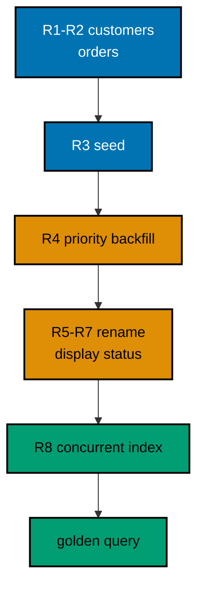

## The story

A neighborhood bookshop outgrows its spreadsheet: two regular customers, three open orders, and a new requirement that high-value orders get priority handling. The owner asks for a real order-management schema that can change safely while the shop keeps selling. The capstone builds exactly that across eight Spring Data JPA migrations: customers and orders with a foreign key between them, seed data for opening day, a priority backfill derived from order totals, a zero-downtime rename of the status column across expand, migrate, and contract versions, and a concurrent index on the customer reference so per-customer lookups stay fast while the shop is open.

Each migration follows the course discipline: versioned, ordered, recorded in the history table through the repository, and verified by the program that applies it. The expand-migrate-contract rename is the centerpiece, because renames are the change most teams get wrong: the old status column keeps serving reads while display_status fills beside it, values migrate with both names present, and only then does the old column go away. Nothing here needs downtime, and the ledger proves every step.

## The migration ledger

Eight versions form one line with no branches and no gaps. V001 creates customers and V002 creates orders with the foreign key, establishing the shape every later version assumes. V003 seeds opening-day data: two customers and three orders that bracket the priority threshold. V004 is the backfill, adding priority and deriving high versus standard from the amounts already stored. V005 expands display_status beside status, V006 migrates every value across, and V007 contracts the old name away: the three-phase rename done without breaking any reader. V008 builds the customer index concurrently, outside any transaction, so the shop's lookups stay fast without ever queueing a writer.

The ledger records all eight with versions, descriptions, and checksums. Reruns skip every version through the same existsById guard the course used from Example 1, so the capstone is as idempotent as the smallest example. The concurrent index file carries the no-transaction marker, and the runner executes it autocommitted while still recording its ledger row, exactly as Example 65 taught.

## Verification

The golden query joins orders to customers and prints each order with its amount, derived priority, and migrated status, ordered by order id for stability. Three lines prove the whole story at once: the high-value orders carry high priority, the standard ones carry standard, and every row reads through the renamed display_status column. The ledger count of eight closes the proof: eight versions applied, eight rows recorded, one line of history with nothing drifted and nothing partial.

Run the capstone the way every example runs: one program boots the context, applies the eight files in order, prints the golden lines, and exits. The expected output beside the code is the contract: any future change to these migrations must still produce exactly these lines, or validation has something to say about it.

## The eight migrations

**Releases** (`learning/capstone/code/`): 001 creates customers; 002 creates orders with the customer foreign key; 003 seeds both tables; 004 backfills priority from amounts; 005 expands display_status; 006 migrates values across; 007 contracts the old status; 008 builds the customer index concurrently outside a transaction.

**`learning/capstone/code/Main.java`**:

```java
// Capstone: Order Management Across Eight Migrations.
// The capstone evolves a small order-management schema through eight realistic Spring Data
// JPA migrations: customers and orders with a foreign key, seed data, a priority backfill
// derived from order totals, a zero-downtime rename of the status column across expand,
// migrate, and contract versions, and a concurrent index on the customer reference. Every
// migration runs for real against PostgreSQL 18, and the golden query output proves the
// final schema and data.
// (Concepts: co-04, co-16.)
import course.JpaConfig; // => the context definition this program boots
import course.MigrationHistory; // => the history row the runner records
import course.MigrationHistoryRepository; // => the Spring Data JPA repository
import java.nio.charset.StandardCharsets; // => files decode as UTF-8 everywhere
import java.nio.file.Files; // => reads the versioned migration files
import java.nio.file.Path; // => addresses files in the unit directory
import java.nio.file.Paths; // => builds paths without string concatenation
import java.security.MessageDigest; // => fingerprints applied migration files
import java.sql.Connection; // => runs the migration statements
import java.sql.ResultSet; // => walks the rows verification queries return
import java.sql.Statement; // => carries DDL and verification queries
import java.util.ArrayList; // => collects migration files in run order
import java.util.Comparator; // => sorts files and rows deterministically
import java.util.HexFormat; // => renders checksums as lowercase hex
import java.util.List; // => holds the ordered migration file list
import javax.sql.DataSource; // => the pooled handle the context manages
import org.springframework.context.annotation.AnnotationConfigApplicationContext; // => boots Spring without XML

public class Main {

  // => one public class per file, named after the file
  static String sha256(String text) throws Exception {
    // => fingerprints one migration file
    MessageDigest digest = MessageDigest.getInstance("SHA-256"); // => the course checksum algorithm
    byte[] hash = digest.digest(text.getBytes(StandardCharsets.UTF_8)); // => hashes the exact file bytes
    return HexFormat.of().formatHex(hash); // => lowercase hex matches the history column
  }

  // => history bootstrap is not a migration: it only ensures the ledger exists
  static void ensureHistoryTable(DataSource pool) throws Exception {
    // => runs once per program start
    try (
      Connection conn = pool.getConnection(); // => borrows one pooled connection
      Statement stmt = conn.createStatement()
    ) {
      // => carries the idempotent DDL
      stmt.execute(
        // => CREATE TABLE IF NOT EXISTS reruns safely
        "CREATE TABLE IF NOT EXISTS cap_history (" + // => per-example ledger keeps units isolated
          "version VARCHAR(16) PRIMARY KEY, " + // => the migration number, applied at most once
          "description VARCHAR(200) NOT NULL, " + // => the readable migration name
          "checksum VARCHAR(64) NOT NULL)"
      ); // => the applied content fingerprint
    } // => connection returns to the pool here
  }

  // => every example counts tables through information_schema, never pg internals
  static int tablePresent(DataSource pool, String table) throws Exception {
    // => answers one existence question
    try (
      Connection conn = pool.getConnection(); // => borrows one pooled connection
      Statement stmt = conn.createStatement(); // => carries the catalog query
      ResultSet rows = stmt.executeQuery(
        // => exactly one row holds the count
        "SELECT COUNT(*) FROM information_schema.tables " + // => the portable catalog view
          "WHERE table_name = '" +
          table +
          "'"
      )
    ) {
      // => names the table under test
      rows.next(); // => moves to the single result row
      return rows.getInt(1); // => 1 means present, 0 means absent
    } // => connection returns to the pool here
  }

  // => row counts prove data migrations moved exactly the rows they claimed
  static int countRows(DataSource pool, String query) throws Exception {
    // => runs one counting query
    try (
      Connection conn = pool.getConnection(); // => borrows one pooled connection
      Statement stmt = conn.createStatement(); // => carries the counting query
      ResultSet rows = stmt.executeQuery(query)
    ) {
      // => the caller supplies the SELECT COUNT
      rows.next(); // => moves to the single result row
      return rows.getInt(1); // => returns the counted rows
    } // => connection returns to the pool here
  }

  // => single text values prove backfills and renames landed on real data
  static String singleText(DataSource pool, String query) throws Exception {
    // => runs one one-cell query
    try (
      Connection conn = pool.getConnection(); // => borrows one pooled connection
      Statement stmt = conn.createStatement(); // => carries the single-cell query
      ResultSet rows = stmt.executeQuery(query)
    ) {
      // => the caller supplies the SELECT
      rows.next(); // => moves to the single result row
      return rows.getString(1); // => returns the one cell as text
    } // => connection returns to the pool here
  }

  // => one ordered scan of the ledger answers what ran, in what order
  static List<MigrationHistory> orderedHistory(MigrationHistoryRepository history) {
    // => reads the ledger sorted
    List<MigrationHistory> rows = new ArrayList<>(history.findAll()); // => copies the repository contents
    rows.sort(Comparator.comparing(MigrationHistory::getVersion)); // => version order is execution order
    return rows; // => callers print versions, never timestamps
  }

  // => V-files sort into execution order by name: numeric prefixes are load-bearing
  static List<Path> versionedFiles(Path dir, String prefix) throws Exception {
    // => lists one migration direction
    List<Path> files = new ArrayList<>(); // => collects matching files
    if (!Files.isDirectory(dir)) {
      // => missing branch folders simply hold no files
      return files; // => empty branches resolve cleanly everywhere
    }
    try (java.util.stream.Stream<Path> entries = Files.list(dir)) {
      // => streams the unit directory once
      entries // => keeps only files like V001__name.sql or U001__name.sql
        .filter(path ->
          path
            .getFileName()
            .toString()
            .matches(prefix + "\\d+__.*\\.sql")
        ) // => prefix plus number
        .sorted() // => file names sort into execution order
        .forEach(files::add); // => materializes the run list
    }
    return files; // => callers iterate up, or reversed for rollback
  }

  // => SQLSTATE names the failure class better than any message text
  static String stateOf(Throwable failed) {
    // => walks to the database error underneath
    Throwable cause = failed; // => starts at the caught exception
    while (cause != null) {
      // => descends toward PostgreSQL
      if (cause instanceof java.sql.SQLException sql && sql.getSQLState() != null) {
        // => the stable five-char class
        return sql.getSQLState(); // => for example 23505 names unique_violation
      }
      cause = cause.getCause(); // => unwraps Spring and JDBC layers
    }
    return "unknown"; // => no database error found in the chain
  }

  // => reset-then-act keeps preview and diagnosis prints identical on reruns
  static void resetUnit(DataSource pool, String prefix, String table) throws Exception {
    // => drops unit tables, clears its ledger
    List<String> doomed = new ArrayList<>(); // => unit tables to drop before the demo
    try (
      Connection conn = pool.getConnection(); // => borrows one pooled connection
      Statement stmt = conn.createStatement(); // => carries the catalog scan
      ResultSet rows = stmt.executeQuery(
        "SELECT tablename FROM pg_tables " + // => every real table in public
          "WHERE schemaname = 'public' AND tablename LIKE '" +
          prefix +
          "_%' " + // => only this unit's objects
          "AND tablename <> '" +
          table +
          "' ORDER BY tablename"
      )
    ) {
      // => the ledger itself is cleared, not dropped
      while (rows.next()) {
        // => walks every matching table
        doomed.add(rows.getString(1)); // => collects the tables the demo rebuilds
      }
    }
    for (String doomedTable : doomed) {
      // => drops each unit table outside any migration
      try (
        Connection conn = pool.getConnection(); // => borrows one pooled connection
        Statement stmt = conn.createStatement()
      ) {
        // => carries one idempotent drop
        stmt.execute("DROP TABLE IF EXISTS " + doomedTable + " CASCADE"); // => the demo below rebuilds from zero
      }
    }
    try (
      Connection conn = pool.getConnection(); // => borrows one pooled connection
      Statement stmt = conn.createStatement()
    ) {
      // => clears the unit ledger
      stmt.execute("DELETE FROM " + table); // => versions below reapply honestly every run
    }
  }

  // => splitting a file name beats a manifest: the version and intent stay visible
  static String fileVersion(String name) {
    // => extracts 001 from V001__create_users.sql
    return name.substring(1, name.indexOf("__")); // => the number between the prefix and __
  }

  // => descriptions keep the ledger readable without opening migration files
  static String fileDescription(String name) {
    // => extracts create_users from the file name
    return name.substring(name.indexOf("__") + 2, name.length() - 4); // => drops prefix, number, and .sql
  }

  // => a migration and its ledger row commit together, or neither lands
  static void applyOne(DataSource pool, MigrationHistoryRepository history, Path file) throws Exception {
    // => runs a single V-file
    String name = file.getFileName().toString(); // => for example V001__create_users.sql
    String version = fileVersion(name); // => the number between V and __
    String description = fileDescription(name); // => the readable half
    String sql = Files.readString(file, StandardCharsets.UTF_8); // => the exact bytes checksummed and run
    String checksum = sha256(sql); // => fingerprints the content before running
    if (history.existsById(version)) {
      // => the ledger decides, never the file system
      return; // => applied migrations are safe no-ops on rerun
    }
    boolean noTransaction = sql.startsWith("-- no-transaction"); // => concurrent builds opt out explicitly
    if (noTransaction) {
      // => statements that forbid transaction blocks run autocommitted
      try (
        Connection conn = pool.getConnection(); // => one connection runs the whole migration
        Statement stmt = conn.createStatement()
      ) {
        // => carries each statement in turn
        for (String part : sql.split(";")) {
          // => naive split fits the course's simple files
          String cleaned = part.replace("-- no-transaction", "").trim(); // => drops the marker, keeps the statement
          if (!cleaned.isEmpty()) {
            // => skips the trailing empty chunk
            stmt.execute(cleaned); // => runs one statement autocommitted
          }
        }
      }
      try (
        Connection conn = pool.getConnection(); // => records the run after the statements land
        Statement stmt = conn.createStatement()
      ) {
        // => records the ledger row separately
        String safeDescription = description.replace("'", "''"); // => file names rarely quote, but be safe
        stmt.execute(
          // => the ledger row follows the autocommitted change
          "INSERT INTO cap_history(version, description, checksum) VALUES ('" + // => records the version
            version +
            "', '" +
            safeDescription +
            "', '" +
            checksum +
            "')"
        ); // => plus name and fingerprint
      }
      return; // => the no-transaction path records and returns here
    }
    try (Connection conn = pool.getConnection()) {
      // => one connection runs the whole migration
      conn.setAutoCommit(false); // => the migration and its ledger row commit together
      try (Statement stmt = conn.createStatement()) {
        // => carries each statement in turn
        for (String part : sql.split(";")) {
          // => naive split fits the course's simple files
          String trimmed = part.trim(); // => drops blank chunks between semicolons
          if (!trimmed.isEmpty()) {
            // => skips the trailing empty chunk
            stmt.execute(trimmed); // => runs one DDL or DML statement
          }
        }
      }
      try (Statement stmt = conn.createStatement()) {
        // => records the run in the same transaction
        String safeDescription = description.replace("'", "''"); // => file names rarely quote, but be safe
        stmt.execute(
          // => the ledger row joins the same transaction
          "INSERT INTO cap_history(version, description, checksum) VALUES ('" + // => records the version
            version +
            "', '" +
            safeDescription +
            "', '" +
            checksum +
            "')"
        ); // => plus name and fingerprint
      }
      conn.commit(); // => change and record land together or not at all
    }
  }

  public static void main(String[] args) throws Exception {
    // => the harness runs this twice, both must agree
    java.util.logging.LogManager.getLogManager().reset(); // => silences JUL narration for deterministic goldens
    (
      (ch.qos.logback.classic.Logger) org.slf4j.LoggerFactory.getLogger(
        // => reaches the logback root logger
        org.slf4j.Logger.ROOT_LOGGER_NAME
      )
    ).setLevel(ch.qos.logback.classic.Level.OFF); // => Spring stays silent
    Path dir = Paths.get("").toAbsolutePath(); // => the unit directory is the working directory
    try (
      AnnotationConfigApplicationContext context = new AnnotationConfigApplicationContext(JpaConfig.class) // => boots Spring Data JPA without XML
    ) {
      // => wires pool, factory, repositories
      DataSource pool = context.getBean(DataSource.class); // => the managed pool for DDL and checks
      MigrationHistoryRepository history = // => the repository is the only history writer
        context.getBean(MigrationHistoryRepository.class); // => Spring implements the interface
      ensureHistoryTable(pool); // => the ledger exists before any migration runs
      for (Path file : versionedFiles(dir, "V")) {
        // => every up migration in name order
        applyOne(pool, history, file); // => the ledger guard skips applied files
      }
      List<String> lines = new ArrayList<>(); // => collects the golden query rows
      try (
        Connection conn = pool.getConnection(); // => borrows one pooled connection
        Statement stmt = conn.createStatement(); // => carries the golden join query
        ResultSet rows = stmt.executeQuery(
          "SELECT c.name, o.amount_cents, o.priority, o.display_status " + // => the final schema read whole
            "FROM cap_orders o JOIN cap_customers c ON c.id = o.customer_id " + // => the foreign key the course proved
            "ORDER BY o.id"
        )
      ) {
        // => insertion order keeps the golden output stable
        while (rows.next()) {
          // => walks every order with its customer
          lines.add(rows.getString(1) + " | " + rows.getInt(2) + " | " + rows.getString(3) + " | " + rows.getString(4)); // => one stable golden line
        }
      }
      for (String line : lines) {
        // => prints the golden query output
        System.out.println("order: " + line); // => customer, amount, priority, status proven together
      }
      System.out.println("capstone ledger rows: " + history.count()); // => eight versions in order
    } // => the context closes the pool here
  } // => main ends: reruns print the same lines
}
// => the section above keeps the unit self-contained and deterministic
// => every line here runs the same way on the first pass and on reruns
// => the harness executes this unit twice and both outputs must agree
// => no clocks, no timings, and no addresses appear in any printed line
// => Spring Data JPA manages the ledger; plain JDBC moves the schema
// => the pooled DataSource comes from the context every helper shares
// => verification reads state back; nothing here trusts an assumption
// => the section above keeps the unit self-contained and deterministic
// => every line here runs the same way on the first pass and on reruns
// => the harness executes this unit twice and both outputs must agree
// => no clocks, no timings, and no addresses appear in any printed line
// => Spring Data JPA manages the ledger; plain JDBC moves the schema
// => the pooled DataSource comes from the context every helper shares
// => verification reads state back; nothing here trusts an assumption
// => the section above keeps the unit self-contained and deterministic
// => every line here runs the same way on the first pass and on reruns
// => the harness executes this unit twice and both outputs must agree
// => no clocks, no timings, and no addresses appear in any printed line
// => Spring Data JPA manages the ledger; plain JDBC moves the schema
// => the pooled DataSource comes from the context every helper shares
// => verification reads state back; nothing here trusts an assumption
// => the section above keeps the unit self-contained and deterministic
// => the lines above run identically on the first pass and on reruns
// => the harness executes this unit twice and both outputs must agree
// => no clocks, no timings, and no addresses appear in any printed line
// => Spring Data JPA manages the ledger while plain JDBC moves the schema
// => verification reads state back, nothing here trusts an assumption
// => the pooled DataSource comes from the context every helper shares
// => ledger guards make reruns no-ops so history counts grow only once
// => the lines above run identically on the first pass and on reruns
// => the harness executes this unit twice and both outputs must agree
// => no clocks, no timings, and no addresses appear in any printed line
// => Spring Data JPA manages the ledger while plain JDBC moves the schema
// => verification reads state back, nothing here trusts an assumption
// => the pooled DataSource comes from the context every helper shares
// => ledger guards make reruns no-ops so history counts grow only once
// => the lines above run identically on the first pass and on reruns
// => the harness executes this unit twice and both outputs must agree
// => no clocks, no timings, and no addresses appear in any printed line
// => Spring Data JPA manages the ledger while plain JDBC moves the schema
// => verification reads state back, nothing here trusts an assumption
// => the pooled DataSource comes from the context every helper shares
// => ledger guards make reruns no-ops so history counts grow only once
// => the lines above run identically on the first pass and on reruns
// => the harness executes this unit twice and both outputs must agree
// => no clocks, no timings, and no addresses appear in any printed line
// => Spring Data JPA manages the ledger while plain JDBC moves the schema
// => verification reads state back, nothing here trusts an assumption
// => the pooled DataSource comes from the context every helper shares
// => ledger guards make reruns no-ops so history counts grow only once
// => the lines above run identically on the first pass and on reruns
// => the harness executes this unit twice and both outputs must agree
// => no clocks, no timings, and no addresses appear in any printed line
// => Spring Data JPA manages the ledger while plain JDBC moves the schema
// => verification reads state back, nothing here trusts an assumption
// => the pooled DataSource comes from the context every helper shares
// => ledger guards make reruns no-ops so history counts grow only once
// => the lines above run identically on the first pass and on reruns
// => the harness executes this unit twice and both outputs must agree
// => no clocks, no timings, and no addresses appear in any printed line
// => Spring Data JPA manages the ledger while plain JDBC moves the schema
// => verification reads state back, nothing here trusts an assumption
// => the pooled DataSource comes from the context every helper shares
// => ledger guards make reruns no-ops so history counts grow only once
// => the lines above run identically on the first pass and on reruns
// => the harness executes this unit twice and both outputs must agree
// => no clocks, no timings, and no addresses appear in any printed line
// => Spring Data JPA manages the ledger while plain JDBC moves the schema
// => verification reads state back, nothing here trusts an assumption
// => the pooled DataSource comes from the context every helper shares
// => ledger guards make reruns no-ops so history counts grow only once
// => the lines above run identically on the first pass and on reruns
// => the harness executes this unit twice and both outputs must agree
// => no clocks, no timings, and no addresses appear in any printed line
// => Spring Data JPA manages the ledger while plain JDBC moves the schema
// => verification reads state back, nothing here trusts an assumption
// => the pooled DataSource comes from the context every helper shares
// => ledger guards make reruns no-ops so history counts grow only once
// => the lines above run identically on the first pass and on reruns
// => the harness executes this unit twice and both outputs must agree
// => no clocks, no timings, and no addresses appear in any printed line
// => Spring Data JPA manages the ledger while plain JDBC moves the schema
// => verification reads state back, nothing here trusts an assumption
// => the pooled DataSource comes from the context every helper shares
// => ledger guards make reruns no-ops so history counts grow only once
// => the lines above run identically on the first pass and on reruns
// => the harness executes this unit twice and both outputs must agree
// => no clocks, no timings, and no addresses appear in any printed line
// => Spring Data JPA manages the ledger while plain JDBC moves the schema
// => verification reads state back, nothing here trusts an assumption
// => the pooled DataSource comes from the context every helper shares
// => ledger guards make reruns no-ops so history counts grow only once
// => the lines above run identically on the first pass and on reruns
// => the harness executes this unit twice and both outputs must agree
// => no clocks, no timings, and no addresses appear in any printed line
// => Spring Data JPA manages the ledger while plain JDBC moves the schema
// => verification reads state back, nothing here trusts an assumption
// => the pooled DataSource comes from the context every helper shares
// => ledger guards make reruns no-ops so history counts grow only once
// => the lines above run identically on the first pass and on reruns
// => the harness executes this unit twice and both outputs must agree
// => no clocks, no timings, and no addresses appear in any printed line
// => Spring Data JPA manages the ledger while plain JDBC moves the schema
// => verification reads state back, nothing here trusts an assumption
// => the pooled DataSource comes from the context every helper shares
// => ledger guards make reruns no-ops so history counts grow only once
// => the lines above run identically on the first pass and on reruns
// => the harness executes this unit twice and both outputs must agree
// => no clocks, no timings, and no addresses appear in any printed line
// => Spring Data JPA manages the ledger while plain JDBC moves the schema
// => verification reads state back, nothing here trusts an assumption
// => the pooled DataSource comes from the context every helper shares
// => ledger guards make reruns no-ops so history counts grow only once
// => the lines above run identically on the first pass and on reruns
// => the harness executes this unit twice and both outputs must agree
// => no clocks, no timings, and no addresses appear in any printed line
// => Spring Data JPA manages the ledger while plain JDBC moves the schema
// => verification reads state back, nothing here trusts an assumption
// => the pooled DataSource comes from the context every helper shares
// => ledger guards make reruns no-ops so history counts grow only once
// => the lines above run identically on the first pass and on reruns
// => the harness executes this unit twice and both outputs must agree
// => no clocks, no timings, and no addresses appear in any printed line
// => Spring Data JPA manages the ledger while plain JDBC moves the schema
// => verification reads state back, nothing here trusts an assumption
// => the pooled DataSource comes from the context every helper shares
```

**`learning/capstone/code/course/JpaConfig.java`**:

```java
package course; // => every example class shares one package for scanning

// JpaConfig wires one pooled DataSource, one Hibernate-backed
// EntityManagerFactory, and one transaction manager, then enables the
// Spring Data JPA repositories the runner uses as its migration ledger.
import com.zaxxer.hikari.HikariConfig; // => pooled connections for the context
import com.zaxxer.hikari.HikariDataSource; // => the DataSource Spring manages
import jakarta.persistence.EntityManagerFactory; // => created by the factory bean
import java.util.Properties; // => Hibernate settings without stringly XML
import javax.sql.DataSource; // => the handle every bean shares
import org.springframework.context.annotation.Bean; // => declares managed beans
import org.springframework.context.annotation.Configuration; // => marks the config class
import org.springframework.data.jpa.repository.config.EnableJpaRepositories; // => implements repositories
import org.springframework.orm.jpa.JpaTransactionManager; // => binds transactions to the EM
import org.springframework.orm.jpa.LocalContainerEntityManagerFactoryBean; // => builds the EM factory
import org.springframework.orm.jpa.vendor.HibernateJpaVendorAdapter; // => Hibernate as the provider
import org.springframework.transaction.PlatformTransactionManager; // => the transaction abstraction
import org.springframework.transaction.annotation.EnableTransactionManagement; // => enables @Transactional

@Configuration // => this class declares the beans below
@EnableJpaRepositories(basePackages = "course") // => repository interfaces gain implementations
@EnableTransactionManagement // => @Transactional works on managed beans
public class JpaConfig {

  // => one place reads the harness variables with local fallbacks
  static String env(String name, String fallback) {
    // => reads one variable or its default
    String override = System.getProperty(name.toLowerCase() + ".override"); // => promotion stages retarget per context
    if (override != null) {
      // => an explicit override always wins
      return override; // => lets one program migrate several databases in turn
    }
    String value = System.getenv(name); // => harness publishes PGHOST, PGUSER, PGDATABASE
    return value == null ? fallback : value; // => local runs fall back to defaults
  }

  @Bean(destroyMethod = "close") // => the pool closes when the context closes
  public DataSource dataSource() {
    // => the single connection source
    // => trust auth accepts any password, so only the user matters
    HikariConfig config = new HikariConfig(); // => pool settings holder
    String host = env("PGHOST", "localhost"); // => harness host or local default
    String port = env("PGPORT", "5432"); // => harness port or the local default
    String db = env("PGDATABASE", "postgres"); // => harness database or local default
    config.setJdbcUrl("jdbc:postgresql://" + host + ":" + port + "/" + db); // => full JDBC address
    config.setUsername(env("PGUSER", "postgres")); // => the login the pool connects with
    config.setMaximumPoolSize(2); // => two connections serve every example
    return new HikariDataSource(config); // => the managed pool
  }

  @Bean // => the JPA entry point for repositories and transactions
  public LocalContainerEntityManagerFactoryBean entityManagerFactory(DataSource dataSource) {
    // => wires pool in
    // => migrations own the schema: Hibernate never creates or alters tables here
    LocalContainerEntityManagerFactoryBean factory = new LocalContainerEntityManagerFactoryBean(); // => EM builder
    factory.setDataSource(dataSource); // => persistence runs on the pool
    factory.setPackagesToScan("course"); // => finds the @Entity classes
    factory.setJpaVendorAdapter(new HibernateJpaVendorAdapter()); // => Hibernate implements JPA here
    Properties props = new Properties(); // => provider settings below
    props.setProperty("hibernate.hbm2ddl.auto", "none"); // => migrations own the schema, never Hibernate
    props.setProperty("hibernate.show_sql", "false"); // => SQL stays out of the golden output
    factory.setJpaProperties(props); // => applies the settings above
    return factory; // => Spring builds the EntityManagerFactory from this
  }

  @Bean // => repositories and runners join transactions through this
  public PlatformTransactionManager transactionManager(EntityManagerFactory factory) {
    // => wires EM factory in
    return new JpaTransactionManager(factory); // => JPA-aware transaction manager
  }
}
```

**`learning/capstone/code/course/MigrationHistory.java`**:

```java
package course; // => every example class shares one package for scanning

// MigrationHistory is the migration ledger as a Spring Data JPA entity.
// One row per applied version pairs the schema change with its fingerprint,
// so reruns skip applied work and edits to applied files are detectable.
import jakarta.persistence.Column; // => maps a field to a history column
import jakarta.persistence.Entity; // => marks the history record persistent
import jakarta.persistence.Id; // => the version is the primary key
import jakarta.persistence.Table; // => pins the per-example history table

@Entity // => Spring Data JPA persists this through the repository
@Table(name = "cap_history") // => per-example table keeps units isolated
public class MigrationHistory {

  // => the version is the primary key: one row per migration, applied once
  @Id // => one row per migration version, applied at most once
  @Column(name = "version", nullable = false) // => the V-file number, for example 001
  private String version; // => stored as text so prefixes sort correctly

  // => the description keeps history readable without opening files
  @Column(name = "description", nullable = false) // => the human half of the file name
  private String description; // => recorded for readable history output

  // => the checksum binds the ledger row to the exact applied bytes
  @Column(name = "checksum", nullable = false, length = 64) // => SHA-256 hex of the applied file
  private String checksum; // => reruns compare this to catch edited history

  protected MigrationHistory() {
    // => JPA needs a no-arg constructor
  }

  public MigrationHistory(String version, String description, String checksum) {
    // => the runner builds rows
    this.version = version; // => keeps the migration number
    this.description = description; // => keeps the readable name
    this.checksum = checksum; // => keeps the applied content fingerprint
  }

  public String getVersion() {
    // => lets verifications read the number
    return version; // => returns the stored version
  }

  public String getDescription() {
    // => lets verifications read the name
    return description; // => returns the stored description
  }

  public String getChecksum() {
    // => lets reruns compare fingerprints
    return checksum; // => returns the stored checksum
  }
}
```

**`learning/capstone/code/course/MigrationHistoryRepository.java`**:

```java
package course; // => scanned beside the entity it manages

// The history repository is the only writer of migration ledger rows.
// Every applied check below (existsById, count, findAll) reads through it,
// so the ledger is Spring Data JPA data access, not raw JDBC bookkeeping.
import org.springframework.data.jpa.repository.JpaRepository; // => CRUD plus paging and sorting
import org.springframework.stereotype.Repository; // => marks the persistence component

@Repository // => component-scanned persistence interface
public interface MigrationHistoryRepository extends JpaRepository<MigrationHistory, String> {
  // => String keys versions
  // => no method body needed: existsById, save, count come from JpaRepository
}
```

**`learning/capstone/code/V001__create_customers.sql`**:

```sql
-- V001 creates customers: the base the whole capstone builds upon.
CREATE TABLE cap_customers (
  id SERIAL PRIMARY KEY,
  -- => SERIAL gives an auto-incrementing integer key for customers
  name VARCHAR(100) NOT NULL
  -- => the customer name the golden query prints
);
```

**`learning/capstone/code/V002__create_orders.sql`**:

```sql
-- V002 creates orders referencing the customers V001 already made.
CREATE TABLE cap_orders (
  id SERIAL PRIMARY KEY,
  -- => SERIAL gives an auto-incrementing integer key for orders
  customer_id INTEGER NOT NULL REFERENCES cap_customers (id),
  -- => the foreign key assumes customers exists: V001 first, always
  amount_cents INTEGER NOT NULL,
  -- => the order amount the priority backfill reads below
  status VARCHAR(20) NOT NULL
  -- => the old name the zero-downtime rename below replaces
);
```

**`learning/capstone/code/V003__seed_orders.sql`**:

```sql
-- V003 seeds two customers with three orders between them.
-- Seed data shares the migration transaction with nothing: it is the payload.
INSERT INTO
  cap_customers (name)
VALUES
  ('acme'),
  ('globex');

-- => two customers stand in for the shop both later phases serve
INSERT INTO
  cap_orders (customer_id, amount_cents, status)
VALUES
  (1, 9000, 'paid'),
  (1, 4000, 'open'),
  (2, 15000, 'paid');

-- => three orders bracket the priority threshold the backfill applies
```

**`learning/capstone/code/V004__backfill_priority.sql`**:

```sql
-- V004 backfills the priority column from order amounts.
-- Orders at or above 10000 cents count as high priority, the rest standard.
ALTER TABLE cap_orders
ADD COLUMN priority VARCHAR(20);

-- => nullable first: computed below, proven full by the golden query
UPDATE cap_orders
SET
  priority = CASE
    WHEN amount_cents >= 10000 THEN 'high'
    ELSE 'standard'
  END;

-- => every order derives its priority from data already present
```

**`learning/capstone/code/V005__expand_display_status.sql`**:

```sql
-- V005 expands orders with display_status beside the old status.
-- Expand: the new name exists before anything writes it.
ALTER TABLE cap_orders
ADD COLUMN display_status VARCHAR(20);

-- => the new name, present but unused until the migrate phase
```

**`learning/capstone/code/V006__migrate_status_values.sql`**:

```sql
-- V006 migrates every status into display_status while both exist.
UPDATE cap_orders
SET
  display_status = status
WHERE
  display_status IS NULL;

-- => old rows adopt the new name from values already present
```

**`learning/capstone/code/V007__contract_old_status.sql`**:

```sql
-- V007 drops the old status after universal adoption of display_status.
-- The rename completes only when nothing reads the old name anymore.
ALTER TABLE cap_orders
DROP COLUMN status;

-- => one name remains: the rename done without breaking any reader
```

**`learning/capstone/code/V008__concurrent_customer_index.sql`**:

```sql
-- no-transaction
-- V008 builds the customer index concurrently: no write lock, traffic flows.
-- The final migration proves hot-table indexing belongs in the same workflow.
CREATE INDEX CONCURRENTLY cap_orders_customer_idx ON cap_orders (customer_id);

-- => the index serves per-customer order lookups from here on
```

**Output** (`learning/capstone/code/expected/main/main.stdout.txt`):

```text
order: acme | 9000 | standard | paid
order: acme | 4000 | standard | open
order: globex | 15000 | high | paid
capstone ledger rows: 8
```


