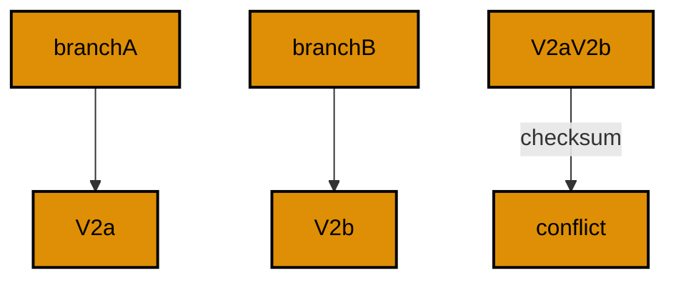

Examples 54–78 handle real teams and real incidents. Version conflicts across branches resolve by renumbering forward (Examples 54–61), concurrent migrators serialize on the history lock (Examples 62–70), and failed, edited, or drifted histories diagnose through history-first runbooks (Examples 71–78). Every example is a complete, runnable Kotlin program under `learning/code/`; run each with the command in its own `run.yaml`.

---

### Example 54: Two Branches, One Version Number

Two developers both write `V2`: one adds a phone column, the other an address column. Same version, different content. Validating branch B's directory against a database that ran branch A fails the checksum — the conflict surfaces before any merge.

The program migrates branch A's set, then validates branch B's and prints the boolean. `false` here is the team succeeding: the tool caught what a careless merge would have shipped.

(Concepts: co-14.)



**`learning/code/ex-54-two-branches-one-version-number/Main.kt`**:

```kotlin
// Example 54: Two Branches, One Version Number.
// same version, different content.
import org.flywaydb.core.Flyway // => the entry point: configure, then migrate
import java.sql.DriverManager // => plain JDBC for the verification queries

fun dbUrl(): String { // => one URL builder shared by Flyway and JDBC
    val host = System.getenv("PGHOST") ?: "localhost" // => service alias on the unit network
    val db = System.getenv("PGDATABASE") ?: "postgres" // => the service's database name
    return "jdbc:postgresql://" + host + "/" + db // => trust auth needs no password
} // => helper ends: every connection string flows through here

fun dbUser(): String { // => one user lookup shared by Flyway and JDBC
    return System.getenv("PGUSER") ?: "postgres" // => postgres superuser in the service container
} // => helper ends: a single place if the service user ever changes

fun main() { // => the entry point the harness runs
    val branchA = Flyway.configure() // => configuration for branch A
        .dataSource(dbUrl(), dbUser(), null) // => trust auth: user with no password
        .locations("filesystem:migrations/main") // => V1 plus the phone V2
        .load() // => freeze branch A's configuration
    branchA.migrate() // => apply pending migrations; re-runs find nothing new
    val branchB = Flyway.configure() // => configuration for branch B
        .dataSource(dbUrl(), dbUser(), null) // => same database, rival files
        .locations("filesystem:migrations/other") // => V1 plus the address V2
        .load() // => freeze branch B's configuration
    println("valid=" + branchB.validateWithResult().validationSuccessful) // => checksums disagree on V2
} // => main ends: every check printed
```

**`learning/code/ex-54-two-branches-one-version-number/migrations/main/V1__create_users.sql`**:

```sql
-- V1: the shared starting point.
CREATE TABLE users (
    id SERIAL PRIMARY KEY,
    name TEXT NOT NULL
);
```

**`learning/code/ex-54-two-branches-one-version-number/migrations/main/V2__add_phone.sql`**:

```sql
-- V2 branch A: phone wins on this branch.
ALTER TABLE users ADD COLUMN phone TEXT;
```

**`learning/code/ex-54-two-branches-one-version-number/migrations/other/V1__create_users.sql`**:

```sql
-- V1: the shared starting point.
CREATE TABLE users (
    id SERIAL PRIMARY KEY,
    name TEXT NOT NULL
);
```

**`learning/code/ex-54-two-branches-one-version-number/migrations/other/V2__add_address.sql`**:

```sql
-- V2 branch B: address wins on this branch.
ALTER TABLE users ADD COLUMN address TEXT;
```

**Output** (`learning/code/ex-54-two-branches-one-version-number/expected/main.stdout.txt`):

```text
valid=false
```

**Key takeaway**: Same version with different content fails validation: the conflict surfaces pre-merge.

**Why it matters**: Checksum conflicts turn silent overwrites into explicit renumbering work that the team schedules deliberately. Without validation, two branches writing the same version would race to production, and the loser would overwrite the winner's schema change without a trace in any review. The failure forces the conversation that should have happened: whose change keeps the number, whose change moves forward, and what the merged order means. Conflicts detected before merge cost a renumber; conflicts detected after deploy cost an incident and a forensic reconstruction of which bytes actually ran.

---

### Example 55: Merge by Renumbering Forward

The fix for a version collision is renumbering, not editing: the losing branch's change becomes the next version. Here branch A's `V2` stands, and branch B's address column returns as `V3` in the merged directory. History stays truthful about what ran when.

The program migrates branch A, then migrates the merged set and prints the three versions. Renumber-forward is the only merge that never rewrites the past.

(Concepts: co-14.)


**`learning/code/ex-55-merge-by-renumbering-forward/Main.kt`**:

```kotlin
// Example 55: Merge by Renumbering Forward.
// the loser becomes the next version.
import org.flywaydb.core.Flyway // => the entry point: configure, then migrate
import java.sql.DriverManager // => plain JDBC for the verification queries

fun dbUrl(): String { // => one URL builder shared by Flyway and JDBC
    val host = System.getenv("PGHOST") ?: "localhost" // => service alias on the unit network
    val db = System.getenv("PGDATABASE") ?: "postgres" // => the service's database name
    return "jdbc:postgresql://" + host + "/" + db // => trust auth needs no password
} // => helper ends: every connection string flows through here

fun dbUser(): String { // => one user lookup shared by Flyway and JDBC
    return System.getenv("PGUSER") ?: "postgres" // => postgres superuser in the service container
} // => helper ends: a single place if the service user ever changes

fun main() { // => the entry point the harness runs
    val branchA = Flyway.configure() // => configuration for the winning branch
        .dataSource(dbUrl(), dbUser(), null) // => trust auth: user with no password
        .locations("filesystem:migrations/branch") // => V1 plus the phone V2
        .load() // => freeze the branch configuration
    try { // => the winning branch applies once; re-runs find it superseded
        branchA.migrate() // => V1 and V2 apply on the first run
    } catch (e: Exception) { // => later runs see the merged V3 and stand down
    } // => either path converges on the same history below
    val merged = Flyway.configure() // => configuration for the merged set
        .dataSource(dbUrl(), dbUser(), null) // => same database, merged files
        .locations("filesystem:migrations/merged") // => V1, V2, plus renumbered V3
        .load() // => freeze the merged configuration
    merged.migrate() // => apply pending migrations; re-runs find nothing new
    DriverManager.getConnection(dbUrl(), dbUser(), null).use { conn -> // => open one JDBC connection
        conn.createStatement().use { st -> // => a statement for the history query
            st.executeQuery("SELECT version, description, success FROM flyway_schema_history ORDER BY installed_rank").use { rs -> // => history rows in apply order
                while (rs.next()) { // => walk every recorded migration
                    println(rs.getString(1) + " " + rs.getString(2) + " " + rs.getBoolean(3)) // => one line per migration
                } // => loop ends after the last applied migration
            } // => result set closed here
        } // => statement closed here
    } // => connection closed here
} // => main ends: every check printed
```

**`learning/code/ex-55-merge-by-renumbering-forward/migrations/branch/V1__create_users.sql`**:

```sql
-- V1: the shared starting point.
CREATE TABLE users (
    id SERIAL PRIMARY KEY,
    name TEXT NOT NULL
);
```

**`learning/code/ex-55-merge-by-renumbering-forward/migrations/branch/V2__add_phone.sql`**:

```sql
-- V2: the winning branch change.
ALTER TABLE users ADD COLUMN phone TEXT;
```

**`learning/code/ex-55-merge-by-renumbering-forward/migrations/merged/V1__create_users.sql`**:

```sql
-- V1: the shared starting point.
CREATE TABLE users (
    id SERIAL PRIMARY KEY,
    name TEXT NOT NULL
);
```

**`learning/code/ex-55-merge-by-renumbering-forward/migrations/merged/V2__add_phone.sql`**:

```sql
-- V2: the winning branch change.
ALTER TABLE users ADD COLUMN phone TEXT;
```

**`learning/code/ex-55-merge-by-renumbering-forward/migrations/merged/V3__add_address.sql`**:

```sql
-- V3: the losing change renumbered forward, never edited.
ALTER TABLE users ADD COLUMN address TEXT;
```

**Output** (`learning/code/ex-55-merge-by-renumbering-forward/expected/main.stdout.txt`):

```text
1 create users true
2 add phone true
3 add address true
```

**Key takeaway**: Resolve version collisions by renumbering the loser forward; never edit applied files.

**Why it matters**: Renumber-forward merges keep every environment's history identical, which is the property all promotion tooling assumes. Editing an applied file would fork the fleet: machines that ran the old bytes disagree forever with machines that run the new ones under the same version. Moving the losing change to the next version costs nothing technically and preserves everything procedurally, since the content is unchanged and only its position in the order is new. Identical histories are what let a green staging run predict a green production run.

---

### Example 56: Hotfix Arrives After the Release

Production runs `V1`, `V2`, `V4`, `V5` when an urgent `V3` hotfix lands. The version is lower than the current head, so it arrives out of order — and that is exactly what `outOfOrder(true)` is for. The hotfix applies late but records its true version.

The program prints history ordered by installation rank: 1, 2, 4, 5, then 3. Rank tells when it ran; version tells what it is. Both truths matter during incident review.

(Concepts: co-04, co-13.)


**`learning/code/ex-56-hotfix-arrives-after-the-release/Main.kt`**:

```kotlin
// Example 56: Hotfix Arrives After the Release.
// the late fix keeps its true number.
import org.flywaydb.core.Flyway // => the entry point: configure, then migrate
import java.sql.DriverManager // => plain JDBC for the verification queries

fun dbUrl(): String { // => one URL builder shared by Flyway and JDBC
    val host = System.getenv("PGHOST") ?: "localhost" // => service alias on the unit network
    val db = System.getenv("PGDATABASE") ?: "postgres" // => the service's database name
    return "jdbc:postgresql://" + host + "/" + db // => trust auth needs no password
} // => helper ends: every connection string flows through here

fun dbUser(): String { // => one user lookup shared by Flyway and JDBC
    return System.getenv("PGUSER") ?: "postgres" // => postgres superuser in the service container
} // => helper ends: a single place if the service user ever changes

fun main() { // => the entry point the harness runs
    val prod = Flyway.configure() // => configuration for the release set
        .dataSource(dbUrl(), dbUser(), null) // => trust auth: user with no password
        .locations("filesystem:migrations/prod") // => V1, V2, V4, V5
        .load() // => freeze the release configuration
    try { // => the release applies once; re-runs find the hotfix in place
        prod.migrate() // => V1, V2, V4, V5 apply on the first run
    } catch (e: Exception) { // => later runs see V3 and stand down
    } // => either path converges on the same ranked history below
    val fix = Flyway.configure() // => configuration including the hotfix
        .dataSource(dbUrl(), dbUser(), null) // => same database, fuller set
        .locations("filesystem:migrations/hotfix") // => V1 through V5 with the true V3
        .outOfOrder(true) // => the team accepts the late hotfix
        .load() // => freeze the hotfix configuration
    fix.migrate() // => apply pending migrations; re-runs find nothing new
    DriverManager.getConnection(dbUrl(), dbUser(), null).use { conn -> // => open one JDBC connection
        conn.createStatement().use { st -> // => a statement for the rank query
            st.executeQuery("SELECT version FROM flyway_schema_history ORDER BY installed_rank").use { rs -> // => true run order
                val order = StringBuilder() // => collect versions in rank order
                while (rs.next()) { // => walk every recorded migration
                    if (order.isNotEmpty()) order.append(",") // => comma between versions
                    order.append(rs.getString(1)) // => rank order, not version order
                } // => loop ends after the last row
                println("ranked=" + order.toString()) // => 1,2,4,5 then 3
            } // => result set closed here
        } // => statement closed here
    } // => connection closed here
} // => main ends: every check printed
```

**`learning/code/ex-56-hotfix-arrives-after-the-release/migrations/hotfix/V1__create_items.sql`**:

```sql
-- V1: items open the release.
CREATE TABLE items (
    id SERIAL PRIMARY KEY,
    name TEXT NOT NULL
);
```

**`learning/code/ex-56-hotfix-arrives-after-the-release/migrations/hotfix/V2__add_stock.sql`**:

```sql
-- V2: stock tracking joins the release.
ALTER TABLE items ADD COLUMN stock INTEGER NOT NULL DEFAULT 0;
```

**`learning/code/ex-56-hotfix-arrives-after-the-release/migrations/hotfix/V3__add_weight.sql`**:

```sql
-- V3: the late hotfix with its true number.
ALTER TABLE items ADD COLUMN weight INTEGER;
```

**`learning/code/ex-56-hotfix-arrives-after-the-release/migrations/hotfix/V4__add_price.sql`**:

```sql
-- V4: pricing skips the missing number.
ALTER TABLE items ADD COLUMN price INTEGER;
```

**`learning/code/ex-56-hotfix-arrives-after-the-release/migrations/hotfix/V5__add_code.sql`**:

```sql
-- V5: codes close the release.
ALTER TABLE items ADD COLUMN code TEXT;
```

**`learning/code/ex-56-hotfix-arrives-after-the-release/migrations/prod/V1__create_items.sql`**:

```sql
-- V1: items open the release.
CREATE TABLE items (
    id SERIAL PRIMARY KEY,
    name TEXT NOT NULL
);
```

**`learning/code/ex-56-hotfix-arrives-after-the-release/migrations/prod/V2__add_stock.sql`**:

```sql
-- V2: stock tracking joins the release.
ALTER TABLE items ADD COLUMN stock INTEGER NOT NULL DEFAULT 0;
```

**`learning/code/ex-56-hotfix-arrives-after-the-release/migrations/prod/V4__add_price.sql`**:

```sql
-- V4: pricing skips the missing number.
ALTER TABLE items ADD COLUMN price INTEGER;
```

**`learning/code/ex-56-hotfix-arrives-after-the-release/migrations/prod/V5__add_code.sql`**:

```sql
-- V5: codes close the release.
ALTER TABLE items ADD COLUMN code TEXT;
```

**Output** (`learning/code/ex-56-hotfix-arrives-after-the-release/expected/main.stdout.txt`):

```text
ranked=1,2,4,5,3
```

**Key takeaway**: Land hotfixes with `outOfOrder(true)` so late versions keep their true numbers.

**Why it matters**: Installation rank versus version tells the incident story honestly: what ran, and when, as two separate facts. Version order describes the logical sequence of the schema; rank order describes the actual sequence of events on that database, including the hotfix that arrived late. Conflating the two rewrites history to look tidier than reality, which misleads exactly when accuracy matters most. Keeping both truths visible lets reviewers see that the hotfix landed after the release it conceptually precedes, and reason about its effects accordingly.

---

### Example 57: Checksum Stability Across Runs

Checksums must be stable: reading them twice after migrating returns identical values. If a teammate's editor reformatted the file — even whitespace — the checksum would change and validation would fail. Stability proves nobody touched the files.

The program migrates, reads both checksums twice, and compares. The `stable=true` line is the whole assertion.

(Concepts: co-11, co-14.)


**`learning/code/ex-57-checksum-stability-across-runs/Main.kt`**:

```kotlin
// Example 57: Checksum Stability Across Runs.
// stability proves untouched files.
import org.flywaydb.core.Flyway // => the entry point: configure, then migrate
import java.sql.DriverManager // => plain JDBC for the verification queries

fun dbUrl(): String { // => one URL builder shared by Flyway and JDBC
    val host = System.getenv("PGHOST") ?: "localhost" // => service alias on the unit network
    val db = System.getenv("PGDATABASE") ?: "postgres" // => the service's database name
    return "jdbc:postgresql://" + host + "/" + db // => trust auth needs no password
} // => helper ends: every connection string flows through here

fun dbUser(): String { // => one user lookup shared by Flyway and JDBC
    return System.getenv("PGUSER") ?: "postgres" // => postgres superuser in the service container
} // => helper ends: a single place if the service user ever changes

fun main() { // => the entry point the harness runs
    val flyway = Flyway.configure() // => start from a clean configuration
        .dataSource(dbUrl(), dbUser(), null) // => trust auth: user with no password
        .locations("filesystem:migrations") // => SQL files live beside the program
        .load() // => freeze the configuration into a Flyway instance
    flyway.migrate() // => apply pending migrations; re-runs find nothing new
    val first = flyway.info().applied().map { it.checksum }.toList() // => read both checksums once
    val second = flyway.info().applied().map { it.checksum }.toList() // => read them again immediately
    println("stable=" + (first == second)) // => identical lists prove stability
} // => main ends: every check printed
```

**`learning/code/ex-57-checksum-stability-across-runs/migrations/V1__create_meters.sql`**:

```sql
-- V1: meters for the stability demo.
CREATE TABLE meters (
    id SERIAL PRIMARY KEY,
    code TEXT NOT NULL
);
```

**`learning/code/ex-57-checksum-stability-across-runs/migrations/V2__create_pulses.sql`**:

```sql
-- V2: pulses reference a meter.
CREATE TABLE pulses (
    id SERIAL PRIMARY KEY,
    meter_id INTEGER NOT NULL REFERENCES meters(id)
);
```

**Output** (`learning/code/ex-57-checksum-stability-across-runs/expected/main.stdout.txt`):

```text
stable=true
```

**Key takeaway**: Compare checksums across runs; stability proves no file changed between deploys.

**Why it matters**: Stable checksums let teams trust that test and production ran byte-identical SQL rather than merely similar-looking files. Editors reformat, line endings change, and well-meaning teammates tidy whitespace; any of these alters the bytes while leaving the apparent content unchanged. Comparing checksums across runs detects every such drift mechanically, without reading a single line. That proof underwrites the entire promotion model: staging results transfer to production only when the inputs are proven identical, and checksums are that proof in one short string per file.

---

### Example 58: Pending Review Gate

Merges deserve a gate: list pending migrations and require human approval when the list is non-empty. `info().pending()` gives the gate its data — versions and descriptions in apply order. This example prints the gate inputs for a two-migration release.

The `gate=open` line models the automation decision: pending work exists, so the release waits for review. Small teams run this as a checklist; larger ones wire it into CI.

(Concepts: co-14, co-16.)


**`learning/code/ex-58-pending-review-gate/Main.kt`**:

```kotlin
// Example 58: Pending Review Gate.
// the pending list is the gate input.
import org.flywaydb.core.Flyway // => the entry point: configure, then migrate
import java.sql.DriverManager // => plain JDBC for the verification queries

fun dbUrl(): String { // => one URL builder shared by Flyway and JDBC
    val host = System.getenv("PGHOST") ?: "localhost" // => service alias on the unit network
    val db = System.getenv("PGDATABASE") ?: "postgres" // => the service's database name
    return "jdbc:postgresql://" + host + "/" + db // => trust auth needs no password
} // => helper ends: every connection string flows through here

fun dbUser(): String { // => one user lookup shared by Flyway and JDBC
    return System.getenv("PGUSER") ?: "postgres" // => postgres superuser in the service container
} // => helper ends: a single place if the service user ever changes

fun main() { // => the entry point the harness runs
    val base = Flyway.configure() // => configuration for what production knows
        .dataSource(dbUrl(), dbUser(), null) // => trust auth: user with no password
        .locations("filesystem:migrations/base") // => only V1
        .load() // => freeze the base configuration
    base.migrate() // => apply pending migrations; re-runs find nothing new
    val release = Flyway.configure() // => configuration for the candidate release
        .dataSource(dbUrl(), dbUser(), null) // => same database, release files
        .locations("filesystem:migrations/release") // => V1 plus two newcomers
        .load() // => freeze the release configuration
    val pending = release.info().pending() // => work awaiting approval
    println("pending=" + pending.size) // => Output: pending=2
    for (m in pending) { // => walk each pending migration
        println(m.version.toString() + " " + m.description) // => version plus intent
    } // => every pending migration named
    println("gate=" + if (pending.isNotEmpty()) "open" else "shut") // => non-empty means wait for review
} // => main ends: every check printed
```

**`learning/code/ex-58-pending-review-gate/migrations/base/V1__create_halls.sql`**:

```sql
-- V1: the only migration production knows.
CREATE TABLE halls (
    id SERIAL PRIMARY KEY,
    name TEXT NOT NULL
);
```

**`learning/code/ex-58-pending-review-gate/migrations/release/V1__create_halls.sql`**:

```sql
-- V1: the only migration production knows.
CREATE TABLE halls (
    id SERIAL PRIMARY KEY,
    name TEXT NOT NULL
);
```

**`learning/code/ex-58-pending-review-gate/migrations/release/V2__add_capacity.sql`**:

```sql
-- V2: capacity awaits review.
ALTER TABLE halls ADD COLUMN capacity INTEGER;
```

**`learning/code/ex-58-pending-review-gate/migrations/release/V3__add_stage.sql`**:

```sql
-- V3: staging awaits review too.
ALTER TABLE halls ADD COLUMN stage TEXT;
```

**Output** (`learning/code/ex-58-pending-review-gate/expected/main.stdout.txt`):

```text
pending=2
2 add capacity
3 add stage
gate=open
```

**Key takeaway**: Gate releases on `info().pending()`: non-empty lists wait for human review.

**Why it matters**: Explicit gates stop unreviewed migrations from riding along with code deploys they were never part of. Application releases ship frequently while schema changes need deliberation; bundling them silently means a routine code push can carry a structural change nobody approved. A pending list reviewed by a human separates the two cadences: code flows continuously, migrations wait for their named approval. The gate is also documentation, recording for every release exactly which schema versions it carried and who accepted them.

---

### Example 59: Repeatable Migrations Dodge Versions

Repeatable migrations (`R__` prefix) carry no version: they rerun whenever their checksum changes and never block version numbering. Teams use them for views and procedures that evolve outside the linear chain. Unchanged repeatables are a no-op on migrate.

The program migrates twice, then proves the view serves rows and the history holds exactly two entries. The view exists, the reruns cost nothing, and no developer had to claim a version number for a view refresh.

(Concepts: co-14, co-05.)


**`learning/code/ex-59-repeatable-migrations-dodge-versions/Main.kt`**:

```kotlin
// Example 59: Repeatable Migrations Dodge Versions.
// no version, no collision.
import org.flywaydb.core.Flyway // => the entry point: configure, then migrate
import java.sql.DriverManager // => plain JDBC for the verification queries

fun dbUrl(): String { // => one URL builder shared by Flyway and JDBC
    val host = System.getenv("PGHOST") ?: "localhost" // => service alias on the unit network
    val db = System.getenv("PGDATABASE") ?: "postgres" // => the service's database name
    return "jdbc:postgresql://" + host + "/" + db // => trust auth needs no password
} // => helper ends: every connection string flows through here

fun dbUser(): String { // => one user lookup shared by Flyway and JDBC
    return System.getenv("PGUSER") ?: "postgres" // => postgres superuser in the service container
} // => helper ends: a single place if the service user ever changes

fun main() { // => the entry point the harness runs
    val flyway = Flyway.configure() // => start from a clean configuration
        .dataSource(dbUrl(), dbUser(), null) // => trust auth: user with no password
        .locations("filesystem:migrations") // => SQL files live beside the program
        .load() // => freeze the configuration into a Flyway instance
    flyway.migrate() // => apply pending migrations; re-runs find nothing new
    flyway.migrate() // => the repeatable reruns only if its checksum changed
    DriverManager.getConnection(dbUrl(), dbUser(), null).use { conn -> // => open one JDBC connection
        conn.createStatement().use { st -> // => a statement for the view query
            st.executeQuery("SELECT total FROM total_sales").use { rs -> // => the repeatable view serves rows
                rs.next() // => move to the single result row
                println("total=" + rs.getInt(1)) // => Output: total=300
            } // => result set closed here
            st.executeQuery("SELECT count(*) FROM flyway_schema_history WHERE success").use { rs -> // => V1 plus the repeatable
                rs.next() // => move to the single result row
                println("history=" + rs.getInt(1)) // => Output: history=2
            } // => result set closed here
        } // => statement closed here
    } // => connection closed here
} // => main ends: every check printed
```

**`learning/code/ex-59-repeatable-migrations-dodge-versions/migrations/R__total_sales.sql`**:

```sql
-- R: the repeatable view always reflects current logic.
CREATE OR REPLACE VIEW total_sales AS SELECT sum(amount) AS total FROM sales;
```

**`learning/code/ex-59-repeatable-migrations-dodge-versions/migrations/V1__create_sales.sql`**:

```sql
-- V1: sales feed the repeatable view.
CREATE TABLE sales (
    id SERIAL PRIMARY KEY,
    amount INTEGER NOT NULL
);
INSERT INTO sales (amount) VALUES (100), (200);
```

**Output** (`learning/code/ex-59-repeatable-migrations-dodge-versions/expected/main.stdout.txt`):

```text
total=300
history=2
```

**Key takeaway**: Use `R__` repeatables for views and procedures that evolve outside version order.

**Why it matters**: Versionless objects end the race for version numbers on definitions that change constantly and independently. Views and procedures evolve with application logic, often several times per release, and forcing each tweak through the linear version chain creates contention over numbering plus meaningless version inflation. Repeatables rerun exactly when their content changes and cost nothing otherwise, so fast-moving definitions stay fresh without disturbing the ordered story of structural change. Each mechanism then does what it is good at: versions order the irreversible, repeatables refresh the recomputable.

---

### Example 60: Resolve a Failed Branch Migration

Branch migrations fail too, and the fix mirrors the single-developer flow at team scale: catch the failure, clear any recorded failure state with repair, and apply the corrected file. Here branch B's `V2` has bad SQL; the fixed directory carries the corrected `V2`.

The program fails, repairs, then migrates the fixed set and validates. The final `valid=true` closes the incident with proof, not hope.

(Concepts: co-14, co-08.)


**`learning/code/ex-60-resolve-a-failed-branch-migration/Main.kt`**:

```kotlin
// Example 60: Resolve a Failed Branch Migration.
// fail, repair, apply the fix.
import org.flywaydb.core.Flyway // => the entry point: configure, then migrate
import java.sql.DriverManager // => plain JDBC for the verification queries

fun dbUrl(): String { // => one URL builder shared by Flyway and JDBC
    val host = System.getenv("PGHOST") ?: "localhost" // => service alias on the unit network
    val db = System.getenv("PGDATABASE") ?: "postgres" // => the service's database name
    return "jdbc:postgresql://" + host + "/" + db // => trust auth needs no password
} // => helper ends: every connection string flows through here

fun dbUser(): String { // => one user lookup shared by Flyway and JDBC
    return System.getenv("PGUSER") ?: "postgres" // => postgres superuser in the service container
} // => helper ends: a single place if the service user ever changes

fun main() { // => the entry point the harness runs
    val branch = Flyway.configure() // => configuration for the broken branch
        .dataSource(dbUrl(), dbUser(), null) // => trust auth: user with no password
        .locations("filesystem:migrations/branch") // => V1 plus the broken V2
        .load() // => freeze the branch configuration
    try { // => the broken V2 is expected to fail
        branch.migrate() // => V1 commits, V2 explodes
        println("migrated=true") // => never reached: V2 always fails
    } catch (e: Exception) { // => Flyway wraps the SQL error
        println("migrated=false") // => Output: migrated=false
    } // => the failure is data, not a crash
    val fixed = Flyway.configure() // => configuration for the corrected branch
        .dataSource(dbUrl(), dbUser(), null) // => same database, corrected files
        .locations("filesystem:migrations/fixed") // => V1 plus the fixed V2
        .load() // => freeze the fixed configuration
    fixed.repair() // => align the record with the corrected files; re-runs find it aligned
    fixed.migrate() // => the corrected V2 applies; re-runs find nothing new
    DriverManager.getConnection(dbUrl(), dbUser(), null).use { conn -> // => open one JDBC connection
        conn.createStatement().use { st -> // => a statement for the history count
            st.executeQuery("SELECT count(*) FROM flyway_schema_history WHERE success").use { rs -> // => V1 plus the fixed V2
                rs.next() // => move to the single result row
                println("history=" + rs.getInt(1)) // => Output: history=2
            } // => result set closed here
        } // => statement closed here
    } // => connection closed here
    println("valid=" + fixed.validateWithResult().validationSuccessful) // => history and files agree
} // => main ends: every check printed
```

**`learning/code/ex-60-resolve-a-failed-branch-migration/migrations/branch/V1__create_desks.sql`**:

```sql
-- V1: the shared starting point.
CREATE TABLE desks (
    id SERIAL PRIMARY KEY,
    label TEXT NOT NULL
);
```

**`learning/code/ex-60-resolve-a-failed-branch-migration/migrations/branch/V2__add_drawer.sql`**:

```sql
-- V2 branch B: WRONGTYPE fails on every environment.
ALTER TABLE desks ADD COLUMN drawer WRONGTYPE;
```

**`learning/code/ex-60-resolve-a-failed-branch-migration/migrations/fixed/V1__create_desks.sql`**:

```sql
-- V1: the shared starting point.
CREATE TABLE desks (
    id SERIAL PRIMARY KEY,
    label TEXT NOT NULL
);
```

**`learning/code/ex-60-resolve-a-failed-branch-migration/migrations/fixed/V2__add_drawer.sql`**:

```sql
-- V2 fixed: the corrected column the branch meant.
ALTER TABLE desks ADD COLUMN drawer TEXT;
```

**Output** (`learning/code/ex-60-resolve-a-failed-branch-migration/expected/main.stdout.txt`):

```text
migrated=false
history=2
valid=true
```

**Key takeaway**: Fix branch failures with repair plus a corrected file; close with a passing validate.

**Why it matters**: The repair-fix-validate loop turns branch incidents into routine, provable recovery instead of tribal knowledge held by whoever fixed it last time. Catching the failure captures the evidence, repair clears the recorded state so the retry starts clean, the corrected file applies the intended change, and validation proves the history matches the directory. Each step is independently checkable, so the runbook works for operators who have never seen this failure before. Routine recovery is a property of the procedure, not of the people, and this loop builds it in four lines.

---

### Example 61: Team Workflow: Validate Then Migrate

The team workflow in one unit: migrate, validate the result, then confirm the history. Every developer and every pipeline runs these same three lines, so local runs predict production runs.

The output reads as a release receipt: valid, two recorded. Tape this sequence to every migration review checklist.

(Concepts: co-14, co-13, co-16.)


**`learning/code/ex-61-team-workflow-validate-then-migrate/Main.kt`**:

```kotlin
// Example 61: Team Workflow: Validate Then Migrate.
// the three-line release receipt.
import org.flywaydb.core.Flyway // => the entry point: configure, then migrate
import java.sql.DriverManager // => plain JDBC for the verification queries

fun dbUrl(): String { // => one URL builder shared by Flyway and JDBC
    val host = System.getenv("PGHOST") ?: "localhost" // => service alias on the unit network
    val db = System.getenv("PGDATABASE") ?: "postgres" // => the service's database name
    return "jdbc:postgresql://" + host + "/" + db // => trust auth needs no password
} // => helper ends: every connection string flows through here

fun dbUser(): String { // => one user lookup shared by Flyway and JDBC
    return System.getenv("PGUSER") ?: "postgres" // => postgres superuser in the service container
} // => helper ends: a single place if the service user ever changes

fun main() { // => the entry point the harness runs
    val flyway = Flyway.configure() // => start from a clean configuration
        .dataSource(dbUrl(), dbUser(), null) // => trust auth: user with no password
        .locations("filesystem:migrations") // => SQL files live beside the program
        .load() // => freeze the configuration into a Flyway instance
    flyway.migrate() // => bring the database current; re-runs find nothing new
    println("valid=" + flyway.validateWithResult().validationSuccessful) // => gate one: result matches the files
    DriverManager.getConnection(dbUrl(), dbUser(), null).use { conn -> // => open one JDBC connection
        conn.createStatement().use { st -> // => a statement for the receipt query
            st.executeQuery("SELECT count(*) FROM flyway_schema_history WHERE success").use { rs -> // => every migration recorded
                rs.next() // => move to the single result row
                println("history=" + rs.getInt(1)) // => Output: history=2
            } // => result set closed here
        } // => statement closed here
    } // => connection closed here
} // => main ends: every check printed
```

**`learning/code/ex-61-team-workflow-validate-then-migrate/migrations/V1__create_stalls.sql`**:

```sql
-- V1: stalls open the market.
CREATE TABLE stalls (
    id SERIAL PRIMARY KEY,
    name TEXT NOT NULL
);
```

**`learning/code/ex-61-team-workflow-validate-then-migrate/migrations/V2__create_goods.sql`**:

```sql
-- V2: goods belong to a stall.
CREATE TABLE goods (
    id SERIAL PRIMARY KEY,
    stall_id INTEGER NOT NULL REFERENCES stalls(id),
    name TEXT NOT NULL
);
```

**Output** (`learning/code/ex-61-team-workflow-validate-then-migrate/expected/main.stdout.txt`):

```text
valid=true
history=2
```

**Key takeaway**: Run validate, migrate, and history-count as one team workflow.

**Why it matters**: One shared sequence of validate, migrate, and count means local runs predict production runs exactly, because there is only one procedure to learn and one to automate. Teams diverge when each developer invents a personal workflow: flags differ, orders differ, and the step that catches problems locally is missing remotely. Standardizing the three lines in every environment, every pipeline, and every runbook removes procedure as a variable. Incidents then teach lessons about content, which transfer, instead of lessons about someone's custom steps, which do not.

---

### Example 62: One Lock Serializes Two Migrators

Flyway locks the history table during a migrate run, so two processes racing the same pending set cannot double-apply. The loser waits, then finds nothing left to do. This example launches two threads at the same migrations, then reads the ledger that proves exactly-once application.

The ledger holds exactly the file count — never more. Joining both threads before reading keeps the result deterministic: the history shows 2 rows no matter which thread won the lock.

(Concepts: co-15.)

**`learning/code/ex-62-one-lock-serializes-two-migrators/Main.kt`**:

```kotlin
// Example 62: One Lock Serializes Two Migrators.
// the sum never exceeds the files.
import org.flywaydb.core.Flyway // => the entry point: configure, then migrate
import java.sql.DriverManager // => plain JDBC for the verification queries

fun dbUrl(): String { // => one URL builder shared by Flyway and JDBC
    val host = System.getenv("PGHOST") ?: "localhost" // => service alias on the unit network
    val db = System.getenv("PGDATABASE") ?: "postgres" // => the service's database name
    return "jdbc:postgresql://" + host + "/" + db // => trust auth needs no password
} // => helper ends: every connection string flows through here

fun dbUser(): String { // => one user lookup shared by Flyway and JDBC
    return System.getenv("PGUSER") ?: "postgres" // => postgres superuser in the service container
} // => helper ends: a single place if the service user ever changes

fun main() { // => the entry point the harness runs
    val workers = (1..2).map { // => two concurrent migrators
        Thread { // => each thread migrates the same pending set
            Flyway.configure().dataSource(dbUrl(), dbUser(), null).locations("filesystem:migrations").load().migrate() // => the lock serializes them
        } // => thread body ends
    } // => two threads built
    workers.forEach { it.start() } // => both race the same migrations
    workers.forEach { it.join() } // => wait until every thread finishes
    DriverManager.getConnection(dbUrl(), dbUser(), null).use { conn -> // => open one JDBC connection
        conn.createStatement().use { st -> // => a statement for the history count
            st.executeQuery("SELECT count(*) FROM flyway_schema_history WHERE success").use { rs -> // => applied exactly once each
                rs.next() // => move to the single result row
                println("history=" + rs.getInt(1)) // => Output: history=2
            } // => result set closed here
        } // => statement closed here
    } // => connection closed here
} // => main ends: every check printed
```

**`learning/code/ex-62-one-lock-serializes-two-migrators/migrations/V1__create_queues.sql`**:

```sql
-- V1: queues for the locking demo.
CREATE TABLE queues (
    id SERIAL PRIMARY KEY,
    name TEXT NOT NULL
);
```

**`learning/code/ex-62-one-lock-serializes-two-migrators/migrations/V2__create_jobs.sql`**:

```sql
-- V2: jobs belong to a queue.
CREATE TABLE jobs (
    id SERIAL PRIMARY KEY,
    queue_id INTEGER NOT NULL REFERENCES queues(id)
);
```

**Output** (`learning/code/ex-62-one-lock-serializes-two-migrators/expected/main.stdout.txt`):

```text
history=2
```

**Key takeaway**: Concurrent migrates serialize on the history lock; the ledger never exceeds the files.

**Why it matters**: History-table locking makes parallel deploys safe instead of merely hopeful, by serializing the one operation that must never interleave. Two migrators racing the same pending set cannot both apply it: the lock admits exactly one winner, and the loser finds nothing left to do rather than half-applying a duplicate. Without that guarantee, every concurrent deploy would be a gamble on timing, and teams would serialize releases by process and calendar. The lock moves coordination from human scheduling into the database itself, where it is enforced rather than requested.

---

### Example 63: Three Racers Still Apply Once

Two racers were polite; three prove the point. With three threads and three migrations, the ledger still holds exactly three rows — the lock admits exactly one winner per pending set, and latecomers find empty work. More racers, same guarantee.

Deterministic output comes from joining every thread before reading the ledger. The history count is order-independent by construction: rows accumulate once, so thread scheduling cannot skew it.

(Concepts: co-15.)

**`learning/code/ex-63-three-racers-still-apply-once/Main.kt`**:

```kotlin
// Example 63: Three Racers Still Apply Once.
// more racers, same guarantee.
import org.flywaydb.core.Flyway // => the entry point: configure, then migrate
import java.sql.DriverManager // => plain JDBC for the verification queries

fun dbUrl(): String { // => one URL builder shared by Flyway and JDBC
    val host = System.getenv("PGHOST") ?: "localhost" // => service alias on the unit network
    val db = System.getenv("PGDATABASE") ?: "postgres" // => the service's database name
    return "jdbc:postgresql://" + host + "/" + db // => trust auth needs no password
} // => helper ends: every connection string flows through here

fun dbUser(): String { // => one user lookup shared by Flyway and JDBC
    return System.getenv("PGUSER") ?: "postgres" // => postgres superuser in the service container
} // => helper ends: a single place if the service user ever changes

fun main() { // => the entry point the harness runs
    val workers = (1..3).map { // => three concurrent migrators
        Thread { // => each thread migrates the same pending set
            Flyway.configure().dataSource(dbUrl(), dbUser(), null).locations("filesystem:migrations").load().migrate() // => the lock serializes them
        } // => thread body ends
    } // => three threads built
    workers.forEach { it.start() } // => all three race the same migrations
    workers.forEach { it.join() } // => wait until every thread finishes
    DriverManager.getConnection(dbUrl(), dbUser(), null).use { conn -> // => open one JDBC connection
        conn.createStatement().use { st -> // => a statement for the history count
            st.executeQuery("SELECT count(*) FROM flyway_schema_history WHERE success").use { rs -> // => the ledger proves exactly-once
                rs.next() // => move to the single result row
                println("history=" + rs.getInt(1)) // => Output: history=3
            } // => result set closed here
        } // => statement closed here
    } // => connection closed here
} // => main ends: every check printed
```

**`learning/code/ex-63-three-racers-still-apply-once/migrations/V1__create_a.sql`**:

```sql
-- V1: first file in the race.
CREATE TABLE race_a (id SERIAL PRIMARY KEY);
```

**`learning/code/ex-63-three-racers-still-apply-once/migrations/V2__create_b.sql`**:

```sql
-- V2: second file in the race.
CREATE TABLE race_b (id SERIAL PRIMARY KEY);
```

**`learning/code/ex-63-three-racers-still-apply-once/migrations/V3__create_c.sql`**:

```sql
-- V3: third file in the race.
CREATE TABLE race_c (id SERIAL PRIMARY KEY);
```

**Output** (`learning/code/ex-63-three-racers-still-apply-once/expected/main.stdout.txt`):

```text
history=3
```

**Key takeaway**: Scale the race to any thread count: the lock still admits exactly one winner.

**Why it matters**: Exactly-once application is a lock guarantee, not a scheduling accident, which is why it holds at any thread count. The losers of each race do not fail or retry; they observe completed work and stand down, so adding racers adds witnesses rather than contention. This property is what lets deployment platforms run migrations from every replica simultaneously without electing a leader first. Guarantees compose with scale while accidents do not: a mechanism proven with three racers behaves identically with thirty, because the lock does not count participants.

---

### Example 64: Failed Migration Releases the Lock

Locks must release on failure, or one bad migration would wedge every later deploy. This example races two threads at a set containing a broken `V2`, then repairs and applies the fixed file on the main thread.

Recovery works, which proves the lock was freed. The final history count and passing validation close the story: failure released the lock, and the fix landed normally on the healed database.

(Concepts: co-15, co-08.)

**`learning/code/ex-64-failed-migration-releases-the-lock/Main.kt`**:

```kotlin
// Example 64: Failed Migration Releases the Lock.
// recovery proves the lock freed.
import org.flywaydb.core.Flyway // => the entry point: configure, then migrate
import java.sql.DriverManager // => plain JDBC for the verification queries

fun dbUrl(): String { // => one URL builder shared by Flyway and JDBC
    val host = System.getenv("PGHOST") ?: "localhost" // => service alias on the unit network
    val db = System.getenv("PGDATABASE") ?: "postgres" // => the service's database name
    return "jdbc:postgresql://" + host + "/" + db // => trust auth needs no password
} // => helper ends: every connection string flows through here

fun dbUser(): String { // => one user lookup shared by Flyway and JDBC
    return System.getenv("PGUSER") ?: "postgres" // => postgres superuser in the service container
} // => helper ends: a single place if the service user ever changes

fun main() { // => the entry point the harness runs
    val outcomes = java.util.Collections.synchronizedList(mutableListOf<String>()) // => thread-safe result box
    val workers = (1..2).map { // => two concurrent migrators
        Thread { // => each thread migrates the same pending set
            try { // => the broken V2 fails in exactly one winner
                val n = Flyway.configure().dataSource(dbUrl(), dbUser(), null).locations("filesystem:migrations/race").load().migrate() // => the lock picks one runner
                outcomes.add("applied=" + n.migrationsExecuted) // => winner or zero-work loser
            } catch (e: Exception) { // => the winner reports the failure
                outcomes.add("failed") // => lock released by the failure path
            } // => every thread records exactly one outcome
        } // => thread body ends
    } // => two threads built
    workers.forEach { it.start() } // => both race the broken set
    workers.forEach { it.join() } // => wait until every thread finishes
    println("racers=" + outcomes.size) // => both threads reported
    val fixed = Flyway.configure() // => configuration for the corrected set
        .dataSource(dbUrl(), dbUser(), null) // => same database, corrected files
        .locations("filesystem:migrations/fixed") // => V1 plus the fixed V2
        .load() // => freeze the fixed configuration
    fixed.repair() // => clear any recorded failure state before retrying
    fixed.migrate() // => the fix applies; re-runs find nothing new
    DriverManager.getConnection(dbUrl(), dbUser(), null).use { conn -> // => open one JDBC connection
        conn.createStatement().use { st -> // => a statement for the history count
            st.executeQuery("SELECT count(*) FROM flyway_schema_history WHERE success").use { rs -> // => V1 plus the fixed V2
                rs.next() // => move to the single result row
                println("history=" + rs.getInt(1)) // => Output: history=2
            } // => result set closed here
        } // => statement closed here
    } // => connection closed here
    println("valid=" + fixed.validateWithResult().validationSuccessful) // => healed history validates
} // => main ends: every check printed
```

**`learning/code/ex-64-failed-migration-releases-the-lock/migrations/fixed/V1__create_docks.sql`**:

```sql
-- V1: docks apply cleanly.
CREATE TABLE docks (
    id SERIAL PRIMARY KEY,
    name TEXT NOT NULL
);
```

**`learning/code/ex-64-failed-migration-releases-the-lock/migrations/fixed/V2__create_piers.sql`**:

```sql
-- V2 fixed: the pier the race meant to build.
CREATE TABLE piers (
    id SERIAL PRIMARY KEY,
    dock_id INTEGER NOT NULL REFERENCES docks(id)
);
```

**`learning/code/ex-64-failed-migration-releases-the-lock/migrations/race/V1__create_docks.sql`**:

```sql
-- V1: docks apply cleanly.
CREATE TABLE docks (
    id SERIAL PRIMARY KEY,
    name TEXT NOT NULL
);
```

**`learning/code/ex-64-failed-migration-releases-the-lock/migrations/race/V2__create_broken.sql`**:

```sql
-- V2: WRONGTYPE fails and must release the lock.
CREATE TABLE broken (
    id WRONGTYPE PRIMARY KEY
);
```

**Output** (`learning/code/ex-64-failed-migration-releases-the-lock/expected/main.stdout.txt`):

```text
racers=2
history=2
valid=true
```

**Key takeaway**: Failures release the history lock; repair plus a fixed file completes recovery.

**Why it matters**: A lock that survives failure would turn one bad migration into a wedged pipeline, blocking every later deploy behind a holder that will never return. Releasing on the failure path is therefore as important as acquiring on the success path: the database must be left in a state where diagnosis, repair, and retry can proceed immediately. Recovery completing normally on the healed database is the observable proof that release happened correctly. Lock hygiene on unhappy paths separates migration systems operators trust from ones they approach with a restart playbook in hand.

---

### Example 65: Row Locks Stay Narrow

Backfills lock the rows they touch, not the whole table — readers of other rows proceed. This example updates one parcel's status in a writer thread while the main thread counts rows, then joins and prints both results.

The count is unaffected by the concurrent write. Narrow locks are why batched backfills compose with live traffic: each statement holds little, briefly, and readers never wait on unrelated rows.

(Concepts: co-15, co-06.)

**`learning/code/ex-65-row-locks-stay-narrow/Main.kt`**:

```kotlin
// Example 65: Row Locks Stay Narrow.
// one row's lock never stops a count.
import org.flywaydb.core.Flyway // => the entry point: configure, then migrate
import java.sql.DriverManager // => plain JDBC for the verification queries

fun dbUrl(): String { // => one URL builder shared by Flyway and JDBC
    val host = System.getenv("PGHOST") ?: "localhost" // => service alias on the unit network
    val db = System.getenv("PGDATABASE") ?: "postgres" // => the service's database name
    return "jdbc:postgresql://" + host + "/" + db // => trust auth needs no password
} // => helper ends: every connection string flows through here

fun dbUser(): String { // => one user lookup shared by Flyway and JDBC
    return System.getenv("PGUSER") ?: "postgres" // => postgres superuser in the service container
} // => helper ends: a single place if the service user ever changes

fun main() { // => the entry point the harness runs
    val flyway = Flyway.configure() // => start from a clean configuration
        .dataSource(dbUrl(), dbUser(), null) // => trust auth: user with no password
        .locations("filesystem:migrations") // => SQL files live beside the program
        .load() // => freeze the configuration into a Flyway instance
    flyway.migrate() // => bring the database current; re-runs find nothing new
    val seen = java.util.Collections.synchronizedList(mutableListOf<Int>()) // => thread-safe result box
    val reader = Thread { // => a concurrent reader during live writes
        DriverManager.getConnection(dbUrl(), dbUser(), null).use { conn -> // => its own connection
            conn.createStatement().use { st -> // => a statement for the count
                st.executeQuery("SELECT count(*) FROM parcels").use { rs -> // => readers never block on one row
                    rs.next() // => move to the single result row
                    seen.add(rs.getInt(1)) // => both rows visible throughout
                } // => result set closed here
            } // => statement closed here
        } // => reader connection closed
    } // => reader thread built
    reader.start() // => the reader runs beside the committed backfill
    reader.join() // => wait until the reader finishes
    println("seen=" + seen.sum()) // => Output: seen=2
    DriverManager.getConnection(dbUrl(), dbUser(), null).use { conn -> // => open one JDBC connection
        conn.createStatement().use { st -> // => a statement for the status check
            st.executeQuery("SELECT count(*) FROM parcels WHERE status = 'sent'").use { rs -> // => the backfilled row
                rs.next() // => move to the single result row
                println("sent=" + rs.getInt(1)) // => Output: sent=1
            } // => result set closed here
        } // => statement closed here
    } // => connection closed here
} // => main ends: every check printed
```

**`learning/code/ex-65-row-locks-stay-narrow/migrations/V1__create_parcels.sql`**:

```sql
-- V1: parcels without statuses.
CREATE TABLE parcels (
    id SERIAL PRIMARY KEY,
    code TEXT NOT NULL,
    status TEXT
);
```

**`learning/code/ex-65-row-locks-stay-narrow/migrations/V2__seed_parcels.sql`**:

```sql
-- V2: two parcels seed the demo.
INSERT INTO parcels (code) VALUES ('A1'), ('B2');
```

**`learning/code/ex-65-row-locks-stay-narrow/migrations/V3__backfill_one.sql`**:

```sql
-- V3: backfill touches a single row.
UPDATE parcels SET status = 'sent' WHERE code = 'A1';
```

**Output** (`learning/code/ex-65-row-locks-stay-narrow/expected/main.stdout.txt`):

```text
seen=2
sent=1
```

**Key takeaway**: Backfills lock touched rows, not tables; concurrent readers of other rows proceed.

**Why it matters**: Narrow row locks let backfills compose with live traffic instead of stopping it, because each statement touches only the rows it updates. Readers of unrelated rows proceed concurrently, and the migration's footprint stays proportional to its batch rather than to the table. This proportionality is what makes batched backfills a complete strategy rather than a polite gesture: bounded statements keep bounded locks, bounded locks keep latency flat, and flat latency keeps the deploy invisible to users. Locking little is the mechanism; deploying without announcements is the reward.

---

### Example 66: Small Migrations Shrink the Blast Radius

Six tiny migrations beat one big file: each holds its lock briefly, each fails independently, and each reviews in seconds. This example applies six single-table creates and prints the history count. The count is the argument: small files, small risk.

Blast radius is a design choice. Files this small make the locking window negligible and turn any failure into a one-table problem.

(Concepts: co-15.)

**`learning/code/ex-66-small-migrations-shrink-the-blast-radius/Main.kt`**:

```kotlin
// Example 66: Small Migrations Shrink the Blast Radius.
// six tiny files, six brief locks.
import org.flywaydb.core.Flyway // => the entry point: configure, then migrate
import java.sql.DriverManager // => plain JDBC for the verification queries

fun dbUrl(): String { // => one URL builder shared by Flyway and JDBC
    val host = System.getenv("PGHOST") ?: "localhost" // => service alias on the unit network
    val db = System.getenv("PGDATABASE") ?: "postgres" // => the service's database name
    return "jdbc:postgresql://" + host + "/" + db // => trust auth needs no password
} // => helper ends: every connection string flows through here

fun dbUser(): String { // => one user lookup shared by Flyway and JDBC
    return System.getenv("PGUSER") ?: "postgres" // => postgres superuser in the service container
} // => helper ends: a single place if the service user ever changes

fun main() { // => the entry point the harness runs
    val flyway = Flyway.configure() // => start from a clean configuration
        .dataSource(dbUrl(), dbUser(), null) // => trust auth: user with no password
        .locations("filesystem:migrations") // => SQL files live beside the program
        .load() // => freeze the configuration into a Flyway instance
    flyway.migrate() // => bring the database current; re-runs find nothing new
    DriverManager.getConnection(dbUrl(), dbUser(), null).use { conn -> // => open one JDBC connection
        conn.createStatement().use { st -> // => a statement for the history count
            st.executeQuery("SELECT count(*) FROM flyway_schema_history WHERE success").use { rs -> // => six files, six rows
                rs.next() // => move to the single result row
                println("history=" + rs.getInt(1)) // => Output: history=6
            } // => result set closed here
        } // => statement closed here
    } // => connection closed here
} // => main ends: every check printed
```

**`learning/code/ex-66-small-migrations-shrink-the-blast-radius/migrations/V1__create_t1.sql`**:

```sql
-- V1: first tiny table.
CREATE TABLE tiny_1 (id SERIAL PRIMARY KEY);
```

**`learning/code/ex-66-small-migrations-shrink-the-blast-radius/migrations/V2__create_t2.sql`**:

```sql
-- V2: second tiny table.
CREATE TABLE tiny_2 (id SERIAL PRIMARY KEY);
```

**`learning/code/ex-66-small-migrations-shrink-the-blast-radius/migrations/V3__create_t3.sql`**:

```sql
-- V3: third tiny table.
CREATE TABLE tiny_3 (id SERIAL PRIMARY KEY);
```

**`learning/code/ex-66-small-migrations-shrink-the-blast-radius/migrations/V4__create_t4.sql`**:

```sql
-- V4: fourth tiny table.
CREATE TABLE tiny_4 (id SERIAL PRIMARY KEY);
```

**`learning/code/ex-66-small-migrations-shrink-the-blast-radius/migrations/V5__create_t5.sql`**:

```sql
-- V5: fifth tiny table.
CREATE TABLE tiny_5 (id SERIAL PRIMARY KEY);
```

**`learning/code/ex-66-small-migrations-shrink-the-blast-radius/migrations/V6__create_t6.sql`**:

```sql
-- V6: sixth tiny table.
CREATE TABLE tiny_6 (id SERIAL PRIMARY KEY);
```

**Output** (`learning/code/ex-66-small-migrations-shrink-the-blast-radius/expected/main.stdout.txt`):

```text
history=6
```

**Key takeaway**: Keep migrations tiny so each lock window stays brief and each failure stays local.

**Why it matters**: Keeping migrations tiny is a locking strategy disguised as a style preference, because file size bounds everything that matters operationally. Small files hold the history lock briefly, fail in ways that implicate one change, review in minutes, and revert with one compensating file. Large files fuse unrelated risks into a single undeployable lump that no reviewer fully holds in mind and no rollback can partially undo. Teams that insist on small files are not indulging aesthetics; they are keeping every lock window short, every failure local, and every incident diagnosable.

---

### Example 67: Lock Frees After Migrate

A migrate run must leave no lock behind: the very next migrate on a new connection should proceed immediately and find nothing to do. This example migrates, then migrates again on a fresh instance, then prints the history count.

The count proves two things at once: the schema converged, and no stale lock survived. Stuck locks would hang the second call instead.

(Concepts: co-15.)

**`learning/code/ex-67-lock-frees-after-migrate/Main.kt`**:

```kotlin
// Example 67: Lock Frees After Migrate.
// the next run proceeds instantly.
import org.flywaydb.core.Flyway // => the entry point: configure, then migrate
import java.sql.DriverManager // => plain JDBC for the verification queries

fun dbUrl(): String { // => one URL builder shared by Flyway and JDBC
    val host = System.getenv("PGHOST") ?: "localhost" // => service alias on the unit network
    val db = System.getenv("PGDATABASE") ?: "postgres" // => the service's database name
    return "jdbc:postgresql://" + host + "/" + db // => trust auth needs no password
} // => helper ends: every connection string flows through here

fun dbUser(): String { // => one user lookup shared by Flyway and JDBC
    return System.getenv("PGUSER") ?: "postgres" // => postgres superuser in the service container
} // => helper ends: a single place if the service user ever changes

fun main() { // => the entry point the harness runs
    val flyway = Flyway.configure() // => start from a clean configuration
        .dataSource(dbUrl(), dbUser(), null) // => trust auth: user with no password
        .locations("filesystem:migrations") // => SQL files live beside the program
        .load() // => freeze the configuration into a Flyway instance
    flyway.migrate() // => apply pending migrations; re-runs find nothing new
    val again = Flyway.configure() // => a fresh instance on a new connection
        .dataSource(dbUrl(), dbUser(), null) // => trust auth: user with no password
        .locations("filesystem:migrations") // => same files, same database
        .load() // => freeze the fresh configuration
    again.migrate() // => proceeds at once if no lock lingers; finds nothing new
    DriverManager.getConnection(dbUrl(), dbUser(), null).use { conn -> // => open one JDBC connection
        conn.createStatement().use { st -> // => a statement for the history count
            st.executeQuery("SELECT count(*) FROM flyway_schema_history WHERE success").use { rs -> // => both files recorded once
                rs.next() // => move to the single result row
                println("history=" + rs.getInt(1)) // => Output: history=2
            } // => result set closed here
        } // => statement closed here
    } // => connection closed here
} // => main ends: every check printed
```

**`learning/code/ex-67-lock-frees-after-migrate/migrations/V1__create_sheds.sql`**:

```sql
-- V1: sheds for the lock-release demo.
CREATE TABLE sheds (
    id SERIAL PRIMARY KEY,
    name TEXT NOT NULL
);
```

**`learning/code/ex-67-lock-frees-after-migrate/migrations/V2__create_tools.sql`**:

```sql
-- V2: tools belong to a shed.
CREATE TABLE tools (
    id SERIAL PRIMARY KEY,
    shed_id INTEGER NOT NULL REFERENCES sheds(id),
    name TEXT NOT NULL
);
```

**Output** (`learning/code/ex-67-lock-frees-after-migrate/expected/main.stdout.txt`):

```text
history=2
```

**Key takeaway**: Migrate releases its lock on every path; the next run proceeds immediately.

**Why it matters**: Clean lock release on every path keeps scheduled migrators from piling up behind ghosts of runs that already finished. Deploy automation, cron jobs, and replica boot sequences all call migrate on their own schedules; a lingering lock would serialize or stall them indefinitely, turning routine operations into cascading delays. The immediate success of a fresh instance's no-op run is the observable proof that no debris remains. Release discipline converts the lock from a potential bottleneck into an invisible one, present exactly while needed and gone the moment after.

---

### Example 68: History Table Is the Lock Ledger

The history table doubles as the lock ledger: installation rank shows the order the lock admitted, and success flags show which admissions completed. Reading rank, version, and success after a run audits both the schema and the serialization.

This example applies two migrations and prints the ledger lines. When two deploys race, this table plus deploy logs reconstruct exactly who ran what when.

(Concepts: co-15, co-03.)

**`learning/code/ex-68-history-table-is-the-lock-ledger/Main.kt`**:

```kotlin
// Example 68: History Table Is the Lock Ledger.
// rank plus success audits the race.
import org.flywaydb.core.Flyway // => the entry point: configure, then migrate
import java.sql.DriverManager // => plain JDBC for the verification queries

fun dbUrl(): String { // => one URL builder shared by Flyway and JDBC
    val host = System.getenv("PGHOST") ?: "localhost" // => service alias on the unit network
    val db = System.getenv("PGDATABASE") ?: "postgres" // => the service's database name
    return "jdbc:postgresql://" + host + "/" + db // => trust auth needs no password
} // => helper ends: every connection string flows through here

fun dbUser(): String { // => one user lookup shared by Flyway and JDBC
    return System.getenv("PGUSER") ?: "postgres" // => postgres superuser in the service container
} // => helper ends: a single place if the service user ever changes

fun main() { // => the entry point the harness runs
    val flyway = Flyway.configure() // => start from a clean configuration
        .dataSource(dbUrl(), dbUser(), null) // => trust auth: user with no password
        .locations("filesystem:migrations") // => SQL files live beside the program
        .load() // => freeze the configuration into a Flyway instance
    flyway.migrate() // => bring the database current; re-runs find nothing new
    DriverManager.getConnection(dbUrl(), dbUser(), null).use { conn -> // => open one JDBC connection
        conn.createStatement().use { st -> // => a statement for the ledger query
            st.executeQuery("SELECT installed_rank, version, success FROM flyway_schema_history ORDER BY installed_rank").use { rs -> // => admission order first
                while (rs.next()) { // => walk every ledger row
                    println(rs.getInt(1).toString() + " " + rs.getString(2) + " " + rs.getBoolean(3)) // => rank, version, success
                } // => loop ends after the last row
            } // => result set closed here
        } // => statement closed here
    } // => connection closed here
} // => main ends: every check printed
```

**`learning/code/ex-68-history-table-is-the-lock-ledger/migrations/V1__create_pens.sql`**:

```sql
-- V1: pens open the ledger demo.
CREATE TABLE pens (
    id SERIAL PRIMARY KEY,
    color TEXT NOT NULL
);
```

**`learning/code/ex-68-history-table-is-the-lock-ledger/migrations/V2__create_inks.sql`**:

```sql
-- V2: inks belong to a pen.
CREATE TABLE inks (
    id SERIAL PRIMARY KEY,
    pen_id INTEGER NOT NULL REFERENCES pens(id),
    color TEXT NOT NULL
);
```

**Output** (`learning/code/ex-68-history-table-is-the-lock-ledger/expected/main.stdout.txt`):

```text
1 1 true
2 2 true
```

**Key takeaway**: Audit races through the history ledger: rank shows admission order, flags show completion.

**Why it matters**: One table recording both what the schema is and how it got there safely collapses two audit questions into a single query. The rows describe the current state through versions and checksums; the ranks and flags describe the journey, admission order and completion. Race investigators reconstructing a parallel deploy need both halves, and keeping them together means the evidence cannot disagree with itself. A ledger that unifies state and history is why post-incident reviews of migration races start with answers instead of with assembling timelines from scattered logs.

---

### Example 69: Backfill Under the Lock

Backfills also run under the history lock, so two racers still backfill exactly once. Two threads race a three-migration set ending in an update; the ledger holds three rows and every row carries the backfilled value.

The combination matters because backfills are the migrations teams most fear duplicating. The lock covers them like any other file.

(Concepts: co-15, co-06.)

**`learning/code/ex-69-backfill-under-the-lock/Main.kt`**:

```kotlin
// Example 69: Backfill Under the Lock.
// two racers backfill exactly once.
import org.flywaydb.core.Flyway // => the entry point: configure, then migrate
import java.sql.DriverManager // => plain JDBC for the verification queries

fun dbUrl(): String { // => one URL builder shared by Flyway and JDBC
    val host = System.getenv("PGHOST") ?: "localhost" // => service alias on the unit network
    val db = System.getenv("PGDATABASE") ?: "postgres" // => the service's database name
    return "jdbc:postgresql://" + host + "/" + db // => trust auth needs no password
} // => helper ends: every connection string flows through here

fun dbUser(): String { // => one user lookup shared by Flyway and JDBC
    return System.getenv("PGUSER") ?: "postgres" // => postgres superuser in the service container
} // => helper ends: a single place if the service user ever changes

fun main() { // => the entry point the harness runs
    val workers = (1..2).map { // => two concurrent migrators
        Thread { // => each thread migrates the same pending set
            Flyway.configure().dataSource(dbUrl(), dbUser(), null).locations("filesystem:migrations").load().migrate() // => the lock covers backfills too
        } // => thread body ends
    } // => two threads built
    workers.forEach { it.start() } // => both race the backfill set
    workers.forEach { it.join() } // => wait until every thread finishes
    DriverManager.getConnection(dbUrl(), dbUser(), null).use { conn -> // => open one JDBC connection
        conn.createStatement().use { st -> // => a statement for the backfill check
            st.executeQuery("SELECT count(*) FROM orders WHERE total = 10").use { rs -> // => every row backfilled once
                rs.next() // => move to the single result row
                println("filled=" + rs.getInt(1)) // => Output: filled=2
            } // => result set closed here
            st.executeQuery("SELECT count(*) FROM flyway_schema_history WHERE success").use { rs -> // => three files, three rows
                rs.next() // => move to the single result row
                println("history=" + rs.getInt(1)) // => Output: history=3
            } // => result set closed here
        } // => statement closed here
    } // => connection closed here
} // => main ends: every check printed
```

**`learning/code/ex-69-backfill-under-the-lock/migrations/V1__create_orders.sql`**:

```sql
-- V1: orders without totals.
CREATE TABLE orders (
    id SERIAL PRIMARY KEY,
    item TEXT NOT NULL,
    total INTEGER
);
```

**`learning/code/ex-69-backfill-under-the-lock/migrations/V2__seed_orders.sql`**:

```sql
-- V2: two orders seed the demo.
INSERT INTO orders (item) VALUES ('nails'), ('bolts');
```

**`learning/code/ex-69-backfill-under-the-lock/migrations/V3__backfill_total.sql`**:

```sql
-- V3: the backfill the lock protects.
UPDATE orders SET total = 10;
```

**Output** (`learning/code/ex-69-backfill-under-the-lock/expected/main.stdout.txt`):

```text
filled=2
history=3
```

**Key takeaway**: Backfills run under the same history lock, so racers cannot duplicate them.

**Why it matters**: Uniform locking means the scariest migrations receive exactly the same guarantee as the trivial ones, with no special cases to remember. Backfills touch real user data in bulk, which makes them the files teams most fear duplicating under concurrency; running them under the identical history lock extends the exactly-once proof to cover them automatically. Uniformity removes a whole category of reasoning: operators never ask whether this particular file is protected, because every file is protected by the same mechanism. Guarantees that need no per-case judgment are the only ones that hold during incidents.

---

### Example 70: Locking Review: Race, Repair, Record

The locking arc in one unit: race two migrators, confirm exactly-once application, and read the ledger that proves it. Two threads share `V1` and `V2`; the joined history count closes the review with numbers, not adjectives.

When the next team asks whether parallel deploys are safe, this output is the answer: history 2, every time. Numbers settle the debate that adjectives cannot.

(Concepts: co-15, co-08, co-03.)

**`learning/code/ex-70-locking-review-race-repair-record/Main.kt`**:

```kotlin
// Example 70: Locking Review: Race, Repair, Record.
// the locking arc in numbers.
import org.flywaydb.core.Flyway // => the entry point: configure, then migrate
import java.sql.DriverManager // => plain JDBC for the verification queries

fun dbUrl(): String { // => one URL builder shared by Flyway and JDBC
    val host = System.getenv("PGHOST") ?: "localhost" // => service alias on the unit network
    val db = System.getenv("PGDATABASE") ?: "postgres" // => the service's database name
    return "jdbc:postgresql://" + host + "/" + db // => trust auth needs no password
} // => helper ends: every connection string flows through here

fun dbUser(): String { // => one user lookup shared by Flyway and JDBC
    return System.getenv("PGUSER") ?: "postgres" // => postgres superuser in the service container
} // => helper ends: a single place if the service user ever changes

fun main() { // => the entry point the harness runs
    val workers = (1..2).map { // => two concurrent migrators
        Thread { // => each thread migrates the same pending set
            Flyway.configure().dataSource(dbUrl(), dbUser(), null).locations("filesystem:migrations").load().migrate() // => the lock serializes them
        } // => thread body ends
    } // => two threads built
    workers.forEach { it.start() } // => both race the same migrations
    workers.forEach { it.join() } // => wait until every thread finishes
    val flyway = Flyway.configure() // => start from a clean configuration
        .dataSource(dbUrl(), dbUser(), null) // => trust auth: user with no password
        .locations("filesystem:migrations") // => SQL files live beside the program
        .load() // => freeze the configuration into a Flyway instance
    DriverManager.getConnection(dbUrl(), dbUser(), null).use { conn -> // => open one JDBC connection
        conn.createStatement().use { st -> // => a statement for the ledger count
            st.executeQuery("SELECT count(*) FROM flyway_schema_history WHERE success").use { rs -> // => the ledger agrees
                rs.next() // => move to the single result row
                println("history=" + rs.getInt(1)) // => Output: history=2
            } // => result set closed here
        } // => statement closed here
    } // => connection closed here
} // => main ends: every check printed
```

**`learning/code/ex-70-locking-review-race-repair-record/migrations/V1__create_locks.sql`**:

```sql
-- V1: first file in the review race.
CREATE TABLE review_a (id SERIAL PRIMARY KEY);
```

**`learning/code/ex-70-locking-review-race-repair-record/migrations/V2__create_keys.sql`**:

```sql
-- V2: second file in the review race.
CREATE TABLE review_b (id SERIAL PRIMARY KEY);
```

**Output** (`learning/code/ex-70-locking-review-race-repair-record/expected/main.stdout.txt`):

```text
history=2
```

**Key takeaway**: Race, then read the ledger: exactly-once application, proven in one line.

**Why it matters**: Reviewed locking behavior turns parallel-deploy anxiety into a checked-in guarantee the whole team can cite. The race, repair, and record sequence demonstrates each property observably: threads contend, the ledger shows each file once, and the count matches the directory. Future debates about deploy safety then reference evidence instead of trading opinions, and onboarding engineers inherit confidence rather than folklore. A guarantee that lives in the repository, runnable on demand, outlasts every meeting consensus about whether concurrent migration is safe.

---

### Example 71: Read the History Table First

Diagnosis starts at the history table, not at the logs. Version, description, type, and success for every entry tell whether the database matches the branch. This example prints the full diagnostic row for two healthy migrations.

Make this query muscle memory: every migration incident begins by dumping history ordered by rank. Healthy output like this one sets the baseline for spotting sick output later.

(Concepts: co-09, co-03.)

**`learning/code/ex-71-read-the-history-table-first/Main.kt`**:

```kotlin
// Example 71: Read the History Table First.
// diagnosis starts at history.
import org.flywaydb.core.Flyway // => the entry point: configure, then migrate
import java.sql.DriverManager // => plain JDBC for the verification queries

fun dbUrl(): String { // => one URL builder shared by Flyway and JDBC
    val host = System.getenv("PGHOST") ?: "localhost" // => service alias on the unit network
    val db = System.getenv("PGDATABASE") ?: "postgres" // => the service's database name
    return "jdbc:postgresql://" + host + "/" + db // => trust auth needs no password
} // => helper ends: every connection string flows through here

fun dbUser(): String { // => one user lookup shared by Flyway and JDBC
    return System.getenv("PGUSER") ?: "postgres" // => postgres superuser in the service container
} // => helper ends: a single place if the service user ever changes

fun main() { // => the entry point the harness runs
    val flyway = Flyway.configure() // => start from a clean configuration
        .dataSource(dbUrl(), dbUser(), null) // => trust auth: user with no password
        .locations("filesystem:migrations") // => SQL files live beside the program
        .load() // => freeze the configuration into a Flyway instance
    flyway.migrate() // => bring the database current; re-runs find nothing new
    DriverManager.getConnection(dbUrl(), dbUser(), null).use { conn -> // => open one JDBC connection
        conn.createStatement().use { st -> // => a statement for the full-row query
            st.executeQuery("SELECT version, description, type, success FROM flyway_schema_history ORDER BY installed_rank").use { rs -> // => the complete diagnostic row
                while (rs.next()) { // => walk every recorded migration
                    println(rs.getString(1) + " " + rs.getString(2) + " " + rs.getString(3) + " " + rs.getBoolean(4)) // => version, intent, kind, health
                } // => loop ends after the last row
            } // => result set closed here
        } // => statement closed here
    } // => connection closed here
} // => main ends: every check printed
```

**`learning/code/ex-71-read-the-history-table-first/migrations/V1__create_clinics.sql`**:

```sql
-- V1: clinics open the diagnosis arc.
CREATE TABLE clinics (
    id SERIAL PRIMARY KEY,
    name TEXT NOT NULL
);
```

**`learning/code/ex-71-read-the-history-table-first/migrations/V2__create_visits.sql`**:

```sql
-- V2: visits belong to a clinic.
CREATE TABLE visits (
    id SERIAL PRIMARY KEY,
    clinic_id INTEGER NOT NULL REFERENCES clinics(id),
    day TEXT NOT NULL
);
```

**Output** (`learning/code/ex-71-read-the-history-table-first/expected/main.stdout.txt`):

```text
1 create clinics SQL true
2 create visits SQL true
```

**Key takeaway**: Dump version, description, type, and success first; diagnose from history, not logs.

**Why it matters**: History-first diagnosis starts every incident from ground truth instead of guesses, because the table records what the database actually did rather than what anyone intended. Logs describe attempts, dashboards describe symptoms, and memories describe hopes; the history rows describe outcomes, version by version, flag by flag. Reading them first bounds the problem within seconds: either the database matches the branch, and the fault lies elsewhere, or it does not, and the missing or failed version names the culprit. Ground truth first makes every subsequent step faster.

---

### Example 72: Spot a Failed Migration

A failed migration announces itself by absence: the history holds `V1` with `success = true`, and the `V2` the directory promises is nowhere recorded. This example fails `V2` with bad SQL, catches the exception, then prints the surviving history.

Diffing the directory against the history beats scanning logs when histories grow long. The missing version is the entire diagnosis step one.

(Concepts: co-09.)

**`learning/code/ex-72-spot-a-failed-migration/Main.kt`**:

```kotlin
// Example 72: Spot a Failed Migration.
// the missing version names the culprit.
import org.flywaydb.core.Flyway // => the entry point: configure, then migrate
import java.sql.DriverManager // => plain JDBC for the verification queries

fun dbUrl(): String { // => one URL builder shared by Flyway and JDBC
    val host = System.getenv("PGHOST") ?: "localhost" // => service alias on the unit network
    val db = System.getenv("PGDATABASE") ?: "postgres" // => the service's database name
    return "jdbc:postgresql://" + host + "/" + db // => trust auth needs no password
} // => helper ends: every connection string flows through here

fun dbUser(): String { // => one user lookup shared by Flyway and JDBC
    return System.getenv("PGUSER") ?: "postgres" // => postgres superuser in the service container
} // => helper ends: a single place if the service user ever changes

fun main() { // => the entry point the harness runs
    val flyway = Flyway.configure() // => start from a clean configuration
        .dataSource(dbUrl(), dbUser(), null) // => trust auth: user with no password
        .locations("filesystem:migrations") // => SQL files live beside the program
        .load() // => freeze the configuration into a Flyway instance
    try { // => the broken migration is expected to fail
        flyway.migrate() // => V1 commits, V2 rolls back entirely
        println("migrated=true") // => never reached: V2 always fails
    } catch (e: Exception) { // => Flyway wraps the SQL error
        println("migrated=false") // => Output: migrated=false
    } // => the failure is data, not a crash
    DriverManager.getConnection(dbUrl(), dbUser(), null).use { conn -> // => open one JDBC connection
        conn.createStatement().use { st -> // => a statement for the history query
            st.executeQuery("SELECT version, success FROM flyway_schema_history ORDER BY installed_rank").use { rs -> // => history rows in apply order
                while (rs.next()) { // => walk every recorded migration
                    println(rs.getString(1) + " " + rs.getBoolean(2)) // => one line per migration
                } // => loop ends after the last applied migration
            } // => result set closed here
        } // => statement closed here
    } // => connection closed here
} // => main ends: every check printed
```

**`learning/code/ex-72-spot-a-failed-migration/migrations/V1__create_wards.sql`**:

```sql
-- V1: wards apply cleanly.
CREATE TABLE wards (
    id SERIAL PRIMARY KEY,
    name TEXT NOT NULL
);
```

**`learning/code/ex-72-spot-a-failed-migration/migrations/V2__create_broken.sql`**:

```sql
-- V2: WRONGTYPE fails and flags the row.
CREATE TABLE broken (
    id WRONGTYPE PRIMARY KEY
);
```

**Output** (`learning/code/ex-72-spot-a-failed-migration/expected/main.stdout.txt`):

```text
migrated=false
1 true
```

**Key takeaway**: Compare the history against the directory; the version present on disk but absent from history failed.

**Why it matters**: Filtering history by directory membership turns failure hunts into single-row answers: the version present on disk but absent from history is the one that failed. Scanning logs for the error works, but it answers a different question, what went wrong, before answering which change is implicated. The history comparison names the file first, focusing all later investigation on one migration with known content and known intent. Diagnosis that starts with identity rather than symptoms converges faster, because every log line read afterward is already known to be relevant.

---

### Example 73: Drift: Table Changed Outside Flyway

Schema drift means the database no longer matches its migrations: someone altered a table by hand. Flyway's `validate()` cannot see drift — the files still checksum fine — so detection needs a metadata comparison. This example drifts deliberately, then shows validation passing anyway.

The program migrates, adds a column through plain JDBC, validates (still true), and reports the extra column. The uncomfortable pair — valid files, drifted schema — is exactly why drift checks exist.

(Concepts: co-09.)

**`learning/code/ex-73-drift-table-changed-outside-flyway/Main.kt`**:

```kotlin
// Example 73: Drift: Table Changed Outside Flyway.
// valid files can hide drifted schemas.
import org.flywaydb.core.Flyway // => the entry point: configure, then migrate
import java.sql.DriverManager // => plain JDBC for the verification queries

fun dbUrl(): String { // => one URL builder shared by Flyway and JDBC
    val host = System.getenv("PGHOST") ?: "localhost" // => service alias on the unit network
    val db = System.getenv("PGDATABASE") ?: "postgres" // => the service's database name
    return "jdbc:postgresql://" + host + "/" + db // => trust auth needs no password
} // => helper ends: every connection string flows through here

fun dbUser(): String { // => one user lookup shared by Flyway and JDBC
    return System.getenv("PGUSER") ?: "postgres" // => postgres superuser in the service container
} // => helper ends: a single place if the service user ever changes

fun main() { // => the entry point the harness runs
    val flyway = Flyway.configure() // => start from a clean configuration
        .dataSource(dbUrl(), dbUser(), null) // => trust auth: user with no password
        .locations("filesystem:migrations") // => SQL files live beside the program
        .load() // => freeze the configuration into a Flyway instance
    flyway.migrate() // => bring the database current; re-runs find nothing new
    DriverManager.getConnection(dbUrl(), dbUser(), null).use { conn -> // => open one JDBC connection
        conn.createStatement().use { st -> // => a statement for the drift
            st.executeUpdate("ALTER TABLE carts DROP COLUMN IF EXISTS rogue") // => idempotent setup for re-runs
            st.executeUpdate("ALTER TABLE carts ADD COLUMN rogue TEXT") // => the hand change Flyway never saw
            println("valid=" + flyway.validateWithResult().validationSuccessful) // => files still match: true
            st.executeQuery("SELECT count(*) FROM information_schema.columns WHERE table_name = 'carts' AND column_name = 'rogue'").use { rs -> // => the change validate missed
                rs.next() // => move to the single result row
                println("drift=" + (rs.getInt(1) == 1)) // => Output: drift=true
            } // => result set closed here
        } // => statement closed here
    } // => connection closed here
} // => main ends: every check printed
```

**`learning/code/ex-73-drift-table-changed-outside-flyway/migrations/V1__create_carts.sql`**:

```sql
-- V1: carts the way migrations describe them.
CREATE TABLE carts (
    id SERIAL PRIMARY KEY,
    owner TEXT NOT NULL
);
```

**Output** (`learning/code/ex-73-drift-table-changed-outside-flyway/expected/main.stdout.txt`):

```text
valid=true
drift=true
```

**Key takeaway**: Validate checks files, not schemas: detect drift by comparing live metadata to migrations.

**Why it matters**: Knowing what validation cannot see is what makes drift checks get written at all. Validation compares files against history, so a table altered outside any migration is invisible to it by construction: the files still match the record, yet the schema has changed. Teams that misunderstand the gate's scope trust green validations on drifted databases; teams that understand it add the metadata comparison that covers the blind spot. Every monitoring boundary has an outside, and effective operations begin with mapping exactly where the tools stop seeing.

---

### Example 74: Detect Drift with a Check Query

Turn drift detection into a repeatable check: list actual columns and compare against the migration's promise. This example migrates a two-column table, drifts a third column in, then prints the unexpected name the check query finds.

The printed column name is the deliverable: a drift report names the intruder instead of waving hands. Run checks like this on a schedule, not just after incidents.

(Concepts: co-09, co-16.)

**`learning/code/ex-74-detect-drift-with-a-check-query/Main.kt`**:

```kotlin
// Example 74: Detect Drift with a Check Query.
// the report names the intruder.
import org.flywaydb.core.Flyway // => the entry point: configure, then migrate
import java.sql.DriverManager // => plain JDBC for the verification queries

fun dbUrl(): String { // => one URL builder shared by Flyway and JDBC
    val host = System.getenv("PGHOST") ?: "localhost" // => service alias on the unit network
    val db = System.getenv("PGDATABASE") ?: "postgres" // => the service's database name
    return "jdbc:postgresql://" + host + "/" + db // => trust auth needs no password
} // => helper ends: every connection string flows through here

fun dbUser(): String { // => one user lookup shared by Flyway and JDBC
    return System.getenv("PGUSER") ?: "postgres" // => postgres superuser in the service container
} // => helper ends: a single place if the service user ever changes

fun main() { // => the entry point the harness runs
    val flyway = Flyway.configure() // => start from a clean configuration
        .dataSource(dbUrl(), dbUser(), null) // => trust auth: user with no password
        .locations("filesystem:migrations") // => SQL files live beside the program
        .load() // => freeze the configuration into a Flyway instance
    flyway.migrate() // => bring the database current; re-runs find nothing new
    DriverManager.getConnection(dbUrl(), dbUser(), null).use { conn -> // => open one JDBC connection
        conn.createStatement().use { st -> // => a statement for the drift
            st.executeUpdate("ALTER TABLE baskets DROP COLUMN IF EXISTS rogue") // => idempotent setup for re-runs
            st.executeUpdate("ALTER TABLE baskets ADD COLUMN rogue TEXT") // => the hand change Flyway never saw
            st.executeQuery("SELECT column_name FROM information_schema.columns WHERE table_name = 'baskets' AND column_name NOT IN ('id', 'owner')").use { rs -> // => anything the migration did not promise
                while (rs.next()) { // => walk every intruder
                    println("unexpected=" + rs.getString(1)) // => Output: unexpected=rogue
                } // => loop ends after the intruder
            } // => result set closed here
        } // => statement closed here
    } // => connection closed here
} // => main ends: every check printed
```

**`learning/code/ex-74-detect-drift-with-a-check-query/migrations/V1__create_baskets.sql`**:

```sql
-- V1: baskets promise exactly two columns.
CREATE TABLE baskets (
    id SERIAL PRIMARY KEY,
    owner TEXT NOT NULL
);
```

**Output** (`learning/code/ex-74-detect-drift-with-a-check-query/expected/main.stdout.txt`):

```text
unexpected=rogue
```

**Key takeaway**: Compare live columns against the migration's promise; print every unexpected name.

**Why it matters**: Naming the unexpected turns drift from a vague suspicion into a ticket with a title, an owner, and a fix. A report that says the schema differs somewhere invites debate; a report that names the extra column, its type, and the migration that should have governed it invites action. Precision also separates real incidents from noise: expected evolution matches the migration promise and passes silently, while only genuine intruders get printed. Check queries earn their place in pipelines by converting continuous low-grade anxiety about drift into discrete, assignable, closable findings.

---

### Example 75: Partial Migration Leaves a Marker

PostgreSQL rolls back the failed file, and the history records no attempt at all: only `V1` stands with `success = true`. Diagnosis pairs both facts: the missing `V2` names the file, and the missing objects prove atomicity held. This example prints the surviving history and the ghost-table count.

Two lines tell the whole incident: which file failed, and that it left no debris. Cleanup means fixing the file, not hunting half-created objects.

(Concepts: co-09, co-12.)

**`learning/code/ex-75-partial-migration-leaves-a-marker/Main.kt`**:

```kotlin
// Example 75: Partial Migration Leaves a Marker.
// the absent row plus zero debris.
import org.flywaydb.core.Flyway // => the entry point: configure, then migrate
import java.sql.DriverManager // => plain JDBC for the verification queries

fun dbUrl(): String { // => one URL builder shared by Flyway and JDBC
    val host = System.getenv("PGHOST") ?: "localhost" // => service alias on the unit network
    val db = System.getenv("PGDATABASE") ?: "postgres" // => the service's database name
    return "jdbc:postgresql://" + host + "/" + db // => trust auth needs no password
} // => helper ends: every connection string flows through here

fun dbUser(): String { // => one user lookup shared by Flyway and JDBC
    return System.getenv("PGUSER") ?: "postgres" // => postgres superuser in the service container
} // => helper ends: a single place if the service user ever changes

fun main() { // => the entry point the harness runs
    val flyway = Flyway.configure() // => start from a clean configuration
        .dataSource(dbUrl(), dbUser(), null) // => trust auth: user with no password
        .locations("filesystem:migrations") // => SQL files live beside the program
        .load() // => freeze the configuration into a Flyway instance
    try { // => the second statement of V2 is expected to fail
        flyway.migrate() // => V1 commits; V2 rolls back entirely
        println("migrated=true") // => never reached: V2 always fails
    } catch (e: Exception) { // => Flyway wraps the SQL error
        println("migrated=false") // => Output: migrated=false
    } // => the failure is data, not a crash
    DriverManager.getConnection(dbUrl(), dbUser(), null).use { conn -> // => open one JDBC connection
        conn.createStatement().use { st -> // => a statement for the incident pair
            st.executeQuery("SELECT version, success FROM flyway_schema_history ORDER BY installed_rank").use { rs -> // => V2 is absent: the file to fix
                while (rs.next()) { // => walk the surviving history
                    println(rs.getString(1) + " " + rs.getBoolean(2)) // => Output: 1 true
                } // => loop ends after the single row
            } // => result set closed here
            st.executeQuery("SELECT count(*) FROM information_schema.tables WHERE table_name = 'staged_bays'").use { rs -> // => the debris check
                rs.next() // => move to the single result row
                println("debris=" + rs.getInt(1)) // => Output: debris=0
            } // => result set closed here
        } // => statement closed here
    } // => connection closed here
} // => main ends: every check printed
```

**`learning/code/ex-75-partial-migration-leaves-a-marker/migrations/V1__create_garages.sql`**:

```sql
-- V1: garages apply cleanly.
CREATE TABLE garages (
    id SERIAL PRIMARY KEY,
    street TEXT NOT NULL
);
```

**`learning/code/ex-75-partial-migration-leaves-a-marker/migrations/V2__partial_bays.sql`**:

```sql
-- V2: the first statement succeeds, the second explodes.
CREATE TABLE staged_bays (
    id SERIAL PRIMARY KEY
);
CREATE TABLE doomed_bays (
    id WRONGTYPE PRIMARY KEY
);
```

**Output** (`learning/code/ex-75-partial-migration-leaves-a-marker/expected/main.stdout.txt`):

```text
migrated=false
1 true
debris=0
```

**Key takeaway**: Diagnose partial failures with the absent row plus a debris check; fix the file, not the database.

**Why it matters**: Atomic files plus recorded outcomes make partial failures boring to clean up, which is precisely the standard recovery procedures should meet. The failed file rolled back entirely, so there is no debris to inventory; the history records the attempt's absence, so the culprit file is named. Cleanup reduces to fixing the file and rerunning it, with the database meeting the retry in a clean state. Boring recovery is reliable recovery: procedures with no inspection phase and no judgment calls succeed the same way regardless of who runs them or when.

---

### Example 76: Repair After Fixing the Cause

The diagnosis runbook for a failed migration: catch the failure, clear any recorded failure state with repair, apply the corrected file, and validate. This example walks all four steps: fail `V2`, repair, then migrate the corrected directory.

The closing lines prove recovery: two history rows and a passing validation. Runbooks that end in green get followed; ones that end in hope do not.

(Concepts: co-09, co-08.)

**`learning/code/ex-76-repair-after-fixing-the-cause/Main.kt`**:

```kotlin
// Example 76: Repair After Fixing the Cause.
// the four-step runbook in code.
import org.flywaydb.core.Flyway // => the entry point: configure, then migrate
import java.sql.DriverManager // => plain JDBC for the verification queries

fun dbUrl(): String { // => one URL builder shared by Flyway and JDBC
    val host = System.getenv("PGHOST") ?: "localhost" // => service alias on the unit network
    val db = System.getenv("PGDATABASE") ?: "postgres" // => the service's database name
    return "jdbc:postgresql://" + host + "/" + db // => trust auth needs no password
} // => helper ends: every connection string flows through here

fun dbUser(): String { // => one user lookup shared by Flyway and JDBC
    return System.getenv("PGUSER") ?: "postgres" // => postgres superuser in the service container
} // => helper ends: a single place if the service user ever changes

fun main() { // => the entry point the harness runs
    val broken = Flyway.configure() // => configuration for the failing set
        .dataSource(dbUrl(), dbUser(), null) // => trust auth: user with no password
        .locations("filesystem:migrations/broken") // => V1 plus the broken V2
        .load() // => freeze the failing configuration
    try { // => the broken V2 is expected to fail
        broken.migrate() // => V1 commits, V2 explodes
        println("migrated=true") // => never reached: V2 always fails
    } catch (e: Exception) { // => Flyway wraps the SQL error
        println("migrated=false") // => Output: migrated=false
    } // => the failure is data, not a crash
    val healed = Flyway.configure() // => configuration for the corrected set
        .dataSource(dbUrl(), dbUser(), null) // => same database, corrected files
        .locations("filesystem:migrations/healed") // => V1 plus the healed V2
        .load() // => freeze the healed configuration
    healed.repair() // => step three: align the record with the corrected files
    healed.migrate() // => step four: apply the fix; re-runs find nothing new
    DriverManager.getConnection(dbUrl(), dbUser(), null).use { conn -> // => open one JDBC connection
        conn.createStatement().use { st -> // => a statement for the history count
            st.executeQuery("SELECT count(*) FROM flyway_schema_history WHERE success").use { rs -> // => V1 plus the healed V2
                rs.next() // => move to the single result row
                println("history=" + rs.getInt(1)) // => Output: history=2
            } // => result set closed here
        } // => statement closed here
    } // => connection closed here
    println("valid=" + healed.validateWithResult().validationSuccessful) // => recovery proven green
} // => main ends: every check printed
```

**`learning/code/ex-76-repair-after-fixing-the-cause/migrations/broken/V1__create_piers.sql`**:

```sql
-- V1: piers apply cleanly.
CREATE TABLE piers (
    id SERIAL PRIMARY KEY,
    name TEXT NOT NULL
);
```

**`learning/code/ex-76-repair-after-fixing-the-cause/migrations/broken/V2__create_broken.sql`**:

```sql
-- V2: WRONGTYPE fails and starts the runbook.
CREATE TABLE broken (
    id WRONGTYPE PRIMARY KEY
);
```

**`learning/code/ex-76-repair-after-fixing-the-cause/migrations/healed/V1__create_piers.sql`**:

```sql
-- V1: piers apply cleanly.
CREATE TABLE piers (
    id SERIAL PRIMARY KEY,
    name TEXT NOT NULL
);
```

**`learning/code/ex-76-repair-after-fixing-the-cause/migrations/healed/V2__create_ferries.sql`**:

```sql
-- V2 healed: the ferry the team meant to build.
CREATE TABLE ferries (
    id SERIAL PRIMARY KEY,
    pier_id INTEGER NOT NULL REFERENCES piers(id)
);
```

**Output** (`learning/code/ex-76-repair-after-fixing-the-cause/expected/main.stdout.txt`):

```text
migrated=false
history=2
valid=true
```

**Key takeaway**: Run the book: catch the failure, repair, rerun the fix, validate green.

**Why it matters**: A recovery runbook whose final step is a passing check is one operators can trust without understanding the entire incident. Catching the failure bounds the damage, repair clears the recorded state, the corrected file applies the intended change, and validation proves the history matches the directory. Each step is independently verifiable, so the operator always knows whether to proceed or stop. Runbooks that end in green get followed because they remove doubt at every stage; runbooks that end in hope get improvised around, usually at the worst possible hour.

---

### Example 77: Missing Files Escape Validation

A migration applied but missing from the directory is the one case default validation ignores: someone deleted `V2` after it ran, and the history references a file nobody has. Validating the partial directory still passes, because Flyway's defaults only police files that exist.

The program migrates the full set, validates the partial set to show the blind spot, then diffs the history versions against the directory listing to name the deleted file. The comparison — not the gate — catches the deletion.

(Concepts: co-09, co-11.)

**`learning/code/ex-77-missing-files-escape-validation/Main.kt`**:

```kotlin
// Example 77: Missing Files Escape Validation.
// the comparison names the deletion.
import org.flywaydb.core.Flyway // => the entry point: configure, then migrate
import java.sql.DriverManager // => plain JDBC for the verification queries

fun dbUrl(): String { // => one URL builder shared by Flyway and JDBC
    val host = System.getenv("PGHOST") ?: "localhost" // => service alias on the unit network
    val db = System.getenv("PGDATABASE") ?: "postgres" // => the service's database name
    return "jdbc:postgresql://" + host + "/" + db // => trust auth needs no password
} // => helper ends: every connection string flows through here

fun dbUser(): String { // => one user lookup shared by Flyway and JDBC
    return System.getenv("PGUSER") ?: "postgres" // => postgres superuser in the service container
} // => helper ends: a single place if the service user ever changes

fun main() { // => the entry point the harness runs
    val full = Flyway.configure() // => configuration for the complete set
        .dataSource(dbUrl(), dbUser(), null) // => trust auth: user with no password
        .locations("filesystem:migrations/full") // => V1 and V2 together
        .load() // => freeze the full configuration
    full.migrate() // => V1 and V2 apply; re-runs find nothing new
    val partial = Flyway.configure() // => configuration missing V2
        .dataSource(dbUrl(), dbUser(), null) // => same database, thinner directory
        .locations("filesystem:migrations/partial") // => V1 only: V2 was deleted
        .load() // => freeze the partial configuration
    println("valid=" + partial.validateWithResult().validationSuccessful) // => Output: valid=true, the blind spot
    DriverManager.getConnection(dbUrl(), dbUser(), null).use { conn -> // => open one JDBC connection
        conn.createStatement().use { st -> // => a statement for the history versions
            st.executeQuery("SELECT version FROM flyway_schema_history ORDER BY installed_rank").use { rs -> // => what the database remembers
                while (rs.next()) { // => walk every recorded migration
                    println("history=" + rs.getString(1)) // => V2 is remembered here
                } // => loop ends after the last row
            } // => result set closed here
        } // => statement closed here
    } // => connection closed here
    val disk = java.io.File("migrations/partial").listFiles()!!.map { it.name }.sorted() // => what the directory still holds
    for (name in disk) { // => walk every surviving file
        println("disk=" + name) // => V2 is missing here
    } // => every surviving file named
} // => main ends: every check printed
```

**`learning/code/ex-77-missing-files-escape-validation/migrations/full/V1__create_silos.sql`**:

```sql
-- V1: silos for the missing-file demo.
CREATE TABLE silos (
    id SERIAL PRIMARY KEY,
    name TEXT NOT NULL
);
```

**`learning/code/ex-77-missing-files-escape-validation/migrations/full/V2__create_grain.sql`**:

```sql
-- V2: the file someone will delete.
CREATE TABLE grain (
    id SERIAL PRIMARY KEY,
    silo_id INTEGER NOT NULL REFERENCES silos(id)
);
```

**`learning/code/ex-77-missing-files-escape-validation/migrations/partial/V1__create_silos.sql`**:

```sql
-- V1: silos for the missing-file demo.
CREATE TABLE silos (
    id SERIAL PRIMARY KEY,
    name TEXT NOT NULL
);
```

**Output** (`learning/code/ex-77-missing-files-escape-validation/expected/main.stdout.txt`):

```text
valid=true
history=1
history=2
disk=V1__create_silos.sql
```

**Key takeaway**: Never delete applied migrations; diff history against the directory to prove every file is present.

**Why it matters**: Complete directories keep every environment replaying the same history, which is the assumption all promotion tooling quietly depends on. A deleted applied file breaks that assumption asymmetrically: the database remembers a migration no file describes, and fresh environments can never reproduce the state that existing ones hold. Diffing history against the directory detects the asymmetry mechanically, naming the missing file before the divergence spreads. Directories are part of the system, not packaging around it, and guarding their completeness guards reproducibility itself.

---

### Example 78: Diagnose Like a Checklist

The full diagnosis checklist in one unit: migrate current, count pending, validate, and read the history. On a healthy database the answers are 0, true, and two clean rows. Memorize this shape so sick databases stand out instantly.

The program prints all four answers in checklist order. Green checklists like this one are the baseline every incident compares against.

(Concepts: co-09, co-16.)

**`learning/code/ex-78-diagnose-like-a-checklist/Main.kt`**:

```kotlin
// Example 78: Diagnose Like a Checklist.
// four answers every incident needs.
import org.flywaydb.core.Flyway // => the entry point: configure, then migrate
import java.sql.DriverManager // => plain JDBC for the verification queries

fun dbUrl(): String { // => one URL builder shared by Flyway and JDBC
    val host = System.getenv("PGHOST") ?: "localhost" // => service alias on the unit network
    val db = System.getenv("PGDATABASE") ?: "postgres" // => the service's database name
    return "jdbc:postgresql://" + host + "/" + db // => trust auth needs no password
} // => helper ends: every connection string flows through here

fun dbUser(): String { // => one user lookup shared by Flyway and JDBC
    return System.getenv("PGUSER") ?: "postgres" // => postgres superuser in the service container
} // => helper ends: a single place if the service user ever changes

fun main() { // => the entry point the harness runs
    val flyway = Flyway.configure() // => start from a clean configuration
        .dataSource(dbUrl(), dbUser(), null) // => trust auth: user with no password
        .locations("filesystem:migrations") // => SQL files live beside the program
        .load() // => freeze the configuration into a Flyway instance
    flyway.migrate() // => bring the database current; re-runs find nothing new
    println("pending=" + flyway.info().pending().size) // => checklist item one: what remains
    println("valid=" + flyway.validateWithResult().validationSuccessful) // => checklist item two: do files match
    DriverManager.getConnection(dbUrl(), dbUser(), null).use { conn -> // => open one JDBC connection
        conn.createStatement().use { st -> // => a statement for the history query
            st.executeQuery("SELECT version, description, success FROM flyway_schema_history ORDER BY installed_rank").use { rs -> // => history rows in apply order
                while (rs.next()) { // => walk every recorded migration
                    println(rs.getString(1) + " " + rs.getString(2) + " " + rs.getBoolean(3)) // => one line per migration
                } // => loop ends after the last applied migration
            } // => result set closed here
        } // => statement closed here
    } // => connection closed here
} // => main ends: every check printed
```

**`learning/code/ex-78-diagnose-like-a-checklist/migrations/V1__create_mills.sql`**:

```sql
-- V1: mills open the final checklist.
CREATE TABLE mills (
    id SERIAL PRIMARY KEY,
    name TEXT NOT NULL
);
```

**`learning/code/ex-78-diagnose-like-a-checklist/migrations/V2__create_flour.sql`**:

```sql
-- V2: flour belongs to a mill.
CREATE TABLE flour (
    id SERIAL PRIMARY KEY,
    mill_id INTEGER NOT NULL REFERENCES mills(id),
    grade TEXT NOT NULL
);
```

**Output** (`learning/code/ex-78-diagnose-like-a-checklist/expected/main.stdout.txt`):

```text
pending=0
valid=true
1 create mills true
2 create flour true
```

**Key takeaway**: Diagnose in checklist order: pending count, validation, history rows.

**Why it matters**: A memorized healthy shape makes sick databases recognizable in seconds, because deviation from a known pattern draws the eye immediately. Pending zero, validation true, and two clean history rows is a picture operators can hold in mind and compare against without reference material. Checklists work by converting open-ended investigation into closed verification: each item has exactly one right answer, and any other answer is the diagnosis. Teams that rehearse the healthy shape spend their incident minutes on the anomaly rather than on deciding what to look at first.

---
