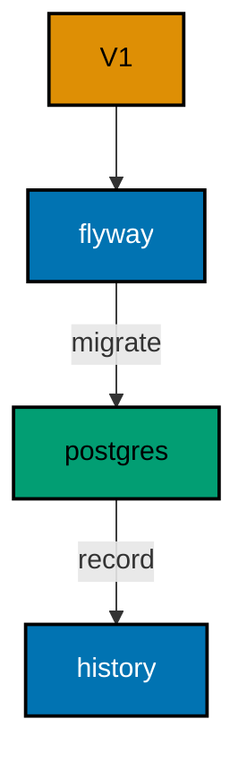
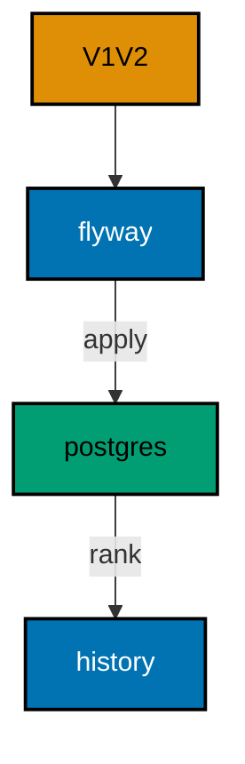
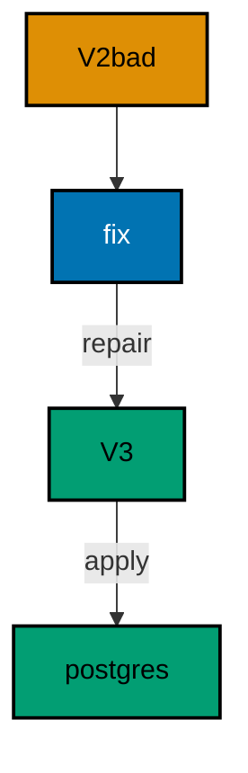

Examples 1–25 build the migration core loop from nothing: versioned files that create and alter tables (Examples 1–8), the history table and ordering rules that keep teams honest (Examples 9–17), and rollback written as forward, compensating migrations (Examples 18–25). Every example is a complete, runnable Kotlin program under `learning/code/` driving a real PostgreSQL container; run each with the command in its own `run.yaml`.

---

### Example 1: Create Your First Table

A migration is a versioned file that describes one schema change. This example keeps it as small as possible: a single `V1` file that creates a `books` table. Flyway records the run in its history table, so the same file never runs twice against the same database.

The file name carries the contract: `V1` fixes the order, the double underscore separates the version from the human description, and `.sql` marks plain SQL Flyway executes as-is. The program configures Flyway against the service database, migrates, then reads the history table back to prove the run was recorded.

(Concepts: co-01, co-03.)



**`learning/code/ex-01-create-your-first-table/Main.kt`**:

```kotlin
// Example 1: Create Your First Table.
// one versioned file creates one table.
import org.flywaydb.core.Flyway // => the entry point: configure, then migrate
import java.sql.DriverManager // => plain JDBC for the verification queries

fun dbUrl(): String { // => one URL builder shared by Flyway and JDBC
    val host = System.getenv("PGHOST") ?: "localhost" // => service alias on the unit network
    val db = System.getenv("PGDATABASE") ?: "postgres" // => the service's database name
    return "jdbc:postgresql://" + host + "/" + db // => trust auth needs no password
} // => helper ends: every connection string flows through here

fun dbUser(): String { // => one user lookup shared by Flyway and JDBC
    return System.getenv("PGUSER") ?: "postgres" // => postgres superuser in the service container
} // => helper ends: a single place if the service user ever changes

fun main() { // => the entry point the harness runs
    val flyway = Flyway.configure() // => start from a clean configuration
        .dataSource(dbUrl(), dbUser(), null) // => trust auth: user with no password
        .locations("filesystem:migrations") // => SQL files live beside the program
        .load() // => freeze the configuration into a Flyway instance
    flyway.migrate() // => bring the database current; re-runs find nothing new
    DriverManager.getConnection(dbUrl(), dbUser(), null).use { conn -> // => open one JDBC connection
        conn.createStatement().use { st -> // => a statement for the history query
            st.executeQuery("SELECT version, description, success FROM flyway_schema_history ORDER BY installed_rank").use { rs -> // => history rows in apply order
                while (rs.next()) { // => walk every recorded migration
                    println(rs.getString(1) + " " + rs.getString(2) + " " + rs.getBoolean(3)) // => one line per migration
                } // => loop ends after the last applied migration
            } // => result set closed here
        } // => statement closed here
    } // => connection closed here
} // => main ends: every check printed
```

**`learning/code/ex-01-create-your-first-table/migrations/V1__create_books.sql`**:

```sql
-- V1: the first schema change; one file, one table.
CREATE TABLE books (
    id SERIAL PRIMARY KEY,
    title TEXT NOT NULL
);
```

**Output** (`learning/code/ex-01-create-your-first-table/expected/main.stdout.txt`):

```text
1 create books true
```

**Key takeaway**: Name migration files `V<version>__<description>.sql`; Flyway applies them in version order exactly once.

**Why it matters**: Versioned files turn schema changes into artifacts a team can review, approve, and replay. Hand-run SQL lives only in whoever typed it, so two environments drift apart the moment someone improvises a fix on one of them. A file under version control carries its intent in its name, its content in a diff, and its outcome in the history table. That chain is what lets a reviewer approve a change on Monday and trust it on production on Friday, because the thing that ran is byte-identical to the thing that was reviewed.

---

### Example 2: Add a Column with Alter

Schemas grow one column at a time, and each growth is its own migration. Here `V1` creates an `authors` table and `V2` adds an `email` column with `ALTER TABLE`. Nothing in `V1` is edited: the history stays append-only.

The program migrates both files, then asks `information_schema` for the table's columns in ordinal order. The output lists all three columns, proving the alter landed on top of the create without touching existing structure.

(Concepts: co-01.)


**`learning/code/ex-02-add-a-column-with-alter/Main.kt`**:

```kotlin
// Example 2: Add a Column with Alter.
// V2 alters the table V1 created.
import org.flywaydb.core.Flyway // => the entry point: configure, then migrate
import java.sql.DriverManager // => plain JDBC for the verification queries

fun dbUrl(): String { // => one URL builder shared by Flyway and JDBC
    val host = System.getenv("PGHOST") ?: "localhost" // => service alias on the unit network
    val db = System.getenv("PGDATABASE") ?: "postgres" // => the service's database name
    return "jdbc:postgresql://" + host + "/" + db // => trust auth needs no password
} // => helper ends: every connection string flows through here

fun dbUser(): String { // => one user lookup shared by Flyway and JDBC
    return System.getenv("PGUSER") ?: "postgres" // => postgres superuser in the service container
} // => helper ends: a single place if the service user ever changes

fun main() { // => the entry point the harness runs
    val flyway = Flyway.configure() // => start from a clean configuration
        .dataSource(dbUrl(), dbUser(), null) // => trust auth: user with no password
        .locations("filesystem:migrations") // => SQL files live beside the program
        .load() // => freeze the configuration into a Flyway instance
    flyway.migrate() // => bring the database current; re-runs find nothing new
    DriverManager.getConnection(dbUrl(), dbUser(), null).use { conn -> // => open one JDBC connection
        conn.createStatement().use { st -> // => a statement for the metadata query
            st.executeQuery("SELECT column_name FROM information_schema.columns WHERE table_name = 'authors' ORDER BY ordinal_position").use { rs -> // => columns in creation order
                while (rs.next()) { // => walk every column
                    println(rs.getString(1)) // => one column name per line
                } // => loop ends after the last column
            } // => result set closed here
        } // => statement closed here
    } // => connection closed here
} // => main ends: every check printed
```

**`learning/code/ex-02-add-a-column-with-alter/migrations/V1__create_authors.sql`**:

```sql
-- V1: authors start with an id and a name.
CREATE TABLE authors (
    id SERIAL PRIMARY KEY,
    name TEXT NOT NULL
);
```

**`learning/code/ex-02-add-a-column-with-alter/migrations/V2__add_email_to_authors.sql`**:

```sql
-- V2: grow the table with ALTER, never by editing V1.
ALTER TABLE authors ADD COLUMN email TEXT;
```

**Output** (`learning/code/ex-02-add-a-column-with-alter/expected/main.stdout.txt`):

```text
id
name
email
```

**Key takeaway**: Grow tables with new versioned `ALTER TABLE` migrations; never edit an applied file.

**Why it matters**: Append-only history is the property that makes a migration replayable on every environment in the same order. If anyone edits an applied file, the checksum recorded at apply time no longer matches, and every environment that already ran the old bytes disagrees with every environment that will run the new ones. Refusing to edit is therefore not etiquette but mechanics: the guarantee that staging rehearsed exactly what production will perform rests entirely on files that never change after their first run.

---

### Example 3: Migrations Run Once

Running the same migration twice must be safe, because deploys retry. Flyway compares the files against its history table and skips everything already applied. Calling `migrate()` a second time applies zero migrations.

The program migrates twice, then counts the history rows. One row after two runs is the feature: the history table makes repetition a no-op instead of an error.

(Concepts: co-03, co-05.)


**`learning/code/ex-03-migrations-run-once/Main.kt`**:

```kotlin
// Example 3: Migrations Run Once.
// two migrates leave one history row.
import org.flywaydb.core.Flyway // => the entry point: configure, then migrate
import java.sql.DriverManager // => plain JDBC for the verification queries

fun dbUrl(): String { // => one URL builder shared by Flyway and JDBC
    val host = System.getenv("PGHOST") ?: "localhost" // => service alias on the unit network
    val db = System.getenv("PGDATABASE") ?: "postgres" // => the service's database name
    return "jdbc:postgresql://" + host + "/" + db // => trust auth needs no password
} // => helper ends: every connection string flows through here

fun dbUser(): String { // => one user lookup shared by Flyway and JDBC
    return System.getenv("PGUSER") ?: "postgres" // => postgres superuser in the service container
} // => helper ends: a single place if the service user ever changes

fun main() { // => the entry point the harness runs
    val flyway = Flyway.configure() // => start from a clean configuration
        .dataSource(dbUrl(), dbUser(), null) // => trust auth: user with no password
        .locations("filesystem:migrations") // => SQL files live beside the program
        .load() // => freeze the configuration into a Flyway instance
    flyway.migrate() // => bring the database current; re-runs find nothing new
    flyway.migrate() // => bring the database current; re-runs find nothing new
    DriverManager.getConnection(dbUrl(), dbUser(), null).use { conn -> // => open one JDBC connection
        conn.createStatement().use { st -> // => a statement for the count query
            st.executeQuery("SELECT count(*) FROM flyway_schema_history WHERE success").use { rs -> // => repetition adds no rows
                rs.next() // => move to the single result row
                println("history=" + rs.getInt(1)) // => Output: history=1
            } // => result set closed here
        } // => statement closed here
    } // => connection closed here
} // => main ends: every check printed
```

**`learning/code/ex-03-migrations-run-once/migrations/V1__create_tags.sql`**:

```sql
-- V1: a tiny lookup table for the idempotency demo.
CREATE TABLE tags (
    id SERIAL PRIMARY KEY,
    label TEXT NOT NULL
);
```

**Output** (`learning/code/ex-03-migrations-run-once/expected/main.stdout.txt`):

```text
history=1
```

**Key takeaway**: Flyway skips applied migrations automatically; a second `migrate()` is a safe no-op.

**Why it matters**: Idempotent deploys let pipelines retry without fear of double-applying schema changes. Networks fail, runners get preempted, and operators re-trigger jobs; any deploy step that is unsafe to repeat turns each of those routine events into a potential incident. A migrate step that converges, doing real work the first time and honestly nothing the second, removes an entire class of operational anxiety. Retry becomes a reflex instead of a risk assessment, and automation can be aggressive because the operation itself is gentle.

---

### Example 4: History Table Records Every Run

Every migration leaves a row in `flyway_schema_history`: version, description, type, checksum, and success. That table is the database's own memory of what ran. This example applies two migrations and reads the table back in installation order.

Querying by `installed_rank` shows the true apply order regardless of version numbering. The test-style assertion here is simple: two migrations in, two successful rows out, in order.

(Concepts: co-03, co-16.)


**`learning/code/ex-04-history-table-records-every-run/Main.kt`**:

```kotlin
// Example 4: History Table Records Every Run.
// two migrations leave two history rows.
import org.flywaydb.core.Flyway // => the entry point: configure, then migrate
import java.sql.DriverManager // => plain JDBC for the verification queries

fun dbUrl(): String { // => one URL builder shared by Flyway and JDBC
    val host = System.getenv("PGHOST") ?: "localhost" // => service alias on the unit network
    val db = System.getenv("PGDATABASE") ?: "postgres" // => the service's database name
    return "jdbc:postgresql://" + host + "/" + db // => trust auth needs no password
} // => helper ends: every connection string flows through here

fun dbUser(): String { // => one user lookup shared by Flyway and JDBC
    return System.getenv("PGUSER") ?: "postgres" // => postgres superuser in the service container
} // => helper ends: a single place if the service user ever changes

fun main() { // => the entry point the harness runs
    val flyway = Flyway.configure() // => start from a clean configuration
        .dataSource(dbUrl(), dbUser(), null) // => trust auth: user with no password
        .locations("filesystem:migrations") // => SQL files live beside the program
        .load() // => freeze the configuration into a Flyway instance
    flyway.migrate() // => bring the database current; re-runs find nothing new
    DriverManager.getConnection(dbUrl(), dbUser(), null).use { conn -> // => open one JDBC connection
        conn.createStatement().use { st -> // => a statement for the history query
            st.executeQuery("SELECT version, description, success FROM flyway_schema_history ORDER BY installed_rank").use { rs -> // => history rows in apply order
                while (rs.next()) { // => walk every recorded migration
                    println(rs.getString(1) + " " + rs.getString(2) + " " + rs.getBoolean(3)) // => one line per migration
                } // => loop ends after the last applied migration
            } // => result set closed here
        } // => statement closed here
    } // => connection closed here
} // => main ends: every check printed
```

**`learning/code/ex-04-history-table-records-every-run/migrations/V1__create_publishers.sql`**:

```sql
-- V1: publishers table for the history demo.
CREATE TABLE publishers (
    id SERIAL PRIMARY KEY,
    name TEXT NOT NULL
);
```

**`learning/code/ex-04-history-table-records-every-run/migrations/V2__create_magazines.sql`**:

```sql
-- V2: magazines reference their publisher.
CREATE TABLE magazines (
    id SERIAL PRIMARY KEY,
    publisher_id INTEGER NOT NULL REFERENCES publishers(id),
    title TEXT NOT NULL
);
```

**Output** (`learning/code/ex-04-history-table-records-every-run/expected/main.stdout.txt`):

```text
1 create publishers true
2 create magazines true
```

**Key takeaway**: Read `flyway_schema_history` ordered by `installed_rank` to see exactly what ran.

**Why it matters**: The history table is the audit trail that makes every environment comparable with a single query. Without it, teams reconstruct what ran from deploy logs, chat transcripts, and memory, and those three sources routinely disagree. With it, staging and production answer the same question, version by version, flag by flag, in the same order the lock admitted them. Comparability is the precondition for every higher practice here: promotion gates, drift detection, and incident diagnosis all read this table before they read anything else.

---

### Example 5: Version Numbers Order Execution

Versions decide execution order, not file creation time or alphabetical luck. `V1`, `V2`, `V3` run in numeric order even if they arrive together. This example applies three table creates and prints the recorded order.

Teams rely on this when two developers land migrations in the same release: the numbers serialize the work. The history query confirms the database applied them 1-2-3.

(Concepts: co-01, co-04.)


**`learning/code/ex-05-version-numbers-order-execution/Main.kt`**:

```kotlin
// Example 5: Version Numbers Order Execution.
// numeric versions serialize the work.
import org.flywaydb.core.Flyway // => the entry point: configure, then migrate
import java.sql.DriverManager // => plain JDBC for the verification queries

fun dbUrl(): String { // => one URL builder shared by Flyway and JDBC
    val host = System.getenv("PGHOST") ?: "localhost" // => service alias on the unit network
    val db = System.getenv("PGDATABASE") ?: "postgres" // => the service's database name
    return "jdbc:postgresql://" + host + "/" + db // => trust auth needs no password
} // => helper ends: every connection string flows through here

fun dbUser(): String { // => one user lookup shared by Flyway and JDBC
    return System.getenv("PGUSER") ?: "postgres" // => postgres superuser in the service container
} // => helper ends: a single place if the service user ever changes

fun main() { // => the entry point the harness runs
    val flyway = Flyway.configure() // => start from a clean configuration
        .dataSource(dbUrl(), dbUser(), null) // => trust auth: user with no password
        .locations("filesystem:migrations") // => SQL files live beside the program
        .load() // => freeze the configuration into a Flyway instance
    flyway.migrate() // => bring the database current; re-runs find nothing new
    DriverManager.getConnection(dbUrl(), dbUser(), null).use { conn -> // => open one JDBC connection
        conn.createStatement().use { st -> // => a statement for the history query
            st.executeQuery("SELECT version, description, success FROM flyway_schema_history ORDER BY installed_rank").use { rs -> // => history rows in apply order
                while (rs.next()) { // => walk every recorded migration
                    println(rs.getString(1) + " " + rs.getString(2) + " " + rs.getBoolean(3)) // => one line per migration
                } // => loop ends after the last applied migration
            } // => result set closed here
        } // => statement closed here
    } // => connection closed here
} // => main ends: every check printed
```

**`learning/code/ex-05-version-numbers-order-execution/migrations/V1__create_teams.sql`**:

```sql
-- V1: teams come first in the dependency chain.
CREATE TABLE teams (
    id SERIAL PRIMARY KEY,
    name TEXT NOT NULL
);
```

**`learning/code/ex-05-version-numbers-order-execution/migrations/V2__create_players.sql`**:

```sql
-- V2: players belong to a team.
CREATE TABLE players (
    id SERIAL PRIMARY KEY,
    team_id INTEGER NOT NULL REFERENCES teams(id),
    name TEXT NOT NULL
);
```

**`learning/code/ex-05-version-numbers-order-execution/migrations/V3__create_matches.sql`**:

```sql
-- V3: matches reference two teams.
CREATE TABLE matches (
    id SERIAL PRIMARY KEY,
    home_id INTEGER NOT NULL REFERENCES teams(id),
    away_id INTEGER NOT NULL REFERENCES teams(id)
);
```

**Output** (`learning/code/ex-05-version-numbers-order-execution/expected/main.stdout.txt`):

```text
1 create teams true
2 create players true
3 create matches true
```

**Key takeaway**: Version numbers, not arrival order, decide what runs first.

**Why it matters**: Numeric ordering lets parallel developers merge migrations without negotiating apply order by hand. When two branches each add a file, the numbers serialize them deterministically, and no meeting is needed to decide whose change lands first. Arrival order, commit order, and alphabetical order would all give different answers on different machines; the version prefix gives the same answer everywhere. That determinism is what keeps feature teams independent while their schemas still converge to one shared, ordered story.

---

### Example 6: Descriptions Document Intent

The text after the double underscore is the migration's human title, stored in the history table as `description`. Good descriptions (`add_published_year_to_books`) read like changelog entries; bad ones (`stuff`) waste the audit trail.

This example applies two migrations whose descriptions state their intent, then prints the recorded descriptions. Review the history output the way an auditor would: each line should explain itself.

(Concepts: co-01.)


**`learning/code/ex-06-descriptions-document-intent/Main.kt`**:

```kotlin
// Example 6: Descriptions Document Intent.
// descriptions become the changelog.
import org.flywaydb.core.Flyway // => the entry point: configure, then migrate
import java.sql.DriverManager // => plain JDBC for the verification queries

fun dbUrl(): String { // => one URL builder shared by Flyway and JDBC
    val host = System.getenv("PGHOST") ?: "localhost" // => service alias on the unit network
    val db = System.getenv("PGDATABASE") ?: "postgres" // => the service's database name
    return "jdbc:postgresql://" + host + "/" + db // => trust auth needs no password
} // => helper ends: every connection string flows through here

fun dbUser(): String { // => one user lookup shared by Flyway and JDBC
    return System.getenv("PGUSER") ?: "postgres" // => postgres superuser in the service container
} // => helper ends: a single place if the service user ever changes

fun main() { // => the entry point the harness runs
    val flyway = Flyway.configure() // => start from a clean configuration
        .dataSource(dbUrl(), dbUser(), null) // => trust auth: user with no password
        .locations("filesystem:migrations") // => SQL files live beside the program
        .load() // => freeze the configuration into a Flyway instance
    flyway.migrate() // => bring the database current; re-runs find nothing new
    DriverManager.getConnection(dbUrl(), dbUser(), null).use { conn -> // => open one JDBC connection
        conn.createStatement().use { st -> // => a statement for the history query
            st.executeQuery("SELECT version, description FROM flyway_schema_history ORDER BY installed_rank").use { rs -> // => version plus human title
                while (rs.next()) { // => walk every recorded migration
                    println(rs.getString(1) + " " + rs.getString(2)) // => number plus intent
                } // => loop ends after the last row
            } // => result set closed here
        } // => statement closed here
    } // => connection closed here
} // => main ends: every check printed
```

**`learning/code/ex-06-descriptions-document-intent/migrations/V1__create_books_table.sql`**:

```sql
-- V1: books table with a title only.
CREATE TABLE books (
    id SERIAL PRIMARY KEY,
    title TEXT NOT NULL
);
```

**`learning/code/ex-06-descriptions-document-intent/migrations/V2__add_published_year_to_books.sql`**:

```sql
-- V2: the description names the exact change.
ALTER TABLE books ADD COLUMN published_year INTEGER;
```

**Output** (`learning/code/ex-06-descriptions-document-intent/expected/main.stdout.txt`):

```text
1 create books table
2 add published year to books
```

**Key takeaway**: Write descriptions as changelog entries; underscores become spaces in the history table.

**Why it matters**: Future readers meet your migrations through their descriptions long before they read the SQL. Six months after a deploy, nobody remembers why a column exists, but the history table still shows the intent line its author wrote. Descriptions written as changelog entries turn that table into documentation that cannot drift from the code, because it is generated from the file names. Teams that write good descriptions debug old decisions in seconds; teams that write stuff re-derive them from git blame every time.

---

### Example 7: Alter Safely Keeps Data

Schema changes must not eat rows. Here `V1` creates an `inventory` table and seeds two rows, then `V2` adds a `stock` column with a default. The program counts the rows and prints every stock value after the alter.

The default fills existing rows at alter time, so no row is left with a null nobody chose. Seeding inside the migration keeps the demo self-contained; in production, seed data belongs in its own clearly named migration.

(Concepts: co-01, co-06.)


**`learning/code/ex-07-alter-safely-keeps-data/Main.kt`**:

```kotlin
// Example 7: Alter Safely Keeps Data.
// the alter preserves both seeded rows.
import org.flywaydb.core.Flyway // => the entry point: configure, then migrate
import java.sql.DriverManager // => plain JDBC for the verification queries

fun dbUrl(): String { // => one URL builder shared by Flyway and JDBC
    val host = System.getenv("PGHOST") ?: "localhost" // => service alias on the unit network
    val db = System.getenv("PGDATABASE") ?: "postgres" // => the service's database name
    return "jdbc:postgresql://" + host + "/" + db // => trust auth needs no password
} // => helper ends: every connection string flows through here

fun dbUser(): String { // => one user lookup shared by Flyway and JDBC
    return System.getenv("PGUSER") ?: "postgres" // => postgres superuser in the service container
} // => helper ends: a single place if the service user ever changes

fun main() { // => the entry point the harness runs
    val flyway = Flyway.configure() // => start from a clean configuration
        .dataSource(dbUrl(), dbUser(), null) // => trust auth: user with no password
        .locations("filesystem:migrations") // => SQL files live beside the program
        .load() // => freeze the configuration into a Flyway instance
    flyway.migrate() // => bring the database current; re-runs find nothing new
    DriverManager.getConnection(dbUrl(), dbUser(), null).use { conn -> // => open one JDBC connection
        conn.createStatement().use { st -> // => a statement for the verification queries
            st.executeQuery("SELECT count(*) FROM inventory").use { rs -> // => one aggregate row
                rs.next() // => move to the single result row
                println("rows=" + rs.getInt(1)) // => both seeded rows survived
            } // => result set closed here
            st.executeQuery("SELECT stock FROM inventory ORDER BY id").use { rs -> // => every stock value in id order
                while (rs.next()) { // => walk both rows
                    println("stock=" + rs.getInt(1)) // => defaults filled by the alter
                } // => loop ends after the last row
            } // => result set closed here
        } // => statement closed here
    } // => connection closed here
} // => main ends: every check printed
```

**`learning/code/ex-07-alter-safely-keeps-data/migrations/V1__create_inventory.sql`**:

```sql
-- V1: inventory starts with two seeded rows.
CREATE TABLE inventory (
    id SERIAL PRIMARY KEY,
    item TEXT NOT NULL
);
INSERT INTO inventory (item) VALUES ('nails'), ('bolts');
```

**`learning/code/ex-07-alter-safely-keeps-data/migrations/V2__add_stock_to_inventory.sql`**:

```sql
-- V2: new column defaults every existing row to zero.
ALTER TABLE inventory ADD COLUMN stock INTEGER NOT NULL DEFAULT 0;
```

**Output** (`learning/code/ex-07-alter-safely-keeps-data/expected/main.stdout.txt`):

```text
rows=2
stock=0
stock=0
```

**Key takeaway**: Give new columns defaults so existing rows get a chosen value, not an accidental null.

**Why it matters**: Data-preserving alters are what separate a migration from a destructive script. Adding a column without a default fills every existing row with null, and application code written against non-null assumptions starts failing in ways that look unrelated to the deploy. A chosen default states the intended value for the past explicitly, so old rows and new rows obey the same contract from the first commit. The discipline is small, one clause, but it converts an entire category of deploy surprises into a deliberate, reviewable decision.

---

### Example 8: One Migration One Change

A migration should do exactly one thing so it stays reviewable and revertible. `V1` creates `authors`; `V2` creates `books` with its foreign key. Neither file mixes concerns, and either could be reasoned about alone.

The program migrates both, then lists the two expected tables from `information_schema`. Small files also shrink the blast radius: a failure in `V2` never implicates `V1`.

(Concepts: co-01.)


**`learning/code/ex-08-one-migration-one-change/Main.kt`**:

```kotlin
// Example 8: One Migration One Change.
// each file does exactly one thing.
import org.flywaydb.core.Flyway // => the entry point: configure, then migrate
import java.sql.DriverManager // => plain JDBC for the verification queries

fun dbUrl(): String { // => one URL builder shared by Flyway and JDBC
    val host = System.getenv("PGHOST") ?: "localhost" // => service alias on the unit network
    val db = System.getenv("PGDATABASE") ?: "postgres" // => the service's database name
    return "jdbc:postgresql://" + host + "/" + db // => trust auth needs no password
} // => helper ends: every connection string flows through here

fun dbUser(): String { // => one user lookup shared by Flyway and JDBC
    return System.getenv("PGUSER") ?: "postgres" // => postgres superuser in the service container
} // => helper ends: a single place if the service user ever changes

fun main() { // => the entry point the harness runs
    val flyway = Flyway.configure() // => start from a clean configuration
        .dataSource(dbUrl(), dbUser(), null) // => trust auth: user with no password
        .locations("filesystem:migrations") // => SQL files live beside the program
        .load() // => freeze the configuration into a Flyway instance
    flyway.migrate() // => bring the database current; re-runs find nothing new
    DriverManager.getConnection(dbUrl(), dbUser(), null).use { conn -> // => open one JDBC connection
        conn.createStatement().use { st -> // => a statement for the catalog query
            st.executeQuery("SELECT table_name FROM information_schema.tables WHERE table_name IN ('authors', 'books') ORDER BY table_name").use { rs -> // => only the two expected tables
                while (rs.next()) { // => walk both tables
                    println(rs.getString(1)) // => one table name per line
                } // => loop ends after the last table
            } // => result set closed here
        } // => statement closed here
    } // => connection closed here
} // => main ends: every check printed
```

**`learning/code/ex-08-one-migration-one-change/migrations/V1__create_authors.sql`**:

```sql
-- V1: authors stand alone with no dependencies.
CREATE TABLE authors (
    id SERIAL PRIMARY KEY,
    name TEXT NOT NULL
);
```

**`learning/code/ex-08-one-migration-one-change/migrations/V2__create_books.sql`**:

```sql
-- V2: books reference authors; one change, one file.
CREATE TABLE books (
    id SERIAL PRIMARY KEY,
    author_id INTEGER NOT NULL REFERENCES authors(id),
    title TEXT NOT NULL
);
```

**Output** (`learning/code/ex-08-one-migration-one-change/expected/main.stdout.txt`):

```text
authors
books
```

**Key takeaway**: Keep each migration to one change so reviews stay small and failures stay local.

**Why it matters**: Single-purpose migrations are the unit of safe schema evolution because they bound both review size and failure scope. A file that does one thing can be reviewed in a minute, reverted with one compensating file, and reasoned about in isolation when something breaks. A file that does five things fuses five risks into one undeployable lump: no reviewer holds it all in mind, and no rollback can take half of it back. Small files are therefore not a style preference but a strategy for keeping every change reversible and every incident local.

---

### Example 9: History Table Is the Source of Truth

When environments disagree, the history table settles it. `installed_rank` shows true apply order, `success` shows which entries completed, and `type` distinguishes plain SQL from baselines and repeats. This example prints rank, version, and success for two migrations.

Ops teams dump this table before every release comparison. If staging and production show the same rows in the same order, the schemas match; any difference names the exact migration to investigate.

(Concepts: co-03.)



**`learning/code/ex-09-history-table-is-the-source-of-truth/Main.kt`**:

```kotlin
// Example 9: History Table Is the Source of Truth.
// rank plus success settles disputes.
import org.flywaydb.core.Flyway // => the entry point: configure, then migrate
import java.sql.DriverManager // => plain JDBC for the verification queries

fun dbUrl(): String { // => one URL builder shared by Flyway and JDBC
    val host = System.getenv("PGHOST") ?: "localhost" // => service alias on the unit network
    val db = System.getenv("PGDATABASE") ?: "postgres" // => the service's database name
    return "jdbc:postgresql://" + host + "/" + db // => trust auth needs no password
} // => helper ends: every connection string flows through here

fun dbUser(): String { // => one user lookup shared by Flyway and JDBC
    return System.getenv("PGUSER") ?: "postgres" // => postgres superuser in the service container
} // => helper ends: a single place if the service user ever changes

fun main() { // => the entry point the harness runs
    val flyway = Flyway.configure() // => start from a clean configuration
        .dataSource(dbUrl(), dbUser(), null) // => trust auth: user with no password
        .locations("filesystem:migrations") // => SQL files live beside the program
        .load() // => freeze the configuration into a Flyway instance
    flyway.migrate() // => bring the database current; re-runs find nothing new
    DriverManager.getConnection(dbUrl(), dbUser(), null).use { conn -> // => open one JDBC connection
        conn.createStatement().use { st -> // => a statement for the history query
            st.executeQuery("SELECT installed_rank, version, success FROM flyway_schema_history ORDER BY installed_rank").use { rs -> // => true apply order first
                while (rs.next()) { // => walk every recorded migration
                    println(rs.getInt(1).toString() + " " + rs.getString(2) + " " + rs.getBoolean(3)) // => rank, version, success
                } // => loop ends after the last row
            } // => result set closed here
        } // => statement closed here
    } // => connection closed here
} // => main ends: every check printed
```

**`learning/code/ex-09-history-table-is-the-source-of-truth/migrations/V1__create_depots.sql`**:

```sql
-- V1: depots anchor the logistics demo.
CREATE TABLE depots (
    id SERIAL PRIMARY KEY,
    city TEXT NOT NULL
);
```

**`learning/code/ex-09-history-table-is-the-source-of-truth/migrations/V2__create_routes.sql`**:

```sql
-- V2: routes connect two depots.
CREATE TABLE routes (
    id SERIAL PRIMARY KEY,
    from_id INTEGER NOT NULL REFERENCES depots(id),
    to_id INTEGER NOT NULL REFERENCES depots(id)
);
```

**Output** (`learning/code/ex-09-history-table-is-the-source-of-truth/expected/main.stdout.txt`):

```text
1 1 true
2 2 true
```

**Key takeaway**: Compare environments by dumping version and success ordered by `installed_rank`.

**Why it matters**: One shared table that both developers and operators can read beats two conflicting memories of what ran. Developers remember what they merged; operators remember what they deployed; production remembers what actually applied, and only the history table speaks for production. When an incident starts, the first question is always whether the database matches the branch, and this table answers it in milliseconds. Every diagnosis that starts anywhere else, logs, dashboards, hunches, wastes the minutes when a single query would have settled it.

---

### Example 10: Linear History Stays Mergeable

A straight line of versions merges cleanly: every developer appends the next number and Flyway applies them in order. This example runs four small migrations and confirms four successful history rows.

Linear history is a team discipline, not a tool feature. The tool only numbers; humans keep the line straight by pulling, renumbering on conflict, and never editing the past.

(Concepts: co-04.)


**`learning/code/ex-10-linear-history-stays-mergeable/Main.kt`**:

```kotlin
// Example 10: Linear History Stays Mergeable.
// four versions form one straight line.
import org.flywaydb.core.Flyway // => the entry point: configure, then migrate
import java.sql.DriverManager // => plain JDBC for the verification queries

fun dbUrl(): String { // => one URL builder shared by Flyway and JDBC
    val host = System.getenv("PGHOST") ?: "localhost" // => service alias on the unit network
    val db = System.getenv("PGDATABASE") ?: "postgres" // => the service's database name
    return "jdbc:postgresql://" + host + "/" + db // => trust auth needs no password
} // => helper ends: every connection string flows through here

fun dbUser(): String { // => one user lookup shared by Flyway and JDBC
    return System.getenv("PGUSER") ?: "postgres" // => postgres superuser in the service container
} // => helper ends: a single place if the service user ever changes

fun main() { // => the entry point the harness runs
    val flyway = Flyway.configure() // => start from a clean configuration
        .dataSource(dbUrl(), dbUser(), null) // => trust auth: user with no password
        .locations("filesystem:migrations") // => SQL files live beside the program
        .load() // => freeze the configuration into a Flyway instance
    flyway.migrate() // => bring the database current; re-runs find nothing new
    DriverManager.getConnection(dbUrl(), dbUser(), null).use { conn -> // => open one JDBC connection
        conn.createStatement().use { st -> // => a statement for the count query
            st.executeQuery("SELECT count(*) FROM flyway_schema_history WHERE success").use { rs -> // => only successful entries count
                rs.next() // => move to the single result row
                println("history=" + rs.getInt(1)) // => four migrations, four rows
            } // => result set closed here
        } // => statement closed here
    } // => connection closed here
} // => main ends: every check printed
```

**`learning/code/ex-10-linear-history-stays-mergeable/migrations/V1__create_a.sql`**:

```sql
-- V1: first link in the linear chain.
CREATE TABLE chain_a (id SERIAL PRIMARY KEY);
```

**`learning/code/ex-10-linear-history-stays-mergeable/migrations/V2__create_b.sql`**:

```sql
-- V2: second link depends on nothing but order.
CREATE TABLE chain_b (id SERIAL PRIMARY KEY);
```

**`learning/code/ex-10-linear-history-stays-mergeable/migrations/V3__create_c.sql`**:

```sql
-- V3: third link keeps the line straight.
CREATE TABLE chain_c (id SERIAL PRIMARY KEY);
```

**`learning/code/ex-10-linear-history-stays-mergeable/migrations/V4__create_d.sql`**:

```sql
-- V4: fourth link closes the demo chain.
CREATE TABLE chain_d (id SERIAL PRIMARY KEY);
```

**Output** (`learning/code/ex-10-linear-history-stays-mergeable/expected/main.stdout.txt`):

```text
history=4
```

**Key takeaway**: Append the next version number; never edit or reorder the past.

**Why it matters**: A straight version line is what lets several developers work without a standing merge meeting. Each new migration takes the next number, so branches compose by concatenation rather than negotiation, and the history on every environment reads as one chronological story. Reordering or editing the past would fork that story per environment and force humans to reconcile what the numbers should have guaranteed. Linearity is a social contract enforced by checksums: cheap to keep, expensive to reconstruct once broken.

---

### Example 11: Out-of-Order Arrival Needs a Flag

Sometimes a migration arrives late: `V3` applied before anyone wrote `V2`. By default Flyway refuses the latecomer at the validation gate, because silently reordering history is dangerous. Passing `outOfOrder(true)` says the team accepts the late arrival explicitly.

The program migrates the gapped set, then a second configuration with `outOfOrder(true)` admits the late `V2`. The history rank order 1, 3, 2 proves the late file landed after `V3`. Without the flag, the same late file fails validation at the gate instead of applying.

(Concepts: co-04.)


**`learning/code/ex-11-out-of-order-arrival-needs-a-flag/Main.kt`**:

```kotlin
// Example 11: Out-of-Order Arrival Needs a Flag.
// rank order proves the late landing.
import org.flywaydb.core.Flyway // => the entry point: configure, then migrate
import java.sql.DriverManager // => plain JDBC for the verification queries

fun dbUrl(): String { // => one URL builder shared by Flyway and JDBC
    val host = System.getenv("PGHOST") ?: "localhost" // => service alias on the unit network
    val db = System.getenv("PGDATABASE") ?: "postgres" // => the service's database name
    return "jdbc:postgresql://" + host + "/" + db // => trust auth needs no password
} // => helper ends: every connection string flows through here

fun dbUser(): String { // => one user lookup shared by Flyway and JDBC
    return System.getenv("PGUSER") ?: "postgres" // => postgres superuser in the service container
} // => helper ends: a single place if the service user ever changes

fun main() { // => the entry point the harness runs
    val gap = Flyway.configure() // => first configuration sees only V1 and V3
        .dataSource(dbUrl(), dbUser(), null) // => trust auth: user with no password
        .locations("filesystem:migrations/gap") // => the gapped directory
        .load() // => freeze the gap configuration
    try { // => the gapped set applies once; re-runs find it superseded
        gap.migrate() // => V1 and V3 apply; the gap is legal
    } catch (e: Exception) { // => later runs see the admitted V2 and stand down
    } // => either path converges on the same ranked history below
    val loose = Flyway.configure() // => second configuration opts into disorder
        .dataSource(dbUrl(), dbUser(), null) // => same database again
        .locations("filesystem:migrations/full") // => now V2 exists on disk
        .outOfOrder(true) // => the team accepts the late arrival
        .load() // => freeze the lenient configuration
    loose.migrate() // => V2 finally applies after V3
    DriverManager.getConnection(dbUrl(), dbUser(), null).use { conn -> // => open one JDBC connection
        conn.createStatement().use { st -> // => a statement for the rank query
            st.executeQuery("SELECT version FROM flyway_schema_history ORDER BY installed_rank").use { rs -> // => true run order
                val order = StringBuilder() // => collect versions in rank order
                while (rs.next()) { // => walk every recorded migration
                    if (order.isNotEmpty()) order.append(",") // => comma between versions
                    order.append(rs.getString(1)) // => rank order, not version order
                } // => loop ends after the last row
                println("ranked=" + order.toString()) // => Output: ranked=1,3,2
            } // => result set closed here
        } // => statement closed here
    } // => connection closed here
    println("valid=" + loose.validateWithResult().validationSuccessful) // => history and files agree now
} // => main ends: every check printed
```

**`learning/code/ex-11-out-of-order-arrival-needs-a-flag/migrations/full/V1__create_alpha.sql`**:

```sql
-- V1: the story starts here.
CREATE TABLE alpha (id SERIAL PRIMARY KEY);
```

**`learning/code/ex-11-out-of-order-arrival-needs-a-flag/migrations/full/V2__create_beta.sql`**:

```sql
-- V2: the late arrival the team accepts explicitly.
CREATE TABLE beta (id SERIAL PRIMARY KEY);
```

**`learning/code/ex-11-out-of-order-arrival-needs-a-flag/migrations/full/V3__create_gamma.sql`**:

```sql
-- V3: gamma arrived before V2 was written.
CREATE TABLE gamma (id SERIAL PRIMARY KEY);
```

**`learning/code/ex-11-out-of-order-arrival-needs-a-flag/migrations/gap/V1__create_alpha.sql`**:

```sql
-- V1: the story starts here.
CREATE TABLE alpha (id SERIAL PRIMARY KEY);
```

**`learning/code/ex-11-out-of-order-arrival-needs-a-flag/migrations/gap/V3__create_gamma.sql`**:

```sql
-- V3: gamma arrived before V2 was written.
CREATE TABLE gamma (id SERIAL PRIMARY KEY);
```

**Output** (`learning/code/ex-11-out-of-order-arrival-needs-a-flag/expected/main.stdout.txt`):

```text
ranked=1,3,2
valid=true
```

**Key takeaway**: Default refuses late versions at the gate; `outOfOrder(true)` applies them as an explicit team decision.

**Why it matters**: Making disorder opt-in keeps one developer's late file from silently rewriting shared history. By default the gate refuses versions below the current head, which forces the team to notice the late arrival and decide together how to handle it. The explicit flag then records that decision in the configuration, so the exception is visible rather than accidental. Defaults that favor order with an explicit escape hatch give teams both safety on ordinary days and a documented path for the extraordinary ones.

---

### Example 12: Gaps in Versions Still Apply

Flyway does not require consecutive numbers: `V1` followed by `V4` applies fine. Gaps usually mean a migration was renamed or withdrawn before ever running anywhere. The tool applies what exists and records exactly that.

This example migrates a directory with only `V1` and `V4` and prints the recorded versions. Reserve judgement about the missing numbers; the history table shows what ran, and what ran is all that matters.

(Concepts: co-04.)


**`learning/code/ex-12-gaps-in-versions-still-apply/Main.kt`**:

```kotlin
// Example 12: Gaps in Versions Still Apply.
// missing numbers are not errors.
import org.flywaydb.core.Flyway // => the entry point: configure, then migrate
import java.sql.DriverManager // => plain JDBC for the verification queries

fun dbUrl(): String { // => one URL builder shared by Flyway and JDBC
    val host = System.getenv("PGHOST") ?: "localhost" // => service alias on the unit network
    val db = System.getenv("PGDATABASE") ?: "postgres" // => the service's database name
    return "jdbc:postgresql://" + host + "/" + db // => trust auth needs no password
} // => helper ends: every connection string flows through here

fun dbUser(): String { // => one user lookup shared by Flyway and JDBC
    return System.getenv("PGUSER") ?: "postgres" // => postgres superuser in the service container
} // => helper ends: a single place if the service user ever changes

fun main() { // => the entry point the harness runs
    val flyway = Flyway.configure() // => start from a clean configuration
        .dataSource(dbUrl(), dbUser(), null) // => trust auth: user with no password
        .locations("filesystem:migrations") // => SQL files live beside the program
        .load() // => freeze the configuration into a Flyway instance
    flyway.migrate() // => bring the database current; re-runs find nothing new
    DriverManager.getConnection(dbUrl(), dbUser(), null).use { conn -> // => open one JDBC connection
        conn.createStatement().use { st -> // => a statement for the history query
            st.executeQuery("SELECT version, description, success FROM flyway_schema_history ORDER BY installed_rank").use { rs -> // => history rows in apply order
                while (rs.next()) { // => walk every recorded migration
                    println(rs.getString(1) + " " + rs.getString(2) + " " + rs.getBoolean(3)) // => one line per migration
                } // => loop ends after the last applied migration
            } // => result set closed here
        } // => statement closed here
    } // => connection closed here
} // => main ends: every check printed
```

**`learning/code/ex-12-gaps-in-versions-still-apply/migrations/V1__create_first.sql`**:

```sql
-- V1: the only low-numbered migration.
CREATE TABLE first_one (id SERIAL PRIMARY KEY);
```

**`learning/code/ex-12-gaps-in-versions-still-apply/migrations/V4__create_fourth.sql`**:

```sql
-- V4: numbers need not be consecutive.
CREATE TABLE fourth_one (id SERIAL PRIMARY KEY);
```

**Output** (`learning/code/ex-12-gaps-in-versions-still-apply/expected/main.stdout.txt`):

```text
1 create first true
4 create fourth true
```

**Key takeaway**: Non-consecutive versions apply normally; gaps record a rename or withdrawal, not a failure.

**Why it matters**: Tolerating gaps keeps renames and withdrawals cheap while the history still tells the exact truth. A missing number usually means a file was renumbered during review or a change was pulled before release, and neither event should block the versions around it. Strict consecutiveness would turn every such routine edit into a migration incident; gap tolerance treats the numbers as ordering labels rather than a dense sequence. The history stays honest about what ran, and the team stays free to reorganize what has not run yet.

---

### Example 13: Edited Migration Fails Validation

An applied migration is a promise: the file must never change afterwards. Flyway stores a checksum per history row and compares it on every run. A second directory holding an edited `V1` fails validation against the database the original `V1` built.

The program migrates the original, then validates the edited copy and prints the boolean. In a pipeline this check runs before `migrate()`, so a tampered file stops the deploy instead of corrupting the schema.

(Concepts: co-11.)


**`learning/code/ex-13-edited-migration-fails-validation/Main.kt`**:

```kotlin
// Example 13: Edited Migration Fails Validation.
// the edited copy fails the checksum.
import org.flywaydb.core.Flyway // => the entry point: configure, then migrate
import java.sql.DriverManager // => plain JDBC for the verification queries

fun dbUrl(): String { // => one URL builder shared by Flyway and JDBC
    val host = System.getenv("PGHOST") ?: "localhost" // => service alias on the unit network
    val db = System.getenv("PGDATABASE") ?: "postgres" // => the service's database name
    return "jdbc:postgresql://" + host + "/" + db // => trust auth needs no password
} // => helper ends: every connection string flows through here

fun dbUser(): String { // => one user lookup shared by Flyway and JDBC
    return System.getenv("PGUSER") ?: "postgres" // => postgres superuser in the service container
} // => helper ends: a single place if the service user ever changes

fun main() { // => the entry point the harness runs
    val original = Flyway.configure() // => configuration for the trusted directory
        .dataSource(dbUrl(), dbUser(), null) // => trust auth: user with no password
        .locations("filesystem:migrations/current") // => the files every environment ran
        .load() // => freeze the trusted configuration
    original.migrate() // => apply pending migrations; re-runs find nothing new
    val edited = Flyway.configure() // => configuration for the tampered directory
        .dataSource(dbUrl(), dbUser(), null) // => same database, different files
        .locations("filesystem:migrations/edited") // => V1 with a smuggled column
        .load() // => freeze the suspect configuration
    val verdict = edited.validateWithResult() // => checksum comparison, no changes applied
    println("valid=" + verdict.validationSuccessful) // => Output: valid=false
} // => main ends: every check printed
```

**`learning/code/ex-13-edited-migration-fails-validation/migrations/current/V1__create_customers.sql`**:

```sql
-- V1: the original every environment applied.
CREATE TABLE customers (
    id SERIAL PRIMARY KEY,
    name TEXT NOT NULL
);
```

**`learning/code/ex-13-edited-migration-fails-validation/migrations/edited/V1__create_customers.sql`**:

```sql
-- V1 edited after the fact: an extra column breaks the promise.
CREATE TABLE customers (
    id SERIAL PRIMARY KEY,
    name TEXT NOT NULL,
    sneaky TEXT
);
```

**Output** (`learning/code/ex-13-edited-migration-fails-validation/expected/main.stdout.txt`):

```text
valid=false
```

**Key takeaway**: Never edit an applied migration; `validate()` proves the files still match the history.

**Why it matters**: Checksum validation turns silent tampering into a loud, deploy-blocking failure at exactly the right moment: before anything runs. An edited file that applied cleanly would otherwise rewrite history beneath already-migrated environments, splitting the fleet into machines that ran different bytes under the same version number. The stored checksum makes that divergence impossible to miss, because validation compares every file against the record before migrating. Tamper evidence is therefore automatic; no process, checklist, or code owner needs to remember to check.

---

### Example 14: Checksums Guard Every Row

Each history row carries the checksum Flyway computed when the migration ran. Equal files mean equal checksums on every environment, so comparing checksums compares schemas without comparing databases. This example shows every applied row carries a real checksum.

The program prints whether each row's checksum is present rather than the raw number, keeping the output stable across Flyway versions. Presence is the contract; the exact algorithm is Flyway's business.

(Concepts: co-11.)


**`learning/code/ex-14-checksums-guard-every-row/Main.kt`**:

```kotlin
// Example 14: Checksums Guard Every Row.
// every history row carries a checksum.
import org.flywaydb.core.Flyway // => the entry point: configure, then migrate
import java.sql.DriverManager // => plain JDBC for the verification queries

fun dbUrl(): String { // => one URL builder shared by Flyway and JDBC
    val host = System.getenv("PGHOST") ?: "localhost" // => service alias on the unit network
    val db = System.getenv("PGDATABASE") ?: "postgres" // => the service's database name
    return "jdbc:postgresql://" + host + "/" + db // => trust auth needs no password
} // => helper ends: every connection string flows through here

fun dbUser(): String { // => one user lookup shared by Flyway and JDBC
    return System.getenv("PGUSER") ?: "postgres" // => postgres superuser in the service container
} // => helper ends: a single place if the service user ever changes

fun main() { // => the entry point the harness runs
    val flyway = Flyway.configure() // => start from a clean configuration
        .dataSource(dbUrl(), dbUser(), null) // => trust auth: user with no password
        .locations("filesystem:migrations") // => SQL files live beside the program
        .load() // => freeze the configuration into a Flyway instance
    flyway.migrate() // => bring the database current; re-runs find nothing new
    DriverManager.getConnection(dbUrl(), dbUser(), null).use { conn -> // => open one JDBC connection
        conn.createStatement().use { st -> // => a statement for the history query
            st.executeQuery("SELECT version, checksum IS NOT NULL FROM flyway_schema_history ORDER BY installed_rank").use { rs -> // => presence, not the raw number
                while (rs.next()) { // => walk every recorded migration
                    println(rs.getString(1) + " checksummed=" + rs.getBoolean(2)) // => stable across versions
                } // => loop ends after the last row
            } // => result set closed here
        } // => statement closed here
    } // => connection closed here
} // => main ends: every check printed
```

**`learning/code/ex-14-checksums-guard-every-row/migrations/V1__create_sensors.sql`**:

```sql
-- V1: sensors table for the checksum demo.
CREATE TABLE sensors (
    id SERIAL PRIMARY KEY,
    code TEXT NOT NULL
);
```

**`learning/code/ex-14-checksums-guard-every-row/migrations/V2__create_readings.sql`**:

```sql
-- V2: readings reference a sensor.
CREATE TABLE readings (
    id SERIAL PRIMARY KEY,
    sensor_id INTEGER NOT NULL REFERENCES sensors(id),
    value DOUBLE PRECISION NOT NULL
);
```

**Output** (`learning/code/ex-14-checksums-guard-every-row/expected/main.stdout.txt`):

```text
1 checksummed=true
2 checksummed=true
```

**Key takeaway**: Trust the stored checksum per row; compare presence and equality, never hardcode the number.

**Why it matters**: Checksums let pipelines verify schema identity without dumping and diffing whole databases. Two environments that report the same checksum vector ran the same bytes, which is a far stronger claim than both having a table with the same name. The comparison costs one query against the history table instead of a full schema export, so gates can run it on every promotion without slowing releases down. Identity by checksum is the cheapest strong guarantee in the migration toolkit, and validation gives it away for free.

---

### Example 15: Validate After Migrate Seals the Pipeline

Healthy pipelines prove coherence after they migrate: apply what's pending, then confirm the files match the database they just built. The post-migrate `validate()` plus a history count close every promotion with evidence, not hope.

This example migrates on a fresh database, then validates and counts the history. Every environment promotion repeats these steps, so a broken file fails in test exactly as it would in production.

(Concepts: co-11, co-13.)


**`learning/code/ex-15-validate-after-migrate-seals-the-pipeline/Main.kt`**:

```kotlin
// Example 15: Validate After Migrate Seals the Pipeline.
// migrate, then prove coherence.
import org.flywaydb.core.Flyway // => the entry point: configure, then migrate
import java.sql.DriverManager // => plain JDBC for the verification queries

fun dbUrl(): String { // => one URL builder shared by Flyway and JDBC
    val host = System.getenv("PGHOST") ?: "localhost" // => service alias on the unit network
    val db = System.getenv("PGDATABASE") ?: "postgres" // => the service's database name
    return "jdbc:postgresql://" + host + "/" + db // => trust auth needs no password
} // => helper ends: every connection string flows through here

fun dbUser(): String { // => one user lookup shared by Flyway and JDBC
    return System.getenv("PGUSER") ?: "postgres" // => postgres superuser in the service container
} // => helper ends: a single place if the service user ever changes

fun main() { // => the entry point the harness runs
    val flyway = Flyway.configure() // => start from a clean configuration
        .dataSource(dbUrl(), dbUser(), null) // => trust auth: user with no password
        .locations("filesystem:migrations") // => SQL files live beside the program
        .load() // => freeze the configuration into a Flyway instance
    flyway.migrate() // => bring the database current; re-runs find nothing new
    println("valid=" + flyway.validateWithResult().validationSuccessful) // => gate: result matches the files
    DriverManager.getConnection(dbUrl(), dbUser(), null).use { conn -> // => open one JDBC connection
        conn.createStatement().use { st -> // => a statement for the history count
            st.executeQuery("SELECT count(*) FROM flyway_schema_history WHERE success").use { rs -> // => both migrations recorded
                rs.next() // => move to the single result row
                println("history=" + rs.getInt(1)) // => Output: history=2
            } // => result set closed here
        } // => statement closed here
    } // => connection closed here
} // => main ends: every check printed
```

**`learning/code/ex-15-validate-after-migrate-seals-the-pipeline/migrations/V1__create_warehouses.sql`**:

```sql
-- V1: warehouses anchor the pipeline demo.
CREATE TABLE warehouses (
    id SERIAL PRIMARY KEY,
    city TEXT NOT NULL
);
```

**`learning/code/ex-15-validate-after-migrate-seals-the-pipeline/migrations/V2__create_stock.sql`**:

```sql
-- V2: stock rows belong to a warehouse.
CREATE TABLE stock (
    id SERIAL PRIMARY KEY,
    warehouse_id INTEGER NOT NULL REFERENCES warehouses(id),
    sku TEXT NOT NULL
);
```

**Output** (`learning/code/ex-15-validate-after-migrate-seals-the-pipeline/expected/main.stdout.txt`):

```text
valid=true
history=2
```

**Key takeaway**: Run `migrate()`, then `validate()` plus a history count, on every environment promotion.

**Why it matters**: Identical gates on every environment mean a failure in test predicts a failure in production instead of surprising it. When promotion runs the same migrate, validate, and count sequence everywhere, the only variable left between environments is timing, never procedure. Teams stop asking whether staging was representative and start trusting that green here means green there. That trust compounds: with procedure held constant, every incident teaches a lesson about content rather than about a step someone skipped on one machine.

---

### Example 16: Info Shows Pending Work

`info()` reports the plan without changing anything: which migrations applied, which are pending. Release tooling prints pending migrations for approval before running them. This example applies `V1` from a small directory, then asks the full directory what remains.

Two directories model the common case: the database knows `V1`, the release branch adds `V2` and `V3`. The pending list names exactly the work the next deploy will do.

(Concepts: co-03.)


**`learning/code/ex-16-info-shows-pending-work/Main.kt`**:

```kotlin
// Example 16: Info Shows Pending Work.
// pending names the next deploy.
import org.flywaydb.core.Flyway // => the entry point: configure, then migrate
import java.sql.DriverManager // => plain JDBC for the verification queries

fun dbUrl(): String { // => one URL builder shared by Flyway and JDBC
    val host = System.getenv("PGHOST") ?: "localhost" // => service alias on the unit network
    val db = System.getenv("PGDATABASE") ?: "postgres" // => the service's database name
    return "jdbc:postgresql://" + host + "/" + db // => trust auth needs no password
} // => helper ends: every connection string flows through here

fun dbUser(): String { // => one user lookup shared by Flyway and JDBC
    return System.getenv("PGUSER") ?: "postgres" // => postgres superuser in the service container
} // => helper ends: a single place if the service user ever changes

fun main() { // => the entry point the harness runs
    val partial = Flyway.configure() // => configuration that knows only V1
        .dataSource(dbUrl(), dbUser(), null) // => trust auth: user with no password
        .locations("filesystem:migrations/one") // => the small directory
        .load() // => freeze the partial configuration
    partial.migrate() // => apply pending migrations; re-runs find nothing new
    val full = Flyway.configure() // => configuration that knows the release branch
        .dataSource(dbUrl(), dbUser(), null) // => same database, fuller directory
        .locations("filesystem:migrations/all") // => V1 plus the two newcomers
        .load() // => freeze the full configuration
    val pending = full.info().pending() // => resolved but not applied, in version order
    println("pending=" + pending.size) // => Output: pending=2
    for (m in pending) { // => walk each pending migration
        println(m.version.toString() + " " + m.description) // => version plus intent
    } // => every pending migration named
} // => main ends: every check printed
```

**`learning/code/ex-16-info-shows-pending-work/migrations/all/V1__create_courts.sql`**:

```sql
-- V1: the only migration the database knows.
CREATE TABLE courts (
    id SERIAL PRIMARY KEY,
    name TEXT NOT NULL
);
```

**`learning/code/ex-16-info-shows-pending-work/migrations/all/V2__create_bookings.sql`**:

```sql
-- V2: pending work the release branch adds.
CREATE TABLE bookings (
    id SERIAL PRIMARY KEY,
    court_id INTEGER NOT NULL REFERENCES courts(id)
);
```

**`learning/code/ex-16-info-shows-pending-work/migrations/all/V3__create_members.sql`**:

```sql
-- V3: more pending work awaiting approval.
CREATE TABLE members (
    id SERIAL PRIMARY KEY,
    name TEXT NOT NULL
);
```

**`learning/code/ex-16-info-shows-pending-work/migrations/one/V1__create_courts.sql`**:

```sql
-- V1: the only migration the database knows.
CREATE TABLE courts (
    id SERIAL PRIMARY KEY,
    name TEXT NOT NULL
);
```

**Output** (`learning/code/ex-16-info-shows-pending-work/expected/main.stdout.txt`):

```text
pending=2
2 create bookings
3 create members
```

**Key takeaway**: Ask `info().pending()` before deploying so approvals name exact versions, not vibes.

**Why it matters**: A visible pending list turns deploys from leaps of faith into checkable plans that a reviewer can approve line by line. Without it, releasing means hoping the directory and the database agree; with it, the gate names every version awaiting approval and its intent before anything runs. Approvals stop being vibes about the release and become decisions about specific migrations with specific content. Checkable plans also compose with automation, since a non-empty list is a value a pipeline can branch on instead of a feeling a human must hold.

---

### Example 17: Success Flag Marks Each Entry

Applied migrations earn a history row with `success = true`; a failed file leaves no row at all, because PostgreSQL rolls the attempt back with its transaction. Flyway stops at the failure, so the history names only what succeeded. This example applies a good `V1`, a broken `V2` with an unknown column type, catches the exception, and prints the surviving history.

Catching the exception is deliberate: migration runners report failures, they don't crash the reporter. The missing `V2` row is what the morning-after diagnosis starts from: the version that should be there but isn't.

(Concepts: co-03, co-08.)


**`learning/code/ex-17-success-flag-marks-each-entry/Main.kt`**:

```kotlin
// Example 17: Success Flag Marks Each Entry.
// the missing version stays as evidence.
import org.flywaydb.core.Flyway // => the entry point: configure, then migrate
import java.sql.DriverManager // => plain JDBC for the verification queries

fun dbUrl(): String { // => one URL builder shared by Flyway and JDBC
    val host = System.getenv("PGHOST") ?: "localhost" // => service alias on the unit network
    val db = System.getenv("PGDATABASE") ?: "postgres" // => the service's database name
    return "jdbc:postgresql://" + host + "/" + db // => trust auth needs no password
} // => helper ends: every connection string flows through here

fun dbUser(): String { // => one user lookup shared by Flyway and JDBC
    return System.getenv("PGUSER") ?: "postgres" // => postgres superuser in the service container
} // => helper ends: a single place if the service user ever changes

fun main() { // => the entry point the harness runs
    val flyway = Flyway.configure() // => start from a clean configuration
        .dataSource(dbUrl(), dbUser(), null) // => trust auth: user with no password
        .locations("filesystem:migrations") // => SQL files live beside the program
        .load() // => freeze the configuration into a Flyway instance
    try { // => the broken migration is expected to fail
        flyway.migrate() // => V1 applies, V2 explodes
        println("migrated=true") // => never reached: V2 always fails
    } catch (e: Exception) { // => Flyway wraps the SQL error
        println("migrated=false") // => Output: migrated=false
    } // => the failure is data, not a crash
    DriverManager.getConnection(dbUrl(), dbUser(), null).use { conn -> // => open one JDBC connection
        conn.createStatement().use { st -> // => a statement for the history query
            st.executeQuery("SELECT version, success FROM flyway_schema_history ORDER BY installed_rank").use { rs -> // => history rows in apply order
                while (rs.next()) { // => walk every recorded migration
                    println(rs.getString(1) + " " + rs.getBoolean(2)) // => one line per migration
                } // => loop ends after the last applied migration
            } // => result set closed here
        } // => statement closed here
    } // => connection closed here
} // => main ends: every check printed
```

**`learning/code/ex-17-success-flag-marks-each-entry/migrations/V1__create_ledgers.sql`**:

```sql
-- V1: ledgers apply cleanly.
CREATE TABLE ledgers (
    id SERIAL PRIMARY KEY,
    name TEXT NOT NULL
);
```

**`learning/code/ex-17-success-flag-marks-each-entry/migrations/V2__create_broken.sql`**:

```sql
-- V2: WRONGTYPE does not exist, so this migration fails.
CREATE TABLE broken (
    id WRONGTYPE PRIMARY KEY
);
```

**Output** (`learning/code/ex-17-success-flag-marks-each-entry/expected/main.stdout.txt`):

```text
migrated=false
1 true
```

**Key takeaway**: Catch migration failures and read the history; the missing version is the diagnosis start.

**Why it matters**: Recording failures in the same table as successes keeps one source of truth for both outcomes. Operators checking whether a deploy worked look in one place; the row is either present and green or absent with the failure captured in the run output. A separate failure log would split attention and rot, consulted only after someone remembers it exists. Unified recording also simplifies automation, because a single query over versions and flags answers both whether the schema is current and where the last attempt stopped.

---

### Example 18: Rollback Means a Forward Fix

Flyway's open-source edition has no undo command, and that is a feature: history stays append-only. Rolling back means writing a new migration that reverses the change. Here `V2` adds a `phone` column and `V3` drops it again.

Each file still does one thing, and the history shows the true story: added, then removed. Anyone reading the table later sees all three columns states across time instead of a rewritten past.

(Concepts: co-08, co-02.)



**`learning/code/ex-18-rollback-means-a-forward-fix/Main.kt`**:

```kotlin
// Example 18: Rollback Means a Forward Fix.
// V3 reverses V2 without rewriting history.
import org.flywaydb.core.Flyway // => the entry point: configure, then migrate
import java.sql.DriverManager // => plain JDBC for the verification queries

fun dbUrl(): String { // => one URL builder shared by Flyway and JDBC
    val host = System.getenv("PGHOST") ?: "localhost" // => service alias on the unit network
    val db = System.getenv("PGDATABASE") ?: "postgres" // => the service's database name
    return "jdbc:postgresql://" + host + "/" + db // => trust auth needs no password
} // => helper ends: every connection string flows through here

fun dbUser(): String { // => one user lookup shared by Flyway and JDBC
    return System.getenv("PGUSER") ?: "postgres" // => postgres superuser in the service container
} // => helper ends: a single place if the service user ever changes

fun main() { // => the entry point the harness runs
    val flyway = Flyway.configure() // => start from a clean configuration
        .dataSource(dbUrl(), dbUser(), null) // => trust auth: user with no password
        .locations("filesystem:migrations") // => SQL files live beside the program
        .load() // => freeze the configuration into a Flyway instance
    flyway.migrate() // => bring the database current; re-runs find nothing new
    DriverManager.getConnection(dbUrl(), dbUser(), null).use { conn -> // => open one JDBC connection
        conn.createStatement().use { st -> // => a statement for the metadata query
            st.executeQuery("SELECT column_name FROM information_schema.columns WHERE table_name = 'members' ORDER BY ordinal_position").use { rs -> // => phone must be gone
                while (rs.next()) { // => walk the surviving columns
                    println(rs.getString(1)) // => id and name only
                } // => loop ends after the last column
            } // => result set closed here
        } // => statement closed here
    } // => connection closed here
} // => main ends: every check printed
```

**`learning/code/ex-18-rollback-means-a-forward-fix/migrations/V1__create_members.sql`**:

```sql
-- V1: members start with a name.
CREATE TABLE members (
    id SERIAL PRIMARY KEY,
    name TEXT NOT NULL
);
```

**`learning/code/ex-18-rollback-means-a-forward-fix/migrations/V2__add_phone.sql`**:

```sql
-- V2: the change we will regret.
ALTER TABLE members ADD COLUMN phone TEXT;
```

**`learning/code/ex-18-rollback-means-a-forward-fix/migrations/V3__drop_phone.sql`**:

```sql
-- V3: the rollback, written as a forward migration.
ALTER TABLE members DROP COLUMN phone;
```

**Output** (`learning/code/ex-18-rollback-means-a-forward-fix/expected/main.stdout.txt`):

```text
id
name
```

**Key takeaway**: Reverse bad migrations with new compensating migrations; never edit or delete the original.

**Why it matters**: Append-only rollbacks keep every environment converging on the same story even while retreating from a bad change. Editing or deleting the original migration would fork history: environments that already applied it cannot unsee it, while fresh ones would never know it existed. A compensating file moves every environment forward through the same versions in the same order, so the fleet stays identical. Retreat that preserves convergence is the only kind a team with more than one database can afford.

---

### Example 19: Reverse by Re-adding, Not by Undo

Dropping a column by mistake needs the same medicine: a forward migration that re-adds it. `V2` drops `price`; `V3` re-adds it with a `DEFAULT 0` so resurrected rows carry a sane value. The history reads drop, then restore.

The default matters: without it every existing row would gain a null nobody chose. Rollback migrations deserve the same data care as the originals.

(Concepts: co-08, co-02.)


**`learning/code/ex-19-reverse-by-re-adding-not-by-undo/Main.kt`**:

```kotlin
// Example 19: Reverse by Re-adding, Not by Undo.
// the restore carries a default.
import org.flywaydb.core.Flyway // => the entry point: configure, then migrate
import java.sql.DriverManager // => plain JDBC for the verification queries

fun dbUrl(): String { // => one URL builder shared by Flyway and JDBC
    val host = System.getenv("PGHOST") ?: "localhost" // => service alias on the unit network
    val db = System.getenv("PGDATABASE") ?: "postgres" // => the service's database name
    return "jdbc:postgresql://" + host + "/" + db // => trust auth needs no password
} // => helper ends: every connection string flows through here

fun dbUser(): String { // => one user lookup shared by Flyway and JDBC
    return System.getenv("PGUSER") ?: "postgres" // => postgres superuser in the service container
} // => helper ends: a single place if the service user ever changes

fun main() { // => the entry point the harness runs
    val flyway = Flyway.configure() // => start from a clean configuration
        .dataSource(dbUrl(), dbUser(), null) // => trust auth: user with no password
        .locations("filesystem:migrations") // => SQL files live beside the program
        .load() // => freeze the configuration into a Flyway instance
    flyway.migrate() // => bring the database current; re-runs find nothing new
    DriverManager.getConnection(dbUrl(), dbUser(), null).use { conn -> // => open one JDBC connection
        conn.createStatement().use { st -> // => a statement for the metadata query
            st.executeQuery("SELECT column_name FROM information_schema.columns WHERE table_name = 'products' ORDER BY ordinal_position").use { rs -> // => price is back
                while (rs.next()) { // => walk the restored columns
                    println(rs.getString(1)) // => id, name, price again
                } // => loop ends after the last column
            } // => result set closed here
        } // => statement closed here
    } // => connection closed here
} // => main ends: every check printed
```

**`learning/code/ex-19-reverse-by-re-adding-not-by-undo/migrations/V1__create_products.sql`**:

```sql
-- V1: products carry a price.
CREATE TABLE products (
    id SERIAL PRIMARY KEY,
    name TEXT NOT NULL,
    price INTEGER NOT NULL
);
```

**`learning/code/ex-19-reverse-by-re-adding-not-by-undo/migrations/V2__drop_price.sql`**:

```sql
-- V2: the mistaken drop.
ALTER TABLE products DROP COLUMN price;
```

**`learning/code/ex-19-reverse-by-re-adding-not-by-undo/migrations/V3__restore_price.sql`**:

```sql
-- V3: restore with a default so old rows stay sane.
ALTER TABLE products ADD COLUMN price INTEGER NOT NULL DEFAULT 0;
```

**Output** (`learning/code/ex-19-reverse-by-re-adding-not-by-undo/expected/main.stdout.txt`):

```text
id
name
price
```

**Key takeaway**: Restore dropped columns with forward migrations that set defaults for surviving rows.

**Why it matters**: Rollbacks deserve the same engineering care as the changes they reverse, because they run under the worst conditions: attention is scarce, the system is already degraded, and haste is tempting. A forward migration that restores dropped columns with explicit defaults for surviving rows is reviewable before the incident, testable in staging, and runnable by anyone on call. Care invested symmetric on the way back converts rollbacks from improvised heroics into routine operations that succeed even when the operator is tired and the clock is hostile.

---

### Example 20: Failed Migration Leaves Earlier Work Intact

A failure in `V2` must not unapply `V1`: each migration is its own transaction. This example seeds one ledger row in `V1`, fails `V2` with bad SQL, then counts the surviving rows and prints the surviving history.

The surviving row proves the boundary: committed work stays committed, and only the failed migration needs attention. Diagnosis starts at the missing version, not at a ruined database.

(Concepts: co-08, co-12.)


**`learning/code/ex-20-failed-migration-leaves-earlier-work-intact/Main.kt`**:

```kotlin
// Example 20: Failed Migration Leaves Earlier Work Intact.
// V1 survives the V2 failure.
import org.flywaydb.core.Flyway // => the entry point: configure, then migrate
import java.sql.DriverManager // => plain JDBC for the verification queries

fun dbUrl(): String { // => one URL builder shared by Flyway and JDBC
    val host = System.getenv("PGHOST") ?: "localhost" // => service alias on the unit network
    val db = System.getenv("PGDATABASE") ?: "postgres" // => the service's database name
    return "jdbc:postgresql://" + host + "/" + db // => trust auth needs no password
} // => helper ends: every connection string flows through here

fun dbUser(): String { // => one user lookup shared by Flyway and JDBC
    return System.getenv("PGUSER") ?: "postgres" // => postgres superuser in the service container
} // => helper ends: a single place if the service user ever changes

fun main() { // => the entry point the harness runs
    val flyway = Flyway.configure() // => start from a clean configuration
        .dataSource(dbUrl(), dbUser(), null) // => trust auth: user with no password
        .locations("filesystem:migrations") // => SQL files live beside the program
        .load() // => freeze the configuration into a Flyway instance
    try { // => the broken migration is expected to fail
        flyway.migrate() // => V1 commits, V2 explodes
        println("migrated=true") // => never reached: V2 always fails
    } catch (e: Exception) { // => Flyway wraps the SQL error
        println("migrated=false") // => Output: migrated=false
    } // => the failure is data, not a crash
    DriverManager.getConnection(dbUrl(), dbUser(), null).use { conn -> // => open one JDBC connection
        conn.createStatement().use { st -> // => a statement for the survival check
            st.executeQuery("SELECT count(*) FROM ledgers").use { rs -> // => the V1 seed must remain
                rs.next() // => move to the single result row
                println("rows=" + rs.getInt(1)) // => Output: rows=1
            } // => result set closed here
        } // => statement closed here
    } // => connection closed here
    DriverManager.getConnection(dbUrl(), dbUser(), null).use { conn -> // => open one JDBC connection
        conn.createStatement().use { st -> // => a statement for the history query
            st.executeQuery("SELECT version, success FROM flyway_schema_history ORDER BY installed_rank").use { rs -> // => history rows in apply order
                while (rs.next()) { // => walk every recorded migration
                    println(rs.getString(1) + " " + rs.getBoolean(2)) // => one line per migration
                } // => loop ends after the last applied migration
            } // => result set closed here
        } // => statement closed here
    } // => connection closed here
} // => main ends: every check printed
```

**`learning/code/ex-20-failed-migration-leaves-earlier-work-intact/migrations/V1__create_ledgers.sql`**:

```sql
-- V1: one ledger row seeds the demo.
CREATE TABLE ledgers (
    id SERIAL PRIMARY KEY,
    name TEXT NOT NULL
);
INSERT INTO ledgers (name) VALUES ('general');
```

**`learning/code/ex-20-failed-migration-leaves-earlier-work-intact/migrations/V2__create_broken.sql`**:

```sql
-- V2: WRONGTYPE fails, but V1 stays committed.
CREATE TABLE broken (
    id WRONGTYPE PRIMARY KEY
);
```

**Output** (`learning/code/ex-20-failed-migration-leaves-earlier-work-intact/expected/main.stdout.txt`):

```text
migrated=false
rows=1
1 true
```

**Key takeaway**: Each migration commits independently; a failure implicates only its own file.

**Why it matters**: Committing each migration independently turns every failure into a single-file problem with a file-shaped solution. When one file fails, the files before it stand applied and the files after it never started, so the blast radius is exactly the change under review. Shared transactions across files would fuse unrelated changes into one all-or-nothing lump, where one bad column blocks five good ones and diagnosis starts with untangling. Independence also matches how teams work: one author, one review, one revert per file.

---

### Example 21: Partial Statements Roll Back Together

PostgreSQL runs DDL transactionally, and Flyway wraps each migration in one transaction by default. When the second statement of `V2` fails, the table its first statement created vanishes too. This example proves it by counting the ghost table.

The zero count is the lesson: half-applied migrations do not exist on PostgreSQL. Either every statement of the file commits, or none of it does.

(Concepts: co-12.)

```mermaid
flowchart TD
    accTitle: Rollback basics, example 21
    accDescr: A forward file reverses the damage.
    V2bad --> fix
    fix -->|repair| V3
    V3 -->|apply| postgres
    V2bad["V2bad"]:::orange
    V3["V3"]:::teal
    fix["fix"]:::blue
    postgres["postgres"]:::teal
    classDef blue fill:#0173B2,stroke:#000000,color:#FFFFFF,stroke-width:2px
    classDef orange fill:#DE8F05,stroke:#000000,color:#000000,stroke-width:2px
    classDef teal fill:#029E73,stroke:#000000,color:#000000,stroke-width:2px
    classDef default fill:#FFFFFF,stroke:#000000,color:#000000
```

**`learning/code/ex-21-partial-statements-roll-back-together/Main.kt`**:

```kotlin
// Example 21: Partial Statements Roll Back Together.
// the ghost table vanishes with V2.
import org.flywaydb.core.Flyway // => the entry point: configure, then migrate
import java.sql.DriverManager // => plain JDBC for the verification queries

fun dbUrl(): String { // => one URL builder shared by Flyway and JDBC
    val host = System.getenv("PGHOST") ?: "localhost" // => service alias on the unit network
    val db = System.getenv("PGDATABASE") ?: "postgres" // => the service's database name
    return "jdbc:postgresql://" + host + "/" + db // => trust auth needs no password
} // => helper ends: every connection string flows through here

fun dbUser(): String { // => one user lookup shared by Flyway and JDBC
    return System.getenv("PGUSER") ?: "postgres" // => postgres superuser in the service container
} // => helper ends: a single place if the service user ever changes

fun main() { // => the entry point the harness runs
    val flyway = Flyway.configure() // => start from a clean configuration
        .dataSource(dbUrl(), dbUser(), null) // => trust auth: user with no password
        .locations("filesystem:migrations") // => SQL files live beside the program
        .load() // => freeze the configuration into a Flyway instance
    try { // => the second statement of V2 is expected to fail
        flyway.migrate() // => V1 commits; V2 rolls back entirely
        println("migrated=true") // => never reached: V2 always fails
    } catch (e: Exception) { // => Flyway wraps the SQL error
        println("migrated=false") // => Output: migrated=false
    } // => the failure is data, not a crash
    DriverManager.getConnection(dbUrl(), dbUser(), null).use { conn -> // => open one JDBC connection
        conn.createStatement().use { st -> // => a statement for the ghost check
            st.executeQuery("SELECT count(*) FROM information_schema.tables WHERE table_name = 'staged_rooms'").use { rs -> // => the first statement's table
                rs.next() // => move to the single result row
                println("staged=" + rs.getInt(1)) // => Output: staged=0
            } // => result set closed here
        } // => statement closed here
    } // => connection closed here
} // => main ends: every check printed
```

**`learning/code/ex-21-partial-statements-roll-back-together/migrations/V1__create_houses.sql`**:

```sql
-- V1: houses apply cleanly.
CREATE TABLE houses (
    id SERIAL PRIMARY KEY,
    street TEXT NOT NULL
);
```

**`learning/code/ex-21-partial-statements-roll-back-together/migrations/V2__partial_rooms.sql`**:

```sql
-- V2: the first statement succeeds, the second explodes.
CREATE TABLE staged_rooms (
    id SERIAL PRIMARY KEY
);
CREATE TABLE doomed (
    id WRONGTYPE PRIMARY KEY
);
```

**Output** (`learning/code/ex-21-partial-statements-roll-back-together/expected/main.stdout.txt`):

```text
migrated=false
staged=0
```

**Key takeaway**: On PostgreSQL a migration is atomic: one failing statement voids the whole file.

**Why it matters**: Atomic migrations mean retrying a failed file never leaves half a schema behind to confuse the next attempt. On PostgreSQL the whole file runs in one transaction, so a failure on the last statement voids the earlier ones as if they never ran. Without atomicity, operators would have to inventory which statements succeeded before retrying, and every retry would risk duplicate objects or partial constraints. All-or-nothing files reduce recovery to a two-step loop with no inspection phase: fix the file, run it again, and trust the database to have kept nothing from the failed try.

---

### Example 22: Two Tables or None

Atomicity scales: a migration creating two related tables either creates both or creates neither. Here `V2` builds `orders_new` cleanly, then fails on a bad type for `lines_new`. After the catch, neither table exists.

Design migrations to exploit this: put dependent objects in one file so they can never strand each other. The pair of zeros is the proof.

(Concepts: co-12.)

```mermaid
flowchart TD
    accTitle: Rollback basics, example 22
    accDescr: A forward file reverses the damage.
    V2bad --> fix
    fix -->|repair| V3
    V3 -->|apply| postgres
    V2bad["V2bad"]:::orange
    V3["V3"]:::teal
    fix["fix"]:::blue
    postgres["postgres"]:::teal
    classDef blue fill:#0173B2,stroke:#000000,color:#FFFFFF,stroke-width:2px
    classDef orange fill:#DE8F05,stroke:#000000,color:#000000,stroke-width:2px
    classDef teal fill:#029E73,stroke:#000000,color:#000000,stroke-width:2px
    classDef default fill:#FFFFFF,stroke:#000000,color:#000000
```

**`learning/code/ex-22-two-tables-or-none/Main.kt`**:

```kotlin
// Example 22: Two Tables or None.
// dependent objects share one fate.
import org.flywaydb.core.Flyway // => the entry point: configure, then migrate
import java.sql.DriverManager // => plain JDBC for the verification queries

fun dbUrl(): String { // => one URL builder shared by Flyway and JDBC
    val host = System.getenv("PGHOST") ?: "localhost" // => service alias on the unit network
    val db = System.getenv("PGDATABASE") ?: "postgres" // => the service's database name
    return "jdbc:postgresql://" + host + "/" + db // => trust auth needs no password
} // => helper ends: every connection string flows through here

fun dbUser(): String { // => one user lookup shared by Flyway and JDBC
    return System.getenv("PGUSER") ?: "postgres" // => postgres superuser in the service container
} // => helper ends: a single place if the service user ever changes

fun main() { // => the entry point the harness runs
    val flyway = Flyway.configure() // => start from a clean configuration
        .dataSource(dbUrl(), dbUser(), null) // => trust auth: user with no password
        .locations("filesystem:migrations") // => SQL files live beside the program
        .load() // => freeze the configuration into a Flyway instance
    try { // => the second table of V2 is expected to fail
        flyway.migrate() // => V1 commits; V2 rolls back entirely
        println("migrated=true") // => never reached: V2 always fails
    } catch (e: Exception) { // => Flyway wraps the SQL error
        println("migrated=false") // => Output: migrated=false
    } // => the failure is data, not a crash
    DriverManager.getConnection(dbUrl(), dbUser(), null).use { conn -> // => open one JDBC connection
        conn.createStatement().use { st -> // => a statement for the pair check
            st.executeQuery("SELECT count(*) FROM information_schema.tables WHERE table_name IN ('orders_new', 'lines_new')").use { rs -> // => both tables of V2
                rs.next() // => move to the single result row
                println("pair=" + rs.getInt(1)) // => Output: pair=0
            } // => result set closed here
        } // => statement closed here
    } // => connection closed here
} // => main ends: every check printed
```

**`learning/code/ex-22-two-tables-or-none/migrations/V1__create_shops.sql`**:

```sql
-- V1: shops apply cleanly.
CREATE TABLE shops (
    id SERIAL PRIMARY KEY,
    name TEXT NOT NULL
);
```

**`learning/code/ex-22-two-tables-or-none/migrations/V2__create_pair.sql`**:

```sql
-- V2: the pair must appear together or not at all.
CREATE TABLE orders_new (
    id SERIAL PRIMARY KEY
);
CREATE TABLE lines_new (
    id WRONGTYPE PRIMARY KEY
);
```

**Output** (`learning/code/ex-22-two-tables-or-none/expected/main.stdout.txt`):

```text
migrated=false
pair=0
```

**Key takeaway**: Group dependent objects in one migration so atomicity protects their relationship.

**Why it matters**: Grouping dependent objects in one migration lets atomicity protect their relationship instead of merely their individuals. A table and its foreign-key child created in separate files can strand each other if the second file fails: the parent exists without its child, and every later migration must guess which half landed. Created together, they appear together or not at all, so the schema never contains a parent that promises a relationship the database cannot fulfill. Dependency-aware grouping turns referential integrity from a runtime hope into a deploy-time guarantee.

---

### Example 23: Repair Removes a Failed Entry

`repair()` clears recorded failure state from the history table after the team fixes the cause. It does not rerun anything. On PostgreSQL the failed attempt already rolled back, so the call is a cheap no-op that keeps this runbook uniform across databases.

This example fails `V2`, repairs, and prints the healed history. Repair is a scalpel, not a rerun: it touches only failure state and leaves successful rows untouched. The single remaining row proves the surgery was precise.

(Concepts: co-08.)

```mermaid
flowchart TD
    accTitle: Rollback basics, example 23
    accDescr: A forward file reverses the damage.
    V2bad --> fix
    fix -->|repair| V3
    V3 -->|apply| postgres
    V2bad["V2bad"]:::orange
    V3["V3"]:::teal
    fix["fix"]:::blue
    postgres["postgres"]:::teal
    classDef blue fill:#0173B2,stroke:#000000,color:#FFFFFF,stroke-width:2px
    classDef orange fill:#DE8F05,stroke:#000000,color:#000000,stroke-width:2px
    classDef teal fill:#029E73,stroke:#000000,color:#000000,stroke-width:2px
    classDef default fill:#FFFFFF,stroke:#000000,color:#000000
```

**`learning/code/ex-23-repair-removes-a-failed-entry/Main.kt`**:

```kotlin
// Example 23: Repair Removes a Failed Entry.
// repair deletes only the failure marker.
import org.flywaydb.core.Flyway // => the entry point: configure, then migrate
import java.sql.DriverManager // => plain JDBC for the verification queries

fun dbUrl(): String { // => one URL builder shared by Flyway and JDBC
    val host = System.getenv("PGHOST") ?: "localhost" // => service alias on the unit network
    val db = System.getenv("PGDATABASE") ?: "postgres" // => the service's database name
    return "jdbc:postgresql://" + host + "/" + db // => trust auth needs no password
} // => helper ends: every connection string flows through here

fun dbUser(): String { // => one user lookup shared by Flyway and JDBC
    return System.getenv("PGUSER") ?: "postgres" // => postgres superuser in the service container
} // => helper ends: a single place if the service user ever changes

fun main() { // => the entry point the harness runs
    val flyway = Flyway.configure() // => start from a clean configuration
        .dataSource(dbUrl(), dbUser(), null) // => trust auth: user with no password
        .locations("filesystem:migrations") // => SQL files live beside the program
        .load() // => freeze the configuration into a Flyway instance
    try { // => the broken migration is expected to fail
        flyway.migrate() // => V1 commits, V2 explodes
        println("migrated=true") // => never reached: V2 always fails
    } catch (e: Exception) { // => Flyway wraps the SQL error
        println("migrated=false") // => Output: migrated=false
    } // => the failure is data, not a crash
    flyway.repair() // => clear failure state; a no-op here, required elsewhere
    DriverManager.getConnection(dbUrl(), dbUser(), null).use { conn -> // => open one JDBC connection
        conn.createStatement().use { st -> // => a statement for the healed check
            st.executeQuery("SELECT count(*) FROM flyway_schema_history").use { rs -> // => only V1 should remain
                rs.next() // => move to the single result row
                println("history=" + rs.getInt(1)) // => Output: history=1
            } // => result set closed here
        } // => statement closed here
    } // => connection closed here
    DriverManager.getConnection(dbUrl(), dbUser(), null).use { conn -> // => open one JDBC connection
        conn.createStatement().use { st -> // => a statement for the history query
            st.executeQuery("SELECT version, success FROM flyway_schema_history ORDER BY installed_rank").use { rs -> // => history rows in apply order
                while (rs.next()) { // => walk every recorded migration
                    println(rs.getString(1) + " " + rs.getBoolean(2)) // => one line per migration
                } // => loop ends after the last applied migration
            } // => result set closed here
        } // => statement closed here
    } // => connection closed here
} // => main ends: every check printed
```

**`learning/code/ex-23-repair-removes-a-failed-entry/migrations/V1__create_vaults.sql`**:

```sql
-- V1: vaults apply cleanly.
CREATE TABLE vaults (
    id SERIAL PRIMARY KEY,
    code TEXT NOT NULL
);
```

**`learning/code/ex-23-repair-removes-a-failed-entry/migrations/V2__create_broken.sql`**:

```sql
-- V2: WRONGTYPE fails and will be repaired away.
CREATE TABLE broken (
    id WRONGTYPE PRIMARY KEY
);
```

**Output** (`learning/code/ex-23-repair-removes-a-failed-entry/expected/main.stdout.txt`):

```text
migrated=false
history=1
1 true
```

**Key takeaway**: Call `repair()` after fixing the cause; it touches only failure state and keeps successes.

**Why it matters**: Repair separates acknowledging a recorded failure from fixing its cause, and the order matters: first heal the record, then rerun the corrected work. Conflating the two invites rerunning a broken file against a database that already recorded the attempt, which produces confusing errors about state that should have been cleared. The explicit repair step makes the operator state their understanding, the failure is understood and its cause fixed, before the system tries again. That pause is cheap and it converts repeated blind retries into one deliberate, reviewable recovery.

---

### Example 24: Rollback Plan for a Bad Deploy

Every deploy that migrates needs a rollback release ready: the next version that undoes the damage. Here `V3` ships a wrong default status, and `V4` corrects every row and fixes the default. The program prints the final distinct statuses.

The promotion lesson: test and production run the same files, so the rollback release is tested before it is needed. One distinct value in the output proves the correction covered all rows.

(Concepts: co-08, co-13.)

```mermaid
flowchart TD
    accTitle: Rollback basics, example 24
    accDescr: A forward file reverses the damage.
    V2bad --> fix
    fix -->|repair| V3
    V3 -->|apply| postgres
    V2bad["V2bad"]:::orange
    V3["V3"]:::teal
    fix["fix"]:::blue
    postgres["postgres"]:::teal
    classDef blue fill:#0173B2,stroke:#000000,color:#FFFFFF,stroke-width:2px
    classDef orange fill:#DE8F05,stroke:#000000,color:#000000,stroke-width:2px
    classDef teal fill:#029E73,stroke:#000000,color:#000000,stroke-width:2px
    classDef default fill:#FFFFFF,stroke:#000000,color:#000000
```

**`learning/code/ex-24-rollback-plan-for-a-bad-deploy/Main.kt`**:

```kotlin
// Example 24: Rollback Plan for a Bad Deploy.
// V4 corrects the V3 mistake.
import org.flywaydb.core.Flyway // => the entry point: configure, then migrate
import java.sql.DriverManager // => plain JDBC for the verification queries

fun dbUrl(): String { // => one URL builder shared by Flyway and JDBC
    val host = System.getenv("PGHOST") ?: "localhost" // => service alias on the unit network
    val db = System.getenv("PGDATABASE") ?: "postgres" // => the service's database name
    return "jdbc:postgresql://" + host + "/" + db // => trust auth needs no password
} // => helper ends: every connection string flows through here

fun dbUser(): String { // => one user lookup shared by Flyway and JDBC
    return System.getenv("PGUSER") ?: "postgres" // => postgres superuser in the service container
} // => helper ends: a single place if the service user ever changes

fun main() { // => the entry point the harness runs
    val flyway = Flyway.configure() // => start from a clean configuration
        .dataSource(dbUrl(), dbUser(), null) // => trust auth: user with no password
        .locations("filesystem:migrations") // => SQL files live beside the program
        .load() // => freeze the configuration into a Flyway instance
    flyway.migrate() // => bring the database current; re-runs find nothing new
    DriverManager.getConnection(dbUrl(), dbUser(), null).use { conn -> // => open one JDBC connection
        conn.createStatement().use { st -> // => a statement for the correction check
            st.executeQuery("SELECT DISTINCT status FROM accounts").use { rs -> // => every row must agree
                while (rs.next()) { // => walk the distinct values
                    println("status=" + rs.getString(1)) // => Output: status=active
                } // => loop ends after the single value
            } // => result set closed here
        } // => statement closed here
    } // => connection closed here
} // => main ends: every check printed
```

**`learning/code/ex-24-rollback-plan-for-a-bad-deploy/migrations/V1__create_accounts.sql`**:

```sql
-- V1: accounts start with a balance.
CREATE TABLE accounts (
    id SERIAL PRIMARY KEY,
    balance INTEGER NOT NULL
);
```

**`learning/code/ex-24-rollback-plan-for-a-bad-deploy/migrations/V2__seed_accounts.sql`**:

```sql
-- V2: two accounts seed the demo.
INSERT INTO accounts (balance) VALUES (100), (200);
```

**`learning/code/ex-24-rollback-plan-for-a-bad-deploy/migrations/V3__wrong_status.sql`**:

```sql
-- V3: the bad deploy ships a wrong default.
ALTER TABLE accounts ADD COLUMN status TEXT NOT NULL DEFAULT 'X';
```

**`learning/code/ex-24-rollback-plan-for-a-bad-deploy/migrations/V4__fix_status.sql`**:

```sql
-- V4: the rollback release corrects rows and default.
UPDATE accounts SET status = 'active';
ALTER TABLE accounts ALTER COLUMN status SET DEFAULT 'active';
```

**Output** (`learning/code/ex-24-rollback-plan-for-a-bad-deploy/expected/main.stdout.txt`):

```text
status=active
```

**Key takeaway**: Ship the rollback as the next version: correct the rows, then fix the default.

**Why it matters**: Shipping the rollback as an ordinary release turns bad deploys into routine forward fixes that ride the same pipeline as every other change. A rollback that needs special procedures, manual steps, or after-hours heroics will be delayed exactly when delay costs most; one that is just the next version gets built, reviewed, tested, and deployed by muscle memory. Tested rollback releases also reverse the psychology of incidents: the team reaches for the standard tool instead of improvising, and standard tools fail less often than improvisation under pressure.

---

### Example 25: Beginner Review: Order, History, Rollback

The beginner arc in one unit: ordered versions, a readable history, and a rollback written forward. `V1` creates tickets, `V2` adds priority, `V3` adds an assignee nobody wanted, and `V4` drops it again. The history shows all four chapters.

Read the output as the release story: three expansions, one retraction, every step recorded. Nothing was edited after the fact, so any environment replaying these files lands on the same final columns.

(Concepts: co-01, co-02, co-03, co-04, co-08.)

```mermaid
flowchart TD
    accTitle: Rollback basics, example 25
    accDescr: A forward file reverses the damage.
    V2bad --> fix
    fix -->|repair| V3
    V3 -->|apply| postgres
    V2bad["V2bad"]:::orange
    V3["V3"]:::teal
    fix["fix"]:::blue
    postgres["postgres"]:::teal
    classDef blue fill:#0173B2,stroke:#000000,color:#FFFFFF,stroke-width:2px
    classDef orange fill:#DE8F05,stroke:#000000,color:#000000,stroke-width:2px
    classDef teal fill:#029E73,stroke:#000000,color:#000000,stroke-width:2px
    classDef default fill:#FFFFFF,stroke:#000000,color:#000000
```

**`learning/code/ex-25-beginner-review-order-history-rollback/Main.kt`**:

```kotlin
// Example 25: Beginner Review: Order, History, Rollback.
// four chapters, one straight story.
import org.flywaydb.core.Flyway // => the entry point: configure, then migrate
import java.sql.DriverManager // => plain JDBC for the verification queries

fun dbUrl(): String { // => one URL builder shared by Flyway and JDBC
    val host = System.getenv("PGHOST") ?: "localhost" // => service alias on the unit network
    val db = System.getenv("PGDATABASE") ?: "postgres" // => the service's database name
    return "jdbc:postgresql://" + host + "/" + db // => trust auth needs no password
} // => helper ends: every connection string flows through here

fun dbUser(): String { // => one user lookup shared by Flyway and JDBC
    return System.getenv("PGUSER") ?: "postgres" // => postgres superuser in the service container
} // => helper ends: a single place if the service user ever changes

fun main() { // => the entry point the harness runs
    val flyway = Flyway.configure() // => start from a clean configuration
        .dataSource(dbUrl(), dbUser(), null) // => trust auth: user with no password
        .locations("filesystem:migrations") // => SQL files live beside the program
        .load() // => freeze the configuration into a Flyway instance
    flyway.migrate() // => bring the database current; re-runs find nothing new
    DriverManager.getConnection(dbUrl(), dbUser(), null).use { conn -> // => open one JDBC connection
        conn.createStatement().use { st -> // => a statement for the history query
            st.executeQuery("SELECT version, description, success FROM flyway_schema_history ORDER BY installed_rank").use { rs -> // => history rows in apply order
                while (rs.next()) { // => walk every recorded migration
                    println(rs.getString(1) + " " + rs.getString(2) + " " + rs.getBoolean(3)) // => one line per migration
                } // => loop ends after the last applied migration
            } // => result set closed here
        } // => statement closed here
    } // => connection closed here
} // => main ends: every check printed
```

**`learning/code/ex-25-beginner-review-order-history-rollback/migrations/V1__create_tickets.sql`**:

```sql
-- V1: tickets start with a title.
CREATE TABLE tickets (
    id SERIAL PRIMARY KEY,
    title TEXT NOT NULL
);
```

**`learning/code/ex-25-beginner-review-order-history-rollback/migrations/V2__add_priority.sql`**:

```sql
-- V2: priority ranks the queue.
ALTER TABLE tickets ADD COLUMN priority INTEGER NOT NULL DEFAULT 3;
```

**`learning/code/ex-25-beginner-review-order-history-rollback/migrations/V3__add_assignee.sql`**:

```sql
-- V3: the assignee column the team regrets.
ALTER TABLE tickets ADD COLUMN assignee TEXT;
```

**`learning/code/ex-25-beginner-review-order-history-rollback/migrations/V4__drop_assignee.sql`**:

```sql
-- V4: rollback of V3, written forward.
ALTER TABLE tickets DROP COLUMN assignee;
```

**Output** (`learning/code/ex-25-beginner-review-order-history-rollback/expected/main.stdout.txt`):

```text
1 create tickets true
2 add priority true
3 add assignee true
4 drop assignee true
```

**Key takeaway**: Order versions linearly, record everything, and roll back by moving forward.

**Why it matters**: The beginner toolkit of linear versions, a readable history, and forward-only fixes already covers most production incidents a team will ever meet. Ordering prevents the largest class of merge confusion, the history table answers the first diagnostic question in one query, and compensating migrations retreat without forking environments. Mastering these three before chasing advanced machinery keeps the foundation solid: every sophisticated technique later in this course assumes versions are linear, history is honest, and the past is never edited.

---
