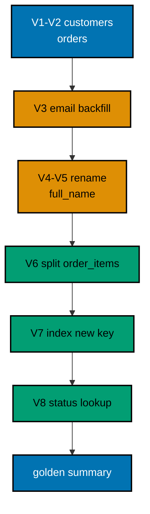

A small shop needs an order-management schema that can change without closing: customers gain contact columns, `name` becomes `full_name` without downtime, order lines split into their own table, and statuses graduate to a lookup. You evolve the schema through eight Flyway migrations, then prove the final state with golden queries that count every order and line per customer.

## The story

The shop opens with two tables: `customers` with a `name`, and `orders` with a customer reference and an item. Reality arrives in waves familiar from the course. First the contact wave: marketing wants emails, so `V3` adds an `email` column and backfills it from names. Then the naming wave: `name` is ambiguous (person or shop?), so `V4` adds `full_name` and copies every value across, and `V5` — a release later, after readers move — drops `name`. That pair is the zero-downtime rename from Examples 37 and 38, now carrying real customer data.

Then the scale wave: orders grow line items, so `V6` creates `order_items` with quantities and backfills one row per existing order. The new foreign key earns its index in `V7` before any traffic cutover, following Example 39. Finally the process wave: `V8` introduces an `order_status` lookup table and a `status` column defaulting to `'new'`, backfilling the first two orders to `'paid'`. Lookup seeding follows Example 33; the guarded default follows Example 31.

## The migration ledger

| Version | Change                                               | Pattern                                   |
| ------- | ---------------------------------------------------- | ----------------------------------------- |
| V1      | Create `customers`                                   | First migration, one table                |
| V2      | Create `orders`, seed customers and orders           | Structure plus seed data                  |
| V3      | Add `email` with backfill                            | Expand with immediate backfill            |
| V4      | Add `full_name`, copy from `name`                    | Zero-downtime rename, step one            |
| V5      | Drop `name`                                          | Zero-downtime rename, step two (contract) |
| V6      | Create `order_items`, backfill from `orders`         | Table split with `INSERT ... SELECT`      |
| V7      | Index `order_items(order_id)`                        | Index before cutover                      |
| V8      | `order_status` lookup, `status` column with backfill | Lookup seed plus guarded default          |

Eight migrations, each reviewed in isolation, each replayable on every environment in order. The history table after the run shows versions one through eight, all successful — the same straight line the course preaches from Example 10 onward.

## Verification

The program migrates all eight files, validates the result, then runs the golden summary query: per customer, in alphabetical order, the count of orders and the count of lines. Budi placed one order with one line; Sari placed two orders with two lines. Those four numbers — `budi orders=1 items=1`, `sari orders=2 items=2` — pin the entire evolution: the rename kept every customer, the split kept every order, and the backfills covered every row. If any migration lost data, the counts would say so before any human looked.



**`learning/capstone/code/Main.kt`**:

```kotlin
// Capstone: evolve an order-management schema through eight migrations.
// The shop starts with customers and orders, gains contact columns, renames
// a column without downtime, splits out line items, indexes the new key,
// and adopts a status lookup -- then proves the result with golden queries.
import org.flywaydb.core.Flyway // => the entry point: configure, then migrate
import java.sql.DriverManager // => plain JDBC for the golden verification queries

fun dbUrl(): String { // => one URL builder shared by Flyway and JDBC
    val host = System.getenv("PGHOST") ?: "localhost" // => service alias on the unit network
    val db = System.getenv("PGDATABASE") ?: "postgres" // => the service's database name
    return "jdbc:postgresql://" + host + "/" + db // => trust auth needs no password
} // => helper ends: every connection string flows through here

fun dbUser(): String { // => one user lookup shared by Flyway and JDBC
    return System.getenv("PGUSER") ?: "postgres" // => postgres superuser in the service container
} // => helper ends: a single place if the service user ever changes

fun main() { // => the entry point the harness runs
    val flyway = Flyway.configure() // => start from a clean configuration
        .dataSource(dbUrl(), dbUser(), null) // => trust auth: user with no password
        .locations("filesystem:db/migrations") // => the eight capstone migrations
        .load() // => freeze the configuration into a Flyway instance
    flyway.migrate() // => apply pending migrations; re-runs find nothing new
    println("valid=" + flyway.validateWithResult().validationSuccessful) // => the final schema coheres
    DriverManager.getConnection(dbUrl(), dbUser(), null).use { conn -> // => open one JDBC connection
        conn.createStatement().use { st -> // => a statement for the golden queries
            st.executeQuery("SELECT c.full_name, count(DISTINCT o.id), count(i.id) FROM customers c LEFT JOIN orders o ON o.customer_id = c.id LEFT JOIN order_items i ON i.order_id = o.id GROUP BY c.full_name ORDER BY c.full_name").use { rs -> // => per-customer order summary
                while (rs.next()) { // => walk both customers alphabetically
                    println(rs.getString(1) + " orders=" + rs.getInt(2) + " items=" + rs.getInt(3)) // => the golden summary lines
                } // => loop ends after the last customer
            } // => result set closed here
        } // => statement closed here
    } // => connection closed here
} // => main ends: the shop schema stands verified
```

**Migrations** (`learning/capstone/code/db/migrations/`): V1 creates customers; V2 creates orders and seeds both tables; V3 adds email with backfill; V4 adds full_name with backfill; V5 drops name; V6 creates order_items with backfill; V7 indexes the new key; V8 adds the status lookup and column.

**Output** (`learning/capstone/code/expected/main/main.stdout.txt`):

```text
valid=true
budi orders=1 items=1
sari orders=2 items=2
```

This capstone is complete when the golden summary prints both customers with exact counts: the schema evolved, no row was lost, and the history is one straight, validated line.
