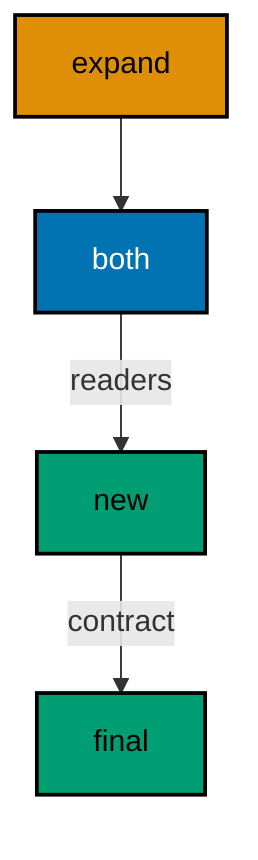

Examples 26–53 handle real data and real legacy. Backfills fill new columns without losing rows (Examples 26–34), zero-downtime splits expand before they contract so no deploy needs a maintenance window (Examples 35–44), and baselines import pre-Flyway databases under version control (Examples 45–53). Every example is a complete, runnable Kotlin program under `learning/code/`; run each with the command in its own `run.yaml`.

---

### Example 26: Separate Data from Schema

Schema migrations create structure; data migrations fill it. Keeping them in separate files lets reviewers see which is which and lets operators rerun data loads without touching structure. Here `V1` creates `genres` and `V2` inserts three rows.

The program migrates both and counts the rows. Two files, two concerns: structure first, content second, each independently reviewable.

(Concepts: co-06.)

**`learning/code/ex-26-separate-data-from-schema/Main.kt`**:

```kotlin
// Example 26: Separate Data from Schema.
// structure first, content second.
import org.flywaydb.core.Flyway // => the entry point: configure, then migrate
import java.sql.DriverManager // => plain JDBC for the verification queries

fun dbUrl(): String { // => one URL builder shared by Flyway and JDBC
    val host = System.getenv("PGHOST") ?: "localhost" // => service alias on the unit network
    val db = System.getenv("PGDATABASE") ?: "postgres" // => the service's database name
    return "jdbc:postgresql://" + host + "/" + db // => trust auth needs no password
} // => helper ends: every connection string flows through here

fun dbUser(): String { // => one user lookup shared by Flyway and JDBC
    return System.getenv("PGUSER") ?: "postgres" // => postgres superuser in the service container
} // => helper ends: a single place if the service user ever changes

fun main() { // => the entry point the harness runs
    val flyway = Flyway.configure() // => start from a clean configuration
        .dataSource(dbUrl(), dbUser(), null) // => trust auth: user with no password
        .locations("filesystem:migrations") // => SQL files live beside the program
        .load() // => freeze the configuration into a Flyway instance
    flyway.migrate() // => bring the database current; re-runs find nothing new
    DriverManager.getConnection(dbUrl(), dbUser(), null).use { conn -> // => open one JDBC connection
        conn.createStatement().use { st -> // => a statement for the count query
            st.executeQuery("SELECT count(*) FROM genres").use { rs -> // => the seeded rows
                rs.next() // => move to the single result row
                println("rows=" + rs.getInt(1)) // => Output: rows=3
            } // => result set closed here
        } // => statement closed here
    } // => connection closed here
} // => main ends: every check printed
```

**`learning/code/ex-26-separate-data-from-schema/migrations/V1__create_genres.sql`**:

```sql
-- V1: structure only, no rows yet.
CREATE TABLE genres (
    id SERIAL PRIMARY KEY,
    name TEXT NOT NULL UNIQUE
);
```

**`learning/code/ex-26-separate-data-from-schema/migrations/V2__seed_genres.sql`**:

```sql
-- V2: data only, three reference rows.
INSERT INTO genres (name) VALUES ('rock'), ('jazz'), ('gamelan');
```

**Output** (`learning/code/ex-26-separate-data-from-schema/expected/main.stdout.txt`):

```text
rows=3
```

**Key takeaway**: Put DDL and seed data in separate migrations so structure and content review independently.

**Why it matters**: Separating structure from content lets operators reload data without replaying structure, and lets reviewers judge each on its own terms. Schema changes need care about locks, constraints, and compatibility; seed data needs care about volumes, freshness, and sources. Fused into one file, a data problem blocks a structural fix and a structural review must also bless ten thousand inserted rows. Kept apart, each migration carries one kind of risk, one kind of review, and one independent rollback story when its half goes wrong.

---

### Example 27: Backfill Fills a New Column

Adding a column to a table with rows demands a backfill: existing rows need values for the new field. The backfill rides in the same migration as the `ADD COLUMN` when the table is small, as an `UPDATE` right after the alter.

This example creates users, seeds three, then adds a `tier` column and backfills every row to `'free'`. The ordered output proves no row was left behind.

(Concepts: co-06.)

**`learning/code/ex-27-backfill-fills-a-new-column/Main.kt`**:

```kotlin
// Example 27: Backfill Fills a New Column.
// alter then update in one file.
import org.flywaydb.core.Flyway // => the entry point: configure, then migrate
import java.sql.DriverManager // => plain JDBC for the verification queries

fun dbUrl(): String { // => one URL builder shared by Flyway and JDBC
    val host = System.getenv("PGHOST") ?: "localhost" // => service alias on the unit network
    val db = System.getenv("PGDATABASE") ?: "postgres" // => the service's database name
    return "jdbc:postgresql://" + host + "/" + db // => trust auth needs no password
} // => helper ends: every connection string flows through here

fun dbUser(): String { // => one user lookup shared by Flyway and JDBC
    return System.getenv("PGUSER") ?: "postgres" // => postgres superuser in the service container
} // => helper ends: a single place if the service user ever changes

fun main() { // => the entry point the harness runs
    val flyway = Flyway.configure() // => start from a clean configuration
        .dataSource(dbUrl(), dbUser(), null) // => trust auth: user with no password
        .locations("filesystem:migrations") // => SQL files live beside the program
        .load() // => freeze the configuration into a Flyway instance
    flyway.migrate() // => bring the database current; re-runs find nothing new
    DriverManager.getConnection(dbUrl(), dbUser(), null).use { conn -> // => open one JDBC connection
        conn.createStatement().use { st -> // => a statement for the tier query
            st.executeQuery("SELECT tier FROM users ORDER BY id").use { rs -> // => every backfilled value in order
                while (rs.next()) { // => walk all three users
                    println("tier=" + rs.getString(1)) // => each row got free
                } // => loop ends after the last user
            } // => result set closed here
        } // => statement closed here
    } // => connection closed here
} // => main ends: every check printed
```

**`learning/code/ex-27-backfill-fills-a-new-column/migrations/V1__create_users.sql`**:

```sql
-- V1: users start with names only.
CREATE TABLE users (
    id SERIAL PRIMARY KEY,
    name TEXT NOT NULL
);
```

**`learning/code/ex-27-backfill-fills-a-new-column/migrations/V2__seed_users.sql`**:

```sql
-- V2: three users seed the demo.
INSERT INTO users (name) VALUES ('sari'), ('budi'), ('dewi');
```

**`learning/code/ex-27-backfill-fills-a-new-column/migrations/V3__add_tier.sql`**:

```sql
-- V3: new column plus immediate backfill in one file.
ALTER TABLE users ADD COLUMN tier TEXT;
UPDATE users SET tier = 'free';
```

**Output** (`learning/code/ex-27-backfill-fills-a-new-column/expected/main.stdout.txt`):

```text
tier=free
tier=free
tier=free
```

**Key takeaway**: Backfill new columns in the same migration when the table is small enough to update at once.

**Why it matters**: A new column without a backfill plan is a null waiting to surprise the application layer. Every existing row receives null for the column it never had, while new code often assumes the value is always present; the gap between those assumptions is where production errors breed. Writing the backfill in the same migration as the alter closes the gap atomically: no query can ever observe the column existing but unpopulated. Same-file backfills are the cheapest way to guarantee that the schema and its data evolve as one consistent unit.

---

### Example 28: Backfill in Batches

Big tables cannot backfill in one statement without holding a long lock. Batching splits the update by key ranges so each statement locks briefly and commits. This example backfills four event rows in two batches of two.

Two `UPDATE` statements with disjoint `WHERE` ranges cover every row exactly once. The final count proves full coverage; the batching proves the technique scales to millions by adding more ranges.

(Concepts: co-06.)

**`learning/code/ex-28-backfill-in-batches/Main.kt`**:

```kotlin
// Example 28: Backfill in Batches.
// disjoint ranges cover every row once.
import org.flywaydb.core.Flyway // => the entry point: configure, then migrate
import java.sql.DriverManager // => plain JDBC for the verification queries

fun dbUrl(): String { // => one URL builder shared by Flyway and JDBC
    val host = System.getenv("PGHOST") ?: "localhost" // => service alias on the unit network
    val db = System.getenv("PGDATABASE") ?: "postgres" // => the service's database name
    return "jdbc:postgresql://" + host + "/" + db // => trust auth needs no password
} // => helper ends: every connection string flows through here

fun dbUser(): String { // => one user lookup shared by Flyway and JDBC
    return System.getenv("PGUSER") ?: "postgres" // => postgres superuser in the service container
} // => helper ends: a single place if the service user ever changes

fun main() { // => the entry point the harness runs
    val flyway = Flyway.configure() // => start from a clean configuration
        .dataSource(dbUrl(), dbUser(), null) // => trust auth: user with no password
        .locations("filesystem:migrations") // => SQL files live beside the program
        .load() // => freeze the configuration into a Flyway instance
    flyway.migrate() // => bring the database current; re-runs find nothing new
    DriverManager.getConnection(dbUrl(), dbUser(), null).use { conn -> // => open one JDBC connection
        conn.createStatement().use { st -> // => a statement for the coverage query
            st.executeQuery("SELECT count(*) FROM events WHERE processed").use { rs -> // => only backfilled rows count
                rs.next() // => move to the single result row
                println("processed=" + rs.getInt(1)) // => Output: processed=4
            } // => result set closed here
        } // => statement closed here
    } // => connection closed here
} // => main ends: every check printed
```

**`learning/code/ex-28-backfill-in-batches/migrations/V1__create_events.sql`**:

```sql
-- V1: events start unprocessed.
CREATE TABLE events (
    id SERIAL PRIMARY KEY,
    kind TEXT NOT NULL,
    processed BOOLEAN
);
```

**`learning/code/ex-28-backfill-in-batches/migrations/V2__seed_events.sql`**:

```sql
-- V2: four events seed the demo.
INSERT INTO events (kind) VALUES ('click'), ('view'), ('click'), ('view');
```

**`learning/code/ex-28-backfill-in-batches/migrations/V3__backfill_batches.sql`**:

```sql
-- V3: two disjoint ranges cover every row once.
UPDATE events SET processed = true WHERE id <= 2;
UPDATE events SET processed = true WHERE id > 2;
```

**Output** (`learning/code/ex-28-backfill-in-batches/expected/main.stdout.txt`):

```text
processed=4
```

**Key takeaway**: Split big backfills by key ranges so each statement locks briefly and commits.

**Why it matters**: Batching bounds lock time, and bounded lock time bounds the blast radius on live tables. A single update over millions of rows holds locks long enough for other traffic to queue, time out, and cascade into a wider incident than the migration itself. Splitting the work by key ranges turns one long risky statement into many short boring ones, each committing quickly and releasing what it held. The technique scales without new machinery: more rows simply mean more ranges, while the worst case any single statement can cause stays fixed and small.

---

### Example 29: Backfill with a CASE Expression

Backfills often compute the new value from old data rather than stamping a constant. A `CASE` expression maps each row's history to its new tier in a single set-based statement. Here order totals decide gold versus standard membership.

The program prints each customer's tier in id order. Set-based mapping beats row-by-row scripts: one statement, one transaction, no application code involved.

(Concepts: co-06.)

**`learning/code/ex-29-backfill-with-a-case-expression/Main.kt`**:

```kotlin
// Example 29: Backfill with a CASE Expression.
// old data decides the new value.
import org.flywaydb.core.Flyway // => the entry point: configure, then migrate
import java.sql.DriverManager // => plain JDBC for the verification queries

fun dbUrl(): String { // => one URL builder shared by Flyway and JDBC
    val host = System.getenv("PGHOST") ?: "localhost" // => service alias on the unit network
    val db = System.getenv("PGDATABASE") ?: "postgres" // => the service's database name
    return "jdbc:postgresql://" + host + "/" + db // => trust auth needs no password
} // => helper ends: every connection string flows through here

fun dbUser(): String { // => one user lookup shared by Flyway and JDBC
    return System.getenv("PGUSER") ?: "postgres" // => postgres superuser in the service container
} // => helper ends: a single place if the service user ever changes

fun main() { // => the entry point the harness runs
    val flyway = Flyway.configure() // => start from a clean configuration
        .dataSource(dbUrl(), dbUser(), null) // => trust auth: user with no password
        .locations("filesystem:migrations") // => SQL files live beside the program
        .load() // => freeze the configuration into a Flyway instance
    flyway.migrate() // => bring the database current; re-runs find nothing new
    DriverManager.getConnection(dbUrl(), dbUser(), null).use { conn -> // => open one JDBC connection
        conn.createStatement().use { st -> // => a statement for the tier query
            st.executeQuery("SELECT name, tier FROM customers ORDER BY id").use { rs -> // => each mapping in id order
                while (rs.next()) { // => walk all three customers
                    println(rs.getString(1) + "=" + rs.getString(2)) // => name plus computed tier
                } // => loop ends after the last customer
            } // => result set closed here
        } // => statement closed here
    } // => connection closed here
} // => main ends: every check printed
```

**`learning/code/ex-29-backfill-with-a-case-expression/migrations/V1__create_customers.sql`**:

```sql
-- V1: customers with lifetime totals.
CREATE TABLE customers (
    id SERIAL PRIMARY KEY,
    name TEXT NOT NULL,
    lifetime_total INTEGER NOT NULL
);
```

**`learning/code/ex-29-backfill-with-a-case-expression/migrations/V2__seed_customers.sql`**:

```sql
-- V2: three customers with different totals.
INSERT INTO customers (name, lifetime_total) VALUES ('sari', 5000), ('budi', 200), ('dewi', 1500);
```

**`learning/code/ex-29-backfill-with-a-case-expression/migrations/V3__tier_backfill.sql`**:

```sql
-- V3: CASE maps each total to its tier.
ALTER TABLE customers ADD COLUMN tier TEXT;
UPDATE customers SET tier = CASE WHEN lifetime_total >= 1000 THEN 'gold' ELSE 'standard' END;
```

**Output** (`learning/code/ex-29-backfill-with-a-case-expression/expected/main.stdout.txt`):

```text
sari=gold
budi=standard
dewi=gold
```

**Key takeaway**: Derive backfilled values from existing columns with set-based `CASE`, not row-by-row scripts.

**Why it matters**: Data-driven backfills encode business rules where reviewers can see them, inside the migration SQL, instead of hiding them in throwaway scripts. A CASE expression maps each row's history to its new value set-theoretically: one statement, one transaction, no application code, no row-by-row loop that can stall halfway. Because the logic lives in a versioned file, it is reviewed like any schema change, replayed identically on every environment, and preserved in history as the permanent record of what the business rule was on that date.

---

### Example 30: Backfill Before Adding NOT NULL

A `NOT NULL` constraint on a populated table fails unless every row already has a value. The safe order inside one migration: add the column nullable, backfill, then set the constraint. Each step sees the previous step's work.

The program prints the constraint state from `information_schema`: `NO` means nulls are rejected. Order inside the file is the whole technique.

(Concepts: co-06.)

**`learning/code/ex-30-backfill-before-adding-not-null/Main.kt`**:

```kotlin
// Example 30: Backfill Before Adding NOT NULL.
// order inside the file is the technique.
import org.flywaydb.core.Flyway // => the entry point: configure, then migrate
import java.sql.DriverManager // => plain JDBC for the verification queries

fun dbUrl(): String { // => one URL builder shared by Flyway and JDBC
    val host = System.getenv("PGHOST") ?: "localhost" // => service alias on the unit network
    val db = System.getenv("PGDATABASE") ?: "postgres" // => the service's database name
    return "jdbc:postgresql://" + host + "/" + db // => trust auth needs no password
} // => helper ends: every connection string flows through here

fun dbUser(): String { // => one user lookup shared by Flyway and JDBC
    return System.getenv("PGUSER") ?: "postgres" // => postgres superuser in the service container
} // => helper ends: a single place if the service user ever changes

fun main() { // => the entry point the harness runs
    val flyway = Flyway.configure() // => start from a clean configuration
        .dataSource(dbUrl(), dbUser(), null) // => trust auth: user with no password
        .locations("filesystem:migrations") // => SQL files live beside the program
        .load() // => freeze the configuration into a Flyway instance
    flyway.migrate() // => bring the database current; re-runs find nothing new
    DriverManager.getConnection(dbUrl(), dbUser(), null).use { conn -> // => open one JDBC connection
        conn.createStatement().use { st -> // => a statement for the constraint query
            st.executeQuery("SELECT is_nullable FROM information_schema.columns WHERE table_name = 'phones' AND column_name = 'model'").use { rs -> // => one row describes the column
                rs.next() // => move to the single result row
                println("nullable=" + rs.getString(1)) // => Output: nullable=NO
            } // => result set closed here
        } // => statement closed here
    } // => connection closed here
} // => main ends: every check printed
```

**`learning/code/ex-30-backfill-before-adding-not-null/migrations/V1__create_phones.sql`**:

```sql
-- V1: phones without any constraint yet.
CREATE TABLE phones (
    id SERIAL PRIMARY KEY,
    model TEXT
);
```

**`learning/code/ex-30-backfill-before-adding-not-null/migrations/V2__seed_phones.sql`**:

```sql
-- V2: one row even lacks a model.
INSERT INTO phones (model) VALUES ('k750'), (NULL);
```

**`learning/code/ex-30-backfill-before-adding-not-null/migrations/V3__constrain_model.sql`**:

```sql
-- V3: backfill first, constraint second, same file.
UPDATE phones SET model = 'unknown' WHERE model IS NULL;
ALTER TABLE phones ALTER COLUMN model SET NOT NULL;
```

**Output** (`learning/code/ex-30-backfill-before-adding-not-null/expected/main.stdout.txt`):

```text
nullable=NO
```

**Key takeaway**: Add nullable, backfill, then constrain: constraints come last, never first.

**Why it matters**: Ordering the constraint after the data fix keeps new rules from failing on legacy rows that predate them. A NOT NULL constraint applied to a column that already holds nulls rejects the migration, and the deploy stops over data that was perfectly legal when it was written. Adding the column nullable, filling every row deliberately, and only then declaring the constraint turns one risky step into three safe ones. The sequence respects a basic truth: constraints describe the future, but they are always installed on top of the past.

---

### Example 31: Defaults Beat Null Backfills

When every existing row deserves the same value, a column default does the backfill for free: PostgreSQL fills existing rows at alter time. `V2` adds a `status` column defaulting to `'new'` and the seeded parcels inherit it instantly.

The program prints both statuses. Defaults document the common case in the schema itself, where every future insert inherits them too.

(Concepts: co-06.)

**`learning/code/ex-31-defaults-beat-null-backfills/Main.kt`**:

```kotlin
// Example 31: Defaults Beat Null Backfills.
// the default fills old rows instantly.
import org.flywaydb.core.Flyway // => the entry point: configure, then migrate
import java.sql.DriverManager // => plain JDBC for the verification queries

fun dbUrl(): String { // => one URL builder shared by Flyway and JDBC
    val host = System.getenv("PGHOST") ?: "localhost" // => service alias on the unit network
    val db = System.getenv("PGDATABASE") ?: "postgres" // => the service's database name
    return "jdbc:postgresql://" + host + "/" + db // => trust auth needs no password
} // => helper ends: every connection string flows through here

fun dbUser(): String { // => one user lookup shared by Flyway and JDBC
    return System.getenv("PGUSER") ?: "postgres" // => postgres superuser in the service container
} // => helper ends: a single place if the service user ever changes

fun main() { // => the entry point the harness runs
    val flyway = Flyway.configure() // => start from a clean configuration
        .dataSource(dbUrl(), dbUser(), null) // => trust auth: user with no password
        .locations("filesystem:migrations") // => SQL files live beside the program
        .load() // => freeze the configuration into a Flyway instance
    flyway.migrate() // => bring the database current; re-runs find nothing new
    DriverManager.getConnection(dbUrl(), dbUser(), null).use { conn -> // => open one JDBC connection
        conn.createStatement().use { st -> // => a statement for the status query
            st.executeQuery("SELECT status FROM parcels ORDER BY id").use { rs -> // => both inherited values
                while (rs.next()) { // => walk both parcels
                    println("status=" + rs.getString(1)) // => each row says new
                } // => loop ends after the last parcel
            } // => result set closed here
        } // => statement closed here
    } // => connection closed here
} // => main ends: every check printed
```

**`learning/code/ex-31-defaults-beat-null-backfills/migrations/V1__create_parcels.sql`**:

```sql
-- V1: parcels without a status.
CREATE TABLE parcels (
    id SERIAL PRIMARY KEY,
    code TEXT NOT NULL
);
```

**`learning/code/ex-31-defaults-beat-null-backfills/migrations/V2__seed_parcels.sql`**:

```sql
-- V2: two parcels seed the demo.
INSERT INTO parcels (code) VALUES ('A1'), ('B2');
```

**`learning/code/ex-31-defaults-beat-null-backfills/migrations/V3__add_status.sql`**:

```sql
-- V3: the default backfills existing rows at alter time.
ALTER TABLE parcels ADD COLUMN status TEXT NOT NULL DEFAULT 'new';
```

**Output** (`learning/code/ex-31-defaults-beat-null-backfills/expected/main.stdout.txt`):

```text
status=new
status=new
```

**Key takeaway**: Prefer column defaults when one value fits all existing rows; the alter backfills for free.

**Why it matters**: Column defaults keep old rows and future inserts on the same chosen value with a single declaration. When one value fits every existing row, the alter itself performs the backfill: PostgreSQL stamps the default into the table metadata, and no update statement needs to touch a single row. The same default then governs every insert that omits the column, so the past and the future cannot diverge. Defaults are the rare migration feature that does less work while giving stronger guarantees than the manual alternative.

---

### Example 32: Idempotent Backfill Uses WHERE

A backfill that runs twice must change nothing the second time. Guarding the `UPDATE` with `WHERE tier IS NULL` makes repetition safe: the first run fills, the second finds no work. Combined with Flyway's once-only history, the migration is doubly safe.

The program migrates twice, then counts the guarded rows. Two free tiers after two runs prove the belt-and-suspenders design.

(Concepts: co-05, co-06.)

**`learning/code/ex-32-idempotent-backfill-uses-where/Main.kt`**:

```kotlin
// Example 32: Idempotent Backfill Uses WHERE.
// the guard makes reruns harmless.
import org.flywaydb.core.Flyway // => the entry point: configure, then migrate
import java.sql.DriverManager // => plain JDBC for the verification queries

fun dbUrl(): String { // => one URL builder shared by Flyway and JDBC
    val host = System.getenv("PGHOST") ?: "localhost" // => service alias on the unit network
    val db = System.getenv("PGDATABASE") ?: "postgres" // => the service's database name
    return "jdbc:postgresql://" + host + "/" + db // => trust auth needs no password
} // => helper ends: every connection string flows through here

fun dbUser(): String { // => one user lookup shared by Flyway and JDBC
    return System.getenv("PGUSER") ?: "postgres" // => postgres superuser in the service container
} // => helper ends: a single place if the service user ever changes

fun main() { // => the entry point the harness runs
    val flyway = Flyway.configure() // => start from a clean configuration
        .dataSource(dbUrl(), dbUser(), null) // => trust auth: user with no password
        .locations("filesystem:migrations") // => SQL files live beside the program
        .load() // => freeze the configuration into a Flyway instance
    flyway.migrate() // => apply pending migrations; re-runs find nothing new
    flyway.migrate() // => apply pending migrations; re-runs find nothing new
    DriverManager.getConnection(dbUrl(), dbUser(), null).use { conn -> // => open one JDBC connection
        conn.createStatement().use { st -> // => a statement for the tier query
            st.executeQuery("SELECT count(*) FROM subs WHERE tier = 'free'").use { rs -> // => both rows backfilled
                rs.next() // => move to the single result row
                println("free=" + rs.getInt(1)) // => Output: free=2
            } // => result set closed here
        } // => statement closed here
    } // => connection closed here
} // => main ends: every check printed
```

**`learning/code/ex-32-idempotent-backfill-uses-where/migrations/V1__create_subs.sql`**:

```sql
-- V1: subscriptions without tiers.
CREATE TABLE subs (
    id SERIAL PRIMARY KEY,
    email TEXT NOT NULL,
    tier TEXT
);
```

**`learning/code/ex-32-idempotent-backfill-uses-where/migrations/V2__seed_subs.sql`**:

```sql
-- V2: two subscriptions seed the demo.
INSERT INTO subs (email) VALUES ('a@x.id'), ('b@x.id');
```

**`learning/code/ex-32-idempotent-backfill-uses-where/migrations/V3__guarded_backfill.sql`**:

```sql
-- V3: the WHERE guard makes reruns harmless.
UPDATE subs SET tier = 'free' WHERE tier IS NULL;
```

**Output** (`learning/code/ex-32-idempotent-backfill-uses-where/expected/main.stdout.txt`):

```text
free=2
```

**Key takeaway**: Guard backfill updates with `WHERE` so reruns change nothing even if history is lost.

**Why it matters**: Idempotent SQL plus once-only history gives two independent safety nets, and independence is the point. The history table normally prevents reruns, but histories can be lost, rebuilt, or bypassed during disaster recovery; a WHERE-guarded update stays safe even then, changing nothing when there is nothing to change. Either net alone has a failure mode, but they fail differently, so both failing at once requires two unrelated accidents. Defense in depth for data changes costs one clause and pays out exactly when the primary mechanism is unavailable.

---

### Example 33: Backfill a Lookup Table

Reference data — statuses, codes, types — ships as insert migrations so every environment shares the same vocabulary. `V2` inserts four order statuses that later migrations and application code can join against.

The program prints each code-label pair in code order. Treat lookup inserts like code: reviewed, versioned, and never edited after release.

(Concepts: co-06.)

**`learning/code/ex-33-backfill-a-lookup-table/Main.kt`**:

```kotlin
// Example 33: Backfill a Lookup Table.
// reference data ships versioned too.
import org.flywaydb.core.Flyway // => the entry point: configure, then migrate
import java.sql.DriverManager // => plain JDBC for the verification queries

fun dbUrl(): String { // => one URL builder shared by Flyway and JDBC
    val host = System.getenv("PGHOST") ?: "localhost" // => service alias on the unit network
    val db = System.getenv("PGDATABASE") ?: "postgres" // => the service's database name
    return "jdbc:postgresql://" + host + "/" + db // => trust auth needs no password
} // => helper ends: every connection string flows through here

fun dbUser(): String { // => one user lookup shared by Flyway and JDBC
    return System.getenv("PGUSER") ?: "postgres" // => postgres superuser in the service container
} // => helper ends: a single place if the service user ever changes

fun main() { // => the entry point the harness runs
    val flyway = Flyway.configure() // => start from a clean configuration
        .dataSource(dbUrl(), dbUser(), null) // => trust auth: user with no password
        .locations("filesystem:migrations") // => SQL files live beside the program
        .load() // => freeze the configuration into a Flyway instance
    flyway.migrate() // => bring the database current; re-runs find nothing new
    DriverManager.getConnection(dbUrl(), dbUser(), null).use { conn -> // => open one JDBC connection
        conn.createStatement().use { st -> // => a statement for the lookup query
            st.executeQuery("SELECT code, label FROM order_status ORDER BY code").use { rs -> // => the shared vocabulary
                while (rs.next()) { // => walk all four statuses
                    println(rs.getString(1) + "=" + rs.getString(2)) // => code plus label
                } // => loop ends after the last status
            } // => result set closed here
        } // => statement closed here
    } // => connection closed here
} // => main ends: every check printed
```

**`learning/code/ex-33-backfill-a-lookup-table/migrations/V1__create_statuses.sql`**:

```sql
-- V1: the lookup table with a natural key.
CREATE TABLE order_status (
    code TEXT PRIMARY KEY,
    label TEXT NOT NULL
);
```

**`learning/code/ex-33-backfill-a-lookup-table/migrations/V2__seed_statuses.sql`**:

```sql
-- V2: four statuses every environment shares.
INSERT INTO order_status (code, label) VALUES ('new', 'New'), ('paid', 'Paid'), ('sent', 'Sent'), ('done', 'Done');
```

**Output** (`learning/code/ex-33-backfill-a-lookup-table/expected/main.stdout.txt`):

```text
done=Done
new=New
paid=Paid
sent=Sent
```

**Key takeaway**: Ship reference data as insert migrations so every environment shares one vocabulary.

**Why it matters**: Shipping reference data as insert migrations gives every environment one shared vocabulary for the values the application treats as constants. Status codes, categories, and lookup rows defined per environment by hand inevitably drift: staging knows a code production never received, and bug reports become untranslatable across machines. Versioned lookups make the vocabulary part of the schema's story, reviewed, ordered, and replayed like everything else. When every database agrees on what each code means, engineers can reason about behavior instead of reconciling dictionaries.

---

### Example 34: Verify Backfill with a Check Query

Every backfill deserves an assertion: count the rows the update should have reached and require zero misses. This example backfills tiers, then counts `NULL` leftovers and prints the zero that proves completeness.

The `unfilled=0` line is a migration test in miniature. Promote the habit: no backfill merges without its check query in the same review.

(Concepts: co-16, co-06.)

**`learning/code/ex-34-verify-backfill-with-a-check-query/Main.kt`**:

```kotlin
// Example 34: Verify Backfill with a Check Query.
// zero misses proves completeness.
import org.flywaydb.core.Flyway // => the entry point: configure, then migrate
import java.sql.DriverManager // => plain JDBC for the verification queries

fun dbUrl(): String { // => one URL builder shared by Flyway and JDBC
    val host = System.getenv("PGHOST") ?: "localhost" // => service alias on the unit network
    val db = System.getenv("PGDATABASE") ?: "postgres" // => the service's database name
    return "jdbc:postgresql://" + host + "/" + db // => trust auth needs no password
} // => helper ends: every connection string flows through here

fun dbUser(): String { // => one user lookup shared by Flyway and JDBC
    return System.getenv("PGUSER") ?: "postgres" // => postgres superuser in the service container
} // => helper ends: a single place if the service user ever changes

fun main() { // => the entry point the harness runs
    val flyway = Flyway.configure() // => start from a clean configuration
        .dataSource(dbUrl(), dbUser(), null) // => trust auth: user with no password
        .locations("filesystem:migrations") // => SQL files live beside the program
        .load() // => freeze the configuration into a Flyway instance
    flyway.migrate() // => bring the database current; re-runs find nothing new
    DriverManager.getConnection(dbUrl(), dbUser(), null).use { conn -> // => open one JDBC connection
        conn.createStatement().use { st -> // => a statement for the check query
            st.executeQuery("SELECT count(*) FROM riders WHERE tier IS NULL").use { rs -> // => leftovers must be zero
                rs.next() // => move to the single result row
                println("unfilled=" + rs.getInt(1)) // => Output: unfilled=0
            } // => result set closed here
        } // => statement closed here
    } // => connection closed here
} // => main ends: every check printed
```

**`learning/code/ex-34-verify-backfill-with-a-check-query/migrations/V1__create_riders.sql`**:

```sql
-- V1: riders without tiers.
CREATE TABLE riders (
    id SERIAL PRIMARY KEY,
    name TEXT NOT NULL,
    tier TEXT
);
```

**`learning/code/ex-34-verify-backfill-with-a-check-query/migrations/V2__seed_riders.sql`**:

```sql
-- V2: three riders seed the demo.
INSERT INTO riders (name) VALUES ('ani'), ('bima'), ('cici');
```

**`learning/code/ex-34-verify-backfill-with-a-check-query/migrations/V3__tier_backfill.sql`**:

```sql
-- V3: backfill plus its own verification target.
UPDATE riders SET tier = 'free';
```

**Output** (`learning/code/ex-34-verify-backfill-with-a-check-query/expected/main.stdout.txt`):

```text
unfilled=0
```

**Key takeaway**: Assert backfill completeness with a leftover count; require zero before merging.

**Why it matters**: A leftover-count query turns hope about data coverage into a number a reviewer can read and a gate can enforce. Backfills fail partially more often than they fail loudly: a range boundary off by one, a predicate that misses a new category, and most rows look right while a few stay wrong. Asserting zero leftovers before merging makes completeness mechanical rather than visual, and the check lives beside the migration so future editors inherit it. Coverage you can count is coverage you can require; everything else is optimism.

---

### Example 35: Expand Before You Contract

Zero-downtime changes expand first and contract later: add the new column while the old one still serves traffic. `V2` adds `email_new` beside `email` and copies every value across. Nothing reads the new column yet; that comes next.

The program prints both columns' distinct counts to prove the copy covered every row. Expansion without contraction is always safe to deploy because old readers see no change.

(Concepts: co-07.)



**`learning/code/ex-35-expand-before-you-contract/Main.kt`**:

```kotlin
// Example 35: Expand Before You Contract.
// add the new column beside the old.
import org.flywaydb.core.Flyway // => the entry point: configure, then migrate
import java.sql.DriverManager // => plain JDBC for the verification queries

fun dbUrl(): String { // => one URL builder shared by Flyway and JDBC
    val host = System.getenv("PGHOST") ?: "localhost" // => service alias on the unit network
    val db = System.getenv("PGDATABASE") ?: "postgres" // => the service's database name
    return "jdbc:postgresql://" + host + "/" + db // => trust auth needs no password
} // => helper ends: every connection string flows through here

fun dbUser(): String { // => one user lookup shared by Flyway and JDBC
    return System.getenv("PGUSER") ?: "postgres" // => postgres superuser in the service container
} // => helper ends: a single place if the service user ever changes

fun main() { // => the entry point the harness runs
    val flyway = Flyway.configure() // => start from a clean configuration
        .dataSource(dbUrl(), dbUser(), null) // => trust auth: user with no password
        .locations("filesystem:migrations") // => SQL files live beside the program
        .load() // => freeze the configuration into a Flyway instance
    flyway.migrate() // => bring the database current; re-runs find nothing new
    DriverManager.getConnection(dbUrl(), dbUser(), null).use { conn -> // => open one JDBC connection
        conn.createStatement().use { st -> // => a statement for the parity query
            st.executeQuery("SELECT count(*) FROM customers WHERE email = email_new").use { rs -> // => every row copied exactly
                rs.next() // => move to the single result row
                println("copied=" + rs.getInt(1)) // => Output: copied=2
            } // => result set closed here
        } // => statement closed here
    } // => connection closed here
} // => main ends: every check printed
```

**`learning/code/ex-35-expand-before-you-contract/migrations/V1__create_customers.sql`**:

```sql
-- V1: customers with the legacy email column.
CREATE TABLE customers (
    id SERIAL PRIMARY KEY,
    email TEXT NOT NULL
);
```

**`learning/code/ex-35-expand-before-you-contract/migrations/V2__seed_customers.sql`**:

```sql
-- V2: two customers seed the demo.
INSERT INTO customers (email) VALUES ('a@x.id'), ('b@x.id');
```

**`learning/code/ex-35-expand-before-you-contract/migrations/V3__expand_email.sql`**:

```sql
-- V3: expand only; old readers keep working.
ALTER TABLE customers ADD COLUMN email_new TEXT;
UPDATE customers SET email_new = email;
```

**Output** (`learning/code/ex-35-expand-before-you-contract/expected/main.stdout.txt`):

```text
copied=2
```

**Key takeaway**: Expand first: add new structures beside old ones while old readers keep working.

**Why it matters**: Pure expansion deploys without coordination because nothing old changes while the new arrives. Adding tables, columns, or views beside the existing structures leaves every current reader untouched: their queries, indexes, and assumptions keep working exactly as before. That property removes the need for flag days, maintenance windows, and cross-team sequencing on the first step of any change. Expansion is the only migration shape that is safe by construction rather than safe by ceremony, which is why every zero-downtime pattern in this course begins with it.

---

### Example 36: Readers Move to the New Column

After expansion, new code reads the new column while old code still works. This migration state — both columns populated, readers migrating — is the safe middle of every zero-downtime change. The program reads through the new column and prints what it finds.

The middle state can live for several releases. Patience here is the technique: contract only after the last old reader is gone.

(Concepts: co-07.)


**`learning/code/ex-36-readers-move-to-the-new-column/Main.kt`**:

```kotlin
// Example 36: Readers Move to the New Column.
// the safe middle serves both readers.
import org.flywaydb.core.Flyway // => the entry point: configure, then migrate
import java.sql.DriverManager // => plain JDBC for the verification queries

fun dbUrl(): String { // => one URL builder shared by Flyway and JDBC
    val host = System.getenv("PGHOST") ?: "localhost" // => service alias on the unit network
    val db = System.getenv("PGDATABASE") ?: "postgres" // => the service's database name
    return "jdbc:postgresql://" + host + "/" + db // => trust auth needs no password
} // => helper ends: every connection string flows through here

fun dbUser(): String { // => one user lookup shared by Flyway and JDBC
    return System.getenv("PGUSER") ?: "postgres" // => postgres superuser in the service container
} // => helper ends: a single place if the service user ever changes

fun main() { // => the entry point the harness runs
    val flyway = Flyway.configure() // => start from a clean configuration
        .dataSource(dbUrl(), dbUser(), null) // => trust auth: user with no password
        .locations("filesystem:migrations") // => SQL files live beside the program
        .load() // => freeze the configuration into a Flyway instance
    flyway.migrate() // => bring the database current; re-runs find nothing new
    DriverManager.getConnection(dbUrl(), dbUser(), null).use { conn -> // => open one JDBC connection
        conn.createStatement().use { st -> // => a statement for the new-column read
            st.executeQuery("SELECT phone_new FROM contacts ORDER BY id").use { rs -> // => new readers use the new column
                while (rs.next()) { // => walk both contacts
                    println("phone=" + rs.getString(1)) // => values match the old column
                } // => loop ends after the last contact
            } // => result set closed here
        } // => statement closed here
    } // => connection closed here
} // => main ends: every check printed
```

**`learning/code/ex-36-readers-move-to-the-new-column/migrations/V1__create_contacts.sql`**:

```sql
-- V1: contacts with the legacy phone column.
CREATE TABLE contacts (
    id SERIAL PRIMARY KEY,
    phone TEXT NOT NULL
);
```

**`learning/code/ex-36-readers-move-to-the-new-column/migrations/V2__seed_contacts.sql`**:

```sql
-- V2: two contacts seed the demo.
INSERT INTO contacts (phone) VALUES ('081'), ('082');
```

**`learning/code/ex-36-readers-move-to-the-new-column/migrations/V3__expand_phone.sql`**:

```sql
-- V3: the new column every reader will move to.
ALTER TABLE contacts ADD COLUMN phone_new TEXT;
UPDATE contacts SET phone_new = phone;
```

**Output** (`learning/code/ex-36-readers-move-to-the-new-column/expected/main.stdout.txt`):

```text
phone=081
phone=082
```

**Key takeaway**: Keep both columns populated while readers migrate; the middle state can span releases.

**Why it matters**: Dual-serving removes the need for flag-day coordination between the deploy that writes the new shape and the readers that consume it. With both columns populated, old code keeps reading the old one while new code adopts the new one, and the middle state can span as many releases as the slowest consumer needs. The cost is temporary duplication and disciplined writing to both places; the reward is that no single deploy must change writers and readers atomically. Time becomes a resource the team can spend instead of a deadline it must hit.

---

### Example 37: Rename Without Downtime in Three Steps

Renaming a column without downtime takes three migrations: add the new name, backfill it, and only later drop the old name. This unit shows the first two steps: `V3` adds `full_name` and copies `name` across while the old column keeps serving.

The program prints old and new side by side to prove the copy is exact. Steps one and two are always safe; step three waits for the last old reader.

(Concepts: co-07.)


**`learning/code/ex-37-rename-without-downtime-in-three-steps/Main.kt`**:

```kotlin
// Example 37: Rename Without Downtime in Three Steps.
// add and copy before dropping.
import org.flywaydb.core.Flyway // => the entry point: configure, then migrate
import java.sql.DriverManager // => plain JDBC for the verification queries

fun dbUrl(): String { // => one URL builder shared by Flyway and JDBC
    val host = System.getenv("PGHOST") ?: "localhost" // => service alias on the unit network
    val db = System.getenv("PGDATABASE") ?: "postgres" // => the service's database name
    return "jdbc:postgresql://" + host + "/" + db // => trust auth needs no password
} // => helper ends: every connection string flows through here

fun dbUser(): String { // => one user lookup shared by Flyway and JDBC
    return System.getenv("PGUSER") ?: "postgres" // => postgres superuser in the service container
} // => helper ends: a single place if the service user ever changes

fun main() { // => the entry point the harness runs
    val flyway = Flyway.configure() // => start from a clean configuration
        .dataSource(dbUrl(), dbUser(), null) // => trust auth: user with no password
        .locations("filesystem:migrations") // => SQL files live beside the program
        .load() // => freeze the configuration into a Flyway instance
    flyway.migrate() // => bring the database current; re-runs find nothing new
    DriverManager.getConnection(dbUrl(), dbUser(), null).use { conn -> // => open one JDBC connection
        conn.createStatement().use { st -> // => a statement for the rename proof
            st.executeQuery("SELECT name, full_name FROM staff ORDER BY id").use { rs -> // => old and new side by side
                while (rs.next()) { // => walk both staff rows
                    println(rs.getString(1) + "->" + rs.getString(2)) // => identical pairs
                } // => loop ends after the last row
            } // => result set closed here
        } // => statement closed here
    } // => connection closed here
} // => main ends: every check printed
```

**`learning/code/ex-37-rename-without-downtime-in-three-steps/migrations/V1__create_staff.sql`**:

```sql
-- V1: staff with the legacy name column.
CREATE TABLE staff (
    id SERIAL PRIMARY KEY,
    name TEXT NOT NULL
);
```

**`learning/code/ex-37-rename-without-downtime-in-three-steps/migrations/V2__seed_staff.sql`**:

```sql
-- V2: two staff seed the demo.
INSERT INTO staff (name) VALUES ('ani'), ('bima');
```

**`learning/code/ex-37-rename-without-downtime-in-three-steps/migrations/V3__add_full_name.sql`**:

```sql
-- V3: steps one and two of the rename.
ALTER TABLE staff ADD COLUMN full_name TEXT;
UPDATE staff SET full_name = name;
```

**Output** (`learning/code/ex-37-rename-without-downtime-in-three-steps/expected/main.stdout.txt`):

```text
ani->ani
bima->bima
```

**Key takeaway**: Rename in three steps: add, backfill, and only later drop after readers move.

**Why it matters**: Three small safe steps beat one breaking rename that demands a maintenance window and everyone's simultaneous attention. Adding the new column is pure expansion, backfilling it is ordinary data motion, and dropping the old one happens only after readers have verifiably moved. Each step deploys independently, rolls back independently, and reviews in minutes. The rename that once needed a midnight window becomes three boring releases, and boring releases are the ones that succeed: the procedure carries no step whose failure strands the system between two shapes.

---

### Example 38: Drop the Old Column Last

Contraction is the final step: once every reader uses the new column, the old one goes. `V4` drops `name`, leaving `full_name` as the single source of truth. Deploy this only after the previous release's readers are gone.

The program prints the surviving columns. If this migration runs too early, old readers break — so the release notes, not the SQL, guard the timing.

(Concepts: co-07.)


**`learning/code/ex-38-drop-the-old-column-last/Main.kt`**:

```kotlin
// Example 38: Drop the Old Column Last.
// contraction closes the rename.
import org.flywaydb.core.Flyway // => the entry point: configure, then migrate
import java.sql.DriverManager // => plain JDBC for the verification queries

fun dbUrl(): String { // => one URL builder shared by Flyway and JDBC
    val host = System.getenv("PGHOST") ?: "localhost" // => service alias on the unit network
    val db = System.getenv("PGDATABASE") ?: "postgres" // => the service's database name
    return "jdbc:postgresql://" + host + "/" + db // => trust auth needs no password
} // => helper ends: every connection string flows through here

fun dbUser(): String { // => one user lookup shared by Flyway and JDBC
    return System.getenv("PGUSER") ?: "postgres" // => postgres superuser in the service container
} // => helper ends: a single place if the service user ever changes

fun main() { // => the entry point the harness runs
    val flyway = Flyway.configure() // => start from a clean configuration
        .dataSource(dbUrl(), dbUser(), null) // => trust auth: user with no password
        .locations("filesystem:migrations") // => SQL files live beside the program
        .load() // => freeze the configuration into a Flyway instance
    flyway.migrate() // => bring the database current; re-runs find nothing new
    DriverManager.getConnection(dbUrl(), dbUser(), null).use { conn -> // => open one JDBC connection
        conn.createStatement().use { st -> // => a statement for the survivor query
            st.executeQuery("SELECT column_name FROM information_schema.columns WHERE table_name = 'staff' ORDER BY ordinal_position").use { rs -> // => only the new column remains
                while (rs.next()) { // => walk the surviving columns
                    println(rs.getString(1)) // => id and full_name
                } // => loop ends after the last column
            } // => result set closed here
        } // => statement closed here
    } // => connection closed here
} // => main ends: every check printed
```

**`learning/code/ex-38-drop-the-old-column-last/migrations/V1__create_staff.sql`**:

```sql
-- V1: staff with the legacy name column.
CREATE TABLE staff (
    id SERIAL PRIMARY KEY,
    name TEXT NOT NULL
);
```

**`learning/code/ex-38-drop-the-old-column-last/migrations/V2__seed_staff.sql`**:

```sql
-- V2: two staff seed the demo.
INSERT INTO staff (name) VALUES ('ani'), ('bima');
```

**`learning/code/ex-38-drop-the-old-column-last/migrations/V3__add_full_name.sql`**:

```sql
-- V3: the new column every reader moves to.
ALTER TABLE staff ADD COLUMN full_name TEXT;
UPDATE staff SET full_name = name;
```

**`learning/code/ex-38-drop-the-old-column-last/migrations/V4__drop_name.sql`**:

```sql
-- V4: contract only after the last old reader is gone.
ALTER TABLE staff DROP COLUMN name;
```

**Output** (`learning/code/ex-38-drop-the-old-column-last/expected/main.stdout.txt`):

```text
id
full_name
```

**Key takeaway**: Drop old structures only after every reader has moved; release notes guard the timing.

**Why it matters**: Late contraction is what makes the whole expand-migrate-contract cycle safe, because dropping is the only irreversible step and it happens last. The old column survives as a safety net through the entire transition: if the new shape misbehaves, readers can move back without any restore, since the data they need never left. Only after monitoring proves no reader touches the old structure does the drop ship, and by then it deletes something provably unused. Patience at this stage is not slowness; it is the mechanism that makes the earlier speed affordable.

---

### Example 39: Index New Columns Before Cutover

New columns need indexes before they take production query load, and creating the index is part of the migration series. `V4` builds an index on the new column while the old path still serves traffic, so cutover never waits on an index build.

The program reads the index name back from `pg_indexes`. Index creation locks briefly, which is why it ships in its own migration rather than inside a busy alter.

(Concepts: co-07.)


**`learning/code/ex-39-index-new-columns-before-cutover/Main.kt`**:

```kotlin
// Example 39: Index New Columns Before Cutover.
// the index ships before the traffic.
import org.flywaydb.core.Flyway // => the entry point: configure, then migrate
import java.sql.DriverManager // => plain JDBC for the verification queries

fun dbUrl(): String { // => one URL builder shared by Flyway and JDBC
    val host = System.getenv("PGHOST") ?: "localhost" // => service alias on the unit network
    val db = System.getenv("PGDATABASE") ?: "postgres" // => the service's database name
    return "jdbc:postgresql://" + host + "/" + db // => trust auth needs no password
} // => helper ends: every connection string flows through here

fun dbUser(): String { // => one user lookup shared by Flyway and JDBC
    return System.getenv("PGUSER") ?: "postgres" // => postgres superuser in the service container
} // => helper ends: a single place if the service user ever changes

fun main() { // => the entry point the harness runs
    val flyway = Flyway.configure() // => start from a clean configuration
        .dataSource(dbUrl(), dbUser(), null) // => trust auth: user with no password
        .locations("filesystem:migrations") // => SQL files live beside the program
        .load() // => freeze the configuration into a Flyway instance
    flyway.migrate() // => bring the database current; re-runs find nothing new
    DriverManager.getConnection(dbUrl(), dbUser(), null).use { conn -> // => open one JDBC connection
        conn.createStatement().use { st -> // => a statement for the index query
            st.executeQuery("SELECT indexname FROM pg_indexes WHERE tablename = 'orders' ORDER BY indexname").use { rs -> // => every index on the table
                while (rs.next()) { // => walk the index list
                    println(rs.getString(1)) // => our new index by name
                } // => loop ends after the last index
            } // => result set closed here
        } // => statement closed here
    } // => connection closed here
} // => main ends: every check printed
```

**`learning/code/ex-39-index-new-columns-before-cutover/migrations/V1__create_orders.sql`**:

```sql
-- V1: orders keyed by the legacy code.
CREATE TABLE orders (
    id SERIAL PRIMARY KEY,
    code TEXT NOT NULL
);
```

**`learning/code/ex-39-index-new-columns-before-cutover/migrations/V2__seed_orders.sql`**:

```sql
-- V2: two orders seed the demo.
INSERT INTO orders (code) VALUES ('A1'), ('B2');
```

**`learning/code/ex-39-index-new-columns-before-cutover/migrations/V3__expand_code.sql`**:

```sql
-- V3: the new column readers will move to.
ALTER TABLE orders ADD COLUMN code_new TEXT;
UPDATE orders SET code_new = code;
```

**`learning/code/ex-39-index-new-columns-before-cutover/migrations/V4__index_code.sql`**:

```sql
-- V4: index the new column before cutover.
CREATE INDEX idx_orders_code_new ON orders (code_new);
```

**Output** (`learning/code/ex-39-index-new-columns-before-cutover/expected/main.stdout.txt`):

```text
idx_orders_code_new
orders_pkey
```

**Key takeaway**: Create indexes on new columns in their own migration before traffic cutover.

**Why it matters**: Building indexes before cutover keeps the traffic switch instant instead of stalling it on a long blocking build. An index created while the new column is still dormant costs nothing in user-visible latency: no queries use the column yet, so the build contends with nobody. Created at cutover, the same build competes with live traffic and holds locks the launch cannot afford. Doing index work early separates preparation from commitment, so the moment of truth contains only the flip itself and finishes in milliseconds rather than minutes.

---

### Example 40: NOT NULL Arrives in a Later Release

Constraints are contraction: they restrict what old writers may do, so they ship after every writer complies. `V3` adds the column nullable and backfills; `V4`, a release later, sets `NOT NULL`. The two-step split keeps each deploy safe.

The program prints the final nullability. Splitting across releases trades one risky deploy for two boring ones — always take that trade.

(Concepts: co-07.)


**`learning/code/ex-40-not-null-arrives-in-a-later-release/Main.kt`**:

```kotlin
// Example 40: NOT NULL Arrives in a Later Release.
// constraints are contraction.
import org.flywaydb.core.Flyway // => the entry point: configure, then migrate
import java.sql.DriverManager // => plain JDBC for the verification queries

fun dbUrl(): String { // => one URL builder shared by Flyway and JDBC
    val host = System.getenv("PGHOST") ?: "localhost" // => service alias on the unit network
    val db = System.getenv("PGDATABASE") ?: "postgres" // => the service's database name
    return "jdbc:postgresql://" + host + "/" + db // => trust auth needs no password
} // => helper ends: every connection string flows through here

fun dbUser(): String { // => one user lookup shared by Flyway and JDBC
    return System.getenv("PGUSER") ?: "postgres" // => postgres superuser in the service container
} // => helper ends: a single place if the service user ever changes

fun main() { // => the entry point the harness runs
    val flyway = Flyway.configure() // => start from a clean configuration
        .dataSource(dbUrl(), dbUser(), null) // => trust auth: user with no password
        .locations("filesystem:migrations") // => SQL files live beside the program
        .load() // => freeze the configuration into a Flyway instance
    flyway.migrate() // => bring the database current; re-runs find nothing new
    DriverManager.getConnection(dbUrl(), dbUser(), null).use { conn -> // => open one JDBC connection
        conn.createStatement().use { st -> // => a statement for the constraint query
            st.executeQuery("SELECT serial FROM devices ORDER BY id").use { rs -> // => every serial backfilled
                while (rs.next()) { // => walk both devices
                    println("serial=" + rs.getString(1)) // => s-1 and s-2
                } // => loop ends after the last device
            } // => result set closed here
        } // => statement closed here
    } // => connection closed here
} // => main ends: every check printed
```

**`learning/code/ex-40-not-null-arrives-in-a-later-release/migrations/V1__create_devices.sql`**:

```sql
-- V1: devices without serials.
CREATE TABLE devices (
    id SERIAL PRIMARY KEY,
    model TEXT NOT NULL
);
```

**`learning/code/ex-40-not-null-arrives-in-a-later-release/migrations/V2__seed_devices.sql`**:

```sql
-- V2: two devices seed the demo.
INSERT INTO devices (model) VALUES ('k750'), ('w800');
```

**`learning/code/ex-40-not-null-arrives-in-a-later-release/migrations/V3__add_serial.sql`**:

```sql
-- V3: nullable first, backfilled immediately.
ALTER TABLE devices ADD COLUMN serial TEXT;
UPDATE devices SET serial = 's-' || id;
```

**`learning/code/ex-40-not-null-arrives-in-a-later-release/migrations/V4__constrain_serial.sql`**:

```sql
-- V4: a release later, the constraint lands.
ALTER TABLE devices ALTER COLUMN serial SET NOT NULL;
```

**Output** (`learning/code/ex-40-not-null-arrives-in-a-later-release/expected/main.stdout.txt`):

```text
serial=s-1
serial=s-2
```

**Key takeaway**: Ship constraints a release after the backfill so every writer complies first.

**Why it matters**: Shipping constraints a release after the backfill turns one risky flag-day deploy into two boring, safe ones. The first release establishes the data invariant while every writer still runs old code, giving non-compliant writers time to surface and be fixed without blocking anything. The constraint then arrives as a mere formalization of a condition the data already satisfies, applied to writers already known to comply. Each release is independently safe and independently revertible, which is more than can be said for any deploy that changes rules and data in the same breath.

---

### Example 41: Split a Table Without Downtime

Wide tables split the same way columns rename: create the new table, backfill it from the old, keep both until readers move. `V3` creates `order_items` and copies each order's line across with an `INSERT ... SELECT`.

The program compares counts on both sides. Equal counts prove the split lost nothing; the old table stays until the next release drops it.

(Concepts: co-07.)


**`learning/code/ex-41-split-a-table-without-downtime/Main.kt`**:

```kotlin
// Example 41: Split a Table Without Downtime.
// copy with INSERT SELECT.
import org.flywaydb.core.Flyway // => the entry point: configure, then migrate
import java.sql.DriverManager // => plain JDBC for the verification queries

fun dbUrl(): String { // => one URL builder shared by Flyway and JDBC
    val host = System.getenv("PGHOST") ?: "localhost" // => service alias on the unit network
    val db = System.getenv("PGDATABASE") ?: "postgres" // => the service's database name
    return "jdbc:postgresql://" + host + "/" + db // => trust auth needs no password
} // => helper ends: every connection string flows through here

fun dbUser(): String { // => one user lookup shared by Flyway and JDBC
    return System.getenv("PGUSER") ?: "postgres" // => postgres superuser in the service container
} // => helper ends: a single place if the service user ever changes

fun main() { // => the entry point the harness runs
    val flyway = Flyway.configure() // => start from a clean configuration
        .dataSource(dbUrl(), dbUser(), null) // => trust auth: user with no password
        .locations("filesystem:migrations") // => SQL files live beside the program
        .load() // => freeze the configuration into a Flyway instance
    flyway.migrate() // => bring the database current; re-runs find nothing new
    DriverManager.getConnection(dbUrl(), dbUser(), null).use { conn -> // => open one JDBC connection
        conn.createStatement().use { st -> // => a statement for the parity query
            st.executeQuery("SELECT (SELECT count(*) FROM orders), (SELECT count(*) FROM order_items)").use { rs -> // => both sides of the split
                rs.next() // => move to the single result row
                println("orders=" + rs.getInt(1) + " items=" + rs.getInt(2)) // => equal counts prove no loss
            } // => result set closed here
        } // => statement closed here
    } // => connection closed here
} // => main ends: every check printed
```

**`learning/code/ex-41-split-a-table-without-downtime/migrations/V1__create_orders.sql`**:

```sql
-- V1: one wide table holds everything.
CREATE TABLE orders (
    id SERIAL PRIMARY KEY,
    item TEXT NOT NULL
);
```

**`learning/code/ex-41-split-a-table-without-downtime/migrations/V2__seed_orders.sql`**:

```sql
-- V2: two orders seed the demo.
INSERT INTO orders (item) VALUES ('nails'), ('bolts');
```

**`learning/code/ex-41-split-a-table-without-downtime/migrations/V3__split_items.sql`**:

```sql
-- V3: the new table backfills from the old.
CREATE TABLE order_items (
    id SERIAL PRIMARY KEY,
    order_id INTEGER NOT NULL REFERENCES orders(id),
    item TEXT NOT NULL
);
INSERT INTO order_items (order_id, item) SELECT id, item FROM orders;
```

**Output** (`learning/code/ex-41-split-a-table-without-downtime/expected/main.stdout.txt`):

```text
orders=2 items=2
```

**Key takeaway**: Split tables with `INSERT ... SELECT` backfills while the old table keeps serving.

**Why it matters**: Splitting a table with INSERT ... SELECT moves data inside the database, in one transaction, without exporting a single row through application code. The old table keeps serving throughout, so readers never see an intermediate state, and a parity count between old and new proves the copy lost nothing before anyone switches. Set-based copying also inherits the database's own guarantees: it is atomic, ordered, and as fast as the engine can manage. Splits done this way are migrations like any other, reviewed, versioned, and replayed, rather than one-off operations performed with held breath.

---

### Example 42: Compatibility Views Bridge Old Code

A view can wear the old table's shape while the data lives in the new structure. After splitting orders, `V4` creates a `legacy_orders` view joining the pieces back together, so unmigrated readers keep working unchanged.

The program queries through the view and prints both rows. Views buy time: old code retires on its own schedule while the schema moves on.

(Concepts: co-07.)


**`learning/code/ex-42-compatibility-views-bridge-old-code/Main.kt`**:

```kotlin
// Example 42: Compatibility Views Bridge Old Code.
// the view wears the old shape.
import org.flywaydb.core.Flyway // => the entry point: configure, then migrate
import java.sql.DriverManager // => plain JDBC for the verification queries

fun dbUrl(): String { // => one URL builder shared by Flyway and JDBC
    val host = System.getenv("PGHOST") ?: "localhost" // => service alias on the unit network
    val db = System.getenv("PGDATABASE") ?: "postgres" // => the service's database name
    return "jdbc:postgresql://" + host + "/" + db // => trust auth needs no password
} // => helper ends: every connection string flows through here

fun dbUser(): String { // => one user lookup shared by Flyway and JDBC
    return System.getenv("PGUSER") ?: "postgres" // => postgres superuser in the service container
} // => helper ends: a single place if the service user ever changes

fun main() { // => the entry point the harness runs
    val flyway = Flyway.configure() // => start from a clean configuration
        .dataSource(dbUrl(), dbUser(), null) // => trust auth: user with no password
        .locations("filesystem:migrations") // => SQL files live beside the program
        .load() // => freeze the configuration into a Flyway instance
    flyway.migrate() // => bring the database current; re-runs find nothing new
    DriverManager.getConnection(dbUrl(), dbUser(), null).use { conn -> // => open one JDBC connection
        conn.createStatement().use { st -> // => a statement for the view query
            st.executeQuery("SELECT item FROM legacy_orders ORDER BY id").use { rs -> // => old readers see old rows
                while (rs.next()) { // => walk both view rows
                    println("item=" + rs.getString(1)) // => nails and bolts
                } // => loop ends after the last row
            } // => result set closed here
        } // => statement closed here
    } // => connection closed here
} // => main ends: every check printed
```

**`learning/code/ex-42-compatibility-views-bridge-old-code/migrations/V1__create_orders.sql`**:

```sql
-- V1: one wide table holds everything.
CREATE TABLE orders (
    id SERIAL PRIMARY KEY,
    item TEXT NOT NULL
);
```

**`learning/code/ex-42-compatibility-views-bridge-old-code/migrations/V2__seed_orders.sql`**:

```sql
-- V2: two orders seed the demo.
INSERT INTO orders (item) VALUES ('nails'), ('bolts');
```

**`learning/code/ex-42-compatibility-views-bridge-old-code/migrations/V3__split_items.sql`**:

```sql
-- V3: the new table backfills from the old.
CREATE TABLE order_items (
    id SERIAL PRIMARY KEY,
    order_id INTEGER NOT NULL REFERENCES orders(id),
    item TEXT NOT NULL
);
INSERT INTO order_items (order_id, item) SELECT id, item FROM orders;
```

**`learning/code/ex-42-compatibility-views-bridge-old-code/migrations/V4__legacy_view.sql`**:

```sql
-- V4: the old shape as a view over the new tables.
CREATE VIEW legacy_orders AS SELECT o.id, i.item FROM orders o JOIN order_items i ON i.order_id = o.id;
```

**Output** (`learning/code/ex-42-compatibility-views-bridge-old-code/expected/main.stdout.txt`):

```text
item=nails
item=bolts
```

**Key takeaway**: Bridge restructures with compatibility views so old readers retire on their own schedule.

**Why it matters**: Compatibility views decouple schema motion from code motion, which is the entire zero-downtime game in one mechanism. The tables underneath can split, merge, and rename while old readers keep querying the view that presents the shape they were written against. Each consumer then migrates on its own schedule, driven by its own team's priorities rather than by the database team's timetable. Views retire last, after monitoring proves them unread, so nothing is ever removed while something still depends on it. Independence of schedules is what lets a schema evolve continuously instead of in coordinated leaps.

---

### Example 43: Feature Flag Column Guards Rollout

New behavior ships dark behind a flag column, then lights up row by row. `V2` adds an `enabled` flag defaulting to false and enables a single pilot row. The application reads the flag; the migration only stores it.

The program counts enabled rows. One pilot row proves selective rollout works; the default keeps everyone else on the old path until the team says go.

(Concepts: co-07.)


**`learning/code/ex-43-feature-flag-column-guards-rollout/Main.kt`**:

```kotlin
// Example 43: Feature Flag Column Guards Rollout.
// dark by default, one pilot lit.
import org.flywaydb.core.Flyway // => the entry point: configure, then migrate
import java.sql.DriverManager // => plain JDBC for the verification queries

fun dbUrl(): String { // => one URL builder shared by Flyway and JDBC
    val host = System.getenv("PGHOST") ?: "localhost" // => service alias on the unit network
    val db = System.getenv("PGDATABASE") ?: "postgres" // => the service's database name
    return "jdbc:postgresql://" + host + "/" + db // => trust auth needs no password
} // => helper ends: every connection string flows through here

fun dbUser(): String { // => one user lookup shared by Flyway and JDBC
    return System.getenv("PGUSER") ?: "postgres" // => postgres superuser in the service container
} // => helper ends: a single place if the service user ever changes

fun main() { // => the entry point the harness runs
    val flyway = Flyway.configure() // => start from a clean configuration
        .dataSource(dbUrl(), dbUser(), null) // => trust auth: user with no password
        .locations("filesystem:migrations") // => SQL files live beside the program
        .load() // => freeze the configuration into a Flyway instance
    flyway.migrate() // => bring the database current; re-runs find nothing new
    DriverManager.getConnection(dbUrl(), dbUser(), null).use { conn -> // => open one JDBC connection
        conn.createStatement().use { st -> // => a statement for the flag query
            st.executeQuery("SELECT count(*) FROM reports WHERE enabled").use { rs -> // => only pilot rows count
                rs.next() // => move to the single result row
                println("enabled=" + rs.getInt(1)) // => Output: enabled=1
            } // => result set closed here
        } // => statement closed here
    } // => connection closed here
} // => main ends: every check printed
```

**`learning/code/ex-43-feature-flag-column-guards-rollout/migrations/V1__create_reports.sql`**:

```sql
-- V1: reports without any flag.
CREATE TABLE reports (
    id SERIAL PRIMARY KEY,
    title TEXT NOT NULL
);
```

**`learning/code/ex-43-feature-flag-column-guards-rollout/migrations/V2__seed_reports.sql`**:

```sql
-- V2: two reports seed the demo.
INSERT INTO reports (title) VALUES ('daily'), ('weekly');
```

**`learning/code/ex-43-feature-flag-column-guards-rollout/migrations/V3__flag_rollout.sql`**:

```sql
-- V3: dark by default, one pilot row lit.
ALTER TABLE reports ADD COLUMN enabled BOOLEAN NOT NULL DEFAULT false;
UPDATE reports SET enabled = true WHERE title = 'daily';
```

**Output** (`learning/code/ex-43-feature-flag-column-guards-rollout/expected/main.stdout.txt`):

```text
enabled=1
```

**Key takeaway**: Roll out behind flag columns defaulting to off; enable pilot rows explicitly.

**Why it matters**: Flag columns turn deploys into dials: ship the structure first, then raise the behavior gradually across pilots, percentages, or tenants. A column defaulting to off is pure expansion, safe to deploy anywhere; enabling rows one group at a time bounds the blast radius of any defect the new path contains. Rollback becomes an update statement instead of a redeploy, executable in seconds by whoever notices the problem. Flags separate the technical event of releasing code from the product decision of exposing behavior, and each half becomes safer for the separation.

---

### Example 44: Contract Only After Readers Move

The cycle closes when the old structures disappear: drop the compatibility view, then the old column. `V5` contracts everything the expansion added, leaving the clean final schema. This migration ships only after monitoring proves no old reader remains.

The program prints the surviving columns. Contraction is the payoff for all the patience: the schema ends simpler than a flag-day rewrite could ever be.

(Concepts: co-07.)


**`learning/code/ex-44-contract-only-after-readers-move/Main.kt`**:

```kotlin
// Example 44: Contract Only After Readers Move.
// the cycle closes clean.
import org.flywaydb.core.Flyway // => the entry point: configure, then migrate
import java.sql.DriverManager // => plain JDBC for the verification queries

fun dbUrl(): String { // => one URL builder shared by Flyway and JDBC
    val host = System.getenv("PGHOST") ?: "localhost" // => service alias on the unit network
    val db = System.getenv("PGDATABASE") ?: "postgres" // => the service's database name
    return "jdbc:postgresql://" + host + "/" + db // => trust auth needs no password
} // => helper ends: every connection string flows through here

fun dbUser(): String { // => one user lookup shared by Flyway and JDBC
    return System.getenv("PGUSER") ?: "postgres" // => postgres superuser in the service container
} // => helper ends: a single place if the service user ever changes

fun main() { // => the entry point the harness runs
    val flyway = Flyway.configure() // => start from a clean configuration
        .dataSource(dbUrl(), dbUser(), null) // => trust auth: user with no password
        .locations("filesystem:migrations") // => SQL files live beside the program
        .load() // => freeze the configuration into a Flyway instance
    flyway.migrate() // => bring the database current; re-runs find nothing new
    DriverManager.getConnection(dbUrl(), dbUser(), null).use { conn -> // => open one JDBC connection
        conn.createStatement().use { st -> // => a statement for the survivor query
            st.executeQuery("SELECT column_name FROM information_schema.columns WHERE table_name = 'staff' ORDER BY ordinal_position").use { rs -> // => the clean final shape
                while (rs.next()) { // => walk the surviving columns
                    println(rs.getString(1)) // => id and full_name
                } // => loop ends after the last column
            } // => result set closed here
        } // => statement closed here
    } // => connection closed here
} // => main ends: every check printed
```

**`learning/code/ex-44-contract-only-after-readers-move/migrations/V1__create_staff.sql`**:

```sql
-- V1: staff with the legacy name column.
CREATE TABLE staff (
    id SERIAL PRIMARY KEY,
    name TEXT NOT NULL
);
```

**`learning/code/ex-44-contract-only-after-readers-move/migrations/V2__seed_staff.sql`**:

```sql
-- V2: two staff seed the demo.
INSERT INTO staff (name) VALUES ('ani'), ('bima');
```

**`learning/code/ex-44-contract-only-after-readers-move/migrations/V3__add_full_name.sql`**:

```sql
-- V3: expand with the new column.
ALTER TABLE staff ADD COLUMN full_name TEXT;
UPDATE staff SET full_name = name;
```

**`learning/code/ex-44-contract-only-after-readers-move/migrations/V4__legacy_view.sql`**:

```sql
-- V4: bridge readers with the old shape.
CREATE VIEW legacy_staff AS SELECT id, name FROM staff;
```

**`learning/code/ex-44-contract-only-after-readers-move/migrations/V5__contract.sql`**:

```sql
-- V5: contract only after every reader moved.
DROP VIEW legacy_staff;
ALTER TABLE staff DROP COLUMN name;
```

**Output** (`learning/code/ex-44-contract-only-after-readers-move/expected/main.stdout.txt`):

```text
id
full_name
```

**Key takeaway**: Contract last: drop views then old columns only after monitoring clears old readers.

**Why it matters**: Contracting only after readers move ends the cycle in a schema simpler than any flag-day rewrite could have produced, with none of the risk the rewrite would have carried. The drop of views and old columns is safe precisely because monitoring, not optimism, declared them unused; there is no consumer left to break. What remains is the new shape alone, without compatibility shims or dual-write cruft accumulating interest. Patience through expand, migrate, and contract pays off here: the final state is clean because every transitional structure was removed at the moment it became provably redundant.

---

### Example 45: Baseline an Existing Database

Databases that predate Flyway cannot migrate from zero: their schema already exists. `baseline()` stamps the current state as the starting point, recording a `BASELINE` row so later migrations apply on top. The pre-existing table is created with plain JDBC, outside any migration.

The program creates a legacy table and seeds it, baselines, then applies `V2`. The history shows a `BASELINE` row followed by SQL — the import story in two lines.

(Concepts: co-10.)

**`learning/code/ex-45-baseline-an-existing-database/Main.kt`**:

```kotlin
// Example 45: Baseline an Existing Database.
// stamp the past, migrate the future.
import org.flywaydb.core.Flyway // => the entry point: configure, then migrate
import java.sql.DriverManager // => plain JDBC for the verification queries

fun dbUrl(): String { // => one URL builder shared by Flyway and JDBC
    val host = System.getenv("PGHOST") ?: "localhost" // => service alias on the unit network
    val db = System.getenv("PGDATABASE") ?: "postgres" // => the service's database name
    return "jdbc:postgresql://" + host + "/" + db // => trust auth needs no password
} // => helper ends: every connection string flows through here

fun dbUser(): String { // => one user lookup shared by Flyway and JDBC
    return System.getenv("PGUSER") ?: "postgres" // => postgres superuser in the service container
} // => helper ends: a single place if the service user ever changes

fun main() { // => the entry point the harness runs
    DriverManager.getConnection(dbUrl(), dbUser(), null).use { conn -> // => connect before Flyway exists
        conn.createStatement().use { st -> // => plain DDL outside any migration
            st.executeUpdate("CREATE TABLE IF NOT EXISTS legacy_orders (id SERIAL PRIMARY KEY, item TEXT NOT NULL)") // => the pre-Flyway schema
            st.executeUpdate("DELETE FROM legacy_orders") // => reset to the pre-import state
            st.executeUpdate("INSERT INTO legacy_orders (item) VALUES ('apples')") // => real data the baseline must keep
        } // => statement closed here
    } // => connection closed: the schema now predates Flyway
    val flyway = Flyway.configure() // => start from a clean configuration
        .dataSource(dbUrl(), dbUser(), null) // => trust auth: user with no password
        .locations("filesystem:migrations") // => SQL files live beside the program
        .load() // => freeze the configuration into a Flyway instance
    try { // => first run stamps; re-runs find the stamp already there
        flyway.baseline() // => stamp the existing schema as version 1
    } catch (e: Exception) { // => the stamp persists, so later runs stand down
    } // => either path converges on the same stamped history
        flyway.migrate() // => bring the database current; re-runs find nothing new
    DriverManager.getConnection(dbUrl(), dbUser(), null).use { conn -> // => open one JDBC connection
        conn.createStatement().use { st -> // => a statement for the history query
            st.executeQuery("SELECT version, type, success FROM flyway_schema_history ORDER BY installed_rank").use { rs -> // => baseline row first, SQL second
                while (rs.next()) { // => walk both history rows
                    println(rs.getString(1) + " " + rs.getString(2) + " " + rs.getBoolean(3)) // => import story in two lines
                } // => loop ends after the last row
            } // => result set closed here
        } // => statement closed here
    } // => connection closed here
} // => main ends: every check printed
```

**`learning/code/ex-45-baseline-an-existing-database/migrations/V2__add_code.sql`**:

```sql
-- V2: the first migration after the baseline.
ALTER TABLE legacy_orders ADD COLUMN code TEXT;
UPDATE legacy_orders SET code = 'L1';
```

**Output** (`learning/code/ex-45-baseline-an-existing-database/expected/main.stdout.txt`):

```text
1 BASELINE true
2 SQL true
```

**Key takeaway**: Baseline pre-Flyway databases so new migrations apply on top of stamped history.

**Why it matters**: Baselining imports years of legacy schema into version control without replaying a single statement of its history. The databases already exist and already work; recreating them migration by migration would be slow, lossy, and pointless, since the intermediate states no longer matter. The stamp declares the current shape as the starting point, and every future change versions cleanly on top of it. Teams inherit decade-old databases this way without inheriting decade-old archaeology: the past is acknowledged once, then development proceeds as if the project had used migrations all along.

---

### Example 46: Baseline Version Marks the Floor

The baseline version declares which schema generation the database holds. Setting `baselineVersion("3")` says the legacy schema already contains everything through `V3`, so the first new migration is `V4`. History then reads as one baseline plus new work.

The program pre-creates the schema, baselines at version 3, and applies `V4`. The printed versions prove the floor held: nothing below 4 ran, everything from 4 onward did.

(Concepts: co-10.)

**`learning/code/ex-46-baseline-version-marks-the-floor/Main.kt`**:

```kotlin
// Example 46: Baseline Version Marks the Floor.
// the floor holds at version 3.
import org.flywaydb.core.Flyway // => the entry point: configure, then migrate
import java.sql.DriverManager // => plain JDBC for the verification queries

fun dbUrl(): String { // => one URL builder shared by Flyway and JDBC
    val host = System.getenv("PGHOST") ?: "localhost" // => service alias on the unit network
    val db = System.getenv("PGDATABASE") ?: "postgres" // => the service's database name
    return "jdbc:postgresql://" + host + "/" + db // => trust auth needs no password
} // => helper ends: every connection string flows through here

fun dbUser(): String { // => one user lookup shared by Flyway and JDBC
    return System.getenv("PGUSER") ?: "postgres" // => postgres superuser in the service container
} // => helper ends: a single place if the service user ever changes

fun main() { // => the entry point the harness runs
    DriverManager.getConnection(dbUrl(), dbUser(), null).use { conn -> // => connect before Flyway exists
        conn.createStatement().use { st -> // => plain DDL outside any migration
            st.executeUpdate("CREATE TABLE IF NOT EXISTS legacy_docs (id SERIAL PRIMARY KEY, title TEXT NOT NULL)") // => the pre-Flyway schema
            st.executeUpdate("DELETE FROM legacy_docs") // => reset to the pre-import state
            st.executeUpdate("INSERT INTO legacy_docs (title) VALUES ('charter')") // => real data the baseline must keep
        } // => statement closed here
    } // => connection closed: generations one to three live here
    val flyway = Flyway.configure() // => start from a clean configuration
        .dataSource(dbUrl(), dbUser(), null) // => trust auth: user with no password
        .locations("filesystem:migrations") // => SQL files live beside the program
        .baselineVersion("3") // => the legacy schema already holds V1 through V3
        .load() // => freeze the configuration into a Flyway instance
    try { // => first run stamps; re-runs find the stamp already there
        flyway.baseline() // => stamp the existing schema at version 3
    } catch (e: Exception) { // => the stamp persists, so later runs stand down
    } // => either path converges on the same stamped history
    flyway.migrate() // => bring the database current; re-runs find nothing new
    DriverManager.getConnection(dbUrl(), dbUser(), null).use { conn -> // => open one JDBC connection
        conn.createStatement().use { st -> // => a statement for the history query
            st.executeQuery("SELECT version, type FROM flyway_schema_history ORDER BY installed_rank").use { rs -> // => floor row first, new work second
                while (rs.next()) { // => walk both history rows
                    println(rs.getString(1) + " " + rs.getString(2)) // => 3 BASELINE, then 4 SQL
                } // => loop ends after the last row
            } // => result set closed here
        } // => statement closed here
    } // => connection closed here
} // => main ends: every check printed
```

**`learning/code/ex-46-baseline-version-marks-the-floor/migrations/V4__add_note.sql`**:

```sql
-- V4: the first migration above the floor.
ALTER TABLE legacy_docs ADD COLUMN note TEXT;
UPDATE legacy_docs SET note = 'kept';
```

**Output** (`learning/code/ex-46-baseline-version-marks-the-floor/expected/main.stdout.txt`):

```text
3 BASELINE
4 SQL
```

**Key takeaway**: Set `baselineVersion` to the schema generation the legacy database already holds.

**Why it matters**: A declared floor version stops old migrations from replaying against databases that outgrew them long ago. Without it, a fresh clone would run every historical file including ones whose assumptions the current schema violates, failing on steps the legacy database passed years under different conditions. The floor tells Flyway where this database's real story begins, so only relevant migrations apply. Explicit floors also document organizational memory that would otherwise live in onboarding lore: this system is already at generation three, and its migrations start there.

---

### Example 47: BaselineOnMigrate for Fresh Clones

New environments start empty, where baselining makes no sense — there is nothing to stamp. `baselineOnMigrate(true)` handles both cases: empty schemas migrate normally, non-empty ones baseline first. One configuration serves fresh clones and legacy imports alike.

This example runs against an empty database, so no baseline row appears: both migrations apply as plain SQL. The zero baseline count proves the flag only fires when there is something to stamp.

(Concepts: co-10.)

**`learning/code/ex-47-baselineonmigrate-for-fresh-clones/Main.kt`**:

```kotlin
// Example 47: BaselineOnMigrate for Fresh Clones.
// empty schemas skip the stamp.
import org.flywaydb.core.Flyway // => the entry point: configure, then migrate
import java.sql.DriverManager // => plain JDBC for the verification queries

fun dbUrl(): String { // => one URL builder shared by Flyway and JDBC
    val host = System.getenv("PGHOST") ?: "localhost" // => service alias on the unit network
    val db = System.getenv("PGDATABASE") ?: "postgres" // => the service's database name
    return "jdbc:postgresql://" + host + "/" + db // => trust auth needs no password
} // => helper ends: every connection string flows through here

fun dbUser(): String { // => one user lookup shared by Flyway and JDBC
    return System.getenv("PGUSER") ?: "postgres" // => postgres superuser in the service container
} // => helper ends: a single place if the service user ever changes

fun main() { // => the entry point the harness runs
    val flyway = Flyway.configure() // => start from a clean configuration
        .dataSource(dbUrl(), dbUser(), null) // => trust auth: user with no password
        .locations("filesystem:migrations") // => SQL files live beside the program
        .baselineOnMigrate(true) // => stamp only if the schema is non-empty
        .load() // => freeze the configuration into a Flyway instance
    flyway.migrate() // => bring the database current; re-runs find nothing new
    DriverManager.getConnection(dbUrl(), dbUser(), null).use { conn -> // => open one JDBC connection
        conn.createStatement().use { st -> // => a statement for the baseline count
            st.executeQuery("SELECT count(*) FROM flyway_schema_history WHERE type = 'BASELINE'").use { rs -> // => fresh clones stamp nothing
                rs.next() // => move to the single result row
                println("baselines=" + rs.getInt(1)) // => Output: baselines=0
            } // => result set closed here
        } // => statement closed here
    } // => connection closed here
} // => main ends: every check printed
```

**`learning/code/ex-47-baselineonmigrate-for-fresh-clones/migrations/V1__create_gardens.sql`**:

```sql
-- V1: gardens for the fresh-clone demo.
CREATE TABLE gardens (
    id SERIAL PRIMARY KEY,
    name TEXT NOT NULL
);
```

**`learning/code/ex-47-baselineonmigrate-for-fresh-clones/migrations/V2__create_plots.sql`**:

```sql
-- V2: plots belong to a garden.
CREATE TABLE plots (
    id SERIAL PRIMARY KEY,
    garden_id INTEGER NOT NULL REFERENCES gardens(id)
);
```

**Output** (`learning/code/ex-47-baselineonmigrate-for-fresh-clones/expected/main.stdout.txt`):

```text
baselines=0
```

**Key takeaway**: Enable `baselineOnMigrate` so one configuration serves both fresh clones and legacy imports.

**Why it matters**: One configuration serving both fresh clones and legacy imports removes an entire category of environment-specific deploy logic. Branching install paths multiply with every new environment shape until nobody can predict which steps any given database receives; a single path with baseline-on-migrate adapts automatically, stamping what exists and building what does not. Uniformity means every runbook, dashboard, and onboarding document describes the same procedure. The fewer shapes a deploy process has, the fewer ways it can surprise the team at the moment surprises cost most.

---

### Example 48: Baseline Description Documents Import

The baseline row deserves a description like any migration: which legacy system it imports and when. `baselineDescription` writes that story into the history table, where future readers meet it during audits.

The program baselines with an explicit description and prints it back from the history table. Imports without descriptions become mysteries; this one stays legible.

(Concepts: co-10.)

**`learning/code/ex-48-baseline-description-documents-import/Main.kt`**:

```kotlin
// Example 48: Baseline Description Documents Import.
// imports deserve descriptions too.
import org.flywaydb.core.Flyway // => the entry point: configure, then migrate
import java.sql.DriverManager // => plain JDBC for the verification queries

fun dbUrl(): String { // => one URL builder shared by Flyway and JDBC
    val host = System.getenv("PGHOST") ?: "localhost" // => service alias on the unit network
    val db = System.getenv("PGDATABASE") ?: "postgres" // => the service's database name
    return "jdbc:postgresql://" + host + "/" + db // => trust auth needs no password
} // => helper ends: every connection string flows through here

fun dbUser(): String { // => one user lookup shared by Flyway and JDBC
    return System.getenv("PGUSER") ?: "postgres" // => postgres superuser in the service container
} // => helper ends: a single place if the service user ever changes

fun main() { // => the entry point the harness runs
    DriverManager.getConnection(dbUrl(), dbUser(), null).use { conn -> // => connect before Flyway exists
        conn.createStatement().use { st -> // => plain DDL outside any migration
            st.executeUpdate("CREATE TABLE IF NOT EXISTS legacy_skus (id SERIAL PRIMARY KEY, sku TEXT NOT NULL)") // => the pre-Flyway schema
            st.executeUpdate("DELETE FROM legacy_skus") // => reset to the pre-import state
            st.executeUpdate("INSERT INTO legacy_skus (sku) VALUES ('A1')") // => real data the baseline must keep
        } // => statement closed here
    } // => connection closed: the old inventory system lives here
    val flyway = Flyway.configure() // => start from a clean configuration
        .dataSource(dbUrl(), dbUser(), null) // => trust auth: user with no password
        .locations("filesystem:migrations") // => SQL files live beside the program
        .baselineDescription("import legacy inventory") // => the story future auditors read
        .load() // => freeze the configuration into a Flyway instance
    try { // => first run stamps; re-runs find the stamp already there
        flyway.baseline() // => stamp with the description attached
    } catch (e: Exception) { // => the stamp persists, so later runs stand down
    } // => either path converges on the same stamped history
    flyway.migrate() // => bring the database current; re-runs find nothing new
    DriverManager.getConnection(dbUrl(), dbUser(), null).use { conn -> // => open one JDBC connection
        conn.createStatement().use { st -> // => a statement for the description query
            st.executeQuery("SELECT description FROM flyway_schema_history WHERE type = 'BASELINE'").use { rs -> // => the import story
                rs.next() // => move to the single baseline row
                println("baseline=" + rs.getString(1)) // => the documented import
            } // => result set closed here
        } // => statement closed here
    } // => connection closed here
} // => main ends: every check printed
```

**`learning/code/ex-48-baseline-description-documents-import/migrations/V2__add_ref.sql`**:

```sql
-- V2: the first migration after the import.
ALTER TABLE legacy_skus ADD COLUMN ref TEXT;
UPDATE legacy_skus SET ref = 'R1';
```

**Output** (`learning/code/ex-48-baseline-description-documents-import/expected/main.stdout.txt`):

```text
baseline=import legacy inventory
```

**Key takeaway**: Document every baseline with `baselineDescription` naming the imported system.

**Why it matters**: A baseline description naming the imported system keeps the stamp legible during audits years after the migration team moved on. History tables outlive their authors, and a bare version number with a default label answers what happened but never why or from where. Naming the source system turns the row into documentation that cannot drift from the event, because it was written as part of the event. Future maintainers tracing a strange column will find the import recorded with its provenance, and that single sentence can save days of archaeology.

---

### Example 49: Baselining Twice Stays Safe

Baselining twice does not fork history: the second call finds the stamp already there and changes nothing. Idempotent setup scripts can therefore call baseline freely — the first call stamps, later calls are safe no-ops instead of corrupting.

The program baselines twice, then counts the baseline rows. Exactly one row proves the second call changed nothing.

(Concepts: co-10.)

**`learning/code/ex-49-baselining-twice-stays-safe/Main.kt`**:

```kotlin
// Example 49: Baselining Twice Stays Safe.
// the second stamp changes nothing.
import org.flywaydb.core.Flyway // => the entry point: configure, then migrate
import java.sql.DriverManager // => plain JDBC for the verification queries

fun dbUrl(): String { // => one URL builder shared by Flyway and JDBC
    val host = System.getenv("PGHOST") ?: "localhost" // => service alias on the unit network
    val db = System.getenv("PGDATABASE") ?: "postgres" // => the service's database name
    return "jdbc:postgresql://" + host + "/" + db // => trust auth needs no password
} // => helper ends: every connection string flows through here

fun dbUser(): String { // => one user lookup shared by Flyway and JDBC
    return System.getenv("PGUSER") ?: "postgres" // => postgres superuser in the service container
} // => helper ends: a single place if the service user ever changes

fun main() { // => the entry point the harness runs
    DriverManager.getConnection(dbUrl(), dbUser(), null).use { conn -> // => connect before Flyway exists
        conn.createStatement().use { st -> // => plain DDL outside any migration
            st.executeUpdate("CREATE TABLE IF NOT EXISTS legacy_parts (id SERIAL PRIMARY KEY, name TEXT NOT NULL)") // => the pre-Flyway schema
            st.executeUpdate("DELETE FROM legacy_parts") // => reset to the pre-import state
        } // => statement closed here
    } // => connection closed: the legacy schema stands ready
    val flyway = Flyway.configure() // => start from a clean configuration
        .dataSource(dbUrl(), dbUser(), null) // => trust auth: user with no password
        .locations("filesystem:migrations") // => SQL files live beside the program
        .load() // => freeze the configuration into a Flyway instance
    flyway.baseline() // => first call stamps the schema as version 1
    println("baselined=true") // => the schema is now stamped
    flyway.baseline() // => second call finds the stamp and changes nothing
    DriverManager.getConnection(dbUrl(), dbUser(), null).use { conn -> // => open one JDBC connection
        conn.createStatement().use { st -> // => a statement for the baseline count
            st.executeQuery("SELECT count(*) FROM flyway_schema_history WHERE type = 'BASELINE'").use { rs -> // => exactly one stamp survives
                rs.next() // => move to the single result row
                println("baselines=" + rs.getInt(1)) // => Output: baselines=1
            } // => result set closed here
        } // => statement closed here
    } // => connection closed here
} // => main ends: every check printed
```

**`learning/code/ex-49-baselining-twice-stays-safe/migrations/V2__add_code.sql`**:

```sql
-- V2: the first migration after the baseline.
ALTER TABLE legacy_parts ADD COLUMN code TEXT;
```

**Output** (`learning/code/ex-49-baselining-twice-stays-safe/expected/main.stdout.txt`):

```text
baselined=true
baselines=1
```

**Key takeaway**: Baseline freely in setup scripts; repeat calls are safe no-ops, not forks.

**Why it matters**: Idempotent stamps keep setup scripts safe to rerun, which matters because setup scripts always get rerun: developers re-run them after failures, CI runs them on every branch, and onboarding runs them on machines with unknown history. A baseline operation that throws when the stamp already exists would turn every repeat into special handling; a safe no-op lets the same script serve first installs and recoveries alike. Repeatability is the difference between automation that operators trust and automation they wrap in manual checks, and trust compounds with every uneventful rerun.

---

### Example 50: Baseline Then Validate

A fresh baseline should validate immediately: the stamp plus the new migrations must form one coherent history. Validating right after baselining catches version mismatches before they reach shared environments.

The program baselines, migrates `V2`, and prints the validation boolean. True means the imported past and the versioned future agree.

(Concepts: co-10, co-11.)

**`learning/code/ex-50-baseline-then-validate/Main.kt`**:

```kotlin
// Example 50: Baseline Then Validate.
// the past and future must agree.
import org.flywaydb.core.Flyway // => the entry point: configure, then migrate
import java.sql.DriverManager // => plain JDBC for the verification queries

fun dbUrl(): String { // => one URL builder shared by Flyway and JDBC
    val host = System.getenv("PGHOST") ?: "localhost" // => service alias on the unit network
    val db = System.getenv("PGDATABASE") ?: "postgres" // => the service's database name
    return "jdbc:postgresql://" + host + "/" + db // => trust auth needs no password
} // => helper ends: every connection string flows through here

fun dbUser(): String { // => one user lookup shared by Flyway and JDBC
    return System.getenv("PGUSER") ?: "postgres" // => postgres superuser in the service container
} // => helper ends: a single place if the service user ever changes

fun main() { // => the entry point the harness runs
    DriverManager.getConnection(dbUrl(), dbUser(), null).use { conn -> // => connect before Flyway exists
        conn.createStatement().use { st -> // => plain DDL outside any migration
            st.executeUpdate("CREATE TABLE IF NOT EXISTS legacy_goods (id SERIAL PRIMARY KEY, name TEXT NOT NULL)") // => the pre-Flyway schema
            st.executeUpdate("DELETE FROM legacy_goods") // => reset to the pre-import state
            st.executeUpdate("INSERT INTO legacy_goods (name) VALUES ('rice')") // => real data the baseline must keep
        } // => statement closed here
    } // => connection closed: the legacy stock stands ready
    val flyway = Flyway.configure() // => start from a clean configuration
        .dataSource(dbUrl(), dbUser(), null) // => trust auth: user with no password
        .locations("filesystem:migrations") // => SQL files live beside the program
        .load() // => freeze the configuration into a Flyway instance
    try { // => first run stamps; re-runs find the stamp already there
        flyway.baseline() // => stamp the existing schema
    } catch (e: Exception) { // => the stamp persists, so later runs stand down
    } // => either path converges on the same stamped history
    flyway.migrate() // => apply pending migrations; re-runs find nothing new
    println("valid=" + flyway.validateWithResult().validationSuccessful) // => past and future agree
} // => main ends: every check printed
```

**`learning/code/ex-50-baseline-then-validate/migrations/V2__add_origin.sql`**:

```sql
-- V2: origin tracking after the import.
ALTER TABLE legacy_goods ADD COLUMN origin TEXT;
UPDATE legacy_goods SET origin = 'local';
```

**Output** (`learning/code/ex-50-baseline-then-validate/expected/main.stdout.txt`):

```text
valid=true
```

**Key takeaway**: Validate immediately after baselining so version mismatches surface before sharing.

**Why it matters**: Validating immediately after baselining catches version mismatches before they spread to shared environments. The stamp plus the first migrations must form one coherent history, and any disagreement, a wrong floor version, a file that assumes a different past, is cheapest to fix while only one machine is involved. Early validation converts the import from an assertion into a verified fact: the past and the future agree, provably, in the output of the gate. Coherence established at import time stays established, because every later step inherits a history that already validated.

---

### Example 51: Existing Data Survives Baselining

Baselining stamps metadata; it never touches user data. Three legacy rows seeded before the stamp must all survive after `V2` adds its column. This example counts them to prove the import is lossless.

Teams fear imports will rewrite their data. The count of three, printed after stamp and migration alike, retires that fear with evidence.

(Concepts: co-10.)

**`learning/code/ex-51-existing-data-survives-baselining/Main.kt`**:

```kotlin
// Example 51: Existing Data Survives Baselining.
// the stamp touches no rows.
import org.flywaydb.core.Flyway // => the entry point: configure, then migrate
import java.sql.DriverManager // => plain JDBC for the verification queries

fun dbUrl(): String { // => one URL builder shared by Flyway and JDBC
    val host = System.getenv("PGHOST") ?: "localhost" // => service alias on the unit network
    val db = System.getenv("PGDATABASE") ?: "postgres" // => the service's database name
    return "jdbc:postgresql://" + host + "/" + db // => trust auth needs no password
} // => helper ends: every connection string flows through here

fun dbUser(): String { // => one user lookup shared by Flyway and JDBC
    return System.getenv("PGUSER") ?: "postgres" // => postgres superuser in the service container
} // => helper ends: a single place if the service user ever changes

fun main() { // => the entry point the harness runs
    DriverManager.getConnection(dbUrl(), dbUser(), null).use { conn -> // => connect before Flyway exists
        conn.createStatement().use { st -> // => plain DDL outside any migration
            st.executeUpdate("CREATE TABLE IF NOT EXISTS legacy_coffee (id SERIAL PRIMARY KEY, bean TEXT NOT NULL)") // => the pre-Flyway schema
            st.executeUpdate("DELETE FROM legacy_coffee") // => reset to the pre-import state
            st.executeUpdate("INSERT INTO legacy_coffee (bean) VALUES ('arabika'), ('robusta'), ('liberika')") // => three rows to protect

        } // => statement closed here
    } // => connection closed: the legacy harvest stands ready
    val flyway = Flyway.configure() // => start from a clean configuration
        .dataSource(dbUrl(), dbUser(), null) // => trust auth: user with no password
        .locations("filesystem:migrations") // => SQL files live beside the program
        .load() // => freeze the configuration into a Flyway instance
    try { // => first run stamps; re-runs find the stamp already there
        flyway.baseline() // => stamp metadata only, rows untouched
    } catch (e: Exception) { // => the stamp persists, so later runs stand down
    } // => either path converges on the same stamped history
        flyway.migrate() // => bring the database current; re-runs find nothing new
    DriverManager.getConnection(dbUrl(), dbUser(), null).use { conn -> // => open one JDBC connection
        conn.createStatement().use { st -> // => a statement for the survival count
            st.executeQuery("SELECT count(*) FROM legacy_coffee").use { rs -> // => all three rows must remain
                rs.next() // => move to the single result row
                println("rows=" + rs.getInt(1)) // => Output: rows=3
            } // => result set closed here
        } // => statement closed here
    } // => connection closed here
} // => main ends: every check printed
```

**`learning/code/ex-51-existing-data-survives-baselining/migrations/V2__add_grade.sql`**:

```sql
-- V2: grading arrives after the import.
ALTER TABLE legacy_coffee ADD COLUMN grade TEXT;
UPDATE legacy_coffee SET grade = 'A';
```

**Output** (`learning/code/ex-51-existing-data-survives-baselining/expected/main.stdout.txt`):

```text
rows=3
```

**Key takeaway**: Baselining writes history metadata only; user rows pass through untouched.

**Why it matters**: Lossless imports earn the organizational trust that lets teams version databases they have feared touching for a decade. The fear is rational: an import that silently drops or alters rows destroys the very asset the migration process exists to protect. Counting every row before and after the stamp, and showing the counts equal, replaces that fear with evidence the whole team can read. Trust of this kind compounds beyond the import itself: a team that watched its data survive baselining will believe the same machinery with the next change, and the one after.

---

### Example 52: Baseline a Multi-Table Database

Legacy databases rarely hold one table. This import stamps a two-table schema — `shops` and `visits` — then `V2` extends both in a single migration. Promotion to the next environment replays the same stamp plus the same file.

The program prints both row counts after the migration. Shared setup plus per-table verification scales the baseline pattern to real schemas.

(Concepts: co-10, co-13.)

**`learning/code/ex-52-baseline-a-multi-table-database/Main.kt`**:

```kotlin
// Example 52: Baseline a Multi-Table Database.
// one stamp covers the whole schema.
import org.flywaydb.core.Flyway // => the entry point: configure, then migrate
import java.sql.DriverManager // => plain JDBC for the verification queries

fun dbUrl(): String { // => one URL builder shared by Flyway and JDBC
    val host = System.getenv("PGHOST") ?: "localhost" // => service alias on the unit network
    val db = System.getenv("PGDATABASE") ?: "postgres" // => the service's database name
    return "jdbc:postgresql://" + host + "/" + db // => trust auth needs no password
} // => helper ends: every connection string flows through here

fun dbUser(): String { // => one user lookup shared by Flyway and JDBC
    return System.getenv("PGUSER") ?: "postgres" // => postgres superuser in the service container
} // => helper ends: a single place if the service user ever changes

fun main() { // => the entry point the harness runs
    DriverManager.getConnection(dbUrl(), dbUser(), null).use { conn -> // => connect before Flyway exists
        conn.createStatement().use { st -> // => plain DDL outside any migration
            st.executeUpdate("CREATE TABLE IF NOT EXISTS legacy_shops (id SERIAL PRIMARY KEY, name TEXT NOT NULL)") // => first legacy table
            st.executeUpdate("CREATE TABLE IF NOT EXISTS legacy_visits (id SERIAL PRIMARY KEY, shop_id INTEGER NOT NULL REFERENCES legacy_shops(id))") // => second legacy table
            st.executeUpdate("TRUNCATE legacy_visits, legacy_shops RESTART IDENTITY") // => reset rows and sequences together
            st.executeUpdate("INSERT INTO legacy_shops (name) VALUES ('toko')") // => seed the parent row
            st.executeUpdate("INSERT INTO legacy_visits (shop_id) VALUES (1)") // => seed the child row
        } // => statement closed here
    } // => connection closed: the two-table legacy stands ready
    val flyway = Flyway.configure() // => start from a clean configuration
        .dataSource(dbUrl(), dbUser(), null) // => trust auth: user with no password
        .locations("filesystem:migrations") // => SQL files live beside the program
        .load() // => freeze the configuration into a Flyway instance
    try { // => first run stamps; re-runs find the stamp already there
        flyway.baseline() // => one stamp covers both tables
    } catch (e: Exception) { // => the stamp persists, so later runs stand down
    } // => either path converges on the same stamped history
        flyway.migrate() // => bring the database current; re-runs find nothing new
    DriverManager.getConnection(dbUrl(), dbUser(), null).use { conn -> // => open one JDBC connection
        conn.createStatement().use { st -> // => a statement for the parity query
            st.executeQuery("SELECT (SELECT count(*) FROM legacy_shops), (SELECT count(*) FROM legacy_visits)").use { rs -> // => both tables intact
                rs.next() // => move to the single result row
                println("shops=" + rs.getInt(1) + " visits=" + rs.getInt(2)) // => Output: shops=1 visits=1
            } // => result set closed here
        } // => statement closed here
    } // => connection closed here
} // => main ends: every check printed
```

**`learning/code/ex-52-baseline-a-multi-table-database/migrations/V2__extend_both.sql`**:

```sql
-- V2: the first versioned change touches both tables.
ALTER TABLE legacy_shops ADD COLUMN city TEXT;
UPDATE legacy_shops SET city = 'bandung';
ALTER TABLE legacy_visits ADD COLUMN note TEXT;
UPDATE legacy_visits SET note = 'ok';
```

**Output** (`learning/code/ex-52-baseline-a-multi-table-database/expected/main.stdout.txt`):

```text
shops=1 visits=1
```

**Key takeaway**: One baseline stamps the whole legacy schema; new migrations then extend every table.

**Why it matters**: Stamping the whole legacy schema in one baseline keeps multi-table imports to a single auditable event instead of a scattered sequence. Tables in a legacy database relate to each other through keys and assumptions that only hold together; importing them piecemeal would create intermediate states where half the schema is versioned and the relationships span two regimes. One stamp declares the entire existing shape as the starting point atomically, so there is never a moment when the version story is half told. Auditors and newcomers alike meet one event with one meaning.

---

### Example 53: From Baseline to Green Pipeline

The full promotion story: stamp the legacy schema, apply two versioned migrations, and validate the result. Every environment — test, staging, production — replays these same three steps in the same order.

The program prints the validation boolean and the history lines. Two greens in a row is what promotion-ready looks like.

(Concepts: co-10, co-13.)

**`learning/code/ex-53-from-baseline-to-green-pipeline/Main.kt`**:

```kotlin
// Example 53: From Baseline to Green Pipeline.
// stamp, migrate, validate: all green.
import org.flywaydb.core.Flyway // => the entry point: configure, then migrate
import java.sql.DriverManager // => plain JDBC for the verification queries

fun dbUrl(): String { // => one URL builder shared by Flyway and JDBC
    val host = System.getenv("PGHOST") ?: "localhost" // => service alias on the unit network
    val db = System.getenv("PGDATABASE") ?: "postgres" // => the service's database name
    return "jdbc:postgresql://" + host + "/" + db // => trust auth needs no password
} // => helper ends: every connection string flows through here

fun dbUser(): String { // => one user lookup shared by Flyway and JDBC
    return System.getenv("PGUSER") ?: "postgres" // => postgres superuser in the service container
} // => helper ends: a single place if the service user ever changes

fun main() { // => the entry point the harness runs
    DriverManager.getConnection(dbUrl(), dbUser(), null).use { conn -> // => connect before Flyway exists
        conn.createStatement().use { st -> // => plain DDL outside any migration
            st.executeUpdate("CREATE TABLE IF NOT EXISTS legacy_orders (id SERIAL PRIMARY KEY, item TEXT NOT NULL)") // => the pre-Flyway schema
            st.executeUpdate("DELETE FROM legacy_orders") // => reset to the pre-import state
            st.executeUpdate("INSERT INTO legacy_orders (item) VALUES ('nails')") // => real data the baseline must keep
        } // => statement closed here
    } // => connection closed: the legacy store stands ready
    val flyway = Flyway.configure() // => start from a clean configuration
        .dataSource(dbUrl(), dbUser(), null) // => trust auth: user with no password
        .locations("filesystem:migrations") // => SQL files live beside the program
        .load() // => freeze the configuration into a Flyway instance
    try { // => first run stamps; re-runs find the stamp already there
        flyway.baseline() // => step one: stamp the past
    } catch (e: Exception) { // => the stamp persists, so later runs stand down
    } // => either path converges on the same stamped history
    flyway.migrate() // => apply pending migrations; re-runs find nothing new
    println("valid=" + flyway.validateWithResult().validationSuccessful) // => step three: prove coherence
    DriverManager.getConnection(dbUrl(), dbUser(), null).use { conn -> // => open one JDBC connection
        conn.createStatement().use { st -> // => a statement for the history query
            st.executeQuery("SELECT version, description, success FROM flyway_schema_history ORDER BY installed_rank").use { rs -> // => history rows in apply order
                while (rs.next()) { // => walk every recorded migration
                    println(rs.getString(1) + " " + rs.getString(2) + " " + rs.getBoolean(3)) // => one line per migration
                } // => loop ends after the last applied migration
            } // => result set closed here
        } // => statement closed here
    } // => connection closed here
} // => main ends: every check printed
```

**`learning/code/ex-53-from-baseline-to-green-pipeline/migrations/V2__add_channel.sql`**:

```sql
-- V2: channels arrive after the import.
ALTER TABLE legacy_orders ADD COLUMN channel TEXT;
UPDATE legacy_orders SET channel = 'walk-in';
```

**`learning/code/ex-53-from-baseline-to-green-pipeline/migrations/V3__add_total.sql`**:

```sql
-- V3: totals follow channels.
ALTER TABLE legacy_orders ADD COLUMN total INTEGER NOT NULL DEFAULT 0;
```

**Output** (`learning/code/ex-53-from-baseline-to-green-pipeline/expected/main.stdout.txt`):

```text
valid=true
1 << Flyway Baseline >> true
2 add channel true
3 add total true
```

**Key takeaway**: Promote with three repeating steps: baseline once, migrate always, validate every time.

**Why it matters**: Identical steps on every environment make promotions boring, and boring is the goal every release process should aim for. When test, staging, and production all run baseline once, migrate always, and validate every time, the procedure holds constant and only content varies; surprises then indicate real differences rather than skipped steps. Boredom here is engineered reliability: excitement in promotions means something unexpected happened, and mature teams prefer their excitement scheduled, reviewed, and named in advance rather than discovered during the deploy.

---
