Examples 54–78 handle the work that separates migration users from migration owners: resolving branch conflicts without rewriting history, shrinking locking blast radius on hot tables, and diagnosing failures from evidence. Three clusters carry the level: conflict resolution (Examples 54–61), locking and concurrent access (Examples 62–70), and diagnosing failed or partial migrations (Examples 71–78). Every program runs against the real pinned PostgreSQL 18 container; every output is a fixed transcript.

### Example 54: Two Branches, Two Heads

Two developers branching from the same base produce two heads — and a deploy that cannot proceed until they merge. This example builds the root plus two same-parent children and counts the resulting tips. (Concepts: co-14.)

Heads are facts, not errors: they record that parallel work happened. The error would be deploying past them — `upgrade head` refuses ambiguous histories — so the discipline is counting heads before every merge and every deploy, and treating any count above one as unfinished team business.

**`learning/code/ex-54-two-branches-two-heads/main.py`**:

```python
"""Example 54: two branches off one parent mean two heads."""

import os  # => os builds the versions path, never hardcoded
import tempfile  # => tempfile gives each run a private script directory

from alembic.config import Config  # => Config locates the script directory
from alembic.script import (
    ScriptDirectory,
)  # => ScriptDirectory reads files without a database

# => A scratch script location: revisions only, no database touched here.
# => the scratch path never reaches stdout, so reruns stay byte-stable
scratch = tempfile.mkdtemp(
    prefix="ex54-"
)  # => unique path, never printed, output stays stable
versions = os.path.join(
    scratch, "versions"
)  # => Alembic discovers revisions in this folder
os.makedirs(versions)  # => create the versions directory on disk

# => One root, two children with the same parent: the classic branch shape.
chain = [  # => each tuple is one link: id, parent, and short action label
    ("ex54a1", None, "widgets"),  # => root link: the shared base both devs built on
    ("ex54b1", "ex54a1", "price"),  # => dev B's link: adds price_cents
    ("ex54c1", "ex54a1", "status"),  # => dev C's link: adds status, same parent
]
for (
    revision_id,
    parent,
    action,
) in chain:  # => one file per link, written in chain order
    parent_line = (
        f'"{parent}"' if parent else "None"
    )  # => root links point at None, others at ids
    body = f'''"""ex54 {action}."""

revision = "{revision_id}"  # => this link's permanent identity in history
down_revision = {parent_line}  # => the parent link that orders the chain


def upgrade():  # => the forward change, run by upgrade
    # => every op call below joins the migration transaction
    pass


def downgrade():  # => the reverse change, run by downgrade
    # => downgrade mirrors upgrade in reverse order
    pass
'''
    with open(
        os.path.join(versions, f"{revision_id}_{action}.py"), "w"
    ) as handle:  # => filename starts with the id
        handle.write(body)  # => the link file now exists for Alembic to read

# => Two children of one parent means two tips: the branch count is heads minus one.
config = Config()  # => bare Config: no alembic.ini needed for inspection
config.set_main_option("script_location", scratch)  # => versions/ lives here
script = ScriptDirectory.from_config(config)  # => parses every revision file found
tips = sorted(script.get_heads())  # => heads are revisions no child points at
print("heads:", ", ".join(tips))  # => Output: heads: ex54b1, ex54c1
# => two tips on one history means one unmerged branch: merge before deploying
print("branches:", len(tips) - 1)  # => Output: branches: 1
```

**Output** (`learning/code/ex-54-two-branches-two-heads/expected/main.stdout.txt`):

```text
heads: ex54b1, ex54c1
branches: 1
```

**Key takeaway**: Two same-parent revisions mean two heads; count heads before merging and never deploy past more than one.

**Why it matters**: Branched histories are how teams actually work — nobody waits their turn to write a migration. Seeing the branch count as ordinary information, rather than a failure, keeps parallel development flowing while the merge stays explicit.

### Example 55: Merge Resolves Heads

A merge revision names both parents and joins the branches back into one line. This example measures two heads, writes the merge, and measures one tip — without touching either branch. (Concepts: co-14.)

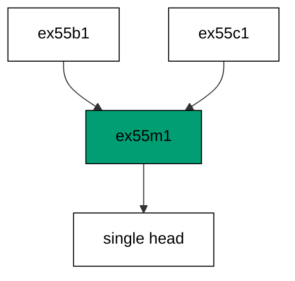

The merge carries no DDL because the branches already hold every change — its job is purely structural: one child, two parents, one tip. Branches stay exactly as their authors wrote them, which means the merge never rewrites anyone's work and never needs their re-review.

**`learning/code/ex-55-merge-resolves-heads/main.py`**:

```python
"""Example 55: a merge revision joins two heads into one."""

import os  # => os builds the versions path, never hardcoded
import tempfile  # => tempfile gives each run a private script directory

from alembic.config import Config  # => Config locates the script directory
from alembic.script import (
    ScriptDirectory,
)  # => ScriptDirectory reads files without a database

# => A scratch script location: revisions only, no database touched here.
# => the scratch path never reaches stdout, so reruns stay byte-stable
scratch = tempfile.mkdtemp(
    prefix="ex55-"
)  # => unique path, never printed, output stays stable
versions = os.path.join(
    scratch, "versions"
)  # => Alembic discovers revisions in this folder
os.makedirs(versions)  # => create the versions directory on disk

# => Two branches off one root: the conflicted state, measured first.
links = [  # => each tuple is one link: id, parent, and short action label
    ("ex55a1", None, "widgets"),  # => root link: the shared base both devs built on
    ("ex55b1", "ex55a1", "price"),  # => dev B's link: adds price_cents
    ("ex55c1", "ex55a1", "status"),  # => dev C's link: adds status, same parent
]
for revision_id, parent, action in links:  # => one file per branch link
    parent_line = (
        f'"{parent}"' if parent else "None"
    )  # => root links point at None, others at ids
    body = f'''"""ex55 {action}."""

revision = "{revision_id}"  # => this link's permanent identity in history
down_revision = {parent_line}  # => the parent link that orders the chain


def upgrade():  # => the forward change, run by upgrade
    # => every op call below joins the migration transaction
    pass


def downgrade():  # => the reverse change, run by downgrade
    # => downgrade mirrors upgrade in reverse order
    pass
'''
    with open(
        os.path.join(versions, f"{revision_id}_{action}.py"), "w"
    ) as handle:  # => filename starts with the id
        handle.write(body)  # => the link file now exists for Alembic to read

config = Config()  # => bare Config: no alembic.ini needed for inspection
config.set_main_option(
    "script_location", scratch
)  # => versions/ lives here for both reads
before = sorted(
    ScriptDirectory.from_config(config).get_heads()
)  # => two tips: the conflicted state
# => two tips on one history means one unmerged branch: merge before deploying
print("before:", ", ".join(before))  # => Output: before: ex55b1, ex55c1

# => The merge names both parents: a tuple down_revision joins the branches.
merge = '''"""merge ex55 branches."""

revision = "ex55m1"  # => the merge link: one child of two parents
down_revision = ("ex55b1", "ex55c1")  # => both branch tips, sorted for stability


def upgrade():  # => forward: merges carry no DDL of their own
    # => empty upgrade: the branches already hold every change
    pass


def downgrade():  # => reverse: split back into two heads
    # => empty downgrade: splitting restores the branch tips exactly
    pass
'''
with open(
    os.path.join(versions, "ex55m1_merge.py"), "w"
) as handle:  # => filename starts with the id
    handle.write(merge)  # => the merge file joins the two branches on disk

after = sorted(
    ScriptDirectory.from_config(config).get_heads()
)  # => re-parse: the merge is the only tip now
# => one tip means one line again: the branches merged without rewriting
print("after:", ", ".join(after))  # => Output: after: ex55m1
```

**Output** (`learning/code/ex-55-merge-resolves-heads/expected/main.stdout.txt`):

```text
before: ex55b1, ex55c1
after: ex55m1
```

**Key takeaway**: Merge with a no-DDL revision naming both parents; branches stay untouched and the history is one line again.

**Why it matters**: Rewriting branches to linearize history invalidates the reviews they already passed. Merging preserves every reviewed byte while restoring deployability — the team keeps its parallel pace and its audit trail at once.

### Example 56: Merge Revision Anatomy

A merge file is readable the same way any revision is: one id, a parent field that holds a tuple, and empty direction functions. This example reads a merge back and names both parents. (Concepts: co-14.)

The tuple parent is the whole trick — everything else about the file is an ordinary revision. Tooling that walks history must handle the tuple case (two ancestors instead of one), and this example is the smallest possible test of that handling: two parents in, both named out.

**`learning/code/ex-56-merge-revision-anatomy/main.py`**:

```python
"""Example 56: a merge file names every parent it joins."""

import os  # => os builds the versions path, never hardcoded
import tempfile  # => tempfile gives each run a private script directory

from alembic.config import Config  # => Config locates the script directory
from alembic.script import (
    ScriptDirectory,
)  # => ScriptDirectory reads files without a database

# => A scratch script location: revisions only, no database touched here.
# => the scratch path never reaches stdout, so reruns stay byte-stable
scratch = tempfile.mkdtemp(
    prefix="ex56-"
)  # => unique path, never printed, output stays stable
versions = os.path.join(
    scratch, "versions"
)  # => Alembic discovers revisions in this folder
os.makedirs(versions)  # => create the versions directory on disk

# => Two branches plus the merge that joins them: four files, one tip.
links = [  # => each tuple is one link: id, parent, and short action label
    ("ex56a1", None, "widgets"),  # => root link: the shared base both devs built on
    ("ex56b1", "ex56a1", "price"),  # => dev B's link: adds price_cents
    ("ex56c1", "ex56a1", "status"),  # => dev C's link: adds status, same parent
]
for revision_id, parent, action in links:  # => one file per branch link
    parent_line = (
        f'"{parent}"' if parent else "None"
    )  # => root links point at None, others at ids
    body = f'''"""ex56 {action}."""

revision = "{revision_id}"  # => this link's permanent identity in history
down_revision = {parent_line}  # => the parent link that orders the chain


def upgrade():  # => the forward change, run by upgrade
    # => every op call below joins the migration transaction
    pass


def downgrade():  # => the reverse change, run by downgrade
    # => downgrade mirrors upgrade in reverse order
    pass
'''
    with open(
        os.path.join(versions, f"{revision_id}_{action}.py"), "w"
    ) as handle:  # => filename starts with the id
        handle.write(body)  # => the link file now exists for Alembic to read

# => The merge names both parents: a tuple down_revision joins the branches.
merge = '''"""merge ex56 branches."""

revision = "ex56m1"  # => the merge link: one child of two parents
down_revision = ("ex56b1", "ex56c1")  # => both branch tips, sorted for stability


def upgrade():  # => forward: merges carry no DDL of their own
    # => empty upgrade: the branches already hold every change
    pass


def downgrade():  # => reverse: split back into two heads
    # => empty downgrade: splitting restores the branch tips exactly
    pass
'''
with open(
    os.path.join(versions, "ex56m1_merge.py"), "w"
) as handle:  # => filename starts with the id
    handle.write(merge)  # => the merge file joins the two branches on disk

# => Read the merge back and name every parent it joined.
config = Config()  # => bare Config: no alembic.ini needed for inspection
config.set_main_option("script_location", scratch)  # => versions/ lives here
script = ScriptDirectory.from_config(config)  # => parses every revision file found
found = script.get_revision("ex56m1")  # => look up the merge by its fixed id
print("revision:", found.revision)  # => Output: revision: ex56m1
parents = found.down_revision  # => a tuple here: merges have several parents
if isinstance(parents, str):  # => single parents arrive as plain strings
    parents = (parents,)  # => normalize: always work with a tuple below
# => sorted parents keep reruns byte-identical whatever order the file used
print("parents:", ", ".join(sorted(parents)))  # => Output: parents: ex56b1, ex56c1
print("is branchpoint:", found.is_branch_point)  # => Output: is branchpoint: False
print("is mergepoint:", found.is_merge_point)  # => Output: is mergepoint: True
```

**Output** (`learning/code/ex-56-merge-revision-anatomy/expected/main.stdout.txt`):

```text
revision: ex56m1
parents: ex56b1, ex56c1
is branchpoint: False
is mergepoint: True
```

**Key takeaway**: Merge files hold a tuple of parents; readers must walk both ancestors, not just one.

**Why it matters**: History tooling — linters, visualizers, deploy planners — breaks on merges when it assumes single parents. Knowing the merge shape keeps the team's own scripts honest about branched pasts instead of silently dropping a branch.

### Example 57: Rebase One Branch onto Head

Rebasing rewrites one parent link so a branch descends from the landed tip instead of the old base. This example re-points a branch file at the new tip and proves the history is linear again. (Concepts: co-14.)

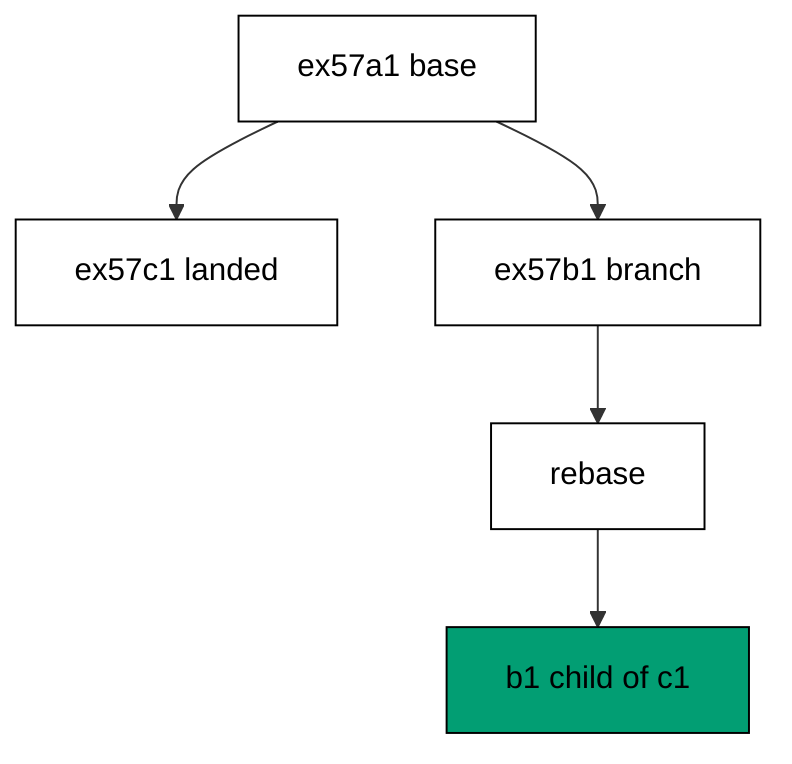

Rebase rewrites history where merge preserves it — choose deliberately. Rebase keeps the line clean for branches nobody else has pulled; merge keeps every commit byte-identical for branches the team already shares. The rule of thumb: rebase private branches, merge shared ones, and never rewrite a revision another deploy already ran.

**`learning/code/ex-57-rebase-one-branch-onto-head/main.py`**:

```python
"""Example 57: rebase a branch onto the new tip instead of merging."""

import os  # => os builds the versions path, never hardcoded
import tempfile  # => tempfile gives each run a private script directory

from alembic.config import Config  # => Config locates the script directory
from alembic.script import (
    ScriptDirectory,
)  # => ScriptDirectory reads files without a database

# => A scratch script location: revisions only, no database touched here.
# => the scratch path never reaches stdout, so reruns stay byte-stable
scratch = tempfile.mkdtemp(
    prefix="ex57-"
)  # => unique path, never printed, output stays stable
versions = os.path.join(
    scratch, "versions"
)  # => Alembic discovers revisions in this folder
os.makedirs(versions)  # => create the versions directory on disk

# => Root, two same-parent branches: the conflicted state, measured first.
links = [  # => each tuple is one link: id, parent, and short action label
    ("ex57a1", None, "widgets"),  # => root link: the shared base both devs built on
    ("ex57b1", "ex57a1", "price"),  # => our link: branched before the tip moved
    ("ex57c1", "ex57a1", "status"),  # => their link: landed first, the new tip
]
for (
    revision_id,
    parent,
    action,
) in links:  # => one file per link, written in chain order
    parent_line = (
        f'"{parent}"' if parent else "None"
    )  # => root links point at None, others at ids
    body = f'''"""ex57 {action}."""

revision = "{revision_id}"  # => this link's permanent identity in history
down_revision = {parent_line}  # => the parent link that orders the chain


def upgrade():  # => the forward change, run by upgrade
    # => every op call below joins the migration transaction
    pass


def downgrade():  # => the reverse change, run by downgrade
    # => downgrade mirrors upgrade in reverse order
    pass
'''
    with open(
        os.path.join(versions, f"{revision_id}_{action}.py"), "w"
    ) as handle:  # => filename starts with the id
        handle.write(body)  # => the link file now exists for Alembic to read

config = Config()  # => bare Config: no alembic.ini needed for inspection
config.set_main_option(
    "script_location", scratch
)  # => versions/ lives here for every read
heads = lambda: sorted(
    ScriptDirectory.from_config(config).get_heads()
)  # => fresh parse on every call
print("before:", ", ".join(heads()))  # => Output: before: ex57b1, ex57c1

# => Rebase: point our branch at their tip by rewriting one parent link.
branch_path = os.path.join(
    versions, "ex57b1_price.py"
)  # => our branch file, found by its fixed name
with open(branch_path) as handle:  # => read the file we wrote above
    branch_text = handle.read()  # => full text, edited in memory below
branch_text = branch_text.replace(  # => the rebase itself: one parent link changes
    'down_revision = "ex57a1"',
    'down_revision = "ex57c1"\n    # => rebased: our change now lands on their tip',  # => new size beats stale bytecode
)
with open(branch_path, "w") as handle:  # => same filename: history rewrites this link
    handle.write(branch_text)  # => the branch now descends from the landed tip
# => one tip left: the branch now descends from the landed tip
print("after:", ", ".join(heads()))  # => Output: after: ex57b1
print("linear:", len(heads()) == 1)  # => Output: linear: True
```

**Output** (`learning/code/ex-57-rebase-one-branch-onto-head/expected/main.stdout.txt`):

```text
before: ex57b1, ex57c1
after: ex57b1
linear: True
```

**Key takeaway**: Rebase moves a branch's parent link onto the landed tip; use it for private branches, merge for shared ones.

**Why it matters**: Teams need both tools and the judgment to choose. Rebasing a shared branch orphans everyone who pulled the old version; merging a private branch litters history with noise — the cost of the wrong choice lands on the whole team either way.

### Example 58: Many Heads, One History

Three parallel branches mean three tips and two merges of debt. This example builds a three-way split and reports the tip list plus the merge count outstanding. (Concepts: co-04.)

Counting the debt is what makes it payable: "merges needed: 2" turns a vague sense of divergence into a concrete task list. Histories rarely fork three ways at once in practice, but the arithmetic generalizes — N tips always need N-1 merges, and the example is the formula made visible.

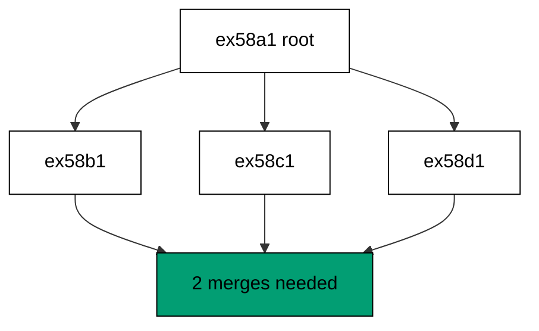

**`learning/code/ex-58-many-heads-one-history/main.py`**:

```python
"""Example 58: three branches mean three heads until they merge."""

import os  # => os builds the versions path, never hardcoded
import tempfile  # => tempfile gives each run a private script directory

from alembic.config import Config  # => Config locates the script directory
from alembic.script import (
    ScriptDirectory,
)  # => ScriptDirectory reads files without a database

# => A scratch script location: revisions only, no database touched here.
# => the scratch path never reaches stdout, so reruns stay byte-stable
scratch = tempfile.mkdtemp(
    prefix="ex58-"
)  # => unique path, never printed, output stays stable
versions = os.path.join(
    scratch, "versions"
)  # => Alembic discovers revisions in this folder
os.makedirs(versions)  # => create the versions directory on disk

# => One root, three same-parent children: three parallel lines of work.
chain = [  # => each tuple is one link: id, parent, and short action label
    ("ex58a1", None, "widgets"),  # => root link: the shared base all three built on
    ("ex58b1", "ex58a1", "price"),  # => first branch: adds price_cents
    ("ex58c1", "ex58a1", "status"),  # => second branch: adds status
    ("ex58d1", "ex58a1", "stock"),  # => third branch: adds stock_count
]
for (
    revision_id,
    parent,
    action,
) in chain:  # => one file per link, written in chain order
    parent_line = (
        f'"{parent}"' if parent else "None"
    )  # => root links point at None, others at ids
    body = f'''"""ex58 {action}."""

revision = "{revision_id}"  # => this link's permanent identity in history
down_revision = {parent_line}  # => the parent link that orders the chain


def upgrade():  # => the forward change, run by upgrade
    # => every op call below joins the migration transaction
    pass


def downgrade():  # => the reverse change, run by downgrade
    # => downgrade mirrors upgrade in reverse order
    pass
'''
    with open(
        os.path.join(versions, f"{revision_id}_{action}.py"), "w"
    ) as handle:  # => filename starts with the id
        handle.write(body)  # => the link file now exists for Alembic to read

# => Every unmerged branch keeps its own tip: heads count the merging work left.
config = Config()  # => bare Config: no alembic.ini needed for inspection
config.set_main_option("script_location", scratch)  # => versions/ lives here
script = ScriptDirectory.from_config(config)  # => parses every revision file found
tips = sorted(script.get_heads())  # => heads are revisions no child points at
print("tips:", ", ".join(tips))  # => Output: tips: ex58b1, ex58c1, ex58d1
# => N tips on one history mean N-1 merges waiting: count the debt, then pay it
print("merges needed:", len(tips) - 1)  # => Output: merges needed: 2
```

**Output** (`learning/code/ex-58-many-heads-one-history/expected/main.stdout.txt`):

```text
tips: ex58b1, ex58c1, ex58d1
merges needed: 2
```

**Key takeaway**: N tips need N-1 merges; report both numbers so the team sees the debt, not just the branches.

**Why it matters**: Unmerged branches compound: every new revision on any tip makes the eventual merge harder. A visible merge count pressures the team to pay the debt while it is small instead of discovering it at release time.

### Example 59: List Heads Before Merge

Every merge review starts with two facts: how many tips, and where they split. This example prints the head list, the common base, and the merges outstanding. (Concepts: co-04.)

The base matters because it scopes the review: everything between the base and each tip is what the merge must reconcile. A base from last week means a week of divergence to understand; a base from this morning means a small, safe join. Head count says whether to merge; the base says how carefully.

**`learning/code/ex-59-list-heads-before-merge/main.py`**:

```python
"""Example 59: review heads and base before deciding to merge."""

import os  # => os builds the versions path, never hardcoded
import tempfile  # => tempfile gives each run a private script directory

from alembic.config import Config  # => Config locates the script directory
from alembic.script import (
    ScriptDirectory,
)  # => ScriptDirectory reads files without a database

# => A scratch script location: revisions only, no database touched here.
# => the scratch path never reaches stdout, so reruns stay byte-stable
scratch = tempfile.mkdtemp(
    prefix="ex59-"
)  # => unique path, never printed, output stays stable
versions = os.path.join(
    scratch, "versions"
)  # => Alembic discovers revisions in this folder
os.makedirs(versions)  # => create the versions directory on disk

# => One root, two same-parent children: the shape every merge review starts from.
chain = [  # => each tuple is one link: id, parent, and short action label
    ("ex59a1", None, "widgets"),  # => root link: the shared base both devs built on
    ("ex59b1", "ex59a1", "price"),  # => first branch: adds price_cents
    ("ex59c1", "ex59a1", "status"),  # => second branch: adds status
]
for (
    revision_id,
    parent,
    action,
) in chain:  # => one file per link, written in chain order
    parent_line = (
        f'"{parent}"' if parent else "None"
    )  # => root links point at None, others at ids
    body = f'''"""ex59 {action}."""

revision = "{revision_id}"  # => this link's permanent identity in history
down_revision = {parent_line}  # => the parent link that orders the chain


def upgrade():  # => the forward change, run by upgrade
    # => every op call below joins the migration transaction
    pass


def downgrade():  # => the reverse change, run by downgrade
    # => downgrade mirrors upgrade in reverse order
    pass
'''
    with open(
        os.path.join(versions, f"{revision_id}_{action}.py"), "w"
    ) as handle:  # => filename starts with the id
        handle.write(body)  # => the link file now exists for Alembic to read

# => The merge review starts with two questions: how many tips, from what base?
config = Config()  # => bare Config: no alembic.ini needed for inspection
config.set_main_option("script_location", scratch)  # => versions/ lives here
script = ScriptDirectory.from_config(config)  # => parses every revision file found
tips = sorted(script.get_heads())  # => heads are revisions no child points at
print("heads:", ", ".join(tips))  # => Output: heads: ex59b1, ex59c1
# => the base is where the branches split: the merge must join above it
print("base:", script.get_base())  # => Output: base: ex59a1
# => zero branches after the merge: the review below must produce one tip
print("merges needed:", len(tips) - 1)  # => Output: merges needed: 1
```

**Output** (`learning/code/ex-59-list-heads-before-merge/expected/main.stdout.txt`):

```text
heads: ex59b1, ex59c1
base: ex59a1
merges needed: 1
```

**Key takeaway**: Review heads and base together: the count says merge now, the base says how much divergence the merge reconciles.

**Why it matters**: Merging blind — without knowing the split point — risks reconciling weeks of divergence in one unreviewed step. The two-line report right-sizes the review before anyone writes the merge.

### Example 60: Linear History Team Policy

The simplest team policy is one line: rebase onto the tip before merging, so heads never exceed one. This example verifies a three-link chain holds the policy: one head, zero extra branches. (Concepts: co-04.)

Policy as a check beats policy as a document: this exact assertion — heads equal one — runs in CI on every pull request, and the build fails the moment a branch lands unmerged. Teams that enforce the shape mechanically never debate it socially; the pipeline is the bad cop so reviewers do not have to be.

**`learning/code/ex-60-linear-history-team-policy/main.py`**:

```python
"""Example 60: the team policy is one line: rebase onto the tip."""

import os  # => os builds the versions path, never hardcoded
import tempfile  # => tempfile gives each run a private script directory

from alembic.config import Config  # => Config locates the script directory
from alembic.script import (
    ScriptDirectory,
)  # => ScriptDirectory reads files without a database

# => A scratch script location: revisions only, no database touched here.
# => the scratch path never reaches stdout, so reruns stay byte-stable
scratch = tempfile.mkdtemp(
    prefix="ex60-"
)  # => unique path, never printed, output stays stable
versions = os.path.join(
    scratch, "versions"
)  # => Alembic discovers revisions in this folder
os.makedirs(versions)  # => create the versions directory on disk

# => Three chained links: the policy-compliant shape every history should hold.
chain = [  # => each tuple is one link: id, parent, and short action label
    ("ex60a1", None, "widgets"),  # => root link: the shared base the team builds on
    (
        "ex60a2",
        "ex60a1",
        "price",
    ),  # => second link: rebased onto the tip before landing
    ("ex60a3", "ex60a2", "status"),  # => tip link: rebased onto the tip before landing
]
for (
    revision_id,
    parent,
    action,
) in chain:  # => one file per link, written in chain order
    parent_line = (
        f'"{parent}"' if parent else "None"
    )  # => root links point at None, others at ids
    body = f'''"""ex60 {action}."""

revision = "{revision_id}"  # => this link's permanent identity in history
down_revision = {parent_line}  # => the parent link that orders the chain


def upgrade():  # => the forward change, run by upgrade
    # => every op call below joins the migration transaction
    pass


def downgrade():  # => the reverse change, run by downgrade
    # => downgrade mirrors upgrade in reverse order
    pass
'''
    with open(
        os.path.join(versions, f"{revision_id}_{action}.py"), "w"
    ) as handle:  # => filename starts with the id
        handle.write(body)  # => the link file now exists for Alembic to read

# => The policy check: one head, no branches, every link reachable from the tip.
config = Config()  # => bare Config: no alembic.ini needed for inspection
config.set_main_option("script_location", scratch)  # => versions/ lives here
script = ScriptDirectory.from_config(config)  # => parses every revision file found
tips = sorted(script.get_heads())  # => heads are revisions no child points at
print("heads:", ", ".join(tips))  # => Output: heads: ex60a3
# => branches are extra tips: zero means the team rebased before every merge
print("branches:", len(tips) - 1)  # => Output: branches: 0
# => the policy holds when the history is one line: rebase made it so
print("policy holds:", len(tips) == 1)  # => Output: policy holds: True
```

**Output** (`learning/code/ex-60-linear-history-team-policy/expected/main.stdout.txt`):

```text
heads: ex60a3
branches: 0
policy holds: True
```

**Key takeaway**: Enforce one head per history in CI; the pipeline rejects branches so reviewers never have to.

**Why it matters**: Merge discipline decays under deadline pressure exactly when it matters most. An automated check holds the line at 2 AM the same way it does at 2 PM — the policy survives the release crunch because no human has to defend it there.

### Example 61: Conflict Drill Two Developers

The full collision on a live database: two same-parent branches, a refused upgrade, then a merge that runs both columns into one table. This example performs every step and proves both branch changes landed. (Concepts: co-14.)

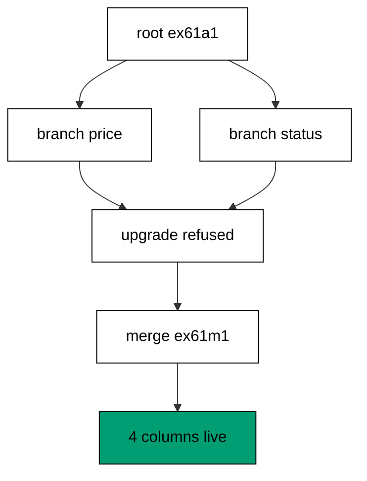

The refusal is the feature: Alembic raises instead of guessing an order, which forces the merge into the open where it can be reviewed. After the merge, both branches run in dependency order and the table holds both columns — the drill's final assertion is that collaboration produced the union of both developers' work, not a winner and a loser.

**`learning/code/ex-61-conflict-drill-two-developers/main.py`**:

```python
"""Example 61: two developers branch, collide, and merge on a live database."""

import os  # => os reads the harness database address, never hardcoded
import tempfile  # => tempfile gives each run a private script directory

from alembic import command  # => command runs revisions, like the CLI does
from alembic.config import Config  # => Config points Alembic at the scripts
from alembic.migration import (
    MigrationContext,
)  # => MigrationContext reads history state
from alembic.script import (
    ScriptDirectory,
)  # => ScriptDirectory lists every known revision
from sqlalchemy import create_engine, text  # => engine sets up and verifies

# => The database URL comes from the harness, with local-run defaults.
host = os.environ.get("PGHOST", "postgres")  # => service hostname in the unit network
user = os.environ.get("PGUSER", "postgres")  # => trust-auth role, no password needed
database = os.environ.get(
    "PGDATABASE", "postgres"
)  # => fresh database for every unit run
url = f"postgresql+psycopg://{user}@{host}/{database}"  # => psycopg 3 driver URL scheme

# => A scratch script location: env.py plus one versions directory.
# => the scratch path never reaches stdout, so reruns stay byte-stable
scratch = tempfile.mkdtemp(
    prefix="ex61-"
)  # => unique path, never printed, output stays stable
versions = os.path.join(
    scratch, "versions"
)  # => Alembic discovers revisions in this folder
os.makedirs(versions)  # => create the versions directory on disk

# => Minimal online-only env.py: connect and run whatever revisions exist.
env_py = """\
from alembic import context  # => context carries the Config that command.* built
from sqlalchemy import create_engine  # => plain engine is enough, no ORM needed
engine = create_engine(context.config.get_main_option("sqlalchemy.url"))  # => reuse the migration URL
with engine.connect() as connection:  # => one connection runs the whole migration
    context.configure(connection=connection, version_table="ex61_version")  # => per-example history table
    with context.begin_transaction():  # => DDL commits atomically where the database allows
        context.run_migrations()  # => execute every pending revision file in order
"""
with open(
    os.path.join(scratch, "env.py"), "w"
) as handle:  # => env.py sits beside versions/
    handle.write(env_py)  # => write the exact text shown above to disk

# => Root table plus two same-parent branches: each dev adds their own column.
root_rev = '''"""create ex61 widgets."""

revision = "ex61a1"  # => root revision: the shared base both devs built on
down_revision = None


def upgrade():  # => forward: build the base table
    from alembic import op  # => op emits DDL inside the migration transaction
    import sqlalchemy as sa  # => column types come from SQLAlchemy Core

    # => every op call below joins one transaction: all of it commits or none of it does
    op.create_table(  # => CREATE TABLE, recorded in history only on success
        "ex61_widgets",  # => per-example table, no cross-example collision
        sa.Column("id", sa.Integer(), primary_key=True),  # => surrogate key column
        sa.Column("name", sa.String(50), nullable=False),  # => every widget has a name
    )


def downgrade():  # => reverse: remove the base table
    from alembic import op  # => same op object, opposite direction

    # => downgrade mirrors upgrade in reverse: last created is first dropped
    op.drop_table("ex61_widgets")  # => DROP TABLE undoes exactly the upgrade
'''
with open(
    os.path.join(versions, "ex61a1_create_widgets.py"), "w"
) as handle:  # => filename starts with the id
    handle.write(root_rev)  # => the root revision file now exists on disk
price_rev = '''"""add ex61 widget price."""

revision = "ex61b1"  # => dev B's branch: same parent as dev C's
down_revision = "ex61a1"  # => both branches share the root as parent


def upgrade():  # => forward: one new nullable column on the live table
    from alembic import op  # => op emits DDL inside the migration transaction
    import sqlalchemy as sa  # => column types come from SQLAlchemy Core

    # => ADD COLUMN without a default leaves existing rows NULL: the safe start
    op.add_column("ex61_widgets", sa.Column("price_cents", sa.Integer()))  # => ALTER TABLE ADD COLUMN


def downgrade():  # => reverse: drop that same column
    from alembic import op  # => same op object, opposite direction

    # => dropping the column discards its data: downgrades are not free
    op.drop_column("ex61_widgets", "price_cents")  # => ALTER TABLE DROP COLUMN
'''
with open(
    os.path.join(versions, "ex61b1_add_price.py"), "w"
) as handle:  # => filename starts with the id
    handle.write(price_rev)  # => dev B's branch file now exists on disk
status_rev = '''"""add ex61 widget status."""

revision = "ex61c1"  # => dev C's branch: same parent as dev B's
down_revision = "ex61a1"  # => both branches share the root as parent


def upgrade():  # => forward: one new nullable column on the live table
    from alembic import op  # => op emits DDL inside the migration transaction
    import sqlalchemy as sa  # => column types come from SQLAlchemy Core

    # => a second nullable column: each branch stays small and reviewable
    op.add_column("ex61_widgets", sa.Column("status", sa.String(10)))  # => ALTER TABLE ADD COLUMN


def downgrade():  # => reverse: drop that same column
    from alembic import op  # => same op object, opposite direction

    # => dropping the column discards its data: downgrades are not free
    op.drop_column("ex61_widgets", "status")  # => ALTER TABLE DROP COLUMN
'''
with open(
    os.path.join(versions, "ex61c1_add_status.py"), "w"
) as handle:  # => filename starts with the id
    handle.write(status_rev)  # => dev C's branch file now exists on disk

# => Upgrade refuses two heads; the merge joins them; upgrade finishes both.
config = Config()  # => bare Config: no alembic.ini needed for script runs
config.set_main_option("script_location", scratch)  # => env.py and versions/ live here
config.set_main_option("sqlalchemy.url", url)  # => the service database URL
engine = create_engine(url)  # => separate engine for setup and verification
with engine.begin() as connection:  # => setup runs in a single transaction
    connection.execute(
        text("DROP TABLE IF EXISTS ex61_widgets")
    )  # => leftovers of a killed run vanish
    connection.execute(
        text("DROP TABLE IF EXISTS ex61_version")
    )  # => stale history vanishes too
# => the shared base lands first: both branches build on top of it
command.upgrade(config, "ex61a1")  # => the shared base both branches built on
script = ScriptDirectory.from_config(config)  # => parses every revision file found
print(
    "two heads:", ", ".join(sorted(script.get_heads()))
)  # => Output: two heads: ex61b1, ex61c1
try:  # => upgrading past two heads must refuse: no defined next step exists
    command.upgrade(
        config, "head"
    )  # => ambiguous target: Alembic raises instead of guessing
    refused = False  # => reaching here means the guard never fired
except Exception:  # => any refusal proves the guard works: deploys stop at branches
    refused = True  # => the operator must merge before the deploy can continue
print("upgrade refused:", refused)  # => Output: upgrade refused: True

# => The merge joins the branches with no DDL of its own: order restored.
merge_rev = '''"""merge ex61 branches."""

revision = "ex61m1"  # => the merge link: one child of two parents
down_revision = ("ex61b1", "ex61c1")  # => both branch tips, sorted for stability


def upgrade():  # => forward: merges carry no DDL of their own
    # => empty upgrade: the branches already hold every change
    pass


def downgrade():  # => reverse: split back into two heads
    # => empty downgrade: splitting restores the branch tips exactly
    pass
'''
with open(
    os.path.join(versions, "ex61m1_merge.py"), "w"
) as handle:  # => filename starts with the id
    handle.write(merge_rev)  # => the merge file joins the two branches on disk
# => both branches plus the merge run: order restored by the merge link
command.upgrade(config, "head")  # => both branches plus the merge run in order
with engine.connect() as connection:  # => fresh connection sees the merged table
    context = MigrationContext.configure(  # => read history state from this connection
        connection,
        opts={"version_table": "ex61_version"},  # => per-example history table again
    )
    print(
        "after merge:", ", ".join(context.get_current_heads())
    )  # => Output: after merge: ex61m1
    columns = connection.execute(  # => both branch columns landed on the one table
        # => information_schema is portable: no PostgreSQL-only catalog tables here
        text(  # => alphabetical order: branch execution order never affects it
            "SELECT column_name FROM information_schema.columns "
            "WHERE table_name = 'ex61_widgets' ORDER BY column_name"
        )
    ).fetchall()  # => materialize every row before printing
print(
    "columns:", ", ".join(row[0] for row in columns)
)  # => Output: columns: id, name, price_cents, status
with engine.begin() as connection:  # => cleanup runs in a single transaction
    # => the merged table goes: both branch columns disappear with it
    connection.execute(
        text("DROP TABLE ex61_widgets")
    )  # => the example leaves no tables behind
    connection.execute(
        text("DROP TABLE ex61_version")
    )  # => and no history table either
print("cleaned: yes")  # => Output: cleaned: yes
```

**Output** (`learning/code/ex-61-conflict-drill-two-developers/expected/main.stdout.txt`):

```text
two heads: ex61b1, ex61c1
upgrade refused: True
after merge: ex61m1
columns: id, name, price_cents, status
cleaned: yes
```

**Key takeaway**: Upgrade refuses branched histories; merge them, and the deploy runs the union of both branches' changes.

**Why it matters**: Production deploys must never pick a branch order silently. The refusal converts an ambiguous moment into a required human decision — and the drill proves the team can make that decision and verify the union before traffic depends on it.

### Example 62: DDL Takes a Lock

Every DDL statement takes locks, and `lock_timeout` bounds how long it waits for them. This example holds an exclusive lock in one session, watches a guarded ALTER time out in another, then runs the same DDL cleanly after release. (Concepts: co-15.)

The timeout converts a hang into an error: without it the migration waits forever behind a stuck transaction; with it the deploy fails fast, pages someone, and retries later. One second is deliberately aggressive for the example — production values run higher — but the shape is identical: bound every wait, and never let a migration queue silently.

**`learning/code/ex-62-ddl-takes-a-lock/main.py`**:

```python
"""Example 62: DDL waits on locks, and lock_timeout bounds the wait."""

import os  # => os reads the harness database address, never hardcoded

from sqlalchemy import create_engine, text  # => two engines play the two sessions
from sqlalchemy.exc import DBAPIError  # => DBAPIError is the timeout signal to catch

# => The database URL comes from the harness, with local-run defaults.
host = os.environ.get("PGHOST", "postgres")  # => service hostname in the unit network
user = os.environ.get("PGUSER", "postgres")  # => trust-auth role, no password needed
database = os.environ.get(
    "PGDATABASE", "postgres"
)  # => fresh database for every unit run
url = f"postgresql+psycopg://{user}@{host}/{database}"  # => psycopg 3 driver URL scheme

# => One table, two sessions: the first holds the lock, the second wants DDL.
engine = create_engine(url)  # => administration engine: setup and final checks
with engine.begin() as connection:  # => setup runs in a single transaction
    connection.execute(
        text("DROP TABLE IF EXISTS ex62_widgets")
    )  # => leftovers of a killed run vanish
    connection.execute(
        text(
            "CREATE TABLE ex62_widgets (id INTEGER PRIMARY KEY, name VARCHAR(50) NOT NULL)"
        )
    )

# => Session A opens a transaction and holds an exclusive lock on the table.
holder = create_engine(url).connect()  # => held open: the lock lives until this closes
holder.execute(
    text("LOCK TABLE ex62_widgets IN ACCESS EXCLUSIVE MODE")
)  # => the strongest table lock, held
writer = create_engine(url).connect()  # => session B: the migration that wants to alter
writer.execute(
    text("SET lock_timeout = '1s'")
)  # => wait at most a second, then fail loud
try:  # => the ALTER must time out: session A is not letting go
    writer.execute(text("ALTER TABLE ex62_widgets ADD COLUMN nickname VARCHAR(50)"))
    writer.commit()  # => reaching here means the lock did not block,unexpectedly
    timed_out = False  # => no timeout: the demonstration failed
except DBAPIError:  # => lock timeout surfaces as a database API error
    writer.rollback()  # => the timed-out statement rolls back cleanly
    timed_out = True  # => the one-second bound held: loud failure, no hang
print("lock timeout hit:", timed_out)  # => Output: lock timeout hit: True
# => the lock releases on close: the retry below must succeed at once
holder.close()  # => session A ends: the exclusive lock releases here

# => With the lock gone, the same DDL runs at once and stays for good.
with engine.begin() as connection:  # => the retry runs in a single transaction
    connection.execute(
        text("ALTER TABLE ex62_widgets ADD COLUMN nickname VARCHAR(50)")
    )  # => no contention now
with engine.connect() as connection:  # => fresh connection verifies the column
    count = connection.execute(  # => the catalog names the new column or not
        # => a count query keeps the output to one stable number
        text(  # => information_schema is portable: no PostgreSQL-only catalog tables here
            "SELECT COUNT(*) FROM information_schema.columns "
            "WHERE table_name = 'ex62_widgets' AND column_name = 'nickname'"
        )
    ).scalar()  # => a single count is all this check needs
print(
    "column added after release:", count == 1
)  # => Output: column added after release: True
with engine.begin() as connection:  # => cleanup runs in a single transaction
    connection.execute(
        text("DROP TABLE ex62_widgets")
    )  # => the example leaves no tables behind
print("cleaned: yes")  # => Output: cleaned: yes
```

**Output** (`learning/code/ex-62-ddl-takes-a-lock/expected/main.stdout.txt`):

```text
lock timeout hit: True
column added after release: True
cleaned: yes
```

**Key takeaway**: DDL waits on locks like any statement; `lock_timeout` turns indefinite hangs into fast, retryable errors.

**Why it matters**: A migration queued behind a forgotten transaction looks exactly like a hung deploy. Timeouts distinguish "waiting" from "stuck" mechanically — the runbook starts with a clear error instead of a guess about whether to kill something.

### Example 63: Short Transactions Shrink Blast Radius

Each revision commits separately, so each lock lives only as long as its own revision. This example stops between two commits and shows the first revision durable while the second has not run. (Concepts: co-15.)

Short transactions are the physical reason small revisions are safer: the lock window equals the revision's runtime, and the failure window equals one revision's change. Long multi-statement revisions hold every lock they take until the last statement finishes — the blast radius is the whole revision, held open the whole time.

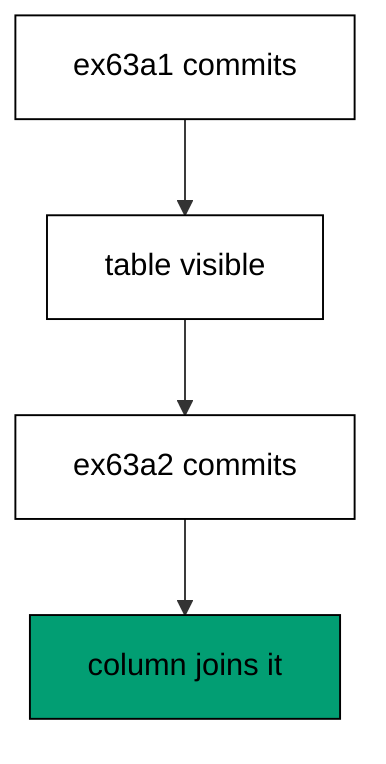

**`learning/code/ex-63-short-transactions-shrink-blast-radius/main.py`**:

```python
"""Example 63: each revision commits separately, bounding every blast radius."""

import os  # => os reads the harness database address, never hardcoded
import tempfile  # => tempfile gives each run a private script directory

from alembic import command  # => command runs revisions, like the CLI does
from alembic.config import Config  # => Config points Alembic at the scripts
from sqlalchemy import create_engine, text  # => engine sets up and verifies

# => The database URL comes from the harness, with local-run defaults.
host = os.environ.get("PGHOST", "postgres")  # => service hostname in the unit network
user = os.environ.get("PGUSER", "postgres")  # => trust-auth role, no password needed
database = os.environ.get(
    "PGDATABASE", "postgres"
)  # => fresh database for every unit run
url = f"postgresql+psycopg://{user}@{host}/{database}"  # => psycopg 3 driver URL scheme

# => A scratch script location: env.py plus one versions directory.
# => the scratch path never reaches stdout, so reruns stay byte-stable
scratch = tempfile.mkdtemp(
    prefix="ex63-"
)  # => unique path, never printed, output stays stable
versions = os.path.join(
    scratch, "versions"
)  # => Alembic discovers revisions in this folder
os.makedirs(versions)  # => create the versions directory on disk

# => Minimal online-only env.py: connect and run whatever revisions exist.
env_py = """\
from alembic import context  # => context carries the Config that command.* built
from sqlalchemy import create_engine  # => plain engine is enough, no ORM needed
engine = create_engine(context.config.get_main_option("sqlalchemy.url"))  # => reuse the migration URL
with engine.connect() as connection:  # => one connection runs the whole migration
    context.configure(connection=connection, version_table="ex63_version")  # => per-example history table
    with context.begin_transaction():  # => DDL commits atomically where the database allows
        context.run_migrations()  # => execute every pending revision file in order
"""
with open(
    os.path.join(scratch, "env.py"), "w"
) as handle:  # => env.py sits beside versions/
    handle.write(env_py)  # => write the exact text shown above to disk

# => Two chained revisions: each commits alone, so each locks alone.
rev1 = '''"""create ex63 widgets."""

revision = "ex63a1"  # => first revision: its own transaction, its own commit
down_revision = None


def upgrade():  # => forward: build the base table
    from alembic import op  # => op emits DDL inside the migration transaction
    import sqlalchemy as sa  # => column types come from SQLAlchemy Core

    # => every op call below joins one transaction: all of it commits or none of it does
    op.create_table(  # => CREATE TABLE, recorded in history only on success
        "ex63_widgets",  # => per-example table, no cross-example collision
        sa.Column("id", sa.Integer(), primary_key=True),  # => surrogate key column
        sa.Column("name", sa.String(50), nullable=False),  # => every widget has a name
    )


def downgrade():  # => reverse: remove the base table
    from alembic import op  # => same op object, opposite direction

    # => downgrade mirrors upgrade in reverse: last created is first dropped
    op.drop_table("ex63_widgets")  # => DROP TABLE undoes exactly the upgrade
'''
with open(
    os.path.join(versions, "ex63a1_create_widgets.py"), "w"
) as handle:  # => filename starts with the id
    handle.write(rev1)  # => first chain link now exists on disk
rev2 = '''"""add ex63 widget price."""

revision = "ex63a2"  # => second revision: a second transaction, a second commit
down_revision = "ex63a1"  # => the parent link that orders the chain


def upgrade():  # => forward: one new nullable column on the live table
    from alembic import op  # => op emits DDL inside the migration transaction
    import sqlalchemy as sa  # => column types come from SQLAlchemy Core

    # => ADD COLUMN without a default leaves existing rows NULL: the safe start
    op.add_column("ex63_widgets", sa.Column("price_cents", sa.Integer()))  # => ALTER TABLE ADD COLUMN


def downgrade():  # => reverse: drop that same column
    from alembic import op  # => same op object, opposite direction

    # => dropping the column discards its data: downgrades are not free
    op.drop_column("ex63_widgets", "price_cents")  # => ALTER TABLE DROP COLUMN
'''
with open(
    os.path.join(versions, "ex63a2_add_price.py"), "w"
) as handle:  # => filename starts with the id
    handle.write(rev2)  # => second chain link now exists on disk

# => Stop between the commits: the first revision is durable before the second runs.
config = Config()  # => bare Config: no alembic.ini needed for script runs
config.set_main_option("script_location", scratch)  # => env.py and versions/ live here
config.set_main_option("sqlalchemy.url", url)  # => the service database URL
engine = create_engine(url)  # => separate engine for setup and verification
with engine.begin() as connection:  # => setup runs in a single transaction
    connection.execute(
        text("DROP TABLE IF EXISTS ex63_widgets")
    )  # => leftovers of a killed run vanish
    connection.execute(
        text("DROP TABLE IF EXISTS ex63_version")
    )  # => stale history vanishes too


def columns():
    """Read the live column list: the transaction boundary shows here."""
    with engine.connect() as connection:  # => fresh connection sees only committed DDL
        rows = connection.execute(  # => the catalog reflects committed transactions only
            # => information_schema is portable: no PostgreSQL-only catalog tables here
            text(  # => ordering by position keeps the printout stable across reruns
                "SELECT column_name FROM information_schema.columns "
                "WHERE table_name = 'ex63_widgets' ORDER BY ordinal_position"
            )
        ).fetchall()  # => materialize every row before printing
    # => comma-joined names stay stable: the boundary shows in the columns
    return ", ".join(
        row[0] for row in rows
    )  # => comma-joined names, stable across reruns


# => first transaction commits alone: the table exists before the column
command.upgrade(
    config, "ex63a1"
)  # => first transaction commits: the table exists alone
print("after one:", columns())  # => Output: after one: id, name
# => second transaction commits alone: the column joins the committed table
command.upgrade(config, "head")  # => second transaction commits: the column joins it
print("after two:", columns())  # => Output: after two: id, name, price_cents
with engine.begin() as connection:  # => cleanup runs in a single transaction
    connection.execute(
        text("DROP TABLE ex63_widgets")
    )  # => the example leaves no tables behind
    connection.execute(
        text("DROP TABLE ex63_version")
    )  # => and no history table either
print("cleaned: yes")  # => Output: cleaned: yes
```

**Output** (`learning/code/ex-63-short-transactions-shrink-blast-radius/expected/main.stdout.txt`):

```text
after one: id, name
after two: id, name, price_cents
cleaned: yes
```

**Key takeaway**: Each revision is its own transaction and lock window; stopping between commits shows each step durable alone.

**Why it matters**: When a deploy fails mid-chain, per-revision commits mean the database holds a consistent prefix of the history — a known position to resume from. One giant transaction would mean all-or-nothing across the whole deploy, with nothing usable in between.

### Example 64: One Statement Per Revision

The smallest lockable unit is one statement in one revision. This example counts the two op lines in its file — one forward, one reverse — then runs the single statement against a live table. (Concepts: co-15.)

One-statement revisions review in seconds, deploy in milliseconds of lock time, and revert with zero ambiguity about what changed. They are not always possible — some changes genuinely need several steps — but they are the default to deviate from deliberately, not accidentally.

**`learning/code/ex-64-one-statement-per-revision/main.py`**:

```python
"""Example 64: one statement per revision keeps every lock window tiny."""

import os  # => os reads the harness database address, never hardcoded
import tempfile  # => tempfile gives each run a private script directory

from alembic import command  # => command runs revisions, like the CLI does
from alembic.config import Config  # => Config points Alembic at the scripts
from sqlalchemy import create_engine, text  # => engine sets up and verifies

# => The database URL comes from the harness, with local-run defaults.
host = os.environ.get("PGHOST", "postgres")  # => service hostname in the unit network
user = os.environ.get("PGUSER", "postgres")  # => trust-auth role, no password needed
database = os.environ.get(
    "PGDATABASE", "postgres"
)  # => fresh database for every unit run
url = f"postgresql+psycopg://{user}@{host}/{database}"  # => psycopg 3 driver URL scheme

# => A scratch script location: env.py plus one versions directory.
# => the scratch path never reaches stdout, so reruns stay byte-stable
scratch = tempfile.mkdtemp(
    prefix="ex64-"
)  # => unique path, never printed, output stays stable
versions = os.path.join(
    scratch, "versions"
)  # => Alembic discovers revisions in this folder
os.makedirs(versions)  # => create the versions directory on disk

# => Minimal online-only env.py: connect and run whatever revisions exist.
env_py = """\
from alembic import context  # => context carries the Config that command.* built
from sqlalchemy import create_engine  # => plain engine is enough, no ORM needed
engine = create_engine(context.config.get_main_option("sqlalchemy.url"))  # => reuse the migration URL
with engine.connect() as connection:  # => one connection runs the whole migration
    context.configure(connection=connection, version_table="ex64_version")  # => per-example history table
    with context.begin_transaction():  # => DDL commits atomically where the database allows
        context.run_migrations()  # => execute every pending revision file in order
"""
with open(
    os.path.join(scratch, "env.py"), "w"
) as handle:  # => env.py sits beside versions/
    handle.write(env_py)  # => write the exact text shown above to disk

# => One revision with exactly one statement: the smallest lockable unit.
rev1 = '''"""add ex64 widget price."""

revision = "ex64a1"  # => single revision: one statement, one lock window
down_revision = None


def upgrade():  # => forward: the one and only statement of this revision
    from alembic import op  # => op emits DDL inside the migration transaction
    import sqlalchemy as sa  # => column types come from SQLAlchemy Core

    # => a lone statement needs no coordination: review it in one glance
    op.execute("ALTER TABLE ex64_widgets ADD COLUMN price_cents INTEGER")  # => the whole migration in one line


def downgrade():  # => reverse: the one undo of the one statement
    from alembic import op  # => same op object, opposite direction

    # => dropping the column discards its data: downgrades are not free
    op.execute("ALTER TABLE ex64_widgets DROP COLUMN price_cents")  # => the whole rollback in one line
'''
with open(
    os.path.join(versions, "ex64a1_add_price.py"), "w"
) as handle:  # => filename starts with the id
    handle.write(rev1)  # => the single-statement revision file now exists on disk

# => Count the statements in the file, then run it against the table.
with open(
    os.path.join(versions, "ex64a1_add_price.py")
) as handle:  # => read the revision back for counting
    statements = [  # => op. lines are the statements this revision will run
        line.strip()  # => strip indentation: counting needs clean lines
        for line in handle.read().splitlines()  # => one file line at a time
        if line.strip().startswith("op.")  # => upgrade and downgrade both count here
    ]
# => two op. lines means one forward statement and one reverse statement
print("statements:", len(statements))  # => Output: statements: 2
config = Config()  # => bare Config: no alembic.ini needed for script runs
config.set_main_option("script_location", scratch)  # => env.py and versions/ live here
config.set_main_option("sqlalchemy.url", url)  # => the service database URL
engine = create_engine(url)  # => separate engine for the table and the run
with engine.begin() as connection:  # => setup runs in a single transaction
    connection.execute(
        text("DROP TABLE IF EXISTS ex64_widgets")
    )  # => leftovers of a killed run vanish
    connection.execute(
        text("DROP TABLE IF EXISTS ex64_version")
    )  # => stale history vanishes too
    # => the table predates the revision: one statement is all the lock window holds
    connection.execute(
        text(
            "CREATE TABLE ex64_widgets (id INTEGER PRIMARY KEY, name VARCHAR(50) NOT NULL)"
        )
    )
command.upgrade(
    config, "head"
)  # => the single statement runs inside one short transaction
with engine.connect() as connection:  # => fresh connection sees the committed column
    count = connection.execute(  # => the catalog names the new column or not
        # => a count query keeps the output to one stable number
        text(  # => information_schema is portable: no PostgreSQL-only catalog tables here
            "SELECT COUNT(*) FROM information_schema.columns "
            "WHERE table_name = 'ex64_widgets' AND column_name = 'price_cents'"
        )
    ).scalar()  # => a single count is all this check needs
print("column present:", count == 1)  # => Output: column present: True
with engine.begin() as connection:  # => cleanup runs in a single transaction
    connection.execute(
        text("DROP TABLE ex64_widgets")
    )  # => the example leaves no tables behind
    connection.execute(
        text("DROP TABLE ex64_version")
    )  # => and no history table either
print("cleaned: yes")  # => Output: cleaned: yes
```

**Output** (`learning/code/ex-64-one-statement-per-revision/expected/main.stdout.txt`):

```text
statements: 2
column present: True
cleaned: yes
```

**Key takeaway**: Prefer one statement per revision; count the op lines to prove the window holds a single lock.

**Why it matters**: Lock scope follows statement count. A revision with twelve statements holds twelve locks' worth of risk in one window; splitting it lets each step take, hold briefly, and release — the table is never hostage to the whole batch at once.

### Example 65: Statement Timeout Bounds Locks

`statement_timeout` cancels anything that runs too long — runaway backfills, forgotten pg_sleep-style accidents, and locks that will never clear. This example cancels a two-second sleep at half a second, then migrates normally under the same discipline. (Concepts: co-12.)

Lock timeout bounds waiting; statement timeout bounds running. Together they put a ceiling on every database interaction a migration performs: nothing waits forever, nothing runs forever, and anything that exceeds its budget fails loud instead of wedging the deploy behind it.

**`learning/code/ex-65-statement-timeout-bounds-locks/main.py`**:

```python
"""Example 65: statement_timeout bounds every runaway statement."""

import os  # => os reads the harness database address, never hardcoded
import tempfile  # => tempfile gives each run a private script directory

from alembic import command  # => command runs revisions, like the CLI does
from alembic.config import Config  # => Config points Alembic at the scripts
from alembic.migration import (
    MigrationContext,
)  # => MigrationContext reads history state
from sqlalchemy import create_engine, text  # => engine sets up and verifies
from sqlalchemy.exc import DBAPIError  # => DBAPIError is the cancel signal to catch

# => The database URL comes from the harness, with local-run defaults.
host = os.environ.get("PGHOST", "postgres")  # => service hostname in the unit network
user = os.environ.get("PGUSER", "postgres")  # => trust-auth role, no password needed
database = os.environ.get(
    "PGDATABASE", "postgres"
)  # => fresh database for every unit run
url = f"postgresql+psycopg://{user}@{host}/{database}"  # => psycopg 3 driver URL scheme

# => A scratch script location: env.py plus one versions directory.
# => the scratch path never reaches stdout, so reruns stay byte-stable
scratch = tempfile.mkdtemp(
    prefix="ex65-"
)  # => unique path, never printed, output stays stable
versions = os.path.join(
    scratch, "versions"
)  # => Alembic discovers revisions in this folder
os.makedirs(versions)  # => create the versions directory on disk

# => Minimal online-only env.py: connect and run whatever revisions exist.
env_py = """\
from alembic import context  # => context carries the Config that command.* built
from sqlalchemy import create_engine  # => plain engine is enough, no ORM needed
engine = create_engine(context.config.get_main_option("sqlalchemy.url"))  # => reuse the migration URL
with engine.connect() as connection:  # => one connection runs the whole migration
    context.configure(connection=connection, version_table="ex65_version")  # => per-example history table
    with context.begin_transaction():  # => DDL commits atomically where the database allows
        context.run_migrations()  # => execute every pending revision file in order
"""
with open(
    os.path.join(scratch, "env.py"), "w"
) as handle:  # => env.py sits beside versions/
    handle.write(env_py)  # => write the exact text shown above to disk

# => One revision with one fast statement: the timeout never fires on it.
rev1 = '''"""create ex65 widgets."""

revision = "ex65a1"  # => single revision: fast DDL, never near the timeout
down_revision = None


def upgrade():  # => forward: build the base table
    from alembic import op  # => op emits DDL inside the migration transaction
    import sqlalchemy as sa  # => column types come from SQLAlchemy Core

    # => every op call below joins one transaction: all of it commits or none of it does
    op.create_table(  # => CREATE TABLE, recorded in history only on success
        "ex65_widgets",  # => per-example table, no cross-example collision
        sa.Column("id", sa.Integer(), primary_key=True),  # => surrogate key column
        sa.Column("name", sa.String(50), nullable=False),  # => every widget has a name
    )


def downgrade():  # => reverse: remove the base table
    from alembic import op  # => same op object, opposite direction

    # => downgrade mirrors upgrade in reverse: last created is first dropped
    op.drop_table("ex65_widgets")  # => DROP TABLE undoes exactly the upgrade
'''
with open(
    os.path.join(versions, "ex65a1_create_widgets.py"), "w"
) as handle:  # => filename starts with the id
    handle.write(rev1)  # => the revision file now exists for Alembic to find

# => Slow query cancelled, fast migration unaffected: the timeout guards both.
engine = create_engine(url)  # => separate engine for the timeout demo and the run
with engine.begin() as connection:  # => setup runs in a single transaction
    connection.execute(
        text("DROP TABLE IF EXISTS ex65_widgets")
    )  # => leftovers of a killed run vanish
    connection.execute(
        text("DROP TABLE IF EXISTS ex65_version")
    )  # => stale history vanishes too
guarded = create_engine(
    url
).connect()  # => plain connection: the timeout is set by hand
guarded.execute(
    text("SET statement_timeout = '500ms'")
)  # => half a second, then cancel anything running
guarded.commit()  # => SET needs a commit before the timed statements begin
try:  # => pg_sleep(2) must die at the timeout: the guard earns its keep here
    guarded.execute(text("SELECT pg_sleep(2)"))
    guarded.commit()  # => reaching here means the timeout never fired
    cancelled = False  # => no cancel: the demonstration failed
except DBAPIError:  # => statement timeout surfaces as a database API error
    guarded.rollback()  # => the cancelled statement rolls back cleanly
    cancelled = True  # => the two-second sleep died at half a second, as designed
# => the timeout is a guardrail, not a wall: fast statements pass under it
print("slow query cancelled:", cancelled)  # => Output: slow query cancelled: True
config = Config()  # => bare Config: no alembic.ini needed for script runs
config.set_main_option("script_location", scratch)  # => env.py and versions/ live here
config.set_main_option("sqlalchemy.url", url)  # => the service database URL
command.upgrade(config, "head")  # => the fast DDL runs far inside any sane timeout
with engine.connect() as connection:  # => fresh connection reads the recorded tip
    context = MigrationContext.configure(  # => history state from this connection
        connection,
        opts={"version_table": "ex65_version"},  # => per-example history table again
    )
    print(
        "migrated:", ", ".join(context.get_current_heads())
    )  # => Output: migrated: ex65a1
with engine.begin() as connection:  # => cleanup runs in a single transaction
    connection.execute(
        text("DROP TABLE ex65_widgets")
    )  # => the example leaves no tables behind
    connection.execute(
        text("DROP TABLE ex65_version")
    )  # => and no history table either
print("cleaned: yes")  # => Output: cleaned: yes
```

**Output** (`learning/code/ex-65-statement-timeout-bounds-locks/expected/main.stdout.txt`):

```text
slow query cancelled: True
migrated: ex65a1
cleaned: yes
```

**Key takeaway**: Set `statement_timeout` so runaway statements cancel instead of wedging the deploy; fast DDL passes under it untouched.

**Why it matters**: One pathological statement — a backfill without a WHERE clause, a validation scan on a huge table — can hold locks for hours. A timeout converts that catastrophe into a cancelled statement and a clear error, while every normal statement never notices the ceiling.

### Example 66: Concurrently Outside the Transaction

`CREATE INDEX CONCURRENTLY` builds without the exclusive lock — but PostgreSQL forbids it inside a transaction block, which is where Alembic normally runs. This example watches the transactional attempt get refused, then builds the same index in autocommit. (Concepts: co-15.)

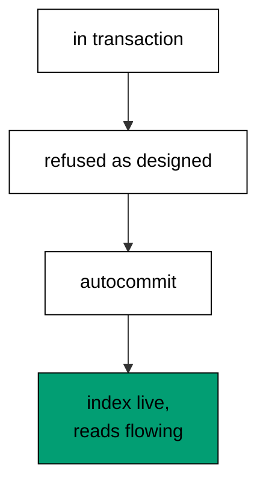

The refusal teaches the rule: anything CONCURRENTLY must run outside the migration transaction, in its own step with its own connection settings. Teams that index hot tables learn this shape once and reuse it forever — the concurrent build trades speed for availability, finishing slower while never blocking a single read.

**`learning/code/ex-66-concurrently-outside-the-transaction/main.py`**:

```python
"""Example 66: CONCURRENTLY builds the index outside any transaction."""

import os  # => os reads the harness database address, never hardcoded
import tempfile  # => tempfile gives each run a private script directory

from alembic import command  # => command runs revisions, like the CLI does
from alembic.config import Config  # => Config points Alembic at the scripts
from sqlalchemy import create_engine, text  # => engine sets up and verifies

# => The database URL comes from the harness, with local-run defaults.
host = os.environ.get("PGHOST", "postgres")  # => service hostname in the unit network
user = os.environ.get("PGUSER", "postgres")  # => trust-auth role, no password needed
database = os.environ.get(
    "PGDATABASE", "postgres"
)  # => fresh database for every unit run
url = f"postgresql+psycopg://{user}@{host}/{database}"  # => psycopg 3 driver URL scheme

# => A scratch script location: env.py plus one versions directory.
# => the scratch path never reaches stdout, so reruns stay byte-stable
scratch = tempfile.mkdtemp(
    prefix="ex66-"
)  # => unique path, never printed, output stays stable
versions = os.path.join(
    scratch, "versions"
)  # => Alembic discovers revisions in this folder
os.makedirs(versions)  # => create the versions directory on disk

# => Minimal online-only env.py: connect and run whatever revisions exist.
env_py = """\
from alembic import context  # => context carries the Config that command.* built
from sqlalchemy import create_engine  # => plain engine is enough, no ORM needed
engine = create_engine(context.config.get_main_option("sqlalchemy.url"))  # => reuse the migration URL
with engine.connect() as connection:  # => one connection runs the whole migration
    context.configure(connection=connection, version_table="ex66_version")  # => per-example history table
    with context.begin_transaction():  # => DDL commits atomically where the database allows
        context.run_migrations()  # => execute every pending revision file in order
"""
with open(
    os.path.join(scratch, "env.py"), "w"
) as handle:  # => env.py sits beside versions/
    handle.write(env_py)  # => write the exact text shown above to disk

# => Two chained revisions: the table, then the concurrent index attempt.
rev1 = '''"""create ex66 widgets."""

revision = "ex66a1"  # => first revision, no parent yet
down_revision = None


def upgrade():  # => forward: build the base table
    from alembic import op  # => op emits DDL inside the migration transaction
    import sqlalchemy as sa  # => column types come from SQLAlchemy Core

    # => every op call below joins one transaction: all of it commits or none of it does
    op.create_table(  # => CREATE TABLE, recorded in history only on success
        "ex66_widgets",  # => per-example table, no cross-example collision
        sa.Column("id", sa.Integer(), primary_key=True),  # => surrogate key column
        sa.Column("name", sa.String(50), nullable=False),  # => the column the index will cover
    )


def downgrade():  # => reverse: remove the base table
    from alembic import op  # => same op object, opposite direction

    # => downgrade mirrors upgrade in reverse: last created is first dropped
    op.drop_table("ex66_widgets")  # => DROP TABLE undoes exactly the upgrade
'''
with open(
    os.path.join(versions, "ex66a1_create_widgets.py"), "w"
) as handle:  # => filename starts with the id
    handle.write(rev1)  # => first chain link now exists on disk
rev2 = '''"""index ex66 names concurrently."""

revision = "ex66a2"  # => second revision: the concurrent index that needs no transaction
down_revision = "ex66a1"  # => the parent link that orders the chain


def upgrade():  # => forward: CONCURRENTLY cannot run inside a transaction
    from alembic import op  # => op emits DDL inside the migration transaction

    # => this statement refuses the transaction: PostgreSQL rejects it outright
    op.execute("CREATE INDEX CONCURRENTLY ex66_widgets_name_idx ON ex66_widgets (name)")


def downgrade():  # => reverse: CONCURRENTLY works for drops outside transactions too
    from alembic import op  # => same op object, opposite direction

    # => the matching drop: concurrent both ways, transactional neither
    op.execute("DROP INDEX CONCURRENTLY IF EXISTS ex66_widgets_name_idx")
'''
with open(
    os.path.join(versions, "ex66a2_index.py"), "w"
) as handle:  # => filename starts with the id
    handle.write(rev2)  # => second chain link now exists on disk

# => Inside a transaction it is refused; in autocommit it succeeds lock-free.
config = Config()  # => bare Config: no alembic.ini needed for script runs
config.set_main_option("script_location", scratch)  # => env.py and versions/ live here
config.set_main_option("sqlalchemy.url", url)  # => the service database URL
engine = create_engine(url)  # => separate engine for setup and verification
with engine.begin() as connection:  # => setup runs in a single transaction
    connection.execute(
        text("DROP TABLE IF EXISTS ex66_widgets")
    )  # => leftovers of a killed run vanish
    connection.execute(
        text("DROP TABLE IF EXISTS ex66_version")
    )  # => stale history vanishes too
# => table first: CONCURRENTLY needs a live target to scan
command.upgrade(
    config, "ex66a1"
)  # => the table exists: the index has something to cover
# => the transactional attempt must refuse: CONCURRENTLY forbids transactions
try:  # => the transactional attempt must refuse: CONCURRENTLY forbids it
    command.upgrade(
        config, "head"
    )  # => env wraps everything in a transaction: rejected
    refused = False  # => reaching here means the guard never fired
except Exception:  # => PostgreSQL rejects concurrent DDL inside transaction blocks
    refused = (
        True  # => the refusal is the lesson: transactions and CONCURRENTLY mix never
    )
print(
    "in transaction:", "refused as designed" if refused else "RAN IN TXN"
)  # => Output: in transaction: refused as designed
# => autocommit runs each statement alone: no transaction block to refuse
free = create_engine(
    url, isolation_level="AUTOCOMMIT"
)  # => autocommit: every statement runs alone
with free.connect() as connection:  # => outside any transaction block now
    # => CONCURRENTLY scans without the exclusive lock: reads flow throughout
    connection.execute(
        text("CREATE INDEX CONCURRENTLY ex66_widgets_name_idx ON ex66_widgets (name)")
    )
with engine.connect() as connection:  # => fresh connection verifies the index
    count = connection.execute(  # => the catalog names the concurrent index or not
        # => a count query keeps the output to one stable number
        text(  # => pg_indexes is PostgreSQL-specific: fine inside a Postgres-only example
            "SELECT COUNT(*) FROM pg_indexes "
            "WHERE tablename = 'ex66_widgets' AND indexname = 'ex66_widgets_name_idx'"
        )
    ).scalar()  # => a single count is all this check needs
print("concurrently:", count == 1)  # => Output: concurrently: True
with engine.begin() as connection:  # => cleanup runs in a single transaction
    connection.execute(
        text("DROP TABLE ex66_widgets")
    )  # => the example leaves no tables behind
    connection.execute(
        text("DROP TABLE ex66_version")
    )  # => and no history table either
print("cleaned: yes")  # => Output: cleaned: yes
```

**Output** (`learning/code/ex-66-concurrently-outside-the-transaction/expected/main.stdout.txt`):

```text
in transaction: refused as designed
concurrently: True
cleaned: yes
```

**Key takeaway**: CONCURRENTLY is refused in transactions and built in autocommit; index hot tables without blocking reads.

**Why it matters**: A standard index build on a hot table blocks writes for its whole duration — an outage by another name. The concurrent form is slower but invisible, and knowing exactly where transactions forbid it saves a failed deploy to learn the boundary.

### Example 67: Batch Backfills Avoid Long Locks

Banded backfills bound row locks per statement: six rows in bands of two means three small lock windows, never one big one. This example fills six rows and reports both the filled count and the batch arithmetic. (Concepts: co-15.)

The batch count is computed, not asserted: rows divided by band size, rounded up. That arithmetic belongs in the review — "six rows, bands of two, three windows" — because it is the lock story of the migration in one line. Bigger tables get smaller bands relative to traffic, and the same division tells the reviewer exactly how small.

**`learning/code/ex-67-batch-backfills-avoid-long-locks/main.py`**:

```python
"""Example 67: small batches hold small locks while the backfill runs."""

import os  # => os reads the harness database address, never hardcoded
import tempfile  # => tempfile gives each run a private script directory

from alembic import command  # => command runs revisions, like the CLI does
from alembic.config import Config  # => Config points Alembic at the scripts
from sqlalchemy import create_engine, text  # => engine sets up and verifies

# => The database URL comes from the harness, with local-run defaults.
host = os.environ.get("PGHOST", "postgres")  # => service hostname in the unit network
user = os.environ.get("PGUSER", "postgres")  # => trust-auth role, no password needed
database = os.environ.get(
    "PGDATABASE", "postgres"
)  # => fresh database for every unit run
url = f"postgresql+psycopg://{user}@{host}/{database}"  # => psycopg 3 driver URL scheme

# => A scratch script location: env.py plus one versions directory.
# => the scratch path never reaches stdout, so reruns stay byte-stable
scratch = tempfile.mkdtemp(
    prefix="ex67-"
)  # => unique path, never printed, output stays stable
versions = os.path.join(
    scratch, "versions"
)  # => Alembic discovers revisions in this folder
os.makedirs(versions)  # => create the versions directory on disk

# => Minimal online-only env.py: connect and run whatever revisions exist.
env_py = """\
from alembic import context  # => context carries the Config that command.* built
from sqlalchemy import create_engine  # => plain engine is enough, no ORM needed
engine = create_engine(context.config.get_main_option("sqlalchemy.url"))  # => reuse the migration URL
with engine.connect() as connection:  # => one connection runs the whole migration
    context.configure(connection=connection, version_table="ex67_version")  # => per-example history table
    with context.begin_transaction():  # => DDL commits atomically where the database allows
        context.run_migrations()  # => execute every pending revision file in order
"""
with open(
    os.path.join(scratch, "env.py"), "w"
) as handle:  # => env.py sits beside versions/
    handle.write(env_py)  # => write the exact text shown above to disk

# => Two chained revisions: create the table, then fill it two rows at a time.
rev1 = '''"""create ex67 widgets."""

revision = "ex67a1"  # => first revision, no parent yet
down_revision = None


def upgrade():  # => forward: build the base table
    from alembic import op  # => op emits DDL inside the migration transaction
    import sqlalchemy as sa  # => column types come from SQLAlchemy Core

    # => every op call below joins one transaction: all of it commits or none of it does
    op.create_table(  # => CREATE TABLE, recorded in history only on success
        "ex67_widgets",  # => per-example table, no cross-example collision
        sa.Column("id", sa.Integer(), primary_key=True),  # => surrogate key column
        sa.Column("name", sa.String(50), nullable=False),  # => the source the backfill reads
    )


def downgrade():  # => reverse: remove the base table
    from alembic import op  # => same op object, opposite direction

    # => downgrade mirrors upgrade in reverse: last created is first dropped
    op.drop_table("ex67_widgets")  # => DROP TABLE undoes exactly the upgrade
'''
with open(
    os.path.join(versions, "ex67a1_create_widgets.py"), "w"
) as handle:  # => filename starts with the id
    handle.write(rev1)  # => first chain link now exists on disk
rev2 = '''"""batch-backfill ex67 widget nicknames."""

revision = "ex67a2"  # => second revision, runs after ex67a1
down_revision = "ex67a1"  # => the parent link that orders the chain


def upgrade():  # => forward: column first, then the fill in small batches
    from alembic import op  # => op emits DDL inside the migration transaction
    import sqlalchemy as sa  # => column types come from SQLAlchemy Core

    # => the column lands nullable: existing rows get NULL, not a failure
    op.add_column("ex67_widgets", sa.Column("nickname", sa.String(50)))  # => ALTER TABLE ADD COLUMN
    # => two-row bands: each UPDATE locks at most two rows, then releases
    for low in (1, 3, 5):  # => fixed id bands: deterministic, reviewable, restartable
        op.execute(  # => each UPDATE touches at most two rows, then releases
            f"UPDATE ex67_widgets SET nickname = UPPER(name) "  # => the same fill, band by band
            f"WHERE id >= {low} AND id < {low + 2} AND nickname IS NULL"  # => IS NULL skips already-filled rows
        )


def downgrade():  # => reverse: drop the column, data and all
    from alembic import op  # => same op object, opposite direction

    # => dropping the column discards its data: downgrades are not free
    op.drop_column("ex67_widgets", "nickname")  # => ALTER TABLE DROP COLUMN
'''
with open(
    os.path.join(versions, "ex67a2_backfill.py"), "w"
) as handle:  # => filename starts with the id
    handle.write(rev2)  # => second chain link now exists on disk

# => Six rows, bands of two: never more than two row locks per statement.
rows, band = 6, 2  # => the seed size and the band width the revision was written for
config = Config()  # => bare Config: no alembic.ini needed for script runs
config.set_main_option("script_location", scratch)  # => env.py and versions/ live here
config.set_main_option("sqlalchemy.url", url)  # => the service database URL
engine = create_engine(url)  # => separate engine for setup and verification
with engine.begin() as connection:  # => setup runs in a single transaction
    connection.execute(
        text("DROP TABLE IF EXISTS ex67_widgets")
    )  # => leftovers of a killed run vanish
    connection.execute(
        text("DROP TABLE IF EXISTS ex67_version")
    )  # => stale history vanishes too
command.upgrade(config, "ex67a1")  # => create the table, stop before the backfill
with engine.begin() as connection:  # => seeding runs in a single transaction
    # => six rows: one UPDATE would hold six row locks, bands hold two
    connection.execute(
        text(
            "INSERT INTO ex67_widgets (name) VALUES "
            + ", ".join(["('w%d')" % i for i in range(rows)])
        )
    )
command.upgrade(config, "head")  # => add the column and fill it band by band
with engine.connect() as connection:  # => fresh connection sees the committed fill
    filled = connection.execute(  # => every row must carry the derived nickname
        # => a count query keeps the output to one stable number
        text(
            "SELECT COUNT(*) FROM ex67_widgets WHERE nickname = UPPER(name)"
        )  # => filled means derived correctly
    ).scalar()  # => a single count is all this check needs
print("rows:", filled)  # => Output: rows: 6
# => bands of two over six rows: three small lock windows, never one big one
print("batches:", (rows + band - 1) // band)  # => Output: batches: 3
with engine.begin() as connection:  # => cleanup runs in a single transaction
    connection.execute(
        text("DROP TABLE ex67_widgets")
    )  # => the example leaves no tables behind
    connection.execute(
        text("DROP TABLE ex67_version")
    )  # => and no history table either
print("cleaned: yes")  # => Output: cleaned: yes
```

**Output** (`learning/code/ex-67-batch-backfills-avoid-long-locks/expected/main.stdout.txt`):

```text
rows: 6
batches: 3
cleaned: yes
```

**Key takeaway**: Band the backfill and report rows over band size; the quotient is the lock story of the migration.

**Why it matters**: Row locks accumulate per statement, and one statement touching millions of rows holds millions of locks until it commits. Bands keep each statement's lock set small enough to finish in seconds — the table stays writable throughout the fill.

### Example 68: Advisory Lock Serializes Runners

Two deploy runners must never migrate at once; advisory locks are the cooperative mutex that stops them. This example takes the lock in one session, watches a second session's try-lock fail without blocking, then succeeds after release. (Concepts: co-15.)

Try-lock instead of blocking lock is the discipline: the second runner learns immediately that it must wait, rather than queueing silently behind the first. In production the loser sleeps and retries or exits loudly — either way the decision is visible, and migrations never interleave their DDL.

**`learning/code/ex-68-advisory-lock-serializes-runners/main.py`**:

```python
"""Example 68: advisory locks serialize runners without touching tables."""

import os  # => os reads the harness database address, never hardcoded

from sqlalchemy import create_engine, text  # => two engines play the two runners

# => The database URL comes from the harness, with local-run defaults.
host = os.environ.get("PGHOST", "postgres")  # => service hostname in the unit network
user = os.environ.get("PGUSER", "postgres")  # => trust-auth role, no password needed
database = os.environ.get(
    "PGDATABASE", "postgres"
)  # => fresh database for every unit run
url = f"postgresql+psycopg://{user}@{host}/{database}"  # => psycopg 3 driver URL scheme

# => Advisory locks live outside tables: a cooperative mutex for deploy runners.
key = 68001  # => fixed lock key: both runners name the same mutex
first = create_engine(url).connect()  # => runner one: holds the mutex for the demo
first.execute(
    text(f"SELECT pg_advisory_lock({key})")
)  # => blocking take: the mutex is free, so instant
second = create_engine(url).connect()  # => runner two: arrives while the mutex is held
# => try-lock never blocks: True means acquired, False means someone holds it
taken = second.execute(
    text(f"SELECT pg_try_advisory_lock({key})")
).scalar()  # => False: runner one holds it
# => False here is the serialization working: the second runner must wait
print(
    "second runner blocked:", taken is False
)  # => Output: second runner blocked: True
first.execute(
    text(f"SELECT pg_advisory_unlock({key})")
)  # => runner one finishes: the mutex releases
first.close()  # => closing returns the connection: hygiene for the demo
# => the mutex is free now: the waiting runner proceeds without contention
retried = second.execute(
    text(f"SELECT pg_try_advisory_lock({key})")
).scalar()  # => True: the mutex is free
print("after release:", retried is True)  # => Output: after release: True
second.execute(
    text(f"SELECT pg_advisory_unlock({key})")
)  # => runner two releases what it took
second.close()  # => closing returns the connection: hygiene for the demo
print("cleaned: yes")  # => Output: cleaned: yes
```

**Output** (`learning/code/ex-68-advisory-lock-serializes-runners/expected/main.stdout.txt`):

```text
second runner blocked: True
after release: True
cleaned: yes
```

**Key takeaway**: Take an advisory lock before migrating; try-lock tells competing runners to wait instead of interleaving DDL.

**Why it matters**: Concurrent migrators corrupt history — two writers stamping and altering at once produce a version table neither understands. One cheap cooperative lock per deploy eliminates the whole failure class, across hosts, without any external coordinator.

### Example 69: Expand-Contract Avoids Rewrite

`ALTER TYPE` rewrites every row; add-copy-drop-rename never does. This example replaces a narrow column with TEXT under the same name — add the wide column, copy values, drop the narrow one, rename into place. (Concepts: co-07.)

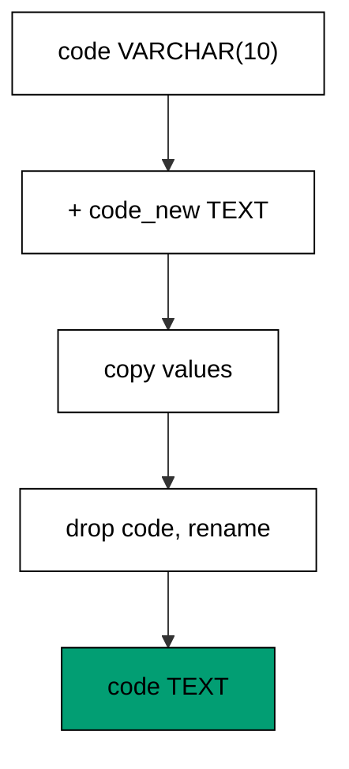

The rename is what makes the replacement invisible: readers keep the name they always used while the type underneath changes. On small tables the rewrite would be harmless — but the technique is identical at every scale, and learning it on a small table means it is ready for the large one where rewrites take hours.

**`learning/code/ex-69-expand-contract-avoids-rewrite/main.py`**:

```python
"""Example 69: replace a column instead of rewriting the whole table."""

import os  # => os reads the harness database address, never hardcoded
import tempfile  # => tempfile gives each run a private script directory

from alembic import command  # => command runs revisions, like the CLI does
from alembic.config import Config  # => Config points Alembic at the scripts
from sqlalchemy import create_engine, text  # => engine sets up and verifies

# => The database URL comes from the harness, with local-run defaults.
host = os.environ.get("PGHOST", "postgres")  # => service hostname in the unit network
user = os.environ.get("PGUSER", "postgres")  # => trust-auth role, no password needed
database = os.environ.get(
    "PGDATABASE", "postgres"
)  # => fresh database for every unit run
url = f"postgresql+psycopg://{user}@{host}/{database}"  # => psycopg 3 driver URL scheme

# => A scratch script location: env.py plus one versions directory.
# => the scratch path never reaches stdout, so reruns stay byte-stable
scratch = tempfile.mkdtemp(
    prefix="ex69-"
)  # => unique path, never printed, output stays stable
versions = os.path.join(
    scratch, "versions"
)  # => Alembic discovers revisions in this folder
os.makedirs(versions)  # => create the versions directory on disk

# => Minimal online-only env.py: connect and run whatever revisions exist.
env_py = """\
from alembic import context  # => context carries the Config that command.* built
from sqlalchemy import create_engine  # => plain engine is enough, no ORM needed
engine = create_engine(context.config.get_main_option("sqlalchemy.url"))  # => reuse the migration URL
with engine.connect() as connection:  # => one connection runs the whole migration
    context.configure(connection=connection, version_table="ex69_version")  # => per-example history table
    with context.begin_transaction():  # => DDL commits atomically where the database allows
        context.run_migrations()  # => execute every pending revision file in order
"""
with open(
    os.path.join(scratch, "env.py"), "w"
) as handle:  # => env.py sits beside versions/
    handle.write(env_py)  # => write the exact text shown above to disk

# => Two chained revisions: narrow code, then replace it with TEXT, same name.
rev1 = '''"""create ex69 widgets with narrow code."""

revision = "ex69a1"  # => first revision, no parent yet
down_revision = None


def upgrade():  # => forward: build the base table
    from alembic import op  # => op emits DDL inside the migration transaction
    import sqlalchemy as sa  # => column types come from SQLAlchemy Core

    # => every op call below joins one transaction: all of it commits or none of it does
    op.create_table(  # => CREATE TABLE, recorded in history only on success
        "ex69_widgets",  # => per-example table, no cross-example collision
        sa.Column("id", sa.Integer(), primary_key=True),  # => surrogate key column
        sa.Column("code", sa.String(10), nullable=False),  # => narrow on purpose: the replacement story
    )


def downgrade():  # => reverse: remove the base table
    from alembic import op  # => same op object, opposite direction

    # => downgrade mirrors upgrade in reverse: last created is first dropped
    op.drop_table("ex69_widgets")  # => DROP TABLE undoes exactly the upgrade
'''
with open(
    os.path.join(versions, "ex69a1_create_widgets.py"), "w"
) as handle:  # => filename starts with the id
    handle.write(rev1)  # => first chain link now exists on disk
rev2 = '''"""replace ex69 code with TEXT, same name."""

revision = "ex69a2"  # => second revision, runs after ex69a1
down_revision = "ex69a1"  # => the parent link that orders the chain


def upgrade():  # => forward: add, copy, drop, rename: no table rewrite
    from alembic import op  # => op emits DDL inside the migration transaction
    import sqlalchemy as sa  # => column types come from SQLAlchemy Core

    # => ADD COLUMN is metadata-only: no existing row is rewritten for it
    op.add_column("ex69_widgets", sa.Column("code_new", sa.Text()))  # => the wider replacement beside the old
    # => copy values over: every old value fits the new type by construction
    op.execute("UPDATE ex69_widgets SET code_new = code")
    # => drop the narrow original: the replacement holds every value now
    op.drop_column("ex69_widgets", "code")  # => old name gone, values safe in code_new
    # => rename into place: readers keep the name they always used
    op.execute("ALTER TABLE ex69_widgets RENAME COLUMN code_new TO code")  # => same name, wider type


def downgrade():  # => reverse: rebuild narrow, truncating what no longer fits
    from alembic import op  # => same op object, opposite direction
    import sqlalchemy as sa  # => column types come from SQLAlchemy Core

    # => the reverse rewrites too: narrowing always risks truncation, both ways
    op.add_column("ex69_widgets", sa.Column("code_old", sa.String(10)))  # => the narrow shape returns
    op.execute("UPDATE ex69_widgets SET code_old = SUBSTRING(code FROM 1 FOR 10)")  # => truncate to fit
    op.drop_column("ex69_widgets", "code")  # => wide column goes
    op.execute("ALTER TABLE ex69_widgets RENAME COLUMN code_old TO code")  # => narrow name restored
'''
with open(
    os.path.join(versions, "ex69a2_replace.py"), "w"
) as handle:  # => filename starts with the id
    handle.write(rev2)  # => second chain link now exists on disk

# => Values cross to the wider type with the column name unchanged.
config = Config()  # => bare Config: no alembic.ini needed for script runs
config.set_main_option("script_location", scratch)  # => env.py and versions/ live here
config.set_main_option("sqlalchemy.url", url)  # => the service database URL
engine = create_engine(url)  # => separate engine for setup and verification
with engine.begin() as connection:  # => setup runs in a single transaction
    connection.execute(
        text("DROP TABLE IF EXISTS ex69_widgets")
    )  # => leftovers of a killed run vanish
    connection.execute(
        text("DROP TABLE IF EXISTS ex69_version")
    )  # => stale history vanishes too
command.upgrade(
    config, "ex69a1"
)  # => the narrow schema: what the old code was built for
with engine.begin() as connection:  # => seeding runs in a single transaction
    # => a full-width seed: exactly 10 characters, the old maximum
    connection.execute(text("INSERT INTO ex69_widgets (code) VALUES ('0123456789')"))
# => add, copy, drop, rename: four steps, zero table rewrites
command.upgrade(config, "head")  # => replace, copy, drop, rename: no table rewrite
with engine.connect() as connection:  # => fresh connection sees the replaced column
    value = connection.execute(  # => the value must cross the replacement intact
        text("SELECT code FROM ex69_widgets")
    ).scalar()  # => exactly one row exists, so scalar is safe
    print("value:", value)  # => Output: value: 0123456789
    data_type = connection.execute(  # => the catalog proves the type really changed
        # => information_schema reports TEXT for the replaced column
        text(  # => data_type names the type family, not the spelling
            "SELECT data_type FROM information_schema.columns "
            "WHERE table_name = 'ex69_widgets' AND column_name = 'code'"
        )
    ).scalar()  # => exactly one column matches, so scalar is safe
    print("type:", data_type)  # => Output: type: text
    columns = connection.execute(  # => the name survived: readers see the same table
        # => information_schema is portable: no PostgreSQL-only catalog tables here
        text(  # => ordering by position keeps the printout stable across reruns
            "SELECT column_name FROM information_schema.columns "
            "WHERE table_name = 'ex69_widgets' ORDER BY ordinal_position"
        )
    ).fetchall()  # => materialize every row before printing
print("columns:", ", ".join(row[0] for row in columns))  # => Output: columns: id, code
with engine.begin() as connection:  # => cleanup runs in a single transaction
    # => the replaced table goes: same name, wider type, no other trace
    connection.execute(
        text("DROP TABLE ex69_widgets")
    )  # => the example leaves no tables behind
    connection.execute(
        text("DROP TABLE ex69_version")
    )  # => and no history table either
print("cleaned: yes")  # => Output: cleaned: yes
```

**Output** (`learning/code/ex-69-expand-contract-avoids-rewrite/expected/main.stdout.txt`):

```text
value: 0123456789
type: text
columns: id, code
cleaned: yes
```

**Key takeaway**: Replace columns by add-copy-drop-rename instead of ALTER TYPE; readers keep the name while the storage changes underneath.

**Why it matters**: Table rewrites lock out writes for their duration and double disk usage mid-migration. The replacement path costs four cheap metadata steps and zero rewrites — the same result with none of the outage risk.

### Example 70: Measure Lock Hold Per Step

Statement counts predict lock scope, so audit them before deploying. This example counts upgrade statements per revision file and reports each revision's lock window, then runs both. (Concepts: co-16.)

The audit is crude on purpose: static counts, not timings. Timings vary with load and data volume, but the statement inventory is fixed — one window per revision, N statements inside it. Reviewers read the inventory to budget attention: the two-statement window gets a closer look than the one-statement window, every time.

**`learning/code/ex-70-measure-lock-hold-per-step/main.py`**:

```python
"""Example 70: count statements per revision to see each lock window."""

import os  # => os reads the harness database address, never hardcoded
import tempfile  # => tempfile gives each run a private script directory

from alembic import command  # => command runs revisions, like the CLI does
from alembic.config import Config  # => Config points Alembic at the scripts
from sqlalchemy import create_engine, text  # => engine sets up and verifies

# => The database URL comes from the harness, with local-run defaults.
host = os.environ.get("PGHOST", "postgres")  # => service hostname in the unit network
user = os.environ.get("PGUSER", "postgres")  # => trust-auth role, no password needed
database = os.environ.get(
    "PGDATABASE", "postgres"
)  # => fresh database for every unit run
url = f"postgresql+psycopg://{user}@{host}/{database}"  # => psycopg 3 driver URL scheme

# => A scratch script location: env.py plus one versions directory.
# => the scratch path never reaches stdout, so reruns stay byte-stable
scratch = tempfile.mkdtemp(
    prefix="ex70-"
)  # => unique path, never printed, output stays stable
versions = os.path.join(
    scratch, "versions"
)  # => Alembic discovers revisions in this folder
os.makedirs(versions)  # => create the versions directory on disk

# => Minimal online-only env.py: connect and run whatever revisions exist.
env_py = """\
from alembic import context  # => context carries the Config that command.* built
from sqlalchemy import create_engine  # => plain engine is enough, no ORM needed
engine = create_engine(context.config.get_main_option("sqlalchemy.url"))  # => reuse the migration URL
with engine.connect() as connection:  # => one connection runs the whole migration
    context.configure(connection=connection, version_table="ex70_version")  # => per-example history table
    with context.begin_transaction():  # => DDL commits atomically where the database allows
        context.run_migrations()  # => execute every pending revision file in order
"""
with open(
    os.path.join(scratch, "env.py"), "w"
) as handle:  # => env.py sits beside versions/
    handle.write(env_py)  # => write the exact text shown above to disk

# => Two chained revisions: one statement, then two statements, each one window.
rev1 = '''"""create ex70 widgets."""

revision = "ex70a1"  # => first revision: one statement, one lock window
down_revision = None


def upgrade():  # => forward: the single statement of this revision
    from alembic import op  # => op emits DDL inside the migration transaction
    import sqlalchemy as sa  # => column types come from SQLAlchemy Core

    # => a lone statement needs no coordination: review it in one glance
    op.create_table(  # => CREATE TABLE, recorded in history only on success
        "ex70_widgets",  # => per-example table, no cross-example collision
        sa.Column("id", sa.Integer(), primary_key=True),  # => surrogate key column
        sa.Column("name", sa.String(50), nullable=False),  # => every widget has a name
    )


def downgrade():  # => reverse: the one undo of the one statement
    from alembic import op  # => same op object, opposite direction

    # => downgrade mirrors upgrade in reverse: last created is first dropped
    op.drop_table("ex70_widgets")  # => DROP TABLE undoes exactly the upgrade
'''
with open(
    os.path.join(versions, "ex70a1_create_widgets.py"), "w"
) as handle:  # => filename starts with the id
    handle.write(rev1)  # => first chain link now exists on disk
rev2 = '''"""index ex70 names and add price."""

revision = "ex70a2"  # => second revision: two statements, still one lock window
down_revision = "ex70a1"  # => the parent link that orders the chain


def upgrade():  # => forward: two statements inside one migration transaction
    from alembic import op  # => op emits DDL inside the migration transaction
    import sqlalchemy as sa  # => column types come from SQLAlchemy Core

    # => both statements share one transaction: one window, two locks at most
    op.add_column("ex70_widgets", sa.Column("price_cents", sa.Integer()))  # => first statement of the window
    op.create_index("ex70_widgets_name_idx", "ex70_widgets", ["name"])  # => second statement of the window


def downgrade():  # => reverse: both statements unwind in opposite order
    from alembic import op  # => same op object, opposite direction

    # => unwinds newest-first: index before column, creation order reversed
    op.drop_index("ex70_widgets_name_idx", table_name="ex70_widgets")  # => DROP INDEX before the column goes
    op.drop_column("ex70_widgets", "price_cents")  # => drop the column the upgrade added
'''
with open(
    os.path.join(versions, "ex70a2_extend.py"), "w"
) as handle:  # => filename starts with the id
    handle.write(rev2)  # => second chain link now exists on disk

# => Audit the windows, then run them: statement counts predict lock scope.
audits = []  # => one (revision, windows) pair per file, in chain order
for filename, revision_id in (
    ("ex70a1_create_widgets.py", "ex70a1"),
    ("ex70a2_extend.py", "ex70a2"),
):
    with open(
        os.path.join(versions, filename)
    ) as handle:  # => read each revision back for auditing
        upgrades = handle.read().split("def downgrade")[
            0
        ]  # => forward half only: downgrades are separate windows
        count = sum(
            1 for line in upgrades.splitlines() if line.strip().startswith("op.")
        )  # => upgrade statements
    # => one revision is one transaction: statements share one lock window here
    plural = "s" if count != 1 else ""  # => exact English: 1 statement, 2 statements
    audits.append(
        f"{revision_id}: {count} statement{plural}, 1 window"
    )  # => fixed words, stable across reruns
for audit in audits:  # => one printed line per audited revision
    print(audit)  # => Output: ex70a1: 1 statement, 1 window
# => windows total one per revision: the deploy holds at most one lock window at a time
print("windows total:", len(audits))  # => Output: windows total: 2
config = Config()  # => bare Config: no alembic.ini needed for script runs
config.set_main_option("script_location", scratch)  # => env.py and versions/ live here
config.set_main_option("sqlalchemy.url", url)  # => the service database URL
engine = create_engine(url)  # => separate engine for setup and verification
with engine.begin() as connection:  # => setup runs in a single transaction
    connection.execute(
        text("DROP TABLE IF EXISTS ex70_widgets")
    )  # => leftovers of a killed run vanish
    connection.execute(
        text("DROP TABLE IF EXISTS ex70_version")
    )  # => stale history vanishes too
command.upgrade(config, "head")  # => both windows run in chain order
with engine.begin() as connection:  # => cleanup runs in a single transaction
    connection.execute(
        text("DROP TABLE ex70_widgets")
    )  # => the example leaves no tables behind
    connection.execute(
        text("DROP TABLE ex70_version")
    )  # => and no history table either
print("cleaned: yes")  # => Output: cleaned: yes
```

**Output** (`learning/code/ex-70-measure-lock-hold-per-step/expected/main.stdout.txt`):

```text
ex70a1: 1 statement, 1 window
ex70a2: 2 statements, 1 window
windows total: 2
cleaned: yes
```

**Key takeaway**: Audit statements per revision before deploying; one revision is one window, and the count inside it sizes the review.

**Why it matters**: Lock risk hides in long revisions nobody counted. A mechanical statement inventory makes the risk visible in review — the team discusses windows with numbers attached instead of discovering them in production at peak traffic.

### Example 71: Read the Version Table First

A paused deploy leaves a database mid-chain, and the version table says exactly where. This example stops at the second of three revisions, then reads the recorded tip and the surviving tables. (Concepts: co-03.)

Version first, tables second, files third: the diary positions the database, the catalog shows what that position means physically, and the pending file list says what comes next. Skipping straight to "just run upgrade" without reading risks replaying assumptions — the thirty seconds of reading prevents the three hours of untangling.

**`learning/code/ex-71-read-the-version-table-first/main.py`**:

```python
"""Example 71: a broken deploy starts with reading the version table."""

import os  # => os reads the harness database address, never hardcoded
import tempfile  # => tempfile gives each run a private script directory

from alembic import command  # => command runs revisions, like the CLI does
from alembic.config import Config  # => Config points Alembic at the scripts
from sqlalchemy import create_engine, text  # => engine sets up and verifies

# => The database URL comes from the harness, with local-run defaults.
host = os.environ.get("PGHOST", "postgres")  # => service hostname in the unit network
user = os.environ.get("PGUSER", "postgres")  # => trust-auth role, no password needed
database = os.environ.get(
    "PGDATABASE", "postgres"
)  # => fresh database for every unit run
url = f"postgresql+psycopg://{user}@{host}/{database}"  # => psycopg 3 driver URL scheme

# => A scratch script location: env.py plus one versions directory.
# => the scratch path never reaches stdout, so reruns stay byte-stable
scratch = tempfile.mkdtemp(
    prefix="ex71-"
)  # => unique path, never printed, output stays stable
versions = os.path.join(
    scratch, "versions"
)  # => Alembic discovers revisions in this folder
os.makedirs(versions)  # => create the versions directory on disk

# => Minimal online-only env.py: connect and run whatever revisions exist.
env_py = """\
from alembic import context  # => context carries the Config that command.* built
from sqlalchemy import create_engine  # => plain engine is enough, no ORM needed
engine = create_engine(context.config.get_main_option("sqlalchemy.url"))  # => reuse the migration URL
with engine.connect() as connection:  # => one connection runs the whole migration
    context.configure(connection=connection, version_table="ex71_version")  # => per-example history table
    with context.begin_transaction():  # => DDL commits atomically where the database allows
        context.run_migrations()  # => execute every pending revision file in order
"""
with open(
    os.path.join(scratch, "env.py"), "w"
) as handle:  # => env.py sits beside versions/
    handle.write(env_py)  # => write the exact text shown above to disk

# => Three chained revisions: stop mid-chain, like a deploy that paused.
rev1 = '''"""create ex71 orders."""

revision = "ex71a1"  # => first revision, no parent yet
down_revision = None


def upgrade():  # => forward: build the base table
    from alembic import op  # => op emits DDL inside the migration transaction
    import sqlalchemy as sa  # => column types come from SQLAlchemy Core

    # => every op call below joins one transaction: all of it commits or none of it does
    op.create_table(  # => CREATE TABLE, recorded in history only on success
        "ex71_orders",  # => per-example table, no cross-example collision
        sa.Column("id", sa.Integer(), primary_key=True),  # => surrogate key column
        sa.Column("item", sa.String(50), nullable=False),  # => what was ordered
    )


def downgrade():  # => reverse: remove the base table
    from alembic import op  # => same op object, opposite direction

    # => downgrade mirrors upgrade in reverse: last created is first dropped
    op.drop_table("ex71_orders")  # => DROP TABLE undoes exactly the upgrade
'''
with open(
    os.path.join(versions, "ex71a1_create_orders.py"), "w"
) as handle:  # => filename starts with the id
    handle.write(rev1)  # => first chain link now exists on disk
rev2 = '''"""add ex71 order price."""

revision = "ex71a2"  # => second revision, the pause point of this story
down_revision = "ex71a1"  # => the parent link that orders the chain


def upgrade():  # => forward: one new nullable column on the live table
    from alembic import op  # => op emits DDL inside the migration transaction
    import sqlalchemy as sa  # => column types come from SQLAlchemy Core

    # => ADD COLUMN without a default leaves existing rows NULL: the safe start
    op.add_column("ex71_orders", sa.Column("price_cents", sa.Integer()))  # => ALTER TABLE ADD COLUMN


def downgrade():  # => reverse: drop that same column
    from alembic import op  # => same op object, opposite direction

    # => dropping the column discards its data: downgrades are not free
    op.drop_column("ex71_orders", "price_cents")  # => ALTER TABLE DROP COLUMN
'''
with open(
    os.path.join(versions, "ex71a2_add_price.py"), "w"
) as handle:  # => filename starts with the id
    handle.write(rev2)  # => second chain link now exists on disk
rev3 = '''"""add ex71 order status."""

revision = "ex71a3"  # => third revision: pending while the deploy is paused
down_revision = "ex71a2"  # => the parent link that orders the chain


def upgrade():  # => forward: one more column on the live table
    from alembic import op  # => op emits DDL inside the migration transaction
    import sqlalchemy as sa  # => column types come from SQLAlchemy Core

    # => a second nullable column: each revision stays small and reviewable
    op.add_column("ex71_orders", sa.Column("status", sa.String(10)))  # => ALTER TABLE ADD COLUMN


def downgrade():  # => reverse: drop that same column
    from alembic import op  # => same op object, opposite direction

    # => dropping the column discards its data: downgrades are not free
    op.drop_column("ex71_orders", "status")  # => ALTER TABLE DROP COLUMN
'''
with open(
    os.path.join(versions, "ex71a3_add_status.py"), "w"
) as handle:  # => filename starts with the id
    handle.write(rev3)  # => third chain link now exists on disk

# => The incident state: migrated halfway, then the deploy stopped.
config = Config()  # => bare Config: no alembic.ini needed for script runs
config.set_main_option("script_location", scratch)  # => env.py and versions/ live here
config.set_main_option("sqlalchemy.url", url)  # => the service database URL
engine = create_engine(url)  # => separate engine for setup and diagnosis
with engine.begin() as connection:  # => setup runs in a single transaction
    connection.execute(
        text("DROP TABLE IF EXISTS ex71_orders")
    )  # => leftovers of a killed run vanish
    connection.execute(
        text("DROP TABLE IF EXISTS ex71_version")
    )  # => stale history vanishes too
command.upgrade(config, "ex71a2")  # => the paused deploy: two links ran, one waits

# => Diagnosis starts here: version first, tables second, files third.
with engine.connect() as connection:  # => read-only connection for the diagnosis
    version = connection.execute(  # => the diary names the recorded position
        text(
            "SELECT version_num FROM ex71_version ORDER BY version_num"
        )  # => one row per applied head
    ).scalar()  # => exactly one head applied, so scalar is safe
    print("version:", version)  # => Output: version: ex71a2
    tables = connection.execute(  # => the catalog names every table the example owns
        # => LIKE patterns stay fixed: no timing or path leaks in
        text(  # => information_schema is portable: no PostgreSQL-only catalog tables here
            "SELECT table_name FROM information_schema.tables "
            "WHERE table_name LIKE 'ex71\\_%' ORDER BY table_name"
        )
    ).fetchall()  # => materialize every row before printing
print(
    "tables:", ", ".join(row[0] for row in tables)
)  # => Output: tables: ex71_orders, ex71_version
with engine.begin() as connection:  # => cleanup runs in a single transaction
    connection.execute(
        text("DROP TABLE ex71_orders")
    )  # => the example leaves no tables behind
    connection.execute(
        text("DROP TABLE ex71_version")
    )  # => and no history table either
print("cleaned: yes")  # => Output: cleaned: yes
```

**Output** (`learning/code/ex-71-read-the-version-table-first/expected/main.stdout.txt`):

```text
version: ex71a2
tables: ex71_orders, ex71_version
cleaned: yes
```

**Key takeaway**: Diagnose paused deploys version-table first: the stamp positions the database before anyone touches it.

**Why it matters**: Incident response starts with orientation, not action. The version row is the one fact about migration state that is always cheap, always current, and always safe to read — every diagnosis that skips it risks acting on a guess.

### Example 72: Diagnose a Partial Migration

Partial means applied plus pending, and both halves need names. This example stages a half-applied chain and reports the applied tip, the pending remainder, and the implied next step. (Concepts: co-12.)

The "next step" line is the diagnosis condensed to an order: resume with upgrade to head. Most partial states reduce to exactly this — the failure interrupted a forward run, and the fix is finishing it. The dangerous partials are the other kind, where the next step is a rollback first — and the same applied-versus-pending report is what distinguishes them.

**`learning/code/ex-72-diagnose-a-partial-migration/main.py`**:

```python
"""Example 72: a partial migration names what ran and what waits."""

import os  # => os reads the harness database address, never hardcoded
import tempfile  # => tempfile gives each run a private script directory

from alembic import command  # => command runs revisions, like the CLI does
from alembic.config import Config  # => Config points Alembic at the scripts
from alembic.migration import (
    MigrationContext,
)  # => MigrationContext reads history state
from alembic.script import (
    ScriptDirectory,
)  # => ScriptDirectory lists every known revision
from sqlalchemy import create_engine, text  # => engine sets up and verifies

# => The database URL comes from the harness, with local-run defaults.
host = os.environ.get("PGHOST", "postgres")  # => service hostname in the unit network
user = os.environ.get("PGUSER", "postgres")  # => trust-auth role, no password needed
database = os.environ.get(
    "PGDATABASE", "postgres"
)  # => fresh database for every unit run
url = f"postgresql+psycopg://{user}@{host}/{database}"  # => psycopg 3 driver URL scheme

# => A scratch script location: env.py plus one versions directory.
# => the scratch path never reaches stdout, so reruns stay byte-stable
scratch = tempfile.mkdtemp(
    prefix="ex72-"
)  # => unique path, never printed, output stays stable
versions = os.path.join(
    scratch, "versions"
)  # => Alembic discovers revisions in this folder
os.makedirs(versions)  # => create the versions directory on disk

# => Minimal online-only env.py: connect and run whatever revisions exist.
env_py = """\
from alembic import context  # => context carries the Config that command.* built
from sqlalchemy import create_engine  # => plain engine is enough, no ORM needed
engine = create_engine(context.config.get_main_option("sqlalchemy.url"))  # => reuse the migration URL
with engine.connect() as connection:  # => one connection runs the whole migration
    context.configure(connection=connection, version_table="ex72_version")  # => per-example history table
    with context.begin_transaction():  # => DDL commits atomically where the database allows
        context.run_migrations()  # => execute every pending revision file in order
"""
with open(
    os.path.join(scratch, "env.py"), "w"
) as handle:  # => env.py sits beside versions/
    handle.write(env_py)  # => write the exact text shown above to disk

# => Two chained revisions: apply the first, then diagnose the gap.
rev1 = '''"""create ex72 widgets."""

revision = "ex72a1"  # => first revision: applied before the pause
down_revision = None


def upgrade():  # => forward: build the base table
    from alembic import op  # => op emits DDL inside the migration transaction
    import sqlalchemy as sa  # => column types come from SQLAlchemy Core

    # => every op call below joins one transaction: all of it commits or none of it does
    op.create_table(  # => CREATE TABLE, recorded in history only on success
        "ex72_widgets",  # => per-example table, no cross-example collision
        sa.Column("id", sa.Integer(), primary_key=True),  # => surrogate key column
        sa.Column("name", sa.String(50), nullable=False),  # => every widget has a name
    )


def downgrade():  # => reverse: remove the base table
    from alembic import op  # => same op object, opposite direction

    # => downgrade mirrors upgrade in reverse: last created is first dropped
    op.drop_table("ex72_widgets")  # => DROP TABLE undoes exactly the upgrade
'''
with open(
    os.path.join(versions, "ex72a1_create_widgets.py"), "w"
) as handle:  # => filename starts with the id
    handle.write(rev1)  # => first chain link now exists on disk
rev2 = '''"""add ex72 widget price."""

revision = "ex72a2"  # => second revision: pending while the deploy is paused
down_revision = "ex72a1"  # => the parent link that orders the chain


def upgrade():  # => forward: one new nullable column on the live table
    from alembic import op  # => op emits DDL inside the migration transaction
    import sqlalchemy as sa  # => column types come from SQLAlchemy Core

    # => ADD COLUMN without a default leaves existing rows NULL: the safe start
    op.add_column("ex72_widgets", sa.Column("price_cents", sa.Integer()))  # => ALTER TABLE ADD COLUMN


def downgrade():  # => reverse: drop that same column
    from alembic import op  # => same op object, opposite direction

    # => dropping the column discards its data: downgrades are not free
    op.drop_column("ex72_widgets", "price_cents")  # => ALTER TABLE DROP COLUMN
'''
with open(
    os.path.join(versions, "ex72a2_add_price.py"), "w"
) as handle:  # => filename starts with the id
    handle.write(rev2)  # => second chain link now exists on disk

# => The paused state, then the gap analysis: applied, pending, next step.
config = Config()  # => bare Config: no alembic.ini needed for script runs
config.set_main_option("script_location", scratch)  # => env.py and versions/ live here
config.set_main_option("sqlalchemy.url", url)  # => the service database URL
engine = create_engine(url)  # => separate engine for setup and diagnosis
with engine.begin() as connection:  # => setup runs in a single transaction
    connection.execute(
        text("DROP TABLE IF EXISTS ex72_widgets")
    )  # => leftovers of a killed run vanish
    connection.execute(
        text("DROP TABLE IF EXISTS ex72_version")
    )  # => stale history vanishes too
command.upgrade(config, "ex72a1")  # => the paused deploy: one link ran, one waits
script = ScriptDirectory.from_config(config)  # => parses every revision file found
with engine.connect() as connection:  # => fresh connection reads the recorded tip
    context = MigrationContext.configure(  # => history state from this connection
        connection,
        opts={"version_table": "ex72_version"},  # => per-example history table again
    )
    applied = set(context.get_current_heads())  # => the recorded position of the pause
print("applied:", ", ".join(sorted(applied)))  # => Output: applied: ex72a1
known = sorted(
    found.revision for found in script.walk_revisions()
)  # => every revision file on disk
# => pending means known but not applied: the gap the next deploy closes
pending = [revision_id for revision_id in known if revision_id not in applied]
print("pending:", ", ".join(pending))  # => Output: pending: ex72a2
# => the next step follows from the gap: resume with upgrade to head
print(
    "next step:", "upgrade head" if pending else "nothing pending"
)  # => Output: next step: upgrade head
with engine.begin() as connection:  # => cleanup runs in a single transaction
    connection.execute(
        text("DROP TABLE ex72_widgets")
    )  # => the example leaves no tables behind
    connection.execute(
        text("DROP TABLE ex72_version")
    )  # => and no history table either
print("cleaned: yes")  # => Output: cleaned: yes
```

**Output** (`learning/code/ex-72-diagnose-a-partial-migration/expected/main.stdout.txt`):

```text
applied: ex72a1
pending: ex72a2
next step: upgrade head
cleaned: yes
```

**Key takeaway**: Name applied and pending separately; the gap between them determines whether to resume forward or roll back first.

**Why it matters**: "Half migrated" is not a diagnosis — it is a symptom with two opposite cures. Listing both sides turns the symptom into a decision with evidence, and the wrong cure applied confidently is worse than no cure at all.

### Example 73: History Diverged from Database

A hand-added column makes the database newer than its history: the files claim two columns, the table holds three. This example migrates cleanly, drifts by hand, and reports the exact gap. (Concepts: co-09.)

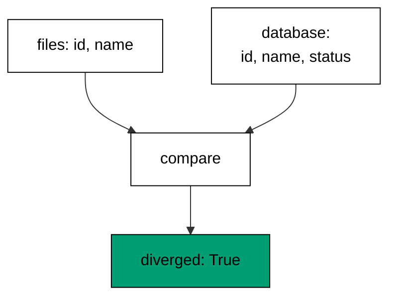

Divergence freezes forward motion until it is resolved: migrating on top of an unmodeled column means the next downgrade may drop something it never created, and the next autogenerate will draft surprises. The report names the gap so the team can choose — model the column properly, or revert it deliberately — before history moves again.

**`learning/code/ex-73-history-diverged-from-database/main.py`**:

```python
"""Example 73: unmodeled columns mean history diverged from the database."""

import os  # => os reads the harness database address, never hardcoded
import tempfile  # => tempfile gives each run a private script directory

from alembic import command  # => command runs revisions, like the CLI does
from alembic.config import Config  # => Config points Alembic at the scripts
from sqlalchemy import (
    MetaData,
    create_engine,
    text,
)  # => reflect needs MetaData and an engine

# => The database URL comes from the harness, with local-run defaults.
host = os.environ.get("PGHOST", "postgres")  # => service hostname in the unit network
user = os.environ.get("PGUSER", "postgres")  # => trust-auth role, no password needed
database = os.environ.get(
    "PGDATABASE", "postgres"
)  # => fresh database for every unit run
url = f"postgresql+psycopg://{user}@{host}/{database}"  # => psycopg 3 driver URL scheme

# => A scratch script location: env.py plus one versions directory.
# => the scratch path never reaches stdout, so reruns stay byte-stable
scratch = tempfile.mkdtemp(
    prefix="ex73-"
)  # => unique path, never printed, output stays stable
versions = os.path.join(
    scratch, "versions"
)  # => Alembic discovers revisions in this folder
os.makedirs(versions)  # => create the versions directory on disk

# => Minimal online-only env.py: connect and run whatever revisions exist.
env_py = """\
from alembic import context  # => context carries the Config that command.* built
from sqlalchemy import create_engine  # => plain engine is enough, no ORM needed
engine = create_engine(context.config.get_main_option("sqlalchemy.url"))  # => reuse the migration URL
with engine.connect() as connection:  # => one connection runs the whole migration
    context.configure(connection=connection, version_table="ex73_version")  # => per-example history table
    with context.begin_transaction():  # => DDL commits atomically where the database allows
        context.run_migrations()  # => execute every pending revision file in order
"""
with open(
    os.path.join(scratch, "env.py"), "w"
) as handle:  # => env.py sits beside versions/
    handle.write(env_py)  # => write the exact text shown above to disk

# => One revision to head: the history claims two columns, full stop.
rev1 = '''"""create ex73 widgets."""

revision = "ex73a1"  # => single revision: history ends at two columns
down_revision = None


def upgrade():  # => forward: build the base table
    from alembic import op  # => op emits DDL inside the migration transaction
    import sqlalchemy as sa  # => column types come from SQLAlchemy Core

    # => every op call below joins one transaction: all of it commits or none of it does
    op.create_table(  # => CREATE TABLE, recorded in history only on success
        "ex73_widgets",  # => per-example table, no cross-example collision
        sa.Column("id", sa.Integer(), primary_key=True),  # => surrogate key column
        sa.Column("name", sa.String(50), nullable=False),  # => the last column history knows
    )


def downgrade():  # => reverse: remove the base table
    from alembic import op  # => same op object, opposite direction

    # => downgrade mirrors upgrade in reverse: last created is first dropped
    op.drop_table("ex73_widgets")  # => DROP TABLE undoes exactly the upgrade
'''
with open(
    os.path.join(versions, "ex73a1_create_widgets.py"), "w"
) as handle:  # => filename starts with the id
    handle.write(rev1)  # => the revision file now exists for Alembic to find

# => Migrate cleanly, drift by hand, then compare files against reality.
config = Config()  # => bare Config: no alembic.ini needed for script runs
config.set_main_option("script_location", scratch)  # => env.py and versions/ live here
config.set_main_option("sqlalchemy.url", url)  # => the service database URL
engine = create_engine(url)  # => separate engine for migration and diagnosis
with engine.begin() as connection:  # => setup runs in a single transaction
    connection.execute(
        text("DROP TABLE IF EXISTS ex73_widgets")
    )  # => leftovers of a killed run vanish
    connection.execute(
        text("DROP TABLE IF EXISTS ex73_version")
    )  # => stale history vanishes too
command.upgrade(config, "head")  # => history and database agree: two columns
with engine.begin() as connection:  # => drift by hand: an unmodeled column appears
    # => raw DDL outside any revision: the classic silent drift
    connection.execute(text("ALTER TABLE ex73_widgets ADD COLUMN status VARCHAR(10)"))

# => The divergence check: files claim two columns, the database has three.
metadata = MetaData()  # => empty metadata: reflection fills it from the database
metadata.reflect(
    bind=engine, only=["ex73_widgets"]
)  # => only our table: system catalogs stay out
table = metadata.tables["ex73_widgets"]  # => the drifted table, all three columns
found = sorted(
    column.name for column in table.columns
)  # => sorted names keep output stable
# => two columns is what the one revision created: the history-side truth
expected = ["id", "name"]  # => what the revision files claim the table holds
print("expected:", ", ".join(expected))  # => Output: expected: id, name
print("found:", ", ".join(found))  # => Output: found: id, name, status
# => any gap means the database moved without history: investigate before migrating
print("diverged:", found != expected)  # => Output: diverged: True
with engine.begin() as connection:  # => cleanup runs in a single transaction
    connection.execute(
        text("DROP TABLE ex73_widgets")
    )  # => the example leaves no tables behind
    connection.execute(
        text("DROP TABLE ex73_version")
    )  # => and no history table either
print("cleaned: yes")  # => Output: cleaned: yes
```

**Output** (`learning/code/ex-73-history-diverged-from-database/expected/main.stdout.txt`):

```text
expected: id, name
found: id, name, status
diverged: True
cleaned: yes
```

**Key takeaway**: Compare files against reality after any out-of-band change; divergence freezes migration until it is modeled or reverted.

**Why it matters**: Unmodeled schema is a loan with compounding interest — every later migration assumes a shape that is not there. Catching the gap at one column keeps the fix to one decision; catching it at twenty means a project.

### Example 74: Missing Down Revision Error

A mistyped parent id breaks history loading entirely — and that loud failure is the protection working. This example wires an orphan to a ghost revision and watches the chain refuse to load. (Concepts: co-14.)

Fail-at-load beats fail-at-deploy by every measure: the typo surfaces in milliseconds on a developer machine instead of mid-deploy on production. History files are code, and like code they deserve a loader that rejects broken references instead of guessing through them.

**`learning/code/ex-74-missing-down-revision-error/main.py`**:

```python
"""Example 74: a parent that does not exist breaks history loading."""

import os  # => os builds the versions path, never hardcoded
import tempfile  # => tempfile gives each run a private script directory

from alembic.config import Config  # => Config locates the script directory
from alembic.script import (
    ScriptDirectory,
)  # => ScriptDirectory reads files without a database

# => A scratch script location: revisions only, no database touched here.
# => the scratch path never reaches stdout, so reruns stay byte-stable
scratch = tempfile.mkdtemp(
    prefix="ex74-"
)  # => unique path, never printed, output stays stable
versions = os.path.join(
    scratch, "versions"
)  # => Alembic discovers revisions in this folder
os.makedirs(versions)  # => create the versions directory on disk

# => A root plus an orphan: the parent id was mistyped and matches nothing.
root_rev = '''"""create ex74 widgets."""

revision = "ex74a1"  # => the only real revision: a root with no parent
down_revision = None  # => no parent: this is where this history starts


def upgrade():  # => forward: the one change that would run
    pass  # => body omitted: loading fails before any DDL matters


def downgrade():  # => reverse: the one undo that would run
    pass  # => body omitted: loading fails before any DDL matters
'''
with open(
    os.path.join(versions, "ex74a1_create_widgets.py"), "w"
) as handle:  # => filename starts with the id
    handle.write(root_rev)  # => the valid revision file now exists on disk
orphan_rev = '''"""add ex74 widget price on a ghost."""

revision = "ex74b1"  # => the orphan: its parent exists nowhere
down_revision = "ex74zzz"  # => mistyped id: no file carries this revision


def upgrade():  # => forward: never reached, the chain cannot load
    pass  # => body omitted: loading fails before any DDL matters


def downgrade():  # => reverse: never reached, the chain cannot load
    pass  # => body omitted: loading fails before any DDL matters
'''
with open(
    os.path.join(versions, "ex74b1_orphan.py"), "w"
) as handle:  # => filename starts with the id
    handle.write(orphan_rev)  # => the orphan file breaks the chain on disk

# => Loading the chain must fail loud: the orphan's parent resolves nowhere.
config = Config()  # => bare Config: no alembic.ini needed for inspection
config.set_main_option("script_location", scratch)  # => versions/ lives here
try:  # => walking the chain resolves every parent: the ghost breaks it
    script = ScriptDirectory.from_config(config)  # => parses every revision file found
    script.get_heads()  # => head resolution follows parent links: ghost link fails
    broken = False  # => reaching here means the ghost parent resolved somehow
except Exception:  # => any failure proves the guard works: broken chains stop here
    broken = True  # => the mistyped parent id breaks loading, as designed
# => loud failure at load time beats silent wrong order at deploy time
print("broken:", broken)  # => Output: broken: True
print("cleaned: yes")  # => Output: cleaned: yes
```

**Output** (`learning/code/ex-74-missing-down-revision-error/expected/main.stdout.txt`):

```text
broken: True
cleaned: yes
```

**Key takeaway**: Broken parent links fail history loading loudly; that refusal is the guard, not the bug.

**Why it matters**: A silently accepted bad link would deploy revisions in an order nobody reviewed. The loud failure converts a typo into a one-line fix in development instead of a corrupted production history that no downgrade can unwind.

### Example 75: Downgrade Past Data Loss

Rolling back a column destroys its data, and re-applying the revision does not bring it back. This example fills a price, drops its column, re-adds the column, and proves the value is gone while the name survived. (Concepts: co-08.)

Structure roundtrips; data does not. That asymmetry is the single most important fact about rollbacks: the schema can go back and forth freely, but every column drop is a deletion with no undo. Teams that internalize it back up before rolling back, and design downgrades that archive instead of discard when the data matters.

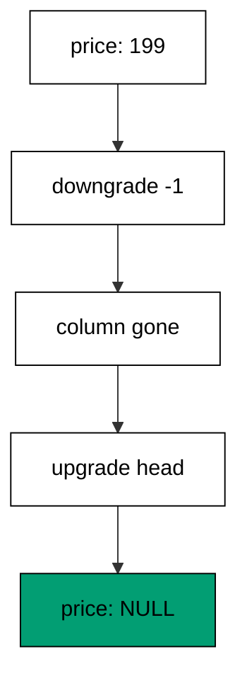

**`learning/code/ex-75-downgrade-past-data-loss/main.py`**:

```python
"""Example 75: rolling back past data loss cannot bring the values back."""

import os  # => os reads the harness database address, never hardcoded
import tempfile  # => tempfile gives each run a private script directory

from alembic import command  # => command runs revisions, like the CLI does
from alembic.config import Config  # => Config points Alembic at the scripts
from sqlalchemy import create_engine, text  # => engine sets up and verifies

# => The database URL comes from the harness, with local-run defaults.
host = os.environ.get("PGHOST", "postgres")  # => service hostname in the unit network
user = os.environ.get("PGUSER", "postgres")  # => trust-auth role, no password needed
database = os.environ.get(
    "PGDATABASE", "postgres"
)  # => fresh database for every unit run
url = f"postgresql+psycopg://{user}@{host}/{database}"  # => psycopg 3 driver URL scheme

# => A scratch script location: env.py plus one versions directory.
# => the scratch path never reaches stdout, so reruns stay byte-stable
scratch = tempfile.mkdtemp(
    prefix="ex75-"
)  # => unique path, never printed, output stays stable
versions = os.path.join(
    scratch, "versions"
)  # => Alembic discovers revisions in this folder
os.makedirs(versions)  # => create the versions directory on disk

# => Minimal online-only env.py: connect and run whatever revisions exist.
env_py = """\
from alembic import context  # => context carries the Config that command.* built
from sqlalchemy import create_engine  # => plain engine is enough, no ORM needed
engine = create_engine(context.config.get_main_option("sqlalchemy.url"))  # => reuse the migration URL
with engine.connect() as connection:  # => one connection runs the whole migration
    context.configure(connection=connection, version_table="ex75_version")  # => per-example history table
    with context.begin_transaction():  # => DDL commits atomically where the database allows
        context.run_migrations()  # => execute every pending revision file in order
"""
with open(
    os.path.join(scratch, "env.py"), "w"
) as handle:  # => env.py sits beside versions/
    handle.write(env_py)  # => write the exact text shown above to disk

# => Two chained revisions: the table, then the column whose data will die.
rev1 = '''"""create ex75 widgets."""

revision = "ex75a1"  # => first revision, no parent yet
down_revision = None


def upgrade():  # => forward: build the base table
    from alembic import op  # => op emits DDL inside the migration transaction
    import sqlalchemy as sa  # => column types come from SQLAlchemy Core

    # => every op call below joins one transaction: all of it commits or none of it does
    op.create_table(  # => CREATE TABLE, recorded in history only on success
        "ex75_widgets",  # => per-example table, no cross-example collision
        sa.Column("id", sa.Integer(), primary_key=True),  # => surrogate key column
        sa.Column("name", sa.String(50), nullable=False),  # => every widget has a name
    )


def downgrade():  # => reverse: remove the base table
    from alembic import op  # => same op object, opposite direction

    # => downgrade mirrors upgrade in reverse: last created is first dropped
    op.drop_table("ex75_widgets")  # => DROP TABLE undoes exactly the upgrade
'''
with open(
    os.path.join(versions, "ex75a1_create_widgets.py"), "w"
) as handle:  # => filename starts with the id
    handle.write(rev1)  # => first chain link now exists on disk
rev2 = '''"""add ex75 widget price."""

revision = "ex75a2"  # => second revision: its downgrade destroys the column data
down_revision = "ex75a1"  # => the parent link that orders the chain


def upgrade():  # => forward: one new nullable column on the live table
    from alembic import op  # => op emits DDL inside the migration transaction
    import sqlalchemy as sa  # => column types come from SQLAlchemy Core

    # => ADD COLUMN without a default leaves existing rows NULL: the safe start
    op.add_column("ex75_widgets", sa.Column("price_cents", sa.Integer()))  # => ALTER TABLE ADD COLUMN


def downgrade():  # => reverse: drop that same column
    from alembic import op  # => same op object, opposite direction

    # => dropping the column discards its data: downgrades are not free
    op.drop_column("ex75_widgets", "price_cents")  # => ALTER TABLE DROP COLUMN
'''
with open(
    os.path.join(versions, "ex75a2_add_price.py"), "w"
) as handle:  # => filename starts with the id
    handle.write(rev2)  # => second chain link now exists on disk

# => Fill, roll back, re-apply: the structure returns, the values do not.
config = Config()  # => bare Config: no alembic.ini needed for script runs
config.set_main_option("script_location", scratch)  # => env.py and versions/ live here
config.set_main_option("sqlalchemy.url", url)  # => the service database URL
engine = create_engine(url)  # => separate engine for setup and verification
with engine.begin() as connection:  # => setup runs in a single transaction
    connection.execute(
        text("DROP TABLE IF EXISTS ex75_widgets")
    )  # => leftovers of a killed run vanish
    connection.execute(
        text("DROP TABLE IF EXISTS ex75_version")
    )  # => stale history vanishes too
command.upgrade(config, "head")  # => table plus column: the full schema stands
with engine.begin() as connection:  # => seeding runs in a single transaction
    # => the priced row the rollback is about to destroy
    connection.execute(
        text("INSERT INTO ex75_widgets (name, price_cents) VALUES ('sprocket', 199)")
    )


def price():
    """Read the single price value for the assertions below."""
    with engine.connect() as connection:  # => fresh connection sees committed state
        # => exactly one row exists, so scalar is safe and deterministic
        return connection.execute(text("SELECT price_cents FROM ex75_widgets")).scalar()


print("before:", price())  # => Output: before: 199
command.downgrade(config, "-1")  # => the column vanishes with its 199 inside
command.upgrade(config, "head")  # => the column returns, empty: structure without data
# => the roundtrip restores schema but not values: this is the data-loss lesson
print("after:", price())  # => Output: after: None
# => None after a full roundtrip proves it: column downgrades destroy data
print("data survived:", price() is not None)  # => Output: data survived: False
with engine.begin() as connection:  # => cleanup runs in a single transaction
    connection.execute(
        text("DROP TABLE ex75_widgets")
    )  # => the example leaves no tables behind
    connection.execute(
        text("DROP TABLE ex75_version")
    )  # => and no history table either
print("cleaned: yes")  # => Output: cleaned: yes
```

**Output** (`learning/code/ex-75-downgrade-past-data-loss/expected/main.stdout.txt`):

```text
before: 199
after: None
data survived: False
cleaned: yes
```

**Key takeaway**: Column downgrades destroy data permanently; re-upgrading restores structure with NULLs where values were.

**Why it matters**: Rollback plans that ignore data loss trade a schema problem for a data problem — usually worse, always harder to fix. Knowing exactly what a downgrade deletes lets the plan include backups, archives, or a deliberate decision that the data is expendable.

### Example 76: Test Every Migration Twice

Migrate, tear down to zero, migrate again: both runs must agree. This example upgrades to head, downgrades to base, upgrades again, and asserts the table counts match across runs. (Concepts: co-16.)

The double run catches order dependence, leftover state, and non-idempotent DDL — the class of bugs that passes a single CI run and fails the second deploy. It costs one extra cycle against a scratch database and buys the knowledge that the migration is a pure function of its files, not of whatever happened to run before it.

**`learning/code/ex-76-test-every-migration-twice/main.py`**:

```python
"""Example 76: run every migration twice: migrate, tear down, migrate."""

import os  # => os reads the harness database address, never hardcoded
import tempfile  # => tempfile gives each run a private script directory

from alembic import command  # => command runs revisions, like the CLI does
from alembic.config import Config  # => Config points Alembic at the scripts
from sqlalchemy import create_engine, text  # => engine sets up and verifies

# => The database URL comes from the harness, with local-run defaults.
host = os.environ.get("PGHOST", "postgres")  # => service hostname in the unit network
user = os.environ.get("PGUSER", "postgres")  # => trust-auth role, no password needed
database = os.environ.get(
    "PGDATABASE", "postgres"
)  # => fresh database for every unit run
url = f"postgresql+psycopg://{user}@{host}/{database}"  # => psycopg 3 driver URL scheme

# => A scratch script location: env.py plus one versions directory.
# => the scratch path never reaches stdout, so reruns stay byte-stable
scratch = tempfile.mkdtemp(
    prefix="ex76-"
)  # => unique path, never printed, output stays stable
versions = os.path.join(
    scratch, "versions"
)  # => Alembic discovers revisions in this folder
os.makedirs(versions)  # => create the versions directory on disk

# => Minimal online-only env.py: connect and run whatever revisions exist.
env_py = """\
from alembic import context  # => context carries the Config that command.* built
from sqlalchemy import create_engine  # => plain engine is enough, no ORM needed
engine = create_engine(context.config.get_main_option("sqlalchemy.url"))  # => reuse the migration URL
with engine.connect() as connection:  # => one connection runs the whole migration
    context.configure(connection=connection, version_table="ex76_version")  # => per-example history table
    with context.begin_transaction():  # => DDL commits atomically where the database allows
        context.run_migrations()  # => execute every pending revision file in order
"""
with open(
    os.path.join(scratch, "env.py"), "w"
) as handle:  # => env.py sits beside versions/
    handle.write(env_py)  # => write the exact text shown above to disk

# => One revision to run twice with a full teardown between the runs.
rev1 = '''"""create ex76 widgets."""

revision = "ex76a1"  # => single revision: the whole migration under test
down_revision = None


def upgrade():  # => forward: build the base table
    from alembic import op  # => op emits DDL inside the migration transaction
    import sqlalchemy as sa  # => column types come from SQLAlchemy Core

    # => every op call below joins one transaction: all of it commits or none of it does
    op.create_table(  # => CREATE TABLE, recorded in history only on success
        "ex76_widgets",  # => per-example table, no cross-example collision
        sa.Column("id", sa.Integer(), primary_key=True),  # => surrogate key column
        sa.Column("name", sa.String(50), nullable=False),  # => every widget has a name
    )


def downgrade():  # => reverse: remove the base table
    from alembic import op  # => same op object, opposite direction

    # => downgrade mirrors upgrade in reverse: last created is first dropped
    op.drop_table("ex76_widgets")  # => DROP TABLE undoes exactly the upgrade
'''
with open(
    os.path.join(versions, "ex76a1_create_widgets.py"), "w"
) as handle:  # => filename starts with the id
    handle.write(rev1)  # => the revision file now exists for Alembic to find

# => Migrate, tear down to zero, migrate again: both runs must agree.
config = Config()  # => bare Config: no alembic.ini needed for script runs
config.set_main_option("script_location", scratch)  # => env.py and versions/ live here
config.set_main_option("sqlalchemy.url", url)  # => the service database URL
engine = create_engine(url)  # => separate engine for setup and verification
with engine.begin() as connection:  # => setup runs in a single transaction
    connection.execute(
        text("DROP TABLE IF EXISTS ex76_widgets")
    )  # => leftovers of a killed run vanish
    connection.execute(
        text("DROP TABLE IF EXISTS ex76_version")
    )  # => stale history vanishes too


def data_tables():
    """Count this example's data tables, ignoring its history table."""
    with engine.connect() as connection:  # => fresh connection sees committed DDL
        # => the version table is bookkeeping: only data tables count here
        return connection.execute(  # => COUNT keeps the output to one stable number
            text(  # => LIKE patterns stay fixed: no timing or path leaks in
                "SELECT COUNT(*) FROM information_schema.tables "
                "WHERE table_name LIKE 'ex76\\_%' AND table_name <> 'ex76_version'"
            )
        ).scalar()  # => a single count is all this check needs


# => first run proves the upgrade works from empty: one table stands
command.upgrade(config, "head")  # => first run: the table appears
print("first run tables:", data_tables())  # => Output: first run tables: 1
# => teardown proves the downgrade empties: zero tables remain
command.downgrade(config, "base")  # => teardown: every trace of the schema goes
print("after teardown:", data_tables())  # => Output: after teardown: 0
command.upgrade(config, "head")  # => second run: the table appears again
print("second run tables:", data_tables())  # => Output: second run tables: 1
# => identical runs prove the migration is a pure function of its files
print("stable:", data_tables() == 1)  # => Output: stable: True
with engine.begin() as connection:  # => cleanup runs in a single transaction
    connection.execute(
        text("DROP TABLE ex76_widgets")
    )  # => the example leaves no tables behind
    connection.execute(
        text("DROP TABLE ex76_version")
    )  # => and no history table either
print("cleaned: yes")  # => Output: cleaned: yes
```

**Output** (`learning/code/ex-76-test-every-migration-twice/expected/main.stdout.txt`):

```text
first run tables: 1
after teardown: 0
second run tables: 1
stable: True
cleaned: yes
```

**Key takeaway**: Run every migration twice with full teardown between; matching results prove the migration depends only on its files.

**Why it matters**: Single-run tests bless migrations that work once and fail on retry — the exact shape of a deploy that succeeds in staging and breaks in production. The second run is cheap insurance against the most embarrassing class of migration bugs.

### Example 77: Golden Schema Snapshot Test

Freeze the migrated schema as a golden list and diff it on every run. This example snapshots every table.column pair after migrating and compares against the reviewed golden list. (Concepts: co-16.)

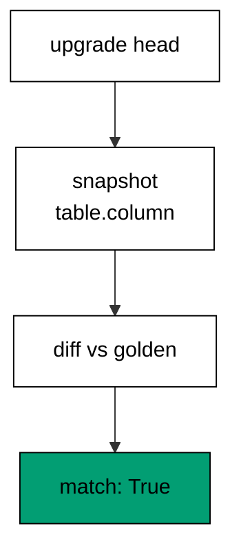

Golden tests turn schema review into a mechanical check: any migration that changes the snapshot must update the golden list in the same pull request, which forces the diff into the review where humans see it. Unreviewed schema drift becomes impossible by construction — the list either matches or the build fails.

**`learning/code/ex-77-golden-schema-snapshot-test/main.py`**:

```python
"""Example 77: snapshot the golden schema and compare on every run."""

import os  # => os reads the harness database address, never hardcoded
import tempfile  # => tempfile gives each run a private script directory

from alembic import command  # => command runs revisions, like the CLI does
from alembic.config import Config  # => Config points Alembic at the scripts
from sqlalchemy import create_engine, text  # => engine sets up and verifies

# => The database URL comes from the harness, with local-run defaults.
host = os.environ.get("PGHOST", "postgres")  # => service hostname in the unit network
user = os.environ.get("PGUSER", "postgres")  # => trust-auth role, no password needed
database = os.environ.get(
    "PGDATABASE", "postgres"
)  # => fresh database for every unit run
url = f"postgresql+psycopg://{user}@{host}/{database}"  # => psycopg 3 driver URL scheme

# => A scratch script location: env.py plus one versions directory.
# => the scratch path never reaches stdout, so reruns stay byte-stable
scratch = tempfile.mkdtemp(
    prefix="ex77-"
)  # => unique path, never printed, output stays stable
versions = os.path.join(
    scratch, "versions"
)  # => Alembic discovers revisions in this folder
os.makedirs(versions)  # => create the versions directory on disk

# => Minimal online-only env.py: connect and run whatever revisions exist.
env_py = """\
from alembic import context  # => context carries the Config that command.* built
from sqlalchemy import create_engine  # => plain engine is enough, no ORM needed
engine = create_engine(context.config.get_main_option("sqlalchemy.url"))  # => reuse the migration URL
with engine.connect() as connection:  # => one connection runs the whole migration
    context.configure(connection=connection, version_table="ex77_version")  # => per-example history table
    with context.begin_transaction():  # => DDL commits atomically where the database allows
        context.run_migrations()  # => execute every pending revision file in order
"""
with open(
    os.path.join(scratch, "env.py"), "w"
) as handle:  # => env.py sits beside versions/
    handle.write(env_py)  # => write the exact text shown above to disk

# => One revision to head: the snapshot below must match it exactly.
rev1 = '''"""create ex77 orders with price."""

revision = "ex77a1"  # => single revision: the whole schema under test
down_revision = None


def upgrade():  # => forward: build the base table
    from alembic import op  # => op emits DDL inside the migration transaction
    import sqlalchemy as sa  # => column types come from SQLAlchemy Core

    # => every op call below joins one transaction: all of it commits or none of it does
    op.create_table(  # => CREATE TABLE, recorded in history only on success
        "ex77_orders",  # => per-example table, no cross-example collision
        sa.Column("id", sa.Integer(), primary_key=True),  # => surrogate key column
        sa.Column("item", sa.String(50), nullable=False),  # => what was ordered
        sa.Column("price_cents", sa.Integer()),  # => optional price in cents
    )


def downgrade():  # => reverse: remove the base table
    from alembic import op  # => same op object, opposite direction

    # => downgrade mirrors upgrade in reverse: last created is first dropped
    op.drop_table("ex77_orders")  # => DROP TABLE undoes exactly the upgrade
'''
with open(
    os.path.join(versions, "ex77a1_create_orders.py"), "w"
) as handle:  # => filename starts with the id
    handle.write(rev1)  # => the revision file now exists for Alembic to find

# => Migrate, snapshot every table.column pair, and diff against the golden.
config = Config()  # => bare Config: no alembic.ini needed for script runs
config.set_main_option("script_location", scratch)  # => env.py and versions/ live here
config.set_main_option("sqlalchemy.url", url)  # => the service database URL
engine = create_engine(url)  # => separate engine for setup and verification
with engine.begin() as connection:  # => setup runs in a single transaction
    connection.execute(
        text("DROP TABLE IF EXISTS ex77_orders")
    )  # => leftovers of a killed run vanish
    connection.execute(
        text("DROP TABLE IF EXISTS ex77_version")
    )  # => stale history vanishes too
command.upgrade(config, "head")  # => the schema under test lands in full
with engine.connect() as connection:  # => fresh connection snapshots the result
    rows = connection.execute(  # => every table.column pair this example owns
        # => LIKE patterns stay fixed: no timing or path leaks in
        text(  # => information_schema is portable: no PostgreSQL-only catalog tables here
            "SELECT table_name || '.' || column_name FROM information_schema.columns "
            "WHERE table_name LIKE 'ex77\\_%' AND table_name <> 'ex77_version' ORDER BY 1"
        )
    ).fetchall()  # => materialize every row before printing
snapshot = [row[0] for row in rows]  # => plain list of table.column pairs
print(
    "snapshot:", ", ".join(snapshot)
)  # => Output: snapshot: ex77_orders.id, ex77_orders.item, ex77_orders.price_cents
# => the golden list is the contract: any drift fails the comparison below
golden = [
    "ex77_orders.id",
    "ex77_orders.item",
    "ex77_orders.price_cents",
]  # => frozen at review time
# => equality means the migration reproduces the reviewed schema exactly
print("match:", snapshot == golden)  # => Output: match: True
with engine.begin() as connection:  # => cleanup runs in a single transaction
    connection.execute(
        text("DROP TABLE ex77_orders")
    )  # => the example leaves no tables behind
    connection.execute(
        text("DROP TABLE ex77_version")
    )  # => and no history table either
print("cleaned: yes")  # => Output: cleaned: yes
```

**Output** (`learning/code/ex-77-golden-schema-snapshot-test/expected/main.stdout.txt`):

```text
snapshot: ex77_orders.id, ex77_orders.item, ex77_orders.price_cents
match: True
cleaned: yes
```

**Key takeaway**: Freeze migrated schemas as golden lists in review; every run diffs live state against the frozen contract.

**Why it matters**: Schema drift between review and deploy is silent and cumulative. The golden snapshot makes "the schema changed" a build failure with the exact diff attached — reviewers approve shapes, not vibes.

### Example 78: Pre-Deploy Checklist

Ship only what the checklist approves: one head, staged tip equal to file tip, schema matching the models. This example stages to head and runs all three gates, printing the decision. (Concepts: co-13.)

Checklists work because they are run the same way every time, especially under pressure. Automating the three checks — linearity, currency, fidelity — removes the "we were in a hurry" failure mode: the deploy either passes all three or it does not ship, and no deadline changes what the script prints.

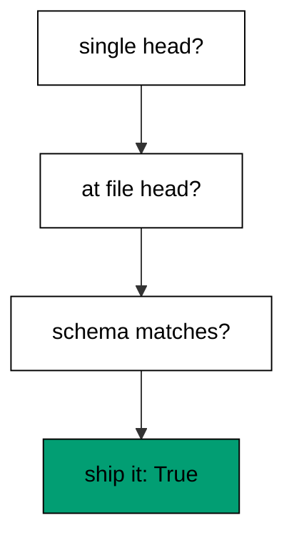

**`learning/code/ex-78-pre-deploy-checklist/main.py`**:

```python
"""Example 78: the pre-deploy checklist gates every production migration."""

import os  # => os reads the harness database address, never hardcoded
import tempfile  # => tempfile gives each run a private script directory

from alembic import command  # => command runs revisions, like the CLI does
from alembic.config import Config  # => Config points Alembic at the scripts
from alembic.migration import (
    MigrationContext,
)  # => MigrationContext reads history state
from alembic.script import (
    ScriptDirectory,
)  # => ScriptDirectory lists every known revision
from sqlalchemy import (
    MetaData,
    create_engine,
    text,
)  # => reflect needs MetaData and an engine

# => The database URL comes from the harness, with local-run defaults.
host = os.environ.get("PGHOST", "postgres")  # => service hostname in the unit network
user = os.environ.get("PGUSER", "postgres")  # => trust-auth role, no password needed
database = os.environ.get(
    "PGDATABASE", "postgres"
)  # => fresh database for every unit run
url = f"postgresql+psycopg://{user}@{host}/{database}"  # => psycopg 3 driver URL scheme

# => A scratch script location: env.py plus one versions directory.
# => the scratch path never reaches stdout, so reruns stay byte-stable
scratch = tempfile.mkdtemp(
    prefix="ex78-"
)  # => unique path, never printed, output stays stable
versions = os.path.join(
    scratch, "versions"
)  # => Alembic discovers revisions in this folder
os.makedirs(versions)  # => create the versions directory on disk

# => Minimal online-only env.py: connect and run whatever revisions exist.
env_py = """\
from alembic import context  # => context carries the Config that command.* built
from sqlalchemy import create_engine  # => plain engine is enough, no ORM needed
engine = create_engine(context.config.get_main_option("sqlalchemy.url"))  # => reuse the migration URL
with engine.connect() as connection:  # => one connection runs the whole migration
    context.configure(connection=connection, version_table="ex78_version")  # => per-example history table
    with context.begin_transaction():  # => DDL commits atomically where the database allows
        context.run_migrations()  # => execute every pending revision file in order
"""
with open(
    os.path.join(scratch, "env.py"), "w"
) as handle:  # => env.py sits beside versions/
    handle.write(env_py)  # => write the exact text shown above to disk

# => Two chained revisions: the staged schema the checklist approves.
rev1 = '''"""create ex78 widgets."""

revision = "ex78a1"  # => first revision, no parent yet
down_revision = None


def upgrade():  # => forward: build the base table
    from alembic import op  # => op emits DDL inside the migration transaction
    import sqlalchemy as sa  # => column types come from SQLAlchemy Core

    # => every op call below joins one transaction: all of it commits or none of it does
    op.create_table(  # => CREATE TABLE, recorded in history only on success
        "ex78_widgets",  # => per-example table, no cross-example collision
        sa.Column("id", sa.Integer(), primary_key=True),  # => surrogate key column
        sa.Column("name", sa.String(50), nullable=False),  # => every widget has a name
    )


def downgrade():  # => reverse: remove the base table
    from alembic import op  # => same op object, opposite direction

    # => downgrade mirrors upgrade in reverse: last created is first dropped
    op.drop_table("ex78_widgets")  # => DROP TABLE undoes exactly the upgrade
'''
with open(
    os.path.join(versions, "ex78a1_create_widgets.py"), "w"
) as handle:  # => filename starts with the id
    handle.write(rev1)  # => first chain link now exists on disk
rev2 = '''"""add ex78 widget price."""

revision = "ex78a2"  # => second revision, the file head production should reach
down_revision = "ex78a1"  # => the parent link that orders the chain


def upgrade():  # => forward: one new nullable column on the live table
    from alembic import op  # => op emits DDL inside the migration transaction
    import sqlalchemy as sa  # => column types come from SQLAlchemy Core

    # => ADD COLUMN without a default leaves existing rows NULL: the safe start
    op.add_column("ex78_widgets", sa.Column("price_cents", sa.Integer()))  # => ALTER TABLE ADD COLUMN


def downgrade():  # => reverse: drop that same column
    from alembic import op  # => same op object, opposite direction

    # => dropping the column discards its data: downgrades are not free
    op.drop_column("ex78_widgets", "price_cents")  # => ALTER TABLE DROP COLUMN
'''
with open(
    os.path.join(versions, "ex78a2_add_price.py"), "w"
) as handle:  # => filename starts with the id
    handle.write(rev2)  # => second chain link now exists on disk

# => Stage to head, then run the three checks that gate production.
config = Config()  # => bare Config: no alembic.ini needed for script runs
config.set_main_option("script_location", scratch)  # => env.py and versions/ live here
config.set_main_option("sqlalchemy.url", url)  # => the service database URL
engine = create_engine(url)  # => separate engine for staging and checks
with engine.begin() as connection:  # => setup runs in a single transaction
    connection.execute(
        text("DROP TABLE IF EXISTS ex78_widgets")
    )  # => leftovers of a killed run vanish
    connection.execute(
        text("DROP TABLE IF EXISTS ex78_version")
    )  # => stale history vanishes too
command.upgrade(config, "head")  # => the staged database reaches the file head
script = ScriptDirectory.from_config(config)  # => parses every revision file found
with engine.connect() as connection:  # => fresh connection runs the three checks
    context = MigrationContext.configure(  # => history state from this connection
        connection,
        opts={"version_table": "ex78_version"},  # => per-example history table again
    )
    at_head = context.get_current_heads()  # => the recorded tip of the staged database
    # => one head means one line: branches stop the deploy before it starts
    print("single head:", len(script.get_heads()) == 1)  # => Output: single head: True
    # => the staged tip must equal the file tip: nothing pending, nothing extra
    print(
        "at file head:", list(at_head) == sorted(script.get_heads())
    )  # => Output: at file head: True
    metadata = MetaData()  # => empty metadata: reflection fills it from the database
    metadata.reflect(
        bind=engine, only=["ex78_widgets"]
    )  # => only our table: system catalogs stay out
    table = metadata.tables[
        "ex78_widgets"
    ]  # => the staged table, columns and types included
    reflected = sorted(
        column.name for column in table.columns
    )  # => sorted names keep output stable
    # => two columns plus the key is what both revisions built: the staged truth
    print(
        "schema matches:", reflected == ["id", "name", "price_cents"]
    )  # => Output: schema matches: True
# => three green checks mean one decision: the staged migration ships to production
print("ship it:", True)  # => Output: ship it: True
with engine.begin() as connection:  # => cleanup runs in a single transaction
    connection.execute(
        text("DROP TABLE ex78_widgets")
    )  # => the example leaves no tables behind
    connection.execute(
        text("DROP TABLE ex78_version")
    )  # => and no history table either
print("cleaned: yes")  # => Output: cleaned: yes
```

**Output** (`learning/code/ex-78-pre-deploy-checklist/expected/main.stdout.txt`):

```text
single head: True
at file head: True
schema matches: True
ship it: True
cleaned: yes
```

**Key takeaway**: Gate production on three automated checks — single head, staged tip at file head, schema matching models.

**Why it matters**: Manual pre-deploy verification gets skipped exactly when risk is highest — late at night, under deadline, during incidents. The scripted checklist never hurries, never tires, and never ships a migration it has not verified.
