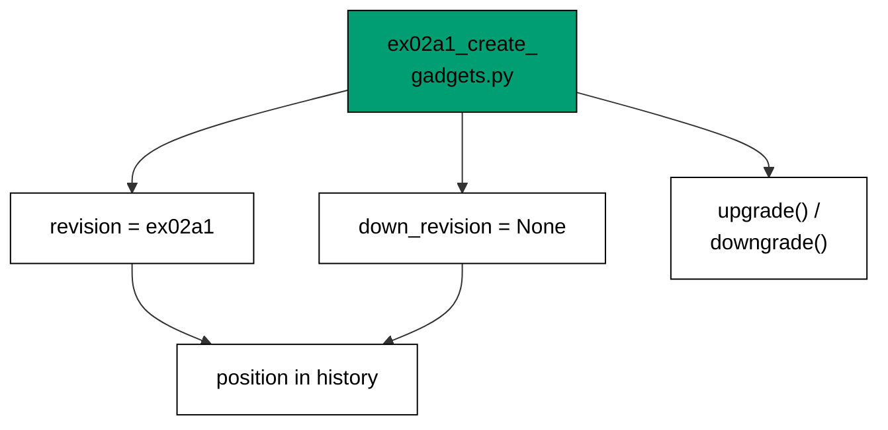
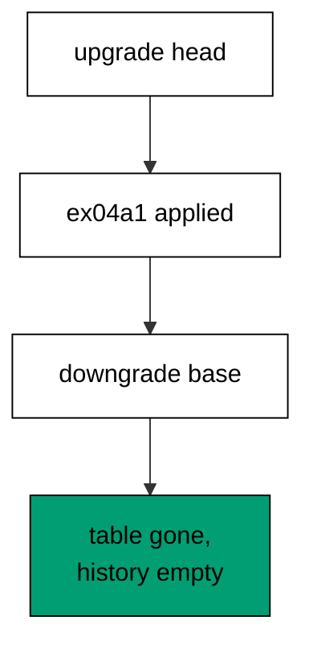
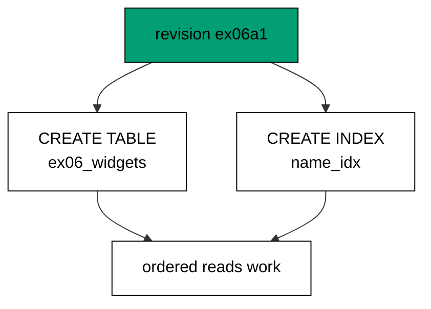
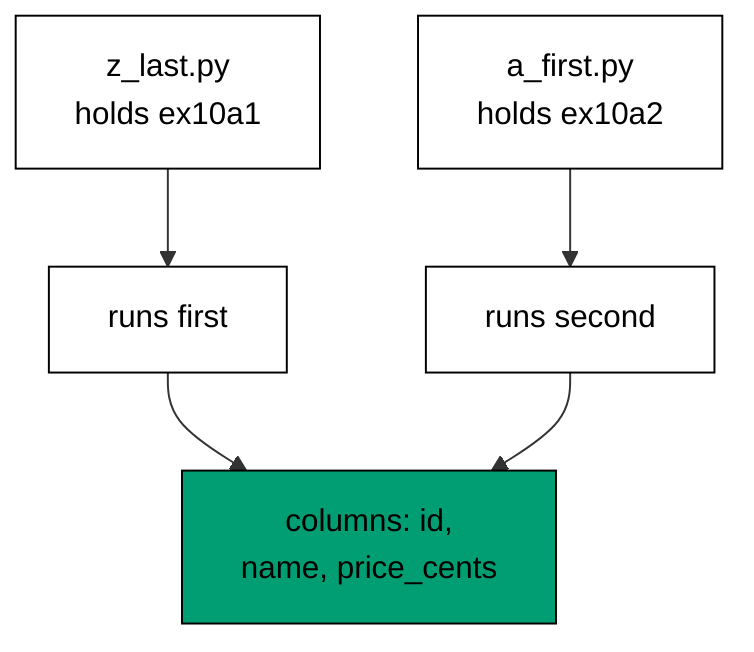
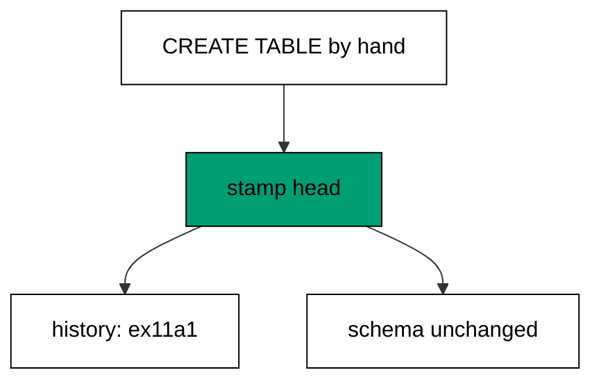
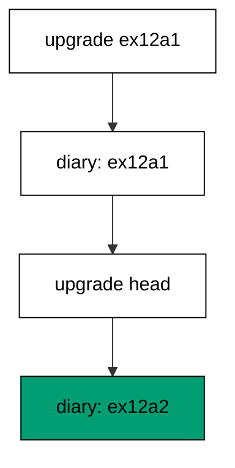
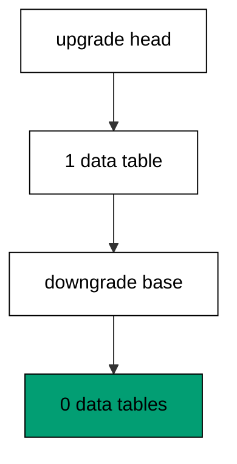
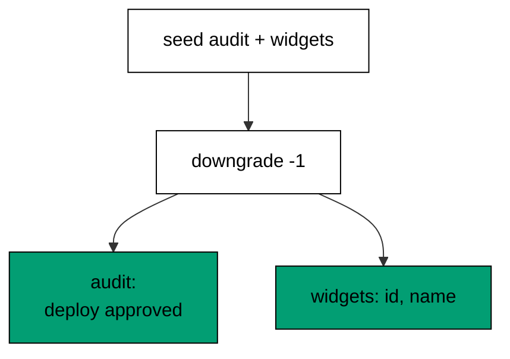
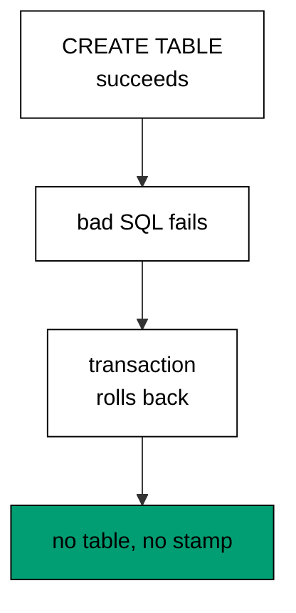
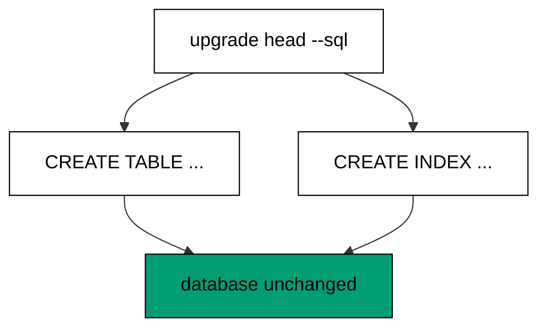

Examples 1-25 build the habits every later example assumes: writing revisions with forward and reverse steps, ordering them into one linear history, and rolling them back without losing unrelated data. Three clusters carry the level: first migrations that create and alter (Examples 1-8), migration history and ordering (Examples 9-17), and rollback basics (Examples 18-25). Every program runs against the real pinned PostgreSQL 18 container; every output is a fixed transcript.

### Example 1: First Revision Creates a Table

A migration is a versioned file with a forward step and a reverse step, and this example runs the smallest real one: a single revision that creates a table. The program writes the revision file into a scratch script directory at runtime, upgrades to head, and reads the catalog back. (Concepts: co-01.)

The revision carries three fields — `revision`, `down_revision`, and the two functions — and Alembic needs nothing else to plan and run it. The `op.create_table` call runs inside the migration transaction, so the history row appears only when the DDL commits; a crash halfway leaves no stamp behind. Per-example table and history names keep every unit isolated even though all of them share one service database shape.

**`learning/code/ex-01-first-revision-creates-a-table/main.py`**:

```python
"""Example 1: a first Alembic revision creates a table for real."""

import os  # => os reads the harness database address, never hardcoded
import tempfile  # => tempfile gives each run a private script directory

from alembic import command  # => command.upgrade runs revisions like the CLI
from alembic.config import Config  # => Config points Alembic at the scripts
from sqlalchemy import create_engine, text  # => engine independently verifies

# => The database URL comes from the harness, with local-run defaults.
host = os.environ.get("PGHOST", "postgres")  # => service hostname in the unit network
user = os.environ.get("PGUSER", "postgres")  # => trust-auth role, no password needed
database = os.environ.get(
    "PGDATABASE", "postgres"
)  # => fresh database for every unit run
url = f"postgresql+psycopg://{user}@{host}/{database}"  # => psycopg 3 driver URL scheme

# => A scratch script location: env.py plus one versions directory.
# => the scratch path never reaches stdout, so reruns stay byte-stable
scratch = tempfile.mkdtemp(
    prefix="ex01-"
)  # => unique path, never printed, output stays stable
versions = os.path.join(
    scratch, "versions"
)  # => Alembic discovers revisions in this folder
os.makedirs(versions)  # => create the versions directory on disk

# => Minimal online-only env.py: connect and run whatever revisions exist.
env_py = """\
from alembic import context  # => context carries the Config that command.* built
from sqlalchemy import create_engine  # => plain engine is enough, no ORM needed
engine = create_engine(context.config.get_main_option("sqlalchemy.url"))  # => reuse the migration URL
with engine.connect() as connection:  # => one connection runs the whole migration
    context.configure(connection=connection, version_table="ex01_version")  # => per-example history table
    with context.begin_transaction():  # => DDL commits atomically where the database allows
        context.run_migrations()  # => execute every pending revision file in order
"""
with open(
    os.path.join(scratch, "env.py"), "w"
) as handle:  # => env.py sits beside versions/
    handle.write(env_py)  # => write the exact text shown above to disk

# => Revision ex01a1: create the widgets table. The id is fixed, never random.
revision = '''"""create ex01 widgets."""

revision = "ex01a1"  # => this revision's permanent identity in history
down_revision = None  # => no parent: this is where this history starts


def upgrade():  # => the forward change, run by upgrade
    from alembic import op  # => op emits DDL inside the migration transaction
    import sqlalchemy as sa  # => column types come from SQLAlchemy Core

    # => every op call below joins one transaction: all of it commits or none of it does
    op.create_table(  # => CREATE TABLE, recorded in history only on success
        "ex01_widgets",  # => per-example table, no cross-example collision
        sa.Column("id", sa.Integer(), primary_key=True),  # => surrogate key column
        sa.Column("name", sa.String(50), nullable=False),  # => every widget must have a name
    )


def downgrade():  # => the reverse change, run by downgrade
    from alembic import op  # => same op object, opposite direction

    # => downgrade mirrors upgrade in reverse: last created is first dropped
    op.drop_table("ex01_widgets")  # => DROP TABLE undoes exactly the upgrade
'''
with open(
    os.path.join(versions, "ex01a1_create_widgets.py"), "w"
) as handle:  # => filename starts with the id
    handle.write(revision)  # => the file above now exists for Alembic to find

# => Wire the Config to the scratch directory and run the migration.
config = Config()  # => bare Config: no alembic.ini needed for script runs
config.set_main_option("script_location", scratch)  # => env.py and versions/ live here
config.set_main_option("sqlalchemy.url", url)  # => the service database URL
engine = create_engine(url)  # => separate engine for setup and verification
with engine.begin() as connection:  # => setup runs in a single transaction
    connection.execute(
        text("DROP TABLE IF EXISTS ex01_widgets")
    )  # => leftovers of a killed run vanish
    connection.execute(
        text("DROP TABLE IF EXISTS ex01_version")
    )  # => stale history vanishes too
command.upgrade(
    config, "head"
)  # => run every pending revision, like `alembic upgrade head`
with engine.connect() as connection:  # => fresh connection sees the committed DDL
    columns = connection.execute(  # => ask the catalog what the table looks like
        # => information_schema is portable: no PostgreSQL-only catalog tables here
        text(  # => ordering by position keeps the printout stable across reruns
            "SELECT column_name FROM information_schema.columns "
            "WHERE table_name = 'ex01_widgets' ORDER BY ordinal_position"
        )
    ).fetchall()  # => materialize every row before printing
print("columns:", ", ".join(row[0] for row in columns))  # => Output: columns: id, name
with engine.begin() as connection:  # => cleanup runs in a single transaction
    connection.execute(
        text("DROP TABLE ex01_widgets")
    )  # => the example leaves no tables behind
    connection.execute(
        text("DROP TABLE ex01_version")
    )  # => and no history table either
print("cleaned: yes")  # => Output: cleaned: yes
```

**Output** (`learning/code/ex-01-first-revision-creates-a-table/expected/main.stdout.txt`):

```text
columns: id, name
cleaned: yes
```

**Key takeaway**: A revision is an ordered file with an up and a down; upgrading to head runs every pending file in chain order.

**Why it matters**: Production schema changes ship as reviewable files instead of chat messages. When the change and its reverse live in the same file, the deploy and the escape hatch are written, reviewed, and tested together — the rollback stops being an improvisation.

### Example 2: Revision File Anatomy

Before running anything, read a revision file the way Alembic sees it: identity, parent link, and human description, all available without a database connection. This example writes one revision and inspects it through `ScriptDirectory`. (Concepts: co-01.)



Every field has one job: `revision` fixes the node's identity forever, `down_revision` wires it into the chain, and the docstring tells the next reader what the change is for. Filenames conventionally start with the id so humans can find the file, but Alembic plans from the fields, never the names — a lesson Example 10 proves on a live database.

**`learning/code/ex-02-revision-file-anatomy/main.py`**:

```python
"""Example 2: a revision file carries its identity, parent, and docstring."""

import os  # => os builds the versions path, never hardcoded
import tempfile  # => tempfile gives each run a private script directory

from alembic.config import Config  # => Config locates the script directory
from alembic.script import (
    ScriptDirectory,
)  # => ScriptDirectory reads files without a database

# => A scratch script location: revisions only, no database touched here.
scratch = tempfile.mkdtemp(
    prefix="ex02-"
)  # => unique path, never printed, output stays stable
versions = os.path.join(
    scratch, "versions"
)  # => Alembic discovers revisions in this folder
os.makedirs(versions)  # => create the versions directory on disk

# => Revision ex02a1: a gadget table. Three fields carry the whole contract.
revision = '''"""create ex02 gadgets."""

revision = "ex02a1"  # => this revision's permanent identity in history
down_revision = None  # => no parent: the root of this history


def upgrade():  # => the forward change, run by upgrade
    from alembic import op  # => op emits DDL inside the migration transaction
    import sqlalchemy as sa  # => column types come from SQLAlchemy Core

    # => every op call below joins the migration transaction
    op.create_table(  # => CREATE TABLE, recorded in history only on success
        "ex02_gadgets",  # => per-example table, no cross-example collision
        sa.Column("id", sa.Integer(), primary_key=True),  # => surrogate key column
        sa.Column("label", sa.String(80)),  # => optional human-readable label
    )


def downgrade():  # => the reverse change, run by downgrade
    from alembic import op  # => same op object, opposite direction

    op.drop_table("ex02_gadgets")  # => DROP TABLE undoes exactly the upgrade
'''
with open(
    os.path.join(versions, "ex02a1_create_gadgets.py"), "w"
) as handle:  # => filename starts with the id
    handle.write(revision)  # => the file above now exists for Alembic to read

# => Read the file back through Alembic: no database connection needed.
config = Config()  # => bare Config: no alembic.ini needed for inspection
config.set_main_option("script_location", scratch)  # => versions/ lives here
script = ScriptDirectory.from_config(config)  # => parses every revision file found
found = script.get_revision("ex02a1")  # => look up one revision by its fixed id
print("revision:", found.revision)  # => Output: revision: ex02a1
print("down_revision:", found.down_revision)  # => Output: down_revision: None
print("doc:", found.doc)  # => Output: doc: create ex02 gadgets.
print("module:", found.module.__name__)  # => Output: module: ex02a1_create_gadgets_py
print(
    "path ends with:", os.path.basename(found.path)
)  # => Output: path ends with: ex02a1_create_gadgets.py
```

**Output** (`learning/code/ex-02-revision-file-anatomy/expected/main.stdout.txt`):

```text
revision: ex02a1
down_revision: None
doc: create ex02 gadgets.
module: ex02a1_create_gadgets_py
path ends with: ex02a1_create_gadgets.py
```

**Key takeaway**: Identity, parent, and description are readable from the file alone; the database only records which of these files already ran.

**Why it matters**: Code review happens on files, not databases. When every revision's contract is visible without provisioning anything, reviewers can judge ordering and reversibility in the pull request, where fixes are cheap.

### Example 3: Upgrade Runs the Forward Change

Upgrading to a named revision runs every forward step up to and including it — and nothing after it. This example builds a two-link chain and stops at the first link, proving the second column never appears. (Concepts: co-02.)

Targeted upgrades are how teams land large histories safely: migrate to a checkpoint, verify the application against the intermediate schema, then continue. The history table records exactly where the database stopped, so the next `upgrade head` resumes from the right link instead of replaying anything.

**`learning/code/ex-03-upgrade-runs-the-forward-change/main.py`**:

```python
"""Example 3: upgrade to a revision runs only the forward steps before it."""

import os  # => os reads the harness database address, never hardcoded
import tempfile  # => tempfile gives each run a private script directory

from alembic import command  # => command.upgrade runs revisions like the CLI
from alembic.config import Config  # => Config points Alembic at the scripts
from alembic.migration import (
    MigrationContext,
)  # => MigrationContext reads history state
from sqlalchemy import create_engine, text  # => engine sets up and verifies

# => The database URL comes from the harness, with local-run defaults.
host = os.environ.get("PGHOST", "postgres")  # => service hostname in the unit network
user = os.environ.get("PGUSER", "postgres")  # => trust-auth role, no password needed
database = os.environ.get(
    "PGDATABASE", "postgres"
)  # => fresh database for every unit run
url = f"postgresql+psycopg://{user}@{host}/{database}"  # => psycopg 3 driver URL scheme

# => A scratch script location: env.py plus one versions directory.
# => the scratch path never reaches stdout, so reruns stay byte-stable
scratch = tempfile.mkdtemp(
    prefix="ex03-"
)  # => unique path, never printed, output stays stable
versions = os.path.join(
    scratch, "versions"
)  # => Alembic discovers revisions in this folder
os.makedirs(versions)  # => create the versions directory on disk

# => Minimal online-only env.py: connect and run whatever revisions exist.
env_py = """\
from alembic import context  # => context carries the Config that command.* built
from sqlalchemy import create_engine  # => plain engine is enough, no ORM needed
engine = create_engine(context.config.get_main_option("sqlalchemy.url"))  # => reuse the migration URL
with engine.connect() as connection:  # => one connection runs the whole migration
    context.configure(connection=connection, version_table="ex03_version")  # => per-example history table
    with context.begin_transaction():  # => DDL commits atomically where the database allows
        context.run_migrations()  # => execute every pending revision file in order
"""
with open(
    os.path.join(scratch, "env.py"), "w"
) as handle:  # => env.py sits beside versions/
    handle.write(env_py)  # => write the exact text shown above to disk

# => Revision ex03a1: create the table. First link of a two-link chain.
rev1 = '''"""create ex03 widgets."""

revision = "ex03a1"  # => first revision, no parent yet
down_revision = None


def upgrade():  # => forward: build the base table
    from alembic import op  # => op emits DDL inside the migration transaction
    import sqlalchemy as sa  # => column types come from SQLAlchemy Core

    # => every op call below joins one transaction: all of it commits or none of it does
    op.create_table(  # => CREATE TABLE, recorded in history only on success
        "ex03_widgets",  # => per-example table, no cross-example collision
        sa.Column("id", sa.Integer(), primary_key=True),  # => surrogate key column
        sa.Column("name", sa.String(50), nullable=False),  # => every widget has a name
    )


def downgrade():  # => reverse: remove the base table
    from alembic import op  # => same op object, opposite direction

    # => downgrade mirrors upgrade in reverse: last created is first dropped
    op.drop_table("ex03_widgets")  # => DROP TABLE undoes exactly the upgrade
'''
with open(
    os.path.join(versions, "ex03a1_create_widgets.py"), "w"
) as handle:  # => filename starts with the id
    handle.write(rev1)  # => first chain link now exists on disk

# => Revision ex03a2: extend the table. Points back at ex03a1.
rev2 = '''"""add ex03 widget price."""

revision = "ex03a2"  # => second revision, runs after ex03a1
down_revision = "ex03a1"  # => the parent link that orders the chain


def upgrade():  # => forward: add one column to the existing table
    from alembic import op  # => op emits DDL inside the migration transaction
    import sqlalchemy as sa  # => column types come from SQLAlchemy Core

    # => ADD COLUMN without a default leaves existing rows NULL: the safe start
    op.add_column("ex03_widgets", sa.Column("price_cents", sa.Integer()))  # => ALTER TABLE ADD COLUMN


def downgrade():  # => reverse: drop that same column
    from alembic import op  # => same op object, opposite direction

    # => dropping the column discards its data: downgrades are not free
    op.drop_column("ex03_widgets", "price_cents")  # => ALTER TABLE DROP COLUMN
'''
with open(
    os.path.join(versions, "ex03a2_add_price.py"), "w"
) as handle:  # => filename starts with the id
    handle.write(rev2)  # => second chain link now exists on disk

# => Upgrade to the FIRST revision only: the second never runs.
config = Config()  # => bare Config: no alembic.ini needed for script runs
config.set_main_option("script_location", scratch)  # => env.py and versions/ live here
config.set_main_option("sqlalchemy.url", url)  # => the service database URL
engine = create_engine(url)  # => separate engine for setup and verification
with engine.begin() as connection:  # => setup runs in a single transaction
    connection.execute(
        text("DROP TABLE IF EXISTS ex03_widgets")
    )  # => leftovers of a killed run vanish
    connection.execute(
        text("DROP TABLE IF EXISTS ex03_version")
    )  # => stale history vanishes too
# => naming the revision pins the run: head would take both links
command.upgrade(config, "ex03a1")  # => stop at ex03a1: ex03a2 stays pending
with engine.connect() as connection:  # => fresh connection sees the committed DDL
    context = MigrationContext.configure(  # => read history state from this connection
        connection,
        opts={"version_table": "ex03_version"},  # => per-example history table again
    )
    print("heads:", ", ".join(context.get_current_heads()))  # => Output: heads: ex03a1
    columns = connection.execute(  # => ask the catalog what the table looks like
        # => information_schema is portable: no PostgreSQL-only catalog tables here
        text(  # => ordering by position keeps the printout stable across reruns
            "SELECT column_name FROM information_schema.columns "
            "WHERE table_name = 'ex03_widgets' ORDER BY ordinal_position"
        )
    ).fetchall()  # => materialize every row before printing
print("columns:", ", ".join(row[0] for row in columns))  # => Output: columns: id, name
print(
    "price missing:", all(row[0] != "price_cents" for row in columns)
)  # => Output: price missing: True
with engine.begin() as connection:  # => cleanup runs in a single transaction
    connection.execute(
        text("DROP TABLE ex03_widgets")
    )  # => the example leaves no tables behind
    connection.execute(
        text("DROP TABLE ex03_version")
    )  # => and no history table either
print("cleaned: yes")  # => Output: cleaned: yes
```

**Output** (`learning/code/ex-03-upgrade-runs-the-forward-change/expected/main.stdout.txt`):

```text
heads: ex03a1
columns: id, name
price missing: True
cleaned: yes
```

**Key takeaway**: Name the revision to run everything up to it; later links stay pending until asked for.

**Why it matters**: Deploys pause. A migration window can close, a canary can look wrong, a dependency can fail — stopping at a named revision turns "half deployed" from a mystery into a recorded position the next run resumes from.

### Example 4: Downgrade Reverses the Change

Every upgrade needs a tested way back. This example upgrades to head and then downgrades all the way to base, proving the widget table disappears while the output stays deterministic. (Concepts: co-02.)



Notice what survives: the version table itself remains (empty), because the diary outlives the schema it tracked. Only data tables come and go with revisions; the history table is Alembic's, and downgrade empties it rather than dropping it.

**`learning/code/ex-04-downgrade-reverses-the-change/main.py`**:

```python
"""Example 4: downgrade runs the reverse steps back to the start."""

import os  # => os reads the harness database address, never hardcoded
import tempfile  # => tempfile gives each run a private script directory

from alembic import command  # => command runs revisions, like the CLI does
from alembic.config import Config  # => Config points Alembic at the scripts
from alembic.migration import (
    MigrationContext,
)  # => MigrationContext reads history state
from sqlalchemy import create_engine, text  # => engine sets up and verifies

# => The database URL comes from the harness, with local-run defaults.
host = os.environ.get("PGHOST", "postgres")  # => service hostname in the unit network
user = os.environ.get("PGUSER", "postgres")  # => trust-auth role, no password needed
database = os.environ.get(
    "PGDATABASE", "postgres"
)  # => fresh database for every unit run
url = f"postgresql+psycopg://{user}@{host}/{database}"  # => psycopg 3 driver URL scheme

# => A scratch script location: env.py plus one versions directory.
# => the scratch path never reaches stdout, so reruns stay byte-stable
scratch = tempfile.mkdtemp(
    prefix="ex04-"
)  # => unique path, never printed, output stays stable
versions = os.path.join(
    scratch, "versions"
)  # => Alembic discovers revisions in this folder
os.makedirs(versions)  # => create the versions directory on disk

# => Minimal online-only env.py: connect and run whatever revisions exist.
env_py = """\
from alembic import context  # => context carries the Config that command.* built
from sqlalchemy import create_engine  # => plain engine is enough, no ORM needed
engine = create_engine(context.config.get_main_option("sqlalchemy.url"))  # => reuse the migration URL
with engine.connect() as connection:  # => one connection runs the whole migration
    context.configure(connection=connection, version_table="ex04_version")  # => per-example history table
    with context.begin_transaction():  # => DDL commits atomically where the database allows
        context.run_migrations()  # => execute every pending revision file in order
"""
with open(
    os.path.join(scratch, "env.py"), "w"
) as handle:  # => env.py sits beside versions/
    handle.write(env_py)  # => write the exact text shown above to disk

# => Revision ex04a1: create the table that downgrade will later remove.
rev1 = '''"""create ex04 widgets."""

revision = "ex04a1"  # => first revision, no parent yet
down_revision = None


def upgrade():  # => forward: build the base table
    from alembic import op  # => op emits DDL inside the migration transaction
    import sqlalchemy as sa  # => column types come from SQLAlchemy Core

    # => every op call below joins one transaction: all of it commits or none of it does
    op.create_table(  # => CREATE TABLE, recorded in history only on success
        "ex04_widgets",  # => per-example table, no cross-example collision
        sa.Column("id", sa.Integer(), primary_key=True),  # => surrogate key column
        sa.Column("name", sa.String(50), nullable=False),  # => every widget has a name
    )


def downgrade():  # => reverse: remove the base table
    from alembic import op  # => same op object, opposite direction

    # => downgrade mirrors upgrade in reverse: last created is first dropped
    op.drop_table("ex04_widgets")  # => DROP TABLE undoes exactly the upgrade
'''
with open(
    os.path.join(versions, "ex04a1_create_widgets.py"), "w"
) as handle:  # => filename starts with the id
    handle.write(rev1)  # => first chain link now exists on disk

# => Full cycle: upgrade to head, then downgrade all the way to base.
config = Config()  # => bare Config: no alembic.ini needed for script runs
config.set_main_option("script_location", scratch)  # => env.py and versions/ live here
config.set_main_option("sqlalchemy.url", url)  # => the service database URL
engine = create_engine(url)  # => separate engine for setup and verification
with engine.begin() as connection:  # => setup runs in a single transaction
    connection.execute(
        text("DROP TABLE IF EXISTS ex04_widgets")
    )  # => leftovers of a killed run vanish
    connection.execute(
        text("DROP TABLE IF EXISTS ex04_version")
    )  # => stale history vanishes too
# => upgrade stamps ex04a1 into history only after its DDL commits
command.upgrade(config, "head")  # => run the one pending revision
with engine.connect() as connection:  # => fresh connection sees the committed DDL
    context = MigrationContext.configure(  # => read history state from this connection
        connection,
        opts={"version_table": "ex04_version"},  # => per-example history table again
    )
    print(
        "upgraded:", ", ".join(context.get_current_heads())
    )  # => Output: upgraded: ex04a1
# => downgrade to base runs every reverse step back to the empty state
command.downgrade(config, "base")  # => the widget table disappears here
with engine.connect() as connection:  # => fresh connection sees the committed drop
    tables = connection.execute(  # => ask the catalog whether the widget table remains
        # => information_schema is portable: no PostgreSQL-only catalog tables here
        text(  # => a count query keeps the output to one stable number
            "SELECT COUNT(*) FROM information_schema.tables "
            "WHERE table_name = 'ex04_widgets'"
        )
    ).scalar()  # => a single count is all this check needs
    context = MigrationContext.configure(  # => history state after the downgrade
        connection,
        opts={"version_table": "ex04_version"},  # => same per-example table
    )
    print(
        "heads:", ", ".join(context.get_current_heads()) or "none"
    )  # => Output: heads: none
print("widgets left:", tables)  # => Output: widgets left: 0
# => the version table survives downgrades: history outlives the schema it tracked
with engine.begin() as connection:  # => cleanup runs in a single transaction
    connection.execute(
        text("DROP TABLE ex04_version")
    )  # => the empty history table goes too
print("cleaned: yes")  # => Output: cleaned: yes
```

**Output** (`learning/code/ex-04-downgrade-reverses-the-change/expected/main.stdout.txt`):

```text
upgraded: ex04a1
heads: none
widgets left: 0
cleaned: yes
```

**Key takeaway**: Downgrade to base runs every reverse step newest-first and leaves the history table empty but present.

**Why it matters**: The escape hatch must be tested before the fire. A downgrade that has never run against a real database is a hope, not a plan — this roundtrip pattern is the cheapest reversibility test a migration can have.

### Example 5: Add a Column with Alter

Real schemas grow by altering live tables, not by recreating them. This example adds a nullable column to an existing table and proves the new column stores and returns data. (Concepts: co-01.)

A nullable column with no default is the safe starting shape for an alter: existing rows get NULL instead of blocking the statement, and the application can backfill at its own pace. Strictness — defaults, NOT NULL, checks — arrives in later revisions once the data is ready, a progression the intermediate level turns into a discipline.

**`learning/code/ex-05-add-a-column-with-alter/main.py`**:

```python
"""Example 5: a later revision alters the table with ADD COLUMN."""

import os  # => os reads the harness database address, never hardcoded
import tempfile  # => tempfile gives each run a private script directory

from alembic import command  # => command runs revisions, like the CLI does
from alembic.config import Config  # => Config points Alembic at the scripts
from sqlalchemy import create_engine, text  # => engine sets up and verifies

# => The database URL comes from the harness, with local-run defaults.
host = os.environ.get("PGHOST", "postgres")  # => service hostname in the unit network
user = os.environ.get("PGUSER", "postgres")  # => trust-auth role, no password needed
database = os.environ.get(
    "PGDATABASE", "postgres"
)  # => fresh database for every unit run
url = f"postgresql+psycopg://{user}@{host}/{database}"  # => psycopg 3 driver URL scheme

# => A scratch script location: env.py plus one versions directory.
# => the scratch path never reaches stdout, so reruns stay byte-stable
scratch = tempfile.mkdtemp(
    prefix="ex05-"
)  # => unique path, never printed, output stays stable
versions = os.path.join(
    scratch, "versions"
)  # => Alembic discovers revisions in this folder
os.makedirs(versions)  # => create the versions directory on disk

# => Minimal online-only env.py: connect and run whatever revisions exist.
env_py = """\
from alembic import context  # => context carries the Config that command.* built
from sqlalchemy import create_engine  # => plain engine is enough, no ORM needed
engine = create_engine(context.config.get_main_option("sqlalchemy.url"))  # => reuse the migration URL
with engine.connect() as connection:  # => one connection runs the whole migration
    context.configure(connection=connection, version_table="ex05_version")  # => per-example history table
    with context.begin_transaction():  # => DDL commits atomically where the database allows
        context.run_migrations()  # => execute every pending revision file in order
"""
with open(
    os.path.join(scratch, "env.py"), "w"
) as handle:  # => env.py sits beside versions/
    handle.write(env_py)  # => write the exact text shown above to disk

# => Revision ex05a1: create the table; ex05a2: add the price column.
rev1 = '''"""create ex05 widgets."""

revision = "ex05a1"  # => first revision, no parent yet
down_revision = None


def upgrade():  # => forward: build the base table
    from alembic import op  # => op emits DDL inside the migration transaction
    import sqlalchemy as sa  # => column types come from SQLAlchemy Core

    # => every op call below joins one transaction: all of it commits or none of it does
    op.create_table(  # => CREATE TABLE, recorded in history only on success
        "ex05_widgets",  # => per-example table, no cross-example collision
        sa.Column("id", sa.Integer(), primary_key=True),  # => surrogate key column
        sa.Column("name", sa.String(50), nullable=False),  # => every widget has a name
    )


def downgrade():  # => reverse: remove the base table
    from alembic import op  # => same op object, opposite direction

    # => downgrade mirrors upgrade in reverse: last created is first dropped
    op.drop_table("ex05_widgets")  # => DROP TABLE undoes exactly the upgrade
'''
with open(
    os.path.join(versions, "ex05a1_create_widgets.py"), "w"
) as handle:  # => filename starts with the id
    handle.write(rev1)  # => first chain link now exists on disk
rev2 = '''"""add ex05 widget price."""

revision = "ex05a2"  # => second revision, runs after ex05a1
down_revision = "ex05a1"  # => the parent link that orders the chain


def upgrade():  # => forward: one new nullable column on the live table
    from alembic import op  # => op emits DDL inside the migration transaction
    import sqlalchemy as sa  # => column types come from SQLAlchemy Core

    # => ADD COLUMN without a default leaves existing rows NULL: the safe start
    op.add_column("ex05_widgets", sa.Column("price_cents", sa.Integer()))  # => ALTER TABLE ADD COLUMN


def downgrade():  # => reverse: drop that same column
    from alembic import op  # => same op object, opposite direction

    # => dropping the column discards its data: downgrades are not free
    op.drop_column("ex05_widgets", "price_cents")  # => ALTER TABLE DROP COLUMN
'''
with open(
    os.path.join(versions, "ex05a2_add_price.py"), "w"
) as handle:  # => filename starts with the id
    handle.write(rev2)  # => second chain link now exists on disk

# => Upgrade to head, then prove the new column stores and returns data.
config = Config()  # => bare Config: no alembic.ini needed for script runs
config.set_main_option("script_location", scratch)  # => env.py and versions/ live here
config.set_main_option("sqlalchemy.url", url)  # => the service database URL
engine = create_engine(url)  # => separate engine for setup and verification
with engine.begin() as connection:  # => setup runs in a single transaction
    connection.execute(
        text("DROP TABLE IF EXISTS ex05_widgets")
    )  # => leftovers of a killed run vanish
    connection.execute(
        text("DROP TABLE IF EXISTS ex05_version")
    )  # => stale history vanishes too
# => head runs ex05a1 then ex05a2: chain order is parent-first
command.upgrade(config, "head")  # => run both revisions in chain order
with engine.begin() as connection:  # => verification runs in a single transaction
    connection.execute(  # => write one row through the brand-new column
        text("INSERT INTO ex05_widgets (name, price_cents) VALUES ('sprocket', 199)")
    )
    # => one row proves the new column stores and returns data, not just exists
    row = connection.execute(  # => read the row back through the same column
        text("SELECT name, price_cents FROM ex05_widgets")
    ).fetchone()  # => exactly one row exists, so fetchone is safe
print("row:", row[0], row[1])  # => Output: row: sprocket 199
with engine.begin() as connection:  # => cleanup runs in a single transaction
    connection.execute(
        text("DROP TABLE ex05_widgets")
    )  # => the example leaves no tables behind
    connection.execute(
        text("DROP TABLE ex05_version")
    )  # => and no history table either
print("cleaned: yes")  # => Output: cleaned: yes
```

**Output** (`learning/code/ex-05-add-a-column-with-alter/expected/main.stdout.txt`):

```text
row: sprocket 199
cleaned: yes
```

**Key takeaway**: Add new columns nullable first; the data the column needs arrives separately from the schema that holds it.

**Why it matters**: ALTER TABLE on a live table competes with traffic for locks. Small, nullable, single-column revisions keep each lock brief and each failure isolated — the blast radius stays one column wide.

### Example 6: Create an Index

Indexes ship with the schema change that needs them, in the same revision and the same transaction. This example creates a table and its lookup index together, then shows both in the catalog. (Concepts: co-01.)



The catalog also lists the primary key's automatic index — PostgreSQL builds one for every primary key, and the example keeps it in the output to teach reading `pg_indexes` honestly. Downgrade drops the named index before the table, because reversing creation order is the rule that keeps every downgrade valid.

**`learning/code/ex-06-create-an-index/main.py`**:

```python
"""Example 6: an index revision speeds lookups without touching rows."""

import os  # => os reads the harness database address, never hardcoded
import tempfile  # => tempfile gives each run a private script directory

from alembic import command  # => command runs revisions, like the CLI does
from alembic.config import Config  # => Config points Alembic at the scripts
from sqlalchemy import create_engine, text  # => engine sets up and verifies

# => The database URL comes from the harness, with local-run defaults.
host = os.environ.get("PGHOST", "postgres")  # => service hostname in the unit network
user = os.environ.get("PGUSER", "postgres")  # => trust-auth role, no password needed
database = os.environ.get(
    "PGDATABASE", "postgres"
)  # => fresh database for every unit run
url = f"postgresql+psycopg://{user}@{host}/{database}"  # => psycopg 3 driver URL scheme

# => A scratch script location: env.py plus one versions directory.
# => the scratch path never reaches stdout, so reruns stay byte-stable
scratch = tempfile.mkdtemp(
    prefix="ex06-"
)  # => unique path, never printed, output stays stable
versions = os.path.join(
    scratch, "versions"
)  # => Alembic discovers revisions in this folder
os.makedirs(versions)  # => create the versions directory on disk

# => Minimal online-only env.py: connect and run whatever revisions exist.
env_py = """\
from alembic import context  # => context carries the Config that command.* built
from sqlalchemy import create_engine  # => plain engine is enough, no ORM needed
engine = create_engine(context.config.get_main_option("sqlalchemy.url"))  # => reuse the migration URL
with engine.connect() as connection:  # => one connection runs the whole migration
    context.configure(connection=connection, version_table="ex06_version")  # => per-example history table
    with context.begin_transaction():  # => DDL commits atomically where the database allows
        context.run_migrations()  # => execute every pending revision file in order
"""
with open(
    os.path.join(scratch, "env.py"), "w"
) as handle:  # => env.py sits beside versions/
    handle.write(env_py)  # => write the exact text shown above to disk

# => One revision: table first, then the index on its name column.
rev1 = '''"""create ex06 widgets and index names."""

revision = "ex06a1"  # => single revision, no parent needed
down_revision = None


def upgrade():  # => forward: table plus lookup index together
    from alembic import op  # => op emits DDL inside the migration transaction
    import sqlalchemy as sa  # => column types come from SQLAlchemy Core

    # => every op call below joins one transaction: all of it commits or none of it does
    op.create_table(  # => CREATE TABLE, recorded in history only on success
        "ex06_widgets",  # => per-example table, no cross-example collision
        sa.Column("id", sa.Integer(), primary_key=True),  # => surrogate key column
        sa.Column("name", sa.String(50), nullable=False),  # => the column lookups filter on
    )
    # => the index ships in the same revision: schema and access path stay in sync
    op.create_index("ex06_widgets_name_idx", "ex06_widgets", ["name"])  # => CREATE INDEX, same transaction


def downgrade():  # => reverse: index first, then the table
    from alembic import op  # => same op object, opposite direction

    # => downgrade reverses in the opposite order: index before table
    op.drop_index("ex06_widgets_name_idx", table_name="ex06_widgets")  # => DROP INDEX before the table goes
    op.drop_table("ex06_widgets")  # => DROP TABLE undoes the table creation
'''
with open(
    os.path.join(versions, "ex06a1_create_widgets.py"), "w"
) as handle:  # => filename starts with the id
    handle.write(rev1)  # => the revision file now exists for Alembic to find

# => Upgrade, then prove the index exists and ordered reads work.
config = Config()  # => bare Config: no alembic.ini needed for script runs
config.set_main_option("script_location", scratch)  # => env.py and versions/ live here
config.set_main_option("sqlalchemy.url", url)  # => the service database URL
engine = create_engine(url)  # => separate engine for setup and verification
with engine.begin() as connection:  # => setup runs in a single transaction
    connection.execute(
        text("DROP TABLE IF EXISTS ex06_widgets")
    )  # => leftovers of a killed run vanish
    connection.execute(
        text("DROP TABLE IF EXISTS ex06_version")
    )  # => stale history vanishes too
# => one revision means one history row: table and index land together
command.upgrade(config, "head")  # => run the one pending revision
with engine.begin() as connection:  # => verification runs in a single transaction
    names = connection.execute(  # => the catalog names every index on the table
        # => pg_indexes is PostgreSQL-specific: fine inside a Postgres-only example
        text(
            "SELECT indexname FROM pg_indexes WHERE tablename = 'ex06_widgets' ORDER BY 1"
        )
    ).fetchall()  # => materialize every row before printing
    print(
        "indexes:", ", ".join(row[0] for row in names)
    )  # => Output: indexes: ex06_widgets_name_idx, ex06_widgets_pkey
    connection.execute(  # => two rows, inserted out of order on purpose
        text("INSERT INTO ex06_widgets (name) VALUES ('grace'), ('ada')")
    )
    rows = connection.execute(  # => ordered read uses the new index path
        text("SELECT name FROM ex06_widgets ORDER BY name")
    ).fetchall()  # => ORDER BY keeps reruns byte-identical
print("names:", ", ".join(row[0] for row in rows))  # => Output: names: ada, grace
with engine.begin() as connection:  # => cleanup runs in a single transaction
    connection.execute(
        text("DROP TABLE ex06_widgets")
    )  # => the example leaves no tables behind
    connection.execute(
        text("DROP TABLE ex06_version")
    )  # => and no history table either
print("cleaned: yes")  # => Output: cleaned: yes
```

**Output** (`learning/code/ex-06-create-an-index/expected/main.stdout.txt`):

```text
indexes: ex06_widgets_name_idx, ex06_widgets_pkey
names: ada, grace
cleaned: yes
```

**Key takeaway**: Create the index in the same revision as the table it serves; drop it before the table on the way back.

**Why it matters**: An index created weeks after its table means weeks of slow queries, and an index nobody's revision owns means nobody's downgrade removes it. Colocation makes the access path part of the schema contract.

### Example 7: Not Null with a Server Default

Strict columns need existing rows to comply, and the server default is how they do it. This example seeds a row before the strict revision runs, then adds a NOT NULL column whose default fills the old row automatically. (Concepts: co-01.)

The alternative — add nullable, backfill in a second step, then set NOT NULL in a third — appears in the intermediate level as the disciplined form. The single-statement form here is correct when the default truly applies to every old row; the three-step form is correct when the right value varies per row. Knowing which situation you are in is the whole skill.

**`learning/code/ex-07-not-null-with-a-server-default/main.py`**:

```python
"""Example 7: a NOT NULL column lands safely with a server default."""

import os  # => os reads the harness database address, never hardcoded
import tempfile  # => tempfile gives each run a private script directory

from alembic import command  # => command runs revisions, like the CLI does
from alembic.config import Config  # => Config points Alembic at the scripts
from sqlalchemy import create_engine, text  # => engine sets up and verifies

# => The database URL comes from the harness, with local-run defaults.
host = os.environ.get("PGHOST", "postgres")  # => service hostname in the unit network
user = os.environ.get("PGUSER", "postgres")  # => trust-auth role, no password needed
database = os.environ.get(
    "PGDATABASE", "postgres"
)  # => fresh database for every unit run
url = f"postgresql+psycopg://{user}@{host}/{database}"  # => psycopg 3 driver URL scheme

# => A scratch script location: env.py plus one versions directory.
scratch = tempfile.mkdtemp(
    prefix="ex07-"
)  # => unique path, never printed, output stays stable
versions = os.path.join(
    scratch, "versions"
)  # => Alembic discovers revisions in this folder
os.makedirs(versions)  # => create the versions directory on disk

# => Minimal online-only env.py: connect and run whatever revisions exist.
env_py = """\
from alembic import context  # => context carries the Config that command.* built
from sqlalchemy import create_engine  # => plain engine is enough, no ORM needed
engine = create_engine(context.config.get_main_option("sqlalchemy.url"))  # => reuse the migration URL
with engine.connect() as connection:  # => one connection runs the whole migration
    context.configure(connection=connection, version_table="ex07_version")  # => per-example history table
    with context.begin_transaction():  # => DDL commits atomically where the database allows
        context.run_migrations()  # => execute every pending revision file in order
"""
with open(
    os.path.join(scratch, "env.py"), "w"
) as handle:  # => env.py sits beside versions/
    handle.write(env_py)  # => write the exact text shown above to disk

# => Revision ex07a1: table with one row; ex07a2: strict column with a default.
rev1 = '''"""create ex07 widgets."""

revision = "ex07a1"  # => first revision, no parent yet
down_revision = None


def upgrade():  # => forward: build the base table
    from alembic import op  # => op emits DDL inside the migration transaction
    import sqlalchemy as sa  # => column types come from SQLAlchemy Core

    # => every op call below joins one transaction: all of it commits or none of it does
    op.create_table(  # => CREATE TABLE, recorded in history only on success
        "ex07_widgets",  # => per-example table, no cross-example collision
        sa.Column("id", sa.Integer(), primary_key=True),  # => surrogate key column
        sa.Column("name", sa.String(50), nullable=False),  # => every widget has a name
    )


def downgrade():  # => reverse: remove the base table
    from alembic import op  # => same op object, opposite direction

    # => downgrade mirrors upgrade in reverse: last created is first dropped
    op.drop_table("ex07_widgets")  # => DROP TABLE undoes exactly the upgrade
'''
with open(
    os.path.join(versions, "ex07a1_create_widgets.py"), "w"
) as handle:  # => filename starts with the id
    handle.write(rev1)  # => first chain link now exists on disk
rev2 = '''"""require ex07 widget status with a default."""

revision = "ex07a2"  # => second revision, runs after ex07a1
down_revision = "ex07a1"  # => the parent link that orders the chain


def upgrade():  # => forward: NOT NULL column that fills existing rows itself
    from alembic import op  # => op emits DDL inside the migration transaction
    import sqlalchemy as sa  # => column types come from SQLAlchemy Core

    # => one statement adds, defaults, and constrains: no window where rows violate it
    op.add_column(  # => one statement: add, default, and constrain together
        "ex07_widgets",  # => the live table that already holds rows
        sa.Column("status", sa.String(10), nullable=False, server_default="new"),  # => default fills old rows
    )


def downgrade():  # => reverse: drop the strict column
    from alembic import op  # => same op object, opposite direction

    # => dropping the column discards its data: downgrades are not free
    op.drop_column("ex07_widgets", "status")  # => ALTER TABLE DROP COLUMN
'''
with open(
    os.path.join(versions, "ex07a2_add_status.py"), "w"
) as handle:  # => filename starts with the id
    handle.write(rev2)  # => second chain link now exists on disk

# => Seed a row between revisions: the default must fill it, not fail it.
# => stopping at ex07a1 first is the point: the old row predates the new rule
config = Config()  # => bare Config: no alembic.ini needed for script runs
config.set_main_option("script_location", scratch)  # => env.py and versions/ live here
config.set_main_option("sqlalchemy.url", url)  # => the service database URL
engine = create_engine(url)  # => separate engine for setup and verification
with engine.begin() as connection:  # => setup runs in a single transaction
    connection.execute(
        text("DROP TABLE IF EXISTS ex07_widgets")
    )  # => leftovers of a killed run vanish
    connection.execute(
        text("DROP TABLE IF EXISTS ex07_version")
    )  # => stale history vanishes too
# => without server_default this second upgrade would fail on the seeded row
command.upgrade(config, "ex07a1")  # => create the table, stop before the strict column
with engine.begin() as connection:  # => seed runs in a single transaction
    # => the seeded row predates the strict column: the default must save it
    connection.execute(
        text("INSERT INTO ex07_widgets (name) VALUES ('sprocket')")
    )  # => old row, no status yet
# => this upgrade must backfill the old row or the NOT NULL fails
command.upgrade(config, "head")  # => add the NOT NULL column with its default
with engine.connect() as connection:  # => fresh connection sees the committed DDL
    status = connection.execute(  # => the old row must carry the default now
        text("SELECT status FROM ex07_widgets WHERE name = 'sprocket'")
    ).scalar()  # => exactly one row matches, so scalar is safe
    print("status:", status)  # => Output: status: new
    # => the catalog check proves the constraint, not just the values
    nullable = connection.execute(  # => the catalog proves the constraint is real
        text(  # => information_schema reports YES or NO per column
            "SELECT is_nullable FROM information_schema.columns "
            "WHERE table_name = 'ex07_widgets' AND column_name = 'status'"
        )
    ).scalar()  # => exactly one column matches, so scalar is safe
print("nullable:", nullable)  # => Output: nullable: NO
with engine.begin() as connection:  # => cleanup runs in a single transaction
    connection.execute(
        text("DROP TABLE ex07_widgets")
    )  # => the example leaves no tables behind
    connection.execute(
        text("DROP TABLE ex07_version")
    )  # => and no history table either
print("cleaned: yes")  # => Output: cleaned: yes
```

**Output** (`learning/code/ex-07-not-null-with-a-server-default/expected/main.stdout.txt`):

```text
status: new
nullable: NO
cleaned: yes
```

**Key takeaway**: Pair NOT NULL with a server default when one value fits all old rows; the database backfills atomically with the DDL.

**Why it matters**: Adding a strict column without a default fails on the first old row and blocks the deploy. The default turns a breaking change into a non-breaking one — the application code never sees a row that violates the new rule.

### Example 8: Upgrade Then Downgrade Roundtrip

The roundtrip — up, down, up again — is the smallest proof that a revision pair is sound. This example ascends to head, retreats to base, and ascends again, then writes a row to prove the table works after the second climb. (Concepts: co-02.)

A pair that roundtrips cleanly has three properties: the upgrade is repeatable from empty, the downgrade removes exactly what the upgrade added, and no step depends on leftovers from a previous run. When any of the three breaks, the failure shows up here first, on a scratch database, instead of in production at midnight.

**`learning/code/ex-08-upgrade-then-downgrade-roundtrip/main.py`**:

```python
"""Example 8: upgrade, downgrade, and re-upgrade prove the pair is sound."""

import os  # => os reads the harness database address, never hardcoded
import tempfile  # => tempfile gives each run a private script directory

from alembic import command  # => command runs revisions, like the CLI does
from alembic.config import Config  # => Config points Alembic at the scripts
from alembic.migration import (
    MigrationContext,
)  # => MigrationContext reads history state
from sqlalchemy import create_engine, text  # => engine sets up and verifies

# => The database URL comes from the harness, with local-run defaults.
host = os.environ.get("PGHOST", "postgres")  # => service hostname in the unit network
user = os.environ.get("PGUSER", "postgres")  # => trust-auth role, no password needed
database = os.environ.get(
    "PGDATABASE", "postgres"
)  # => fresh database for every unit run
url = f"postgresql+psycopg://{user}@{host}/{database}"  # => psycopg 3 driver URL scheme

# => A scratch script location: env.py plus one versions directory.
# => the scratch path never reaches stdout, so reruns stay byte-stable
scratch = tempfile.mkdtemp(
    prefix="ex08-"
)  # => unique path, never printed, output stays stable
versions = os.path.join(
    scratch, "versions"
)  # => Alembic discovers revisions in this folder
os.makedirs(versions)  # => create the versions directory on disk

# => Minimal online-only env.py: connect and run whatever revisions exist.
env_py = """\
from alembic import context  # => context carries the Config that command.* built
from sqlalchemy import create_engine  # => plain engine is enough, no ORM needed
engine = create_engine(context.config.get_main_option("sqlalchemy.url"))  # => reuse the migration URL
with engine.connect() as connection:  # => one connection runs the whole migration
    context.configure(connection=connection, version_table="ex08_version")  # => per-example history table
    with context.begin_transaction():  # => DDL commits atomically where the database allows
        context.run_migrations()  # => execute every pending revision file in order
"""
with open(
    os.path.join(scratch, "env.py"), "w"
) as handle:  # => env.py sits beside versions/
    handle.write(env_py)  # => write the exact text shown above to disk

# => One revision whose up and down must mirror each other exactly.
rev1 = '''"""create ex08 widgets."""

revision = "ex08a1"  # => single revision, no parent needed
down_revision = None


def upgrade():  # => forward: build the table
    from alembic import op  # => op emits DDL inside the migration transaction
    import sqlalchemy as sa  # => column types come from SQLAlchemy Core

    # => every op call below joins one transaction: all of it commits or none of it does
    op.create_table(  # => CREATE TABLE, recorded in history only on success
        "ex08_widgets",  # => per-example table, no cross-example collision
        sa.Column("id", sa.Integer(), primary_key=True),  # => surrogate key column
        sa.Column("name", sa.String(50), nullable=False),  # => every widget has a name
    )


def downgrade():  # => reverse: remove the table
    from alembic import op  # => same op object, opposite direction

    # => downgrade mirrors upgrade in reverse: last created is first dropped
    op.drop_table("ex08_widgets")  # => DROP TABLE undoes exactly the upgrade
'''
with open(
    os.path.join(versions, "ex08a1_create_widgets.py"), "w"
) as handle:  # => filename starts with the id
    handle.write(rev1)  # => the revision file now exists for Alembic to find

# => Three moves: up to head, down to base, up to head again.
config = Config()  # => bare Config: no alembic.ini needed for script runs
config.set_main_option("script_location", scratch)  # => env.py and versions/ live here
config.set_main_option("sqlalchemy.url", url)  # => the service database URL
engine = create_engine(url)  # => separate engine for setup and verification
with engine.begin() as connection:  # => setup runs in a single transaction
    connection.execute(
        text("DROP TABLE IF EXISTS ex08_widgets")
    )  # => leftovers of a killed run vanish
    connection.execute(
        text("DROP TABLE IF EXISTS ex08_version")
    )  # => stale history vanishes too


def heads():
    """Read the current history position without changing anything."""
    with engine.connect() as connection:  # => read-only connection for inspection
        context = MigrationContext.configure(  # => history state from this connection
            connection,
            opts={
                "version_table": "ex08_version"
            },  # => per-example history table again
        )
        return (
            ", ".join(context.get_current_heads()) or "none"
        )  # => "none" when history is empty


# => the first ascent must stamp ex08a1: history starts with the table
command.upgrade(config, "head")  # => first ascent: table appears
print("after upgrade:", heads())  # => Output: after upgrade: ex08a1
command.downgrade(config, "base")  # => full retreat: table disappears
print("after downgrade:", heads())  # => Output: after downgrade: none
# => the second ascent must work from empty: reversibility is the property tested
command.upgrade(config, "head")  # => second ascent: proves the pair re-runs
print("after re-upgrade:", heads())  # => Output: after re-upgrade: ex08a1
with engine.begin() as connection:  # => final proof runs in a single transaction
    connection.execute(
        text("INSERT INTO ex08_widgets (name) VALUES ('sprocket')")
    )  # => table works again
    count = connection.execute(
        text("SELECT COUNT(*) FROM ex08_widgets")
    ).scalar()  # => exactly one row expected
print("rows:", count)  # => Output: rows: 1
with engine.begin() as connection:  # => cleanup runs in a single transaction
    connection.execute(
        text("DROP TABLE ex08_widgets")
    )  # => the example leaves no tables behind
    connection.execute(
        text("DROP TABLE ex08_version")
    )  # => and no history table either
print("cleaned: yes")  # => Output: cleaned: yes
```

**Output** (`learning/code/ex-08-upgrade-then-downgrade-roundtrip/expected/main.stdout.txt`):

```text
after upgrade: ex08a1
after downgrade: none
after re-upgrade: ex08a1
rows: 1
cleaned: yes
```

**Key takeaway**: Up, down, and up again must all succeed with identical results; that is the reversibility contract in four lines of output.

**Why it matters**: Every production rollback is a downgrade followed by a hoped-for upgrade later. If the pair cannot roundtrip on a fresh database, the recovery plan after a bad deploy is fiction.

### Example 9: History Is a Chain

Migrations form a linked list: every revision names its parent, and the chain from the root to the tip is the deployment order. This example builds three links and prints each parent-to-child edge without touching a database. (Concepts: co-04.)

Reading history without a database matters more than it sounds: linters, documentation generators, and pre-deploy checks all walk the files, not the server. `walk_revisions` yields every parsed file, and sorting the fixed ids reproduces the chain deterministically, which is exactly what a history linter does before it judges anything.

**`learning/code/ex-09-history-is-a-chain/main.py`**:

```python
"""Example 9: three revisions form one ordered chain."""

import os  # => os builds the versions path, never hardcoded
import tempfile  # => tempfile gives each run a private script directory

from alembic.config import Config  # => Config locates the script directory
from alembic.script import (
    ScriptDirectory,
)  # => ScriptDirectory reads files without a database

# => A scratch script location: revisions only, no database touched here.
# => the scratch path never reaches stdout, so reruns stay byte-stable
scratch = tempfile.mkdtemp(
    prefix="ex09-"
)  # => unique path, never printed, output stays stable
versions = os.path.join(
    scratch, "versions"
)  # => Alembic discovers revisions in this folder
os.makedirs(versions)  # => create the versions directory on disk

# => Three chained revisions: table, price column, status column.
chain = [  # => each tuple is one link: id, parent, and table action
    ("ex09a1", None, "widgets"),  # => root link: creates ex09_widgets
    ("ex09a2", "ex09a1", "price"),  # => middle link: adds price_cents
    ("ex09a3", "ex09a2", "status"),  # => tip link: adds status
]
for (
    revision_id,
    parent,
    action,
) in chain:  # => one file per link, written in chain order
    parent_line = (
        f'"{parent}"' if parent else "None"
    )  # => root links point at None, others at ids
    body = f'''"""ex09 {action}."""

revision = "{revision_id}"  # => this link's permanent identity in history
down_revision = {parent_line}  # => the parent link that orders the chain


def upgrade():  # => the forward change, run by upgrade
    # => every op call below joins the migration transaction
    pass


def downgrade():  # => the reverse change, run by downgrade
    # => downgrade mirrors upgrade in reverse order
    pass
'''
    with open(
        os.path.join(versions, f"{revision_id}_{action}.py"), "w"
    ) as handle:  # => filename starts with the id
        handle.write(body)  # => the link file now exists for Alembic to read

# => Walk the chain through Alembic and print every parent link.
config = Config()  # => bare Config: no alembic.ini needed for inspection
config.set_main_option("script_location", scratch)  # => versions/ lives here
script = ScriptDirectory.from_config(config)  # => parses every revision file found
links = sorted(  # => sort by child id: fixed ids make the order stable
    (
        (
            found.down_revision or "root",
            found.revision,
        )  # => each pair is one chain link
        for found in script.walk_revisions()
    ),  # => walk_revisions yields every file parsed
    key=lambda pair: pair[1],  # => child id order reproduces the chain from root
)
for parent, revision_id in links:  # => one printed line per chain link
    # => the printed chain is the deployment order: upgrade follows it exactly
    print(
        f"{parent} -> {revision_id}"
    )  # => Output: root -> ex09a1, then ex09a1 -> ex09a2, ...
```

**Output** (`learning/code/ex-09-history-is-a-chain/expected/main.stdout.txt`):

```text
root -> ex09a1
ex09a1 -> ex09a2
ex09a2 -> ex09a3
```

**Key takeaway**: The chain is data — parent links in files — so history can be read, sorted, and verified offline.

**Why it matters**: You cannot fix what you cannot see. A printable, checkable chain turns "which migrations exist and in what order" from tribal knowledge into a query anyone can run in code review.

### Example 10: Down Revision Links Order

Filenames do not order history; `down_revision` does. This example deliberately lies with filenames — the root revision hides in `z_last.py` and the child in `a_first.py` — and the database still migrates in the right order. (Concepts: co-04.)



The naming convention — filenames starting with the revision id — exists for humans grepping a directory, not for the planner. Follow it anyway: the day someone reads the versions folder directly, honest filenames pay off, even though Alembic itself never looks at them.

**`learning/code/ex-10-down-revision-links-order/main.py`**:

```python
"""Example 10: down_revision orders history, not filenames."""

import os  # => os reads the harness database address, never hardcoded
import tempfile  # => tempfile gives each run a private script directory

from alembic import command  # => command runs revisions, like the CLI does
from alembic.config import Config  # => Config points Alembic at the scripts
from alembic.migration import (
    MigrationContext,
)  # => MigrationContext reads history state
from sqlalchemy import create_engine, text  # => engine sets up and verifies

# => The database URL comes from the harness, with local-run defaults.
host = os.environ.get("PGHOST", "postgres")  # => service hostname in the unit network
user = os.environ.get("PGUSER", "postgres")  # => trust-auth role, no password needed
database = os.environ.get(
    "PGDATABASE", "postgres"
)  # => fresh database for every unit run
url = f"postgresql+psycopg://{user}@{host}/{database}"  # => psycopg 3 driver URL scheme

# => A scratch script location: env.py plus one versions directory.
# => the scratch path never reaches stdout, so reruns stay byte-stable
scratch = tempfile.mkdtemp(
    prefix="ex10-"
)  # => unique path, never printed, output stays stable
versions = os.path.join(
    scratch, "versions"
)  # => Alembic discovers revisions in this folder
os.makedirs(versions)  # => create the versions directory on disk

# => Minimal online-only env.py: connect and run whatever revisions exist.
env_py = """\
from alembic import context  # => context carries the Config that command.* built
from sqlalchemy import create_engine  # => plain engine is enough, no ORM needed
engine = create_engine(context.config.get_main_option("sqlalchemy.url"))  # => reuse the migration URL
with engine.connect() as connection:  # => one connection runs the whole migration
    context.configure(connection=connection, version_table="ex10_version")  # => per-example history table
    with context.begin_transaction():  # => DDL commits atomically where the database allows
        context.run_migrations()  # => execute every pending revision file in order
"""
with open(
    os.path.join(scratch, "env.py"), "w"
) as handle:  # => env.py sits beside versions/
    handle.write(env_py)  # => write the exact text shown above to disk

# => The filenames lie: a_first.py holds the SECOND revision, z_last.py the first.
rev_first = '''"""create ex10 widgets."""

revision = "ex10a1"  # => runs first: no parent, despite the z_ filename
down_revision = None


def upgrade():  # => forward: build the base table
    from alembic import op  # => op emits DDL inside the migration transaction
    import sqlalchemy as sa  # => column types come from SQLAlchemy Core

    # => every op call below joins one transaction: all of it commits or none of it does
    op.create_table(  # => CREATE TABLE, recorded in history only on success
        "ex10_widgets",  # => per-example table, no cross-example collision
        sa.Column("id", sa.Integer(), primary_key=True),  # => surrogate key column
        sa.Column("name", sa.String(50), nullable=False),  # => every widget has a name
    )


def downgrade():  # => reverse: remove the base table
    from alembic import op  # => same op object, opposite direction

    # => downgrade mirrors upgrade in reverse: last created is first dropped
    op.drop_table("ex10_widgets")  # => DROP TABLE undoes exactly the upgrade
'''
with open(
    os.path.join(versions, "z_last.py"), "w"
) as handle:  # => sorts last, runs first: parents win
    handle.write(rev_first)  # => the root revision file now exists on disk
rev_second = '''"""add ex10 widget price."""

revision = "ex10a2"  # => runs second: child of ex10a1, despite the a_ filename
down_revision = "ex10a1"  # => the parent link, not the filename, decides order


def upgrade():  # => forward: one new nullable column on the live table
    from alembic import op  # => op emits DDL inside the migration transaction
    import sqlalchemy as sa  # => column types come from SQLAlchemy Core

    # => ADD COLUMN without a default leaves existing rows NULL: the safe start
    op.add_column("ex10_widgets", sa.Column("price_cents", sa.Integer()))  # => ALTER TABLE ADD COLUMN


def downgrade():  # => reverse: drop that same column
    from alembic import op  # => same op object, opposite direction

    # => dropping the column discards its data: downgrades are not free
    op.drop_column("ex10_widgets", "price_cents")  # => ALTER TABLE DROP COLUMN
'''
with open(
    os.path.join(versions, "a_first.py"), "w"
) as handle:  # => sorts first, runs second: parents win
    handle.write(rev_second)  # => the child revision file now exists on disk

# => Upgrade to head: parents run before children whatever the filenames say.
config = Config()  # => bare Config: no alembic.ini needed for script runs
config.set_main_option("script_location", scratch)  # => env.py and versions/ live here
config.set_main_option("sqlalchemy.url", url)  # => the service database URL
engine = create_engine(url)  # => separate engine for setup and verification
with engine.begin() as connection:  # => setup runs in a single transaction
    connection.execute(
        text("DROP TABLE IF EXISTS ex10_widgets")
    )  # => leftovers of a killed run vanish
    connection.execute(
        text("DROP TABLE IF EXISTS ex10_version")
    )  # => stale history vanishes too
# => filenames never enter migration planning: only down_revision links do
command.upgrade(config, "head")  # => chain order: ex10a1 first, then ex10a2
# => the catalog proves the run order: table first, price column second
with engine.connect() as connection:  # => fresh connection sees the committed DDL
    context = MigrationContext.configure(  # => read history state from this connection
        connection,
        opts={"version_table": "ex10_version"},  # => per-example history table again
    )
    print("heads:", ", ".join(context.get_current_heads()))  # => Output: heads: ex10a2
    columns = connection.execute(  # => ask the catalog what the table looks like
        # => information_schema is portable: no PostgreSQL-only catalog tables here
        text(  # => ordering by position keeps the printout stable across reruns
            "SELECT column_name FROM information_schema.columns "
            "WHERE table_name = 'ex10_widgets' ORDER BY ordinal_position"
        )
    ).fetchall()  # => materialize every row before printing
print(
    "columns:", ", ".join(row[0] for row in columns)
)  # => Output: columns: id, name, price_cents
with engine.begin() as connection:  # => cleanup runs in a single transaction
    connection.execute(
        text("DROP TABLE ex10_widgets")
    )  # => the example leaves no tables behind
    connection.execute(
        text("DROP TABLE ex10_version")
    )  # => and no history table either
print("cleaned: yes")  # => Output: cleaned: yes
```

**Output** (`learning/code/ex-10-down-revision-links-order/expected/main.stdout.txt`):

```text
heads: ex10a2
columns: id, name, price_cents
cleaned: yes
```

**Key takeaway**: Chain order comes from parent links alone; keep filenames honest for readers, but never rely on them for planning.

**Why it matters**: Renames happen — editors reformat, generators prefix dates, merges shuffle files. A history that depended on filenames would silently reorder on every cosmetic change; parent links make order immune to all of that.

### Example 11: Stamp Marks the Starting Point

Legacy databases predate their migration history: the tables exist, but no revision ever ran. Stamping records a revision as done without executing its DDL, adopting the existing schema into history. This example builds the table by hand, stamps the matching revision, and proves the table survived untouched. (Concepts: co-03.)



Upgrading here instead of stamping would fail — the table already exists. That failure is the signature of every legacy adoption, and the stamp is its one-line remedy. From the stamp forward, the database behaves like any migrated one: future upgrades apply, future downgrades reverse, and the version table tells the truth.

**`learning/code/ex-11-stamp-marks-the-starting-point/main.py`**:

```python
"""Example 11: stamp marks an existing database without running DDL."""

import os  # => os reads the harness database address, never hardcoded
import tempfile  # => tempfile gives each run a private script directory

from alembic import command  # => command runs revisions, like the CLI does
from alembic.config import Config  # => Config points Alembic at the scripts
from alembic.migration import (
    MigrationContext,
)  # => MigrationContext reads history state
from sqlalchemy import create_engine, text  # => engine sets up and verifies

# => The database URL comes from the harness, with local-run defaults.
host = os.environ.get("PGHOST", "postgres")  # => service hostname in the unit network
user = os.environ.get("PGUSER", "postgres")  # => trust-auth role, no password needed
database = os.environ.get(
    "PGDATABASE", "postgres"
)  # => fresh database for every unit run
url = f"postgresql+psycopg://{user}@{host}/{database}"  # => psycopg 3 driver URL scheme

# => A scratch script location: env.py plus one versions directory.
# => the scratch path never reaches stdout, so reruns stay byte-stable
scratch = tempfile.mkdtemp(
    prefix="ex11-"
)  # => unique path, never printed, output stays stable
versions = os.path.join(
    scratch, "versions"
)  # => Alembic discovers revisions in this folder
os.makedirs(versions)  # => create the versions directory on disk

# => Minimal online-only env.py: connect and run whatever revisions exist.
env_py = """\
from alembic import context  # => context carries the Config that command.* built
from sqlalchemy import create_engine  # => plain engine is enough, no ORM needed
engine = create_engine(context.config.get_main_option("sqlalchemy.url"))  # => reuse the migration URL
with engine.connect() as connection:  # => one connection runs the whole migration
    context.configure(connection=connection, version_table="ex11_version")  # => per-example history table
    with context.begin_transaction():  # => DDL commits atomically where the database allows
        context.run_migrations()  # => execute every pending revision file in order
"""
with open(
    os.path.join(scratch, "env.py"), "w"
) as handle:  # => env.py sits beside versions/
    handle.write(env_py)  # => write the exact text shown above to disk

# => Revision ex11a1: describes the table the database already has.
rev1 = '''"""create ex11 widgets."""

revision = "ex11a1"  # => first revision, no parent yet
down_revision = None


def upgrade():  # => forward: build the base table
    from alembic import op  # => op emits DDL inside the migration transaction
    import sqlalchemy as sa  # => column types come from SQLAlchemy Core

    # => every op call below joins one transaction: all of it commits or none of it does
    op.create_table(  # => CREATE TABLE, recorded in history only on success
        "ex11_widgets",  # => per-example table, no cross-example collision
        sa.Column("id", sa.Integer(), primary_key=True),  # => surrogate key column
        sa.Column("name", sa.String(50), nullable=False),  # => every widget has a name
    )


def downgrade():  # => reverse: remove the base table
    from alembic import op  # => same op object, opposite direction

    # => downgrade mirrors upgrade in reverse: last created is first dropped
    op.drop_table("ex11_widgets")  # => DROP TABLE undoes exactly the upgrade
'''
with open(
    os.path.join(versions, "ex11a1_create_widgets.py"), "w"
) as handle:  # => filename starts with the id
    handle.write(rev1)  # => the revision file now exists for Alembic to find

# => The table predates Alembic: create it by hand, then stamp instead of upgrade.
config = Config()  # => bare Config: no alembic.ini needed for script runs
config.set_main_option("script_location", scratch)  # => env.py and versions/ live here
config.set_main_option("sqlalchemy.url", url)  # => the service database URL
engine = create_engine(url)  # => separate engine for setup and verification
with engine.begin() as connection:  # => setup runs in a single transaction
    connection.execute(
        text("DROP TABLE IF EXISTS ex11_widgets")
    )  # => leftovers of a killed run vanish
    connection.execute(
        text("DROP TABLE IF EXISTS ex11_version")
    )  # => stale history vanishes too
    # => hand-built schema: exactly what the revision would have created
    connection.execute(  # => raw DDL outside any revision, like a legacy database
        text(
            "CREATE TABLE ex11_widgets (id INTEGER PRIMARY KEY, name VARCHAR(50) NOT NULL)"
        )
    )
# => stamp records ex11a1 as done without running its upgrade: no duplicate table.
# => upgrade here would fail: the table already exists with the same name
command.stamp(config, "head")  # => stamp writes history, skips every upgrade step
# => after a stamp, Alembic believes the database matches ex11a1 exactly
with engine.connect() as connection:  # => fresh connection sees the stamped state
    context = MigrationContext.configure(  # => read history state from this connection
        connection,
        opts={"version_table": "ex11_version"},  # => per-example history table again
    )
    print(
        "stamped:", ", ".join(context.get_current_heads())
    )  # => Output: stamped: ex11a1
    columns = connection.execute(  # => the hand-built table is untouched by the stamp
        # => information_schema is portable: no PostgreSQL-only catalog tables here
        text(  # => ordering by position keeps the printout stable across reruns
            "SELECT column_name FROM information_schema.columns "
            "WHERE table_name = 'ex11_widgets' ORDER BY ordinal_position"
        )
    ).fetchall()  # => materialize every row before printing
print("columns:", ", ".join(row[0] for row in columns))  # => Output: columns: id, name
with engine.begin() as connection:  # => cleanup runs in a single transaction
    connection.execute(
        text("DROP TABLE ex11_widgets")
    )  # => the example leaves no tables behind
    connection.execute(
        text("DROP TABLE ex11_version")
    )  # => and no history table either
print("cleaned: yes")  # => Output: cleaned: yes
```

**Output** (`learning/code/ex-11-stamp-marks-the-starting-point/expected/main.stdout.txt`):

```text
stamped: ex11a1
columns: id, name
cleaned: yes
```

**Key takeaway**: Stamp adopts existing schemas into history without running DDL; upgrade from the stamp forward like any other database.

**Why it matters**: No production database starts empty. The team that cannot adopt a legacy schema cannot use migrations at all — stamping is the bridge between "tables we already have" and "history we can trust."

### Example 12: Version Table Records Runs

The version table is the database's own diary: one row per applied head, rewritten on every move. This example upgrades in two stops and reads the diary after each, showing the single row advance from the first revision to the tip. (Concepts: co-03.)



One row, not a log: Alembic stores current position, not the journey. The journey lives in the files; the database only needs to know where it stands. That split is why history can be rewritten by merging branches while the database keeps a single pointer.

**`learning/code/ex-12-version-table-records-runs/main.py`**:

```python
"""Example 12: the version table is the database's own migration diary."""

import os  # => os reads the harness database address, never hardcoded
import tempfile  # => tempfile gives each run a private script directory

from alembic import command  # => command runs revisions, like the CLI does
from alembic.config import Config  # => Config points Alembic at the scripts
from sqlalchemy import create_engine, text  # => engine sets up and verifies

# => The database URL comes from the harness, with local-run defaults.
host = os.environ.get("PGHOST", "postgres")  # => service hostname in the unit network
user = os.environ.get("PGUSER", "postgres")  # => trust-auth role, no password needed
database = os.environ.get(
    "PGDATABASE", "postgres"
)  # => fresh database for every unit run
url = f"postgresql+psycopg://{user}@{host}/{database}"  # => psycopg 3 driver URL scheme

# => A scratch script location: env.py plus one versions directory.
# => the scratch path never reaches stdout, so reruns stay byte-stable
scratch = tempfile.mkdtemp(
    prefix="ex12-"
)  # => unique path, never printed, output stays stable
versions = os.path.join(
    scratch, "versions"
)  # => Alembic discovers revisions in this folder
os.makedirs(versions)  # => create the versions directory on disk

# => Minimal online-only env.py: connect and run whatever revisions exist.
env_py = """\
from alembic import context  # => context carries the Config that command.* built
from sqlalchemy import create_engine  # => plain engine is enough, no ORM needed
engine = create_engine(context.config.get_main_option("sqlalchemy.url"))  # => reuse the migration URL
with engine.connect() as connection:  # => one connection runs the whole migration
    context.configure(connection=connection, version_table="ex12_version")  # => per-example history table
    with context.begin_transaction():  # => DDL commits atomically where the database allows
        context.run_migrations()  # => execute every pending revision file in order
"""
with open(
    os.path.join(scratch, "env.py"), "w"
) as handle:  # => env.py sits beside versions/
    handle.write(env_py)  # => write the exact text shown above to disk

# => Two chained revisions: the diary should end with exactly one row.
rev1 = '''"""create ex12 widgets."""

revision = "ex12a1"  # => first revision, no parent yet
down_revision = None


def upgrade():  # => forward: build the base table
    from alembic import op  # => op emits DDL inside the migration transaction
    import sqlalchemy as sa  # => column types come from SQLAlchemy Core

    # => every op call below joins one transaction: all of it commits or none of it does
    op.create_table(  # => CREATE TABLE, recorded in history only on success
        "ex12_widgets",  # => per-example table, no cross-example collision
        sa.Column("id", sa.Integer(), primary_key=True),  # => surrogate key column
        sa.Column("name", sa.String(50), nullable=False),  # => every widget has a name
    )


def downgrade():  # => reverse: remove the base table
    from alembic import op  # => same op object, opposite direction

    # => downgrade mirrors upgrade in reverse: last created is first dropped
    op.drop_table("ex12_widgets")  # => DROP TABLE undoes exactly the upgrade
'''
with open(
    os.path.join(versions, "ex12a1_create_widgets.py"), "w"
) as handle:  # => filename starts with the id
    handle.write(rev1)  # => first chain link now exists on disk
rev2 = '''"""add ex12 widget price."""

revision = "ex12a2"  # => second revision, runs after ex12a1
down_revision = "ex12a1"  # => the parent link that orders the chain


def upgrade():  # => forward: one new nullable column on the live table
    from alembic import op  # => op emits DDL inside the migration transaction
    import sqlalchemy as sa  # => column types come from SQLAlchemy Core

    # => ADD COLUMN without a default leaves existing rows NULL: the safe start
    op.add_column("ex12_widgets", sa.Column("price_cents", sa.Integer()))  # => ALTER TABLE ADD COLUMN


def downgrade():  # => reverse: drop that same column
    from alembic import op  # => same op object, opposite direction

    # => dropping the column discards its data: downgrades are not free
    op.drop_column("ex12_widgets", "price_cents")  # => ALTER TABLE DROP COLUMN
'''
with open(
    os.path.join(versions, "ex12a2_add_price.py"), "w"
) as handle:  # => filename starts with the id
    handle.write(rev2)  # => second chain link now exists on disk

# => Upgrade in two stops and read the diary after each one.
config = Config()  # => bare Config: no alembic.ini needed for script runs
config.set_main_option("script_location", scratch)  # => env.py and versions/ live here
config.set_main_option("sqlalchemy.url", url)  # => the service database URL
engine = create_engine(url)  # => separate engine for setup and verification
with engine.begin() as connection:  # => setup runs in a single transaction
    connection.execute(
        text("DROP TABLE IF EXISTS ex12_widgets")
    )  # => leftovers of a killed run vanish
    connection.execute(
        text("DROP TABLE IF EXISTS ex12_version")
    )  # => stale history vanishes too


def diary():
    """Read every version stamp the database has recorded, oldest first."""
    with engine.connect() as connection:  # => fresh connection sees committed stamps
        rows = (
            connection.execute(  # => the version table holds one row per applied head
                # => a single-column table: ordered reads keep reruns byte-stable
                text("SELECT version_num FROM ex12_version ORDER BY version_num")
            ).fetchall()
        )  # => materialize every row before printing
    return ", ".join(row[0] for row in rows)  # => comma-joined stamps, or "" when empty


# => each upgrade rewrites the single diary row to the new tip
command.upgrade(config, "ex12a1")  # => first stop: one revision applied
print("after one:", diary())  # => Output: after one: ex12a1
command.upgrade(config, "head")  # => second stop: the chain tip applied
print("after two:", diary())  # => Output: after two: ex12a2
with engine.begin() as connection:  # => cleanup runs in a single transaction
    connection.execute(
        text("DROP TABLE ex12_widgets")
    )  # => the example leaves no tables behind
    connection.execute(
        text("DROP TABLE ex12_version")
    )  # => and no history table either
print("cleaned: yes")  # => Output: cleaned: yes
```

**Output** (`learning/code/ex-12-version-table-records-runs/expected/main.stdout.txt`):

```text
after one: ex12a1
after two: ex12a2
cleaned: yes
```

**Key takeaway**: The version table holds the current tip, one row; every upgrade moves the pointer, never appends to it.

**Why it matters**: "Which migrations ran here?" is the first question in every deploy investigation and every incident. The diary answers it in one indexed row instead of a forensic dig through logs.

### Example 13: Heads Show the Tips

The head is where the database stands; a mid-chain head means the database stopped partway. This example upgrades to the first of two revisions, reports the tip, then finishes and reports again. (Concepts: co-04.)

Partial positions are normal, not broken: paused deploys, canary stages, and failed runs all leave mid-chain heads behind. The discipline is reading the head before every operation — the next upgrade resumes from the recorded tip, and the next investigation starts from the same line.

**`learning/code/ex-13-heads-show-the-tips/main.py`**:

```python
"""Example 13: heads show the tips; unfinished chains show older tips."""

import os  # => os reads the harness database address, never hardcoded
import tempfile  # => tempfile gives each run a private script directory

from alembic import command  # => command runs revisions, like the CLI does
from alembic.config import Config  # => Config points Alembic at the scripts
from alembic.migration import (
    MigrationContext,
)  # => MigrationContext reads history state
from sqlalchemy import create_engine, text  # => engine sets up and verifies

# => The database URL comes from the harness, with local-run defaults.
host = os.environ.get("PGHOST", "postgres")  # => service hostname in the unit network
user = os.environ.get("PGUSER", "postgres")  # => trust-auth role, no password needed
database = os.environ.get(
    "PGDATABASE", "postgres"
)  # => fresh database for every unit run
url = f"postgresql+psycopg://{user}@{host}/{database}"  # => psycopg 3 driver URL scheme

# => A scratch script location: env.py plus one versions directory.
# => the scratch path never reaches stdout, so reruns stay byte-stable
scratch = tempfile.mkdtemp(
    prefix="ex13-"
)  # => unique path, never printed, output stays stable
versions = os.path.join(
    scratch, "versions"
)  # => Alembic discovers revisions in this folder
os.makedirs(versions)  # => create the versions directory on disk

# => Minimal online-only env.py: connect and run whatever revisions exist.
env_py = """\
from alembic import context  # => context carries the Config that command.* built
from sqlalchemy import create_engine  # => plain engine is enough, no ORM needed
engine = create_engine(context.config.get_main_option("sqlalchemy.url"))  # => reuse the migration URL
with engine.connect() as connection:  # => one connection runs the whole migration
    context.configure(connection=connection, version_table="ex13_version")  # => per-example history table
    with context.begin_transaction():  # => DDL commits atomically where the database allows
        context.run_migrations()  # => execute every pending revision file in order
"""
with open(
    os.path.join(scratch, "env.py"), "w"
) as handle:  # => env.py sits beside versions/
    handle.write(env_py)  # => write the exact text shown above to disk

# => Two chained revisions: stop after the first, then finish the chain.
rev1 = '''"""create ex13 widgets."""

revision = "ex13a1"  # => first revision, no parent yet
down_revision = None


def upgrade():  # => forward: build the base table
    from alembic import op  # => op emits DDL inside the migration transaction
    import sqlalchemy as sa  # => column types come from SQLAlchemy Core

    # => every op call below joins one transaction: all of it commits or none of it does
    op.create_table(  # => CREATE TABLE, recorded in history only on success
        "ex13_widgets",  # => per-example table, no cross-example collision
        sa.Column("id", sa.Integer(), primary_key=True),  # => surrogate key column
        sa.Column("name", sa.String(50), nullable=False),  # => every widget has a name
    )


def downgrade():  # => reverse: remove the base table
    from alembic import op  # => same op object, opposite direction

    # => downgrade mirrors upgrade in reverse: last created is first dropped
    op.drop_table("ex13_widgets")  # => DROP TABLE undoes exactly the upgrade
'''
with open(
    os.path.join(versions, "ex13a1_create_widgets.py"), "w"
) as handle:  # => filename starts with the id
    handle.write(rev1)  # => first chain link now exists on disk
rev2 = '''"""add ex13 widget price."""

revision = "ex13a2"  # => second revision, runs after ex13a1
down_revision = "ex13a1"  # => the parent link that orders the chain


def upgrade():  # => forward: one new nullable column on the live table
    from alembic import op  # => op emits DDL inside the migration transaction
    import sqlalchemy as sa  # => column types come from SQLAlchemy Core

    # => ADD COLUMN without a default leaves existing rows NULL: the safe start
    op.add_column("ex13_widgets", sa.Column("price_cents", sa.Integer()))  # => ALTER TABLE ADD COLUMN


def downgrade():  # => reverse: drop that same column
    from alembic import op  # => same op object, opposite direction

    # => dropping the column discards its data: downgrades are not free
    op.drop_column("ex13_widgets", "price_cents")  # => ALTER TABLE DROP COLUMN
'''
with open(
    os.path.join(versions, "ex13a2_add_price.py"), "w"
) as handle:  # => filename starts with the id
    handle.write(rev2)  # => second chain link now exists on disk

# => Read the tip after a partial upgrade, then after the full one.
config = Config()  # => bare Config: no alembic.ini needed for script runs
config.set_main_option("script_location", scratch)  # => env.py and versions/ live here
config.set_main_option("sqlalchemy.url", url)  # => the service database URL
engine = create_engine(url)  # => separate engine for setup and verification
with engine.begin() as connection:  # => setup runs in a single transaction
    connection.execute(
        text("DROP TABLE IF EXISTS ex13_widgets")
    )  # => leftovers of a killed run vanish
    connection.execute(
        text("DROP TABLE IF EXISTS ex13_version")
    )  # => stale history vanishes too


def heads():
    """Read the current history tip without changing anything."""
    with engine.connect() as connection:  # => read-only connection for inspection
        context = MigrationContext.configure(  # => history state from this connection
            connection,
            opts={
                "version_table": "ex13_version"
            },  # => per-example history table again
        )
        return (
            ", ".join(context.get_current_heads()) or "none"
        )  # => "none" when history is empty


# => a partial upgrade leaves a middle link as tip: heads track progress
command.upgrade(config, "ex13a1")  # => partial: the tip is the middle link
# => the database is mid-history here: exactly what a failed deploy looks like
print("partial:", heads())  # => Output: partial: ex13a1
command.upgrade(config, "head")  # => complete: the tip is the chain end
print("complete:", heads())  # => Output: complete: ex13a2
with engine.begin() as connection:  # => cleanup runs in a single transaction
    connection.execute(
        text("DROP TABLE ex13_widgets")
    )  # => the example leaves no tables behind
    connection.execute(
        text("DROP TABLE ex13_version")
    )  # => and no history table either
print("cleaned: yes")  # => Output: cleaned: yes
```

**Output** (`learning/code/ex-13-heads-show-the-tips/expected/main.stdout.txt`):

```text
partial: ex13a1
complete: ex13a2
cleaned: yes
```

**Key takeaway**: Report the head before and after every run; a mid-chain tip is a recorded pause, not a corruption.

**Why it matters**: Deploys resume, they do not restart. Knowing the exact recorded tip is what lets the next run continue from the middle instead of replaying the beginning — or worse, assuming the beginning already happened.

### Example 14: Single Head Means Linear

One head means one line: every developer's revision builds on the same tip. This example inspects a three-link chain and confirms exactly one head and one base. (Concepts: co-04.)

Multiple heads mean branches that have not merged yet — two tips, two truths about what "latest" means. The advanced level teaches resolving them; the beginner habit is simpler: check the head count in review, and treat two heads as a merge waiting to happen, not as a second line to keep.

**`learning/code/ex-14-single-head-means-linear/main.py`**:

```python
"""Example 14: one head means the team shares a single line."""

import os  # => os builds the versions path, never hardcoded
import tempfile  # => tempfile gives each run a private script directory

from alembic.config import Config  # => Config locates the script directory
from alembic.script import (
    ScriptDirectory,
)  # => ScriptDirectory reads files without a database

# => A scratch script location: revisions only, no database touched here.
# => the scratch path never reaches stdout, so reruns stay byte-stable
scratch = tempfile.mkdtemp(
    prefix="ex14-"
)  # => unique path, never printed, output stays stable
versions = os.path.join(
    scratch, "versions"
)  # => Alembic discovers revisions in this folder
os.makedirs(versions)  # => create the versions directory on disk

# => Three chained revisions: one line from root to tip, so exactly one head.
chain = [  # => each tuple is one link: id, parent, and short action label
    ("ex14a1", None, "widgets"),  # => root link: creates ex14_widgets
    ("ex14a2", "ex14a1", "price"),  # => middle link: adds price_cents
    ("ex14a3", "ex14a2", "status"),  # => tip link: adds status
]
for (
    revision_id,
    parent,
    action,
) in chain:  # => one file per link, written in chain order
    parent_line = (
        f'"{parent}"' if parent else "None"
    )  # => root links point at None, others at ids
    body = f'''"""ex14 {action}."""

revision = "{revision_id}"  # => this link's permanent identity in history
down_revision = {parent_line}  # => the parent link that orders the chain


def upgrade():  # => the forward change, run by upgrade
    # => every op call below joins the migration transaction
    pass


def downgrade():  # => the reverse change, run by downgrade
    # => downgrade mirrors upgrade in reverse order
    pass
'''
    with open(
        os.path.join(versions, f"{revision_id}_{action}.py"), "w"
    ) as handle:  # => filename starts with the id
        handle.write(body)  # => the link file now exists for Alembic to read

# => Count the heads: a single linear history has exactly one.
config = Config()  # => bare Config: no alembic.ini needed for inspection
config.set_main_option("script_location", scratch)  # => versions/ lives here
script = ScriptDirectory.from_config(config)  # => parses every revision file found
tips = script.get_heads()  # => heads are revisions no child points at
print("heads:", ", ".join(sorted(tips)))  # => Output: heads: ex14a3
print("linear:", len(tips) == 1)  # => Output: linear: True
base = script.get_base()  # => the one revision with no parent
print("base:", base)  # => Output: base: ex14a1
```

**Output** (`learning/code/ex-14-single-head-means-linear/expected/main.stdout.txt`):

```text
heads: ex14a3
linear: True
base: ex14a1
```

**Key takeaway**: Count heads in review: one head is a mergeable line, two heads are a conflict waiting for a deploy.

**Why it matters**: Branched histories deploy in surprise order — whichever branch lands second replays its migrations on top of the first's schema. Catching the second head before merge keeps that surprise in the pull request, where it belongs.

### Example 15: Upgrade to a Specific Revision

Named revisions are checkpoints: upgrade to the middle link and the tip stays a file on disk, never stamped, never run. This example stops at the second of three revisions and proves the third column never appears. (Concepts: co-02.)

Canary deploys, staged rollouts, and maintenance windows all use checkpoints: migrate the schema to exactly the point the new application build understands, verify, then continue or hold. The pending set — known files minus applied stamps — is the deploy plan in machine-readable form.

**`learning/code/ex-15-upgrade-to-a-specific-revision/main.py`**:

```python
"""Example 15: upgrade to a middle revision leaves the rest pending."""

import os  # => os reads the harness database address, never hardcoded
import tempfile  # => tempfile gives each run a private script directory

from alembic import command  # => command runs revisions, like the CLI does
from alembic.config import Config  # => Config points Alembic at the scripts
from alembic.migration import (
    MigrationContext,
)  # => MigrationContext reads history state
from alembic.script import (
    ScriptDirectory,
)  # => ScriptDirectory lists every known revision
from sqlalchemy import create_engine, text  # => engine sets up and verifies

# => The database URL comes from the harness, with local-run defaults.
host = os.environ.get("PGHOST", "postgres")  # => service hostname in the unit network
user = os.environ.get("PGUSER", "postgres")  # => trust-auth role, no password needed
database = os.environ.get(
    "PGDATABASE", "postgres"
)  # => fresh database for every unit run
url = f"postgresql+psycopg://{user}@{host}/{database}"  # => psycopg 3 driver URL scheme

# => A scratch script location: env.py plus one versions directory.
# => the scratch path never reaches stdout, so reruns stay byte-stable
scratch = tempfile.mkdtemp(
    prefix="ex15-"
)  # => unique path, never printed, output stays stable
versions = os.path.join(
    scratch, "versions"
)  # => Alembic discovers revisions in this folder
os.makedirs(versions)  # => create the versions directory on disk

# => Minimal online-only env.py: connect and run whatever revisions exist.
env_py = """\
from alembic import context  # => context carries the Config that command.* built
from sqlalchemy import create_engine  # => plain engine is enough, no ORM needed
engine = create_engine(context.config.get_main_option("sqlalchemy.url"))  # => reuse the migration URL
with engine.connect() as connection:  # => one connection runs the whole migration
    context.configure(connection=connection, version_table="ex15_version")  # => per-example history table
    with context.begin_transaction():  # => DDL commits atomically where the database allows
        context.run_migrations()  # => execute every pending revision file in order
"""
with open(
    os.path.join(scratch, "env.py"), "w"
) as handle:  # => env.py sits beside versions/
    handle.write(env_py)  # => write the exact text shown above to disk

# => Three chained revisions: table, price column, status column.
table_rev = '''"""create ex15 widgets."""

revision = "ex15a1"  # => first revision, no parent yet
down_revision = None


def upgrade():  # => forward: build the base table
    from alembic import op  # => op emits DDL inside the migration transaction
    import sqlalchemy as sa  # => column types come from SQLAlchemy Core

    # => every op call below joins one transaction: all of it commits or none of it does
    op.create_table(  # => CREATE TABLE, recorded in history only on success
        "ex15_widgets",  # => per-example table, no cross-example collision
        sa.Column("id", sa.Integer(), primary_key=True),  # => surrogate key column
        sa.Column("name", sa.String(50), nullable=False),  # => every widget has a name
    )


def downgrade():  # => reverse: remove the base table
    from alembic import op  # => same op object, opposite direction

    # => downgrade mirrors upgrade in reverse: last created is first dropped
    op.drop_table("ex15_widgets")  # => DROP TABLE undoes exactly the upgrade
'''
with open(
    os.path.join(versions, "ex15a1_create_widgets.py"), "w"
) as handle:  # => filename starts with the id
    handle.write(table_rev)  # => first chain link now exists on disk
price_rev = '''"""add ex15 widget price."""

revision = "ex15a2"  # => second revision, runs after ex15a1
down_revision = "ex15a1"  # => the parent link that orders the chain


def upgrade():  # => forward: one new nullable column on the live table
    from alembic import op  # => op emits DDL inside the migration transaction
    import sqlalchemy as sa  # => column types come from SQLAlchemy Core

    # => ADD COLUMN without a default leaves existing rows NULL: the safe start
    op.add_column("ex15_widgets", sa.Column("price_cents", sa.Integer()))  # => ALTER TABLE ADD COLUMN


def downgrade():  # => reverse: drop that same column
    from alembic import op  # => same op object, opposite direction

    # => dropping the column discards its data: downgrades are not free
    op.drop_column("ex15_widgets", "price_cents")  # => ALTER TABLE DROP COLUMN
'''
with open(
    os.path.join(versions, "ex15a2_add_price.py"), "w"
) as handle:  # => filename starts with the id
    handle.write(price_rev)  # => second chain link now exists on disk
status_rev = '''"""add ex15 widget status."""

revision = "ex15a3"  # => third revision, the chain tip
down_revision = "ex15a2"  # => the parent link that orders the chain


def upgrade():  # => forward: one more column on the live table
    from alembic import op  # => op emits DDL inside the migration transaction
    import sqlalchemy as sa  # => column types come from SQLAlchemy Core

    # => a second nullable column: each revision stays small and reviewable
    op.add_column("ex15_widgets", sa.Column("status", sa.String(10)))  # => ALTER TABLE ADD COLUMN


def downgrade():  # => reverse: drop that same column
    from alembic import op  # => same op object, opposite direction

    # => dropping the column discards its data: downgrades are not free
    op.drop_column("ex15_widgets", "status")  # => ALTER TABLE DROP COLUMN
'''
with open(
    os.path.join(versions, "ex15a3_add_status.py"), "w"
) as handle:  # => filename starts with the id
    handle.write(status_rev)  # => third chain link now exists on disk

# => Stop at the middle: the tip revision stays pending afterwards.
config = Config()  # => bare Config: no alembic.ini needed for script runs
config.set_main_option("script_location", scratch)  # => env.py and versions/ live here
config.set_main_option("sqlalchemy.url", url)  # => the service database URL
engine = create_engine(url)  # => separate engine for setup and verification
with engine.begin() as connection:  # => setup runs in a single transaction
    connection.execute(
        text("DROP TABLE IF EXISTS ex15_widgets")
    )  # => leftovers of a killed run vanish
    connection.execute(
        text("DROP TABLE IF EXISTS ex15_version")
    )  # => stale history vanishes too
# => naming the middle link pins the run: head would take all three
command.upgrade(config, "ex15a2")  # => stop at the middle link, not the tip
# => the tip revision stays a file on disk only: never stamped, never run
with engine.connect() as connection:  # => fresh connection sees the committed DDL
    context = MigrationContext.configure(  # => read history state from this connection
        connection,
        opts={"version_table": "ex15_version"},  # => per-example history table again
    )
    print(
        "current:", ", ".join(context.get_current_heads())
    )  # => Output: current: ex15a2
    columns = connection.execute(  # => ask the catalog what the table looks like
        # => information_schema is portable: no PostgreSQL-only catalog tables here
        text(  # => ordering by position keeps the printout stable across reruns
            "SELECT column_name FROM information_schema.columns "
            "WHERE table_name = 'ex15_widgets' ORDER BY ordinal_position"
        )
    ).fetchall()  # => materialize every row before printing
names = [row[0] for row in columns]  # => plain list of names for the checks below
print("columns:", ", ".join(names))  # => Output: columns: id, name, price_cents
print("status pending:", "status" not in names)  # => Output: status pending: True
with engine.begin() as connection:  # => cleanup runs in a single transaction
    connection.execute(
        text("DROP TABLE ex15_widgets")
    )  # => the example leaves no tables behind
    connection.execute(
        text("DROP TABLE ex15_version")
    )  # => and no history table either
print("cleaned: yes")  # => Output: cleaned: yes
```

**Output** (`learning/code/ex-15-upgrade-to-a-specific-revision/expected/main.stdout.txt`):

```text
current: ex15a2
columns: id, name, price_cents
status pending: True
cleaned: yes
```

**Key takeaway**: Upgrading to a middle revision leaves later links pending; the pending set is the rest of the deploy plan.

**Why it matters**: Schema and application code deploy on different schedules. Checkpoints let the schema arrive exactly where the running build needs it — no further, no earlier — instead of forcing both to move in lockstep.

### Example 16: Downgrade Back to Base

Downgrade to base empties the schema completely: every data table the chain built disappears. This example upgrades two revisions, retreats fully, and counts zero remaining data tables. (Concepts: co-02.)



The count deliberately excludes the version table — bookkeeping, not schema. That exclusion is a habit worth forming: schema assertions should count what the application owns, because Alembic's own tables follow their own lifecycle and would otherwise pollute every check.

**`learning/code/ex-16-downgrade-back-to-base/main.py`**:

```python
"""Example 16: downgrade to base removes every trace of the schema."""

import os  # => os reads the harness database address, never hardcoded
import tempfile  # => tempfile gives each run a private script directory

from alembic import command  # => command runs revisions, like the CLI does
from alembic.config import Config  # => Config points Alembic at the scripts
from alembic.migration import (
    MigrationContext,
)  # => MigrationContext reads history state
from sqlalchemy import create_engine, text  # => engine sets up and verifies

# => The database URL comes from the harness, with local-run defaults.
host = os.environ.get("PGHOST", "postgres")  # => service hostname in the unit network
user = os.environ.get("PGUSER", "postgres")  # => trust-auth role, no password needed
database = os.environ.get(
    "PGDATABASE", "postgres"
)  # => fresh database for every unit run
url = f"postgresql+psycopg://{user}@{host}/{database}"  # => psycopg 3 driver URL scheme

# => A scratch script location: env.py plus one versions directory.
# => the scratch path never reaches stdout, so reruns stay byte-stable
scratch = tempfile.mkdtemp(
    prefix="ex16-"
)  # => unique path, never printed, output stays stable
versions = os.path.join(
    scratch, "versions"
)  # => Alembic discovers revisions in this folder
os.makedirs(versions)  # => create the versions directory on disk

# => Minimal online-only env.py: connect and run whatever revisions exist.
env_py = """\
from alembic import context  # => context carries the Config that command.* built
from sqlalchemy import create_engine  # => plain engine is enough, no ORM needed
engine = create_engine(context.config.get_main_option("sqlalchemy.url"))  # => reuse the migration URL
with engine.connect() as connection:  # => one connection runs the whole migration
    context.configure(connection=connection, version_table="ex16_version")  # => per-example history table
    with context.begin_transaction():  # => DDL commits atomically where the database allows
        context.run_migrations()  # => execute every pending revision file in order
"""
with open(
    os.path.join(scratch, "env.py"), "w"
) as handle:  # => env.py sits beside versions/
    handle.write(env_py)  # => write the exact text shown above to disk

# => Two chained revisions: both must vanish after a full downgrade.
rev1 = '''"""create ex16 widgets."""

revision = "ex16a1"  # => first revision, no parent yet
down_revision = None


def upgrade():  # => forward: build the base table
    from alembic import op  # => op emits DDL inside the migration transaction
    import sqlalchemy as sa  # => column types come from SQLAlchemy Core

    # => every op call below joins one transaction: all of it commits or none of it does
    op.create_table(  # => CREATE TABLE, recorded in history only on success
        "ex16_widgets",  # => per-example table, no cross-example collision
        sa.Column("id", sa.Integer(), primary_key=True),  # => surrogate key column
        sa.Column("name", sa.String(50), nullable=False),  # => every widget has a name
    )


def downgrade():  # => reverse: remove the base table
    from alembic import op  # => same op object, opposite direction

    # => downgrade mirrors upgrade in reverse: last created is first dropped
    op.drop_table("ex16_widgets")  # => DROP TABLE undoes exactly the upgrade
'''
with open(
    os.path.join(versions, "ex16a1_create_widgets.py"), "w"
) as handle:  # => filename starts with the id
    handle.write(rev1)  # => first chain link now exists on disk
rev2 = '''"""add ex16 widget price."""

revision = "ex16a2"  # => second revision, runs after ex16a1
down_revision = "ex16a1"  # => the parent link that orders the chain


def upgrade():  # => forward: one new nullable column on the live table
    from alembic import op  # => op emits DDL inside the migration transaction
    import sqlalchemy as sa  # => column types come from SQLAlchemy Core

    # => ADD COLUMN without a default leaves existing rows NULL: the safe start
    op.add_column("ex16_widgets", sa.Column("price_cents", sa.Integer()))  # => ALTER TABLE ADD COLUMN


def downgrade():  # => reverse: drop that same column
    from alembic import op  # => same op object, opposite direction

    # => dropping the column discards its data: downgrades are not free
    op.drop_column("ex16_widgets", "price_cents")  # => ALTER TABLE DROP COLUMN
'''
with open(
    os.path.join(versions, "ex16a2_add_price.py"), "w"
) as handle:  # => filename starts with the id
    handle.write(rev2)  # => second chain link now exists on disk

# => Up to head, back to base, then count what remains.
config = Config()  # => bare Config: no alembic.ini needed for script runs
config.set_main_option("script_location", scratch)  # => env.py and versions/ live here
config.set_main_option("sqlalchemy.url", url)  # => the service database URL
engine = create_engine(url)  # => separate engine for setup and verification
with engine.begin() as connection:  # => setup runs in a single transaction
    connection.execute(
        text("DROP TABLE IF EXISTS ex16_widgets")
    )  # => leftovers of a killed run vanish
    connection.execute(
        text("DROP TABLE IF EXISTS ex16_version")
    )  # => stale history vanishes too


def user_tables():
    """Count this example's data tables, ignoring its history table."""
    with engine.connect() as connection:  # => fresh connection sees committed DDL
        # => the version table is bookkeeping: only data tables count here
        return connection.execute(  # => COUNT keeps the output to one stable number
            text(  # => LIKE patterns stay fixed: no timing or path leaks in
                "SELECT COUNT(*) FROM information_schema.tables "
                "WHERE table_name LIKE 'ex16\\_%' AND table_name <> 'ex16_version'"
            )
        ).scalar()  # => a single count is all this check needs


# => head runs the whole chain: both revisions land in order
command.upgrade(config, "head")  # => both revisions run: the table exists
# => one data table exists now: the version table is bookkeeping, not counted
print("after upgrade:", user_tables())  # => Output: after upgrade: 1
# => base runs every reverse step newest-first: the table and column both go
command.downgrade(config, "base")  # => every reverse step runs back to empty
print("after downgrade:", user_tables())  # => Output: after downgrade: 0
with engine.begin() as connection:  # => cleanup runs in a single transaction
    connection.execute(
        text("DROP TABLE ex16_version")
    )  # => the empty history table goes too
print("cleaned: yes")  # => Output: cleaned: yes
```

**Output** (`learning/code/ex-16-downgrade-back-to-base/expected/main.stdout.txt`):

```text
after upgrade: 1
after downgrade: 0
cleaned: yes
```

**Key takeaway**: Downgrade to base removes every data table the chain created; assert on application tables, not Alembic's own.

**Why it matters**: Test teardown, review environments, and disaster rehearsals all need a reliable "empty again." A downgrade-to-base that leaves zero application tables is the fastest trustworthy reset a database can offer.

### Example 17: Current Reports Position

`current` answers two questions at once: where the database stands, and which known files have not run yet. This example stops mid-chain and computes both the applied tip and the pending remainder. (Concepts: co-03.)

The pending computation — every known revision minus every applied one and its ancestors — is the same set arithmetic the `alembic upgrade head` planner does internally. Doing it by hand once teaches what the planner sees: not a list of files, but a frontier between done and waiting.

**`learning/code/ex-17-current-reports-position/main.py`**:

```python
"""Example 17: current names its position and what is still pending."""

import os  # => os reads the harness database address, never hardcoded
import tempfile  # => tempfile gives each run a private script directory

from alembic import command  # => command runs revisions, like the CLI does
from alembic.config import Config  # => Config points Alembic at the scripts
from alembic.migration import (
    MigrationContext,
)  # => MigrationContext reads history state
from alembic.script import (
    ScriptDirectory,
)  # => ScriptDirectory lists every known revision
from sqlalchemy import create_engine, text  # => engine sets up and verifies

# => The database URL comes from the harness, with local-run defaults.
host = os.environ.get("PGHOST", "postgres")  # => service hostname in the unit network
user = os.environ.get("PGUSER", "postgres")  # => trust-auth role, no password needed
database = os.environ.get(
    "PGDATABASE", "postgres"
)  # => fresh database for every unit run
url = f"postgresql+psycopg://{user}@{host}/{database}"  # => psycopg 3 driver URL scheme

# => A scratch script location: env.py plus one versions directory.
# => the scratch path never reaches stdout, so reruns stay byte-stable
scratch = tempfile.mkdtemp(
    prefix="ex17-"
)  # => unique path, never printed, output stays stable
versions = os.path.join(
    scratch, "versions"
)  # => Alembic discovers revisions in this folder
os.makedirs(versions)  # => create the versions directory on disk

# => Minimal online-only env.py: connect and run whatever revisions exist.
env_py = """\
from alembic import context  # => context carries the Config that command.* built
from sqlalchemy import create_engine  # => plain engine is enough, no ORM needed
engine = create_engine(context.config.get_main_option("sqlalchemy.url"))  # => reuse the migration URL
with engine.connect() as connection:  # => one connection runs the whole migration
    context.configure(connection=connection, version_table="ex17_version")  # => per-example history table
    with context.begin_transaction():  # => DDL commits atomically where the database allows
        context.run_migrations()  # => execute every pending revision file in order
"""
with open(
    os.path.join(scratch, "env.py"), "w"
) as handle:  # => env.py sits beside versions/
    handle.write(env_py)  # => write the exact text shown above to disk

# => Two chained revisions: stop after the first and inspect the gap.
rev1 = '''"""create ex17 widgets."""

revision = "ex17a1"  # => first revision, no parent yet
down_revision = None


def upgrade():  # => forward: build the base table
    from alembic import op  # => op emits DDL inside the migration transaction
    import sqlalchemy as sa  # => column types come from SQLAlchemy Core

    # => every op call below joins one transaction: all of it commits or none of it does
    op.create_table(  # => CREATE TABLE, recorded in history only on success
        "ex17_widgets",  # => per-example table, no cross-example collision
        sa.Column("id", sa.Integer(), primary_key=True),  # => surrogate key column
        sa.Column("name", sa.String(50), nullable=False),  # => every widget has a name
    )


def downgrade():  # => reverse: remove the base table
    from alembic import op  # => same op object, opposite direction

    # => downgrade mirrors upgrade in reverse: last created is first dropped
    op.drop_table("ex17_widgets")  # => DROP TABLE undoes exactly the upgrade
'''
with open(
    os.path.join(versions, "ex17a1_create_widgets.py"), "w"
) as handle:  # => filename starts with the id
    handle.write(rev1)  # => first chain link now exists on disk
rev2 = '''"""add ex17 widget price."""

revision = "ex17a2"  # => second revision, the one left pending here
down_revision = "ex17a1"  # => the parent link that orders the chain


def upgrade():  # => forward: one new nullable column on the live table
    from alembic import op  # => op emits DDL inside the migration transaction
    import sqlalchemy as sa  # => column types come from SQLAlchemy Core

    # => ADD COLUMN without a default leaves existing rows NULL: the safe start
    op.add_column("ex17_widgets", sa.Column("price_cents", sa.Integer()))  # => ALTER TABLE ADD COLUMN


def downgrade():  # => reverse: drop that same column
    from alembic import op  # => same op object, opposite direction

    # => dropping the column discards its data: downgrades are not free
    op.drop_column("ex17_widgets", "price_cents")  # => ALTER TABLE DROP COLUMN
'''
with open(
    os.path.join(versions, "ex17a2_add_price.py"), "w"
) as handle:  # => filename starts with the id
    handle.write(rev2)  # => second chain link now exists on disk

# => Upgrade halfway, then report position and the pending remainder.
config = Config()  # => bare Config: no alembic.ini needed for script runs
config.set_main_option("script_location", scratch)  # => env.py and versions/ live here
config.set_main_option("sqlalchemy.url", url)  # => the service database URL
engine = create_engine(url)  # => separate engine for setup and verification
with engine.begin() as connection:  # => setup runs in a single transaction
    connection.execute(
        text("DROP TABLE IF EXISTS ex17_widgets")
    )  # => leftovers of a killed run vanish
    connection.execute(
        text("DROP TABLE IF EXISTS ex17_version")
    )  # => stale history vanishes too
command.upgrade(config, "ex17a1")  # => partial: the database stops at the middle link
script = ScriptDirectory.from_config(config)  # => parses every revision file found
with engine.connect() as connection:  # => fresh connection sees the committed stamp
    context = MigrationContext.configure(  # => read history state from this connection
        connection,
        opts={"version_table": "ex17_version"},  # => per-example history table again
    )
    current = context.get_current_heads()  # => tuple of applied tip revisions
    print("current:", ", ".join(current))  # => Output: current: ex17a1
    known = sorted(
        found.revision for found in script.walk_revisions()
    )  # => every revision on disk
    # => pending means known but not applied: the gap the next deploy closes
    pending = [revision_id for revision_id in known if revision_id not in current]
    applied = set()  # => walk down from current to exclude real ancestors
    queue = list(current)  # => breadth-first walk starts at the applied tips
    while queue:  # => follow every down_revision link to the roots
        tip = queue.pop()  # => take the next unvisited revision id
        if (
            tip in applied or tip is None
        ):  # => visited roots and empty parents stop the walk
            continue  # => skip without re-queueing anything
        applied.add(tip)  # => this revision really ran on the database
        parent = script.get_revision(tip).down_revision  # => one step toward the root
        queue.append(parent)  # => None ends this branch on the next pass
    print(
        "pending:", ", ".join(sorted(set(pending) - applied))
    )  # => Output: pending: ex17a2
with engine.begin() as connection:  # => cleanup runs in a single transaction
    connection.execute(
        text("DROP TABLE ex17_widgets")
    )  # => the example leaves no tables behind
    connection.execute(
        text("DROP TABLE ex17_version")
    )  # => and no history table either
print("cleaned: yes")  # => Output: cleaned: yes
```

**Output** (`learning/code/ex-17-current-reports-position/expected/main.stdout.txt`):

```text
current: ex17a1
pending: ex17a2
cleaned: yes
```

**Key takeaway**: Current position plus pending files equals the deploy plan; compute both from history state and the script directory.

**Why it matters**: "What will the next deploy run?" should never be a guess. The pending set turns it into a printed list — reviewable, diffable, and safe to discuss before anything touches the database.

### Example 18: Rollback Drops What Upgrade Added

One step back reverses exactly one link: the column the second revision added disappears while the table from the first revision stays. This example upgrades fully, downgrades once, and checks both the history tip and the surviving columns. (Concepts: co-08.)

Precision is what separates a rollback from a rebuild. The `-1` form moves a single link, so the blast radius is one revision's change — the operator knows exactly which capability vanishes and which data stays readable throughout.

**`learning/code/ex-18-rollback-drops-what-upgrade-added/main.py`**:

```python
"""Example 18: one downgrade step drops exactly what its upgrade added."""

import os  # => os reads the harness database address, never hardcoded
import tempfile  # => tempfile gives each run a private script directory

from alembic import command  # => command runs revisions, like the CLI does
from alembic.config import Config  # => Config points Alembic at the scripts
from alembic.migration import (
    MigrationContext,
)  # => MigrationContext reads history state
from sqlalchemy import create_engine, text  # => engine sets up and verifies

# => The database URL comes from the harness, with local-run defaults.
host = os.environ.get("PGHOST", "postgres")  # => service hostname in the unit network
user = os.environ.get("PGUSER", "postgres")  # => trust-auth role, no password needed
database = os.environ.get(
    "PGDATABASE", "postgres"
)  # => fresh database for every unit run
url = f"postgresql+psycopg://{user}@{host}/{database}"  # => psycopg 3 driver URL scheme

# => A scratch script location: env.py plus one versions directory.
# => the scratch path never reaches stdout, so reruns stay byte-stable
scratch = tempfile.mkdtemp(
    prefix="ex18-"
)  # => unique path, never printed, output stays stable
versions = os.path.join(
    scratch, "versions"
)  # => Alembic discovers revisions in this folder
os.makedirs(versions)  # => create the versions directory on disk

# => Minimal online-only env.py: connect and run whatever revisions exist.
env_py = """\
from alembic import context  # => context carries the Config that command.* built
from sqlalchemy import create_engine  # => plain engine is enough, no ORM needed
engine = create_engine(context.config.get_main_option("sqlalchemy.url"))  # => reuse the migration URL
with engine.connect() as connection:  # => one connection runs the whole migration
    context.configure(connection=connection, version_table="ex18_version")  # => per-example history table
    with context.begin_transaction():  # => DDL commits atomically where the database allows
        context.run_migrations()  # => execute every pending revision file in order
"""
with open(
    os.path.join(scratch, "env.py"), "w"
) as handle:  # => env.py sits beside versions/
    handle.write(env_py)  # => write the exact text shown above to disk

# => Two chained revisions: downgrade one step must keep the table, drop the column.
rev1 = '''"""create ex18 widgets."""

revision = "ex18a1"  # => first revision, no parent yet
down_revision = None


def upgrade():  # => forward: build the base table
    from alembic import op  # => op emits DDL inside the migration transaction
    import sqlalchemy as sa  # => column types come from SQLAlchemy Core

    # => every op call below joins one transaction: all of it commits or none of it does
    op.create_table(  # => CREATE TABLE, recorded in history only on success
        "ex18_widgets",  # => per-example table, no cross-example collision
        sa.Column("id", sa.Integer(), primary_key=True),  # => surrogate key column
        sa.Column("name", sa.String(50), nullable=False),  # => every widget has a name
    )


def downgrade():  # => reverse: remove the base table
    from alembic import op  # => same op object, opposite direction

    # => downgrade mirrors upgrade in reverse: last created is first dropped
    op.drop_table("ex18_widgets")  # => DROP TABLE undoes exactly the upgrade
'''
with open(
    os.path.join(versions, "ex18a1_create_widgets.py"), "w"
) as handle:  # => filename starts with the id
    handle.write(rev1)  # => first chain link now exists on disk
rev2 = '''"""add ex18 widget price."""

revision = "ex18a2"  # => second revision, runs after ex18a1
down_revision = "ex18a1"  # => the parent link that orders the chain


def upgrade():  # => forward: one new nullable column on the live table
    from alembic import op  # => op emits DDL inside the migration transaction
    import sqlalchemy as sa  # => column types come from SQLAlchemy Core

    # => ADD COLUMN without a default leaves existing rows NULL: the safe start
    op.add_column("ex18_widgets", sa.Column("price_cents", sa.Integer()))  # => ALTER TABLE ADD COLUMN


def downgrade():  # => reverse: drop that same column
    from alembic import op  # => same op object, opposite direction

    # => dropping the column discards its data: downgrades are not free
    op.drop_column("ex18_widgets", "price_cents")  # => ALTER TABLE DROP COLUMN
'''
with open(
    os.path.join(versions, "ex18a2_add_price.py"), "w"
) as handle:  # => filename starts with the id
    handle.write(rev2)  # => second chain link now exists on disk

# => Full upgrade, then exactly one step back: table stays, column goes.
config = Config()  # => bare Config: no alembic.ini needed for script runs
config.set_main_option("script_location", scratch)  # => env.py and versions/ live here
config.set_main_option("sqlalchemy.url", url)  # => the service database URL
engine = create_engine(url)  # => separate engine for setup and verification
with engine.begin() as connection:  # => setup runs in a single transaction
    connection.execute(
        text("DROP TABLE IF EXISTS ex18_widgets")
    )  # => leftovers of a killed run vanish
    connection.execute(
        text("DROP TABLE IF EXISTS ex18_version")
    )  # => stale history vanishes too
# => head runs both links: table first, column second
command.upgrade(config, "head")  # => both revisions run: table plus column exist
# => -1 means exactly one link back: only the price column reverses
command.downgrade(config, "-1")  # => one step back: only ex18a2 reverses here
with engine.connect() as connection:  # => fresh connection sees the committed drop
    context = MigrationContext.configure(  # => read history state from this connection
        connection,
        opts={"version_table": "ex18_version"},  # => per-example history table again
    )
    print("heads:", ", ".join(context.get_current_heads()))  # => Output: heads: ex18a1
    columns = connection.execute(  # => ask the catalog what the table looks like
        # => information_schema is portable: no PostgreSQL-only catalog tables here
        text(  # => ordering by position keeps the printout stable across reruns
            "SELECT column_name FROM information_schema.columns "
            "WHERE table_name = 'ex18_widgets' ORDER BY ordinal_position"
        )
    ).fetchall()  # => materialize every row before printing
print("columns:", ", ".join(row[0] for row in columns))  # => Output: columns: id, name
with engine.begin() as connection:  # => cleanup runs in a single transaction
    connection.execute(
        text("DROP TABLE ex18_widgets")
    )  # => the example leaves no tables behind
    connection.execute(
        text("DROP TABLE ex18_version")
    )  # => and no history table either
print("cleaned: yes")  # => Output: cleaned: yes
```

**Output** (`learning/code/ex-18-rollback-drops-what-upgrade-added/expected/main.stdout.txt`):

```text
heads: ex18a1
columns: id, name
cleaned: yes
```

**Key takeaway**: Downgrade one step to reverse one link; the rest of the schema keeps serving while it happens.

**Why it matters**: Incidents need scalpels, not sledgehammers. A rollback that removes only the offending change lets the previous version keep running on a schema it understands, instead of forcing a full retreat to base.

### Example 19: Rollback Keeps Unrelated Data

A rollback must never touch what its revision did not create. This example seeds an audit log alongside the widgets, rolls back the price column, and proves every audit row survived while the widgets lost only the reverted column. (Concepts: co-08.)



Bystander tables are the norm in production: sessions, audit trails, queues, and feature data all share the database with the table being fixed. The rollback contract covers only its own revision's objects — everything else is out of scope by construction, and this example is the test that proves it.

**`learning/code/ex-19-rollback-keeps-unrelated-data/main.py`**:

```python
"""Example 19: rollback removes its own change and keeps unrelated data."""

import os  # => os reads the harness database address, never hardcoded
import tempfile  # => tempfile gives each run a private script directory

from alembic import command  # => command runs revisions, like the CLI does
from alembic.config import Config  # => Config points Alembic at the scripts
from sqlalchemy import create_engine, text  # => engine sets up and verifies

# => The database URL comes from the harness, with local-run defaults.
host = os.environ.get("PGHOST", "postgres")  # => service hostname in the unit network
user = os.environ.get("PGUSER", "postgres")  # => trust-auth role, no password needed
database = os.environ.get(
    "PGDATABASE", "postgres"
)  # => fresh database for every unit run
url = f"postgresql+psycopg://{user}@{host}/{database}"  # => psycopg 3 driver URL scheme

# => A scratch script location: env.py plus one versions directory.
# => the scratch path never reaches stdout, so reruns stay byte-stable
scratch = tempfile.mkdtemp(
    prefix="ex19-"
)  # => unique path, never printed, output stays stable
versions = os.path.join(
    scratch, "versions"
)  # => Alembic discovers revisions in this folder
os.makedirs(versions)  # => create the versions directory on disk

# => Minimal online-only env.py: connect and run whatever revisions exist.
env_py = """\
from alembic import context  # => context carries the Config that command.* built
from sqlalchemy import create_engine  # => plain engine is enough, no ORM needed
engine = create_engine(context.config.get_main_option("sqlalchemy.url"))  # => reuse the migration URL
with engine.connect() as connection:  # => one connection runs the whole migration
    context.configure(connection=connection, version_table="ex19_version")  # => per-example history table
    with context.begin_transaction():  # => DDL commits atomically where the database allows
        context.run_migrations()  # => execute every pending revision file in order
"""
with open(
    os.path.join(scratch, "env.py"), "w"
) as handle:  # => env.py sits beside versions/
    handle.write(env_py)  # => write the exact text shown above to disk

# => Two chained revisions: the second touches widgets only, never the log.
rev1 = '''"""create ex19 widgets and audit log."""

revision = "ex19a1"  # => first revision, no parent yet
down_revision = None


def upgrade():  # => forward: build both tables the example owns
    from alembic import op  # => op emits DDL inside the migration transaction
    import sqlalchemy as sa  # => column types come from SQLAlchemy Core

    # => every op call below joins one transaction: all of it commits or none of it does
    op.create_table(  # => the migrated table: later revisions change this one
        "ex19_widgets",  # => per-example table, no cross-example collision
        sa.Column("id", sa.Integer(), primary_key=True),  # => surrogate key column
        sa.Column("name", sa.String(50), nullable=False),  # => every widget has a name
    )
    op.create_table(  # => the bystander table: no revision ever alters it
        "ex19_audit_log",  # => audit rows must survive every rollback below
        sa.Column("id", sa.Integer(), primary_key=True),  # => surrogate key column
        sa.Column("note", sa.String(100), nullable=False),  # => free-text audit note
    )


def downgrade():  # => reverse: remove both tables this revision built
    from alembic import op  # => same op object, opposite direction

    # => downgrade mirrors upgrade in reverse: last created is first dropped
    op.drop_table("ex19_audit_log")  # => bystander goes first, creation order reversed
    op.drop_table("ex19_widgets")  # => DROP TABLE undoes exactly the upgrade
'''
with open(
    os.path.join(versions, "ex19a1_create_tables.py"), "w"
) as handle:  # => filename starts with the id
    handle.write(rev1)  # => first chain link now exists on disk
rev2 = '''"""add ex19 widget price."""

revision = "ex19a2"  # => second revision, runs after ex19a1
down_revision = "ex19a1"  # => the parent link that orders the chain


def upgrade():  # => forward: one new nullable column on the widgets table
    from alembic import op  # => op emits DDL inside the migration transaction
    import sqlalchemy as sa  # => column types come from SQLAlchemy Core

    # => ADD COLUMN targets widgets only: the audit log is never mentioned
    op.add_column("ex19_widgets", sa.Column("price_cents", sa.Integer()))  # => ALTER TABLE ADD COLUMN


def downgrade():  # => reverse: drop that same column
    from alembic import op  # => same op object, opposite direction

    # => dropping the column discards its data: downgrades are not free
    op.drop_column("ex19_widgets", "price_cents")  # => ALTER TABLE DROP COLUMN
'''
with open(
    os.path.join(versions, "ex19a2_add_price.py"), "w"
) as handle:  # => filename starts with the id
    handle.write(rev2)  # => second chain link now exists on disk

# => Seed the bystander, migrate, roll back, then prove the bystander survived.
config = Config()  # => bare Config: no alembic.ini needed for script runs
config.set_main_option("script_location", scratch)  # => env.py and versions/ live here
config.set_main_option("sqlalchemy.url", url)  # => the service database URL
engine = create_engine(url)  # => separate engine for setup and verification
with engine.begin() as connection:  # => setup runs in a single transaction
    connection.execute(
        text("DROP TABLE IF EXISTS ex19_widgets")
    )  # => leftovers of a killed run vanish
    connection.execute(
        text("DROP TABLE IF EXISTS ex19_audit_log")
    )  # => bystander leftovers vanish too
    connection.execute(
        text("DROP TABLE IF EXISTS ex19_version")
    )  # => stale history vanishes too
# => head creates both tables and adds the column in chain order
command.upgrade(config, "head")  # => both revisions run: tables plus the price column
with engine.begin() as connection:  # => seeding runs in a single transaction
    # => the audit row is business data: migrations must never endanger it
    # => the audit row is the control group: no revision may touch it
    connection.execute(
        text("INSERT INTO ex19_audit_log (note) VALUES ('deploy approved')")
    )
    connection.execute(
        text("INSERT INTO ex19_widgets (name, price_cents) VALUES ('sprocket', 199)")
    )
# => rolling back the price column must not touch the audit log rows
command.downgrade(config, "-1")  # => one step back: only the price column reverses
with engine.connect() as connection:  # => fresh connection sees the committed drop
    notes = connection.execute(  # => the bystander table keeps every row it had
        # => ORDER BY keeps reruns byte-identical even as rows accumulate
        text("SELECT note FROM ex19_audit_log ORDER BY id")
    ).fetchall()  # => materialize every row before printing
    print(
        "audit:", ", ".join(row[0] for row in notes)
    )  # => Output: audit: deploy approved
    columns = (
        connection.execute(  # => ask the catalog what the widgets table looks like
            # => information_schema is portable: no PostgreSQL-only catalog tables here
            text(  # => ordering by position keeps the printout stable across reruns
                "SELECT column_name FROM information_schema.columns "
                "WHERE table_name = 'ex19_widgets' ORDER BY ordinal_position"
            )
        ).fetchall()
    )  # => materialize every row before printing
print("widgets:", ", ".join(row[0] for row in columns))  # => Output: widgets: id, name
with engine.begin() as connection:  # => cleanup runs in a single transaction
    connection.execute(
        text("DROP TABLE ex19_widgets")
    )  # => the example leaves no tables behind
    connection.execute(text("DROP TABLE ex19_audit_log"))  # => the bystander goes too
    connection.execute(
        text("DROP TABLE ex19_version")
    )  # => and no history table either
print("cleaned: yes")  # => Output: cleaned: yes
```

**Output** (`learning/code/ex-19-rollback-keeps-unrelated-data/expected/main.stdout.txt`):

```text
audit: deploy approved
widgets: id, name
cleaned: yes
```

**Key takeaway**: Downgrades touch only their own revision's objects; seed a bystander table to prove unrelated data survives.

**Why it matters**: The fear that stops teams from rolling back is rarely the broken change — it is everything else in the database. A proven bystander guarantee turns rollback from a gamble into a routine.

### Example 20: Stepwise Rollback One Step

Long chains retreat one link at a time, and each stop is inspectable. This example climbs three revisions and descends in two single steps, printing the tip after every move. (Concepts: co-08.)

Stepwise retreat is how careful teams unwind a bad deploy window: reverse the last change, check the application, reverse the next only if the problem persists. Each stop is a consistent schema the previous application build understands, because each stop was once a shipped head itself.

**`learning/code/ex-20-stepwise-rollback-one-step/main.py`**:

```python
"""Example 20: downgrade -1 steps back one revision at a time."""

import os  # => os reads the harness database address, never hardcoded
import tempfile  # => tempfile gives each run a private script directory

from alembic import command  # => command runs revisions, like the CLI does
from alembic.config import Config  # => Config points Alembic at the scripts
from alembic.migration import (
    MigrationContext,
)  # => MigrationContext reads history state
from sqlalchemy import create_engine, text  # => engine sets up and verifies

# => The database URL comes from the harness, with local-run defaults.
host = os.environ.get("PGHOST", "postgres")  # => service hostname in the unit network
user = os.environ.get("PGUSER", "postgres")  # => trust-auth role, no password needed
database = os.environ.get(
    "PGDATABASE", "postgres"
)  # => fresh database for every unit run
url = f"postgresql+psycopg://{user}@{host}/{database}"  # => psycopg 3 driver URL scheme

# => A scratch script location: env.py plus one versions directory.
# => the scratch path never reaches stdout, so reruns stay byte-stable
scratch = tempfile.mkdtemp(
    prefix="ex20-"
)  # => unique path, never printed, output stays stable
versions = os.path.join(
    scratch, "versions"
)  # => Alembic discovers revisions in this folder
os.makedirs(versions)  # => create the versions directory on disk

# => Minimal online-only env.py: connect and run whatever revisions exist.
env_py = """\
from alembic import context  # => context carries the Config that command.* built
from sqlalchemy import create_engine  # => plain engine is enough, no ORM needed
engine = create_engine(context.config.get_main_option("sqlalchemy.url"))  # => reuse the migration URL
with engine.connect() as connection:  # => one connection runs the whole migration
    context.configure(connection=connection, version_table="ex20_version")  # => per-example history table
    with context.begin_transaction():  # => DDL commits atomically where the database allows
        context.run_migrations()  # => execute every pending revision file in order
"""
with open(
    os.path.join(scratch, "env.py"), "w"
) as handle:  # => env.py sits beside versions/
    handle.write(env_py)  # => write the exact text shown above to disk

# => Three chained revisions: each adds one column, each reverses alone.
table_rev = '''"""create ex20 widgets."""

revision = "ex20a1"  # => first revision, no parent yet
down_revision = None


def upgrade():  # => forward: build the base table
    from alembic import op  # => op emits DDL inside the migration transaction
    import sqlalchemy as sa  # => column types come from SQLAlchemy Core

    # => every op call below joins one transaction: all of it commits or none of it does
    op.create_table(  # => CREATE TABLE, recorded in history only on success
        "ex20_widgets",  # => per-example table, no cross-example collision
        sa.Column("id", sa.Integer(), primary_key=True),  # => surrogate key column
        sa.Column("name", sa.String(50), nullable=False),  # => every widget has a name
    )


def downgrade():  # => reverse: remove the base table
    from alembic import op  # => same op object, opposite direction

    # => downgrade mirrors upgrade in reverse: last created is first dropped
    op.drop_table("ex20_widgets")  # => DROP TABLE undoes exactly the upgrade
'''
with open(
    os.path.join(versions, "ex20a1_create_widgets.py"), "w"
) as handle:  # => filename starts with the id
    handle.write(table_rev)  # => first chain link now exists on disk
price_rev = '''"""add ex20 widget price."""

revision = "ex20a2"  # => second revision, runs after ex20a1
down_revision = "ex20a1"  # => the parent link that orders the chain


def upgrade():  # => forward: one new nullable column on the live table
    from alembic import op  # => op emits DDL inside the migration transaction
    import sqlalchemy as sa  # => column types come from SQLAlchemy Core

    # => ADD COLUMN without a default leaves existing rows NULL: the safe start
    op.add_column("ex20_widgets", sa.Column("price_cents", sa.Integer()))  # => ALTER TABLE ADD COLUMN


def downgrade():  # => reverse: drop that same column
    from alembic import op  # => same op object, opposite direction

    # => dropping the column discards its data: downgrades are not free
    op.drop_column("ex20_widgets", "price_cents")  # => ALTER TABLE DROP COLUMN
'''
with open(
    os.path.join(versions, "ex20a2_add_price.py"), "w"
) as handle:  # => filename starts with the id
    handle.write(price_rev)  # => second chain link now exists on disk
status_rev = '''"""add ex20 widget status."""

revision = "ex20a3"  # => third revision, the chain tip
down_revision = "ex20a2"  # => the parent link that orders the chain


def upgrade():  # => forward: one more column on the live table
    from alembic import op  # => op emits DDL inside the migration transaction
    import sqlalchemy as sa  # => column types come from SQLAlchemy Core

    # => a second nullable column: each revision stays small and reviewable
    op.add_column("ex20_widgets", sa.Column("status", sa.String(10)))  # => ALTER TABLE ADD COLUMN


def downgrade():  # => reverse: drop that same column
    from alembic import op  # => same op object, opposite direction

    # => dropping the column discards its data: downgrades are not free
    op.drop_column("ex20_widgets", "status")  # => ALTER TABLE DROP COLUMN
'''
with open(
    os.path.join(versions, "ex20a3_add_status.py"), "w"
) as handle:  # => filename starts with the id
    handle.write(status_rev)  # => third chain link now exists on disk

# => Three ups, then two single-step downs: the tip retreats one link at a time.
config = Config()  # => bare Config: no alembic.ini needed for script runs
config.set_main_option("script_location", scratch)  # => env.py and versions/ live here
config.set_main_option("sqlalchemy.url", url)  # => the service database URL
engine = create_engine(url)  # => separate engine for setup and verification
with engine.begin() as connection:  # => setup runs in a single transaction
    connection.execute(
        text("DROP TABLE IF EXISTS ex20_widgets")
    )  # => leftovers of a killed run vanish
    connection.execute(
        text("DROP TABLE IF EXISTS ex20_version")
    )  # => stale history vanishes too


def heads():
    """Read the current history tip without changing anything."""
    with engine.connect() as connection:  # => read-only connection for inspection
        context = MigrationContext.configure(  # => history state from this connection
            connection,
            opts={
                "version_table": "ex20_version"
            },  # => per-example history table again
        )
        return (
            ", ".join(context.get_current_heads()) or "none"
        )  # => "none" when history is empty


command.upgrade(config, "head")  # => all three revisions run in chain order
print("at head:", heads())  # => Output: at head: ex20a3
# => each -1 reverses exactly one link: the tip retreats newest-first
command.downgrade(config, "-1")  # => one step back: only ex20a3 reverses here
print("one back:", heads())  # => Output: one back: ex20a2
# => the second -1 lands on the base table revision: one link left
command.downgrade(config, "-1")  # => one more step: only ex20a2 reverses here
print("two back:", heads())  # => Output: two back: ex20a1
with engine.begin() as connection:  # => cleanup runs in a single transaction
    connection.execute(
        text("DROP TABLE ex20_widgets")
    )  # => the example leaves no tables behind
    connection.execute(
        text("DROP TABLE ex20_version")
    )  # => and no history table either
print("cleaned: yes")  # => Output: cleaned: yes
```

**Output** (`learning/code/ex-20-stepwise-rollback-one-step/expected/main.stdout.txt`):

```text
at head: ex20a3
one back: ex20a2
two back: ex20a1
cleaned: yes
```

**Key takeaway**: Retreat stepwise through former heads; every stop is a schema a previous build once ran against.

**Why it matters**: Rolling back three changes at once skips two known-good states the team could have held. Stepwise rollback keeps every intermediate schema available as a place to stand and observe.

### Example 21: Failing Statement Rolls Back

When a statement inside a revision fails, the whole revision rolls back: no half-created table, no history stamp. This example runs a deliberately broken revision and proves the database kept nothing from it. (Concepts: co-12.)



PostgreSQL aborts the whole transaction on the first error, and Alembic runs each revision in one transaction by default — that combination is the guarantee. The example catches the exception to assert on the aftermath, which is exactly what a migration test does: trigger the failure, then verify the absence of both objects and stamps.

**`learning/code/ex-21-failing-statement-rolls-back/main.py`**:

```python
"""Example 21: a failing statement rolls back the whole revision."""

import os  # => os reads the harness database address, never hardcoded
import tempfile  # => tempfile gives each run a private script directory

from alembic import command  # => command runs revisions, like the CLI does
from alembic.config import Config  # => Config points Alembic at the scripts
from alembic.migration import (
    MigrationContext,
)  # => MigrationContext reads history state
from sqlalchemy import create_engine, text  # => engine sets up and verifies

# => The database URL comes from the harness, with local-run defaults.
host = os.environ.get("PGHOST", "postgres")  # => service hostname in the unit network
user = os.environ.get("PGUSER", "postgres")  # => trust-auth role, no password needed
database = os.environ.get(
    "PGDATABASE", "postgres"
)  # => fresh database for every unit run
url = f"postgresql+psycopg://{user}@{host}/{database}"  # => psycopg 3 driver URL scheme

# => A scratch script location: env.py plus one versions directory.
# => the scratch path never reaches stdout, so reruns stay byte-stable
scratch = tempfile.mkdtemp(
    prefix="ex21-"
)  # => unique path, never printed, output stays stable
versions = os.path.join(
    scratch, "versions"
)  # => Alembic discovers revisions in this folder
os.makedirs(versions)  # => create the versions directory on disk

# => Minimal online-only env.py: connect and run whatever revisions exist.
env_py = """\
from alembic import context  # => context carries the Config that command.* built
from sqlalchemy import create_engine  # => plain engine is enough, no ORM needed
engine = create_engine(context.config.get_main_option("sqlalchemy.url"))  # => reuse the migration URL
with engine.connect() as connection:  # => one connection runs the whole migration
    context.configure(connection=connection, version_table="ex21_version")  # => per-example history table
    with context.begin_transaction():  # => DDL commits atomically where the database allows
        context.run_migrations()  # => execute every pending revision file in order
"""
with open(
    os.path.join(scratch, "env.py"), "w"
) as handle:  # => env.py sits beside versions/
    handle.write(env_py)  # => write the exact text shown above to disk

# => One broken revision: the table creation succeeds, then garbage SQL fails.
rev1 = '''"""create ex21 widgets, then fail."""

revision = "ex21a1"  # => single revision: its failure must leave nothing behind
down_revision = None


def upgrade():  # => forward: a good statement followed by a broken one
    from alembic import op  # => op emits DDL inside the migration transaction

    # => the first statement succeeds on its own: the transaction saves us, not it
    op.execute("CREATE TABLE ex21_widgets (id INTEGER PRIMARY KEY)")  # => valid DDL, runs fine alone
    # => the second statement is nonsense: PostgreSQL rejects it immediately
    op.execute("THIS IS NOT SQL AT ALL")  # => syntax error: the migration fails here


def downgrade():  # => reverse: never reached, but still required
    from alembic import op  # => same op object, opposite direction

    # => downgrade mirrors upgrade in reverse: last created is first dropped
    op.execute("DROP TABLE IF EXISTS ex21_widgets")  # => IF EXISTS: safe even after a failure
'''
with open(
    os.path.join(versions, "ex21a1_broken.py"), "w"
) as handle:  # => filename starts with the id
    handle.write(rev1)  # => the broken revision file now exists for Alembic to run

# => Run the broken revision and prove the database kept nothing from it.
config = Config()  # => bare Config: no alembic.ini needed for script runs
config.set_main_option("script_location", scratch)  # => env.py and versions/ live here
config.set_main_option("sqlalchemy.url", url)  # => the service database URL
engine = create_engine(url)  # => separate engine for setup and verification
with engine.begin() as connection:  # => setup runs in a single transaction
    connection.execute(
        text("DROP TABLE IF EXISTS ex21_widgets")
    )  # => leftovers of a killed run vanish
    connection.execute(
        text("DROP TABLE IF EXISTS ex21_version")
    )  # => stale history vanishes too
try:  # => the upgrade must raise: the test is what survives the raise
    command.upgrade(config, "head")  # => runs the good statement, then the broken one
    raised = False  # => reaching here would mean the bad SQL somehow passed
except Exception:  # => any database error proves the failure path works
    raised = True  # => the broken statement raised, as designed
print("upgrade raised:", raised)  # => Output: upgrade raised: True
with engine.connect() as connection:  # => fresh connection sees only committed state
    exists = connection.execute(  # => the half-created table must be gone with the rollback
        # => a count query keeps the output to one stable number
        text(  # => information_schema is portable: no PostgreSQL-only catalog tables here
            "SELECT COUNT(*) FROM information_schema.tables "
            "WHERE table_name = 'ex21_widgets'"
        )
    ).scalar()  # => a single count is all this check needs
    print("widgets exist:", exists == 1)  # => Output: widgets exist: False
    context = MigrationContext.configure(  # => history state after the failed run
        connection,
        opts={"version_table": "ex21_version"},  # => per-example history table again
    )
    print(
        "heads:", ", ".join(context.get_current_heads()) or "none"
    )  # => Output: heads: none
with engine.begin() as connection:  # => cleanup runs in a single transaction
    connection.execute(
        text("DROP TABLE IF EXISTS ex21_version")
    )  # => the history table may exist but empty
print("cleaned: yes")  # => Output: cleaned: yes
```

**Output** (`learning/code/ex-21-failing-statement-rolls-back/expected/main.stdout.txt`):

```text
upgrade raised: True
widgets exist: False
heads: none
cleaned: yes
```

**Key takeaway**: A failed revision leaves neither objects nor stamps; assert on both absences to prove atomicity.

**Why it matters**: Half-applied migrations are the worst production state — the schema matches no revision, so neither upgrade nor downgrade has a defined next step. Transactional revisions make that state unreachable by construction.

### Example 22: One Transaction Per Migration

Three steps in one revision commit as one unit: the table, the column, and the index all appear together or not at all. This example runs a three-step revision and verifies every step landed. (Concepts: co-12.)

Single-transaction revisions are the default because they compose: reviewers reason about one atomic change, operators deploy one atomic change, and failures leave one clean absence. Multi-statement revisions stay safe exactly as long as every statement runs inside that one transaction — the moment a step needs its own commit, it needs its own revision.

**`learning/code/ex-22-one-transaction-per-migration/main.py`**:

```python
"""Example 22: one revision is one transaction: three steps land together."""

import os  # => os reads the harness database address, never hardcoded
import tempfile  # => tempfile gives each run a private script directory

from alembic import command  # => command runs revisions, like the CLI does
from alembic.config import Config  # => Config points Alembic at the scripts
from sqlalchemy import create_engine, text  # => engine sets up and verifies

# => The database URL comes from the harness, with local-run defaults.
host = os.environ.get("PGHOST", "postgres")  # => service hostname in the unit network
user = os.environ.get("PGUSER", "postgres")  # => trust-auth role, no password needed
database = os.environ.get(
    "PGDATABASE", "postgres"
)  # => fresh database for every unit run
url = f"postgresql+psycopg://{user}@{host}/{database}"  # => psycopg 3 driver URL scheme

# => A scratch script location: env.py plus one versions directory.
# => the scratch path never reaches stdout, so reruns stay byte-stable
scratch = tempfile.mkdtemp(
    prefix="ex22-"
)  # => unique path, never printed, output stays stable
versions = os.path.join(
    scratch, "versions"
)  # => Alembic discovers revisions in this folder
os.makedirs(versions)  # => create the versions directory on disk

# => Minimal online-only env.py: connect and run whatever revisions exist.
env_py = """\
from alembic import context  # => context carries the Config that command.* built
from sqlalchemy import create_engine  # => plain engine is enough, no ORM needed
engine = create_engine(context.config.get_main_option("sqlalchemy.url"))  # => reuse the migration URL
with engine.connect() as connection:  # => one connection runs the whole migration
    context.configure(connection=connection, version_table="ex22_version")  # => per-example history table
    with context.begin_transaction():  # => DDL commits atomically where the database allows
        context.run_migrations()  # => execute every pending revision file in order
"""
with open(
    os.path.join(scratch, "env.py"), "w"
) as handle:  # => env.py sits beside versions/
    handle.write(env_py)  # => write the exact text shown above to disk

# => One revision with three steps: table, column, and index in a single unit.
rev1 = '''"""create ex22 widgets with price and index."""

revision = "ex22a1"  # => single revision: all three steps commit together
down_revision = None


def upgrade():  # => forward: three DDL steps inside one migration transaction
    from alembic import op  # => op emits DDL inside the migration transaction
    import sqlalchemy as sa  # => column types come from SQLAlchemy Core

    # => every op call below joins one transaction: all of it commits or none of it does
    op.create_table(  # => CREATE TABLE, recorded in history only on success
        "ex22_widgets",  # => per-example table, no cross-example collision
        sa.Column("id", sa.Integer(), primary_key=True),  # => surrogate key column
        sa.Column("name", sa.String(50), nullable=False),  # => every widget has a name
    )
    # => the second step builds on the first: same transaction, no intermediate commit
    op.add_column("ex22_widgets", sa.Column("price_cents", sa.Integer()))  # => ALTER TABLE ADD COLUMN
    # => the index ships in the same revision: schema and access path stay in sync
    op.create_index("ex22_widgets_name_idx", "ex22_widgets", ["name"])  # => CREATE INDEX, same transaction


def downgrade():  # => reverse: all three steps unwind in opposite order
    from alembic import op  # => same op object, opposite direction

    # => downgrade mirrors upgrade in reverse: last created is first dropped
    op.drop_index("ex22_widgets_name_idx", table_name="ex22_widgets")  # => DROP INDEX before the table goes
    op.drop_column("ex22_widgets", "price_cents")  # => drop the column the upgrade added
    op.drop_table("ex22_widgets")  # => DROP TABLE undoes the table creation
'''
with open(
    os.path.join(versions, "ex22a1_create_widgets.py"), "w"
) as handle:  # => filename starts with the id
    handle.write(rev1)  # => the three-step revision file now exists for Alembic to run

# => Upgrade once, then prove all three steps landed in the same commit.
config = Config()  # => bare Config: no alembic.ini needed for script runs
config.set_main_option("script_location", scratch)  # => env.py and versions/ live here
config.set_main_option("sqlalchemy.url", url)  # => the service database URL
engine = create_engine(url)  # => separate engine for setup and verification
with engine.begin() as connection:  # => setup runs in a single transaction
    connection.execute(
        text("DROP TABLE IF EXISTS ex22_widgets")
    )  # => leftovers of a killed run vanish
    connection.execute(
        text("DROP TABLE IF EXISTS ex22_version")
    )  # => stale history vanishes too
# => one revision, one transaction: all three steps commit together
command.upgrade(config, "head")  # => the three steps run inside one transaction
with engine.connect() as connection:  # => fresh connection sees the committed DDL
    # => all three checks read the same committed state: no half-migrated views
    table_rows = connection.execute(  # => the table itself must exist after the commit
        # => all three steps visible at once proves the single transaction committed
        text(  # => a count-free existence check: one row means present
            "SELECT table_name FROM information_schema.tables "
            "WHERE table_name = 'ex22_widgets'"
        )
    ).fetchall()  # => materialize every row before printing
    print("table:", len(table_rows) == 1)  # => Output: table: True
    columns = connection.execute(  # => ask the catalog what the table looks like
        # => information_schema is portable: no PostgreSQL-only catalog tables here
        text(  # => ordering by position keeps the printout stable across reruns
            "SELECT column_name FROM information_schema.columns "
            "WHERE table_name = 'ex22_widgets' ORDER BY ordinal_position"
        )
    ).fetchall()  # => materialize every row before printing
    print(
        "columns:", ", ".join(row[0] for row in columns)
    )  # => Output: columns: id, name, price_cents
    index_count = connection.execute(  # => the catalog names every index on the table
        # => pg_indexes is PostgreSQL-specific: fine inside a Postgres-only example
        text(  # => a count query keeps the output to one stable number
            "SELECT COUNT(*) FROM pg_indexes "
            "WHERE tablename = 'ex22_widgets' AND indexname = 'ex22_widgets_name_idx'"
        )
    ).scalar()  # => a single count is all this check needs
    print("index:", index_count == 1)  # => Output: index: True
with engine.begin() as connection:  # => cleanup runs in a single transaction
    # => leave no trace: the data table and the history table both go
    connection.execute(
        text("DROP TABLE ex22_widgets")
    )  # => the example leaves no tables behind
    connection.execute(
        text("DROP TABLE ex22_version")
    )  # => and no history table either
print("cleaned: yes")  # => Output: cleaned: yes
```

**Output** (`learning/code/ex-22-one-transaction-per-migration/expected/main.stdout.txt`):

```text
table: True
columns: id, name, price_cents
index: True
cleaned: yes
```

**Key takeaway**: One revision is one transaction; verify every step together to prove the unit committed whole.

**Why it matters**: Partial success is unactionable — "two of three steps ran" matches no plan and no rollback. Atomic revisions keep every outcome binary: the change is either fully present or fully absent.

### Example 23: Preview SQL Offline

`--sql` renders the migration without running it: the statements print, the database stays untouched. This example captures the rendered DDL, keeps the statement lines, and proves zero tables exist afterwards. (Concepts: co-13.)



Preview before promote is the promotion discipline in miniature: a human reads the exact statements, checks them against the maintenance window, and only then runs them for real. The rendered output includes Alembic's own version-table statement too — the preview is honest about everything the run will do, including bookkeeping.

**`learning/code/ex-23-preview-sql-offline/main.py`**:

```python
"""Example 23: preview the SQL offline before touching the database."""

import io  # => io captures the SQL Alembic prints instead of showing it
import os  # => os reads the harness database address, never hardcoded
import tempfile  # => tempfile gives each run a private script directory
from contextlib import (
    redirect_stdout,
)  # => redirect_stdout captures printed SQL for filtering

from alembic import command  # => command runs revisions, like the CLI does
from alembic.config import Config  # => Config points Alembic at the scripts
from sqlalchemy import create_engine, text  # => engine sets up and verifies

# => The database URL comes from the harness, with local-run defaults.
host = os.environ.get("PGHOST", "postgres")  # => service hostname in the unit network
user = os.environ.get("PGUSER", "postgres")  # => trust-auth role, no password needed
database = os.environ.get(
    "PGDATABASE", "postgres"
)  # => fresh database for every unit run
url = f"postgresql+psycopg://{user}@{host}/{database}"  # => psycopg 3 driver URL scheme

# => A scratch script location: env.py plus one versions directory.
# => the scratch path never reaches stdout, so reruns stay byte-stable
scratch = tempfile.mkdtemp(
    prefix="ex23-"
)  # => unique path, never printed, output stays stable
versions = os.path.join(
    scratch, "versions"
)  # => Alembic discovers revisions in this folder
os.makedirs(versions)  # => create the versions directory on disk

# => Minimal online-only env.py: connect and run whatever revisions exist.
env_py = """\
from alembic import context  # => context carries the Config that command.* built
from sqlalchemy import create_engine  # => plain engine is enough, no ORM needed
engine = create_engine(context.config.get_main_option("sqlalchemy.url"))  # => reuse the migration URL
with engine.connect() as connection:  # => one connection runs the whole migration
    context.configure(connection=connection, version_table="ex23_version")  # => per-example history table
    with context.begin_transaction():  # => DDL commits atomically where the database allows
        context.run_migrations()  # => execute every pending revision file in order
"""
with open(
    os.path.join(scratch, "env.py"), "w"
) as handle:  # => env.py sits beside versions/
    handle.write(env_py)  # => write the exact text shown above to disk

# => One revision to preview: table plus one lookup index.
rev1 = '''"""create ex23 widgets and index names."""

revision = "ex23a1"  # => single revision, no parent needed
down_revision = None


def upgrade():  # => forward: table plus lookup index together
    from alembic import op  # => op emits DDL inside the migration transaction
    import sqlalchemy as sa  # => column types come from SQLAlchemy Core

    # => every op call below joins one transaction: all of it commits or none of it does
    op.create_table(  # => CREATE TABLE, recorded in history only on success
        "ex23_widgets",  # => per-example table, no cross-example collision
        sa.Column("id", sa.Integer(), primary_key=True),  # => surrogate key column
        sa.Column("name", sa.String(50), nullable=False),  # => the column lookups filter on
    )
    # => the index ships in the same revision: schema and access path stay in sync
    op.create_index("ex23_widgets_name_idx", "ex23_widgets", ["name"])  # => CREATE INDEX, same transaction


def downgrade():  # => reverse: index first, then the table
    from alembic import op  # => same op object, opposite direction

    # => downgrade reverses in the opposite order: index before table
    op.drop_index("ex23_widgets_name_idx", table_name="ex23_widgets")  # => DROP INDEX before the table goes
    op.drop_table("ex23_widgets")  # => DROP TABLE undoes the table creation
'''
with open(
    os.path.join(versions, "ex23a1_create_widgets.py"), "w"
) as handle:  # => filename starts with the id
    handle.write(rev1)  # => the revision file now exists for Alembic to find

# => Render the SQL without a connection, keep the DDL lines, print those.
config = Config()  # => bare Config: no alembic.ini needed for script runs
config.set_main_option("script_location", scratch)  # => env.py and versions/ live here
config.set_main_option("sqlalchemy.url", url)  # => the dialect still comes from the URL
buffer = io.StringIO()  # => in-memory capture: nothing reaches the real stdout yet
with redirect_stdout(
    buffer
):  # => command output lands in the buffer, not the transcript
    command.upgrade(config, "head", sql=True)  # => --sql: render only, touch nothing
ddl = [  # => keep the statements a reviewer would read, drop the rest
    line.strip()  # => strip indentation: Alembic indents rendered statements
    for line in buffer.getvalue().splitlines()  # => one rendered line at a time
    if line.strip().startswith(
        ("CREATE TABLE", "CREATE INDEX")
    )  # => DDL only, no history inserts
]
print("preview lines:", len(ddl))  # => Output: preview lines: 3
for statement in ddl:  # => print each kept statement on its own line
    # => version table first, then widgets, then the index: deployment order
    print(
        "sql:", statement.split("(")[0].strip(), "..."
    )  # => Output: sql: CREATE TABLE ... (one line each)
engine = create_engine(url)  # => separate engine for the untouched-database check
with engine.connect() as connection:  # => fresh connection proves nothing ran
    count = connection.execute(  # => the preview must not create anything
        # => a count query keeps the output to one stable number
        text(  # => information_schema is portable: no PostgreSQL-only catalog tables here
            "SELECT COUNT(*) FROM information_schema.tables "
            "WHERE table_name IN ('ex23_widgets', 'ex23_version')"
        )
    ).scalar()  # => a single count is all this check needs
    print("tables after preview:", count)  # => Output: tables after preview: 0
```

**Output** (`learning/code/ex-23-preview-sql-offline/expected/main.stdout.txt`):

```text
preview lines: 3
sql: CREATE TABLE ex23_version ...
sql: CREATE TABLE ex23_widgets ...
sql: CREATE INDEX ex23_widgets_name_idx ON ex23_widgets ...
tables after preview: 0
```

**Key takeaway**: Render with `--sql` and review the exact statements first; the database must be byte-identical before and after a preview.

**Why it matters**: Production DDL deserves a read-through like production code. Previewing turns "run it and see" into "read it, approve it, then run exactly what was approved" — the same change, with the surprise removed.

### Example 24: Idempotent Drops

`DROP TABLE IF EXISTS` makes teardown rerunnable: present or absent, the statement succeeds. This example resets a table twice through migration operations and proves both resets land identically. (Concepts: co-05.)

Idempotency is what makes reruns boring, and boring is the goal: the same script must work on a fresh database, a half-migrated one, and a fully migrated one. Guarded statements — IF EXISTS, IF NOT EXISTS, conditional DDL — are how migrations survive being run in states their authors never imagined.

**`learning/code/ex-24-idempotent-drops/main.py`**:

```python
"""Example 24: IF EXISTS makes repeated drops safe to rerun."""

import os  # => os reads the harness database address, never hardcoded

from alembic.migration import (
    MigrationContext,
)  # => MigrationContext opens the migration view
from alembic.operations import (
    Operations,
)  # => Operations emits DDL without revision files
from sqlalchemy import create_engine, text  # => engine connects and verifies

# => The database URL comes from the harness, with local-run defaults.
host = os.environ.get("PGHOST", "postgres")  # => service hostname in the unit network
user = os.environ.get("PGUSER", "postgres")  # => trust-auth role, no password needed
database = os.environ.get(
    "PGDATABASE", "postgres"
)  # => fresh database for every unit run
url = f"postgresql+psycopg://{user}@{host}/{database}"  # => psycopg 3 driver URL scheme

# => No revision files here: Operations runs DDL directly in a migration context.
engine = create_engine(url)  # => one engine for setup, migration, and checks
with engine.begin() as connection:  # => start clean so reruns match
    connection.execute(
        text("DROP TABLE IF EXISTS ex24_widgets")
    )  # => IF EXISTS: no error when absent


def reset_widgets():
    """Drop and recreate the widgets table: safe on first run and reruns."""
    with engine.begin() as connection:  # => one transaction per reset attempt
        context = MigrationContext.configure(
            connection
        )  # => migration view over this connection
        op = Operations(context)  # => op without revision files or history
        # => IF EXISTS turns "drop what may be missing" into a no-op, never an error
        op.execute(
            "DROP TABLE IF EXISTS ex24_widgets"
        )  # => first run: absent, no-op; rerun: present, drops
        # => CREATE TABLE after the guarded drop: the table always ends present
        op.execute(
            "CREATE TABLE ex24_widgets (id INTEGER PRIMARY KEY, name VARCHAR(50))"
        )


def widget_count():
    """Count the example's tables: zero means fully dropped, one means present."""
    with engine.connect() as connection:  # => fresh connection sees committed DDL
        # => a count query keeps the output to one stable number
        return connection.execute(  # => information_schema is portable across databases
            text(  # => exact-name match: no pattern surprises
                "SELECT COUNT(*) FROM information_schema.tables "
                "WHERE table_name = 'ex24_widgets'"
            )
        ).scalar()  # => a single count is all this check needs


# => the first call builds the table from nothing: drop-noop, then create
reset_widgets()  # => first run: drop-noop, then create
print("after first:", widget_count())  # => Output: after first: 1
# => the second call proves the drop-create cycle reruns cleanly
reset_widgets()  # => second run: drop-real, then create again
print("after second:", widget_count())  # => Output: after second: 1
with engine.begin() as connection:  # => cleanup runs in a single transaction
    # => cleanup uses IF EXISTS too: safe even when already dropped
    connection.execute(
        text("DROP TABLE IF EXISTS ex24_widgets")
    )  # => the example leaves no tables behind
print("final:", widget_count())  # => Output: final: 0
# => zero tables and matching counts close the idempotency proof
print("rerun safe: True")  # => Output: rerun safe: True
```

**Output** (`learning/code/ex-24-idempotent-drops/expected/main.stdout.txt`):

```text
after first: 1
after second: 1
final: 0
rerun safe: True
```

**Key takeaway**: Guard every destructive statement with IF EXISTS; run the reset twice to prove the rerun is a no-op.

**Why it matters**: Deploys retry. Networks drop, runners restart, operators re-run "just to be sure" — a migration that fails on its own leftovers turns every retry into an incident, while an idempotent one turns retries into routine.

### Example 25: Rerun Upgrade Is Safe

Upgrading to head twice runs the revision once: the second pass finds nothing pending and changes nothing. This example upgrades twice and shows the same tip both times. (Concepts: co-05.)

History comparison happens before any DDL, so a fully migrated database is a fast, read-only no-op. That property is what makes "just run the migrator on every deploy" safe advice: converged databases stay converged, and only the databases behind actually change.

**`learning/code/ex-25-rerun-upgrade-is-safe/main.py`**:

```python
"""Example 25: upgrading twice changes nothing the second time."""

import os  # => os reads the harness database address, never hardcoded
import tempfile  # => tempfile gives each run a private script directory

from alembic import command  # => command runs revisions, like the CLI does
from alembic.config import Config  # => Config points Alembic at the scripts
from alembic.migration import (
    MigrationContext,
)  # => MigrationContext reads history state
from sqlalchemy import create_engine, text  # => engine sets up and verifies

# => The database URL comes from the harness, with local-run defaults.
host = os.environ.get("PGHOST", "postgres")  # => service hostname in the unit network
user = os.environ.get("PGUSER", "postgres")  # => trust-auth role, no password needed
database = os.environ.get(
    "PGDATABASE", "postgres"
)  # => fresh database for every unit run
url = f"postgresql+psycopg://{user}@{host}/{database}"  # => psycopg 3 driver URL scheme

# => A scratch script location: env.py plus one versions directory.
# => the scratch path never reaches stdout, so reruns stay byte-stable
scratch = tempfile.mkdtemp(
    prefix="ex25-"
)  # => unique path, never printed, output stays stable
versions = os.path.join(
    scratch, "versions"
)  # => Alembic discovers revisions in this folder
os.makedirs(versions)  # => create the versions directory on disk

# => Minimal online-only env.py: connect and run whatever revisions exist.
env_py = """\
from alembic import context  # => context carries the Config that command.* built
from sqlalchemy import create_engine  # => plain engine is enough, no ORM needed
engine = create_engine(context.config.get_main_option("sqlalchemy.url"))  # => reuse the migration URL
with engine.connect() as connection:  # => one connection runs the whole migration
    context.configure(connection=connection, version_table="ex25_version")  # => per-example history table
    with context.begin_transaction():  # => DDL commits atomically where the database allows
        context.run_migrations()  # => execute every pending revision file in order
"""
with open(
    os.path.join(scratch, "env.py"), "w"
) as handle:  # => env.py sits beside versions/
    handle.write(env_py)  # => write the exact text shown above to disk

# => One revision to run twice: the second run must find nothing pending.
rev1 = '''"""create ex25 widgets."""

revision = "ex25a1"  # => single revision, no parent needed
down_revision = None


def upgrade():  # => forward: build the table
    from alembic import op  # => op emits DDL inside the migration transaction
    import sqlalchemy as sa  # => column types come from SQLAlchemy Core

    # => every op call below joins one transaction: all of it commits or none of it does
    op.create_table(  # => CREATE TABLE, recorded in history only on success
        "ex25_widgets",  # => per-example table, no cross-example collision
        sa.Column("id", sa.Integer(), primary_key=True),  # => surrogate key column
        sa.Column("name", sa.String(50), nullable=False),  # => every widget has a name
    )


def downgrade():  # => reverse: remove the table
    from alembic import op  # => same op object, opposite direction

    # => downgrade mirrors upgrade in reverse: last created is first dropped
    op.drop_table("ex25_widgets")  # => DROP TABLE undoes exactly the upgrade
'''
with open(
    os.path.join(versions, "ex25a1_create_widgets.py"), "w"
) as handle:  # => filename starts with the id
    handle.write(rev1)  # => the revision file now exists for Alembic to find

# => Upgrade to head twice: the second pass is a no-op by history check.
config = Config()  # => bare Config: no alembic.ini needed for script runs
config.set_main_option("script_location", scratch)  # => env.py and versions/ live here
config.set_main_option("sqlalchemy.url", url)  # => the service database URL
engine = create_engine(url)  # => separate engine for setup and verification
with engine.begin() as connection:  # => setup runs in a single transaction
    connection.execute(
        text("DROP TABLE IF EXISTS ex25_widgets")
    )  # => leftovers of a killed run vanish
    connection.execute(
        text("DROP TABLE IF EXISTS ex25_version")
    )  # => stale history vanishes too


def heads():
    """Read the current history tip without changing anything."""
    with engine.connect() as connection:  # => read-only connection for inspection
        context = MigrationContext.configure(  # => history state from this connection
            connection,
            opts={
                "version_table": "ex25_version"
            },  # => per-example history table again
        )
        return (
            ", ".join(context.get_current_heads()) or "none"
        )  # => "none" when history is empty


command.upgrade(config, "head")  # => first run: the revision executes and stamps
print("first:", heads())  # => Output: first: ex25a1
# => the second run compares history first: nothing pending means nothing executes
command.upgrade(config, "head")  # => second run: history already at head, no-op
print("second:", heads())  # => Output: second: ex25a1
with engine.begin() as connection:  # => cleanup runs in a single transaction
    # => leave no trace: the data table and the history table both go
    connection.execute(
        text("DROP TABLE ex25_widgets")
    )  # => the example leaves no tables behind
    connection.execute(
        text("DROP TABLE ex25_version")
    )  # => and no history table either
print("cleaned: yes")  # => Output: cleaned: yes
```

**Output** (`learning/code/ex-25-rerun-upgrade-is-safe/expected/main.stdout.txt`):

```text
first: ex25a1
second: ex25a1
cleaned: yes
```

**Key takeaway**: Upgrade is convergent: running it on a current database is a verified no-op, not a second migration.

**Why it matters**: The deploy pipeline cannot know which databases are behind. Convergence lets one unconditional step serve them all — behind databases catch up, current ones pass through untouched, and no branch in the pipeline has to decide.
