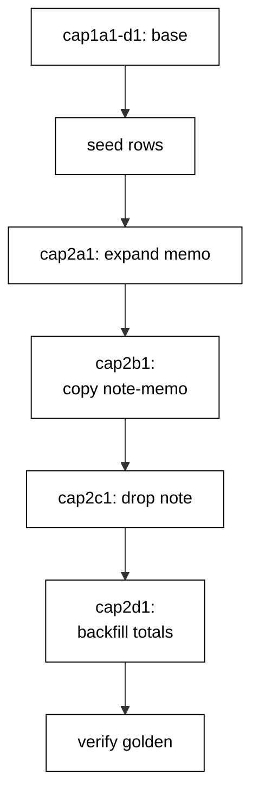

The capstone evolves one order-management schema through eight realistic migrations: a two-table base, a money column with a safe default, a timestamp, a three-step zero-downtime column rename, and a status-driven backfill. Every migration runs for real against the pinned PostgreSQL service, and a golden verification query proves the final schema and data in nine fixed lines the harness asserts byte for byte.

## Why this exists -- the big idea

**The problem before the solution**: course examples prove each migration technique in isolation — one file, one idea, one clean database. Real evolutions stack the techniques: the rename lands while traffic reads the old name, the backfill lands while orders keep arriving, and the history must stay linear through all of it. The capstone wires the layers together so the seams are load-bearing: schema steps, data steps, and verification steps in one chain, with the transcript proving the whole chain ran.

**Keep this if you forget everything else**: evolve the schema and the data on separate schedules, keep every step reversible or explicitly one-way, and verify the ending with a query — not with confidence.

## What you will build

A single `capstone.py` that writes eight revision files at runtime and runs them in order. `cap1a1` creates `cap_customers`; `cap1b1` creates `cap_orders` with a foreign key, a status, and a `note` column; `cap1c1` adds `total_cents` with a server default of zero; `cap1d1` adds a nullable `placed_at`. Then the rename: `cap2a1` expands with a nullable `memo` column, `cap2b1` migrates every note into its memo, `cap2c1` contracts by dropping `note`. Finally `cap2d1` backfills `total_cents` from the status map — 199 for new, 349 for paid, 200 for shipped. Seeds go in after the schema base so the data steps have real rows to work on; the downgrades for data steps say `pass` because fills and copies are one-way by policy.

## How the pieces compose

Schema base (Examples 1-8) creates the tables; the default-carrying column (Example 7) and the nullable add (Example 35) keep the base deployable; the three-step rename (Examples 35-39) moves `note` to `memo` without a flag day; the status backfill (Examples 26-27) fills money after the fact; the receipt checks (Examples 12, 17, 78) verify the ending. No new technique appears here — composition is the test. Read the program top to bottom and name the example each section comes from; if a section has no ancestor, it does not belong.



## Reading the transcript

The nine output lines each prove one stage: the migration count proves all eight files ran; the heads line proves the history stayed linear; the current line proves the database reached the tip; the customer and order counts prove the seeds survived every step; the total proves the backfill math; the memos line proves the rename copied every note; the note-gone line proves the old name retired. Any missing line names its broken stage exactly. Rerun the unit and diff: identical bytes, because fixed revision ids, per-example tables, ordered queries, and label-only output leave no room for variance.

## The pinning note

This tool runs on the course's shared hash-locked dependency set (`learning/code/requirements.lock`): Alembic 1.20.0 drives the migrations, SQLAlchemy 2.1.6 connects and inspects, psycopg 3.3.6 talks to PostgreSQL 18. Every learning and drilling unit shares the same lockfile, so the capstone migrates with exactly the bytes the examples trained on. Pinning is a habit, not a file: the lockfile pins every transitive hash, the toolchain pins the interpreter and the database images by digest, and the version table pins the schema. Declare the floor, pin everything, and review pin diffs like code.

**`learning/capstone/code/capstone.py`**:

```python
# => Capstone: eight migrations evolve an order schema end to end.
import os  # => WHY os: tempdir plus pg vars
import shutil  # => WHY shutil: remove the scratch tree
import tempfile  # => WHY tempfile: isolated script dir
from alembic import command  # => WHY command: upgrades plus history
from alembic.config import Config  # => WHY Config: drive Alembic
from alembic.migration import MigrationContext  # => WHY MigrationContext: read db state
from alembic.script import ScriptDirectory  # => WHY ScriptDirectory: read file history
from sqlalchemy import (
    create_engine,
    inspect as sa_inspect,
    text,
)  # => WHY all: run plus prove


def pg_url():  # => one url builder shared by every connection
    host = os.environ.get("PGHOST", "localhost")  # => WHY env: container link name
    user = os.environ.get("PGUSER", "postgres")  # => WHY trust: no password needed
    return (
        f"postgresql+psycopg://{user}@{host}:5432/postgres"  # => fixed service target
    )


def write_env(sdir):  # => env.py: minimal online-only context
    with open(os.path.join(sdir, "env.py"), "w") as handle:  # => Alembic needs env.py
        handle.write(
            "from alembic import context\n"
        )  # => WHY context: the migration hook
        handle.write(
            "from sqlalchemy import create_engine\n"
        )  # => WHY engine: connect here
        handle.write("import os\n")  # => WHY os: read PGHOST
        handle.write(
            "host = os.environ.get('PGHOST', 'localhost')\n"
        )  # => same service host
        handle.write(
            "user = os.environ.get('PGUSER', 'postgres')\n"
        )  # => same trust user
        handle.write(
            "url = f'postgresql+psycopg://{user}@{host}:5432/postgres'\n"
        )  # => same url
        handle.write("engine = create_engine(url)\n")  # => one engine per env run
        handle.write(
            "with engine.connect() as c:\n"
        )  # => WHY connect: context needs it
        handle.write(
            "    context.configure(connection=c, version_table='cap_version')\n"
        )  # => own receipts
        handle.write(
            "    with context.begin_transaction():\n"
        )  # => each revision transacts
        handle.write("        context.run_migrations()\n")  # => run the selected range


def write_rev(sdir, rev, down, up_body, down_body):  # => one file per migration
    down_repr = (
        "None" if down is None else f"'{down}'"
    )  # => WHY repr: base is bare None
    lines = [  # => file text assembled line by line
        '"""capstone order schema."""\n',  # => docstring first, humans read it
        "\n",  # => blank separates doc from code
        "from alembic import op\n",  # => WHY op: the DDL verbs
        "import sqlalchemy as sa\n",  # => WHY sa: column types
        "\n",  # => blank before metadata
        f"revision = '{rev}'\n",  # => WHY fixed: reruns stay byte-stable
        f"down_revision = {down_repr}\n",  # => WHY link: the chain order lives here
        "\n",  # => blank before functions
        "def upgrade():\n",  # => forward step runs on deploy
        up_body,  # => caller supplies the DDL
        "\n",  # => blank between directions
        "def downgrade():\n",  # => reverse step runs on rollback
        down_body,  # => data fills use pass here
    ]  # => list keeps every line explicit
    name = f"{rev}_order_schema.py"  # => WHY prefix: id sorts the file too
    with open(os.path.join(sdir, name), "w") as handle:  # => write into versions dir
        handle.writelines(lines)  # => one write, full file


def clean(engine):  # => drop leftovers so reruns start empty
    with engine.begin() as conn:  # => WHY txn: drops commit together
        conn.execute(
            text("DROP TABLE IF EXISTS cap_orders")
        )  # => orders first, FK rule
        conn.execute(text("DROP TABLE IF EXISTS cap_customers"))  # => then the parent
        conn.execute(text("DROP TABLE IF EXISTS cap_version"))  # => then the receipts


def main():  # => eight migrations: schema, data, guard, index
    sdir = tempfile.mkdtemp(prefix="capstone-")  # => WHY temp: scratch script dir
    vdir = os.path.join(sdir, "versions")  # => Alembic reads this subdir
    os.makedirs(vdir)  # => create it before writing files
    write_env(sdir)  # => env.py enables command.* calls
    write_rev(
        sdir + "/versions",
        "cap1a1",
        None,  # => first: customers table
        "    op.create_table('cap_customers',\n"  # => parent table first
        "        sa.Column('id', sa.Integer(), primary_key=True),\n"  # => serial key
        "        sa.Column('name', sa.Text(), nullable=False))\n",  # => every customer named
        "    op.drop_table('cap_customers')\n",
    )  # => reverse drops it
    write_rev(
        vdir,
        "cap1b1",
        "cap1a1",  # => second: orders plus FK
        "    op.create_table('cap_orders',\n"  # => child table next
        "        sa.Column('id', sa.Integer(), primary_key=True),\n"  # => serial key
        "        sa.Column('customer_id', sa.Integer(), sa.ForeignKey('cap_customers.id')),\n"  # => the link
        "        sa.Column('status', sa.Text(), nullable=False),\n"  # => workflow state ends the old shape
        "        sa.Column('note', sa.Text(), nullable=True))\n",  # => old name, replaced below
        "    op.drop_table('cap_orders')\n",
    )  # => reverse drops it
    write_rev(
        vdir,
        "cap1c1",
        "cap1b1",  # => third: nullable-safe money column
        "    op.add_column('cap_orders',\n"  # => expand step, traffic-safe
        "        sa.Column('total_cents', sa.Integer(), server_default='0'))\n",  # => default fills rows
        "    op.drop_column('cap_orders', 'total_cents')\n",
    )  # => reverse drops it
    write_rev(
        vdir,
        "cap1d1",
        "cap1c1",  # => fourth: nullable timestamp
        "    op.add_column('cap_orders',\n"  # => nullable lands without a rewrite
        "        sa.Column('placed_at', sa.DateTime(timezone=True), nullable=True))\n",  # => nulls allowed
        "    op.drop_column('cap_orders', 'placed_at')\n",
    )  # => reverse drops it
    write_rev(
        vdir,
        "cap2a1",
        "cap1d1",  # => fifth: expand adds the new name
        "    op.add_column('cap_orders',\n"  # => expand step, traffic-safe
        "        sa.Column('memo', sa.Text(), nullable=True))\n",  # => nullable: both names coexist
        "    op.drop_column('cap_orders', 'memo')\n",
    )  # => reverse drops the newcomer
    write_rev(
        vdir,
        "cap2b1",
        "cap2a1",  # => sixth: migrate copies old values over
        "    op.execute('UPDATE cap_orders SET memo = note')\n",  # => every row keeps its text
        "    pass\n",
    )  # => WHY pass: copies are one-way by policy
    write_rev(
        vdir,
        "cap2c1",
        "cap2b1",  # => seventh: contract drops the old name
        "    op.drop_column('cap_orders', 'note')\n",  # => old code is gone by now
        "    pass\n",
    )  # => WHY pass: drops destroy data by design
    write_rev(
        vdir,
        "cap2d1",
        "cap2c1",  # => eighth: backfill fills the money column
        '    op.execute("UPDATE cap_orders SET total_cents = CASE status "\n'  # => data follows schema
        "               \"WHEN 'new' THEN 199 WHEN 'paid' THEN 349 \"\n"  # => first two tiers
        '               "ELSE 200 END")\n',  # => shipped tier plus fallback
        "    pass\n",
    )  # => WHY pass: fills are one-way by policy
    cfg = Config()  # => WHY Config: no ini file needed
    cfg.set_main_option("script_location", sdir)  # => point at scratch scripts
    cfg.set_main_option("version_table", "cap_version")  # => WHY own: no clashes
    engine = create_engine(pg_url())  # => direct engine for seeds plus checks
    clean(engine)  # => empty stage before the saga
    command.upgrade(cfg, "cap1d1")  # => schema lands first, alone
    with engine.begin() as conn:  # => WHY txn: seeds commit together
        conn.execute(
            text("INSERT INTO cap_customers (name) VALUES ('ada'), ('grace')")
        )  # => two owners
        conn.execute(
            text(
                "INSERT INTO cap_orders (customer_id, status, note) "  # => three orders
                "VALUES (1, 'new', 'fragile'), (1, 'paid', 'gift'), "  # => notes ride along
                "(2, 'shipped', 'rush')"
            )
        )  # => statuses drive totals
    command.upgrade(cfg, "head")  # => backfill, guard, index land after
    script = ScriptDirectory.from_config(cfg)  # => read the file history
    revs = list(script.walk_revisions())  # => every file becomes one node
    with engine.connect() as conn:  # => one connection for all checks
        ctx = MigrationContext.configure(
            conn, opts={"version_table": "cap_version"}
        )  # => read own receipts
        current = ctx.get_current_heads()  # => where the database stands
        customers = conn.execute(
            text("SELECT COUNT(*) FROM cap_customers")
        ).scalar()  # => owner count
        orders = conn.execute(
            text("SELECT COUNT(*) FROM cap_orders")
        ).scalar()  # => order count
        total = conn.execute(
            text("SELECT SUM(total_cents) FROM cap_orders")
        ).scalar()  # => money check
        memos = [
            row[0]
            for row in conn.execute(
                text("SELECT memo FROM cap_orders ORDER BY id")
            ).fetchall()
        ]  # => copy proof
    cols = sorted(
        c["name"] for c in sa_inspect(engine).get_columns("cap_orders")
    )  # => final shape, sorted
    print(f"migrations: {len(revs)}")  # => Output line: eight files ran
    print(f"heads: {len(script.get_heads())}")  # => Output line: history stayed linear
    print(f"current: {current[0]}")  # => Output line: database reached the tip
    print(f"customers: {customers}")  # => Output line: seed owners present
    print(f"orders: {orders}")  # => Output line: seed orders present
    print(f"total: {total}")  # => Output line: backfill math 199+349+200
    print(f"memos: {','.join(memos)}")  # => Output line: rename kept every note
    print(f"note gone: {'note' not in cols}")  # => Output line: old name retired
    print("capstone ok")  # => Output line: saga complete
    shutil.rmtree(sdir, ignore_errors=True)  # => WHY clean: scratch leaves no trace


if __name__ == "__main__":  # => WHY guard: import-safe module
    main()  # => single entry point
```

**Output** (`learning/capstone/code/expected/main.stdout.txt`):

```text
migrations: 8
heads: 1
current: cap2d1
customers: 2
orders: 3
total: 748
memos: fragile,gift,rush
note gone: True
capstone ok
```
