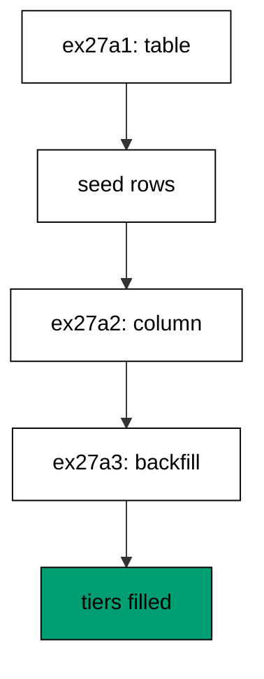
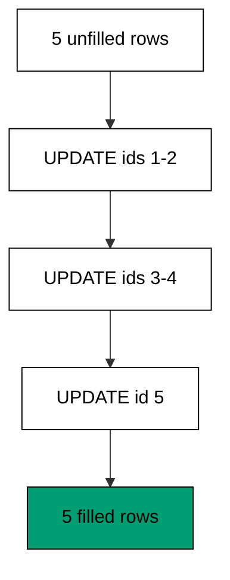
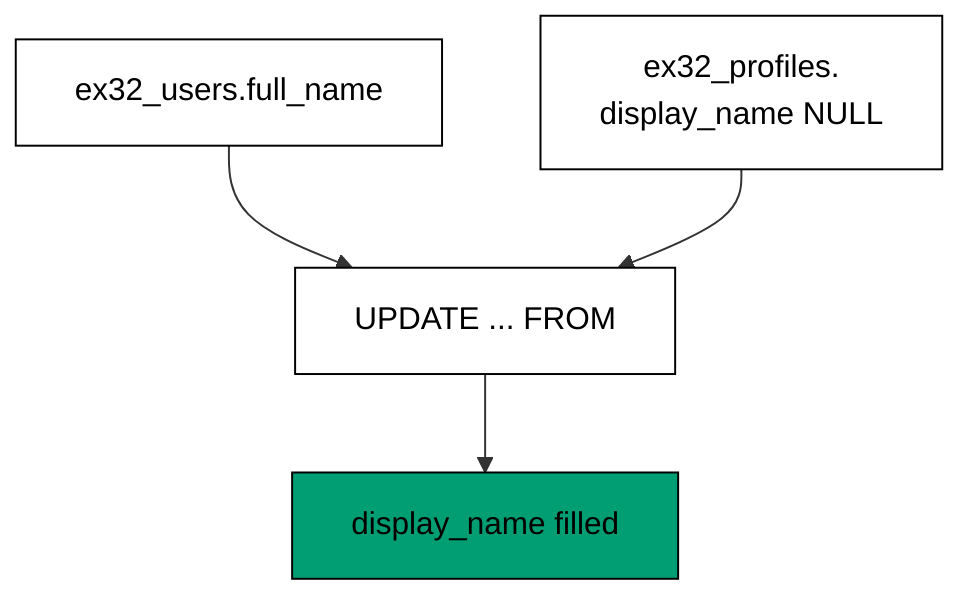
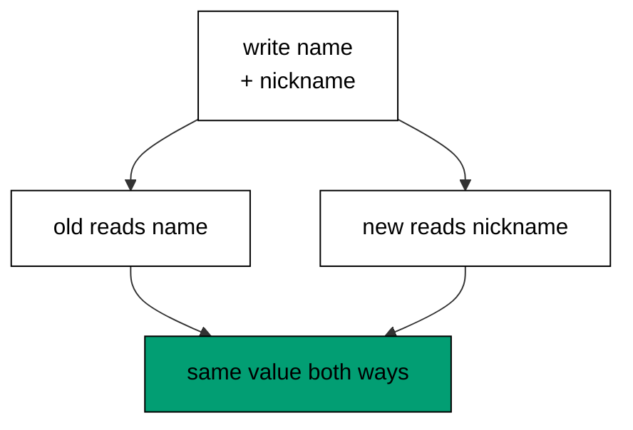
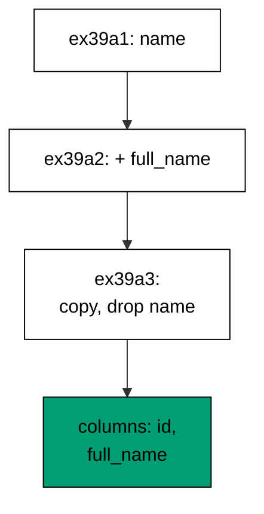
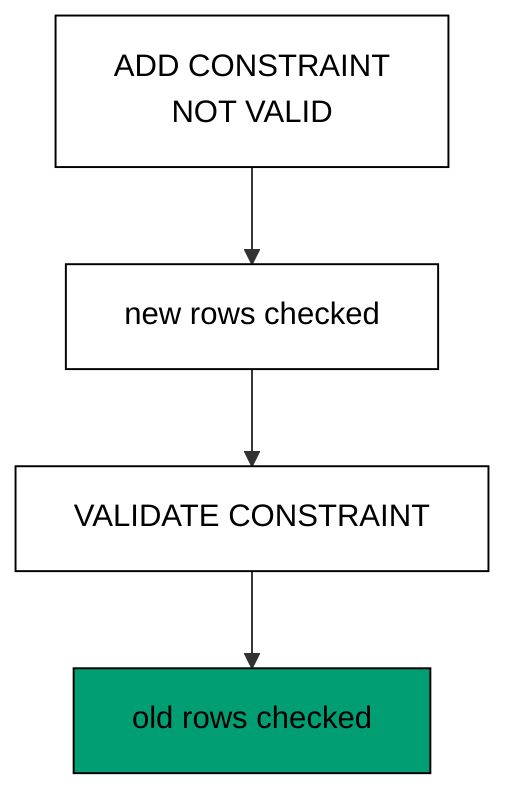
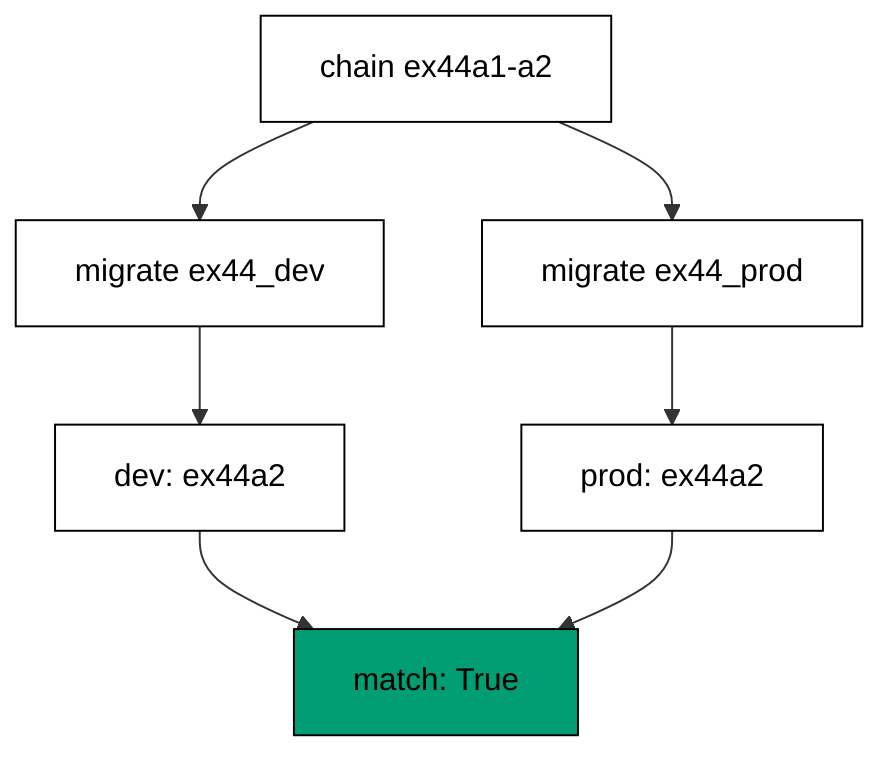
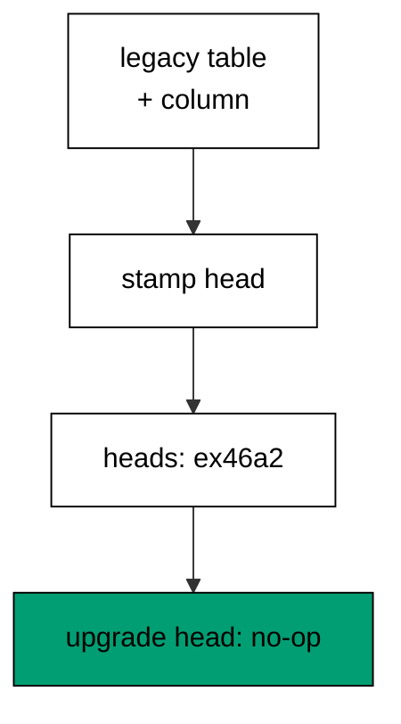
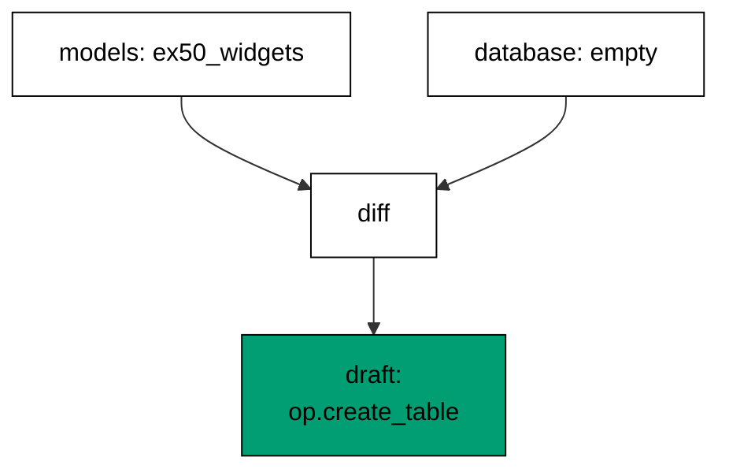

Examples 26-53 move from single-table changes to production realities: filling new columns from old data, splitting breaking changes into zero-downtime steps, and adopting databases that predate their history. Three clusters carry the level: backfills and data migrations (Examples 26-34), zero-downtime migration splitting (Examples 35-44), and baselining an existing database (Examples 45-53). Every program runs against the real pinned PostgreSQL 18 container; every output is a fixed transcript.

### Example 26: Backfill Fills the New Column

New columns usually need old data, and the backfill is the statement that copies it. This example adds a nickname column and fills it from existing names in the same revision, then reads every derived value back. (Concepts: co-06.)

Schema plus fill in one revision works for small tables: the ALTER and the UPDATE share a transaction, so the column never exists empty. The moment the table outgrows a comfortable single statement, the fill moves to its own revision with batching — the next examples show both shapes and when each applies.

**`learning/code/ex-26-backfill-fills-the-new-column/main.py`**:

```python
"""Example 26: a backfill fills the new column from existing data."""

import os  # => os reads the harness database address, never hardcoded
import tempfile  # => tempfile gives each run a private script directory

from alembic import command  # => command runs revisions, like the CLI does
from alembic.config import Config  # => Config points Alembic at the scripts
from sqlalchemy import create_engine, text  # => engine sets up and verifies

# => The database URL comes from the harness, with local-run defaults.
host = os.environ.get("PGHOST", "postgres")  # => service hostname in the unit network
user = os.environ.get("PGUSER", "postgres")  # => trust-auth role, no password needed
database = os.environ.get(
    "PGDATABASE", "postgres"
)  # => fresh database for every unit run
url = f"postgresql+psycopg://{user}@{host}/{database}"  # => psycopg 3 driver URL scheme

# => A scratch script location: env.py plus one versions directory.
# => the scratch path never reaches stdout, so reruns stay byte-stable
scratch = tempfile.mkdtemp(
    prefix="ex26-"
)  # => unique path, never printed, output stays stable
versions = os.path.join(
    scratch, "versions"
)  # => Alembic discovers revisions in this folder
os.makedirs(versions)  # => create the versions directory on disk

# => Minimal online-only env.py: connect and run whatever revisions exist.
env_py = """\
from alembic import context  # => context carries the Config that command.* built
from sqlalchemy import create_engine  # => plain engine is enough, no ORM needed
engine = create_engine(context.config.get_main_option("sqlalchemy.url"))  # => reuse the migration URL
with engine.connect() as connection:  # => one connection runs the whole migration
    context.configure(connection=connection, version_table="ex26_version")  # => per-example history table
    with context.begin_transaction():  # => DDL commits atomically where the database allows
        context.run_migrations()  # => execute every pending revision file in order
"""
with open(
    os.path.join(scratch, "env.py"), "w"
) as handle:  # => env.py sits beside versions/
    handle.write(env_py)  # => write the exact text shown above to disk

# => Two chained revisions: create with rows, then add the column and fill it.
rev1 = '''"""create ex26 widgets."""

revision = "ex26a1"  # => first revision, no parent yet
down_revision = None


def upgrade():  # => forward: build the base table
    from alembic import op  # => op emits DDL inside the migration transaction
    import sqlalchemy as sa  # => column types come from SQLAlchemy Core

    # => every op call below joins one transaction: all of it commits or none of it does
    op.create_table(  # => CREATE TABLE, recorded in history only on success
        "ex26_widgets",  # => per-example table, no cross-example collision
        sa.Column("id", sa.Integer(), primary_key=True),  # => surrogate key column
        sa.Column("name", sa.String(50), nullable=False),  # => the source the backfill reads
    )


def downgrade():  # => reverse: remove the base table
    from alembic import op  # => same op object, opposite direction

    # => downgrade mirrors upgrade in reverse: last created is first dropped
    op.drop_table("ex26_widgets")  # => DROP TABLE undoes exactly the upgrade
'''
with open(
    os.path.join(versions, "ex26a1_create_widgets.py"), "w"
) as handle:  # => filename starts with the id
    handle.write(rev1)  # => first chain link now exists on disk
rev2 = '''"""backfill ex26 widget nicknames."""

revision = "ex26a2"  # => second revision, runs after ex26a1
down_revision = "ex26a1"  # => the parent link that orders the chain


def upgrade():  # => forward: schema change first, data fill second
    from alembic import op  # => op emits DDL inside the migration transaction
    import sqlalchemy as sa  # => column types come from SQLAlchemy Core

    # => the column lands nullable: existing rows get NULL, not a failure
    op.add_column("ex26_widgets", sa.Column("nickname", sa.String(50)))  # => ALTER TABLE ADD COLUMN
    # => the backfill derives every value from data already in the row
    op.execute("UPDATE ex26_widgets SET nickname = UPPER(name)")  # => one statement fills every old row


def downgrade():  # => reverse: drop the column, data and all
    from alembic import op  # => same op object, opposite direction

    # => dropping the column discards its data: downgrades are not free
    op.drop_column("ex26_widgets", "nickname")  # => ALTER TABLE DROP COLUMN
'''
with open(
    os.path.join(versions, "ex26a2_backfill.py"), "w"
) as handle:  # => filename starts with the id
    handle.write(rev2)  # => second chain link now exists on disk

# => Seed rows between the revisions so the backfill has real work to do.
config = Config()  # => bare Config: no alembic.ini needed for script runs
config.set_main_option("script_location", scratch)  # => env.py and versions/ live here
config.set_main_option("sqlalchemy.url", url)  # => the service database URL
engine = create_engine(url)  # => separate engine for setup and verification
with engine.begin() as connection:  # => setup runs in a single transaction
    connection.execute(
        text("DROP TABLE IF EXISTS ex26_widgets")
    )  # => leftovers of a killed run vanish
    connection.execute(
        text("DROP TABLE IF EXISTS ex26_version")
    )  # => stale history vanishes too
command.upgrade(config, "ex26a1")  # => create the table, stop before the backfill
with engine.begin() as connection:  # => seeding runs in a single transaction
    # => lowercase seeds prove the backfill transforms, not just copies
    connection.execute(
        text("INSERT INTO ex26_widgets (name) VALUES ('ada'), ('grace')")
    )
command.upgrade(config, "head")  # => add the column and backfill it in one revision
with engine.connect() as connection:  # => fresh connection sees the committed fill
    rows = connection.execute(  # => read every backfilled nickname in id order
        # => ORDER BY keeps reruns byte-identical even as rows accumulate
        text("SELECT nickname FROM ex26_widgets ORDER BY id")
    ).fetchall()  # => materialize every row before printing
print(
    "nicknames:", ", ".join(row[0] for row in rows)
)  # => Output: nicknames: ADA, GRACE
with engine.begin() as connection:  # => cleanup runs in a single transaction
    connection.execute(
        text("DROP TABLE ex26_widgets")
    )  # => the example leaves no tables behind
    connection.execute(
        text("DROP TABLE ex26_version")
    )  # => and no history table either
print("cleaned: yes")  # => Output: cleaned: yes
```

**Output** (`learning/code/ex-26-backfill-fills-the-new-column/expected/main.stdout.txt`):

```text
nicknames: ADA, GRACE
cleaned: yes
```

**Key takeaway**: Add the column and fill it from existing rows in one step while the table is small enough for a single statement.

**Why it matters**: Empty new columns break application code that expects values. Filling at migration time means the first read after deploy already sees complete data — no follow-up job, no temporary NULL handling in the application.

### Example 27: Schema First, Data Second

When the fill cannot share the schema change's transaction, split them: one revision for DDL, one for data. This example adds the column in one revision, seeds rows between the stops, and backfills in the next. (Concepts: co-06.)

Separate revisions deploy separately, which is the point: the schema change can ship in Monday's window and the backfill in Tuesday's, with the application reading defaults in between. The history records both stops independently, so either can be reasoned about, tested, and if needed reverted on its own.



**`learning/code/ex-27-schema-first-data-second/main.py`**:

```python
"""Example 27: schema first, data second, in two separate revisions."""

import os  # => os reads the harness database address, never hardcoded
import tempfile  # => tempfile gives each run a private script directory

from alembic import command  # => command runs revisions, like the CLI does
from alembic.config import Config  # => Config points Alembic at the scripts
from sqlalchemy import create_engine, text  # => engine sets up and verifies

# => The database URL comes from the harness, with local-run defaults.
host = os.environ.get("PGHOST", "postgres")  # => service hostname in the unit network
user = os.environ.get("PGUSER", "postgres")  # => trust-auth role, no password needed
database = os.environ.get(
    "PGDATABASE", "postgres"
)  # => fresh database for every unit run
url = f"postgresql+psycopg://{user}@{host}/{database}"  # => psycopg 3 driver URL scheme

# => A scratch script location: env.py plus one versions directory.
# => the scratch path never reaches stdout, so reruns stay byte-stable
scratch = tempfile.mkdtemp(
    prefix="ex27-"
)  # => unique path, never printed, output stays stable
versions = os.path.join(
    scratch, "versions"
)  # => Alembic discovers revisions in this folder
os.makedirs(versions)  # => create the versions directory on disk

# => Minimal online-only env.py: connect and run whatever revisions exist.
env_py = """\
from alembic import context  # => context carries the Config that command.* built
from sqlalchemy import create_engine  # => plain engine is enough, no ORM needed
engine = create_engine(context.config.get_main_option("sqlalchemy.url"))  # => reuse the migration URL
with engine.connect() as connection:  # => one connection runs the whole migration
    context.configure(connection=connection, version_table="ex27_version")  # => per-example history table
    with context.begin_transaction():  # => DDL commits atomically where the database allows
        context.run_migrations()  # => execute every pending revision file in order
"""
with open(
    os.path.join(scratch, "env.py"), "w"
) as handle:  # => env.py sits beside versions/
    handle.write(env_py)  # => write the exact text shown above to disk

# => Three chained revisions: table, nullable column, then the data-only fill.
rev1 = '''"""create ex27 widgets."""

revision = "ex27a1"  # => first revision, no parent yet
down_revision = None


def upgrade():  # => forward: build the base table
    from alembic import op  # => op emits DDL inside the migration transaction
    import sqlalchemy as sa  # => column types come from SQLAlchemy Core

    # => every op call below joins one transaction: all of it commits or none of it does
    op.create_table(  # => CREATE TABLE, recorded in history only on success
        "ex27_widgets",  # => per-example table, no cross-example collision
        sa.Column("id", sa.Integer(), primary_key=True),  # => surrogate key column
        sa.Column("name", sa.String(50), nullable=False),  # => the source the backfill reads
    )


def downgrade():  # => reverse: remove the base table
    from alembic import op  # => same op object, opposite direction

    # => downgrade mirrors upgrade in reverse: last created is first dropped
    op.drop_table("ex27_widgets")  # => DROP TABLE undoes exactly the upgrade
'''
with open(
    os.path.join(versions, "ex27a1_create_widgets.py"), "w"
) as handle:  # => filename starts with the id
    handle.write(rev1)  # => first chain link now exists on disk
rev2 = '''"""add ex27 widget nickname column."""

revision = "ex27a2"  # => second revision: schema only, no data touched
down_revision = "ex27a1"  # => the parent link that orders the chain


def upgrade():  # => forward: the nullable column alone, nothing else
    from alembic import op  # => op emits DDL inside the migration transaction
    import sqlalchemy as sa  # => column types come from SQLAlchemy Core

    # => schema-only revisions stay tiny: one column, one statement, one review
    op.add_column("ex27_widgets", sa.Column("nickname", sa.String(50)))  # => ALTER TABLE ADD COLUMN


def downgrade():  # => reverse: drop that same column
    from alembic import op  # => same op object, opposite direction

    # => dropping the column discards its data: downgrades are not free
    op.drop_column("ex27_widgets", "nickname")  # => ALTER TABLE DROP COLUMN
'''
with open(
    os.path.join(versions, "ex27a2_add_column.py"), "w"
) as handle:  # => filename starts with the id
    handle.write(rev2)  # => second chain link now exists on disk
rev3 = '''"""backfill ex27 widget nicknames."""

revision = "ex27a3"  # => third revision: data only, no schema touched
down_revision = "ex27a2"  # => the parent link that orders the chain


def upgrade():  # => forward: fill the column the previous revision added
    from alembic import op  # => op emits DDL inside the migration transaction

    # => data-only revisions hold UPDATEs, never DDL: one job per revision
    op.execute("UPDATE ex27_widgets SET nickname = UPPER(name) WHERE nickname IS NULL")


def downgrade():  # => reverse: data backfills are not reversed
    # => downgrading data would destroy information: this step is one-way by design
    pass
'''
with open(
    os.path.join(versions, "ex27a3_backfill.py"), "w"
) as handle:  # => filename starts with the id
    handle.write(rev3)  # => third chain link now exists on disk

# => Schema, then rows, then data: each stop has exactly one job.
config = Config()  # => bare Config: no alembic.ini needed for script runs
config.set_main_option("script_location", scratch)  # => env.py and versions/ live here
config.set_main_option("sqlalchemy.url", url)  # => the service database URL
engine = create_engine(url)  # => separate engine for setup and verification
with engine.begin() as connection:  # => setup runs in a single transaction
    connection.execute(
        text("DROP TABLE IF EXISTS ex27_widgets")
    )  # => leftovers of a killed run vanish
    connection.execute(
        text("DROP TABLE IF EXISTS ex27_version")
    )  # => stale history vanishes too
command.upgrade(config, "ex27a2")  # => schema stops here: table plus empty column
with engine.begin() as connection:  # => seeding runs in a single transaction
    # => rows arrive after the schema: production data always postdates some revision
    connection.execute(
        text("INSERT INTO ex27_widgets (name) VALUES ('ada'), ('grace')")
    )
# => the data stop fills what the schema stop prepared: order is the technique
command.upgrade(config, "head")  # => data stop: the backfill fills both rows
with engine.connect() as connection:  # => fresh connection sees the committed fill
    rows = connection.execute(  # => read every backfilled nickname in id order
        # => ORDER BY keeps reruns byte-identical even as rows accumulate
        text("SELECT nickname FROM ex27_widgets ORDER BY id")
    ).fetchall()  # => materialize every row before printing
print(
    "nicknames:", ", ".join(row[0] for row in rows)
)  # => Output: nicknames: ADA, GRACE
with engine.begin() as connection:  # => cleanup runs in a single transaction
    connection.execute(
        text("DROP TABLE ex27_widgets")
    )  # => the example leaves no tables behind
    connection.execute(
        text("DROP TABLE ex27_version")
    )  # => and no history table either
print("cleaned: yes")  # => Output: cleaned: yes
```

**Output** (`learning/code/ex-27-schema-first-data-second/expected/main.stdout.txt`):

```text
nicknames: ADA, GRACE
cleaned: yes
```

**Key takeaway**: Ship DDL and data in separate revisions when they need separate deploy windows; stop between them to seed or verify.

**Why it matters**: Big tables make combined revisions slow and risky. Separating the steps lets each run in its own maintenance window with its own rollback plan, instead of coupling a seconds-long DDL to a minutes-long data copy.

### Example 28: Backfill in Batches

One UPDATE over millions of rows holds millions of locks until it commits. This example fills five rows in bands of two, proving every row lands while no statement ever holds more than two row locks. (Concepts: co-06.)



Fixed id bands make the batches deterministic and rerunnable: the `WHERE nickname IS NULL` guard skips already-filled rows, so re-running a batch after a failure only touches what is left. Bands beat LIMIT/OFFSET here because bands do not shift when rows change underneath them — id 3 is id 3 on every run.

**`learning/code/ex-28-backfill-in-batches/main.py`**:

```python
"""Example 28: big backfills run in small batches, not one huge UPDATE."""

import os  # => os reads the harness database address, never hardcoded
import tempfile  # => tempfile gives each run a private script directory

from alembic import command  # => command runs revisions, like the CLI does
from alembic.config import Config  # => Config points Alembic at the scripts
from sqlalchemy import create_engine, text  # => engine sets up and verifies

# => The database URL comes from the harness, with local-run defaults.
host = os.environ.get("PGHOST", "postgres")  # => service hostname in the unit network
user = os.environ.get("PGUSER", "postgres")  # => trust-auth role, no password needed
database = os.environ.get(
    "PGDATABASE", "postgres"
)  # => fresh database for every unit run
url = f"postgresql+psycopg://{user}@{host}/{database}"  # => psycopg 3 driver URL scheme

# => A scratch script location: env.py plus one versions directory.
# => the scratch path never reaches stdout, so reruns stay byte-stable
scratch = tempfile.mkdtemp(
    prefix="ex28-"
)  # => unique path, never printed, output stays stable
versions = os.path.join(
    scratch, "versions"
)  # => Alembic discovers revisions in this folder
os.makedirs(versions)  # => create the versions directory on disk

# => Minimal online-only env.py: connect and run whatever revisions exist.
env_py = """\
from alembic import context  # => context carries the Config that command.* built
from sqlalchemy import create_engine  # => plain engine is enough, no ORM needed
engine = create_engine(context.config.get_main_option("sqlalchemy.url"))  # => reuse the migration URL
with engine.connect() as connection:  # => one connection runs the whole migration
    context.configure(connection=connection, version_table="ex28_version")  # => per-example history table
    with context.begin_transaction():  # => DDL commits atomically where the database allows
        context.run_migrations()  # => execute every pending revision file in order
"""
with open(
    os.path.join(scratch, "env.py"), "w"
) as handle:  # => env.py sits beside versions/
    handle.write(env_py)  # => write the exact text shown above to disk

# => Two chained revisions: create the table, then batch-fill the new column.
rev1 = '''"""create ex28 widgets."""

revision = "ex28a1"  # => first revision, no parent yet
down_revision = None


def upgrade():  # => forward: build the base table
    from alembic import op  # => op emits DDL inside the migration transaction
    import sqlalchemy as sa  # => column types come from SQLAlchemy Core

    # => every op call below joins one transaction: all of it commits or none of it does
    op.create_table(  # => CREATE TABLE, recorded in history only on success
        "ex28_widgets",  # => per-example table, no cross-example collision
        sa.Column("id", sa.Integer(), primary_key=True),  # => surrogate key column
        sa.Column("name", sa.String(50), nullable=False),  # => the source the backfill reads
    )


def downgrade():  # => reverse: remove the base table
    from alembic import op  # => same op object, opposite direction

    # => downgrade mirrors upgrade in reverse: last created is first dropped
    op.drop_table("ex28_widgets")  # => DROP TABLE undoes exactly the upgrade
'''
with open(
    os.path.join(versions, "ex28a1_create_widgets.py"), "w"
) as handle:  # => filename starts with the id
    handle.write(rev1)  # => first chain link now exists on disk
rev2 = '''"""batch-backfill ex28 widget nicknames."""

revision = "ex28a2"  # => second revision, runs after ex28a1
down_revision = "ex28a1"  # => the parent link that orders the chain


def upgrade():  # => forward: column first, then the fill in small batches
    from alembic import op  # => op emits DDL inside the migration transaction
    import sqlalchemy as sa  # => column types come from SQLAlchemy Core

    # => the column lands nullable: existing rows get NULL, not a failure
    op.add_column("ex28_widgets", sa.Column("nickname", sa.String(50)))  # => ALTER TABLE ADD COLUMN
    # => one giant UPDATE locks every row at once: batches of two keep locks tiny
    for low in (1, 3, 5):  # => fixed id bands: deterministic, reviewable, restartable
        op.execute(  # => each UPDATE touches at most two rows, then releases
            f"UPDATE ex28_widgets SET nickname = UPPER(name) "  # => the same fill, band by band
            f"WHERE id >= {low} AND id < {low + 2} AND nickname IS NULL"  # => IS NULL skips already-filled rows
        )


def downgrade():  # => reverse: drop the column, data and all
    from alembic import op  # => same op object, opposite direction

    # => dropping the column discards its data: downgrades are not free
    op.drop_column("ex28_widgets", "nickname")  # => ALTER TABLE DROP COLUMN
'''
with open(
    os.path.join(versions, "ex28a2_backfill.py"), "w"
) as handle:  # => filename starts with the id
    handle.write(rev2)  # => second chain link now exists on disk

# => Five rows, bands of two: three small UPDATEs instead of one big one.
config = Config()  # => bare Config: no alembic.ini needed for script runs
config.set_main_option("script_location", scratch)  # => env.py and versions/ live here
config.set_main_option("sqlalchemy.url", url)  # => the service database URL
engine = create_engine(url)  # => separate engine for setup and verification
with engine.begin() as connection:  # => setup runs in a single transaction
    connection.execute(
        text("DROP TABLE IF EXISTS ex28_widgets")
    )  # => leftovers of a killed run vanish
    connection.execute(
        text("DROP TABLE IF EXISTS ex28_version")
    )  # => stale history vanishes too
command.upgrade(config, "ex28a1")  # => create the table, stop before the backfill
with engine.begin() as connection:  # => seeding runs in a single transaction
    # => ids 1-5 land in three bands: [1,3), [3,5), [5,7)
    # => five rows: enough that one UPDATE would hold five row locks at once
    connection.execute(
        text(
            "INSERT INTO ex28_widgets (name) VALUES "
            + ", ".join(["('w%d')" % i for i in range(5)])
        )
    )
command.upgrade(config, "head")  # => add the column and fill it band by band
with engine.connect() as connection:  # => fresh connection sees the committed fill
    count = connection.execute(  # => every row must carry the derived nickname
        # => a count query keeps the output to one stable number
        text(  # => COUNT(*) FILTER counts only rows matching the condition
            "SELECT COUNT(*) FROM ex28_widgets WHERE nickname = UPPER(name)"
        )
    ).scalar()  # => a single count is all this check needs
    sample = connection.execute(  # => one concrete value proves the transform ran
        text("SELECT nickname FROM ex28_widgets WHERE name = 'w0'")
    ).scalar()  # => exactly one row matches, so scalar is safe
print("backfilled:", count)  # => Output: backfilled: 5
print("sample:", sample)  # => Output: sample: W0
with engine.begin() as connection:  # => cleanup runs in a single transaction
    connection.execute(
        text("DROP TABLE ex28_widgets")
    )  # => the example leaves no tables behind
    connection.execute(
        text("DROP TABLE ex28_version")
    )  # => and no history table either
print("cleaned: yes")  # => Output: cleaned: yes
```

**Output** (`learning/code/ex-28-backfill-in-batches/expected/main.stdout.txt`):

```text
backfilled: 5
sample: W0
cleaned: yes
```

**Key takeaway**: Fill in fixed id bands with a NULL guard per band; reruns skip finished bands and resume where they stopped.

**Why it matters**: A single-statement backfill on a hot table blocks writes for its whole duration and rolls back entirely on any error. Batches bound the lock window to seconds and turn failures into "rerun the remaining bands" instead of "start the hours-long copy over."

### Example 29: Backfill Needs No Downgrade

Derived data cannot be un-derived: once nicknames are filled, no reverse step can restore the previous NULLs meaningfully. This example backfills, steps the history back, and proves the data stays filled while the stamp retreats. (Concepts: co-06.)

The empty downgrade is a deliberate design statement, not laziness: it says "position may move, data may not." Reviewers should read an empty data-downgrade as a promise — the team accepts that this fill is permanent — and the history still retreats normally for every schema step around it.

**`learning/code/ex-29-backfill-needs-no-downgrade/main.py`**:

```python
"""Example 29: data backfills are one-way: the downgrade stays empty."""

import os  # => os reads the harness database address, never hardcoded
import tempfile  # => tempfile gives each run a private script directory

from alembic import command  # => command runs revisions, like the CLI does
from alembic.config import Config  # => Config points Alembic at the scripts
from sqlalchemy import create_engine, text  # => engine sets up and verifies

# => The database URL comes from the harness, with local-run defaults.
host = os.environ.get("PGHOST", "postgres")  # => service hostname in the unit network
user = os.environ.get("PGUSER", "postgres")  # => trust-auth role, no password needed
database = os.environ.get(
    "PGDATABASE", "postgres"
)  # => fresh database for every unit run
url = f"postgresql+psycopg://{user}@{host}/{database}"  # => psycopg 3 driver URL scheme

# => A scratch script location: env.py plus one versions directory.
# => the scratch path never reaches stdout, so reruns stay byte-stable
scratch = tempfile.mkdtemp(
    prefix="ex29-"
)  # => unique path, never printed, output stays stable
versions = os.path.join(
    scratch, "versions"
)  # => Alembic discovers revisions in this folder
os.makedirs(versions)  # => create the versions directory on disk

# => Minimal online-only env.py: connect and run whatever revisions exist.
env_py = """\
from alembic import context  # => context carries the Config that command.* built
from sqlalchemy import create_engine  # => plain engine is enough, no ORM needed
engine = create_engine(context.config.get_main_option("sqlalchemy.url"))  # => reuse the migration URL
with engine.connect() as connection:  # => one connection runs the whole migration
    context.configure(connection=connection, version_table="ex29_version")  # => per-example history table
    with context.begin_transaction():  # => DDL commits atomically where the database allows
        context.run_migrations()  # => execute every pending revision file in order
"""
with open(
    os.path.join(scratch, "env.py"), "w"
) as handle:  # => env.py sits beside versions/
    handle.write(env_py)  # => write the exact text shown above to disk

# => Two chained revisions: create, then a data-only fill with an empty reverse.
rev1 = '''"""create ex29 widgets."""

revision = "ex29a1"  # => first revision, no parent yet
down_revision = None


def upgrade():  # => forward: build the base table
    from alembic import op  # => op emits DDL inside the migration transaction
    import sqlalchemy as sa  # => column types come from SQLAlchemy Core

    # => every op call below joins one transaction: all of it commits or none of it does
    op.create_table(  # => CREATE TABLE, recorded in history only on success
        "ex29_widgets",  # => per-example table, no cross-example collision
        sa.Column("id", sa.Integer(), primary_key=True),  # => surrogate key column
        sa.Column("name", sa.String(50), nullable=False),  # => the source the backfill reads
        sa.Column("nickname", sa.String(50)),  # => the target the backfill fills
    )


def downgrade():  # => reverse: remove the base table
    from alembic import op  # => same op object, opposite direction

    # => downgrade mirrors upgrade in reverse: last created is first dropped
    op.drop_table("ex29_widgets")  # => DROP TABLE undoes exactly the upgrade
'''
with open(
    os.path.join(versions, "ex29a1_create_widgets.py"), "w"
) as handle:  # => filename starts with the id
    handle.write(rev1)  # => first chain link now exists on disk
rev2 = '''"""backfill ex29 widget nicknames, one way."""

revision = "ex29a2"  # => second revision, runs after ex29a1
down_revision = "ex29a1"  # => the parent link that orders the chain


def upgrade():  # => forward: derive every nickname from its row
    from alembic import op  # => op emits DDL inside the migration transaction

    # => data-only revision: one UPDATE, no DDL at all
    op.execute("UPDATE ex29_widgets SET nickname = UPPER(name) WHERE nickname IS NULL")


def downgrade():  # => reverse: deliberately nothing
    # => un-filling derived data would destroy information: one-way by design
    # => the history stamp still retreats: position moves, data stays filled
    pass
'''
with open(
    os.path.join(versions, "ex29a2_backfill.py"), "w"
) as handle:  # => filename starts with the id
    handle.write(rev2)  # => second chain link now exists on disk

# => Fill, then step back: the data stays filled even as history retreats.
config = Config()  # => bare Config: no alembic.ini needed for script runs
config.set_main_option("script_location", scratch)  # => env.py and versions/ live here
config.set_main_option("sqlalchemy.url", url)  # => the service database URL
engine = create_engine(url)  # => separate engine for setup and verification
with engine.begin() as connection:  # => setup runs in a single transaction
    connection.execute(
        text("DROP TABLE IF EXISTS ex29_widgets")
    )  # => leftovers of a killed run vanish
    connection.execute(
        text("DROP TABLE IF EXISTS ex29_version")
    )  # => stale history vanishes too
command.upgrade(config, "ex29a1")  # => create the table, stop before the backfill
with engine.begin() as connection:  # => seeding runs in a single transaction
    # => lowercase seeds prove the backfill transforms, not just copies
    connection.execute(text("INSERT INTO ex29_widgets (name) VALUES ('ada')"))
# => the data revision fills the row: no DDL runs in this stop at all
command.upgrade(config, "head")  # => the backfill fills the one seeded row


def nickname():
    """Read the single backfilled nickname for the assertions below."""
    with engine.connect() as connection:  # => fresh connection sees committed state
        # => exactly one row exists, so scalar is safe and deterministic
        return connection.execute(text("SELECT nickname FROM ex29_widgets")).scalar()


print("after backfill:", nickname())  # => Output: after backfill: ADA
# => the empty reverse keeps the data: only the stamp retreats, not the fill
command.downgrade(
    config, "-1"
)  # => the empty reverse runs: history retreats, data stays
print("after downgrade:", nickname())  # => Output: after downgrade: ADA
with engine.begin() as connection:  # => cleanup runs in a single transaction
    connection.execute(
        text("DROP TABLE ex29_widgets")
    )  # => the example leaves no tables behind
    connection.execute(
        text("DROP TABLE ex29_version")
    )  # => and no history table either
print("cleaned: yes")  # => Output: cleaned: yes
```

**Output** (`learning/code/ex-29-backfill-needs-no-downgrade/expected/main.stdout.txt`):

```text
after backfill: ADA
after downgrade: ADA
cleaned: yes
```

**Key takeaway**: Data fills are one-way by design; write the empty downgrade explicitly and let history retreat while data stays.

**Why it matters**: Pretending data changes reverse cleanly is how teams lose data during rollbacks. Marking the fill permanent forces the rollback plan to account for filled data surviving — usually by making the old code tolerate the new values, which is the correct plan anyway.

### Example 30: Data Fix Inside a Revision

Migrations repair data, not just schemas: a TRIM over messy rows is versioned, reviewed, and deployed like any DDL. This example seeds padded names and trims them all in one revision. (Concepts: co-06.)

Data repairs deserve revisions because they deserve review: a bad UPDATE damages every row it touches, and the pull request is the last place where "every row" gets a second pair of eyes. The WHERE clause is the blast radius — unbounded means the whole table, and the example's missing WHERE is honest only because trimming is idempotent and total by intent.

**`learning/code/ex-30-data-fix-inside-a-revision/main.py`**:

```python
"""Example 30: a revision repairs bad data already in the table."""

import os  # => os reads the harness database address, never hardcoded
import tempfile  # => tempfile gives each run a private script directory

from alembic import command  # => command runs revisions, like the CLI does
from alembic.config import Config  # => Config points Alembic at the scripts
from sqlalchemy import create_engine, text  # => engine sets up and verifies

# => The database URL comes from the harness, with local-run defaults.
host = os.environ.get("PGHOST", "postgres")  # => service hostname in the unit network
user = os.environ.get("PGUSER", "postgres")  # => trust-auth role, no password needed
database = os.environ.get(
    "PGDATABASE", "postgres"
)  # => fresh database for every unit run
url = f"postgresql+psycopg://{user}@{host}/{database}"  # => psycopg 3 driver URL scheme

# => A scratch script location: env.py plus one versions directory.
# => the scratch path never reaches stdout, so reruns stay byte-stable
scratch = tempfile.mkdtemp(
    prefix="ex30-"
)  # => unique path, never printed, output stays stable
versions = os.path.join(
    scratch, "versions"
)  # => Alembic discovers revisions in this folder
os.makedirs(versions)  # => create the versions directory on disk

# => Minimal online-only env.py: connect and run whatever revisions exist.
env_py = """\
from alembic import context  # => context carries the Config that command.* built
from sqlalchemy import create_engine  # => plain engine is enough, no ORM needed
engine = create_engine(context.config.get_main_option("sqlalchemy.url"))  # => reuse the migration URL
with engine.connect() as connection:  # => one connection runs the whole migration
    context.configure(connection=connection, version_table="ex30_version")  # => per-example history table
    with context.begin_transaction():  # => DDL commits atomically where the database allows
        context.run_migrations()  # => execute every pending revision file in order
"""
with open(
    os.path.join(scratch, "env.py"), "w"
) as handle:  # => env.py sits beside versions/
    handle.write(env_py)  # => write the exact text shown above to disk

# => Two chained revisions: create the table, then repair its messy rows.
rev1 = '''"""create ex30 widgets."""

revision = "ex30a1"  # => first revision, no parent yet
down_revision = None


def upgrade():  # => forward: build the base table
    from alembic import op  # => op emits DDL inside the migration transaction
    import sqlalchemy as sa  # => column types come from SQLAlchemy Core

    # => every op call below joins one transaction: all of it commits or none of it does
    op.create_table(  # => CREATE TABLE, recorded in history only on success
        "ex30_widgets",  # => per-example table, no cross-example collision
        sa.Column("id", sa.Integer(), primary_key=True),  # => surrogate key column
        sa.Column("name", sa.String(50), nullable=False),  # => the messy column this story repairs
    )


def downgrade():  # => reverse: remove the base table
    from alembic import op  # => same op object, opposite direction

    # => downgrade mirrors upgrade in reverse: last created is first dropped
    op.drop_table("ex30_widgets")  # => DROP TABLE undoes exactly the upgrade
'''
with open(
    os.path.join(versions, "ex30a1_create_widgets.py"), "w"
) as handle:  # => filename starts with the id
    handle.write(rev1)  # => first chain link now exists on disk
rev2 = '''"""trim ex30 widget names."""

revision = "ex30a2"  # => second revision, runs after ex30a1
down_revision = "ex30a1"  # => the parent link that orders the chain


def upgrade():  # => forward: repair every row already in the table
    from alembic import op  # => op emits DDL inside the migration transaction

    # => data repair is a migration too: versioned, reviewed, and reversible in history
    op.execute("UPDATE ex30_widgets SET name = TRIM(BOTH FROM name)")


def downgrade():  # => reverse: deliberately nothing
    # => trimming already destroyed the spaces: un-trimming cannot restore them
    # => the history stamp still retreats: position moves, data stays repaired
    pass
'''
with open(
    os.path.join(versions, "ex30a2_repair.py"), "w"
) as handle:  # => filename starts with the id
    handle.write(rev2)  # => second chain link now exists on disk

# => Seed messy rows, then let the repair revision clean them.
config = Config()  # => bare Config: no alembic.ini needed for script runs
config.set_main_option("script_location", scratch)  # => env.py and versions/ live here
config.set_main_option("sqlalchemy.url", url)  # => the service database URL
engine = create_engine(url)  # => separate engine for setup and verification
with engine.begin() as connection:  # => setup runs in a single transaction
    connection.execute(
        text("DROP TABLE IF EXISTS ex30_widgets")
    )  # => leftovers of a killed run vanish
    connection.execute(
        text("DROP TABLE IF EXISTS ex30_version")
    )  # => stale history vanishes too
command.upgrade(config, "ex30a1")  # => create the table, stop before the repair
with engine.begin() as connection:  # => seeding runs in a single transaction
    # => padded seeds model the messy production data this revision repairs
    connection.execute(
        text("INSERT INTO ex30_widgets (name) VALUES ('  ada  '), ('grace ')")
    )
command.upgrade(config, "head")  # => the repair trims every seeded row
with engine.connect() as connection:  # => fresh connection sees the repaired rows
    rows = connection.execute(  # => read every repaired name in id order
        # => ORDER BY keeps reruns byte-identical even as rows accumulate
        text("SELECT name FROM ex30_widgets ORDER BY id")
    ).fetchall()  # => materialize every row before printing
print("fixed:", ", ".join(row[0] for row in rows))  # => Output: fixed: ada, grace
with engine.begin() as connection:  # => cleanup runs in a single transaction
    connection.execute(
        text("DROP TABLE ex30_widgets")
    )  # => the example leaves no tables behind
    connection.execute(
        text("DROP TABLE ex30_version")
    )  # => and no history table either
print("cleaned: yes")  # => Output: cleaned: yes
```

**Output** (`learning/code/ex-30-data-fix-inside-a-revision/expected/main.stdout.txt`):

```text
fixed: ada, grace
cleaned: yes
```

**Key takeaway**: Ship data repairs as revisions with the same review bar as DDL; the WHERE clause is the blast radius to check.

**Why it matters**: Ad-hoc UPDATEs on production are unreviewed, untested, and unrepeatable. The same statement inside a revision gets a diff, a test run, and a history entry — the repair becomes repeatable across every environment instead of a one-off typed into a console.

### Example 31: Verify Backfill Counts

A backfill without a check is a hope; with counts it is a test. This example fills four rows and asserts total equals filled before calling the migration done. (Concepts: co-16.)

Total-versus-filled is the cheapest migration test that matters: it catches partial fills, wrong WHERE clauses, and NULL-propagating expressions in one comparison. Real suites run this shape after every data revision — the two counts become the revision's acceptance criteria, checked automatically instead of eyeballed.

**`learning/code/ex-31-verify-backfill-counts/main.py`**:

```python
"""Example 31: verify the backfill with counts before calling it done."""

import os  # => os reads the harness database address, never hardcoded
import tempfile  # => tempfile gives each run a private script directory

from alembic import command  # => command runs revisions, like the CLI does
from alembic.config import Config  # => Config points Alembic at the scripts
from sqlalchemy import create_engine, text  # => engine sets up and verifies

# => The database URL comes from the harness, with local-run defaults.
host = os.environ.get("PGHOST", "postgres")  # => service hostname in the unit network
user = os.environ.get("PGUSER", "postgres")  # => trust-auth role, no password needed
database = os.environ.get(
    "PGDATABASE", "postgres"
)  # => fresh database for every unit run
url = f"postgresql+psycopg://{user}@{host}/{database}"  # => psycopg 3 driver URL scheme

# => A scratch script location: env.py plus one versions directory.
# => the scratch path never reaches stdout, so reruns stay byte-stable
scratch = tempfile.mkdtemp(
    prefix="ex31-"
)  # => unique path, never printed, output stays stable
versions = os.path.join(
    scratch, "versions"
)  # => Alembic discovers revisions in this folder
os.makedirs(versions)  # => create the versions directory on disk

# => Minimal online-only env.py: connect and run whatever revisions exist.
env_py = """\
from alembic import context  # => context carries the Config that command.* built
from sqlalchemy import create_engine  # => plain engine is enough, no ORM needed
engine = create_engine(context.config.get_main_option("sqlalchemy.url"))  # => reuse the migration URL
with engine.connect() as connection:  # => one connection runs the whole migration
    context.configure(connection=connection, version_table="ex31_version")  # => per-example history table
    with context.begin_transaction():  # => DDL commits atomically where the database allows
        context.run_migrations()  # => execute every pending revision file in order
"""
with open(
    os.path.join(scratch, "env.py"), "w"
) as handle:  # => env.py sits beside versions/
    handle.write(env_py)  # => write the exact text shown above to disk

# => Two chained revisions: create with rows, then fill and count the column.
rev1 = '''"""create ex31 widgets."""

revision = "ex31a1"  # => first revision, no parent yet
down_revision = None


def upgrade():  # => forward: build the base table
    from alembic import op  # => op emits DDL inside the migration transaction
    import sqlalchemy as sa  # => column types come from SQLAlchemy Core

    # => every op call below joins one transaction: all of it commits or none of it does
    op.create_table(  # => CREATE TABLE, recorded in history only on success
        "ex31_widgets",  # => per-example table, no cross-example collision
        sa.Column("id", sa.Integer(), primary_key=True),  # => surrogate key column
        sa.Column("name", sa.String(50), nullable=False),  # => the source the backfill reads
    )


def downgrade():  # => reverse: remove the base table
    from alembic import op  # => same op object, opposite direction

    # => downgrade mirrors upgrade in reverse: last created is first dropped
    op.drop_table("ex31_widgets")  # => DROP TABLE undoes exactly the upgrade
'''
with open(
    os.path.join(versions, "ex31a1_create_widgets.py"), "w"
) as handle:  # => filename starts with the id
    handle.write(rev1)  # => first chain link now exists on disk
rev2 = '''"""backfill ex31 widget nicknames."""

revision = "ex31a2"  # => second revision, runs after ex31a1
down_revision = "ex31a1"  # => the parent link that orders the chain


def upgrade():  # => forward: schema change first, data fill second
    from alembic import op  # => op emits DDL inside the migration transaction
    import sqlalchemy as sa  # => column types come from SQLAlchemy Core

    # => the column lands nullable: existing rows get NULL, not a failure
    op.add_column("ex31_widgets", sa.Column("nickname", sa.String(50)))  # => ALTER TABLE ADD COLUMN
    # => the backfill derives every value from data already in the row
    op.execute("UPDATE ex31_widgets SET nickname = UPPER(name) WHERE nickname IS NULL")


def downgrade():  # => reverse: drop the column, data and all
    from alembic import op  # => same op object, opposite direction

    # => dropping the column discards its data: downgrades are not free
    op.drop_column("ex31_widgets", "nickname")  # => ALTER TABLE DROP COLUMN
'''
with open(
    os.path.join(versions, "ex31a2_backfill.py"), "w"
) as handle:  # => filename starts with the id
    handle.write(rev2)  # => second chain link now exists on disk

# => Four rows in, then the migration check: total versus filled.
config = Config()  # => bare Config: no alembic.ini needed for script runs
config.set_main_option("script_location", scratch)  # => env.py and versions/ live here
config.set_main_option("sqlalchemy.url", url)  # => the service database URL
engine = create_engine(url)  # => separate engine for setup and verification
with engine.begin() as connection:  # => setup runs in a single transaction
    connection.execute(
        text("DROP TABLE IF EXISTS ex31_widgets")
    )  # => leftovers of a killed run vanish
    connection.execute(
        text("DROP TABLE IF EXISTS ex31_version")
    )  # => stale history vanishes too
command.upgrade(config, "ex31a1")  # => create the table, stop before the backfill
with engine.begin() as connection:  # => seeding runs in a single transaction
    # => four rows: enough that a partial fill would show in the counts
    connection.execute(
        text(
            "INSERT INTO ex31_widgets (name) VALUES ('ada'), ('grace'), ('linus'), ('ken')"
        )
    )
command.upgrade(config, "head")  # => add the column and fill every row
with engine.connect() as connection:  # => fresh connection sees the committed fill
    total = connection.execute(  # => every row in the table, filled or not
        text(
            "SELECT COUNT(*) FROM ex31_widgets"
        )  # => a count query keeps the output stable
    ).scalar()  # => a single count is all this check needs
    filled = connection.execute(  # => only rows where the backfill landed
        # => IS NOT NULL counts successes: NULLs are the failures to chase
        text("SELECT COUNT(*) FROM ex31_widgets WHERE nickname IS NOT NULL")
    ).scalar()  # => a single count is all this check needs
print("total:", total)  # => Output: total: 4
print("filled:", filled)  # => Output: filled: 4
# => the migration test: equal counts mean complete, anything else pages someone
print("complete:", total == filled)  # => Output: complete: True
with engine.begin() as connection:  # => cleanup runs in a single transaction
    connection.execute(
        text("DROP TABLE ex31_widgets")
    )  # => the example leaves no tables behind
    connection.execute(
        text("DROP TABLE ex31_version")
    )  # => and no history table either
print("cleaned: yes")  # => Output: cleaned: yes
```

**Output** (`learning/code/ex-31-verify-backfill-counts/expected/main.stdout.txt`):

```text
total: 4
filled: 4
complete: True
cleaned: yes
```

**Key takeaway**: Assert filled equals total after every backfill; the two counts are the revision's acceptance test.

**Why it matters**: Silent partial fills are the worst data outcome: the migration reports success, the application reads a mix of filled and empty values, and nobody notices until a customer does. A two-line count check converts that silence into a failure at deploy time.

### Example 32: Backfill from a Join

Backfill sources often live in another table. This example copies canonical names across a user-to-profile join in a single UPDATE...FROM, then reads the copies back. (Concepts: co-06.)



Doing the join inside the database avoids the load-then-write round trip that client-side backfills need: no rows cross the network, no client memory fills up, and the whole copy stays in one statement with one lock scope. The join key is the contract — mismatched keys silently skip rows, which is exactly what the count check from the previous example would catch.

**`learning/code/ex-32-backfill-from-a-join/main.py`**:

```python
"""Example 32: a backfill can join another table for its values."""

import os  # => os reads the harness database address, never hardcoded
import tempfile  # => tempfile gives each run a private script directory

from alembic import command  # => command runs revisions, like the CLI does
from alembic.config import Config  # => Config points Alembic at the scripts
from sqlalchemy import create_engine, text  # => engine sets up and verifies

# => The database URL comes from the harness, with local-run defaults.
host = os.environ.get("PGHOST", "postgres")  # => service hostname in the unit network
user = os.environ.get("PGUSER", "postgres")  # => trust-auth role, no password needed
database = os.environ.get(
    "PGDATABASE", "postgres"
)  # => fresh database for every unit run
url = f"postgresql+psycopg://{user}@{host}/{database}"  # => psycopg 3 driver URL scheme

# => A scratch script location: env.py plus one versions directory.
# => the scratch path never reaches stdout, so reruns stay byte-stable
scratch = tempfile.mkdtemp(
    prefix="ex32-"
)  # => unique path, never printed, output stays stable
versions = os.path.join(
    scratch, "versions"
)  # => Alembic discovers revisions in this folder
os.makedirs(versions)  # => create the versions directory on disk

# => Minimal online-only env.py: connect and run whatever revisions exist.
env_py = """\
from alembic import context  # => context carries the Config that command.* built
from sqlalchemy import create_engine  # => plain engine is enough, no ORM needed
engine = create_engine(context.config.get_main_option("sqlalchemy.url"))  # => reuse the migration URL
with engine.connect() as connection:  # => one connection runs the whole migration
    context.configure(connection=connection, version_table="ex32_version")  # => per-example history table
    with context.begin_transaction():  # => DDL commits atomically where the database allows
        context.run_migrations()  # => execute every pending revision file in order
"""
with open(
    os.path.join(scratch, "env.py"), "w"
) as handle:  # => env.py sits beside versions/
    handle.write(env_py)  # => write the exact text shown above to disk

# => Two chained revisions: two tables, then a join-filled display name.
rev1 = '''"""create ex32 users and profiles."""

revision = "ex32a1"  # => first revision, no parent yet
down_revision = None


def upgrade():  # => forward: build both tables this story joins
    from alembic import op  # => op emits DDL inside the migration transaction
    import sqlalchemy as sa  # => column types come from SQLAlchemy Core

    # => every op call below joins one transaction: all of it commits or none of it does
    op.create_table(  # => the source table: canonical user names live here
        "ex32_users",  # => per-example table, no cross-example collision
        sa.Column("id", sa.Integer(), primary_key=True),  # => the join key both tables share
        sa.Column("full_name", sa.String(100), nullable=False),  # => the value the backfill copies
    )
    # => one id space, two tables: user_id matching users.id is the join contract
    op.create_table(  # => the target table: display_name starts empty
        "ex32_profiles",  # => one profile row per user id
        sa.Column("user_id", sa.Integer(), primary_key=True),  # => matches ex32_users.id by convention
        sa.Column("display_name", sa.String(100)),  # => filled from users by the next revision
    )


def downgrade():  # => reverse: remove both tables this revision built
    from alembic import op  # => same op object, opposite direction

    # => downgrade mirrors upgrade in reverse: last created is first dropped
    op.drop_table("ex32_profiles")  # => target goes first, creation order reversed
    op.drop_table("ex32_users")  # => DROP TABLE undoes exactly the upgrade
'''
with open(
    os.path.join(versions, "ex32a1_create_tables.py"), "w"
) as handle:  # => filename starts with the id
    handle.write(rev1)  # => first chain link now exists on disk
rev2 = '''"""backfill ex32 profile display names."""

revision = "ex32a2"  # => second revision, runs after ex32a1
down_revision = "ex32a1"  # => the parent link that orders the chain


def upgrade():  # => forward: fill display names from the users table
    from alembic import op  # => op emits DDL inside the migration transaction

    # => UPDATE...FROM joins inside one statement: no round trip to the client
    op.execute(  # => every profile inherits its user's canonical name
        "UPDATE ex32_profiles AS p SET display_name = u.full_name "
        "FROM ex32_users AS u WHERE p.user_id = u.id AND p.display_name IS NULL"
    )


def downgrade():  # => reverse: deliberately nothing
    # => un-filling joined data would destroy information: one-way by design
    # => the history stamp still retreats: position moves, data stays filled
    pass
'''
with open(
    os.path.join(versions, "ex32a2_backfill.py"), "w"
) as handle:  # => filename starts with the id
    handle.write(rev2)  # => second chain link now exists on disk

# => Seed both tables, backfill across the join, then read the copies.
config = Config()  # => bare Config: no alembic.ini needed for script runs
config.set_main_option("script_location", scratch)  # => env.py and versions/ live here
config.set_main_option("sqlalchemy.url", url)  # => the service database URL
engine = create_engine(url)  # => separate engine for setup and verification
with engine.begin() as connection:  # => setup runs in a single transaction
    connection.execute(
        text("DROP TABLE IF EXISTS ex32_profiles")
    )  # => target leftovers vanish first
    connection.execute(
        text("DROP TABLE IF EXISTS ex32_users")
    )  # => leftovers of a killed run vanish
    connection.execute(
        text("DROP TABLE IF EXISTS ex32_version")
    )  # => stale history vanishes too
# => tables first: the join backfill needs both sides present
command.upgrade(config, "ex32a1")  # => create both tables, stop before the backfill
with engine.begin() as connection:  # => seeding runs in a single transaction
    # => two users and two empty profiles: the join has real work to do
    connection.execute(
        text(
            "INSERT INTO ex32_users (id, full_name) VALUES (1, 'Ada Lovelace'), (2, 'Grace Hopper')"
        )
    )
    connection.execute(text("INSERT INTO ex32_profiles (user_id) VALUES (1), (2)"))
# => the join copies canonical names into both profiles in one statement
command.upgrade(config, "head")  # => the join fills both display names
with engine.connect() as connection:  # => fresh connection sees the committed fill
    rows = connection.execute(  # => read every copied name in user order
        # => ORDER BY keeps reruns byte-identical even as rows accumulate
        text("SELECT display_name FROM ex32_profiles ORDER BY user_id")
    ).fetchall()  # => materialize every row before printing
print(
    "names:", ", ".join(row[0] for row in rows)
)  # => Output: names: Ada Lovelace, Grace Hopper
with engine.begin() as connection:  # => cleanup runs in a single transaction
    # => drop in reverse creation order: profiles before users, history last
    connection.execute(
        text("DROP TABLE ex32_profiles")
    )  # => target goes first, creation order reversed
    connection.execute(
        text("DROP TABLE ex32_users")
    )  # => the example leaves no tables behind
    connection.execute(
        text("DROP TABLE ex32_version")
    )  # => and no history table either
print("cleaned: yes")  # => Output: cleaned: yes
```

**Output** (`learning/code/ex-32-backfill-from-a-join/expected/main.stdout.txt`):

```text
names: Ada Lovelace, Grace Hopper
cleaned: yes
```

**Key takeaway**: Join inside the UPDATE to copy across tables without round trips; verify with counts since missed joins fail silently.

**Why it matters**: Cross-table copies are where backfills quietly lose rows — a typo in the join key fills nothing and reports success. Server-side joins keep the copy fast, and count verification keeps it honest.

### Example 33: Default, Then Backfill, Then Not Null

Strict columns on live data need three steps: add nullable, fill per-row values no default could express, then constrain. This example walks gold and silver tiers through all three revisions and proves the constraint at the end. (Concepts: co-06.)

The three-step shape is the general answer to "NOT NULL on a table with rows": each step is safe alone, reviewable alone, and deployable alone. Collapsing them works only when one default fits every old row — Example 7's case — and the discipline is knowing which situation you are in before you write the revision.

**`learning/code/ex-33-default-then-backfill-then-not-null/main.py`**:

```python
"""Example 33: default, then backfill, then NOT NULL, in three revisions."""

import os  # => os reads the harness database address, never hardcoded
import tempfile  # => tempfile gives each run a private script directory

from alembic import command  # => command runs revisions, like the CLI does
from alembic.config import Config  # => Config points Alembic at the scripts
from sqlalchemy import create_engine, text  # => engine sets up and verifies

# => The database URL comes from the harness, with local-run defaults.
host = os.environ.get("PGHOST", "postgres")  # => service hostname in the unit network
user = os.environ.get("PGUSER", "postgres")  # => trust-auth role, no password needed
database = os.environ.get(
    "PGDATABASE", "postgres"
)  # => fresh database for every unit run
url = f"postgresql+psycopg://{user}@{host}/{database}"  # => psycopg 3 driver URL scheme

# => A scratch script location: env.py plus one versions directory.
# => the scratch path never reaches stdout, so reruns stay byte-stable
scratch = tempfile.mkdtemp(
    prefix="ex33-"
)  # => unique path, never printed, output stays stable
versions = os.path.join(
    scratch, "versions"
)  # => Alembic discovers revisions in this folder
os.makedirs(versions)  # => create the versions directory on disk

# => Minimal online-only env.py: connect and run whatever revisions exist.
env_py = """\
from alembic import context  # => context carries the Config that command.* built
from sqlalchemy import create_engine  # => plain engine is enough, no ORM needed
engine = create_engine(context.config.get_main_option("sqlalchemy.url"))  # => reuse the migration URL
with engine.connect() as connection:  # => one connection runs the whole migration
    context.configure(connection=connection, version_table="ex33_version")  # => per-example history table
    with context.begin_transaction():  # => DDL commits atomically where the database allows
        context.run_migrations()  # => execute every pending revision file in order
"""
with open(
    os.path.join(scratch, "env.py"), "w"
) as handle:  # => env.py sits beside versions/
    handle.write(env_py)  # => write the exact text shown above to disk

# => Four chained revisions: table, nullable tier, per-row tiers, strict tier.
rev1 = '''"""create ex33 widgets."""

revision = "ex33a1"  # => first revision, no parent yet
down_revision = None


def upgrade():  # => forward: build the base table
    from alembic import op  # => op emits DDL inside the migration transaction
    import sqlalchemy as sa  # => column types come from SQLAlchemy Core

    # => every op call below joins one transaction: all of it commits or none of it does
    op.create_table(  # => CREATE TABLE, recorded in history only on success
        "ex33_widgets",  # => per-example table, no cross-example collision
        sa.Column("id", sa.Integer(), primary_key=True),  # => surrogate key column
        sa.Column("name", sa.String(50), nullable=False),  # => the source the backfill reads
    )


def downgrade():  # => reverse: remove the base table
    from alembic import op  # => same op object, opposite direction

    # => downgrade mirrors upgrade in reverse: last created is first dropped
    op.drop_table("ex33_widgets")  # => DROP TABLE undoes exactly the upgrade
'''
with open(
    os.path.join(versions, "ex33a1_create_widgets.py"), "w"
) as handle:  # => filename starts with the id
    handle.write(rev1)  # => first chain link now exists on disk
rev2 = '''"""add ex33 widget tier column."""

revision = "ex33a2"  # => second revision: schema only, nullable start
down_revision = "ex33a1"  # => the parent link that orders the chain


def upgrade():  # => forward: the nullable column alone, nothing else
    from alembic import op  # => op emits DDL inside the migration transaction
    import sqlalchemy as sa  # => column types come from SQLAlchemy Core

    # => schema-only revisions stay tiny: one column, one statement, one review
    op.add_column("ex33_widgets", sa.Column("tier", sa.String(10)))  # => ALTER TABLE ADD COLUMN


def downgrade():  # => reverse: drop that same column
    from alembic import op  # => same op object, opposite direction

    # => dropping the column discards its data: downgrades are not free
    op.drop_column("ex33_widgets", "tier")  # => ALTER TABLE DROP COLUMN
'''
with open(
    os.path.join(versions, "ex33a2_add_column.py"), "w"
) as handle:  # => filename starts with the id
    handle.write(rev2)  # => second chain link now exists on disk
rev3 = '''"""backfill ex33 widget tiers."""

revision = "ex33a3"  # => third revision: data only, no schema touched
down_revision = "ex33a2"  # => the parent link that orders the chain


def upgrade():  # => forward: per-row values no single default could express
    from alembic import op  # => op emits DDL inside the migration transaction

    # => data-only revisions hold UPDATEs, never DDL: one job per revision
    op.execute("UPDATE ex33_widgets SET tier = 'gold' WHERE id = 1")
    # => the second band gets its own statement: reviewable, rerunnable, clear
    op.execute("UPDATE ex33_widgets SET tier = 'silver' WHERE id = 2")


def downgrade():  # => reverse: deliberately nothing
    # => un-filling derived data would destroy information: one-way by design
    # => the history stamp still retreats: position moves, data stays filled
    pass
'''
with open(
    os.path.join(versions, "ex33a3_backfill.py"), "w"
) as handle:  # => filename starts with the id
    handle.write(rev3)  # => third chain link now exists on disk
rev4 = '''"""require ex33 widget tier."""

revision = "ex33a4"  # => fourth revision: the strict finish
down_revision = "ex33a3"  # => the parent link that orders the chain


def upgrade():  # => forward: NOT NULL is safe only after every row complies
    from alembic import op  # => op emits DDL inside the migration transaction

    # => SET NOT NULL fails on the first NULL: the backfill above prevents that
    op.alter_column("ex33_widgets", "tier", nullable=False)  # => ALTER TABLE ALTER COLUMN SET NOT NULL


def downgrade():  # => reverse: relax the constraint again
    from alembic import op  # => same op object, opposite direction

    # => relaxing keeps every row: downgrades of constraints never lose data
    op.alter_column("ex33_widgets", "tier", nullable=True)  # => ALTER TABLE ALTER COLUMN DROP NOT NULL
'''
with open(
    os.path.join(versions, "ex33a4_require.py"), "w"
) as handle:  # => filename starts with the id
    handle.write(rev4)  # => fourth chain link now exists on disk

# => Schema, rows, data, strictness: each revision does exactly one of them.
config = Config()  # => bare Config: no alembic.ini needed for script runs
config.set_main_option("script_location", scratch)  # => env.py and versions/ live here
config.set_main_option("sqlalchemy.url", url)  # => the service database URL
engine = create_engine(url)  # => separate engine for setup and verification
with engine.begin() as connection:  # => setup runs in a single transaction
    connection.execute(
        text("DROP TABLE IF EXISTS ex33_widgets")
    )  # => leftovers of a killed run vanish
    connection.execute(
        text("DROP TABLE IF EXISTS ex33_version")
    )  # => stale history vanishes too
command.upgrade(config, "ex33a2")  # => schema stops here: table plus empty tier
with engine.begin() as connection:  # => seeding runs in a single transaction
    # => rows arrive after the schema: production data always postdates some revision
    # => gold for id 1, silver for id 2: values no single default could express
    connection.execute(
        text("INSERT INTO ex33_widgets (name) VALUES ('sprocket'), ('gadget')")
    )
# => backfill first, strictness second: the order is the whole technique
command.upgrade(config, "head")  # => backfill, then the strict constraint lands
with engine.connect() as connection:  # => fresh connection sees the strict table
    rows = connection.execute(  # => read every tier in id order
        # => ORDER BY keeps reruns byte-identical even as rows accumulate
        text("SELECT tier FROM ex33_widgets ORDER BY id")
    ).fetchall()  # => materialize every row before printing
    print("tiers:", ", ".join(row[0] for row in rows))  # => Output: tiers: gold, silver
    nullable = connection.execute(  # => the catalog proves the constraint is real
        # => information_schema reports YES or NO per column
        text(  # => ordering by position keeps the printout stable across reruns
            "SELECT is_nullable FROM information_schema.columns "
            "WHERE table_name = 'ex33_widgets' AND column_name = 'tier'"
        )
    ).scalar()  # => exactly one column matches, so scalar is safe
print("nullable:", nullable)  # => Output: nullable: NO
with engine.begin() as connection:  # => cleanup runs in a single transaction
    connection.execute(
        text("DROP TABLE ex33_widgets")
    )  # => the example leaves no tables behind
    connection.execute(
        text("DROP TABLE ex33_version")
    )  # => and no history table either
print("cleaned: yes")  # => Output: cleaned: yes
```

**Output** (`learning/code/ex-33-default-then-backfill-then-not-null/expected/main.stdout.txt`):

```text
tiers: gold, silver
nullable: NO
cleaned: yes
```

**Key takeaway**: Nullable add, per-row backfill, then SET NOT NULL — three revisions that together make strictness safe on live data.

**Why it matters**: Skipping straight to NOT NULL fails on the first old row and blocks the deploy. The three-step path never has a failing state: every intermediate schema accepts every intermediate row, so the migration can pause anywhere.

### Example 34: Split Schema and Data Revisions

One revision, one job: schema files hold DDL, data files hold UPDATEs, never mixed. This example chains a table root, a schema-only column add, and a data-only fill, proving each file does exactly its own work. (Concepts: co-06.)

The split pays off in review and operations: DBAs approve DDL without reading data logic, data owners approve fills without parsing DDL, and either file can be held back independently when its window closes. Mixed revisions force both experts to approve both halves every time — the split respects their time and attention.

**`learning/code/ex-34-split-schema-and-data-revisions/main.py`**:

```python
"""Example 34: schema revisions and data revisions stay in separate files."""

import os  # => os reads the harness database address, never hardcoded
import tempfile  # => tempfile gives each run a private script directory

from alembic import command  # => command runs revisions, like the CLI does
from alembic.config import Config  # => Config points Alembic at the scripts
from alembic.migration import (
    MigrationContext,
)  # => MigrationContext reads history state
from sqlalchemy import create_engine, text  # => engine sets up and verifies

# => The database URL comes from the harness, with local-run defaults.
host = os.environ.get("PGHOST", "postgres")  # => service hostname in the unit network
user = os.environ.get("PGUSER", "postgres")  # => trust-auth role, no password needed
database = os.environ.get(
    "PGDATABASE", "postgres"
)  # => fresh database for every unit run
url = f"postgresql+psycopg://{user}@{host}/{database}"  # => psycopg 3 driver URL scheme

# => A scratch script location: env.py plus one versions directory.
# => the scratch path never reaches stdout, so reruns stay byte-stable
scratch = tempfile.mkdtemp(
    prefix="ex34-"
)  # => unique path, never printed, output stays stable
versions = os.path.join(
    scratch, "versions"
)  # => Alembic discovers revisions in this folder
os.makedirs(versions)  # => create the versions directory on disk

# => Minimal online-only env.py: connect and run whatever revisions exist.
env_py = """\
from alembic import context  # => context carries the Config that command.* built
from sqlalchemy import create_engine  # => plain engine is enough, no ORM needed
engine = create_engine(context.config.get_main_option("sqlalchemy.url"))  # => reuse the migration URL
with engine.connect() as connection:  # => one connection runs the whole migration
    context.configure(connection=connection, version_table="ex34_version")  # => per-example history table
    with context.begin_transaction():  # => DDL commits atomically where the database allows
        context.run_migrations()  # => execute every pending revision file in order
"""
with open(
    os.path.join(scratch, "env.py"), "w"
) as handle:  # => env.py sits beside versions/
    handle.write(env_py)  # => write the exact text shown above to disk

# => Root revision: the base table every later job builds on.
root_rev = '''"""create ex34 widgets."""

revision = "ex34a0"  # => root revision: the base table must exist first
down_revision = None  # => no parent: this is where this history starts


def upgrade():  # => forward: build the base table
    from alembic import op  # => op emits DDL inside the migration transaction
    import sqlalchemy as sa  # => column types come from SQLAlchemy Core

    # => every op call below joins one transaction: all of it commits or none of it does
    op.create_table(  # => CREATE TABLE, recorded in history only on success
        "ex34_widgets",  # => per-example table, no cross-example collision
        sa.Column("id", sa.Integer(), primary_key=True),  # => surrogate key column
        sa.Column("name", sa.String(50), nullable=False),  # => the source the backfill reads
    )


def downgrade():  # => reverse: remove the base table
    from alembic import op  # => same op object, opposite direction

    # => downgrade mirrors upgrade in reverse: last created is first dropped
    op.drop_table("ex34_widgets")  # => DROP TABLE undoes exactly the upgrade
'''
with open(
    os.path.join(versions, "ex34a0_table.py"), "w"
) as handle:  # => filename marks the table job
    handle.write(root_rev)  # => the root revision file now exists on disk
schema_rev = '''"""add ex34 widget nickname column."""

revision = "ex34a1"  # => schema revision: DDL only, never touches a row
down_revision = "ex34a0"  # => the table job runs first, the column job second


def upgrade():  # => forward: the nullable column alone, nothing else
    from alembic import op  # => op emits DDL inside the migration transaction
    import sqlalchemy as sa  # => column types come from SQLAlchemy Core

    # => schema-only revisions stay tiny: one column, one statement, one review
    op.add_column("ex34_widgets", sa.Column("nickname", sa.String(50)))  # => ALTER TABLE ADD COLUMN


def downgrade():  # => reverse: drop that same column
    from alembic import op  # => same op object, opposite direction

    # => dropping the column discards its data: downgrades are not free
    op.drop_column("ex34_widgets", "nickname")  # => ALTER TABLE DROP COLUMN
'''
with open(
    os.path.join(versions, "ex34a1_schema.py"), "w"
) as handle:  # => filename marks the schema job
    handle.write(schema_rev)  # => the schema job file now exists on disk
data_rev = '''"""backfill ex34 widget nicknames."""

revision = "ex34a2"  # => data revision: UPDATEs only, never touches the schema
down_revision = "ex34a1"  # => the parent link that orders the chain


def upgrade():  # => forward: fill the column the schema revision added
    from alembic import op  # => op emits DDL inside the migration transaction

    # => data-only revisions hold UPDATEs, never DDL: one job per revision
    op.execute("UPDATE ex34_widgets SET nickname = UPPER(name) WHERE nickname IS NULL")


def downgrade():  # => reverse: deliberately nothing
    # => un-filling derived data would destroy information: one-way by design
    # => the history stamp still retreats: position moves, data stays filled
    pass
'''
with open(
    os.path.join(versions, "ex34a2_data.py"), "w"
) as handle:  # => filename marks the data job
    handle.write(data_rev)  # => the data job file now exists on disk

# => Root, then schema, then data: each file does exactly one of the three.
config = Config()  # => bare Config: no alembic.ini needed for script runs
config.set_main_option("script_location", scratch)  # => env.py and versions/ live here
config.set_main_option("sqlalchemy.url", url)  # => the service database URL
engine = create_engine(url)  # => separate engine for setup and verification
with engine.begin() as connection:  # => setup runs in a single transaction
    connection.execute(
        text("DROP TABLE IF EXISTS ex34_widgets")
    )  # => leftovers of a killed run vanish
    connection.execute(
        text("DROP TABLE IF EXISTS ex34_version")
    )  # => stale history vanishes too
command.upgrade(config, "ex34a0")  # => root only: the bare table exists
with engine.begin() as connection:  # => seeding runs in a single transaction
    # => rows arrive after the table: production data always postdates some revision
    connection.execute(
        text("INSERT INTO ex34_widgets (name) VALUES ('ada'), ('grace')")
    )
command.upgrade(config, "head")  # => schema job, then data job, in chain order
with engine.connect() as connection:  # => fresh connection sees the finished chain
    context = MigrationContext.configure(  # => read history state from this connection
        connection,
        opts={"version_table": "ex34_version"},  # => per-example history table again
    )
    print("heads:", ", ".join(context.get_current_heads()))  # => Output: heads: ex34a2
    rows = connection.execute(  # => read every backfilled nickname in id order
        # => ORDER BY keeps reruns byte-identical even as rows accumulate
        text("SELECT nickname FROM ex34_widgets ORDER BY id")
    ).fetchall()  # => materialize every row before printing
print(
    "nicknames:", ", ".join(row[0] for row in rows)
)  # => Output: nicknames: ADA, GRACE
with engine.begin() as connection:  # => cleanup runs in a single transaction
    connection.execute(
        text("DROP TABLE ex34_widgets")
    )  # => the example leaves no tables behind
    connection.execute(
        text("DROP TABLE ex34_version")
    )  # => and no history table either
print("cleaned: yes")  # => Output: cleaned: yes
```

**Output** (`learning/code/ex-34-split-schema-and-data-revisions/expected/main.stdout.txt`):

```text
heads: ex34a2
nicknames: ADA, GRACE
cleaned: yes
```

**Key takeaway**: Name schema jobs and data jobs in separate files; each gets its own reviewer, window, and rollback story.

**Why it matters**: Mixed revisions couple unrelated risks — a controversial data fill blocks an urgent schema fix when they share a file. Separated jobs deploy, pause, and revert independently, which is what independent risks deserve.

### Example 35: Expand Adds the Column Safely

Zero-downtime changes start with expand: add the new column beside the old one without disturbing anything. This example adds a nullable nickname next to name and proves the old query still returns its row. (Concepts: co-07.)

Expand is safe by construction: nullable columns change no existing row, and old queries name only old columns, so the schema can grow while every deployed code version keeps running. The new column sits unused until the migrate step fills it — patience between steps is the mechanism, not caution.

**`learning/code/ex-35-expand-add-column-safely/main.py`**:

```python
"""Example 35: expand adds the new column while old reads keep working."""

import os  # => os reads the harness database address, never hardcoded
import tempfile  # => tempfile gives each run a private script directory

from alembic import command  # => command runs revisions, like the CLI does
from alembic.config import Config  # => Config points Alembic at the scripts
from sqlalchemy import create_engine, text  # => engine sets up and verifies

# => The database URL comes from the harness, with local-run defaults.
host = os.environ.get("PGHOST", "postgres")  # => service hostname in the unit network
user = os.environ.get("PGUSER", "postgres")  # => trust-auth role, no password needed
database = os.environ.get(
    "PGDATABASE", "postgres"
)  # => fresh database for every unit run
url = f"postgresql+psycopg://{user}@{host}/{database}"  # => psycopg 3 driver URL scheme

# => A scratch script location: env.py plus one versions directory.
# => the scratch path never reaches stdout, so reruns stay byte-stable
scratch = tempfile.mkdtemp(
    prefix="ex35-"
)  # => unique path, never printed, output stays stable
versions = os.path.join(
    scratch, "versions"
)  # => Alembic discovers revisions in this folder
os.makedirs(versions)  # => create the versions directory on disk

# => Minimal online-only env.py: connect and run whatever revisions exist.
env_py = """\
from alembic import context  # => context carries the Config that command.* built
from sqlalchemy import create_engine  # => plain engine is enough, no ORM needed
engine = create_engine(context.config.get_main_option("sqlalchemy.url"))  # => reuse the migration URL
with engine.connect() as connection:  # => one connection runs the whole migration
    context.configure(connection=connection, version_table="ex35_version")  # => per-example history table
    with context.begin_transaction():  # => DDL commits atomically where the database allows
        context.run_migrations()  # => execute every pending revision file in order
"""
with open(
    os.path.join(scratch, "env.py"), "w"
) as handle:  # => env.py sits beside versions/
    handle.write(env_py)  # => write the exact text shown above to disk

# => Two chained revisions: the table, then the expand step that adds a column.
rev1 = '''"""create ex35 widgets."""

revision = "ex35a1"  # => first revision, no parent yet
down_revision = None


def upgrade():  # => forward: build the base table
    from alembic import op  # => op emits DDL inside the migration transaction
    import sqlalchemy as sa  # => column types come from SQLAlchemy Core

    # => every op call below joins one transaction: all of it commits or none of it does
    op.create_table(  # => CREATE TABLE, recorded in history only on success
        "ex35_widgets",  # => per-example table, no cross-example collision
        sa.Column("id", sa.Integer(), primary_key=True),  # => surrogate key column
        sa.Column("name", sa.String(50), nullable=False),  # => the old column old code reads
    )


def downgrade():  # => reverse: remove the base table
    from alembic import op  # => same op object, opposite direction

    # => downgrade mirrors upgrade in reverse: last created is first dropped
    op.drop_table("ex35_widgets")  # => DROP TABLE undoes exactly the upgrade
'''
with open(
    os.path.join(versions, "ex35a1_create_widgets.py"), "w"
) as handle:  # => filename starts with the id
    handle.write(rev1)  # => first chain link now exists on disk
rev2 = '''"""expand ex35 with nickname."""

revision = "ex35a2"  # => second revision: the expand step of expand-migrate-contract
down_revision = "ex35a1"  # => the parent link that orders the chain


def upgrade():  # => forward: add the replacement column, nullable and unused
    from alembic import op  # => op emits DDL inside the migration transaction
    import sqlalchemy as sa  # => column types come from SQLAlchemy Core

    # => expand adds without breaking: nullable means old writes keep working
    op.add_column("ex35_widgets", sa.Column("nickname", sa.String(50)))  # => ALTER TABLE ADD COLUMN


def downgrade():  # => reverse: drop the replacement column
    from alembic import op  # => same op object, opposite direction

    # => dropping the column discards its data: downgrades are not free
    op.drop_column("ex35_widgets", "nickname")  # => ALTER TABLE DROP COLUMN
'''
with open(
    os.path.join(versions, "ex35a2_expand.py"), "w"
) as handle:  # => filename starts with the id
    handle.write(rev2)  # => second chain link now exists on disk

# => Old code reads id and name only: the new column must not disturb it.
config = Config()  # => bare Config: no alembic.ini needed for script runs
config.set_main_option("script_location", scratch)  # => env.py and versions/ live here
config.set_main_option("sqlalchemy.url", url)  # => the service database URL
engine = create_engine(url)  # => separate engine for setup and verification
with engine.begin() as connection:  # => setup runs in a single transaction
    connection.execute(
        text("DROP TABLE IF EXISTS ex35_widgets")
    )  # => leftovers of a killed run vanish
    connection.execute(
        text("DROP TABLE IF EXISTS ex35_version")
    )  # => stale history vanishes too
command.upgrade(config, "ex35a1")  # => the old schema: what the old code was built for
with engine.begin() as connection:  # => seeding runs in a single transaction
    # => one row under the old schema: the old code's whole world
    connection.execute(text("INSERT INTO ex35_widgets (name) VALUES ('sprocket')"))
# => expand lands beside old columns: nothing existing moves or renames
command.upgrade(config, "head")  # => expand: the new column lands beside the old one
with engine.connect() as connection:  # => fresh connection plays the old application
    old_rows = connection.execute(  # => the old query names only the old columns
        # => old code never mentions nickname: the query text is frozen in time
        text("SELECT id, name FROM ex35_widgets ORDER BY id")
    ).fetchall()  # => materialize every row before printing
    print("old query rows:", len(old_rows))  # => Output: old query rows: 1
    print("old query name:", old_rows[0][1])  # => Output: old query name: sprocket
    columns = connection.execute(  # => the new column is there for the new code
        # => information_schema is portable: no PostgreSQL-only catalog tables here
        text(  # => ordering by position keeps the printout stable across reruns
            "SELECT column_name FROM information_schema.columns "
            "WHERE table_name = 'ex35_widgets' ORDER BY ordinal_position"
        )
    ).fetchall()  # => materialize every row before printing
print(
    "columns:", ", ".join(row[0] for row in columns)
)  # => Output: columns: id, name, nickname
with engine.begin() as connection:  # => cleanup runs in a single transaction
    connection.execute(
        text("DROP TABLE ex35_widgets")
    )  # => the example leaves no tables behind
    connection.execute(
        text("DROP TABLE ex35_version")
    )  # => and no history table either
print("cleaned: yes")  # => Output: cleaned: yes
```

**Output** (`learning/code/ex-35-expand-add-column-safely/expected/main.stdout.txt`):

```text
old query rows: 1
old query name: sprocket
columns: id, name, nickname
cleaned: yes
```

**Key takeaway**: Expand adds nullable columns beside live ones; old queries keep working because they never mention the new column.

**Why it matters**: The alternative — renaming in place — breaks every reader at once. Expand keeps every deployed version functional while the migration proceeds, which is what "zero downtime" actually means at the schema level.

### Example 36: Dual Write Window

Between expand and migrate, new code writes both columns so neither version reads stale data. This example writes to name and nickname together and proves both read back identically. (Concepts: co-07.)



Dual writes are temporary by design: they exist only while old and new code versions run side by side, and the contract step deletes them. The equality check is the exit criterion — when both columns agree everywhere, the migration can proceed to reads; while they disagree, it must wait.

**`learning/code/ex-36-dual-write-window/main.py`**:

```python
"""Example 36: dual writes keep old and new columns identical."""

import os  # => os reads the harness database address, never hardcoded
import tempfile  # => tempfile gives each run a private script directory

from alembic import command  # => command runs revisions, like the CLI does
from alembic.config import Config  # => Config points Alembic at the scripts
from sqlalchemy import create_engine, text  # => engine sets up and verifies

# => The database URL comes from the harness, with local-run defaults.
host = os.environ.get("PGHOST", "postgres")  # => service hostname in the unit network
user = os.environ.get("PGUSER", "postgres")  # => trust-auth role, no password needed
database = os.environ.get(
    "PGDATABASE", "postgres"
)  # => fresh database for every unit run
url = f"postgresql+psycopg://{user}@{host}/{database}"  # => psycopg 3 driver URL scheme

# => A scratch script location: env.py plus one versions directory.
# => the scratch path never reaches stdout, so reruns stay byte-stable
scratch = tempfile.mkdtemp(
    prefix="ex36-"
)  # => unique path, never printed, output stays stable
versions = os.path.join(
    scratch, "versions"
)  # => Alembic discovers revisions in this folder
os.makedirs(versions)  # => create the versions directory on disk

# => Minimal online-only env.py: connect and run whatever revisions exist.
env_py = """\
from alembic import context  # => context carries the Config that command.* built
from sqlalchemy import create_engine  # => plain engine is enough, no ORM needed
engine = create_engine(context.config.get_main_option("sqlalchemy.url"))  # => reuse the migration URL
with engine.connect() as connection:  # => one connection runs the whole migration
    context.configure(connection=connection, version_table="ex36_version")  # => per-example history table
    with context.begin_transaction():  # => DDL commits atomically where the database allows
        context.run_migrations()  # => execute every pending revision file in order
"""
with open(
    os.path.join(scratch, "env.py"), "w"
) as handle:  # => env.py sits beside versions/
    handle.write(env_py)  # => write the exact text shown above to disk

# => Two chained revisions: the old column, then its replacement beside it.
rev1 = '''"""create ex36 widgets."""

revision = "ex36a1"  # => first revision, no parent yet
down_revision = None


def upgrade():  # => forward: build the base table
    from alembic import op  # => op emits DDL inside the migration transaction
    import sqlalchemy as sa  # => column types come from SQLAlchemy Core

    # => every op call below joins one transaction: all of it commits or none of it does
    op.create_table(  # => CREATE TABLE, recorded in history only on success
        "ex36_widgets",  # => per-example table, no cross-example collision
        sa.Column("id", sa.Integer(), primary_key=True),  # => surrogate key column
        sa.Column("name", sa.String(50), nullable=False),  # => the old column old code writes
    )


def downgrade():  # => reverse: remove the base table
    from alembic import op  # => same op object, opposite direction

    # => downgrade mirrors upgrade in reverse: last created is first dropped
    op.drop_table("ex36_widgets")  # => DROP TABLE undoes exactly the upgrade
'''
with open(
    os.path.join(versions, "ex36a1_create_widgets.py"), "w"
) as handle:  # => filename starts with the id
    handle.write(rev1)  # => first chain link now exists on disk
rev2 = '''"""expand ex36 with nickname."""

revision = "ex36a2"  # => second revision: the expand step of expand-migrate-contract
down_revision = "ex36a1"  # => the parent link that orders the chain


def upgrade():  # => forward: add the replacement column, nullable and unused
    from alembic import op  # => op emits DDL inside the migration transaction
    import sqlalchemy as sa  # => column types come from SQLAlchemy Core

    # => expand adds without breaking: nullable means old writes keep working
    op.add_column("ex36_widgets", sa.Column("nickname", sa.String(50)))  # => ALTER TABLE ADD COLUMN


def downgrade():  # => reverse: drop the replacement column
    from alembic import op  # => same op object, opposite direction

    # => dropping the column discards its data: downgrades are not free
    op.drop_column("ex36_widgets", "nickname")  # => ALTER TABLE DROP COLUMN
'''
with open(
    os.path.join(versions, "ex36a2_expand.py"), "w"
) as handle:  # => filename starts with the id
    handle.write(rev2)  # => second chain link now exists on disk

# => New code writes both columns; either column must read the same value.
config = Config()  # => bare Config: no alembic.ini needed for script runs
config.set_main_option("script_location", scratch)  # => env.py and versions/ live here
config.set_main_option("sqlalchemy.url", url)  # => the service database URL
engine = create_engine(url)  # => separate engine for setup and verification
with engine.begin() as connection:  # => setup runs in a single transaction
    connection.execute(
        text("DROP TABLE IF EXISTS ex36_widgets")
    )  # => leftovers of a killed run vanish
    connection.execute(
        text("DROP TABLE IF EXISTS ex36_version")
    )  # => stale history vanishes too
command.upgrade(config, "head")  # => both columns exist from here on
with engine.begin() as connection:  # => the dual-write window runs in one transaction
    # => dual writes keep the columns identical while both code versions run
    connection.execute(
        text(
            "INSERT INTO ex36_widgets (name, nickname) VALUES ('sprocket', 'sprocket')"
        )
    )
with engine.connect() as connection:  # => fresh connection reads each column separately
    old = connection.execute(  # => what the old code version reads
        text("SELECT name FROM ex36_widgets")
    ).scalar()  # => exactly one row exists, so scalar is safe
    new = connection.execute(  # => what the new code version reads
        text("SELECT nickname FROM ex36_widgets")
    ).scalar()  # => exactly one row exists, so scalar is safe
print("old:", old)  # => Output: old: sprocket
print("new:", new)  # => Output: new: sprocket
# => identical columns mean either code version serves correct data mid-migration
print("match:", old == new)  # => Output: match: True
with engine.begin() as connection:  # => cleanup runs in a single transaction
    connection.execute(
        text("DROP TABLE ex36_widgets")
    )  # => the example leaves no tables behind
    connection.execute(
        text("DROP TABLE ex36_version")
    )  # => and no history table either
print("cleaned: yes")  # => Output: cleaned: yes
```

**Output** (`learning/code/ex-36-dual-write-window/expected/main.stdout.txt`):

```text
old: sprocket
new: sprocket
match: True
cleaned: yes
```

**Key takeaway**: Write both columns during transition; proceed only when every read agrees across the two.

**Why it matters**: Mixed-version fleets read different columns for the same logical value. Dual writes are the only way both answers stay correct during the rollout — without them, half the fleet serves stale data and nobody can tell which half.

### Example 37: Migrate Reads to the New Column

Migrate copies old values into the new column and switches reads over. This example fills nicknames from names, then reads only the new column to prove the switch works. (Concepts: co-07.)

The read switch is a code deploy, not a migration: it happens between the migrate revision and the contract revision, while both columns hold identical values. That ordering is load-bearing — switching reads before the fill completes serves NULLs, and the example's fill-first sequence is the rule, not a suggestion.

**`learning/code/ex-37-migrate-reads-to-the-new-column/main.py`**:

```python
"""Example 37: migrate reads to the new column after backfilling it."""

import os  # => os reads the harness database address, never hardcoded
import tempfile  # => tempfile gives each run a private script directory

from alembic import command  # => command runs revisions, like the CLI does
from alembic.config import Config  # => Config points Alembic at the scripts
from sqlalchemy import create_engine, text  # => engine sets up and verifies

# => The database URL comes from the harness, with local-run defaults.
host = os.environ.get("PGHOST", "postgres")  # => service hostname in the unit network
user = os.environ.get("PGUSER", "postgres")  # => trust-auth role, no password needed
database = os.environ.get(
    "PGDATABASE", "postgres"
)  # => fresh database for every unit run
url = f"postgresql+psycopg://{user}@{host}/{database}"  # => psycopg 3 driver URL scheme

# => A scratch script location: env.py plus one versions directory.
# => the scratch path never reaches stdout, so reruns stay byte-stable
scratch = tempfile.mkdtemp(
    prefix="ex37-"
)  # => unique path, never printed, output stays stable
versions = os.path.join(
    scratch, "versions"
)  # => Alembic discovers revisions in this folder
os.makedirs(versions)  # => create the versions directory on disk

# => Minimal online-only env.py: connect and run whatever revisions exist.
env_py = """\
from alembic import context  # => context carries the Config that command.* built
from sqlalchemy import create_engine  # => plain engine is enough, no ORM needed
engine = create_engine(context.config.get_main_option("sqlalchemy.url"))  # => reuse the migration URL
with engine.connect() as connection:  # => one connection runs the whole migration
    context.configure(connection=connection, version_table="ex37_version")  # => per-example history table
    with context.begin_transaction():  # => DDL commits atomically where the database allows
        context.run_migrations()  # => execute every pending revision file in order
"""
with open(
    os.path.join(scratch, "env.py"), "w"
) as handle:  # => env.py sits beside versions/
    handle.write(env_py)  # => write the exact text shown above to disk

# => Three chained revisions: table, expand, then the migrate fill.
rev1 = '''"""create ex37 widgets."""

revision = "ex37a1"  # => first revision, no parent yet
down_revision = None


def upgrade():  # => forward: build the base table
    from alembic import op  # => op emits DDL inside the migration transaction
    import sqlalchemy as sa  # => column types come from SQLAlchemy Core

    # => every op call below joins one transaction: all of it commits or none of it does
    op.create_table(  # => CREATE TABLE, recorded in history only on success
        "ex37_widgets",  # => per-example table, no cross-example collision
        sa.Column("id", sa.Integer(), primary_key=True),  # => surrogate key column
        sa.Column("name", sa.String(50), nullable=False),  # => the old column old code reads
    )


def downgrade():  # => reverse: remove the base table
    from alembic import op  # => same op object, opposite direction

    # => downgrade mirrors upgrade in reverse: last created is first dropped
    op.drop_table("ex37_widgets")  # => DROP TABLE undoes exactly the upgrade
'''
with open(
    os.path.join(versions, "ex37a1_create_widgets.py"), "w"
) as handle:  # => filename starts with the id
    handle.write(rev1)  # => first chain link now exists on disk
rev2 = '''"""expand ex37 with nickname."""

revision = "ex37a2"  # => second revision: the expand step of expand-migrate-contract
down_revision = "ex37a1"  # => the parent link that orders the chain


def upgrade():  # => forward: add the replacement column, nullable and unused
    from alembic import op  # => op emits DDL inside the migration transaction
    import sqlalchemy as sa  # => column types come from SQLAlchemy Core

    # => expand adds without breaking: nullable means old writes keep working
    op.add_column("ex37_widgets", sa.Column("nickname", sa.String(50)))  # => ALTER TABLE ADD COLUMN


def downgrade():  # => reverse: drop the replacement column
    from alembic import op  # => same op object, opposite direction

    # => dropping the column discards its data: downgrades are not free
    op.drop_column("ex37_widgets", "nickname")  # => ALTER TABLE DROP COLUMN
'''
with open(
    os.path.join(versions, "ex37a2_expand.py"), "w"
) as handle:  # => filename starts with the id
    handle.write(rev2)  # => second chain link now exists on disk
rev3 = '''"""migrate ex37 reads to nickname."""

revision = "ex37a3"  # => third revision: the migrate step, data only
down_revision = "ex37a2"  # => the parent link that orders the chain


def upgrade():  # => forward: copy every old value into the new column
    from alembic import op  # => op emits DDL inside the migration transaction

    # => migrate copies old to new: after this, reads may switch columns safely
    op.execute("UPDATE ex37_widgets SET nickname = name WHERE nickname IS NULL")


def downgrade():  # => reverse: deliberately nothing
    # => un-copying would destroy information: one-way by design
    # => the history stamp still retreats: position moves, data stays copied
    pass
'''
with open(
    os.path.join(versions, "ex37a3_migrate.py"), "w"
) as handle:  # => filename starts with the id
    handle.write(rev3)  # => third chain link now exists on disk

# => Backfill old rows, migrate them, then read only the new column.
config = Config()  # => bare Config: no alembic.ini needed for script runs
config.set_main_option("script_location", scratch)  # => env.py and versions/ live here
config.set_main_option("sqlalchemy.url", url)  # => the service database URL
engine = create_engine(url)  # => separate engine for setup and verification
with engine.begin() as connection:  # => setup runs in a single transaction
    connection.execute(
        text("DROP TABLE IF EXISTS ex37_widgets")
    )  # => leftovers of a killed run vanish
    connection.execute(
        text("DROP TABLE IF EXISTS ex37_version")
    )  # => stale history vanishes too
command.upgrade(config, "ex37a1")  # => the old schema: what the old code was built for
with engine.begin() as connection:  # => seeding runs in a single transaction
    # => rows written by the old code: only the old column carries values
    connection.execute(
        text("INSERT INTO ex37_widgets (name) VALUES ('sprocket'), ('gadget')")
    )
command.upgrade(config, "head")  # => expand, then the migrate fill copies values over
with engine.connect() as connection:  # => fresh connection plays the new code version
    rows = connection.execute(  # => the new query names only the new column
        # => old code is gone from this query: nickname is the only source read
        text("SELECT nickname FROM ex37_widgets ORDER BY id")
    ).fetchall()  # => materialize every row before printing
print("reads:", ", ".join(row[0] for row in rows))  # => Output: reads: sprocket, gadget
with engine.begin() as connection:  # => cleanup runs in a single transaction
    connection.execute(
        text("DROP TABLE ex37_widgets")
    )  # => the example leaves no tables behind
    connection.execute(
        text("DROP TABLE ex37_version")
    )  # => and no history table either
print("cleaned: yes")  # => Output: cleaned: yes
```

**Output** (`learning/code/ex-37-migrate-reads-to-the-new-column/expected/main.stdout.txt`):

```text
reads: sprocket, gadget
cleaned: yes
```

**Key takeaway**: Fill first, switch reads second; the code deploy lands between revisions while both columns agree.

**Why it matters**: Read switches are the riskiest moment of a rename — the instant the application trusts the new column. Doing it while the old column still holds the same values means any problem can be fixed by switching back, with no data recovery involved.

### Example 38: Contract Drops the Old Column

Contract removes the old column once nothing reads it. This example drops name after the migrate step and proves the nickname column kept every value. (Concepts: co-07.)

Contract is the point of no return: dropping the column destroys the fallback, so it runs only after reads moved and dual writes stopped. The downgrade brings the column back empty — honest about what reversal means here — which is why contract steps get extra review attention and off-peak windows.

**`learning/code/ex-38-contract-drops-the-old-column/main.py`**:

```python
"""Example 38: contract drops the old column after reads moved over."""

import os  # => os reads the harness database address, never hardcoded
import tempfile  # => tempfile gives each run a private script directory

from alembic import command  # => command runs revisions, like the CLI does
from alembic.config import Config  # => Config points Alembic at the scripts
from sqlalchemy import create_engine, text  # => engine sets up and verifies

# => The database URL comes from the harness, with local-run defaults.
host = os.environ.get("PGHOST", "postgres")  # => service hostname in the unit network
user = os.environ.get("PGUSER", "postgres")  # => trust-auth role, no password needed
database = os.environ.get(
    "PGDATABASE", "postgres"
)  # => fresh database for every unit run
url = f"postgresql+psycopg://{user}@{host}/{database}"  # => psycopg 3 driver URL scheme

# => A scratch script location: env.py plus one versions directory.
# => the scratch path never reaches stdout, so reruns stay byte-stable
scratch = tempfile.mkdtemp(
    prefix="ex38-"
)  # => unique path, never printed, output stays stable
versions = os.path.join(
    scratch, "versions"
)  # => Alembic discovers revisions in this folder
os.makedirs(versions)  # => create the versions directory on disk

# => Minimal online-only env.py: connect and run whatever revisions exist.
env_py = """\
from alembic import context  # => context carries the Config that command.* built
from sqlalchemy import create_engine  # => plain engine is enough, no ORM needed
engine = create_engine(context.config.get_main_option("sqlalchemy.url"))  # => reuse the migration URL
with engine.connect() as connection:  # => one connection runs the whole migration
    context.configure(connection=connection, version_table="ex38_version")  # => per-example history table
    with context.begin_transaction():  # => DDL commits atomically where the database allows
        context.run_migrations()  # => execute every pending revision file in order
"""
with open(
    os.path.join(scratch, "env.py"), "w"
) as handle:  # => env.py sits beside versions/
    handle.write(env_py)  # => write the exact text shown above to disk

# => Three chained revisions: table, expand, migrate, then the contract drop.
rev1 = '''"""create ex38 widgets."""

revision = "ex38a1"  # => first revision, no parent yet
down_revision = None


def upgrade():  # => forward: build the base table
    from alembic import op  # => op emits DDL inside the migration transaction
    import sqlalchemy as sa  # => column types come from SQLAlchemy Core

    # => every op call below joins one transaction: all of it commits or none of it does
    op.create_table(  # => CREATE TABLE, recorded in history only on success
        "ex38_widgets",  # => per-example table, no cross-example collision
        sa.Column("id", sa.Integer(), primary_key=True),  # => surrogate key column
        sa.Column("name", sa.String(50), nullable=False),  # => the old column old code reads
    )


def downgrade():  # => reverse: remove the base table
    from alembic import op  # => same op object, opposite direction

    # => downgrade mirrors upgrade in reverse: last created is first dropped
    op.drop_table("ex38_widgets")  # => DROP TABLE undoes exactly the upgrade
'''
with open(
    os.path.join(versions, "ex38a1_create_widgets.py"), "w"
) as handle:  # => filename starts with the id
    handle.write(rev1)  # => first chain link now exists on disk
rev2 = '''"""expand and migrate ex38 to nickname."""

revision = "ex38a2"  # => second revision: expand plus migrate in one deploy
down_revision = "ex38a1"  # => the parent link that orders the chain


def upgrade():  # => forward: add the replacement and copy values over
    from alembic import op  # => op emits DDL inside the migration transaction
    import sqlalchemy as sa  # => column types come from SQLAlchemy Core

    # => expand adds without breaking: nullable means old writes keep working
    op.add_column("ex38_widgets", sa.Column("nickname", sa.String(50)))  # => ALTER TABLE ADD COLUMN
    # => migrate copies old to new: after this, reads may switch columns safely
    op.execute("UPDATE ex38_widgets SET nickname = name WHERE nickname IS NULL")


def downgrade():  # => reverse: drop the replacement column
    from alembic import op  # => same op object, opposite direction

    # => dropping the column discards its data: downgrades are not free
    op.drop_column("ex38_widgets", "nickname")  # => ALTER TABLE DROP COLUMN
'''
with open(
    os.path.join(versions, "ex38a2_expand_migrate.py"), "w"
) as handle:  # => filename starts with the id
    handle.write(rev2)  # => second chain link now exists on disk
rev3 = '''"""contract ex38 by dropping name."""

revision = "ex38a3"  # => third revision: the contract step, old column goes
down_revision = "ex38a2"  # => the parent link that orders the chain


def upgrade():  # => forward: remove the old column now that nothing reads it
    from alembic import op  # => op emits DDL inside the migration transaction

    # => contract runs only after every reader moved: the point of no return
    op.drop_column("ex38_widgets", "name")  # => ALTER TABLE DROP COLUMN


def downgrade():  # => reverse: bring the old column back, empty
    from alembic import op  # => same op object, opposite direction
    import sqlalchemy as sa  # => column types come from SQLAlchemy Core

    # => the restored column comes back NULL: dropped data never returns
    op.add_column("ex38_widgets", sa.Column("name", sa.String(50)))  # => re-added, but empty
'''
with open(
    os.path.join(versions, "ex38a3_contract.py"), "w"
) as handle:  # => filename starts with the id
    handle.write(rev3)  # => third chain link now exists on disk

# => Expand, migrate, contract: the old column vanishes with values intact.
config = Config()  # => bare Config: no alembic.ini needed for script runs
config.set_main_option("script_location", scratch)  # => env.py and versions/ live here
config.set_main_option("sqlalchemy.url", url)  # => the service database URL
engine = create_engine(url)  # => separate engine for setup and verification
with engine.begin() as connection:  # => setup runs in a single transaction
    connection.execute(
        text("DROP TABLE IF EXISTS ex38_widgets")
    )  # => leftovers of a killed run vanish
    connection.execute(
        text("DROP TABLE IF EXISTS ex38_version")
    )  # => stale history vanishes too
command.upgrade(config, "ex38a1")  # => the old schema: what the old code was built for
with engine.begin() as connection:  # => seeding runs in a single transaction
    # => rows written by the old code: only the old column carries values
    connection.execute(text("INSERT INTO ex38_widgets (name) VALUES ('sprocket')"))
# => all three steps run in chain order: expand, migrate, contract
command.upgrade(config, "head")  # => expand, migrate, then the contract drop
with engine.connect() as connection:  # => fresh connection sees the contracted table
    columns = connection.execute(  # => the old column is gone, the new one remains
        # => information_schema is portable: no PostgreSQL-only catalog tables here
        text(  # => ordering by position keeps the printout stable across reruns
            "SELECT column_name FROM information_schema.columns "
            "WHERE table_name = 'ex38_widgets' ORDER BY ordinal_position"
        )
    ).fetchall()  # => materialize every row before printing
    print(
        "columns:", ", ".join(row[0] for row in columns)
    )  # => Output: columns: id, nickname
    value = connection.execute(  # => the migrated value survived the contract
        text("SELECT nickname FROM ex38_widgets")
    ).scalar()  # => exactly one row exists, so scalar is safe
print("kept:", value)  # => Output: kept: sprocket
with engine.begin() as connection:  # => cleanup runs in a single transaction
    # => the contracted schema is the only trace: the old name is fully gone
    connection.execute(
        text("DROP TABLE ex38_widgets")
    )  # => the example leaves no tables behind
    connection.execute(
        text("DROP TABLE ex38_version")
    )  # => and no history table either
print("cleaned: yes")  # => Output: cleaned: yes
```

**Output** (`learning/code/ex-38-contract-drops-the-old-column/expected/main.stdout.txt`):

```text
columns: id, nickname
kept: sprocket
cleaned: yes
```

**Key takeaway**: Drop the old column last, after reads moved; its downgrade restores structure but never the dropped data.

**Why it matters**: Every cleanup has a moment where the safety net disappears. Making contract an explicit, separately-reviewed revision forces that moment to be a decision — with verification complete — instead of an accident inside a bigger change.

### Example 39: Rename in Three Deployable Steps

A column rename is expand, migrate, and contract chained: add full_name, copy names over, drop name. This example runs all three and proves the value crossed intact to a schema that never mentions the old name. (Concepts: co-07.)



Three steps mean three deploys with application changes between them: new code dual-writes after expand, switches reads after migrate, stops writing old after contract. The database revisions are the easy half — the application rollout between them is where renames actually succeed or fail.

**`learning/code/ex-39-rename-in-three-deployable-steps/main.py`**:

```python
"""Example 39: a column rename ships as three deployable revisions."""

import os  # => os reads the harness database address, never hardcoded
import tempfile  # => tempfile gives each run a private script directory

from alembic import command  # => command runs revisions, like the CLI does
from alembic.config import Config  # => Config points Alembic at the scripts
from alembic.migration import (
    MigrationContext,
)  # => MigrationContext reads history state
from sqlalchemy import create_engine, text  # => engine sets up and verifies

# => The database URL comes from the harness, with local-run defaults.
host = os.environ.get("PGHOST", "postgres")  # => service hostname in the unit network
user = os.environ.get("PGUSER", "postgres")  # => trust-auth role, no password needed
database = os.environ.get(
    "PGDATABASE", "postgres"
)  # => fresh database for every unit run
url = f"postgresql+psycopg://{user}@{host}/{database}"  # => psycopg 3 driver URL scheme

# => A scratch script location: env.py plus one versions directory.
# => the scratch path never reaches stdout, so reruns stay byte-stable
scratch = tempfile.mkdtemp(
    prefix="ex39-"
)  # => unique path, never printed, output stays stable
versions = os.path.join(
    scratch, "versions"
)  # => Alembic discovers revisions in this folder
os.makedirs(versions)  # => create the versions directory on disk

# => Minimal online-only env.py: connect and run whatever revisions exist.
env_py = """\
from alembic import context  # => context carries the Config that command.* built
from sqlalchemy import create_engine  # => plain engine is enough, no ORM needed
engine = create_engine(context.config.get_main_option("sqlalchemy.url"))  # => reuse the migration URL
with engine.connect() as connection:  # => one connection runs the whole migration
    context.configure(connection=connection, version_table="ex39_version")  # => per-example history table
    with context.begin_transaction():  # => DDL commits atomically where the database allows
        context.run_migrations()  # => execute every pending revision file in order
"""
with open(
    os.path.join(scratch, "env.py"), "w"
) as handle:  # => env.py sits beside versions/
    handle.write(env_py)  # => write the exact text shown above to disk

# => The rename of name to full_name as expand, migrate, and contract steps.
rev1 = '''"""create ex39 widgets."""

revision = "ex39a1"  # => first revision, no parent yet
down_revision = None


def upgrade():  # => forward: build the base table
    from alembic import op  # => op emits DDL inside the migration transaction
    import sqlalchemy as sa  # => column types come from SQLAlchemy Core

    # => every op call below joins one transaction: all of it commits or none of it does
    op.create_table(  # => CREATE TABLE, recorded in history only on success
        "ex39_widgets",  # => per-example table, no cross-example collision
        sa.Column("id", sa.Integer(), primary_key=True),  # => surrogate key column
        sa.Column("name", sa.String(50), nullable=False),  # => the old name this story renames
    )


def downgrade():  # => reverse: remove the base table
    from alembic import op  # => same op object, opposite direction

    # => downgrade mirrors upgrade in reverse: last created is first dropped
    op.drop_table("ex39_widgets")  # => DROP TABLE undoes exactly the upgrade
'''
with open(
    os.path.join(versions, "ex39a1_create_widgets.py"), "w"
) as handle:  # => filename starts with the id
    handle.write(rev1)  # => first chain link now exists on disk
rev2 = '''"""expand ex39 with full_name."""

revision = "ex39a2"  # => second revision: the expand step, new column beside old
down_revision = "ex39a1"  # => the parent link that orders the chain


def upgrade():  # => forward: add full_name, nullable and unused for now
    from alembic import op  # => op emits DDL inside the migration transaction
    import sqlalchemy as sa  # => column types come from SQLAlchemy Core

    # => expand adds without breaking: nullable means old writes keep working
    op.add_column("ex39_widgets", sa.Column("full_name", sa.String(50)))  # => ALTER TABLE ADD COLUMN


def downgrade():  # => reverse: drop the replacement column
    from alembic import op  # => same op object, opposite direction

    # => dropping the column discards its data: downgrades are not free
    op.drop_column("ex39_widgets", "full_name")  # => ALTER TABLE DROP COLUMN
'''
with open(
    os.path.join(versions, "ex39a2_expand.py"), "w"
) as handle:  # => filename starts with the id
    handle.write(rev2)  # => second chain link now exists on disk
rev3 = '''"""migrate and contract ex39 to full_name."""

revision = "ex39a3"  # => third revision: migrate then contract in one deploy
down_revision = "ex39a2"  # => the parent link that orders the chain


def upgrade():  # => forward: copy values over, then drop the old column
    from alembic import op  # => op emits DDL inside the migration transaction

    # => migrate copies old to new: after this, reads may switch columns safely
    # => copy and drop share one transaction: no window with neither column
    op.execute("UPDATE ex39_widgets SET full_name = name WHERE full_name IS NULL")
    # => contract runs only after every reader moved: the point of no return
    op.drop_column("ex39_widgets", "name")  # => the rename completes: old name gone


def downgrade():  # => reverse: bring the old column back, empty
    from alembic import op  # => same op object, opposite direction
    import sqlalchemy as sa  # => column types come from SQLAlchemy Core

    # => the restored column comes back NULL: dropped data never returns
    op.add_column("ex39_widgets", sa.Column("name", sa.String(50)))  # => re-added, but empty
'''
with open(
    os.path.join(versions, "ex39a3_contract.py"), "w"
) as handle:  # => filename starts with the id
    handle.write(rev3)  # => third chain link now exists on disk

# => Old row in, three steps run, new column out with the value intact.
config = Config()  # => bare Config: no alembic.ini needed for script runs
config.set_main_option("script_location", scratch)  # => env.py and versions/ live here
config.set_main_option("sqlalchemy.url", url)  # => the service database URL
engine = create_engine(url)  # => separate engine for setup and verification
with engine.begin() as connection:  # => setup runs in a single transaction
    connection.execute(
        text("DROP TABLE IF EXISTS ex39_widgets")
    )  # => leftovers of a killed run vanish
    connection.execute(
        text("DROP TABLE IF EXISTS ex39_version")
    )  # => stale history vanishes too
command.upgrade(config, "ex39a1")  # => the old schema: the rename starts here
with engine.begin() as connection:  # => seeding runs in a single transaction
    # => the row the rename must carry across all three steps
    connection.execute(text("INSERT INTO ex39_widgets (name) VALUES ('Ada Lovelace')"))
# => three deploys in one run: expand, migrate, contract in chain order
command.upgrade(config, "head")  # => expand, migrate, contract: the rename in full
with engine.connect() as connection:  # => fresh connection sees the renamed table
    context = MigrationContext.configure(  # => read history state from this connection
        connection,
        opts={"version_table": "ex39_version"},  # => per-example history table again
    )
    print("heads:", ", ".join(context.get_current_heads()))  # => Output: heads: ex39a3
    columns = connection.execute(  # => name is gone, full_name remains
        # => information_schema is portable: no PostgreSQL-only catalog tables here
        text(  # => ordering by position keeps the printout stable across reruns
            "SELECT column_name FROM information_schema.columns "
            "WHERE table_name = 'ex39_widgets' ORDER BY ordinal_position"
        )
    ).fetchall()  # => materialize every row before printing
    print(
        "columns:", ", ".join(row[0] for row in columns)
    )  # => Output: columns: id, full_name
    value = connection.execute(  # => the value crossed the rename intact
        text("SELECT full_name FROM ex39_widgets")
    ).scalar()  # => exactly one row exists, so scalar is safe
print("renamed:", value)  # => Output: renamed: Ada Lovelace
with engine.begin() as connection:  # => cleanup runs in a single transaction
    # => the renamed table is the only trace: the old name is fully gone
    connection.execute(
        text("DROP TABLE ex39_widgets")
    )  # => the example leaves no tables behind
    connection.execute(
        text("DROP TABLE ex39_version")
    )  # => and no history table either
print("cleaned: yes")  # => Output: cleaned: yes
```

**Output** (`learning/code/ex-39-rename-in-three-deployable-steps/expected/main.stdout.txt`):

```text
heads: ex39a3
columns: id, full_name
renamed: Ada Lovelace
cleaned: yes
```

**Key takeaway**: Renames are three revisions with code deploys between them; the value must survive every step to a schema with no trace of the old name.

**Why it matters**: In-place renames (ALTER TABLE RENAME) break every deployed reader instantly. The three-step path costs more revisions but never breaks a running version — the rename completes without any flag day for the fleet.

### Example 40: Widen a Column Type Safely

Widening never loses data: every old value fits the bigger type by construction. This example grows a 10-character code to TEXT and proves the value and the new type together. (Concepts: co-07.)

Widening is the easy direction — the reverse is not. Narrowing needs a USING clause to truncate what no longer fits, and the example's downgrade carries one, because a rollback path that fails on length is worse than no rollback path. Teach the team to read downgrades of type changes with suspicion: data loss hides there.

**`learning/code/ex-40-widen-a-column-type-safely/main.py`**:

```python
"""Example 40: widen a column type without losing a single value."""

import os  # => os reads the harness database address, never hardcoded
import tempfile  # => tempfile gives each run a private script directory

from alembic import command  # => command runs revisions, like the CLI does
from alembic.config import Config  # => Config points Alembic at the scripts
from sqlalchemy import create_engine, text  # => engine sets up and verifies

# => The database URL comes from the harness, with local-run defaults.
host = os.environ.get("PGHOST", "postgres")  # => service hostname in the unit network
user = os.environ.get("PGUSER", "postgres")  # => trust-auth role, no password needed
database = os.environ.get(
    "PGDATABASE", "postgres"
)  # => fresh database for every unit run
url = f"postgresql+psycopg://{user}@{host}/{database}"  # => psycopg 3 driver URL scheme

# => A scratch script location: env.py plus one versions directory.
# => the scratch path never reaches stdout, so reruns stay byte-stable
scratch = tempfile.mkdtemp(
    prefix="ex40-"
)  # => unique path, never printed, output stays stable
versions = os.path.join(
    scratch, "versions"
)  # => Alembic discovers revisions in this folder
os.makedirs(versions)  # => create the versions directory on disk

# => Minimal online-only env.py: connect and run whatever revisions exist.
env_py = """\
from alembic import context  # => context carries the Config that command.* built
from sqlalchemy import create_engine  # => plain engine is enough, no ORM needed
engine = create_engine(context.config.get_main_option("sqlalchemy.url"))  # => reuse the migration URL
with engine.connect() as connection:  # => one connection runs the whole migration
    context.configure(connection=connection, version_table="ex40_version")  # => per-example history table
    with context.begin_transaction():  # => DDL commits atomically where the database allows
        context.run_migrations()  # => execute every pending revision file in order
"""
with open(
    os.path.join(scratch, "env.py"), "w"
) as handle:  # => env.py sits beside versions/
    handle.write(env_py)  # => write the exact text shown above to disk

# => Two chained revisions: a narrow column, then its widening to TEXT.
rev1 = '''"""create ex40 widgets with narrow code."""

revision = "ex40a1"  # => first revision, no parent yet
down_revision = None


def upgrade():  # => forward: build the base table
    from alembic import op  # => op emits DDL inside the migration transaction
    import sqlalchemy as sa  # => column types come from SQLAlchemy Core

    # => every op call below joins one transaction: all of it commits or none of it does
    op.create_table(  # => CREATE TABLE, recorded in history only on success
        "ex40_widgets",  # => per-example table, no cross-example collision
        sa.Column("id", sa.Integer(), primary_key=True),  # => surrogate key column
        sa.Column("code", sa.String(10), nullable=False),  # => narrow on purpose: the widening story
    )


def downgrade():  # => reverse: remove the base table
    from alembic import op  # => same op object, opposite direction

    # => downgrade mirrors upgrade in reverse: last created is first dropped
    op.drop_table("ex40_widgets")  # => DROP TABLE undoes exactly the upgrade
'''
with open(
    os.path.join(versions, "ex40a1_create_widgets.py"), "w"
) as handle:  # => filename starts with the id
    handle.write(rev1)  # => first chain link now exists on disk
rev2 = '''"""widen ex40 code to TEXT."""

revision = "ex40a2"  # => second revision, runs after ex40a1
down_revision = "ex40a1"  # => the parent link that orders the chain


def upgrade():  # => forward: VARCHAR(10) becomes TEXT, values untouched
    from alembic import op  # => op emits DDL inside the migration transaction
    import sqlalchemy as sa  # => column types come from SQLAlchemy Core

    # => widening never loses data: every old value fits the new type by construction
    op.alter_column("ex40_widgets", "code", type_=sa.Text())  # => ALTER TABLE ALTER COLUMN TYPE


def downgrade():  # => reverse: narrow back, truncating what no longer fits
    from alembic import op  # => same op object, opposite direction
    import sqlalchemy as sa  # => column types come from SQLAlchemy Core

    # => narrowing can destroy data: the reverse needs a USING clause to truncate
    op.execute("UPDATE ex40_widgets SET code = SUBSTRING(code FROM 1 FOR 10)")
    # => values now fit again: the narrowing below cannot fail on length
    op.alter_column("ex40_widgets", "code", type_=sa.String(10))  # => back to VARCHAR(10)
'''
with open(
    os.path.join(versions, "ex40a2_widen.py"), "w"
) as handle:  # => filename starts with the id
    handle.write(rev2)  # => second chain link now exists on disk

# => A 10-character code proves the widening: values cross unchanged.
config = Config()  # => bare Config: no alembic.ini needed for script runs
config.set_main_option("script_location", scratch)  # => env.py and versions/ live here
config.set_main_option("sqlalchemy.url", url)  # => the service database URL
engine = create_engine(url)  # => separate engine for setup and verification
with engine.begin() as connection:  # => setup runs in a single transaction
    connection.execute(
        text("DROP TABLE IF EXISTS ex40_widgets")
    )  # => leftovers of a killed run vanish
    connection.execute(
        text("DROP TABLE IF EXISTS ex40_version")
    )  # => stale history vanishes too
command.upgrade(
    config, "ex40a1"
)  # => the narrow schema: what the old code was built for
with engine.begin() as connection:  # => seeding runs in a single transaction
    # => a full-width seed: exactly 10 characters, the old maximum
    # => nothing longer could exist yet: the old type forbade it
    connection.execute(text("INSERT INTO ex40_widgets (code) VALUES ('0123456789')"))
# => widening keeps every byte: same values land in the bigger type
command.upgrade(config, "head")  # => the widening lands: same values, bigger type
with engine.connect() as connection:  # => fresh connection sees the widened column
    value = connection.execute(  # => the value must cross the widening intact
        text("SELECT code FROM ex40_widgets")
    ).scalar()  # => exactly one row exists, so scalar is safe
    print("value:", value)  # => Output: value: 0123456789
    data_type = connection.execute(  # => the catalog proves the type really changed
        # => information_schema reports TEXT for the widened column
        text(  # => data_type names the type family, not the spelling
            "SELECT data_type FROM information_schema.columns "
            "WHERE table_name = 'ex40_widgets' AND column_name = 'code'"
        )
    ).scalar()  # => exactly one column matches, so scalar is safe
print("type:", data_type)  # => Output: type: text
with engine.begin() as connection:  # => cleanup runs in a single transaction
    connection.execute(
        text("DROP TABLE ex40_widgets")
    )  # => the example leaves no tables behind
    connection.execute(
        text("DROP TABLE ex40_version")
    )  # => and no history table either
print("cleaned: yes")  # => Output: cleaned: yes
```

**Output** (`learning/code/ex-40-widen-a-column-type-safely/expected/main.stdout.txt`):

```text
value: 0123456789
type: text
cleaned: yes
```

**Key takeaway**: Widen freely — values always fit — but write narrowing downgrades with explicit truncation, and review them hard.

**Why it matters**: Type changes look trivial and bite during rollback. A widening whose downgrade cannot handle the new longer values turns a routine retreat into a second incident; the USING clause in the reverse step prevents exactly that.

### Example 41: Check Constraint Not Valid First

NOT VALID adds the rule without scanning old rows; VALIDATE CONSTRAINT then checks them under a light lock. This example lands a non-negative rule in both steps and proves valid rows pass while negative ones fail. (Concepts: co-07.)



The single-statement alternative locks the table for a full scan — fine at midnight on a small table, unacceptable at noon on a large one. The two-step form costs one extra statement and removes the lock concern entirely, which is why it is the default shape for constraints on tables that matter.

**`learning/code/ex-41-check-constraint-not-valid-first/main.py`**:

```python
"""Example 41: validate a CHECK constraint without locking the table."""

import os  # => os reads the harness database address, never hardcoded
import tempfile  # => tempfile gives each run a private script directory

from alembic import command  # => command runs revisions, like the CLI does
from alembic.config import Config  # => Config points Alembic at the scripts
from sqlalchemy import create_engine, text  # => engine sets up and verifies
from sqlalchemy.exc import DBAPIError  # => DBAPIError is the rejection signal to catch

# => The database URL comes from the harness, with local-run defaults.
host = os.environ.get("PGHOST", "postgres")  # => service hostname in the unit network
user = os.environ.get("PGUSER", "postgres")  # => trust-auth role, no password needed
database = os.environ.get(
    "PGDATABASE", "postgres"
)  # => fresh database for every unit run
url = f"postgresql+psycopg://{user}@{host}/{database}"  # => psycopg 3 driver URL scheme

# => A scratch script location: env.py plus one versions directory.
# => the scratch path never reaches stdout, so reruns stay byte-stable
scratch = tempfile.mkdtemp(
    prefix="ex41-"
)  # => unique path, never printed, output stays stable
versions = os.path.join(
    scratch, "versions"
)  # => Alembic discovers revisions in this folder
os.makedirs(versions)  # => create the versions directory on disk

# => Minimal online-only env.py: connect and run whatever revisions exist.
env_py = """\
from alembic import context  # => context carries the Config that command.* built
from sqlalchemy import create_engine  # => plain engine is enough, no ORM needed
engine = create_engine(context.config.get_main_option("sqlalchemy.url"))  # => reuse the migration URL
with engine.connect() as connection:  # => one connection runs the whole migration
    context.configure(connection=connection, version_table="ex41_version")  # => per-example history table
    with context.begin_transaction():  # => DDL commits atomically where the database allows
        context.run_migrations()  # => execute every pending revision file in order
"""
with open(
    os.path.join(scratch, "env.py"), "w"
) as handle:  # => env.py sits beside versions/
    handle.write(env_py)  # => write the exact text shown above to disk

# => Two chained revisions: the table, then a validated non-negative rule.
rev1 = '''"""create ex41 widgets."""

revision = "ex41a1"  # => first revision, no parent yet
down_revision = None


def upgrade():  # => forward: build the base table
    from alembic import op  # => op emits DDL inside the migration transaction
    import sqlalchemy as sa  # => column types come from SQLAlchemy Core

    # => every op call below joins one transaction: all of it commits or none of it does
    op.create_table(  # => CREATE TABLE, recorded in history only on success
        "ex41_widgets",  # => per-example table, no cross-example collision
        sa.Column("id", sa.Integer(), primary_key=True),  # => surrogate key column
        sa.Column("price_cents", sa.Integer(), nullable=False),  # => the guarded column
    )


def downgrade():  # => reverse: remove the base table
    from alembic import op  # => same op object, opposite direction

    # => downgrade mirrors upgrade in reverse: last created is first dropped
    op.drop_table("ex41_widgets")  # => DROP TABLE undoes exactly the upgrade
'''
with open(
    os.path.join(versions, "ex41a1_create_widgets.py"), "w"
) as handle:  # => filename starts with the id
    handle.write(rev1)  # => first chain link now exists on disk
rev2 = '''"""require ex41 non-negative prices."""

revision = "ex41a2"  # => second revision, runs after ex41a1
down_revision = "ex41a1"  # => the parent link that orders the chain


def upgrade():  # => forward: NOT VALID first, then validate in a second step
    from alembic import op  # => op emits DDL inside the migration transaction

    # => NOT VALID skips the table scan: new rows checked, old rows unchecked, no lock wait
    op.execute("ALTER TABLE ex41_widgets ADD CONSTRAINT price_non_negative CHECK (price_cents >= 0) NOT VALID")
    # => VALIDATE CONSTRAINT scans old rows with a light lock: safe on live tables
    op.execute("ALTER TABLE ex41_widgets VALIDATE CONSTRAINT price_non_negative")


def downgrade():  # => reverse: drop the rule
    from alembic import op  # => same op object, opposite direction

    # => dropping a constraint never touches data: the safest downgrade shape
    op.execute("ALTER TABLE ex41_widgets DROP CONSTRAINT price_non_negative")
'''
with open(
    os.path.join(versions, "ex41a2_check.py"), "w"
) as handle:  # => filename starts with the id
    handle.write(rev2)  # => second chain link now exists on disk

# => Valid rows pass, negative rows fail: the rule is live after both steps.
config = Config()  # => bare Config: no alembic.ini needed for script runs
config.set_main_option("script_location", scratch)  # => env.py and versions/ live here
config.set_main_option("sqlalchemy.url", url)  # => the service database URL
engine = create_engine(url)  # => separate engine for setup and verification
with engine.begin() as connection:  # => setup runs in a single transaction
    connection.execute(
        text("DROP TABLE IF EXISTS ex41_widgets")
    )  # => leftovers of a killed run vanish
    connection.execute(
        text("DROP TABLE IF EXISTS ex41_version")
    )  # => stale history vanishes too
# => both revisions run: the rule lands validated, not merely added
command.upgrade(config, "head")  # => both revisions run: table plus validated rule
with engine.begin() as connection:  # => the valid insert commits in one transaction
    # => non-negative prices are the rule's whole point: this row must pass
    connection.execute(text("INSERT INTO ex41_widgets (price_cents) VALUES (199)"))
print("valid insert: True")  # => Output: valid insert: True
try:  # => the invalid insert must raise: the test is what rejection proves
    with engine.begin() as connection:  # => doomed transaction, rolled back on error
        connection.execute(text("INSERT INTO ex41_widgets (price_cents) VALUES (-5)"))
    rejected = False  # => reaching here means the rule never fired
except DBAPIError:  # => CHECK violations surface as database API errors
    rejected = True  # => the constraint rejected the negative price, as designed
# => the rejection is the proof: the rule guards every writer from here on
print("invalid rejected:", rejected)  # => Output: invalid rejected: True
with engine.begin() as connection:  # => cleanup runs in a single transaction
    connection.execute(
        text("DROP TABLE ex41_widgets")
    )  # => the example leaves no tables behind
    connection.execute(
        text("DROP TABLE ex41_version")
    )  # => and no history table either
print("cleaned: yes")  # => Output: cleaned: yes
```

**Output** (`learning/code/ex-41-check-constraint-not-valid-first/expected/main.stdout.txt`):

```text
valid insert: True
invalid rejected: True
cleaned: yes
```

**Key takeaway**: Add constraints NOT VALID, then VALIDATE; new rows are checked immediately, old rows without a blocking scan.

**Why it matters**: Constraint validation scans hold locks that queue behind every write. On a hot table that queue becomes an outage — the two-step form gets the rule live now and the proof later, with traffic flowing throughout.

### Example 42: Deploy Order Matters

Schema and code deploy in an order, and only one order keeps old code working. This example snapshots the old query's answer, migrates, and proves the frozen old query returns the identical answer on the new schema. (Concepts: co-13.)

The rule generalizes: expand before new code, migrate with dual-running code, contract after old code is gone. Every step names which code versions it supports, and the deploy pipeline enforces the sequence — schema first, then code, verified at each stop by running the old queries against the new shape.

**`learning/code/ex-42-deploy-order-matters/main.py`**:

```python
"""Example 42: deploy order keeps old code working on the new schema."""

import os  # => os reads the harness database address, never hardcoded
import tempfile  # => tempfile gives each run a private script directory

from alembic import command  # => command runs revisions, like the CLI does
from alembic.config import Config  # => Config points Alembic at the scripts
from sqlalchemy import create_engine, text  # => engine sets up and verifies

# => The database URL comes from the harness, with local-run defaults.
host = os.environ.get("PGHOST", "postgres")  # => service hostname in the unit network
user = os.environ.get("PGUSER", "postgres")  # => trust-auth role, no password needed
database = os.environ.get(
    "PGDATABASE", "postgres"
)  # => fresh database for every unit run
url = f"postgresql+psycopg://{user}@{host}/{database}"  # => psycopg 3 driver URL scheme

# => A scratch script location: env.py plus one versions directory.
# => the scratch path never reaches stdout, so reruns stay byte-stable
scratch = tempfile.mkdtemp(
    prefix="ex42-"
)  # => unique path, never printed, output stays stable
versions = os.path.join(
    scratch, "versions"
)  # => Alembic discovers revisions in this folder
os.makedirs(versions)  # => create the versions directory on disk

# => Minimal online-only env.py: connect and run whatever revisions exist.
env_py = """\
from alembic import context  # => context carries the Config that command.* built
from sqlalchemy import create_engine  # => plain engine is enough, no ORM needed
engine = create_engine(context.config.get_main_option("sqlalchemy.url"))  # => reuse the migration URL
with engine.connect() as connection:  # => one connection runs the whole migration
    context.configure(connection=connection, version_table="ex42_version")  # => per-example history table
    with context.begin_transaction():  # => DDL commits atomically where the database allows
        context.run_migrations()  # => execute every pending revision file in order
"""
with open(
    os.path.join(scratch, "env.py"), "w"
) as handle:  # => env.py sits beside versions/
    handle.write(env_py)  # => write the exact text shown above to disk

# => Two chained revisions: the old schema, then its compatible expansion.
rev1 = '''"""create ex42 widgets."""

revision = "ex42a1"  # => first revision, no parent yet
down_revision = None


def upgrade():  # => forward: build the base table
    from alembic import op  # => op emits DDL inside the migration transaction
    import sqlalchemy as sa  # => column types come from SQLAlchemy Core

    # => every op call below joins one transaction: all of it commits or none of it does
    op.create_table(  # => CREATE TABLE, recorded in history only on success
        "ex42_widgets",  # => per-example table, no cross-example collision
        sa.Column("id", sa.Integer(), primary_key=True),  # => surrogate key column
        sa.Column("name", sa.String(50), nullable=False),  # => the old column old code reads
    )


def downgrade():  # => reverse: remove the base table
    from alembic import op  # => same op object, opposite direction

    # => downgrade mirrors upgrade in reverse: last created is first dropped
    op.drop_table("ex42_widgets")  # => DROP TABLE undoes exactly the upgrade
'''
with open(
    os.path.join(versions, "ex42a1_create_widgets.py"), "w"
) as handle:  # => filename starts with the id
    handle.write(rev1)  # => first chain link now exists on disk
rev2 = '''"""expand ex42 with nickname."""

revision = "ex42a2"  # => second revision: the expand step, safe ahead of new code
down_revision = "ex42a1"  # => the parent link that orders the chain


def upgrade():  # => forward: add the replacement column, nullable and unused
    from alembic import op  # => op emits DDL inside the migration transaction
    import sqlalchemy as sa  # => column types come from SQLAlchemy Core

    # => expand adds without breaking: nullable means old writes keep working
    op.add_column("ex42_widgets", sa.Column("nickname", sa.String(50)))  # => ALTER TABLE ADD COLUMN


def downgrade():  # => reverse: drop the replacement column
    from alembic import op  # => same op object, opposite direction

    # => dropping the column discards its data: downgrades are not free
    op.drop_column("ex42_widgets", "nickname")  # => ALTER TABLE DROP COLUMN
'''
with open(
    os.path.join(versions, "ex42a2_expand.py"), "w"
) as handle:  # => filename starts with the id
    handle.write(rev2)  # => second chain link now exists on disk

# => Old query before and after the migration: identical results prove order.
config = Config()  # => bare Config: no alembic.ini needed for script runs
config.set_main_option("script_location", scratch)  # => env.py and versions/ live here
config.set_main_option("sqlalchemy.url", url)  # => the service database URL
engine = create_engine(url)  # => separate engine for setup and verification
with engine.begin() as connection:  # => setup runs in a single transaction
    connection.execute(
        text("DROP TABLE IF EXISTS ex42_widgets")
    )  # => leftovers of a killed run vanish
    connection.execute(
        text("DROP TABLE IF EXISTS ex42_version")
    )  # => stale history vanishes too
command.upgrade(config, "ex42a1")  # => the old schema: where the old code deploys
with engine.begin() as connection:  # => seeding runs in a single transaction
    # => one row under the old schema, read by the frozen old query below
    connection.execute(text("INSERT INTO ex42_widgets (name) VALUES ('sprocket')"))


def old_app_read():
    """Run the old application's exact query against whatever schema exists."""
    with engine.connect() as connection:  # => the old code opens its own connection
        # => the old text is frozen: SELECT id, name, nothing else, forever
        return connection.execute(
            text("SELECT id, name FROM ex42_widgets ORDER BY id")
        ).fetchall()


before = [
    tuple(row) for row in old_app_read()
]  # => snapshot the old answer before migrating
print("before:", ", ".join(row[1] for row in before))  # => Output: before: sprocket
command.upgrade(config, "head")  # => schema migrates while old code still runs
after = [tuple(row) for row in old_app_read()]  # => the same frozen query, new schema
print("after:", ", ".join(row[1] for row in after))  # => Output: after: sprocket
# => identical answers mean the migration kept its deploy-order promise
print("same:", before == after)  # => Output: same: True
with engine.begin() as connection:  # => cleanup runs in a single transaction
    connection.execute(
        text("DROP TABLE ex42_widgets")
    )  # => the example leaves no tables behind
    connection.execute(
        text("DROP TABLE ex42_version")
    )  # => and no history table either
print("cleaned: yes")  # => Output: cleaned: yes
```

**Output** (`learning/code/ex-42-deploy-order-matters/expected/main.stdout.txt`):

```text
before: sprocket
after: sprocket
same: True
cleaned: yes
```

**Key takeaway**: Snapshot old-query answers before migrating and compare after; identical answers prove the deploy order held.

**Why it matters**: Order violations are silent until traffic shifts: new code reading a column the migration has not added yet, or old code facing a table the migration already dropped. The before/after comparison turns order from a runbook paragraph into a verifiable gate.

### Example 43: Rollback Plan for Every Step

Every risky step ships with a tested escape hatch: column trouble retreats one link, table trouble retreats to base. This example upgrades fully, then proves both hatches by actually retreating through each one. (Concepts: co-08.)

A plan nobody ran is a wish. Testing both hatches before the deploy means the incident responder picks from verified options under pressure instead of improvising SQL at 3 AM. The hatch ladder — which revision to target for which symptom — belongs in the deploy ticket next to the change itself.

**`learning/code/ex-43-rollback-plan-for-every-step/main.py`**:

```python
"""Example 43: every risky step ships with a tested rollback target."""

import os  # => os reads the harness database address, never hardcoded
import tempfile  # => tempfile gives each run a private script directory

from alembic import command  # => command runs revisions, like the CLI does
from alembic.config import Config  # => Config points Alembic at the scripts
from alembic.migration import (
    MigrationContext,
)  # => MigrationContext reads history state
from sqlalchemy import create_engine, text  # => engine sets up and verifies

# => The database URL comes from the harness, with local-run defaults.
host = os.environ.get("PGHOST", "postgres")  # => service hostname in the unit network
user = os.environ.get("PGUSER", "postgres")  # => trust-auth role, no password needed
database = os.environ.get(
    "PGDATABASE", "postgres"
)  # => fresh database for every unit run
url = f"postgresql+psycopg://{user}@{host}/{database}"  # => psycopg 3 driver URL scheme

# => A scratch script location: env.py plus one versions directory.
# => the scratch path never reaches stdout, so reruns stay byte-stable
scratch = tempfile.mkdtemp(
    prefix="ex43-"
)  # => unique path, never printed, output stays stable
versions = os.path.join(
    scratch, "versions"
)  # => Alembic discovers revisions in this folder
os.makedirs(versions)  # => create the versions directory on disk

# => Minimal online-only env.py: connect and run whatever revisions exist.
env_py = """\
from alembic import context  # => context carries the Config that command.* built
from sqlalchemy import create_engine  # => plain engine is enough, no ORM needed
engine = create_engine(context.config.get_main_option("sqlalchemy.url"))  # => reuse the migration URL
with engine.connect() as connection:  # => one connection runs the whole migration
    context.configure(connection=connection, version_table="ex43_version")  # => per-example history table
    with context.begin_transaction():  # => DDL commits atomically where the database allows
        context.run_migrations()  # => execute every pending revision file in order
"""
with open(
    os.path.join(scratch, "env.py"), "w"
) as handle:  # => env.py sits beside versions/
    handle.write(env_py)  # => write the exact text shown above to disk

# => Two chained revisions: each step's escape hatch is the link below it.
rev1 = '''"""create ex43 widgets."""

revision = "ex43a1"  # => first revision: the hatch when the column misbehaves
down_revision = None


def upgrade():  # => forward: build the base table
    from alembic import op  # => op emits DDL inside the migration transaction
    import sqlalchemy as sa  # => column types come from SQLAlchemy Core

    # => every op call below joins one transaction: all of it commits or none of it does
    op.create_table(  # => CREATE TABLE, recorded in history only on success
        "ex43_widgets",  # => per-example table, no cross-example collision
        sa.Column("id", sa.Integer(), primary_key=True),  # => surrogate key column
        sa.Column("name", sa.String(50), nullable=False),  # => every widget has a name
    )


def downgrade():  # => reverse: remove the base table
    from alembic import op  # => same op object, opposite direction

    # => downgrade mirrors upgrade in reverse: last created is first dropped
    op.drop_table("ex43_widgets")  # => DROP TABLE undoes exactly the upgrade
'''
with open(
    os.path.join(versions, "ex43a1_create_widgets.py"), "w"
) as handle:  # => filename starts with the id
    handle.write(rev1)  # => first chain link now exists on disk
rev2 = '''"""add ex43 widget price."""

revision = "ex43a2"  # => second revision: the risky step with a hatch below
down_revision = "ex43a1"  # => the parent link that orders the chain


def upgrade():  # => forward: one new nullable column on the live table
    from alembic import op  # => op emits DDL inside the migration transaction
    import sqlalchemy as sa  # => column types come from SQLAlchemy Core

    # => ADD COLUMN without a default leaves existing rows NULL: the safe start
    op.add_column("ex43_widgets", sa.Column("price_cents", sa.Integer()))  # => ALTER TABLE ADD COLUMN


def downgrade():  # => reverse: drop that same column
    from alembic import op  # => same op object, opposite direction

    # => dropping the column discards its data: downgrades are not free
    op.drop_column("ex43_widgets", "price_cents")  # => ALTER TABLE DROP COLUMN
'''
with open(
    os.path.join(versions, "ex43a2_add_price.py"), "w"
) as handle:  # => filename starts with the id
    handle.write(rev2)  # => second chain link now exists on disk

# => Test both hatches for real: column trouble retreats one, table trouble all.
config = Config()  # => bare Config: no alembic.ini needed for script runs
config.set_main_option("script_location", scratch)  # => env.py and versions/ live here
config.set_main_option("sqlalchemy.url", url)  # => the service database URL
engine = create_engine(url)  # => separate engine for setup and verification
with engine.begin() as connection:  # => setup runs in a single transaction
    connection.execute(
        text("DROP TABLE IF EXISTS ex43_widgets")
    )  # => leftovers of a killed run vanish
    connection.execute(
        text("DROP TABLE IF EXISTS ex43_version")
    )  # => stale history vanishes too


def heads():
    """Read the current history tip without changing anything."""
    with engine.connect() as connection:  # => read-only connection for inspection
        context = MigrationContext.configure(  # => history state from this connection
            connection,
            opts={
                "version_table": "ex43_version"
            },  # => per-example history table again
        )
        return (
            ", ".join(context.get_current_heads()) or "none"
        )  # => "none" when history is empty


command.upgrade(config, "head")  # => the risky step deploys: table plus column
# => hatch one tested first: the column vanishes, the table keeps serving
command.downgrade(
    config, "ex43a1"
)  # => hatch one: the column vanishes, the table stays
print("hatch one:", heads())  # => Output: hatch one: ex43a1
command.upgrade(config, "head")  # => redeploy to test the deeper hatch next
# => hatch two tested second: the full retreat back to the empty state
command.downgrade(config, "base")  # => hatch two: everything the chain built goes
print("hatch two:", heads())  # => Output: hatch two: none
with engine.begin() as connection:  # => cleanup runs in a single transaction
    connection.execute(
        text("DROP TABLE IF EXISTS ex43_widgets")
    )  # => the example leaves no tables behind
    connection.execute(
        text("DROP TABLE ex43_version")
    )  # => and no history table either
print("cleaned: yes")  # => Output: cleaned: yes
```

**Output** (`learning/code/ex-43-rollback-plan-for-every-step/expected/main.stdout.txt`):

```text
hatch one: ex43a1
hatch two: none
cleaned: yes
```

**Key takeaway**: Test every rollback target before deploying: retreat one link for column trouble, all the way for table trouble.

**Why it matters**: Incidents compress time and expand uncertainty. Pre-tested hatches convert "how do we go back?" from a design question into a lookup — the team executes instead of deliberates, and the blast radius stays one link deep.

### Example 44: Same Migrations Every Environment

Promotion copies the chain, never rewrites it: dev and prod run identical files to identical tips. This example migrates two sibling databases with the same revisions and proves both tips match. (Concepts: co-13.)

Environment drift — a hotfix applied to prod but never recorded, a manual tweak in staging — is how "works in dev" dies in production. Running the same versioned files everywhere, with the version table as the receipt, makes drift structurally impossible instead of merely forbidden.



**`learning/code/ex-44-same-migrations-every-environment/main.py`**:

```python
"""Example 44: the same migrations run identically in every environment."""

import os  # => os reads the harness database address, never hardcoded
import tempfile  # => tempfile gives each run a private script directory

from alembic import command  # => command runs revisions, like the CLI does
from alembic.config import Config  # => Config points Alembic at the scripts
from alembic.migration import (
    MigrationContext,
)  # => MigrationContext reads history state
from sqlalchemy import create_engine, text  # => engine sets up and verifies

# => The database URL comes from the harness, with local-run defaults.
host = os.environ.get("PGHOST", "postgres")  # => service hostname in the unit network
user = os.environ.get("PGUSER", "postgres")  # => trust-auth role, no password needed
admin_database = os.environ.get(
    "PGDATABASE", "postgres"
)  # => admin database for CREATE DATABASE
base = f"postgresql+psycopg://{user}@{host}"  # => per-database URLs append below


def admin(statement):
    """Run one server-level statement outside any transaction block."""
    admin_engine = create_engine(
        f"{base}/{admin_database}", isolation_level="AUTOCOMMIT"
    )  # => DDL like CREATE DATABASE cannot run in a block
    with (
        admin_engine.connect() as connection
    ):  # => autocommit applies each statement at once
        connection.execute(text(statement))  # => the single admin statement runs here
    admin_engine.dispose()  # => close before dropping: no open handles to the database


# => Two sibling databases stand in for two environments on one server.
for name in ("ex44_dev", "ex44_prod"):  # => dev first, then prod: same steps both times
    admin(f"DROP DATABASE IF EXISTS {name}")  # => leftovers of a killed run vanish
    admin(f"CREATE DATABASE {name}")  # => a fresh, empty environment appears

# => A scratch script location: env.py plus one versions directory.
# => the scratch path never reaches stdout, so reruns stay byte-stable
scratch = tempfile.mkdtemp(
    prefix="ex44-"
)  # => unique path, never printed, output stays stable
versions = os.path.join(
    scratch, "versions"
)  # => Alembic discovers revisions in this folder
os.makedirs(versions)  # => create the versions directory on disk

# => Minimal online-only env.py: connect and run whatever revisions exist.
env_py = """\
from alembic import context  # => context carries the Config that command.* built
from sqlalchemy import create_engine  # => plain engine is enough, no ORM needed
engine = create_engine(context.config.get_main_option("sqlalchemy.url"))  # => reuse the migration URL
with engine.connect() as connection:  # => one connection runs the whole migration
    context.configure(connection=connection, version_table="ex44_version")  # => per-example history table
    with context.begin_transaction():  # => DDL commits atomically where the database allows
        context.run_migrations()  # => execute every pending revision file in order
"""
with open(
    os.path.join(scratch, "env.py"), "w"
) as handle:  # => env.py sits beside versions/
    handle.write(env_py)  # => write the exact text shown above to disk

# => Two chained revisions: the chain under test in both environments.
rev1 = '''"""create ex44 widgets."""

revision = "ex44a1"  # => first revision, no parent yet
down_revision = None


def upgrade():  # => forward: build the base table
    from alembic import op  # => op emits DDL inside the migration transaction
    import sqlalchemy as sa  # => column types come from SQLAlchemy Core

    # => every op call below joins one transaction: all of it commits or none of it does
    op.create_table(  # => CREATE TABLE, recorded in history only on success
        "ex44_widgets",  # => per-example table, no cross-example collision
        sa.Column("id", sa.Integer(), primary_key=True),  # => surrogate key column
        sa.Column("name", sa.String(50), nullable=False),  # => every widget has a name
    )


def downgrade():  # => reverse: remove the base table
    from alembic import op  # => same op object, opposite direction

    # => downgrade mirrors upgrade in reverse: last created is first dropped
    op.drop_table("ex44_widgets")  # => DROP TABLE undoes exactly the upgrade
'''
with open(
    os.path.join(versions, "ex44a1_create_widgets.py"), "w"
) as handle:  # => filename starts with the id
    handle.write(rev1)  # => first chain link now exists on disk
rev2 = '''"""add ex44 widget price."""

revision = "ex44a2"  # => second revision, runs after ex44a1
down_revision = "ex44a1"  # => the parent link that orders the chain


def upgrade():  # => forward: one new nullable column on the live table
    from alembic import op  # => op emits DDL inside the migration transaction
    import sqlalchemy as sa  # => column types come from SQLAlchemy Core

    # => ADD COLUMN without a default leaves existing rows NULL: the safe start
    op.add_column("ex44_widgets", sa.Column("price_cents", sa.Integer()))  # => ALTER TABLE ADD COLUMN


def downgrade():  # => reverse: drop that same column
    from alembic import op  # => same op object, opposite direction

    # => dropping the column discards its data: downgrades are not free
    op.drop_column("ex44_widgets", "price_cents")  # => ALTER TABLE DROP COLUMN
'''
with open(
    os.path.join(versions, "ex44a2_add_price.py"), "w"
) as handle:  # => filename starts with the id
    handle.write(rev2)  # => second chain link now exists on disk


def migrate(environment):
    """Upgrade one environment to head and report its recorded tip."""
    config = Config()  # => bare Config: no alembic.ini needed for script runs
    config.set_main_option(
        "script_location", scratch
    )  # => env.py and versions/ live here
    config.set_main_option(
        "sqlalchemy.url", f"{base}/{environment}"
    )  # => this environment's own database
    command.upgrade(
        config, "head"
    )  # => the same head, the same files, another database
    engine = create_engine(
        f"{base}/{environment}"
    )  # => separate engine reads this environment back
    with (
        engine.connect() as connection
    ):  # => fresh connection sees the committed stamps
        context = MigrationContext.configure(  # => history state from this connection
            connection,
            opts={
                "version_table": "ex44_version"
            },  # => same history table, other database
        )
        tip = ", ".join(
            context.get_current_heads()
        )  # => the recorded tip of this environment
    engine.dispose()  # => close before any later DROP DATABASE
    return tip  # => caller compares tips across environments


# => One chain, two databases, zero drift between them.
# => one chain, two databases: the promotion rehearsal starts with dev
dev = migrate("ex44_dev")  # => the development environment migrates first
print("dev:", dev)  # => Output: dev: ex44a2
# => production runs the identical files next: same order, same stamps
prod = migrate("ex44_prod")  # => production runs the identical files next
print("prod:", prod)  # => Output: prod: ex44a2
# => matching tips mean matching schemas: promotion is a copy, not a rewrite
print("match:", dev == prod)  # => Output: match: True
for name in ("ex44_dev", "ex44_prod"):  # => teardown mirrors setup, same order
    admin(f"DROP DATABASE {name}")  # => both stand-in environments disappear
print("cleaned: yes")  # => Output: cleaned: yes
```

**Output** (`learning/code/ex-44-same-migrations-every-environment/expected/main.stdout.txt`):

```text
dev: ex44a2
prod: ex44a2
match: True
cleaned: yes
```

**Key takeaway**: Run identical revision files in every environment; matching version-table tips are the receipt that promotion copied, not improvised.

**Why it matters**: Manual per-environment SQL is the top source of "but it worked in staging." Versioned files plus per-environment receipts turn promotion into a mechanical copy — boring, repeatable, and auditable to the exact revision.

### Example 45: Baseline Marks an Existing Database

Legacy databases predate their history: adopt the matching revision with a stamp, then migrate forward like any other database. This example builds the table by hand, stamps its twin revision, and proves a brand-new change lands on top afterwards. (Concepts: co-10.)

Adoption succeeds only when the stamp matches reality exactly — same tables, same columns, same types. Any gap means the next migration builds on a lie, so the stamp step deserves a schema comparison first (the previous cluster's drift tools) and a skeptical reviewer always.

**`learning/code/ex-45-baseline-marks-an-existing-database/main.py`**:

```python
"""Example 45: adopt a legacy table, then keep migrating on top."""

import os  # => os reads the harness database address, never hardcoded
import tempfile  # => tempfile gives each run a private script directory

from alembic import command  # => command runs revisions, like the CLI does
from alembic.config import Config  # => Config points Alembic at the scripts
from alembic.migration import (
    MigrationContext,
)  # => MigrationContext reads history state
from sqlalchemy import create_engine, text  # => engine sets up and verifies

# => The database URL comes from the harness, with local-run defaults.
host = os.environ.get("PGHOST", "postgres")  # => service hostname in the unit network
user = os.environ.get("PGUSER", "postgres")  # => trust-auth role, no password needed
database = os.environ.get(
    "PGDATABASE", "postgres"
)  # => fresh database for every unit run
url = f"postgresql+psycopg://{user}@{host}/{database}"  # => psycopg 3 driver URL scheme

# => A scratch script location: env.py plus one versions directory.
# => the scratch path never reaches stdout, so reruns stay byte-stable
scratch = tempfile.mkdtemp(
    prefix="ex45-"
)  # => unique path, never printed, output stays stable
versions = os.path.join(
    scratch, "versions"
)  # => Alembic discovers revisions in this folder
os.makedirs(versions)  # => create the versions directory on disk

# => Minimal online-only env.py: connect and run whatever revisions exist.
env_py = """\
from alembic import context  # => context carries the Config that command.* built
from sqlalchemy import create_engine  # => plain engine is enough, no ORM needed
engine = create_engine(context.config.get_main_option("sqlalchemy.url"))  # => reuse the migration URL
with engine.connect() as connection:  # => one connection runs the whole migration
    context.configure(connection=connection, version_table="ex45_version")  # => per-example history table
    with context.begin_transaction():  # => DDL commits atomically where the database allows
        context.run_migrations()  # => execute every pending revision file in order
"""
with open(
    os.path.join(scratch, "env.py"), "w"
) as handle:  # => env.py sits beside versions/
    handle.write(env_py)  # => write the exact text shown above to disk

# => Two chained revisions: the adopted shape, then the first real change.
rev1 = '''"""create ex45 widgets."""

revision = "ex45a1"  # => first revision: must match the legacy table exactly
down_revision = None


def upgrade():  # => forward: build the base table
    from alembic import op  # => op emits DDL inside the migration transaction
    import sqlalchemy as sa  # => column types come from SQLAlchemy Core

    # => every op call below joins one transaction: all of it commits or none of it does
    op.create_table(  # => CREATE TABLE, recorded in history only on success
        "ex45_widgets",  # => per-example table, no cross-example collision
        sa.Column("id", sa.Integer(), primary_key=True),  # => surrogate key column
        sa.Column("name", sa.String(50), nullable=False),  # => every widget has a name
    )


def downgrade():  # => reverse: remove the base table
    from alembic import op  # => same op object, opposite direction

    # => downgrade mirrors upgrade in reverse: last created is first dropped
    op.drop_table("ex45_widgets")  # => DROP TABLE undoes exactly the upgrade
'''
with open(
    os.path.join(versions, "ex45a1_create_widgets.py"), "w"
) as handle:  # => filename starts with the id
    handle.write(rev1)  # => first chain link now exists on disk
rev2 = '''"""add ex45 widget price."""

revision = "ex45a2"  # => second revision: the first change after adoption
down_revision = "ex45a1"  # => the parent link that orders the chain


def upgrade():  # => forward: one new nullable column on the live table
    from alembic import op  # => op emits DDL inside the migration transaction
    import sqlalchemy as sa  # => column types come from SQLAlchemy Core

    # => ADD COLUMN without a default leaves existing rows NULL: the safe start
    # => the adopted schema accepts new changes like any migrated one
    op.add_column("ex45_widgets", sa.Column("price_cents", sa.Integer()))  # => ALTER TABLE ADD COLUMN


def downgrade():  # => reverse: drop that same column
    from alembic import op  # => same op object, opposite direction

    # => dropping the column discards its data: downgrades are not free
    op.drop_column("ex45_widgets", "price_cents")  # => ALTER TABLE DROP COLUMN
'''
with open(
    os.path.join(versions, "ex45a2_add_price.py"), "w"
) as handle:  # => filename starts with the id
    handle.write(rev2)  # => second chain link now exists on disk

# => Legacy table by hand, stamp to adopt, then migrate forward for real.
config = Config()  # => bare Config: no alembic.ini needed for script runs
config.set_main_option("script_location", scratch)  # => env.py and versions/ live here
config.set_main_option("sqlalchemy.url", url)  # => the service database URL
engine = create_engine(url)  # => separate engine for setup and verification
with engine.begin() as connection:  # => setup runs in a single transaction
    connection.execute(
        text("DROP TABLE IF EXISTS ex45_widgets")
    )  # => leftovers of a killed run vanish
    connection.execute(
        text("DROP TABLE IF EXISTS ex45_version")
    )  # => stale history vanishes too
    # => hand-built legacy schema: exactly what ex45a1 would have created
    connection.execute(  # => raw DDL outside any revision, like a legacy database
        text(
            "CREATE TABLE ex45_widgets (id INTEGER PRIMARY KEY, name VARCHAR(50) NOT NULL)"
        )
    )
# => stamp writes history only: no DDL runs against the legacy table
command.stamp(config, "ex45a1")  # => adopt: record ex45a1 without running its upgrade
with engine.connect() as connection:  # => fresh connection sees the stamped state
    context = MigrationContext.configure(  # => read history state from this connection
        connection,
        opts={"version_table": "ex45_version"},  # => per-example history table again
    )
    print(
        "stamped:", ", ".join(context.get_current_heads())
    )  # => Output: stamped: ex45a1
# => from the stamp forward this is an ordinary database: upgrades apply
command.upgrade(config, "head")  # => the first real change lands on the adopted schema
with engine.connect() as connection:  # => fresh connection sees the migrated table
    context = MigrationContext.configure(  # => history state after the new migration
        connection,
        opts={"version_table": "ex45_version"},  # => same per-example table
    )
    print(
        "after new migration:", ", ".join(context.get_current_heads())
    )  # => Output: after new migration: ex45a2
    columns = connection.execute(  # => ask the catalog what the table looks like
        # => information_schema is portable: no PostgreSQL-only catalog tables here
        text(  # => ordering by position keeps the printout stable across reruns
            "SELECT column_name FROM information_schema.columns "
            "WHERE table_name = 'ex45_widgets' ORDER BY ordinal_position"
        )
    ).fetchall()  # => materialize every row before printing
print(
    "columns:", ", ".join(row[0] for row in columns)
)  # => Output: columns: id, name, price_cents
with engine.begin() as connection:  # => cleanup runs in a single transaction
    # => adoption ends with a working history: the legacy gap is closed
    connection.execute(
        text("DROP TABLE ex45_widgets")
    )  # => the example leaves no tables behind
    connection.execute(
        text("DROP TABLE ex45_version")
    )  # => and no history table either
print("cleaned: yes")  # => Output: cleaned: yes
```

**Output** (`learning/code/ex-45-baseline-marks-an-existing-database/expected/main.stdout.txt`):

```text
stamped: ex45a1
after new migration: ex45a2
columns: id, name, price_cents
cleaned: yes
```

**Key takeaway**: Stamp the adopted revision, then migrate forward; the stamp must match the legacy schema exactly or everything after it builds on a lie.

**Why it matters**: Teams inherit databases more often than they create them. A clean adoption turns years of undocumented schema into versioned history in one step — the past stays put, and the future finally has a record.

### Example 46: Stamp Head on Legacy Schema

When the legacy schema already matches the whole chain, stamp straight to head: every revision records at once, none executes. This example adopts a two-revision schema in one stamp and proves a further upgrade is a no-op. (Concepts: co-10.)



Stamping to head skips intermediate positions the database never actually held — that is correct, because those positions describe a journey the legacy schema took outside Alembic. History records where the database stands, not every road it ever traveled; the stamp asserts the current truth and moves on.

**`learning/code/ex-46-stamp-head-on-legacy-schema/main.py`**:

```python
"""Example 46: stamp straight to head when the legacy schema is complete."""

import os  # => os reads the harness database address, never hardcoded
import tempfile  # => tempfile gives each run a private script directory

from alembic import command  # => command runs revisions, like the CLI does
from alembic.config import Config  # => Config points Alembic at the scripts
from alembic.migration import (
    MigrationContext,
)  # => MigrationContext reads history state
from sqlalchemy import create_engine, text  # => engine sets up and verifies

# => The database URL comes from the harness, with local-run defaults.
host = os.environ.get("PGHOST", "postgres")  # => service hostname in the unit network
user = os.environ.get("PGUSER", "postgres")  # => trust-auth role, no password needed
database = os.environ.get(
    "PGDATABASE", "postgres"
)  # => fresh database for every unit run
url = f"postgresql+psycopg://{user}@{host}/{database}"  # => psycopg 3 driver URL scheme

# => A scratch script location: env.py plus one versions directory.
# => the scratch path never reaches stdout, so reruns stay byte-stable
scratch = tempfile.mkdtemp(
    prefix="ex46-"
)  # => unique path, never printed, output stays stable
versions = os.path.join(
    scratch, "versions"
)  # => Alembic discovers revisions in this folder
os.makedirs(versions)  # => create the versions directory on disk

# => Minimal online-only env.py: connect and run whatever revisions exist.
env_py = """\
from alembic import context  # => context carries the Config that command.* built
from sqlalchemy import create_engine  # => plain engine is enough, no ORM needed
engine = create_engine(context.config.get_main_option("sqlalchemy.url"))  # => reuse the migration URL
with engine.connect() as connection:  # => one connection runs the whole migration
    context.configure(connection=connection, version_table="ex46_version")  # => per-example history table
    with context.begin_transaction():  # => DDL commits atomically where the database allows
        context.run_migrations()  # => execute every pending revision file in order
"""
with open(
    os.path.join(scratch, "env.py"), "w"
) as handle:  # => env.py sits beside versions/
    handle.write(env_py)  # => write the exact text shown above to disk

# => Two chained revisions: the legacy schema already matches both of them.
rev1 = '''"""create ex46 widgets."""

revision = "ex46a1"  # => first revision, no parent yet
down_revision = None


def upgrade():  # => forward: build the base table
    from alembic import op  # => op emits DDL inside the migration transaction
    import sqlalchemy as sa  # => column types come from SQLAlchemy Core

    # => every op call below joins one transaction: all of it commits or none of it does
    op.create_table(  # => CREATE TABLE, recorded in history only on success
        "ex46_widgets",  # => per-example table, no cross-example collision
        sa.Column("id", sa.Integer(), primary_key=True),  # => surrogate key column
        sa.Column("name", sa.String(50), nullable=False),  # => every widget has a name
    )


def downgrade():  # => reverse: remove the base table
    from alembic import op  # => same op object, opposite direction

    # => downgrade mirrors upgrade in reverse: last created is first dropped
    op.drop_table("ex46_widgets")  # => DROP TABLE undoes exactly the upgrade
'''
with open(
    os.path.join(versions, "ex46a1_create_widgets.py"), "w"
) as handle:  # => filename starts with the id
    handle.write(rev1)  # => first chain link now exists on disk
rev2 = '''"""add ex46 widget price."""

revision = "ex46a2"  # => second revision, the chain tip this schema matches
down_revision = "ex46a1"  # => the parent link that orders the chain


def upgrade():  # => forward: one new nullable column on the live table
    from alembic import op  # => op emits DDL inside the migration transaction
    import sqlalchemy as sa  # => column types come from SQLAlchemy Core

    # => ADD COLUMN without a default leaves existing rows NULL: the safe start
    op.add_column("ex46_widgets", sa.Column("price_cents", sa.Integer()))  # => ALTER TABLE ADD COLUMN


def downgrade():  # => reverse: drop that same column
    from alembic import op  # => same op object, opposite direction

    # => dropping the column discards its data: downgrades are not free
    op.drop_column("ex46_widgets", "price_cents")  # => ALTER TABLE DROP COLUMN
'''
with open(
    os.path.join(versions, "ex46a2_add_price.py"), "w"
) as handle:  # => filename starts with the id
    handle.write(rev2)  # => second chain link now exists on disk

# => Full legacy schema by hand, stamp to head, then prove upgrade is a no-op.
config = Config()  # => bare Config: no alembic.ini needed for script runs
config.set_main_option("script_location", scratch)  # => env.py and versions/ live here
config.set_main_option("sqlalchemy.url", url)  # => the service database URL
engine = create_engine(url)  # => separate engine for setup and verification
with engine.begin() as connection:  # => setup runs in a single transaction
    connection.execute(
        text("DROP TABLE IF EXISTS ex46_widgets")
    )  # => leftovers of a killed run vanish
    connection.execute(
        text("DROP TABLE IF EXISTS ex46_version")
    )  # => stale history vanishes too
    # => hand-built legacy schema: table plus column, matching the chain tip
    connection.execute(  # => raw DDL outside any revision, like a legacy database
        text(
            "CREATE TABLE ex46_widgets (id INTEGER PRIMARY KEY, name VARCHAR(50) NOT NULL, price_cents INTEGER)"
        )
    )
# => stamp to head records every link: two revisions stamped, none executed
command.stamp(config, "head")  # => adopt at the tip: both revisions recorded, none run


def heads():
    """Read the current history tip without changing anything."""
    with engine.connect() as connection:  # => read-only connection for inspection
        context = MigrationContext.configure(  # => history state from this connection
            connection,
            opts={
                "version_table": "ex46_version"
            },  # => per-example history table again
        )
        return (
            ", ".join(context.get_current_heads()) or "none"
        )  # => "none" when history is empty


print("stamped:", heads())  # => Output: stamped: ex46a2
# => upgrading an adopted head must change nothing: history already matches
# => already at head means zero pending: the no-op proves convergence
command.upgrade(config, "head")  # => no pending revisions, so this is a no-op
print("after no-op:", heads())  # => Output: after no-op: ex46a2
with engine.begin() as connection:  # => cleanup runs in a single transaction
    connection.execute(
        text("DROP TABLE ex46_widgets")
    )  # => the example leaves no tables behind
    connection.execute(
        text("DROP TABLE ex46_version")
    )  # => and no history table either
print("cleaned: yes")  # => Output: cleaned: yes
```

**Output** (`learning/code/ex-46-stamp-head-on-legacy-schema/expected/main.stdout.txt`):

```text
stamped: ex46a2
after no-op: ex46a2
cleaned: yes
```

**Key takeaway**: Stamp to head when the legacy schema matches the tip; intermediate positions describe a journey the database took without Alembic.

**Why it matters**: Adopting link by link wastes windows and invites confusion about what actually ran. One stamp to the matching tip says exactly what happened — "this schema, adopted whole" — and leaves the history truthful about it.

### Example 47: Reflect Existing Tables

Before adopting anything, read the live schema: reflection turns the database's actual tables into inspectable metadata. This example reflects a hand-built table and confirms it matches the expected model. (Concepts: co-09.)

Reflection is the read half of every adoption workflow: it shows types, nullability, and defaults as the database enforces them, not as anyone remembers them. The expected list stands in for the team's models — in real work it comes from the ORM classes — and agreement means adoption is safe to attempt.

**`learning/code/ex-47-reflect-existing-tables/main.py`**:

```python
"""Example 47: reflect the live schema to see what is really there."""

import os  # => os reads the harness database address, never hardcoded

from sqlalchemy import (
    MetaData,
    create_engine,
    text,
)  # => reflect needs MetaData and an engine

# => The database URL comes from the harness, with local-run defaults.
host = os.environ.get("PGHOST", "postgres")  # => service hostname in the unit network
user = os.environ.get("PGUSER", "postgres")  # => trust-auth role, no password needed
database = os.environ.get(
    "PGDATABASE", "postgres"
)  # => fresh database for every unit run
url = f"postgresql+psycopg://{user}@{host}/{database}"  # => psycopg 3 driver URL scheme

# => A hand-built table stands in for the legacy schema nobody modeled yet.
engine = create_engine(url)  # => one engine for setup, reflection, and checks
with engine.begin() as connection:  # => setup runs in a single transaction
    connection.execute(
        text("DROP TABLE IF EXISTS ex47_widgets")
    )  # => leftovers of a killed run vanish
    # => raw DDL outside any revision: the legacy schema reflection must read
    connection.execute(  # => two columns today: the model below must agree
        text(
            "CREATE TABLE ex47_widgets (id INTEGER PRIMARY KEY, name VARCHAR(50) NOT NULL)"
        )
    )

# => Reflect the live table, then compare against the expected model shape.
metadata = MetaData()  # => empty metadata: reflection fills it from the database
metadata.reflect(
    bind=engine, only=["ex47_widgets"]
)  # => only our table: system catalogs stay out
table = metadata.tables[
    "ex47_widgets"
]  # => the reflected table, columns and types included
reflected = sorted(
    column.name for column in table.columns
)  # => sorted names keep output stable
print("reflected:", ", ".join(reflected))  # => Output: reflected: id, name
# => the model below stands in for the ORM classes the team believes in
model = ["id", "name"]  # => what the code thinks the table looks like
# => reflection catching up with belief means no drift: adoption is safe
print("matches model:", reflected == model)  # => Output: matches model: True
with engine.begin() as connection:  # => cleanup runs in a single transaction
    connection.execute(
        text("DROP TABLE ex47_widgets")
    )  # => the example leaves no tables behind
print("cleaned: yes")  # => Output: cleaned: yes
```

**Output** (`learning/code/ex-47-reflect-existing-tables/expected/main.stdout.txt`):

```text
reflected: id, name
matches model: True
cleaned: yes
```

**Key takeaway**: Reflect the live schema and compare it against the models before adopting; agreement is the green light.

**Why it matters**: Assumptions about legacy schemas are wrong more often than right — a forgotten column here, a different type there. Reflection replaces memory with measurement, and the five minutes it costs prevent the stamp that adopts a lie.

### Example 48: Detect Schema Drift

Drift is any gap between the models and the live schema, in either direction. This example reflects a table with an unmodeled column and reports the extra, the missing, and the verdict. (Concepts: co-09.)

Extras mean someone changed the database outside migrations — a console tweak, a forgotten hotfix, a tool with its own ideas. Missing means the models promise what the database lacks — a migration that never ran, or ran and was reverted. Both directions break the assumption that models describe reality, and both need names before they can be fixed.

**`learning/code/ex-48-detect-schema-drift/main.py`**:

```python
"""Example 48: compare reflection against the model to find drift."""

import os  # => os reads the harness database address, never hardcoded

from sqlalchemy import (
    MetaData,
    create_engine,
    text,
)  # => reflect needs MetaData and an engine

# => The database URL comes from the harness, with local-run defaults.
host = os.environ.get("PGHOST", "postgres")  # => service hostname in the unit network
user = os.environ.get("PGUSER", "postgres")  # => trust-auth role, no password needed
database = os.environ.get(
    "PGDATABASE", "postgres"
)  # => fresh database for every unit run
url = f"postgresql+psycopg://{user}@{host}/{database}"  # => psycopg 3 driver URL scheme

# => A hand-built table with a surprise column stands in for drifted legacy.
engine = create_engine(url)  # => one engine for setup, reflection, and checks
with engine.begin() as connection:  # => setup runs in a single transaction
    connection.execute(
        text("DROP TABLE IF EXISTS ex48_widgets")
    )  # => leftovers of a killed run vanish
    # => three columns live here: the model below only knows two of them
    connection.execute(  # => raw DDL outside any revision, like drifted legacy
        text(
            "CREATE TABLE ex48_widgets (id INTEGER PRIMARY KEY, name VARCHAR(50) NOT NULL, price_cents INTEGER)"
        )
    )

# => Reflect and diff: extras live in the database, missing ones in the model.
metadata = MetaData()  # => empty metadata: reflection fills it from the database
metadata.reflect(
    bind=engine, only=["ex48_widgets"]
)  # => only our table: system catalogs stay out
table = metadata.tables[
    "ex48_widgets"
]  # => the reflected table, columns and types included
reflected = sorted(
    column.name for column in table.columns
)  # => sorted names keep output stable
# => the model below stands in for the ORM classes the team believes in
model = ["id", "name"]  # => what the code thinks the table looks like
extra = sorted(
    set(reflected) - set(model)
)  # => columns the database has and the model lacks
missing = sorted(
    set(model) - set(reflected)
)  # => columns the model wants and the database lacks
print("extra:", ", ".join(extra) or "none")  # => Output: extra: price_cents
print("missing:", ", ".join(missing) or "none")  # => Output: missing: none
# => any difference in either direction means the schema drifted from the model
print("drift:", bool(extra or missing))  # => Output: drift: True
with engine.begin() as connection:  # => cleanup runs in a single transaction
    connection.execute(
        text("DROP TABLE ex48_widgets")
    )  # => the example leaves no tables behind
print("cleaned: yes")  # => Output: cleaned: yes
```

**Output** (`learning/code/ex-48-detect-schema-drift/expected/main.stdout.txt`):

```text
extra: price_cents
missing: none
drift: True
cleaned: yes
```

**Key takeaway**: Diff reflected columns against modeled ones both ways; extras are outside changes, missing ones are unrun work.

**Why it matters**: Drift compounds silently: every unmodeled change makes the next migration's assumptions weaker. Naming the gap is the first step to closing it — either model the change properly or revert it deliberately.

### Example 49: Drift Report Table by Table

Real schemas have many tables, so drift reports run per table. This example checks two tables and prints one clean line and one drift line with the exact gap. (Concepts: co-09.)

Per-table reports scale where whole-schema verdicts do not: they tell the team which tables need attention and which are fine, so remediation starts with the drifted ones instead of re-auditing everything. Sorted output keeps the report stable across runs, which lets diffing two reports show drift appearing and disappearing over time.

**`learning/code/ex-49-drift-report-table-by-table/main.py`**:

```python
"""Example 49: report drift table by table across a small schema."""

import os  # => os reads the harness database address, never hardcoded

from sqlalchemy import (
    MetaData,
    create_engine,
    text,
)  # => reflect needs MetaData and an engine

# => The database URL comes from the harness, with local-run defaults.
host = os.environ.get("PGHOST", "postgres")  # => service hostname in the unit network
user = os.environ.get("PGUSER", "postgres")  # => trust-auth role, no password needed
database = os.environ.get(
    "PGDATABASE", "postgres"
)  # => fresh database for every unit run
url = f"postgresql+psycopg://{user}@{host}/{database}"  # => psycopg 3 driver URL scheme

# => Two hand-built tables: one matches its model, one drifted away.
engine = create_engine(url)  # => one engine for setup, reflection, and checks
with engine.begin() as connection:  # => setup runs in a single transaction
    connection.execute(
        text("DROP TABLE IF EXISTS ex49_clean")
    )  # => leftovers of a killed run vanish
    connection.execute(
        text("DROP TABLE IF EXISTS ex49_drifted")
    )  # => drifted leftovers vanish too
    # => the clean table matches its model column for column
    connection.execute(
        text(
            "CREATE TABLE ex49_clean (id INTEGER PRIMARY KEY, name VARCHAR(50) NOT NULL)"
        )
    )
    # => the drifted table grew a status column nobody modeled
    connection.execute(  # => raw DDL outside any revision, like drifted legacy
        text(
            "CREATE TABLE ex49_drifted (id INTEGER PRIMARY KEY, name VARCHAR(50) NOT NULL, status VARCHAR(10))"
        )
    )

# => One report line per table: clean tables pass, drifted ones name the gap.
models = {  # => what the code believes each table looks like
    "ex49_clean": ["id", "name"],  # => matches the live table exactly
    "ex49_drifted": ["id", "name"],  # => misses the status column the table grew
}
metadata = MetaData()  # => empty metadata: reflection fills it from the database
metadata.reflect(
    bind=engine, only=list(models)
)  # => only our tables: system catalogs stay out
for table_name in sorted(models):  # => sorted names keep reruns byte-identical
    table = metadata.tables[
        table_name
    ]  # => the reflected table, columns and types included
    reflected = sorted(
        column.name for column in table.columns
    )  # => sorted names keep output stable
    extra = sorted(
        set(reflected) - set(models[table_name])
    )  # => columns the database grew alone
    missing = sorted(
        set(models[table_name]) - set(reflected)
    )  # => columns the database lost alone
    if not extra and not missing:  # => agreement in both directions means no drift
        print(f"{table_name}: clean")  # => Output: ex49_clean: clean
    else:  # => any gap in either direction is drift worth reporting
        # => extras and missing print together: the full gap in one line
        print(
            f"{table_name}: drift: extra={','.join(extra) or 'none'} missing={','.join(missing) or 'none'}"
        )
with engine.begin() as connection:  # => cleanup runs in a single transaction
    connection.execute(text("DROP TABLE ex49_clean"))  # => the clean table goes first
    connection.execute(
        text("DROP TABLE ex49_drifted")
    )  # => the example leaves no tables behind
print("cleaned: yes")  # => Output: cleaned: yes
```

**Output** (`learning/code/ex-49-drift-report-table-by-table/expected/main.stdout.txt`):

```text
ex49_clean: clean
ex49_drifted: drift: extra=status missing=none
cleaned: yes
```

**Key takeaway**: Report drift per table with the exact column gap; stable ordering lets report diffs track drift over time.

**Why it matters**: "The schema drifted" without a table name is unactionable. Per-table lines route each gap to its owner with the evidence attached — the fix starts from the report, not from another investigation.

### Example 50: Draft a Revision from Autogenerate

Autogenerate diffs the models against the live database and drafts the revision that would close the gap. This example points models at an empty database and captures the drafted create_table operation. (Concepts: co-01.)



The fixed revision id and minimal template keep the draft deterministic: real autogenerate mints random ids, which is correct for real work but poison for repeatable examples. The draft is a starting point, never a finished migration — the next example shows why review is mandatory, even when the diff looks perfect.

**`learning/code/ex-50-draft-a-revision-with-autogenerate/main.py`**:

```python
"""Example 50: autogenerate drafts a revision from models versus database."""

import io  # => io captures the render log, which names a scratch path
import os  # => os reads the harness database address, never hardcoded
import tempfile  # => tempfile gives each run a private script directory
from contextlib import (
    redirect_stdout,
)  # => redirect_stdout keeps paths out of the transcript

from alembic import command  # => command.revision drafts files, like the CLI does
from alembic.config import Config  # => Config points Alembic at the scripts
from sqlalchemy import create_engine, text  # => engine clears the database first

# => The database URL comes from the harness, with local-run defaults.
host = os.environ.get("PGHOST", "postgres")  # => service hostname in the unit network
user = os.environ.get("PGUSER", "postgres")  # => trust-auth role, no password needed
database = os.environ.get(
    "PGDATABASE", "postgres"
)  # => fresh database for every unit run
url = f"postgresql+psycopg://{user}@{host}/{database}"  # => psycopg 3 driver URL scheme

# => The database starts empty: everything in the models is new to Alembic.
engine = create_engine(url)  # => plain engine clears the one table this story uses
with engine.begin() as connection:  # => start clean so the draft is deterministic
    connection.execute(
        text("DROP TABLE IF EXISTS ex50_widgets")
    )  # => no table: every model is a creation
    connection.execute(
        text("DROP TABLE IF EXISTS ex50_version")
    )  # => stale history vanishes too

# => A scratch script location: env.py, a minimal template, and versions.
# => the scratch path never reaches stdout, so reruns stay byte-stable
scratch = tempfile.mkdtemp(
    prefix="ex50-"
)  # => unique path, never printed, output stays stable
versions = os.path.join(scratch, "versions")  # => Alembic writes drafted revisions here
os.makedirs(versions)  # => create the versions directory on disk

# => Autogenerate env.py: the models live here, compared against the database.
env_py = """\
from alembic import context  # => context carries the Config that command.* built
from sqlalchemy import MetaData, Table, Column, Integer, String, create_engine  # => models as Core tables
metadata = MetaData()  # => the models Alembic diffs the database against
Table("ex50_widgets", metadata, Column("id", Integer(), primary_key=True), Column("name", String(50)))
def include_object(object, name, type_, reflected, compare_to):  # => scope the diff to this example
    return name in ("ex50_widgets",)  # => WHY scope: shared databases hold other tables
config = context.config  # => the Config command.revision built for this run
engine = create_engine(config.get_main_option("sqlalchemy.url"))  # => same service database URL
with engine.connect() as connection:  # => one connection diffs and renders
    context.configure(connection=connection, version_table="ex50_version", target_metadata=metadata, include_object=include_object)
    with context.begin_transaction():  # => the diff transaction never commits DDL
        context.run_migrations()  # => render mode: compare and draft, execute nothing
"""
# => the env carries the models: autogenerate diffs them against the live tables
with open(
    os.path.join(scratch, "env.py"), "w"
) as handle:  # => env.py sits beside versions/
    handle.write(env_py)  # => write the exact text shown above to disk

# => A minimal revision template: fixed shape, so the draft is deterministic.
# => the template shapes every draft: minimal here, reviewable always
template = """\
\"\"\"${message}.\"\"\"

revision = ${repr(up_revision)}  # => fixed by rev_id below: no random hex
down_revision = ${repr(down_revision)}

from alembic import op  # => the drafted ops use the same op object
import sqlalchemy as sa  # => column types come from SQLAlchemy Core
# => Mako fills message, ids, imports, and both bodies around this scaffolding
${imports if imports else ''}

def upgrade():  # => the drafted forward change
${upgrades if upgrades else '    pass'}


def downgrade():  # => the drafted reverse change
${downgrades if downgrades else '    pass'}
"""
# => Alembic renders every draft through this file: shape it deliberately
with open(
    os.path.join(scratch, "script.py.mako"), "w"
) as handle:  # => Alembic renders every draft through it
    handle.write(template)  # => our minimal template replaces alembic init's default

# => Draft the revision with a fixed id: the file and its ops are stable.
# => bare Config plus script location: no alembic.ini needed for drafting
config = Config()  # => bare Config: no alembic.ini needed for script runs
config.set_main_option(
    "script_location", scratch
)  # => env.py, template, and versions/ live here
config.set_main_option("sqlalchemy.url", url)  # => the service database URL
buffer = io.StringIO()  # => the render log names a random scratch path
with redirect_stdout(buffer):  # => capture it: paths must never reach the transcript
    script = command.revision(  # => compare models against the empty database
        config,
        message="create ex50 widgets",
        autogenerate=True,
        rev_id="ex50a1",  # => fixed id, not random hex
    )
# => the id is fixed, so only the ops tell whether the draft is right
print("drafted:", script.revision)  # => Output: drafted: ex50a1
# => read the draft back: review what autogenerate actually proposed
with open(script.path) as handle:  # => read the drafted file back for inspection
    drafted = handle.read()  # => full text, parsed for op calls below
# => op. lines are the drafted operations: comments and scaffolding excluded
ops = sorted(  # => sorted op calls keep the output stable
    line.strip()  # => strip indentation: drafts indent their statements
    for line in drafted.splitlines()  # => one rendered line at a time
    if line.strip().startswith("op.")  # => op calls are the drafted operations
)
print(
    "ops:", ", ".join(op.split("(")[0] for op in ops)
)  # => Output: ops: op.create_table, op.drop_table
print("cleaned: yes")  # => Output: cleaned: yes
```

**Output** (`learning/code/ex-50-draft-a-revision-with-autogenerate/expected/main.stdout.txt`):

```text
drafted: ex50a1
ops: op.create_table, op.drop_table
cleaned: yes
```

**Key takeaway**: Autogenerate renders model-minus-database as a draft revision; pin the id and template to keep drafts deterministic and reviewable.

**Why it matters**: Hand-writing routine creates and alters wastes expert time on boilerplate. Drafting them mechanically leaves humans the judgment work — naming, ordering, backfills, and the data the differ cannot see.

### Example 51: Review Autogenerate Before Trust

Autogenerate sees schema and is blind to data: a matching table with rows drafts an empty revision. This example seeds a row the differ ignores and proves the draft holds zero operations. (Concepts: co-09.)

The blindness list is longer than rows: autogenerate misses data migrations, stored procedures, triggers, partial indexes it cannot express, and renames it reads as drop-plus-add. Every one of those needs a human to recognize the gap between "the schemas match" and "the databases match" — the draft is the beginning of the review, not its end.

**`learning/code/ex-51-review-autogenerate-before-trust/main.py`**:

```python
"""Example 51: autogenerate sees schema, never data."""

import io  # => io captures the render log, which names a scratch path
import os  # => os reads the harness database address, never hardcoded
import tempfile  # => tempfile gives each run a private script directory
from contextlib import (
    redirect_stdout,
)  # => redirect_stdout keeps paths out of the transcript

from alembic import command  # => command.revision drafts files, like the CLI does
from alembic.config import Config  # => Config points Alembic at the scripts
from sqlalchemy import create_engine, text  # => engine seeds and checks the database

# => The database URL comes from the harness, with local-run defaults.
host = os.environ.get("PGHOST", "postgres")  # => service hostname in the unit network
user = os.environ.get("PGUSER", "postgres")  # => trust-auth role, no password needed
database = os.environ.get(
    "PGDATABASE", "postgres"
)  # => fresh database for every unit run
url = f"postgresql+psycopg://{user}@{host}/{database}"  # => psycopg 3 driver URL scheme

# => A matching table plus one row: schema agrees, data exists, draft must be empty.
engine = create_engine(url)  # => plain engine builds the matching schema
with engine.begin() as connection:  # => setup runs in a single transaction
    connection.execute(
        text("DROP TABLE IF EXISTS ex51_widgets")
    )  # => leftovers of a killed run vanish
    connection.execute(
        text("DROP TABLE IF EXISTS ex51_version")
    )  # => stale history vanishes too
    # => the table matches the models below column for column
    connection.execute(
        text(
            "CREATE TABLE ex51_widgets (id INTEGER PRIMARY KEY, name VARCHAR(50) NOT NULL)"
        )
    )
    # => one real row lives here: the draft below must ignore it completely
    # => explicit id: hand-built tables have no autoincrement sequence
    connection.execute(
        text("INSERT INTO ex51_widgets (id, name) VALUES (1, 'sprocket')")
    )

# => A scratch script location: env.py, a minimal template, and versions.
# => the scratch path never reaches stdout, so reruns stay byte-stable
scratch = tempfile.mkdtemp(
    prefix="ex51-"
)  # => unique path, never printed, output stays stable
versions = os.path.join(scratch, "versions")  # => Alembic writes drafted revisions here
os.makedirs(versions)  # => create the versions directory on disk

# => Autogenerate env.py: the models live here, compared against the database.
env_py = """\
from alembic import context  # => context carries the Config that command.* built
from sqlalchemy import MetaData, Table, Column, Integer, String, create_engine  # => models as Core tables
metadata = MetaData()  # => the models Alembic diffs the database against
# => nullable=False matches the table: the draft below must find zero diffs
Table("ex51_widgets", metadata, Column("id", Integer(), primary_key=True), Column("name", String(50), nullable=False))
def include_object(object, name, type_, reflected, compare_to):  # => scope the diff to this example
    return name in ("ex51_widgets",)  # => WHY scope: shared databases hold other tables
config = context.config  # => the Config command.revision built for this run
engine = create_engine(config.get_main_option("sqlalchemy.url"))  # => same service database URL
with engine.connect() as connection:  # => one connection diffs and renders
    context.configure(connection=connection, version_table="ex51_version", target_metadata=metadata, include_object=include_object)
    with context.begin_transaction():  # => the diff transaction never commits DDL
        context.run_migrations()  # => render mode: compare and draft, execute nothing
"""
with open(
    os.path.join(scratch, "env.py"), "w"
) as handle:  # => env.py sits beside versions/
    handle.write(env_py)  # => write the exact text shown above to disk

# => A minimal revision template: fixed shape, so the draft is deterministic.
template = """\
\"\"\"${message}.\"\"\"

revision = ${repr(up_revision)}  # => fixed by rev_id below: no random hex
down_revision = ${repr(down_revision)}

from alembic import op  # => the drafted ops use the same op object
import sqlalchemy as sa  # => column types come from SQLAlchemy Core
${imports if imports else ''}

def upgrade():  # => the drafted forward change
${upgrades if upgrades else '    pass'}


def downgrade():  # => the drafted reverse change
${downgrades if downgrades else '    pass'}
"""
with open(
    os.path.join(scratch, "script.py.mako"), "w"
) as handle:  # => Alembic renders every draft through it
    handle.write(template)  # => our minimal template replaces alembic init's default

# => Draft against the matching schema: the row must not appear in the draft.
config = Config()  # => bare Config: no alembic.ini needed for script runs
config.set_main_option(
    "script_location", scratch
)  # => env.py, template, and versions/ live here
config.set_main_option("sqlalchemy.url", url)  # => the service database URL
buffer = io.StringIO()  # => the render log names a random scratch path
# => the draft writes files under a random path: none of it reaches stdout
with redirect_stdout(buffer):  # => capture it: paths must never reach the transcript
    script = command.revision(  # => compare models against the matching table
        config,
        message="review ex51",
        autogenerate=True,
        rev_id="ex51a1",  # => fixed id, not random hex
    )
# => matching schema means an empty diff: the draft should hold only pass
print("drafted:", script.revision)  # => Output: drafted: ex51a1
# => read the draft back: an empty body proves the differ saw no schema work
with open(script.path) as handle:  # => read the drafted file back for inspection
    drafted = handle.read()  # => full text, parsed for op calls below
ops = [  # => op calls are the drafted operations, if the diff found any
    line.strip()  # => strip indentation: drafts indent their statements
    for line in drafted.splitlines()  # => one rendered line at a time
    if line.strip().startswith("op.")  # => nothing starts with op. in an empty draft
]
# => the row is invisible to the differ: one data row, zero drafted operations
with engine.connect() as connection:  # => fresh connection counts the seeded row
    rows = connection.execute(
        text("SELECT COUNT(*) FROM ex51_widgets")
    ).scalar()  # => exactly one row lives here
print("data rows:", rows)  # => Output: data rows: 1
print(
    "rendered ops:", ", ".join(op.split("(")[0] for op in ops) or "none"
)  # => Output: rendered ops: none
with engine.begin() as connection:  # => cleanup runs in a single transaction
    # => the matching table goes: the invisible seed row goes with it
    connection.execute(
        text("DROP TABLE ex51_widgets")
    )  # => the example leaves no tables behind
print("cleaned: yes")  # => Output: cleaned: yes
```

**Output** (`learning/code/ex-51-review-autogenerate-before-trust/expected/main.stdout.txt`):

```text
drafted: ex51a1
data rows: 1
rendered ops: none
cleaned: yes
```

**Key takeaway**: Autogenerate drafts nothing for data or anything outside its model; review every draft for what the differ cannot see.

**Why it matters**: Blindly applying drafts is how renames become data loss (drop plus add instead of copy) and how backfills never happen. The review that catches those is the highest-value ten minutes in the migration workflow.

### Example 52: Guard with Alembic Check

`alembic check` fails the build when the models and the database disagree. This example passes the check on a matching schema, drifts the table by hand, and watches the check catch it. (Concepts: co-11.)

Run the check in CI on every change: it turns silent drift into a loud, blocking error at the cheapest moment — before merge, not after deploy. The guard is Alembic's shipped consistency protection: it cannot see edited revision files (the next example covers those), but it sees every model-versus-database gap the moment it appears.

**`learning/code/ex-52-guard-with-alembic-check/main.py`**:

```python
"""Example 52: alembic check guards the model against silent drift."""

import os  # => os reads the harness database address, never hardcoded
import tempfile  # => tempfile gives each run a private script directory

from alembic import command  # => command.check compares models, like the CLI does
from alembic.config import Config  # => Config points Alembic at the scripts
from sqlalchemy import create_engine, text  # => engine builds and drifts the schema

# => The database URL comes from the harness, with local-run defaults.
host = os.environ.get("PGHOST", "postgres")  # => service hostname in the unit network
user = os.environ.get("PGUSER", "postgres")  # => trust-auth role, no password needed
database = os.environ.get(
    "PGDATABASE", "postgres"
)  # => fresh database for every unit run
url = f"postgresql+psycopg://{user}@{host}/{database}"  # => psycopg 3 driver URL scheme

# => A matching table stands in for the deployed schema the models describe.
engine = create_engine(url)  # => plain engine builds the matching schema
with engine.begin() as connection:  # => setup runs in a single transaction
    connection.execute(
        text("DROP TABLE IF EXISTS ex52_widgets")
    )  # => leftovers of a killed run vanish
    # => the table matches the models below column for column
    connection.execute(
        text(
            "CREATE TABLE ex52_widgets (id INTEGER PRIMARY KEY, name VARCHAR(50) NOT NULL)"
        )
    )

# => A scratch script location: env.py plus one versions directory.
# => the scratch path never reaches stdout, so reruns stay byte-stable
scratch = tempfile.mkdtemp(
    prefix="ex52-"
)  # => unique path, never printed, output stays stable
versions = os.path.join(
    scratch, "versions"
)  # => Alembic finds no revisions here, and needs none
os.makedirs(versions)  # => create the versions directory on disk

# => Check env.py: the models live here, compared against the database.
env_py = """\
from alembic import context  # => context carries the Config that command.* built
from sqlalchemy import MetaData, Table, Column, Integer, String, create_engine  # => models as Core tables
metadata = MetaData()  # => the models alembic check diffs the database against
# => nullable=False matches the table: the clean check must find zero diffs
Table("ex52_widgets", metadata, Column("id", Integer(), primary_key=True), Column("name", String(50), nullable=False))
config = context.config  # => the Config command.check built for this run
engine = create_engine(config.get_main_option("sqlalchemy.url"))  # => same service database URL
with engine.connect() as connection:  # => one connection diffs models against tables
    context.configure(connection=connection, target_metadata=metadata)  # => no version table: check needs none
    with context.begin_transaction():  # => the diff transaction never commits DDL
        context.run_migrations()  # => compare mode: diff and report, execute nothing
"""
with open(
    os.path.join(scratch, "env.py"), "w"
) as handle:  # => env.py sits beside versions/
    handle.write(env_py)  # => write the exact text shown above to disk

# => Check clean, drift by hand, check again: the guard must catch it.
config = Config()  # => bare Config: no alembic.ini needed for script runs
config.set_main_option("script_location", scratch)  # => env.py and versions/ live here
config.set_main_option("sqlalchemy.url", url)  # => the service database URL
try:  # => the clean check must pass silently: no diffs, no exception
    command.check(config)  # => compare models against the matching table
    clean = True  # => reaching here means models and schema agree
except Exception:  # => any failure here means the guard misfires on clean state
    clean = False  # => must never happen: the table matches the models
print("check clean:", clean)  # => Output: check clean: True
with engine.begin() as connection:  # => drift by hand: an unmodeled column appears
    # => raw DDL outside any revision or model: the classic silent drift
    connection.execute(text("ALTER TABLE ex52_widgets ADD COLUMN status VARCHAR(10)"))
try:  # => the drifted check must raise: the guard earns its keep here
    command.check(config)  # => compare models against the drifted table
    caught = False  # => reaching here means the guard missed real drift
except Exception:  # => the guard reports drift as an exception, by design
    caught = True  # => the unmodeled column tripped the comparison
# => catching the drift is the proof: silent schema changes become loud errors
print(
    "check after drift:", "failed as designed" if caught else "MISSED DRIFT"
)  # => Output: check after drift: failed as designed
with engine.begin() as connection:  # => cleanup runs in a single transaction
    connection.execute(
        text("DROP TABLE ex52_widgets")
    )  # => the example leaves no tables behind
print("cleaned: yes")  # => Output: cleaned: yes
```

**Output** (`learning/code/ex-52-guard-with-alembic-check/expected/main.stdout.txt`):

```text
No new upgrade operations detected.
check clean: True
check after drift: failed as designed
cleaned: yes
```

**Key takeaway**: Gate deploys on `alembic check`; model-versus-database gaps become blocking errors instead of silent drift.

**Why it matters**: Drift discovered in production is an incident; drift discovered in CI is a comment on a pull request. The same comparison costs nothing to automate and pays for itself the first time it blocks a deploy that would have broken one.

### Example 53: Record Script Hashes

Alembic never checksums applied scripts, so teams that need tamper evidence keep their own manifest. This example hashes two revision files into a table, verifies them clean, then catches a silent edit. (Concepts: co-11.)

The manifest answers a question `alembic check` cannot: "are the files that ran the files we reviewed?" Edited-after-apply scripts are rare and devastating — the database claims a history whose files no longer say the same thing. Hashing closes that hole with one table and one verification step in the deploy pipeline.

**`learning/code/ex-53-record-script-hashes/main.py`**:

```python
"""Example 53: hash every revision file to catch silent edits."""

import hashlib  # => hashlib fingerprints revision files, catching silent edits
import os  # => os reads the harness database address, never hardcoded
import tempfile  # => tempfile gives each run a private script directory

from sqlalchemy import create_engine, text  # => engine keeps the hash manifest

# => The database URL comes from the harness, with local-run defaults.
host = os.environ.get("PGHOST", "postgres")  # => service hostname in the unit network
user = os.environ.get("PGUSER", "postgres")  # => trust-auth role, no password needed
database = os.environ.get(
    "PGDATABASE", "postgres"
)  # => fresh database for every unit run
url = f"postgresql+psycopg://{user}@{host}/{database}"  # => psycopg 3 driver URL scheme

# => Two fixed revision files stand in for an applied history.
# => the scratch path never reaches stdout, so reruns stay byte-stable
scratch = tempfile.mkdtemp(
    prefix="ex53-"
)  # => unique path, never printed, output stays stable
versions = os.path.join(scratch, "versions")  # => the files under tamper watch
os.makedirs(versions)  # => create the versions directory on disk
rev1 = '''"""create ex53 widgets."""

revision = "ex53a1"  # => first revision, no parent yet
down_revision = None  # => no parent: this is where this history starts
'''
rev2 = '''"""add ex53 widget price."""

revision = "ex53a2"  # => second revision, runs after ex53a1
down_revision = "ex53a1"  # => the parent link that orders the chain
'''
files = {  # => revision id to filename: the manifest watches both files
    "ex53a1": os.path.join(
        versions, "ex53a1_create_widgets.py"
    ),  # => first file under watch
    "ex53a2": os.path.join(
        versions, "ex53a2_add_price.py"
    ),  # => second file under watch
}
with open(files["ex53a1"], "w") as handle:  # => write the first watched file
    handle.write(rev1)  # => fixed content: its hash is the trust anchor
with open(files["ex53a2"], "w") as handle:  # => write the second watched file
    handle.write(rev2)  # => fixed content: its hash is the trust anchor
# => two anchors recorded: any byte change in either file breaks the match
print("manifest:", len(files), "files")  # => Output: manifest: 2 files

# => Record every file's hash in a manifest table only writers can change.
# => one engine serves the manifest table and every verification check
engine = create_engine(url)  # => one engine for the manifest and the checks
with engine.begin() as connection:  # => setup runs in a single transaction
    connection.execute(
        text("DROP TABLE IF EXISTS ex53_manifest")
    )  # => leftovers of a killed run vanish
    # => revision id plus hash: the trust anchors for every applied file
    connection.execute(
        text(
            "CREATE TABLE ex53_manifest (revision_id VARCHAR(32) PRIMARY KEY, sha256 CHAR(64) NOT NULL)"
        )
    )
    for revision_id, path in sorted(
        files.items()
    ):  # => sorted ids keep reruns byte-identical
        with open(path, "rb") as handle:  # => binary read: hashes cover exact bytes
            digest = hashlib.sha256(
                handle.read()
            ).hexdigest()  # => the fingerprint of record
        connection.execute(  # => one manifest row per watched file
            text(
                "INSERT INTO ex53_manifest (revision_id, sha256) VALUES (:rev, :digest)"
            ),
            {
                "rev": revision_id,
                "digest": digest,
            },  # => bound parameters: no string interpolation
        )


def verify():
    """Compare every watched file against its manifest hash."""
    with engine.connect() as connection:  # => fresh connection reads files and manifest
        rows = connection.execute(  # => every recorded fingerprint, id ordered
            # => ORDER BY keeps reruns byte-identical even as rows accumulate
            text("SELECT revision_id, sha256 FROM ex53_manifest ORDER BY revision_id")
        ).fetchall()  # => materialize every row before checking
    for revision_id, recorded in rows:  # => one comparison per watched file
        with open(
            files[revision_id], "rb"
        ) as handle:  # => binary read: exact bytes again
            if (
                hashlib.sha256(handle.read()).hexdigest() != recorded
            ):  # => any byte differs, trust breaks
                return False  # => first mismatch fails the whole verification
    return True  # => every file matches: history is exactly what shipped


# => unedited files match their anchors: trust holds before the edit
print("verify clean:", verify())  # => Output: verify clean: True
# => one appended comment: invisible to history, fatal to the hash
with open(files["ex53a2"], "a") as handle:  # => the silent edit: an appended comment
    handle.write(
        "\n# sneaky edit: a hand tweak with no review\n"
    )  # => invisible to git-style history, visible here
# => the manifest catches what code review missed: one byte changed everything
print("verify after edit:", verify())  # => Output: verify after edit: False
with engine.begin() as connection:  # => cleanup runs in a single transaction
    # => the manifest goes: trust anchors live only as long as the run
    connection.execute(
        text("DROP TABLE ex53_manifest")
    )  # => the example leaves no tables behind
print("cleaned: yes")  # => Output: cleaned: yes
```

**Output** (`learning/code/ex-53-record-script-hashes/expected/main.stdout.txt`):

```text
manifest: 2 files
verify clean: True
verify after edit: False
cleaned: yes
```

**Key takeaway**: Hash applied scripts into a manifest table and verify it on deploy; any byte change breaks the match and blocks the run.

**Why it matters**: Trust in history depends on files staying put after they run. Without tamper evidence, a quiet edit to an applied revision corrupts every future diagnosis that reads it — the manifest makes that corruption visible instead of silent.
