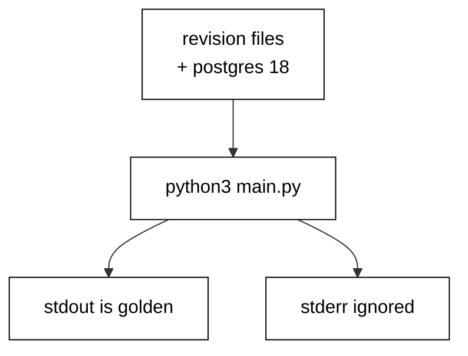

Prerequisites for this course: [just-enough-python](/en/learn/courses/just-enough-python/learning/overview) for basic syntax, functions, and modules, and [sql-essentials](/en/learn/courses/sql-essentials/learning/overview) for CREATE and ALTER TABLE. Comfort editing and running Python scripts from a terminal is assumed throughout, and every example builds only on the primers plus earlier examples in this course.

## Why this exists -- the big idea

**The problem before the solution**: teams evolve production databases with chat messages and ad-hoc SQL — nobody knows which changes ran where, rollbacks are improvised under pressure, and two developers' changes collide in the deploy queue. Alembic replaces folklore with artifacts: every change is a versioned file with a forward step and a reverse step, and the database itself records which files already ran.

**Keep this if you forget everything else**: A migration that cannot be rolled back safely is a migration that will eventually be run in production by accident.

## Tensions and trade-offs -- when NOT to reach for this

- **Small versus strict**: nullable columns land without disturbing traffic; NOT NULL, checks, and defaults constrain later once data complies. Each example names which side it takes and what the other side would cost, and Examples 33 and 41 collect the three-step and two-step shapes for going strict safely.
- **One revision versus many**: single-statement revisions minimize lock windows but multiply files; multi-step revisions read as one story but hold locks longer. The course defaults to small files and merges steps only when the steps genuinely share a deploy window.
- **When NOT**: throwaway exploration against a scratch database needs no versioning — create, poke, drop, done. Migrations earn their place when the database outlives the session: shared development databases, staging, and anything resembling production.

## Lineage -- where this tool sits

Alembic is the migration companion to SQLAlchemy, and this course assumes both the Python primer and basic SQL DDL as background. The ORM and query-builder course teaches data access; this course teaches schema evolution — the versioned history that lets the schema change while the data and the traffic survive. Later data courses assume migrations exist and build pipelines, analytics, and services on top of versioned schemas.

## How this course is organized

[Beginner](/en/learn/courses/database-migrations-with-python-and-alembic/learning/beginner) (Examples 1-25) writes first migrations and rolls them back: file anatomy, chain ordering, history stamps, and rollback basics. [Intermediate](/en/learn/courses/database-migrations-with-python-and-alembic/learning/intermediate) (Examples 26-53) backfills data, splits breaking changes into zero-downtime steps, and adopts legacy databases with stamps and drift checks. [Advanced](/en/learn/courses/database-migrations-with-python-and-alembic/learning/advanced) (Examples 54-78) resolves branch conflicts, shrinks locking blast radius, and diagnoses failures from the version table. The [capstone](/en/learn/courses/database-migrations-with-python-and-alembic/learning/capstone/overview) evolves an order-management schema through eight realistic migrations with a golden verification query, and [drilling](/en/learn/courses/database-migrations-with-python-and-alembic/drilling/overview) turns the sixteen concepts into recall, katas, and checklists.

## About the runtime

Every example runs as `python3 main.py` in the pinned Python container against the real pinned PostgreSQL 18 service with a shared hash-locked dependency set (Alembic, SQLAlchemy, psycopg): no mocks, no fixtures-as-data. Each example owns per-example tables and a per-example version table, drops leftovers before running, and cleans up after itself, so reruns are byte-stable. Revision files shown in a lesson are written by the program itself into a scratch script directory at runtime and executed for real. Standard output is the asserted golden transcript; standard error (Alembic's logs) is ignored. Programs print labels, counts, and row values — never paths, timings, temp names, or revision noise — so reruns match byte for byte.

## Examples by Level

### Beginner (Examples 1-25)

- [Example 1: First Revision Creates a Table](/en/learn/courses/database-migrations-with-python-and-alembic/learning/beginner#example-1-first-revision-creates-a-table)
- [Example 2: Revision File Anatomy](/en/learn/courses/database-migrations-with-python-and-alembic/learning/beginner#example-2-revision-file-anatomy)
- [Example 3: Upgrade Runs the Forward Change](/en/learn/courses/database-migrations-with-python-and-alembic/learning/beginner#example-3-upgrade-runs-the-forward-change)
- [Example 4: Downgrade Reverses the Change](/en/learn/courses/database-migrations-with-python-and-alembic/learning/beginner#example-4-downgrade-reverses-the-change)
- [Example 5: Add a Column with Alter](/en/learn/courses/database-migrations-with-python-and-alembic/learning/beginner#example-5-add-a-column-with-alter)
- [Example 6: Create an Index](/en/learn/courses/database-migrations-with-python-and-alembic/learning/beginner#example-6-create-an-index)
- [Example 7: Not Null with a Server Default](/en/learn/courses/database-migrations-with-python-and-alembic/learning/beginner#example-7-not-null-with-a-server-default)
- [Example 8: Upgrade Then Downgrade Roundtrip](/en/learn/courses/database-migrations-with-python-and-alembic/learning/beginner#example-8-upgrade-then-downgrade-roundtrip)
- [Example 9: History Is a Chain](/en/learn/courses/database-migrations-with-python-and-alembic/learning/beginner#example-9-history-is-a-chain)
- [Example 10: Down Revision Links Order](/en/learn/courses/database-migrations-with-python-and-alembic/learning/beginner#example-10-down-revision-links-order)
- [Example 11: Stamp Marks the Starting Point](/en/learn/courses/database-migrations-with-python-and-alembic/learning/beginner#example-11-stamp-marks-the-starting-point)
- [Example 12: Version Table Records Runs](/en/learn/courses/database-migrations-with-python-and-alembic/learning/beginner#example-12-version-table-records-runs)
- [Example 13: Heads Show the Tips](/en/learn/courses/database-migrations-with-python-and-alembic/learning/beginner#example-13-heads-show-the-tips)
- [Example 14: Single Head Means Linear](/en/learn/courses/database-migrations-with-python-and-alembic/learning/beginner#example-14-single-head-means-linear)
- [Example 15: Upgrade to a Specific Revision](/en/learn/courses/database-migrations-with-python-and-alembic/learning/beginner#example-15-upgrade-to-a-specific-revision)
- [Example 16: Downgrade Back to Base](/en/learn/courses/database-migrations-with-python-and-alembic/learning/beginner#example-16-downgrade-back-to-base)
- [Example 17: Current Reports Position](/en/learn/courses/database-migrations-with-python-and-alembic/learning/beginner#example-17-current-reports-position)
- [Example 18: Rollback Drops What Upgrade Added](/en/learn/courses/database-migrations-with-python-and-alembic/learning/beginner#example-18-rollback-drops-what-upgrade-added)
- [Example 19: Rollback Keeps Unrelated Data](/en/learn/courses/database-migrations-with-python-and-alembic/learning/beginner#example-19-rollback-keeps-unrelated-data)
- [Example 20: Stepwise Rollback One Step](/en/learn/courses/database-migrations-with-python-and-alembic/learning/beginner#example-20-stepwise-rollback-one-step)
- [Example 21: Failing Statement Rolls Back](/en/learn/courses/database-migrations-with-python-and-alembic/learning/beginner#example-21-failing-statement-rolls-back)
- [Example 22: One Transaction Per Migration](/en/learn/courses/database-migrations-with-python-and-alembic/learning/beginner#example-22-one-transaction-per-migration)
- [Example 23: Preview SQL Offline](/en/learn/courses/database-migrations-with-python-and-alembic/learning/beginner#example-23-preview-sql-offline)
- [Example 24: Idempotent Drops](/en/learn/courses/database-migrations-with-python-and-alembic/learning/beginner#example-24-idempotent-drops)
- [Example 25: Rerun Upgrade Is Safe](/en/learn/courses/database-migrations-with-python-and-alembic/learning/beginner#example-25-rerun-upgrade-is-safe)

### Intermediate (Examples 26-53)

- [Example 26: Backfill Fills the New Column](/en/learn/courses/database-migrations-with-python-and-alembic/learning/intermediate#example-26-backfill-fills-the-new-column)
- [Example 27: Schema First, Data Second](/en/learn/courses/database-migrations-with-python-and-alembic/learning/intermediate#example-27-schema-first-data-second)
- [Example 28: Backfill in Batches](/en/learn/courses/database-migrations-with-python-and-alembic/learning/intermediate#example-28-backfill-in-batches)
- [Example 29: Backfill Needs No Downgrade](/en/learn/courses/database-migrations-with-python-and-alembic/learning/intermediate#example-29-backfill-needs-no-downgrade)
- [Example 30: Data Fix Inside a Revision](/en/learn/courses/database-migrations-with-python-and-alembic/learning/intermediate#example-30-data-fix-inside-a-revision)
- [Example 31: Verify Backfill Counts](/en/learn/courses/database-migrations-with-python-and-alembic/learning/intermediate#example-31-verify-backfill-counts)
- [Example 32: Backfill from a Join](/en/learn/courses/database-migrations-with-python-and-alembic/learning/intermediate#example-32-backfill-from-a-join)
- [Example 33: Default, Then Backfill, Then Not Null](/en/learn/courses/database-migrations-with-python-and-alembic/learning/intermediate#example-33-default-then-backfill-then-not-null)
- [Example 34: Split Schema and Data Revisions](/en/learn/courses/database-migrations-with-python-and-alembic/learning/intermediate#example-34-split-schema-and-data-revisions)
- [Example 35: Expand Adds the Column Safely](/en/learn/courses/database-migrations-with-python-and-alembic/learning/intermediate#example-35-expand-adds-the-column-safely)
- [Example 36: Dual Write Window](/en/learn/courses/database-migrations-with-python-and-alembic/learning/intermediate#example-36-dual-write-window)
- [Example 37: Migrate Reads to the New Column](/en/learn/courses/database-migrations-with-python-and-alembic/learning/intermediate#example-37-migrate-reads-to-the-new-column)
- [Example 38: Contract Drops the Old Column](/en/learn/courses/database-migrations-with-python-and-alembic/learning/intermediate#example-38-contract-drops-the-old-column)
- [Example 39: Rename in Three Deployable Steps](/en/learn/courses/database-migrations-with-python-and-alembic/learning/intermediate#example-39-rename-in-three-deployable-steps)
- [Example 40: Widen a Column Type Safely](/en/learn/courses/database-migrations-with-python-and-alembic/learning/intermediate#example-40-widen-a-column-type-safely)
- [Example 41: Check Constraint Not Valid First](/en/learn/courses/database-migrations-with-python-and-alembic/learning/intermediate#example-41-check-constraint-not-valid-first)
- [Example 42: Deploy Order Matters](/en/learn/courses/database-migrations-with-python-and-alembic/learning/intermediate#example-42-deploy-order-matters)
- [Example 43: Rollback Plan for Every Step](/en/learn/courses/database-migrations-with-python-and-alembic/learning/intermediate#example-43-rollback-plan-for-every-step)
- [Example 44: Same Migrations Every Environment](/en/learn/courses/database-migrations-with-python-and-alembic/learning/intermediate#example-44-same-migrations-every-environment)
- [Example 45: Baseline Marks an Existing Database](/en/learn/courses/database-migrations-with-python-and-alembic/learning/intermediate#example-45-baseline-marks-an-existing-database)
- [Example 46: Stamp Head on Legacy Schema](/en/learn/courses/database-migrations-with-python-and-alembic/learning/intermediate#example-46-stamp-head-on-legacy-schema)
- [Example 47: Reflect Existing Tables](/en/learn/courses/database-migrations-with-python-and-alembic/learning/intermediate#example-47-reflect-existing-tables)
- [Example 48: Detect Schema Drift](/en/learn/courses/database-migrations-with-python-and-alembic/learning/intermediate#example-48-detect-schema-drift)
- [Example 49: Drift Report Table by Table](/en/learn/courses/database-migrations-with-python-and-alembic/learning/intermediate#example-49-drift-report-table-by-table)
- [Example 50: Draft a Revision with Autogenerate](/en/learn/courses/database-migrations-with-python-and-alembic/learning/intermediate#example-50-draft-a-revision-with-autogenerate)
- [Example 51: Review Autogenerate Before Trust](/en/learn/courses/database-migrations-with-python-and-alembic/learning/intermediate#example-51-review-autogenerate-before-trust)
- [Example 52: Guard with Alembic Check](/en/learn/courses/database-migrations-with-python-and-alembic/learning/intermediate#example-52-guard-with-alembic-check)
- [Example 53: Record Script Hashes](/en/learn/courses/database-migrations-with-python-and-alembic/learning/intermediate#example-53-record-script-hashes)

### Advanced (Examples 54-78)

- [Example 54: Two Branches, Two Heads](/en/learn/courses/database-migrations-with-python-and-alembic/learning/advanced#example-54-two-branches-two-heads)
- [Example 55: Merge Resolves Heads](/en/learn/courses/database-migrations-with-python-and-alembic/learning/advanced#example-55-merge-resolves-heads)
- [Example 56: Merge Revision Anatomy](/en/learn/courses/database-migrations-with-python-and-alembic/learning/advanced#example-56-merge-revision-anatomy)
- [Example 57: Rebase One Branch onto Head](/en/learn/courses/database-migrations-with-python-and-alembic/learning/advanced#example-57-rebase-one-branch-onto-head)
- [Example 58: Many Heads, One History](/en/learn/courses/database-migrations-with-python-and-alembic/learning/advanced#example-58-many-heads-one-history)
- [Example 59: List Heads Before Merge](/en/learn/courses/database-migrations-with-python-and-alembic/learning/advanced#example-59-list-heads-before-merge)
- [Example 60: Linear History Team Policy](/en/learn/courses/database-migrations-with-python-and-alembic/learning/advanced#example-60-linear-history-team-policy)
- [Example 61: Conflict Drill Two Developers](/en/learn/courses/database-migrations-with-python-and-alembic/learning/advanced#example-61-conflict-drill-two-developers)
- [Example 62: DDL Takes a Lock](/en/learn/courses/database-migrations-with-python-and-alembic/learning/advanced#example-62-ddl-takes-a-lock)
- [Example 63: Short Transactions Shrink Blast Radius](/en/learn/courses/database-migrations-with-python-and-alembic/learning/advanced#example-63-short-transactions-shrink-blast-radius)
- [Example 64: One Statement Per Revision](/en/learn/courses/database-migrations-with-python-and-alembic/learning/advanced#example-64-one-statement-per-revision)
- [Example 65: Statement Timeout Bounds Locks](/en/learn/courses/database-migrations-with-python-and-alembic/learning/advanced#example-65-statement-timeout-bounds-locks)
- [Example 66: Concurrently Outside the Transaction](/en/learn/courses/database-migrations-with-python-and-alembic/learning/advanced#example-66-concurrently-outside-the-transaction)
- [Example 67: Batch Backfills Avoid Long Locks](/en/learn/courses/database-migrations-with-python-and-alembic/learning/advanced#example-67-batch-backfills-avoid-long-locks)
- [Example 68: Advisory Lock Serializes Runners](/en/learn/courses/database-migrations-with-python-and-alembic/learning/advanced#example-68-advisory-lock-serializes-runners)
- [Example 69: Expand-Contract Avoids Rewrite](/en/learn/courses/database-migrations-with-python-and-alembic/learning/advanced#example-69-expand-contract-avoids-rewrite)
- [Example 70: Measure Lock Hold Per Step](/en/learn/courses/database-migrations-with-python-and-alembic/learning/advanced#example-70-measure-lock-hold-per-step)
- [Example 71: Read the Version Table First](/en/learn/courses/database-migrations-with-python-and-alembic/learning/advanced#example-71-read-the-version-table-first)
- [Example 72: Diagnose a Partial Migration](/en/learn/courses/database-migrations-with-python-and-alembic/learning/advanced#example-72-diagnose-a-partial-migration)
- [Example 73: History Diverged from Database](/en/learn/courses/database-migrations-with-python-and-alembic/learning/advanced#example-73-history-diverged-from-database)
- [Example 74: Missing Down Revision Error](/en/learn/courses/database-migrations-with-python-and-alembic/learning/advanced#example-74-missing-down-revision-error)
- [Example 75: Downgrade Past Data Loss](/en/learn/courses/database-migrations-with-python-and-alembic/learning/advanced#example-75-downgrade-past-data-loss)
- [Example 76: Test Every Migration Twice](/en/learn/courses/database-migrations-with-python-and-alembic/learning/advanced#example-76-test-every-migration-twice)
- [Example 77: Golden Schema Snapshot Test](/en/learn/courses/database-migrations-with-python-and-alembic/learning/advanced#example-77-golden-schema-snapshot-test)
- [Example 78: Pre-Deploy Checklist](/en/learn/courses/database-migrations-with-python-and-alembic/learning/advanced#example-78-pre-deploy-checklist)
