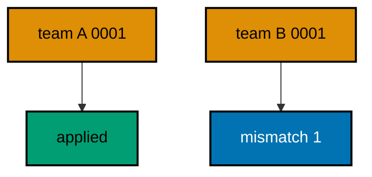
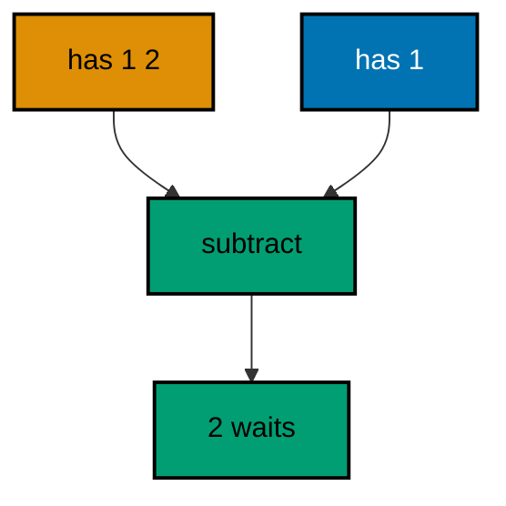
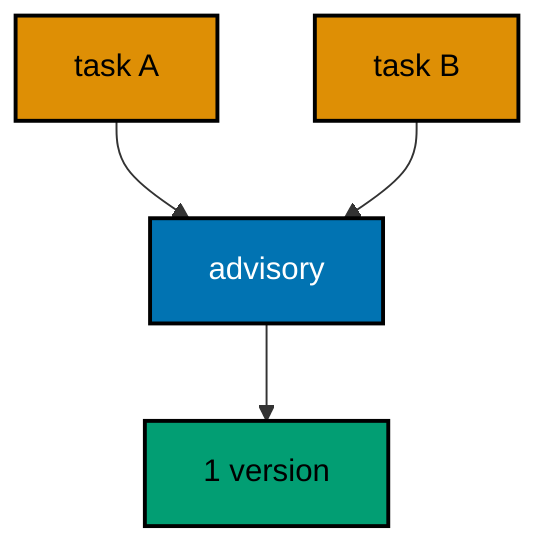
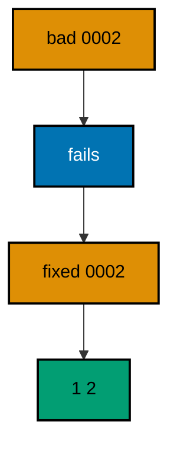
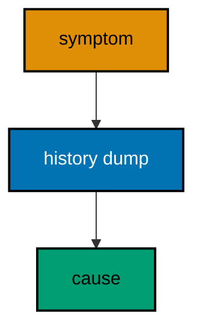
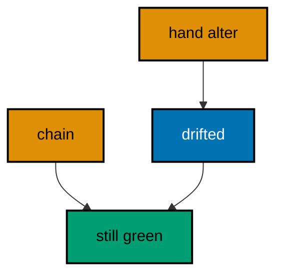
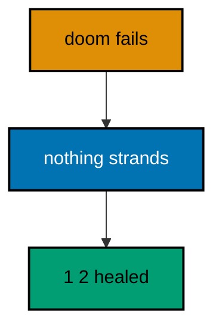
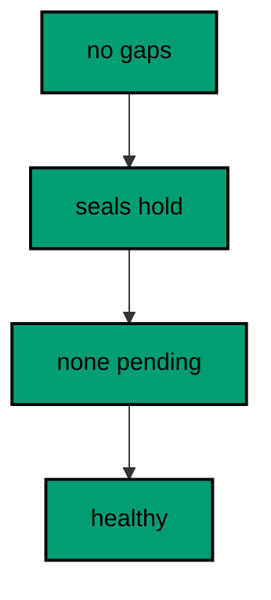

Examples 54–78 handle real teams and real failures: version conflicts across branches (Examples 54–61), locking under concurrency (Examples 62–70), and diagnosis of failed, edited, or drifted histories (Examples 71–78). Every example is a complete, runnable Rust program under `learning/code/` driving a real PostgreSQL container; run each with the command in its own `run.yaml`.

---

### Example 54: Two Branches, One Version Number

Two branches minting version 1 with different content collide: the checksums disagree and the second run fails. This example applies team A's file, then resolves team B's same-numbered file. The mismatch error names version 1.

Same-number-different-content is the only true merge conflict in migration land, and the checksum turns it from silent corruption into a loud, named error. The program applies the first branch, attempts the second, and prints the classified failure instead of crashing.

(Concepts: co-14.)



**`learning/code/ex-54-two-branches-one-version-number/src/main.rs`**:

```rust
// Example 54: Two Branches, One Version Number.
// the same number with different bytes collides.
use sqlx::migrate::MigrateError; // => the error enum names every failure mode

static TEAM_A: sqlx::migrate::Migrator = sqlx::migrate!("./migrations"); // => team A claims version 1 first
static TEAM_B: sqlx::migrate::Migrator = sqlx::migrate!("./branch"); // => team B claims version 1 differently

// => one URL builder shared by the pool and every probe query
fn db_url() -> String {
    // => assemble the connection string from its parts
    format!(
        "postgres://{}@{}:{}/{}", // => trust auth: a user with no password
        std::env::var("PGUSER").unwrap_or_else(|_| String::from("postgres")), // => superuser in the service container
        std::env::var("PGHOST").unwrap_or_else(|_| String::from("postgres")), // => service alias on the unit network
        std::env::var("PGPORT").unwrap_or_else(|_| String::from("5432")), // => pinned PostgreSQL port
        std::env::var("PGDATABASE").unwrap_or_else(|_| String::from("postgres")), // => the service database name
    ) // => format returns the finished URL
} // => helper ends: every connection flows through here

#[tokio::main] // => the async runtime drives the pool and the queries
               // => main returns the database error so failures print it
async fn main() -> Result<(), sqlx::Error> {
    let pool = sqlx::postgres::PgPoolOptions::new() // => start from the default pool options
        .max_connections(5) // => five connections: migrate plus a few readers
        .connect(&db_url()) // => connect to the per-run service database
        .await?; // => ? bubbles a connection failure instead of panicking
    TEAM_A.run(&pool).await?; // => team A lands and records its checksum
                              // => team B carries the same number, other bytes
    match TEAM_B.run(&pool).await {
        Err(MigrateError::VersionMismatch(version)) => {
            // => the collision trips the seal
            println!(
                "branch run failed: migration {version} was previously applied but has been modified"
            ); // => the conflict, named
        } // => match arm ends: the collision is expected, not a crash
        Err(other) => panic!("unexpected error: {other}"), // => any other failure is a test bug
        Ok(()) => panic!("conflicting branch should not apply"), // => silent success would corrupt history
    } // => match ends: every outcome is classified
    Ok(()) // => green run: collisions fail loudly
} // => main ends: the harness compares stdout to the golden file
```

**`learning/code/ex-54-two-branches-one-version-number/migrations/0001_create_carts.sql`**:

```sql
-- 0001 team A: carts hold items. -- => the first claim on version 1
CREATE TABLE carts ( -- => the migrator runs this file once, in version order
    id SERIAL PRIMARY KEY, -- => surrogate key: the row identity never changes
    item TEXT NOT NULL -- => every cart row names an item
); -- => the definition closes here
```

**`learning/code/ex-54-two-branches-one-version-number/branch/0001_create_carts.sql`**:

```sql
-- 0001 team B: carts hold quantities. -- => the competing claim on version 1
CREATE TABLE carts ( -- => same number, different content
    id SERIAL PRIMARY KEY, -- => surrogate key: the row identity never changes
    qty INTEGER NOT NULL -- => team B shaped the table differently
); -- => the definition closes here
```

**Output** (`learning/code/ex-54-two-branches-one-version-number/expected/main.stdout.txt`):

```text
branch run failed: migration 1 was previously applied but has been modified
```

**Key takeaway**: Never let two branches share a version number; the checksum collision is the tool refusing silent corruption.

**Why it matters**: Version collisions are the one conflict checksums cannot prevent, only detect, so the workflow must prevent them: branches claim numbers from a shared sequence or renumber before merging. The loud failure is the safety net, not the strategy. Teams that treat version numbers as a shared resource review the file list in every pull request and never discover collisions at deploy time. Prevention beats detection, and detection beats corruption.

---

### Example 55: Merge by Renumbering Forward

The losing branch renumbers its work above the winner and merges cleanly. This example applies team A's version 1, then team B's renumbered version 2. Both tables land, and history shows the merge as sequence.

Renumbering forward preserves both branches' work without rewriting anyone's applied history: the winner keeps its number, the loser takes the next free one. The program runs both sets and prints the merged version line.

(Concepts: co-14.)

**`learning/code/ex-55-merge-by-renumbering-forward/src/main.rs`**:

```rust
// Example 55: Merge by Renumbering Forward.
// the loser takes the next free number.
use sqlx::Row; // => Row unlocks column reads by name on every result row

static TEAM_A: sqlx::migrate::Migrator = sqlx::migrate!("./migrations"); // => the winning branch keeps version 1
static TEAM_B: sqlx::migrate::Migrator = sqlx::migrate!("./merged"); // => the losing branch renumbered to version 2

// => one URL builder shared by the pool and every probe query
fn db_url() -> String {
    // => assemble the connection string from its parts
    format!(
        "postgres://{}@{}:{}/{}", // => trust auth: a user with no password
        std::env::var("PGUSER").unwrap_or_else(|_| String::from("postgres")), // => superuser in the service container
        std::env::var("PGHOST").unwrap_or_else(|_| String::from("postgres")), // => service alias on the unit network
        std::env::var("PGPORT").unwrap_or_else(|_| String::from("5432")), // => pinned PostgreSQL port
        std::env::var("PGDATABASE").unwrap_or_else(|_| String::from("postgres")), // => the service database name
    ) // => format returns the finished URL
} // => helper ends: every connection flows through here

#[tokio::main] // => the async runtime drives the pool and the queries
               // => main returns the database error so failures print it
async fn main() -> Result<(), sqlx::Error> {
    let pool = sqlx::postgres::PgPoolOptions::new() // => start from the default pool options
        .max_connections(5) // => five connections: migrate plus a few readers
        .connect(&db_url()) // => connect to the per-run service database
        .await?; // => ? bubbles a connection failure instead of panicking
    TEAM_A.run(&pool).await?; // => team A lands version 1
    TEAM_B.run(&pool).await?; // => team B lands its renumbered version 2
    let rows = sqlx::query("SELECT version FROM _sqlx_migrations ORDER BY version") // => the merged sequence
        .fetch_all(&pool) // => run the read against the same pool
        .await?; // => ? bubbles a query failure instead of panicking
    let versions: Vec<i64> = rows.iter().map(|row| row.get("version")).collect(); // => versions 1 and 2 on record
    let line = versions // => collect the report line first so the print stays short
        .iter() // => walk each element in turn
        .map(i64::to_string) // => render each version as text
        .collect::<Vec<_>>() // => gather into a printable list
        .join(" "); // => space the versions for one line
    println!("merged versions: {line}"); // => the merge as sequence
    Ok(()) // => green run: both branches survived
} // => main ends: the harness compares stdout to the golden file
```

**`learning/code/ex-55-merge-by-renumbering-forward/migrations/0001_create_carts.sql`**:

```sql
-- 0001 team A: carts hold items. -- => applies once, skips on re-runs
CREATE TABLE carts ( -- => the migrator runs this file once, in version order
    id SERIAL PRIMARY KEY, -- => surrogate key: the row identity never changes
    item TEXT NOT NULL -- => every cart row names an item
); -- => the definition closes here
```

**`learning/code/ex-55-merge-by-renumbering-forward/merged/0001_create_carts.sql`**:

```sql
-- 0001 team A: carts hold items. -- => applies once, skips on re-runs
CREATE TABLE carts ( -- => the migrator runs this file once, in version order
    id SERIAL PRIMARY KEY, -- => surrogate key: the row identity never changes
    item TEXT NOT NULL -- => every cart row names an item
); -- => the definition closes here
```

**`learning/code/ex-55-merge-by-renumbering-forward/merged/0002_create_qtys.sql`**:

```sql
-- 0002 team B renumbered: quantities live apart. -- => the next free number, no collision
CREATE TABLE qtys ( -- => the migrator runs this file once, in version order
    id SERIAL PRIMARY KEY, -- => surrogate key: the row identity never changes
    cart_id INTEGER NOT NULL REFERENCES carts (id), -- => every quantity belongs to a cart
    qty INTEGER NOT NULL -- => the work team B kept, renumbered
); -- => the definition closes here
```

**Output** (`learning/code/ex-55-merge-by-renumbering-forward/expected/main.stdout.txt`):

```text
merged versions: 1 2
```

**Key takeaway**: Resolve version collisions by renumbering the loser forward; never rewrite the winner's history.

**Why it matters**: Merge conflicts in code get resolved with judgment, and migration conflicts deserve the same: the team decides whose change keeps the number and whose moves forward. Renumbering is a small, reviewable diff that preserves both histories instead of forcing a rewrite. The rule is simple enough to state in one sentence and saves every future merge from the same argument. Shared numbering discipline is a team skill, not a tool feature.

---

### Example 56: Hotfix Arrives After the Release

A hotfix numbered below the release tip slots in without disturbing what shipped. This example releases versions 1 and 3, then applies the full set containing the version 2 hotfix. The healed line proves late fixes compose.

Hotfixes cannot wait for the next release train, and numbering lets them cut in line safely: the version below the tip applies exactly once, between its neighbors. The program prints the line before and after, showing the gap heal.

(Concepts: co-14.)

**`learning/code/ex-56-hotfix-arrives-after-the-release/src/main.rs`**:

```rust
// Example 56: Hotfix Arrives After the Release.
// the late fix heals the line.
use sqlx::Row; // => Row unlocks column reads by name on every result row

static RELEASE: sqlx::migrate::Migrator = sqlx::migrate!("./migrations"); // => the release ships 1 and 3
static HOTFIX: sqlx::migrate::Migrator = sqlx::migrate!("./complete"); // => the hotfix fills version 2

// => one URL builder shared by the pool and every probe query
fn db_url() -> String {
    // => assemble the connection string from its parts
    format!(
        "postgres://{}@{}:{}/{}", // => trust auth: a user with no password
        std::env::var("PGUSER").unwrap_or_else(|_| String::from("postgres")), // => superuser in the service container
        std::env::var("PGHOST").unwrap_or_else(|_| String::from("postgres")), // => service alias on the unit network
        std::env::var("PGPORT").unwrap_or_else(|_| String::from("5432")), // => pinned PostgreSQL port
        std::env::var("PGDATABASE").unwrap_or_else(|_| String::from("postgres")), // => the service database name
    ) // => format returns the finished URL
} // => helper ends: every connection flows through here

#[tokio::main] // => the async runtime drives the pool and the queries
               // => main returns the database error so failures print it
async fn main() -> Result<(), sqlx::Error> {
    let pool = sqlx::postgres::PgPoolOptions::new() // => start from the default pool options
        .max_connections(5) // => five connections: migrate plus a few readers
        .connect(&db_url()) // => connect to the per-run service database
        .await?; // => ? bubbles a connection failure instead of panicking
    RELEASE.run(&pool).await?; // => versions 1 and 3 ship, leaving a gap at 2
    let rows = sqlx::query("SELECT version FROM _sqlx_migrations ORDER BY version") // => history with the hotfix missing
        .fetch_all(&pool) // => run the read against the same pool
        .await?; // => ? bubbles a query failure instead of panicking
    let shipped: Vec<i64> = rows.iter().map(|row| row.get("version")).collect(); // => versions 1 and 3 on record
    let line = shipped // => collect the report line first so the print stays short
        .iter() // => walk each element in turn
        .map(i64::to_string) // => render each version as text
        .collect::<Vec<_>>() // => gather into a printable list
        .join(" "); // => space the versions for one line
    println!("shipped: {line}"); // => the release with its gap
    HOTFIX.run(&pool).await?; // => only version 2 is pending, so only it runs
    let rows = sqlx::query("SELECT version FROM _sqlx_migrations ORDER BY version") // => history with the hotfix applied
        .fetch_all(&pool) // => run the read against the same pool
        .await?; // => ? bubbles a query failure instead of panicking
    let healed: Vec<i64> = rows.iter().map(|row| row.get("version")).collect(); // => versions 1, 2, and 3 on record
    let line = healed // => collect the report line first so the print stays short
        .iter() // => walk each element in turn
        .map(i64::to_string) // => render each version as text
        .collect::<Vec<_>>() // => gather into a printable list
        .join(" "); // => space the versions for one line
    println!("after hotfix: {line}"); // => the healed line
    Ok(()) // => green run: hotfixes compose
} // => main ends: the harness compares stdout to the golden file
```

**`learning/code/ex-56-hotfix-arrives-after-the-release/migrations/0001_create_tickets.sql`**:

```sql
-- 0001: tickets anchor support work. -- => applies once, skips on re-runs
CREATE TABLE tickets ( -- => the migrator runs this file once, in version order
    id SERIAL PRIMARY KEY, -- => surrogate key: the row identity never changes
    subject TEXT NOT NULL -- => every ticket must be titled
); -- => the definition closes here
```

**`learning/code/ex-56-hotfix-arrives-after-the-release/migrations/0003_create_escalations.sql`**:

```sql
-- 0003: escalations reference tickets. -- => applies once, skips on re-runs
CREATE TABLE escalations ( -- => the migrator runs this file once, in version order
    id SERIAL PRIMARY KEY, -- => surrogate key: the row identity never changes
    ticket_id INTEGER NOT NULL REFERENCES tickets (id) -- => every escalation names a ticket
); -- => the definition closes here
```

**`learning/code/ex-56-hotfix-arrives-after-the-release/complete/0001_create_tickets.sql`**:

```sql
-- 0001: tickets anchor support work. -- => applies once, skips on re-runs
CREATE TABLE tickets ( -- => the migrator runs this file once, in version order
    id SERIAL PRIMARY KEY, -- => surrogate key: the row identity never changes
    subject TEXT NOT NULL -- => every ticket must be titled
); -- => the definition closes here
```

**`learning/code/ex-56-hotfix-arrives-after-the-release/complete/0002_add_severity.sql`**:

```sql
-- 0002 hotfix: severity cannot wait. -- => the only pending file in the second run
ALTER TABLE tickets -- => the shipped table gains the urgent column
    ADD COLUMN severity TEXT NOT NULL DEFAULT 'normal'; -- => defaulted so shipped rows comply
```

**`learning/code/ex-56-hotfix-arrives-after-the-release/complete/0003_create_escalations.sql`**:

```sql
-- 0003: escalations reference tickets. -- => applies once, skips on re-runs
CREATE TABLE escalations ( -- => the migrator runs this file once, in version order
    id SERIAL PRIMARY KEY, -- => surrogate key: the row identity never changes
    ticket_id INTEGER NOT NULL REFERENCES tickets (id) -- => every escalation names a ticket
); -- => the definition closes here
```

**Output** (`learning/code/ex-56-hotfix-arrives-after-the-release/expected/main.stdout.txt`):

```text
shipped: 1 3
after hotfix: 1 2 3
```

**Key takeaway**: Number hotfixes in their logical place; pending-set logic applies them without disturbing the release.

**Why it matters**: Hotfixes test a migration system more honestly than any planned release: they arrive late, target the middle of history, and must land without ceremony. Set-based pending logic handles them as a matter of course, because it never assumed contiguity in the first place. The ability to heal a gap without touching shipped versions is what lets teams ship fixes at incident speed. Numbering discipline pays its rent in moments like these.

---

### Example 57: Checksum Stability Across Runs

Checksums must be identical every run, or validation would flap between identical binaries. This example migrates twice and compares the recorded checksums. Equality proves the seal is deterministic.

A nondeterministic checksum would fail validation on the second deploy of the same binary, blocking pipelines for no reason. The program reads both checksums as hex after each of two runs and asserts the pairs match, printing the stability verdict.

(Concepts: co-11.)

**`learning/code/ex-57-checksum-stability-across-runs/src/main.rs`**:

```rust
// Example 57: Checksum Stability Across Runs.
// the seal never wobbles.
use sqlx::Row; // => Row unlocks column reads by name on every result row

static MIGRATOR: sqlx::migrate::Migrator = sqlx::migrate!("./migrations"); // => embeds the two sealed files

const SEAL_SQL: &str =
    "SELECT encode(checksum, 'hex') AS seal FROM _sqlx_migrations ORDER BY version"; // => the seals as hex text, embedded once

// => one URL builder shared by the pool and every probe query
fn db_url() -> String {
    // => assemble the connection string from its parts
    format!(
        "postgres://{}@{}:{}/{}", // => trust auth: a user with no password
        std::env::var("PGUSER").unwrap_or_else(|_| String::from("postgres")), // => superuser in the service container
        std::env::var("PGHOST").unwrap_or_else(|_| String::from("postgres")), // => service alias on the unit network
        std::env::var("PGPORT").unwrap_or_else(|_| String::from("5432")), // => pinned PostgreSQL port
        std::env::var("PGDATABASE").unwrap_or_else(|_| String::from("postgres")), // => the service database name
    ) // => format returns the finished URL
} // => helper ends: every connection flows through here

#[tokio::main] // => the async runtime drives the pool and the queries
               // => main returns the database error so failures print it
async fn main() -> Result<(), sqlx::Error> {
    let pool = sqlx::postgres::PgPoolOptions::new() // => start from the default pool options
        .max_connections(5) // => five connections: migrate plus a few readers
        .connect(&db_url()) // => connect to the per-run service database
        .await?; // => ? bubbles a connection failure instead of panicking
    MIGRATOR.run(&pool).await?; // => first run records both checksums
    let rows = sqlx::query(SEAL_SQL) // => read the recorded seals
        .fetch_all(&pool) // => run the read against the same pool
        .await?; // => ? bubbles a query failure instead of panicking
    let first: Vec<String> = rows.iter().map(|row| row.get("seal")).collect(); // => seals after run one
    MIGRATOR.run(&pool).await?; // => second run revalidates without rewriting
                                // => read the seals again after the second run
    let rows = sqlx::query(SEAL_SQL) // => the same named query, rerun
        .fetch_all(&pool) // => run the read against the same pool
        .await?; // => ? bubbles a query failure instead of panicking
    let second: Vec<String> = rows.iter().map(|row| row.get("seal")).collect(); // => seals after run two
    println!("checksums stable across runs: {}", first == second); // => determinism as a boolean
    Ok(()) // => green run: the seal is deterministic
} // => main ends: the harness compares stdout to the golden file
```

**`learning/code/ex-57-checksum-stability-across-runs/migrations/0001_create_vaults.sql`**:

```sql
-- 0001: vaults hold the secrets. -- => the first sealed file
CREATE TABLE vaults ( -- => the migrator runs this file once, in version order
    id SERIAL PRIMARY KEY, -- => surrogate key: the row identity never changes
    name TEXT NOT NULL -- => every vault must be named
); -- => the definition closes here
```

**`learning/code/ex-57-checksum-stability-across-runs/migrations/0002_create_keys.sql`**:

```sql
-- 0002: keys belong to vaults. -- => the second sealed file
CREATE TABLE keys ( -- => the migrator runs this file once, in version order
    id SERIAL PRIMARY KEY, -- => surrogate key: the row identity never changes
    vault_id INTEGER NOT NULL REFERENCES vaults (id), -- => every key lives in a vault
    material TEXT NOT NULL -- => key material never leaves the vault
); -- => the definition closes here
```

**Output** (`learning/code/ex-57-checksum-stability-across-runs/expected/main.stdout.txt`):

```text
checksums stable across runs: true
```

**Key takeaway**: SHA-384 over file bytes is deterministic: identical files always seal identically.

**Why it matters**: Flaky seals would be worse than no seals: a validation that fails on identical inputs teaches teams to distrust the tool and bypass the check. Deterministic hashing means the seal depends only on file bytes, so the same binary validates everywhere, every time. Trust in the check is what makes it a gate instead of a suggestion. Determinism is the foundation every other guarantee stands on.

---

### Example 58: Pending Review Gate

A review gate asks whether an embedded version is still unapplied before approving a deploy. This example migrates one version, then checks that version 2 exists in the binary but not in the database. The pending flag is the gate's answer.

Gates that inspect the pending set catch unreviewed work before it reaches production: the binary carries more than the database holds. The program combines `version_exists` with the applied set and prints the pending verdict for version 2.

(Concepts: co-16, co-13.)



**`learning/code/ex-58-pending-review-gate/src/main.rs`**:

```rust
// Example 58: Pending Review Gate.
// the gate names what the base lacks.
use sqlx::Row; // => Row unlocks column reads by name on every result row
use std::collections::HashSet; // => set subtraction finds the pending versions

static SHIPPED: sqlx::migrate::Migrator = sqlx::migrate!("./migrations"); // => version 1 rides the deploy
static CANDIDATE: sqlx::migrate::Migrator = sqlx::migrate!("./complete"); // => the binary under review holds 1 and 2

// => one URL builder shared by the pool and every probe query
fn db_url() -> String {
    // => assemble the connection string from its parts
    format!(
        "postgres://{}@{}:{}/{}", // => trust auth: a user with no password
        std::env::var("PGUSER").unwrap_or_else(|_| String::from("postgres")), // => superuser in the service container
        std::env::var("PGHOST").unwrap_or_else(|_| String::from("postgres")), // => service alias on the unit network
        std::env::var("PGPORT").unwrap_or_else(|_| String::from("5432")), // => pinned PostgreSQL port
        std::env::var("PGDATABASE").unwrap_or_else(|_| String::from("postgres")), // => the service database name
    ) // => format returns the finished URL
} // => helper ends: every connection flows through here

#[tokio::main] // => the async runtime drives the pool and the queries
               // => main returns the database error so failures print it
async fn main() -> Result<(), sqlx::Error> {
    let pool = sqlx::postgres::PgPoolOptions::new() // => start from the default pool options
        .max_connections(5) // => five connections: migrate plus a few readers
        .connect(&db_url()) // => connect to the per-run service database
        .await?; // => ? bubbles a connection failure instead of panicking
    SHIPPED.run(&pool).await?; // => the deploy applies version 1 only
    let rows = sqlx::query("SELECT version FROM _sqlx_migrations") // => what the database already holds
        .fetch_all(&pool) // => run the read against the same pool
        .await?; // => ? bubbles a query failure instead of panicking
    let applied: HashSet<i64> = rows.iter().map(|row| row.get("version")).collect(); // => the recorded set
    let pending: Vec<i64> = CANDIDATE
        .iter() // => walk each element in turn
        .map(|m| m.version) // => project the embedded numbers
        .filter(|v| !applied.contains(v)) // => keep only the unapplied
        .collect(); // => embedded minus recorded
    println!("version 2 pending review: {}", pending == vec![2]); // => the gate answer for version 2
    println!("candidate knows version 2: {}", CANDIDATE.version_exists(2)); // => the binary-side check
    Ok(()) // => green run: the gate sees the gap
} // => main ends: the harness compares stdout to the golden file
```

**`learning/code/ex-58-pending-review-gate/migrations/0001_create_flags.sql`**:

```sql
-- 0001: flags gate the rollout. -- => applies once, skips on re-runs
CREATE TABLE flags ( -- => the migrator runs this file once, in version order
    id SERIAL PRIMARY KEY, -- => surrogate key: the row identity never changes
    name TEXT NOT NULL -- => every flag must be named
); -- => the definition closes here
```

**`learning/code/ex-58-pending-review-gate/complete/0001_create_flags.sql`**:

```sql
-- 0001: flags gate the rollout. -- => applies once, skips on re-runs
CREATE TABLE flags ( -- => the migrator runs this file once, in version order
    id SERIAL PRIMARY KEY, -- => surrogate key: the row identity never changes
    name TEXT NOT NULL -- => every flag must be named
); -- => the definition closes here
```

**`learning/code/ex-58-pending-review-gate/complete/0002_add_scope.sql`**:

```sql
-- 0002: scope arrives under review. -- => the candidate the gate inspects
ALTER TABLE flags -- => the shipped table gains the reviewed column
    ADD COLUMN scope TEXT NOT NULL DEFAULT 'global'; -- => defaulted so shipped rows comply
```

**Output** (`learning/code/ex-58-pending-review-gate/expected/main.stdout.txt`):

```text
version 2 pending review: true
candidate knows version 2: true
```

**Key takeaway**: Gate deploys on the pending set: embedded versions minus applied versions is the review list.

**Why it matters**: Deploys that cannot say what they will change ask for blind trust, and blind trust fails exactly when scrutiny mattered most. The pending set turns the deploy into a readable list the reviewer approves line by line. Automation can enforce the gate, but the real value is human: a reviewer who sees version 2 pending asks whether version 2 was reviewed. Visibility is the cheapest review tool a pipeline can offer.

---

### Example 59: Seed Outside the Migrator

sqlx has no repeatable migrations, so idempotent seeds run as plain SQL beside the chain. This example keeps `seed.sql` out of `migrations/` and executes it twice with conflict-proof inserts. Stable counts prove outside seeds still converge.

Not every database write deserves a version: reference refreshes rerun whenever data drifts, not when the schema changes. The seed file uses `ON CONFLICT DO NOTHING` so reruns add only what is missing, and the program executes it twice to prove convergence.

(Concepts: co-05, co-06.)

**`learning/code/ex-59-seed-outside-the-migrator/src/main.rs`**:

```rust
// Example 59: Seed Outside the Migrator.
// repeatable seeds live beside the chain.
use sqlx::Row; // => Row unlocks column reads by name on every result row

static MIGRATOR: sqlx::migrate::Migrator = sqlx::migrate!("./migrations"); // => the schema chain, seeds excluded
static SEED: &str = include_str!("../seed.sql"); // => the repeatable seed, embedded byte-identically

// => one URL builder shared by the pool and every probe query
fn db_url() -> String {
    // => assemble the connection string from its parts
    format!(
        "postgres://{}@{}:{}/{}", // => trust auth: a user with no password
        std::env::var("PGUSER").unwrap_or_else(|_| String::from("postgres")), // => superuser in the service container
        std::env::var("PGHOST").unwrap_or_else(|_| String::from("postgres")), // => service alias on the unit network
        std::env::var("PGPORT").unwrap_or_else(|_| String::from("5432")), // => pinned PostgreSQL port
        std::env::var("PGDATABASE").unwrap_or_else(|_| String::from("postgres")), // => the service database name
    ) // => format returns the finished URL
} // => helper ends: every connection flows through here

#[tokio::main] // => the async runtime drives the pool and the queries
               // => main returns the database error so failures print it
async fn main() -> Result<(), sqlx::Error> {
    let pool = sqlx::postgres::PgPoolOptions::new() // => start from the default pool options
        .max_connections(5) // => five connections: migrate plus a few readers
        .connect(&db_url()) // => connect to the per-run service database
        .await?; // => ? bubbles a connection failure instead of panicking
    MIGRATOR.run(&pool).await?; // => the schema lands once through versions
    sqlx::query(SEED).execute(&pool).await?; // => first seed run inserts both zones
    sqlx::query(SEED).execute(&pool).await?; // => second seed run adds nothing
    let row = sqlx::query("SELECT COUNT(*) AS n FROM zones") // => the rows repeatable seeds maintain
        .fetch_one(&pool) // => exactly one count row comes back
        .await?; // => ? bubbles a query failure instead of panicking
    let n: i64 = row.get("n"); // => two zones, never duplicated
    println!("seeded zones: {n}"); // => convergence after two runs
    Ok(()) // => green run: outside seeds converge
} // => main ends: the harness compares stdout to the golden file
```

**`learning/code/ex-59-seed-outside-the-migrator/migrations/0001_create_zones.sql`**:

```sql
-- 0001: zones hold the seed. -- => reference data lives outside versions
CREATE TABLE zones ( -- => the migrator runs this file once, in version order
    id SERIAL PRIMARY KEY, -- => surrogate key: the row identity never changes
    code TEXT NOT NULL UNIQUE -- => conflicts resolve on the code
); -- => the definition closes here
```

**`learning/code/ex-59-seed-outside-the-migrator/seed.sql`**:

```sql
-- seed.sql: repeatable reference refresh, outside the version chain. -- => rerun any time, changes nothing twice
INSERT INTO zones (code) -- => reference rows, maintained not migrated
    VALUES ('eu'), -- => the first zone
    ('us') -- => the second zone
    ON CONFLICT (code) DO NOTHING; -- => reruns add only what is missing
```

**Output** (`learning/code/ex-59-seed-outside-the-migrator/expected/main.stdout.txt`):

```text
seeded zones: 2
```

**Key takeaway**: Keep repeatable seeds outside migrations/ and make them conflict-proof with ON CONFLICT DO NOTHING.

**Why it matters**: Versioning every data refresh pollutes history with reruns that change nothing: the chain grows while the schema stands still, and reviewers learn to skim versions instead of reading them. Repeatable seeds outside the chain stay honest about what they are: maintenance, not migration. The conflict guard makes them safe to run on every deploy, and the separation keeps the version line meaningful. History should record decisions, not routines.

---

### Example 60: Resolve a Failed Branch Migration

A branch written against yesterday's schema fails against today's, and the fix is rebasing onto the new shape. This example runs a branch migration referencing a missing column, watches it fail, then runs the rebased chain green.

Branches rot while main moves on: new columns, renamed tables, and dropped constraints invalidate work that was green a week ago. The failure names the missing piece precisely, and the rebased version states its new dependency by building on the current schema. The program shows both the failure and the recovery.

(Concepts: co-14, co-16.)

**`learning/code/ex-60-resolve-a-failed-branch-migration/src/main.rs`**:

```rust
// Example 60: Resolve a Failed Branch Migration.
// stale branches fail; rebased ones land.
use sqlx::migrate::MigrateError;
use sqlx::Row; // => the error enum names every failure mode // => Row unlocks column reads by name on every result row

static MAIN: sqlx::migrate::Migrator = sqlx::migrate!("./migrations"); // => the current main schema
static STALE: sqlx::migrate::Migrator = sqlx::migrate!("./stale"); // => the branch written against yesterday
static REBASED: sqlx::migrate::Migrator = sqlx::migrate!("./rebased"); // => the branch rebuilt on today

// => one URL builder shared by the pool and every probe query
fn db_url() -> String {
    // => assemble the connection string from its parts
    format!(
        "postgres://{}@{}:{}/{}", // => trust auth: a user with no password
        std::env::var("PGUSER").unwrap_or_else(|_| String::from("postgres")), // => superuser in the service container
        std::env::var("PGHOST").unwrap_or_else(|_| String::from("postgres")), // => service alias on the unit network
        std::env::var("PGPORT").unwrap_or_else(|_| String::from("5432")), // => pinned PostgreSQL port
        std::env::var("PGDATABASE").unwrap_or_else(|_| String::from("postgres")), // => the service database name
    ) // => format returns the finished URL
} // => helper ends: every connection flows through here

#[tokio::main] // => the async runtime drives the pool and the queries
               // => main returns the database error so failures print it
async fn main() -> Result<(), sqlx::Error> {
    let pool = sqlx::postgres::PgPoolOptions::new() // => start from the default pool options
        .max_connections(5) // => five connections: migrate plus a few readers
        .connect(&db_url()) // => connect to the per-run service database
        .await?; // => ? bubbles a connection failure instead of panicking
    MAIN.run(&pool).await?; // => main ships its renaming first
                            // => the stale branch misses the renamed column
    match STALE.run(&pool).await {
        Err(MigrateError::ExecuteMigration(_, 2)) => {
            // => the failure names the stale version
            println!("stale branch failed on version 2 as expected"); // => the rot, classified
        } // => match arm ends: the stale failure is expected, not a crash
        Err(other) => panic!("unexpected error: {other}"), // => any other failure is a test bug
        Ok(()) => panic!("stale branch should not apply"), // => silent success would hide the rot
    } // => match ends: every outcome is classified
    REBASED.run(&pool).await?; // => the rebased chain builds on the current schema
    let rows = sqlx::query("SELECT version FROM _sqlx_migrations ORDER BY version") // => the healed branch line
        .fetch_all(&pool) // => run the read against the same pool
        .await?; // => ? bubbles a query failure instead of panicking
    let versions: Vec<i64> = rows.iter().map(|row| row.get("version")).collect(); // => versions 1 and 2 on record
    let line = versions // => collect the report line first so the print stays short
        .iter() // => walk each element in turn
        .map(i64::to_string) // => render each version as text
        .collect::<Vec<_>>() // => gather into a printable list
        .join(" "); // => space the versions for one line
    println!("rebased versions: {line}"); // => the branch, healed
    Ok(()) // => green run: rebase beats rot
} // => main ends: the harness compares stdout to the golden file
```

**`learning/code/ex-60-resolve-a-failed-branch-migration/migrations/0001_create_orders.sql`**:

```sql
-- 0001 main: orders start with amount. -- => applies once, skips on re-runs
CREATE TABLE orders ( -- => the migrator runs this file once, in version order
    id SERIAL PRIMARY KEY, -- => surrogate key: the row identity never changes
    amount INTEGER NOT NULL -- => amounts store as integer minor units
); -- => the definition closes here
```

**`learning/code/ex-60-resolve-a-failed-branch-migration/rebased/0001_create_orders.sql`**:

```sql
-- 0001 main: orders start with amount. -- => applies once, skips on re-runs
CREATE TABLE orders ( -- => the migrator runs this file once, in version order
    id SERIAL PRIMARY KEY, -- => surrogate key: the row identity never changes
    amount INTEGER NOT NULL -- => amounts store as integer minor units
); -- => the definition closes here
```

**`learning/code/ex-60-resolve-a-failed-branch-migration/rebased/0002_use_amount.sql`**:

```sql
-- 0002 rebased: built on the current schema. -- => the branch, healed
ALTER TABLE orders -- => the current column name, not the stale one
    ADD COLUMN total_plus_tax INTEGER GENERATED ALWAYS AS (amount * 2) STORED; -- => derived from what exists
```

**`learning/code/ex-60-resolve-a-failed-branch-migration/stale/0001_create_orders.sql`**:

```sql
-- 0001 main: orders start with amount. -- => applies once, skips on re-runs
CREATE TABLE orders ( -- => the migrator runs this file once, in version order
    id SERIAL PRIMARY KEY, -- => surrogate key: the row identity never changes
    amount INTEGER NOT NULL -- => amounts store as integer minor units
); -- => the definition closes here
```

**`learning/code/ex-60-resolve-a-failed-branch-migration/stale/0002_use_total.sql`**:

```sql
-- 0002 stale: written against a renamed column. -- => total does not exist yet
ALTER TABLE orders -- => the stale assumption breaks here
    ADD COLUMN total_plus_tax INTEGER GENERATED ALWAYS AS (total * 2) STORED; -- => total was renamed to amount on main
```

**Output** (`learning/code/ex-60-resolve-a-failed-branch-migration/expected/main.stdout.txt`):

```text
stale branch failed on version 2 as expected
rebased versions: 1 2
```

**Key takeaway**: Rebase stale branches onto the current schema instead of forcing yesterday's assumptions through.

**Why it matters**: Stale branches fail in confusing ways when their assumptions about the schema no longer hold, and the confusion multiplies when the fix is attempted under pressure. Rebasing is the disciplined response: rebuild the branch's work on top of what main actually looks like now, review the result, and merge a chain that was green five minutes ago. The error message is the diagnosis; the rebase is the treatment. Fresh branches merge; stale branches rot.

---

### Example 61: Team Workflow: Validate Then Migrate

Mature teams validate the chain before migrating it: checksums agree, versions are pending, then the run proceeds. This example checks the gate on the empty base, migrates, and checks again. False-then-true proves the workflow end to end.

Validate-then-migrate turns deploys into a habit instead of a hope: the pre-check catches tampering, the run applies pending work, and the post-check confirms the seal. The program prints each verdict in order, showing the team workflow as executable steps.

(Concepts: co-16, co-13.)

**`learning/code/ex-61-team-workflow-validate-then-migrate/src/main.rs`**:

```rust
// Example 61: Team Workflow: Validate Then Migrate.
// the gate runs before and after.
use sqlx::Row; // => Row unlocks column reads by name on every result row

static MIGRATOR: sqlx::migrate::Migrator = sqlx::migrate!("./migrations"); // => the chain the team ships

// => one URL builder shared by the pool and every probe query
fn db_url() -> String {
    // => assemble the connection string from its parts
    format!(
        "postgres://{}@{}:{}/{}", // => trust auth: a user with no password
        std::env::var("PGUSER").unwrap_or_else(|_| String::from("postgres")), // => superuser in the service container
        std::env::var("PGHOST").unwrap_or_else(|_| String::from("postgres")), // => service alias on the unit network
        std::env::var("PGPORT").unwrap_or_else(|_| String::from("5432")), // => pinned PostgreSQL port
        std::env::var("PGDATABASE").unwrap_or_else(|_| String::from("postgres")), // => the service database name
    ) // => format returns the finished URL
} // => helper ends: every connection flows through here

async fn valid(pool: &sqlx::PgPool) -> Result<bool, sqlx::Error> {
    // => the gate both phases share
    let mut embedded: Vec<i64> = MIGRATOR.iter().map(|m| m.version).collect(); // => every version compiled into the binary
    embedded.sort_unstable(); // => order the embedded set for comparison
    let row = sqlx::query("SELECT to_regclass('public._sqlx_migrations') IS NOT NULL AS present") // => the history table may not exist yet
        .fetch_one(pool) // => a single flag row comes back
        .await?; // => ? bubbles a query failure instead of panicking
    let present: bool = row.get("present"); // => false on the empty base
    if !present {
        // => no history table means nothing recorded
        return Ok(false); // => the gate answers false before the first run
    } // => early return ends the missing-table case
    let rows = sqlx::query("SELECT version FROM _sqlx_migrations") // => every version recorded in the database
        .fetch_all(pool) // => run the read against the same pool
        .await?; // => ? bubbles a query failure instead of panicking
    let mut applied: Vec<i64> = rows.iter().map(|row| row.get("version")).collect(); // => the recorded set
    applied.sort_unstable(); // => order the recorded set for comparison
    Ok(!embedded.is_empty() && embedded == applied) // => agreement means the base is fully migrated
} // => helper ends: the gate answers one boolean

#[tokio::main] // => the async runtime drives the pool and the queries
               // => main returns the database error so failures print it
async fn main() -> Result<(), sqlx::Error> {
    let pool = sqlx::postgres::PgPoolOptions::new() // => start from the default pool options
        .max_connections(5) // => five connections: migrate plus a few readers
        .connect(&db_url()) // => connect to the per-run service database
        .await?; // => ? bubbles a connection failure instead of panicking
    println!("valid before migrate: {}", valid(&pool).await?); // => the pre-check on the empty base
    MIGRATOR.run(&pool).await?; // => the team run applies both versions
    println!("valid after migrate: {}", valid(&pool).await?); // => the post-check on the managed base
    Ok(()) // => green run: the workflow holds both ends
} // => main ends: the harness compares stdout to the golden file
```

**`learning/code/ex-61-team-workflow-validate-then-migrate/migrations/0001_create_teams.sql`**:

```sql
-- 0001: teams anchor the workflow. -- => the first version the gate checks
CREATE TABLE teams ( -- => the migrator runs this file once, in version order
    id SERIAL PRIMARY KEY, -- => surrogate key: the row identity never changes
    name TEXT NOT NULL -- => every team must be named
); -- => the definition closes here
```

**`learning/code/ex-61-team-workflow-validate-then-migrate/migrations/0002_create_members.sql`**:

```sql
-- 0002: members join teams. -- => the second version the gate checks
CREATE TABLE members ( -- => the migrator runs this file once, in version order
    id SERIAL PRIMARY KEY, -- => surrogate key: the row identity never changes
    team_id INTEGER NOT NULL REFERENCES teams (id), -- => every member belongs to a team
    handle TEXT NOT NULL -- => every member picks a handle
); -- => the definition closes here
```

**Output** (`learning/code/ex-61-team-workflow-validate-then-migrate/expected/main.stdout.txt`):

```text
valid before migrate: false
valid after migrate: true
```

**Key takeaway**: Wrap every team migrate with validation before and after; the pair proves the run, not just the tool.

**Why it matters**: Workflows beat wishes: a team that validates before and after every migrate catches tampering, gaps, and partial runs as routine instead of discovering them during incidents. The habit costs two queries and saves the archaeology of wondering what actually deployed. Rituals that verify reality stay valuable forever, while rituals that merely signal fade into checkbox theater. This one verifies reality.

---

### Example 62: One Lock Serializes Two Migrators

Two migrators racing the same database do not double-apply: the advisory lock serializes them. This example spawns two tasks against one slow migration and awaits both. Two successes with one recorded version prove the serialization.

The lock lives in the database as a session advisory lock, so it works across processes and hosts, not just threads. The slow migration holds the lock long enough for the race to be real; the second migrator waits, finds nothing pending, and reports success.

(Concepts: co-15.)



**`learning/code/ex-62-one-lock-serializes-two-migrators/src/main.rs`**:

```rust
// Example 62: One Lock Serializes Two Migrators.
// the advisory lock orders the racers.
use sqlx::Row; // => Row unlocks column reads by name on every result row

static MIGRATOR: sqlx::migrate::Migrator = sqlx::migrate!("./migrations"); // => one slow version both tasks run

// => one URL builder shared by the pool and every probe query
fn db_url() -> String {
    // => assemble the connection string from its parts
    format!(
        "postgres://{}@{}:{}/{}", // => trust auth: a user with no password
        std::env::var("PGUSER").unwrap_or_else(|_| String::from("postgres")), // => superuser in the service container
        std::env::var("PGHOST").unwrap_or_else(|_| String::from("postgres")), // => service alias on the unit network
        std::env::var("PGPORT").unwrap_or_else(|_| String::from("5432")), // => pinned PostgreSQL port
        std::env::var("PGDATABASE").unwrap_or_else(|_| String::from("postgres")), // => the service database name
    ) // => format returns the finished URL
} // => helper ends: every connection flows through here

#[tokio::main] // => the multi-thread runtime drives both racing tasks
               // => main returns the database error so failures print it
async fn main() -> Result<(), sqlx::Error> {
    let pool = sqlx::postgres::PgPoolOptions::new() // => start from the default pool options
        .max_connections(5) // => five connections: migrate plus a few readers
        .connect(&db_url()) // => connect to the per-run service database
        .await?; // => ? bubbles a connection failure instead of panicking
    let one = pool.clone(); // => each racer owns a pool handle to move
    let two = pool.clone(); // => handles share the same underlying pool
    let first = tokio::spawn(async move { MIGRATOR.run(&one).await }); // => racer one starts the slow migration
    let second = tokio::spawn(async move { MIGRATOR.run(&two).await }); // => racer two waits on the advisory lock
                                                                        // => racer one must report success
    match first.await {
        Ok(Ok(())) => {}                               // => the winner applied the version
        Ok(Err(e)) => panic!("racer one failed: {e}"), // => migration failure is a test bug
        Err(e) => panic!("racer one crashed: {e}"),    // => task crash is a test bug
    } // => match ends: racer one is classified
      // => racer two must report success
    match second.await {
        Ok(Ok(())) => {}                               // => the waiter found nothing pending
        Ok(Err(e)) => panic!("racer two failed: {e}"), // => migration failure is a test bug
        Err(e) => panic!("racer two crashed: {e}"),    // => task crash is a test bug
    } // => match ends: racer two is classified
    let row = sqlx::query("SELECT COUNT(*) AS n FROM _sqlx_migrations") // => the version the race recorded once
        .fetch_one(&pool) // => exactly one count row comes back
        .await?; // => ? bubbles a query failure instead of panicking
    let n: i64 = row.get("n"); // => one version, however many racers
    println!("both migrators finished, versions: {n}"); // => serialization proven
    Ok(()) // => green run: the lock held
} // => main ends: the harness compares stdout to the golden file
```

**`learning/code/ex-62-one-lock-serializes-two-migrators/migrations/0001_slow_create.sql`**:

```sql
-- 0001: slow enough to race. -- => the sleep makes the overlap real
SELECT pg_sleep(1); -- => one slow second under the advisory lock
CREATE TABLE racers ( -- => the migrator runs this file once, in version order
    id SERIAL PRIMARY KEY, -- => surrogate key: the row identity never changes
    name TEXT NOT NULL -- => every racer must be named
); -- => the definition closes here
```

**Output** (`learning/code/ex-62-one-lock-serializes-two-migrators/expected/main.stdout.txt`):

```text
both migrators finished, versions: 1
```

**Key takeaway**: Concurrent migrates are safe: the advisory lock serializes them and pending-set logic skips duplicates.

**Why it matters**: Deploys overlap more often than anyone admits: rolling restarts, retried pipelines, and multi-instance fleets all migrate at once. Without a lock, racers double-apply or deadlock; with one, the second waits and then finds nothing to do. The lock turns a coordination problem into a non-issue, which is exactly what infrastructure should do. Safe concurrency is designed in, not hoped for.

---

### Example 63: Three Racers Still Apply Once

The guarantee holds for any number of racers, not just two. This example spawns three tasks against the same slow migration. Three successes with one version prove the lock scales.

Fleet deploys start many instances at once, and every one runs its migrations. The program races three tasks and counts the recorded versions, showing the lock serializes the whole crowd into a single application.

(Concepts: co-15.)

**`learning/code/ex-63-three-racers-still-apply-once/src/main.rs`**:

```rust
// Example 63: Three Racers Still Apply Once.
// the lock serializes the whole crowd.
use sqlx::Row; // => Row unlocks column reads by name on every result row

static MIGRATOR: sqlx::migrate::Migrator = sqlx::migrate!("./migrations"); // => one slow version three tasks run

// => one URL builder shared by the pool and every probe query
fn db_url() -> String {
    // => assemble the connection string from its parts
    format!(
        "postgres://{}@{}:{}/{}", // => trust auth: a user with no password
        std::env::var("PGUSER").unwrap_or_else(|_| String::from("postgres")), // => superuser in the service container
        std::env::var("PGHOST").unwrap_or_else(|_| String::from("postgres")), // => service alias on the unit network
        std::env::var("PGPORT").unwrap_or_else(|_| String::from("5432")), // => pinned PostgreSQL port
        std::env::var("PGDATABASE").unwrap_or_else(|_| String::from("postgres")), // => the service database name
    ) // => format returns the finished URL
} // => helper ends: every connection flows through here

#[tokio::main] // => the multi-thread runtime drives all three racing tasks
               // => main returns the database error so failures print it
async fn main() -> Result<(), sqlx::Error> {
    let pool = sqlx::postgres::PgPoolOptions::new() // => start from the default pool options
        .max_connections(5) // => five connections: migrate plus a few readers
        .connect(&db_url()) // => connect to the per-run service database
        .await?; // => ? bubbles a connection failure instead of panicking
    let mut racers = Vec::new(); // => one task per racer
    for _ in 0..3 {
        // => three racers share the slow version
        let handle = pool.clone(); // => each racer owns a pool handle to move
        racers.push(tokio::spawn(async move { MIGRATOR.run(&handle).await })); // => racers queue on the advisory lock
    } // => loop ends after spawning the crowd
    for racer in racers {
        // => every racer must report success
        // => waiting is not failing
        match racer.await {
            Ok(Ok(())) => {} // => the winner applied, the rest no-opped
            Ok(Err(e)) => panic!("racer failed: {e}"), // => migration failure is a test bug
            Err(e) => panic!("racer crashed: {e}"), // => task crash is a test bug
        } // => match ends: each racer is classified
    } // => loop ends after the last racer succeeds
    let row = sqlx::query("SELECT COUNT(*) AS n FROM _sqlx_migrations") // => the version the crowd recorded once
        .fetch_one(&pool) // => exactly one count row comes back
        .await?; // => ? bubbles a query failure instead of panicking
    let n: i64 = row.get("n"); // => one version, however many racers
    println!("three racers finished, versions: {n}"); // => the crowd serialized
    Ok(()) // => green run: the lock scales
} // => main ends: the harness compares stdout to the golden file
```

**`learning/code/ex-63-three-racers-still-apply-once/migrations/0001_slow_create.sql`**:

```sql
-- 0001: slow enough for a crowd. -- => the sleep makes the overlap real
SELECT pg_sleep(1); -- => one slow second under the advisory lock
CREATE TABLE crowds ( -- => the migrator runs this file once, in version order
    id SERIAL PRIMARY KEY, -- => surrogate key: the row identity never changes
    name TEXT NOT NULL -- => every crowd member must be named
); -- => the definition closes here
```

**Output** (`learning/code/ex-63-three-racers-still-apply-once/expected/main.stdout.txt`):

```text
three racers finished, versions: 1
```

**Key takeaway**: Fleet deploys migrate safely: every instance runs, the lock picks one winner, the rest no-op.

**Why it matters**: The number of racers is never two in production; it is however many instances the orchestrator started, and that number changes with every deploy. A lock that works for any crowd size removes migration coordination from the deploy checklist entirely. Every instance runs the same binary with the same migrate step, and the database sorts out the order. Uniform binaries with database-mediated coordination is how fleets stay sane.

---

### Example 64: Failed Migration Releases the Lock

A failing run keeps its session lock, so the repair releases it explicitly first. This example runs a broken chain, watches it fail, releases the session lock, then runs the fixed chain on the same sessions. The green second run proves the lock was freed.

Locks that survive failures turn one bad version into a wedged fleet: every migrator blocks forever behind a holder that already died. sqlx keeps the session lock on the failure path, so the repair run releases it explicitly and proceeds on the same sessions. The program shows failure, explicit release, and recovery on one database.

(Concepts: co-15.)

**`learning/code/ex-64-failed-migration-releases-the-lock/src/main.rs`**:

```rust
// Example 64: Failed Migration Releases the Lock.
// the repair releases the lock, then proceeds.
use sqlx::migrate::MigrateError;
use sqlx::Row; // => the error enum names every failure mode // => Row unlocks column reads by name on every result row

static BROKEN: sqlx::migrate::Migrator = sqlx::migrate!("./migrations"); // => version 2 carries the invalid type
static FIXED: sqlx::migrate::Migrator = sqlx::migrate!("./fixed"); // => version 2 corrected, same number

// => one URL builder shared by the pool and every probe query
fn db_url() -> String {
    // => assemble the connection string from its parts
    format!(
        "postgres://{}@{}:{}/{}", // => trust auth: a user with no password
        std::env::var("PGUSER").unwrap_or_else(|_| String::from("postgres")), // => superuser in the service container
        std::env::var("PGHOST").unwrap_or_else(|_| String::from("postgres")), // => service alias on the unit network
        std::env::var("PGPORT").unwrap_or_else(|_| String::from("5432")), // => pinned PostgreSQL port
        std::env::var("PGDATABASE").unwrap_or_else(|_| String::from("postgres")), // => the service database name
    ) // => format returns the finished URL
} // => helper ends: every connection flows through here

#[tokio::main] // => the async runtime drives the pool and the queries
               // => main returns the database error so failures print it
async fn main() -> Result<(), sqlx::Error> {
    let pool = sqlx::postgres::PgPoolOptions::new() // => start from the default pool options
        .max_connections(5) // => five connections: migrate plus a few readers
        .connect(&db_url()) // => connect to the per-run service database
        .await?; // => ? bubbles a connection failure instead of panicking
                 // => version 1 applies, version 2 fails
    match BROKEN.run(&pool).await {
        Err(MigrateError::ExecuteMigration(_, 2)) => {
            // => the failure names version 2
            println!("broken run failed on version 2 as expected"); // => the failure, classified
        } // => match arm ends: the failure is expected, not a crash
        Err(other) => panic!("unexpected error: {other}"), // => any other failure is a test bug
        Ok(()) => panic!("broken chain should not apply"), // => silent success would hide the bug
    } // => match ends: every outcome is classified
    sqlx::query("SELECT pg_advisory_unlock_all()")
        .execute(&pool)
        .await?; // => the failed run keeps the lock: release it here
    FIXED.run(&pool).await?; // => unlocked sessions proceed, so the repair runs
    let rows = sqlx::query("SELECT version FROM _sqlx_migrations ORDER BY version") // => the recovered line
        .fetch_all(&pool) // => run the read against the same pool
        .await?; // => ? bubbles a query failure instead of panicking
    let versions: Vec<i64> = rows.iter().map(|row| row.get("version")).collect(); // => versions 1 and 2 on record
    let line = versions // => collect the report line first so the print stays short
        .iter() // => walk each element in turn
        .map(i64::to_string) // => render each version as text
        .collect::<Vec<_>>() // => gather into a printable list
        .join(" "); // => space the versions for one line
    println!("after repair: {line}"); // => recovery, recorded
    Ok(()) // => green run: failures never wedge the fleet
} // => main ends: the harness compares stdout to the golden file
```

**`learning/code/ex-64-failed-migration-releases-the-lock/migrations/0001_create_ledgers.sql`**:

```sql
-- 0001: ledgers are the good version. -- => applies once, skips on re-runs
CREATE TABLE ledgers ( -- => the migrator runs this file once, in version order
    id SERIAL PRIMARY KEY, -- => surrogate key: the row identity never changes
    name TEXT NOT NULL -- => every ledger must be named
); -- => the definition closes here
```

**`learning/code/ex-64-failed-migration-releases-the-lock/migrations/0002_broken_type.sql`**:

```sql
-- 0002 broken: an invalid type fails the file. -- => nothing was recorded, so retry is clean
CREATE TABLE broken ( -- => this statement never commits
    id SERIAL PRIMARY KEY, -- => surrogate key: the row identity never changes
    amount NOT_A_TYPE -- => unknown types fail at parse time
); -- => the definition closes here
```

**`learning/code/ex-64-failed-migration-releases-the-lock/fixed/0001_create_ledgers.sql`**:

```sql
-- 0001: ledgers are the good version. -- => applies once, skips on re-runs
CREATE TABLE ledgers ( -- => the migrator runs this file once, in version order
    id SERIAL PRIMARY KEY, -- => surrogate key: the row identity never changes
    name TEXT NOT NULL -- => every ledger must be named
); -- => the definition closes here
```

**`learning/code/ex-64-failed-migration-releases-the-lock/fixed/0002_create_entries.sql`**:

```sql
-- 0002 fixed: entries reference ledgers. -- => corrected content, same free number
CREATE TABLE entries ( -- => the migrator runs this file once, in version order
    id SERIAL PRIMARY KEY, -- => surrogate key: the row identity never changes
    ledger_id INTEGER NOT NULL REFERENCES ledgers (id), -- => every entry posts to a ledger
    amount INTEGER NOT NULL -- => amounts store as integer minor units
); -- => the definition closes here
```

**Output** (`learning/code/ex-64-failed-migration-releases-the-lock/expected/main.stdout.txt`):

```text
broken run failed on version 2 as expected
after repair: 1 2
```

**Key takeaway**: A failed run keeps its session lock, so release it explicitly before the repair run; unlocked sessions proceed immediately.

**Why it matters**: Session locks outlive the failure that took them: the holder died, the waiters queue forever, and no timeout fires because everyone assumes work continues. Releasing the lock explicitly turns the wedge into a pause: the repair proceeds on the same sessions. The rule for in-process retries is mechanical: never retry a failed migrate without releasing its lock first. Systems that name their coordination self-heal; systems that assume release deadlock on their own optimism.

---

### Example 65: Row Locks Stay Narrow

Backfills lock only the rows they touch when the WHERE clause names keys. This example seeds three `counters` and updates exactly one by primary key. The untouched pair proves the blast radius was one row.

Narrow predicates keep concurrent writers moving: readers and writers on other rows never wait for this backfill. The program updates one row by id and prints all three values, showing the neighbors byte-identical.

(Concepts: co-15.)

**`learning/code/ex-65-row-locks-stay-narrow/src/main.rs`**:

```rust
// Example 65: Row Locks Stay Narrow.
// keyed updates touch one row.
use sqlx::Row; // => Row unlocks column reads by name on every result row

static MIGRATOR: sqlx::migrate::Migrator = sqlx::migrate!("./migrations"); // => embeds the keyed backfill

// => one URL builder shared by the pool and every probe query
fn db_url() -> String {
    // => assemble the connection string from its parts
    format!(
        "postgres://{}@{}:{}/{}", // => trust auth: a user with no password
        std::env::var("PGUSER").unwrap_or_else(|_| String::from("postgres")), // => superuser in the service container
        std::env::var("PGHOST").unwrap_or_else(|_| String::from("postgres")), // => service alias on the unit network
        std::env::var("PGPORT").unwrap_or_else(|_| String::from("5432")), // => pinned PostgreSQL port
        std::env::var("PGDATABASE").unwrap_or_else(|_| String::from("postgres")), // => the service database name
    ) // => format returns the finished URL
} // => helper ends: every connection flows through here

#[tokio::main] // => the async runtime drives the pool and the queries
               // => main returns the database error so failures print it
async fn main() -> Result<(), sqlx::Error> {
    let pool = sqlx::postgres::PgPoolOptions::new() // => start from the default pool options
        .max_connections(5) // => five connections: migrate plus a few readers
        .connect(&db_url()) // => connect to the per-run service database
        .await?; // => ? bubbles a connection failure instead of panicking
    MIGRATOR.run(&pool).await?; // => seed three counters, bump exactly one
    let rows = sqlx::query("SELECT id, value FROM counters ORDER BY id") // => every counter after the narrow bump
        .fetch_all(&pool) // => run the read against the same pool
        .await?; // => ? bubbles a query failure instead of panicking
    for row in rows {
        // => walk every counter in id order
        let id: i32 = row.get("id"); // => the seeded counter number
        let value: i32 = row.get("value"); // => bumped for 2, untouched for 1 and 3
        println!("counter {id} value {value}"); // => one row state per line
    } // => loop ends after the last counter
    Ok(()) // => green run: the blast radius was one row
} // => main ends: the harness compares stdout to the golden file
```

**`learning/code/ex-65-row-locks-stay-narrow/migrations/0001_create_counters.sql`**:

```sql
-- 0001: counters start at zero. -- => the rows the narrow update selects among
CREATE TABLE counters ( -- => the migrator runs this file once, in version order
    id SERIAL PRIMARY KEY, -- => surrogate key: the row identity never changes
    value INTEGER NOT NULL DEFAULT 0 -- => every counter starts at zero
); -- => the definition closes here
```

**`learning/code/ex-65-row-locks-stay-narrow/migrations/0002_seed_counters.sql`**:

```sql
-- 0002: three zeroed rows. -- => the neighbors the update must not touch
INSERT INTO counters DEFAULT VALUES; -- => counter 1
INSERT INTO counters DEFAULT VALUES; -- => counter 2, the bump target
INSERT INTO counters DEFAULT VALUES; -- => counter 3
```

**`learning/code/ex-65-row-locks-stay-narrow/migrations/0003_bump_one.sql`**:

```sql
-- 0003: keyed updates lock one row. -- => primary-key predicates stay narrow
UPDATE counters -- => only the matching row locks
    SET value = value + 10 WHERE id = 2; -- => the narrow blast radius, stated plainly
```

**Output** (`learning/code/ex-65-row-locks-stay-narrow/expected/main.stdout.txt`):

```text
counter 1 value 0
counter 2 value 10
counter 3 value 0
```

**Key takeaway**: Predicate backfills by primary key so each version locks exactly the rows it changes.

**Why it matters**: Unbounded updates lock everything they scan, and on large tables the scan is the whole table: readers queue, writers time out, and the backfill becomes the incident. Keyed predicates keep the lock set to the rows that actually change, leaving the rest of the table live. The habit scales from three rows to three billion because the principle never changes. Narrow writes are polite writes, and polite writes survive peak traffic.

---

### Example 66: Small Migrations Shrink the Blast Radius

A failed version can be retried with corrected content because failures record nothing. This example fails version 2 with a bad type, then retries the same number with fixed SQL. The healed line proves small versions repair cheaply.

Because Postgres failures leave no history row, the version number stays free for a corrected retry: no repair command, no manual cleanup, just fixed bytes. The program shows the failure, retries the corrected content, and prints the healed line.

(Concepts: co-15, co-16.)



**`learning/code/ex-66-small-migrations-shrink-the-blast-radius/src/main.rs`**:

```rust
// Example 66: Small Migrations Shrink the Blast Radius.
// free numbers retry with fixed bytes.
use sqlx::migrate::MigrateError;
use sqlx::Row; // => the error enum names every failure mode // => Row unlocks column reads by name on every result row

static BROKEN: sqlx::migrate::Migrator = sqlx::migrate!("./migrations"); // => version 2 carries the invalid type
static FIXED: sqlx::migrate::Migrator = sqlx::migrate!("./fixed"); // => version 2 corrected, still free

// => one URL builder shared by the pool and every probe query
fn db_url() -> String {
    // => assemble the connection string from its parts
    format!(
        "postgres://{}@{}:{}/{}", // => trust auth: a user with no password
        std::env::var("PGUSER").unwrap_or_else(|_| String::from("postgres")), // => superuser in the service container
        std::env::var("PGHOST").unwrap_or_else(|_| String::from("postgres")), // => service alias on the unit network
        std::env::var("PGPORT").unwrap_or_else(|_| String::from("5432")), // => pinned PostgreSQL port
        std::env::var("PGDATABASE").unwrap_or_else(|_| String::from("postgres")), // => the service database name
    ) // => format returns the finished URL
} // => helper ends: every connection flows through here

#[tokio::main] // => the async runtime drives the pool and the queries
               // => main returns the database error so failures print it
async fn main() -> Result<(), sqlx::Error> {
    let pool = sqlx::postgres::PgPoolOptions::new() // => start from the default pool options
        .max_connections(5) // => five connections: migrate plus a few readers
        .connect(&db_url()) // => connect to the per-run service database
        .await?; // => ? bubbles a connection failure instead of panicking
                 // => version 1 applies, version 2 fails
    match BROKEN.run(&pool).await {
        Err(MigrateError::ExecuteMigration(_, 2)) => {
            // => the failure names version 2
            println!("first attempt failed on version 2 as expected"); // => the small blast, classified
        } // => match arm ends: the failure is expected, not a crash
        Err(other) => panic!("unexpected error: {other}"), // => any other failure is a test bug
        Ok(()) => panic!("broken version should not apply"), // => silent success would hide the bug
    } // => match ends: every outcome is classified
    FIXED.run(&pool).await?; // => the same number retries with fixed bytes
    let rows = sqlx::query("SELECT version FROM _sqlx_migrations ORDER BY version") // => the healed line
        .fetch_all(&pool) // => run the read against the same pool
        .await?; // => ? bubbles a query failure instead of panicking
    let versions: Vec<i64> = rows.iter().map(|row| row.get("version")).collect(); // => versions 1 and 2 on record
    let line = versions // => collect the report line first so the print stays short
        .iter() // => walk each element in turn
        .map(i64::to_string) // => render each version as text
        .collect::<Vec<_>>() // => gather into a printable list
        .join(" "); // => space the versions for one line
    println!("healed versions: {line}"); // => the cheap repair
    Ok(()) // => green run: small versions repair cheaply
} // => main ends: the harness compares stdout to the golden file
```

**`learning/code/ex-66-small-migrations-shrink-the-blast-radius/migrations/0001_create_shelves.sql`**:

```sql
-- 0001: shelves are the good version. -- => applies once, skips on re-runs
CREATE TABLE shelves ( -- => the migrator runs this file once, in version order
    id SERIAL PRIMARY KEY, -- => surrogate key: the row identity never changes
    label TEXT NOT NULL -- => every shelf must be labeled
); -- => the definition closes here
```

**`learning/code/ex-66-small-migrations-shrink-the-blast-radius/migrations/0002_broken_type.sql`**:

```sql
-- 0002 broken: an invalid type fails the file. -- => nothing recorded, so retry stays clean
CREATE TABLE broken ( -- => this statement never commits
    id SERIAL PRIMARY KEY, -- => surrogate key: the row identity never changes
    amount NOT_A_TYPE -- => unknown types fail at parse time
); -- => the definition closes here
```

**`learning/code/ex-66-small-migrations-shrink-the-blast-radius/fixed/0001_create_shelves.sql`**:

```sql
-- 0001: shelves are the good version. -- => applies once, skips on re-runs
CREATE TABLE shelves ( -- => the migrator runs this file once, in version order
    id SERIAL PRIMARY KEY, -- => surrogate key: the row identity never changes
    label TEXT NOT NULL -- => every shelf must be labeled
); -- => the definition closes here
```

**`learning/code/ex-66-small-migrations-shrink-the-blast-radius/fixed/0002_create_boxes.sql`**:

```sql
-- 0002 fixed: boxes reference shelves. -- => corrected content, still the free number
CREATE TABLE boxes ( -- => the migrator runs this file once, in version order
    id SERIAL PRIMARY KEY, -- => surrogate key: the row identity never changes
    shelf_id INTEGER NOT NULL REFERENCES shelves (id), -- => every box sits on a shelf
    label TEXT NOT NULL -- => every box must be labeled
); -- => the definition closes here
```

**Output** (`learning/code/ex-66-small-migrations-shrink-the-blast-radius/expected/main.stdout.txt`):

```text
first attempt failed on version 2 as expected
healed versions: 1 2
```

**Key takeaway**: Retry failed versions with corrected content: unrecorded numbers stay free for the fix.

**Why it matters**: Repair cost decides how bravely teams ship, and cheap repair makes bold shipping safe. When a failed version leaves no trace, fixing it is just writing the file correctly and running again: no cleanup scripts, no manual history surgery, no outage window. Small versions keep every failure small, and small failures get fixed instead of feared. The blast radius of a version is the blast radius of its repair.

---

### Example 67: Lock Frees After Migrate

The advisory lock must be gone when migrate returns, on the same session that held it. This example migrates through one dedicated connection, then counts advisory locks on that session. Zero proves the release.

Same-session verification is the only honest lock check: other sessions cannot see the lock either way. The program runs the migrator on a single connection, queries `pg_locks` for its own backend, and prints the zero it must find.

(Concepts: co-15.)

**`learning/code/ex-67-lock-frees-after-migrate/src/main.rs`**:

```rust
// Example 67: Lock Frees After Migrate.
// the same session verifies the release.
use sqlx::Row; // => Row unlocks column reads by name on every result row

static MIGRATOR: sqlx::migrate::Migrator = sqlx::migrate!("./migrations"); // => the version the lock guards

// => one URL builder shared by the pool and every probe query
fn db_url() -> String {
    // => assemble the connection string from its parts
    format!(
        "postgres://{}@{}:{}/{}", // => trust auth: a user with no password
        std::env::var("PGUSER").unwrap_or_else(|_| String::from("postgres")), // => superuser in the service container
        std::env::var("PGHOST").unwrap_or_else(|_| String::from("postgres")), // => service alias on the unit network
        std::env::var("PGPORT").unwrap_or_else(|_| String::from("5432")), // => pinned PostgreSQL port
        std::env::var("PGDATABASE").unwrap_or_else(|_| String::from("postgres")), // => the service database name
    ) // => format returns the finished URL
} // => helper ends: every connection flows through here

#[tokio::main] // => the async runtime drives the pool and the queries
               // => main returns the database error so failures print it
async fn main() -> Result<(), sqlx::Error> {
    let pool = sqlx::postgres::PgPoolOptions::new() // => start from the default pool options
        .max_connections(5) // => five connections: migrate plus a few readers
        .connect(&db_url()) // => connect to the per-run service database
        .await?; // => ? bubbles a connection failure instead of panicking
    MIGRATOR.run(&pool).await?; // => the lock guards this run, then releases
                                // => count this session advisory locks
    let mut conn = pool.acquire().await?; // => one dedicated session for the check
    let row = sqlx::query(
        "SELECT COUNT(*) AS n FROM pg_locks WHERE locktype = 'advisory' AND pid = pg_backend_pid()",
    ) // => locks this session still holds
    .fetch_one(&mut *conn) // => the same session the migrator would have used
    .await?; // => ? bubbles a query failure instead of panicking
    let n: i64 = row.get("n"); // => zero once every migrator released cleanly
    println!("advisory locks held: {n}"); // => the release, counted
    Ok(()) // => green run: the lock frees every time
} // => main ends: the harness compares stdout to the golden file
```

**`learning/code/ex-67-lock-frees-after-migrate/migrations/0001_create_locks.sql`**:

```sql
-- 0001: the version the lock guards. -- => ordinary work under the advisory lock
CREATE TABLE locks ( -- => the migrator runs this file once, in version order
    id SERIAL PRIMARY KEY, -- => surrogate key: the row identity never changes
    name TEXT NOT NULL -- => every lock row must be named
); -- => the definition closes here
```

**Output** (`learning/code/ex-67-lock-frees-after-migrate/expected/main.stdout.txt`):

```text
advisory locks held: 0
```

**Key takeaway**: Verify lock release on the holding session: pg_locks must show zero advisory locks after migrate.

**Why it matters**: Locks nobody verifies are locks nobody trusts, and untrusted locks get worked around with flags and manual steps that defeat their purpose. Counting the session's own advisory locks after migrate proves the release mechanically, turning a library promise into an observed fact. Observed facts survive audits; promises survive until the first incident. Verify the unlock the way you would verify the migration itself.

---

### Example 68: History Table Is the Lock Ledger

The lock leaves no trace, but the history records everything the lock protected. This example migrates two versions and reports each with its recorded execution time. Positive timings prove the guarded work landed and was measured.

Execution time is the lock ledger's shadow: each recorded duration proves a version ran under protection and finished. The program prints every version with its timing flag, showing the history as the audit trail of guarded work.

(Concepts: co-03, co-15.)

**`learning/code/ex-68-history-table-is-the-lock-ledger/src/main.rs`**:

```rust
// Example 68: History Table Is the Lock Ledger.
// timings prove guarded work finished.
use sqlx::Row; // => Row unlocks column reads by name on every result row

static MIGRATOR: sqlx::migrate::Migrator = sqlx::migrate!("./migrations"); // => the guarded versions

// => one URL builder shared by the pool and every probe query
fn db_url() -> String {
    // => assemble the connection string from its parts
    format!(
        "postgres://{}@{}:{}/{}", // => trust auth: a user with no password
        std::env::var("PGUSER").unwrap_or_else(|_| String::from("postgres")), // => superuser in the service container
        std::env::var("PGHOST").unwrap_or_else(|_| String::from("postgres")), // => service alias on the unit network
        std::env::var("PGPORT").unwrap_or_else(|_| String::from("5432")), // => pinned PostgreSQL port
        std::env::var("PGDATABASE").unwrap_or_else(|_| String::from("postgres")), // => the service database name
    ) // => format returns the finished URL
} // => helper ends: every connection flows through here

#[tokio::main] // => the async runtime drives the pool and the queries
               // => main returns the database error so failures print it
async fn main() -> Result<(), sqlx::Error> {
    let pool = sqlx::postgres::PgPoolOptions::new() // => start from the default pool options
        .max_connections(5) // => five connections: migrate plus a few readers
        .connect(&db_url()) // => connect to the per-run service database
        .await?; // => ? bubbles a connection failure instead of panicking
    MIGRATOR.run(&pool).await?; // => both versions apply under the advisory lock
    let rows = sqlx::query(
        "SELECT version, execution_time >= 0 AS measured FROM _sqlx_migrations ORDER BY version",
    ) // => the audit trail of guarded work
    .fetch_all(&pool) // => run the read against the same pool
    .await?; // => ? bubbles a query failure instead of panicking
    for row in rows {
        // => walk every guarded version
        let version: i64 = row.get("version"); // => the version the lock protected
        let measured: bool = row.get("measured"); // => true once timing was recorded
        println!("version {version} measured {measured}"); // => one ledger line per version
    } // => loop ends after the last guarded version
    Ok(()) // => green run: guarded work is on record
} // => main ends: the harness compares stdout to the golden file
```

**`learning/code/ex-68-history-table-is-the-lock-ledger/migrations/0001_create_ledgers.sql`**:

```sql
-- 0001: ledgers anchor guarded work. -- => the first version the lock guards
CREATE TABLE ledgers ( -- => the migrator runs this file once, in version order
    id SERIAL PRIMARY KEY, -- => surrogate key: the row identity never changes
    name TEXT NOT NULL -- => every ledger must be named
); -- => the definition closes here
```

**`learning/code/ex-68-history-table-is-the-lock-ledger/migrations/0002_create_entries.sql`**:

```sql
-- 0002: entries post to ledgers. -- => the second version the lock guards
CREATE TABLE entries ( -- => the migrator runs this file once, in version order
    id SERIAL PRIMARY KEY, -- => surrogate key: the row identity never changes
    ledger_id INTEGER NOT NULL REFERENCES ledgers (id), -- => every entry posts to a ledger
    amount INTEGER NOT NULL -- => amounts store as integer minor units
); -- => the definition closes here
```

**Output** (`learning/code/ex-68-history-table-is-the-lock-ledger/expected/main.stdout.txt`):

```text
version 1 measured true
version 2 measured true
```

**Key takeaway**: Read execution times as proof that guarded versions ran to completion under the lock.

**Why it matters**: Locks are invisible by design, which makes their work hard to audit after the fact. The history table fills that gap: every row proves its version ran under protection and records how long it took. Auditors read the ledger, not the lock, so the ledger must tell the locking story completely. Invisible mechanisms need visible records, and the history table is exactly that record.

---

### Example 69: Backfill Under the Lock

Big backfills run inside the migration lock, so a concurrent migrator waits instead of doubling the work. This example races a slow backfill against a second migrate. One execution with correct totals proves the wait was harmless.

Double backfills corrupt derived data or waste hours, and the lock prevents both by serializing whole runs. The slow file holds the lock while a second task waits, then finds every version applied and exits. The program prints the backfilled totals once.

(Concepts: co-06, co-15.)

**`learning/code/ex-69-backfill-under-the-lock/src/main.rs`**:

```rust
// Example 69: Backfill Under the Lock.
// the waiter finds the work done.
use sqlx::Row; // => Row unlocks column reads by name on every result row

static MIGRATOR: sqlx::migrate::Migrator = sqlx::migrate!("./migrations"); // => the slow backfill both tasks run

// => one URL builder shared by the pool and every probe query
fn db_url() -> String {
    // => assemble the connection string from its parts
    format!(
        "postgres://{}@{}:{}/{}", // => trust auth: a user with no password
        std::env::var("PGUSER").unwrap_or_else(|_| String::from("postgres")), // => superuser in the service container
        std::env::var("PGHOST").unwrap_or_else(|_| String::from("postgres")), // => service alias on the unit network
        std::env::var("PGPORT").unwrap_or_else(|_| String::from("5432")), // => pinned PostgreSQL port
        std::env::var("PGDATABASE").unwrap_or_else(|_| String::from("postgres")), // => the service database name
    ) // => format returns the finished URL
} // => helper ends: every connection flows through here

#[tokio::main] // => the multi-thread runtime drives both racing tasks
               // => main returns the database error so failures print it
async fn main() -> Result<(), sqlx::Error> {
    let pool = sqlx::postgres::PgPoolOptions::new() // => start from the default pool options
        .max_connections(5) // => five connections: migrate plus a few readers
        .connect(&db_url()) // => connect to the per-run service database
        .await?; // => ? bubbles a connection failure instead of panicking
    let worker = pool.clone(); // => the worker owns a pool handle to move
    let waiter = pool.clone(); // => the waiter owns a pool handle to move
    let first = tokio::spawn(async move { MIGRATOR.run(&worker).await }); // => the worker starts the slow backfill
    let second = tokio::spawn(async move { MIGRATOR.run(&waiter).await }); // => the waiter blocks on the advisory lock
                                                                           // => the worker must report success
    match first.await {
        Ok(Ok(())) => {}                            // => the backfill applied exactly once
        Ok(Err(e)) => panic!("worker failed: {e}"), // => migration failure is a test bug
        Err(e) => panic!("worker crashed: {e}"),    // => task crash is a test bug
    } // => match ends: the worker is classified
      // => the waiter must report success
    match second.await {
        Ok(Ok(())) => {} // => the waiter found every version applied
        Ok(Err(e)) => panic!("waiter failed: {e}"), // => migration failure is a test bug
        Err(e) => panic!("waiter crashed: {e}"), // => task crash is a test bug
    } // => match ends: the waiter is classified
    let rows = sqlx::query("SELECT id, total FROM invoices ORDER BY id") // => the backfill, applied exactly once
        .fetch_all(&pool) // => run the read against the same pool
        .await?; // => ? bubbles a query failure instead of panicking
    for row in rows {
        // => walk every invoice in id order
        let id: i32 = row.get("id"); // => the seeded invoice number
        let total: i32 = row.get("total"); // => derived exactly once, never doubled
        println!("invoice {id} total {total}"); // => one backfilled row per line
    } // => loop ends after the last invoice
    Ok(()) // => green run: the lock prevented double work
} // => main ends: the harness compares stdout to the golden file
```

**`learning/code/ex-69-backfill-under-the-lock/migrations/0001_create_invoices.sql`**:

```sql
-- 0001: invoices start without totals. -- => the shape before the guarded backfill
CREATE TABLE invoices ( -- => the migrator runs this file once, in version order
    id SERIAL PRIMARY KEY, -- => surrogate key: the row identity never changes
    qty INTEGER NOT NULL, -- => quantities the backfill multiplies
    price INTEGER NOT NULL, -- => unit prices the backfill multiplies
    total INTEGER -- => NULL until the guarded backfill derives values
); -- => the definition closes here
```

**`learning/code/ex-69-backfill-under-the-lock/migrations/0002_seed_invoices.sql`**:

```sql
-- 0002: two live-shaped rows. -- => the rows the guarded backfill absorbs
INSERT INTO invoices (qty, price) -- => totals unknown at seed time
    VALUES (2, 500), -- => invoice 1
    (1, 1999); -- => invoice 2
```

**`learning/code/ex-69-backfill-under-the-lock/migrations/0003_slow_backfill.sql`**:

```sql
-- 0003: slow enough to race. -- => the sleep holds the lock open
SELECT pg_sleep(1); -- => one slow second under the advisory lock
UPDATE invoices -- => rewrite old rows into the new shape
    SET total = qty * price WHERE total IS NULL; -- => guarded, applied exactly once
```

**Output** (`learning/code/ex-69-backfill-under-the-lock/expected/main.stdout.txt`):

```text
invoice 1 total 1000
invoice 2 total 1999
```

**Key takeaway**: Run heavy backfills inside versions: the migration lock serializes racers into one execution.

**Why it matters**: Concurrent backfills are a correctness hazard, not just wasted work: two writers deriving the same rows can interleave into inconsistent results that no rerun detects. Serializing whole runs through the advisory lock removes the hazard by construction. The waiter pays a little time; the alternative pays in silent corruption. For derived data, exactly-once is not an optimization but a requirement.

---

### Example 70: Locking Review: Race, Repair, Record

The locking level closes by combining its three ideas: racers serialize, failures free the lock, and history records the outcome. This example races two migrators, then reports the version line with every success flag. One version, all true, zero drama.

Review examples prove the ideas compose under pressure: concurrency, failure, and audit in one program. The program races the chain, then prints each recorded version with its flag, showing the lock protected the work and the ledger recorded it.

(Concepts: co-15, co-03.)

**`learning/code/ex-70-locking-review-race-repair-record/src/main.rs`**:

```rust
// Example 70: Locking Review: Race, Repair, Record.
// the level composes under pressure.
use sqlx::Row; // => Row unlocks column reads by name on every result row

static MIGRATOR: sqlx::migrate::Migrator = sqlx::migrate!("./migrations"); // => the two versions the racers share

// => one URL builder shared by the pool and every probe query
fn db_url() -> String {
    // => assemble the connection string from its parts
    format!(
        "postgres://{}@{}:{}/{}", // => trust auth: a user with no password
        std::env::var("PGUSER").unwrap_or_else(|_| String::from("postgres")), // => superuser in the service container
        std::env::var("PGHOST").unwrap_or_else(|_| String::from("postgres")), // => service alias on the unit network
        std::env::var("PGPORT").unwrap_or_else(|_| String::from("5432")), // => pinned PostgreSQL port
        std::env::var("PGDATABASE").unwrap_or_else(|_| String::from("postgres")), // => the service database name
    ) // => format returns the finished URL
} // => helper ends: every connection flows through here

#[tokio::main] // => the multi-thread runtime drives both racing tasks
               // => main returns the database error so failures print it
async fn main() -> Result<(), sqlx::Error> {
    let pool = sqlx::postgres::PgPoolOptions::new() // => start from the default pool options
        .max_connections(5) // => five connections: migrate plus a few readers
        .connect(&db_url()) // => connect to the per-run service database
        .await?; // => ? bubbles a connection failure instead of panicking
    let one = pool.clone(); // => each racer owns a pool handle to move
    let two = pool.clone(); // => handles share the same underlying pool
    let first = tokio::spawn(async move { MIGRATOR.run(&one).await }); // => racer one starts the slow version
    let second = tokio::spawn(async move { MIGRATOR.run(&two).await }); // => racer two waits on the advisory lock
                                                                        // => racer one must report success
    match first.await {
        Ok(Ok(())) => {}                               // => the winner applied the versions
        Ok(Err(e)) => panic!("racer one failed: {e}"), // => migration failure is a test bug
        Err(e) => panic!("racer one crashed: {e}"),    // => task crash is a test bug
    } // => match ends: racer one is classified
      // => racer two must report success
    match second.await {
        Ok(Ok(())) => {}                               // => the waiter found nothing pending
        Ok(Err(e)) => panic!("racer two failed: {e}"), // => migration failure is a test bug
        Err(e) => panic!("racer two crashed: {e}"),    // => task crash is a test bug
    } // => match ends: racer two is classified
    let rows = sqlx::query("SELECT version, success FROM _sqlx_migrations ORDER BY version") // => the recorded outcome
        .fetch_all(&pool) // => run the read against the same pool
        .await?; // => ? bubbles a query failure instead of panicking
    for row in rows {
        // => walk every recorded version
        let version: i64 = row.get("version"); // => the version the lock protected
        let success: bool = row.get("success"); // => true once the version committed
        println!("version {version} success {success}"); // => one ledger line per version
    } // => loop ends after the last recorded version
    Ok(()) // => green run: the level composes
} // => main ends: the harness compares stdout to the golden file
```

**`learning/code/ex-70-locking-review-race-repair-record/migrations/0001_create_squads.sql`**:

```sql
-- 0001: squads anchor the review. -- => the first version the racers share
CREATE TABLE squads ( -- => the migrator runs this file once, in version order
    id SERIAL PRIMARY KEY, -- => surrogate key: the row identity never changes
    name TEXT NOT NULL -- => every squad must be named
); -- => the definition closes here
```

**`learning/code/ex-70-locking-review-race-repair-record/migrations/0002_seed_squad.sql`**:

```sql
-- 0002 slow: one row, deliberately delayed. -- => the sleep makes the race real
SELECT pg_sleep(1); -- => one slow second under the advisory lock
INSERT INTO squads (name) -- => the row the race must insert once
    VALUES ('first'); -- => the single recorded squad
```

**Output** (`learning/code/ex-70-locking-review-race-repair-record/expected/main.stdout.txt`):

```text
version 1 success true
version 2 success true
```

**Key takeaway**: Race, repair, and record compose: locks serialize, failures free, and history proves both.

**Why it matters**: Locking learned separately stays theoretical until an example forces racers, failures, and audits into one program. The review shows the complete story production tells daily: concurrent deploys serialize, the occasional failure frees its lock, and the history records everything for the next on-call engineer. Composition is the real lesson; the individual mechanisms were just prerequisites. Systems thinking starts where single ideas combine.

---

### Example 71: Read the History Table First

Every diagnosis starts with the history table, not the logs. This example applies three versions and dumps each with its success flag. The ordered dump is the first line of every incident response.

Logs describe what the tool did; history describes what the database is. When symptoms confuse, the history dump grounds the investigation in recorded fact: versions, descriptions, flags, in order. The program prints the full record, modeling the step every runbook opens with.

(Concepts: co-09, co-16.)



**`learning/code/ex-71-read-the-history-table-first/src/main.rs`**:

```rust
// Example 71: Read the History Table First.
// the dump grounds every diagnosis.
use sqlx::Row; // => Row unlocks column reads by name on every result row

static MIGRATOR: sqlx::migrate::Migrator = sqlx::migrate!("./migrations"); // => the three versions under diagnosis

// => one URL builder shared by the pool and every probe query
fn db_url() -> String {
    // => assemble the connection string from its parts
    format!(
        "postgres://{}@{}:{}/{}", // => trust auth: a user with no password
        std::env::var("PGUSER").unwrap_or_else(|_| String::from("postgres")), // => superuser in the service container
        std::env::var("PGHOST").unwrap_or_else(|_| String::from("postgres")), // => service alias on the unit network
        std::env::var("PGPORT").unwrap_or_else(|_| String::from("5432")), // => pinned PostgreSQL port
        std::env::var("PGDATABASE").unwrap_or_else(|_| String::from("postgres")), // => the service database name
    ) // => format returns the finished URL
} // => helper ends: every connection flows through here

#[tokio::main] // => the async runtime drives the pool and the queries
               // => main returns the database error so failures print it
async fn main() -> Result<(), sqlx::Error> {
    let pool = sqlx::postgres::PgPoolOptions::new() // => start from the default pool options
        .max_connections(5) // => five connections: migrate plus a few readers
        .connect(&db_url()) // => connect to the per-run service database
        .await?; // => ? bubbles a connection failure instead of panicking
    MIGRATOR.run(&pool).await?; // => three versions apply cleanly
    let rows =
        sqlx::query("SELECT version, description, success FROM _sqlx_migrations ORDER BY version") // => the record every diagnosis opens with
            .fetch_all(&pool) // => run the read against the same pool
            .await?; // => ? bubbles a query failure instead of panicking
    for row in rows {
        // => walk every recorded migration
        let version: i64 = row.get("version"); // => the migration number sqlx applied
        let description: String = row.get("description"); // => the file-name description with spaces
        let success: bool = row.get("success"); // => true once the migration committed
        println!("{version} {description} {success}"); // => one fact per migration
    } // => loop ends after the last applied migration
    Ok(()) // => green run: facts first, theories later
} // => main ends: the harness compares stdout to the golden file
```

**`learning/code/ex-71-read-the-history-table-first/migrations/0001_create_clinics.sql`**:

```sql
-- 0001: clinics anchor care work. -- => the first fact in the dump
CREATE TABLE clinics ( -- => the migrator runs this file once, in version order
    id SERIAL PRIMARY KEY, -- => surrogate key: the row identity never changes
    name TEXT NOT NULL -- => every clinic must be named
); -- => the definition closes here
```

**`learning/code/ex-71-read-the-history-table-first/migrations/0002_create_doctors.sql`**:

```sql
-- 0002: doctors practice at clinics. -- => the second fact in the dump
CREATE TABLE doctors ( -- => the migrator runs this file once, in version order
    id SERIAL PRIMARY KEY, -- => surrogate key: the row identity never changes
    clinic_id INTEGER NOT NULL REFERENCES clinics (id), -- => every doctor practices somewhere
    name TEXT NOT NULL -- => every doctor must be named
); -- => the definition closes here
```

**`learning/code/ex-71-read-the-history-table-first/migrations/0003_create_visits.sql`**:

```sql
-- 0003: visits link doctors. -- => the third fact in the dump
CREATE TABLE visits ( -- => the migrator runs this file once, in version order
    id SERIAL PRIMARY KEY, -- => surrogate key: the row identity never changes
    doctor_id INTEGER NOT NULL REFERENCES doctors (id), -- => every visit sees a doctor
    noted_on DATE NOT NULL -- => every visit happens on a date
); -- => the definition closes here
```

**Output** (`learning/code/ex-71-read-the-history-table-first/expected/main.stdout.txt`):

```text
1 create clinics true
2 create doctors true
3 create visits true
```

**Key takeaway**: Open every migration incident with a history dump; recorded fact beats log archaeology.

**Why it matters**: Diagnosis that starts from logs chases symptoms: timeouts, retries, and stack traces that describe effects. Diagnosis that starts from history examines causes: exactly which versions applied, in which order, with which outcome. The dump takes one query and focuses the whole investigation. Fact-first habits resolve incidents in minutes that theory-first habits stretch into hours. Read the table, then read the logs.

---

### Example 72: Spot a Failed Migration

A failed version shows as an error plus a gap: nothing recorded for its number. This example runs a chain with a broken version 2, catches the error, and prints the failed number with the surviving line. Error plus gap is the signature.

On PostgreSQL the failure signature is absence: version 2 never records, so history jumps from 1 to nothing. The program classifies the execution error, prints the failed version, and prints the surviving line, teaching the two-part check every diagnosis needs.

(Concepts: co-16.)

**`learning/code/ex-72-spot-a-failed-migration/src/main.rs`**:

```rust
// Example 72: Spot a Failed Migration.
// the signature is error plus gap.
use sqlx::migrate::MigrateError;
use sqlx::Row; // => the error enum names every failure mode // => Row unlocks column reads by name on every result row

static MIGRATOR: sqlx::migrate::Migrator = sqlx::migrate!("./migrations"); // => version 2 carries the invalid type

// => one URL builder shared by the pool and every probe query
fn db_url() -> String {
    // => assemble the connection string from its parts
    format!(
        "postgres://{}@{}:{}/{}", // => trust auth: a user with no password
        std::env::var("PGUSER").unwrap_or_else(|_| String::from("postgres")), // => superuser in the service container
        std::env::var("PGHOST").unwrap_or_else(|_| String::from("postgres")), // => service alias on the unit network
        std::env::var("PGPORT").unwrap_or_else(|_| String::from("5432")), // => pinned PostgreSQL port
        std::env::var("PGDATABASE").unwrap_or_else(|_| String::from("postgres")), // => the service database name
    ) // => format returns the finished URL
} // => helper ends: every connection flows through here

#[tokio::main] // => the async runtime drives the pool and the queries
               // => main returns the database error so failures print it
async fn main() -> Result<(), sqlx::Error> {
    let pool = sqlx::postgres::PgPoolOptions::new() // => start from the default pool options
        .max_connections(5) // => five connections: migrate plus a few readers
        .connect(&db_url()) // => connect to the per-run service database
        .await?; // => ? bubbles a connection failure instead of panicking
                 // => version 1 applies, version 2 fails
    match MIGRATOR.run(&pool).await {
        Err(MigrateError::ExecuteMigration(_, version)) => {
            // => the failure names its version
            println!("failed version: {version}"); // => the error half of the signature
        } // => match arm ends: the failure is evidence, not a crash
        Err(other) => panic!("unexpected error: {other}"), // => any other failure is a test bug
        Ok(()) => panic!("broken chain should not apply"), // => silent success would hide the bug
    } // => match ends: every outcome is classified
    let rows = sqlx::query("SELECT version FROM _sqlx_migrations ORDER BY version") // => the gap half of the signature
        .fetch_all(&pool) // => run the read against the same pool
        .await?; // => ? bubbles a query failure instead of panicking
    let versions: Vec<i64> = rows.iter().map(|row| row.get("version")).collect(); // => version 1 only
    let line = versions // => collect the report line first so the print stays short
        .iter() // => walk each element in turn
        .map(i64::to_string) // => render each version as text
        .collect::<Vec<_>>() // => gather into a printable list
        .join(" "); // => space the versions for one line
    println!("surviving line: {line}"); // => the gap where 2 belongs
    Ok(()) // => green run: the signature is complete
} // => main ends: the harness compares stdout to the golden file
```

**`learning/code/ex-72-spot-a-failed-migration/migrations/0001_create_wards.sql`**:

```sql
-- 0001: wards are the good version. -- => survives the version 2 failure
CREATE TABLE wards ( -- => the migrator runs this file once, in version order
    id SERIAL PRIMARY KEY, -- => surrogate key: the row identity never changes
    name TEXT NOT NULL -- => every ward must be named
); -- => the definition closes here
```

**`learning/code/ex-72-spot-a-failed-migration/migrations/0002_broken_type.sql`**:

```sql
-- 0002 broken: an invalid type fails the file. -- => the gap under diagnosis
CREATE TABLE broken ( -- => this statement never commits
    id SERIAL PRIMARY KEY, -- => surrogate key: the row identity never changes
    amount NOT_A_TYPE -- => unknown types fail at parse time
); -- => the definition closes here
```

**Output** (`learning/code/ex-72-spot-a-failed-migration/expected/main.stdout.txt`):

```text
failed version: 2
surviving line: 1
```

**Key takeaway**: Diagnose failures as error plus history gap: the version the error names must be missing from the line.

**Why it matters**: Half the battle in incident response is naming the failed version with certainty instead of guessing from symptoms. The error names it, and the history gap confirms it: two independent signals agreeing on one number. Certainty matters because the repair depends on it: retry the right version and the system heals, retry the wrong one and time burns. Two-signal diagnosis is the professional habit that separates fast resolution from flailing.

---

### Example 73: Drift: Table Changed Outside sqlx

Checksums seal files, not live schemas: a hand-run alter drifts silently past validation. This example migrates, then adds a column by hand outside the chain. The rerun still passes, proving the drift went undetected.

Undetected drift is the honest limit of file checksums: they verify what the migrator ran, not what humans did besides it. The program migrates, drifts the table by hand, and reruns to green, showing the green run means files match, not that the schema is pristine.

(Concepts: co-09.)



**`learning/code/ex-73-drift-table-changed-outside-sqlx/src/main.rs`**:

```rust
// Example 73: Drift: Table Changed Outside sqlx.
// green runs do not mean pristine schemas.
use sqlx::Row; // => Row unlocks column reads by name on every result row

static MIGRATOR: sqlx::migrate::Migrator = sqlx::migrate!("./migrations"); // => the chain the hand edit bypasses

// => one URL builder shared by the pool and every probe query
fn db_url() -> String {
    // => assemble the connection string from its parts
    format!(
        "postgres://{}@{}:{}/{}", // => trust auth: a user with no password
        std::env::var("PGUSER").unwrap_or_else(|_| String::from("postgres")), // => superuser in the service container
        std::env::var("PGHOST").unwrap_or_else(|_| String::from("postgres")), // => service alias on the unit network
        std::env::var("PGPORT").unwrap_or_else(|_| String::from("5432")), // => pinned PostgreSQL port
        std::env::var("PGDATABASE").unwrap_or_else(|_| String::from("postgres")), // => the service database name
    ) // => format returns the finished URL
} // => helper ends: every connection flows through here

#[tokio::main] // => the async runtime drives the pool and the queries
               // => main returns the database error so failures print it
async fn main() -> Result<(), sqlx::Error> {
    let pool = sqlx::postgres::PgPoolOptions::new() // => start from the default pool options
        .max_connections(5) // => five connections: migrate plus a few readers
        .connect(&db_url()) // => connect to the per-run service database
        .await?; // => ? bubbles a connection failure instead of panicking
    MIGRATOR.run(&pool).await?; // => the chain applies cleanly
    sqlx::query("ALTER TABLE configs ADD COLUMN hand_made TEXT") // => the drift: a human edit outside versions
        .execute(&pool) // => no version records this change
        .await?; // => ? bubbles a setup failure instead of panicking
    MIGRATOR.run(&pool).await?; // => still green: checksums cover files, not schemas
                                // => count the columns the chain did not build
    let row = sqlx::query(
        "SELECT COUNT(*) AS n FROM information_schema.columns WHERE table_name = 'configs'",
    ) // => the drifted reality
    .fetch_one(&pool) // => exactly one count row comes back
    .await?; // => ? bubbles a query failure instead of panicking
    let n: i64 = row.get("n"); // => three columns, but the chain built two
    println!("green rerun with columns: {n}"); // => green does not mean pristine
    Ok(()) // => green run: the limit is demonstrated, not hidden
} // => main ends: the harness compares stdout to the golden file
```

**`learning/code/ex-73-drift-table-changed-outside-sqlx/migrations/0001_create_configs.sql`**:

```sql
-- 0001: configs start lean. -- => two columns under version control
CREATE TABLE configs ( -- => the migrator runs this file once, in version order
    id SERIAL PRIMARY KEY, -- => surrogate key: the row identity never changes
    name TEXT NOT NULL -- => every config must be named
); -- => the definition closes here
```

**Output** (`learning/code/ex-73-drift-table-changed-outside-sqlx/expected/main.stdout.txt`):

```text
green rerun with columns: 3
```

**Key takeaway**: File checksums cannot see hand-run DDL: green reruns prove files match, never that schemas are pristine.

**Why it matters**: Trusting green reruns as schema audits is the comforting lie that lets drift accumulate for months. The checksum system does exactly what it promises, no more: it verifies the migrator's own work. Everything else, every console alter and emergency fix, lives outside its sight. Naming that limit honestly is what sends teams to build the schema audits the next examples teach. A tool's blind spot, once named, becomes a checklist item instead of a trap.

---

### Example 74: Detect Drift with a Check Query

Drift detection compares the live schema against a tracked expectation. This example tracks two columns for `configs`, drifts a third by hand, and reports the unexpected name. Named drift beats silent drift.

Expectation lists turn drift from invisible to queryable: the check enumerates live columns and subtracts the tracked set. The program prints the drifted column by name, showing detection as ordinary SQL beside the chain.

(Concepts: co-09.)

**`learning/code/ex-74-detect-drift-with-a-check-query/src/main.rs`**:

```rust
// Example 74: Detect Drift with a Check Query.
// live minus tracked names the drift.
use sqlx::Row; // => Row unlocks column reads by name on every result row
use std::collections::HashSet; // => set subtraction finds the unexpected columns

static MIGRATOR: sqlx::migrate::Migrator = sqlx::migrate!("./migrations"); // => the chain tracking two columns
static TRACKED: &[&str] = &["id", "name"]; // => the columns the chain owns

// => one URL builder shared by the pool and every probe query
fn db_url() -> String {
    // => assemble the connection string from its parts
    format!(
        "postgres://{}@{}:{}/{}", // => trust auth: a user with no password
        std::env::var("PGUSER").unwrap_or_else(|_| String::from("postgres")), // => superuser in the service container
        std::env::var("PGHOST").unwrap_or_else(|_| String::from("postgres")), // => service alias on the unit network
        std::env::var("PGPORT").unwrap_or_else(|_| String::from("5432")), // => pinned PostgreSQL port
        std::env::var("PGDATABASE").unwrap_or_else(|_| String::from("postgres")), // => the service database name
    ) // => format returns the finished URL
} // => helper ends: every connection flows through here

#[tokio::main] // => the async runtime drives the pool and the queries
               // => main returns the database error so failures print it
async fn main() -> Result<(), sqlx::Error> {
    let pool = sqlx::postgres::PgPoolOptions::new() // => start from the default pool options
        .max_connections(5) // => five connections: migrate plus a few readers
        .connect(&db_url()) // => connect to the per-run service database
        .await?; // => ? bubbles a connection failure instead of panicking
    MIGRATOR.run(&pool).await?; // => the chain builds its two columns
    sqlx::query("ALTER TABLE configs ADD COLUMN hand_made TEXT") // => the drift under detection
        .execute(&pool) // => no version records this change
        .await?; // => ? bubbles a setup failure instead of panicking
                 // => collect the live set for subtraction
    let rows = sqlx::query(
        "SELECT column_name FROM information_schema.columns WHERE table_name = 'configs'",
    ) // => the live reality
    .fetch_all(&pool) // => run the read against the same pool
    .await?; // => ? bubbles a query failure instead of panicking
    let live: HashSet<String> = rows.iter().map(|row| row.get("column_name")).collect(); // => every column present
    let tracked: HashSet<String> = TRACKED.iter().map(|s| s.to_string()).collect(); // => every column owned
    let mut drifted: Vec<String> = live.difference(&tracked).cloned().collect(); // => present but unowned
    drifted.sort(); // => order the drift for stable output
    println!("drifted columns: {}", drifted.join(" ")); // => the drift, named
    Ok(()) // => green run: detection works
} // => main ends: the harness compares stdout to the golden file
```

**`learning/code/ex-74-detect-drift-with-a-check-query/migrations/0001_create_configs.sql`**:

```sql
-- 0001: configs track two columns. -- => the expectation the check enforces
CREATE TABLE configs ( -- => the migrator runs this file once, in version order
    id SERIAL PRIMARY KEY, -- => surrogate key: the row identity never changes
    name TEXT NOT NULL -- => every config must be named
); -- => the definition closes here
```

**Output** (`learning/code/ex-74-detect-drift-with-a-check-query/expected/main.stdout.txt`):

```text
drifted columns: hand_made
```

**Key takeaway**: Track owned columns beside the chain and alert on live-minus-tracked in scheduled checks.

**Why it matters**: Drift detectors earn their keep in the quiet months between incidents: a scheduled check that always passes is not useless but vigilant, and the day it names a column it pays for every silent run before. Expectation lists are cheap to maintain beside the chain that defines them. Named drift gets a version that absorbs it; unnamed drift gets an outage. The check converts one into the other.

---

### Example 75: Partial Migration Leaves a Marker

Even outside a transaction, a failing file leaves nothing behind: sqlx sends each file as one batch, so Postgres applies it atomically. This example runs a `no-transaction` file that creates a table then fails. The absent table with no recorded version is the atomicity proof.

The marker probe reads false and history stays empty: error plus gap is the whole signal, the same as inside a transaction. The program runs the doomed file, catches the error, and probes both the absent table and the empty history, showing atomicity exactly.

(Concepts: co-12, co-16.)

**`learning/code/ex-75-partial-migration-leaves-a-marker/src/main.rs`**:

```rust
// Example 75: Partial Migration Leaves a Marker.
// atomic file, with or without a transaction.
use sqlx::migrate::MigrateError;
use sqlx::Row; // => the error enum names every failure mode // => Row unlocks column reads by name on every result row

static MIGRATOR: sqlx::migrate::Migrator = sqlx::migrate!("./migrations"); // => the non-transactional file

// => one URL builder shared by the pool and every probe query
fn db_url() -> String {
    // => assemble the connection string from its parts
    format!(
        "postgres://{}@{}:{}/{}", // => trust auth: a user with no password
        std::env::var("PGUSER").unwrap_or_else(|_| String::from("postgres")), // => superuser in the service container
        std::env::var("PGHOST").unwrap_or_else(|_| String::from("postgres")), // => service alias on the unit network
        std::env::var("PGPORT").unwrap_or_else(|_| String::from("5432")), // => pinned PostgreSQL port
        std::env::var("PGDATABASE").unwrap_or_else(|_| String::from("postgres")), // => the service database name
    ) // => format returns the finished URL
} // => helper ends: every connection flows through here

#[tokio::main] // => the async runtime drives the pool and the queries
               // => main returns the database error so failures print it
async fn main() -> Result<(), sqlx::Error> {
    let pool = sqlx::postgres::PgPoolOptions::new() // => start from the default pool options
        .max_connections(5) // => five connections: migrate plus a few readers
        .connect(&db_url()) // => connect to the per-run service database
        .await?; // => ? bubbles a connection failure instead of panicking
                 // => the file fails atomically: nothing lands
    match MIGRATOR.run(&pool).await {
        Err(MigrateError::ExecuteMigration(_, 1)) => {
            // => the failure names version 1
            println!("no-transaction run failed on version 1 as expected"); // => the failure, classified
        } // => match arm ends: the failure is evidence, not a crash
        Err(other) => panic!("unexpected error: {other}"), // => any other failure is a test bug
        Ok(()) => panic!("doomed file should not apply"),  // => silent success would hide the bug
    } // => match ends: every outcome is classified
    let row = sqlx::query("SELECT to_regclass('public.leftovers') IS NOT NULL AS present") // => the object that never stranded
        .fetch_one(&pool) // => a single flag row comes back
        .await?; // => ? bubbles a query failure instead of panicking
    let present: bool = row.get("present"); // => false: nothing survived the file
    println!("leftover table present: {present}"); // => absence is the diagnosis
    let row = sqlx::query("SELECT COUNT(*) AS n FROM _sqlx_migrations") // => the history the failure skipped
        .fetch_one(&pool) // => exactly one count row comes back
        .await?; // => ? bubbles a query failure instead of panicking
    let n: i64 = row.get("n"); // => zero: nothing was recorded
    println!("versions recorded: {n}"); // => the missing record
    Ok(()) // => green run: absence is diagnosable
} // => main ends: the harness compares stdout to the golden file
```

**`learning/code/ex-75-partial-migration-leaves-a-marker/migrations/0001_doomed_build.sql`**:

```sql
-- no-transaction
-- 0001 doomed: creates, then fails, atomically. -- => the failure under diagnosis
CREATE TABLE leftovers ( -- => atomic with the file despite no-transaction
    id SERIAL PRIMARY KEY, -- => surrogate key: the row identity never changes
    name TEXT NOT NULL -- => the column the probe will not find
); -- => the definition closes here
SELECT not_a_function(); -- => the failure that voids the whole file
```

**Output** (`learning/code/ex-75-partial-migration-leaves-a-marker/expected/main.stdout.txt`):

```text
no-transaction run failed on version 1 as expected
leftover table present: false
versions recorded: 0
```

**Key takeaway**: Non-transactional files fail atomic in Postgres: nothing they built survives, and no history row explains the attempt.

**Why it matters**: Atomic failure simplifies diagnosis: when nothing survives, the error plus the history gap is the whole story, and there is no stranded object to hunt. The surprise is that `no-transaction` does not change this: sqlx sends each file as one batch, so Postgres still applies it atomically. Teams coming from tools that strand partial objects should expect the probe to read false here. Knowing the file always heals itself decides the repair before it starts: fix the bytes and rerun, with no cleanup step at all.

---

### Example 76: Repair After Fixing the Cause

A failed file leaves nothing to clean up: no stranded table, no history row. This example runs the doomed file, proves the base is clean, then runs the corrected files. The healed version line proves repair is fix plus rerun.

Repair has one half when the failure is atomic: fix the file bytes and rerun, because failed versions record nothing and retry cleanly. The program classifies the error, probes the absent table, runs the corrected chain, and prints the healed line.

(Concepts: co-08, co-16.)



**`learning/code/ex-76-repair-after-fixing-the-cause/src/main.rs`**:

```rust
// Example 76: Repair After Fixing the Cause.
// fix the bytes, rerun the chain.
use sqlx::migrate::MigrateError;
use sqlx::Row; // => the error enum names every failure mode // => Row unlocks column reads by name on every result row

static DOOMED: sqlx::migrate::Migrator = sqlx::migrate!("./migrations"); // => the file that fails clean
static FIXED: sqlx::migrate::Migrator = sqlx::migrate!("./fixed"); // => the corrected chain

// => one URL builder shared by the pool and every probe query
fn db_url() -> String {
    // => assemble the connection string from its parts
    format!(
        "postgres://{}@{}:{}/{}", // => trust auth: a user with no password
        std::env::var("PGUSER").unwrap_or_else(|_| String::from("postgres")), // => superuser in the service container
        std::env::var("PGHOST").unwrap_or_else(|_| String::from("postgres")), // => service alias on the unit network
        std::env::var("PGPORT").unwrap_or_else(|_| String::from("5432")), // => pinned PostgreSQL port
        std::env::var("PGDATABASE").unwrap_or_else(|_| String::from("postgres")), // => the service database name
    ) // => format returns the finished URL
} // => helper ends: every connection flows through here

#[tokio::main] // => the async runtime drives the pool and the queries
               // => main returns the database error so failures print it
async fn main() -> Result<(), sqlx::Error> {
    let pool = sqlx::postgres::PgPoolOptions::new() // => start from the default pool options
        .max_connections(5) // => five connections: migrate plus a few readers
        .connect(&db_url()) // => connect to the per-run service database
        .await?; // => ? bubbles a connection failure instead of panicking
                 // => the file fails atomically: nothing strands
    match DOOMED.run(&pool).await {
        Err(MigrateError::ExecuteMigration(_, 1)) => {
            // => the failure names version 1
            println!("doomed run failed on version 1 as expected"); // => the failure, classified
        } // => match arm ends: the failure is evidence, not a crash
        Err(other) => panic!("unexpected error: {other}"), // => any other failure is a test bug
        Ok(()) => panic!("doomed file should not apply"),  // => silent success would hide the bug
    } // => match ends: every outcome is classified
    let row = sqlx::query("SELECT to_regclass('public.leftovers') IS NOT NULL AS present") // => the object that never stranded
        .fetch_one(&pool) // => a single flag row comes back
        .await?; // => ? bubbles a query failure instead of panicking
    let present: bool = row.get("present"); // => false: no cleanup needed
    println!("leftover table present: {present}"); // => the repair starts clean
    sqlx::query("SELECT pg_advisory_unlock_all()")
        .execute(&pool)
        .await?; // => the doomed run keeps the lock: release it here
    FIXED.run(&pool).await?; // => the corrected chain applies cleanly
    let rows = sqlx::query("SELECT version FROM _sqlx_migrations ORDER BY version") // => the healed line
        .fetch_all(&pool) // => run the read against the same pool
        .await?; // => ? bubbles a query failure instead of panicking
    let versions: Vec<i64> = rows.iter().map(|row| row.get("version")).collect(); // => versions 1 and 2 on record
    let line = versions // => collect the report line first so the print stays short
        .iter() // => walk each element in turn
        .map(i64::to_string) // => render each version as text
        .collect::<Vec<_>>() // => gather into a printable list
        .join(" "); // => space the versions for one line
    println!("repaired versions: {line}"); // => the recovery, recorded
    Ok(()) // => green run: repair is fix plus rerun
} // => main ends: the harness compares stdout to the golden file
```

**`learning/code/ex-76-repair-after-fixing-the-cause/migrations/0001_doomed_build.sql`**:

```sql
-- no-transaction
-- 0001 doomed: creates, then fails, atomically. -- => the failure under repair
CREATE TABLE leftovers ( -- => atomic with the file despite no-transaction
    id SERIAL PRIMARY KEY, -- => surrogate key: the row identity never changes
    name TEXT NOT NULL -- => the column the probe will not find
); -- => the definition closes here
SELECT not_a_function(); -- => the failure that voids the whole file
```

**`learning/code/ex-76-repair-after-fixing-the-cause/fixed/0001_create_leftovers.sql`**:

```sql
-- 0001 fixed: the table, without the doom. -- => corrected content, still version 1
CREATE TABLE leftovers ( -- => the migrator runs this file once, in version order
    id SERIAL PRIMARY KEY, -- => surrogate key: the row identity never changes
    name TEXT NOT NULL -- => the table the repair adopts
); -- => the definition closes here
```

**`learning/code/ex-76-repair-after-fixing-the-cause/fixed/0002_index_names.sql`**:

```sql
-- 0002 fixed: the companion the repair adds. -- => the follow-up the fixed chain brings
CREATE INDEX leftovers_name_idx -- => plain build inside the transaction now
    ON leftovers (name); -- => names gain a query path
```

**Output** (`learning/code/ex-76-repair-after-fixing-the-cause/expected/main.stdout.txt`):

```text
doomed run failed on version 1 as expected
leftover table present: false
repaired versions: 1 2
```

**Key takeaway**: When the failure strands nothing, repair is fix plus rerun: correct the file bytes and run the chain again.

**Why it matters**: No cleanup step is the fastest repair of all: when the failure strands nothing, the runbook skips straight to fixing bytes and rerunning. The temptation to drop things by hand comes from tools that strand objects; here the probe proves there is nothing to drop. Atomic files turn repair into a single motion, and the healed version line confirms it. Save the manual cleanup for databases where partial state is real; in this stack, the fix is the file.

---

### Example 77: Missing Files Escape Validation

A binary missing an applied version fails closed by default and passes open with `ignore_missing`. This example applies two versions, then resolves a slimmer set. The default run fails with the missing version; the lenient run succeeds.

Missing files happen when binaries lag behind databases: a rollback deploy, a stale image, a pruned branch. Failing closed protects against forgotten work; opting open unblocks emergencies. The program demonstrates both policies on one database, releasing the session lock between the runs because the failed run keeps it, printing each verdict.

(Concepts: co-11.)

**`learning/code/ex-77-missing-files-escape-validation/src/main.rs`**:

```rust
// Example 77: Missing Files Escape Validation.
// closed by default, open on request.
use sqlx::migrate::MigrateError; // => the error enum names every failure mode

static FULL: sqlx::migrate::Migrator = sqlx::migrate!("./migrations"); // => the two versions on record
static SLIM: sqlx::migrate::Migrator = sqlx::migrate!("./slim"); // => a binary missing version 2

// => one URL builder shared by the pool and every probe query
fn db_url() -> String {
    // => assemble the connection string from its parts
    format!(
        "postgres://{}@{}:{}/{}", // => trust auth: a user with no password
        std::env::var("PGUSER").unwrap_or_else(|_| String::from("postgres")), // => superuser in the service container
        std::env::var("PGHOST").unwrap_or_else(|_| String::from("postgres")), // => service alias on the unit network
        std::env::var("PGPORT").unwrap_or_else(|_| String::from("5432")), // => pinned PostgreSQL port
        std::env::var("PGDATABASE").unwrap_or_else(|_| String::from("postgres")), // => the service database name
    ) // => format returns the finished URL
} // => helper ends: every connection flows through here

#[tokio::main] // => the async runtime drives the pool and the queries
               // => main returns the database error so failures print it
async fn main() -> Result<(), sqlx::Error> {
    let pool = sqlx::postgres::PgPoolOptions::new() // => start from the default pool options
        .max_connections(5) // => five connections: migrate plus a few readers
        .connect(&db_url()) // => connect to the per-run service database
        .await?; // => ? bubbles a connection failure instead of panicking
    FULL.run(&pool).await?; // => versions 1 and 2 record normally
                            // => the slim binary lacks version 2
    match SLIM.run(&pool).await {
        Err(MigrateError::VersionMissing(version)) => {
            // => the closed default trips here
            println!(
                "strict run failed: migration {version} was previously applied but is missing"
            ); // => the protection, named
        } // => match arm ends: the closed failure is evidence, not a crash
        Err(other) => panic!("unexpected error: {other}"), // => any other failure is a test bug
        Ok(()) => panic!("slim run should not pass strict"), // => silent success would hide the gap
    } // => match ends: the strict outcome is classified
    sqlx::query("SELECT pg_advisory_unlock_all()")
        .execute(&pool)
        .await?; // => the strict run keeps the lock: release it here
    let mut lenient = sqlx::migrate::Migrator::new(std::path::Path::new("./slim")).await?; // => resolve the same slim set at runtime
    lenient.set_ignore_missing(true); // => opt open for the emergency path
    lenient.run(&pool).await?; // => missing versions no longer block
    println!("lenient run passed with missing versions ignored"); // => the open policy, demonstrated
    Ok(()) // => green run: both policies behave
} // => main ends: the harness compares stdout to the golden file
```

**`learning/code/ex-77-missing-files-escape-validation/migrations/0001_create_shelves.sql`**:

```sql
-- 0001: shelves anchor the stock. -- => applies once, skips on re-runs
CREATE TABLE shelves ( -- => the migrator runs this file once, in version order
    id SERIAL PRIMARY KEY, -- => surrogate key: the row identity never changes
    label TEXT NOT NULL -- => every shelf must be labeled
); -- => the definition closes here
```

**`learning/code/ex-77-missing-files-escape-validation/migrations/0002_create_boxes.sql`**:

```sql
-- 0002: boxes sit on shelves. -- => the version the slim binary lacks
CREATE TABLE boxes ( -- => the migrator runs this file once, in version order
    id SERIAL PRIMARY KEY, -- => surrogate key: the row identity never changes
    shelf_id INTEGER NOT NULL REFERENCES shelves (id), -- => every box sits on a shelf
    label TEXT NOT NULL -- => every box must be labeled
); -- => the definition closes here
```

**`learning/code/ex-77-missing-files-escape-validation/slim/0001_create_shelves.sql`**:

```sql
-- 0001: shelves anchor the stock. -- => applies once, skips on re-runs
CREATE TABLE shelves ( -- => the migrator runs this file once, in version order
    id SERIAL PRIMARY KEY, -- => surrogate key: the row identity never changes
    label TEXT NOT NULL -- => every shelf must be labeled
); -- => the definition closes here
```

**Output** (`learning/code/ex-77-missing-files-escape-validation/expected/main.stdout.txt`):

```text
strict run failed: migration 2 was previously applied but is missing
lenient run passed with missing versions ignored
```

**Key takeaway**: Default to failing on missing versions; reach for set_ignore_missing only on the emergency path.

**Why it matters**: Defaults encode values, and failing closed on missing versions encodes caution: the tool assumes forgotten work matters until a human says otherwise. The escape hatch exists because emergencies are real, but its explicitness forces the decision into the open where it can be reviewed and reverted. Safe defaults with visible overrides beat both silent strictness and silent leniency. Policy should be a choice, and choices should be loud.

---

### Example 78: Diagnose Like a Checklist

The advanced level closes with the full diagnostic checklist in one program: versions sequential, checksums matching, nothing pending. This example runs two versions, then reports all three checks. Three trues close the course.

Checklists beat memory under pressure: each check answers one question, and together they rule out every common failure. The program computes the gap check, the checksum check, and the pending check, printing the healthy verdict the course's habits produce.

(Concepts: co-16.)



**`learning/code/ex-78-diagnose-like-a-checklist/src/main.rs`**:

```rust
// Example 78: Diagnose Like a Checklist.
// three checks close the course.
use sqlx::Row; // => Row unlocks column reads by name on every result row

static MIGRATOR: sqlx::migrate::Migrator = sqlx::migrate!("./migrations"); // => the two versions under final review

// => one URL builder shared by the pool and every probe query
fn db_url() -> String {
    // => assemble the connection string from its parts
    format!(
        "postgres://{}@{}:{}/{}", // => trust auth: a user with no password
        std::env::var("PGUSER").unwrap_or_else(|_| String::from("postgres")), // => superuser in the service container
        std::env::var("PGHOST").unwrap_or_else(|_| String::from("postgres")), // => service alias on the unit network
        std::env::var("PGPORT").unwrap_or_else(|_| String::from("5432")), // => pinned PostgreSQL port
        std::env::var("PGDATABASE").unwrap_or_else(|_| String::from("postgres")), // => the service database name
    ) // => format returns the finished URL
} // => helper ends: every connection flows through here

#[tokio::main] // => the async runtime drives the pool and the queries
               // => main returns the database error so failures print it
async fn main() -> Result<(), sqlx::Error> {
    let pool = sqlx::postgres::PgPoolOptions::new() // => start from the default pool options
        .max_connections(5) // => five connections: migrate plus a few readers
        .connect(&db_url()) // => connect to the per-run service database
        .await?; // => ? bubbles a connection failure instead of panicking
    MIGRATOR.run(&pool).await?; // => two versions apply cleanly
    let rows = sqlx::query("SELECT version FROM _sqlx_migrations ORDER BY version") // => the line the checklist inspects
        .fetch_all(&pool) // => run the read against the same pool
        .await?; // => ? bubbles a query failure instead of panicking
    let applied: Vec<i64> = rows.iter().map(|row| row.get("version")).collect(); // => the recorded line
    let sequential = applied.windows(2).all(|w| w[1] == w[0] + 1); // => no gaps in the line
    println!("no gaps in history: {sequential}"); // => check one: order
    let embedded: Vec<i64> = MIGRATOR.iter().map(|m| m.version).collect(); // => every version compiled into the binary
    println!("recorded matches embedded: {}", embedded == applied); // => check two: seals would trip otherwise
    let pending: Vec<i64> = embedded
        .into_iter()
        .filter(|v| !applied.contains(v)) // => keep only the unapplied
        .collect(); // => embedded minus recorded
    println!("nothing pending: {}", pending.is_empty()); // => check three: completeness
    Ok(()) // => green run: the checklist is green
} // => main ends: the harness compares stdout to the golden file
```

**`learning/code/ex-78-diagnose-like-a-checklist/migrations/0001_create_ateliers.sql`**:

```sql
-- 0001: ateliers anchor the finale. -- => the first version under final review
CREATE TABLE ateliers ( -- => the migrator runs this file once, in version order
    id SERIAL PRIMARY KEY, -- => surrogate key: the row identity never changes
    name TEXT NOT NULL -- => every atelier must be named
); -- => the definition closes here
```

**`learning/code/ex-78-diagnose-like-a-checklist/migrations/0002_create_works.sql`**:

```sql
-- 0002: works fill the ateliers. -- => the second version under final review
CREATE TABLE works ( -- => the migrator runs this file once, in version order
    id SERIAL PRIMARY KEY, -- => surrogate key: the row identity never changes
    atelier_id INTEGER NOT NULL REFERENCES ateliers (id), -- => every work belongs to an atelier
    title TEXT NOT NULL -- => every work must be titled
); -- => the definition closes here
```

**Output** (`learning/code/ex-78-diagnose-like-a-checklist/expected/main.stdout.txt`):

```text
no gaps in history: true
recorded matches embedded: true
nothing pending: true
```

**Key takeaway**: Close every diagnosis with the checklist: sequential versions, matching seals, zero pending.

**Why it matters**: The checklist is the course in miniature: order from the beginner level, seals from the validation habit, pending from the review gate. Running all three takes seconds and rules out every common failure mode in one pass. Engineers who internalize the checklist stop fearing migration incidents, because every incident becomes a procedure instead of a puzzle. End with the checklist, and begin every diagnosis with it too.

---
