Examples 1–25 build the migration core loop from nothing: versioned files that create and alter tables (Examples 1–8), the history table and ordering rules that keep teams honest (Examples 9–17), and rollback written as reversible pairs and forward fixes (Examples 18–25). Every example is a complete, runnable Rust program under `learning/code/` driving a real PostgreSQL container; run each with the command in its own `run.yaml`.

---

### Example 1: Create Your First Table

A migration is a versioned file that describes one schema change. This example keeps it as small as possible: a single `0001` file that creates a `books` table. sqlx records the run in its history table, so the same file never runs twice against the same database.

The file name carries the contract: `0001` fixes the order and the human description follows the underscore. The program embeds the file at compile time with `migrate!`, runs it against the service database, then reads the history table back to prove the run was recorded.

(Concepts: co-01, co-03.)

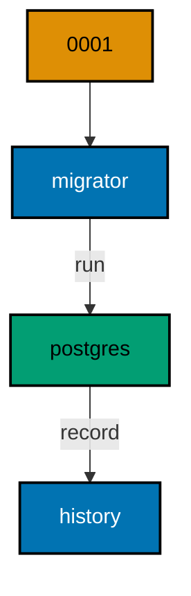

**`learning/code/ex-01-create-your-first-table/src/main.rs`**:

```rust
// Example 1: Create Your First Table.
// one versioned file creates one table.
use sqlx::Row; // => Row unlocks column reads by name on every result row

static MIGRATOR: sqlx::migrate::Migrator = sqlx::migrate!("./migrations"); // => embeds each file under migrations/ at compile time

// => one URL builder shared by the pool and every probe query
fn db_url() -> String {
    // => assemble the connection string from its parts
    format!(
        "postgres://{}@{}:{}/{}", // => trust auth: a user with no password
        std::env::var("PGUSER").unwrap_or_else(|_| String::from("postgres")), // => superuser in the service container
        std::env::var("PGHOST").unwrap_or_else(|_| String::from("postgres")), // => service alias on the unit network
        std::env::var("PGPORT").unwrap_or_else(|_| String::from("5432")), // => pinned PostgreSQL port
        std::env::var("PGDATABASE").unwrap_or_else(|_| String::from("postgres")), // => the service database name
    ) // => format returns the finished URL
} // => helper ends: every connection flows through here

#[tokio::main] // => the async runtime drives the pool and the queries
               // => main returns the database error so failures print it
async fn main() -> Result<(), sqlx::Error> {
    let pool = sqlx::postgres::PgPoolOptions::new() // => start from the default pool options
        .max_connections(5) // => five connections: migrate plus a few readers
        .connect(&db_url()) // => connect to the per-run service database
        .await?; // => ? bubbles a connection failure instead of panicking
    MIGRATOR.run(&pool).await?; // => bring the database current; re-runs find nothing new
    let rows =
        sqlx::query("SELECT version, description, success FROM _sqlx_migrations ORDER BY version") // => history rows in apply order
            .fetch_all(&pool) // => run the read against the same pool
            .await?; // => ? bubbles a query failure instead of panicking
    for row in rows {
        // => walk every recorded migration
        let version: i64 = row.get("version"); // => the migration number sqlx applied
        let description: String = row.get("description"); // => the file-name description with spaces
        let success: bool = row.get("success"); // => true once the migration committed
        println!("{version} {description} {success}"); // => one line per migration
    } // => loop ends after the last applied migration
    Ok(()) // => green run: every check printed
} // => main ends: the harness compares stdout to the golden file
```

**`learning/code/ex-01-create-your-first-table/migrations/0001_create_books.sql`**:

```sql
-- 0001: the first schema change; one file, one table. -- => the header names the migration under test
CREATE TABLE books ( -- => the migrator runs this file once, in version order
    id SERIAL PRIMARY KEY, -- => surrogate key: the row identity never changes
    title TEXT NOT NULL -- => every book must name itself
); -- => the definition closes here
```

**Output** (`learning/code/ex-01-create-your-first-table/expected/main.stdout.txt`):

```text
1 create books true
```

**Key takeaway**: Name migration files `0001_description.sql`; sqlx applies them in version order exactly once.

**Why it matters**: Versioned files turn schema changes into artifacts a team can review, approve, and replay. Hand-run SQL lives only in whoever typed it, so two environments drift apart the moment someone improvises a fix on one of them. A file under version control carries its intent in its name, its content in a diff, and its outcome in the history table. That chain lets a reviewer approve a change on Monday and trust it on production on Friday, because the file that ran is byte-identical to the file that was reviewed.

---

### Example 2: Add a Column with Alter

Schemas grow one column at a time, and each growth is its own migration. Here `0001` creates an `authors` table and `0002` adds an `email` column with `ALTER TABLE`. Nothing in `0001` is edited: the history stays append-only.

The program runs both files, then asks `information_schema` for the table's columns in definition order. The output lists all three columns, proving the alter landed on top of the create without touching existing structure.

(Concepts: co-01.)

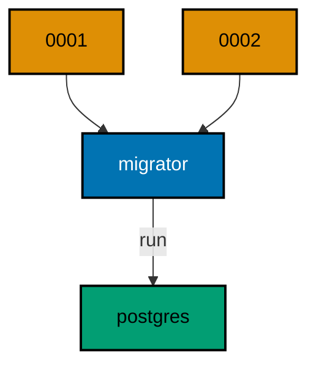

**`learning/code/ex-02-add-a-column-with-alter/src/main.rs`**:

```rust
// Example 2: Add a Column with Alter.
// V2 alters the table V1 created.
use sqlx::Row; // => Row unlocks column reads by name on every result row

static MIGRATOR: sqlx::migrate::Migrator = sqlx::migrate!("./migrations"); // => embeds each file under migrations/ at compile time

// => one URL builder shared by the pool and every probe query
fn db_url() -> String {
    // => assemble the connection string from its parts
    format!(
        "postgres://{}@{}:{}/{}", // => trust auth: a user with no password
        std::env::var("PGUSER").unwrap_or_else(|_| String::from("postgres")), // => superuser in the service container
        std::env::var("PGHOST").unwrap_or_else(|_| String::from("postgres")), // => service alias on the unit network
        std::env::var("PGPORT").unwrap_or_else(|_| String::from("5432")), // => pinned PostgreSQL port
        std::env::var("PGDATABASE").unwrap_or_else(|_| String::from("postgres")), // => the service database name
    ) // => format returns the finished URL
} // => helper ends: every connection flows through here

#[tokio::main] // => the async runtime drives the pool and the queries
               // => main returns the database error so failures print it
async fn main() -> Result<(), sqlx::Error> {
    let pool = sqlx::postgres::PgPoolOptions::new() // => start from the default pool options
        .max_connections(5) // => five connections: migrate plus a few readers
        .connect(&db_url()) // => connect to the per-run service database
        .await?; // => ? bubbles a connection failure instead of panicking
    MIGRATOR.run(&pool).await?; // => apply 0001 then 0002; nothing in 0001 is edited
    let rows = sqlx::query("SELECT column_name FROM information_schema.columns WHERE table_name = 'authors' ORDER BY ordinal_position") // => the table shape after both files
        .fetch_all(&pool) // => run the read against the same pool
        .await?; // => ? bubbles a query failure instead of panicking
    for row in rows {
        // => walk every column in definition order
        let name: String = row.get("column_name"); // => each column the two migrations built
        println!("{name}"); // => one line per column
    } // => loop ends after the last column
    Ok(()) // => green run: the alter landed on top of the create
} // => main ends: the harness compares stdout to the golden file
```

**`learning/code/ex-02-add-a-column-with-alter/migrations/0001_create_authors.sql`**:

```sql
-- 0001: authors start with an id and a name. -- => the create every later file builds on
CREATE TABLE authors ( -- => the migrator runs this file once, in version order
    id SERIAL PRIMARY KEY, -- => surrogate key: the row identity never changes
    name TEXT NOT NULL -- => every author must be named
); -- => the definition closes here
```

**`learning/code/ex-02-add-a-column-with-alter/migrations/0002_add_email.sql`**:

```sql
-- 0002: growth is a new file, never an edit to 0001. -- => append-only history keeps reviews honest
ALTER TABLE authors -- => the existing table keeps every row it already holds
    ADD COLUMN email TEXT; -- => nullable first: old rows need no backfill yet
```

**Output** (`learning/code/ex-02-add-a-column-with-alter/expected/main.stdout.txt`):

```text
id
name
email
```

**Key takeaway**: Grow tables with new versioned files; never edit an applied migration to add a column.

**Why it matters**: Append-only history is what makes a migration reviewable after the fact. When every change is a new file, the history table tells the exact story of how the schema reached its shape, and any reviewer can replay it from scratch. Editing an applied file instead rewrites that story: the database remembers one checksum while the file carries another, and the next run fails loudly. Teams that keep history append-only never have to argue about what ran where, because the answer is always the file list.

---

### Example 3: Migrations Run Once

Running the migrator twice must change nothing the second time. This example calls `run` twice in one program against the same database. The history table proves the second run found no pending work.

Idempotent runs are what make migrations safe in deploys, retries, and restarts. The program runs the migrator, runs it again, then counts the history rows: one file means exactly one row no matter how many times the binary starts.

(Concepts: co-01, co-03.)

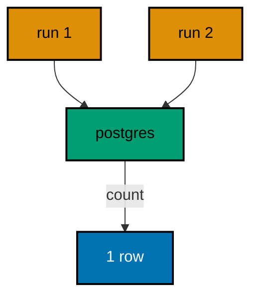

**`learning/code/ex-03-migrations-run-once/src/main.rs`**:

```rust
// Example 3: Migrations Run Once.
// the second run finds nothing pending.
use sqlx::Row; // => Row unlocks column reads by name on every result row

static MIGRATOR: sqlx::migrate::Migrator = sqlx::migrate!("./migrations"); // => embeds each file under migrations/ at compile time

// => one URL builder shared by the pool and every probe query
fn db_url() -> String {
    // => assemble the connection string from its parts
    format!(
        "postgres://{}@{}:{}/{}", // => trust auth: a user with no password
        std::env::var("PGUSER").unwrap_or_else(|_| String::from("postgres")), // => superuser in the service container
        std::env::var("PGHOST").unwrap_or_else(|_| String::from("postgres")), // => service alias on the unit network
        std::env::var("PGPORT").unwrap_or_else(|_| String::from("5432")), // => pinned PostgreSQL port
        std::env::var("PGDATABASE").unwrap_or_else(|_| String::from("postgres")), // => the service database name
    ) // => format returns the finished URL
} // => helper ends: every connection flows through here

#[tokio::main] // => the async runtime drives the pool and the queries
               // => main returns the database error so failures print it
async fn main() -> Result<(), sqlx::Error> {
    let pool = sqlx::postgres::PgPoolOptions::new() // => start from the default pool options
        .max_connections(5) // => five connections: migrate plus a few readers
        .connect(&db_url()) // => connect to the per-run service database
        .await?; // => ? bubbles a connection failure instead of panicking
    MIGRATOR.run(&pool).await?; // => first run applies the one file
    MIGRATOR.run(&pool).await?; // => second run finds nothing pending
    let row = sqlx::query("SELECT COUNT(*) AS n FROM _sqlx_migrations") // => the whole recorded history
        .fetch_one(&pool) // => exactly one count row comes back
        .await?; // => ? bubbles a query failure instead of panicking
    let n: i64 = row.get("n"); // => one file means one row, however many runs
    println!("history rows after two runs: {n}"); // => the idempotence claim, printed
    Ok(()) // => green run: reruns are safe by construction
} // => main ends: the harness compares stdout to the golden file
```

**`learning/code/ex-03-migrations-run-once/migrations/0001_create_books.sql`**:

```sql
-- 0001: one file, one table, applied once. -- => the file both runs resolve
CREATE TABLE books ( -- => the migrator runs this file once, in version order
    id SERIAL PRIMARY KEY, -- => surrogate key: the row identity never changes
    title TEXT NOT NULL -- => every book must name itself
); -- => the definition closes here
```

**Output** (`learning/code/ex-03-migrations-run-once/expected/main.stdout.txt`):

```text
history rows after two runs: 1
```

**Key takeaway**: Re-running the migrator is always safe: applied versions are skipped, never re-applied.

**Why it matters**: Deploys retry, containers restart, and pipelines re-run steps they already finished. A migration tool that cannot run twice forces every operator to track what already applied, which is exactly the bookkeeping teams get wrong at 3 AM. Because sqlx records each version in the history table and skips applied ones, the same binary can run on every deploy without flags or lock-step coordination. Idempotent runs turn migrations from a scary manual step into boring automation, and boring is the highest praise infrastructure can earn.

---

### Example 4: History Table Records Every Run

Every applied migration leaves one row in `_sqlx_migrations` with its version, description, and success flag. This example applies two files and reads the table back. The two rows are the audit trail the rest of the course inspects.

The history table is the only source of truth the migrator trusts: version for order, description for humans, success for failure detection, checksum for tamper detection. Later examples query each of those columns; this one shows the shape of the whole record.

(Concepts: co-03.)

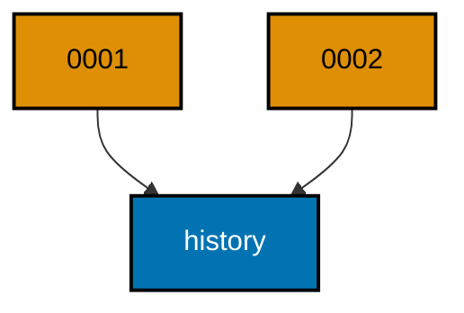

**`learning/code/ex-04-history-table-records-every-run/src/main.rs`**:

```rust
// Example 4: History Table Records Every Run.
// two files leave two rows behind.
use sqlx::Row; // => Row unlocks column reads by name on every result row

static MIGRATOR: sqlx::migrate::Migrator = sqlx::migrate!("./migrations"); // => embeds each file under migrations/ at compile time

// => one URL builder shared by the pool and every probe query
fn db_url() -> String {
    // => assemble the connection string from its parts
    format!(
        "postgres://{}@{}:{}/{}", // => trust auth: a user with no password
        std::env::var("PGUSER").unwrap_or_else(|_| String::from("postgres")), // => superuser in the service container
        std::env::var("PGHOST").unwrap_or_else(|_| String::from("postgres")), // => service alias on the unit network
        std::env::var("PGPORT").unwrap_or_else(|_| String::from("5432")), // => pinned PostgreSQL port
        std::env::var("PGDATABASE").unwrap_or_else(|_| String::from("postgres")), // => the service database name
    ) // => format returns the finished URL
} // => helper ends: every connection flows through here

#[tokio::main] // => the async runtime drives the pool and the queries
               // => main returns the database error so failures print it
async fn main() -> Result<(), sqlx::Error> {
    let pool = sqlx::postgres::PgPoolOptions::new() // => start from the default pool options
        .max_connections(5) // => five connections: migrate plus a few readers
        .connect(&db_url()) // => connect to the per-run service database
        .await?; // => ? bubbles a connection failure instead of panicking
    MIGRATOR.run(&pool).await?; // => both files apply in version order
    let rows =
        sqlx::query("SELECT version, description, success FROM _sqlx_migrations ORDER BY version") // => the audit trail in apply order
            .fetch_all(&pool) // => run the read against the same pool
            .await?; // => ? bubbles a query failure instead of panicking
    for row in rows {
        // => walk every recorded migration
        let version: i64 = row.get("version"); // => the migration number sqlx applied
        let description: String = row.get("description"); // => the file-name description with spaces
        let success: bool = row.get("success"); // => true once the migration committed
        println!("{version} {description} {success}"); // => one line per migration
    } // => loop ends after the last applied migration
    Ok(()) // => green run: the audit trail is complete
} // => main ends: the harness compares stdout to the golden file
```

**`learning/code/ex-04-history-table-records-every-run/migrations/0001_create_books.sql`**:

```sql
-- 0001: books come first. -- => the first row in the audit trail
CREATE TABLE books ( -- => the migrator runs this file once, in version order
    id SERIAL PRIMARY KEY, -- => surrogate key: the row identity never changes
    title TEXT NOT NULL -- => every book must name itself
); -- => the definition closes here
```

**`learning/code/ex-04-history-table-records-every-run/migrations/0002_create_authors.sql`**:

```sql
-- 0002: authors come second. -- => the second row in the audit trail
CREATE TABLE authors ( -- => the migrator runs this file once, in version order
    id SERIAL PRIMARY KEY, -- => surrogate key: the row identity never changes
    name TEXT NOT NULL -- => every author must be named
); -- => the definition closes here
```

**Output** (`learning/code/ex-04-history-table-records-every-run/expected/main.stdout.txt`):

```text
1 create books true
2 create authors true
```

**Key takeaway**: Read `_sqlx_migrations` to see exactly which versions applied, in which order, and whether each succeeded.

**Why it matters**: When a deploy goes wrong, the first question is always what already ran. Logs scroll, dashboards aggregate, but the history table answers with one query: version, description, success, in order. That precision is what turns a migration failure from archaeology into a lookup. Engineers who read the history table first diagnose in minutes; engineers who guess from logs diagnose in hours. The table is small, exact, and always there, which makes it the cheapest observability a database team owns.

---

### Example 5: Version Numbers Order Execution

The numeric prefix decides apply order, not file creation time or name length. This example ships three files whose descriptions would sort differently as text. The history proves sqlx applied them by version: 1, 2, 3.

Teams collide on order when they assume alphabetical or timestamp order matches intent. sqlx parses the leading integer and sorts numerically, so `0002` always runs between `0001` and `0003` no matter when each file was written or who wrote it.

(Concepts: co-01, co-04.)

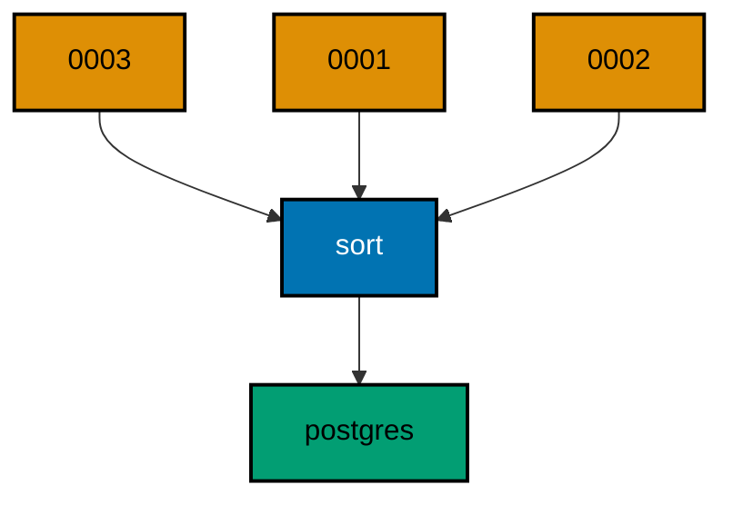

**`learning/code/ex-05-version-numbers-order-execution/src/main.rs`**:

```rust
// Example 5: Version Numbers Order Execution.
// numbers decide the order, not names.
use sqlx::Row; // => Row unlocks column reads by name on every result row

static MIGRATOR: sqlx::migrate::Migrator = sqlx::migrate!("./migrations"); // => embeds each file under migrations/ at compile time

// => one URL builder shared by the pool and every probe query
fn db_url() -> String {
    // => assemble the connection string from its parts
    format!(
        "postgres://{}@{}:{}/{}", // => trust auth: a user with no password
        std::env::var("PGUSER").unwrap_or_else(|_| String::from("postgres")), // => superuser in the service container
        std::env::var("PGHOST").unwrap_or_else(|_| String::from("postgres")), // => service alias on the unit network
        std::env::var("PGPORT").unwrap_or_else(|_| String::from("5432")), // => pinned PostgreSQL port
        std::env::var("PGDATABASE").unwrap_or_else(|_| String::from("postgres")), // => the service database name
    ) // => format returns the finished URL
} // => helper ends: every connection flows through here

#[tokio::main] // => the async runtime drives the pool and the queries
               // => main returns the database error so failures print it
async fn main() -> Result<(), sqlx::Error> {
    let pool = sqlx::postgres::PgPoolOptions::new() // => start from the default pool options
        .max_connections(5) // => five connections: migrate plus a few readers
        .connect(&db_url()) // => connect to the per-run service database
        .await?; // => ? bubbles a connection failure instead of panicking
    MIGRATOR.run(&pool).await?; // => three files apply in numeric version order
    let rows = sqlx::query("SELECT version, description FROM _sqlx_migrations ORDER BY version") // => the order sqlx chose
        .fetch_all(&pool) // => run the read against the same pool
        .await?; // => ? bubbles a query failure instead of panicking
    for row in rows {
        // => walk every recorded migration
        let version: i64 = row.get("version"); // => the numeric prefix sqlx sorted on
        let description: String = row.get("description"); // => the human text after the prefix
        println!("{version} {description}"); // => one line per migration, in apply order
    } // => loop ends after the last applied migration
    Ok(()) // => green run: numeric order held
} // => main ends: the harness compares stdout to the golden file
```

**`learning/code/ex-05-version-numbers-order-execution/migrations/0001_create_customers.sql`**:

```sql
-- 0001: customers anchor the shop schema. -- => first by number, first to apply
CREATE TABLE customers ( -- => the migrator runs this file once, in version order
    id SERIAL PRIMARY KEY, -- => surrogate key: the row identity never changes
    name TEXT NOT NULL -- => every customer must be named
); -- => the definition closes here
```

**`learning/code/ex-05-version-numbers-order-execution/migrations/0002_create_orders.sql`**:

```sql
-- 0002: orders reference customers. -- => second by number, runs in the middle
CREATE TABLE orders ( -- => the migrator runs this file once, in version order
    id SERIAL PRIMARY KEY, -- => surrogate key: the row identity never changes
    customer_id INTEGER NOT NULL REFERENCES customers (id) -- => every order belongs to a customer
); -- => the definition closes here
```

**`learning/code/ex-05-version-numbers-order-execution/migrations/0003_create_items.sql`**:

```sql
-- 0003: items belong to orders. -- => third by number, runs last
CREATE TABLE items ( -- => the migrator runs this file once, in version order
    id SERIAL PRIMARY KEY, -- => surrogate key: the row identity never changes
    order_id INTEGER NOT NULL REFERENCES orders (id) -- => every item belongs to an order
); -- => the definition closes here
```

**Output** (`learning/code/ex-05-version-numbers-order-execution/expected/main.stdout.txt`):

```text
1 create customers
2 create orders
3 create items
```

**Key takeaway**: Zero-padded numeric prefixes keep versions sorting correctly past 9, 99, and 999.

**Why it matters**: Order bugs are silent until they are catastrophic: a foreign key created before its parent table fails loudly, but a backfill written against the wrong column order corrupts quietly. Numeric prefixes remove the ambiguity by making order explicit in the file name, visible in every directory listing and every code review. Zero-padding keeps that order stable as the count grows, so the hundredth migration sorts as naturally as the first. Explicit order is a kindness to the future reader who inherits the schema.

---

### Example 6: Descriptions Document Intent

The text after the version prefix becomes the human-readable description in the history table. This example uses long, intent-revealing descriptions. The history rows read like a changelog entry, not a code comment.

Underscores in the file name become spaces in the description, so `0002_add_customer_email` records as `add customer email`. Future engineers read the history table to learn why the schema changed; a description written as intent repays them, while `update` or `fix` tells them nothing.

(Concepts: co-01.)

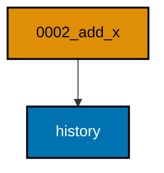

**`learning/code/ex-06-descriptions-document-intent/src/main.rs`**:

```rust
// Example 6: Descriptions Document Intent.
// file names become history text.
use sqlx::Row; // => Row unlocks column reads by name on every result row

static MIGRATOR: sqlx::migrate::Migrator = sqlx::migrate!("./migrations"); // => embeds each file under migrations/ at compile time

// => one URL builder shared by the pool and every probe query
fn db_url() -> String {
    // => assemble the connection string from its parts
    format!(
        "postgres://{}@{}:{}/{}", // => trust auth: a user with no password
        std::env::var("PGUSER").unwrap_or_else(|_| String::from("postgres")), // => superuser in the service container
        std::env::var("PGHOST").unwrap_or_else(|_| String::from("postgres")), // => service alias on the unit network
        std::env::var("PGPORT").unwrap_or_else(|_| String::from("5432")), // => pinned PostgreSQL port
        std::env::var("PGDATABASE").unwrap_or_else(|_| String::from("postgres")), // => the service database name
    ) // => format returns the finished URL
} // => helper ends: every connection flows through here

#[tokio::main] // => the async runtime drives the pool and the queries
               // => main returns the database error so failures print it
async fn main() -> Result<(), sqlx::Error> {
    let pool = sqlx::postgres::PgPoolOptions::new() // => start from the default pool options
        .max_connections(5) // => five connections: migrate plus a few readers
        .connect(&db_url()) // => connect to the per-run service database
        .await?; // => ? bubbles a connection failure instead of panicking
    MIGRATOR.run(&pool).await?; // => both files apply; descriptions land in history
    let rows = sqlx::query("SELECT version, description FROM _sqlx_migrations ORDER BY version") // => the human text sqlx recorded
        .fetch_all(&pool) // => run the read against the same pool
        .await?; // => ? bubbles a query failure instead of panicking
    for row in rows {
        // => walk every recorded migration
        let version: i64 = row.get("version"); // => the numeric prefix sqlx sorted on
        let description: String = row.get("description"); // => underscores became spaces here
        println!("{version} {description}"); // => one changelog line per migration
    } // => loop ends after the last applied migration
    Ok(()) // => green run: intent is on record
} // => main ends: the harness compares stdout to the golden file
```

**`learning/code/ex-06-descriptions-document-intent/migrations/0001_create_customers.sql`**:

```sql
-- 0001: customers anchor the shop schema. -- => intent lives in the file name
CREATE TABLE customers ( -- => the migrator runs this file once, in version order
    id SERIAL PRIMARY KEY, -- => surrogate key: the row identity never changes
    name TEXT NOT NULL -- => every customer must be named
); -- => the definition closes here
```

**`learning/code/ex-06-descriptions-document-intent/migrations/0002_add_customer_email_nullable.sql`**:

```sql
-- 0002: email arrives nullable so old rows survive. -- => the why is visible before opening the file
ALTER TABLE customers -- => the existing table keeps every row it already holds
    ADD COLUMN email TEXT; -- => nullable first: contact data fills in later
```

**Output** (`learning/code/ex-06-descriptions-document-intent/expected/main.stdout.txt`):

```text
1 create customers
2 add customer email nullable
```

**Key takeaway**: Write descriptions as intent (`add_customer_email_nullable`), not mechanics (`alter_table_2`).

**Why it matters**: Schema archaeology is a real activity: during an incident, someone reads the migration history to find when a column appeared and why. A description like `add customer email nullable` answers both in one glance; `alter 2` answers neither and forces a diff read under pressure. Good descriptions cost seconds at writing time and save minutes at incident time, which is the cheapest trade in operations. The history table is a changelog the team writes whether it means to or not, so it pays to write it well.

---

### Example 7: Alter Safely Keeps Data

An alter must preserve the rows its predecessors inserted. This example seeds one inventory row in `0002` and adds a quantity column with a default in `0003`. The final query proves the seeded row survived with its quantity defaulted.

Data loss hides in alters that look harmless: a new `NOT NULL` column without a default fails on tables that already hold rows. Giving the column a default keeps the alter total, so old rows gain a sensible value instead of blocking the migration.

(Concepts: co-01.)

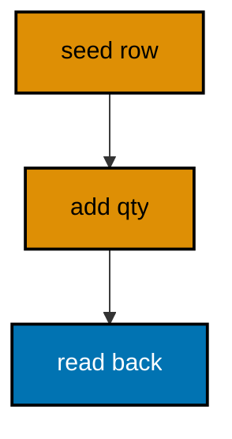

**`learning/code/ex-07-alter-safely-keeps-data/src/main.rs`**:

```rust
// Example 7: Alter Safely Keeps Data.
// the seeded row survives the alter.
use sqlx::Row; // => Row unlocks column reads by name on every result row

static MIGRATOR: sqlx::migrate::Migrator = sqlx::migrate!("./migrations"); // => embeds each file under migrations/ at compile time

// => one URL builder shared by the pool and every probe query
fn db_url() -> String {
    // => assemble the connection string from its parts
    format!(
        "postgres://{}@{}:{}/{}", // => trust auth: a user with no password
        std::env::var("PGUSER").unwrap_or_else(|_| String::from("postgres")), // => superuser in the service container
        std::env::var("PGHOST").unwrap_or_else(|_| String::from("postgres")), // => service alias on the unit network
        std::env::var("PGPORT").unwrap_or_else(|_| String::from("5432")), // => pinned PostgreSQL port
        std::env::var("PGDATABASE").unwrap_or_else(|_| String::from("postgres")), // => the service database name
    ) // => format returns the finished URL
} // => helper ends: every connection flows through here

#[tokio::main] // => the async runtime drives the pool and the queries
               // => main returns the database error so failures print it
async fn main() -> Result<(), sqlx::Error> {
    let pool = sqlx::postgres::PgPoolOptions::new() // => start from the default pool options
        .max_connections(5) // => five connections: migrate plus a few readers
        .connect(&db_url()) // => connect to the per-run service database
        .await?; // => ? bubbles a connection failure instead of panicking
    MIGRATOR.run(&pool).await?; // => create, seed, then alter in version order
    let row = sqlx::query("SELECT sku, qty FROM inventory") // => the seeded row after the alter
        .fetch_one(&pool) // => exactly one seeded row exists
        .await?; // => ? bubbles a query failure instead of panicking
    let sku: String = row.get("sku"); // => the value the seed file inserted
    let qty: i32 = row.get("qty"); // => the default the alter file supplied
    println!("{sku} {qty}"); // => survival plus default, printed together
    Ok(()) // => green run: data outlived the schema change
} // => main ends: the harness compares stdout to the golden file
```

**`learning/code/ex-07-alter-safely-keeps-data/migrations/0001_create_inventory.sql`**:

```sql
-- 0001: inventory starts with sku only. -- => quantity arrives in a later file
CREATE TABLE inventory ( -- => the migrator runs this file once, in version order
    id SERIAL PRIMARY KEY, -- => surrogate key: the row identity never changes
    sku TEXT NOT NULL -- => the stock-keeping unit every row carries
); -- => the definition closes here
```

**`learning/code/ex-07-alter-safely-keeps-data/migrations/0002_seed_first_row.sql`**:

```sql
-- 0002: one real row before the alter. -- => the row the alter must preserve
INSERT INTO inventory (sku) -- => seed data ships as a migration, not a side load
    VALUES ('WIDGET-1'); -- => the survivor under test
```

**`learning/code/ex-07-alter-safely-keeps-data/migrations/0003_add_quantity.sql`**:

```sql
-- 0003: quantity defaults so the old row survives. -- => NOT NULL needs a default on live tables
ALTER TABLE inventory -- => the existing row stays exactly where it is
    ADD COLUMN qty INTEGER NOT NULL DEFAULT 0; -- => old rows gain zero, new rows must say
```

**Output** (`learning/code/ex-07-alter-safely-keeps-data/expected/main.stdout.txt`):

```text
WIDGET-1 0
```

**Key takeaway**: Pair every `NOT NULL` column addition with a default or a backfill, or the alter fails on live data.

**Why it matters**: The empty-table alter always works, which makes it a liar: it passes in development and fails in production where rows exist. A `NOT NULL` column without a default cannot fill existing rows, so PostgreSQL rejects the whole migration and the deploy stalls. Defaults and backfills are the difference between a migration tested on real-shaped data and one tested on an empty toy. Writing the seed in the same chain as the alter proves the combination works before production has to.

---

### Example 8: One Migration One Change

Each file should do exactly one thing so it can be reviewed, reverted, and reasoned about alone. This example creates `teams` and `members` in two focused files. The final count proves both landed, each from its own version.

Big-bang files bundle unrelated changes behind one version number, so a failure in the second half blocks the innocent first half, and a revert removes both. Small files keep blast radius small: each version is one reviewable, reversible decision with its own history row.

(Concepts: co-01.)

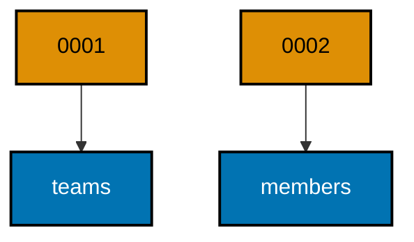

**`learning/code/ex-08-one-migration-one-change/src/main.rs`**:

```rust
// Example 8: One Migration One Change.
// each file owns exactly one table.
use sqlx::Row; // => Row unlocks column reads by name on every result row

static MIGRATOR: sqlx::migrate::Migrator = sqlx::migrate!("./migrations"); // => embeds each file under migrations/ at compile time

// => one URL builder shared by the pool and every probe query
fn db_url() -> String {
    // => assemble the connection string from its parts
    format!(
        "postgres://{}@{}:{}/{}", // => trust auth: a user with no password
        std::env::var("PGUSER").unwrap_or_else(|_| String::from("postgres")), // => superuser in the service container
        std::env::var("PGHOST").unwrap_or_else(|_| String::from("postgres")), // => service alias on the unit network
        std::env::var("PGPORT").unwrap_or_else(|_| String::from("5432")), // => pinned PostgreSQL port
        std::env::var("PGDATABASE").unwrap_or_else(|_| String::from("postgres")), // => the service database name
    ) // => format returns the finished URL
} // => helper ends: every connection flows through here

#[tokio::main] // => the async runtime drives the pool and the queries
               // => main returns the database error so failures print it
async fn main() -> Result<(), sqlx::Error> {
    let pool = sqlx::postgres::PgPoolOptions::new() // => start from the default pool options
        .max_connections(5) // => five connections: migrate plus a few readers
        .connect(&db_url()) // => connect to the per-run service database
        .await?; // => ? bubbles a connection failure instead of panicking
    MIGRATOR.run(&pool).await?; // => two focused files apply in version order
    let row = sqlx::query("SELECT COUNT(*) AS n FROM information_schema.tables WHERE table_name IN ('teams', 'members')") // => both tables the chain built
        .fetch_one(&pool) // => exactly one count row comes back
        .await?; // => ? bubbles a query failure instead of panicking
    let n: i64 = row.get("n"); // => two files means two tables
    println!("tables: {n}"); // => the one-change-per-file claim, counted
    Ok(()) // => green run: small files compose
} // => main ends: the harness compares stdout to the golden file
```

**`learning/code/ex-08-one-migration-one-change/migrations/0001_create_teams.sql`**:

```sql
-- 0001: teams stand alone. -- => one file, one table, one decision
CREATE TABLE teams ( -- => the migrator runs this file once, in version order
    id SERIAL PRIMARY KEY, -- => surrogate key: the row identity never changes
    name TEXT NOT NULL -- => every team must be named
); -- => the definition closes here
```

**`learning/code/ex-08-one-migration-one-change/migrations/0002_create_members.sql`**:

```sql
-- 0002: members reference teams. -- => the second decision, separately reviewable
CREATE TABLE members ( -- => the migrator runs this file once, in version order
    id SERIAL PRIMARY KEY, -- => surrogate key: the row identity never changes
    team_id INTEGER NOT NULL REFERENCES teams (id), -- => every member belongs to a team
    handle TEXT NOT NULL -- => every member picks a handle
); -- => the definition closes here
```

**Output** (`learning/code/ex-08-one-migration-one-change/expected/main.stdout.txt`):

```text
tables: 2
```

**Key takeaway**: Keep every migration file to one change; composition across versions is free, untangling is not.

**Why it matters**: A migration that does five things fails as one unit and reverts as one unit, which punishes the four innocent changes for the one broken change. Small files isolate risk: the failing version is obvious, the revert is surgical, and the review is a glance instead of an audit. The version sequence costs nothing, so there is no reason to batch. Teams that write one-change files spend their incident time fixing the actual problem instead of first excavating which part of a mega-file broke.

---

### Example 9: History Table Is the Source of Truth

Logs rot and memories differ, but `_sqlx_migrations` answers exactly what ran. This example applies three files and reports the count plus the latest version. Those two numbers fully describe the database state.

Every operational question about schema state reduces to a history query: how many ran, which is latest, which failed. The program asks both questions directly, so on-call engineers can copy the pattern instead of guessing from deploy logs.

(Concepts: co-03.)

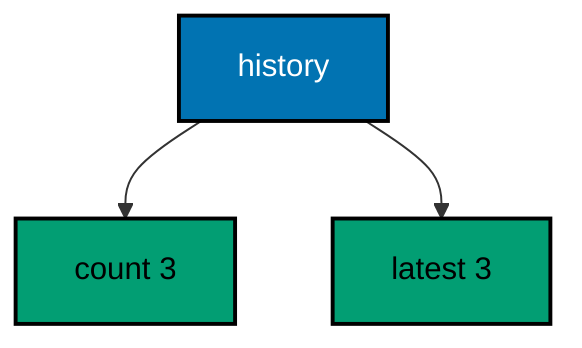

**`learning/code/ex-09-history-table-is-the-source-of-truth/src/main.rs`**:

```rust
// Example 9: History Table Is the Source of Truth.
// two numbers describe the whole database.
use sqlx::Row; // => Row unlocks column reads by name on every result row

static MIGRATOR: sqlx::migrate::Migrator = sqlx::migrate!("./migrations"); // => embeds each file under migrations/ at compile time

// => one URL builder shared by the pool and every probe query
fn db_url() -> String {
    // => assemble the connection string from its parts
    format!(
        "postgres://{}@{}:{}/{}", // => trust auth: a user with no password
        std::env::var("PGUSER").unwrap_or_else(|_| String::from("postgres")), // => superuser in the service container
        std::env::var("PGHOST").unwrap_or_else(|_| String::from("postgres")), // => service alias on the unit network
        std::env::var("PGPORT").unwrap_or_else(|_| String::from("5432")), // => pinned PostgreSQL port
        std::env::var("PGDATABASE").unwrap_or_else(|_| String::from("postgres")), // => the service database name
    ) // => format returns the finished URL
} // => helper ends: every connection flows through here

#[tokio::main] // => the async runtime drives the pool and the queries
               // => main returns the database error so failures print it
async fn main() -> Result<(), sqlx::Error> {
    let pool = sqlx::postgres::PgPoolOptions::new() // => start from the default pool options
        .max_connections(5) // => five connections: migrate plus a few readers
        .connect(&db_url()) // => connect to the per-run service database
        .await?; // => ? bubbles a connection failure instead of panicking
    MIGRATOR.run(&pool).await?; // => three files apply in version order
    let row = sqlx::query("SELECT COUNT(*) AS n, MAX(version) AS latest FROM _sqlx_migrations") // => the state summary in one row
        .fetch_one(&pool) // => aggregates always return exactly one row
        .await?; // => ? bubbles a query failure instead of panicking
    let n: i64 = row.get("n"); // => how many migrations applied
    let latest: i64 = row.get("latest"); // => the newest version on record
    println!("migrations applied: {n}"); // => the count claim, printed
    println!("latest version: {latest}"); // => the currency claim, printed
    Ok(()) // => green run: state is queryable
} // => main ends: the harness compares stdout to the golden file
```

**`learning/code/ex-09-history-table-is-the-source-of-truth/migrations/0001_create_tenants.sql`**:

```sql
-- 0001: tenants anchor the SaaS schema. -- => the first of three recorded runs
CREATE TABLE tenants ( -- => the migrator runs this file once, in version order
    id SERIAL PRIMARY KEY, -- => surrogate key: the row identity never changes
    slug TEXT NOT NULL UNIQUE -- => every tenant owns a unique slug
); -- => the definition closes here
```

**`learning/code/ex-09-history-table-is-the-source-of-truth/migrations/0002_create_projects.sql`**:

```sql
-- 0002: projects belong to tenants. -- => the second of three recorded runs
CREATE TABLE projects ( -- => the migrator runs this file once, in version order
    id SERIAL PRIMARY KEY, -- => surrogate key: the row identity never changes
    tenant_id INTEGER NOT NULL REFERENCES tenants (id), -- => every project belongs to a tenant
    name TEXT NOT NULL -- => every project must be named
); -- => the definition closes here
```

**`learning/code/ex-09-history-table-is-the-source-of-truth/migrations/0003_create_tasks.sql`**:

```sql
-- 0003: tasks belong to projects. -- => the third of three recorded runs
CREATE TABLE tasks ( -- => the migrator runs this file once, in version order
    id SERIAL PRIMARY KEY, -- => surrogate key: the row identity never changes
    project_id INTEGER NOT NULL REFERENCES projects (id), -- => every task belongs to a project
    title TEXT NOT NULL -- => every task must be titled
); -- => the definition closes here
```

**Output** (`learning/code/ex-09-history-table-is-the-source-of-truth/expected/main.stdout.txt`):

```text
migrations applied: 3
latest version: 3
```

**Key takeaway**: Ask the history table for count and latest version before trusting any other signal about schema state.

**Why it matters**: Production incidents start with confusion about what is deployed, and migration state is the ground truth under every other signal. A dashboard can lag, a log line can be missed, but a row in the history table is either there or it is not. Making count-and-latest the first check builds a habit that pays off exactly when pressure is highest. Two numbers, one query, zero ambiguity: that is the whole point of recording migrations in the database they change.

---

### Example 10: Linear History Stays Mergeable

A straight version line merges cleanly because every developer extends the same tip. This example applies four sequential files and prints each recorded version. The unbroken 1-2-3-4 line is what parallel branches must preserve.

Merge pain comes from two branches claiming the same version number, never from the line itself. As long as each new file takes the next free integer, histories from different authors compose by concatenation, and the migrator never has to choose between competing files.

(Concepts: co-04.)

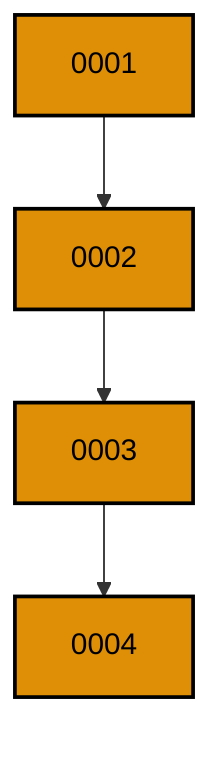

**`learning/code/ex-10-linear-history-stays-mergeable/src/main.rs`**:

```rust
// Example 10: Linear History Stays Mergeable.
// four versions form one clean line.
use sqlx::Row; // => Row unlocks column reads by name on every result row

static MIGRATOR: sqlx::migrate::Migrator = sqlx::migrate!("./migrations"); // => embeds each file under migrations/ at compile time

// => one URL builder shared by the pool and every probe query
fn db_url() -> String {
    // => assemble the connection string from its parts
    format!(
        "postgres://{}@{}:{}/{}", // => trust auth: a user with no password
        std::env::var("PGUSER").unwrap_or_else(|_| String::from("postgres")), // => superuser in the service container
        std::env::var("PGHOST").unwrap_or_else(|_| String::from("postgres")), // => service alias on the unit network
        std::env::var("PGPORT").unwrap_or_else(|_| String::from("5432")), // => pinned PostgreSQL port
        std::env::var("PGDATABASE").unwrap_or_else(|_| String::from("postgres")), // => the service database name
    ) // => format returns the finished URL
} // => helper ends: every connection flows through here

#[tokio::main] // => the async runtime drives the pool and the queries
               // => main returns the database error so failures print it
async fn main() -> Result<(), sqlx::Error> {
    let pool = sqlx::postgres::PgPoolOptions::new() // => start from the default pool options
        .max_connections(5) // => five connections: migrate plus a few readers
        .connect(&db_url()) // => connect to the per-run service database
        .await?; // => ? bubbles a connection failure instead of panicking
    MIGRATOR.run(&pool).await?; // => four files apply in version order
    let rows = sqlx::query("SELECT version FROM _sqlx_migrations ORDER BY version") // => the line the team shares
        .fetch_all(&pool) // => run the read against the same pool
        .await?; // => ? bubbles a query failure instead of panicking
    for row in rows {
        // => walk the line from oldest to newest
        let version: i64 = row.get("version"); // => each link in the chain
        println!("applied version {version}"); // => one line per link
    } // => loop ends after the newest version
    Ok(()) // => green run: the line is unbroken
} // => main ends: the harness compares stdout to the golden file
```

**`learning/code/ex-10-linear-history-stays-mergeable/migrations/0001_create_regions.sql`**:

```sql
-- 0001: regions anchor the rollout schema. -- => the first link in the line
CREATE TABLE regions ( -- => the migrator runs this file once, in version order
    id SERIAL PRIMARY KEY, -- => surrogate key: the row identity never changes
    code TEXT NOT NULL UNIQUE -- => every region owns a short code
); -- => the definition closes here
```

**`learning/code/ex-10-linear-history-stays-mergeable/migrations/0002_create_stores.sql`**:

```sql
-- 0002: stores belong to regions. -- => the second link in the line
CREATE TABLE stores ( -- => the migrator runs this file once, in version order
    id SERIAL PRIMARY KEY, -- => surrogate key: the row identity never changes
    region_id INTEGER NOT NULL REFERENCES regions (id), -- => every store sits in a region
    name TEXT NOT NULL -- => every store must be named
); -- => the definition closes here
```

**`learning/code/ex-10-linear-history-stays-mergeable/migrations/0003_create_stock.sql`**:

```sql
-- 0003: stock belongs to stores. -- => the third link in the line
CREATE TABLE stock ( -- => the migrator runs this file once, in version order
    id SERIAL PRIMARY KEY, -- => surrogate key: the row identity never changes
    store_id INTEGER NOT NULL REFERENCES stores (id), -- => every stock row sits in a store
    sku TEXT NOT NULL -- => every stock row names a product
); -- => the definition closes here
```

**`learning/code/ex-10-linear-history-stays-mergeable/migrations/0004_create_audits.sql`**:

```sql
-- 0004: audits watch the stock. -- => the fourth link in the line
CREATE TABLE audits ( -- => the migrator runs this file once, in version order
    id SERIAL PRIMARY KEY, -- => surrogate key: the row identity never changes
    stock_id INTEGER NOT NULL REFERENCES stock (id), -- => every audit covers a stock row
    noted_at TIMESTAMPTZ NOT NULL DEFAULT now() -- => the audit moment records itself
); -- => the definition closes here
```

**Output** (`learning/code/ex-10-linear-history-stays-mergeable/expected/main.stdout.txt`):

```text
applied version 1
applied version 2
applied version 3
applied version 4
```

**Key takeaway**: Extend the tip with the next free integer and parallel histories concatenate instead of colliding.

**Why it matters**: Branching models succeed or fail on their merge story, and migrations merge by number. When every author takes the next free integer, two branches contain disjoint version sets that simply interleave, and the combined history reads cleanly. The alternative, two authors minting the same number, is the only real conflict, and it is caught at review time by a glance at the file list. A linear convention turns version control from a risk into a non-event for schema work.

---

### Example 11: Late File Joins the Line

A version lower than the applied tip still applies when it arrives, as long as its number is free. This example runs a set with a gap, then runs a fuller set containing the missing middle. The gap fills without touching the files that already ran.

Real teams merge out of order: one branch ships versions 1 and 3 while another still finishes 2. sqlx compares embedded versions against applied rows and runs whatever is pending, so the late file slots into its numeric place and history stays sorted.

(Concepts: co-04.)

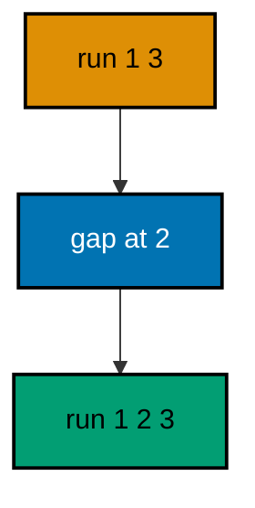

**`learning/code/ex-11-late-file-joins-the-line/src/main.rs`**:

```rust
// Example 11: Late File Joins the Line.
// the missing middle slots into place.
use sqlx::Row; // => Row unlocks column reads by name on every result row

static FIRST: sqlx::migrate::Migrator = sqlx::migrate!("./migrations"); // => versions 1 and 3 ship first
static FULL: sqlx::migrate::Migrator = sqlx::migrate!("./complete"); // => version 2 arrives with the merge

// => one URL builder shared by the pool and every probe query
fn db_url() -> String {
    // => assemble the connection string from its parts
    format!(
        "postgres://{}@{}:{}/{}", // => trust auth: a user with no password
        std::env::var("PGUSER").unwrap_or_else(|_| String::from("postgres")), // => superuser in the service container
        std::env::var("PGHOST").unwrap_or_else(|_| String::from("postgres")), // => service alias on the unit network
        std::env::var("PGPORT").unwrap_or_else(|_| String::from("5432")), // => pinned PostgreSQL port
        std::env::var("PGDATABASE").unwrap_or_else(|_| String::from("postgres")), // => the service database name
    ) // => format returns the finished URL
} // => helper ends: every connection flows through here

#[tokio::main] // => the async runtime drives the pool and the queries
               // => main returns the database error so failures print it
async fn main() -> Result<(), sqlx::Error> {
    let pool = sqlx::postgres::PgPoolOptions::new() // => start from the default pool options
        .max_connections(5) // => five connections: migrate plus a few readers
        .connect(&db_url()) // => connect to the per-run service database
        .await?; // => ? bubbles a connection failure instead of panicking
    FIRST.run(&pool).await?; // => versions 1 and 3 apply, leaving a gap at 2
    let rows = sqlx::query("SELECT version FROM _sqlx_migrations ORDER BY version") // => history with the gap
        .fetch_all(&pool) // => run the read against the same pool
        .await?; // => ? bubbles a query failure instead of panicking
    let first: Vec<i64> = rows.iter().map(|row| row.get("version")).collect(); // => versions 1 and 3 on record
    let line = first // => collect the report line first so the print stays short
        .iter() // => walk each element in turn
        .map(i64::to_string) // => render each version as text
        .collect::<Vec<_>>() // => gather into a printable list
        .join(" "); // => space the versions for one line
    println!("after first run: {line}"); // => the gap is visible
    FULL.run(&pool).await?; // => only version 2 is pending, so only it runs
    let rows = sqlx::query("SELECT version FROM _sqlx_migrations ORDER BY version") // => history with the gap filled
        .fetch_all(&pool) // => run the read against the same pool
        .await?; // => ? bubbles a query failure instead of panicking
    let full: Vec<i64> = rows.iter().map(|row| row.get("version")).collect(); // => versions 1, 2, and 3 on record
    let line = full // => collect the report line first so the print stays short
        .iter() // => walk each element in turn
        .map(i64::to_string) // => render each version as text
        .collect::<Vec<_>>() // => gather into a printable list
        .join(" "); // => space the versions for one line
    println!("after late file: {line}"); // => the line is whole
    Ok(()) // => green run: late files slot in
} // => main ends: the harness compares stdout to the golden file
```

**`learning/code/ex-11-late-file-joins-the-line/migrations/0001_create_alpha.sql`**:

```sql
-- 0001: alpha ships in the first batch. -- => applies once, skips on re-runs
CREATE TABLE alpha ( -- => the migrator runs this file once, in version order
    id SERIAL PRIMARY KEY, -- => surrogate key: the row identity never changes
    code TEXT NOT NULL -- => every alpha row carries a code
); -- => the definition closes here
```

**`learning/code/ex-11-late-file-joins-the-line/migrations/0003_create_gamma.sql`**:

```sql
-- 0003: gamma ships early, leaving a gap. -- => applies once, skips on re-runs
CREATE TABLE gamma ( -- => the migrator runs this file once, in version order
    id SERIAL PRIMARY KEY, -- => surrogate key: the row identity never changes
    code TEXT NOT NULL -- => every gamma row carries a code
); -- => the definition closes here
```

**`learning/code/ex-11-late-file-joins-the-line/complete/0001_create_alpha.sql`**:

```sql
-- 0001: alpha ships in the first batch. -- => applies once, skips on re-runs
CREATE TABLE alpha ( -- => the migrator runs this file once, in version order
    id SERIAL PRIMARY KEY, -- => surrogate key: the row identity never changes
    code TEXT NOT NULL -- => every alpha row carries a code
); -- => the definition closes here
```

**`learning/code/ex-11-late-file-joins-the-line/complete/0002_create_beta.sql`**:

```sql
-- 0002: beta arrives with the merge. -- => the only pending file in the second run
CREATE TABLE beta ( -- => the migrator runs this file once, in version order
    id SERIAL PRIMARY KEY, -- => surrogate key: the row identity never changes
    code TEXT NOT NULL -- => every beta row carries a code
); -- => the definition closes here
```

**`learning/code/ex-11-late-file-joins-the-line/complete/0003_create_gamma.sql`**:

```sql
-- 0003: gamma ships early, leaving a gap. -- => applies once, skips on re-runs
CREATE TABLE gamma ( -- => the migrator runs this file once, in version order
    id SERIAL PRIMARY KEY, -- => surrogate key: the row identity never changes
    code TEXT NOT NULL -- => every gamma row carries a code
); -- => the definition closes here
```

**Output** (`learning/code/ex-11-late-file-joins-the-line/expected/main.stdout.txt`):

```text
after first run: 1 3
after late file: 1 2 3
```

**Key takeaway**: Pending means embedded-but-not-applied: late files apply in numeric place with no repair step.

**Why it matters**: Parallel teams cannot synchronize every merge, so versions will arrive out of order and the tool must handle it without drama. sqlx handles it by comparing sets instead of remembering positions: anything embedded but not recorded is pending, regardless of when it shows up. That set logic is what lets one branch ship 1 and 3 on Monday while another finishes 2 on Tuesday, with Wednesday's deploy simply filling the gap. Order-independent arrival keeps teams moving without a migration freeze before every release.

---

### Example 12: Gaps in Versions Still Apply

Skipped numbers are legal: versions need order, not contiguity. This example jumps from `0001` to `0005`. Both files apply, and the history shows the gap plainly instead of failing on it.

Teams reserve ranges, skip numbers for abandoned work, or jump ahead for release alignment. sqlx never requires version N+1 to follow version N; it only requires each version to be greater than zero and unique. Gaps document decisions, like a withdrawn change, without breaking the chain.

(Concepts: co-04.)

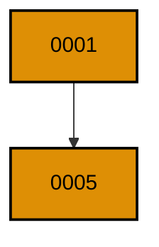

**`learning/code/ex-12-gaps-in-versions-still-apply/src/main.rs`**:

```rust
// Example 12: Gaps in Versions Still Apply.
// 1 then 5 is a legal history.
use sqlx::Row; // => Row unlocks column reads by name on every result row

static MIGRATOR: sqlx::migrate::Migrator = sqlx::migrate!("./migrations"); // => embeds each file under migrations/ at compile time

// => one URL builder shared by the pool and every probe query
fn db_url() -> String {
    // => assemble the connection string from its parts
    format!(
        "postgres://{}@{}:{}/{}", // => trust auth: a user with no password
        std::env::var("PGUSER").unwrap_or_else(|_| String::from("postgres")), // => superuser in the service container
        std::env::var("PGHOST").unwrap_or_else(|_| String::from("postgres")), // => service alias on the unit network
        std::env::var("PGPORT").unwrap_or_else(|_| String::from("5432")), // => pinned PostgreSQL port
        std::env::var("PGDATABASE").unwrap_or_else(|_| String::from("postgres")), // => the service database name
    ) // => format returns the finished URL
} // => helper ends: every connection flows through here

#[tokio::main] // => the async runtime drives the pool and the queries
               // => main returns the database error so failures print it
async fn main() -> Result<(), sqlx::Error> {
    let pool = sqlx::postgres::PgPoolOptions::new() // => start from the default pool options
        .max_connections(5) // => five connections: migrate plus a few readers
        .connect(&db_url()) // => connect to the per-run service database
        .await?; // => ? bubbles a connection failure instead of panicking
    MIGRATOR.run(&pool).await?; // => the gap between 1 and 5 changes nothing
    let rows = sqlx::query("SELECT version FROM _sqlx_migrations ORDER BY version") // => the gapped history
        .fetch_all(&pool) // => run the read against the same pool
        .await?; // => ? bubbles a query failure instead of panicking
    let versions: Vec<i64> = rows.iter().map(|row| row.get("version")).collect(); // => versions 1 and 5 on record
    let line = versions // => collect the report line first so the print stays short
        .iter() // => walk each element in turn
        .map(i64::to_string) // => render each version as text
        .collect::<Vec<_>>() // => gather into a printable list
        .join(" "); // => space the versions for one line
    println!("applied versions: {line}"); // => the gap, printed plainly
    Ok(()) // => green run: contiguity was never required
} // => main ends: the harness compares stdout to the golden file
```

**`learning/code/ex-12-gaps-in-versions-still-apply/migrations/0001_create_ledgers.sql`**:

```sql
-- 0001: ledgers open the books. -- => the first applied version
CREATE TABLE ledgers ( -- => the migrator runs this file once, in version order
    id SERIAL PRIMARY KEY, -- => surrogate key: the row identity never changes
    name TEXT NOT NULL -- => every ledger must be named
); -- => the definition closes here
```

**`learning/code/ex-12-gaps-in-versions-still-apply/migrations/0005_create_entries.sql`**:

```sql
-- 0005: entries skip ahead by design. -- => versions 2-4 stay free for withdrawn work
CREATE TABLE entries ( -- => the migrator runs this file once, in version order
    id SERIAL PRIMARY KEY, -- => surrogate key: the row identity never changes
    ledger_id INTEGER NOT NULL REFERENCES ledgers (id), -- => every entry posts to a ledger
    amount INTEGER NOT NULL -- => amounts store as integer minor units
); -- => the definition closes here
```

**Output** (`learning/code/ex-12-gaps-in-versions-still-apply/expected/main.stdout.txt`):

```text
applied versions: 1 5
```

**Key takeaway**: Reserve or skip version numbers freely; sqlx sorts what exists and never demands a contiguous line.

**Why it matters**: Numbering schemes rot when they forbid gaps: teams start reusing withdrawn numbers, colliding with half-remembered branches, because the tool punished honesty. Allowing gaps keeps the history truthful about what happened, including the abandoned experiment whose number stays empty forever. An empty slot costs nothing and prevents the far worse outcome of two different changes sharing one version. Truthful numbering is a feature, not sloppiness.

---

### Example 13: Edited Migration Fails Validation

Editing an applied file changes its checksum, and sqlx refuses to run a history whose files no longer match. This example applies one file, then resolves a tampered copy with a stricter column. The second run fails with a version-mismatch error naming version 1.

The checksum comparison is the tamper seal on the whole system: SHA-384 over the file bytes, stored at apply time, rechecked on every run. A mismatch means someone rewrote history, whether by malice or by a well-meaning cleanup, and the migrator stops rather than guessing which copy is right.

(Concepts: co-11.)

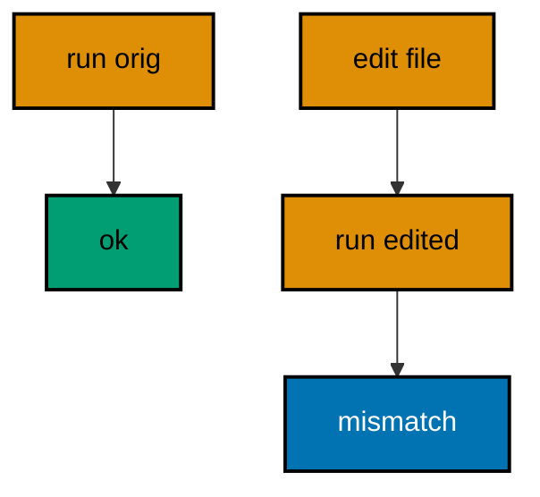

**`learning/code/ex-13-edited-migration-fails-validation/src/main.rs`**:

```rust
// Example 13: Edited Migration Fails Validation.
// the tampered copy fails the checksum.
use sqlx::migrate::MigrateError; // => the error enum names every failure mode

static ORIGINAL: sqlx::migrate::Migrator = sqlx::migrate!("./migrations"); // => the file as reviewed and applied
static EDITED: sqlx::migrate::Migrator = sqlx::migrate!("./edited"); // => the same version with a stricter column

// => one URL builder shared by the pool and every probe query
fn db_url() -> String {
    // => assemble the connection string from its parts
    format!(
        "postgres://{}@{}:{}/{}", // => trust auth: a user with no password
        std::env::var("PGUSER").unwrap_or_else(|_| String::from("postgres")), // => superuser in the service container
        std::env::var("PGHOST").unwrap_or_else(|_| String::from("postgres")), // => service alias on the unit network
        std::env::var("PGPORT").unwrap_or_else(|_| String::from("5432")), // => pinned PostgreSQL port
        std::env::var("PGDATABASE").unwrap_or_else(|_| String::from("postgres")), // => the service database name
    ) // => format returns the finished URL
} // => helper ends: every connection flows through here

#[tokio::main] // => the async runtime drives the pool and the queries
               // => main returns the database error so failures print it
async fn main() -> Result<(), sqlx::Error> {
    let pool = sqlx::postgres::PgPoolOptions::new() // => start from the default pool options
        .max_connections(5) // => five connections: migrate plus a few readers
        .connect(&db_url()) // => connect to the per-run service database
        .await?; // => ? bubbles a connection failure instead of panicking
    ORIGINAL.run(&pool).await?; // => version 1 applies and records its checksum
                                // => the same version with different bytes
    match EDITED.run(&pool).await {
        Err(MigrateError::VersionMismatch(version)) => {
            // => the tamper seal trips here
            println!(
                "second run failed: migration {version} was previously applied but has been modified"
            ); // => the exact failure, printed
        } // => match arm ends: the expected failure is handled
        Err(other) => panic!("unexpected error: {other}"), // => any other failure is a test bug
        Ok(()) => panic!("edited migration should not apply"), // => silent success would void the seal
    } // => match ends: every outcome is classified
    Ok(()) // => green run: tampering is caught, not applied
} // => main ends: the harness compares stdout to the golden file
```

**`learning/code/ex-13-edited-migration-fails-validation/migrations/0001_create_books.sql`**:

```sql
-- 0001: the reviewed copy; title stays nullable. -- => the checksum recorded at apply time
CREATE TABLE books ( -- => the migrator runs this file once, in version order
    id SERIAL PRIMARY KEY, -- => surrogate key: the row identity never changes
    title TEXT -- => nullable in the reviewed copy
); -- => the definition closes here
```

**`learning/code/ex-13-edited-migration-fails-validation/edited/0001_create_books.sql`**:

```sql
-- 0001: the tampered copy; title turned strict. -- => different bytes, different checksum
CREATE TABLE books ( -- => same version number, different content
    id SERIAL PRIMARY KEY, -- => surrogate key: the row identity never changes
    title TEXT NOT NULL -- => the well-meaning cleanup that breaks the seal
); -- => the definition closes here
```

**Output** (`learning/code/ex-13-edited-migration-fails-validation/expected/main.stdout.txt`):

```text
second run failed: migration 1 was previously applied but has been modified
```

**Key takeaway**: Fix forward with a new version; editing an applied file trips the checksum and stops the run.

**Why it matters**: Silent history rewrites are how teams lose trust in their own databases: the file says one thing, the database did another, and nobody can reconstruct which migrations actually shaped production. The checksum turns that class of confusion into a loud, immediate error that names the version. Loud beats silent every time, because a stopped deploy gets investigated while a quietly divergent schema gets discovered during an outage. The seal protects the team from its own good intentions.

---

### Example 14: Checksums Guard Every Row

Each history row carries the SHA-384 checksum of the file that produced it. This example applies two files and reads back both checksums. The 48-byte values prove every applied row is sealed individually.

Per-row checksums mean verification is granular: one tampered file fails while its innocent neighbors stay valid, and the error names the exact version. The program prints each checksum length to show the seal without flooding output with hex.

(Concepts: co-11.)

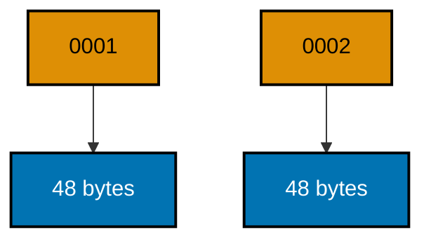

**`learning/code/ex-14-checksums-guard-every-row/src/main.rs`**:

```rust
// Example 14: Checksums Guard Every Row.
// each history row carries its own seal.
use sqlx::Row; // => Row unlocks column reads by name on every result row

static MIGRATOR: sqlx::migrate::Migrator = sqlx::migrate!("./migrations"); // => embeds each file under migrations/ at compile time

// => one URL builder shared by the pool and every probe query
fn db_url() -> String {
    // => assemble the connection string from its parts
    format!(
        "postgres://{}@{}:{}/{}", // => trust auth: a user with no password
        std::env::var("PGUSER").unwrap_or_else(|_| String::from("postgres")), // => superuser in the service container
        std::env::var("PGHOST").unwrap_or_else(|_| String::from("postgres")), // => service alias on the unit network
        std::env::var("PGPORT").unwrap_or_else(|_| String::from("5432")), // => pinned PostgreSQL port
        std::env::var("PGDATABASE").unwrap_or_else(|_| String::from("postgres")), // => the service database name
    ) // => format returns the finished URL
} // => helper ends: every connection flows through here

#[tokio::main] // => the async runtime drives the pool and the queries
               // => main returns the database error so failures print it
async fn main() -> Result<(), sqlx::Error> {
    let pool = sqlx::postgres::PgPoolOptions::new() // => start from the default pool options
        .max_connections(5) // => five connections: migrate plus a few readers
        .connect(&db_url()) // => connect to the per-run service database
        .await?; // => ? bubbles a connection failure instead of panicking
    MIGRATOR.run(&pool).await?; // => both files apply and record their checksums
    let rows = sqlx::query(
        "SELECT version, length(checksum) AS seal FROM _sqlx_migrations ORDER BY version",
    ) // => the seal size per row
    .fetch_all(&pool) // => run the read against the same pool
    .await?; // => ? bubbles a query failure instead of panicking
    for row in rows {
        // => walk every sealed row
        let version: i64 = row.get("version"); // => the version the seal belongs to
        let seal: i32 = row.get("seal"); // => SHA-384 always spans 48 bytes
        println!("version {version} checksum bytes {seal}"); // => one seal report per row
    } // => loop ends after the last sealed row
    Ok(()) // => green run: every row is sealed
} // => main ends: the harness compares stdout to the golden file
```

**`learning/code/ex-14-checksums-guard-every-row/migrations/0001_create_vaults.sql`**:

```sql
-- 0001: vaults hold the secrets. -- => the first sealed file
CREATE TABLE vaults ( -- => the migrator runs this file once, in version order
    id SERIAL PRIMARY KEY, -- => surrogate key: the row identity never changes
    name TEXT NOT NULL -- => every vault must be named
); -- => the definition closes here
```

**`learning/code/ex-14-checksums-guard-every-row/migrations/0002_create_keys.sql`**:

```sql
-- 0002: keys belong to vaults. -- => the second sealed file
CREATE TABLE keys ( -- => the migrator runs this file once, in version order
    id SERIAL PRIMARY KEY, -- => surrogate key: the row identity never changes
    vault_id INTEGER NOT NULL REFERENCES vaults (id), -- => every key lives in a vault
    material TEXT NOT NULL -- => key material never leaves the vault
); -- => the definition closes here
```

**Output** (`learning/code/ex-14-checksums-guard-every-row/expected/main.stdout.txt`):

```text
version 1 checksum bytes 48
version 2 checksum bytes 48
```

**Key takeaway**: Trust the per-row checksum: it names the exact version when bytes stop matching history.

**Why it matters**: Whole-database dumps prove nothing about individual changes, but per-row seals let verification point at exactly one file. When a deploy fails validation, the team does not diff the entire schema; it opens the one named version and sees the edit. That precision shortens every tamper investigation from a schema-wide audit to a single-file review. Granular seals turn a scary red build into a small, obvious fix, which is why the hash lives on every row instead of once per database.

---

### Example 15: Validate After Migrate Seals the Pipeline

A deploy pipeline should confirm that embedded files and applied rows agree before declaring success. This example migrates, then counts embedded against applied. Equal counts with matching versions seal the pipeline step.

Migrate-then-verify closes the loop that migrate-alone leaves open: a file present but unapplied, or applied but missing, both surface here instead of in production. The program compares the embedded set with the recorded set and prints the verdict as data.

(Concepts: co-11, co-16.)

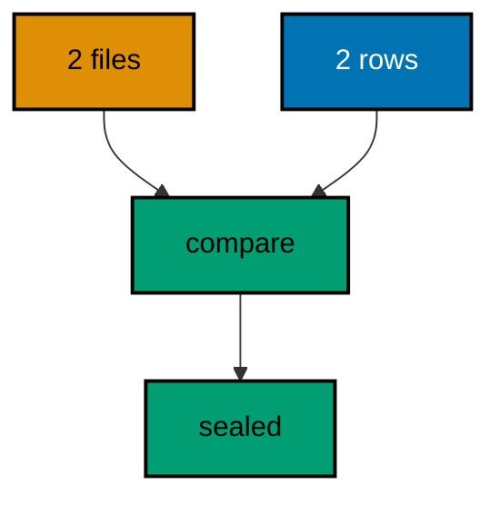

**`learning/code/ex-15-validate-after-migrate-seals-the-pipeline/src/main.rs`**:

```rust
// Example 15: Validate After Migrate Seals the Pipeline.
// embedded and applied must agree.
use sqlx::Row; // => Row unlocks column reads by name on every result row

static MIGRATOR: sqlx::migrate::Migrator = sqlx::migrate!("./migrations"); // => embeds each file under migrations/ at compile time

// => one URL builder shared by the pool and every probe query
fn db_url() -> String {
    // => assemble the connection string from its parts
    format!(
        "postgres://{}@{}:{}/{}", // => trust auth: a user with no password
        std::env::var("PGUSER").unwrap_or_else(|_| String::from("postgres")), // => superuser in the service container
        std::env::var("PGHOST").unwrap_or_else(|_| String::from("postgres")), // => service alias on the unit network
        std::env::var("PGPORT").unwrap_or_else(|_| String::from("5432")), // => pinned PostgreSQL port
        std::env::var("PGDATABASE").unwrap_or_else(|_| String::from("postgres")), // => the service database name
    ) // => format returns the finished URL
} // => helper ends: every connection flows through here

#[tokio::main] // => the async runtime drives the pool and the queries
               // => main returns the database error so failures print it
async fn main() -> Result<(), sqlx::Error> {
    let pool = sqlx::postgres::PgPoolOptions::new() // => start from the default pool options
        .max_connections(5) // => five connections: migrate plus a few readers
        .connect(&db_url()) // => connect to the per-run service database
        .await?; // => ? bubbles a connection failure instead of panicking
    MIGRATOR.run(&pool).await?; // => both files apply in version order
    let embedded: Vec<i64> = MIGRATOR.iter().map(|m| m.version).collect(); // => every version compiled into the binary
    let rows = sqlx::query("SELECT version FROM _sqlx_migrations") // => every version recorded in the database
        .fetch_all(&pool) // => run the read against the same pool
        .await?; // => ? bubbles a query failure instead of panicking
    let mut applied: Vec<i64> = rows.iter().map(|row| row.get("version")).collect(); // => the recorded set
    applied.sort_unstable(); // => order the recorded set for comparison
    let valid = embedded == applied; // => agreement means the pipeline step is sealed
    println!("embedded {} applied {}", embedded.len(), applied.len()); // => the counts, printed
    println!("valid {valid}"); // => the verdict as data
    Ok(()) // => green run: the pipeline step is sealed
} // => main ends: the harness compares stdout to the golden file
```

**`learning/code/ex-15-validate-after-migrate-seals-the-pipeline/migrations/0001_create_pipelines.sql`**:

```sql
-- 0001: pipelines track deploy work. -- => the first sealed file
CREATE TABLE pipelines ( -- => the migrator runs this file once, in version order
    id SERIAL PRIMARY KEY, -- => surrogate key: the row identity never changes
    name TEXT NOT NULL -- => every pipeline must be named
); -- => the definition closes here
```

**`learning/code/ex-15-validate-after-migrate-seals-the-pipeline/migrations/0002_create_stages.sql`**:

```sql
-- 0002: stages belong to pipelines. -- => the second sealed file
CREATE TABLE stages ( -- => the migrator runs this file once, in version order
    id SERIAL PRIMARY KEY, -- => surrogate key: the row identity never changes
    pipeline_id INTEGER NOT NULL REFERENCES pipelines (id), -- => every stage runs in a pipeline
    name TEXT NOT NULL -- => every stage must be named
); -- => the definition closes here
```

**Output** (`learning/code/ex-15-validate-after-migrate-seals-the-pipeline/expected/main.stdout.txt`):

```text
embedded 2 applied 2
valid true
```

**Key takeaway**: End every migrate step by comparing embedded versions against recorded rows before reporting success.

**Why it matters**: A green migrate exit only means the tool finished, not that the database matches the code. Files can be missing from the binary, rows can linger from deleted files, and both slip past a bare exit code. Comparing the two sets turns the pipeline step into a real verification: the deploy is done when the database and the binary agree, not when the tool stops talking. That extra query costs milliseconds and catches the exact drift that exit codes miss.

---

### Example 16: Pending Work Shows Before It Runs

Before running anything, a pipeline can list which versions would apply. This example migrates a one-file set, then diffs a two-file set against the recorded rows. The diff names version 2 as pending without applying it.

Previewing pending work lets reviewers approve the exact change set and lets deploys warn before touching the database. The program resolves the fuller set, subtracts what already applied, and prints the pending versions as a dry-run report.

(Concepts: co-03, co-16.)

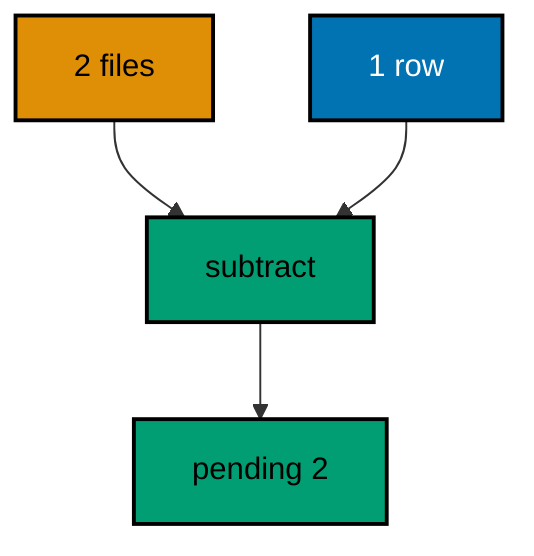

**`learning/code/ex-16-pending-work-shows-before-it-runs/src/main.rs`**:

```rust
// Example 16: Pending Work Shows Before It Runs.
// the diff names version 2 without applying it.
use sqlx::Row; // => Row unlocks column reads by name on every result row
use std::collections::HashSet; // => set subtraction finds the pending versions

static PARTIAL: sqlx::migrate::Migrator = sqlx::migrate!("./migrations"); // => version 1 ships first
static FULL: sqlx::migrate::Migrator = sqlx::migrate!("./complete"); // => the fuller set under review

// => one URL builder shared by the pool and every probe query
fn db_url() -> String {
    // => assemble the connection string from its parts
    format!(
        "postgres://{}@{}:{}/{}", // => trust auth: a user with no password
        std::env::var("PGUSER").unwrap_or_else(|_| String::from("postgres")), // => superuser in the service container
        std::env::var("PGHOST").unwrap_or_else(|_| String::from("postgres")), // => service alias on the unit network
        std::env::var("PGPORT").unwrap_or_else(|_| String::from("5432")), // => pinned PostgreSQL port
        std::env::var("PGDATABASE").unwrap_or_else(|_| String::from("postgres")), // => the service database name
    ) // => format returns the finished URL
} // => helper ends: every connection flows through here

#[tokio::main] // => the async runtime drives the pool and the queries
               // => main returns the database error so failures print it
async fn main() -> Result<(), sqlx::Error> {
    let pool = sqlx::postgres::PgPoolOptions::new() // => start from the default pool options
        .max_connections(5) // => five connections: migrate plus a few readers
        .connect(&db_url()) // => connect to the per-run service database
        .await?; // => ? bubbles a connection failure instead of panicking
    PARTIAL.run(&pool).await?; // => version 1 applies; version 2 stays unapplied
    let rows = sqlx::query("SELECT version FROM _sqlx_migrations") // => what the database already holds
        .fetch_all(&pool) // => run the read against the same pool
        .await?; // => ? bubbles a query failure instead of panicking
    let applied: HashSet<i64> = rows.iter().map(|row| row.get("version")).collect(); // => the recorded set
    let mut pending: Vec<i64> = FULL
        .iter() // => walk each element in turn
        .map(|m| m.version) // => project the embedded numbers
        .filter(|v| !applied.contains(v)) // => keep only the unapplied
        .collect(); // => embedded minus recorded
    pending.sort_unstable(); // => order the pending list for stable output
    let line = pending // => collect the report line first so the print stays short
        .iter() // => walk each element in turn
        .map(i64::to_string) // => render each version as text
        .collect::<Vec<_>>() // => gather into a printable list
        .join(" "); // => space the versions for one line
    println!("pending versions: {line}"); // => the dry-run report
    Ok(()) // => green run: previews need no database writes
} // => main ends: the harness compares stdout to the golden file
```

**`learning/code/ex-16-pending-work-shows-before-it-runs/migrations/0001_create_quotes.sql`**:

```sql
-- 0001: quotes open the sales schema. -- => applies once, skips on re-runs
CREATE TABLE quotes ( -- => the migrator runs this file once, in version order
    id SERIAL PRIMARY KEY, -- => surrogate key: the row identity never changes
    total INTEGER NOT NULL -- => totals store as integer minor units
); -- => the definition closes here
```

**`learning/code/ex-16-pending-work-shows-before-it-runs/complete/0001_create_quotes.sql`**:

```sql
-- 0001: quotes open the sales schema. -- => applies once, skips on re-runs
CREATE TABLE quotes ( -- => the migrator runs this file once, in version order
    id SERIAL PRIMARY KEY, -- => surrogate key: the row identity never changes
    total INTEGER NOT NULL -- => totals store as integer minor units
); -- => the definition closes here
```

**`learning/code/ex-16-pending-work-shows-before-it-runs/complete/0002_create_line_items.sql`**:

```sql
-- 0002: line items belong to quotes. -- => the one pending version
CREATE TABLE line_items ( -- => the preview names this file without running it
    id SERIAL PRIMARY KEY, -- => surrogate key: the row identity never changes
    quote_id INTEGER NOT NULL REFERENCES quotes (id), -- => every line item belongs to a quote
    amount INTEGER NOT NULL -- => amounts store as integer minor units
); -- => the definition closes here
```

**Output** (`learning/code/ex-16-pending-work-shows-before-it-runs/expected/main.stdout.txt`):

```text
pending versions: 2
```

**Key takeaway**: Preview deploys by diffing embedded versions against recorded rows; pending is a set subtraction.

**Why it matters**: Surprise migrations during deploys cause the worst pages: a table lock nobody expected, a backfill nobody sized. Previewing the pending set turns the deploy from a leap into a checklist the team approves file by file. Reviewers see exactly which versions will run, operators size the window from the list, and nothing touches the database until everyone agrees. The diff costs one query and removes an entire category of deploy surprise.

---

### Example 17: Success Flag Marks Each Entry

The `success` column tells whether each version committed cleanly. This example applies two files and prints every version with its flag. All-true is the healthy baseline later failure examples deviate from.

Success flags are the triage shortcut: on PostgreSQL every recorded row reads true, because a failed file rolls back instead of recording. A missing version in an otherwise sequential history is the failure signal here: the next run retries exactly that version. Reading versions and flags first tells an operator in one glance whether the history is healthy or holding a gap that needs repair.

(Concepts: co-03.)

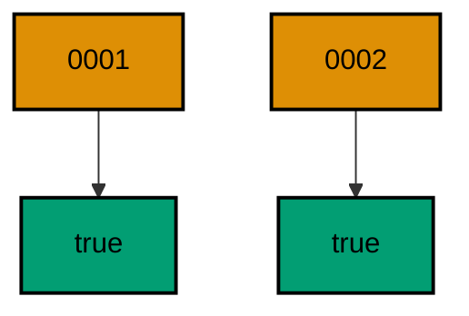

**`learning/code/ex-17-success-flag-marks-each-entry/src/main.rs`**:

```rust
// Example 17: Success Flag Marks Each Entry.
// all-true is the healthy baseline.
use sqlx::Row; // => Row unlocks column reads by name on every result row

static MIGRATOR: sqlx::migrate::Migrator = sqlx::migrate!("./migrations"); // => embeds each file under migrations/ at compile time

// => one URL builder shared by the pool and every probe query
fn db_url() -> String {
    // => assemble the connection string from its parts
    format!(
        "postgres://{}@{}:{}/{}", // => trust auth: a user with no password
        std::env::var("PGUSER").unwrap_or_else(|_| String::from("postgres")), // => superuser in the service container
        std::env::var("PGHOST").unwrap_or_else(|_| String::from("postgres")), // => service alias on the unit network
        std::env::var("PGPORT").unwrap_or_else(|_| String::from("5432")), // => pinned PostgreSQL port
        std::env::var("PGDATABASE").unwrap_or_else(|_| String::from("postgres")), // => the service database name
    ) // => format returns the finished URL
} // => helper ends: every connection flows through here

#[tokio::main] // => the async runtime drives the pool and the queries
               // => main returns the database error so failures print it
async fn main() -> Result<(), sqlx::Error> {
    let pool = sqlx::postgres::PgPoolOptions::new() // => start from the default pool options
        .max_connections(5) // => five connections: migrate plus a few readers
        .connect(&db_url()) // => connect to the per-run service database
        .await?; // => ? bubbles a connection failure instead of panicking
    MIGRATOR.run(&pool).await?; // => both files commit cleanly
    let rows = sqlx::query("SELECT version, success FROM _sqlx_migrations ORDER BY version") // => the health of every row
        .fetch_all(&pool) // => run the read against the same pool
        .await?; // => ? bubbles a query failure instead of panicking
    for row in rows {
        // => walk every recorded migration
        let version: i64 = row.get("version"); // => the version the flag belongs to
        let success: bool = row.get("success"); // => true means committed, false means failed
        println!("version {version} success {success}"); // => one health line per version
    } // => loop ends after the last recorded version
    Ok(()) // => green run: the baseline is all-true
} // => main ends: the harness compares stdout to the golden file
```

**`learning/code/ex-17-success-flag-marks-each-entry/migrations/0001_create_sensors.sql`**:

```sql
-- 0001: sensors stream the readings. -- => the first healthy row
CREATE TABLE sensors ( -- => the migrator runs this file once, in version order
    id SERIAL PRIMARY KEY, -- => surrogate key: the row identity never changes
    name TEXT NOT NULL -- => every sensor must be named
); -- => the definition closes here
```

**`learning/code/ex-17-success-flag-marks-each-entry/migrations/0002_create_readings.sql`**:

```sql
-- 0002: readings belong to sensors. -- => the second healthy row
CREATE TABLE readings ( -- => the migrator runs this file once, in version order
    id SERIAL PRIMARY KEY, -- => surrogate key: the row identity never changes
    sensor_id INTEGER NOT NULL REFERENCES sensors (id), -- => every reading comes from a sensor
    value DOUBLE PRECISION NOT NULL -- => readings store as floating values
); -- => the definition closes here
```

**Output** (`learning/code/ex-17-success-flag-marks-each-entry/expected/main.stdout.txt`):

```text
version 1 success true
version 2 success true
```

**Key takeaway**: Read versions and flags after every run; a gap in the version line is where the next run resumes.

**Why it matters**: A single boolean per row is the cheapest health check a migration system can offer. Operators learn to read the flags before reading anything else, because a false flag explains every downstream symptom: stuck deploys, missing tables, confused applications. The flag also enforces discipline: the migrator refuses to proceed past a failure, so broken state cannot compound silently. Small, strict, and always present is exactly what a triage signal should be.

---

### Example 18: Reverse with a Down Migration

Reversible migrations pair an up file with a down file, and `undo` runs the down side. This example migrates a `gadgets` table up, then undoes to version 0. The presence probe prints true before the undo and false after it.

Down files make reversal a first-class artifact instead of a hand-written apology: the same review process that approves the up file approves its exact inverse. `undo` applies down files for every applied version above the target in reverse order, then forgets those versions from history, so a re-run would apply the up files again.

(Concepts: co-02, co-08.)

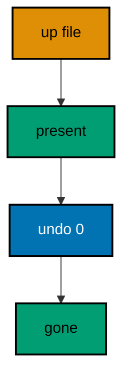

**`learning/code/ex-18-reverse-with-a-down-migration/src/main.rs`**:

```rust
// Example 18: Reverse with a Down Migration.
// undo runs the down file and forgets the version.
use sqlx::Row; // => Row unlocks column reads by name on every result row

static MIGRATOR: sqlx::migrate::Migrator = sqlx::migrate!("./migrations"); // => embeds the up and down files at compile time

// => one URL builder shared by the pool and every probe query
fn db_url() -> String {
    // => assemble the connection string from its parts
    format!(
        "postgres://{}@{}:{}/{}", // => trust auth: a user with no password
        std::env::var("PGUSER").unwrap_or_else(|_| String::from("postgres")), // => superuser in the service container
        std::env::var("PGHOST").unwrap_or_else(|_| String::from("postgres")), // => service alias on the unit network
        std::env::var("PGPORT").unwrap_or_else(|_| String::from("5432")), // => pinned PostgreSQL port
        std::env::var("PGDATABASE").unwrap_or_else(|_| String::from("postgres")), // => the service database name
    ) // => format returns the finished URL
} // => helper ends: every connection flows through here

async fn present(pool: &sqlx::PgPool, table: &str) -> Result<bool, sqlx::Error> {
    // => one probe for before and after
    let row = sqlx::query("SELECT to_regclass($1) IS NOT NULL AS present") // => NULL means the table is gone
        .bind(format!("public.{table}")) // => schema-qualify so the lookup is exact
        .fetch_one(pool) // => a single flag row comes back
        .await?; // => ? bubbles a query failure instead of panicking
    Ok(row.get("present")) // => hand the flag to the caller
} // => helper ends: presence checks stay in one place

#[tokio::main] // => the async runtime drives the pool and the queries
               // => main returns the database error so failures print it
async fn main() -> Result<(), sqlx::Error> {
    let pool = sqlx::postgres::PgPoolOptions::new() // => start from the default pool options
        .max_connections(5) // => five connections: migrate plus a few readers
        .connect(&db_url()) // => connect to the per-run service database
        .await?; // => ? bubbles a connection failure instead of panicking
    MIGRATOR.run(&pool).await?; // => the up file creates the table; the down file waits
                                // => report the round trip states in order
    println!(
        "gadgets after migrate: {}",
        present(&pool, "gadgets").await?
    ); // => the up file landed
    MIGRATOR.undo(&pool, 0).await?; // => target 0 reverts every applied down file in reverse
    println!("gadgets after undo: {}", present(&pool, "gadgets").await?); // => the down file dropped it
    Ok(()) // => green run: the round trip is proven
} // => main ends: the harness compares stdout to the golden file
```

**`learning/code/ex-18-reverse-with-a-down-migration/migrations/0001_create_gadgets.down.sql`**:

```sql
-- 0001 down: undo drops exactly what the up file created. -- => the reverse half of the pair
DROP TABLE gadgets; -- => undo runs this file, then forgets version 1
```

**`learning/code/ex-18-reverse-with-a-down-migration/migrations/0001_create_gadgets.up.sql`**:

```sql
-- 0001 up: gadgets arrive with an id and a label. -- => the forward half of the pair
CREATE TABLE gadgets ( -- => the migrator runs this file once, in version order
    id SERIAL PRIMARY KEY, -- => surrogate key: the row identity never changes
    label TEXT NOT NULL -- => every gadget must be labeled
); -- => the definition closes here
```

**Output** (`learning/code/ex-18-reverse-with-a-down-migration/expected/main.stdout.txt`):

```text
gadgets after migrate: true
gadgets after undo: false
```

**Key takeaway**: Ship risky ups with tested down files and `undo(&pool, target)` reverts every applied version above the target.

**Why it matters**: Reversibility cannot be improvised during an incident: a hand-written drop statement under pressure misses constraints, cascades, and dependent objects. A down file written alongside the up file gets the same review, the same tests, and the same checksum seal, so reversal is a rehearsed operation instead of a gamble. The undo path also cleans history, which means the database returns to a state the team recognizes instead of a half-remembered compromise. Reversible pairs turn rollbacks from heroics into routine.

---

### Example 19: Rollback Means a Forward Fix

Simple one-way files cannot undo, so rollback means a new migration that repairs forward. This example adds a `views` column in `0002` and removes it in `0003`. The final column list proves the schema moved forward to the pre-column shape.

Forward fixes keep history honest: the mistake and its correction both stay on record, so future readers see what happened instead of a rewritten past. The program applies all three versions and prints the surviving columns, showing the repair as ordinary migration work.

(Concepts: co-08.)

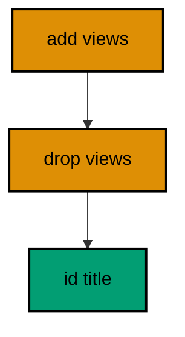

**`learning/code/ex-19-rollback-means-a-forward-fix/src/main.rs`**:

```rust
// Example 19: Rollback Means a Forward Fix.
// a new version repairs the old one.
use sqlx::Row; // => Row unlocks column reads by name on every result row

static MIGRATOR: sqlx::migrate::Migrator = sqlx::migrate!("./migrations"); // => embeds each file under migrations/ at compile time

// => one URL builder shared by the pool and every probe query
fn db_url() -> String {
    // => assemble the connection string from its parts
    format!(
        "postgres://{}@{}:{}/{}", // => trust auth: a user with no password
        std::env::var("PGUSER").unwrap_or_else(|_| String::from("postgres")), // => superuser in the service container
        std::env::var("PGHOST").unwrap_or_else(|_| String::from("postgres")), // => service alias on the unit network
        std::env::var("PGPORT").unwrap_or_else(|_| String::from("5432")), // => pinned PostgreSQL port
        std::env::var("PGDATABASE").unwrap_or_else(|_| String::from("postgres")), // => the service database name
    ) // => format returns the finished URL
} // => helper ends: every connection flows through here

#[tokio::main] // => the async runtime drives the pool and the queries
               // => main returns the database error so failures print it
async fn main() -> Result<(), sqlx::Error> {
    let pool = sqlx::postgres::PgPoolOptions::new() // => start from the default pool options
        .max_connections(5) // => five connections: migrate plus a few readers
        .connect(&db_url()) // => connect to the per-run service database
        .await?; // => ? bubbles a connection failure instead of panicking
    MIGRATOR.run(&pool).await?; // => add the column, then remove it in a later version
    let rows = sqlx::query("SELECT column_name FROM information_schema.columns WHERE table_name = 'posts' ORDER BY ordinal_position") // => the repaired table shape
        .fetch_all(&pool) // => run the read against the same pool
        .await?; // => ? bubbles a query failure instead of panicking
    let columns: Vec<String> = rows.iter().map(|row| row.get("column_name")).collect(); // => the surviving columns
    println!("posts columns: {}", columns.join(" ")); // => views came and went, id and title remain
    Ok(()) // => green run: forward repair works
} // => main ends: the harness compares stdout to the golden file
```

**`learning/code/ex-19-rollback-means-a-forward-fix/migrations/0001_create_posts.sql`**:

```sql
-- 0001: posts start with title only. -- => the shape before the mistake
CREATE TABLE posts ( -- => the migrator runs this file once, in version order
    id SERIAL PRIMARY KEY, -- => surrogate key: the row identity never changes
    title TEXT NOT NULL -- => every post must be titled
); -- => the definition closes here
```

**`learning/code/ex-19-rollback-means-a-forward-fix/migrations/0002_add_views.sql`**:

```sql
-- 0002: the views column ships too soon. -- => the mistake under repair
ALTER TABLE posts -- => the existing rows keep their titles
    ADD COLUMN views INTEGER NOT NULL DEFAULT 0; -- => analytics wanted this yesterday
```

**`learning/code/ex-19-rollback-means-a-forward-fix/migrations/0003_drop_views.sql`**:

```sql
-- 0003: the forward fix removes views. -- => rollback as a new version, not an edit
ALTER TABLE posts -- => history keeps both the mistake and its repair
    DROP COLUMN views; -- => the schema returns to the pre-column shape
```

**Output** (`learning/code/ex-19-rollback-means-a-forward-fix/expected/main.stdout.txt`):

```text
posts columns: id title
```

**Key takeaway**: Repair bad simple migrations with a compensating version; the record stays truthful and reviewable.

**Why it matters**: Every schema has a change the team regrets, and the repair strategy defines the team's maturity. Editing history pretends the mistake never happened, which lies to every environment that already applied it. A forward fix admits the mistake in the permanent record, gets reviewed like any change, and applies cleanly everywhere including the databases that saw the bad version. Honest history is debuggable history, and debugging is the whole job.

---

### Example 20: Failed Migration Leaves Earlier Work Intact

When version 2 fails, version 1 must still stand and the gap in history must say exactly where the chain broke. This example applies a good `orders` table, then a file with an invalid column type. The program catches the execution error and proves the earlier table survived.

Partial application is the nightmare scenario: half a schema with no record of where it stopped. sqlx avoids it on PostgreSQL with atomic files: each file runs in its own transaction, so the failing file rolls back completely, leaving no tables and no history row. The error names the failed version, and the history gap between version 1 and the missing version 2 tells the repair story.

(Concepts: co-12, co-16.)

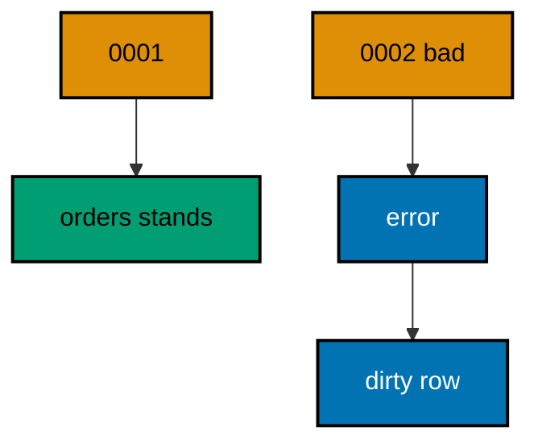

**`learning/code/ex-20-failed-migration-leaves-earlier-work-intact/src/main.rs`**:

```rust
// Example 20: Failed Migration Leaves Earlier Work Intact.
// the good version stands; the bad one is recorded.
use sqlx::migrate::MigrateError;
use sqlx::Row; // => the error enum names every failure mode // => Row unlocks column reads by name on every result row

static MIGRATOR: sqlx::migrate::Migrator = sqlx::migrate!("./migrations"); // => embeds the good file and the bad file

// => one URL builder shared by the pool and every probe query
fn db_url() -> String {
    // => assemble the connection string from its parts
    format!(
        "postgres://{}@{}:{}/{}", // => trust auth: a user with no password
        std::env::var("PGUSER").unwrap_or_else(|_| String::from("postgres")), // => superuser in the service container
        std::env::var("PGHOST").unwrap_or_else(|_| String::from("postgres")), // => service alias on the unit network
        std::env::var("PGPORT").unwrap_or_else(|_| String::from("5432")), // => pinned PostgreSQL port
        std::env::var("PGDATABASE").unwrap_or_else(|_| String::from("postgres")), // => the service database name
    ) // => format returns the finished URL
} // => helper ends: every connection flows through here

#[tokio::main] // => the async runtime drives the pool and the queries
               // => main returns the database error so failures print it
async fn main() -> Result<(), sqlx::Error> {
    let pool = sqlx::postgres::PgPoolOptions::new() // => start from the default pool options
        .max_connections(5) // => five connections: migrate plus a few readers
        .connect(&db_url()) // => connect to the per-run service database
        .await?; // => ? bubbles a connection failure instead of panicking
                 // => version 1 applies, version 2 fails
    match MIGRATOR.run(&pool).await {
        Err(MigrateError::ExecuteMigration(_, 2)) => {
            // => the failure names its version
            println!("migration 2 failed as recorded"); // => the expected failure, classified
        } // => match arm ends: the failure is expected, not a crash
        Err(other) => panic!("unexpected error: {other}"), // => any other failure is a test bug
        Ok(()) => panic!("broken migration should not apply"), // => silent success would hide the bug
    } // => match ends: every outcome is classified
    let row =
        sqlx::query("SELECT COUNT(*) AS n FROM _sqlx_migrations WHERE version = 1 AND success") // => the surviving good version
            .fetch_one(&pool) // => exactly one count row comes back
            .await?; // => ? bubbles a query failure instead of panicking
    let n: i64 = row.get("n"); // => version 1 committed before version 2 failed
    println!("healthy versions standing: {n}"); // => earlier work is intact
    Ok(()) // => green run: failure is contained and recorded
} // => main ends: the harness compares stdout to the golden file
```

**`learning/code/ex-20-failed-migration-leaves-earlier-work-intact/migrations/0001_create_orders.sql`**:

```sql
-- 0001: orders are the good version. -- => this file commits before the failure
CREATE TABLE orders ( -- => the migrator runs this file once, in version order
    id SERIAL PRIMARY KEY, -- => surrogate key: the row identity never changes
    total INTEGER NOT NULL -- => totals store as integer minor units
); -- => the definition closes here
```

**`learning/code/ex-20-failed-migration-leaves-earlier-work-intact/migrations/0002_broken_type.sql`**:

```sql
-- 0002: an invalid type fails the whole file. -- => the failure under test
CREATE TABLE broken ( -- => this statement never commits
    id SERIAL PRIMARY KEY, -- => surrogate key: the row identity never changes
    amount NOT_A_TYPE -- => unknown types fail at parse time
); -- => the definition closes here
```

**Output** (`learning/code/ex-20-failed-migration-leaves-earlier-work-intact/expected/main.stdout.txt`):

```text
migration 2 failed as recorded
healthy versions standing: 1
```

**Key takeaway**: Match on `ExecuteMigration` to handle expected failures; earlier committed versions are never rolled back.

**Why it matters**: A migration runner that left half-applied state with no record would be worse than useless; it would be actively dangerous, because the next deploy would assume a clean slate. sqlx contains each failure to its own version and rolls it back whole, so operators always know exactly where the chain broke from the history gap alone. Contained failure plus a truthful gap equals a repairable system. That combination is what lets teams run migrations automatically instead of babysitting them.

---

### Example 21: Partial Statements Roll Back Together

A file with three statements where the third fails must leave zero tables, not two. This example packs two good creates and one broken statement into version 1. After the expected failure, both tables are provably absent.

PostgreSQL runs each migration in a transaction, so a mid-file failure rolls back the file's earlier statements with it. The program catches the error, then probes both tables: all-or-nothing is the guarantee that keeps multi-statement files safe.

(Concepts: co-12.)

```mermaid
flowchart TD
    accTitle: All or none, example 21
    accDescr: One failure voids the file.
    stmt1 --> stmt2
    stmt2 --> stmt3
    stmt3 --> rollback
    stmt1["create a"]:::orange
    stmt2["create b"]:::orange
    stmt3["bad type"]:::orange
    rollback["none land"]:::blue
    classDef blue fill:#0173B2,stroke:#000000,color:#FFFFFF,stroke-width:2px
    classDef orange fill:#DE8F05,stroke:#000000,color:#000000,stroke-width:2px
    classDef teal fill:#029E73,stroke:#000000,color:#000000,stroke-width:2px
    classDef default fill:#FFFFFF,stroke:#000000,color:#000000
```

**`learning/code/ex-21-partial-statements-roll-back-together/src/main.rs`**:

```rust
// Example 21: Partial Statements Roll Back Together.
// one bad statement voids the whole file.
use sqlx::migrate::MigrateError;
use sqlx::Row; // => the error enum names every failure mode // => Row unlocks column reads by name on every result row

static MIGRATOR: sqlx::migrate::Migrator = sqlx::migrate!("./migrations"); // => embeds the three-statement file

// => one URL builder shared by the pool and every probe query
fn db_url() -> String {
    // => assemble the connection string from its parts
    format!(
        "postgres://{}@{}:{}/{}", // => trust auth: a user with no password
        std::env::var("PGUSER").unwrap_or_else(|_| String::from("postgres")), // => superuser in the service container
        std::env::var("PGHOST").unwrap_or_else(|_| String::from("postgres")), // => service alias on the unit network
        std::env::var("PGPORT").unwrap_or_else(|_| String::from("5432")), // => pinned PostgreSQL port
        std::env::var("PGDATABASE").unwrap_or_else(|_| String::from("postgres")), // => the service database name
    ) // => format returns the finished URL
} // => helper ends: every connection flows through here

async fn present(pool: &sqlx::PgPool, table: &str) -> Result<bool, sqlx::Error> {
    // => one probe reused for both tables
    let row = sqlx::query("SELECT to_regclass($1) IS NOT NULL AS present") // => NULL means the table is gone
        .bind(format!("public.{table}")) // => schema-qualify so the lookup is exact
        .fetch_one(pool) // => a single flag row comes back
        .await?; // => ? bubbles a query failure instead of panicking
    Ok(row.get("present")) // => hand the flag to the caller
} // => helper ends: presence checks stay in one place

#[tokio::main] // => the async runtime drives the pool and the queries
               // => main returns the database error so failures print it
async fn main() -> Result<(), sqlx::Error> {
    let pool = sqlx::postgres::PgPoolOptions::new() // => start from the default pool options
        .max_connections(5) // => five connections: migrate plus a few readers
        .connect(&db_url()) // => connect to the per-run service database
        .await?; // => ? bubbles a connection failure instead of panicking
                 // => the third statement fails
    match MIGRATOR.run(&pool).await {
        Err(MigrateError::ExecuteMigration(_, 1)) => {
            // => the failure names version 1
            println!("migration 1 failed as recorded"); // => the expected failure, classified
        } // => match arm ends: the failure is expected, not a crash
        Err(other) => panic!("unexpected error: {other}"), // => any other failure is a test bug
        Ok(()) => panic!("broken file should not apply"),  // => silent success would hide the bug
    } // => match ends: every outcome is classified
    println!("halves present: {}", present(&pool, "halves").await?); // => rolled back with the file
    println!("wholes present: {}", present(&pool, "wholes").await?); // => rolled back with the file
    Ok(()) // => green run: the file is atomic
} // => main ends: the harness compares stdout to the golden file
```

**`learning/code/ex-21-partial-statements-roll-back-together/migrations/0001_two_tables_one_bad.sql`**:

```sql
-- 0001: two good creates plus one broken tail. -- => the whole file shares one transaction
CREATE TABLE halves ( -- => rolls back when the file fails
    id SERIAL PRIMARY KEY, -- => surrogate key: the row identity never changes
    code TEXT NOT NULL -- => every half row carries a code
); -- => the definition closes here
CREATE TABLE wholes ( -- => rolls back when the file fails
    id SERIAL PRIMARY KEY, -- => surrogate key: the row identity never changes
    code TEXT NOT NULL -- => every whole row carries a code
); -- => the definition closes here
CREATE TABLE broken_tail ( -- => this statement never commits
    id SERIAL PRIMARY KEY, -- => surrogate key: the row identity never changes
    amount NOT_A_TYPE -- => unknown types fail at parse time
); -- => the definition closes here
```

**Output** (`learning/code/ex-21-partial-statements-roll-back-together/expected/main.stdout.txt`):

```text
migration 1 failed as recorded
halves present: false
wholes present: false
```

**Key takeaway**: PostgreSQL wraps each migration in a transaction: multi-statement files are atomic by default.

**Why it matters**: Half-applied files are the hardest state to recover from, because no single version describes what is actually there. Transactional DDL removes that state entirely: a file either lands whole or vanishes whole, so the database always matches some prefix of the version list. That invariant is what makes the history table trustworthy. Without atomicity, every failure would require forensic reconstruction; with it, every failure is just a version number to repair.

---

### Example 22: Two Tables or None

Atomicity cuts both ways: a two-table file lands both tables together or neither. This example creates `squads` and `players` in one version. The presence probe confirms both exist, proving the file committed as a unit.

Related tables belong in one file when neither makes sense without the other: the foreign key from players to squads is only valid with both present. The program probes both tables after the run, and both-true is the only acceptable outcome for an atomic file.

(Concepts: co-12.)

```mermaid
flowchart TD
    accTitle: Unit commit, example 22
    accDescr: Both tables land together.
    V1 --> squads
    V1 --> players
    V1["0001"]:::orange
    squads["squads"]:::teal
    players["players"]:::teal
    classDef blue fill:#0173B2,stroke:#000000,color:#FFFFFF,stroke-width:2px
    classDef orange fill:#DE8F05,stroke:#000000,color:#000000,stroke-width:2px
    classDef teal fill:#029E73,stroke:#000000,color:#000000,stroke-width:2px
    classDef default fill:#FFFFFF,stroke:#000000,color:#000000
```

**`learning/code/ex-22-two-tables-or-none/src/main.rs`**:

```rust
// Example 22: Two Tables or None.
// one file commits both tables together.
use sqlx::Row; // => Row unlocks column reads by name on every result row

static MIGRATOR: sqlx::migrate::Migrator = sqlx::migrate!("./migrations"); // => embeds the two-table file

// => one URL builder shared by the pool and every probe query
fn db_url() -> String {
    // => assemble the connection string from its parts
    format!(
        "postgres://{}@{}:{}/{}", // => trust auth: a user with no password
        std::env::var("PGUSER").unwrap_or_else(|_| String::from("postgres")), // => superuser in the service container
        std::env::var("PGHOST").unwrap_or_else(|_| String::from("postgres")), // => service alias on the unit network
        std::env::var("PGPORT").unwrap_or_else(|_| String::from("5432")), // => pinned PostgreSQL port
        std::env::var("PGDATABASE").unwrap_or_else(|_| String::from("postgres")), // => the service database name
    ) // => format returns the finished URL
} // => helper ends: every connection flows through here

async fn present(pool: &sqlx::PgPool, table: &str) -> Result<bool, sqlx::Error> {
    // => one probe reused for both tables
    let row = sqlx::query("SELECT to_regclass($1) IS NOT NULL AS present") // => NULL means the table is gone
        .bind(format!("public.{table}")) // => schema-qualify so the lookup is exact
        .fetch_one(pool) // => a single flag row comes back
        .await?; // => ? bubbles a query failure instead of panicking
    Ok(row.get("present")) // => hand the flag to the caller
} // => helper ends: presence checks stay in one place

#[tokio::main] // => the async runtime drives the pool and the queries
               // => main returns the database error so failures print it
async fn main() -> Result<(), sqlx::Error> {
    let pool = sqlx::postgres::PgPoolOptions::new() // => start from the default pool options
        .max_connections(5) // => five connections: migrate plus a few readers
        .connect(&db_url()) // => connect to the per-run service database
        .await?; // => ? bubbles a connection failure instead of panicking
    MIGRATOR.run(&pool).await?; // => the file commits both tables in one transaction
    println!("squads present: {}", present(&pool, "squads").await?); // => the parent table landed
    println!("players present: {}", present(&pool, "players").await?); // => the child table landed with it
    Ok(()) // => green run: the file is one atomic unit
} // => main ends: the harness compares stdout to the golden file
```

**`learning/code/ex-22-two-tables-or-none/migrations/0001_create_squads_and_players.sql`**:

```sql
-- 0001: squads and players arrive together. -- => neither table makes sense without the other
CREATE TABLE squads ( -- => commits with players or not at all
    id SERIAL PRIMARY KEY, -- => surrogate key: the row identity never changes
    name TEXT NOT NULL -- => every squad must be named
); -- => the definition closes here
CREATE TABLE players ( -- => commits with squads or not at all
    id SERIAL PRIMARY KEY, -- => surrogate key: the row identity never changes
    squad_id INTEGER NOT NULL REFERENCES squads (id), -- => every player trains with a squad
    handle TEXT NOT NULL -- => every player picks a handle
); -- => the definition closes here
```

**Output** (`learning/code/ex-22-two-tables-or-none/expected/main.stdout.txt`):

```text
squads present: true
players present: true
```

**Key takeaway**: Group inseparable tables in one file; the shared transaction keeps them consistent forever.

**Why it matters**: Foreign keys across files create a window where the parent exists without the child, and application code deployed in that window sees a half-built schema. Grouping inseparable tables in one file closes the window: readers always see both or neither, in every environment, on every deploy. The rule is simple to apply at writing time and impossible to retrofit after a split deploy breaks something. Cohesion in files mirrors cohesion in the domain.

---

### Example 23: Undo Forgets the History Row

Undoing removes the version from history, not just the table from the schema. This example migrates one version, undoes to zero, then counts the history rows. Zero rows means the database forgot the version entirely.

History cleanup is what makes undo re-runnable: after the down file drops the table and the row disappears, a later migrate applies the up file fresh, as if the version never ran. The program prints the row count before and after to show the forgetting explicitly.

(Concepts: co-08.)

```mermaid
flowchart TD
    accTitle: Forgotten, example 23
    accDescr: Undo erases the record.
    run --> one
    undo --> zero
    run["run"]:::orange
    one["1 row"]:::blue
    undo["undo 0"]:::orange
    zero["0 rows"]:::teal
    classDef blue fill:#0173B2,stroke:#000000,color:#FFFFFF,stroke-width:2px
    classDef orange fill:#DE8F05,stroke:#000000,color:#000000,stroke-width:2px
    classDef teal fill:#029E73,stroke:#000000,color:#000000,stroke-width:2px
    classDef default fill:#FFFFFF,stroke:#000000,color:#000000
```

**`learning/code/ex-23-undo-forgets-the-history-row/src/main.rs`**:

```rust
// Example 23: Undo Forgets the History Row.
// the version vanishes from history too.
use sqlx::Row; // => Row unlocks column reads by name on every result row

static MIGRATOR: sqlx::migrate::Migrator = sqlx::migrate!("./migrations"); // => embeds the reversible pair at compile time

// => one URL builder shared by the pool and every probe query
fn db_url() -> String {
    // => assemble the connection string from its parts
    format!(
        "postgres://{}@{}:{}/{}", // => trust auth: a user with no password
        std::env::var("PGUSER").unwrap_or_else(|_| String::from("postgres")), // => superuser in the service container
        std::env::var("PGHOST").unwrap_or_else(|_| String::from("postgres")), // => service alias on the unit network
        std::env::var("PGPORT").unwrap_or_else(|_| String::from("5432")), // => pinned PostgreSQL port
        std::env::var("PGDATABASE").unwrap_or_else(|_| String::from("postgres")), // => the service database name
    ) // => format returns the finished URL
} // => helper ends: every connection flows through here

#[tokio::main] // => the async runtime drives the pool and the queries
               // => main returns the database error so failures print it
async fn main() -> Result<(), sqlx::Error> {
    let pool = sqlx::postgres::PgPoolOptions::new() // => start from the default pool options
        .max_connections(5) // => five connections: migrate plus a few readers
        .connect(&db_url()) // => connect to the per-run service database
        .await?; // => ? bubbles a connection failure instead of panicking
    MIGRATOR.run(&pool).await?; // => the up file creates the table and the row
    let row = sqlx::query("SELECT COUNT(*) AS n FROM _sqlx_migrations") // => history with the version present
        .fetch_one(&pool) // => exactly one count row comes back
        .await?; // => ? bubbles a query failure instead of panicking
    let before: i64 = row.get("n"); // => one row after the migrate
    println!("history rows after migrate: {before}"); // => the version on record
    MIGRATOR.undo(&pool, 0).await?; // => the down file drops the table and deletes the row
    let row = sqlx::query("SELECT COUNT(*) AS n FROM _sqlx_migrations") // => history with the version forgotten
        .fetch_one(&pool) // => exactly one count row comes back
        .await?; // => ? bubbles a query failure instead of panicking
    let after: i64 = row.get("n"); // => no rows after the undo
    println!("history rows after undo: {after}"); // => the version forgotten
    Ok(()) // => green run: undo cleans both schema and record
} // => main ends: the harness compares stdout to the golden file
```

**`learning/code/ex-23-undo-forgets-the-history-row/migrations/0001_create_camps.down.sql`**:

```sql
-- 0001 down: undo drops camps. -- => the reverse half of the pair
DROP TABLE camps; -- => undo runs this file, then forgets version 1
```

**`learning/code/ex-23-undo-forgets-the-history-row/migrations/0001_create_camps.up.sql`**:

```sql
-- 0001 up: camps arrive with a name. -- => the forward half of the pair
CREATE TABLE camps ( -- => the migrator runs this file once, in version order
    id SERIAL PRIMARY KEY, -- => surrogate key: the row identity never changes
    name TEXT NOT NULL -- => every camp must be named
); -- => the definition closes here
```

**Output** (`learning/code/ex-23-undo-forgets-the-history-row/expected/main.stdout.txt`):

```text
history rows after migrate: 1
history rows after undo: 0
```

**Key takeaway**: Undo deletes the history row, so the version can apply fresh later with no repair step.

**Why it matters**: A rollback that drops tables but leaves history rows creates a zombie state: the schema says gone, the record says applied, and the next migrate skips the version forever. Cleaning both keeps the two in agreement, which is the invariant every other example relies on. Agreement between schema and record is what makes re-running safe after a rollback. Without it, undo would trade one inconsistency for another, and nobody would trust the down path when it matters.

---

### Example 24: Rollback Plan for a Bad Deploy

Every risky deploy ships with a rehearsed way back. This example adds a `nickname` column as the risky change, then undoes it as the rollback plan. The column lists before and after prove the way back works.

Rollback plans turn deploys from gambles into procedures: the down file is written and tested before the deploy, not improvised after it fails. The program migrates up, prints the with-feature columns, undoes, and prints the without-feature columns, rehearsing the exact recovery a runbook would run.

(Concepts: co-08, co-13.)

```mermaid
flowchart TD
    accTitle: Way back, example 24
    accDescr: Deploy rehearses recovery.
    deploy --> feature
    rollback --> plain
    deploy["deploy up"]:::orange
    feature["nickname on"]:::teal
    rollback["undo 1"]:::orange
    plain["nickname off"]:::teal
    classDef blue fill:#0173B2,stroke:#000000,color:#FFFFFF,stroke-width:2px
    classDef orange fill:#DE8F05,stroke:#000000,color:#000000,stroke-width:2px
    classDef teal fill:#029E73,stroke:#000000,color:#000000,stroke-width:2px
    classDef default fill:#FFFFFF,stroke:#000000,color:#000000
```

**`learning/code/ex-24-rollback-plan-for-a-bad-deploy/src/main.rs`**:

```rust
// Example 24: Rollback Plan for a Bad Deploy.
// the down file is the rehearsed way back.
use sqlx::Row; // => Row unlocks column reads by name on every result row

static MIGRATOR: sqlx::migrate::Migrator = sqlx::migrate!("./migrations"); // => embeds the deploy and its way back

// => one URL builder shared by the pool and every probe query
fn db_url() -> String {
    // => assemble the connection string from its parts
    format!(
        "postgres://{}@{}:{}/{}", // => trust auth: a user with no password
        std::env::var("PGUSER").unwrap_or_else(|_| String::from("postgres")), // => superuser in the service container
        std::env::var("PGHOST").unwrap_or_else(|_| String::from("postgres")), // => service alias on the unit network
        std::env::var("PGPORT").unwrap_or_else(|_| String::from("5432")), // => pinned PostgreSQL port
        std::env::var("PGDATABASE").unwrap_or_else(|_| String::from("postgres")), // => the service database name
    ) // => format returns the finished URL
} // => helper ends: every connection flows through here

#[tokio::main] // => the async runtime drives the pool and the queries
               // => main returns the database error so failures print it
async fn main() -> Result<(), sqlx::Error> {
    let pool = sqlx::postgres::PgPoolOptions::new() // => start from the default pool options
        .max_connections(5) // => five connections: migrate plus a few readers
        .connect(&db_url()) // => connect to the per-run service database
        .await?; // => ? bubbles a connection failure instead of panicking
    MIGRATOR.run(&pool).await?; // => the risky deploy applies
    let rows = sqlx::query("SELECT column_name FROM information_schema.columns WHERE table_name = 'members' ORDER BY ordinal_position") // => the deployed shape
        .fetch_all(&pool) // => run the read against the same pool
        .await?; // => ? bubbles a query failure instead of panicking
    let deployed: Vec<String> = rows.iter().map(|row| row.get("column_name")).collect(); // => id, name, plus nickname
    println!("with feature: {}", deployed.join(" ")); // => the risky column is live
    MIGRATOR.undo(&pool, 1).await?; // => rollback: revert everything above version 1, keeping members
    let rows = sqlx::query("SELECT column_name FROM information_schema.columns WHERE table_name = 'members' ORDER BY ordinal_position") // => the recovered shape
        .fetch_all(&pool) // => run the read against the same pool
        .await?; // => ? bubbles a query failure instead of panicking
    let recovered: Vec<String> = rows.iter().map(|row| row.get("column_name")).collect(); // => id and name again
    println!("without feature: {}", recovered.join(" ")); // => the way back worked
    Ok(()) // => green run: the rollback plan is proven
} // => main ends: the harness compares stdout to the golden file
```

**`learning/code/ex-24-rollback-plan-for-a-bad-deploy/migrations/0001_create_members.down.sql`**:

```sql
-- 0001 down: undo removes members. -- => full retreat to the empty schema
DROP TABLE members; -- => the rehearsed recovery drops the deployed table
```

**`learning/code/ex-24-rollback-plan-for-a-bad-deploy/migrations/0001_create_members.up.sql`**:

```sql
-- 0001 up: members start plain. -- => the baseline the rollback returns to
CREATE TABLE members ( -- => the migrator runs this file once, in version order
    id SERIAL PRIMARY KEY, -- => surrogate key: the row identity never changes
    name TEXT NOT NULL -- => every member must be named
); -- => the definition closes here
```

**`learning/code/ex-24-rollback-plan-for-a-bad-deploy/migrations/0002_add_nickname.down.sql`**:

```sql
-- 0002 down: the rollback drops nickname. -- => recovery keeps id and name intact
ALTER TABLE members -- => the table survives; only the experiment leaves
    DROP COLUMN nickname; -- => the way back, tested before the deploy
```

**`learning/code/ex-24-rollback-plan-for-a-bad-deploy/migrations/0002_add_nickname.up.sql`**:

```sql
-- 0002 up: the risky nickname column. -- => the deploy under rollback rehearsal
ALTER TABLE members -- => the existing members keep their names
    ADD COLUMN nickname TEXT; -- => nullable: the experiment touches nothing existing
```

**Output** (`learning/code/ex-24-rollback-plan-for-a-bad-deploy/expected/main.stdout.txt`):

```text
with feature: id name nickname
without feature: id name
```

**Key takeaway**: Write and test the down file before the deploy; rollback is a rehearsal, never an improvisation.

**Why it matters**: Deploys fail at the worst moments, and the recovery path written in calm daylight behaves nothing like one invented during the outage. A tested down file turns the 3 AM decision from what-do-we-do into run-the-plan, which is a categorically easier decision to make correctly. The few minutes spent writing the reverse pay back the first time a deploy goes sideways. Every risky change deserves a way back that someone already ran once.

---

### Example 25: Beginner Review: Order, History, Rollback

The beginner level closes by combining its three ideas in one program. This example migrates two versions, undoes the second, and reports the surviving version plus the surviving tables. One line per idea: order applied, history recorded, rollback worked.

Review examples exist to prove the ideas compose: order decides what runs, history records what ran, and undo reverses the top. The program runs both files, undoes to version 1, then prints the remaining version and checks both tables, showing exactly one of each.

(Concepts: co-01, co-03, co-08.)

```mermaid
flowchart TD
    accTitle: Three ideas, example 25
    accDescr: Order, record, reverse.
    order --> history
    history --> rollback
    order["1 2 run"]:::orange
    history["1 2 kept"]:::blue
    rollback["undo to 1"]:::orange
    classDef blue fill:#0173B2,stroke:#000000,color:#FFFFFF,stroke-width:2px
    classDef orange fill:#DE8F05,stroke:#000000,color:#000000,stroke-width:2px
    classDef teal fill:#029E73,stroke:#000000,color:#000000,stroke-width:2px
    classDef default fill:#FFFFFF,stroke:#000000,color:#000000
```

**`learning/code/ex-25-beginner-review-order-history-rollback/src/main.rs`**:

```rust
// Example 25: Beginner Review: Order, History, Rollback.
// the three ideas compose in one program.
use sqlx::Row; // => Row unlocks column reads by name on every result row

static MIGRATOR: sqlx::migrate::Migrator = sqlx::migrate!("./migrations"); // => embeds the two reversible pairs

// => one URL builder shared by the pool and every probe query
fn db_url() -> String {
    // => assemble the connection string from its parts
    format!(
        "postgres://{}@{}:{}/{}", // => trust auth: a user with no password
        std::env::var("PGUSER").unwrap_or_else(|_| String::from("postgres")), // => superuser in the service container
        std::env::var("PGHOST").unwrap_or_else(|_| String::from("postgres")), // => service alias on the unit network
        std::env::var("PGPORT").unwrap_or_else(|_| String::from("5432")), // => pinned PostgreSQL port
        std::env::var("PGDATABASE").unwrap_or_else(|_| String::from("postgres")), // => the service database name
    ) // => format returns the finished URL
} // => helper ends: every connection flows through here

async fn present(pool: &sqlx::PgPool, table: &str) -> Result<bool, sqlx::Error> {
    // => one probe reused for both tables
    let row = sqlx::query("SELECT to_regclass($1) IS NOT NULL AS present") // => NULL means the table is gone
        .bind(format!("public.{table}")) // => schema-qualify so the lookup is exact
        .fetch_one(pool) // => a single flag row comes back
        .await?; // => ? bubbles a query failure instead of panicking
    Ok(row.get("present")) // => hand the flag to the caller
} // => helper ends: presence checks stay in one place

#[tokio::main] // => the async runtime drives the pool and the queries
               // => main returns the database error so failures print it
async fn main() -> Result<(), sqlx::Error> {
    let pool = sqlx::postgres::PgPoolOptions::new() // => start from the default pool options
        .max_connections(5) // => five connections: migrate plus a few readers
        .connect(&db_url()) // => connect to the per-run service database
        .await?; // => ? bubbles a connection failure instead of panicking
    MIGRATOR.run(&pool).await?; // => order: version 1, then version 2
    MIGRATOR.undo(&pool, 1).await?; // => rollback: revert everything above version 1
    let rows = sqlx::query("SELECT version FROM _sqlx_migrations ORDER BY version") // => history: what survived the undo
        .fetch_all(&pool) // => run the read against the same pool
        .await?; // => ? bubbles a query failure instead of panicking
    let versions: Vec<i64> = rows.iter().map(|row| row.get("version")).collect(); // => only version 1 remains
    let line = versions // => collect the report line first so the print stays short
        .iter() // => walk each element in turn
        .map(i64::to_string) // => render each version as text
        .collect::<Vec<_>>() // => gather into a printable list
        .join(" "); // => space the versions for one line
    println!("versions on record: {line}"); // => history after rollback
    println!("stalls present: {}", present(&pool, "stalls").await?); // => version 1 table stands
    println!("booths present: {}", present(&pool, "booths").await?); // => version 2 table is gone
    Ok(()) // => green run: the level composes
} // => main ends: the harness compares stdout to the golden file
```

**`learning/code/ex-25-beginner-review-order-history-rollback/migrations/0001_create_stalls.down.sql`**:

```sql
-- 0001 down: undo would drop stalls. -- => not run: the undo stops at version 1
DROP TABLE stalls; -- => version 1 stays, so this file waits
```

**`learning/code/ex-25-beginner-review-order-history-rollback/migrations/0001_create_stalls.up.sql`**:

```sql
-- 0001 up: stalls anchor the market. -- => the version that survives the review
CREATE TABLE stalls ( -- => the migrator runs this file once, in version order
    id SERIAL PRIMARY KEY, -- => surrogate key: the row identity never changes
    name TEXT NOT NULL -- => every stall must be named
); -- => the definition closes here
```

**`learning/code/ex-25-beginner-review-order-history-rollback/migrations/0002_create_booths.down.sql`**:

```sql
-- 0002 down: undo drops booths. -- => the top of the stack reverses first
DROP TABLE booths; -- => undo to 1 runs exactly this file
```

**`learning/code/ex-25-beginner-review-order-history-rollback/migrations/0002_create_booths.up.sql`**:

```sql
-- 0002 up: booths join the market. -- => the version the review reverts
CREATE TABLE booths ( -- => the migrator runs this file once, in version order
    id SERIAL PRIMARY KEY, -- => surrogate key: the row identity never changes
    stall_id INTEGER NOT NULL REFERENCES stalls (id), -- => every booth belongs to a stall
    name TEXT NOT NULL -- => every booth must be named
); -- => the definition closes here
```

**Output** (`learning/code/ex-25-beginner-review-order-history-rollback/expected/main.stdout.txt`):

```text
versions on record: 1
stalls present: true
booths present: false
```

**Key takeaway**: Order, history, and rollback compose: run in order, record everything, reverse from the top.

**Why it matters**: Concepts learned separately stay separate until an example forces them to work together. The review program is small, but it exercises the full loop a production deploy runs daily: apply in order, confirm the record, reverse the top when needed. Engineers who have run the loop once recognize it everywhere: in deploy pipelines, in incident recovery, in every migration code review. Composition is the real lesson; the individual ideas were just prerequisites.

---
