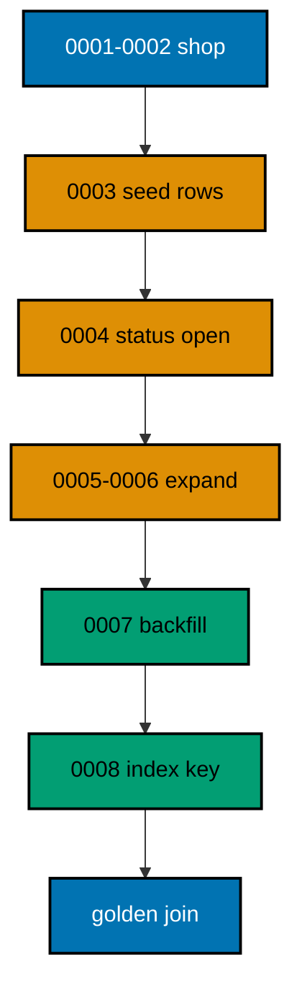

A small shop needs an order-management schema that can change without closing: customers gain contact columns, `name` becomes `full_name` without downtime, and order lookups earn their index before traffic grows. You evolve the schema through eight sqlx migrations, then prove the final state with a golden join that lists every order with its customer, email, total, and status.

## The story

The shop opens with two tables: `customers` with a `name`, and `orders` with a customer reference and a total. Reality arrives in waves familiar from the course. First the seed wave: version 3 inserts two customers and three orders, the live-shaped rows every later version must preserve. Then the status wave: version 4 adds a `status` column defaulting to `'open'`, so old orders gain a state without any update, following Example 31.

Then the contact wave: versions 5 and 6 expand the schema the zero-downtime way, adding `full_name` and `email` beside `name` without touching it, following Examples 35 and 37. Version 7 backfills both columns from existing data, twinning names and deriving emails in one guarded update, following Examples 27 and 32. The old `name` column stays: this shop retires nothing mid-evolution, proving the expand half of the rename arc. Finally version 8 indexes `orders(customer_id)` before any traffic cutover, following Example 39.

## The migration ledger

| Version | Change                                  | Pattern                             |
| ------- | --------------------------------------- | ----------------------------------- |
| 0001    | Create `customers`                      | First migration, one table          |
| 0002    | Create `orders` with customer reference | Related tables, foreign key         |
| 0003    | Seed two customers and three orders     | Data-only version after schema      |
| 0004    | Add `status` defaulting to `'open'`     | Default reaches back in time        |
| 0005    | Add `full_name` beside `name`           | Zero-downtime rename, step one      |
| 0006    | Add `email` beside `name`               | Expand with immediate backfill next |
| 0007    | Backfill `full_name` and `email`        | Guarded derivation from live rows   |
| 0008    | Index `orders(customer_id)`             | Index before cutover                |

Eight migrations, each reviewed in isolation, each replayable on every environment in order. The history table after the run shows versions one through eight, all successful — the same straight line the course preaches from Example 10 onward.

## Verification

The program migrates all eight files, then runs the golden join: per order in id order, the customer name, the derived email, the untouched total, and the defaulted status. Ada placed two orders totaling 100 and 250, Grace placed one totaling 400, every email derives from the customer name, and every status reads open. Those twelve values pin the entire evolution: the seed survived, the defaults reached back, the backfills covered every row, and the index changed nothing observable. If any migration lost data, the join would say so before any human looked.



**`learning/capstone/code/main.rs`**:

```rust
// Capstone: evolve an order-management schema through eight migrations.
// The shop opens with customers and orders, gains statuses, renames its name
// column without downtime, derives contact emails, and indexes the order key
// -- then proves the result with one golden join.
use sqlx::Row; // => Row unlocks column reads by name on every result row

static MIGRATOR: sqlx::migrate::Migrator = sqlx::migrate!("./db/migrations"); // => embeds the eight shop evolutions

// => one URL builder shared by the pool and every probe query
fn db_url() -> String {
    // => assemble the connection string from its parts
    format!(
        "postgres://{}@{}:{}/{}", // => trust auth: a user with no password
        std::env::var("PGUSER").unwrap_or_else(|_| String::from("postgres")), // => superuser in the service container
        std::env::var("PGHOST").unwrap_or_else(|_| String::from("postgres")), // => service alias on the unit network
        std::env::var("PGPORT").unwrap_or_else(|_| String::from("5432")), // => pinned PostgreSQL port
        std::env::var("PGDATABASE").unwrap_or_else(|_| String::from("postgres")), // => the service database name
    ) // => format returns the finished URL
} // => helper ends: every connection flows through here

#[tokio::main] // => the async runtime drives the pool and the queries
async fn main() -> Result<(), sqlx::Error> {
    // => main returns the database error so failures print it
    let pool = sqlx::postgres::PgPoolOptions::new() // => start from the default pool options
        .max_connections(5) // => five connections: migrate plus a few readers
        .connect(&db_url()) // => connect to the per-run service database
        .await?; // => ? bubbles a connection failure instead of panicking
    MIGRATOR.run(&pool).await?; // => open, seed, expand, backfill, and index in order
    let rows = sqlx::query("SELECT o.id, c.full_name, c.email, o.total, o.status FROM customers c JOIN orders o ON o.customer_id = c.id ORDER BY o.id") // => the shop, fully evolved
        .fetch_all(&pool) // => run the golden join against the same pool
        .await?; // => ? bubbles a query failure instead of panicking
    for row in rows {
        // => walk every order in id order
        let id: i32 = row.get("id"); // => the seeded order number
        let name: String = row.get("full_name"); // => twinned by the rename backfill
        let email: String = row.get("email"); // => derived by the contact backfill
        let total: i32 = row.get("total"); // => the seeded total, untouched
        let status: String = row.get("status"); // => defaulted open by version 4
        println!("order {id} {name} {email} total {total} status {status}"); // => one evolved order per line
    } // => loop ends after the last order
    Ok(()) // => green capstone: the evolution preserved everything
} // => main ends: the harness compares stdout to the golden file
```

**`learning/capstone/code/db/migrations/0001_create_customers.sql`**:

```sql
-- 0001: customers open the shop. -- => the table every later file builds on
CREATE TABLE customers ( -- => the migrator runs this file once, in version order
    id SERIAL PRIMARY KEY, -- => surrogate key: the row identity never changes
    name TEXT NOT NULL -- => the legacy name the rename later retires
); -- => the definition closes here
```

**`learning/capstone/code/db/migrations/0002_create_orders.sql`**:

```sql
-- 0002: orders reference customers. -- => the managed chain grows normally
CREATE TABLE orders ( -- => the migrator runs this file once, in version order
    id SERIAL PRIMARY KEY, -- => surrogate key: the row identity never changes
    customer_id INTEGER NOT NULL REFERENCES customers (id), -- => every order belongs to a customer
    total INTEGER NOT NULL -- => totals store as integer minor units
); -- => the definition closes here
```

**`learning/capstone/code/db/migrations/0003_seed_opening.sql`**:

```sql
-- 0003: the opening day, seeded. -- => real-shaped rows the evolution must keep
INSERT INTO customers (name) -- => the shop opens with two customers
    VALUES ('ada'), -- => customer 1
    ('grace'); -- => customer 2
INSERT INTO orders (customer_id, total) -- => three opening orders
    VALUES (1, 100), -- => ada's first order
    (1, 250), -- => ada's second order
    (2, 400); -- => grace's order
```

**`learning/capstone/code/db/migrations/0004_add_status.sql`**:

```sql
-- 0004: status defaults every order open. -- => the default reaches back in time
ALTER TABLE orders -- => existing orders gain status immediately
    ADD COLUMN status TEXT NOT NULL DEFAULT 'open'; -- => old and new orders share the default
```

**`learning/capstone/code/db/migrations/0005_add_full_name.sql`**:

```sql
-- 0005 rename step one: the new column arrives. -- => expansion before contraction
ALTER TABLE customers -- => the old name stays exactly where it is
    ADD COLUMN full_name TEXT; -- => NULL until the backfill twins it
```

**`learning/capstone/code/db/migrations/0006_add_email.sql`**:

```sql
-- 0006: contact arrives beside the rename. -- => one expansion per concern
ALTER TABLE customers -- => existing customers keep their names
    ADD COLUMN email TEXT; -- => NULL until the backfill derives it
```

**`learning/capstone/code/db/migrations/0007_backfill_contact.sql`**:

```sql
-- 0007: twin the names, derive the emails. -- => the data side of the rename
UPDATE customers -- => copy old values into the new home
    SET full_name = name, email = lower(name) || '@example.com' WHERE full_name IS NULL; -- => guarded twins plus derived contact
```

**`learning/capstone/code/db/migrations/0008_index_orders.sql`**:

```sql
-- 0008: index before any traffic cutover. -- => the query path, ready
CREATE INDEX orders_customer_idx -- => plain build inside the transaction
    ON orders (customer_id); -- => customer order lookups stay fast
```

**Output** (`learning/capstone/code/expected/main/main.stdout.txt`):

```text
order 1 ada ada@example.com total 100 status open
order 2 ada ada@example.com total 250 status open
order 3 grace grace@example.com total 400 status open
```
