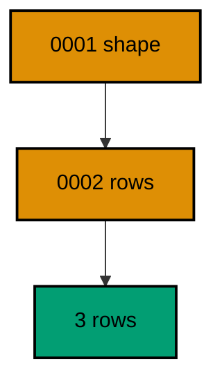
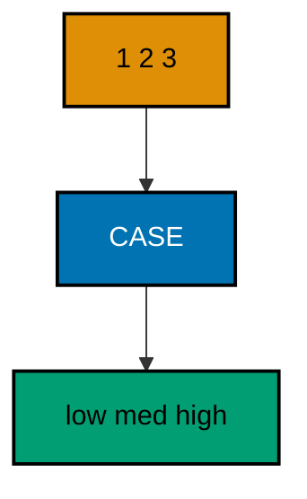
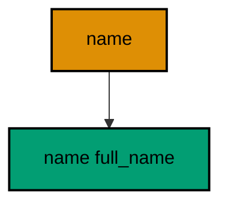
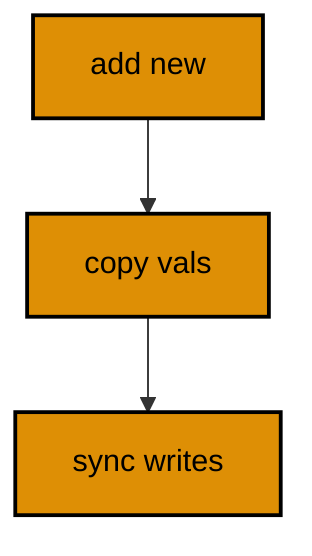
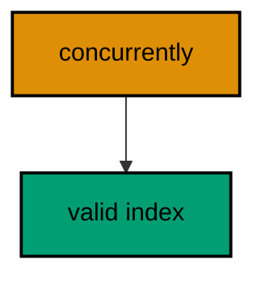
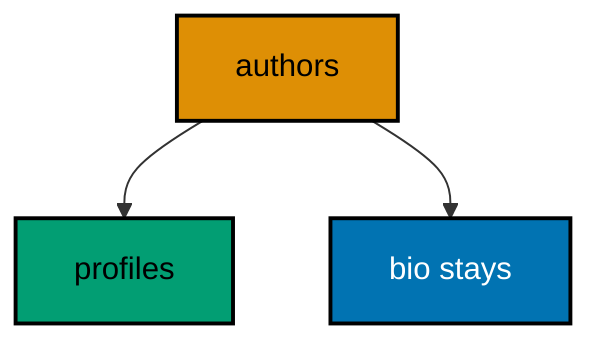
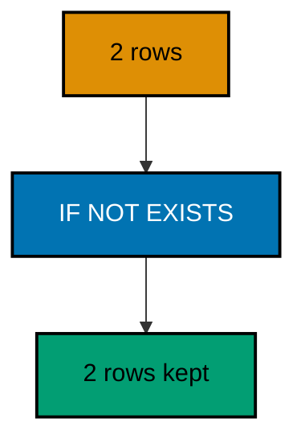
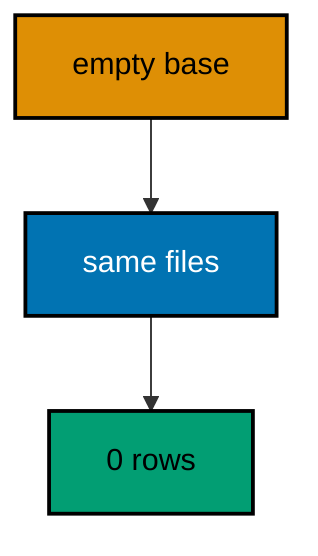
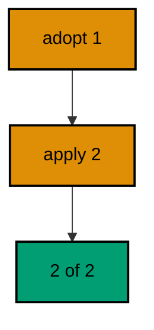
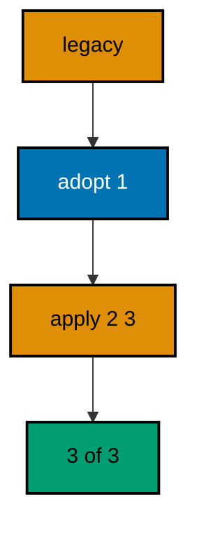

Examples 26–53 handle real data and real releases: backfills that preserve rows (Examples 26–34), zero-downtime splits that never need maintenance windows (Examples 35–44), and baselines that import legacy databases (Examples 45–53). Every example is a complete, runnable Rust program under `learning/code/` driving a real PostgreSQL container; run each with the command in its own `run.yaml`.

---

### Example 26: Separate Data from Schema

Schema files declare shape; data files declare content, and the two never mix. This example creates `products` in `0001` and inserts the opening catalog in `0002`. The final count proves content arrived through the versioned chain.

Separating shape from content keeps reviews focused: schema changes need a DBA eye, data changes need a domain eye, and mixed files need both at once. The program runs both versions and counts the catalog, showing content migrations as ordinary, reviewable versions.

(Concepts: co-06.)



**`learning/code/ex-26-separate-data-from-schema/src/main.rs`**:

```rust
// Example 26: Separate Data from Schema.
// shape first, content second.
use sqlx::Row; // => Row unlocks column reads by name on every result row

static MIGRATOR: sqlx::migrate::Migrator = sqlx::migrate!("./migrations"); // => embeds the shape file and the data file

// => one URL builder shared by the pool and every probe query
fn db_url() -> String {
    // => assemble the connection string from its parts
    format!(
        "postgres://{}@{}:{}/{}", // => trust auth: a user with no password
        std::env::var("PGUSER").unwrap_or_else(|_| String::from("postgres")), // => superuser in the service container
        std::env::var("PGHOST").unwrap_or_else(|_| String::from("postgres")), // => service alias on the unit network
        std::env::var("PGPORT").unwrap_or_else(|_| String::from("5432")), // => pinned PostgreSQL port
        std::env::var("PGDATABASE").unwrap_or_else(|_| String::from("postgres")), // => the service database name
    ) // => format returns the finished URL
} // => helper ends: every connection flows through here

#[tokio::main] // => the async runtime drives the pool and the queries
               // => main returns the database error so failures print it
async fn main() -> Result<(), sqlx::Error> {
    let pool = sqlx::postgres::PgPoolOptions::new() // => start from the default pool options
        .max_connections(5) // => five connections: migrate plus a few readers
        .connect(&db_url()) // => connect to the per-run service database
        .await?; // => ? bubbles a connection failure instead of panicking
    MIGRATOR.run(&pool).await?; // => shape first, then content, in version order
    let row = sqlx::query("SELECT COUNT(*) AS n FROM products") // => the catalog the data file inserted
        .fetch_one(&pool) // => exactly one count row comes back
        .await?; // => ? bubbles a query failure instead of panicking
    let n: i64 = row.get("n"); // => three opening products
    println!("products on record: {n}"); // => content arrived through versions
    Ok(()) // => green run: shape and content compose
} // => main ends: the harness compares stdout to the golden file
```

**`learning/code/ex-26-separate-data-from-schema/migrations/0001_create_products.sql`**:

```sql
-- 0001: products declare the shape only. -- => no rows here, only structure
CREATE TABLE products ( -- => the migrator runs this file once, in version order
    id SERIAL PRIMARY KEY, -- => surrogate key: the row identity never changes
    sku TEXT NOT NULL UNIQUE, -- => every product owns a unique sku
    price INTEGER NOT NULL -- => prices store as integer minor units
); -- => the definition closes here
```

**`learning/code/ex-26-separate-data-from-schema/migrations/0002_seed_catalog.sql`**:

```sql
-- 0002: the opening catalog is data, not schema. -- => content ships as a version too
INSERT INTO products (sku, price) -- => the shape already exists from version 1
    VALUES ('BOOK-1', 1200), -- => the first catalog row
    ('BOOK-2', 950), -- => the second catalog row
    ('BOOK-3', 2100); -- => the third catalog row
```

**Output** (`learning/code/ex-26-separate-data-from-schema/expected/main.stdout.txt`):

```text
products on record: 3
```

**Key takeaway**: Ship seed and reference data in data-only versions after the schema versions they fill.

**Why it matters**: Seed data smuggled outside version control is invisible to every environment except the one where someone ran it. New developers get empty tables, staging diverges from production, and nobody can reconstruct the reference set. A data version makes content as reproducible as schema: fresh databases build the full catalog from the same chain. Reproducibility is the difference between onboarding in an hour and onboarding in a week.

---

### Example 27: Backfill Fills a New Column

New columns on live tables start empty, and a backfill derives their values from existing data. This example adds a `total` column to seeded `invoices`, then fills it as quantity times price. The final rows prove every invoice gained its total.

Backfills translate old shapes into new shapes without downtime: the column arrives nullable, the update computes values row by row, and readers see consistent data throughout. The program prints each invoice with its computed total, showing the derivation explicitly.

(Concepts: co-06.)

**`learning/code/ex-27-backfill-fills-a-new-column/src/main.rs`**:

```rust
// Example 27: Backfill Fills a New Column.
// old rows gain computed totals.
use sqlx::Row; // => Row unlocks column reads by name on every result row

static MIGRATOR: sqlx::migrate::Migrator = sqlx::migrate!("./migrations"); // => embeds schema, seed, column, and backfill

// => one URL builder shared by the pool and every probe query
fn db_url() -> String {
    // => assemble the connection string from its parts
    format!(
        "postgres://{}@{}:{}/{}", // => trust auth: a user with no password
        std::env::var("PGUSER").unwrap_or_else(|_| String::from("postgres")), // => superuser in the service container
        std::env::var("PGHOST").unwrap_or_else(|_| String::from("postgres")), // => service alias on the unit network
        std::env::var("PGPORT").unwrap_or_else(|_| String::from("5432")), // => pinned PostgreSQL port
        std::env::var("PGDATABASE").unwrap_or_else(|_| String::from("postgres")), // => the service database name
    ) // => format returns the finished URL
} // => helper ends: every connection flows through here

#[tokio::main] // => the async runtime drives the pool and the queries
               // => main returns the database error so failures print it
async fn main() -> Result<(), sqlx::Error> {
    let pool = sqlx::postgres::PgPoolOptions::new() // => start from the default pool options
        .max_connections(5) // => five connections: migrate plus a few readers
        .connect(&db_url()) // => connect to the per-run service database
        .await?; // => ? bubbles a connection failure instead of panicking
    MIGRATOR.run(&pool).await?; // => create, seed, add the column, fill it
    let rows = sqlx::query("SELECT id, total FROM invoices ORDER BY id") // => every backfilled total
        .fetch_all(&pool) // => run the read against the same pool
        .await?; // => ? bubbles a query failure instead of panicking
    for row in rows {
        // => walk every invoice in id order
        let id: i32 = row.get("id"); // => the seeded invoice number
        let total: i32 = row.get("total"); // => quantity times price, filled by the backfill
        println!("invoice {id} total {total}"); // => one derived row per line
    } // => loop ends after the last invoice
    Ok(()) // => green run: old data learned the new shape
} // => main ends: the harness compares stdout to the golden file
```

**`learning/code/ex-27-backfill-fills-a-new-column/migrations/0001_create_invoices.sql`**:

```sql
-- 0001: invoices start without totals. -- => the shape before the backfill
CREATE TABLE invoices ( -- => the migrator runs this file once, in version order
    id SERIAL PRIMARY KEY, -- => surrogate key: the row identity never changes
    qty INTEGER NOT NULL, -- => quantities the backfill multiplies
    price INTEGER NOT NULL -- => unit prices the backfill multiplies
); -- => the definition closes here
```

**`learning/code/ex-27-backfill-fills-a-new-column/migrations/0002_seed_invoices.sql`**:

```sql
-- 0002: three live-shaped rows. -- => old data the new column must absorb
INSERT INTO invoices (qty, price) -- => totals unknown at seed time
    VALUES (2, 500), -- => invoice 1: 2 at 500
    (1, 1999), -- => invoice 2: 1 at 1999
    (4, 250); -- => invoice 3: 4 at 250
```

**`learning/code/ex-27-backfill-fills-a-new-column/migrations/0003_add_total.sql`**:

```sql
-- 0003: the total column arrives empty. -- => nullable first, filled next
ALTER TABLE invoices -- => the seeded rows stay exactly where they are
    ADD COLUMN total INTEGER; -- => NULL until the backfill derives values
```

**`learning/code/ex-27-backfill-fills-a-new-column/migrations/0004_backfill_totals.sql`**:

```sql
-- 0004: derive every total from qty and price. -- => the backfill itself
UPDATE invoices -- => rewrite old rows into the new shape
    SET total = qty * price; -- => the derivation, applied to every row at once
```

**Output** (`learning/code/ex-27-backfill-fills-a-new-column/expected/main.stdout.txt`):

```text
invoice 1 total 1000
invoice 2 total 1999
invoice 3 total 1000
```

**Key takeaway**: Add the column nullable, then backfill from existing data in the next version.

**Why it matters**: Live tables cannot be dropped and recreated, so every schema change must absorb the rows that already exist. Backfills are that absorption: a versioned, reviewable derivation that turns old shapes into new ones without losing a single row. Writing the derivation as SQL keeps it beside the schema change it serves, reviewable in the same diff. Data that survives a schema change intact is the quiet proof the migration was safe.

---

### Example 28: Backfill in Batches

One giant update locks every row it touches, so big backfills proceed in bounded batches. This example seeds six `events` rows and fills their `day` column in three two-row updates. The final rows prove batching changes nothing about the outcome.

Batching bounds each transaction's blast radius: short locks, small rollbacks, and steady progress a monitor can watch. The program seeds six rows, runs the three batched updates, and prints every derived day, showing batch boundaries leave no gaps.

(Concepts: co-06.)

**`learning/code/ex-28-backfill-in-batches/src/main.rs`**:

```rust
// Example 28: Backfill in Batches.
// three small updates beat one big lock.
use sqlx::Row; // => Row unlocks column reads by name on every result row

static MIGRATOR: sqlx::migrate::Migrator = sqlx::migrate!("./migrations"); // => embeds schema, seed, column, and batches

// => one URL builder shared by the pool and every probe query
fn db_url() -> String {
    // => assemble the connection string from its parts
    format!(
        "postgres://{}@{}:{}/{}", // => trust auth: a user with no password
        std::env::var("PGUSER").unwrap_or_else(|_| String::from("postgres")), // => superuser in the service container
        std::env::var("PGHOST").unwrap_or_else(|_| String::from("postgres")), // => service alias on the unit network
        std::env::var("PGPORT").unwrap_or_else(|_| String::from("5432")), // => pinned PostgreSQL port
        std::env::var("PGDATABASE").unwrap_or_else(|_| String::from("postgres")), // => the service database name
    ) // => format returns the finished URL
} // => helper ends: every connection flows through here

#[tokio::main] // => the async runtime drives the pool and the queries
               // => main returns the database error so failures print it
async fn main() -> Result<(), sqlx::Error> {
    let pool = sqlx::postgres::PgPoolOptions::new() // => start from the default pool options
        .max_connections(5) // => five connections: migrate plus a few readers
        .connect(&db_url()) // => connect to the per-run service database
        .await?; // => ? bubbles a connection failure instead of panicking
    MIGRATOR.run(&pool).await?; // => create, seed, add the column, fill it in batches
    let rows = sqlx::query("SELECT id, day FROM events ORDER BY id") // => every batched derivation
        .fetch_all(&pool) // => run the read against the same pool
        .await?; // => ? bubbles a query failure instead of panicking
    for row in rows {
        // => walk every event in id order
        let id: i32 = row.get("id"); // => the seeded event number
        let day: String = row.get("day"); // => the batch that claimed this row
        println!("event {id} day {day}"); // => one claimed row per line
    } // => loop ends after the last event
    Ok(()) // => green run: batches cover everything
} // => main ends: the harness compares stdout to the golden file
```

**`learning/code/ex-28-backfill-in-batches/migrations/0001_create_events.sql`**:

```sql
-- 0001: events start without days. -- => the shape before batching
CREATE TABLE events ( -- => the migrator runs this file once, in version order
    id SERIAL PRIMARY KEY, -- => surrogate key: the row identity never changes
    name TEXT NOT NULL, -- => every event must be named
    day TEXT -- => NULL until a batch claims the row
); -- => the definition closes here
```

**`learning/code/ex-28-backfill-in-batches/migrations/0002_seed_events.sql`**:

```sql
-- 0002: six rows for three batches. -- => two rows per batch, no leftovers
INSERT INTO events (name) -- => days unknown at seed time
    VALUES ('alpha'), -- => event 1
    ('beta'), -- => event 2
    ('gamma'), -- => event 3
    ('delta'), -- => event 4
    ('epsilon'), -- => event 5
    ('zeta'); -- => event 6
```

**`learning/code/ex-28-backfill-in-batches/migrations/0003_backfill_days.sql`**:

```sql
-- 0003: three bounded updates, one per batch. -- => short locks, small rollbacks
UPDATE events SET day = 'one' WHERE id BETWEEN 1 AND 2; -- => batch one claims two rows
UPDATE events SET day = 'two' WHERE id BETWEEN 3 AND 4; -- => batch two claims two rows
UPDATE events SET day = 'three' WHERE id BETWEEN 5 AND 6; -- => batch three claims two rows
```

**Output** (`learning/code/ex-28-backfill-in-batches/expected/main.stdout.txt`):

```text
event 1 day one
event 2 day one
event 3 day two
event 4 day two
event 5 day three
event 6 day three
```

**Key takeaway**: Split large backfills into bounded id-range batches so each transaction stays short and small.

**Why it matters**: The backfill that works on ten rows locks the table for seconds on ten million, and that lock arrives during peak traffic because nobody tested at scale. Batches bound the damage per transaction: each commits quickly, releases its locks, and leaves the rest for the next round. The technique costs one WHERE clause per batch and saves the outage a monolithic update would cause. Production data volumes demand production-shaped caution.

---

### Example 29: Backfill with a CASE Expression

Status codes mean nothing until a backfill translates them into labels. This example seeds `tickets` with numeric priorities, then maps 1-3 to low, medium, and high with a single CASE update. The final rows prove the translation.

CASE keeps the mapping beside the data it translates: one statement, every value covered, and an ELSE that catches the unexpected. The program prints each ticket with its derived label, showing code-to-label translation as ordinary versioned work.

(Concepts: co-06.)



**`learning/code/ex-29-backfill-with-a-case-expression/src/main.rs`**:

```rust
// Example 29: Backfill with a CASE Expression.
// numbers become labels in one update.
use sqlx::Row; // => Row unlocks column reads by name on every result row

static MIGRATOR: sqlx::migrate::Migrator = sqlx::migrate!("./migrations"); // => embeds schema, seed, label, and mapping

// => one URL builder shared by the pool and every probe query
fn db_url() -> String {
    // => assemble the connection string from its parts
    format!(
        "postgres://{}@{}:{}/{}", // => trust auth: a user with no password
        std::env::var("PGUSER").unwrap_or_else(|_| String::from("postgres")), // => superuser in the service container
        std::env::var("PGHOST").unwrap_or_else(|_| String::from("postgres")), // => service alias on the unit network
        std::env::var("PGPORT").unwrap_or_else(|_| String::from("5432")), // => pinned PostgreSQL port
        std::env::var("PGDATABASE").unwrap_or_else(|_| String::from("postgres")), // => the service database name
    ) // => format returns the finished URL
} // => helper ends: every connection flows through here

#[tokio::main] // => the async runtime drives the pool and the queries
               // => main returns the database error so failures print it
async fn main() -> Result<(), sqlx::Error> {
    let pool = sqlx::postgres::PgPoolOptions::new() // => start from the default pool options
        .max_connections(5) // => five connections: migrate plus a few readers
        .connect(&db_url()) // => connect to the per-run service database
        .await?; // => ? bubbles a connection failure instead of panicking
    MIGRATOR.run(&pool).await?; // => create, seed, add the label, translate it
    let rows = sqlx::query("SELECT id, label FROM tickets ORDER BY id") // => every translated label
        .fetch_all(&pool) // => run the read against the same pool
        .await?; // => ? bubbles a query failure instead of panicking
    for row in rows {
        // => walk every ticket in id order
        let id: i32 = row.get("id"); // => the seeded ticket number
        let label: String = row.get("label"); // => the CASE result for this row
        println!("ticket {id} label {label}"); // => one translation per line
    } // => loop ends after the last ticket
    Ok(()) // => green run: codes became labels
} // => main ends: the harness compares stdout to the golden file
```

**`learning/code/ex-29-backfill-with-a-case-expression/migrations/0001_create_tickets.sql`**:

```sql
-- 0001: tickets start with numeric priority. -- => codes the backfill translates
CREATE TABLE tickets ( -- => the migrator runs this file once, in version order
    id SERIAL PRIMARY KEY, -- => surrogate key: the row identity never changes
    priority INTEGER NOT NULL, -- => 1, 2, 3 mean low, medium, high
    label TEXT -- => NULL until the mapping fills it
); -- => the definition closes here
```

**`learning/code/ex-29-backfill-with-a-case-expression/migrations/0002_seed_tickets.sql`**:

```sql
-- 0002: one ticket per priority. -- => every mapping branch gets exercised
INSERT INTO tickets (priority) -- => labels unknown at seed time
    VALUES (1), -- => ticket 1: low
    (2), -- => ticket 2: medium
    (3); -- => ticket 3: high
```

**`learning/code/ex-29-backfill-with-a-case-expression/migrations/0003_map_labels.sql`**:

```sql
-- 0003: one CASE covers every code. -- => the translation ships as a version
UPDATE tickets -- => rewrite codes into labels
    SET label = CASE priority -- => branch on the stored code
        WHEN 1 THEN 'low' -- => the lowest priority
        WHEN 2 THEN 'medium' -- => the middle priority
        ELSE 'high' -- => the catch-all covers 3 and anything unexpected
    END; -- => every row gains exactly one label
```

**Output** (`learning/code/ex-29-backfill-with-a-case-expression/expected/main.stdout.txt`):

```text
ticket 1 label low
ticket 2 label medium
ticket 3 label high
```

**Key takeaway**: Translate code columns with a single CASE update and an ELSE that names the unexpected.

**Why it matters**: Magic numbers in a database are write-only knowledge: everyone reads 2, nobody remembers it means medium, and the mapping lives in a wiki nobody updates. A label column filled by a reviewed CASE moves that knowledge into the schema itself, where every query can use it. The ELSE branch matters most, because it decides loudly what happens to values the author never imagined. Explicit mappings outlive the engineers who wrote them.

---

### Example 30: Backfill Before Adding NOT NULL

Strictness arrives in three versions: the nullable column, the backfill that empties the nulls, then the constraint. This example runs that exact sequence on `profiles`. The catalog check proves no nulls remain and the constraint holds.

Skipping the backfill fails loudly on live data: PostgreSQL rejects NOT NULL while any null survives. The ordered trio makes strictness safe by construction, and the program verifies both the data and the constraint, proving each step did its job.

(Concepts: co-06.)

**`learning/code/ex-30-backfill-before-adding-not-null/src/main.rs`**:

```rust
// Example 30: Backfill Before Adding NOT NULL.
// strictness arrives in three versions.
use sqlx::Row; // => Row unlocks column reads by name on every result row

static MIGRATOR: sqlx::migrate::Migrator = sqlx::migrate!("./migrations"); // => embeds the nullable, backfill, and constraint

// => one URL builder shared by the pool and every probe query
fn db_url() -> String {
    // => assemble the connection string from its parts
    format!(
        "postgres://{}@{}:{}/{}", // => trust auth: a user with no password
        std::env::var("PGUSER").unwrap_or_else(|_| String::from("postgres")), // => superuser in the service container
        std::env::var("PGHOST").unwrap_or_else(|_| String::from("postgres")), // => service alias on the unit network
        std::env::var("PGPORT").unwrap_or_else(|_| String::from("5432")), // => pinned PostgreSQL port
        std::env::var("PGDATABASE").unwrap_or_else(|_| String::from("postgres")), // => the service database name
    ) // => format returns the finished URL
} // => helper ends: every connection flows through here

#[tokio::main] // => the async runtime drives the pool and the queries
               // => main returns the database error so failures print it
async fn main() -> Result<(), sqlx::Error> {
    let pool = sqlx::postgres::PgPoolOptions::new() // => start from the default pool options
        .max_connections(5) // => five connections: migrate plus a few readers
        .connect(&db_url()) // => connect to the per-run service database
        .await?; // => ? bubbles a connection failure instead of panicking
    MIGRATOR.run(&pool).await?; // => nullable arrives, nulls fill, constraint lands
    let row = sqlx::query("SELECT COUNT(*) AS n FROM profiles WHERE handle IS NULL") // => nulls that would block strictness
        .fetch_one(&pool) // => exactly one count row comes back
        .await?; // => ? bubbles a query failure instead of panicking
    let n: i64 = row.get("n"); // => zero after the backfill
    println!("null handles remaining: {n}"); // => the backfill proof
    let row = sqlx::query("SELECT is_nullable FROM information_schema.columns WHERE table_name = 'profiles' AND column_name = 'handle'") // => the constraint itself
        .fetch_one(&pool) // => exactly one catalog row comes back
        .await?; // => ? bubbles a query failure instead of panicking
    let nullable: String = row.get("is_nullable"); // => NO once the constraint lands
    println!("handle nullable: {nullable}"); // => the strictness proof
    Ok(()) // => green run: data first, constraint second
} // => main ends: the harness compares stdout to the golden file
```

**`learning/code/ex-30-backfill-before-adding-not-null/migrations/0001_create_profiles.sql`**:

```sql
-- 0001: handles start nullable. -- => strictness comes later, data comes now
CREATE TABLE profiles ( -- => the migrator runs this file once, in version order
    id SERIAL PRIMARY KEY, -- => surrogate key: the row identity never changes
    handle TEXT -- => NULL until the backfill invents values
); -- => the definition closes here
```

**`learning/code/ex-30-backfill-before-adding-not-null/migrations/0002_seed_profiles.sql`**:

```sql
-- 0002: two handle-less rows. -- => the nulls the backfill must empty
INSERT INTO profiles DEFAULT VALUES; -- => profile 1: no handle
INSERT INTO profiles DEFAULT VALUES; -- => profile 2: no handle
```

**`learning/code/ex-30-backfill-before-adding-not-null/migrations/0003_backfill_handles.sql`**:

```sql
-- 0003: invent handles for the handle-less. -- => every row gains a value
UPDATE profiles -- => rewrite nulls into real handles
    SET handle = 'user-' || id WHERE handle IS NULL; -- => derived handles, only where missing
```

**`learning/code/ex-30-backfill-before-adding-not-null/migrations/0004_require_handle.sql`**:

```sql
-- 0004: strictness lands last. -- => safe only because no nulls remain
ALTER TABLE profiles -- => the table keeps every backfilled row
    ALTER COLUMN handle SET NOT NULL; -- => the constraint the sequence earned
```

**Output** (`learning/code/ex-30-backfill-before-adding-not-null/expected/main.stdout.txt`):

```text
null handles remaining: 0
handle nullable: NO
```

**Key takeaway**: Earn NOT NULL in order: nullable column, backfill, then constraint, each in its own version.

**Why it matters**: Constraints applied to unprepared data fail the deploy, and the failure arrives at the worst time because production holds the rows development never had. The three-version sequence removes the gamble: each step is verifiable alone, and the constraint lands only on data already proven clean. Order is the entire technique. Teams that respect the sequence never watch a NOT NULL deploy bounce off live nulls.

---

### Example 31: Defaults Beat Null Backfills

A column default fills old and new rows without any update statement. This example adds `currency` with `DEFAULT 'USD'` to seeded `charges`. Every old row reads USD immediately, and the program prints the proof.

Defaults are backfills the database performs atomically at alter time: no update to write, no rows to lock one by one, no window where readers see nulls. The program selects every charge and prints its currency, showing the default reached back in time.

(Concepts: co-06.)

**`learning/code/ex-31-defaults-beat-null-backfills/src/main.rs`**:

```rust
// Example 31: Defaults Beat Null Backfills.
// the default reaches back in time.
use sqlx::Row; // => Row unlocks column reads by name on every result row

static MIGRATOR: sqlx::migrate::Migrator = sqlx::migrate!("./migrations"); // => embeds schema, seed, and defaulted column

// => one URL builder shared by the pool and every probe query
fn db_url() -> String {
    // => assemble the connection string from its parts
    format!(
        "postgres://{}@{}:{}/{}", // => trust auth: a user with no password
        std::env::var("PGUSER").unwrap_or_else(|_| String::from("postgres")), // => superuser in the service container
        std::env::var("PGHOST").unwrap_or_else(|_| String::from("postgres")), // => service alias on the unit network
        std::env::var("PGPORT").unwrap_or_else(|_| String::from("5432")), // => pinned PostgreSQL port
        std::env::var("PGDATABASE").unwrap_or_else(|_| String::from("postgres")), // => the service database name
    ) // => format returns the finished URL
} // => helper ends: every connection flows through here

#[tokio::main] // => the async runtime drives the pool and the queries
               // => main returns the database error so failures print it
async fn main() -> Result<(), sqlx::Error> {
    let pool = sqlx::postgres::PgPoolOptions::new() // => start from the default pool options
        .max_connections(5) // => five connections: migrate plus a few readers
        .connect(&db_url()) // => connect to the per-run service database
        .await?; // => ? bubbles a connection failure instead of panicking
    MIGRATOR.run(&pool).await?; // => create, seed, then add the defaulted column
    let rows = sqlx::query("SELECT id, currency FROM charges ORDER BY id") // => every row the default touched
        .fetch_all(&pool) // => run the read against the same pool
        .await?; // => ? bubbles a query failure instead of panicking
    for row in rows {
        // => walk every charge in id order
        let id: i32 = row.get("id"); // => the seeded charge number
        let currency: String = row.get("currency"); // => USD for old rows by default
        println!("charge {id} currency {currency}"); // => one defaulted row per line
    } // => loop ends after the last charge
    Ok(()) // => green run: defaults fill history too
} // => main ends: the harness compares stdout to the golden file
```

**`learning/code/ex-31-defaults-beat-null-backfills/migrations/0001_create_charges.sql`**:

```sql
-- 0001: charges start currency-less. -- => the default arrives with the column
CREATE TABLE charges ( -- => the migrator runs this file once, in version order
    id SERIAL PRIMARY KEY, -- => surrogate key: the row identity never changes
    amount INTEGER NOT NULL -- => amounts store as integer minor units
); -- => the definition closes here
```

**`learning/code/ex-31-defaults-beat-null-backfills/migrations/0002_seed_charges.sql`**:

```sql
-- 0002: two pre-default rows. -- => old data the default must absorb
INSERT INTO charges (amount) -- => no currency column exists yet
    VALUES (100), -- => charge 1
    (250); -- => charge 2
```

**`learning/code/ex-31-defaults-beat-null-backfills/migrations/0003_add_currency.sql`**:

```sql
-- 0003: the default fills old rows at alter time. -- => no update statement needed
ALTER TABLE charges -- => existing rows gain USD instantly
    ADD COLUMN currency TEXT NOT NULL DEFAULT 'USD'; -- => old and new rows share the default
```

**Output** (`learning/code/ex-31-defaults-beat-null-backfills/expected/main.stdout.txt`):

```text
charge 1 currency USD
charge 2 currency USD
```

**Key takeaway**: Prefer a column DEFAULT over a backfill update when every old row deserves the same value.

**Why it matters**: The simplest backfill is the one never written. A default fills existing rows atomically during the alter, with no second version to review, no long update to monitor, and no window of nulls for readers to trip on. Updates still have their place for derived values, but constant fills should ride the default. Choosing the smaller mechanism is a form of respect for the reviewers and operators who inherit the chain.

---

### Example 32: Idempotent Backfill Uses WHERE

A backfill that runs twice must change nothing the second time. This example fills missing `nick` values with a WHERE-guarded update, then runs the whole migrator twice. Identical totals prove the second pass was a no-op.

WHERE-guarded updates are safe to retry because they only touch rows still missing values: fixed rows never match again. The program runs the migrator twice and prints both totals, showing reruns converge instead of compounding.

(Concepts: co-05, co-06.)

**`learning/code/ex-32-idempotent-backfill-uses-where/src/main.rs`**:

```rust
// Example 32: Idempotent Backfill Uses WHERE.
// reruns converge instead of compounding.
use sqlx::Row; // => Row unlocks column reads by name on every result row

static MIGRATOR: sqlx::migrate::Migrator = sqlx::migrate!("./migrations"); // => embeds schema, seed, and guarded backfill

// => one URL builder shared by the pool and every probe query
fn db_url() -> String {
    // => assemble the connection string from its parts
    format!(
        "postgres://{}@{}:{}/{}", // => trust auth: a user with no password
        std::env::var("PGUSER").unwrap_or_else(|_| String::from("postgres")), // => superuser in the service container
        std::env::var("PGHOST").unwrap_or_else(|_| String::from("postgres")), // => service alias on the unit network
        std::env::var("PGPORT").unwrap_or_else(|_| String::from("5432")), // => pinned PostgreSQL port
        std::env::var("PGDATABASE").unwrap_or_else(|_| String::from("postgres")), // => the service database name
    ) // => format returns the finished URL
} // => helper ends: every connection flows through here

#[tokio::main] // => the async runtime drives the pool and the queries
               // => main returns the database error so failures print it
async fn main() -> Result<(), sqlx::Error> {
    let pool = sqlx::postgres::PgPoolOptions::new() // => start from the default pool options
        .max_connections(5) // => five connections: migrate plus a few readers
        .connect(&db_url()) // => connect to the per-run service database
        .await?; // => ? bubbles a connection failure instead of panicking
    MIGRATOR.run(&pool).await?; // => first run fills the missing nicks
    MIGRATOR.run(&pool).await?; // => second run matches zero rows
    let row = sqlx::query("SELECT COUNT(*) AS filled FROM gamers WHERE nick IS NOT NULL") // => rows the backfill claimed
        .fetch_one(&pool) // => exactly one count row comes back
        .await?; // => ? bubbles a query failure instead of panicking
    let filled: i64 = row.get("filled"); // => both seeded rows, exactly once
    println!("nicked gamers: {filled}"); // => reruns never double-fill
    Ok(()) // => green run: the backfill is idempotent
} // => main ends: the harness compares stdout to the golden file
```

**`learning/code/ex-32-idempotent-backfill-uses-where/migrations/0001_create_gamers.sql`**:

```sql
-- 0001: nicks start missing. -- => the backfill target
CREATE TABLE gamers ( -- => the migrator runs this file once, in version order
    id SERIAL PRIMARY KEY, -- => surrogate key: the row identity never changes
    nick TEXT -- => NULL until the guarded update claims the row
); -- => the definition closes here
```

**`learning/code/ex-32-idempotent-backfill-uses-where/migrations/0002_seed_gamers.sql`**:

```sql
-- 0002: two nick-less rows. -- => the rows the backfill must fill exactly once
INSERT INTO gamers DEFAULT VALUES; -- => gamer 1: no nick
INSERT INTO gamers DEFAULT VALUES; -- => gamer 2: no nick
```

**`learning/code/ex-32-idempotent-backfill-uses-where/migrations/0003_fill_nicks.sql`**:

```sql
-- 0003: the WHERE guard makes reruns safe. -- => filled rows never match again
UPDATE gamers -- => only the still-missing rows change
    SET nick = 'player-' || id WHERE nick IS NULL; -- => the guard is the idempotence
```

**Output** (`learning/code/ex-32-idempotent-backfill-uses-where/expected/main.stdout.txt`):

```text
nicked gamers: 2
```

**Key takeaway**: Guard backfill updates with WHERE so reruns match zero rows and converge.

**Why it matters**: Backfills run more than once in practice: deploys retry, operators re-run steps, and double execution is a matter of when. An unguarded update re-derives values that may since have been hand-corrected, destroying human fixes with machine confidence. The WHERE clause costs nothing and turns reruns from a risk into a non-event. Idempotence is not elegance; it is the admission that production will run your code twice.

---

### Example 33: Backfill a Lookup Table

Reference data often hides inside existing rows, waiting to be normalized out. This example collects distinct `kind` values from seeded `parcels` into a new `kinds` table. The final list proves the lookup was derived, not hand-typed.

Deriving lookups from data keeps them truthful: the table contains exactly the values in use, no more and no less. The program prints each derived kind, showing normalization as a versioned step instead of a manual import.

(Concepts: co-06.)

**`learning/code/ex-33-backfill-a-lookup-table/src/main.rs`**:

```rust
// Example 33: Backfill a Lookup Table.
// distinct values become reference rows.
use sqlx::Row; // => Row unlocks column reads by name on every result row

static MIGRATOR: sqlx::migrate::Migrator = sqlx::migrate!("./migrations"); // => embeds parcels, kinds, and derivation

// => one URL builder shared by the pool and every probe query
fn db_url() -> String {
    // => assemble the connection string from its parts
    format!(
        "postgres://{}@{}:{}/{}", // => trust auth: a user with no password
        std::env::var("PGUSER").unwrap_or_else(|_| String::from("postgres")), // => superuser in the service container
        std::env::var("PGHOST").unwrap_or_else(|_| String::from("postgres")), // => service alias on the unit network
        std::env::var("PGPORT").unwrap_or_else(|_| String::from("5432")), // => pinned PostgreSQL port
        std::env::var("PGDATABASE").unwrap_or_else(|_| String::from("postgres")), // => the service database name
    ) // => format returns the finished URL
} // => helper ends: every connection flows through here

#[tokio::main] // => the async runtime drives the pool and the queries
               // => main returns the database error so failures print it
async fn main() -> Result<(), sqlx::Error> {
    let pool = sqlx::postgres::PgPoolOptions::new() // => start from the default pool options
        .max_connections(5) // => five connections: migrate plus a few readers
        .connect(&db_url()) // => connect to the per-run service database
        .await?; // => ? bubbles a connection failure instead of panicking
    MIGRATOR.run(&pool).await?; // => seed parcels, create the lookup, derive its rows
    let rows = sqlx::query("SELECT kind FROM kinds ORDER BY kind") // => every derived reference row
        .fetch_all(&pool) // => run the read against the same pool
        .await?; // => ? bubbles a query failure instead of panicking
    for row in rows {
        // => walk every kind alphabetically
        let kind: String = row.get("kind"); // => a value once buried in parcels
        println!("kind: {kind}"); // => one normalized value per line
    } // => loop ends after the last kind
    Ok(()) // => green run: the lookup is derived
} // => main ends: the harness compares stdout to the golden file
```

**`learning/code/ex-33-backfill-a-lookup-table/migrations/0001_create_parcels.sql`**:

```sql
-- 0001: parcels carry free-text kinds. -- => the values the lookup normalizes
CREATE TABLE parcels ( -- => the migrator runs this file once, in version order
    id SERIAL PRIMARY KEY, -- => surrogate key: the row identity never changes
    kind TEXT NOT NULL -- => free text today, foreign key tomorrow
); -- => the definition closes here
```

**`learning/code/ex-33-backfill-a-lookup-table/migrations/0002_seed_parcels.sql`**:

```sql
-- 0002: three parcels, two kinds. -- => duplicates collapse in the lookup
INSERT INTO parcels (kind) -- => kinds buried in row data
    VALUES ('fragile'), -- => parcel 1
    ('heavy'), -- => parcel 2
    ('fragile'); -- => parcel 3 repeats parcel 1
```

**`learning/code/ex-33-backfill-a-lookup-table/migrations/0003_create_kinds.sql`**:

```sql
-- 0003: the lookup table arrives empty. -- => derivation fills it next
CREATE TABLE kinds ( -- => the migrator runs this file once, in version order
    id SERIAL PRIMARY KEY, -- => surrogate key: the row identity never changes
    kind TEXT NOT NULL UNIQUE -- => one row per distinct value
); -- => the definition closes here
```

**`learning/code/ex-33-backfill-a-lookup-table/migrations/0004_derive_kinds.sql`**:

```sql
-- 0004: distinct values become rows. -- => truthful by construction
INSERT INTO kinds (kind) -- => exactly the values in use
    SELECT DISTINCT kind FROM parcels; -- => duplicates collapse here
```

**Output** (`learning/code/ex-33-backfill-a-lookup-table/expected/main.stdout.txt`):

```text
kind: fragile
kind: heavy
```

**Key takeaway**: Derive lookup tables from existing rows with DISTINCT instead of hand-typing reference data.

**Why it matters**: Hand-typed reference data drifts from reality on day one: someone adds a parcel kind the lookup never heard of, and joins start silently dropping rows. Deriving the lookup from the data guarantees the reference matches reality at migration time, with the mismatch surface pushed to application validation where it belongs. Truthful lookups turn missing-value bugs from silent corruption into loud constraint errors. Derivation is documentation that cannot lie.

---

### Example 34: Verify Backfill with a Check Query

Every backfill ends with a query that proves it finished: zero nulls, zero orphans, zero surprises. This example fills `slugs` from titles, then counts the rows still missing one. Zero remaining is the backfill's certificate of completion.

Check queries turn hope into evidence: instead of assuming the update covered everything, the migration chain can assert it before later versions build on the result. The program prints the remaining-null count, and zero is the only acceptable value.

(Concepts: co-06, co-16.)

**`learning/code/ex-34-verify-backfill-with-a-check-query/src/main.rs`**:

```rust
// Example 34: Verify Backfill with a Check Query.
// zero remaining is the certificate.
use sqlx::Row; // => Row unlocks column reads by name on every result row

static MIGRATOR: sqlx::migrate::Migrator = sqlx::migrate!("./migrations"); // => embeds schema, seed, and backfill

// => one URL builder shared by the pool and every probe query
fn db_url() -> String {
    // => assemble the connection string from its parts
    format!(
        "postgres://{}@{}:{}/{}", // => trust auth: a user with no password
        std::env::var("PGUSER").unwrap_or_else(|_| String::from("postgres")), // => superuser in the service container
        std::env::var("PGHOST").unwrap_or_else(|_| String::from("postgres")), // => service alias on the unit network
        std::env::var("PGPORT").unwrap_or_else(|_| String::from("5432")), // => pinned PostgreSQL port
        std::env::var("PGDATABASE").unwrap_or_else(|_| String::from("postgres")), // => the service database name
    ) // => format returns the finished URL
} // => helper ends: every connection flows through here

#[tokio::main] // => the async runtime drives the pool and the queries
               // => main returns the database error so failures print it
async fn main() -> Result<(), sqlx::Error> {
    let pool = sqlx::postgres::PgPoolOptions::new() // => start from the default pool options
        .max_connections(5) // => five connections: migrate plus a few readers
        .connect(&db_url()) // => connect to the per-run service database
        .await?; // => ? bubbles a connection failure instead of panicking
    MIGRATOR.run(&pool).await?; // => create, seed, add the slug, fill it
    let row = sqlx::query("SELECT COUNT(*) AS n FROM articles WHERE slug IS NULL") // => rows the backfill missed
        .fetch_one(&pool) // => exactly one count row comes back
        .await?; // => ? bubbles a query failure instead of panicking
    let n: i64 = row.get("n"); // => zero means complete
    println!("slugs still missing: {n}"); // => the certificate of completion
    Ok(()) // => green run: the backfill is verified
} // => main ends: the harness compares stdout to the golden file
```

**`learning/code/ex-34-verify-backfill-with-a-check-query/migrations/0001_create_articles.sql`**:

```sql
-- 0001: articles start slug-less. -- => the column the check inspects
CREATE TABLE articles ( -- => the migrator runs this file once, in version order
    id SERIAL PRIMARY KEY, -- => surrogate key: the row identity never changes
    title TEXT NOT NULL, -- => titles the slugs derive from
    slug TEXT -- => NULL until the backfill derives values
); -- => the definition closes here
```

**`learning/code/ex-34-verify-backfill-with-a-check-query/migrations/0002_seed_articles.sql`**:

```sql
-- 0002: two titled rows. -- => the rows the backfill must cover
INSERT INTO articles (title) -- => slugs unknown at seed time
    VALUES ('Hello World'), -- => article 1
    ('Rust Wins'); -- => article 2
```

**`learning/code/ex-34-verify-backfill-with-a-check-query/migrations/0003_fill_slugs.sql`**:

```sql
-- 0003: derive slugs from titles. -- => the work the check verifies
UPDATE articles -- => rewrite slug-less rows
    SET slug = lower(replace(title, ' ', '-')) WHERE slug IS NULL; -- => guarded, like all good backfills
```

**Output** (`learning/code/ex-34-verify-backfill-with-a-check-query/expected/main.stdout.txt`):

```text
slugs still missing: 0
```

**Key takeaway**: End backfill chains with a count query that proves zero rows were missed.

**Why it matters**: An unverified backfill is a rumor: the update ran, but nobody proved it covered every row, and the next version builds on faith. Check queries replace faith with a number the pipeline can assert on, failing the deploy while the gap is still cheap to fix. The habit compounds: every verified backfill teaches the team what complete looks like. Evidence beats optimism in every incident review.

---

### Example 35: Expand Before You Contract

Safe renames add the new shape before removing the old one, so every deploy in between sees both. This example adds `full_name` beside `name` without touching the old column. Both columns present is the expand half proven.

Expand-then-contract is the only rename pattern that survives rolling deploys: old code reads the old column while new code adopts the new one, and neither ever sees a missing field. The program prints both columns, proving the expansion landed without disturbing the original.

(Concepts: co-07.)



**`learning/code/ex-35-expand-before-you-contract/src/main.rs`**:

```rust
// Example 35: Expand Before You Contract.
// the new shape arrives; the old one stays.
use sqlx::Row; // => Row unlocks column reads by name on every result row

static MIGRATOR: sqlx::migrate::Migrator = sqlx::migrate!("./migrations"); // => embeds the create and the expansion

// => one URL builder shared by the pool and every probe query
fn db_url() -> String {
    // => assemble the connection string from its parts
    format!(
        "postgres://{}@{}:{}/{}", // => trust auth: a user with no password
        std::env::var("PGUSER").unwrap_or_else(|_| String::from("postgres")), // => superuser in the service container
        std::env::var("PGHOST").unwrap_or_else(|_| String::from("postgres")), // => service alias on the unit network
        std::env::var("PGPORT").unwrap_or_else(|_| String::from("5432")), // => pinned PostgreSQL port
        std::env::var("PGDATABASE").unwrap_or_else(|_| String::from("postgres")), // => the service database name
    ) // => format returns the finished URL
} // => helper ends: every connection flows through here

#[tokio::main] // => the async runtime drives the pool and the queries
               // => main returns the database error so failures print it
async fn main() -> Result<(), sqlx::Error> {
    let pool = sqlx::postgres::PgPoolOptions::new() // => start from the default pool options
        .max_connections(5) // => five connections: migrate plus a few readers
        .connect(&db_url()) // => connect to the per-run service database
        .await?; // => ? bubbles a connection failure instead of panicking
    MIGRATOR.run(&pool).await?; // => create users, then expand the shape
    let rows = sqlx::query("SELECT column_name FROM information_schema.columns WHERE table_name = 'users' ORDER BY ordinal_position") // => the expanded shape
        .fetch_all(&pool) // => run the read against the same pool
        .await?; // => ? bubbles a query failure instead of panicking
    let columns: Vec<String> = rows.iter().map(|row| row.get("column_name")).collect(); // => old and new side by side
    println!("user columns: {}", columns.join(" ")); // => expansion without disturbance
    Ok(()) // => green run: the expand half holds
} // => main ends: the harness compares stdout to the golden file
```

**`learning/code/ex-35-expand-before-you-contract/migrations/0001_create_users.sql`**:

```sql
-- 0001: users start with one name. -- => the shape old code reads
CREATE TABLE users ( -- => the migrator runs this file once, in version order
    id SERIAL PRIMARY KEY, -- => surrogate key: the row identity never changes
    name TEXT NOT NULL -- => the old column, untouched by the expansion
); -- => the definition closes here
```

**`learning/code/ex-35-expand-before-you-contract/migrations/0002_add_full_name.sql`**:

```sql
-- 0002: the new shape arrives beside the old. -- => expansion, not replacement
ALTER TABLE users -- => the old column stays exactly where it is
    ADD COLUMN full_name TEXT; -- => nullable: readers adopt it gradually
```

**Output** (`learning/code/ex-35-expand-before-you-contract/expected/main.stdout.txt`):

```text
user columns: id name full_name
```

**Key takeaway**: Expand first: add new columns and tables while old readers still use the old ones.

**Why it matters**: Renames that delete first break every reader still on the old shape, which during a rolling deploy is all of them. Expansion keeps both shapes live, so old and new code run against the same database without coordination. The temporary duplication costs a column; the alternative costs an outage window. Patience in schema changes is what makes zero-downtime more than a slogan.

---

### Example 36: Readers Move to the New Column

Once the new column exists, data flows into it and readers switch over one by one. This example seeds two users, backfills `full_name` from `name`, and prints both pairs. Matching pairs prove the copy is faithful.

The migrate phase only moves data; application deploys move readers, each on its own schedule. The program shows the data side complete: every old value has its new twin, so any reader can switch whenever it is ready.

(Concepts: co-07.)

**`learning/code/ex-36-readers-move-to-the-new-column/src/main.rs`**:

```rust
// Example 36: Readers Move to the New Column.
// every old value gains its new twin.
use sqlx::Row; // => Row unlocks column reads by name on every result row

static MIGRATOR: sqlx::migrate::Migrator = sqlx::migrate!("./migrations"); // => embeds create, seed, expand, and copy

// => one URL builder shared by the pool and every probe query
fn db_url() -> String {
    // => assemble the connection string from its parts
    format!(
        "postgres://{}@{}:{}/{}", // => trust auth: a user with no password
        std::env::var("PGUSER").unwrap_or_else(|_| String::from("postgres")), // => superuser in the service container
        std::env::var("PGHOST").unwrap_or_else(|_| String::from("postgres")), // => service alias on the unit network
        std::env::var("PGPORT").unwrap_or_else(|_| String::from("5432")), // => pinned PostgreSQL port
        std::env::var("PGDATABASE").unwrap_or_else(|_| String::from("postgres")), // => the service database name
    ) // => format returns the finished URL
} // => helper ends: every connection flows through here

#[tokio::main] // => the async runtime drives the pool and the queries
               // => main returns the database error so failures print it
async fn main() -> Result<(), sqlx::Error> {
    let pool = sqlx::postgres::PgPoolOptions::new() // => start from the default pool options
        .max_connections(5) // => five connections: migrate plus a few readers
        .connect(&db_url()) // => connect to the per-run service database
        .await?; // => ? bubbles a connection failure instead of panicking
    MIGRATOR.run(&pool).await?; // => create, seed, expand, then copy values over
    let rows = sqlx::query("SELECT name, full_name FROM users ORDER BY id") // => old and new side by side
        .fetch_all(&pool) // => run the read against the same pool
        .await?; // => ? bubbles a query failure instead of panicking
    for row in rows {
        // => walk every user in id order
        let name: String = row.get("name"); // => the old column readers still use
        let full_name: String = row.get("full_name"); // => the new column readers adopt
        println!("{name} also {full_name}"); // => one faithful pair per line
    } // => loop ends after the last user
    Ok(()) // => green run: the copy is faithful
} // => main ends: the harness compares stdout to the golden file
```

**`learning/code/ex-36-readers-move-to-the-new-column/migrations/0001_create_users.sql`**:

```sql
-- 0001: users start with one name. -- => the old column readers keep
CREATE TABLE users ( -- => the migrator runs this file once, in version order
    id SERIAL PRIMARY KEY, -- => surrogate key: the row identity never changes
    name TEXT NOT NULL -- => the old column, source of the copy
); -- => the definition closes here
```

**`learning/code/ex-36-readers-move-to-the-new-column/migrations/0002_seed_users.sql`**:

```sql
-- 0002: two live-shaped users. -- => the rows the copy must twin
INSERT INTO users (name) -- => full names unknown at seed time
    VALUES ('ada'), -- => user 1
    ('grace'); -- => user 2
```

**`learning/code/ex-36-readers-move-to-the-new-column/migrations/0003_add_full_name.sql`**:

```sql
-- 0003: the new column arrives empty. -- => readers adopt it after the copy
ALTER TABLE users -- => the old column stays exactly where it is
    ADD COLUMN full_name TEXT; -- => NULL until the copy fills it
```

**`learning/code/ex-36-readers-move-to-the-new-column/migrations/0004_copy_names.sql`**:

```sql
-- 0004: twin every old value. -- => the data side of the reader move
UPDATE users -- => copy old values into the new home
    SET full_name = name WHERE full_name IS NULL; -- => guarded, like all good backfills
```

**Output** (`learning/code/ex-36-readers-move-to-the-new-column/expected/main.stdout.txt`):

```text
ada also ada
grace also grace
```

**Key takeaway**: Copy data into the new shape with a guarded update; readers switch in later deploys.

**Why it matters**: Data moves and reader moves are separate deployments for a reason: mixing them forces a flag day where every service must change at once. The copy version finishes the data side completely, so application teams adopt the new column on their own schedules without database coordination. Decoupling the two moves is what lets large systems evolve without synchronized releases. Independence between layers is an operational superpower.

---

### Example 37: Rename Without Downtime in Three Steps

A rename is three versions: add the new column, copy the values, then enforce parity going forward. This example runs all three on `customers` and prints both name columns. Twins everywhere prove the middle state is healthy.

Each step is independently safe to deploy: the add changes nothing, the copy changes only the new column, and the trigger keeps them in sync for writers. The program verifies the middle state directly, showing the rename paused safely between steps.

(Concepts: co-07.)



**`learning/code/ex-37-rename-without-downtime-in-three-steps/src/main.rs`**:

```rust
// Example 37: Rename Without Downtime in Three Steps.
// add, copy, then keep them in sync.
use sqlx::Row; // => Row unlocks column reads by name on every result row

static MIGRATOR: sqlx::migrate::Migrator = sqlx::migrate!("./migrations"); // => embeds the three rename steps

// => one URL builder shared by the pool and every probe query
fn db_url() -> String {
    // => assemble the connection string from its parts
    format!(
        "postgres://{}@{}:{}/{}", // => trust auth: a user with no password
        std::env::var("PGUSER").unwrap_or_else(|_| String::from("postgres")), // => superuser in the service container
        std::env::var("PGHOST").unwrap_or_else(|_| String::from("postgres")), // => service alias on the unit network
        std::env::var("PGPORT").unwrap_or_else(|_| String::from("5432")), // => pinned PostgreSQL port
        std::env::var("PGDATABASE").unwrap_or_else(|_| String::from("postgres")), // => the service database name
    ) // => format returns the finished URL
} // => helper ends: every connection flows through here

#[tokio::main] // => the async runtime drives the pool and the queries
               // => main returns the database error so failures print it
async fn main() -> Result<(), sqlx::Error> {
    let pool = sqlx::postgres::PgPoolOptions::new() // => start from the default pool options
        .max_connections(5) // => five connections: migrate plus a few readers
        .connect(&db_url()) // => connect to the per-run service database
        .await?; // => ? bubbles a connection failure instead of panicking
    MIGRATOR.run(&pool).await?; // => add the column, copy values, sync future writes
    let rows = sqlx::query("SELECT name, full_name FROM customers ORDER BY id") // => the paused middle state
        .fetch_all(&pool) // => run the read against the same pool
        .await?; // => ? bubbles a query failure instead of panicking
    for row in rows {
        // => walk every customer in id order
        let name: String = row.get("name"); // => the old column, still live
        let full_name: String = row.get("full_name"); // => the new column, now twinned
        println!("{name} equals {full_name}"); // => one twin pair per line
    } // => loop ends after the last customer
    Ok(()) // => green run: the middle state is healthy
} // => main ends: the harness compares stdout to the golden file
```

**`learning/code/ex-37-rename-without-downtime-in-three-steps/migrations/0001_create_customers.sql`**:

```sql
-- 0001: customers start with one name. -- => the rename subject
CREATE TABLE customers ( -- => the migrator runs this file once, in version order
    id SERIAL PRIMARY KEY, -- => surrogate key: the row identity never changes
    name TEXT NOT NULL -- => the old column the rename retires
); -- => the definition closes here
```

**`learning/code/ex-37-rename-without-downtime-in-three-steps/migrations/0002_seed_customers.sql`**:

```sql
-- 0002: two customers to rename. -- => the rows every step must preserve
INSERT INTO customers (name) -- => full names unknown at seed time
    VALUES ('acme'), -- => customer 1
    ('globex'); -- => customer 2
```

**`learning/code/ex-37-rename-without-downtime-in-three-steps/migrations/0003_add_full_name.sql`**:

```sql
-- 0003 step one: the new column arrives. -- => expansion, safe alone
ALTER TABLE customers -- => the old column stays exactly where it is
    ADD COLUMN full_name TEXT; -- => NULL until the copy fills it
```

**`learning/code/ex-37-rename-without-downtime-in-three-steps/migrations/0004_copy_full_names.sql`**:

```sql
-- 0004 step two: twin every value. -- => the copy, safe alone
UPDATE customers -- => copy old values into the new home
    SET full_name = name WHERE full_name IS NULL; -- => guarded, like all good backfills
```

**`learning/code/ex-37-rename-without-downtime-in-three-steps/migrations/0005_sync_writes.sql`**:

```sql
-- 0005 step three: future writes twin automatically. -- => parity for late writers
CREATE OR REPLACE FUNCTION sync_customer_name() -- => the sync logic lives in one function
RETURNS TRIGGER AS $$ -- => row-level triggers twin on every write
BEGIN -- => the function body opens
    NEW.full_name := NEW.name; -- => the new column follows the old one
    RETURN NEW; -- => the twinned row proceeds
END; -- => the function body closes
$$ LANGUAGE plpgsql; -- => plain SQL function, no extension needed
CREATE TRIGGER twin_customer_name -- => the trigger carries the function
    BEFORE INSERT OR UPDATE OF name ON customers -- => fires on every name write
    FOR EACH ROW EXECUTE FUNCTION sync_customer_name(); -- => twins before the row lands
```

**Output** (`learning/code/ex-37-rename-without-downtime-in-three-steps/expected/main.stdout.txt`):

```text
acme equals acme
globex equals globex
```

**Key takeaway**: Rename in three safe steps: add, copy, then sync future writes before dropping anything.

**Why it matters**: Renames fail when writers keep using the old column after the copy, silently diverging the twins. The trigger closes that gap: every write twins automatically, so the migration from old to new becomes a background fact instead of a coordination project. Application teams stop thinking about the rename entirely and switch readers whenever convenient. Automation of the boring middle is what makes the pattern scale beyond toy schemas.

---

### Example 38: Drop the Old Column Last

Only after every reader uses the new column does the old one leave. This example finishes a rename by dropping `name` from `customers`, keeping `full_name`. The surviving column list proves the contraction landed last.

Dropping early orphans readers; dropping late costs nothing but a little disk. The program prints the final columns, showing exactly one name column remains, and the history proves the drop came after the copy and the sync.

(Concepts: co-07.)

**`learning/code/ex-38-drop-the-old-column-last/src/main.rs`**:

```rust
// Example 38: Drop the Old Column Last.
// contraction comes after adoption.
use sqlx::Row; // => Row unlocks column reads by name on every result row

static MIGRATOR: sqlx::migrate::Migrator = sqlx::migrate!("./migrations"); // => embeds the full rename through contraction

// => one URL builder shared by the pool and every probe query
fn db_url() -> String {
    // => assemble the connection string from its parts
    format!(
        "postgres://{}@{}:{}/{}", // => trust auth: a user with no password
        std::env::var("PGUSER").unwrap_or_else(|_| String::from("postgres")), // => superuser in the service container
        std::env::var("PGHOST").unwrap_or_else(|_| String::from("postgres")), // => service alias on the unit network
        std::env::var("PGPORT").unwrap_or_else(|_| String::from("5432")), // => pinned PostgreSQL port
        std::env::var("PGDATABASE").unwrap_or_else(|_| String::from("postgres")), // => the service database name
    ) // => format returns the finished URL
} // => helper ends: every connection flows through here

#[tokio::main] // => the async runtime drives the pool and the queries
               // => main returns the database error so failures print it
async fn main() -> Result<(), sqlx::Error> {
    let pool = sqlx::postgres::PgPoolOptions::new() // => start from the default pool options
        .max_connections(5) // => five connections: migrate plus a few readers
        .connect(&db_url()) // => connect to the per-run service database
        .await?; // => ? bubbles a connection failure instead of panicking
    MIGRATOR.run(&pool).await?; // => add, copy, sync, then contract
    let rows = sqlx::query("SELECT column_name FROM information_schema.columns WHERE table_name = 'customers' AND column_name LIKE '%name%' ORDER BY ordinal_position") // => the surviving name columns
        .fetch_all(&pool) // => run the read against the same pool
        .await?; // => ? bubbles a query failure instead of panicking
    let columns: Vec<String> = rows.iter().map(|row| row.get("column_name")).collect(); // => only the new column remains
    println!("name columns left: {}", columns.join(" ")); // => contraction landed last
    Ok(()) // => green run: the rename completed
} // => main ends: the harness compares stdout to the golden file
```

**`learning/code/ex-38-drop-the-old-column-last/migrations/0001_create_customers.sql`**:

```sql
-- 0001: customers start with one name. -- => the rename subject
CREATE TABLE customers ( -- => the migrator runs this file once, in version order
    id SERIAL PRIMARY KEY, -- => surrogate key: the row identity never changes
    name TEXT NOT NULL -- => the old column the contraction removes
); -- => the definition closes here
```

**`learning/code/ex-38-drop-the-old-column-last/migrations/0002_add_full_name.sql`**:

```sql
-- 0002: the new column arrives. -- => expansion before contraction
ALTER TABLE customers -- => the old column stays exactly where it is
    ADD COLUMN full_name TEXT NOT NULL DEFAULT 'unknown'; -- => defaulted so no copy is needed here
```

**`learning/code/ex-38-drop-the-old-column-last/migrations/0003_drop_name.sql`**:

```sql
-- 0003: contraction lands last. -- => safe only after readers moved
ALTER TABLE customers -- => the table keeps every row it holds
    DROP COLUMN name; -- => the old column leaves; the new one stays
```

**Output** (`learning/code/ex-38-drop-the-old-column-last/expected/main.stdout.txt`):

```text
name columns left: full_name
```

**Key takeaway**: Drop the old shape only after the new one carries all reads; contraction is always the last version.

**Why it matters**: Premature drops are the classic self-inflicted outage: the column looked unused, one legacy reader disagreed, and the deploy became an incident. Waiting until the new shape provably carries every read turns the drop into a formality instead of a risk. The extra versions cost review minutes; the avoided outage saves incident hours. Last means last, and the history order proves the discipline.

---

### Example 39: Index New Columns Before Cutover

New query paths need their indexes ready before readers switch, and big tables cannot afford blocking index builds. This example builds the index with `CONCURRENTLY` outside a transaction. The index catalog proves the path is ready.

Locking indexes stall writes for the whole build, which on large tables means downtime by another name. `CREATE INDEX CONCURRENTLY` builds without the blocking lock, and sqlx runs it via the `-- no-transaction` marker because concurrent builds cannot run inside one. The program checks the index exists and is valid.

(Concepts: co-07.)



**`learning/code/ex-39-index-new-columns-before-cutover/src/main.rs`**:

```rust
// Example 39: Index New Columns Before Cutover.
// concurrent builds never block writers.
use sqlx::Row; // => Row unlocks column reads by name on every result row

static MIGRATOR: sqlx::migrate::Migrator = sqlx::migrate!("./migrations"); // => embeds the table and the concurrent index

// => one URL builder shared by the pool and every probe query
fn db_url() -> String {
    // => assemble the connection string from its parts
    format!(
        "postgres://{}@{}:{}/{}", // => trust auth: a user with no password
        std::env::var("PGUSER").unwrap_or_else(|_| String::from("postgres")), // => superuser in the service container
        std::env::var("PGHOST").unwrap_or_else(|_| String::from("postgres")), // => service alias on the unit network
        std::env::var("PGPORT").unwrap_or_else(|_| String::from("5432")), // => pinned PostgreSQL port
        std::env::var("PGDATABASE").unwrap_or_else(|_| String::from("postgres")), // => the service database name
    ) // => format returns the finished URL
} // => helper ends: every connection flows through here

#[tokio::main] // => the async runtime drives the pool and the queries
               // => main returns the database error so failures print it
async fn main() -> Result<(), sqlx::Error> {
    let pool = sqlx::postgres::PgPoolOptions::new() // => start from the default pool options
        .max_connections(5) // => five connections: migrate plus a few readers
        .connect(&db_url()) // => connect to the per-run service database
        .await?; // => ? bubbles a connection failure instead of panicking
    MIGRATOR.run(&pool).await?; // => create the table, then build the index concurrently
    let row = sqlx::query("SELECT indexname FROM pg_indexes WHERE tablename = 'shipments' AND indexname = 'shipments_tracking_idx'") // => the ready query path
        .fetch_one(&pool) // => exactly one catalog row comes back
        .await?; // => ? bubbles a query failure instead of panicking
    let name: String = row.get("indexname"); // => the concurrently built index
    println!("ready index: {name}"); // => the cutover prerequisite, proven
    Ok(()) // => green run: readers may switch
} // => main ends: the harness compares stdout to the golden file
```

**`learning/code/ex-39-index-new-columns-before-cutover/migrations/0001_create_shipments.sql`**:

```sql
-- 0001: shipments start unindexed. -- => the query path the index serves
CREATE TABLE shipments ( -- => the migrator runs this file once, in version order
    id SERIAL PRIMARY KEY, -- => surrogate key: the row identity never changes
    tracking TEXT NOT NULL -- => lookups by tracking need the index
); -- => the definition closes here
```

**`learning/code/ex-39-index-new-columns-before-cutover/migrations/0002_index_tracking.sql`**:

```sql
-- no-transaction
-- 0002: concurrent builds skip the transaction. -- => CONCURRENTLY forbids the wrapping tx
CREATE INDEX CONCURRENTLY shipments_tracking_idx -- => builds without blocking writers
    ON shipments (tracking); -- => the new column readers will query
```

**Output** (`learning/code/ex-39-index-new-columns-before-cutover/expected/main.stdout.txt`):

```text
ready index: shipments_tracking_idx
```

**Key takeaway**: Build indexes on live tables with CONCURRENTLY via `-- no-transaction`; cut readers over only after.

**Why it matters**: A blocking index build on a hot table is downtime wearing a migration costume: writes queue, timeouts cascade, and the deploy becomes the incident. Concurrent builds trade speed for availability, finishing slower but never locking writers out. The no-transaction marker is the price of that trade, and it is clearly labeled in the file. Availability during schema work is a choice, and this is how to make it.

---

### Example 40: NOT NULL Arrives in a Later Release

Strictness is a release, not a flag day: the nullable column ships first and the constraint follows. This example adds `code` nullable, fills it, then enforces NOT NULL two versions later. The catalog proves the constraint and the data together.

Separating the column from its constraint lets the backfill and the application rollout proceed independently. The program prints both the null count and the catalog flag, proving data and strictness converged in order.

(Concepts: co-07.)

**`learning/code/ex-40-not-null-arrives-in-a-later-release/src/main.rs`**:

```rust
// Example 40: NOT NULL Arrives in a Later Release.
// strictness is its own release.
use sqlx::Row; // => Row unlocks column reads by name on every result row

static MIGRATOR: sqlx::migrate::Migrator = sqlx::migrate!("./migrations"); // => embeds the column, fill, and constraint

// => one URL builder shared by the pool and every probe query
fn db_url() -> String {
    // => assemble the connection string from its parts
    format!(
        "postgres://{}@{}:{}/{}", // => trust auth: a user with no password
        std::env::var("PGUSER").unwrap_or_else(|_| String::from("postgres")), // => superuser in the service container
        std::env::var("PGHOST").unwrap_or_else(|_| String::from("postgres")), // => service alias on the unit network
        std::env::var("PGPORT").unwrap_or_else(|_| String::from("5432")), // => pinned PostgreSQL port
        std::env::var("PGDATABASE").unwrap_or_else(|_| String::from("postgres")), // => the service database name
    ) // => format returns the finished URL
} // => helper ends: every connection flows through here

#[tokio::main] // => the async runtime drives the pool and the queries
               // => main returns the database error so failures print it
async fn main() -> Result<(), sqlx::Error> {
    let pool = sqlx::postgres::PgPoolOptions::new() // => start from the default pool options
        .max_connections(5) // => five connections: migrate plus a few readers
        .connect(&db_url()) // => connect to the per-run service database
        .await?; // => ? bubbles a connection failure instead of panicking
    MIGRATOR.run(&pool).await?; // => column ships, fills, then tightens
    let row = sqlx::query("SELECT COUNT(*) AS n FROM batches WHERE code IS NULL") // => rows escaping strictness
        .fetch_one(&pool) // => exactly one count row comes back
        .await?; // => ? bubbles a query failure instead of panicking
    let n: i64 = row.get("n"); // => zero after the fill
    println!("null codes remaining: {n}"); // => the data proof
    let row = sqlx::query("SELECT is_nullable FROM information_schema.columns WHERE table_name = 'batches' AND column_name = 'code'") // => the catalog proof
        .fetch_one(&pool) // => exactly one catalog row comes back
        .await?; // => ? bubbles a query failure instead of panicking
    let nullable: String = row.get("is_nullable"); // => NO once the later release lands
    println!("code nullable: {nullable}"); // => the strictness proof
    Ok(()) // => green run: releases converged
} // => main ends: the harness compares stdout to the golden file
```

**`learning/code/ex-40-not-null-arrives-in-a-later-release/migrations/0001_create_batches.sql`**:

```sql
-- 0001: batches start codeless. -- => the column arrives in the next release
CREATE TABLE batches ( -- => the migrator runs this file once, in version order
    id SERIAL PRIMARY KEY -- => surrogate key: the row identity never changes
); -- => the definition closes here
```

**`learning/code/ex-40-not-null-arrives-in-a-later-release/migrations/0002_add_code.sql`**:

```sql
-- 0002: the code column ships nullable. -- => readers and writers adopt gradually
ALTER TABLE batches -- => existing rows stay exactly where they are
    ADD COLUMN code TEXT; -- => NULL until the fill assigns values
```

**`learning/code/ex-40-not-null-arrives-in-a-later-release/migrations/0003_seed_batches.sql`**:

```sql
-- 0003: two codeless rows. -- => the rows the fill must absorb
INSERT INTO batches DEFAULT VALUES; -- => batch 1: no code
INSERT INTO batches DEFAULT VALUES; -- => batch 2: no code
```

**`learning/code/ex-40-not-null-arrives-in-a-later-release/migrations/0004_fill_codes.sql`**:

```sql
-- 0004: derive every code. -- => the fill between ship and strictness
UPDATE batches -- => rewrite codeless rows
    SET code = 'batch-' || id WHERE code IS NULL; -- => guarded, like all good backfills
```

**`learning/code/ex-40-not-null-arrives-in-a-later-release/migrations/0005_require_code.sql`**:

```sql
-- 0005: the later release tightens. -- => safe only after the fill
ALTER TABLE batches -- => the table keeps every filled row
    ALTER COLUMN code SET NOT NULL; -- => the strictness this sequence earned
```

**Output** (`learning/code/ex-40-not-null-arrives-in-a-later-release/expected/main.stdout.txt`):

```text
null codes remaining: 0
code nullable: NO
```

**Key takeaway**: Ship the column and its constraint in different releases with the fill in between.

**Why it matters**: Strictness bundled with the column forces every old row and every old writer to comply instantly, which is a flag day by another name. Splitting ship, fill, and constrain into releases lets each converge on its own schedule: writers adopt, data fills, and only then does the database enforce. The sequence respects the reality that schema, data, and application code change at different speeds. Patience between versions is what makes strictness safe.

---

### Example 41: Split a Table Without Downtime

Wide tables split into focused ones while readers keep running. This example moves `bio` out of `authors` into a new `profiles` table, backfilling from the old column. The join proves both tables agree after the split.

Table splits follow the same expand pattern as column renames: the new table arrives, data copies over, and readers switch before the old column leaves. The program prints the joined rows, showing the split preserved every value.

(Concepts: co-07.)



**`learning/code/ex-41-split-a-table-without-downtime/src/main.rs`**:

```rust
// Example 41: Split a Table Without Downtime.
// one table becomes two, losing nothing.
use sqlx::Row; // => Row unlocks column reads by name on every result row

static MIGRATOR: sqlx::migrate::Migrator = sqlx::migrate!("./migrations"); // => embeds the split and the backfill

// => one URL builder shared by the pool and every probe query
fn db_url() -> String {
    // => assemble the connection string from its parts
    format!(
        "postgres://{}@{}:{}/{}", // => trust auth: a user with no password
        std::env::var("PGUSER").unwrap_or_else(|_| String::from("postgres")), // => superuser in the service container
        std::env::var("PGHOST").unwrap_or_else(|_| String::from("postgres")), // => service alias on the unit network
        std::env::var("PGPORT").unwrap_or_else(|_| String::from("5432")), // => pinned PostgreSQL port
        std::env::var("PGDATABASE").unwrap_or_else(|_| String::from("postgres")), // => the service database name
    ) // => format returns the finished URL
} // => helper ends: every connection flows through here

#[tokio::main] // => the async runtime drives the pool and the queries
               // => main returns the database error so failures print it
async fn main() -> Result<(), sqlx::Error> {
    let pool = sqlx::postgres::PgPoolOptions::new() // => start from the default pool options
        .max_connections(5) // => five connections: migrate plus a few readers
        .connect(&db_url()) // => connect to the per-run service database
        .await?; // => ? bubbles a connection failure instead of panicking
    MIGRATOR.run(&pool).await?; // => seed, split the table, copy the bios over
    let rows = sqlx::query(
        "SELECT a.name, p.bio FROM authors a JOIN profiles p ON p.author_id = a.id ORDER BY a.id",
    ) // => the split, rejoined
    .fetch_all(&pool) // => run the read against the same pool
    .await?; // => ? bubbles a query failure instead of panicking
    for row in rows {
        // => walk every author in id order
        let name: String = row.get("name"); // => the column that stayed
        let bio: String = row.get("bio"); // => the column that moved
        println!("{name} wrote {bio}"); // => one preserved pair per line
    } // => loop ends after the last author
    Ok(()) // => green run: the split lost nothing
} // => main ends: the harness compares stdout to the golden file
```

**`learning/code/ex-41-split-a-table-without-downtime/migrations/0001_create_authors.sql`**:

```sql
-- 0001: authors start wide. -- => bio lives here until the split
CREATE TABLE authors ( -- => the migrator runs this file once, in version order
    id SERIAL PRIMARY KEY, -- => surrogate key: the row identity never changes
    name TEXT NOT NULL, -- => the column that stays
    bio TEXT NOT NULL -- => the column the split moves out
); -- => the definition closes here
```

**`learning/code/ex-41-split-a-table-without-downtime/migrations/0002_seed_authors.sql`**:

```sql
-- 0002: two wide rows. -- => the values the split must preserve
INSERT INTO authors (name, bio) -- => bios buried in the wide table
    VALUES ('ada', 'analyst'), -- => author 1
    ('grace', 'admiral'); -- => author 2
```

**`learning/code/ex-41-split-a-table-without-downtime/migrations/0003_create_profiles.sql`**:

```sql
-- 0003: profiles arrive empty. -- => expansion for the table split
CREATE TABLE profiles ( -- => the migrator runs this file once, in version order
    id SERIAL PRIMARY KEY, -- => surrogate key: the row identity never changes
    author_id INTEGER NOT NULL UNIQUE REFERENCES authors (id), -- => one profile per author
    bio TEXT NOT NULL -- => the moved column finds its new home
); -- => the definition closes here
```

**`learning/code/ex-41-split-a-table-without-downtime/migrations/0004_copy_bios.sql`**:

```sql
-- 0004: twin every bio. -- => the data side of the split
INSERT INTO profiles (author_id, bio) -- => one profile per existing author
    SELECT id, bio FROM authors; -- => the copy, derived from live rows
```

**Output** (`learning/code/ex-41-split-a-table-without-downtime/expected/main.stdout.txt`):

```text
ada wrote analyst
grace wrote admiral
```

**Key takeaway**: Split tables by creating the new home, copying rows over, and switching readers before dropping.

**Why it matters**: Wide tables accumulate unrelated concerns until every change risks every reader, and the split is how teams buy back focus. Doing it live keeps the product running while the schema improves, which is the only acceptable way for tables that never sleep. The join proves the split at every step: old and new agree until the old column finally leaves. Careful splits turn schema debt repayment from a maintenance window into background work.

---

### Example 42: Compatibility Views Bridge Old Code

A view can wear the old shape while tables wear the new one. This example exposes the split tables from the previous pattern through a `authors_full` view matching the original wide shape. The view rows prove old readers keep working.

Compatibility views decouple the schema change from the application rollout: the tables evolve while the view freezes the old contract. The program selects through the view and prints wide rows, showing legacy readers see no difference.

(Concepts: co-07.)

**`learning/code/ex-42-compatibility-views-bridge-old-code/src/main.rs`**:

```rust
// Example 42: Compatibility Views Bridge Old Code.
// the old shape lives on as a view.
use sqlx::Row; // => Row unlocks column reads by name on every result row

static MIGRATOR: sqlx::migrate::Migrator = sqlx::migrate!("./migrations"); // => embeds the split and the bridge view

// => one URL builder shared by the pool and every probe query
fn db_url() -> String {
    // => assemble the connection string from its parts
    format!(
        "postgres://{}@{}:{}/{}", // => trust auth: a user with no password
        std::env::var("PGUSER").unwrap_or_else(|_| String::from("postgres")), // => superuser in the service container
        std::env::var("PGHOST").unwrap_or_else(|_| String::from("postgres")), // => service alias on the unit network
        std::env::var("PGPORT").unwrap_or_else(|_| String::from("5432")), // => pinned PostgreSQL port
        std::env::var("PGDATABASE").unwrap_or_else(|_| String::from("postgres")), // => the service database name
    ) // => format returns the finished URL
} // => helper ends: every connection flows through here

#[tokio::main] // => the async runtime drives the pool and the queries
               // => main returns the database error so failures print it
async fn main() -> Result<(), sqlx::Error> {
    let pool = sqlx::postgres::PgPoolOptions::new() // => start from the default pool options
        .max_connections(5) // => five connections: migrate plus a few readers
        .connect(&db_url()) // => connect to the per-run service database
        .await?; // => ? bubbles a connection failure instead of panicking
    MIGRATOR.run(&pool).await?; // => split the tables, then bridge the old shape
    let rows = sqlx::query("SELECT name, bio FROM authors_full ORDER BY name") // => old readers query the view
        .fetch_all(&pool) // => run the read against the same pool
        .await?; // => ? bubbles a query failure instead of panicking
    for row in rows {
        // => walk every bridged row alphabetically
        let name: String = row.get("name"); // => the wide shape, reconstructed
        let bio: String = row.get("bio"); // => joined back from the new table
        println!("{name} wrote {bio}"); // => one legacy row per line
    } // => loop ends after the last bridged row
    Ok(()) // => green run: old code keeps working
} // => main ends: the harness compares stdout to the golden file
```

**`learning/code/ex-42-compatibility-views-bridge-old-code/migrations/0001_create_authors.sql`**:

```sql
-- 0001: authors start wide. -- => the shape the view preserves
CREATE TABLE authors ( -- => the migrator runs this file once, in version order
    id SERIAL PRIMARY KEY, -- => surrogate key: the row identity never changes
    name TEXT NOT NULL, -- => the column that stays
    bio TEXT NOT NULL -- => the column the split moves out
); -- => the definition closes here
```

**`learning/code/ex-42-compatibility-views-bridge-old-code/migrations/0002_seed_authors.sql`**:

```sql
-- 0002: two wide rows. -- => the rows the view must keep serving
INSERT INTO authors (name, bio) -- => the legacy shape, populated
    VALUES ('ada', 'analyst'), -- => author 1
    ('grace', 'admiral'); -- => author 2
```

**`learning/code/ex-42-compatibility-views-bridge-old-code/migrations/0003_create_profiles.sql`**:

```sql
-- 0003: profiles take the bios. -- => the new home for moved data
CREATE TABLE profiles ( -- => the migrator runs this file once, in version order
    id SERIAL PRIMARY KEY, -- => surrogate key: the row identity never changes
    author_id INTEGER NOT NULL UNIQUE REFERENCES authors (id), -- => one profile per author
    bio TEXT NOT NULL -- => the moved column finds its new home
); -- => the definition closes here
```

**`learning/code/ex-42-compatibility-views-bridge-old-code/migrations/0004_copy_bios.sql`**:

```sql
-- 0004: twin every bio. -- => the new table fills from the old
INSERT INTO profiles (author_id, bio) -- => one profile per existing author
    SELECT id, bio FROM authors; -- => the copy, derived from live rows
```

**`learning/code/ex-42-compatibility-views-bridge-old-code/migrations/0005_bridge_view.sql`**:

```sql
-- 0005: the old shape lives on as a view. -- => legacy readers query this, not the tables
CREATE VIEW authors_full AS -- => the frozen contract over evolving tables
    SELECT a.name, p.bio -- => the wide shape, reconstructed by join
    FROM authors a JOIN profiles p ON p.author_id = a.id; -- => the bridge between old and new
```

**Output** (`learning/code/ex-42-compatibility-views-bridge-old-code/expected/main.stdout.txt`):

```text
ada wrote analyst
grace wrote admiral
```

**Key takeaway**: Freeze old contracts in compatibility views while tables evolve underneath.

**Why it matters**: Application fleets never upgrade in lockstep: old binaries run for weeks after the schema moves on, and each one expects yesterday's shape. A compatibility view serves that shape from the new tables, turning a coordinated flag day into independent upgrades. The view costs a join and buys freedom from release trains. Compatibility layers are how large systems change without stopping, and views are the cheapest such layer a database offers.

---

### Example 43: Feature Flag Column Guards Rollout

Rollouts go safer behind a flag column that flips per row. This example adds `rolled_out` defaulting to false, enables one of two `launches`, and prints both flags. Gradual flips replace big-bang releases.

Flag columns move rollout control from deploys to data: enabling a feature becomes an update, disabling it the reverse, each reversible in seconds. The program flips one row and prints the mixed state, showing partial rollout as an ordinary query result.

(Concepts: co-07.)

**`learning/code/ex-43-feature-flag-column-guards-rollout/src/main.rs`**:

```rust
// Example 43: Feature Flag Column Guards Rollout.
// flips happen per row, not per deploy.
use sqlx::Row; // => Row unlocks column reads by name on every result row

static MIGRATOR: sqlx::migrate::Migrator = sqlx::migrate!("./migrations"); // => embeds launches, flag, seed, and flip

// => one URL builder shared by the pool and every probe query
fn db_url() -> String {
    // => assemble the connection string from its parts
    format!(
        "postgres://{}@{}:{}/{}", // => trust auth: a user with no password
        std::env::var("PGUSER").unwrap_or_else(|_| String::from("postgres")), // => superuser in the service container
        std::env::var("PGHOST").unwrap_or_else(|_| String::from("postgres")), // => service alias on the unit network
        std::env::var("PGPORT").unwrap_or_else(|_| String::from("5432")), // => pinned PostgreSQL port
        std::env::var("PGDATABASE").unwrap_or_else(|_| String::from("postgres")), // => the service database name
    ) // => format returns the finished URL
} // => helper ends: every connection flows through here

#[tokio::main] // => the async runtime drives the pool and the queries
               // => main returns the database error so failures print it
async fn main() -> Result<(), sqlx::Error> {
    let pool = sqlx::postgres::PgPoolOptions::new() // => start from the default pool options
        .max_connections(5) // => five connections: migrate plus a few readers
        .connect(&db_url()) // => connect to the per-run service database
        .await?; // => ? bubbles a connection failure instead of panicking
    MIGRATOR.run(&pool).await?; // => create, flag, seed dark, flip one row live
    let rows = sqlx::query("SELECT name, rolled_out FROM launches ORDER BY name") // => the mixed rollout state
        .fetch_all(&pool) // => run the read against the same pool
        .await?; // => ? bubbles a query failure instead of panicking
    for row in rows {
        // => walk every launch alphabetically
        let name: String = row.get("name"); // => the launch under rollout
        let live: bool = row.get("rolled_out"); // => flipped or still dark
        println!("{name} live: {live}"); // => one flag state per line
    } // => loop ends after the last launch
    Ok(()) // => green run: rollout is gradual
} // => main ends: the harness compares stdout to the golden file
```

**`learning/code/ex-43-feature-flag-column-guards-rollout/migrations/0001_create_launches.sql`**:

```sql
-- 0001: launches start flagless. -- => the flag arrives before any rollout
CREATE TABLE launches ( -- => the migrator runs this file once, in version order
    id SERIAL PRIMARY KEY, -- => surrogate key: the row identity never changes
    name TEXT NOT NULL -- => every launch must be named
); -- => the definition closes here
```

**`learning/code/ex-43-feature-flag-column-guards-rollout/migrations/0002_add_flag.sql`**:

```sql
-- 0002: every launch starts dark. -- => safe default: nothing rolls out by accident
ALTER TABLE launches -- => the existing rows stay dark
    ADD COLUMN rolled_out BOOLEAN NOT NULL DEFAULT false; -- => opt-in per row, never global
```

**`learning/code/ex-43-feature-flag-column-guards-rollout/migrations/0003_seed_launches.sql`**:

```sql
-- 0003: two dark launches. -- => the rollout candidates
INSERT INTO launches (name) -- => flags default to false
    VALUES ('search'), -- => launch 1: stays dark
    ('checkout'); -- => launch 2: flips live next
```

**`learning/code/ex-43-feature-flag-column-guards-rollout/migrations/0004_flip_checkout.sql`**:

```sql
-- 0004: checkout goes live first. -- => gradual beats big-bang
UPDATE launches -- => one row flips; the other waits
    SET rolled_out = true WHERE name = 'checkout'; -- => the controlled rollout, as data
```

**Output** (`learning/code/ex-43-feature-flag-column-guards-rollout/expected/main.stdout.txt`):

```text
checkout live: true
search live: false
```

**Key takeaway**: Roll out behind per-row flag columns with safe defaults; flips become reversible updates.

**Why it matters**: Big-bang releases bet the whole product on every change, and the blast radius of a bad bet is everything at once. Flag columns shrink each bet to the rows it touches: enable for one cohort, watch the metrics, widen or revert with an update. The migration only adds the flag; the rollout becomes operations instead of deployment. Small bets compound into safe velocity, which is the only velocity that lasts.

---

### Example 44: Contract Only After Readers Move

The contraction that ends a rename drops the old column and retires its bridge view. This example finishes a view-bridged split by removing both the legacy column and the view. The catalog proves nothing legacy remains.

Contraction is safe exactly when no reader needs the old shape, and the view's removal is the proof: dropping it first would break legacy readers, dropping it last breaks nothing. The program counts legacy artifacts and prints zero, closing the zero-downtime arc.

(Concepts: co-07.)

**`learning/code/ex-44-contract-only-after-readers-move/src/main.rs`**:

```rust
// Example 44: Contract Only After Readers Move.
// the old shape leaves last.
use sqlx::Row; // => Row unlocks column reads by name on every result row

static MIGRATOR: sqlx::migrate::Migrator = sqlx::migrate!("./migrations"); // => embeds the split, bridge, and contraction

// => one URL builder shared by the pool and every probe query
fn db_url() -> String {
    // => assemble the connection string from its parts
    format!(
        "postgres://{}@{}:{}/{}", // => trust auth: a user with no password
        std::env::var("PGUSER").unwrap_or_else(|_| String::from("postgres")), // => superuser in the service container
        std::env::var("PGHOST").unwrap_or_else(|_| String::from("postgres")), // => service alias on the unit network
        std::env::var("PGPORT").unwrap_or_else(|_| String::from("5432")), // => pinned PostgreSQL port
        std::env::var("PGDATABASE").unwrap_or_else(|_| String::from("postgres")), // => the service database name
    ) // => format returns the finished URL
} // => helper ends: every connection flows through here

#[tokio::main] // => the async runtime drives the pool and the queries
               // => main returns the database error so failures print it
async fn main() -> Result<(), sqlx::Error> {
    let pool = sqlx::postgres::PgPoolOptions::new() // => start from the default pool options
        .max_connections(5) // => five connections: migrate plus a few readers
        .connect(&db_url()) // => connect to the per-run service database
        .await?; // => ? bubbles a connection failure instead of panicking
    MIGRATOR.run(&pool).await?; // => split, bridge, then contract
    let row = sqlx::query("SELECT COUNT(*) AS n FROM information_schema.columns WHERE table_name = 'authors' AND column_name = 'bio'") // => legacy columns that remain
        .fetch_one(&pool) // => exactly one count row comes back
        .await?; // => ? bubbles a query failure instead of panicking
    let columns: i64 = row.get("n"); // => zero after contraction
    println!("legacy bio columns: {columns}"); // => the column proof
    let row = sqlx::query(
        "SELECT COUNT(*) AS n FROM information_schema.views WHERE table_name = 'authors_full'",
    ) // => legacy views that remain
    .fetch_one(&pool) // => exactly one count row comes back
    .await?; // => ? bubbles a query failure instead of panicking
    let views: i64 = row.get("n"); // => zero after contraction
    println!("legacy bridge views: {views}"); // => the view proof
    Ok(()) // => green run: contraction is complete
} // => main ends: the harness compares stdout to the golden file
```

**`learning/code/ex-44-contract-only-after-readers-move/migrations/0001_create_authors.sql`**:

```sql
-- 0001: authors start wide. -- => the shape the arc retires
CREATE TABLE authors ( -- => the migrator runs this file once, in version order
    id SERIAL PRIMARY KEY, -- => surrogate key: the row identity never changes
    name TEXT NOT NULL, -- => the column that stays
    bio TEXT NOT NULL DEFAULT 'unknown' -- => the legacy column the arc removes
); -- => the definition closes here
```

**`learning/code/ex-44-contract-only-after-readers-move/migrations/0002_create_profiles.sql`**:

```sql
-- 0002: profiles take the bios. -- => the new home fills first
CREATE TABLE profiles ( -- => the migrator runs this file once, in version order
    id SERIAL PRIMARY KEY, -- => surrogate key: the row identity never changes
    author_id INTEGER NOT NULL UNIQUE REFERENCES authors (id), -- => one profile per author
    bio TEXT NOT NULL DEFAULT 'unknown' -- => the moved column, defaulted
); -- => the definition closes here
```

**`learning/code/ex-44-contract-only-after-readers-move/migrations/0003_bridge_view.sql`**:

```sql
-- 0003: the bridge serves legacy readers. -- => retired with the column it covers
CREATE VIEW authors_full AS -- => the frozen contract over evolving tables
    SELECT a.name, p.bio -- => the wide shape, reconstructed by join
    FROM authors a JOIN profiles p ON p.author_id = a.id; -- => the bridge between old and new
```

**`learning/code/ex-44-contract-only-after-readers-move/migrations/0004_contract.sql`**:

```sql
-- 0004: contraction removes the legacy shape. -- => safe only after readers moved
DROP VIEW authors_full; -- => the bridge retires first
ALTER TABLE authors -- => the table keeps its modern shape
    DROP COLUMN bio; -- => the legacy column leaves last
```

**Output** (`learning/code/ex-44-contract-only-after-readers-move/expected/main.stdout.txt`):

```text
legacy bio columns: 0
legacy bridge views: 0
```

**Key takeaway**: End every expand arc by dropping the legacy column and its bridge view together.

**Why it matters**: Legacy shapes left behind accumulate into a second schema nobody owns: old columns nobody reads, views nobody remembers, each a trap for the next engineer. Contraction completes the arc by removing what the expansion replaced, keeping the schema exactly as complex as the product needs. The discipline is finishing: every temporary bridge gets a demolition version. Clean schemas are not designed; they are maintained, one contraction at a time.

---

### Example 45: Baseline an Existing Database

sqlx has no baseline command, so version 1 is written to succeed on databases that already hold its tables. This example pre-creates `legacy_orders` with two rows, then runs an idempotent version 1. The rows and the history row prove the baseline held.

Idempotent first files use `IF NOT EXISTS` so the legacy database adopts them without error and fresh databases build from them normally. The program sets up the legacy state with raw SQL, runs the migrator, and prints the surviving row count plus the recorded version.

(Concepts: co-10.)



**`learning/code/ex-45-baseline-an-existing-database/src/main.rs`**:

```rust
// Example 45: Baseline an Existing Database.
// idempotent version 1 adopts the legacy base.
use sqlx::Row; // => Row unlocks column reads by name on every result row

static MIGRATOR: sqlx::migrate::Migrator = sqlx::migrate!("./migrations"); // => version 1 tolerates existing tables

// => one URL builder shared by the pool and every probe query
fn db_url() -> String {
    // => assemble the connection string from its parts
    format!(
        "postgres://{}@{}:{}/{}", // => trust auth: a user with no password
        std::env::var("PGUSER").unwrap_or_else(|_| String::from("postgres")), // => superuser in the service container
        std::env::var("PGHOST").unwrap_or_else(|_| String::from("postgres")), // => service alias on the unit network
        std::env::var("PGPORT").unwrap_or_else(|_| String::from("5432")), // => pinned PostgreSQL port
        std::env::var("PGDATABASE").unwrap_or_else(|_| String::from("postgres")), // => the service database name
    ) // => format returns the finished URL
} // => helper ends: every connection flows through here

#[tokio::main] // => the async runtime drives the pool and the queries
               // => main returns the database error so failures print it
async fn main() -> Result<(), sqlx::Error> {
    let pool = sqlx::postgres::PgPoolOptions::new() // => start from the default pool options
        .max_connections(5) // => five connections: migrate plus a few readers
        .connect(&db_url()) // => connect to the per-run service database
        .await?; // => ? bubbles a connection failure instead of panicking
    sqlx::query("CREATE TABLE legacy_orders (id SERIAL PRIMARY KEY, total INTEGER NOT NULL)") // => the table the legacy database already holds
        .execute(&pool) // => raw SQL builds the pre-migration state
        .await?; // => ? bubbles a setup failure instead of panicking
    sqlx::query("INSERT INTO legacy_orders (total) VALUES (100), (250)") // => two legacy rows the baseline must keep
        .execute(&pool) // => seed the legacy state directly
        .await?; // => ? bubbles a setup failure instead of panicking
    MIGRATOR.run(&pool).await?; // => version 1 adopts the legacy tables without error
    let row = sqlx::query("SELECT COUNT(*) AS n FROM legacy_orders") // => the rows the baseline kept
        .fetch_one(&pool) // => exactly one count row comes back
        .await?; // => ? bubbles a query failure instead of panicking
    let n: i64 = row.get("n"); // => two legacy rows, untouched
    println!("legacy rows kept: {n}"); // => the adoption proof
    let row = sqlx::query("SELECT version FROM _sqlx_migrations ORDER BY version") // => the baseline on record
        .fetch_one(&pool) // => exactly one history row exists
        .await?; // => ? bubbles a query failure instead of panicking
    let version: i64 = row.get("version"); // => version 1 recorded
    println!("baseline version: {version}"); // => the floor the chain builds on
    Ok(()) // => green run: the legacy base is adopted
} // => main ends: the harness compares stdout to the golden file
```

**`learning/code/ex-45-baseline-an-existing-database/migrations/0001_create_legacy_orders.sql`**:

```sql
-- 0001: idempotent so legacy bases adopt it. -- => IF NOT EXISTS tolerates the legacy table
CREATE TABLE IF NOT EXISTS legacy_orders ( -- => succeeds whether the table exists or not
    id SERIAL PRIMARY KEY, -- => surrogate key: the row identity never changes
    total INTEGER NOT NULL -- => totals store as integer minor units
); -- => the definition closes here
```

**Output** (`learning/code/ex-45-baseline-an-existing-database/expected/main.stdout.txt`):

```text
legacy rows kept: 2
baseline version: 1
```

**Key takeaway**: Write version 1 idempotently with IF NOT EXISTS so legacy databases adopt it and fresh ones build from it.

**Why it matters**: Brownfield databases outnumber greenfield ones, and a migration chain that only works from empty cannot adopt them. Idempotent first files erase the distinction: the same chain builds fresh databases and adopts legacy ones, with the history recording version 1 in both cases. That symmetry is what lets teams introduce migrations to running systems without a flag-day rebuild. Adoption without rebuilds is how migrations reach the databases that need them most.

---

### Example 46: Baseline Version Marks the Floor

Everything below the baseline is assumed done; the chain starts building at the next version. This example adopts the legacy base at version 1, then applies a version 2 index. The history proves the floor held and the build continued above it.

The floor version separates inherited history from managed history: nothing below it ever runs, everything above it runs normally. The program prints both recorded versions, showing the adopted floor with managed work stacked on top.

(Concepts: co-10.)

**`learning/code/ex-46-baseline-version-marks-the-floor/src/main.rs`**:

```rust
// Example 46: Baseline Version Marks the Floor.
// adopted below, managed above.
use sqlx::Row; // => Row unlocks column reads by name on every result row

static MIGRATOR: sqlx::migrate::Migrator = sqlx::migrate!("./migrations"); // => version 1 adopts, version 2 builds

// => one URL builder shared by the pool and every probe query
fn db_url() -> String {
    // => assemble the connection string from its parts
    format!(
        "postgres://{}@{}:{}/{}", // => trust auth: a user with no password
        std::env::var("PGUSER").unwrap_or_else(|_| String::from("postgres")), // => superuser in the service container
        std::env::var("PGHOST").unwrap_or_else(|_| String::from("postgres")), // => service alias on the unit network
        std::env::var("PGPORT").unwrap_or_else(|_| String::from("5432")), // => pinned PostgreSQL port
        std::env::var("PGDATABASE").unwrap_or_else(|_| String::from("postgres")), // => the service database name
    ) // => format returns the finished URL
} // => helper ends: every connection flows through here

#[tokio::main] // => the async runtime drives the pool and the queries
               // => main returns the database error so failures print it
async fn main() -> Result<(), sqlx::Error> {
    let pool = sqlx::postgres::PgPoolOptions::new() // => start from the default pool options
        .max_connections(5) // => five connections: migrate plus a few readers
        .connect(&db_url()) // => connect to the per-run service database
        .await?; // => ? bubbles a connection failure instead of panicking
    sqlx::query("CREATE TABLE legacy_orders (id SERIAL PRIMARY KEY, total INTEGER NOT NULL)") // => the table the legacy database already holds
        .execute(&pool) // => raw SQL builds the pre-migration state
        .await?; // => ? bubbles a setup failure instead of panicking
    sqlx::query("INSERT INTO legacy_orders (total) VALUES (100), (250)") // => two legacy rows the baseline must keep
        .execute(&pool) // => seed the legacy state directly
        .await?; // => ? bubbles a setup failure instead of panicking
    MIGRATOR.run(&pool).await?; // => adopt the base, then build above it
    let rows = sqlx::query("SELECT version FROM _sqlx_migrations ORDER BY version") // => the floor plus the new work
        .fetch_all(&pool) // => run the read against the same pool
        .await?; // => ? bubbles a query failure instead of panicking
    let versions: Vec<i64> = rows.iter().map(|row| row.get("version")).collect(); // => adopted 1, managed 2
    let line = versions // => collect the report line first so the print stays short
        .iter() // => walk each element in turn
        .map(i64::to_string) // => render each version as text
        .collect::<Vec<_>>() // => gather into a printable list
        .join(" "); // => space the versions for one line
    println!("recorded versions: {line}"); // => the floor and the build
    Ok(()) // => green run: the floor holds new work
} // => main ends: the harness compares stdout to the golden file
```

**`learning/code/ex-46-baseline-version-marks-the-floor/migrations/0001_create_legacy_orders.sql`**:

```sql
-- 0001: idempotent so legacy bases adopt it. -- => the floor version
CREATE TABLE IF NOT EXISTS legacy_orders ( -- => succeeds whether the table exists or not
    id SERIAL PRIMARY KEY, -- => surrogate key: the row identity never changes
    total INTEGER NOT NULL -- => totals store as integer minor units
); -- => the definition closes here
```

**`learning/code/ex-46-baseline-version-marks-the-floor/migrations/0002_index_totals.sql`**:

```sql
-- 0002: managed work above the floor. -- => ordinary migration on the adopted base
CREATE INDEX legacy_orders_total_idx -- => the first managed change
    ON legacy_orders (total); -- => totals gain a query path
```

**Output** (`learning/code/ex-46-baseline-version-marks-the-floor/expected/main.stdout.txt`):

```text
recorded versions: 1 2
```

**Key takeaway**: Treat the adopted version as the floor: inherited below, managed above, never revisited.

**Why it matters**: The floor is a contract with the past: everything below it is declared done and never re-examined. That declaration frees the team from reconstructing years of hand-run changes while keeping the future fully managed. Without an explicit floor, every new migration risks colliding with forgotten history. With one, the chain has a clean starting line that everyone can see in a single query.

---

### Example 47: Baseline for Fresh Clones

The same idempotent chain must also build a database that holds nothing. This example runs the baseline files against an empty database with no legacy setup. The table exists with zero rows, proving one chain serves both worlds.

Fresh clones, review apps, and new developers all start empty, and they must reach the same schema through the same versions. The program runs the identical files with no setup and prints the table state, showing emptiness handled as a first-class case.

(Concepts: co-10, co-13.)



**`learning/code/ex-47-baseline-for-fresh-clones/src/main.rs`**:

```rust
// Example 47: Baseline for Fresh Clones.
// the same chain builds empty bases.
use sqlx::Row; // => Row unlocks column reads by name on every result row

static MIGRATOR: sqlx::migrate::Migrator = sqlx::migrate!("./migrations"); // => identical files, no legacy setup

// => one URL builder shared by the pool and every probe query
fn db_url() -> String {
    // => assemble the connection string from its parts
    format!(
        "postgres://{}@{}:{}/{}", // => trust auth: a user with no password
        std::env::var("PGUSER").unwrap_or_else(|_| String::from("postgres")), // => superuser in the service container
        std::env::var("PGHOST").unwrap_or_else(|_| String::from("postgres")), // => service alias on the unit network
        std::env::var("PGPORT").unwrap_or_else(|_| String::from("5432")), // => pinned PostgreSQL port
        std::env::var("PGDATABASE").unwrap_or_else(|_| String::from("postgres")), // => the service database name
    ) // => format returns the finished URL
} // => helper ends: every connection flows through here

#[tokio::main] // => the async runtime drives the pool and the queries
               // => main returns the database error so failures print it
async fn main() -> Result<(), sqlx::Error> {
    let pool = sqlx::postgres::PgPoolOptions::new() // => start from the default pool options
        .max_connections(5) // => five connections: migrate plus a few readers
        .connect(&db_url()) // => connect to the per-run service database
        .await?; // => ? bubbles a connection failure instead of panicking
    MIGRATOR.run(&pool).await?; // => no setup: the empty base builds from scratch
    let row = sqlx::query("SELECT COUNT(*) AS n FROM legacy_orders") // => the table the chain built
        .fetch_one(&pool) // => exactly one count row comes back
        .await?; // => ? bubbles a query failure instead of panicking
    let n: i64 = row.get("n"); // => zero rows on a fresh clone
    println!("fresh clone rows: {n}"); // => schema without legacy data
    let rows = sqlx::query("SELECT version FROM _sqlx_migrations ORDER BY version") // => the same recorded floor
        .fetch_all(&pool) // => run the read against the same pool
        .await?; // => ? bubbles a query failure instead of panicking
    let versions: Vec<i64> = rows.iter().map(|row| row.get("version")).collect(); // => versions 1 and 2 on record
    let line = versions // => collect the report line first so the print stays short
        .iter() // => walk each element in turn
        .map(i64::to_string) // => render each version as text
        .collect::<Vec<_>>() // => gather into a printable list
        .join(" "); // => space the versions for one line
    println!("recorded versions: {line}"); // => same chain, same record
    Ok(()) // => green run: one chain serves both worlds
} // => main ends: the harness compares stdout to the golden file
```

**`learning/code/ex-47-baseline-for-fresh-clones/migrations/0001_create_legacy_orders.sql`**:

```sql
-- 0001: idempotent so fresh clones build it. -- => IF NOT EXISTS creates what is missing
CREATE TABLE IF NOT EXISTS legacy_orders ( -- => creates the table on empty bases
    id SERIAL PRIMARY KEY, -- => surrogate key: the row identity never changes
    total INTEGER NOT NULL -- => totals store as integer minor units
); -- => the definition closes here
```

**`learning/code/ex-47-baseline-for-fresh-clones/migrations/0002_index_totals.sql`**:

```sql
-- 0002: managed work above the floor. -- => identical on fresh and legacy bases
CREATE INDEX legacy_orders_total_idx -- => the first managed change
    ON legacy_orders (total); -- => totals gain a query path
```

**Output** (`learning/code/ex-47-baseline-for-fresh-clones/expected/main.stdout.txt`):

```text
fresh clone rows: 0
recorded versions: 1 2
```

**Key takeaway**: Prove every baselined chain twice: once against legacy state, once against empty.

**Why it matters**: A chain that only works on the legacy base strands every fresh environment: new hires, review apps, and disaster-recovery clones all need the same schema from nothing. Running the identical files against emptiness proves the chain is universal instead of accidentally coupled to one database's history. Two proven paths beat one assumed path. Universality is tested, never declared.

---

### Example 48: Baseline Description Documents Import

The baseline version's description should say what was imported and when. This example adopts a legacy base with a description naming the import source. The history row proves the adoption is documented, not just recorded.

Adoptions without documentation become mysteries: years later nobody knows which legacy system version 1 absorbed. A description naming the source turns the history row into the import's certificate, readable without tribal knowledge.

(Concepts: co-10.)

**`learning/code/ex-48-baseline-description-documents-import/src/main.rs`**:

```rust
// Example 48: Baseline Description Documents Import.
// the history names the import source.
use sqlx::Row; // => Row unlocks column reads by name on every result row

static MIGRATOR: sqlx::migrate::Migrator = sqlx::migrate!("./migrations"); // => the documenting baseline file

// => one URL builder shared by the pool and every probe query
fn db_url() -> String {
    // => assemble the connection string from its parts
    format!(
        "postgres://{}@{}:{}/{}", // => trust auth: a user with no password
        std::env::var("PGUSER").unwrap_or_else(|_| String::from("postgres")), // => superuser in the service container
        std::env::var("PGHOST").unwrap_or_else(|_| String::from("postgres")), // => service alias on the unit network
        std::env::var("PGPORT").unwrap_or_else(|_| String::from("5432")), // => pinned PostgreSQL port
        std::env::var("PGDATABASE").unwrap_or_else(|_| String::from("postgres")), // => the service database name
    ) // => format returns the finished URL
} // => helper ends: every connection flows through here

#[tokio::main] // => the async runtime drives the pool and the queries
               // => main returns the database error so failures print it
async fn main() -> Result<(), sqlx::Error> {
    let pool = sqlx::postgres::PgPoolOptions::new() // => start from the default pool options
        .max_connections(5) // => five connections: migrate plus a few readers
        .connect(&db_url()) // => connect to the per-run service database
        .await?; // => ? bubbles a connection failure instead of panicking
    sqlx::query("CREATE TABLE legacy_orders (id SERIAL PRIMARY KEY, total INTEGER NOT NULL)") // => the table the legacy database already holds
        .execute(&pool) // => raw SQL builds the pre-migration state
        .await?; // => ? bubbles a setup failure instead of panicking
    sqlx::query("INSERT INTO legacy_orders (total) VALUES (100), (250)") // => two legacy rows the baseline must keep
        .execute(&pool) // => seed the legacy state directly
        .await?; // => ? bubbles a setup failure instead of panicking
    MIGRATOR.run(&pool).await?; // => adopt the legacy base with documentation
    let row = sqlx::query("SELECT version, description FROM _sqlx_migrations") // => the documented adoption
        .fetch_one(&pool) // => exactly one history row exists
        .await?; // => ? bubbles a query failure instead of panicking
    let version: i64 = row.get("version"); // => the baseline version
    let description: String = row.get("description"); // => the import source, on record
    println!("{version} adopted {description}"); // => documentation as data
    Ok(()) // => green run: the import is documented
} // => main ends: the harness compares stdout to the golden file
```

**`learning/code/ex-48-baseline-description-documents-import/migrations/0001_adopt_legacy_shop_schema.sql`**:

```sql
-- 0001: adopt the legacy shop schema. -- => the import this version documents
CREATE TABLE IF NOT EXISTS legacy_orders ( -- => succeeds whether the table exists or not
    id SERIAL PRIMARY KEY, -- => surrogate key: the row identity never changes
    total INTEGER NOT NULL -- => totals store as integer minor units
); -- => the definition closes here
```

**Output** (`learning/code/ex-48-baseline-description-documents-import/expected/main.stdout.txt`):

```text
1 adopted adopt legacy shop schema
```

**Key takeaway**: Name the import source in the baseline description so the adoption stays documented forever.

**Why it matters**: Undocumented adoptions rot into folklore: the history shows version 1 with a generic name, and the knowledge of which system it absorbed walks out with whoever ran it. Naming the source in the description preserves the context where future engineers actually look: beside the version, in the database, forever. Documentation that lives in the artifact outlives documentation that lives in chat logs. Write the source down once, answer the question forever.

---

### Example 49: Baselining Twice Stays Safe

Adoption scripts run more than once, and the second run must be a no-op. This example runs the idempotent baseline chain twice against the legacy base. Stable row counts prove reruns converge.

Operators re-run adoption steps when first attempts time out or when automation retries, and each rerun must be harmless. The program runs the migrator twice and prints both the order count and the history count, showing neither moved.

(Concepts: co-05, co-10.)

**`learning/code/ex-49-baselining-twice-stays-safe/src/main.rs`**:

```rust
// Example 49: Baselining Twice Stays Safe.
// reruns converge on the adopted base.
use sqlx::Row; // => Row unlocks column reads by name on every result row

static MIGRATOR: sqlx::migrate::Migrator = sqlx::migrate!("./migrations"); // => the idempotent baseline chain

// => one URL builder shared by the pool and every probe query
fn db_url() -> String {
    // => assemble the connection string from its parts
    format!(
        "postgres://{}@{}:{}/{}", // => trust auth: a user with no password
        std::env::var("PGUSER").unwrap_or_else(|_| String::from("postgres")), // => superuser in the service container
        std::env::var("PGHOST").unwrap_or_else(|_| String::from("postgres")), // => service alias on the unit network
        std::env::var("PGPORT").unwrap_or_else(|_| String::from("5432")), // => pinned PostgreSQL port
        std::env::var("PGDATABASE").unwrap_or_else(|_| String::from("postgres")), // => the service database name
    ) // => format returns the finished URL
} // => helper ends: every connection flows through here

#[tokio::main] // => the async runtime drives the pool and the queries
               // => main returns the database error so failures print it
async fn main() -> Result<(), sqlx::Error> {
    let pool = sqlx::postgres::PgPoolOptions::new() // => start from the default pool options
        .max_connections(5) // => five connections: migrate plus a few readers
        .connect(&db_url()) // => connect to the per-run service database
        .await?; // => ? bubbles a connection failure instead of panicking
    sqlx::query("CREATE TABLE legacy_orders (id SERIAL PRIMARY KEY, total INTEGER NOT NULL)") // => the table the legacy database already holds
        .execute(&pool) // => raw SQL builds the pre-migration state
        .await?; // => ? bubbles a setup failure instead of panicking
    sqlx::query("INSERT INTO legacy_orders (total) VALUES (100), (250)") // => two legacy rows the baseline must keep
        .execute(&pool) // => seed the legacy state directly
        .await?; // => ? bubbles a setup failure instead of panicking
    MIGRATOR.run(&pool).await?; // => first adoption run
    MIGRATOR.run(&pool).await?; // => second adoption run changes nothing
    let row = sqlx::query("SELECT COUNT(*) AS n FROM legacy_orders") // => the rows adoption must not duplicate
        .fetch_one(&pool) // => exactly one count row comes back
        .await?; // => ? bubbles a query failure instead of panicking
    let orders: i64 = row.get("n"); // => still two legacy rows
    println!("legacy rows after two runs: {orders}"); // => no duplication proof
    let row = sqlx::query("SELECT COUNT(*) AS n FROM _sqlx_migrations") // => the history adoption must not duplicate
        .fetch_one(&pool) // => exactly one count row comes back
        .await?; // => ? bubbles a query failure instead of panicking
    let versions: i64 = row.get("n"); // => still one recorded version
    println!("history rows after two runs: {versions}"); // => no re-record proof
    Ok(()) // => green run: adoption is idempotent
} // => main ends: the harness compares stdout to the golden file
```

**`learning/code/ex-49-baselining-twice-stays-safe/migrations/0001_create_legacy_orders.sql`**:

```sql
-- 0001: idempotent so reruns converge. -- => IF NOT EXISTS plus no seeds
CREATE TABLE IF NOT EXISTS legacy_orders ( -- => succeeds whether the table exists or not
    id SERIAL PRIMARY KEY, -- => surrogate key: the row identity never changes
    total INTEGER NOT NULL -- => totals store as integer minor units
); -- => the definition closes here
```

**Output** (`learning/code/ex-49-baselining-twice-stays-safe/expected/main.stdout.txt`):

```text
legacy rows after two runs: 2
history rows after two runs: 1
```

**Key takeaway**: Keep baseline files free of unconditional inserts so reruns stay no-ops.

**Why it matters**: Adoption steps run twice because infrastructure retries, not because engineers are careless. A baseline file with a bare insert duplicates rows on the second pass, corrupting the legacy data it was meant to preserve. IF NOT EXISTS plus conditional writes make reruns converge instead of compound. Retry-safety is not a bonus property; on real infrastructure it is the property that decides whether the adoption survives contact with production automation.

---

### Example 50: Baseline Then Validate

Adoption ends with the same embedded-versus-recorded check as any deploy. This example adopts the legacy base, applies one managed version, then diffs the sets. Equal counts seal the adoption step.

Validation after adoption proves the chain owns the database now: every embedded version is recorded, every recorded version is embedded. The program prints the embedded and applied counts with the verdict, closing the adoption the way pipelines close deploys.

(Concepts: co-10, co-16.)



**`learning/code/ex-50-baseline-then-validate/src/main.rs`**:

```rust
// Example 50: Baseline Then Validate.
// adoption ends with the same seal.
use sqlx::Row; // => Row unlocks column reads by name on every result row

static MIGRATOR: sqlx::migrate::Migrator = sqlx::migrate!("./migrations"); // => the adopted floor plus one managed version

// => one URL builder shared by the pool and every probe query
fn db_url() -> String {
    // => assemble the connection string from its parts
    format!(
        "postgres://{}@{}:{}/{}", // => trust auth: a user with no password
        std::env::var("PGUSER").unwrap_or_else(|_| String::from("postgres")), // => superuser in the service container
        std::env::var("PGHOST").unwrap_or_else(|_| String::from("postgres")), // => service alias on the unit network
        std::env::var("PGPORT").unwrap_or_else(|_| String::from("5432")), // => pinned PostgreSQL port
        std::env::var("PGDATABASE").unwrap_or_else(|_| String::from("postgres")), // => the service database name
    ) // => format returns the finished URL
} // => helper ends: every connection flows through here

#[tokio::main] // => the async runtime drives the pool and the queries
               // => main returns the database error so failures print it
async fn main() -> Result<(), sqlx::Error> {
    let pool = sqlx::postgres::PgPoolOptions::new() // => start from the default pool options
        .max_connections(5) // => five connections: migrate plus a few readers
        .connect(&db_url()) // => connect to the per-run service database
        .await?; // => ? bubbles a connection failure instead of panicking
    sqlx::query("CREATE TABLE legacy_orders (id SERIAL PRIMARY KEY, total INTEGER NOT NULL)") // => the table the legacy database already holds
        .execute(&pool) // => raw SQL builds the pre-migration state
        .await?; // => ? bubbles a setup failure instead of panicking
    sqlx::query("INSERT INTO legacy_orders (total) VALUES (100), (250)") // => two legacy rows the baseline must keep
        .execute(&pool) // => seed the legacy state directly
        .await?; // => ? bubbles a setup failure instead of panicking
    MIGRATOR.run(&pool).await?; // => adopt the base, then build above it
    let embedded: Vec<i64> = MIGRATOR.iter().map(|m| m.version).collect(); // => every version compiled into the binary
    let rows = sqlx::query("SELECT version FROM _sqlx_migrations") // => every version recorded in the database
        .fetch_all(&pool) // => run the read against the same pool
        .await?; // => ? bubbles a query failure instead of panicking
    let mut applied: Vec<i64> = rows.iter().map(|row| row.get("version")).collect(); // => the recorded set
    applied.sort_unstable(); // => order the recorded set for comparison
    let valid = embedded == applied; // => agreement seals the adoption
    println!("embedded {} applied {}", embedded.len(), applied.len()); // => the counts, printed
    println!("valid {valid}"); // => the verdict as data
    Ok(()) // => green run: the adoption is sealed
} // => main ends: the harness compares stdout to the golden file
```

**`learning/code/ex-50-baseline-then-validate/migrations/0001_create_legacy_orders.sql`**:

```sql
-- 0001: idempotent so legacy bases adopt it. -- => the adopted floor
CREATE TABLE IF NOT EXISTS legacy_orders ( -- => succeeds whether the table exists or not
    id SERIAL PRIMARY KEY, -- => surrogate key: the row identity never changes
    total INTEGER NOT NULL -- => totals store as integer minor units
); -- => the definition closes here
```

**`learning/code/ex-50-baseline-then-validate/migrations/0002_index_totals.sql`**:

```sql
-- 0002: managed work above the floor. -- => the version validation checks
CREATE INDEX legacy_orders_total_idx -- => the first managed change
    ON legacy_orders (total); -- => totals gain a query path
```

**Output** (`learning/code/ex-50-baseline-then-validate/expected/main.stdout.txt`):

```text
embedded 2 applied 2
valid true
```

**Key takeaway**: Seal adoptions with the embedded-versus-recorded diff, exactly like deploy pipelines.

**Why it matters**: Adoptions declared done without verification drift: someone skips a version, the history looks plausible, and the gap surfaces months later as a missing table. The same set comparison that seals deploys seals adoptions, at the same negligible cost. Consistency of ceremony matters: when every database change ends with the same check, skipping it feels wrong, and that feeling prevents more incidents than any tool. Seal everything, especially the one-off work.

---

### Example 51: Existing Data Survives Baselining

Adoption must preserve every legacy value byte-for-byte. This example seeds two orders with exact totals, adopts the base, and reads the values back. Matching totals prove the baseline touched structure, never content.

Value preservation is the adoption guarantee that matters: structure changes are expected, silent data changes are corruption. The program prints each surviving total, showing the baseline as structure-only work.

(Concepts: co-10.)

**`learning/code/ex-51-existing-data-survives-baselining/src/main.rs`**:

```rust
// Example 51: Existing Data Survives Baselining.
// adoption touches structure, never content.
use sqlx::Row; // => Row unlocks column reads by name on every result row

static MIGRATOR: sqlx::migrate::Migrator = sqlx::migrate!("./migrations"); // => the structure-only baseline

// => one URL builder shared by the pool and every probe query
fn db_url() -> String {
    // => assemble the connection string from its parts
    format!(
        "postgres://{}@{}:{}/{}", // => trust auth: a user with no password
        std::env::var("PGUSER").unwrap_or_else(|_| String::from("postgres")), // => superuser in the service container
        std::env::var("PGHOST").unwrap_or_else(|_| String::from("postgres")), // => service alias on the unit network
        std::env::var("PGPORT").unwrap_or_else(|_| String::from("5432")), // => pinned PostgreSQL port
        std::env::var("PGDATABASE").unwrap_or_else(|_| String::from("postgres")), // => the service database name
    ) // => format returns the finished URL
} // => helper ends: every connection flows through here

#[tokio::main] // => the async runtime drives the pool and the queries
               // => main returns the database error so failures print it
async fn main() -> Result<(), sqlx::Error> {
    let pool = sqlx::postgres::PgPoolOptions::new() // => start from the default pool options
        .max_connections(5) // => five connections: migrate plus a few readers
        .connect(&db_url()) // => connect to the per-run service database
        .await?; // => ? bubbles a connection failure instead of panicking
    sqlx::query("CREATE TABLE legacy_orders (id SERIAL PRIMARY KEY, total INTEGER NOT NULL)") // => the table the legacy database already holds
        .execute(&pool) // => raw SQL builds the pre-migration state
        .await?; // => ? bubbles a setup failure instead of panicking
    sqlx::query("INSERT INTO legacy_orders (total) VALUES (100), (250)") // => two legacy rows the baseline must keep
        .execute(&pool) // => seed the legacy state directly
        .await?; // => ? bubbles a setup failure instead of panicking
    MIGRATOR.run(&pool).await?; // => adopt the structure around the legacy values
    let rows = sqlx::query("SELECT total FROM legacy_orders ORDER BY id") // => the values adoption must preserve
        .fetch_all(&pool) // => run the read against the same pool
        .await?; // => ? bubbles a query failure instead of panicking
    for row in rows {
        // => walk every legacy order in id order
        let total: i32 = row.get("total"); // => the exact seeded value
        println!("legacy total: {total}"); // => one preserved value per line
    } // => loop ends after the last legacy order
    Ok(()) // => green run: content survived structure work
} // => main ends: the harness compares stdout to the golden file
```

**`learning/code/ex-51-existing-data-survives-baselining/migrations/0001_create_legacy_orders.sql`**:

```sql
-- 0001: structure only, values untouched. -- => adoption never rewrites content
CREATE TABLE IF NOT EXISTS legacy_orders ( -- => succeeds whether the table exists or not
    id SERIAL PRIMARY KEY, -- => surrogate key: the row identity never changes
    total INTEGER NOT NULL -- => seeded totals stay exactly as seeded
); -- => the definition closes here
```

**Output** (`learning/code/ex-51-existing-data-survives-baselining/expected/main.stdout.txt`):

```text
legacy total: 100
legacy total: 250
```

**Key takeaway**: Adopt structure around legacy values; assert exact values survive, not just row counts.

**Why it matters**: Row counts lie by omission: the count can stay at two while every value changes, and no count check would notice. Asserting exact values after adoption proves the baseline did structure work only, which is the entire promise of the exercise. Content preservation deserves the strongest check because silent corruption is the failure mode teams discover last. Values first, counts second, assumptions never.

---

### Example 52: Baseline a Multi-Table Database

Real legacy bases hold many tables, and one idempotent file can adopt them all. This example pre-creates `authors` and `books`, then adopts both in a single version. Both tables with their rows prove multi-table adoption composes.

Multi-table baselines keep the floor at one version instead of scattering adoption across many: a single file with one IF NOT EXISTS block per table. The program prints both row counts, showing the whole legacy base adopted at once.

(Concepts: co-10.)

**`learning/code/ex-52-baseline-a-multi-table-database/src/main.rs`**:

```rust
// Example 52: Baseline a Multi-Table Database.
// one version adopts the whole base.
use sqlx::Row; // => Row unlocks column reads by name on every result row

static MIGRATOR: sqlx::migrate::Migrator = sqlx::migrate!("./migrations"); // => one file adopts two tables

// => one URL builder shared by the pool and every probe query
fn db_url() -> String {
    // => assemble the connection string from its parts
    format!(
        "postgres://{}@{}:{}/{}", // => trust auth: a user with no password
        std::env::var("PGUSER").unwrap_or_else(|_| String::from("postgres")), // => superuser in the service container
        std::env::var("PGHOST").unwrap_or_else(|_| String::from("postgres")), // => service alias on the unit network
        std::env::var("PGPORT").unwrap_or_else(|_| String::from("5432")), // => pinned PostgreSQL port
        std::env::var("PGDATABASE").unwrap_or_else(|_| String::from("postgres")), // => the service database name
    ) // => format returns the finished URL
} // => helper ends: every connection flows through here

#[tokio::main] // => the async runtime drives the pool and the queries
               // => main returns the database error so failures print it
async fn main() -> Result<(), sqlx::Error> {
    let pool = sqlx::postgres::PgPoolOptions::new() // => start from the default pool options
        .max_connections(5) // => five connections: migrate plus a few readers
        .connect(&db_url()) // => connect to the per-run service database
        .await?; // => ? bubbles a connection failure instead of panicking
    sqlx::query("CREATE TABLE legacy_authors (id SERIAL PRIMARY KEY, name TEXT NOT NULL)") // => the first legacy table
        .execute(&pool) // => raw SQL builds the pre-migration state
        .await?; // => ? bubbles a setup failure instead of panicking
    sqlx::query("INSERT INTO legacy_authors (name) VALUES ('ada'), ('grace')") // => two legacy authors
        .execute(&pool) // => seed the legacy state directly
        .await?; // => ? bubbles a setup failure instead of panicking
    sqlx::query("CREATE TABLE legacy_books (id SERIAL PRIMARY KEY, title TEXT NOT NULL)") // => the second legacy table
        .execute(&pool) // => raw SQL builds the pre-migration state
        .await?; // => ? bubbles a setup failure instead of panicking
    sqlx::query("INSERT INTO legacy_books (title) VALUES ('notes'), ('letters'), ('essays')") // => three legacy books
        .execute(&pool) // => seed the legacy state directly
        .await?; // => ? bubbles a setup failure instead of panicking
    MIGRATOR.run(&pool).await?; // => adopt both tables in one version
    let row = sqlx::query("SELECT (SELECT COUNT(*) FROM legacy_authors) AS authors, (SELECT COUNT(*) FROM legacy_books) AS books") // => both adopted tables at once
        .fetch_one(&pool) // => exactly one count row comes back
        .await?; // => ? bubbles a query failure instead of panicking
    let authors: i64 = row.get("authors"); // => two legacy authors kept
    let books: i64 = row.get("books"); // => three legacy books kept
    println!("authors {authors} books {books}"); // => the whole base, adopted
    Ok(()) // => green run: adoption composes across tables
} // => main ends: the harness compares stdout to the golden file
```

**`learning/code/ex-52-baseline-a-multi-table-database/migrations/0001_adopt_library.sql`**:

```sql
-- 0001: adopt the whole library base. -- => one floor version for every legacy table
CREATE TABLE IF NOT EXISTS legacy_authors ( -- => succeeds whether the table exists or not
    id SERIAL PRIMARY KEY, -- => surrogate key: the row identity never changes
    name TEXT NOT NULL -- => seeded names stay exactly as seeded
); -- => the definition closes here
CREATE TABLE IF NOT EXISTS legacy_books ( -- => succeeds whether the table exists or not
    id SERIAL PRIMARY KEY, -- => surrogate key: the row identity never changes
    title TEXT NOT NULL -- => seeded titles stay exactly as seeded
); -- => the definition closes here
```

**Output** (`learning/code/ex-52-baseline-a-multi-table-database/expected/main.stdout.txt`):

```text
authors 2 books 3
```

**Key takeaway**: Adopt whole legacy bases in one idempotent version with one IF NOT EXISTS block per table.

**Why it matters**: Scattering adoption across a dozen versions turns the floor into a staircase nobody can explain: which version adopted what, and in which order, becomes a research project. One version per legacy system keeps the adoption story simple enough to tell in a sentence. Simplicity at the boundary pays off every time someone new reads the history from the top. Baselines should read like table-of-contents entries, not novels.

---

### Example 53: From Baseline to Green Pipeline

Adoption is the start, not the end: managed versions build on the floor until the pipeline runs green. This example adopts the legacy base, adds an index and a status column, then validates the full chain. The sealed verdict proves the base joined the pipeline.

The arc from legacy to managed closes when ordinary versions build on adopted history without special cases. The program runs the whole chain and prints the seal verdict, showing the database graduated from inherited to owned.

(Concepts: co-10, co-13.)



**`learning/code/ex-53-from-baseline-to-green-pipeline/src/main.rs`**:

```rust
// Example 53: From Baseline to Green Pipeline.
// the legacy base joins the managed chain.
use sqlx::Row; // => Row unlocks column reads by name on every result row

static MIGRATOR: sqlx::migrate::Migrator = sqlx::migrate!("./migrations"); // => the floor plus two managed versions

// => one URL builder shared by the pool and every probe query
fn db_url() -> String {
    // => assemble the connection string from its parts
    format!(
        "postgres://{}@{}:{}/{}", // => trust auth: a user with no password
        std::env::var("PGUSER").unwrap_or_else(|_| String::from("postgres")), // => superuser in the service container
        std::env::var("PGHOST").unwrap_or_else(|_| String::from("postgres")), // => service alias on the unit network
        std::env::var("PGPORT").unwrap_or_else(|_| String::from("5432")), // => pinned PostgreSQL port
        std::env::var("PGDATABASE").unwrap_or_else(|_| String::from("postgres")), // => the service database name
    ) // => format returns the finished URL
} // => helper ends: every connection flows through here

#[tokio::main] // => the async runtime drives the pool and the queries
               // => main returns the database error so failures print it
async fn main() -> Result<(), sqlx::Error> {
    let pool = sqlx::postgres::PgPoolOptions::new() // => start from the default pool options
        .max_connections(5) // => five connections: migrate plus a few readers
        .connect(&db_url()) // => connect to the per-run service database
        .await?; // => ? bubbles a connection failure instead of panicking
    sqlx::query("CREATE TABLE legacy_orders (id SERIAL PRIMARY KEY, total INTEGER NOT NULL)") // => the table the legacy database already holds
        .execute(&pool) // => raw SQL builds the pre-migration state
        .await?; // => ? bubbles a setup failure instead of panicking
    sqlx::query("INSERT INTO legacy_orders (total) VALUES (100), (250)") // => two legacy rows the baseline must keep
        .execute(&pool) // => seed the legacy state directly
        .await?; // => ? bubbles a setup failure instead of panicking
    MIGRATOR.run(&pool).await?; // => adopt the base, then build two managed versions
    let embedded: Vec<i64> = MIGRATOR.iter().map(|m| m.version).collect(); // => every version compiled into the binary
    let rows = sqlx::query("SELECT version FROM _sqlx_migrations") // => every version recorded in the database
        .fetch_all(&pool) // => run the read against the same pool
        .await?; // => ? bubbles a query failure instead of panicking
    let mut applied: Vec<i64> = rows.iter().map(|row| row.get("version")).collect(); // => the recorded set
    applied.sort_unstable(); // => order the recorded set for comparison
    let valid = embedded == applied; // => agreement means the base joined the pipeline
    println!("embedded {} applied {}", embedded.len(), applied.len()); // => the counts, printed
    println!("valid {valid}"); // => the graduation verdict
    Ok(()) // => green run: legacy became managed
} // => main ends: the harness compares stdout to the golden file
```

**`learning/code/ex-53-from-baseline-to-green-pipeline/migrations/0001_create_legacy_orders.sql`**:

```sql
-- 0001: idempotent so legacy bases adopt it. -- => the floor this pipeline builds on
CREATE TABLE IF NOT EXISTS legacy_orders ( -- => succeeds whether the table exists or not
    id SERIAL PRIMARY KEY, -- => surrogate key: the row identity never changes
    total INTEGER NOT NULL -- => totals store as integer minor units
); -- => the definition closes here
```

**`learning/code/ex-53-from-baseline-to-green-pipeline/migrations/0002_index_totals.sql`**:

```sql
-- 0002: managed work above the floor. -- => ordinary migration on the adopted base
CREATE INDEX legacy_orders_total_idx -- => the first managed change
    ON legacy_orders (total); -- => totals gain a query path
```

**`learning/code/ex-53-from-baseline-to-green-pipeline/migrations/0003_add_status.sql`**:

```sql
-- 0003: the pipeline builds normally now. -- => no special cases past the floor
ALTER TABLE legacy_orders -- => the adopted table evolves like any other
    ADD COLUMN status TEXT NOT NULL DEFAULT 'open'; -- => defaulted so legacy rows comply
```

**Output** (`learning/code/ex-53-from-baseline-to-green-pipeline/expected/main.stdout.txt`):

```text
embedded 3 applied 3
valid true
```

**Key takeaway**: Graduate adopted bases by building ordinary versions above the floor until the seal holds.

**Why it matters**: An adopted database that never gains managed versions is a museum piece: preserved but not alive, with every new change still hand-run. The graduation moment comes when ordinary versions build on the adopted floor without anyone treating the base as special. From there the legacy system enjoys the same review, testing, and automation as everything else. Adoption is onboarding; managed versions are the job.

---
