Examples 54–78 handle teams and failures: branch conflicts resolved by renumbering forward (Examples 54–61), locks that serialize fleets and release on commit (Examples 62–70), and diagnosis of failed, edited, and drifted histories (Examples 71–78). The failure modes are real Effect behaviors, verified against the pinned toolchain, never simulated.

---

### Example 54: Branches Add Migrations in Parallel

Two developers working in parallel each add migrations, and the merge only stays clean when their numbers do not collide. The team convention is simple: take the next free number at merge time, and the history stays one line no matter how many branches fed it.

This example lands main's pair first, then the branch pair on top. Both runs apply fully, and the history reads one through four. Parallel work, serial numbers.

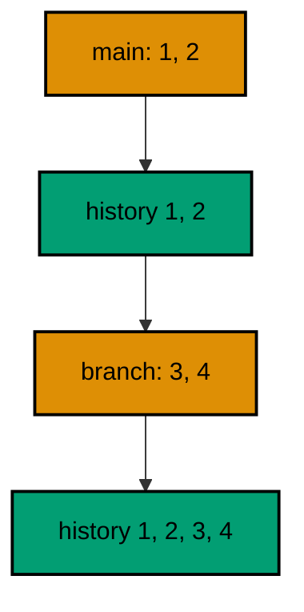

**`learning/code/ex-54-branches-add-migrations-in-parallel/main.ts`**:

```typescript
import * as Config from "effect/Config"; // => Config reads PGHOST and friends with defaults
import * as Console from "effect/Console"; // => Console.log prints the golden transcript
import * as Effect from "effect/Effect"; // => Effect.gen sequences the migration story
import * as Layer from "effect/Layer"; // => Layer joins the database and node services
import * as Migrator from "effect/sql/Migrator"; // => loaders turn files and records into migrations
import * as SqlClient from "effect/sql/SqlClient"; // => SqlClient runs SQL against the pool
import * as NodeChildProcessSpawner from "@effect/platform-node/NodeChildProcessSpawner"; // => spawner service
import * as NodeFileSystem from "@effect/platform-node/NodeFileSystem"; // => filesystem the file loader reads through
import * as NodePath from "@effect/platform-node/NodePath"; // => path the file loader joins with
import * as NodeRuntime from "@effect/platform-node/NodeRuntime"; // => runMain boots the node services
import * as PgClient from "@effect/sql-pg/PgClient"; // => PgClient.layerConfig builds the pool
import * as PgMigrator from "@effect/sql-pg/PgMigrator"; // => PgMigrator.run applies pending migrations

// => one database layer from harness variables, trust auth, no TLS
const DbLive = PgClient.layerConfig({
  // => layerConfig unwraps Config values
  host: Config.String("PGHOST").pipe(Config.withDefault("postgres")), // => service hostname
  port: Config.Port("PGPORT").pipe(Config.withDefault(5432)), // => service port as a number
  database: Config.String("PGDATABASE").pipe(Config.withDefault("postgres")), // => fresh database per run
  username: Config.String("PGUSER").pipe(Config.withDefault("postgres")), // => trust-auth role
  ssl: Config.succeed(false), // => plaintext inside the unit network
}); // => DbLive offers PgClient and SqlClient together

// => the migrator type also asks for three node services
const NodeLive = Layer.mergeAll(NodeFileSystem.layer, NodePath.layer); // => file plus path side by side
const SpawnerLive = Layer.provide(NodeChildProcessSpawner.layer, NodeLive); // => spawner fed by file and path
const MainLive = Layer.mergeAll(DbLive, NodeLive, SpawnerLive); // => one layer for the whole program

const program = Effect.gen(function* () {
  // => the example narrative
  const sql = yield* SqlClient.SqlClient; // => the query surface over the pool
  const main = yield* PgMigrator.run({
    // => main lands first
    loader: Migrator.fromRecord({
      // => the main pair
      "1_create_ex54_a": sql`CREATE TABLE ex54_a (id SERIAL PRIMARY KEY)`, // => main's first table
      "2_create_ex54_b": sql`CREATE TABLE ex54_b (id SERIAL PRIMARY KEY)`, // => main's second table
    }), // => end of the main loader
    table: "ex54_history", // => per-example history table
  }); // => main applies both
  yield* Console.log(`main: ${main.length}`); // => Output: main: 2
  const branch = yield* PgMigrator.run({
    // => the branch lands on top
    loader: Migrator.fromRecord({
      // => the branch pair
      "3_create_ex54_c": sql`CREATE TABLE ex54_c (id SERIAL PRIMARY KEY)`, // => the branch's first table
      "4_create_ex54_d": sql`CREATE TABLE ex54_d (id SERIAL PRIMARY KEY)`, // => the branch's second table
    }), // => end of the branch loader
    table: "ex54_history", // => the same history table
  }); // => the branch applies both
  yield* Console.log(`branch: ${branch.length}`); // => Output: branch: 2
  const rows = yield* sql<{ migration_id: number }>`SELECT migration_id FROM ex54_history ORDER BY migration_id`; // => one line from two branches
  yield* Console.log(`recorded: ${rows.map((row) => row.migration_id).join(", ")}`); // => Output: recorded: 1, 2, 3, 4
  yield* sql`DROP TABLE ex54_d`; // => drop the branch tables
  yield* sql`DROP TABLE ex54_c`; // => drop the branch tables
  yield* sql`DROP TABLE ex54_b`; // => drop the main tables
  yield* sql`DROP TABLE ex54_a`; // => drop the main tables
  yield* sql`DROP TABLE ex54_history`; // => and no history table either
  yield* Console.log("cleaned: yes"); // => Output: cleaned: yes
}); // => program ends: the harness compares stdout to the golden file

NodeRuntime.runMain(program.pipe(Effect.provide(MainLive))); // => boot node services and run
```

**Output** (`learning/code/ex-54-branches-add-migrations-in-parallel/expected/main.stdout.txt`):

```text
main: 2
branch: 2
recorded: 1, 2, 3, 4
cleaned: yes
```

(Concepts: co-14.)

### Example 55: Renumber Forward, Never Rewrite

When two branches both claim number two, one of them must move, and the only safe direction is forward. Rewriting an already-merged migration changes history every environment already recorded; renumbering the newcomer appends cleanly instead.

This example applies migration one, then lands the branch work as numbers two and three. The history shows all three in order. Move the newcomer, never the past.

**`learning/code/ex-55-renumber-forward-never-rewrite/main.ts`**:

```typescript
import * as Config from "effect/Config"; // => Config reads PGHOST and friends with defaults
import * as Console from "effect/Console"; // => Console.log prints the golden transcript
import * as Effect from "effect/Effect"; // => Effect.gen sequences the migration story
import * as Layer from "effect/Layer"; // => Layer joins the database and node services
import * as Migrator from "effect/sql/Migrator"; // => loaders turn files and records into migrations
import * as SqlClient from "effect/sql/SqlClient"; // => SqlClient runs SQL against the pool
import * as NodeChildProcessSpawner from "@effect/platform-node/NodeChildProcessSpawner"; // => spawner service
import * as NodeFileSystem from "@effect/platform-node/NodeFileSystem"; // => filesystem the file loader reads through
import * as NodePath from "@effect/platform-node/NodePath"; // => path the file loader joins with
import * as NodeRuntime from "@effect/platform-node/NodeRuntime"; // => runMain boots the node services
import * as PgClient from "@effect/sql-pg/PgClient"; // => PgClient.layerConfig builds the pool
import * as PgMigrator from "@effect/sql-pg/PgMigrator"; // => PgMigrator.run applies pending migrations

// => one database layer from harness variables, trust auth, no TLS
const DbLive = PgClient.layerConfig({
  // => layerConfig unwraps Config values
  host: Config.String("PGHOST").pipe(Config.withDefault("postgres")), // => service hostname
  port: Config.Port("PGPORT").pipe(Config.withDefault(5432)), // => service port as a number
  database: Config.String("PGDATABASE").pipe(Config.withDefault("postgres")), // => fresh database per run
  username: Config.String("PGUSER").pipe(Config.withDefault("postgres")), // => trust-auth role
  ssl: Config.succeed(false), // => plaintext inside the unit network
}); // => DbLive offers PgClient and SqlClient together

// => the migrator type also asks for three node services
const NodeLive = Layer.mergeAll(NodeFileSystem.layer, NodePath.layer); // => file plus path side by side
const SpawnerLive = Layer.provide(NodeChildProcessSpawner.layer, NodeLive); // => spawner fed by file and path
const MainLive = Layer.mergeAll(DbLive, NodeLive, SpawnerLive); // => one layer for the whole program

const program = Effect.gen(function* () {
  // => the example narrative
  const sql = yield* SqlClient.SqlClient; // => the query surface over the pool
  const first = yield* PgMigrator.run({
    // => the shared base lands first
    loader: Migrator.fromRecord({
      // => the base loader
      "1_create_ex55_base": sql`CREATE TABLE ex55_base (id SERIAL PRIMARY KEY)`, // => the table both branches share
    }), // => end of the base loader
    table: "ex55_history", // => per-example history table
  }); // => base applies alone
  yield* Console.log(`base: ${first.length}`); // => Output: base: 1
  const branch = yield* PgMigrator.run({
    // => the branch takes the next free numbers
    loader: Migrator.fromRecord({
      // => renumbered forward at merge time
      "2_branch_login": sql`CREATE TABLE ex55_login (id SERIAL PRIMARY KEY)`, // => the branch's first table
      "3_branch_session": sql`CREATE TABLE ex55_session (id SERIAL PRIMARY KEY)`, // => the branch's second table
    }), // => end of the branch loader
    table: "ex55_history", // => the same history table
  }); // => the branch appends cleanly
  yield* Console.log(`branch: ${branch.length}`); // => Output: branch: 2
  const rows = yield* sql<{ migration_id: number }>`SELECT migration_id FROM ex55_history ORDER BY migration_id`; // => one line, no rewrite
  yield* Console.log(`recorded: ${rows.map((row) => row.migration_id).join(", ")}`); // => Output: recorded: 1, 2, 3
  yield* sql`DROP TABLE ex55_session`; // => drop the branch tables
  yield* sql`DROP TABLE ex55_login`; // => drop the branch tables
  yield* sql`DROP TABLE ex55_base`; // => drop the base table
  yield* sql`DROP TABLE ex55_history`; // => and no history table either
  yield* Console.log("cleaned: yes"); // => Output: cleaned: yes
}); // => program ends: the harness compares stdout to the golden file

NodeRuntime.runMain(program.pipe(Effect.provide(MainLive))); // => boot node services and run
```

**Output** (`learning/code/ex-55-renumber-forward-never-rewrite/expected/main.stdout.txt`):

```text
base: 1
branch: 2
recorded: 1, 2, 3
cleaned: yes
```

(Concepts: co-04, co-14.)

### Example 56: Merge Applies Both Branches

A merge that brings two branches together should apply every migration from both, once each, in numeric order. The loader assembled at merge time simply holds the union, and the migrator does what it always does: skip what ran, apply the rest.

One run applies a four-migration union drawn from two imaginary branches. All four land, and the history proves each ran exactly once. Merges are unions, not negotiations.

**`learning/code/ex-56-merge-applies-both-branches/main.ts`**:

```typescript
import * as Config from "effect/Config"; // => Config reads PGHOST and friends with defaults
import * as Console from "effect/Console"; // => Console.log prints the golden transcript
import * as Effect from "effect/Effect"; // => Effect.gen sequences the migration story
import * as Layer from "effect/Layer"; // => Layer joins the database and node services
import * as Migrator from "effect/sql/Migrator"; // => loaders turn files and records into migrations
import * as SqlClient from "effect/sql/SqlClient"; // => SqlClient runs SQL against the pool
import * as NodeChildProcessSpawner from "@effect/platform-node/NodeChildProcessSpawner"; // => spawner service
import * as NodeFileSystem from "@effect/platform-node/NodeFileSystem"; // => filesystem the file loader reads through
import * as NodePath from "@effect/platform-node/NodePath"; // => path the file loader joins with
import * as NodeRuntime from "@effect/platform-node/NodeRuntime"; // => runMain boots the node services
import * as PgClient from "@effect/sql-pg/PgClient"; // => PgClient.layerConfig builds the pool
import * as PgMigrator from "@effect/sql-pg/PgMigrator"; // => PgMigrator.run applies pending migrations

// => one database layer from harness variables, trust auth, no TLS
const DbLive = PgClient.layerConfig({
  // => layerConfig unwraps Config values
  host: Config.String("PGHOST").pipe(Config.withDefault("postgres")), // => service hostname
  port: Config.Port("PGPORT").pipe(Config.withDefault(5432)), // => service port as a number
  database: Config.String("PGDATABASE").pipe(Config.withDefault("postgres")), // => fresh database per run
  username: Config.String("PGUSER").pipe(Config.withDefault("postgres")), // => trust-auth role
  ssl: Config.succeed(false), // => plaintext inside the unit network
}); // => DbLive offers PgClient and SqlClient together

// => the migrator type also asks for three node services
const NodeLive = Layer.mergeAll(NodeFileSystem.layer, NodePath.layer); // => file plus path side by side
const SpawnerLive = Layer.provide(NodeChildProcessSpawner.layer, NodeLive); // => spawner fed by file and path
const MainLive = Layer.mergeAll(DbLive, NodeLive, SpawnerLive); // => one layer for the whole program

const program = Effect.gen(function* () {
  // => the example narrative
  const sql = yield* SqlClient.SqlClient; // => the query surface over the pool
  const applied = yield* PgMigrator.run({
    // => the merge-time union applies at once
    loader: Migrator.fromRecord({
      // => two branches, one loader
      "1_create_ex56_a": sql`CREATE TABLE ex56_a (id SERIAL PRIMARY KEY)`, // => main's first table
      "2_create_ex56_b": sql`CREATE TABLE ex56_b (id SERIAL PRIMARY KEY)`, // => main's second table
      "3_create_ex56_c": sql`CREATE TABLE ex56_c (id SERIAL PRIMARY KEY)`, // => the branch's first table
      "4_create_ex56_d": sql`CREATE TABLE ex56_d (id SERIAL PRIMARY KEY)`, // => the branch's second table
    }), // => end of the union loader
    table: "ex56_history", // => per-example history table
  }); // => every branch migration applies once
  yield* Console.log(`applied: ${applied.length}`); // => Output: applied: 4
  const rows = yield* sql<{ total: number }>`SELECT count(*)::int AS total FROM ex56_history`; // => each ran exactly once
  yield* Console.log(`recorded: ${rows[0].total}`); // => Output: recorded: 4
  yield* sql`DROP TABLE ex56_d`; // => drop the branch tables
  yield* sql`DROP TABLE ex56_c`; // => drop the branch tables
  yield* sql`DROP TABLE ex56_b`; // => drop the main tables
  yield* sql`DROP TABLE ex56_a`; // => drop the main tables
  yield* sql`DROP TABLE ex56_history`; // => and no history table either
  yield* Console.log("cleaned: yes"); // => Output: cleaned: yes
}); // => program ends: the harness compares stdout to the golden file

NodeRuntime.runMain(program.pipe(Effect.provide(MainLive))); // => boot node services and run
```

**Output** (`learning/code/ex-56-merge-applies-both-branches/expected/main.stdout.txt`):

```text
applied: 4
recorded: 4
cleaned: yes
```

(Concepts: co-14.)

### Example 57: Same Id, Different Content Is a Conflict

The history tracks ids, not content, so whoever writes an id first wins it: if another writer claims number two between two of your runs, your own number two never runs. Skipping is by position, not by authorship: everything at or below the recorded maximum stays skipped.

This example applies migration one, then a foreign row for id two slips in, then a three-migration loader runs. Only number three applies; the loader's number two is skipped, and its table is provably absent while your number one stands. Silent skips are conflicts wearing camouflage, which is why the checksum guard later in this level exists.

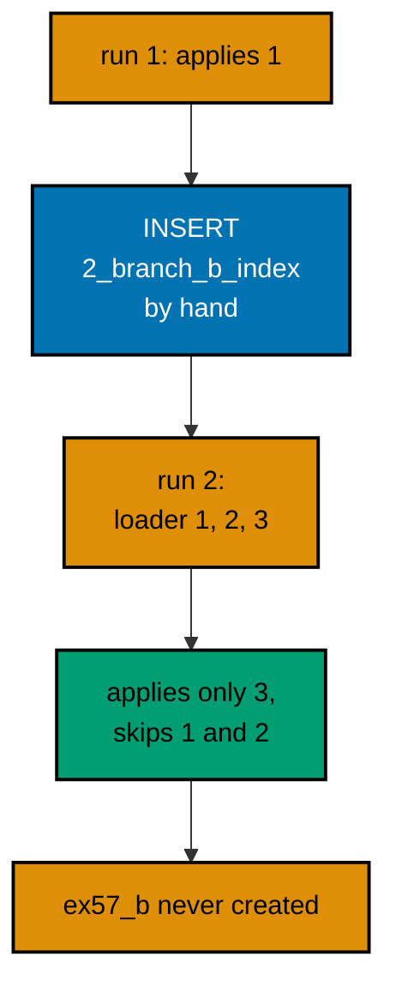

**`learning/code/ex-57-same-id-different-content-is-a-conflict/main.ts`**:

```typescript
import * as Config from "effect/Config"; // => Config reads PGHOST and friends with defaults
import * as Console from "effect/Console"; // => Console.log prints the golden transcript
import * as Effect from "effect/Effect"; // => Effect.gen sequences the migration story
import * as Layer from "effect/Layer"; // => Layer joins the database and node services
import * as Migrator from "effect/sql/Migrator"; // => loaders turn files and records into migrations
import * as SqlClient from "effect/sql/SqlClient"; // => SqlClient runs SQL against the pool
import * as NodeChildProcessSpawner from "@effect/platform-node/NodeChildProcessSpawner"; // => spawner service
import * as NodeFileSystem from "@effect/platform-node/NodeFileSystem"; // => filesystem the file loader reads through
import * as NodePath from "@effect/platform-node/NodePath"; // => path the file loader joins with
import * as NodeRuntime from "@effect/platform-node/NodeRuntime"; // => runMain boots the node services
import * as PgClient from "@effect/sql-pg/PgClient"; // => PgClient.layerConfig builds the pool
import * as PgMigrator from "@effect/sql-pg/PgMigrator"; // => PgMigrator.run applies pending migrations

// => one database layer from harness variables, trust auth, no TLS
const DbLive = PgClient.layerConfig({
  // => layerConfig unwraps Config values
  host: Config.String("PGHOST").pipe(Config.withDefault("postgres")), // => service hostname
  port: Config.Port("PGPORT").pipe(Config.withDefault(5432)), // => service port as a number
  database: Config.String("PGDATABASE").pipe(Config.withDefault("postgres")), // => fresh database per run
  username: Config.String("PGUSER").pipe(Config.withDefault("postgres")), // => trust-auth role
  ssl: Config.succeed(false), // => plaintext inside the unit network
}); // => DbLive offers PgClient and SqlClient together

// => the migrator type also asks for three node services
const NodeLive = Layer.mergeAll(NodeFileSystem.layer, NodePath.layer); // => file plus path side by side
const SpawnerLive = Layer.provide(NodeChildProcessSpawner.layer, NodeLive); // => spawner fed by file and path
const MainLive = Layer.mergeAll(DbLive, NodeLive, SpawnerLive); // => one layer for the whole program

const program = Effect.gen(function* () {
  // => the example narrative
  const sql = yield* SqlClient.SqlClient; // => the query surface over the pool
  const first = yield* PgMigrator.run({
    // => our own migration lands first
    loader: Migrator.fromRecord({
      // => the early loader
      "1_create_ex57_a": sql`CREATE TABLE ex57_a (id SERIAL PRIMARY KEY)`, // => our table, recorded as id 1
    }), // => end of the early loader
    table: "ex57_history", // => per-example history table
  }); // => id 1 is ours
  yield* Console.log(`first: ${first.length}`); // => Output: first: 1
  // => id 1 is ours before the foreign writer arrives
  yield* sql`INSERT INTO ex57_history (migration_id, name) VALUES (2, 'branch_b_index')`; // => another writer claims id 2 between runs
  const applied = yield* PgMigrator.run({
    // => our loader meets the foreign row
    loader: Migrator.fromRecord({
      // => three migrations, one id taken
      "1_create_ex57_a": sql`SELECT 1`, // => skipped: already recorded, never re-executes
      "2_create_ex57_b": sql`CREATE TABLE ex57_b (id SERIAL PRIMARY KEY)`, // => skipped: the foreign row owns id 2
      "3_create_ex57_c": sql`CREATE TABLE ex57_c (id SERIAL PRIMARY KEY)`, // => applies normally
    }), // => end of the migration record
    table: "ex57_history", // => the same history table
  }); // => the loader's number two never runs
  for (const [id, name] of applied) {
    // => walk the newly applied rows
    yield* Console.log(`applied: ${id}_${name}`); // => Output: applied: 3_create_ex57_c
  } // => loop ends after the last applied migration
  const present = yield* sql<{
    total: number;
  }>`SELECT count(*)::int AS total FROM pg_tables WHERE tablename IN ('ex57_a', 'ex57_c')`; // => ours both stand
  yield* Console.log(`present: ${present[0].total}`); // => Output: present: 2
  const missing = yield* sql<{
    total: number;
  }>`SELECT count(*)::int AS total FROM pg_tables WHERE tablename = 'ex57_b'`; // => the skipped table never appears
  yield* Console.log(`missing: ${missing[0].total}`); // => Output: missing: 0
  // => the skipped table never appears: the foreign row owns its id
  yield* sql`DROP TABLE ex57_c`; // => drop the applied tables
  yield* sql`DROP TABLE ex57_a`; // => drop the applied tables
  yield* sql`DROP TABLE ex57_history`; // => and no history table either
  yield* Console.log("cleaned: yes"); // => Output: cleaned: yes
}); // => program ends: the harness compares stdout to the golden file

NodeRuntime.runMain(program.pipe(Effect.provide(MainLive))); // => boot node services and run
```

**Output** (`learning/code/ex-57-same-id-different-content-is-a-conflict/expected/main.stdout.txt`):

```text
first: 1
applied: 3_create_ex57_c
present: 2
missing: 0
cleaned: yes
```

(Concepts: co-11, co-14.)

### Example 58: Late Arrivals Still Apply in Order

A branch that lands late still joins the line in numeric order: the migrator compares ids, not arrival times, so a migration numbered three applies after one and two no matter which deploy carried it.

The second loader here arrives holding the full set in scrambled key order, and only the missing number three applies. Late is a scheduling fact, never an ordering problem.

**`learning/code/ex-58-late-arrivals-still-apply-in-order/main.ts`**:

```typescript
import * as Config from "effect/Config"; // => Config reads PGHOST and friends with defaults
import * as Console from "effect/Console"; // => Console.log prints the golden transcript
import * as Effect from "effect/Effect"; // => Effect.gen sequences the migration story
import * as Layer from "effect/Layer"; // => Layer joins the database and node services
import * as Migrator from "effect/sql/Migrator"; // => loaders turn files and records into migrations
import * as SqlClient from "effect/sql/SqlClient"; // => SqlClient runs SQL against the pool
import * as NodeChildProcessSpawner from "@effect/platform-node/NodeChildProcessSpawner"; // => spawner service
import * as NodeFileSystem from "@effect/platform-node/NodeFileSystem"; // => filesystem the file loader reads through
import * as NodePath from "@effect/platform-node/NodePath"; // => path the file loader joins with
import * as NodeRuntime from "@effect/platform-node/NodeRuntime"; // => runMain boots the node services
import * as PgClient from "@effect/sql-pg/PgClient"; // => PgClient.layerConfig builds the pool
import * as PgMigrator from "@effect/sql-pg/PgMigrator"; // => PgMigrator.run applies pending migrations

// => one database layer from harness variables, trust auth, no TLS
const DbLive = PgClient.layerConfig({
  // => layerConfig unwraps Config values
  host: Config.String("PGHOST").pipe(Config.withDefault("postgres")), // => service hostname
  port: Config.Port("PGPORT").pipe(Config.withDefault(5432)), // => service port as a number
  database: Config.String("PGDATABASE").pipe(Config.withDefault("postgres")), // => fresh database per run
  username: Config.String("PGUSER").pipe(Config.withDefault("postgres")), // => trust-auth role
  ssl: Config.succeed(false), // => plaintext inside the unit network
}); // => DbLive offers PgClient and SqlClient together

// => the migrator type also asks for three node services
const NodeLive = Layer.mergeAll(NodeFileSystem.layer, NodePath.layer); // => file plus path side by side
const SpawnerLive = Layer.provide(NodeChildProcessSpawner.layer, NodeLive); // => spawner fed by file and path
const MainLive = Layer.mergeAll(DbLive, NodeLive, SpawnerLive); // => one layer for the whole program

const program = Effect.gen(function* () {
  // => the example narrative
  const sql = yield* SqlClient.SqlClient; // => the query surface over the pool
  const first = yield* PgMigrator.run({
    // => the early pair lands first
    loader: Migrator.fromRecord({
      // => the early loader
      "1_create_ex58_a": sql`CREATE TABLE ex58_a (id SERIAL PRIMARY KEY)`, // => the first table
      "2_create_ex58_b": sql`CREATE TABLE ex58_b (id SERIAL PRIMARY KEY)`, // => the second table
    }), // => end of the early loader
    table: "ex58_history", // => per-example history table
  }); // => early pair applies
  yield* Console.log(`early: ${first.length}`); // => Output: early: 2
  const late = yield* PgMigrator.run({
    // => the late branch carries the full set
    loader: Migrator.fromRecord({
      // => scrambled keys, same numbers
      "3_hotfix_index": sql`CREATE INDEX ex58_hotfix_idx ON ex58_a (id)`, // => the late arrival
      "1_create_ex58_a": sql`SELECT 1`, // => already recorded, never re-executes
      "2_create_ex58_b": sql`SELECT 1`, // => already recorded, never re-executes
    }), // => end of the late loader
    table: "ex58_history", // => the same history table
  }); // => only the late arrival applies
  for (const [id, name] of late) {
    // => walk the newly applied rows
    yield* Console.log(`late: ${id}_${name}`); // => Output: late: 3_hotfix_index
  } // => loop ends after the last applied migration
  yield* sql`DROP TABLE ex58_b`; // => drop the early tables
  yield* sql`DROP TABLE ex58_a`; // => dropping the table drops its index too
  yield* sql`DROP TABLE ex58_history`; // => and no history table either
  yield* Console.log("cleaned: yes"); // => Output: cleaned: yes
}); // => program ends: the harness compares stdout to the golden file

NodeRuntime.runMain(program.pipe(Effect.provide(MainLive))); // => boot node services and run
```

**Output** (`learning/code/ex-58-late-arrivals-still-apply-in-order/expected/main.stdout.txt`):

```text
early: 2
late: 3_hotfix_index
cleaned: yes
```

(Concepts: co-14.)

### Example 59: History Is the Merge Result

After a merge, the history table is the merge result: one ordered list of everything every branch contributed, readable without reconstructing who wrote what. Auditing the merge means reading the table, not the chat log.

Four migrations from two branches land in one run, and the history read-back names all four in order. The table is the receipt for the whole collaboration.

**`learning/code/ex-59-history-is-the-merge-result/main.ts`**:

```typescript
import * as Config from "effect/Config"; // => Config reads PGHOST and friends with defaults
import * as Console from "effect/Console"; // => Console.log prints the golden transcript
import * as Effect from "effect/Effect"; // => Effect.gen sequences the migration story
import * as Layer from "effect/Layer"; // => Layer joins the database and node services
import * as Migrator from "effect/sql/Migrator"; // => loaders turn files and records into migrations
import * as SqlClient from "effect/sql/SqlClient"; // => SqlClient runs SQL against the pool
import * as NodeChildProcessSpawner from "@effect/platform-node/NodeChildProcessSpawner"; // => spawner service
import * as NodeFileSystem from "@effect/platform-node/NodeFileSystem"; // => filesystem the file loader reads through
import * as NodePath from "@effect/platform-node/NodePath"; // => path the file loader joins with
import * as NodeRuntime from "@effect/platform-node/NodeRuntime"; // => runMain boots the node services
import * as PgClient from "@effect/sql-pg/PgClient"; // => PgClient.layerConfig builds the pool
import * as PgMigrator from "@effect/sql-pg/PgMigrator"; // => PgMigrator.run applies pending migrations

// => one database layer from harness variables, trust auth, no TLS
const DbLive = PgClient.layerConfig({
  // => layerConfig unwraps Config values
  host: Config.String("PGHOST").pipe(Config.withDefault("postgres")), // => service hostname
  port: Config.Port("PGPORT").pipe(Config.withDefault(5432)), // => service port as a number
  database: Config.String("PGDATABASE").pipe(Config.withDefault("postgres")), // => fresh database per run
  username: Config.String("PGUSER").pipe(Config.withDefault("postgres")), // => trust-auth role
  ssl: Config.succeed(false), // => plaintext inside the unit network
}); // => DbLive offers PgClient and SqlClient together

// => the migrator type also asks for three node services
const NodeLive = Layer.mergeAll(NodeFileSystem.layer, NodePath.layer); // => file plus path side by side
const SpawnerLive = Layer.provide(NodeChildProcessSpawner.layer, NodeLive); // => spawner fed by file and path
const MainLive = Layer.mergeAll(DbLive, NodeLive, SpawnerLive); // => one layer for the whole program

const program = Effect.gen(function* () {
  // => the example narrative
  const sql = yield* SqlClient.SqlClient; // => the query surface over the pool
  const applied = yield* PgMigrator.run({
    // => the merge lands at once
    loader: Migrator.fromRecord({
      // => contributions from both sides
      "1_create_ex59_a": sql`CREATE TABLE ex59_a (id SERIAL PRIMARY KEY)`, // => main's table
      "2_create_ex59_b": sql`CREATE TABLE ex59_b (id SERIAL PRIMARY KEY)`, // => main's second table
      "3_create_ex59_c": sql`CREATE TABLE ex59_c (id SERIAL PRIMARY KEY)`, // => the branch's table
      "4_create_ex59_d": sql`CREATE TABLE ex59_d (id SERIAL PRIMARY KEY)`, // => the branch's second table
    }), // => end of the migration record
    table: "ex59_history", // => per-example history table
  }); // => the merge applies fully
  // => one ordered list from two branches: the merge receipt
  yield* Console.log(`applied: ${applied.length}`); // => Output: applied: 4
  const rows = yield* sql<{
    migration_id: number;
    name: string;
  }>`SELECT migration_id, name FROM ex59_history ORDER BY migration_id`; // => the merge receipt
  for (const row of rows) {
    // => walk the recorded history
    yield* Console.log(`history: ${row.migration_id}_${row.name}`); // => Output: history: 1_create_ex59_a
  } // => loop ends after the last history row
  yield* sql`DROP TABLE ex59_d`; // => drop the branch tables
  yield* sql`DROP TABLE ex59_c`; // => drop the branch tables
  yield* sql`DROP TABLE ex59_b`; // => drop the main tables
  yield* sql`DROP TABLE ex59_a`; // => drop the main tables
  yield* sql`DROP TABLE ex59_history`; // => and no history table either
  yield* Console.log("cleaned: yes"); // => Output: cleaned: yes
}); // => program ends: the harness compares stdout to the golden file

NodeRuntime.runMain(program.pipe(Effect.provide(MainLive))); // => boot node services and run
```

**Output** (`learning/code/ex-59-history-is-the-merge-result/expected/main.stdout.txt`):

```text
applied: 4
history: 1_create_ex59_a
history: 2_create_ex59_b
history: 3_create_ex59_c
history: 4_create_ex59_d
cleaned: yes
```

(Concepts: co-03, co-14.)

### Example 60: Never Edit Applied Migrations

The golden rule has teeth because the migrator cannot enforce it: once id one is recorded, editing its SQL changes nothing anywhere that already ran. The second run sees a recorded id, skips the entry, and the new column never appears.

Two loaders play both sides here: the first creates a one-column table, the second carries an edited version with two columns. The second run applies nothing, and the column listing proves the edit never landed. Forward fix, never rewrite.

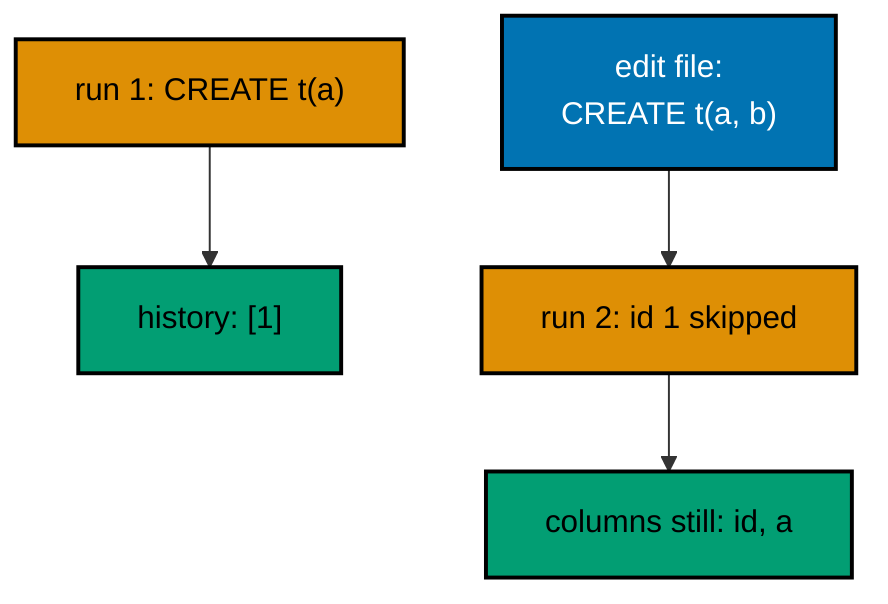

**`learning/code/ex-60-never-edit-applied-migrations/main.ts`**:

```typescript
import * as Config from "effect/Config"; // => Config reads PGHOST and friends with defaults
import * as Console from "effect/Console"; // => Console.log prints the golden transcript
import * as Effect from "effect/Effect"; // => Effect.gen sequences the migration story
import * as Layer from "effect/Layer"; // => Layer joins the database and node services
import * as Migrator from "effect/sql/Migrator"; // => loaders turn files and records into migrations
import * as SqlClient from "effect/sql/SqlClient"; // => SqlClient runs SQL against the pool
import * as NodeChildProcessSpawner from "@effect/platform-node/NodeChildProcessSpawner"; // => spawner service
import * as NodeFileSystem from "@effect/platform-node/NodeFileSystem"; // => filesystem the file loader reads through
import * as NodePath from "@effect/platform-node/NodePath"; // => path the file loader joins with
import * as NodeRuntime from "@effect/platform-node/NodeRuntime"; // => runMain boots the node services
import * as PgClient from "@effect/sql-pg/PgClient"; // => PgClient.layerConfig builds the pool
import * as PgMigrator from "@effect/sql-pg/PgMigrator"; // => PgMigrator.run applies pending migrations

// => one database layer from harness variables, trust auth, no TLS
const DbLive = PgClient.layerConfig({
  // => layerConfig unwraps Config values
  host: Config.String("PGHOST").pipe(Config.withDefault("postgres")), // => service hostname
  port: Config.Port("PGPORT").pipe(Config.withDefault(5432)), // => service port as a number
  database: Config.String("PGDATABASE").pipe(Config.withDefault("postgres")), // => fresh database per run
  username: Config.String("PGUSER").pipe(Config.withDefault("postgres")), // => trust-auth role
  ssl: Config.succeed(false), // => plaintext inside the unit network
}); // => DbLive offers PgClient and SqlClient together

// => the migrator type also asks for three node services
const NodeLive = Layer.mergeAll(NodeFileSystem.layer, NodePath.layer); // => file plus path side by side
const SpawnerLive = Layer.provide(NodeChildProcessSpawner.layer, NodeLive); // => spawner fed by file and path
const MainLive = Layer.mergeAll(DbLive, NodeLive, SpawnerLive); // => one layer for the whole program

const program = Effect.gen(function* () {
  // => the example narrative
  const sql = yield* SqlClient.SqlClient; // => the query surface over the pool
  const first = yield* PgMigrator.run({
    // => the original migration ships
    loader: Migrator.fromRecord({
      // => the original single-column table
      "1_create_ex60_t": sql`CREATE TABLE ex60_t (id SERIAL PRIMARY KEY, a TEXT)`, // => the table as first written
    }), // => end of the original loader
    table: "ex60_history", // => per-example history table
  }); // => the original applies
  yield* Console.log(`first: ${first.length}`); // => Output: first: 1
  const second = yield* PgMigrator.run({
    // => the edited file returns
    loader: Migrator.fromRecord({
      // => same id, different SQL
      "1_create_ex60_t": sql`CREATE TABLE ex60_t (id SERIAL PRIMARY KEY, a TEXT, b TEXT)`, // => the edit: silently ignored
    }), // => end of the edited loader
    table: "ex60_history", // => the same history table
  }); // => recorded ids never re-run
  yield* Console.log(`second: ${second.length}`); // => Output: second: 0
  const columns = yield* sql<{
    name: string;
  }>`SELECT column_name AS name FROM information_schema.columns WHERE table_name = 'ex60_t' ORDER BY ordinal_position`; // => the edit never landed
  yield* Console.log(`columns: ${columns.map((column) => column.name).join(", ")}`); // => Output: columns: id, a
  yield* sql`DROP TABLE ex60_t`; // => the example leaves no tables behind
  yield* sql`DROP TABLE ex60_history`; // => and no history table either
  yield* Console.log("cleaned: yes"); // => Output: cleaned: yes
}); // => program ends: the harness compares stdout to the golden file

NodeRuntime.runMain(program.pipe(Effect.provide(MainLive))); // => boot node services and run
```

**Output** (`learning/code/ex-60-never-edit-applied-migrations/expected/main.stdout.txt`):

```text
first: 1
second: 0
columns: id, a
cleaned: yes
```

(Concepts: co-04, co-11.)

### Example 61: Promote the Same Set Across Environments

Promotion runs the same ordered set in each environment in turn: dev first, then test, then production, each recording into its own history. The set is identical everywhere; only the stamp of where it ran differs.

Two databases stand in for two environments here, and both converge on the same latest migration. Each environment builds its own pool, runs the identical set, and reports back. The printed pair proves the sets match. Same migrations, every stage, no surprises.

**`learning/code/ex-61-promote-the-same-set-across-environments/main.ts`**:

```typescript
import * as Config from "effect/Config"; // => Config reads PGHOST and friends with defaults
import * as Console from "effect/Console"; // => Console.log prints the golden transcript
import * as Effect from "effect/Effect"; // => Effect.gen sequences the migration story
import * as Layer from "effect/Layer"; // => Layer joins the database and node services
import * as Migrator from "effect/sql/Migrator"; // => loaders turn files and records into migrations
import * as SqlClient from "effect/sql/SqlClient"; // => SqlClient runs SQL against the pool
import * as NodeChildProcessSpawner from "@effect/platform-node/NodeChildProcessSpawner"; // => spawner service
import * as NodeFileSystem from "@effect/platform-node/NodeFileSystem"; // => filesystem the file loader reads through
import * as NodePath from "@effect/platform-node/NodePath"; // => path the file loader joins with
import * as NodeRuntime from "@effect/platform-node/NodeRuntime"; // => runMain boots the node services
import * as PgClient from "@effect/sql-pg/PgClient"; // => PgClient.layerConfig builds the pool
import * as PgMigrator from "@effect/sql-pg/PgMigrator"; // => PgMigrator.run applies pending migrations

// => one database layer from harness variables, trust auth, no TLS
const DbLive = PgClient.layerConfig({
  // => layerConfig unwraps Config values
  host: Config.String("PGHOST").pipe(Config.withDefault("postgres")), // => service hostname
  port: Config.Port("PGPORT").pipe(Config.withDefault(5432)), // => service port as a number
  database: Config.String("PGDATABASE").pipe(Config.withDefault("postgres")), // => fresh database per run
  username: Config.String("PGUSER").pipe(Config.withDefault("postgres")), // => trust-auth role
  ssl: Config.succeed(false), // => plaintext inside the unit network
}); // => DbLive offers PgClient and SqlClient together

// => the migrator type also asks for three node services
const NodeLive = Layer.mergeAll(NodeFileSystem.layer, NodePath.layer); // => file plus path side by side
const SpawnerLive = Layer.provide(NodeChildProcessSpawner.layer, NodeLive); // => spawner fed by file and path
const MainLive = Layer.mergeAll(DbLive, NodeLive, SpawnerLive); // => one layer for the whole program

const program = Effect.gen(function* () {
  // => the example narrative
  const sql = yield* SqlClient.SqlClient; // => the query surface over the pool
  yield* sql`CREATE DATABASE ex61_dev`; // => the first environment, a real database
  yield* sql`CREATE DATABASE ex61_prod`; // => the second environment, a real database
  const makeDb = (database: string) =>
    PgClient.layerConfig({
      // => one pool per environment
      host: Config.String("PGHOST").pipe(Config.withDefault("postgres")), // => service hostname
      port: Config.Port("PGPORT").pipe(Config.withDefault(5432)), // => service port as a number
      database: Config.succeed(database), // => this environment's database
      username: Config.String("PGUSER").pipe(Config.withDefault("postgres")), // => trust-auth role
      ssl: Config.succeed(false), // => plaintext inside the unit network
    }); // => a pool aimed at one environment
  const runOn = (database: string) =>
    Effect.provide(
      // => each environment runs on its own pool
      Effect.gen(function* () {
        // => migrate one environment fully
        const db = yield* SqlClient.SqlClient; // => this environment's client
        const applied = yield* PgMigrator.run({
          // => the release candidate set
          loader: Migrator.fromRecord({
            // => the same two tables everywhere
            "1_create_ex61_a": db`CREATE TABLE ex61_a (id SERIAL PRIMARY KEY)`, // => the first table
            "2_create_ex61_b": db`CREATE TABLE ex61_b (id SERIAL PRIMARY KEY)`, // => the second table
          }), // => end of the migration record
          table: "ex61_history", // => each database keeps its own history
        }); // => this environment converges
        const latest = yield* db<{
          migration_id: number;
        }>`SELECT migration_id FROM ex61_history ORDER BY migration_id DESC LIMIT 1`; // => this environment's newest
        return { count: applied.length, latest: latest[0].migration_id }; // => plain data crosses the pool boundary
      }), // => end of the per-environment story
      Layer.mergeAll(makeDb(database), NodeLive, SpawnerLive), // => pool plus node services
    ); // => runOn hands back counts, never clients
  // => each stage builds its own pool against its own database
  const dev = yield* runOn("ex61_dev"); // => dev adopts the set
  yield* Console.log(`dev: ${dev.count}`); // => Output: dev: 2
  // => the identical set converges independently in prod
  const prod = yield* runOn("ex61_prod"); // => prod adopts the same set
  yield* Console.log(`prod: ${prod.count}`); // => Output: prod: 2
  yield* Console.log(`prod latest: ${prod.latest}`); // => Output: prod latest: 2
  yield* sql`DROP DATABASE ex61_dev`; // => drop the first environment
  yield* sql`DROP DATABASE ex61_prod`; // => drop the second environment
  yield* Console.log("cleaned: yes"); // => Output: cleaned: yes
}); // => program ends: the harness compares stdout to the golden file

NodeRuntime.runMain(program.pipe(Effect.provide(MainLive))); // => boot node services and run
```

**Output** (`learning/code/ex-61-promote-the-same-set-across-environments/expected/main.stdout.txt`):

```text
dev: 2
prod: 2
prod latest: 2
cleaned: yes
```

(Concepts: co-13.)

### Example 62: DDL Takes a Lock

Every migrator run begins by locking the history table in access-exclusive mode, which serializes competing migrators before any migration body executes. The lock is the reason two deploys racing each other cannot both write the history.

This example makes the invisible visible: the migration body queries `pg_locks` for its own process and finds the exclusive lock on the history table. The printed mode names the mechanism. Locks are how cooperation is enforced.

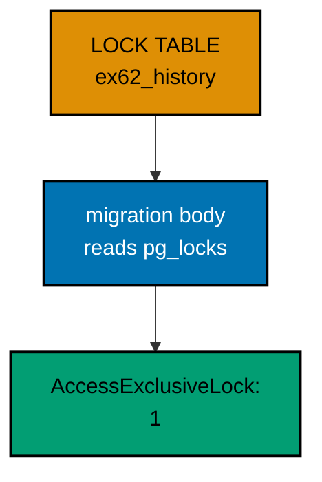

**`learning/code/ex-62-ddl-takes-a-lock/main.ts`**:

```typescript
import * as Config from "effect/Config"; // => Config reads PGHOST and friends with defaults
import * as Console from "effect/Console"; // => Console.log prints the golden transcript
import * as Effect from "effect/Effect"; // => Effect.gen sequences the migration story
import * as Layer from "effect/Layer"; // => Layer joins the database and node services
import * as Migrator from "effect/sql/Migrator"; // => loaders turn files and records into migrations
import * as SqlClient from "effect/sql/SqlClient"; // => SqlClient runs SQL against the pool
import * as NodeChildProcessSpawner from "@effect/platform-node/NodeChildProcessSpawner"; // => spawner service
import * as NodeFileSystem from "@effect/platform-node/NodeFileSystem"; // => filesystem the file loader reads through
import * as NodePath from "@effect/platform-node/NodePath"; // => path the file loader joins with
import * as NodeRuntime from "@effect/platform-node/NodeRuntime"; // => runMain boots the node services
import * as PgClient from "@effect/sql-pg/PgClient"; // => PgClient.layerConfig builds the pool
import * as PgMigrator from "@effect/sql-pg/PgMigrator"; // => PgMigrator.run applies pending migrations

// => one database layer from harness variables, trust auth, no TLS
const DbLive = PgClient.layerConfig({
  // => layerConfig unwraps Config values
  host: Config.String("PGHOST").pipe(Config.withDefault("postgres")), // => service hostname
  port: Config.Port("PGPORT").pipe(Config.withDefault(5432)), // => service port as a number
  database: Config.String("PGDATABASE").pipe(Config.withDefault("postgres")), // => fresh database per run
  username: Config.String("PGUSER").pipe(Config.withDefault("postgres")), // => trust-auth role
  ssl: Config.succeed(false), // => plaintext inside the unit network
}); // => DbLive offers PgClient and SqlClient together

// => the migrator type also asks for three node services
const NodeLive = Layer.mergeAll(NodeFileSystem.layer, NodePath.layer); // => file plus path side by side
const SpawnerLive = Layer.provide(NodeChildProcessSpawner.layer, NodeLive); // => spawner fed by file and path
const MainLive = Layer.mergeAll(DbLive, NodeLive, SpawnerLive); // => one layer for the whole program

const program = Effect.gen(function* () {
  // => the example narrative
  const sql = yield* SqlClient.SqlClient; // => the query surface over the pool
  const applied = yield* PgMigrator.run({
    // => the run locks the history first
    loader: Migrator.fromRecord({
      // => observe the lock from inside
      "1_create_ex62_t": Effect.gen(function* () {
        // => the observing migration
        const inner = yield* SqlClient.SqlClient; // => the body borrows the same client
        yield* inner`CREATE TABLE ex62_t (id SERIAL PRIMARY KEY)`; // => the migrated table
        yield* inner`CREATE TABLE ex62_seen (mode TEXT NOT NULL)`; // => the observation channel
        yield* inner`INSERT INTO ex62_seen (mode) SELECT mode FROM pg_locks WHERE pid = pg_backend_pid() AND relation = 'ex62_history'::regclass AND mode = 'AccessExclusiveLock'`; // => capture the held lock
      }), // => end of the observing migration
    }), // => end of the migration record
    table: "ex62_history", // => per-example history table
  }); // => the lock is held throughout this run
  yield* Console.log(`applied: ${applied.length}`); // => Output: applied: 1
  const rows = yield* sql<{ mode: string }>`SELECT mode FROM ex62_seen`; // => what the body observed
  for (const row of rows) {
    // => walk the observations
    yield* Console.log(`history lock: ${row.mode}`); // => Output: history lock: AccessExclusiveLock
  } // => loop ends after the observation
  yield* sql`DROP TABLE ex62_seen`; // => drop the observation channel
  yield* sql`DROP TABLE ex62_t`; // => drop the migrated table
  yield* sql`DROP TABLE ex62_history`; // => and no history table either
  yield* Console.log("cleaned: yes"); // => Output: cleaned: yes
}); // => program ends: the harness compares stdout to the golden file

NodeRuntime.runMain(program.pipe(Effect.provide(MainLive))); // => boot node services and run
```

**Output** (`learning/code/ex-62-ddl-takes-a-lock/expected/main.stdout.txt`):

```text
applied: 1
history lock: AccessExclusiveLock
cleaned: yes
```

(Concepts: co-15.)

### Example 63: Second Migrator Stands Down

In a fleet, every instance runs the migrator at startup, and all but the first must stand down: they find the history already current and apply nothing. Standing down is the normal case, not an error, and the loser reports an empty applied list.

Two sequential runs play winner and loser here. The first applies the migration, the second finds it recorded, and the printed zero is the sound of cooperation. No coordination service, just the history table.

**`learning/code/ex-63-second-migrator-stands-down/main.ts`**:

```typescript
import * as Config from "effect/Config"; // => Config reads PGHOST and friends with defaults
import * as Console from "effect/Console"; // => Console.log prints the golden transcript
import * as Effect from "effect/Effect"; // => Effect.gen sequences the migration story
import * as Layer from "effect/Layer"; // => Layer joins the database and node services
import * as Migrator from "effect/sql/Migrator"; // => loaders turn files and records into migrations
import * as SqlClient from "effect/sql/SqlClient"; // => SqlClient runs SQL against the pool
import * as NodeChildProcessSpawner from "@effect/platform-node/NodeChildProcessSpawner"; // => spawner service
import * as NodeFileSystem from "@effect/platform-node/NodeFileSystem"; // => filesystem the file loader reads through
import * as NodePath from "@effect/platform-node/NodePath"; // => path the file loader joins with
import * as NodeRuntime from "@effect/platform-node/NodeRuntime"; // => runMain boots the node services
import * as PgClient from "@effect/sql-pg/PgClient"; // => PgClient.layerConfig builds the pool
import * as PgMigrator from "@effect/sql-pg/PgMigrator"; // => PgMigrator.run applies pending migrations

// => one database layer from harness variables, trust auth, no TLS
const DbLive = PgClient.layerConfig({
  // => layerConfig unwraps Config values
  host: Config.String("PGHOST").pipe(Config.withDefault("postgres")), // => service hostname
  port: Config.Port("PGPORT").pipe(Config.withDefault(5432)), // => service port as a number
  database: Config.String("PGDATABASE").pipe(Config.withDefault("postgres")), // => fresh database per run
  username: Config.String("PGUSER").pipe(Config.withDefault("postgres")), // => trust-auth role
  ssl: Config.succeed(false), // => plaintext inside the unit network
}); // => DbLive offers PgClient and SqlClient together

// => the migrator type also asks for three node services
const NodeLive = Layer.mergeAll(NodeFileSystem.layer, NodePath.layer); // => file plus path side by side
const SpawnerLive = Layer.provide(NodeChildProcessSpawner.layer, NodeLive); // => spawner fed by file and path
const MainLive = Layer.mergeAll(DbLive, NodeLive, SpawnerLive); // => one layer for the whole program

const program = Effect.gen(function* () {
  // => the example narrative
  const sql = yield* SqlClient.SqlClient; // => the query surface over the pool
  const loader = Migrator.fromRecord({
    // => one migration, two racers
    "1_create_ex63_t": sql`CREATE TABLE ex63_t (id SERIAL PRIMARY KEY)`, // => the contested change
  }); // => the loader is just data: safe to run twice
  const winner = yield* PgMigrator.run({ loader, table: "ex63_history" }); // => the first instance applies it
  yield* Console.log(`winner: ${winner.length}`); // => Output: winner: 1
  const loser = yield* PgMigrator.run({ loader, table: "ex63_history" }); // => the second instance stands down
  yield* Console.log(`loser: ${loser.length}`); // => Output: loser: 0
  yield* sql`DROP TABLE ex63_t`; // => the example leaves no tables behind
  yield* sql`DROP TABLE ex63_history`; // => and no history table either
  yield* Console.log("cleaned: yes"); // => Output: cleaned: yes
}); // => program ends: the harness compares stdout to the golden file

NodeRuntime.runMain(program.pipe(Effect.provide(MainLive))); // => boot node services and run
```

**Output** (`learning/code/ex-63-second-migrator-stands-down/expected/main.stdout.txt`):

```text
winner: 1
loser: 0
cleaned: yes
```

(Concepts: co-15.)

### Example 64: Keep Migrations Small

Small migrations shrink the lock window: each run holds the history lock only for the work its migrations need, and five one-statement migrations commit faster than one giant script. Small files are a locking strategy, not just a style preference.

Five tiny creations apply in a single run here. The printed count shows all five landed in one short transaction. Keep each migration trivial and the lock barely registers.

**`learning/code/ex-64-keep-migrations-small/main.ts`**:

```typescript
import * as Config from "effect/Config"; // => Config reads PGHOST and friends with defaults
import * as Console from "effect/Console"; // => Console.log prints the golden transcript
import * as Effect from "effect/Effect"; // => Effect.gen sequences the migration story
import * as Layer from "effect/Layer"; // => Layer joins the database and node services
import * as Migrator from "effect/sql/Migrator"; // => loaders turn files and records into migrations
import * as SqlClient from "effect/sql/SqlClient"; // => SqlClient runs SQL against the pool
import * as NodeChildProcessSpawner from "@effect/platform-node/NodeChildProcessSpawner"; // => spawner service
import * as NodeFileSystem from "@effect/platform-node/NodeFileSystem"; // => filesystem the file loader reads through
import * as NodePath from "@effect/platform-node/NodePath"; // => path the file loader joins with
import * as NodeRuntime from "@effect/platform-node/NodeRuntime"; // => runMain boots the node services
import * as PgClient from "@effect/sql-pg/PgClient"; // => PgClient.layerConfig builds the pool
import * as PgMigrator from "@effect/sql-pg/PgMigrator"; // => PgMigrator.run applies pending migrations

// => one database layer from harness variables, trust auth, no TLS
const DbLive = PgClient.layerConfig({
  // => layerConfig unwraps Config values
  host: Config.String("PGHOST").pipe(Config.withDefault("postgres")), // => service hostname
  port: Config.Port("PGPORT").pipe(Config.withDefault(5432)), // => service port as a number
  database: Config.String("PGDATABASE").pipe(Config.withDefault("postgres")), // => fresh database per run
  username: Config.String("PGUSER").pipe(Config.withDefault("postgres")), // => trust-auth role
  ssl: Config.succeed(false), // => plaintext inside the unit network
}); // => DbLive offers PgClient and SqlClient together

// => the migrator type also asks for three node services
const NodeLive = Layer.mergeAll(NodeFileSystem.layer, NodePath.layer); // => file plus path side by side
const SpawnerLive = Layer.provide(NodeChildProcessSpawner.layer, NodeLive); // => spawner fed by file and path
const MainLive = Layer.mergeAll(DbLive, NodeLive, SpawnerLive); // => one layer for the whole program

const program = Effect.gen(function* () {
  // => the example narrative
  const sql = yield* SqlClient.SqlClient; // => the query surface over the pool
  const applied = yield* PgMigrator.run({
    // => one short run, five small steps
    loader: Migrator.fromRecord({
      // => five one-statement migrations
      "1_create_ex64_a": sql`CREATE TABLE ex64_a (id SERIAL PRIMARY KEY)`, // => small step one
      "2_create_ex64_b": sql`CREATE TABLE ex64_b (id SERIAL PRIMARY KEY)`, // => small step two
      "3_create_ex64_c": sql`CREATE TABLE ex64_c (id SERIAL PRIMARY KEY)`, // => small step three
      "4_create_ex64_d": sql`CREATE TABLE ex64_d (id SERIAL PRIMARY KEY)`, // => small step four
      "5_create_ex64_e": sql`CREATE TABLE ex64_e (id SERIAL PRIMARY KEY)`, // => small step five
    }), // => end of the migration record
    table: "ex64_history", // => per-example history table
  }); // => the whole run holds the lock briefly
  yield* Console.log(`applied: ${applied.length}`); // => Output: applied: 5
  yield* sql`DROP TABLE ex64_e`; // => drop the small tables
  yield* sql`DROP TABLE ex64_d`; // => drop the small tables
  yield* sql`DROP TABLE ex64_c`; // => drop the small tables
  yield* sql`DROP TABLE ex64_b`; // => drop the small tables
  yield* sql`DROP TABLE ex64_a`; // => drop the small tables
  yield* sql`DROP TABLE ex64_history`; // => and no history table either
  yield* Console.log("cleaned: yes"); // => Output: cleaned: yes
}); // => program ends: the harness compares stdout to the golden file

NodeRuntime.runMain(program.pipe(Effect.provide(MainLive))); // => boot node services and run
```

**Output** (`learning/code/ex-64-keep-migrations-small/expected/main.stdout.txt`):

```text
applied: 5
cleaned: yes
```

(Concepts: co-15.)

### Example 65: Read Your Writes in One Transaction

The migrator wraps the whole run in a single transaction, so every migration body sees the writes of the bodies before it. Later migrations can build on earlier ones without waiting for a commit, because the commit happens once at the very end.

This example inserts a row and then reads it back inside the same migration body, routing the observation through a log table. The printed count proves the read saw the uncommitted write. One transaction, full visibility.

**`learning/code/ex-65-read-your-writes-in-one-transaction/main.ts`**:

```typescript
import * as Config from "effect/Config"; // => Config reads PGHOST and friends with defaults
import * as Console from "effect/Console"; // => Console.log prints the golden transcript
import * as Effect from "effect/Effect"; // => Effect.gen sequences the migration story
import * as Layer from "effect/Layer"; // => Layer joins the database and node services
import * as Migrator from "effect/sql/Migrator"; // => loaders turn files and records into migrations
import * as SqlClient from "effect/sql/SqlClient"; // => SqlClient runs SQL against the pool
import * as NodeChildProcessSpawner from "@effect/platform-node/NodeChildProcessSpawner"; // => spawner service
import * as NodeFileSystem from "@effect/platform-node/NodeFileSystem"; // => filesystem the file loader reads through
import * as NodePath from "@effect/platform-node/NodePath"; // => path the file loader joins with
import * as NodeRuntime from "@effect/platform-node/NodeRuntime"; // => runMain boots the node services
import * as PgClient from "@effect/sql-pg/PgClient"; // => PgClient.layerConfig builds the pool
import * as PgMigrator from "@effect/sql-pg/PgMigrator"; // => PgMigrator.run applies pending migrations

// => one database layer from harness variables, trust auth, no TLS
const DbLive = PgClient.layerConfig({
  // => layerConfig unwraps Config values
  host: Config.String("PGHOST").pipe(Config.withDefault("postgres")), // => service hostname
  port: Config.Port("PGPORT").pipe(Config.withDefault(5432)), // => service port as a number
  database: Config.String("PGDATABASE").pipe(Config.withDefault("postgres")), // => fresh database per run
  username: Config.String("PGUSER").pipe(Config.withDefault("postgres")), // => trust-auth role
  ssl: Config.succeed(false), // => plaintext inside the unit network
}); // => DbLive offers PgClient and SqlClient together

// => the migrator type also asks for three node services
const NodeLive = Layer.mergeAll(NodeFileSystem.layer, NodePath.layer); // => file plus path side by side
const SpawnerLive = Layer.provide(NodeChildProcessSpawner.layer, NodeLive); // => spawner fed by file and path
const MainLive = Layer.mergeAll(DbLive, NodeLive, SpawnerLive); // => one layer for the whole program

const program = Effect.gen(function* () {
  // => the example narrative
  const sql = yield* SqlClient.SqlClient; // => the query surface over the pool
  const applied = yield* PgMigrator.run({
    // => the whole run shares one transaction
    loader: Migrator.fromRecord({
      // => write, then read the write
      "1_write_then_read": Effect.gen(function* () {
        // => the self-observing body
        const inner = yield* SqlClient.SqlClient; // => the body borrows the same client
        yield* inner`CREATE TABLE ex65_t (id SERIAL PRIMARY KEY, label TEXT NOT NULL)`; // => the migrated table
        yield* inner`CREATE TABLE ex65_log (note TEXT NOT NULL)`; // => the observation channel
        yield* inner`INSERT INTO ex65_t (label) VALUES ('x')`; // => the uncommitted write
        yield* inner`INSERT INTO ex65_log (note) SELECT 'rows: ' || count(*)::text FROM ex65_t`; // => the same-txn read sees it
      }), // => end of the self-observing body
    }), // => end of the migration record
    table: "ex65_history", // => per-example history table
  }); // => the run commits once at the end
  yield* Console.log(`applied: ${applied.length}`); // => Output: applied: 1
  const rows = yield* sql<{ note: string }>`SELECT note FROM ex65_log`; // => what the body observed
  for (const row of rows) {
    // => walk the observations
    yield* Console.log(`seen: ${row.note}`); // => Output: seen: rows: 1
  } // => loop ends after the observation
  yield* sql`DROP TABLE ex65_log`; // => drop the observation channel
  yield* sql`DROP TABLE ex65_t`; // => drop the migrated table
  yield* sql`DROP TABLE ex65_history`; // => and no history table either
  yield* Console.log("cleaned: yes"); // => Output: cleaned: yes
}); // => program ends: the harness compares stdout to the golden file

NodeRuntime.runMain(program.pipe(Effect.provide(MainLive))); // => boot node services and run
```

**Output** (`learning/code/ex-65-read-your-writes-in-one-transaction/expected/main.stdout.txt`):

```text
applied: 1
seen: rows: 1
cleaned: yes
```

(Concepts: co-12.)

### Example 66: Two Statements Share One Transaction

A migration body with several statements still commits atomically: either every statement lands or none does. Grouping related writes in one migration is therefore safe, because a crash mid-body leaves no half-written state behind.

Two inserts share one migration body here, and the final count shows both landed together. Atomicity is per migration body, and the unit of review stays the unit of commit.

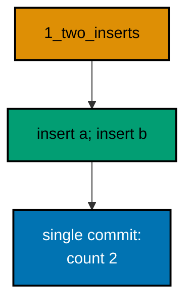

**`learning/code/ex-66-two-statements-share-one-transaction/main.ts`**:

```typescript
import * as Config from "effect/Config"; // => Config reads PGHOST and friends with defaults
import * as Console from "effect/Console"; // => Console.log prints the golden transcript
import * as Effect from "effect/Effect"; // => Effect.gen sequences the migration story
import * as Layer from "effect/Layer"; // => Layer joins the database and node services
import * as Migrator from "effect/sql/Migrator"; // => loaders turn files and records into migrations
import * as SqlClient from "effect/sql/SqlClient"; // => SqlClient runs SQL against the pool
import * as NodeChildProcessSpawner from "@effect/platform-node/NodeChildProcessSpawner"; // => spawner service
import * as NodeFileSystem from "@effect/platform-node/NodeFileSystem"; // => filesystem the file loader reads through
import * as NodePath from "@effect/platform-node/NodePath"; // => path the file loader joins with
import * as NodeRuntime from "@effect/platform-node/NodeRuntime"; // => runMain boots the node services
import * as PgClient from "@effect/sql-pg/PgClient"; // => PgClient.layerConfig builds the pool
import * as PgMigrator from "@effect/sql-pg/PgMigrator"; // => PgMigrator.run applies pending migrations

// => one database layer from harness variables, trust auth, no TLS
const DbLive = PgClient.layerConfig({
  // => layerConfig unwraps Config values
  host: Config.String("PGHOST").pipe(Config.withDefault("postgres")), // => service hostname
  port: Config.Port("PGPORT").pipe(Config.withDefault(5432)), // => service port as a number
  database: Config.String("PGDATABASE").pipe(Config.withDefault("postgres")), // => fresh database per run
  username: Config.String("PGUSER").pipe(Config.withDefault("postgres")), // => trust-auth role
  ssl: Config.succeed(false), // => plaintext inside the unit network
}); // => DbLive offers PgClient and SqlClient together

// => the migrator type also asks for three node services
const NodeLive = Layer.mergeAll(NodeFileSystem.layer, NodePath.layer); // => file plus path side by side
const SpawnerLive = Layer.provide(NodeChildProcessSpawner.layer, NodeLive); // => spawner fed by file and path
const MainLive = Layer.mergeAll(DbLive, NodeLive, SpawnerLive); // => one layer for the whole program

const program = Effect.gen(function* () {
  // => the example narrative
  const sql = yield* SqlClient.SqlClient; // => the query surface over the pool
  const applied = yield* PgMigrator.run({
    // => the run wraps every body transactionally
    loader: Migrator.fromRecord({
      // => one body, two writes
      "1_two_inserts": Effect.gen(function* () {
        // => the grouped body
        const inner = yield* SqlClient.SqlClient; // => the body borrows the same client
        yield* inner`CREATE TABLE ex66_t (id SERIAL PRIMARY KEY, label TEXT NOT NULL)`; // => the migrated table
        yield* inner`INSERT INTO ex66_t (label) VALUES ('a')`; // => the first write
        yield* inner`INSERT INTO ex66_t (label) VALUES ('b')`; // => the second write
      }), // => end of the grouped body
    }), // => end of the migration record
    table: "ex66_history", // => per-example history table
  }); // => both writes commit together
  yield* Console.log(`applied: ${applied.length}`); // => Output: applied: 1
  const rows = yield* sql<{ total: number }>`SELECT count(*)::int AS total FROM ex66_t`; // => both writes landed
  yield* Console.log(`rows: ${rows[0].total}`); // => Output: rows: 2
  yield* sql`DROP TABLE ex66_t`; // => the example leaves no tables behind
  yield* sql`DROP TABLE ex66_history`; // => and no history table either
  yield* Console.log("cleaned: yes"); // => Output: cleaned: yes
}); // => program ends: the harness compares stdout to the golden file

NodeRuntime.runMain(program.pipe(Effect.provide(MainLive))); // => boot node services and run
```

**Output** (`learning/code/ex-66-two-statements-share-one-transaction/expected/main.stdout.txt`):

```text
applied: 1
rows: 2
cleaned: yes
```

(Concepts: co-12.)

### Example 67: Blast Radius Is What You Change

The exclusive locks a migration takes cover exactly what it changes: the history row plus the objects the DDL touches, nothing else. Unrelated tables keep serving reads and writes throughout, because no lock ever names them.

This example captures the lock on its own new table from inside the migration body. The printed mode shows an exclusive lock on the changed relation only. The blast radius is the change itself.

**`learning/code/ex-67-blast-radius-is-what-you-change/main.ts`**:

```typescript
import * as Config from "effect/Config"; // => Config reads PGHOST and friends with defaults
import * as Console from "effect/Console"; // => Console.log prints the golden transcript
import * as Effect from "effect/Effect"; // => Effect.gen sequences the migration story
import * as Layer from "effect/Layer"; // => Layer joins the database and node services
import * as Migrator from "effect/sql/Migrator"; // => loaders turn files and records into migrations
import * as SqlClient from "effect/sql/SqlClient"; // => SqlClient runs SQL against the pool
import * as NodeChildProcessSpawner from "@effect/platform-node/NodeChildProcessSpawner"; // => spawner service
import * as NodeFileSystem from "@effect/platform-node/NodeFileSystem"; // => filesystem the file loader reads through
import * as NodePath from "@effect/platform-node/NodePath"; // => path the file loader joins with
import * as NodeRuntime from "@effect/platform-node/NodeRuntime"; // => runMain boots the node services
import * as PgClient from "@effect/sql-pg/PgClient"; // => PgClient.layerConfig builds the pool
import * as PgMigrator from "@effect/sql-pg/PgMigrator"; // => PgMigrator.run applies pending migrations

// => one database layer from harness variables, trust auth, no TLS
const DbLive = PgClient.layerConfig({
  // => layerConfig unwraps Config values
  host: Config.String("PGHOST").pipe(Config.withDefault("postgres")), // => service hostname
  port: Config.Port("PGPORT").pipe(Config.withDefault(5432)), // => service port as a number
  database: Config.String("PGDATABASE").pipe(Config.withDefault("postgres")), // => fresh database per run
  username: Config.String("PGUSER").pipe(Config.withDefault("postgres")), // => trust-auth role
  ssl: Config.succeed(false), // => plaintext inside the unit network
}); // => DbLive offers PgClient and SqlClient together

// => the migrator type also asks for three node services
const NodeLive = Layer.mergeAll(NodeFileSystem.layer, NodePath.layer); // => file plus path side by side
const SpawnerLive = Layer.provide(NodeChildProcessSpawner.layer, NodeLive); // => spawner fed by file and path
const MainLive = Layer.mergeAll(DbLive, NodeLive, SpawnerLive); // => one layer for the whole program

const program = Effect.gen(function* () {
  // => the example narrative
  const sql = yield* SqlClient.SqlClient; // => the query surface over the pool
  const applied = yield* PgMigrator.run({
    // => the run locks only what it touches
    loader: Migrator.fromRecord({
      // => observe the lock on the new table
      "1_create_ex67_t": Effect.gen(function* () {
        // => the observing migration
        const inner = yield* SqlClient.SqlClient; // => the body borrows the same client
        yield* inner`CREATE TABLE ex67_t (id SERIAL PRIMARY KEY)`; // => the DDL under observation
        yield* inner`CREATE TABLE ex67_seen (mode TEXT NOT NULL)`; // => the observation channel
        yield* inner`INSERT INTO ex67_seen (mode) SELECT mode FROM pg_locks WHERE pid = pg_backend_pid() AND relation = 'ex67_t'::regclass AND mode = 'AccessExclusiveLock'`; // => capture the table lock
      }), // => end of the observing migration
    }), // => end of the migration record
    table: "ex67_history", // => per-example history table
  }); // => the change and its lock commit together
  yield* Console.log(`applied: ${applied.length}`); // => Output: applied: 1
  const rows = yield* sql<{ mode: string }>`SELECT mode FROM ex67_seen`; // => what the body observed
  for (const row of rows) {
    // => walk the observations
    yield* Console.log(`table lock: ${row.mode}`); // => Output: table lock: AccessExclusiveLock
  } // => loop ends after the observation
  yield* sql`DROP TABLE ex67_seen`; // => drop the observation channel
  yield* sql`DROP TABLE ex67_t`; // => drop the migrated table
  yield* sql`DROP TABLE ex67_history`; // => and no history table either
  yield* Console.log("cleaned: yes"); // => Output: cleaned: yes
}); // => program ends: the harness compares stdout to the golden file

NodeRuntime.runMain(program.pipe(Effect.provide(MainLive))); // => boot node services and run
```

**Output** (`learning/code/ex-67-blast-radius-is-what-you-change/expected/main.stdout.txt`):

```text
applied: 1
table lock: AccessExclusiveLock
cleaned: yes
```

(Concepts: co-15.)

### Example 68: Locks Release on Commit

Locks are borrowed, not owned: the moment the migrator's transaction commits, every lock it held is released. The next run starts from a clean slate, and no background process keeps anything pinned.

This example queries the lock table after the run commits and finds nothing held by this process on the history relation. The printed zero is the release receipt. Borrowed briefly, returned promptly.

**`learning/code/ex-68-locks-release-on-commit/main.ts`**:

```typescript
import * as Config from "effect/Config"; // => Config reads PGHOST and friends with defaults
import * as Console from "effect/Console"; // => Console.log prints the golden transcript
import * as Effect from "effect/Effect"; // => Effect.gen sequences the migration story
import * as Layer from "effect/Layer"; // => Layer joins the database and node services
import * as Migrator from "effect/sql/Migrator"; // => loaders turn files and records into migrations
import * as SqlClient from "effect/sql/SqlClient"; // => SqlClient runs SQL against the pool
import * as NodeChildProcessSpawner from "@effect/platform-node/NodeChildProcessSpawner"; // => spawner service
import * as NodeFileSystem from "@effect/platform-node/NodeFileSystem"; // => filesystem the file loader reads through
import * as NodePath from "@effect/platform-node/NodePath"; // => path the file loader joins with
import * as NodeRuntime from "@effect/platform-node/NodeRuntime"; // => runMain boots the node services
import * as PgClient from "@effect/sql-pg/PgClient"; // => PgClient.layerConfig builds the pool
import * as PgMigrator from "@effect/sql-pg/PgMigrator"; // => PgMigrator.run applies pending migrations

// => one database layer from harness variables, trust auth, no TLS
const DbLive = PgClient.layerConfig({
  // => layerConfig unwraps Config values
  host: Config.String("PGHOST").pipe(Config.withDefault("postgres")), // => service hostname
  port: Config.Port("PGPORT").pipe(Config.withDefault(5432)), // => service port as a number
  database: Config.String("PGDATABASE").pipe(Config.withDefault("postgres")), // => fresh database per run
  username: Config.String("PGUSER").pipe(Config.withDefault("postgres")), // => trust-auth role
  ssl: Config.succeed(false), // => plaintext inside the unit network
}); // => DbLive offers PgClient and SqlClient together

// => the migrator type also asks for three node services
const NodeLive = Layer.mergeAll(NodeFileSystem.layer, NodePath.layer); // => file plus path side by side
const SpawnerLive = Layer.provide(NodeChildProcessSpawner.layer, NodeLive); // => spawner fed by file and path
const MainLive = Layer.mergeAll(DbLive, NodeLive, SpawnerLive); // => one layer for the whole program

const program = Effect.gen(function* () {
  // => the example narrative
  const sql = yield* SqlClient.SqlClient; // => the query surface over the pool
  const applied = yield* PgMigrator.run({
    // => the run locks, then commits
    loader: Migrator.fromRecord({
      // => one migration, one commit
      "1_create_ex68_t": sql`CREATE TABLE ex68_t (id SERIAL PRIMARY KEY)`, // => the locked-then-released change
    }), // => end of the migration record
    table: "ex68_history", // => per-example history table
  }); // => the commit releases every lock
  yield* Console.log(`applied: ${applied.length}`); // => Output: applied: 1
  const rows = yield* sql<{
    total: number;
  }>`SELECT count(*)::int AS total FROM pg_locks WHERE pid = pg_backend_pid() AND relation = 'ex68_history'::regclass`; // => locks held now
  yield* Console.log(`held: ${rows[0].total}`); // => Output: held: 0
  yield* sql`DROP TABLE ex68_t`; // => the example leaves no tables behind
  yield* sql`DROP TABLE ex68_history`; // => and no history table either
  yield* Console.log("cleaned: yes"); // => Output: cleaned: yes
}); // => program ends: the harness compares stdout to the golden file

NodeRuntime.runMain(program.pipe(Effect.provide(MainLive))); // => boot node services and run
```

**Output** (`learning/code/ex-68-locks-release-on-commit/expected/main.stdout.txt`):

```text
applied: 1
held: 0
cleaned: yes
```

(Concepts: co-15.)

### Example 69: Failure Releases Its Locks

A failing migration rolls back, and the rollback releases its locks along with its writes. The table it half-built is gone, the history has no row, and the next attempt starts unlocked against a clean database.

This example fails first with a duplicate table creation, then succeeds with the corrected migration on a fresh attempt. The printed kind names the failure, the count proves the recovery. Locks never survive a rollback.

**`learning/code/ex-69-failure-releases-its-locks/main.ts`**:

```typescript
import * as Config from "effect/Config"; // => Config reads PGHOST and friends with defaults
import * as Console from "effect/Console"; // => Console.log prints the golden transcript
import * as Effect from "effect/Effect"; // => Effect.gen sequences the migration story
import * as Layer from "effect/Layer"; // => Layer joins the database and node services
import * as Migrator from "effect/sql/Migrator"; // => loaders turn files and records into migrations
import * as SqlClient from "effect/sql/SqlClient"; // => SqlClient runs SQL against the pool
import * as NodeChildProcessSpawner from "@effect/platform-node/NodeChildProcessSpawner"; // => spawner service
import * as NodeFileSystem from "@effect/platform-node/NodeFileSystem"; // => filesystem the file loader reads through
import * as NodePath from "@effect/platform-node/NodePath"; // => path the file loader joins with
import * as NodeRuntime from "@effect/platform-node/NodeRuntime"; // => runMain boots the node services
import * as PgClient from "@effect/sql-pg/PgClient"; // => PgClient.layerConfig builds the pool
import * as PgMigrator from "@effect/sql-pg/PgMigrator"; // => PgMigrator.run applies pending migrations

// => one database layer from harness variables, trust auth, no TLS
const DbLive = PgClient.layerConfig({
  // => layerConfig unwraps Config values
  host: Config.String("PGHOST").pipe(Config.withDefault("postgres")), // => service hostname
  port: Config.Port("PGPORT").pipe(Config.withDefault(5432)), // => service port as a number
  database: Config.String("PGDATABASE").pipe(Config.withDefault("postgres")), // => fresh database per run
  username: Config.String("PGUSER").pipe(Config.withDefault("postgres")), // => trust-auth role
  ssl: Config.succeed(false), // => plaintext inside the unit network
}); // => DbLive offers PgClient and SqlClient together

// => the migrator type also asks for three node services
const NodeLive = Layer.mergeAll(NodeFileSystem.layer, NodePath.layer); // => file plus path side by side
const SpawnerLive = Layer.provide(NodeChildProcessSpawner.layer, NodeLive); // => spawner fed by file and path
const MainLive = Layer.mergeAll(DbLive, NodeLive, SpawnerLive); // => one layer for the whole program

const program = Effect.gen(function* () {
  // => the example narrative
  const sql = yield* SqlClient.SqlClient; // => the query surface over the pool
  const kind = yield* PgMigrator.run({
    // => the first attempt fails loudly
    loader: Migrator.fromRecord({
      // => a migration that cannot succeed
      "1_create_ex69_t": Effect.gen(function* () {
        // => the doomed body
        const inner = yield* SqlClient.SqlClient; // => the body borrows the same client
        yield* inner`CREATE TABLE ex69_t (id SERIAL PRIMARY KEY)`; // => the table, created once
        yield* inner`CREATE TABLE ex69_t (id SERIAL PRIMARY KEY)`; // => the same table, created twice
      }), // => end of the doomed body
    }), // => end of the failing loader
    table: "ex69_history", // => per-example history table
  }).pipe(
    // => catch the typed failure, not a crash
    Effect.catchTag("MigrationError", (error) => Console.log(`failed: ${error.kind}`).pipe(Effect.as(error.kind))), // => Output: failed: Failed
  ); // => kind holds the typed failure kind
  yield* Console.log(`kind: ${kind}`); // => Output: kind: Failed
  const retry = yield* PgMigrator.run({
    // => the corrected attempt starts unlocked
    loader: Migrator.fromRecord({
      // => the repaired migration
      "1_create_ex69_t": sql`CREATE TABLE ex69_t (id SERIAL PRIMARY KEY)`, // => the same id, now succeeding
    }), // => end of the repaired loader
    table: "ex69_history", // => the same history table
  }); // => the retry applies cleanly
  yield* Console.log(`retry: ${retry.length}`); // => Output: retry: 1
  yield* sql`DROP TABLE ex69_t`; // => the example leaves no tables behind
  yield* sql`DROP TABLE ex69_history`; // => and no history table either
  yield* Console.log("cleaned: yes"); // => Output: cleaned: yes
}); // => program ends: the harness compares stdout to the golden file

NodeRuntime.runMain(program.pipe(Effect.provide(MainLive))); // => boot node services and run
```

**Output** (`learning/code/ex-69-failure-releases-its-locks/expected/main.stdout.txt`):

```text
failed: Failed
kind: Failed
retry: 1
cleaned: yes
```

(Concepts: co-15.)

### Example 70: Promote Dev, Then Prod

Promotion is a sequence, not a copy: the development database adopts the set first, production follows with the identical set, and re-running either finds nothing new. Each stage records independently, so an audit can compare them id by id.

One loader promotes across two databases here, then the development database confirms it has nothing pending. The three counts trace the pipeline. Same set, staged rollout, independent receipts.

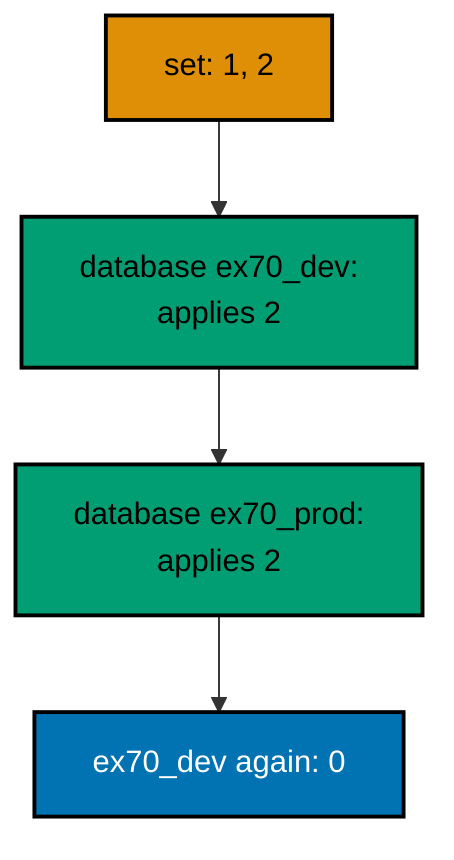

**`learning/code/ex-70-promote-dev-then-prod/main.ts`**:

```typescript
import * as Config from "effect/Config"; // => Config reads PGHOST and friends with defaults
import * as Console from "effect/Console"; // => Console.log prints the golden transcript
import * as Effect from "effect/Effect"; // => Effect.gen sequences the migration story
import * as Layer from "effect/Layer"; // => Layer joins the database and node services
import * as Migrator from "effect/sql/Migrator"; // => loaders turn files and records into migrations
import * as SqlClient from "effect/sql/SqlClient"; // => SqlClient runs SQL against the pool
import * as NodeChildProcessSpawner from "@effect/platform-node/NodeChildProcessSpawner"; // => spawner service
import * as NodeFileSystem from "@effect/platform-node/NodeFileSystem"; // => filesystem the file loader reads through
import * as NodePath from "@effect/platform-node/NodePath"; // => path the file loader joins with
import * as NodeRuntime from "@effect/platform-node/NodeRuntime"; // => runMain boots the node services
import * as PgClient from "@effect/sql-pg/PgClient"; // => PgClient.layerConfig builds the pool
import * as PgMigrator from "@effect/sql-pg/PgMigrator"; // => PgMigrator.run applies pending migrations

// => one database layer from harness variables, trust auth, no TLS
const DbLive = PgClient.layerConfig({
  // => layerConfig unwraps Config values
  host: Config.String("PGHOST").pipe(Config.withDefault("postgres")), // => service hostname
  port: Config.Port("PGPORT").pipe(Config.withDefault(5432)), // => service port as a number
  database: Config.String("PGDATABASE").pipe(Config.withDefault("postgres")), // => fresh database per run
  username: Config.String("PGUSER").pipe(Config.withDefault("postgres")), // => trust-auth role
  ssl: Config.succeed(false), // => plaintext inside the unit network
}); // => DbLive offers PgClient and SqlClient together

// => the migrator type also asks for three node services
const NodeLive = Layer.mergeAll(NodeFileSystem.layer, NodePath.layer); // => file plus path side by side
const SpawnerLive = Layer.provide(NodeChildProcessSpawner.layer, NodeLive); // => spawner fed by file and path
const MainLive = Layer.mergeAll(DbLive, NodeLive, SpawnerLive); // => one layer for the whole program

const program = Effect.gen(function* () {
  // => the example narrative
  const sql = yield* SqlClient.SqlClient; // => the query surface over the pool
  yield* sql`CREATE DATABASE ex70_dev`; // => the first environment, a real database
  yield* sql`CREATE DATABASE ex70_prod`; // => the second environment, a real database
  const makeDb = (database: string) =>
    PgClient.layerConfig({
      // => one pool per environment
      host: Config.String("PGHOST").pipe(Config.withDefault("postgres")), // => service hostname
      port: Config.Port("PGPORT").pipe(Config.withDefault(5432)), // => service port as a number
      database: Config.succeed(database), // => this environment's database
      username: Config.String("PGUSER").pipe(Config.withDefault("postgres")), // => trust-auth role
      ssl: Config.succeed(false), // => plaintext inside the unit network
    }); // => a pool aimed at one environment
  const runOn = (database: string) =>
    Effect.provide(
      // => each environment runs on its own pool
      Effect.gen(function* () {
        // => migrate one environment fully
        const db = yield* SqlClient.SqlClient; // => this environment's client
        const applied = yield* PgMigrator.run({
          // => the release set
          loader: Migrator.fromRecord({
            // => the same two tables everywhere
            "1_create_ex70_a": db`CREATE TABLE ex70_a (id SERIAL PRIMARY KEY)`, // => the first table
            "2_create_ex70_b": db`CREATE TABLE ex70_b (id SERIAL PRIMARY KEY)`, // => the second table
          }), // => end of the migration record
          table: "ex70_history", // => each database keeps its own history
        }); // => this environment converges
        return applied.length; // => plain data crosses the pool boundary
      }), // => end of the per-environment story
      Layer.mergeAll(makeDb(database), NodeLive, SpawnerLive), // => pool plus node services
    ); // => runOn hands back counts, never clients
  const dev = yield* runOn("ex70_dev"); // => development adopts first
  yield* Console.log(`dev: ${dev}`); // => Output: dev: 2
  const prod = yield* runOn("ex70_prod"); // => production follows
  yield* Console.log(`prod: ${prod}`); // => Output: prod: 2
  const again = yield* runOn("ex70_dev"); // => development has nothing new
  yield* Console.log(`again: ${again}`); // => Output: again: 0
  yield* sql`DROP DATABASE ex70_dev`; // => drop the first environment
  yield* sql`DROP DATABASE ex70_prod`; // => drop the second environment
  yield* Console.log("cleaned: yes"); // => Output: cleaned: yes
}); // => program ends: the harness compares stdout to the golden file

NodeRuntime.runMain(program.pipe(Effect.provide(MainLive))); // => boot node services and run
```

**Output** (`learning/code/ex-70-promote-dev-then-prod/expected/main.stdout.txt`):

```text
dev: 2
prod: 2
again: 0
cleaned: yes
```

(Concepts: co-13.)

### Example 71: Failing Migration Dies Loud

A migration that fails must fail loudly and leave nothing behind: the transaction rolls back the partial writes, the history records nothing, and the operator gets an error instead of a half-migrated database. Silence here would be the real outage.

This example runs a two-step migration whose second step repeats the first table creation. The captured outcome names the failure, and the follow-up queries prove the rollback: no history row, no table. Loud failures are safe failures.

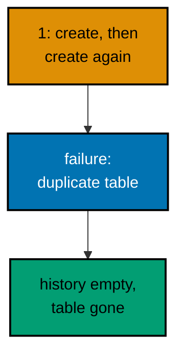

**`learning/code/ex-71-failing-migration-dies-loud/main.ts`**:

```typescript
import * as Config from "effect/Config"; // => Config reads PGHOST and friends with defaults
import * as Console from "effect/Console"; // => Console.log prints the golden transcript
import * as Effect from "effect/Effect"; // => Effect.gen sequences the migration story
import * as Layer from "effect/Layer"; // => Layer joins the database and node services
import * as Migrator from "effect/sql/Migrator"; // => fromRecord turns Effects into migrations
import * as SqlClient from "effect/sql/SqlClient"; // => SqlClient runs SQL against the pool
import * as NodeChildProcessSpawner from "@effect/platform-node/NodeChildProcessSpawner"; // => spawner service
import * as NodeFileSystem from "@effect/platform-node/NodeFileSystem"; // => filesystem the migrator type needs
import * as NodePath from "@effect/platform-node/NodePath"; // => path the migrator type needs
import * as NodeRuntime from "@effect/platform-node/NodeRuntime"; // => runMain boots the node services
import * as PgClient from "@effect/sql-pg/PgClient"; // => PgClient.layerConfig builds the pool
import * as PgMigrator from "@effect/sql-pg/PgMigrator"; // => PgMigrator.run applies pending migrations

// => one database layer from harness variables, trust auth, no TLS
const DbLive = PgClient.layerConfig({
  // => layerConfig unwraps Config values
  host: Config.String("PGHOST").pipe(Config.withDefault("postgres")), // => service hostname
  port: Config.Port("PGPORT").pipe(Config.withDefault(5432)), // => service port as a number
  database: Config.String("PGDATABASE").pipe(Config.withDefault("postgres")), // => fresh database per run
  username: Config.String("PGUSER").pipe(Config.withDefault("postgres")), // => trust-auth role
  ssl: Config.succeed(false), // => plaintext inside the unit network
}); // => DbLive offers PgClient and SqlClient together

// => the migrator type also asks for three node services
const NodeLive = Layer.mergeAll(NodeFileSystem.layer, NodePath.layer); // => file plus path side by side
const SpawnerLive = Layer.provide(NodeChildProcessSpawner.layer, NodeLive); // => spawner fed by file and path
const MainLive = Layer.mergeAll(DbLive, NodeLive, SpawnerLive); // => one layer for the whole program

const program = Effect.gen(function* () {
  // => the example narrative
  const sql = yield* SqlClient.SqlClient; // => the query surface over the pool
  const exit = yield* Effect.exit(
    PgMigrator.run({
      // => capture success or crash, never crash out
      loader: Migrator.fromRecord({
        // => the second statement cannot run
        "1_create_ex71_widgets": Effect.gen(function* () {
          // => a two-step migration body
          const inner = yield* SqlClient.SqlClient; // => the body borrows the same client
          yield* inner`CREATE TABLE ex71_widgets (id SERIAL PRIMARY KEY)`; // => step one is valid DDL
          yield* inner`CREATE TABLE ex71_widgets (id SERIAL PRIMARY KEY)`; // => step two repeats the name
        }), // => end of the two-step body
        "2_add_widget_name": sql`ALTER TABLE ex71_widgets ADD COLUMN name TEXT`, // => never reached
      }), // => end of the migration record
      table: "ex71_history", // => per-example history table
    }),
  ); // => exit holds Success or the loud Failure
  if (exit._tag === "Failure") {
    // => the duplicate CREATE TABLE died here
    yield* Console.log("outcome: migration-failed"); // => Output: outcome: migration-failed
  } else {
    // => success would list the applied pair
    yield* Console.log("outcome: unexpected-success"); // => never printed for this unit
  } // => end of the outcome branch
  const rows = yield* sql<{ migration_id: number }>`SELECT migration_id FROM ex71_history ORDER BY migration_id`; // => what did the history record
  yield* Console.log(`recorded: ${rows.length}`); // => Output: recorded: 0
  const tables = yield* sql<{ name: string }>`SELECT tablename AS name FROM pg_tables WHERE tablename = 'ex71_widgets'`; // => did the table survive
  yield* Console.log(`tables: ${tables.length}`); // => Output: tables: 0
  yield* sql`DROP TABLE IF EXISTS ex71_widgets`; // => the example leaves no tables behind
  yield* sql`DROP TABLE ex71_history`; // => and no history table either
  yield* Console.log("cleaned: yes"); // => Output: cleaned: yes
}); // => program ends: the harness compares stdout to the golden file

NodeRuntime.runMain(program.pipe(Effect.provide(MainLive))); // => boot node services and run
```

**Output** (`learning/code/ex-71-failing-migration-dies-loud/expected/main.stdout.txt`):

```text
outcome: migration-failed
recorded: 0
tables: 0
cleaned: yes
```

(Concepts: co-12.)

### Example 72: Duplicate Ids Are Rejected

Two migrations sharing one id is always an authoring mistake, and the migrator refuses to guess which one the author meant. The duplicate check runs before anything executes, so a collision can never half-apply.

This example loads two entries both numbered one and catches the typed rejection. The printed kind names the problem, and the cleanup drops confirm nothing was created. Collisions stop at the gate.

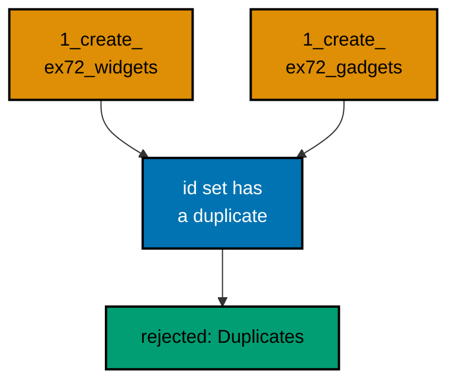

**`learning/code/ex-72-duplicate-ids-are-rejected/main.ts`**:

```typescript
import * as Config from "effect/Config"; // => Config reads PGHOST and friends with defaults
import * as Console from "effect/Console"; // => Console.log prints the golden transcript
import * as Effect from "effect/Effect"; // => Effect.gen sequences the migration story
import * as Layer from "effect/Layer"; // => Layer joins the database and node services
import * as Migrator from "effect/sql/Migrator"; // => fromRecord turns Effects into migrations
import * as SqlClient from "effect/sql/SqlClient"; // => SqlClient runs SQL against the pool
import * as NodeChildProcessSpawner from "@effect/platform-node/NodeChildProcessSpawner"; // => spawner service
import * as NodeFileSystem from "@effect/platform-node/NodeFileSystem"; // => filesystem the migrator type needs
import * as NodePath from "@effect/platform-node/NodePath"; // => path the migrator type needs
import * as NodeRuntime from "@effect/platform-node/NodeRuntime"; // => runMain boots the node services
import * as PgClient from "@effect/sql-pg/PgClient"; // => PgClient.layerConfig builds the pool
import * as PgMigrator from "@effect/sql-pg/PgMigrator"; // => PgMigrator.run applies pending migrations

// => one database layer from harness variables, trust auth, no TLS
const DbLive = PgClient.layerConfig({
  // => layerConfig unwraps Config values
  host: Config.String("PGHOST").pipe(Config.withDefault("postgres")), // => service hostname
  port: Config.Port("PGPORT").pipe(Config.withDefault(5432)), // => service port as a number
  database: Config.String("PGDATABASE").pipe(Config.withDefault("postgres")), // => fresh database per run
  username: Config.String("PGUSER").pipe(Config.withDefault("postgres")), // => trust-auth role
  ssl: Config.succeed(false), // => plaintext inside the unit network
}); // => DbLive offers PgClient and SqlClient together

// => the migrator type also asks for three node services
const NodeLive = Layer.mergeAll(NodeFileSystem.layer, NodePath.layer); // => file plus path side by side
const SpawnerLive = Layer.provide(NodeChildProcessSpawner.layer, NodeLive); // => spawner fed by file and path
const MainLive = Layer.mergeAll(DbLive, NodeLive, SpawnerLive); // => one layer for the whole program

const program = Effect.gen(function* () {
  // => the example narrative
  const sql = yield* SqlClient.SqlClient; // => the query surface over the pool
  const reason = yield* PgMigrator.run({
    // => this loader carries a duplicate id
    loader: Migrator.fromRecord({
      // => two entries share id 1
      "1_create_ex72_widgets": sql`CREATE TABLE ex72_widgets (id SERIAL PRIMARY KEY)`, // => first claimant of id 1
      "1_create_ex72_gadgets": sql`CREATE TABLE ex72_gadgets (id SERIAL PRIMARY KEY)`, // => second claimant of id 1
    }), // => end of the migration record
    table: "ex72_history", // => per-example history table
  }).pipe(
    // => catch the typed rejection, not a crash
    Effect.catchTag("MigrationError", (error) => Console.log(`rejected: ${error.kind}`).pipe(Effect.as(error.kind))), // => Output: rejected: Duplicates
  ); // => reason holds the typed rejection kind
  yield* Console.log(`reason: ${reason}`); // => Output: reason: Duplicates
  yield* sql`DROP TABLE IF EXISTS ex72_widgets`; // => the example leaves no tables behind
  yield* sql`DROP TABLE IF EXISTS ex72_gadgets`; // => neither claimant created anything
  yield* sql`DROP TABLE ex72_history`; // => and no history table either
  yield* Console.log("cleaned: yes"); // => Output: cleaned: yes
}); // => program ends: the harness compares stdout to the golden file

NodeRuntime.runMain(program.pipe(Effect.provide(MainLive))); // => boot node services and run
```

**Output** (`learning/code/ex-72-duplicate-ids-are-rejected/expected/main.stdout.txt`):

```text
rejected: Duplicates
reason: Duplicates
cleaned: yes
```

(Concepts: co-04.)

### Example 73: Read the History First

Diagnosis starts with the history table, not with the logs: it says exactly which migrations the database believes ran, and in which order. Every incident checklist opens with this read, because every other theory must agree with it.

A failing migration sets up this drill: the run fails, and the first diagnostic act reads the full history. The empty result is itself the finding: nothing recorded, so nothing to undo. Read first, theorize second.

**`learning/code/ex-73-read-the-history-first/main.ts`**:

```typescript
import * as Config from "effect/Config"; // => Config reads PGHOST and friends with defaults
import * as Console from "effect/Console"; // => Console.log prints the golden transcript
import * as Effect from "effect/Effect"; // => Effect.gen sequences the migration story
import * as Layer from "effect/Layer"; // => Layer joins the database and node services
import * as Migrator from "effect/sql/Migrator"; // => loaders turn files and records into migrations
import * as SqlClient from "effect/sql/SqlClient"; // => SqlClient runs SQL against the pool
import * as NodeChildProcessSpawner from "@effect/platform-node/NodeChildProcessSpawner"; // => spawner service
import * as NodeFileSystem from "@effect/platform-node/NodeFileSystem"; // => filesystem the file loader reads through
import * as NodePath from "@effect/platform-node/NodePath"; // => path the file loader joins with
import * as NodeRuntime from "@effect/platform-node/NodeRuntime"; // => runMain boots the node services
import * as PgClient from "@effect/sql-pg/PgClient"; // => PgClient.layerConfig builds the pool
import * as PgMigrator from "@effect/sql-pg/PgMigrator"; // => PgMigrator.run applies pending migrations

// => one database layer from harness variables, trust auth, no TLS
const DbLive = PgClient.layerConfig({
  // => layerConfig unwraps Config values
  host: Config.String("PGHOST").pipe(Config.withDefault("postgres")), // => service hostname
  port: Config.Port("PGPORT").pipe(Config.withDefault(5432)), // => service port as a number
  database: Config.String("PGDATABASE").pipe(Config.withDefault("postgres")), // => fresh database per run
  username: Config.String("PGUSER").pipe(Config.withDefault("postgres")), // => trust-auth role
  ssl: Config.succeed(false), // => plaintext inside the unit network
}); // => DbLive offers PgClient and SqlClient together

// => the migrator type also asks for three node services
const NodeLive = Layer.mergeAll(NodeFileSystem.layer, NodePath.layer); // => file plus path side by side
const SpawnerLive = Layer.provide(NodeChildProcessSpawner.layer, NodeLive); // => spawner fed by file and path
const MainLive = Layer.mergeAll(DbLive, NodeLive, SpawnerLive); // => one layer for the whole program

const program = Effect.gen(function* () {
  // => the example narrative
  const sql = yield* SqlClient.SqlClient; // => the query surface over the pool
  const kind = yield* PgMigrator.run({
    // => the run fails on purpose
    loader: Migrator.fromRecord({
      // => a migration that cannot succeed
      "1_create_ex73_t": Effect.gen(function* () {
        // => the doomed body
        const inner = yield* SqlClient.SqlClient; // => the body borrows the same client
        yield* inner`CREATE TABLE ex73_t (id SERIAL PRIMARY KEY)`; // => the table, created once
        yield* inner`CREATE TABLE ex73_t (id SERIAL PRIMARY KEY)`; // => the same table, created twice
      }), // => end of the doomed body
    }), // => end of the failing loader
    table: "ex73_history", // => per-example history table
  }).pipe(
    // => catch the typed failure, not a crash
    // => step one of the checklist: read the full history first
    Effect.catchTag("MigrationError", (error) => Console.log(`failed: ${error.kind}`).pipe(Effect.as(error.kind))), // => Output: failed: Failed
  ); // => kind holds the typed failure kind
  yield* Console.log(`kind: ${kind}`); // => Output: kind: Failed
  const rows = yield* sql<{
    migration_id: number;
    name: string;
  }>`SELECT migration_id, name FROM ex73_history ORDER BY migration_id`; // => step one of the checklist
  yield* Console.log(`history rows: ${rows.length}`); // => Output: history rows: 0
  yield* sql`DROP TABLE IF EXISTS ex73_t`; // => the example leaves no tables behind
  yield* sql`DROP TABLE ex73_history`; // => and no history table either
  yield* Console.log("cleaned: yes"); // => Output: cleaned: yes
}); // => program ends: the harness compares stdout to the golden file

NodeRuntime.runMain(program.pipe(Effect.provide(MainLive))); // => boot node services and run
```

**Output** (`learning/code/ex-73-read-the-history-first/expected/main.stdout.txt`):

```text
failed: Failed
kind: Failed
history rows: 0
cleaned: yes
```

(Concepts: co-03.)

### Example 74: Compare History to the Catalog

Drift in one direction is extra shape: someone added a column by hand, and the catalog now holds more than any migration built. The check compares the migration's known columns against the live catalog and names the surplus.

This example migrates a one-column table, adds a second column manually, then lists the live columns. The printed pair exposes the hand-added stranger. Known shape versus live shape, compared on purpose.

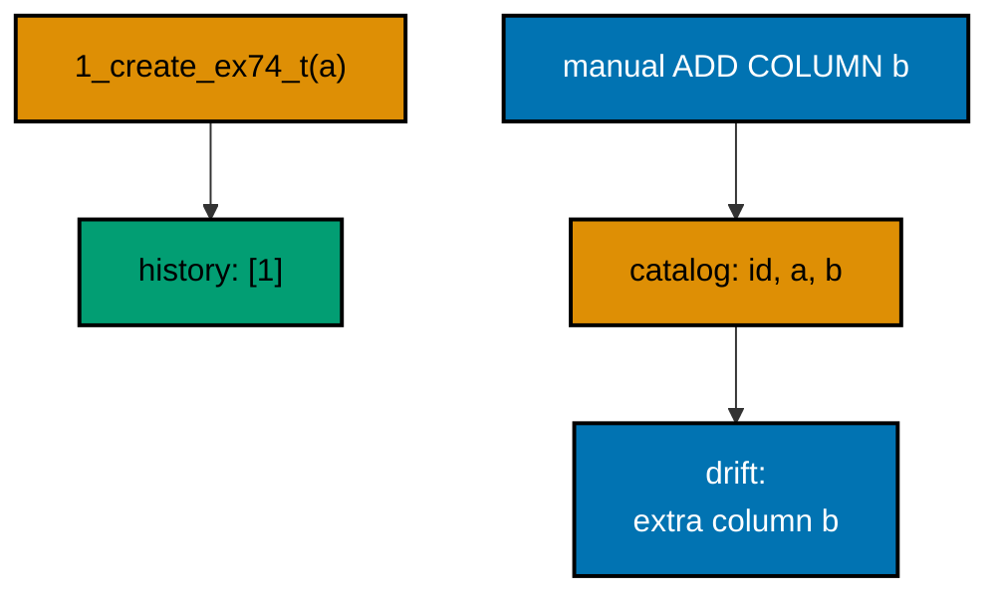

**`learning/code/ex-74-compare-history-to-the-catalog/main.ts`**:

```typescript
import * as Config from "effect/Config"; // => Config reads PGHOST and friends with defaults
import * as Console from "effect/Console"; // => Console.log prints the golden transcript
import * as Effect from "effect/Effect"; // => Effect.gen sequences the migration story
import * as Layer from "effect/Layer"; // => Layer joins the database and node services
import * as Migrator from "effect/sql/Migrator"; // => loaders turn files and records into migrations
import * as SqlClient from "effect/sql/SqlClient"; // => SqlClient runs SQL against the pool
import * as NodeChildProcessSpawner from "@effect/platform-node/NodeChildProcessSpawner"; // => spawner service
import * as NodeFileSystem from "@effect/platform-node/NodeFileSystem"; // => filesystem the file loader reads through
import * as NodePath from "@effect/platform-node/NodePath"; // => path the file loader joins with
import * as NodeRuntime from "@effect/platform-node/NodeRuntime"; // => runMain boots the node services
import * as PgClient from "@effect/sql-pg/PgClient"; // => PgClient.layerConfig builds the pool
import * as PgMigrator from "@effect/sql-pg/PgMigrator"; // => PgMigrator.run applies pending migrations

// => one database layer from harness variables, trust auth, no TLS
const DbLive = PgClient.layerConfig({
  // => layerConfig unwraps Config values
  host: Config.String("PGHOST").pipe(Config.withDefault("postgres")), // => service hostname
  port: Config.Port("PGPORT").pipe(Config.withDefault(5432)), // => service port as a number
  database: Config.String("PGDATABASE").pipe(Config.withDefault("postgres")), // => fresh database per run
  username: Config.String("PGUSER").pipe(Config.withDefault("postgres")), // => trust-auth role
  ssl: Config.succeed(false), // => plaintext inside the unit network
}); // => DbLive offers PgClient and SqlClient together

// => the migrator type also asks for three node services
const NodeLive = Layer.mergeAll(NodeFileSystem.layer, NodePath.layer); // => file plus path side by side
const SpawnerLive = Layer.provide(NodeChildProcessSpawner.layer, NodeLive); // => spawner fed by file and path
const MainLive = Layer.mergeAll(DbLive, NodeLive, SpawnerLive); // => one layer for the whole program

const program = Effect.gen(function* () {
  // => the example narrative
  const sql = yield* SqlClient.SqlClient; // => the query surface over the pool
  const applied = yield* PgMigrator.run({
    // => the recorded shape is one column
    loader: Migrator.fromRecord({
      // => a single-column table
      "1_create_ex74_t": sql`CREATE TABLE ex74_t (id SERIAL PRIMARY KEY, a TEXT)`, // => the migration-built shape
    }), // => end of the migration record
    table: "ex74_history", // => per-example history table
  }); // => the migration applies cleanly
  yield* Console.log(`applied: ${applied.length}`); // => Output: applied: 1
  yield* sql`ALTER TABLE ex74_t ADD COLUMN b TEXT`; // => a hand-run change, outside any migration
  const columns = yield* sql<{
    name: string;
  }>`SELECT column_name AS name FROM information_schema.columns WHERE table_name = 'ex74_t' ORDER BY ordinal_position`; // => the live shape
  yield* Console.log(`columns: ${columns.map((column) => column.name).join(", ")}`); // => Output: columns: id, a, b
  yield* Console.log("drift: extra column b"); // => Output: drift: extra column b
  yield* sql`DROP TABLE ex74_t`; // => the example leaves no tables behind
  yield* sql`DROP TABLE ex74_history`; // => and no history table either
  yield* Console.log("cleaned: yes"); // => Output: cleaned: yes
}); // => program ends: the harness compares stdout to the golden file

NodeRuntime.runMain(program.pipe(Effect.provide(MainLive))); // => boot node services and run
```

**Output** (`learning/code/ex-74-compare-history-to-the-catalog/expected/main.stdout.txt`):

```text
applied: 1
columns: id, a, b
drift: extra column b
cleaned: yes
```

(Concepts: co-09.)

### Example 75: Missing Table Means Drift

Drift in the other direction is missing shape: someone dropped a migrated table by hand, and the history still claims it ran. The check looks for every recorded table in the catalog and reports the ones that vanished.

This example migrates a table, drops it manually, then counts its presence in the catalog. Zero tables against one history row is the finding. Recorded but missing means drift, always.

**`learning/code/ex-75-missing-table-means-drift/main.ts`**:

```typescript
import * as Config from "effect/Config"; // => Config reads PGHOST and friends with defaults
import * as Console from "effect/Console"; // => Console.log prints the golden transcript
import * as Effect from "effect/Effect"; // => Effect.gen sequences the migration story
import * as Layer from "effect/Layer"; // => Layer joins the database and node services
import * as Migrator from "effect/sql/Migrator"; // => loaders turn files and records into migrations
import * as SqlClient from "effect/sql/SqlClient"; // => SqlClient runs SQL against the pool
import * as NodeChildProcessSpawner from "@effect/platform-node/NodeChildProcessSpawner"; // => spawner service
import * as NodeFileSystem from "@effect/platform-node/NodeFileSystem"; // => filesystem the file loader reads through
import * as NodePath from "@effect/platform-node/NodePath"; // => path the file loader joins with
import * as NodeRuntime from "@effect/platform-node/NodeRuntime"; // => runMain boots the node services
import * as PgClient from "@effect/sql-pg/PgClient"; // => PgClient.layerConfig builds the pool
import * as PgMigrator from "@effect/sql-pg/PgMigrator"; // => PgMigrator.run applies pending migrations

// => one database layer from harness variables, trust auth, no TLS
const DbLive = PgClient.layerConfig({
  // => layerConfig unwraps Config values
  host: Config.String("PGHOST").pipe(Config.withDefault("postgres")), // => service hostname
  port: Config.Port("PGPORT").pipe(Config.withDefault(5432)), // => service port as a number
  database: Config.String("PGDATABASE").pipe(Config.withDefault("postgres")), // => fresh database per run
  username: Config.String("PGUSER").pipe(Config.withDefault("postgres")), // => trust-auth role
  ssl: Config.succeed(false), // => plaintext inside the unit network
}); // => DbLive offers PgClient and SqlClient together

// => the migrator type also asks for three node services
const NodeLive = Layer.mergeAll(NodeFileSystem.layer, NodePath.layer); // => file plus path side by side
const SpawnerLive = Layer.provide(NodeChildProcessSpawner.layer, NodeLive); // => spawner fed by file and path
const MainLive = Layer.mergeAll(DbLive, NodeLive, SpawnerLive); // => one layer for the whole program

const program = Effect.gen(function* () {
  // => the example narrative
  const sql = yield* SqlClient.SqlClient; // => the query surface over the pool
  const applied = yield* PgMigrator.run({
    // => the recorded shape is one table
    loader: Migrator.fromRecord({
      // => a single-table migration
      "1_create_ex75_t": sql`CREATE TABLE ex75_t (id SERIAL PRIMARY KEY)`, // => the migration-built table
    }), // => end of the migration record
    table: "ex75_history", // => per-example history table
  }); // => the migration applies cleanly
  yield* Console.log(`applied: ${applied.length}`); // => Output: applied: 1
  yield* sql`DROP TABLE ex75_t`; // => a hand-run drop, outside any migration
  const tables = yield* sql<{ total: number }>`SELECT count(*)::int AS total FROM pg_tables WHERE tablename = 'ex75_t'`; // => the catalog disagrees
  yield* Console.log(`tables: ${tables[0].total}`); // => Output: tables: 0
  const rows = yield* sql<{ total: number }>`SELECT count(*)::int AS total FROM ex75_history`; // => while the history insists
  yield* Console.log(`recorded: ${rows[0].total}`); // => Output: recorded: 1
  yield* Console.log("drift: ex75_t recorded but missing"); // => Output: drift: ex75_t recorded but missing
  yield* sql`DROP TABLE ex75_history`; // => drop the history table
  yield* Console.log("cleaned: yes"); // => Output: cleaned: yes
}); // => program ends: the harness compares stdout to the golden file

NodeRuntime.runMain(program.pipe(Effect.provide(MainLive))); // => boot node services and run
```

**Output** (`learning/code/ex-75-missing-table-means-drift/expected/main.stdout.txt`):

```text
applied: 1
tables: 0
recorded: 1
drift: ex75_t recorded but missing
cleaned: yes
```

(Concepts: co-09.)

### Example 76: Diagnose a Partial Migration from History

A partial migration is the incident every checklist exists for: several statements, one failure, and the question of what landed. With transactional runs the answer is always nothing, and the automated check proves it instead of assuming it.

This example fails a two-step migration, then asserts both halves of the clean state: the history is empty and the table is absent. Both printed numbers are zero. Automate the diagnosis and the incident gets shorter.

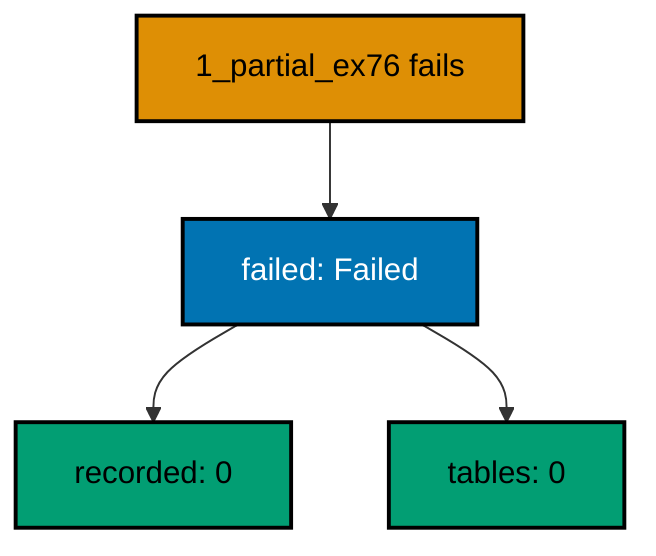

**`learning/code/ex-76-diagnose-a-partial-migration-from-history/main.ts`**:

```typescript
import * as Config from "effect/Config"; // => Config reads PGHOST and friends with defaults
import * as Console from "effect/Console"; // => Console.log prints the golden transcript
import * as Effect from "effect/Effect"; // => Effect.gen sequences the migration story
import * as Layer from "effect/Layer"; // => Layer joins the database and node services
import * as Migrator from "effect/sql/Migrator"; // => loaders turn files and records into migrations
import * as SqlClient from "effect/sql/SqlClient"; // => SqlClient runs SQL against the pool
import * as NodeChildProcessSpawner from "@effect/platform-node/NodeChildProcessSpawner"; // => spawner service
import * as NodeFileSystem from "@effect/platform-node/NodeFileSystem"; // => filesystem the file loader reads through
import * as NodePath from "@effect/platform-node/NodePath"; // => path the file loader joins with
import * as NodeRuntime from "@effect/platform-node/NodeRuntime"; // => runMain boots the node services
import * as PgClient from "@effect/sql-pg/PgClient"; // => PgClient.layerConfig builds the pool
import * as PgMigrator from "@effect/sql-pg/PgMigrator"; // => PgMigrator.run applies pending migrations

// => one database layer from harness variables, trust auth, no TLS
const DbLive = PgClient.layerConfig({
  // => layerConfig unwraps Config values
  host: Config.String("PGHOST").pipe(Config.withDefault("postgres")), // => service hostname
  port: Config.Port("PGPORT").pipe(Config.withDefault(5432)), // => service port as a number
  database: Config.String("PGDATABASE").pipe(Config.withDefault("postgres")), // => fresh database per run
  username: Config.String("PGUSER").pipe(Config.withDefault("postgres")), // => trust-auth role
  ssl: Config.succeed(false), // => plaintext inside the unit network
}); // => DbLive offers PgClient and SqlClient together

// => the migrator type also asks for three node services
const NodeLive = Layer.mergeAll(NodeFileSystem.layer, NodePath.layer); // => file plus path side by side
const SpawnerLive = Layer.provide(NodeChildProcessSpawner.layer, NodeLive); // => spawner fed by file and path
const MainLive = Layer.mergeAll(DbLive, NodeLive, SpawnerLive); // => one layer for the whole program

const program = Effect.gen(function* () {
  // => the example narrative
  const sql = yield* SqlClient.SqlClient; // => the query surface over the pool
  const kind = yield* PgMigrator.run({
    // => the partial run fails midway
    loader: Migrator.fromRecord({
      // => two steps, the second impossible
      "1_partial_ex76": Effect.gen(function* () {
        // => the partial body
        const inner = yield* SqlClient.SqlClient; // => the body borrows the same client
        yield* inner`CREATE TABLE ex76_t (id SERIAL PRIMARY KEY)`; // => step one succeeds
        yield* inner`INSERT INTO ex76_t (missing_column) VALUES (1)`; // => step two cannot succeed
      }), // => end of the partial body
    }), // => end of the failing loader
    table: "ex76_history", // => per-example history table
  }).pipe(
    // => catch the typed failure, not a crash
    Effect.catchTag("MigrationError", (error) => Console.log(`failed: ${error.kind}`).pipe(Effect.as(error.kind))), // => Output: failed: Failed
  ); // => kind holds the typed failure kind
  yield* Console.log(`kind: ${kind}`); // => Output: kind: Failed
  const recorded = yield* sql<{ total: number }>`SELECT count(*)::int AS total FROM ex76_history`; // => checklist: history empty
  yield* Console.log(`recorded: ${recorded[0].total}`); // => Output: recorded: 0
  const tables = yield* sql<{ total: number }>`SELECT count(*)::int AS total FROM pg_tables WHERE tablename = 'ex76_t'`; // => checklist: table absent
  yield* Console.log(`tables: ${tables[0].total}`); // => Output: tables: 0
  yield* sql`DROP TABLE IF EXISTS ex76_t`; // => the example leaves no tables behind
  yield* sql`DROP TABLE ex76_history`; // => and no history table either
  yield* Console.log("cleaned: yes"); // => Output: cleaned: yes
}); // => program ends: the harness compares stdout to the golden file

NodeRuntime.runMain(program.pipe(Effect.provide(MainLive))); // => boot node services and run
```

**Output** (`learning/code/ex-76-diagnose-a-partial-migration-from-history/expected/main.stdout.txt`):

```text
failed: Failed
kind: Failed
recorded: 0
tables: 0
cleaned: yes
```

(Concepts: co-16.)

### Example 77: Checksum Guard You Build Yourself

Effect records no content hash, so a team that wants tamper detection builds it: store a hash of each migration's text in an owned table at apply time, and compare before every deploy. The migrator stays lean; the guard stays yours.

This example stores the hash of the original migration text, then compares it against an edited version. The mismatch print is the alarm the history table cannot raise. What the tool omits, the team owns.

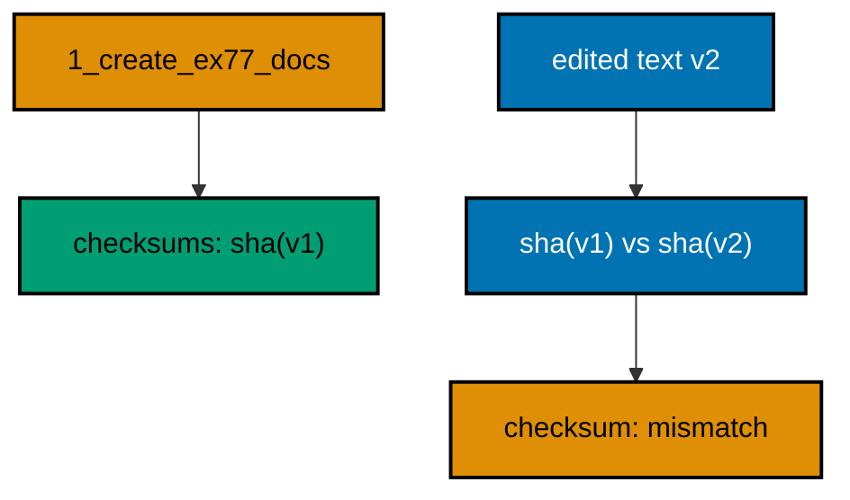

**`learning/code/ex-77-checksum-guard-you-build-yourself/main.ts`**:

```typescript
import * as Config from "effect/Config"; // => Config reads PGHOST and friends with defaults
import * as Console from "effect/Console"; // => Console.log prints the golden transcript
import * as Effect from "effect/Effect"; // => Effect.gen sequences the migration story
import * as Layer from "effect/Layer"; // => Layer joins the database and node services
import * as Migrator from "effect/sql/Migrator"; // => loaders turn files and records into migrations
import * as SqlClient from "effect/sql/SqlClient"; // => SqlClient runs SQL against the pool
import * as NodeChildProcessSpawner from "@effect/platform-node/NodeChildProcessSpawner"; // => spawner service
import * as NodeFileSystem from "@effect/platform-node/NodeFileSystem"; // => filesystem the file loader reads through
import * as NodePath from "@effect/platform-node/NodePath"; // => path the file loader joins with
import * as NodeRuntime from "@effect/platform-node/NodeRuntime"; // => runMain boots the node services
import * as PgClient from "@effect/sql-pg/PgClient"; // => PgClient.layerConfig builds the pool
import * as PgMigrator from "@effect/sql-pg/PgMigrator"; // => PgMigrator.run applies pending migrations

// => one database layer from harness variables, trust auth, no TLS
const DbLive = PgClient.layerConfig({
  // => layerConfig unwraps Config values
  host: Config.String("PGHOST").pipe(Config.withDefault("postgres")), // => service hostname
  port: Config.Port("PGPORT").pipe(Config.withDefault(5432)), // => service port as a number
  database: Config.String("PGDATABASE").pipe(Config.withDefault("postgres")), // => fresh database per run
  username: Config.String("PGUSER").pipe(Config.withDefault("postgres")), // => trust-auth role
  ssl: Config.succeed(false), // => plaintext inside the unit network
}); // => DbLive offers PgClient and SqlClient together

// => the migrator type also asks for three node services
const NodeLive = Layer.mergeAll(NodeFileSystem.layer, NodePath.layer); // => file plus path side by side
const SpawnerLive = Layer.provide(NodeChildProcessSpawner.layer, NodeLive); // => spawner fed by file and path
const MainLive = Layer.mergeAll(DbLive, NodeLive, SpawnerLive); // => one layer for the whole program
import { createHash } from "node:crypto"; // => node:crypto hashes the migration text

const program = Effect.gen(function* () {
  // => the example narrative
  const sql = yield* SqlClient.SqlClient; // => the query surface over the pool
  const original = "CREATE TABLE ex77_docs (id SERIAL PRIMARY KEY, title TEXT NOT NULL)"; // => the migration text as shipped
  const edited = "CREATE TABLE ex77_docs (id SERIAL PRIMARY KEY, title TEXT NOT NULL, body TEXT)"; // => the text as edited later
  const applied = yield* PgMigrator.run({
    // => apply the documented migration
    loader: Migrator.fromRecord({
      // => the docs table plus its guard table
      "1_create_ex77_docs": Effect.gen(function* () {
        // => the guarded migration
        const inner = yield* SqlClient.SqlClient; // => the body borrows the same client
        yield* inner`CREATE TABLE ex77_docs (id SERIAL PRIMARY KEY, title TEXT NOT NULL)`; // => the documented table
        yield* inner`CREATE TABLE ex77_checksums (id INT PRIMARY KEY, sha TEXT NOT NULL)`; // => the owned guard table
      }), // => end of the guarded migration
    }), // => end of the migration record
    table: "ex77_history", // => per-example history table
  }); // => the migration applies cleanly
  yield* Console.log(`applied: ${applied.length}`); // => Output: applied: 1
  const originalSha = createHash("sha256").update(original).digest("hex"); // => hash the shipped text
  yield* sql`INSERT INTO ex77_checksums ${sql.insert({ id: 1, sha: originalSha })}`; // => store the known-good hash
  const editedSha = createHash("sha256").update(edited).digest("hex"); // => hash the edited text
  const stored = yield* sql<{ sha: string }>`SELECT sha FROM ex77_checksums WHERE id = 1`; // => read the known-good hash back
  if (stored[0].sha === editedSha) {
    // => compare stored against edited
    yield* Console.log("checksum: match"); // => never printed for this unit
  } else {
    // => the texts differ, so the hashes differ
    yield* Console.log("checksum: mismatch"); // => Output: checksum: mismatch
  } // => end of the comparison
  yield* sql`DROP TABLE ex77_docs`; // => drop the documented table
  yield* sql`DROP TABLE ex77_checksums`; // => drop the guard table
  yield* sql`DROP TABLE ex77_history`; // => and no history table either
  yield* Console.log("cleaned: yes"); // => Output: cleaned: yes
}); // => program ends: the harness compares stdout to the golden file

NodeRuntime.runMain(program.pipe(Effect.provide(MainLive))); // => boot node services and run
```

**Output** (`learning/code/ex-77-checksum-guard-you-build-yourself/expected/main.stdout.txt`):

```text
applied: 1
checksum: mismatch
cleaned: yes
```

(Concepts: co-11.)

### Example 78: Final Review: Full Loop to Production

The course closes where production work closes: a small ordered set, promoted across real databases, verified end to end. Migrate, promote, then read everything back: the history in each database and the tables they describe.

Three migrations build a tiny shop schema, the set promotes from the first database to the second, and the final prints confirm both lines agree. This is the whole discipline in one unit: versioned, ordered, reversible by compensation, and verified.

**`learning/code/ex-78-final-review-full-loop-to-production/main.ts`**:

```typescript
import * as Config from "effect/Config"; // => Config reads PGHOST and friends with defaults
import * as Console from "effect/Console"; // => Console.log prints the golden transcript
import * as Effect from "effect/Effect"; // => Effect.gen sequences the migration story
import * as Layer from "effect/Layer"; // => Layer joins the database and node services
import * as Migrator from "effect/sql/Migrator"; // => loaders turn files and records into migrations
import * as SqlClient from "effect/sql/SqlClient"; // => SqlClient runs SQL against the pool
import * as NodeChildProcessSpawner from "@effect/platform-node/NodeChildProcessSpawner"; // => spawner service
import * as NodeFileSystem from "@effect/platform-node/NodeFileSystem"; // => filesystem the file loader reads through
import * as NodePath from "@effect/platform-node/NodePath"; // => path the file loader joins with
import * as NodeRuntime from "@effect/platform-node/NodeRuntime"; // => runMain boots the node services
import * as PgClient from "@effect/sql-pg/PgClient"; // => PgClient.layerConfig builds the pool
import * as PgMigrator from "@effect/sql-pg/PgMigrator"; // => PgMigrator.run applies pending migrations

// => one database layer from harness variables, trust auth, no TLS
const DbLive = PgClient.layerConfig({
  // => layerConfig unwraps Config values
  host: Config.String("PGHOST").pipe(Config.withDefault("postgres")), // => service hostname
  port: Config.Port("PGPORT").pipe(Config.withDefault(5432)), // => service port as a number
  database: Config.String("PGDATABASE").pipe(Config.withDefault("postgres")), // => fresh database per run
  username: Config.String("PGUSER").pipe(Config.withDefault("postgres")), // => trust-auth role
  ssl: Config.succeed(false), // => plaintext inside the unit network
}); // => DbLive offers PgClient and SqlClient together

// => the migrator type also asks for three node services
const NodeLive = Layer.mergeAll(NodeFileSystem.layer, NodePath.layer); // => file plus path side by side
const SpawnerLive = Layer.provide(NodeChildProcessSpawner.layer, NodeLive); // => spawner fed by file and path
const MainLive = Layer.mergeAll(DbLive, NodeLive, SpawnerLive); // => one layer for the whole program

const program = Effect.gen(function* () {
  // => the example narrative
  const sql = yield* SqlClient.SqlClient; // => the query surface over the pool
  yield* sql`CREATE DATABASE ex78_dev`; // => the first environment, a real database
  yield* sql`CREATE DATABASE ex78_prod`; // => the second environment, a real database
  // => two real databases: promotion shares no tables
  const makeDb = (database: string) =>
    PgClient.layerConfig({
      // => one pool per environment
      host: Config.String("PGHOST").pipe(Config.withDefault("postgres")), // => service hostname
      port: Config.Port("PGPORT").pipe(Config.withDefault(5432)), // => service port as a number
      database: Config.succeed(database), // => this environment's database
      username: Config.String("PGUSER").pipe(Config.withDefault("postgres")), // => trust-auth role
      ssl: Config.succeed(false), // => plaintext inside the unit network
    }); // => a pool aimed at one environment
  const envFor = (database: string) => Layer.mergeAll(makeDb(database), NodeLive, SpawnerLive); // => one full environment
  // => pools plus node services, assembled per environment
  const runOn = (database: string) =>
    Effect.provide(
      // => each environment runs on its own pool
      Effect.gen(function* () {
        // => migrate one environment fully
        const db = yield* SqlClient.SqlClient; // => this environment's client
        const applied = yield* PgMigrator.run({
          // => the release set
          loader: Migrator.fromRecord({
            // => the same three everywhere
            "1_create_ex78_customers": db`CREATE TABLE ex78_customers (id SERIAL PRIMARY KEY, name TEXT NOT NULL)`, // => who orders
            "2_create_ex78_orders": db`CREATE TABLE ex78_orders (id SERIAL PRIMARY KEY, customer_id INT NOT NULL)`, // => what they order
            "3_seed_customer": db`INSERT INTO ex78_customers (name) VALUES ('ada')`, // => the first customer
          }), // => end of the migration record
          table: "ex78_history", // => each database keeps its own history
        }); // => this environment converges
        const latest = yield* db<{
          migration_id: number;
          name: string;
        }>`SELECT migration_id, name FROM ex78_history ORDER BY migration_id DESC LIMIT 1`; // => this environment's newest
        const customers = yield* db<{ total: number }>`SELECT count(*)::int AS total FROM ex78_customers`; // => the seeded data is live
        return {
          count: applied.length,
          latest: `${latest[0].migration_id}_${latest[0].name}`,
          customers: customers[0].total,
        }; // => plain data crosses the pool boundary
        // => counts and names cross; clients never leave their pool
      }), // => end of the per-environment story
      envFor(database), // => pool plus node services
    ); // => runOn hands back counts, never clients
  const dev = yield* runOn("ex78_dev"); // => the first environment adopts the set
  // => the first environment converges
  yield* Console.log(`dev: ${dev.count}`); // => Output: dev: 3
  const prod = yield* runOn("ex78_prod"); // => the second environment adopts the set
  // => the second environment converges
  yield* Console.log(`prod: ${prod.count}`); // => Output: prod: 3
  // => prod agrees on the newest migration
  yield* Console.log(`prod latest: ${prod.latest}`); // => Output: prod latest: 3_seed_customer
  // => the seeded data survived promotion
  yield* Console.log(`customers: ${prod.customers}`); // => Output: customers: 1
  yield* sql`DROP DATABASE ex78_dev`; // => drop the first environment
  yield* sql`DROP DATABASE ex78_prod`; // => drop the second environment
  yield* Console.log("cleaned: yes"); // => Output: cleaned: yes
}); // => program ends: the harness compares stdout to the golden file

NodeRuntime.runMain(program.pipe(Effect.provide(MainLive))); // => boot node services and run
```

**Output** (`learning/code/ex-78-final-review-full-loop-to-production/expected/main.stdout.txt`):

```text
dev: 3
prod: 3
prod latest: 3_seed_customer
customers: 1
cleaned: yes
```

(Concepts: co-03, co-13.)
