Examples 1–25 build the migration core loop from nothing: versioned files that create and alter tables (Examples 1–8), the history table and ordering rules that keep teams honest (Examples 9–17), and rollback written as compensating migrations and forward fixes (Examples 18–25). Every example is a complete, runnable TypeScript program under `learning/code/` driving a real PostgreSQL container; run each with the command in its own `run.yaml`.

---

### Example 1: Create Your First Table

A migration is the smallest reviewable schema change: one numbered entry that creates something real. This example keeps it as small as possible, a single inline migration that creates a `widgets` table. Effect SQL records the run in a history table, so the same entry never runs twice against the same database.

The number fixes the order and the human description documents the intent, and the history read-back at the end proves both halves of the contract. Every later example repeats this skeleton with a different table prefix, so the shape stays familiar while the lesson changes.

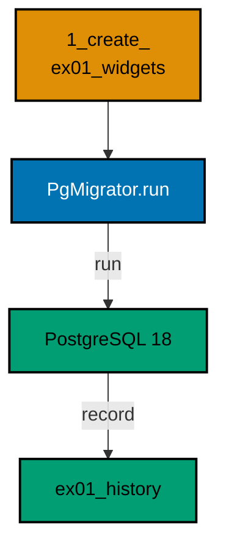

**`learning/code/ex-01-create-your-first-table/main.ts`**:

```typescript
import * as Config from "effect/Config"; // => Config reads PGHOST and friends with defaults
import * as Console from "effect/Console"; // => Console.log prints the golden transcript
import * as Effect from "effect/Effect"; // => Effect.gen sequences the migration story
import * as Layer from "effect/Layer"; // => Layer joins the database and node services
import * as Migrator from "effect/sql/Migrator"; // => fromRecord turns Effects into migrations
import * as SqlClient from "effect/sql/SqlClient"; // => SqlClient runs SQL against the pool
import * as NodeChildProcessSpawner from "@effect/platform-node/NodeChildProcessSpawner"; // => spawner service
import * as NodeFileSystem from "@effect/platform-node/NodeFileSystem"; // => filesystem the migrator type needs
import * as NodePath from "@effect/platform-node/NodePath"; // => path the migrator type needs
import * as NodeRuntime from "@effect/platform-node/NodeRuntime"; // => runMain boots the node services
import * as PgClient from "@effect/sql-pg/PgClient"; // => PgClient.layerConfig builds the pool
import * as PgMigrator from "@effect/sql-pg/PgMigrator"; // => PgMigrator.run applies pending migrations

// => one database layer from harness variables, trust auth, no TLS
const DbLive = PgClient.layerConfig({
  // => layerConfig unwraps Config values
  host: Config.String("PGHOST").pipe(Config.withDefault("postgres")), // => service hostname
  port: Config.Port("PGPORT").pipe(Config.withDefault(5432)), // => service port as a number
  database: Config.String("PGDATABASE").pipe(Config.withDefault("postgres")), // => fresh database per run
  username: Config.String("PGUSER").pipe(Config.withDefault("postgres")), // => trust-auth role
  ssl: Config.succeed(false), // => plaintext inside the unit network
}); // => DbLive offers PgClient and SqlClient together

// => the migrator type also asks for three node services
const NodeLive = Layer.mergeAll(NodeFileSystem.layer, NodePath.layer); // => file plus path side by side
const SpawnerLive = Layer.provide(NodeChildProcessSpawner.layer, NodeLive); // => spawner fed by file and path
const MainLive = Layer.mergeAll(DbLive, NodeLive, SpawnerLive); // => one layer for the whole program

const program = Effect.gen(function* () {
  // => the example narrative
  const sql = yield* SqlClient.SqlClient; // => the query surface over the pool
  const applied = yield* PgMigrator.run({
    // => apply every pending migration
    loader: Migrator.fromRecord({
      // => one inline migration, no files
      // => the number fixes the order; the name documents the intent
      "1_create_ex01_widgets": sql`CREATE TABLE ex01_widgets (id SERIAL PRIMARY KEY, name TEXT NOT NULL)`, // => the schema change
    }), // => end of the migration record
    table: "ex01_history", // => per-example history table
  }); // => applied lists only the migrations this run added
  for (const [id, name] of applied) {
    // => walk the newly applied rows
    yield* Console.log(`applied: ${id}_${name}`); // => Output: applied: 1_create_ex01_widgets
  } // => loop ends after the last applied migration
  const rows = yield* sql<{
    migration_id: number;
    name: string;
  }>`SELECT migration_id, name FROM ex01_history ORDER BY migration_id`; // => read the history back
  for (const row of rows) {
    // => walk the recorded history
    yield* Console.log(`history: ${row.migration_id}_${row.name}`); // => Output: history: 1_create_ex01_widgets
  } // => loop ends after the last history row
  yield* sql`DROP TABLE ex01_widgets`; // => the example leaves no tables behind
  yield* sql`DROP TABLE ex01_history`; // => and no history table either
  yield* Console.log("cleaned: yes"); // => Output: cleaned: yes
}); // => program ends: the harness compares stdout to the golden file

NodeRuntime.runMain(program.pipe(Effect.provide(MainLive))); // => boot node services and run
```

**Output** (`learning/code/ex-01-create-your-first-table/expected/main.stdout.txt`):

```text
applied: 1_create_ex01_widgets
history: 1_create_ex01_widgets
cleaned: yes
```

(Concepts: co-01, co-03.)

### Example 2: Migration Files Run in Order

Real migrations live in files, not inline records: each file is a TypeScript module whose default export is the migration Effect. The loader reads the `migrations` directory, keeps every file matching `<id>_<name>.ts`, and sorts them by number before running anything.

Two files prove the point better than one, because the second file depends on the first table existing. The column listing at the end shows the combined effect, and the history table shows one row per file in the same numeric order.

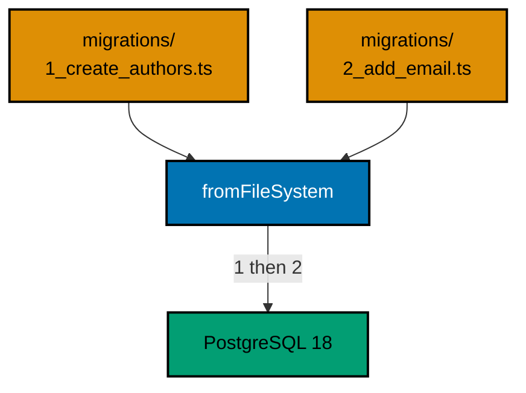

**`learning/code/ex-02-migration-files-run-in-order/main.ts`**:

```typescript
import * as Config from "effect/Config"; // => Config reads PGHOST and friends with defaults
import * as Console from "effect/Console"; // => Console.log prints the golden transcript
import * as Effect from "effect/Effect"; // => Effect.gen sequences the migration story
import * as Layer from "effect/Layer"; // => Layer joins the database and node services
import * as Migrator from "effect/sql/Migrator"; // => fromFileSystem loads the migrations directory
import * as SqlClient from "effect/sql/SqlClient"; // => SqlClient runs SQL against the pool
import * as NodeChildProcessSpawner from "@effect/platform-node/NodeChildProcessSpawner"; // => spawner service
import * as NodeFileSystem from "@effect/platform-node/NodeFileSystem"; // => filesystem reads the migrations directory
import * as NodePath from "@effect/platform-node/NodePath"; // => path joins the directory entries
import * as NodeRuntime from "@effect/platform-node/NodeRuntime"; // => runMain boots the node services
import * as PgClient from "@effect/sql-pg/PgClient"; // => PgClient.layerConfig builds the pool
import * as PgMigrator from "@effect/sql-pg/PgMigrator"; // => PgMigrator.run applies pending migrations

// => one database layer from harness variables, trust auth, no TLS
const DbLive = PgClient.layerConfig({
  // => layerConfig unwraps Config values
  host: Config.String("PGHOST").pipe(Config.withDefault("postgres")), // => service hostname
  port: Config.Port("PGPORT").pipe(Config.withDefault(5432)), // => service port as a number
  database: Config.String("PGDATABASE").pipe(Config.withDefault("postgres")), // => fresh database per run
  username: Config.String("PGUSER").pipe(Config.withDefault("postgres")), // => trust-auth role
  ssl: Config.succeed(false), // => plaintext inside the unit network
}); // => DbLive offers PgClient and SqlClient together

// => the file loader really uses two of the three node services
const NodeLive = Layer.mergeAll(NodeFileSystem.layer, NodePath.layer); // => file plus path side by side
const SpawnerLive = Layer.provide(NodeChildProcessSpawner.layer, NodeLive); // => spawner fed by file and path
const MainLive = Layer.mergeAll(DbLive, NodeLive, SpawnerLive); // => one layer for the whole program

const program = Effect.gen(function* () {
  // => the example narrative
  const sql = yield* SqlClient.SqlClient; // => the query surface over the pool
  const applied = yield* PgMigrator.run({
    // => apply every pending migration
    // => file names carry the order, so the call needs no extra options
    loader: Migrator.fromFileSystem("migrations"), // => files 1 and 2, in numeric order
    table: "ex02_history", // => per-example history table
  }); // => applied lists only the migrations this run added
  for (const [id, name] of applied) {
    // => walk the newly applied rows
    yield* Console.log(`applied: ${id}_${name}`); // => Output: applied: 1_create_authors
  } // => loop ends after the last applied migration
  // => the history names both files in the order they ran
  const rows = yield* sql<{
    migration_id: number;
    name: string;
  }>`SELECT migration_id, name FROM ex02_history ORDER BY migration_id`; // => read the history back
  for (const row of rows) {
    // => walk the recorded history
    yield* Console.log(`history: ${row.migration_id}_${row.name}`); // => Output: history: 1_create_authors
  } // => loop ends after the last history row
  // => information_schema shows the combined effect of both files
  const columns = yield* sql<{
    name: string;
  }>`SELECT column_name AS name FROM information_schema.columns WHERE table_name = 'ex02_authors' ORDER BY ordinal_position`; // => the table shape after both files
  yield* Console.log(`columns: ${columns.map((column) => column.name).join(", ")}`); // => Output: columns: id, name, email
  yield* sql`DROP TABLE ex02_authors`; // => the example leaves no tables behind
  yield* sql`DROP TABLE ex02_history`; // => and no history table either
  yield* Console.log("cleaned: yes"); // => Output: cleaned: yes
}); // => program ends: the harness compares stdout to the golden file

NodeRuntime.runMain(program.pipe(Effect.provide(MainLive))); // => boot node services and run
```

**`learning/code/ex-02-migration-files-run-in-order/migrations/1_create_authors.ts`**:

```typescript
import * as Effect from "effect/Effect"; // => Effect.gen builds the migration body
import * as SqlClient from "effect/sql/SqlClient"; // => SqlClient runs the DDL

export default Effect.gen(function* () {
  // => the default export is the migration
  const sql = yield* SqlClient.SqlClient; // => the client the migrator lends this file
  yield* sql`CREATE TABLE ex02_authors (id SERIAL PRIMARY KEY, name TEXT NOT NULL)`; // => migration 1 creates the table
}); // => end of migration 1
```

**`learning/code/ex-02-migration-files-run-in-order/migrations/2_add_email.ts`**:

```typescript
import * as Effect from "effect/Effect"; // => Effect.gen builds the migration body
import * as SqlClient from "effect/sql/SqlClient"; // => SqlClient runs the DDL

export default Effect.gen(function* () {
  // => the default export is the migration
  const sql = yield* SqlClient.SqlClient; // => the client the migrator lends this file
  yield* sql`ALTER TABLE ex02_authors ADD COLUMN email TEXT`; // => migration 2 widens the table
}); // => end of migration 2
```

**Output** (`learning/code/ex-02-migration-files-run-in-order/expected/main.stdout.txt`):

```text
applied: 1_create_authors
applied: 2_add_email
history: 1_create_authors
history: 2_add_email
columns: id, name, email
cleaned: yes
```

(Concepts: co-01.)

### Example 3: One Migration, One Change

A migration earns its number by doing exactly one thing, so that reviewing, reverting, and reasoning about it stays trivial. This example applies two single-purpose migrations: one creates an `orders` table, the other an `items` table, and neither reaches into the other's business.

The catalog listing at the end names both tables, and the history shows two rows with two honest descriptions. When a deploy misbehaves, this granularity is what lets a team point at one numbered change instead of re-reading a bundled script.

**`learning/code/ex-03-one-migration-one-change/main.ts`**:

```typescript
import * as Config from "effect/Config"; // => Config reads PGHOST and friends with defaults
import * as Console from "effect/Console"; // => Console.log prints the golden transcript
import * as Effect from "effect/Effect"; // => Effect.gen sequences the migration story
import * as Layer from "effect/Layer"; // => Layer joins the database and node services
import * as Migrator from "effect/sql/Migrator"; // => loaders turn files and records into migrations
import * as SqlClient from "effect/sql/SqlClient"; // => SqlClient runs SQL against the pool
import * as NodeChildProcessSpawner from "@effect/platform-node/NodeChildProcessSpawner"; // => spawner service
import * as NodeFileSystem from "@effect/platform-node/NodeFileSystem"; // => filesystem the file loader reads through
import * as NodePath from "@effect/platform-node/NodePath"; // => path the file loader joins with
import * as NodeRuntime from "@effect/platform-node/NodeRuntime"; // => runMain boots the node services
import * as PgClient from "@effect/sql-pg/PgClient"; // => PgClient.layerConfig builds the pool
import * as PgMigrator from "@effect/sql-pg/PgMigrator"; // => PgMigrator.run applies pending migrations

// => one database layer from harness variables, trust auth, no TLS
const DbLive = PgClient.layerConfig({
  // => layerConfig unwraps Config values
  host: Config.String("PGHOST").pipe(Config.withDefault("postgres")), // => service hostname
  port: Config.Port("PGPORT").pipe(Config.withDefault(5432)), // => service port as a number
  database: Config.String("PGDATABASE").pipe(Config.withDefault("postgres")), // => fresh database per run
  username: Config.String("PGUSER").pipe(Config.withDefault("postgres")), // => trust-auth role
  ssl: Config.succeed(false), // => plaintext inside the unit network
}); // => DbLive offers PgClient and SqlClient together

// => the migrator type also asks for three node services
const NodeLive = Layer.mergeAll(NodeFileSystem.layer, NodePath.layer); // => file plus path side by side
const SpawnerLive = Layer.provide(NodeChildProcessSpawner.layer, NodeLive); // => spawner fed by file and path
const MainLive = Layer.mergeAll(DbLive, NodeLive, SpawnerLive); // => one layer for the whole program

const program = Effect.gen(function* () {
  // => the example narrative
  const sql = yield* SqlClient.SqlClient; // => the query surface over the pool
  const applied = yield* PgMigrator.run({
    // => apply every pending migration
    loader: Migrator.fromFileSystem("migrations"), // => files 1 and 2, each one change
    table: "ex03_history", // => per-example history table
  }); // => applied lists only the migrations this run added
  for (const [id, name] of applied) {
    // => walk the newly applied rows
    yield* Console.log(`applied: ${id}_${name}`); // => Output: applied: 1_create_orders
  } // => loop ends after the last applied migration
  const tables = yield* sql<{
    name: string;
  }>`SELECT tablename AS name FROM pg_tables WHERE tablename IN ('ex03_orders', 'ex03_items') ORDER BY tablename`; // => both new tables
  for (const table of tables) {
    // => walk the catalog rows
    yield* Console.log(`table: ${table.name}`); // => Output: table: ex03_items
  } // => loop ends after the last table
  yield* sql`DROP TABLE ex03_orders`; // => drop the first change
  yield* sql`DROP TABLE ex03_items`; // => drop the second change
  yield* sql`DROP TABLE ex03_history`; // => and no history table either
  yield* Console.log("cleaned: yes"); // => Output: cleaned: yes
}); // => program ends: the harness compares stdout to the golden file

NodeRuntime.runMain(program.pipe(Effect.provide(MainLive))); // => boot node services and run
```

**`learning/code/ex-03-one-migration-one-change/migrations/1_create_orders.ts`**:

```typescript
import * as Effect from "effect/Effect"; // => Effect.gen builds the migration body
import * as SqlClient from "effect/sql/SqlClient"; // => SqlClient runs the DDL

export default Effect.gen(function* () {
  // => the default export is the migration
  const sql = yield* SqlClient.SqlClient; // => the client the migrator lends this file
  yield* sql`CREATE TABLE ex03_orders (id SERIAL PRIMARY KEY, total INT NOT NULL)`; // => migration 1 creates orders
}); // => end of migration 1
```

**`learning/code/ex-03-one-migration-one-change/migrations/2_create_items.ts`**:

```typescript
import * as Effect from "effect/Effect"; // => Effect.gen builds the migration body
import * as SqlClient from "effect/sql/SqlClient"; // => SqlClient runs the DDL

export default Effect.gen(function* () {
  // => the default export is the migration
  const sql = yield* SqlClient.SqlClient; // => the client the migrator lends this file
  yield* sql`CREATE TABLE ex03_items (id SERIAL PRIMARY KEY, label TEXT NOT NULL)`; // => migration 2 creates items
}); // => end of migration 2
```

**Output** (`learning/code/ex-03-one-migration-one-change/expected/main.stdout.txt`):

```text
applied: 1_create_orders
applied: 2_create_items
table: ex03_items
table: ex03_orders
cleaned: yes
```

(Concepts: co-01.)

### Example 4: Alter Safely Keeps Data

Most schema work is widening, not creating: a table exists, the application needs one more column, and every existing row must survive the change. This example seeds one book row in the first migration, then adds a `year` column with a default in the second.

The final select proves the point in one line: the original row is still there, and the new column arrived pre-filled. Defaults make additive migrations boring, and boring is exactly what a production deploy wants.

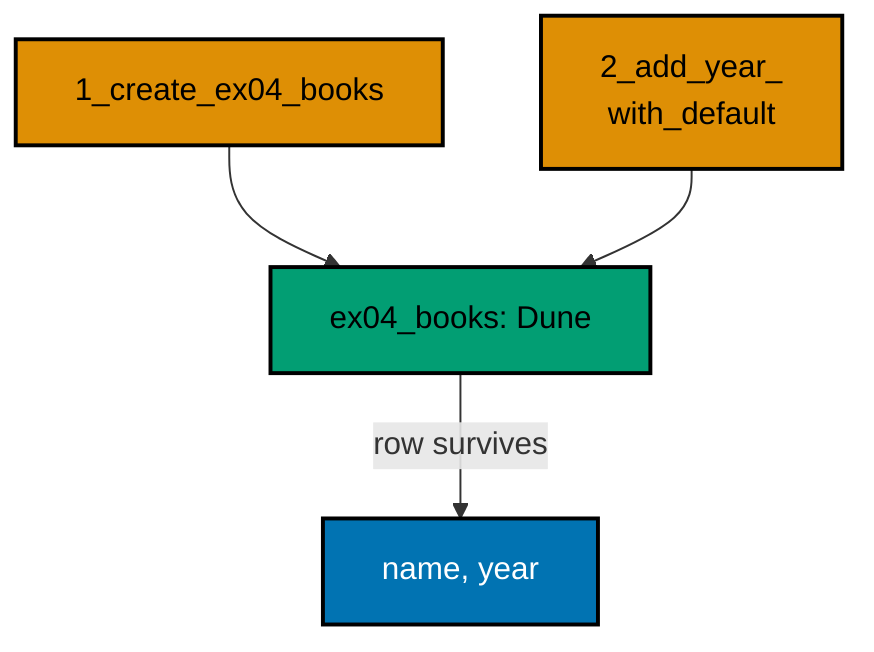

**`learning/code/ex-04-alter-safely-keeps-data/main.ts`**:

```typescript
import * as Config from "effect/Config"; // => Config reads PGHOST and friends with defaults
import * as Console from "effect/Console"; // => Console.log prints the golden transcript
import * as Effect from "effect/Effect"; // => Effect.gen sequences the migration story
import * as Layer from "effect/Layer"; // => Layer joins the database and node services
import * as Migrator from "effect/sql/Migrator"; // => loaders turn files and records into migrations
import * as SqlClient from "effect/sql/SqlClient"; // => SqlClient runs SQL against the pool
import * as NodeChildProcessSpawner from "@effect/platform-node/NodeChildProcessSpawner"; // => spawner service
import * as NodeFileSystem from "@effect/platform-node/NodeFileSystem"; // => filesystem the file loader reads through
import * as NodePath from "@effect/platform-node/NodePath"; // => path the file loader joins with
import * as NodeRuntime from "@effect/platform-node/NodeRuntime"; // => runMain boots the node services
import * as PgClient from "@effect/sql-pg/PgClient"; // => PgClient.layerConfig builds the pool
import * as PgMigrator from "@effect/sql-pg/PgMigrator"; // => PgMigrator.run applies pending migrations

// => one database layer from harness variables, trust auth, no TLS
const DbLive = PgClient.layerConfig({
  // => layerConfig unwraps Config values
  host: Config.String("PGHOST").pipe(Config.withDefault("postgres")), // => service hostname
  port: Config.Port("PGPORT").pipe(Config.withDefault(5432)), // => service port as a number
  database: Config.String("PGDATABASE").pipe(Config.withDefault("postgres")), // => fresh database per run
  username: Config.String("PGUSER").pipe(Config.withDefault("postgres")), // => trust-auth role
  ssl: Config.succeed(false), // => plaintext inside the unit network
}); // => DbLive offers PgClient and SqlClient together

// => the migrator type also asks for three node services
const NodeLive = Layer.mergeAll(NodeFileSystem.layer, NodePath.layer); // => file plus path side by side
const SpawnerLive = Layer.provide(NodeChildProcessSpawner.layer, NodeLive); // => spawner fed by file and path
const MainLive = Layer.mergeAll(DbLive, NodeLive, SpawnerLive); // => one layer for the whole program

const program = Effect.gen(function* () {
  // => the example narrative
  const sql = yield* SqlClient.SqlClient; // => the query surface over the pool
  const applied = yield* PgMigrator.run({
    // => apply every pending migration
    loader: Migrator.fromFileSystem("migrations"), // => seed first, widen second
    table: "ex04_history", // => per-example history table
  }); // => applied lists only the migrations this run added
  for (const [id, name] of applied) {
    // => walk the newly applied rows
    yield* Console.log(`applied: ${id}_${name}`); // => Output: applied: 1_create_books
  } // => loop ends after the last applied migration
  const rows = yield* sql<{ name: string; year: number }>`SELECT name, year FROM ex04_books`; // => did the row survive
  for (const row of rows) {
    // => walk the surviving rows
    yield* Console.log(`book: ${row.name}, ${row.year}`); // => Output: book: Dune, 2000
  } // => loop ends after the last row
  yield* sql`DROP TABLE ex04_books`; // => the example leaves no tables behind
  yield* sql`DROP TABLE ex04_history`; // => and no history table either
  yield* Console.log("cleaned: yes"); // => Output: cleaned: yes
}); // => program ends: the harness compares stdout to the golden file

NodeRuntime.runMain(program.pipe(Effect.provide(MainLive))); // => boot node services and run
```

**`learning/code/ex-04-alter-safely-keeps-data/migrations/1_create_books.ts`**:

```typescript
import * as Effect from "effect/Effect"; // => Effect.gen builds the migration body
import * as SqlClient from "effect/sql/SqlClient"; // => SqlClient runs the DDL

export default Effect.gen(function* () {
  // => the default export is the migration
  const sql = yield* SqlClient.SqlClient; // => the client the migrator lends this file
  yield* sql`CREATE TABLE ex04_books (id SERIAL PRIMARY KEY, name TEXT NOT NULL)`; // => the books table
  yield* sql`INSERT INTO ex04_books (name) VALUES ('Dune')`; // => one row worth keeping
}); // => end of migration 1
```

**`learning/code/ex-04-alter-safely-keeps-data/migrations/2_add_year.ts`**:

```typescript
import * as Effect from "effect/Effect"; // => Effect.gen builds the migration body
import * as SqlClient from "effect/sql/SqlClient"; // => SqlClient runs the DDL

export default Effect.gen(function* () {
  // => the default export is the migration
  const sql = yield* SqlClient.SqlClient; // => the client the migrator lends this file
  yield* sql`ALTER TABLE ex04_books ADD COLUMN year INT NOT NULL DEFAULT 2000`; // => widen with a default
}); // => end of migration 2
```

**Output** (`learning/code/ex-04-alter-safely-keeps-data/expected/main.stdout.txt`):

```text
applied: 1_create_books
applied: 2_add_year
book: Dune, 2000
cleaned: yes
```

(Concepts: co-01.)

### Example 5: Migrations Run Once

Deploy pipelines re-run the migrator on every release, so applying the same migration twice must be impossible rather than merely unlikely. The history table is what makes it impossible: each run starts by asking what already ran, and only the remainder executes.

This example runs the same loader twice inside one program. The first run applies the migration, the second finds nothing pending, and the two printed counts say the whole story. Idempotence here is a property of the history check, not of the SQL.

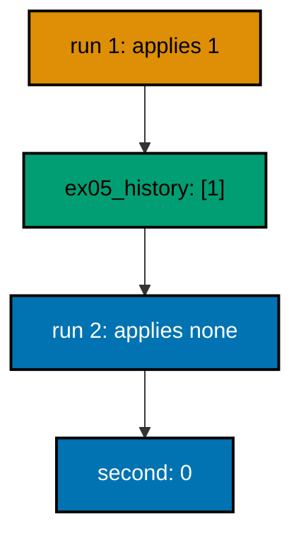

**`learning/code/ex-05-migrations-run-once/main.ts`**:

```typescript
import * as Config from "effect/Config"; // => Config reads PGHOST and friends with defaults
import * as Console from "effect/Console"; // => Console.log prints the golden transcript
import * as Effect from "effect/Effect"; // => Effect.gen sequences the migration story
import * as Layer from "effect/Layer"; // => Layer joins the database and node services
import * as Migrator from "effect/sql/Migrator"; // => loaders turn files and records into migrations
import * as SqlClient from "effect/sql/SqlClient"; // => SqlClient runs SQL against the pool
import * as NodeChildProcessSpawner from "@effect/platform-node/NodeChildProcessSpawner"; // => spawner service
import * as NodeFileSystem from "@effect/platform-node/NodeFileSystem"; // => filesystem the file loader reads through
import * as NodePath from "@effect/platform-node/NodePath"; // => path the file loader joins with
import * as NodeRuntime from "@effect/platform-node/NodeRuntime"; // => runMain boots the node services
import * as PgClient from "@effect/sql-pg/PgClient"; // => PgClient.layerConfig builds the pool
import * as PgMigrator from "@effect/sql-pg/PgMigrator"; // => PgMigrator.run applies pending migrations

// => one database layer from harness variables, trust auth, no TLS
const DbLive = PgClient.layerConfig({
  // => layerConfig unwraps Config values
  host: Config.String("PGHOST").pipe(Config.withDefault("postgres")), // => service hostname
  port: Config.Port("PGPORT").pipe(Config.withDefault(5432)), // => service port as a number
  database: Config.String("PGDATABASE").pipe(Config.withDefault("postgres")), // => fresh database per run
  username: Config.String("PGUSER").pipe(Config.withDefault("postgres")), // => trust-auth role
  ssl: Config.succeed(false), // => plaintext inside the unit network
}); // => DbLive offers PgClient and SqlClient together

// => the migrator type also asks for three node services
const NodeLive = Layer.mergeAll(NodeFileSystem.layer, NodePath.layer); // => file plus path side by side
const SpawnerLive = Layer.provide(NodeChildProcessSpawner.layer, NodeLive); // => spawner fed by file and path
const MainLive = Layer.mergeAll(DbLive, NodeLive, SpawnerLive); // => one layer for the whole program

const program = Effect.gen(function* () {
  // => the example narrative
  const sql = yield* SqlClient.SqlClient; // => the query surface over the pool
  const loader = Migrator.fromRecord({
    // => one migration, reused for both runs
    "1_create_ex05_widgets": sql`CREATE TABLE ex05_widgets (id SERIAL PRIMARY KEY)`, // => the only schema change
  }); // => the loader is just data: safe to run twice
  const first = yield* PgMigrator.run({ loader, table: "ex05_history" }); // => first run applies it
  yield* Console.log(`first: ${first.length}`); // => Output: first: 1
  const second = yield* PgMigrator.run({ loader, table: "ex05_history" }); // => second run finds it recorded
  yield* Console.log(`second: ${second.length}`); // => Output: second: 0
  yield* sql`DROP TABLE ex05_widgets`; // => the example leaves no tables behind
  yield* sql`DROP TABLE ex05_history`; // => and no history table either
  yield* Console.log("cleaned: yes"); // => Output: cleaned: yes
}); // => program ends: the harness compares stdout to the golden file

NodeRuntime.runMain(program.pipe(Effect.provide(MainLive))); // => boot node services and run
```

**Output** (`learning/code/ex-05-migrations-run-once/expected/main.stdout.txt`):

```text
first: 1
second: 0
cleaned: yes
```

(Concepts: co-03, co-05.)

### Example 6: Version Numbers Order Execution

Authors write migrations in whatever order the work happens, but the database must see them in numeric order. The loader sorts by the numeric id before running anything, so a record assembled third-first-second still applies first-second-third.

This example deliberately scrambles the key order. The applied list comes back sorted, and the log table rows confirm the execution order matches the numbers, not the author's typing order. Teams can merge branches freely as long as the numbers stay unique.

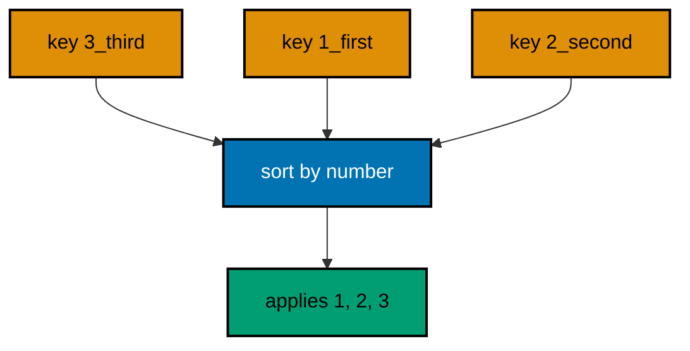

**`learning/code/ex-06-version-numbers-order-execution/main.ts`**:

```typescript
import * as Config from "effect/Config"; // => Config reads PGHOST and friends with defaults
import * as Console from "effect/Console"; // => Console.log prints the golden transcript
import * as Effect from "effect/Effect"; // => Effect.gen sequences the migration story
import * as Layer from "effect/Layer"; // => Layer joins the database and node services
import * as Migrator from "effect/sql/Migrator"; // => loaders turn files and records into migrations
import * as SqlClient from "effect/sql/SqlClient"; // => SqlClient runs SQL against the pool
import * as NodeChildProcessSpawner from "@effect/platform-node/NodeChildProcessSpawner"; // => spawner service
import * as NodeFileSystem from "@effect/platform-node/NodeFileSystem"; // => filesystem the file loader reads through
import * as NodePath from "@effect/platform-node/NodePath"; // => path the file loader joins with
import * as NodeRuntime from "@effect/platform-node/NodeRuntime"; // => runMain boots the node services
import * as PgClient from "@effect/sql-pg/PgClient"; // => PgClient.layerConfig builds the pool
import * as PgMigrator from "@effect/sql-pg/PgMigrator"; // => PgMigrator.run applies pending migrations

// => one database layer from harness variables, trust auth, no TLS
const DbLive = PgClient.layerConfig({
  // => layerConfig unwraps Config values
  host: Config.String("PGHOST").pipe(Config.withDefault("postgres")), // => service hostname
  port: Config.Port("PGPORT").pipe(Config.withDefault(5432)), // => service port as a number
  database: Config.String("PGDATABASE").pipe(Config.withDefault("postgres")), // => fresh database per run
  username: Config.String("PGUSER").pipe(Config.withDefault("postgres")), // => trust-auth role
  ssl: Config.succeed(false), // => plaintext inside the unit network
}); // => DbLive offers PgClient and SqlClient together

// => the migrator type also asks for three node services
const NodeLive = Layer.mergeAll(NodeFileSystem.layer, NodePath.layer); // => file plus path side by side
const SpawnerLive = Layer.provide(NodeChildProcessSpawner.layer, NodeLive); // => spawner fed by file and path
const MainLive = Layer.mergeAll(DbLive, NodeLive, SpawnerLive); // => one layer for the whole program

const program = Effect.gen(function* () {
  // => the example narrative
  const sql = yield* SqlClient.SqlClient; // => the query surface over the pool
  const applied = yield* PgMigrator.run({
    // => apply every pending migration
    loader: Migrator.fromRecord({
      // => keys deliberately out of order
      "3_third_step": sql`INSERT INTO ex06_log (step) VALUES ('third')`, // => typed last, runs last
      "1_first_step": Effect.gen(function* () {
        // => typed second, runs first
        const inner = yield* SqlClient.SqlClient; // => the body borrows the same client
        yield* inner`CREATE TABLE ex06_log (id SERIAL PRIMARY KEY, step TEXT NOT NULL)`; // => the log table
        yield* inner`INSERT INTO ex06_log (step) VALUES ('first')`; // => the first row
      }), // => end of the first migration
      "2_second_step": sql`INSERT INTO ex06_log (step) VALUES ('second')`, // => typed first, runs second
    }), // => end of the migration record
    table: "ex06_history", // => per-example history table
  }); // => applied lists only the migrations this run added
  for (const [id, name] of applied) {
    // => walk the newly applied rows
    yield* Console.log(`applied: ${id}_${name}`); // => Output: applied: 1_first_step
  } // => loop ends after the last applied migration
  const rows = yield* sql<{ step: string }>`SELECT step FROM ex06_log ORDER BY id`; // => execution order on disk
  for (const row of rows) {
    // => walk the log rows
    yield* Console.log(`step: ${row.step}`); // => Output: step: first
  } // => loop ends after the last step
  yield* sql`DROP TABLE ex06_log`; // => the example leaves no tables behind
  yield* sql`DROP TABLE ex06_history`; // => and no history table either
  yield* Console.log("cleaned: yes"); // => Output: cleaned: yes
}); // => program ends: the harness compares stdout to the golden file

NodeRuntime.runMain(program.pipe(Effect.provide(MainLive))); // => boot node services and run
```

**Output** (`learning/code/ex-06-version-numbers-order-execution/expected/main.stdout.txt`):

```text
applied: 1_first_step
applied: 2_second_step
applied: 3_third_step
step: first
step: second
step: third
cleaned: yes
```

(Concepts: co-04.)

### Example 7: Descriptions Document Intent

The history table stores the human description beside every id, which turns a bare number sequence into a readable changelog. Future maintainers read the names first and the migration bodies only when the name raises a question.

Three migrations with sentence-like names show the practice: each name says what changed and where. The history read-back prints exactly those names, proving the record carries intent, not just order.

**`learning/code/ex-07-descriptions-document-intent/main.ts`**:

```typescript
import * as Config from "effect/Config"; // => Config reads PGHOST and friends with defaults
import * as Console from "effect/Console"; // => Console.log prints the golden transcript
import * as Effect from "effect/Effect"; // => Effect.gen sequences the migration story
import * as Layer from "effect/Layer"; // => Layer joins the database and node services
import * as Migrator from "effect/sql/Migrator"; // => loaders turn files and records into migrations
import * as SqlClient from "effect/sql/SqlClient"; // => SqlClient runs SQL against the pool
import * as NodeChildProcessSpawner from "@effect/platform-node/NodeChildProcessSpawner"; // => spawner service
import * as NodeFileSystem from "@effect/platform-node/NodeFileSystem"; // => filesystem the file loader reads through
import * as NodePath from "@effect/platform-node/NodePath"; // => path the file loader joins with
import * as NodeRuntime from "@effect/platform-node/NodeRuntime"; // => runMain boots the node services
import * as PgClient from "@effect/sql-pg/PgClient"; // => PgClient.layerConfig builds the pool
import * as PgMigrator from "@effect/sql-pg/PgMigrator"; // => PgMigrator.run applies pending migrations

// => one database layer from harness variables, trust auth, no TLS
const DbLive = PgClient.layerConfig({
  // => layerConfig unwraps Config values
  host: Config.String("PGHOST").pipe(Config.withDefault("postgres")), // => service hostname
  port: Config.Port("PGPORT").pipe(Config.withDefault(5432)), // => service port as a number
  database: Config.String("PGDATABASE").pipe(Config.withDefault("postgres")), // => fresh database per run
  username: Config.String("PGUSER").pipe(Config.withDefault("postgres")), // => trust-auth role
  ssl: Config.succeed(false), // => plaintext inside the unit network
}); // => DbLive offers PgClient and SqlClient together

// => the migrator type also asks for three node services
const NodeLive = Layer.mergeAll(NodeFileSystem.layer, NodePath.layer); // => file plus path side by side
const SpawnerLive = Layer.provide(NodeChildProcessSpawner.layer, NodeLive); // => spawner fed by file and path
const MainLive = Layer.mergeAll(DbLive, NodeLive, SpawnerLive); // => one layer for the whole program

const program = Effect.gen(function* () {
  // => the example narrative
  const sql = yield* SqlClient.SqlClient; // => the query surface over the pool
  const applied = yield* PgMigrator.run({
    // => apply every pending migration
    loader: Migrator.fromRecord({
      // => three descriptive entries
      "1_create_ex07_customers": sql`CREATE TABLE ex07_customers (id SERIAL PRIMARY KEY, name TEXT NOT NULL)`, // => who we bill
      "2_add_email_to_customers": sql`ALTER TABLE ex07_customers ADD COLUMN email TEXT`, // => how we reach them
      "3_create_ex07_orders": sql`CREATE TABLE ex07_orders (id SERIAL PRIMARY KEY, customer_id INT NOT NULL)`, // => what they buy
    }), // => end of the migration record
    table: "ex07_history", // => per-example history table
  }); // => applied lists only the migrations this run added
  // => three names, three rows: the history reads as a changelog
  for (const [id, name] of applied) {
    // => walk the newly applied rows
    yield* Console.log(`applied: ${id}_${name}`); // => Output: applied: 1_create_ex07_customers
  } // => loop ends after the last applied migration
  const rows = yield* sql<{
    migration_id: number;
    name: string;
  }>`SELECT migration_id, name FROM ex07_history ORDER BY migration_id`; // => the stored changelog
  for (const row of rows) {
    // => walk the recorded history
    yield* Console.log(`history: ${row.migration_id}_${row.name}`); // => Output: history: 1_create_ex07_customers
  } // => loop ends after the last history row
  yield* sql`DROP TABLE ex07_orders`; // => drop the orders table
  yield* sql`DROP TABLE ex07_customers`; // => drop the customers table
  yield* sql`DROP TABLE ex07_history`; // => and no history table either
  yield* Console.log("cleaned: yes"); // => Output: cleaned: yes
}); // => program ends: the harness compares stdout to the golden file

NodeRuntime.runMain(program.pipe(Effect.provide(MainLive))); // => boot node services and run
```

**Output** (`learning/code/ex-07-descriptions-document-intent/expected/main.stdout.txt`):

```text
applied: 1_create_ex07_customers
applied: 2_add_email_to_customers
applied: 3_create_ex07_orders
history: 1_create_ex07_customers
history: 2_add_email_to_customers
history: 3_create_ex07_orders
cleaned: yes
```

(Concepts: co-03.)

### Example 8: Create an Index Alongside the Table

Tables rarely travel alone: the queries that read them need indexes, and the migration that creates the table is the natural place to add them. Keeping the index in its own migration still preserves the one-change rule while keeping table and index in the same review.

The verification reads `pg_indexes` instead of the table itself, which shows how to check database objects that hold no rows. The index name follows the table name, so operators can trace one from the other during an incident.

**`learning/code/ex-08-create-index-alongside-table/main.ts`**:

```typescript
import * as Config from "effect/Config"; // => Config reads PGHOST and friends with defaults
import * as Console from "effect/Console"; // => Console.log prints the golden transcript
import * as Effect from "effect/Effect"; // => Effect.gen sequences the migration story
import * as Layer from "effect/Layer"; // => Layer joins the database and node services
import * as Migrator from "effect/sql/Migrator"; // => loaders turn files and records into migrations
import * as SqlClient from "effect/sql/SqlClient"; // => SqlClient runs SQL against the pool
import * as NodeChildProcessSpawner from "@effect/platform-node/NodeChildProcessSpawner"; // => spawner service
import * as NodeFileSystem from "@effect/platform-node/NodeFileSystem"; // => filesystem the file loader reads through
import * as NodePath from "@effect/platform-node/NodePath"; // => path the file loader joins with
import * as NodeRuntime from "@effect/platform-node/NodeRuntime"; // => runMain boots the node services
import * as PgClient from "@effect/sql-pg/PgClient"; // => PgClient.layerConfig builds the pool
import * as PgMigrator from "@effect/sql-pg/PgMigrator"; // => PgMigrator.run applies pending migrations

// => one database layer from harness variables, trust auth, no TLS
const DbLive = PgClient.layerConfig({
  // => layerConfig unwraps Config values
  host: Config.String("PGHOST").pipe(Config.withDefault("postgres")), // => service hostname
  port: Config.Port("PGPORT").pipe(Config.withDefault(5432)), // => service port as a number
  database: Config.String("PGDATABASE").pipe(Config.withDefault("postgres")), // => fresh database per run
  username: Config.String("PGUSER").pipe(Config.withDefault("postgres")), // => trust-auth role
  ssl: Config.succeed(false), // => plaintext inside the unit network
}); // => DbLive offers PgClient and SqlClient together

// => the migrator type also asks for three node services
const NodeLive = Layer.mergeAll(NodeFileSystem.layer, NodePath.layer); // => file plus path side by side
const SpawnerLive = Layer.provide(NodeChildProcessSpawner.layer, NodeLive); // => spawner fed by file and path
const MainLive = Layer.mergeAll(DbLive, NodeLive, SpawnerLive); // => one layer for the whole program

const program = Effect.gen(function* () {
  // => the example narrative
  const sql = yield* SqlClient.SqlClient; // => the query surface over the pool
  const applied = yield* PgMigrator.run({
    // => apply every pending migration
    loader: Migrator.fromFileSystem("migrations"), // => table first, index second
    table: "ex08_history", // => per-example history table
  }); // => applied lists only the migrations this run added
  for (const [id, name] of applied) {
    // => walk the newly applied rows
    yield* Console.log(`applied: ${id}_${name}`); // => Output: applied: 1_create_orders
  } // => loop ends after the last applied migration
  const indexes = yield* sql<{
    name: string;
  }>`SELECT indexname AS name FROM pg_indexes WHERE tablename = 'ex08_orders'`; // => indexes on the table
  for (const index of indexes) {
    // => walk the index rows
    yield* Console.log(`index: ${index.name}`); // => Output: index: ex08_orders_status_idx
  } // => loop ends after the last index
  yield* sql`DROP TABLE ex08_orders`; // => dropping the table drops its index too
  yield* sql`DROP TABLE ex08_history`; // => and no history table either
  yield* Console.log("cleaned: yes"); // => Output: cleaned: yes
}); // => program ends: the harness compares stdout to the golden file

NodeRuntime.runMain(program.pipe(Effect.provide(MainLive))); // => boot node services and run
```

**`learning/code/ex-08-create-index-alongside-table/migrations/1_create_orders.ts`**:

```typescript
import * as Effect from "effect/Effect"; // => Effect.gen builds the migration body
import * as SqlClient from "effect/sql/SqlClient"; // => SqlClient runs the DDL

export default Effect.gen(function* () {
  // => the default export is the migration
  const sql = yield* SqlClient.SqlClient; // => the client the migrator lends this file
  yield* sql`CREATE TABLE ex08_orders (id SERIAL PRIMARY KEY, status TEXT NOT NULL)`; // => the orders table
}); // => end of migration 1
```

**`learning/code/ex-08-create-index-alongside-table/migrations/2_index_status.ts`**:

```typescript
import * as Effect from "effect/Effect"; // => Effect.gen builds the migration body
import * as SqlClient from "effect/sql/SqlClient"; // => SqlClient runs the DDL

export default Effect.gen(function* () {
  // => the default export is the migration
  const sql = yield* SqlClient.SqlClient; // => the client the migrator lends this file
  yield* sql`CREATE INDEX ex08_orders_status_idx ON ex08_orders (status)`; // => the lookup path
}); // => end of migration 2
```

**Output** (`learning/code/ex-08-create-index-alongside-table/expected/main.stdout.txt`):

```text
applied: 1_create_orders
applied: 2_index_status
index: ex08_orders_pkey
index: ex08_orders_status_idx
cleaned: yes
```

(Concepts: co-01.)

### Example 9: The History Table Is the Source of Truth

When no `table` option is given, Effect SQL records every run in a shared default table named `effect_sql_migrations`. Small projects and first prototypes can rely on it directly, and the columns are always the same three: the numeric id, the human name, and the timestamp.

This example reads those columns back and deliberately ignores the timestamp, because wall-clock values can never appear in a deterministic transcript. The cleanup drops the default table too, so the unit leaves the database exactly as it found it.

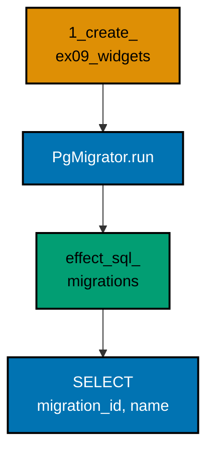

**`learning/code/ex-09-history-table-is-the-source-of-truth/main.ts`**:

```typescript
import * as Config from "effect/Config"; // => Config reads PGHOST and friends with defaults
import * as Console from "effect/Console"; // => Console.log prints the golden transcript
import * as Effect from "effect/Effect"; // => Effect.gen sequences the migration story
import * as Layer from "effect/Layer"; // => Layer joins the database and node services
import * as Migrator from "effect/sql/Migrator"; // => loaders turn files and records into migrations
import * as SqlClient from "effect/sql/SqlClient"; // => SqlClient runs SQL against the pool
import * as NodeChildProcessSpawner from "@effect/platform-node/NodeChildProcessSpawner"; // => spawner service
import * as NodeFileSystem from "@effect/platform-node/NodeFileSystem"; // => filesystem the file loader reads through
import * as NodePath from "@effect/platform-node/NodePath"; // => path the file loader joins with
import * as NodeRuntime from "@effect/platform-node/NodeRuntime"; // => runMain boots the node services
import * as PgClient from "@effect/sql-pg/PgClient"; // => PgClient.layerConfig builds the pool
import * as PgMigrator from "@effect/sql-pg/PgMigrator"; // => PgMigrator.run applies pending migrations

// => one database layer from harness variables, trust auth, no TLS
const DbLive = PgClient.layerConfig({
  // => layerConfig unwraps Config values
  host: Config.String("PGHOST").pipe(Config.withDefault("postgres")), // => service hostname
  port: Config.Port("PGPORT").pipe(Config.withDefault(5432)), // => service port as a number
  database: Config.String("PGDATABASE").pipe(Config.withDefault("postgres")), // => fresh database per run
  username: Config.String("PGUSER").pipe(Config.withDefault("postgres")), // => trust-auth role
  ssl: Config.succeed(false), // => plaintext inside the unit network
}); // => DbLive offers PgClient and SqlClient together

// => the migrator type also asks for three node services
const NodeLive = Layer.mergeAll(NodeFileSystem.layer, NodePath.layer); // => file plus path side by side
const SpawnerLive = Layer.provide(NodeChildProcessSpawner.layer, NodeLive); // => spawner fed by file and path
const MainLive = Layer.mergeAll(DbLive, NodeLive, SpawnerLive); // => one layer for the whole program

const program = Effect.gen(function* () {
  // => the example narrative
  const sql = yield* SqlClient.SqlClient; // => the query surface over the pool
  const applied = yield* PgMigrator.run({
    // => no table option: the default records it
    loader: Migrator.fromRecord({
      // => one migration, default history
      "1_create_ex09_widgets": sql`CREATE TABLE ex09_widgets (id SERIAL PRIMARY KEY)`, // => the only schema change
    }), // => end of the migration record, no table key
  }); // => applied lists only the migrations this run added
  // => one row in the shared default table proves the default works
  for (const [id, name] of applied) {
    // => walk the newly applied rows
    yield* Console.log(`applied: ${id}_${name}`); // => Output: applied: 1_create_ex09_widgets
  } // => loop ends after the last applied migration
  const rows = yield* sql<{
    migration_id: number;
    name: string;
  }>`SELECT migration_id, name FROM effect_sql_migrations ORDER BY migration_id`; // => the default table
  for (const row of rows) {
    // => walk the recorded history
    yield* Console.log(`history: ${row.migration_id}_${row.name}`); // => Output: history: 1_create_ex09_widgets
  } // => loop ends after the last history row
  yield* sql`DROP TABLE ex09_widgets`; // => the example leaves no tables behind
  yield* sql`DROP TABLE effect_sql_migrations`; // => including the default history table
  yield* Console.log("cleaned: yes"); // => Output: cleaned: yes
}); // => program ends: the harness compares stdout to the golden file

NodeRuntime.runMain(program.pipe(Effect.provide(MainLive))); // => boot node services and run
```

**Output** (`learning/code/ex-09-history-table-is-the-source-of-truth/expected/main.stdout.txt`):

```text
applied: 1_create_ex09_widgets
history: 1_create_ex09_widgets
cleaned: yes
```

(Concepts: co-03.)

### Example 10: Linear History Stays Mergeable

A history stays linear when every new migration takes a number larger than every number already recorded. It does not matter that the new migration arrives in a different loader, a different deploy, or a different week: the id is the only contract.

Two loader objects prove the point inside one program: the first applies migrations one and two, the second carries only migration three, and the final history reads one-two-three. Appending is always safe; inserting in the middle never is.

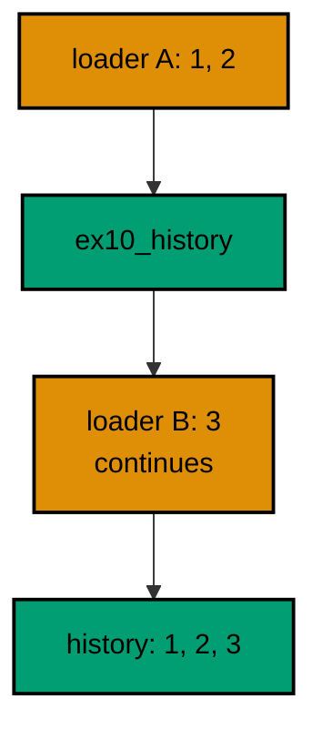

**`learning/code/ex-10-linear-history-stays-mergeable/main.ts`**:

```typescript
import * as Config from "effect/Config"; // => Config reads PGHOST and friends with defaults
import * as Console from "effect/Console"; // => Console.log prints the golden transcript
import * as Effect from "effect/Effect"; // => Effect.gen sequences the migration story
import * as Layer from "effect/Layer"; // => Layer joins the database and node services
import * as Migrator from "effect/sql/Migrator"; // => loaders turn files and records into migrations
import * as SqlClient from "effect/sql/SqlClient"; // => SqlClient runs SQL against the pool
import * as NodeChildProcessSpawner from "@effect/platform-node/NodeChildProcessSpawner"; // => spawner service
import * as NodeFileSystem from "@effect/platform-node/NodeFileSystem"; // => filesystem the file loader reads through
import * as NodePath from "@effect/platform-node/NodePath"; // => path the file loader joins with
import * as NodeRuntime from "@effect/platform-node/NodeRuntime"; // => runMain boots the node services
import * as PgClient from "@effect/sql-pg/PgClient"; // => PgClient.layerConfig builds the pool
import * as PgMigrator from "@effect/sql-pg/PgMigrator"; // => PgMigrator.run applies pending migrations

// => one database layer from harness variables, trust auth, no TLS
const DbLive = PgClient.layerConfig({
  // => layerConfig unwraps Config values
  host: Config.String("PGHOST").pipe(Config.withDefault("postgres")), // => service hostname
  port: Config.Port("PGPORT").pipe(Config.withDefault(5432)), // => service port as a number
  database: Config.String("PGDATABASE").pipe(Config.withDefault("postgres")), // => fresh database per run
  username: Config.String("PGUSER").pipe(Config.withDefault("postgres")), // => trust-auth role
  ssl: Config.succeed(false), // => plaintext inside the unit network
}); // => DbLive offers PgClient and SqlClient together

// => the migrator type also asks for three node services
const NodeLive = Layer.mergeAll(NodeFileSystem.layer, NodePath.layer); // => file plus path side by side
const SpawnerLive = Layer.provide(NodeChildProcessSpawner.layer, NodeLive); // => spawner fed by file and path
const MainLive = Layer.mergeAll(DbLive, NodeLive, SpawnerLive); // => one layer for the whole program

const program = Effect.gen(function* () {
  // => the example narrative
  const sql = yield* SqlClient.SqlClient; // => the query surface over the pool
  const first = yield* PgMigrator.run({
    // => the first deploy ships two migrations
    loader: Migrator.fromRecord({
      // => loader A holds the early pair
      "1_create_ex10_a": sql`CREATE TABLE ex10_a (id SERIAL PRIMARY KEY)`, // => the first table
      "2_create_ex10_b": sql`CREATE TABLE ex10_b (id SERIAL PRIMARY KEY)`, // => the second table
    }), // => end of loader A
    table: "ex10_history", // => per-example history table
  }); // => first run applies the early pair
  yield* Console.log(`first: ${first.length}`); // => Output: first: 2
  const second = yield* PgMigrator.run({
    // => the next deploy ships one more
    loader: Migrator.fromRecord({
      // => loader B continues the line
      "3_create_ex10_c": sql`CREATE TABLE ex10_c (id SERIAL PRIMARY KEY)`, // => the late arrival
    }), // => end of loader B
    table: "ex10_history", // => the same history table
  }); // => second run applies only the newcomer
  yield* Console.log(`second: ${second.length}`); // => Output: second: 1
  const rows = yield* sql<{ migration_id: number }>`SELECT migration_id FROM ex10_history ORDER BY migration_id`; // => the full line
  yield* Console.log(`recorded: ${rows.map((row) => row.migration_id).join(", ")}`); // => Output: recorded: 1, 2, 3
  yield* sql`DROP TABLE ex10_c`; // => drop the late table
  yield* sql`DROP TABLE ex10_b`; // => drop the middle table
  yield* sql`DROP TABLE ex10_a`; // => drop the first table
  yield* sql`DROP TABLE ex10_history`; // => and no history table either
  yield* Console.log("cleaned: yes"); // => Output: cleaned: yes
}); // => program ends: the harness compares stdout to the golden file

NodeRuntime.runMain(program.pipe(Effect.provide(MainLive))); // => boot node services and run
```

**Output** (`learning/code/ex-10-linear-history-stays-mergeable/expected/main.stdout.txt`):

```text
first: 2
second: 1
recorded: 1, 2, 3
cleaned: yes
```

(Concepts: co-04.)

### Example 11: Read the Latest Migration

Deploys often need one fact, not the whole log: which migration is newest, so a health check or a dashboard can print it. The history table answers with a single ordered query limited to one row.

This example applies two migrations and then asks exactly that question. The printed line names the newest id and description, the same line an operator would want on a status page after a release.

**`learning/code/ex-11-read-the-latest-migration/main.ts`**:

```typescript
import * as Config from "effect/Config"; // => Config reads PGHOST and friends with defaults
import * as Console from "effect/Console"; // => Console.log prints the golden transcript
import * as Effect from "effect/Effect"; // => Effect.gen sequences the migration story
import * as Layer from "effect/Layer"; // => Layer joins the database and node services
import * as Migrator from "effect/sql/Migrator"; // => loaders turn files and records into migrations
import * as SqlClient from "effect/sql/SqlClient"; // => SqlClient runs SQL against the pool
import * as NodeChildProcessSpawner from "@effect/platform-node/NodeChildProcessSpawner"; // => spawner service
import * as NodeFileSystem from "@effect/platform-node/NodeFileSystem"; // => filesystem the file loader reads through
import * as NodePath from "@effect/platform-node/NodePath"; // => path the file loader joins with
import * as NodeRuntime from "@effect/platform-node/NodeRuntime"; // => runMain boots the node services
import * as PgClient from "@effect/sql-pg/PgClient"; // => PgClient.layerConfig builds the pool
import * as PgMigrator from "@effect/sql-pg/PgMigrator"; // => PgMigrator.run applies pending migrations

// => one database layer from harness variables, trust auth, no TLS
const DbLive = PgClient.layerConfig({
  // => layerConfig unwraps Config values
  host: Config.String("PGHOST").pipe(Config.withDefault("postgres")), // => service hostname
  port: Config.Port("PGPORT").pipe(Config.withDefault(5432)), // => service port as a number
  database: Config.String("PGDATABASE").pipe(Config.withDefault("postgres")), // => fresh database per run
  username: Config.String("PGUSER").pipe(Config.withDefault("postgres")), // => trust-auth role
  ssl: Config.succeed(false), // => plaintext inside the unit network
}); // => DbLive offers PgClient and SqlClient together

// => the migrator type also asks for three node services
const NodeLive = Layer.mergeAll(NodeFileSystem.layer, NodePath.layer); // => file plus path side by side
const SpawnerLive = Layer.provide(NodeChildProcessSpawner.layer, NodeLive); // => spawner fed by file and path
const MainLive = Layer.mergeAll(DbLive, NodeLive, SpawnerLive); // => one layer for the whole program

const program = Effect.gen(function* () {
  // => the example narrative
  const sql = yield* SqlClient.SqlClient; // => the query surface over the pool
  const applied = yield* PgMigrator.run({
    // => apply every pending migration
    loader: Migrator.fromRecord({
      // => two migrations in one run
      "1_create_ex11_a": sql`CREATE TABLE ex11_a (id SERIAL PRIMARY KEY)`, // => the first table
      "2_create_ex11_b": sql`CREATE TABLE ex11_b (id SERIAL PRIMARY KEY)`, // => the second table
    }), // => end of the migration record
    table: "ex11_history", // => per-example history table
  }); // => applied lists only the migrations this run added
  // => the newest row answers the deploy-status question
  yield* Console.log(`applied: ${applied.length}`); // => Output: applied: 2
  const latest = yield* sql<{
    migration_id: number;
    name: string;
  }>`SELECT migration_id, name FROM ex11_history ORDER BY migration_id DESC LIMIT 1`; // => newest first, one row
  for (const row of latest) {
    // => exactly one row comes back
    yield* Console.log(`latest: ${row.migration_id}_${row.name}`); // => Output: latest: 2_create_ex11_b
  } // => loop ends after the newest row
  yield* sql`DROP TABLE ex11_b`; // => drop the second table
  yield* sql`DROP TABLE ex11_a`; // => drop the first table
  yield* sql`DROP TABLE ex11_history`; // => and no history table either
  yield* Console.log("cleaned: yes"); // => Output: cleaned: yes
}); // => program ends: the harness compares stdout to the golden file

NodeRuntime.runMain(program.pipe(Effect.provide(MainLive))); // => boot node services and run
```

**Output** (`learning/code/ex-11-read-the-latest-migration/expected/main.stdout.txt`):

```text
applied: 2
latest: 2_create_ex11_b
cleaned: yes
```

(Concepts: co-03.)

### Example 12: Out-of-Order Keys Still Sort

Numeric order and alphabetical order disagree as soon as ids pass nine: alphabetically `10` comes before `2`, numerically it comes after. The loader compares numbers, so migration ten runs tenth even when its key sorts first as text.

Three single-table migrations with ids one, two, and ten prove it. The applied list comes back one-two-ten, and each table exists afterwards. Two-digit migrations need no special handling and no zero-padding.

**`learning/code/ex-12-out-of-order-keys-still-sort/main.ts`**:

```typescript
import * as Config from "effect/Config"; // => Config reads PGHOST and friends with defaults
import * as Console from "effect/Console"; // => Console.log prints the golden transcript
import * as Effect from "effect/Effect"; // => Effect.gen sequences the migration story
import * as Layer from "effect/Layer"; // => Layer joins the database and node services
import * as Migrator from "effect/sql/Migrator"; // => loaders turn files and records into migrations
import * as SqlClient from "effect/sql/SqlClient"; // => SqlClient runs SQL against the pool
import * as NodeChildProcessSpawner from "@effect/platform-node/NodeChildProcessSpawner"; // => spawner service
import * as NodeFileSystem from "@effect/platform-node/NodeFileSystem"; // => filesystem the file loader reads through
import * as NodePath from "@effect/platform-node/NodePath"; // => path the file loader joins with
import * as NodeRuntime from "@effect/platform-node/NodeRuntime"; // => runMain boots the node services
import * as PgClient from "@effect/sql-pg/PgClient"; // => PgClient.layerConfig builds the pool
import * as PgMigrator from "@effect/sql-pg/PgMigrator"; // => PgMigrator.run applies pending migrations

// => one database layer from harness variables, trust auth, no TLS
const DbLive = PgClient.layerConfig({
  // => layerConfig unwraps Config values
  host: Config.String("PGHOST").pipe(Config.withDefault("postgres")), // => service hostname
  port: Config.Port("PGPORT").pipe(Config.withDefault(5432)), // => service port as a number
  database: Config.String("PGDATABASE").pipe(Config.withDefault("postgres")), // => fresh database per run
  username: Config.String("PGUSER").pipe(Config.withDefault("postgres")), // => trust-auth role
  ssl: Config.succeed(false), // => plaintext inside the unit network
}); // => DbLive offers PgClient and SqlClient together

// => the migrator type also asks for three node services
const NodeLive = Layer.mergeAll(NodeFileSystem.layer, NodePath.layer); // => file plus path side by side
const SpawnerLive = Layer.provide(NodeChildProcessSpawner.layer, NodeLive); // => spawner fed by file and path
const MainLive = Layer.mergeAll(DbLive, NodeLive, SpawnerLive); // => one layer for the whole program

const program = Effect.gen(function* () {
  // => the example narrative
  const sql = yield* SqlClient.SqlClient; // => the query surface over the pool
  const applied = yield* PgMigrator.run({
    // => apply every pending migration
    loader: Migrator.fromRecord({
      // => ten would sort before two as text
      "10_tenth_table": sql`CREATE TABLE ex12_t10 (id SERIAL PRIMARY KEY)`, // => runs third, not second
      "2_second_table": sql`CREATE TABLE ex12_t2 (id SERIAL PRIMARY KEY)`, // => runs second
      "1_first_table": sql`CREATE TABLE ex12_t1 (id SERIAL PRIMARY KEY)`, // => runs first
    }), // => end of the migration record
    table: "ex12_history", // => per-example history table
  }); // => applied lists only the migrations this run added
  for (const [id, name] of applied) {
    // => walk the newly applied rows
    yield* Console.log(`applied: ${id}_${name}`); // => Output: applied: 1_first_table
  } // => loop ends after the last applied migration
  yield* sql`DROP TABLE ex12_t10`; // => drop the tenth table
  yield* sql`DROP TABLE ex12_t2`; // => drop the second table
  yield* sql`DROP TABLE ex12_t1`; // => drop the first table
  yield* sql`DROP TABLE ex12_history`; // => and no history table either
  yield* Console.log("cleaned: yes"); // => Output: cleaned: yes
}); // => program ends: the harness compares stdout to the golden file

NodeRuntime.runMain(program.pipe(Effect.provide(MainLive))); // => boot node services and run
```

**Output** (`learning/code/ex-12-out-of-order-keys-still-sort/expected/main.stdout.txt`):

```text
applied: 1_first_table
applied: 2_second_table
applied: 10_tenth_table
cleaned: yes
```

(Concepts: co-04.)

### Example 13: Gaps Are Allowed

Skipped numbers are harmless: a migration numbered five runs right after migration one when two through four never existed. Teams sometimes reserve ranges per service or retire a bad number, and the history absorbs the gap without complaint.

This example applies ids one and five in a single run. Both land, the history shows both, and nothing about the missing middle slows anything down. Contiguity is a habit, not a rule.

**`learning/code/ex-13-gaps-are-allowed/main.ts`**:

```typescript
import * as Config from "effect/Config"; // => Config reads PGHOST and friends with defaults
import * as Console from "effect/Console"; // => Console.log prints the golden transcript
import * as Effect from "effect/Effect"; // => Effect.gen sequences the migration story
import * as Layer from "effect/Layer"; // => Layer joins the database and node services
import * as Migrator from "effect/sql/Migrator"; // => loaders turn files and records into migrations
import * as SqlClient from "effect/sql/SqlClient"; // => SqlClient runs SQL against the pool
import * as NodeChildProcessSpawner from "@effect/platform-node/NodeChildProcessSpawner"; // => spawner service
import * as NodeFileSystem from "@effect/platform-node/NodeFileSystem"; // => filesystem the file loader reads through
import * as NodePath from "@effect/platform-node/NodePath"; // => path the file loader joins with
import * as NodeRuntime from "@effect/platform-node/NodeRuntime"; // => runMain boots the node services
import * as PgClient from "@effect/sql-pg/PgClient"; // => PgClient.layerConfig builds the pool
import * as PgMigrator from "@effect/sql-pg/PgMigrator"; // => PgMigrator.run applies pending migrations

// => one database layer from harness variables, trust auth, no TLS
const DbLive = PgClient.layerConfig({
  // => layerConfig unwraps Config values
  host: Config.String("PGHOST").pipe(Config.withDefault("postgres")), // => service hostname
  port: Config.Port("PGPORT").pipe(Config.withDefault(5432)), // => service port as a number
  database: Config.String("PGDATABASE").pipe(Config.withDefault("postgres")), // => fresh database per run
  username: Config.String("PGUSER").pipe(Config.withDefault("postgres")), // => trust-auth role
  ssl: Config.succeed(false), // => plaintext inside the unit network
}); // => DbLive offers PgClient and SqlClient together

// => the migrator type also asks for three node services
const NodeLive = Layer.mergeAll(NodeFileSystem.layer, NodePath.layer); // => file plus path side by side
const SpawnerLive = Layer.provide(NodeChildProcessSpawner.layer, NodeLive); // => spawner fed by file and path
const MainLive = Layer.mergeAll(DbLive, NodeLive, SpawnerLive); // => one layer for the whole program

const program = Effect.gen(function* () {
  // => the example narrative
  const sql = yield* SqlClient.SqlClient; // => the query surface over the pool
  const applied = yield* PgMigrator.run({
    // => apply every pending migration
    loader: Migrator.fromRecord({
      // => two through four never existed
      "1_create_ex13_a": sql`CREATE TABLE ex13_a (id SERIAL PRIMARY KEY)`, // => the first table
      "5_create_ex13_b": sql`CREATE TABLE ex13_b (id SERIAL PRIMARY KEY)`, // => the gap jumps to five
    }), // => end of the migration record
    table: "ex13_history", // => per-example history table
  }); // => applied lists only the migrations this run added
  for (const [id, name] of applied) {
    // => walk the newly applied rows
    yield* Console.log(`applied: ${id}_${name}`); // => Output: applied: 1_create_ex13_a
  } // => loop ends after the last applied migration
  const rows = yield* sql<{ migration_id: number }>`SELECT migration_id FROM ex13_history ORDER BY migration_id`; // => the recorded ids
  yield* Console.log(`recorded: ${rows.map((row) => row.migration_id).join(", ")}`); // => Output: recorded: 1, 5
  yield* sql`DROP TABLE ex13_b`; // => drop the fifth table
  yield* sql`DROP TABLE ex13_a`; // => drop the first table
  yield* sql`DROP TABLE ex13_history`; // => and no history table either
  yield* Console.log("cleaned: yes"); // => Output: cleaned: yes
}); // => program ends: the harness compares stdout to the golden file

NodeRuntime.runMain(program.pipe(Effect.provide(MainLive))); // => boot node services and run
```

**Output** (`learning/code/ex-13-gaps-are-allowed/expected/main.stdout.txt`):

```text
applied: 1_create_ex13_a
applied: 5_create_ex13_b
recorded: 1, 5
cleaned: yes
```

(Concepts: co-04.)

### Example 14: History Records Names, Not Hashes

Look closely at what the history table stores: the id, the name, and the timestamp, and nothing about the migration's content. That leanness keeps the table trivial to query, but it also means an edited, already-applied migration goes unnoticed by the migrator itself.

This example reads the stored name back to show what is covered, and the advanced cluster adds the guard Effect leaves out: a checksum table the team owns. Knowing what the tool does not do is part of knowing the tool.

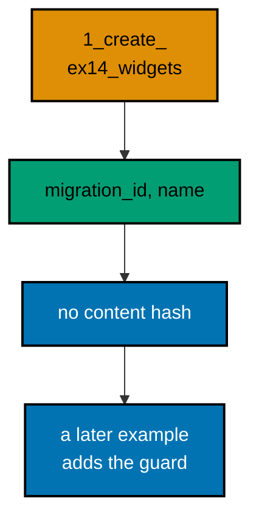

**`learning/code/ex-14-history-records-names-not-hashes/main.ts`**:

```typescript
import * as Config from "effect/Config"; // => Config reads PGHOST and friends with defaults
import * as Console from "effect/Console"; // => Console.log prints the golden transcript
import * as Effect from "effect/Effect"; // => Effect.gen sequences the migration story
import * as Layer from "effect/Layer"; // => Layer joins the database and node services
import * as Migrator from "effect/sql/Migrator"; // => loaders turn files and records into migrations
import * as SqlClient from "effect/sql/SqlClient"; // => SqlClient runs SQL against the pool
import * as NodeChildProcessSpawner from "@effect/platform-node/NodeChildProcessSpawner"; // => spawner service
import * as NodeFileSystem from "@effect/platform-node/NodeFileSystem"; // => filesystem the file loader reads through
import * as NodePath from "@effect/platform-node/NodePath"; // => path the file loader joins with
import * as NodeRuntime from "@effect/platform-node/NodeRuntime"; // => runMain boots the node services
import * as PgClient from "@effect/sql-pg/PgClient"; // => PgClient.layerConfig builds the pool
import * as PgMigrator from "@effect/sql-pg/PgMigrator"; // => PgMigrator.run applies pending migrations

// => one database layer from harness variables, trust auth, no TLS
const DbLive = PgClient.layerConfig({
  // => layerConfig unwraps Config values
  host: Config.String("PGHOST").pipe(Config.withDefault("postgres")), // => service hostname
  port: Config.Port("PGPORT").pipe(Config.withDefault(5432)), // => service port as a number
  database: Config.String("PGDATABASE").pipe(Config.withDefault("postgres")), // => fresh database per run
  username: Config.String("PGUSER").pipe(Config.withDefault("postgres")), // => trust-auth role
  ssl: Config.succeed(false), // => plaintext inside the unit network
}); // => DbLive offers PgClient and SqlClient together

// => the migrator type also asks for three node services
const NodeLive = Layer.mergeAll(NodeFileSystem.layer, NodePath.layer); // => file plus path side by side
const SpawnerLive = Layer.provide(NodeChildProcessSpawner.layer, NodeLive); // => spawner fed by file and path
const MainLive = Layer.mergeAll(DbLive, NodeLive, SpawnerLive); // => one layer for the whole program

const program = Effect.gen(function* () {
  // => the example narrative
  const sql = yield* SqlClient.SqlClient; // => the query surface over the pool
  const applied = yield* PgMigrator.run({
    // => apply every pending migration
    loader: Migrator.fromRecord({
      // => one migration, one stored name
      "1_create_ex14_widgets": sql`CREATE TABLE ex14_widgets (id SERIAL PRIMARY KEY)`, // => the only schema change
    }), // => end of the migration record
    table: "ex14_history", // => per-example history table
  }); // => applied lists only the migrations this run added
  // => the stored name carries the intent; no hash is stored anywhere
  yield* Console.log(`applied: ${applied.length}`); // => Output: applied: 1
  const rows = yield* sql<{
    migration_id: number;
    name: string;
  }>`SELECT migration_id, name FROM ex14_history ORDER BY migration_id`; // => id plus name only
  for (const row of rows) {
    // => walk the recorded history
    yield* Console.log(`history: ${row.migration_id}_${row.name}`); // => Output: history: 1_create_ex14_widgets
  } // => loop ends after the last history row
  // => three columns and no more: id, timestamp, and name
  const columns = yield* sql<{
    name: string;
  }>`SELECT column_name AS name FROM information_schema.columns WHERE table_name = 'ex14_history' ORDER BY ordinal_position`; // => what the table holds
  yield* Console.log(`stored: ${columns.map((column) => column.name).join(", ")}`); // => Output: stored: migration_id, created_at, name
  // => the table goes, but its name stays recorded until the history drops too
  yield* sql`DROP TABLE ex14_widgets`; // => the example leaves no tables behind
  yield* sql`DROP TABLE ex14_history`; // => and no history table either
  yield* Console.log("cleaned: yes"); // => Output: cleaned: yes
}); // => program ends: the harness compares stdout to the golden file

NodeRuntime.runMain(program.pipe(Effect.provide(MainLive))); // => boot node services and run
```

**Output** (`learning/code/ex-14-history-records-names-not-hashes/expected/main.stdout.txt`):

```text
applied: 1
history: 1_create_ex14_widgets
stored: migration_id, created_at, name
cleaned: yes
```

(Concepts: co-03, co-11.)

### Example 15: Applied Equals Assembled

A healthy run has a simple invariant: the number of migrations the run reports equals the number of rows now sitting in the history table. When those two numbers disagree, something wrote to the history outside the migrator, and that deserves an investigation.

This example checks the invariant directly with a count query after applying three migrations. Both numbers print side by side so a reader can compare them at a glance. Make this comparison a habit after every unfamiliar deploy.

**`learning/code/ex-15-applied-equals-assembled/main.ts`**:

```typescript
import * as Config from "effect/Config"; // => Config reads PGHOST and friends with defaults
import * as Console from "effect/Console"; // => Console.log prints the golden transcript
import * as Effect from "effect/Effect"; // => Effect.gen sequences the migration story
import * as Layer from "effect/Layer"; // => Layer joins the database and node services
import * as Migrator from "effect/sql/Migrator"; // => loaders turn files and records into migrations
import * as SqlClient from "effect/sql/SqlClient"; // => SqlClient runs SQL against the pool
import * as NodeChildProcessSpawner from "@effect/platform-node/NodeChildProcessSpawner"; // => spawner service
import * as NodeFileSystem from "@effect/platform-node/NodeFileSystem"; // => filesystem the file loader reads through
import * as NodePath from "@effect/platform-node/NodePath"; // => path the file loader joins with
import * as NodeRuntime from "@effect/platform-node/NodeRuntime"; // => runMain boots the node services
import * as PgClient from "@effect/sql-pg/PgClient"; // => PgClient.layerConfig builds the pool
import * as PgMigrator from "@effect/sql-pg/PgMigrator"; // => PgMigrator.run applies pending migrations

// => one database layer from harness variables, trust auth, no TLS
const DbLive = PgClient.layerConfig({
  // => layerConfig unwraps Config values
  host: Config.String("PGHOST").pipe(Config.withDefault("postgres")), // => service hostname
  port: Config.Port("PGPORT").pipe(Config.withDefault(5432)), // => service port as a number
  database: Config.String("PGDATABASE").pipe(Config.withDefault("postgres")), // => fresh database per run
  username: Config.String("PGUSER").pipe(Config.withDefault("postgres")), // => trust-auth role
  ssl: Config.succeed(false), // => plaintext inside the unit network
}); // => DbLive offers PgClient and SqlClient together

// => the migrator type also asks for three node services
const NodeLive = Layer.mergeAll(NodeFileSystem.layer, NodePath.layer); // => file plus path side by side
const SpawnerLive = Layer.provide(NodeChildProcessSpawner.layer, NodeLive); // => spawner fed by file and path
const MainLive = Layer.mergeAll(DbLive, NodeLive, SpawnerLive); // => one layer for the whole program

const program = Effect.gen(function* () {
  // => the example narrative
  const sql = yield* SqlClient.SqlClient; // => the query surface over the pool
  const applied = yield* PgMigrator.run({
    // => apply every pending migration
    loader: Migrator.fromRecord({
      // => three migrations in one run
      "1_create_ex15_a": sql`CREATE TABLE ex15_a (id SERIAL PRIMARY KEY)`, // => the first table
      "2_create_ex15_b": sql`CREATE TABLE ex15_b (id SERIAL PRIMARY KEY)`, // => the second table
      "3_create_ex15_c": sql`CREATE TABLE ex15_c (id SERIAL PRIMARY KEY)`, // => the third table
    }), // => end of the migration record
    table: "ex15_history", // => per-example history table
  }); // => applied lists only the migrations this run added
  const rows = yield* sql<{ total: number }>`SELECT count(*)::int AS total FROM ex15_history`; // => rows the history holds
  yield* Console.log(`applied: ${applied.length}, recorded: ${rows[0].total}`); // => Output: applied: 3, recorded: 3
  yield* sql`DROP TABLE ex15_c`; // => drop the third table
  yield* sql`DROP TABLE ex15_b`; // => drop the second table
  yield* sql`DROP TABLE ex15_a`; // => drop the first table
  yield* sql`DROP TABLE ex15_history`; // => and no history table either
  yield* Console.log("cleaned: yes"); // => Output: cleaned: yes
}); // => program ends: the harness compares stdout to the golden file

NodeRuntime.runMain(program.pipe(Effect.provide(MainLive))); // => boot node services and run
```

**Output** (`learning/code/ex-15-applied-equals-assembled/expected/main.stdout.txt`):

```text
applied: 3, recorded: 3
cleaned: yes
```

(Concepts: co-03.)

### Example 16: The Table Option Isolates Histories

The `table` option scopes a history, but environments deserve stronger separation: their own databases. A second history on the same database would replay the same DDL against the same tables, so promotion gives each environment a database and runs the identical ordered set in each.

Two databases stand in for two environments here, and both converge on the same single row. Each run builds its own pool against its own database, then hands plain counts back across the layer boundary. The shape previews environment promotion, which the advanced cluster teaches as a first-class workflow.

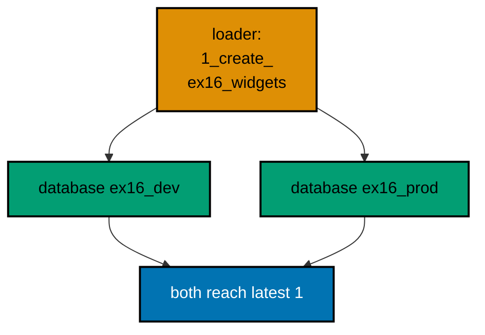

**`learning/code/ex-16-table-option-isolates-histories/main.ts`**:

```typescript
import * as Config from "effect/Config"; // => Config reads PGHOST and friends with defaults
import * as Console from "effect/Console"; // => Console.log prints the golden transcript
import * as Effect from "effect/Effect"; // => Effect.gen sequences the migration story
import * as Layer from "effect/Layer"; // => Layer joins the database and node services
import * as Migrator from "effect/sql/Migrator"; // => loaders turn files and records into migrations
import * as SqlClient from "effect/sql/SqlClient"; // => SqlClient runs SQL against the pool
import * as NodeChildProcessSpawner from "@effect/platform-node/NodeChildProcessSpawner"; // => spawner service
import * as NodeFileSystem from "@effect/platform-node/NodeFileSystem"; // => filesystem the file loader reads through
import * as NodePath from "@effect/platform-node/NodePath"; // => path the file loader joins with
import * as NodeRuntime from "@effect/platform-node/NodeRuntime"; // => runMain boots the node services
import * as PgClient from "@effect/sql-pg/PgClient"; // => PgClient.layerConfig builds the pool
import * as PgMigrator from "@effect/sql-pg/PgMigrator"; // => PgMigrator.run applies pending migrations

// => one database layer from harness variables, trust auth, no TLS
const DbLive = PgClient.layerConfig({
  // => layerConfig unwraps Config values
  host: Config.String("PGHOST").pipe(Config.withDefault("postgres")), // => service hostname
  port: Config.Port("PGPORT").pipe(Config.withDefault(5432)), // => service port as a number
  database: Config.String("PGDATABASE").pipe(Config.withDefault("postgres")), // => fresh database per run
  username: Config.String("PGUSER").pipe(Config.withDefault("postgres")), // => trust-auth role
  ssl: Config.succeed(false), // => plaintext inside the unit network
}); // => DbLive offers PgClient and SqlClient together

// => the migrator type also asks for three node services
const NodeLive = Layer.mergeAll(NodeFileSystem.layer, NodePath.layer); // => file plus path side by side
const SpawnerLive = Layer.provide(NodeChildProcessSpawner.layer, NodeLive); // => spawner fed by file and path
const MainLive = Layer.mergeAll(DbLive, NodeLive, SpawnerLive); // => one layer for the whole program

const program = Effect.gen(function* () {
  // => the example narrative
  const sql = yield* SqlClient.SqlClient; // => the query surface over the pool
  yield* sql`CREATE DATABASE ex16_dev`; // => the first environment, a real database
  yield* sql`CREATE DATABASE ex16_prod`; // => the second environment, a real database
  const makeDb = (database: string) =>
    PgClient.layerConfig({
      // => one pool per environment
      host: Config.String("PGHOST").pipe(Config.withDefault("postgres")), // => service hostname
      port: Config.Port("PGPORT").pipe(Config.withDefault(5432)), // => service port as a number
      database: Config.succeed(database), // => this environment's database
      username: Config.String("PGUSER").pipe(Config.withDefault("postgres")), // => trust-auth role
      ssl: Config.succeed(false), // => plaintext inside the unit network
    }); // => a pool aimed at one environment
  const runOn = (database: string) =>
    Effect.provide(
      // => each environment runs on its own pool
      Effect.gen(function* () {
        // => migrate one environment fully
        const db = yield* SqlClient.SqlClient; // => this environment's client
        const applied = yield* PgMigrator.run({
          // => the same ordered set
          loader: Migrator.fromRecord({
            // => one ordered set for both lines
            "1_create_ex16_widgets": db`CREATE TABLE ex16_widgets (id SERIAL PRIMARY KEY)`, // => the shared schema change
          }), // => end of the migration record
          table: "ex16_history", // => each database keeps its own history
        }); // => this environment converges
        const rows = yield* db<{ name: string }>`SELECT name FROM ex16_history ORDER BY migration_id`; // => this environment's line
        return { count: applied.length, first: rows.map((row) => row.name).join(", ") }; // => plain data crosses the pool boundary
      }), // => end of the per-environment story
      Layer.mergeAll(makeDb(database), NodeLive, SpawnerLive), // => pool plus node services
    ); // => runOn hands back counts, never clients
  const dev = yield* runOn("ex16_dev"); // => the first environment converges
  const prod = yield* runOn("ex16_prod"); // => the second environment converges
  yield* Console.log(`dev: ${dev.count}, prod: ${prod.count}`); // => Output: dev: 1, prod: 1
  yield* Console.log(`prod: 1_${prod.first}`); // => Output: prod: 1_create_ex16_widgets
  yield* sql`DROP DATABASE ex16_dev`; // => drop the first environment
  yield* sql`DROP DATABASE ex16_prod`; // => drop the second environment
  yield* Console.log("cleaned: yes"); // => Output: cleaned: yes
}); // => program ends: the harness compares stdout to the golden file

NodeRuntime.runMain(program.pipe(Effect.provide(MainLive))); // => boot node services and run
```

**Output** (`learning/code/ex-16-table-option-isolates-histories/expected/main.stdout.txt`):

```text
dev: 1, prod: 1
prod: 1_create_ex16_widgets
cleaned: yes
```

(Concepts: co-03, co-13.)

### Example 17: Two Loaders, One Table

Histories outlive any single loader object: what matters is the table, not which in-memory record described the migrations. A second loader that continues the numbering appends to the same line without disturbing what the first loader recorded.

This example runs two different loaders against one table, the second carrying only the newcomer. The final history shows both rows in order. Deploys work the same way: each release ships the loader it needs, and the table stitches them into one line.

**`learning/code/ex-17-two-loaders-one-table/main.ts`**:

```typescript
import * as Config from "effect/Config"; // => Config reads PGHOST and friends with defaults
import * as Console from "effect/Console"; // => Console.log prints the golden transcript
import * as Effect from "effect/Effect"; // => Effect.gen sequences the migration story
import * as Layer from "effect/Layer"; // => Layer joins the database and node services
import * as Migrator from "effect/sql/Migrator"; // => loaders turn files and records into migrations
import * as SqlClient from "effect/sql/SqlClient"; // => SqlClient runs SQL against the pool
import * as NodeChildProcessSpawner from "@effect/platform-node/NodeChildProcessSpawner"; // => spawner service
import * as NodeFileSystem from "@effect/platform-node/NodeFileSystem"; // => filesystem the file loader reads through
import * as NodePath from "@effect/platform-node/NodePath"; // => path the file loader joins with
import * as NodeRuntime from "@effect/platform-node/NodeRuntime"; // => runMain boots the node services
import * as PgClient from "@effect/sql-pg/PgClient"; // => PgClient.layerConfig builds the pool
import * as PgMigrator from "@effect/sql-pg/PgMigrator"; // => PgMigrator.run applies pending migrations

// => one database layer from harness variables, trust auth, no TLS
const DbLive = PgClient.layerConfig({
  // => layerConfig unwraps Config values
  host: Config.String("PGHOST").pipe(Config.withDefault("postgres")), // => service hostname
  port: Config.Port("PGPORT").pipe(Config.withDefault(5432)), // => service port as a number
  database: Config.String("PGDATABASE").pipe(Config.withDefault("postgres")), // => fresh database per run
  username: Config.String("PGUSER").pipe(Config.withDefault("postgres")), // => trust-auth role
  ssl: Config.succeed(false), // => plaintext inside the unit network
}); // => DbLive offers PgClient and SqlClient together

// => the migrator type also asks for three node services
const NodeLive = Layer.mergeAll(NodeFileSystem.layer, NodePath.layer); // => file plus path side by side
const SpawnerLive = Layer.provide(NodeChildProcessSpawner.layer, NodeLive); // => spawner fed by file and path
const MainLive = Layer.mergeAll(DbLive, NodeLive, SpawnerLive); // => one layer for the whole program

const program = Effect.gen(function* () {
  // => the example narrative
  const sql = yield* SqlClient.SqlClient; // => the query surface over the pool
  const first = yield* PgMigrator.run({
    // => release one ships migration one
    loader: Migrator.fromRecord({
      // => the early loader
      "1_create_ex17_a": sql`CREATE TABLE ex17_a (id SERIAL PRIMARY KEY)`, // => the first table
    }), // => end of the early loader
    table: "ex17_history", // => per-example history table
  }); // => first run applies migration one
  yield* Console.log(`first: ${first.length}`); // => Output: first: 1
  const second = yield* PgMigrator.run({
    // => release two ships migration two
    loader: Migrator.fromRecord({
      // => the later loader
      "2_create_ex17_b": sql`CREATE TABLE ex17_b (id SERIAL PRIMARY KEY)`, // => the second table
    }), // => end of the later loader
    table: "ex17_history", // => the same history table
  }); // => second run applies migration two
  yield* Console.log(`second: ${second.length}`); // => Output: second: 1
  const rows = yield* sql<{ migration_id: number }>`SELECT migration_id FROM ex17_history ORDER BY migration_id`; // => one stitched line
  yield* Console.log(`recorded: ${rows.map((row) => row.migration_id).join(", ")}`); // => Output: recorded: 1, 2
  yield* sql`DROP TABLE ex17_b`; // => drop the second table
  yield* sql`DROP TABLE ex17_a`; // => drop the first table
  yield* sql`DROP TABLE ex17_history`; // => and no history table either
  yield* Console.log("cleaned: yes"); // => Output: cleaned: yes
}); // => program ends: the harness compares stdout to the golden file

NodeRuntime.runMain(program.pipe(Effect.provide(MainLive))); // => boot node services and run
```

**Output** (`learning/code/ex-17-two-loaders-one-table/expected/main.stdout.txt`):

```text
first: 1
second: 1
recorded: 1, 2
cleaned: yes
```

(Concepts: co-04.)

### Example 18: Rollback Is a Migration Too

Effect SQL migrations move in one direction: forward. There is no down step, no automatic undo, only the next migration. Rolling back therefore means writing a new migration whose effect compensates the earlier one, and the history keeps both rows forever.

This example creates a table in migration one and drops it in migration two. The catalog check at the end finds nothing, while the history still lists both rows. Reversal is honest work recorded honestly, not history rewritten.

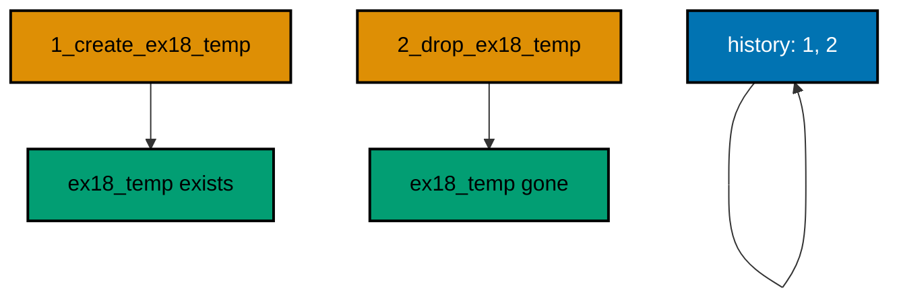

**`learning/code/ex-18-rollback-is-a-migration-too/main.ts`**:

```typescript
import * as Config from "effect/Config"; // => Config reads PGHOST and friends with defaults
import * as Console from "effect/Console"; // => Console.log prints the golden transcript
import * as Effect from "effect/Effect"; // => Effect.gen sequences the migration story
import * as Layer from "effect/Layer"; // => Layer joins the database and node services
import * as Migrator from "effect/sql/Migrator"; // => loaders turn files and records into migrations
import * as SqlClient from "effect/sql/SqlClient"; // => SqlClient runs SQL against the pool
import * as NodeChildProcessSpawner from "@effect/platform-node/NodeChildProcessSpawner"; // => spawner service
import * as NodeFileSystem from "@effect/platform-node/NodeFileSystem"; // => filesystem the file loader reads through
import * as NodePath from "@effect/platform-node/NodePath"; // => path the file loader joins with
import * as NodeRuntime from "@effect/platform-node/NodeRuntime"; // => runMain boots the node services
import * as PgClient from "@effect/sql-pg/PgClient"; // => PgClient.layerConfig builds the pool
import * as PgMigrator from "@effect/sql-pg/PgMigrator"; // => PgMigrator.run applies pending migrations

// => one database layer from harness variables, trust auth, no TLS
const DbLive = PgClient.layerConfig({
  // => layerConfig unwraps Config values
  host: Config.String("PGHOST").pipe(Config.withDefault("postgres")), // => service hostname
  port: Config.Port("PGPORT").pipe(Config.withDefault(5432)), // => service port as a number
  database: Config.String("PGDATABASE").pipe(Config.withDefault("postgres")), // => fresh database per run
  username: Config.String("PGUSER").pipe(Config.withDefault("postgres")), // => trust-auth role
  ssl: Config.succeed(false), // => plaintext inside the unit network
}); // => DbLive offers PgClient and SqlClient together

// => the migrator type also asks for three node services
const NodeLive = Layer.mergeAll(NodeFileSystem.layer, NodePath.layer); // => file plus path side by side
const SpawnerLive = Layer.provide(NodeChildProcessSpawner.layer, NodeLive); // => spawner fed by file and path
const MainLive = Layer.mergeAll(DbLive, NodeLive, SpawnerLive); // => one layer for the whole program

const program = Effect.gen(function* () {
  // => the example narrative
  const sql = yield* SqlClient.SqlClient; // => the query surface over the pool
  const applied = yield* PgMigrator.run({
    // => apply every pending migration
    loader: Migrator.fromRecord({
      // => forward change plus compensation
      "1_create_ex18_temp": sql`CREATE TABLE ex18_temp (id SERIAL PRIMARY KEY)`, // => the change to undo
      "2_drop_ex18_temp": sql`DROP TABLE ex18_temp`, // => the compensation, also a migration
    }), // => end of the migration record
    table: "ex18_history", // => per-example history table
  }); // => applied lists only the migrations this run added
  for (const [id, name] of applied) {
    // => walk the newly applied rows
    yield* Console.log(`applied: ${id}_${name}`); // => Output: applied: 1_create_ex18_temp
  } // => loop ends after the last applied migration
  const tables = yield* sql<{
    total: number;
  }>`SELECT count(*)::int AS total FROM pg_tables WHERE tablename = 'ex18_temp'`; // => is the table gone
  yield* Console.log(`tables: ${tables[0].total}`); // => Output: tables: 0
  const rows = yield* sql<{ migration_id: number }>`SELECT migration_id FROM ex18_history ORDER BY migration_id`; // => both rows stay recorded
  yield* Console.log(`recorded: ${rows.map((row) => row.migration_id).join(", ")}`); // => Output: recorded: 1, 2
  yield* sql`DROP TABLE ex18_history`; // => drop the history table
  yield* Console.log("cleaned: yes"); // => Output: cleaned: yes
}); // => program ends: the harness compares stdout to the golden file

NodeRuntime.runMain(program.pipe(Effect.provide(MainLive))); // => boot node services and run
```

**Output** (`learning/code/ex-18-rollback-is-a-migration-too/expected/main.stdout.txt`):

```text
applied: 1_create_ex18_temp
applied: 2_drop_ex18_temp
tables: 0
recorded: 1, 2
cleaned: yes
```

(Concepts: co-02, co-08.)

### Example 19: Reverse by Re-Adding, Not by Undo

Some reversals cannot be a simple drop, because later work already built on the changed shape. The forward fix repairs the damage with a new migration: a dropped column comes back through an add-column migration, never by editing the migration that dropped it.

Three migrations tell the story: create with a nickname column, drop the nickname, then re-add it. The final column listing shows the nickname back, and the history shows all three steps. Nothing was rewritten; everything was compensated.

**`learning/code/ex-19-reverse-by-re-adding-not-by-undo/main.ts`**:

```typescript
import * as Config from "effect/Config"; // => Config reads PGHOST and friends with defaults
import * as Console from "effect/Console"; // => Console.log prints the golden transcript
import * as Effect from "effect/Effect"; // => Effect.gen sequences the migration story
import * as Layer from "effect/Layer"; // => Layer joins the database and node services
import * as Migrator from "effect/sql/Migrator"; // => loaders turn files and records into migrations
import * as SqlClient from "effect/sql/SqlClient"; // => SqlClient runs SQL against the pool
import * as NodeChildProcessSpawner from "@effect/platform-node/NodeChildProcessSpawner"; // => spawner service
import * as NodeFileSystem from "@effect/platform-node/NodeFileSystem"; // => filesystem the file loader reads through
import * as NodePath from "@effect/platform-node/NodePath"; // => path the file loader joins with
import * as NodeRuntime from "@effect/platform-node/NodeRuntime"; // => runMain boots the node services
import * as PgClient from "@effect/sql-pg/PgClient"; // => PgClient.layerConfig builds the pool
import * as PgMigrator from "@effect/sql-pg/PgMigrator"; // => PgMigrator.run applies pending migrations

// => one database layer from harness variables, trust auth, no TLS
const DbLive = PgClient.layerConfig({
  // => layerConfig unwraps Config values
  host: Config.String("PGHOST").pipe(Config.withDefault("postgres")), // => service hostname
  port: Config.Port("PGPORT").pipe(Config.withDefault(5432)), // => service port as a number
  database: Config.String("PGDATABASE").pipe(Config.withDefault("postgres")), // => fresh database per run
  username: Config.String("PGUSER").pipe(Config.withDefault("postgres")), // => trust-auth role
  ssl: Config.succeed(false), // => plaintext inside the unit network
}); // => DbLive offers PgClient and SqlClient together

// => the migrator type also asks for three node services
const NodeLive = Layer.mergeAll(NodeFileSystem.layer, NodePath.layer); // => file plus path side by side
const SpawnerLive = Layer.provide(NodeChildProcessSpawner.layer, NodeLive); // => spawner fed by file and path
const MainLive = Layer.mergeAll(DbLive, NodeLive, SpawnerLive); // => one layer for the whole program

const program = Effect.gen(function* () {
  // => the example narrative
  const sql = yield* SqlClient.SqlClient; // => the query surface over the pool
  const applied = yield* PgMigrator.run({
    // => apply every pending migration
    loader: Migrator.fromRecord({
      // => break it, then fix it forward
      "1_create_ex19_users": sql`CREATE TABLE ex19_users (id SERIAL PRIMARY KEY, nick TEXT)`, // => the original shape
      "2_drop_nick": sql`ALTER TABLE ex19_users DROP COLUMN nick`, // => the regretted change
      "3_restore_nick": sql`ALTER TABLE ex19_users ADD COLUMN nick TEXT`, // => the forward fix
    }), // => end of the migration record
    table: "ex19_history", // => per-example history table
  }); // => applied lists only the migrations this run added
  yield* Console.log(`applied: ${applied.length}`); // => Output: applied: 3
  const columns = yield* sql<{
    name: string;
  }>`SELECT column_name AS name FROM information_schema.columns WHERE table_name = 'ex19_users' ORDER BY ordinal_position`; // => the repaired shape
  yield* Console.log(`columns: ${columns.map((column) => column.name).join(", ")}`); // => Output: columns: id, nick
  yield* sql`DROP TABLE ex19_users`; // => the example leaves no tables behind
  yield* sql`DROP TABLE ex19_history`; // => and no history table either
  yield* Console.log("cleaned: yes"); // => Output: cleaned: yes
}); // => program ends: the harness compares stdout to the golden file

NodeRuntime.runMain(program.pipe(Effect.provide(MainLive))); // => boot node services and run
```

**Output** (`learning/code/ex-19-reverse-by-re-adding-not-by-undo/expected/main.stdout.txt`):

```text
applied: 3
columns: id, nick
cleaned: yes
```

(Concepts: co-02, co-08.)

### Example 20: Manual Reversal Leaves History Behind

The history table records that a migration ran, not that its effects are still present. Anyone with database access can drop a table by hand, and the history row stays exactly where the migrator left it. That gap has a name: drift, the database diverging from its recorded history.

This example migrates, then drops the table outside the migrator. The final prints show the mismatch plainly: one history row, zero tables. The lesson is procedural: reversals belong in migrations, because only migrations update both sides of the ledger.

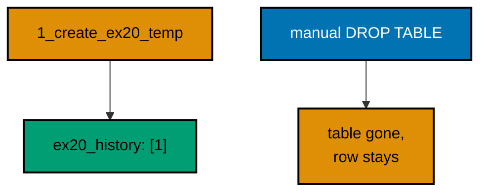

**`learning/code/ex-20-manual-reversal-leaves-history-behind/main.ts`**:

```typescript
import * as Config from "effect/Config"; // => Config reads PGHOST and friends with defaults
import * as Console from "effect/Console"; // => Console.log prints the golden transcript
import * as Effect from "effect/Effect"; // => Effect.gen sequences the migration story
import * as Layer from "effect/Layer"; // => Layer joins the database and node services
import * as Migrator from "effect/sql/Migrator"; // => loaders turn files and records into migrations
import * as SqlClient from "effect/sql/SqlClient"; // => SqlClient runs SQL against the pool
import * as NodeChildProcessSpawner from "@effect/platform-node/NodeChildProcessSpawner"; // => spawner service
import * as NodeFileSystem from "@effect/platform-node/NodeFileSystem"; // => filesystem the file loader reads through
import * as NodePath from "@effect/platform-node/NodePath"; // => path the file loader joins with
import * as NodeRuntime from "@effect/platform-node/NodeRuntime"; // => runMain boots the node services
import * as PgClient from "@effect/sql-pg/PgClient"; // => PgClient.layerConfig builds the pool
import * as PgMigrator from "@effect/sql-pg/PgMigrator"; // => PgMigrator.run applies pending migrations

// => one database layer from harness variables, trust auth, no TLS
const DbLive = PgClient.layerConfig({
  // => layerConfig unwraps Config values
  host: Config.String("PGHOST").pipe(Config.withDefault("postgres")), // => service hostname
  port: Config.Port("PGPORT").pipe(Config.withDefault(5432)), // => service port as a number
  database: Config.String("PGDATABASE").pipe(Config.withDefault("postgres")), // => fresh database per run
  username: Config.String("PGUSER").pipe(Config.withDefault("postgres")), // => trust-auth role
  ssl: Config.succeed(false), // => plaintext inside the unit network
}); // => DbLive offers PgClient and SqlClient together

// => the migrator type also asks for three node services
const NodeLive = Layer.mergeAll(NodeFileSystem.layer, NodePath.layer); // => file plus path side by side
const SpawnerLive = Layer.provide(NodeChildProcessSpawner.layer, NodeLive); // => spawner fed by file and path
const MainLive = Layer.mergeAll(DbLive, NodeLive, SpawnerLive); // => one layer for the whole program

const program = Effect.gen(function* () {
  // => the example narrative
  const sql = yield* SqlClient.SqlClient; // => the query surface over the pool
  const applied = yield* PgMigrator.run({
    // => apply every pending migration
    loader: Migrator.fromRecord({
      // => one migration, then a manual drop
      "1_create_ex20_temp": sql`CREATE TABLE ex20_temp (id SERIAL PRIMARY KEY)`, // => the migrator-built table
    }), // => end of the migration record
    table: "ex20_history", // => per-example history table
  }); // => applied lists only the migrations this run added
  yield* Console.log(`applied: ${applied.length}`); // => Output: applied: 1
  yield* sql`DROP TABLE ex20_temp`; // => a hand-run reversal, outside any migration
  const rows = yield* sql<{ migration_id: number }>`SELECT migration_id FROM ex20_history ORDER BY migration_id`; // => the history did not move
  yield* Console.log(`recorded: ${rows.map((row) => row.migration_id).join(", ")}`); // => Output: recorded: 1
  const tables = yield* sql<{
    total: number;
  }>`SELECT count(*)::int AS total FROM pg_tables WHERE tablename = 'ex20_temp'`; // => but the table is gone
  yield* Console.log(`tables: ${tables[0].total}`); // => Output: tables: 0
  yield* sql`DROP TABLE ex20_history`; // => drop the history table
  yield* Console.log("cleaned: yes"); // => Output: cleaned: yes
}); // => program ends: the harness compares stdout to the golden file

NodeRuntime.runMain(program.pipe(Effect.provide(MainLive))); // => boot node services and run
```

**Output** (`learning/code/ex-20-manual-reversal-leaves-history-behind/expected/main.stdout.txt`):

```text
applied: 1
recorded: 1
tables: 0
cleaned: yes
```

(Concepts: co-02, co-09.)

### Example 21: Rollback Keeps Unrelated Data

A good rollback is surgical: it reverses its own change and leaves every unrelated row exactly alone. The fear that undoing one table endangers another is what keeps teams from rehearsing rollbacks at all.

Two tables prove the surgery safe: migration one creates both and seeds the keeper table, migration two drops only the expendable one. The final select shows the kept row untouched. Roll back the change, never the database.

**`learning/code/ex-21-rollback-keeps-unrelated-data/main.ts`**:

```typescript
import * as Config from "effect/Config"; // => Config reads PGHOST and friends with defaults
import * as Console from "effect/Console"; // => Console.log prints the golden transcript
import * as Effect from "effect/Effect"; // => Effect.gen sequences the migration story
import * as Layer from "effect/Layer"; // => Layer joins the database and node services
import * as Migrator from "effect/sql/Migrator"; // => loaders turn files and records into migrations
import * as SqlClient from "effect/sql/SqlClient"; // => SqlClient runs SQL against the pool
import * as NodeChildProcessSpawner from "@effect/platform-node/NodeChildProcessSpawner"; // => spawner service
import * as NodeFileSystem from "@effect/platform-node/NodeFileSystem"; // => filesystem the file loader reads through
import * as NodePath from "@effect/platform-node/NodePath"; // => path the file loader joins with
import * as NodeRuntime from "@effect/platform-node/NodeRuntime"; // => runMain boots the node services
import * as PgClient from "@effect/sql-pg/PgClient"; // => PgClient.layerConfig builds the pool
import * as PgMigrator from "@effect/sql-pg/PgMigrator"; // => PgMigrator.run applies pending migrations

// => one database layer from harness variables, trust auth, no TLS
const DbLive = PgClient.layerConfig({
  // => layerConfig unwraps Config values
  host: Config.String("PGHOST").pipe(Config.withDefault("postgres")), // => service hostname
  port: Config.Port("PGPORT").pipe(Config.withDefault(5432)), // => service port as a number
  database: Config.String("PGDATABASE").pipe(Config.withDefault("postgres")), // => fresh database per run
  username: Config.String("PGUSER").pipe(Config.withDefault("postgres")), // => trust-auth role
  ssl: Config.succeed(false), // => plaintext inside the unit network
}); // => DbLive offers PgClient and SqlClient together

// => the migrator type also asks for three node services
const NodeLive = Layer.mergeAll(NodeFileSystem.layer, NodePath.layer); // => file plus path side by side
const SpawnerLive = Layer.provide(NodeChildProcessSpawner.layer, NodeLive); // => spawner fed by file and path
const MainLive = Layer.mergeAll(DbLive, NodeLive, SpawnerLive); // => one layer for the whole program

const program = Effect.gen(function* () {
  // => the example narrative
  const sql = yield* SqlClient.SqlClient; // => the query surface over the pool
  const applied = yield* PgMigrator.run({
    // => apply every pending migration
    loader: Migrator.fromRecord({
      // => two tables, one expendable
      "1_create_ex21_tables": Effect.gen(function* () {
        // => the setup migration
        const inner = yield* SqlClient.SqlClient; // => the body borrows the same client
        yield* inner`CREATE TABLE ex21_temp (id SERIAL PRIMARY KEY)`; // => the table to drop later
        yield* inner`CREATE TABLE ex21_kept (id SERIAL PRIMARY KEY, note TEXT NOT NULL)`; // => the table to keep
        yield* inner`INSERT INTO ex21_kept (note) VALUES ('precious')`; // => one row worth keeping
      }), // => end of the setup migration
      "2_drop_ex21_temp": sql`DROP TABLE ex21_temp`, // => the surgical compensation
    }), // => end of the migration record
    table: "ex21_history", // => per-example history table
  }); // => applied lists only the migrations this run added
  yield* Console.log(`applied: ${applied.length}`); // => Output: applied: 2
  const rows = yield* sql<{ note: string }>`SELECT note FROM ex21_kept`; // => the unrelated survivor
  for (const row of rows) {
    // => walk the surviving rows
    yield* Console.log(`kept: ${row.note}`); // => Output: kept: precious
  } // => loop ends after the last row
  yield* sql`DROP TABLE ex21_kept`; // => drop the keeper table
  yield* sql`DROP TABLE ex21_history`; // => and no history table either
  yield* Console.log("cleaned: yes"); // => Output: cleaned: yes
}); // => program ends: the harness compares stdout to the golden file

NodeRuntime.runMain(program.pipe(Effect.provide(MainLive))); // => boot node services and run
```

**Output** (`learning/code/ex-21-rollback-keeps-unrelated-data/expected/main.stdout.txt`):

```text
applied: 2
kept: precious
cleaned: yes
```

(Concepts: co-08.)

### Example 22: Forward Fix Beats Rewrite

Editing an applied migration is the one move the history cannot track: the id is already recorded, so the edited SQL never runs anywhere that already migrated. The repair must therefore be a new migration that converts the old shape into the wanted one.

Prices stored as integers become decimal money in two steps: the first migration creates the integer column, the second converts it with an explicit cast. The catalog check confirms the numeric type, and the first file stays byte-identical.

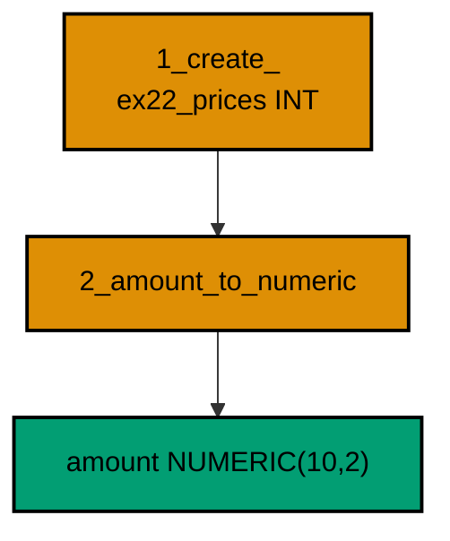

**`learning/code/ex-22-forward-fix-beats-rewrite/main.ts`**:

```typescript
import * as Config from "effect/Config"; // => Config reads PGHOST and friends with defaults
import * as Console from "effect/Console"; // => Console.log prints the golden transcript
import * as Effect from "effect/Effect"; // => Effect.gen sequences the migration story
import * as Layer from "effect/Layer"; // => Layer joins the database and node services
import * as Migrator from "effect/sql/Migrator"; // => loaders turn files and records into migrations
import * as SqlClient from "effect/sql/SqlClient"; // => SqlClient runs SQL against the pool
import * as NodeChildProcessSpawner from "@effect/platform-node/NodeChildProcessSpawner"; // => spawner service
import * as NodeFileSystem from "@effect/platform-node/NodeFileSystem"; // => filesystem the file loader reads through
import * as NodePath from "@effect/platform-node/NodePath"; // => path the file loader joins with
import * as NodeRuntime from "@effect/platform-node/NodeRuntime"; // => runMain boots the node services
import * as PgClient from "@effect/sql-pg/PgClient"; // => PgClient.layerConfig builds the pool
import * as PgMigrator from "@effect/sql-pg/PgMigrator"; // => PgMigrator.run applies pending migrations

// => one database layer from harness variables, trust auth, no TLS
const DbLive = PgClient.layerConfig({
  // => layerConfig unwraps Config values
  host: Config.String("PGHOST").pipe(Config.withDefault("postgres")), // => service hostname
  port: Config.Port("PGPORT").pipe(Config.withDefault(5432)), // => service port as a number
  database: Config.String("PGDATABASE").pipe(Config.withDefault("postgres")), // => fresh database per run
  username: Config.String("PGUSER").pipe(Config.withDefault("postgres")), // => trust-auth role
  ssl: Config.succeed(false), // => plaintext inside the unit network
}); // => DbLive offers PgClient and SqlClient together

// => the migrator type also asks for three node services
const NodeLive = Layer.mergeAll(NodeFileSystem.layer, NodePath.layer); // => file plus path side by side
const SpawnerLive = Layer.provide(NodeChildProcessSpawner.layer, NodeLive); // => spawner fed by file and path
const MainLive = Layer.mergeAll(DbLive, NodeLive, SpawnerLive); // => one layer for the whole program

const program = Effect.gen(function* () {
  // => the example narrative
  const sql = yield* SqlClient.SqlClient; // => the query surface over the pool
  const applied = yield* PgMigrator.run({
    // => apply every pending migration
    loader: Migrator.fromRecord({
      // => create narrow, widen forward
      "1_create_ex22_prices": Effect.gen(function* () {
        // => the original shape
        const inner = yield* SqlClient.SqlClient; // => the body borrows the same client
        yield* inner`CREATE TABLE ex22_prices (id SERIAL PRIMARY KEY, amount INT NOT NULL)`; // => integer cents, as first designed
        yield* inner`INSERT INTO ex22_prices (amount) VALUES (199)`; // => one price worth converting
      }), // => end of the original migration
      "2_amount_to_numeric": sql`ALTER TABLE ex22_prices ALTER COLUMN amount TYPE NUMERIC(10, 2) USING amount::numeric / 100`, // => cents become money
    }), // => end of the migration record
    table: "ex22_history", // => per-example history table
  }); // => applied lists only the migrations this run added
  yield* Console.log(`applied: ${applied.length}`); // => Output: applied: 2
  const columns = yield* sql<{
    type: string;
  }>`SELECT data_type AS type FROM information_schema.columns WHERE table_name = 'ex22_prices' AND column_name = 'amount'`; // => the converted type
  yield* Console.log(`type: ${columns[0].type}`); // => Output: type: numeric
  const rows = yield* sql<{ amount: string }>`SELECT amount::text AS amount FROM ex22_prices`; // => the converted value
  for (const row of rows) {
    // => walk the converted rows
    yield* Console.log(`amount: ${row.amount}`); // => Output: amount: 1.99
  } // => loop ends after the last row
  yield* sql`DROP TABLE ex22_prices`; // => the example leaves no tables behind
  yield* sql`DROP TABLE ex22_history`; // => and no history table either
  yield* Console.log("cleaned: yes"); // => Output: cleaned: yes
}); // => program ends: the harness compares stdout to the golden file

NodeRuntime.runMain(program.pipe(Effect.provide(MainLive))); // => boot node services and run
```

**Output** (`learning/code/ex-22-forward-fix-beats-rewrite/expected/main.stdout.txt`):

```text
applied: 2
type: numeric
amount: 1.99
cleaned: yes
```

(Concepts: co-08.)

### Example 23: Rollback One of Many

Real histories are long, and a rollback usually targets one change buried among many. The compensating migration reverses exactly that change while its neighbors stand untouched, because each migration only ever touched its own objects.

Four migrations build three tables plus an index, then the fourth drops only the middle table. The final catalog lists the survivors by name. Precision here is what makes rollback a routine instead of an outage.

**`learning/code/ex-23-rollback-one-of-many/main.ts`**:

```typescript
import * as Config from "effect/Config"; // => Config reads PGHOST and friends with defaults
import * as Console from "effect/Console"; // => Console.log prints the golden transcript
import * as Effect from "effect/Effect"; // => Effect.gen sequences the migration story
import * as Layer from "effect/Layer"; // => Layer joins the database and node services
import * as Migrator from "effect/sql/Migrator"; // => loaders turn files and records into migrations
import * as SqlClient from "effect/sql/SqlClient"; // => SqlClient runs SQL against the pool
import * as NodeChildProcessSpawner from "@effect/platform-node/NodeChildProcessSpawner"; // => spawner service
import * as NodeFileSystem from "@effect/platform-node/NodeFileSystem"; // => filesystem the file loader reads through
import * as NodePath from "@effect/platform-node/NodePath"; // => path the file loader joins with
import * as NodeRuntime from "@effect/platform-node/NodeRuntime"; // => runMain boots the node services
import * as PgClient from "@effect/sql-pg/PgClient"; // => PgClient.layerConfig builds the pool
import * as PgMigrator from "@effect/sql-pg/PgMigrator"; // => PgMigrator.run applies pending migrations

// => one database layer from harness variables, trust auth, no TLS
const DbLive = PgClient.layerConfig({
  // => layerConfig unwraps Config values
  host: Config.String("PGHOST").pipe(Config.withDefault("postgres")), // => service hostname
  port: Config.Port("PGPORT").pipe(Config.withDefault(5432)), // => service port as a number
  database: Config.String("PGDATABASE").pipe(Config.withDefault("postgres")), // => fresh database per run
  username: Config.String("PGUSER").pipe(Config.withDefault("postgres")), // => trust-auth role
  ssl: Config.succeed(false), // => plaintext inside the unit network
}); // => DbLive offers PgClient and SqlClient together

// => the migrator type also asks for three node services
const NodeLive = Layer.mergeAll(NodeFileSystem.layer, NodePath.layer); // => file plus path side by side
const SpawnerLive = Layer.provide(NodeChildProcessSpawner.layer, NodeLive); // => spawner fed by file and path
const MainLive = Layer.mergeAll(DbLive, NodeLive, SpawnerLive); // => one layer for the whole program

const program = Effect.gen(function* () {
  // => the example narrative
  const sql = yield* SqlClient.SqlClient; // => the query surface over the pool
  const applied = yield* PgMigrator.run({
    // => apply every pending migration
    loader: Migrator.fromRecord({
      // => three tables, then one precise reversal
      "1_create_ex23_a": sql`CREATE TABLE ex23_a (id SERIAL PRIMARY KEY)`, // => the first keeper
      "2_create_ex23_b": sql`CREATE TABLE ex23_b (id SERIAL PRIMARY KEY, tag TEXT)`, // => the one to reverse
      "3_create_ex23_c": sql`CREATE TABLE ex23_c (id SERIAL PRIMARY KEY)`, // => the second keeper
      "4_drop_ex23_b": sql`DROP TABLE ex23_b`, // => the compensation touches only its target
    }), // => end of the migration record
    table: "ex23_history", // => per-example history table
  }); // => applied lists only the migrations this run added
  yield* Console.log(`applied: ${applied.length}`); // => Output: applied: 4
  const tables = yield* sql<{
    name: string;
  }>`SELECT tablename AS name FROM pg_tables WHERE tablename IN ('ex23_a', 'ex23_b', 'ex23_c') ORDER BY tablename`; // => who survived
  for (const table of tables) {
    // => walk the surviving tables
    yield* Console.log(`table: ${table.name}`); // => Output: table: ex23_a
  } // => loop ends after the last table
  yield* sql`DROP TABLE ex23_c`; // => drop the second keeper
  yield* sql`DROP TABLE ex23_a`; // => drop the first keeper
  yield* sql`DROP TABLE ex23_history`; // => and no history table either
  yield* Console.log("cleaned: yes"); // => Output: cleaned: yes
}); // => program ends: the harness compares stdout to the golden file

NodeRuntime.runMain(program.pipe(Effect.provide(MainLive))); // => boot node services and run
```

**Output** (`learning/code/ex-23-rollback-one-of-many/expected/main.stdout.txt`):

```text
applied: 4
table: ex23_a
table: ex23_c
cleaned: yes
```

(Concepts: co-08.)

### Example 24: Compensations Run in Reverse

Undoing a stack means peeling it from the top: a books table that references authors must go before the authors table it points at, or the foreign key blocks the drop. Compensation order is the reverse of creation order, always.

Two creations followed by two drops in mirror order prove it. The drops succeed precisely because the dependent goes first, and the final catalog is empty. Plan every rollback as the creation list read backwards.

**`learning/code/ex-24-compensations-run-in-reverse/main.ts`**:

```typescript
import * as Config from "effect/Config"; // => Config reads PGHOST and friends with defaults
import * as Console from "effect/Console"; // => Console.log prints the golden transcript
import * as Effect from "effect/Effect"; // => Effect.gen sequences the migration story
import * as Layer from "effect/Layer"; // => Layer joins the database and node services
import * as Migrator from "effect/sql/Migrator"; // => loaders turn files and records into migrations
import * as SqlClient from "effect/sql/SqlClient"; // => SqlClient runs SQL against the pool
import * as NodeChildProcessSpawner from "@effect/platform-node/NodeChildProcessSpawner"; // => spawner service
import * as NodeFileSystem from "@effect/platform-node/NodeFileSystem"; // => filesystem the file loader reads through
import * as NodePath from "@effect/platform-node/NodePath"; // => path the file loader joins with
import * as NodeRuntime from "@effect/platform-node/NodeRuntime"; // => runMain boots the node services
import * as PgClient from "@effect/sql-pg/PgClient"; // => PgClient.layerConfig builds the pool
import * as PgMigrator from "@effect/sql-pg/PgMigrator"; // => PgMigrator.run applies pending migrations

// => one database layer from harness variables, trust auth, no TLS
const DbLive = PgClient.layerConfig({
  // => layerConfig unwraps Config values
  host: Config.String("PGHOST").pipe(Config.withDefault("postgres")), // => service hostname
  port: Config.Port("PGPORT").pipe(Config.withDefault(5432)), // => service port as a number
  database: Config.String("PGDATABASE").pipe(Config.withDefault("postgres")), // => fresh database per run
  username: Config.String("PGUSER").pipe(Config.withDefault("postgres")), // => trust-auth role
  ssl: Config.succeed(false), // => plaintext inside the unit network
}); // => DbLive offers PgClient and SqlClient together

// => the migrator type also asks for three node services
const NodeLive = Layer.mergeAll(NodeFileSystem.layer, NodePath.layer); // => file plus path side by side
const SpawnerLive = Layer.provide(NodeChildProcessSpawner.layer, NodeLive); // => spawner fed by file and path
const MainLive = Layer.mergeAll(DbLive, NodeLive, SpawnerLive); // => one layer for the whole program

const program = Effect.gen(function* () {
  // => the example narrative
  const sql = yield* SqlClient.SqlClient; // => the query surface over the pool
  const applied = yield* PgMigrator.run({
    // => apply every pending migration
    loader: Migrator.fromRecord({
      // => build up, then peel back
      "1_create_ex24_authors": sql`CREATE TABLE ex24_authors (id SERIAL PRIMARY KEY)`, // => the referenced table
      "2_create_ex24_books": sql`CREATE TABLE ex24_books (id SERIAL PRIMARY KEY, author_id INT NOT NULL REFERENCES ex24_authors (id))`, // => the dependent table
      "3_drop_ex24_books": sql`DROP TABLE ex24_books`, // => dependents go first
      "4_drop_ex24_authors": sql`DROP TABLE ex24_authors`, // => referenced tables go last
    }), // => end of the migration record
    table: "ex24_history", // => per-example history table
  }); // => applied lists only the migrations this run added
  yield* Console.log(`applied: ${applied.length}`); // => Output: applied: 4
  const tables = yield* sql<{
    total: number;
  }>`SELECT count(*)::int AS total FROM pg_tables WHERE tablename IN ('ex24_authors', 'ex24_books')`; // => nothing left standing
  yield* Console.log(`tables: ${tables[0].total}`); // => Output: tables: 0
  yield* sql`DROP TABLE ex24_history`; // => drop the history table
  yield* Console.log("cleaned: yes"); // => Output: cleaned: yes
}); // => program ends: the harness compares stdout to the golden file

NodeRuntime.runMain(program.pipe(Effect.provide(MainLive))); // => boot node services and run
```

**Output** (`learning/code/ex-24-compensations-run-in-reverse/expected/main.stdout.txt`):

```text
applied: 4
tables: 0
cleaned: yes
```

(Concepts: co-02, co-08.)

### Example 25: Check Before You Reverse

A reversal that destroys rows should first prove what it is about to destroy. Counting before compensating turns the rollback into a checked procedure: the number on the screen is the number the archive must hold afterwards.

This example seeds three event rows, counts them, then archives them into a second table in the compensating migration. Both counts print, and they match. Verification is not optimism; it is the second count.

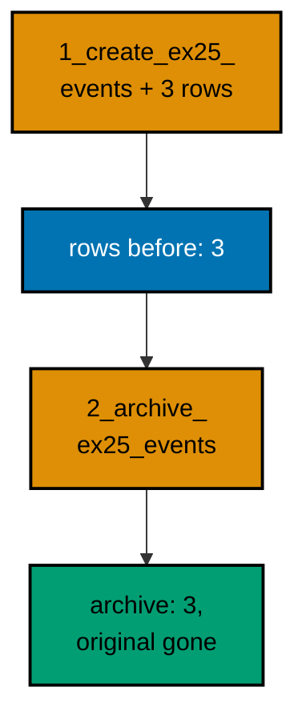

**`learning/code/ex-25-check-before-you-reverse/main.ts`**:

```typescript
import * as Config from "effect/Config"; // => Config reads PGHOST and friends with defaults
import * as Console from "effect/Console"; // => Console.log prints the golden transcript
import * as Effect from "effect/Effect"; // => Effect.gen sequences the migration story
import * as Layer from "effect/Layer"; // => Layer joins the database and node services
import * as Migrator from "effect/sql/Migrator"; // => loaders turn files and records into migrations
import * as SqlClient from "effect/sql/SqlClient"; // => SqlClient runs SQL against the pool
import * as NodeChildProcessSpawner from "@effect/platform-node/NodeChildProcessSpawner"; // => spawner service
import * as NodeFileSystem from "@effect/platform-node/NodeFileSystem"; // => filesystem the file loader reads through
import * as NodePath from "@effect/platform-node/NodePath"; // => path the file loader joins with
import * as NodeRuntime from "@effect/platform-node/NodeRuntime"; // => runMain boots the node services
import * as PgClient from "@effect/sql-pg/PgClient"; // => PgClient.layerConfig builds the pool
import * as PgMigrator from "@effect/sql-pg/PgMigrator"; // => PgMigrator.run applies pending migrations

// => one database layer from harness variables, trust auth, no TLS
const DbLive = PgClient.layerConfig({
  // => layerConfig unwraps Config values
  host: Config.String("PGHOST").pipe(Config.withDefault("postgres")), // => service hostname
  port: Config.Port("PGPORT").pipe(Config.withDefault(5432)), // => service port as a number
  database: Config.String("PGDATABASE").pipe(Config.withDefault("postgres")), // => fresh database per run
  username: Config.String("PGUSER").pipe(Config.withDefault("postgres")), // => trust-auth role
  ssl: Config.succeed(false), // => plaintext inside the unit network
}); // => DbLive offers PgClient and SqlClient together

// => the migrator type also asks for three node services
const NodeLive = Layer.mergeAll(NodeFileSystem.layer, NodePath.layer); // => file plus path side by side
const SpawnerLive = Layer.provide(NodeChildProcessSpawner.layer, NodeLive); // => spawner fed by file and path
const MainLive = Layer.mergeAll(DbLive, NodeLive, SpawnerLive); // => one layer for the whole program

const program = Effect.gen(function* () {
  // => the example narrative
  const sql = yield* SqlClient.SqlClient; // => the query surface over the pool
  const first = yield* PgMigrator.run({
    // => the change that later needs reversing
    loader: Migrator.fromRecord({
      // => seed three rows
      "1_create_ex25_events": Effect.gen(function* () {
        // => the setup migration
        const inner = yield* SqlClient.SqlClient; // => the body borrows the same client
        yield* inner`CREATE TABLE ex25_events (id SERIAL PRIMARY KEY, kind TEXT NOT NULL)`; // => the events table
        yield* inner`INSERT INTO ex25_events (kind) VALUES ('a'), ('b'), ('c')`; // => three rows worth archiving
      }), // => end of the setup migration
    }), // => end of the first loader
    table: "ex25_history", // => per-example history table
  }); // => first run seeds the table
  yield* Console.log(`seeded: ${first.length}`); // => Output: seeded: 1
  const before = yield* sql<{ total: number }>`SELECT count(*)::int AS total FROM ex25_events`; // => count before reversing
  yield* Console.log(`rows before: ${before[0].total}`); // => Output: rows before: 3
  const second = yield* PgMigrator.run({
    // => the checked reversal
    loader: Migrator.fromRecord({
      // => archive, then drop
      "2_archive_ex25_events": Effect.gen(function* () {
        // => the compensation
        const inner = yield* SqlClient.SqlClient; // => the body borrows the same client
        yield* inner`CREATE TABLE ex25_archive (id INT NOT NULL, kind TEXT NOT NULL)`; // => the archive table
        yield* inner`INSERT INTO ex25_archive SELECT id, kind FROM ex25_events`; // => copy every row across
        yield* inner`DROP TABLE ex25_events`; // => only then drop the original
      }), // => end of the compensation
    }), // => end of the second loader
    table: "ex25_history", // => the same history table
  }); // => second run archives and drops
  yield* Console.log(`reversed: ${second.length}`); // => Output: reversed: 1
  const after = yield* sql<{ total: number }>`SELECT count(*)::int AS total FROM ex25_archive`; // => count after reversing
  yield* Console.log(`archived: ${after[0].total}`); // => Output: archived: 3
  yield* sql`DROP TABLE ex25_archive`; // => drop the archive table
  yield* sql`DROP TABLE ex25_history`; // => and no history table either
  yield* Console.log("cleaned: yes"); // => Output: cleaned: yes
}); // => program ends: the harness compares stdout to the golden file

NodeRuntime.runMain(program.pipe(Effect.provide(MainLive))); // => boot node services and run
```

**Output** (`learning/code/ex-25-check-before-you-reverse/expected/main.stdout.txt`):

```text
seeded: 1
rows before: 3
reversed: 1
archived: 3
cleaned: yes
```

(Concepts: co-08, co-16.)
