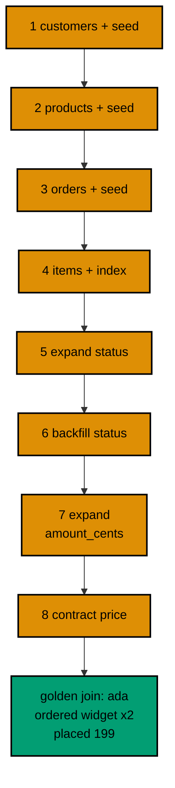

The capstone evolves a small order-management schema through eight realistic Effect SQL migrations: customers, products, orders, line items with an index, an order-status expansion plus backfill, and a zero-downtime price-to-cents rename. A golden join query then proves the final schema and the migrated data agree. Everything runs against the real pinned PostgreSQL 18 container, and the history table records all eight rows.

## The schema story

The shop starts with nothing and grows the way real shops grow: first the people, then the catalog, then the transactions on top. Migration one creates `cap_customers` and seeds Ada, the shop's first customer. Migration two creates `cap_products` with a bare `price` column and seeds one widget at 199. Migration three creates `cap_orders` with a foreign key to customers and seeds Ada's first order. Migration four creates `cap_items` with foreign keys to orders, a quantity, a product reference, seeds two widgets on order one, and adds the order lookup index beside the table it serves.

Migrations five and six are the status rollout. Five expands `cap_orders` with a nullable `status` column, changing nothing about existing rows. Six backfills every null status to `placed`, completing the data half of the change. Migrations seven and eight are the zero-downtime rename: seven adds `amount_cents` and copies the price across, eight drops the legacy `price` column only after the values have moved. Each step is reviewable alone, and every deploy between steps stays green.

## What to run

The capstone lives in `learning/capstone/code/` with its own `run.yaml`, following the same shape as every example unit: a build check compiles `main.ts` with the course TypeScript settings, and the main run executes it against the service database. The loader reads the eight numbered files from the `migrations/` directory with `Migrator.fromFileSystem`, applies them in numeric order, and records each in `cap_history`.



## The code

**`learning/capstone/code/main.ts`**:

```typescript
import * as Config from "effect/Config"; // => Config reads PGHOST and friends with defaults
import * as Console from "effect/Console"; // => Console.log prints the golden transcript
import * as Effect from "effect/Effect"; // => Effect.gen sequences the migration story
import * as Layer from "effect/Layer"; // => Layer joins the database and node services
import * as Migrator from "effect/sql/Migrator"; // => loaders turn files and records into migrations
import * as SqlClient from "effect/sql/SqlClient"; // => SqlClient runs SQL against the pool
import * as NodeChildProcessSpawner from "@effect/platform-node/NodeChildProcessSpawner"; // => spawner service
import * as NodeFileSystem from "@effect/platform-node/NodeFileSystem"; // => filesystem the file loader reads through
import * as NodePath from "@effect/platform-node/NodePath"; // => path the file loader joins with
import * as NodeRuntime from "@effect/platform-node/NodeRuntime"; // => runMain boots the node services
import * as PgClient from "@effect/sql-pg/PgClient"; // => PgClient.layerConfig builds the pool
import * as PgMigrator from "@effect/sql-pg/PgMigrator"; // => PgMigrator.run applies pending migrations

// => one database layer from harness variables, trust auth, no TLS
const DbLive = PgClient.layerConfig({
  // => layerConfig unwraps Config values
  host: Config.String("PGHOST").pipe(Config.withDefault("postgres")), // => service hostname
  port: Config.Port("PGPORT").pipe(Config.withDefault(5432)), // => service port as a number
  database: Config.String("PGDATABASE").pipe(Config.withDefault("postgres")), // => fresh database per run
  username: Config.String("PGUSER").pipe(Config.withDefault("postgres")), // => trust-auth role
  ssl: Config.succeed(false), // => plaintext inside the unit network
}); // => DbLive offers PgClient and SqlClient together

// => the migrator type also asks for three node services
const NodeLive = Layer.mergeAll(NodeFileSystem.layer, NodePath.layer); // => file plus path side by side
const SpawnerLive = Layer.provide(NodeChildProcessSpawner.layer, NodeLive); // => spawner fed by file and path
const MainLive = Layer.mergeAll(DbLive, NodeLive, SpawnerLive); // => one layer for the whole program

const program = Effect.gen(function* () {
  // => the capstone story
  const sql = yield* SqlClient.SqlClient; // => the query surface over the pool
  const applied = yield* PgMigrator.run({
    // => eight migrations, one ordered line
    loader: Migrator.fromFileSystem("migrations"), // => files 1 through 8 in numeric order
    table: "cap_history", // => per-capstone history table
  }); // => the whole shop schema builds at once
  yield* Console.log(`applied: ${applied.length}`); // => Output: applied: 8
  // => all eight files ran in numeric order
  // => the golden join proves schema and data agree
  const rows = yield* sql<{
    customer: string;
    product: string;
    qty: number;
    status: string;
    amount: number;
  }>`SELECT c.name AS customer, p.title AS product, i.qty AS qty, o.status AS status, p.amount_cents AS amount FROM cap_customers c JOIN cap_orders o ON o.customer_id = c.id JOIN cap_items i ON i.order_id = o.id JOIN cap_products p ON p.id = i.product_id ORDER BY o.id`; // => the golden join
  for (const row of rows) {
    // => walk the order lines
    yield* Console.log(`${row.customer} ordered ${row.product} x${row.qty} ${row.status} ${row.amount}`); // => Output: ada ordered widget x2 placed 199
  } // => loop ends after the last order line
  const recorded = yield* sql<{ total: number }>`SELECT count(*)::int AS total FROM cap_history`; // => the full line recorded
  yield* Console.log(`recorded: ${recorded[0].total}`); // => Output: recorded: 8
  // => applied equals recorded: the healthy-run invariant
  // => the unit leaves the database exactly as it found it
  yield* sql`DROP TABLE cap_items`; // => drop the line items
  yield* sql`DROP TABLE cap_orders`; // => drop the orders
  yield* sql`DROP TABLE cap_products`; // => drop the products
  yield* sql`DROP TABLE cap_customers`; // => drop the customers
  yield* sql`DROP TABLE cap_history`; // => and no history table either
  yield* Console.log("cleaned: yes"); // => Output: cleaned: yes
}); // => program ends: the harness compares stdout to the golden file

NodeRuntime.runMain(program.pipe(Effect.provide(MainLive))); // => boot node services and run
```

**`learning/capstone/code/migrations/1_create_customers.ts`**:

```typescript
import * as Effect from "effect/Effect"; // => Effect.gen builds the migration body
import * as SqlClient from "effect/sql/SqlClient"; // => SqlClient runs the DDL

export default Effect.gen(function* () {
  // => the default export is the migration
  const sql = yield* SqlClient.SqlClient; // => the client the migrator lends this file
  yield* sql`CREATE TABLE cap_customers (id SERIAL PRIMARY KEY, name TEXT NOT NULL)`; // => the customers table
  yield* sql`INSERT INTO cap_customers (name) VALUES ('ada')`; // => the first customer
}); // => end of migration 1
```

**`learning/capstone/code/migrations/2_create_products.ts`**:

```typescript
import * as Effect from "effect/Effect"; // => Effect.gen builds the migration body
import * as SqlClient from "effect/sql/SqlClient"; // => SqlClient runs the DDL

export default Effect.gen(function* () {
  // => the default export is the migration
  const sql = yield* SqlClient.SqlClient; // => the client the migrator lends this file
  yield* sql`CREATE TABLE cap_products (id SERIAL PRIMARY KEY, title TEXT NOT NULL, price INT NOT NULL)`; // => the products table
  yield* sql`INSERT INTO cap_products (title, price) VALUES ('widget', 199)`; // => the first product
}); // => end of migration 2
```

**`learning/capstone/code/migrations/3_create_orders.ts`**:

```typescript
import * as Effect from "effect/Effect"; // => Effect.gen builds the migration body
import * as SqlClient from "effect/sql/SqlClient"; // => SqlClient runs the DDL

export default Effect.gen(function* () {
  // => the default export is the migration
  const sql = yield* SqlClient.SqlClient; // => the client the migrator lends this file
  yield* sql`CREATE TABLE cap_orders (id SERIAL PRIMARY KEY, customer_id INT NOT NULL REFERENCES cap_customers (id))`; // => the orders table
  yield* sql`INSERT INTO cap_orders (customer_id) VALUES (1)`; // => ada's first order
}); // => end of migration 3
```

**`learning/capstone/code/migrations/4_create_items.ts`**:

```typescript
import * as Effect from "effect/Effect"; // => Effect.gen builds the migration body
import * as SqlClient from "effect/sql/SqlClient"; // => SqlClient runs the DDL

export default Effect.gen(function* () {
  // => the default export is the migration
  const sql = yield* SqlClient.SqlClient; // => the client the migrator lends this file
  yield* sql`CREATE TABLE cap_items (id SERIAL PRIMARY KEY, order_id INT NOT NULL REFERENCES cap_orders (id), product_id INT NOT NULL, qty INT NOT NULL)`; // => the line items
  yield* sql`INSERT INTO cap_items (order_id, product_id, qty) VALUES (1, 1, 2)`; // => two widgets on order one
  yield* sql`CREATE INDEX cap_items_order_idx ON cap_items (order_id)`; // => the lookup path
}); // => end of migration 4
```

**`learning/capstone/code/migrations/5_expand_status.ts`**:

```typescript
import * as Effect from "effect/Effect"; // => Effect.gen builds the migration body
import * as SqlClient from "effect/sql/SqlClient"; // => SqlClient runs the DDL

export default Effect.gen(function* () {
  // => the default export is the migration
  const sql = yield* SqlClient.SqlClient; // => the client the migrator lends this file
  yield* sql`ALTER TABLE cap_orders ADD COLUMN status TEXT`; // => expand: the new shape arrives
}); // => end of migration 5
```

**`learning/capstone/code/migrations/6_backfill_status.ts`**:

```typescript
import * as Effect from "effect/Effect"; // => Effect.gen builds the migration body
import * as SqlClient from "effect/sql/SqlClient"; // => SqlClient runs the DDL

export default Effect.gen(function* () {
  // => the default export is the migration
  const sql = yield* SqlClient.SqlClient; // => the client the migrator lends this file
  yield* sql`UPDATE cap_orders SET status = 'placed' WHERE status IS NULL`; // => backfill the existing order
}); // => end of migration 6
```

**`learning/capstone/code/migrations/7_expand_amount.ts`**:

```typescript
import * as Effect from "effect/Effect"; // => Effect.gen builds the migration body
import * as SqlClient from "effect/sql/SqlClient"; // => SqlClient runs the DDL

export default Effect.gen(function* () {
  // => the default export is the migration
  const sql = yield* SqlClient.SqlClient; // => the client the migrator lends this file
  yield* sql`ALTER TABLE cap_products ADD COLUMN amount_cents INT`; // => expand: cents replace bare price
  yield* sql`UPDATE cap_products SET amount_cents = price WHERE amount_cents IS NULL`; // => migrate the values across
}); // => end of migration 7
```

**`learning/capstone/code/migrations/8_contract_price.ts`**:

```typescript
import * as Effect from "effect/Effect"; // => Effect.gen builds the migration body
import * as SqlClient from "effect/sql/SqlClient"; // => SqlClient runs the DDL

export default Effect.gen(function* () {
  // => the default export is the migration
  const sql = yield* SqlClient.SqlClient; // => the client the migrator lends this file
  yield* sql`ALTER TABLE cap_products DROP COLUMN price`; // => contract: the legacy column leaves
}); // => end of migration 8
```

**Output** (`learning/capstone/code/expected/main.stdout.txt`):

```text
applied: 8
ada ordered widget x2 placed 199
recorded: 8
cleaned: yes
```

## How it is verified

The program prints three facts the golden file pins down. First, the applied count: eight, proving the whole line ran. Second, the golden join itself: one row joining all four tables, printing `ada ordered widget x2 placed 199`, which proves the foreign keys resolve, the backfilled status reads `placed`, and the renamed cents column holds 199. Third, the recorded count: eight history rows, proving applied equals recorded. The unit then drops every table it built, leaving the database exactly as it found it.

## What good looks like

A good capstone run prints the applied count, the golden join line, the recorded count, and the cleanup line, in that order, with no extra output. If any migration fails, the run's transaction rolls back and the history stays empty, which is itself the correct behavior to observe: the capstone is also a rehearsal of the failure path from the advanced level. Re-running after a fix applies cleanly, because nothing was ever half-recorded.

## Going further

Three extensions turn the capstone into a personal drill. First, promote the same eight-migration set across two history tables, one per environment, and confirm both converge on the same latest row, the way the promotion examples do. Second, add a ninth migration that compensates one of the eight, for example dropping the items index, and verify the compensation lands while everything else stands. Third, build the checksum guard from the advanced level over the capstone's migration texts, and confirm the stored hashes match on every run. Each extension reuses the capstone's tables and history, so none of them needs a new database.
