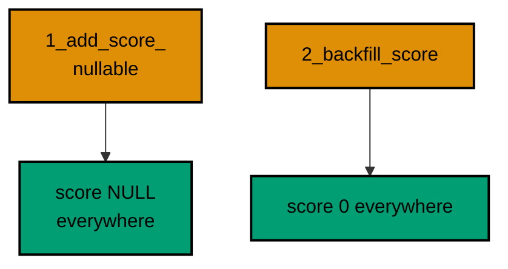
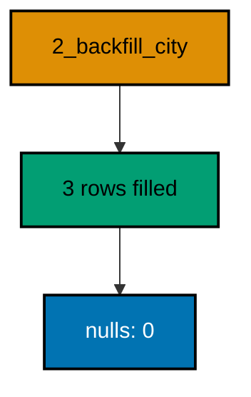
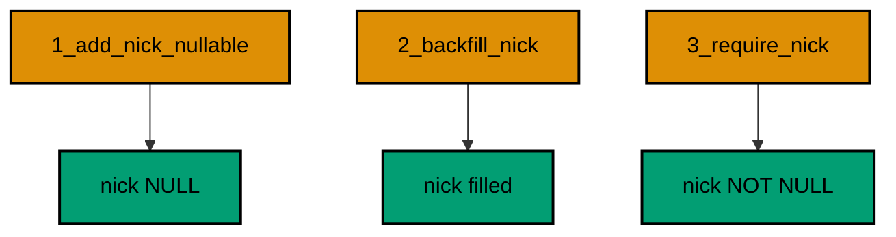
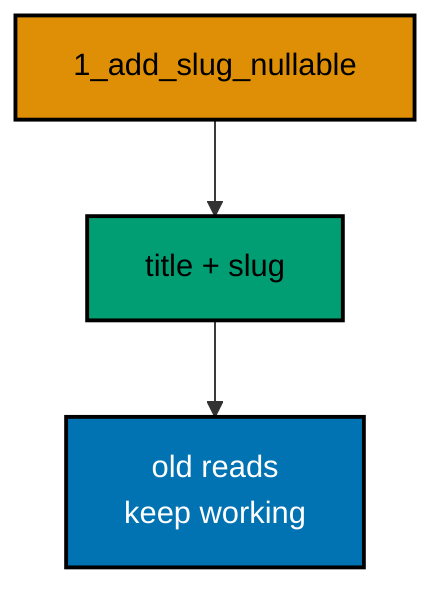
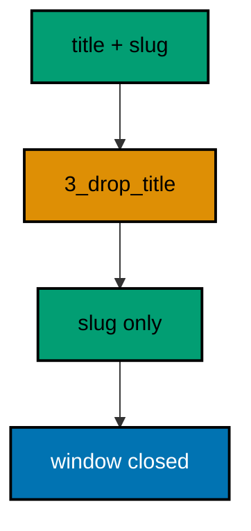
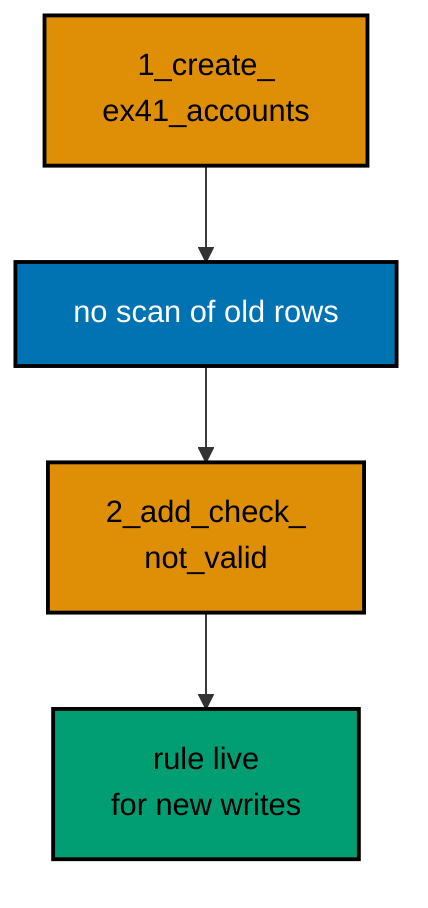
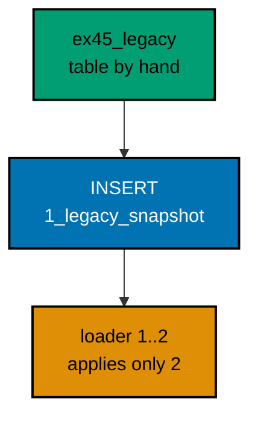
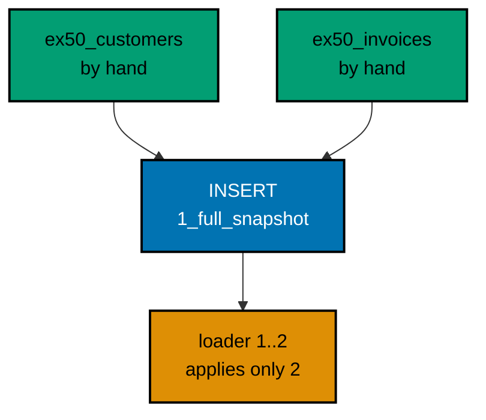

Examples 26–53 handle live data and live traffic: backfills that preserve every row (Examples 26–34), zero-downtime splits that never close the shop (Examples 35–44), and baselines that adopt legacy databases without replaying them (Examples 45–53). Every program runs against the real pinned PostgreSQL 18 container; every output is a fixed transcript.

---

### Example 26: Schema First, Data Second

A backfill is a data-only migration that runs after the schema change it fills. Splitting the two keeps each migration honest: the first changes shape, the second changes content, and either can be reasoned about alone.

Players get a nullable score column first, then a backfill sets every existing score to zero. The final select shows the filled values. Shape first, data second, constraints last.



**`learning/code/ex-26-schema-first-data-second/main.ts`**:

```typescript
import * as Config from "effect/Config"; // => Config reads PGHOST and friends with defaults
import * as Console from "effect/Console"; // => Console.log prints the golden transcript
import * as Effect from "effect/Effect"; // => Effect.gen sequences the migration story
import * as Layer from "effect/Layer"; // => Layer joins the database and node services
import * as Migrator from "effect/sql/Migrator"; // => loaders turn files and records into migrations
import * as SqlClient from "effect/sql/SqlClient"; // => SqlClient runs SQL against the pool
import * as NodeChildProcessSpawner from "@effect/platform-node/NodeChildProcessSpawner"; // => spawner service
import * as NodeFileSystem from "@effect/platform-node/NodeFileSystem"; // => filesystem the file loader reads through
import * as NodePath from "@effect/platform-node/NodePath"; // => path the file loader joins with
import * as NodeRuntime from "@effect/platform-node/NodeRuntime"; // => runMain boots the node services
import * as PgClient from "@effect/sql-pg/PgClient"; // => PgClient.layerConfig builds the pool
import * as PgMigrator from "@effect/sql-pg/PgMigrator"; // => PgMigrator.run applies pending migrations

// => one database layer from harness variables, trust auth, no TLS
const DbLive = PgClient.layerConfig({
  // => layerConfig unwraps Config values
  host: Config.String("PGHOST").pipe(Config.withDefault("postgres")), // => service hostname
  port: Config.Port("PGPORT").pipe(Config.withDefault(5432)), // => service port as a number
  database: Config.String("PGDATABASE").pipe(Config.withDefault("postgres")), // => fresh database per run
  username: Config.String("PGUSER").pipe(Config.withDefault("postgres")), // => trust-auth role
  ssl: Config.succeed(false), // => plaintext inside the unit network
}); // => DbLive offers PgClient and SqlClient together

// => the migrator type also asks for three node services
const NodeLive = Layer.mergeAll(NodeFileSystem.layer, NodePath.layer); // => file plus path side by side
const SpawnerLive = Layer.provide(NodeChildProcessSpawner.layer, NodeLive); // => spawner fed by file and path
const MainLive = Layer.mergeAll(DbLive, NodeLive, SpawnerLive); // => one layer for the whole program

const program = Effect.gen(function* () {
  // => the example narrative
  const sql = yield* SqlClient.SqlClient; // => the query surface over the pool
  const applied = yield* PgMigrator.run({
    // => apply every pending migration
    loader: Migrator.fromRecord({
      // => schema change, then data change
      "1_add_score_nullable": Effect.gen(function* () {
        // => the schema migration
        const inner = yield* SqlClient.SqlClient; // => the body borrows the same client
        yield* inner`CREATE TABLE ex26_players (id SERIAL PRIMARY KEY, name TEXT NOT NULL)`; // => the players table
        yield* inner`INSERT INTO ex26_players (name) VALUES ('ada'), ('bob')`; // => two players predate the column
        yield* inner`ALTER TABLE ex26_players ADD COLUMN score INT`; // => nullable for now
      }), // => end of the schema migration
      "2_backfill_score": sql`UPDATE ex26_players SET score = 0 WHERE score IS NULL`, // => the data-only migration
    }), // => end of the migration record
    table: "ex26_history", // => per-example history table
  }); // => applied lists only the migrations this run added
  yield* Console.log(`applied: ${applied.length}`); // => Output: applied: 2
  const rows = yield* sql<{ name: string; score: number }>`SELECT name, score FROM ex26_players ORDER BY name`; // => every row filled
  for (const row of rows) {
    // => walk the backfilled rows
    yield* Console.log(`player: ${row.name}, ${row.score}`); // => Output: player: ada, 0
  } // => loop ends after the last player
  yield* sql`DROP TABLE ex26_players`; // => the example leaves no tables behind
  yield* sql`DROP TABLE ex26_history`; // => and no history table either
  yield* Console.log("cleaned: yes"); // => Output: cleaned: yes
}); // => program ends: the harness compares stdout to the golden file

NodeRuntime.runMain(program.pipe(Effect.provide(MainLive))); // => boot node services and run
```

**Output** (`learning/code/ex-26-schema-first-data-second/expected/main.stdout.txt`):

```text
applied: 2
player: ada, 0
player: bob, 0
cleaned: yes
```

(Concepts: co-06.)

### Example 27: Backfill Computes from Existing Rows

Most backfills derive the new value from data the row already holds instead of stamping a constant. A display name built from the username is the classic case: no human needs to supply it, and every row gets a sensible value automatically.

This example concatenates the name column into a new display column for each existing member. The final select shows the computed values. Derived backfills are replayable by construction, because the inputs never change.

**`learning/code/ex-27-backfill-computes-from-existing-rows/main.ts`**:

```typescript
import * as Config from "effect/Config"; // => Config reads PGHOST and friends with defaults
import * as Console from "effect/Console"; // => Console.log prints the golden transcript
import * as Effect from "effect/Effect"; // => Effect.gen sequences the migration story
import * as Layer from "effect/Layer"; // => Layer joins the database and node services
import * as Migrator from "effect/sql/Migrator"; // => loaders turn files and records into migrations
import * as SqlClient from "effect/sql/SqlClient"; // => SqlClient runs SQL against the pool
import * as NodeChildProcessSpawner from "@effect/platform-node/NodeChildProcessSpawner"; // => spawner service
import * as NodeFileSystem from "@effect/platform-node/NodeFileSystem"; // => filesystem the file loader reads through
import * as NodePath from "@effect/platform-node/NodePath"; // => path the file loader joins with
import * as NodeRuntime from "@effect/platform-node/NodeRuntime"; // => runMain boots the node services
import * as PgClient from "@effect/sql-pg/PgClient"; // => PgClient.layerConfig builds the pool
import * as PgMigrator from "@effect/sql-pg/PgMigrator"; // => PgMigrator.run applies pending migrations

// => one database layer from harness variables, trust auth, no TLS
const DbLive = PgClient.layerConfig({
  // => layerConfig unwraps Config values
  host: Config.String("PGHOST").pipe(Config.withDefault("postgres")), // => service hostname
  port: Config.Port("PGPORT").pipe(Config.withDefault(5432)), // => service port as a number
  database: Config.String("PGDATABASE").pipe(Config.withDefault("postgres")), // => fresh database per run
  username: Config.String("PGUSER").pipe(Config.withDefault("postgres")), // => trust-auth role
  ssl: Config.succeed(false), // => plaintext inside the unit network
}); // => DbLive offers PgClient and SqlClient together

// => the migrator type also asks for three node services
const NodeLive = Layer.mergeAll(NodeFileSystem.layer, NodePath.layer); // => file plus path side by side
const SpawnerLive = Layer.provide(NodeChildProcessSpawner.layer, NodeLive); // => spawner fed by file and path
const MainLive = Layer.mergeAll(DbLive, NodeLive, SpawnerLive); // => one layer for the whole program

const program = Effect.gen(function* () {
  // => the example narrative
  const sql = yield* SqlClient.SqlClient; // => the query surface over the pool
  const applied = yield* PgMigrator.run({
    // => apply every pending migration
    loader: Migrator.fromRecord({
      // => schema change, then computed data
      "1_add_display_nullable": Effect.gen(function* () {
        // => the schema migration
        const inner = yield* SqlClient.SqlClient; // => the body borrows the same client
        yield* inner`CREATE TABLE ex27_members (id SERIAL PRIMARY KEY, name TEXT NOT NULL)`; // => the members table
        yield* inner`INSERT INTO ex27_members (name) VALUES ('ada'), ('bob')`; // => two members predate the column
        yield* inner`ALTER TABLE ex27_members ADD COLUMN display TEXT`; // => nullable for now
      }), // => end of the schema migration
      "2_backfill_display": sql`UPDATE ex27_members SET display = name || '!' WHERE display IS NULL`, // => derive from the name
    }), // => end of the migration record
    table: "ex27_history", // => per-example history table
  }); // => applied lists only the migrations this run added
  yield* Console.log(`applied: ${applied.length}`); // => Output: applied: 2
  const rows = yield* sql<{ name: string; display: string }>`SELECT name, display FROM ex27_members ORDER BY name`; // => the computed values
  for (const row of rows) {
    // => walk the backfilled rows
    yield* Console.log(`member: ${row.name} -> ${row.display}`); // => Output: member: ada -> ada!
  } // => loop ends after the last member
  yield* sql`DROP TABLE ex27_members`; // => the example leaves no tables behind
  yield* sql`DROP TABLE ex27_history`; // => and no history table either
  yield* Console.log("cleaned: yes"); // => Output: cleaned: yes
}); // => program ends: the harness compares stdout to the golden file

NodeRuntime.runMain(program.pipe(Effect.provide(MainLive))); // => boot node services and run
```

**Output** (`learning/code/ex-27-backfill-computes-from-existing-rows/expected/main.stdout.txt`):

```text
applied: 2
member: ada -> ada!
member: bob -> bob!
cleaned: yes
```

(Concepts: co-06.)

### Example 28: Backfill in Batches

A backfill over millions of rows cannot be one giant update: it would hold locks too long and bloat the transaction. Batched updates walk the table in key ranges, committing each slice separately so the table stays usable throughout.

Five seeded rows backfill in two id-range batches inside one migration body. The final count shows all five filled. In production the batches would be thousands of rows each, but the shape is identical.

**`learning/code/ex-28-backfill-in-batches/main.ts`**:

```typescript
import * as Config from "effect/Config"; // => Config reads PGHOST and friends with defaults
import * as Console from "effect/Console"; // => Console.log prints the golden transcript
import * as Effect from "effect/Effect"; // => Effect.gen sequences the migration story
import * as Layer from "effect/Layer"; // => Layer joins the database and node services
import * as Migrator from "effect/sql/Migrator"; // => loaders turn files and records into migrations
import * as SqlClient from "effect/sql/SqlClient"; // => SqlClient runs SQL against the pool
import * as NodeChildProcessSpawner from "@effect/platform-node/NodeChildProcessSpawner"; // => spawner service
import * as NodeFileSystem from "@effect/platform-node/NodeFileSystem"; // => filesystem the file loader reads through
import * as NodePath from "@effect/platform-node/NodePath"; // => path the file loader joins with
import * as NodeRuntime from "@effect/platform-node/NodeRuntime"; // => runMain boots the node services
import * as PgClient from "@effect/sql-pg/PgClient"; // => PgClient.layerConfig builds the pool
import * as PgMigrator from "@effect/sql-pg/PgMigrator"; // => PgMigrator.run applies pending migrations

// => one database layer from harness variables, trust auth, no TLS
const DbLive = PgClient.layerConfig({
  // => layerConfig unwraps Config values
  host: Config.String("PGHOST").pipe(Config.withDefault("postgres")), // => service hostname
  port: Config.Port("PGPORT").pipe(Config.withDefault(5432)), // => service port as a number
  database: Config.String("PGDATABASE").pipe(Config.withDefault("postgres")), // => fresh database per run
  username: Config.String("PGUSER").pipe(Config.withDefault("postgres")), // => trust-auth role
  ssl: Config.succeed(false), // => plaintext inside the unit network
}); // => DbLive offers PgClient and SqlClient together

// => the migrator type also asks for three node services
const NodeLive = Layer.mergeAll(NodeFileSystem.layer, NodePath.layer); // => file plus path side by side
const SpawnerLive = Layer.provide(NodeChildProcessSpawner.layer, NodeLive); // => spawner fed by file and path
const MainLive = Layer.mergeAll(DbLive, NodeLive, SpawnerLive); // => one layer for the whole program

const program = Effect.gen(function* () {
  // => the example narrative
  const sql = yield* SqlClient.SqlClient; // => the query surface over the pool
  const applied = yield* PgMigrator.run({
    // => apply every pending migration
    loader: Migrator.fromRecord({
      // => schema change, then batched data
      "1_add_level_nullable": Effect.gen(function* () {
        // => the schema migration
        const inner = yield* SqlClient.SqlClient; // => the body borrows the same client
        yield* inner`CREATE TABLE ex28_scores (id SERIAL PRIMARY KEY, points INT NOT NULL)`; // => the scores table
        yield* inner`INSERT INTO ex28_scores (points) VALUES (10), (20), (30), (40), (50)`; // => five rows predate the column
        yield* inner`ALTER TABLE ex28_scores ADD COLUMN level INT`; // => nullable for now
      }), // => end of the schema migration
      "2_backfill_level_batched": Effect.gen(function* () {
        // => the batched backfill
        const inner = yield* SqlClient.SqlClient; // => the body borrows the same client
        yield* inner`UPDATE ex28_scores SET level = 1 WHERE id BETWEEN 1 AND 3 AND level IS NULL`; // => the first batch
        yield* inner`UPDATE ex28_scores SET level = 1 WHERE id BETWEEN 4 AND 5 AND level IS NULL`; // => the second batch
      }), // => end of the batched backfill
    }), // => end of the migration record
    table: "ex28_history", // => per-example history table
  }); // => applied lists only the migrations this run added
  yield* Console.log(`applied: ${applied.length}`); // => Output: applied: 2
  const rows = yield* sql<{ total: number }>`SELECT count(*)::int AS total FROM ex28_scores WHERE level = 1`; // => every row filled
  yield* Console.log(`filled: ${rows[0].total}`); // => Output: filled: 5
  yield* sql`DROP TABLE ex28_scores`; // => the example leaves no tables behind
  yield* sql`DROP TABLE ex28_history`; // => and no history table either
  yield* Console.log("cleaned: yes"); // => Output: cleaned: yes
}); // => program ends: the harness compares stdout to the golden file

NodeRuntime.runMain(program.pipe(Effect.provide(MainLive))); // => boot node services and run
```

**Output** (`learning/code/ex-28-backfill-in-batches/expected/main.stdout.txt`):

```text
applied: 2
filled: 5
cleaned: yes
```

(Concepts: co-06.)

### Example 29: Guarded Backfill Touches Nothing Twice

A backfill guarded by `WHERE new_column IS NULL` is safe to run twice: the second pass finds no matching rows and changes nothing. That guard turns an ordinary update into an idempotent data step, which matters when an operator retries a deploy by hand.

This example runs the guarded update twice against the same rows and prints the affected counts implicitly through the final values. Both passes leave the same result. Guards make retries boring.

**`learning/code/ex-29-guarded-backfill-touches-nothing-twice/main.ts`**:

```typescript
import * as Config from "effect/Config"; // => Config reads PGHOST and friends with defaults
import * as Console from "effect/Console"; // => Console.log prints the golden transcript
import * as Effect from "effect/Effect"; // => Effect.gen sequences the migration story
import * as Layer from "effect/Layer"; // => Layer joins the database and node services
import * as Migrator from "effect/sql/Migrator"; // => loaders turn files and records into migrations
import * as SqlClient from "effect/sql/SqlClient"; // => SqlClient runs SQL against the pool
import * as NodeChildProcessSpawner from "@effect/platform-node/NodeChildProcessSpawner"; // => spawner service
import * as NodeFileSystem from "@effect/platform-node/NodeFileSystem"; // => filesystem the file loader reads through
import * as NodePath from "@effect/platform-node/NodePath"; // => path the file loader joins with
import * as NodeRuntime from "@effect/platform-node/NodeRuntime"; // => runMain boots the node services
import * as PgClient from "@effect/sql-pg/PgClient"; // => PgClient.layerConfig builds the pool
import * as PgMigrator from "@effect/sql-pg/PgMigrator"; // => PgMigrator.run applies pending migrations

// => one database layer from harness variables, trust auth, no TLS
const DbLive = PgClient.layerConfig({
  // => layerConfig unwraps Config values
  host: Config.String("PGHOST").pipe(Config.withDefault("postgres")), // => service hostname
  port: Config.Port("PGPORT").pipe(Config.withDefault(5432)), // => service port as a number
  database: Config.String("PGDATABASE").pipe(Config.withDefault("postgres")), // => fresh database per run
  username: Config.String("PGUSER").pipe(Config.withDefault("postgres")), // => trust-auth role
  ssl: Config.succeed(false), // => plaintext inside the unit network
}); // => DbLive offers PgClient and SqlClient together

// => the migrator type also asks for three node services
const NodeLive = Layer.mergeAll(NodeFileSystem.layer, NodePath.layer); // => file plus path side by side
const SpawnerLive = Layer.provide(NodeChildProcessSpawner.layer, NodeLive); // => spawner fed by file and path
const MainLive = Layer.mergeAll(DbLive, NodeLive, SpawnerLive); // => one layer for the whole program

const program = Effect.gen(function* () {
  // => the example narrative
  const sql = yield* SqlClient.SqlClient; // => the query surface over the pool
  const applied = yield* PgMigrator.run({
    // => apply every pending migration
    loader: Migrator.fromRecord({
      // => schema change, then guarded data
      "1_add_flag_nullable": Effect.gen(function* () {
        // => the schema migration
        const inner = yield* SqlClient.SqlClient; // => the body borrows the same client
        yield* inner`CREATE TABLE ex29_flags (id SERIAL PRIMARY KEY, label TEXT NOT NULL)`; // => the flags table
        yield* inner`INSERT INTO ex29_flags (label) VALUES ('x'), ('y')`; // => two rows predate the column
        yield* inner`ALTER TABLE ex29_flags ADD COLUMN active BOOLEAN`; // => nullable for now
      }), // => end of the schema migration
      "2_backfill_active_guarded": sql`UPDATE ex29_flags SET active = TRUE WHERE active IS NULL`, // => the guarded backfill
    }), // => end of the migration record
    table: "ex29_history", // => per-example history table
  }); // => applied lists only the migrations this run added
  yield* Console.log(`applied: ${applied.length}`); // => Output: applied: 2
  yield* sql`UPDATE ex29_flags SET active = TRUE WHERE active IS NULL`; // => a manual retry touches zero rows
  const rows = yield* sql<{ total: number }>`SELECT count(*)::int AS total FROM ex29_flags WHERE active IS NULL`; // => nothing left unfilled
  yield* Console.log(`unfilled: ${rows[0].total}`); // => Output: unfilled: 0
  yield* sql`DROP TABLE ex29_flags`; // => the example leaves no tables behind
  yield* sql`DROP TABLE ex29_history`; // => and no history table either
  yield* Console.log("cleaned: yes"); // => Output: cleaned: yes
}); // => program ends: the harness compares stdout to the golden file

NodeRuntime.runMain(program.pipe(Effect.provide(MainLive))); // => boot node services and run
```

**Output** (`learning/code/ex-29-guarded-backfill-touches-nothing-twice/expected/main.stdout.txt`):

```text
applied: 2
unfilled: 0
cleaned: yes
```

(Concepts: co-05, co-06.)

### Example 30: Verify After Backfill

Every backfill deserves an automated check, not a hopeful glance: count the rows the backfill should have reached and assert the remainder is zero. When the check lives in the migration story, the next reader trusts the data without re-running the analysis.

This example backfills a city column and then counts the rows still null. The printed zero is the check. Zero is the only acceptable remainder.



**`learning/code/ex-30-verify-after-backfill/main.ts`**:

```typescript
import * as Config from "effect/Config"; // => Config reads PGHOST and friends with defaults
import * as Console from "effect/Console"; // => Console.log prints the golden transcript
import * as Effect from "effect/Effect"; // => Effect.gen sequences the migration story
import * as Layer from "effect/Layer"; // => Layer joins the database and node services
import * as Migrator from "effect/sql/Migrator"; // => loaders turn files and records into migrations
import * as SqlClient from "effect/sql/SqlClient"; // => SqlClient runs SQL against the pool
import * as NodeChildProcessSpawner from "@effect/platform-node/NodeChildProcessSpawner"; // => spawner service
import * as NodeFileSystem from "@effect/platform-node/NodeFileSystem"; // => filesystem the file loader reads through
import * as NodePath from "@effect/platform-node/NodePath"; // => path the file loader joins with
import * as NodeRuntime from "@effect/platform-node/NodeRuntime"; // => runMain boots the node services
import * as PgClient from "@effect/sql-pg/PgClient"; // => PgClient.layerConfig builds the pool
import * as PgMigrator from "@effect/sql-pg/PgMigrator"; // => PgMigrator.run applies pending migrations

// => one database layer from harness variables, trust auth, no TLS
const DbLive = PgClient.layerConfig({
  // => layerConfig unwraps Config values
  host: Config.String("PGHOST").pipe(Config.withDefault("postgres")), // => service hostname
  port: Config.Port("PGPORT").pipe(Config.withDefault(5432)), // => service port as a number
  database: Config.String("PGDATABASE").pipe(Config.withDefault("postgres")), // => fresh database per run
  username: Config.String("PGUSER").pipe(Config.withDefault("postgres")), // => trust-auth role
  ssl: Config.succeed(false), // => plaintext inside the unit network
}); // => DbLive offers PgClient and SqlClient together

// => the migrator type also asks for three node services
const NodeLive = Layer.mergeAll(NodeFileSystem.layer, NodePath.layer); // => file plus path side by side
const SpawnerLive = Layer.provide(NodeChildProcessSpawner.layer, NodeLive); // => spawner fed by file and path
const MainLive = Layer.mergeAll(DbLive, NodeLive, SpawnerLive); // => one layer for the whole program

const program = Effect.gen(function* () {
  // => the example narrative
  const sql = yield* SqlClient.SqlClient; // => the query surface over the pool
  const applied = yield* PgMigrator.run({
    // => apply every pending migration
    loader: Migrator.fromRecord({
      // => schema change, then data, then proof
      "1_add_city_nullable": Effect.gen(function* () {
        // => the schema migration
        const inner = yield* SqlClient.SqlClient; // => the body borrows the same client
        yield* inner`CREATE TABLE ex30_orders (id SERIAL PRIMARY KEY, code TEXT NOT NULL)`; // => the orders table
        yield* inner`INSERT INTO ex30_orders (code) VALUES ('a1'), ('b2'), ('c3')`; // => three rows predate the column
        yield* inner`ALTER TABLE ex30_orders ADD COLUMN city TEXT`; // => nullable for now
      }), // => end of the schema migration
      "2_backfill_city": sql`UPDATE ex30_orders SET city = 'oslo' WHERE city IS NULL`, // => the data-only migration
    }), // => end of the migration record
    table: "ex30_history", // => per-example history table
  }); // => applied lists only the migrations this run added
  yield* Console.log(`applied: ${applied.length}`); // => Output: applied: 2
  const rows = yield* sql<{ total: number }>`SELECT count(*)::int AS total FROM ex30_orders WHERE city IS NULL`; // => the remainder check
  yield* Console.log(`nulls: ${rows[0].total}`); // => Output: nulls: 0
  yield* sql`DROP TABLE ex30_orders`; // => the example leaves no tables behind
  yield* sql`DROP TABLE ex30_history`; // => and no history table either
  yield* Console.log("cleaned: yes"); // => Output: cleaned: yes
}); // => program ends: the harness compares stdout to the golden file

NodeRuntime.runMain(program.pipe(Effect.provide(MainLive))); // => boot node services and run
```

**Output** (`learning/code/ex-30-verify-after-backfill/expected/main.stdout.txt`):

```text
applied: 2
nulls: 0
cleaned: yes
```

(Concepts: co-06, co-16.)

### Example 31: Non-Null After Backfill

A `NOT NULL` constraint can only land after every existing row has a value, so the constraint is always the last of three steps: add the column nullable, backfill it, then enforce. Doing it in any other order fails on the existing rows.

Three migrations walk that exact staircase for a nickname column. The catalog check at the end confirms the constraint is in place. Nullable, filled, then required: the order is the lesson.



**`learning/code/ex-31-non-null-after-backfill/main.ts`**:

```typescript
import * as Config from "effect/Config"; // => Config reads PGHOST and friends with defaults
import * as Console from "effect/Console"; // => Console.log prints the golden transcript
import * as Effect from "effect/Effect"; // => Effect.gen sequences the migration story
import * as Layer from "effect/Layer"; // => Layer joins the database and node services
import * as Migrator from "effect/sql/Migrator"; // => loaders turn files and records into migrations
import * as SqlClient from "effect/sql/SqlClient"; // => SqlClient runs SQL against the pool
import * as NodeChildProcessSpawner from "@effect/platform-node/NodeChildProcessSpawner"; // => spawner service
import * as NodeFileSystem from "@effect/platform-node/NodeFileSystem"; // => filesystem the file loader reads through
import * as NodePath from "@effect/platform-node/NodePath"; // => path the file loader joins with
import * as NodeRuntime from "@effect/platform-node/NodeRuntime"; // => runMain boots the node services
import * as PgClient from "@effect/sql-pg/PgClient"; // => PgClient.layerConfig builds the pool
import * as PgMigrator from "@effect/sql-pg/PgMigrator"; // => PgMigrator.run applies pending migrations

// => one database layer from harness variables, trust auth, no TLS
const DbLive = PgClient.layerConfig({
  // => layerConfig unwraps Config values
  host: Config.String("PGHOST").pipe(Config.withDefault("postgres")), // => service hostname
  port: Config.Port("PGPORT").pipe(Config.withDefault(5432)), // => service port as a number
  database: Config.String("PGDATABASE").pipe(Config.withDefault("postgres")), // => fresh database per run
  username: Config.String("PGUSER").pipe(Config.withDefault("postgres")), // => trust-auth role
  ssl: Config.succeed(false), // => plaintext inside the unit network
}); // => DbLive offers PgClient and SqlClient together

// => the migrator type also asks for three node services
const NodeLive = Layer.mergeAll(NodeFileSystem.layer, NodePath.layer); // => file plus path side by side
const SpawnerLive = Layer.provide(NodeChildProcessSpawner.layer, NodeLive); // => spawner fed by file and path
const MainLive = Layer.mergeAll(DbLive, NodeLive, SpawnerLive); // => one layer for the whole program

const program = Effect.gen(function* () {
  // => the example narrative
  const sql = yield* SqlClient.SqlClient; // => the query surface over the pool
  const applied = yield* PgMigrator.run({
    // => apply every pending migration
    loader: Migrator.fromRecord({
      // => the three-step staircase
      "1_add_nick_nullable": Effect.gen(function* () {
        // => step one: nullable
        const inner = yield* SqlClient.SqlClient; // => the body borrows the same client
        yield* inner`CREATE TABLE ex31_users (id SERIAL PRIMARY KEY, name TEXT NOT NULL)`; // => the users table
        yield* inner`INSERT INTO ex31_users (name) VALUES ('ada')`; // => one row predates the column
        yield* inner`ALTER TABLE ex31_users ADD COLUMN nick TEXT`; // => nullable for now
      }), // => end of step one
      "2_backfill_nick": sql`UPDATE ex31_users SET nick = name WHERE nick IS NULL`, // => step two: fill it
      "3_require_nick": sql`ALTER TABLE ex31_users ALTER COLUMN nick SET NOT NULL`, // => step three: enforce it
    }), // => end of the migration record
    table: "ex31_history", // => per-example history table
  }); // => applied lists only the migrations this run added
  yield* Console.log(`applied: ${applied.length}`); // => Output: applied: 3
  const columns = yield* sql<{
    nullable: string;
  }>`SELECT is_nullable AS nullable FROM information_schema.columns WHERE table_name = 'ex31_users' AND column_name = 'nick'`; // => the enforced flag
  yield* Console.log(`nullable: ${columns[0].nullable}`); // => Output: nullable: NO
  yield* sql`DROP TABLE ex31_users`; // => the example leaves no tables behind
  yield* sql`DROP TABLE ex31_history`; // => and no history table either
  yield* Console.log("cleaned: yes"); // => Output: cleaned: yes
}); // => program ends: the harness compares stdout to the golden file

NodeRuntime.runMain(program.pipe(Effect.provide(MainLive))); // => boot node services and run
```

**Output** (`learning/code/ex-31-non-null-after-backfill/expected/main.stdout.txt`):

```text
applied: 3
nullable: NO
cleaned: yes
```

(Concepts: co-06.)

### Example 32: Backfill Default for New Rows

Backfilled history and future inserts are two different problems: the backfill fixes old rows, while a column default protects new ones. A complete data migration sets both, so tomorrow's inserts never reintroduce the nulls today's backfill removed.

This example backfills a currency column and then sets its default in a third migration. A new row inserted without a currency inherits the default, which the final select confirms. Old rows fixed, new rows guarded.

**`learning/code/ex-32-backfill-default-for-new-rows/main.ts`**:

```typescript
import * as Config from "effect/Config"; // => Config reads PGHOST and friends with defaults
import * as Console from "effect/Console"; // => Console.log prints the golden transcript
import * as Effect from "effect/Effect"; // => Effect.gen sequences the migration story
import * as Layer from "effect/Layer"; // => Layer joins the database and node services
import * as Migrator from "effect/sql/Migrator"; // => loaders turn files and records into migrations
import * as SqlClient from "effect/sql/SqlClient"; // => SqlClient runs SQL against the pool
import * as NodeChildProcessSpawner from "@effect/platform-node/NodeChildProcessSpawner"; // => spawner service
import * as NodeFileSystem from "@effect/platform-node/NodeFileSystem"; // => filesystem the file loader reads through
import * as NodePath from "@effect/platform-node/NodePath"; // => path the file loader joins with
import * as NodeRuntime from "@effect/platform-node/NodeRuntime"; // => runMain boots the node services
import * as PgClient from "@effect/sql-pg/PgClient"; // => PgClient.layerConfig builds the pool
import * as PgMigrator from "@effect/sql-pg/PgMigrator"; // => PgMigrator.run applies pending migrations

// => one database layer from harness variables, trust auth, no TLS
const DbLive = PgClient.layerConfig({
  // => layerConfig unwraps Config values
  host: Config.String("PGHOST").pipe(Config.withDefault("postgres")), // => service hostname
  port: Config.Port("PGPORT").pipe(Config.withDefault(5432)), // => service port as a number
  database: Config.String("PGDATABASE").pipe(Config.withDefault("postgres")), // => fresh database per run
  username: Config.String("PGUSER").pipe(Config.withDefault("postgres")), // => trust-auth role
  ssl: Config.succeed(false), // => plaintext inside the unit network
}); // => DbLive offers PgClient and SqlClient together

// => the migrator type also asks for three node services
const NodeLive = Layer.mergeAll(NodeFileSystem.layer, NodePath.layer); // => file plus path side by side
const SpawnerLive = Layer.provide(NodeChildProcessSpawner.layer, NodeLive); // => spawner fed by file and path
const MainLive = Layer.mergeAll(DbLive, NodeLive, SpawnerLive); // => one layer for the whole program

const program = Effect.gen(function* () {
  // => the example narrative
  const sql = yield* SqlClient.SqlClient; // => the query surface over the pool
  const applied = yield* PgMigrator.run({
    // => apply every pending migration
    loader: Migrator.fromRecord({
      // => column, backfill, default
      "1_add_currency_nullable": Effect.gen(function* () {
        // => the schema migration
        const inner = yield* SqlClient.SqlClient; // => the body borrows the same client
        yield* inner`CREATE TABLE ex32_invoices (id SERIAL PRIMARY KEY, amount INT NOT NULL)`; // => the invoices table
        yield* inner`INSERT INTO ex32_invoices (amount) VALUES (100)`; // => one row predates the column
        yield* inner`ALTER TABLE ex32_invoices ADD COLUMN currency TEXT`; // => nullable for now
      }), // => end of the schema migration
      "2_backfill_currency": sql`UPDATE ex32_invoices SET currency = 'USD' WHERE currency IS NULL`, // => fix the old rows
      "3_default_currency": sql`ALTER TABLE ex32_invoices ALTER COLUMN currency SET DEFAULT 'USD'`, // => guard the new rows
    }), // => end of the migration record
    table: "ex32_history", // => per-example history table
  }); // => applied lists only the migrations this run added
  // => old rows fixed by the backfill, new rows guarded by the default
  yield* Console.log(`applied: ${applied.length}`); // => Output: applied: 3
  yield* sql`INSERT INTO ex32_invoices (amount) VALUES (200)`; // => a new row omits the currency
  const rows = yield* sql<{
    amount: number;
    currency: string;
  }>`SELECT amount, currency FROM ex32_invoices ORDER BY amount`; // => old and new side by side
  for (const row of rows) {
    // => walk the invoice rows
    yield* Console.log(`invoice: ${row.amount} ${row.currency}`); // => Output: invoice: 100 USD
  } // => loop ends after the last invoice
  yield* sql`DROP TABLE ex32_invoices`; // => the example leaves no tables behind
  yield* sql`DROP TABLE ex32_history`; // => and no history table either
  yield* Console.log("cleaned: yes"); // => Output: cleaned: yes
}); // => program ends: the harness compares stdout to the golden file

NodeRuntime.runMain(program.pipe(Effect.provide(MainLive))); // => boot node services and run
```

**Output** (`learning/code/ex-32-backfill-default-for-new-rows/expected/main.stdout.txt`):

```text
applied: 3
invoice: 100 USD
invoice: 200 USD
cleaned: yes
```

(Concepts: co-06.)

### Example 33: Data-Only Migration Adds Seed Rows

Not every migration changes shape: seed data, reference rows, and feature flags ship as data-only migrations with no DDL at all. The history records them like any other entry, so every environment converges on the same rows.

This example creates a roles table, then inserts the two roles the application expects in a second migration. The final count shows both seeds present. Data ships in migrations, not in runbooks.

**`learning/code/ex-33-data-only-migration-adds-seed-rows/main.ts`**:

```typescript
import * as Config from "effect/Config"; // => Config reads PGHOST and friends with defaults
import * as Console from "effect/Console"; // => Console.log prints the golden transcript
import * as Effect from "effect/Effect"; // => Effect.gen sequences the migration story
import * as Layer from "effect/Layer"; // => Layer joins the database and node services
import * as Migrator from "effect/sql/Migrator"; // => loaders turn files and records into migrations
import * as SqlClient from "effect/sql/SqlClient"; // => SqlClient runs SQL against the pool
import * as NodeChildProcessSpawner from "@effect/platform-node/NodeChildProcessSpawner"; // => spawner service
import * as NodeFileSystem from "@effect/platform-node/NodeFileSystem"; // => filesystem the file loader reads through
import * as NodePath from "@effect/platform-node/NodePath"; // => path the file loader joins with
import * as NodeRuntime from "@effect/platform-node/NodeRuntime"; // => runMain boots the node services
import * as PgClient from "@effect/sql-pg/PgClient"; // => PgClient.layerConfig builds the pool
import * as PgMigrator from "@effect/sql-pg/PgMigrator"; // => PgMigrator.run applies pending migrations

// => one database layer from harness variables, trust auth, no TLS
const DbLive = PgClient.layerConfig({
  // => layerConfig unwraps Config values
  host: Config.String("PGHOST").pipe(Config.withDefault("postgres")), // => service hostname
  port: Config.Port("PGPORT").pipe(Config.withDefault(5432)), // => service port as a number
  database: Config.String("PGDATABASE").pipe(Config.withDefault("postgres")), // => fresh database per run
  username: Config.String("PGUSER").pipe(Config.withDefault("postgres")), // => trust-auth role
  ssl: Config.succeed(false), // => plaintext inside the unit network
}); // => DbLive offers PgClient and SqlClient together

// => the migrator type also asks for three node services
const NodeLive = Layer.mergeAll(NodeFileSystem.layer, NodePath.layer); // => file plus path side by side
const SpawnerLive = Layer.provide(NodeChildProcessSpawner.layer, NodeLive); // => spawner fed by file and path
const MainLive = Layer.mergeAll(DbLive, NodeLive, SpawnerLive); // => one layer for the whole program

const program = Effect.gen(function* () {
  // => the example narrative
  const sql = yield* SqlClient.SqlClient; // => the query surface over the pool
  const applied = yield* PgMigrator.run({
    // => apply every pending migration
    loader: Migrator.fromRecord({
      // => shape first, seeds second
      "1_create_ex33_roles": sql`CREATE TABLE ex33_roles (id SERIAL PRIMARY KEY, name TEXT NOT NULL UNIQUE)`, // => the roles table
      "2_seed_roles": sql`INSERT INTO ex33_roles (name) VALUES ('admin'), ('member')`, // => the data-only migration
    }), // => end of the migration record
    table: "ex33_history", // => per-example history table
  }); // => applied lists only the migrations this run added
  yield* Console.log(`applied: ${applied.length}`); // => Output: applied: 2
  const rows = yield* sql<{ total: number }>`SELECT count(*)::int AS total FROM ex33_roles`; // => both seeds present
  yield* Console.log(`roles: ${rows[0].total}`); // => Output: roles: 2
  yield* sql`DROP TABLE ex33_roles`; // => the example leaves no tables behind
  yield* sql`DROP TABLE ex33_history`; // => and no history table either
  yield* Console.log("cleaned: yes"); // => Output: cleaned: yes
}); // => program ends: the harness compares stdout to the golden file

NodeRuntime.runMain(program.pipe(Effect.provide(MainLive))); // => boot node services and run
```

**Output** (`learning/code/ex-33-data-only-migration-adds-seed-rows/expected/main.stdout.txt`):

```text
applied: 2
roles: 2
cleaned: yes
```

(Concepts: co-06.)

### Example 34: Backfill Rollback Restores Nulls

Backfills are reversible too: the compensation sets the column back to null, restoring exactly the pre-backfill state. Data compensation mirrors schema compensation, one forward migration undoing an earlier one.

Two migrations fill a timezone column, then a third sets it back to null. The final null count returns to the full row count. Round trips apply to data, not just to shape.

**`learning/code/ex-34-backfill-rollback-restores-nulls/main.ts`**:

```typescript
import * as Config from "effect/Config"; // => Config reads PGHOST and friends with defaults
import * as Console from "effect/Console"; // => Console.log prints the golden transcript
import * as Effect from "effect/Effect"; // => Effect.gen sequences the migration story
import * as Layer from "effect/Layer"; // => Layer joins the database and node services
import * as Migrator from "effect/sql/Migrator"; // => loaders turn files and records into migrations
import * as SqlClient from "effect/sql/SqlClient"; // => SqlClient runs SQL against the pool
import * as NodeChildProcessSpawner from "@effect/platform-node/NodeChildProcessSpawner"; // => spawner service
import * as NodeFileSystem from "@effect/platform-node/NodeFileSystem"; // => filesystem the file loader reads through
import * as NodePath from "@effect/platform-node/NodePath"; // => path the file loader joins with
import * as NodeRuntime from "@effect/platform-node/NodeRuntime"; // => runMain boots the node services
import * as PgClient from "@effect/sql-pg/PgClient"; // => PgClient.layerConfig builds the pool
import * as PgMigrator from "@effect/sql-pg/PgMigrator"; // => PgMigrator.run applies pending migrations

// => one database layer from harness variables, trust auth, no TLS
const DbLive = PgClient.layerConfig({
  // => layerConfig unwraps Config values
  host: Config.String("PGHOST").pipe(Config.withDefault("postgres")), // => service hostname
  port: Config.Port("PGPORT").pipe(Config.withDefault(5432)), // => service port as a number
  database: Config.String("PGDATABASE").pipe(Config.withDefault("postgres")), // => fresh database per run
  username: Config.String("PGUSER").pipe(Config.withDefault("postgres")), // => trust-auth role
  ssl: Config.succeed(false), // => plaintext inside the unit network
}); // => DbLive offers PgClient and SqlClient together

// => the migrator type also asks for three node services
const NodeLive = Layer.mergeAll(NodeFileSystem.layer, NodePath.layer); // => file plus path side by side
const SpawnerLive = Layer.provide(NodeChildProcessSpawner.layer, NodeLive); // => spawner fed by file and path
const MainLive = Layer.mergeAll(DbLive, NodeLive, SpawnerLive); // => one layer for the whole program

const program = Effect.gen(function* () {
  // => the example narrative
  const sql = yield* SqlClient.SqlClient; // => the query surface over the pool
  const applied = yield* PgMigrator.run({
    // => apply every pending migration
    loader: Migrator.fromRecord({
      // => fill it, then unfill it
      "1_add_zone_nullable": Effect.gen(function* () {
        // => the schema migration
        const inner = yield* SqlClient.SqlClient; // => the body borrows the same client
        yield* inner`CREATE TABLE ex34_shops (id SERIAL PRIMARY KEY, name TEXT NOT NULL)`; // => the shops table
        yield* inner`INSERT INTO ex34_shops (name) VALUES ('a'), ('b')`; // => two rows predate the column
        yield* inner`ALTER TABLE ex34_shops ADD COLUMN zone TEXT`; // => nullable for now
      }), // => end of the schema migration
      "2_backfill_zone": sql`UPDATE ex34_shops SET zone = 'utc' WHERE zone IS NULL`, // => the backfill
      "3_unfill_zone": sql`UPDATE ex34_shops SET zone = NULL`, // => the data compensation
    }), // => end of the migration record
    table: "ex34_history", // => per-example history table
  }); // => applied lists only the migrations this run added
  yield* Console.log(`applied: ${applied.length}`); // => Output: applied: 3
  const rows = yield* sql<{ total: number }>`SELECT count(*)::int AS total FROM ex34_shops WHERE zone IS NULL`; // => nulls restored
  yield* Console.log(`nulls: ${rows[0].total}`); // => Output: nulls: 2
  yield* sql`DROP TABLE ex34_shops`; // => the example leaves no tables behind
  yield* sql`DROP TABLE ex34_history`; // => and no history table either
  yield* Console.log("cleaned: yes"); // => Output: cleaned: yes
}); // => program ends: the harness compares stdout to the golden file

NodeRuntime.runMain(program.pipe(Effect.provide(MainLive))); // => boot node services and run
```

**Output** (`learning/code/ex-34-backfill-rollback-restores-nulls/expected/main.stdout.txt`):

```text
applied: 3
nulls: 2
cleaned: yes
```

(Concepts: co-06, co-08.)

### Example 35: Expand First, Contract Later

Zero-downtime migration splits a breaking change into safe steps, and the first step is always expand: add the new shape without removing anything. Old application versions keep reading the old column, new versions start using the new one, and no deploy in between sees a missing column.

This example adds a slug column beside the existing title. The final column listing shows both side by side. Nothing broke, nothing waited, and the old column stays until every reader has moved.



**`learning/code/ex-35-expand-first-contract-later/main.ts`**:

```typescript
import * as Config from "effect/Config"; // => Config reads PGHOST and friends with defaults
import * as Console from "effect/Console"; // => Console.log prints the golden transcript
import * as Effect from "effect/Effect"; // => Effect.gen sequences the migration story
import * as Layer from "effect/Layer"; // => Layer joins the database and node services
import * as Migrator from "effect/sql/Migrator"; // => loaders turn files and records into migrations
import * as SqlClient from "effect/sql/SqlClient"; // => SqlClient runs SQL against the pool
import * as NodeChildProcessSpawner from "@effect/platform-node/NodeChildProcessSpawner"; // => spawner service
import * as NodeFileSystem from "@effect/platform-node/NodeFileSystem"; // => filesystem the file loader reads through
import * as NodePath from "@effect/platform-node/NodePath"; // => path the file loader joins with
import * as NodeRuntime from "@effect/platform-node/NodeRuntime"; // => runMain boots the node services
import * as PgClient from "@effect/sql-pg/PgClient"; // => PgClient.layerConfig builds the pool
import * as PgMigrator from "@effect/sql-pg/PgMigrator"; // => PgMigrator.run applies pending migrations

// => one database layer from harness variables, trust auth, no TLS
const DbLive = PgClient.layerConfig({
  // => layerConfig unwraps Config values
  host: Config.String("PGHOST").pipe(Config.withDefault("postgres")), // => service hostname
  port: Config.Port("PGPORT").pipe(Config.withDefault(5432)), // => service port as a number
  database: Config.String("PGDATABASE").pipe(Config.withDefault("postgres")), // => fresh database per run
  username: Config.String("PGUSER").pipe(Config.withDefault("postgres")), // => trust-auth role
  ssl: Config.succeed(false), // => plaintext inside the unit network
}); // => DbLive offers PgClient and SqlClient together

// => the migrator type also asks for three node services
const NodeLive = Layer.mergeAll(NodeFileSystem.layer, NodePath.layer); // => file plus path side by side
const SpawnerLive = Layer.provide(NodeChildProcessSpawner.layer, NodeLive); // => spawner fed by file and path
const MainLive = Layer.mergeAll(DbLive, NodeLive, SpawnerLive); // => one layer for the whole program

const program = Effect.gen(function* () {
  // => the example narrative
  const sql = yield* SqlClient.SqlClient; // => the query surface over the pool
  const applied = yield* PgMigrator.run({
    // => apply every pending migration
    loader: Migrator.fromRecord({
      // => the expand step only
      "1_add_slug_nullable": Effect.gen(function* () {
        // => the expand migration
        const inner = yield* SqlClient.SqlClient; // => the body borrows the same client
        yield* inner`CREATE TABLE ex35_posts (id SERIAL PRIMARY KEY, title TEXT NOT NULL)`; // => the posts table
        yield* inner`INSERT INTO ex35_posts (title) VALUES ('hello')`; // => one post predates the column
        yield* inner`ALTER TABLE ex35_posts ADD COLUMN slug TEXT`; // => the new shape arrives
      }), // => end of the expand migration
    }), // => end of the migration record
    table: "ex35_history", // => per-example history table
  }); // => applied lists only the migrations this run added
  yield* Console.log(`applied: ${applied.length}`); // => Output: applied: 1
  const columns = yield* sql<{
    name: string;
  }>`SELECT column_name AS name FROM information_schema.columns WHERE table_name = 'ex35_posts' ORDER BY ordinal_position`; // => both shapes present
  yield* Console.log(`columns: ${columns.map((column) => column.name).join(", ")}`); // => Output: columns: id, title, slug
  yield* sql`DROP TABLE ex35_posts`; // => the example leaves no tables behind
  yield* sql`DROP TABLE ex35_history`; // => and no history table either
  yield* Console.log("cleaned: yes"); // => Output: cleaned: yes
}); // => program ends: the harness compares stdout to the golden file

NodeRuntime.runMain(program.pipe(Effect.provide(MainLive))); // => boot node services and run
```

**Output** (`learning/code/ex-35-expand-first-contract-later/expected/main.stdout.txt`):

```text
applied: 1
columns: id, title, slug
cleaned: yes
```

(Concepts: co-07.)

### Example 36: Dual-Write Window

Between expand and contract sits the dual-write window: the application writes both columns while readers still use the old one. New rows arrive complete in both shapes, so the eventual backfill only covers history, never fresh writes.

This example writes one row with both title and slug populated. The final select shows both values present. Dual writes keep the new column correct from the moment it exists.

**`learning/code/ex-36-dual-write-window/main.ts`**:

```typescript
import * as Config from "effect/Config"; // => Config reads PGHOST and friends with defaults
import * as Console from "effect/Console"; // => Console.log prints the golden transcript
import * as Effect from "effect/Effect"; // => Effect.gen sequences the migration story
import * as Layer from "effect/Layer"; // => Layer joins the database and node services
import * as Migrator from "effect/sql/Migrator"; // => loaders turn files and records into migrations
import * as SqlClient from "effect/sql/SqlClient"; // => SqlClient runs SQL against the pool
import * as NodeChildProcessSpawner from "@effect/platform-node/NodeChildProcessSpawner"; // => spawner service
import * as NodeFileSystem from "@effect/platform-node/NodeFileSystem"; // => filesystem the file loader reads through
import * as NodePath from "@effect/platform-node/NodePath"; // => path the file loader joins with
import * as NodeRuntime from "@effect/platform-node/NodeRuntime"; // => runMain boots the node services
import * as PgClient from "@effect/sql-pg/PgClient"; // => PgClient.layerConfig builds the pool
import * as PgMigrator from "@effect/sql-pg/PgMigrator"; // => PgMigrator.run applies pending migrations

// => one database layer from harness variables, trust auth, no TLS
const DbLive = PgClient.layerConfig({
  // => layerConfig unwraps Config values
  host: Config.String("PGHOST").pipe(Config.withDefault("postgres")), // => service hostname
  port: Config.Port("PGPORT").pipe(Config.withDefault(5432)), // => service port as a number
  database: Config.String("PGDATABASE").pipe(Config.withDefault("postgres")), // => fresh database per run
  username: Config.String("PGUSER").pipe(Config.withDefault("postgres")), // => trust-auth role
  ssl: Config.succeed(false), // => plaintext inside the unit network
}); // => DbLive offers PgClient and SqlClient together

// => the migrator type also asks for three node services
const NodeLive = Layer.mergeAll(NodeFileSystem.layer, NodePath.layer); // => file plus path side by side
const SpawnerLive = Layer.provide(NodeChildProcessSpawner.layer, NodeLive); // => spawner fed by file and path
const MainLive = Layer.mergeAll(DbLive, NodeLive, SpawnerLive); // => one layer for the whole program

const program = Effect.gen(function* () {
  // => the example narrative
  const sql = yield* SqlClient.SqlClient; // => the query surface over the pool
  const applied = yield* PgMigrator.run({
    // => apply every pending migration
    loader: Migrator.fromRecord({
      // => expand, then write both
      "1_add_slug_nullable": Effect.gen(function* () {
        // => the expand migration
        const inner = yield* SqlClient.SqlClient; // => the body borrows the same client
        yield* inner`CREATE TABLE ex36_posts (id SERIAL PRIMARY KEY, title TEXT NOT NULL)`; // => the posts table
        yield* inner`ALTER TABLE ex36_posts ADD COLUMN slug TEXT`; // => the new shape arrives
      }), // => end of the expand migration
      "2_dual_write": sql`INSERT INTO ex36_posts (title, slug) VALUES ('hello', 'hello')`, // => the application writes both
    }), // => end of the migration record
    table: "ex36_history", // => per-example history table
  }); // => applied lists only the migrations this run added
  yield* Console.log(`applied: ${applied.length}`); // => Output: applied: 2
  const rows = yield* sql<{ title: string; slug: string }>`SELECT title, slug FROM ex36_posts`; // => both columns populated
  for (const row of rows) {
    // => walk the dual-written rows
    yield* Console.log(`post: ${row.title} / ${row.slug}`); // => Output: post: hello / hello
  } // => loop ends after the last post
  yield* sql`DROP TABLE ex36_posts`; // => the example leaves no tables behind
  yield* sql`DROP TABLE ex36_history`; // => and no history table either
  yield* Console.log("cleaned: yes"); // => Output: cleaned: yes
}); // => program ends: the harness compares stdout to the golden file

NodeRuntime.runMain(program.pipe(Effect.provide(MainLive))); // => boot node services and run
```

**Output** (`learning/code/ex-36-dual-write-window/expected/main.stdout.txt`):

```text
applied: 2
post: hello / hello
cleaned: yes
```

(Concepts: co-07.)

### Example 37: Read from Either Column

During the migration window, reads must succeed against either column: old versions read the title, new versions read the slug, and both see the same post. Coalescing the two columns in queries hides the transition from every reader.

This example reads both columns in one select and falls back with `COALESCE`. The printed line shows the slug winning where present. Readers migrate at their own pace while the columns overlap.

**`learning/code/ex-37-read-from-either-column/main.ts`**:

```typescript
import * as Config from "effect/Config"; // => Config reads PGHOST and friends with defaults
import * as Console from "effect/Console"; // => Console.log prints the golden transcript
import * as Effect from "effect/Effect"; // => Effect.gen sequences the migration story
import * as Layer from "effect/Layer"; // => Layer joins the database and node services
import * as Migrator from "effect/sql/Migrator"; // => loaders turn files and records into migrations
import * as SqlClient from "effect/sql/SqlClient"; // => SqlClient runs SQL against the pool
import * as NodeChildProcessSpawner from "@effect/platform-node/NodeChildProcessSpawner"; // => spawner service
import * as NodeFileSystem from "@effect/platform-node/NodeFileSystem"; // => filesystem the file loader reads through
import * as NodePath from "@effect/platform-node/NodePath"; // => path the file loader joins with
import * as NodeRuntime from "@effect/platform-node/NodeRuntime"; // => runMain boots the node services
import * as PgClient from "@effect/sql-pg/PgClient"; // => PgClient.layerConfig builds the pool
import * as PgMigrator from "@effect/sql-pg/PgMigrator"; // => PgMigrator.run applies pending migrations

// => one database layer from harness variables, trust auth, no TLS
const DbLive = PgClient.layerConfig({
  // => layerConfig unwraps Config values
  host: Config.String("PGHOST").pipe(Config.withDefault("postgres")), // => service hostname
  port: Config.Port("PGPORT").pipe(Config.withDefault(5432)), // => service port as a number
  database: Config.String("PGDATABASE").pipe(Config.withDefault("postgres")), // => fresh database per run
  username: Config.String("PGUSER").pipe(Config.withDefault("postgres")), // => trust-auth role
  ssl: Config.succeed(false), // => plaintext inside the unit network
}); // => DbLive offers PgClient and SqlClient together

// => the migrator type also asks for three node services
const NodeLive = Layer.mergeAll(NodeFileSystem.layer, NodePath.layer); // => file plus path side by side
const SpawnerLive = Layer.provide(NodeChildProcessSpawner.layer, NodeLive); // => spawner fed by file and path
const MainLive = Layer.mergeAll(DbLive, NodeLive, SpawnerLive); // => one layer for the whole program

const program = Effect.gen(function* () {
  // => the example narrative
  const sql = yield* SqlClient.SqlClient; // => the query surface over the pool
  const applied = yield* PgMigrator.run({
    // => apply every pending migration
    loader: Migrator.fromRecord({
      // => expand, backfill, then read either
      "1_add_slug_nullable": sql`CREATE TABLE ex37_posts (id SERIAL PRIMARY KEY, title TEXT NOT NULL, slug TEXT)`, // => both columns from the start
      "2_backfill_slug": sql`INSERT INTO ex37_posts (title, slug) VALUES ('hello', 'hello')`, // => one dual-written row
    }), // => end of the migration record
    table: "ex37_history", // => per-example history table
  }); // => applied lists only the migrations this run added
  yield* Console.log(`applied: ${applied.length}`); // => Output: applied: 2
  const rows = yield* sql<{ label: string }>`SELECT COALESCE(slug, title) AS label FROM ex37_posts`; // => new column wins, old covers
  for (const row of rows) {
    // => walk the read results
    yield* Console.log(`label: ${row.label}`); // => Output: label: hello
  } // => loop ends after the last row
  yield* sql`DROP TABLE ex37_posts`; // => the example leaves no tables behind
  yield* sql`DROP TABLE ex37_history`; // => and no history table either
  yield* Console.log("cleaned: yes"); // => Output: cleaned: yes
}); // => program ends: the harness compares stdout to the golden file

NodeRuntime.runMain(program.pipe(Effect.provide(MainLive))); // => boot node services and run
```

**Output** (`learning/code/ex-37-read-from-either-column/expected/main.stdout.txt`):

```text
applied: 2
label: hello
cleaned: yes
```

(Concepts: co-07.)

### Example 38: Contract Drops the Old Column

Contract is the last step and it runs only after every reader has moved to the new column: the old column drops, and the table keeps just the new shape. Running it early breaks old versions; running it late is merely untidy.

This example expands, backfills, then drops the title column in migration three. The final listing shows only the slug beside the id. The window is closed, and no deploy ever saw a missing column.



**`learning/code/ex-38-contract-drops-the-old-column/main.ts`**:

```typescript
import * as Config from "effect/Config"; // => Config reads PGHOST and friends with defaults
import * as Console from "effect/Console"; // => Console.log prints the golden transcript
import * as Effect from "effect/Effect"; // => Effect.gen sequences the migration story
import * as Layer from "effect/Layer"; // => Layer joins the database and node services
import * as Migrator from "effect/sql/Migrator"; // => loaders turn files and records into migrations
import * as SqlClient from "effect/sql/SqlClient"; // => SqlClient runs SQL against the pool
import * as NodeChildProcessSpawner from "@effect/platform-node/NodeChildProcessSpawner"; // => spawner service
import * as NodeFileSystem from "@effect/platform-node/NodeFileSystem"; // => filesystem the file loader reads through
import * as NodePath from "@effect/platform-node/NodePath"; // => path the file loader joins with
import * as NodeRuntime from "@effect/platform-node/NodeRuntime"; // => runMain boots the node services
import * as PgClient from "@effect/sql-pg/PgClient"; // => PgClient.layerConfig builds the pool
import * as PgMigrator from "@effect/sql-pg/PgMigrator"; // => PgMigrator.run applies pending migrations

// => one database layer from harness variables, trust auth, no TLS
const DbLive = PgClient.layerConfig({
  // => layerConfig unwraps Config values
  host: Config.String("PGHOST").pipe(Config.withDefault("postgres")), // => service hostname
  port: Config.Port("PGPORT").pipe(Config.withDefault(5432)), // => service port as a number
  database: Config.String("PGDATABASE").pipe(Config.withDefault("postgres")), // => fresh database per run
  username: Config.String("PGUSER").pipe(Config.withDefault("postgres")), // => trust-auth role
  ssl: Config.succeed(false), // => plaintext inside the unit network
}); // => DbLive offers PgClient and SqlClient together

// => the migrator type also asks for three node services
const NodeLive = Layer.mergeAll(NodeFileSystem.layer, NodePath.layer); // => file plus path side by side
const SpawnerLive = Layer.provide(NodeChildProcessSpawner.layer, NodeLive); // => spawner fed by file and path
const MainLive = Layer.mergeAll(DbLive, NodeLive, SpawnerLive); // => one layer for the whole program

const program = Effect.gen(function* () {
  // => the example narrative
  const sql = yield* SqlClient.SqlClient; // => the query surface over the pool
  const applied = yield* PgMigrator.run({
    // => apply every pending migration
    loader: Migrator.fromRecord({
      // => expand, backfill, contract
      "1_add_slug_nullable": Effect.gen(function* () {
        // => the expand migration
        const inner = yield* SqlClient.SqlClient; // => the body borrows the same client
        yield* inner`CREATE TABLE ex38_posts (id SERIAL PRIMARY KEY, title TEXT NOT NULL)`; // => the posts table
        yield* inner`INSERT INTO ex38_posts (title) VALUES ('hello')`; // => one post predates the column
        yield* inner`ALTER TABLE ex38_posts ADD COLUMN slug TEXT`; // => the new shape arrives
      }), // => end of the expand migration
      "2_backfill_slug": sql`UPDATE ex38_posts SET slug = title WHERE slug IS NULL`, // => fill history from the old column
      "3_drop_title": sql`ALTER TABLE ex38_posts DROP COLUMN title`, // => the contract step
    }), // => end of the migration record
    table: "ex38_history", // => per-example history table
  }); // => applied lists only the migrations this run added
  yield* Console.log(`applied: ${applied.length}`); // => Output: applied: 3
  const columns = yield* sql<{
    name: string;
  }>`SELECT column_name AS name FROM information_schema.columns WHERE table_name = 'ex38_posts' ORDER BY ordinal_position`; // => the final shape
  yield* Console.log(`columns: ${columns.map((column) => column.name).join(", ")}`); // => Output: columns: id, slug
  yield* sql`DROP TABLE ex38_posts`; // => the example leaves no tables behind
  yield* sql`DROP TABLE ex38_history`; // => and no history table either
  yield* Console.log("cleaned: yes"); // => Output: cleaned: yes
}); // => program ends: the harness compares stdout to the golden file

NodeRuntime.runMain(program.pipe(Effect.provide(MainLive))); // => boot node services and run
```

**Output** (`learning/code/ex-38-contract-drops-the-old-column/expected/main.stdout.txt`):

```text
applied: 3
columns: id, slug
cleaned: yes
```

(Concepts: co-07.)

### Example 39: Zero-Downtime Rename, Full Loop

The full rename loop strings the three steps into one history: expand with the new name, backfill from the old name, contract by dropping the old name. Each step is a separate reviewable migration, and each deploy between steps stays green.

Five migrations here also seed the row first, so the loop is complete from empty table to renamed column. The final columns show the new name holding the original value. This is the pattern every breaking rename should follow.

**`learning/code/ex-39-zero-downtime-rename-full-loop/main.ts`**:

```typescript
import * as Config from "effect/Config"; // => Config reads PGHOST and friends with defaults
import * as Console from "effect/Console"; // => Console.log prints the golden transcript
import * as Effect from "effect/Effect"; // => Effect.gen sequences the migration story
import * as Layer from "effect/Layer"; // => Layer joins the database and node services
import * as Migrator from "effect/sql/Migrator"; // => loaders turn files and records into migrations
import * as SqlClient from "effect/sql/SqlClient"; // => SqlClient runs SQL against the pool
import * as NodeChildProcessSpawner from "@effect/platform-node/NodeChildProcessSpawner"; // => spawner service
import * as NodeFileSystem from "@effect/platform-node/NodeFileSystem"; // => filesystem the file loader reads through
import * as NodePath from "@effect/platform-node/NodePath"; // => path the file loader joins with
import * as NodeRuntime from "@effect/platform-node/NodeRuntime"; // => runMain boots the node services
import * as PgClient from "@effect/sql-pg/PgClient"; // => PgClient.layerConfig builds the pool
import * as PgMigrator from "@effect/sql-pg/PgMigrator"; // => PgMigrator.run applies pending migrations

// => one database layer from harness variables, trust auth, no TLS
const DbLive = PgClient.layerConfig({
  // => layerConfig unwraps Config values
  host: Config.String("PGHOST").pipe(Config.withDefault("postgres")), // => service hostname
  port: Config.Port("PGPORT").pipe(Config.withDefault(5432)), // => service port as a number
  database: Config.String("PGDATABASE").pipe(Config.withDefault("postgres")), // => fresh database per run
  username: Config.String("PGUSER").pipe(Config.withDefault("postgres")), // => trust-auth role
  ssl: Config.succeed(false), // => plaintext inside the unit network
}); // => DbLive offers PgClient and SqlClient together

// => the migrator type also asks for three node services
const NodeLive = Layer.mergeAll(NodeFileSystem.layer, NodePath.layer); // => file plus path side by side
const SpawnerLive = Layer.provide(NodeChildProcessSpawner.layer, NodeLive); // => spawner fed by file and path
const MainLive = Layer.mergeAll(DbLive, NodeLive, SpawnerLive); // => one layer for the whole program

const program = Effect.gen(function* () {
  // => the example narrative
  const sql = yield* SqlClient.SqlClient; // => the query surface over the pool
  const applied = yield* PgMigrator.run({
    // => apply every pending migration
    loader: Migrator.fromRecord({
      // => the complete rename loop
      "1_create_ex39_users": Effect.gen(function* () {
        // => the starting table
        const inner = yield* SqlClient.SqlClient; // => the body borrows the same client
        yield* inner`CREATE TABLE ex39_users (id SERIAL PRIMARY KEY, name TEXT NOT NULL)`; // => the old column name
        yield* inner`INSERT INTO ex39_users (name) VALUES ('ada')`; // => one user predates the rename
      }), // => end of the starting migration
      "2_expand_full_name": sql`ALTER TABLE ex39_users ADD COLUMN full_name TEXT`, // => expand: the new name arrives
      "3_backfill_full_name": sql`UPDATE ex39_users SET full_name = name WHERE full_name IS NULL`, // => backfill from the old name
      "4_contract_name": sql`ALTER TABLE ex39_users DROP COLUMN name`, // => contract: the old name leaves
    }), // => end of the migration record
    table: "ex39_history", // => per-example history table
  }); // => applied lists only the migrations this run added
  yield* Console.log(`applied: ${applied.length}`); // => Output: applied: 4
  const rows = yield* sql<{ full_name: string }>`SELECT full_name FROM ex39_users`; // => the value survived the rename
  for (const row of rows) {
    // => walk the renamed rows
    yield* Console.log(`user: ${row.full_name}`); // => Output: user: ada
  } // => loop ends after the last user
  yield* sql`DROP TABLE ex39_users`; // => the example leaves no tables behind
  yield* sql`DROP TABLE ex39_history`; // => and no history table either
  yield* Console.log("cleaned: yes"); // => Output: cleaned: yes
}); // => program ends: the harness compares stdout to the golden file

NodeRuntime.runMain(program.pipe(Effect.provide(MainLive))); // => boot node services and run
```

**Output** (`learning/code/ex-39-zero-downtime-rename-full-loop/expected/main.stdout.txt`):

```text
applied: 4
user: ada
cleaned: yes
```

(Concepts: co-07.)

### Example 40: Add a Table Without Touching Old

The safest zero-downtime change adds something new instead of altering something live: a fresh table never disturbs running queries against the old ones. New features can read the new table while old features keep the old ones, with no lock contention between them.

This example adds an audit table beside an untouched orders table and writes to both. The final counts show both tables alive. Addition beats alteration whenever the design allows it.

**`learning/code/ex-40-add-table-without-touching-old/main.ts`**:

```typescript
import * as Config from "effect/Config"; // => Config reads PGHOST and friends with defaults
import * as Console from "effect/Console"; // => Console.log prints the golden transcript
import * as Effect from "effect/Effect"; // => Effect.gen sequences the migration story
import * as Layer from "effect/Layer"; // => Layer joins the database and node services
import * as Migrator from "effect/sql/Migrator"; // => loaders turn files and records into migrations
import * as SqlClient from "effect/sql/SqlClient"; // => SqlClient runs SQL against the pool
import * as NodeChildProcessSpawner from "@effect/platform-node/NodeChildProcessSpawner"; // => spawner service
import * as NodeFileSystem from "@effect/platform-node/NodeFileSystem"; // => filesystem the file loader reads through
import * as NodePath from "@effect/platform-node/NodePath"; // => path the file loader joins with
import * as NodeRuntime from "@effect/platform-node/NodeRuntime"; // => runMain boots the node services
import * as PgClient from "@effect/sql-pg/PgClient"; // => PgClient.layerConfig builds the pool
import * as PgMigrator from "@effect/sql-pg/PgMigrator"; // => PgMigrator.run applies pending migrations

// => one database layer from harness variables, trust auth, no TLS
const DbLive = PgClient.layerConfig({
  // => layerConfig unwraps Config values
  host: Config.String("PGHOST").pipe(Config.withDefault("postgres")), // => service hostname
  port: Config.Port("PGPORT").pipe(Config.withDefault(5432)), // => service port as a number
  database: Config.String("PGDATABASE").pipe(Config.withDefault("postgres")), // => fresh database per run
  username: Config.String("PGUSER").pipe(Config.withDefault("postgres")), // => trust-auth role
  ssl: Config.succeed(false), // => plaintext inside the unit network
}); // => DbLive offers PgClient and SqlClient together

// => the migrator type also asks for three node services
const NodeLive = Layer.mergeAll(NodeFileSystem.layer, NodePath.layer); // => file plus path side by side
const SpawnerLive = Layer.provide(NodeChildProcessSpawner.layer, NodeLive); // => spawner fed by file and path
const MainLive = Layer.mergeAll(DbLive, NodeLive, SpawnerLive); // => one layer for the whole program

const program = Effect.gen(function* () {
  // => the example narrative
  const sql = yield* SqlClient.SqlClient; // => the query surface over the pool
  const applied = yield* PgMigrator.run({
    // => apply every pending migration
    loader: Migrator.fromRecord({
      // => old table, then new table
      "1_create_ex40_orders": Effect.gen(function* () {
        // => the live table
        const inner = yield* SqlClient.SqlClient; // => the body borrows the same client
        yield* inner`CREATE TABLE ex40_orders (id SERIAL PRIMARY KEY, total INT NOT NULL)`; // => the orders table
        yield* inner`INSERT INTO ex40_orders (total) VALUES (42)`; // => one live order
      }), // => end of the live migration
      "2_create_ex40_audit": sql`CREATE TABLE ex40_audit (id SERIAL PRIMARY KEY, order_id INT NOT NULL, note TEXT NOT NULL)`, // => the additive table
    }), // => end of the migration record
    table: "ex40_history", // => per-example history table
  }); // => applied lists only the migrations this run added
  yield* Console.log(`applied: ${applied.length}`); // => Output: applied: 2
  yield* sql`INSERT INTO ex40_audit (order_id, note) VALUES (1, 'placed')`; // => the new feature writes new rows
  const rows = yield* sql<{ total: number }>`SELECT count(*)::int AS total FROM ex40_orders`; // => the old table is untouched
  yield* Console.log(`orders: ${rows[0].total}`); // => Output: orders: 1
  yield* sql`DROP TABLE ex40_audit`; // => drop the new table
  yield* sql`DROP TABLE ex40_orders`; // => drop the old table
  yield* sql`DROP TABLE ex40_history`; // => and no history table either
  yield* Console.log("cleaned: yes"); // => Output: cleaned: yes
}); // => program ends: the harness compares stdout to the golden file

NodeRuntime.runMain(program.pipe(Effect.provide(MainLive))); // => boot node services and run
```

**Output** (`learning/code/ex-40-add-table-without-touching-old/expected/main.stdout.txt`):

```text
applied: 2
orders: 1
cleaned: yes
```

(Concepts: co-07.)

### Example 41: Add the Check as Not Valid

A new check constraint normally scans the whole table behind an exclusive lock, which is exactly the outage zero-downtime migration avoids. Adding the constraint as `NOT VALID` skips the scan: fresh writes obey it immediately while old rows wait for a later validation pass.

This example adds a positive-balance check as not valid. The catalog query shows the constraint present but unvalidated. The scan is deferred, not skipped forever, and the next example finishes the job.



**`learning/code/ex-41-add-check-as-not-valid/main.ts`**:

```typescript
import * as Config from "effect/Config"; // => Config reads PGHOST and friends with defaults
import * as Console from "effect/Console"; // => Console.log prints the golden transcript
import * as Effect from "effect/Effect"; // => Effect.gen sequences the migration story
import * as Layer from "effect/Layer"; // => Layer joins the database and node services
import * as Migrator from "effect/sql/Migrator"; // => loaders turn files and records into migrations
import * as SqlClient from "effect/sql/SqlClient"; // => SqlClient runs SQL against the pool
import * as NodeChildProcessSpawner from "@effect/platform-node/NodeChildProcessSpawner"; // => spawner service
import * as NodeFileSystem from "@effect/platform-node/NodeFileSystem"; // => filesystem the file loader reads through
import * as NodePath from "@effect/platform-node/NodePath"; // => path the file loader joins with
import * as NodeRuntime from "@effect/platform-node/NodeRuntime"; // => runMain boots the node services
import * as PgClient from "@effect/sql-pg/PgClient"; // => PgClient.layerConfig builds the pool
import * as PgMigrator from "@effect/sql-pg/PgMigrator"; // => PgMigrator.run applies pending migrations

// => one database layer from harness variables, trust auth, no TLS
const DbLive = PgClient.layerConfig({
  // => layerConfig unwraps Config values
  host: Config.String("PGHOST").pipe(Config.withDefault("postgres")), // => service hostname
  port: Config.Port("PGPORT").pipe(Config.withDefault(5432)), // => service port as a number
  database: Config.String("PGDATABASE").pipe(Config.withDefault("postgres")), // => fresh database per run
  username: Config.String("PGUSER").pipe(Config.withDefault("postgres")), // => trust-auth role
  ssl: Config.succeed(false), // => plaintext inside the unit network
}); // => DbLive offers PgClient and SqlClient together

// => the migrator type also asks for three node services
const NodeLive = Layer.mergeAll(NodeFileSystem.layer, NodePath.layer); // => file plus path side by side
const SpawnerLive = Layer.provide(NodeChildProcessSpawner.layer, NodeLive); // => spawner fed by file and path
const MainLive = Layer.mergeAll(DbLive, NodeLive, SpawnerLive); // => one layer for the whole program

const program = Effect.gen(function* () {
  // => the example narrative
  const sql = yield* SqlClient.SqlClient; // => the query surface over the pool
  const applied = yield* PgMigrator.run({
    // => apply every pending migration
    loader: Migrator.fromRecord({
      // => table, then an unscanned check
      "1_create_ex41_accounts": Effect.gen(function* () {
        // => the accounts table
        const inner = yield* SqlClient.SqlClient; // => the body borrows the same client
        yield* inner`CREATE TABLE ex41_accounts (id SERIAL PRIMARY KEY, balance INT NOT NULL)`; // => balances predate the rule
        yield* inner`INSERT INTO ex41_accounts (balance) VALUES (100)`; // => one healthy row
      }), // => end of the setup migration
      "2_add_check_not_valid": sql`ALTER TABLE ex41_accounts ADD CONSTRAINT ex41_positive_balance CHECK (balance >= 0) NOT VALID`, // => no table scan
    }), // => end of the migration record
    table: "ex41_history", // => per-example history table
  }); // => applied lists only the migrations this run added
  // => new writes obey the rule at once; old rows wait for validation
  yield* Console.log(`applied: ${applied.length}`); // => Output: applied: 2
  const rows = yield* sql<{
    name: string;
    valid: boolean;
  }>`SELECT conname AS name, convalidated AS valid FROM pg_constraint WHERE conname = 'ex41_positive_balance'`; // => present but unvalidated
  for (const row of rows) {
    // => walk the constraint row
    yield* Console.log(`check: ${row.name}, validated: ${row.valid}`); // => Output: check: ex41_positive_balance, validated: false
  } // => loop ends after the constraint row
  yield* sql`DROP TABLE ex41_accounts`; // => the example leaves no tables behind
  yield* sql`DROP TABLE ex41_history`; // => and no history table either
  yield* Console.log("cleaned: yes"); // => Output: cleaned: yes
}); // => program ends: the harness compares stdout to the golden file

NodeRuntime.runMain(program.pipe(Effect.provide(MainLive))); // => boot node services and run
```

**Output** (`learning/code/ex-41-add-check-as-not-valid/expected/main.stdout.txt`):

```text
applied: 2
check: ex41_positive_balance, validated: false
cleaned: yes
```

(Concepts: co-07, co-12.)

### Example 42: Validate the Check Later

Validation is the second half of the deferred-constraint pattern: `VALIDATE CONSTRAINT` scans the old rows and flips the flag, and by then the application has been obeying the rule for a whole release. The scan still happens, but never behind a deploy that also changes writes.

This example validates the not-valid check from the previous pattern in its own migration. The catalog now reports the constraint validated. Two small migrations replaced one scary one.

**`learning/code/ex-42-validate-the-check-later/main.ts`**:

```typescript
import * as Config from "effect/Config"; // => Config reads PGHOST and friends with defaults
import * as Console from "effect/Console"; // => Console.log prints the golden transcript
import * as Effect from "effect/Effect"; // => Effect.gen sequences the migration story
import * as Layer from "effect/Layer"; // => Layer joins the database and node services
import * as Migrator from "effect/sql/Migrator"; // => loaders turn files and records into migrations
import * as SqlClient from "effect/sql/SqlClient"; // => SqlClient runs SQL against the pool
import * as NodeChildProcessSpawner from "@effect/platform-node/NodeChildProcessSpawner"; // => spawner service
import * as NodeFileSystem from "@effect/platform-node/NodeFileSystem"; // => filesystem the file loader reads through
import * as NodePath from "@effect/platform-node/NodePath"; // => path the file loader joins with
import * as NodeRuntime from "@effect/platform-node/NodeRuntime"; // => runMain boots the node services
import * as PgClient from "@effect/sql-pg/PgClient"; // => PgClient.layerConfig builds the pool
import * as PgMigrator from "@effect/sql-pg/PgMigrator"; // => PgMigrator.run applies pending migrations

// => one database layer from harness variables, trust auth, no TLS
const DbLive = PgClient.layerConfig({
  // => layerConfig unwraps Config values
  host: Config.String("PGHOST").pipe(Config.withDefault("postgres")), // => service hostname
  port: Config.Port("PGPORT").pipe(Config.withDefault(5432)), // => service port as a number
  database: Config.String("PGDATABASE").pipe(Config.withDefault("postgres")), // => fresh database per run
  username: Config.String("PGUSER").pipe(Config.withDefault("postgres")), // => trust-auth role
  ssl: Config.succeed(false), // => plaintext inside the unit network
}); // => DbLive offers PgClient and SqlClient together

// => the migrator type also asks for three node services
const NodeLive = Layer.mergeAll(NodeFileSystem.layer, NodePath.layer); // => file plus path side by side
const SpawnerLive = Layer.provide(NodeChildProcessSpawner.layer, NodeLive); // => spawner fed by file and path
const MainLive = Layer.mergeAll(DbLive, NodeLive, SpawnerLive); // => one layer for the whole program

const program = Effect.gen(function* () {
  // => the example narrative
  const sql = yield* SqlClient.SqlClient; // => the query surface over the pool
  const applied = yield* PgMigrator.run({
    // => apply every pending migration
    loader: Migrator.fromRecord({
      // => table, check, then validation
      "1_create_ex42_accounts": sql`CREATE TABLE ex42_accounts (id SERIAL PRIMARY KEY, balance INT NOT NULL)`, // => the accounts table
      "2_add_check_not_valid": sql`ALTER TABLE ex42_accounts ADD CONSTRAINT ex42_positive_balance CHECK (balance >= 0) NOT VALID`, // => the deferred rule
      "3_validate_check": sql`ALTER TABLE ex42_accounts VALIDATE CONSTRAINT ex42_positive_balance`, // => the validation pass
    }), // => end of the migration record
    table: "ex42_history", // => per-example history table
  }); // => applied lists only the migrations this run added
  // => the second half of the deferred-constraint pattern
  yield* Console.log(`applied: ${applied.length}`); // => Output: applied: 3
  const rows = yield* sql<{
    name: string;
    valid: boolean;
  }>`SELECT conname AS name, convalidated AS valid FROM pg_constraint WHERE conname = 'ex42_positive_balance'`; // => now enforced
  for (const row of rows) {
    // => walk the constraint row
    yield* Console.log(`check: ${row.name}, validated: ${row.valid}`); // => Output: check: ex42_positive_balance, validated: true
  } // => loop ends after the constraint row
  yield* sql`DROP TABLE ex42_accounts`; // => the example leaves no tables behind
  yield* sql`DROP TABLE ex42_history`; // => and no history table either
  yield* Console.log("cleaned: yes"); // => Output: cleaned: yes
}); // => program ends: the harness compares stdout to the golden file

NodeRuntime.runMain(program.pipe(Effect.provide(MainLive))); // => boot node services and run
```

**Output** (`learning/code/ex-42-validate-the-check-later/expected/main.stdout.txt`):

```text
applied: 3
check: ex42_positive_balance, validated: true
cleaned: yes
```

(Concepts: co-07.)

### Example 43: Default Without Rewrite

Adding a column with a default used to rewrite every row, but modern PostgreSQL stores the default once as metadata and materializes it on read. The migration stays fast no matter how large the table grows, which makes it a zero-downtime staple.

This example adds a status column with a default to a seeded table. Existing rows read the default immediately without any backfill. Fast DDL is safe DDL.

**`learning/code/ex-43-default-without-rewrite/main.ts`**:

```typescript
import * as Config from "effect/Config"; // => Config reads PGHOST and friends with defaults
import * as Console from "effect/Console"; // => Console.log prints the golden transcript
import * as Effect from "effect/Effect"; // => Effect.gen sequences the migration story
import * as Layer from "effect/Layer"; // => Layer joins the database and node services
import * as Migrator from "effect/sql/Migrator"; // => loaders turn files and records into migrations
import * as SqlClient from "effect/sql/SqlClient"; // => SqlClient runs SQL against the pool
import * as NodeChildProcessSpawner from "@effect/platform-node/NodeChildProcessSpawner"; // => spawner service
import * as NodeFileSystem from "@effect/platform-node/NodeFileSystem"; // => filesystem the file loader reads through
import * as NodePath from "@effect/platform-node/NodePath"; // => path the file loader joins with
import * as NodeRuntime from "@effect/platform-node/NodeRuntime"; // => runMain boots the node services
import * as PgClient from "@effect/sql-pg/PgClient"; // => PgClient.layerConfig builds the pool
import * as PgMigrator from "@effect/sql-pg/PgMigrator"; // => PgMigrator.run applies pending migrations

// => one database layer from harness variables, trust auth, no TLS
const DbLive = PgClient.layerConfig({
  // => layerConfig unwraps Config values
  host: Config.String("PGHOST").pipe(Config.withDefault("postgres")), // => service hostname
  port: Config.Port("PGPORT").pipe(Config.withDefault(5432)), // => service port as a number
  database: Config.String("PGDATABASE").pipe(Config.withDefault("postgres")), // => fresh database per run
  username: Config.String("PGUSER").pipe(Config.withDefault("postgres")), // => trust-auth role
  ssl: Config.succeed(false), // => plaintext inside the unit network
}); // => DbLive offers PgClient and SqlClient together

// => the migrator type also asks for three node services
const NodeLive = Layer.mergeAll(NodeFileSystem.layer, NodePath.layer); // => file plus path side by side
const SpawnerLive = Layer.provide(NodeChildProcessSpawner.layer, NodeLive); // => spawner fed by file and path
const MainLive = Layer.mergeAll(DbLive, NodeLive, SpawnerLive); // => one layer for the whole program

const program = Effect.gen(function* () {
  // => the example narrative
  const sql = yield* SqlClient.SqlClient; // => the query surface over the pool
  const applied = yield* PgMigrator.run({
    // => apply every pending migration
    loader: Migrator.fromRecord({
      // => table, then a metadata-only default
      "1_create_ex43_tasks": Effect.gen(function* () {
        // => the tasks table
        const inner = yield* SqlClient.SqlClient; // => the body borrows the same client
        yield* inner`CREATE TABLE ex43_tasks (id SERIAL PRIMARY KEY, title TEXT NOT NULL)`; // => tasks predate the column
        yield* inner`INSERT INTO ex43_tasks (title) VALUES ('ship'), ('test')`; // => two seeded tasks
      }), // => end of the setup migration
      "2_add_status_default": sql`ALTER TABLE ex43_tasks ADD COLUMN status TEXT NOT NULL DEFAULT 'open'`, // => metadata-only default
    }), // => end of the migration record
    table: "ex43_history", // => per-example history table
  }); // => applied lists only the migrations this run added
  yield* Console.log(`applied: ${applied.length}`); // => Output: applied: 2
  const rows = yield* sql<{ total: number }>`SELECT count(*)::int AS total FROM ex43_tasks WHERE status = 'open'`; // => old rows read the default
  yield* Console.log(`open: ${rows[0].total}`); // => Output: open: 2
  yield* sql`DROP TABLE ex43_tasks`; // => the example leaves no tables behind
  yield* sql`DROP TABLE ex43_history`; // => and no history table either
  yield* Console.log("cleaned: yes"); // => Output: cleaned: yes
}); // => program ends: the harness compares stdout to the golden file

NodeRuntime.runMain(program.pipe(Effect.provide(MainLive))); // => boot node services and run
```

**Output** (`learning/code/ex-43-default-without-rewrite/expected/main.stdout.txt`):

```text
applied: 2
open: 2
cleaned: yes
```

(Concepts: co-07.)

### Example 44: Split a Breaking Change into Three

The discipline generalizes: any breaking change becomes expand, migrate, contract. Dropping a column that readers still use breaks them, but the three-step split keeps every intermediate deploy green, and each step is small enough to review in a minute.

This example retires a legacy code column through the full split: add the replacement, copy the values, drop the original. The final shape shows only the replacement. Three boring migrations beat one exciting outage.

**`learning/code/ex-44-split-breaking-change-into-three/main.ts`**:

```typescript
import * as Config from "effect/Config"; // => Config reads PGHOST and friends with defaults
import * as Console from "effect/Console"; // => Console.log prints the golden transcript
import * as Effect from "effect/Effect"; // => Effect.gen sequences the migration story
import * as Layer from "effect/Layer"; // => Layer joins the database and node services
import * as Migrator from "effect/sql/Migrator"; // => loaders turn files and records into migrations
import * as SqlClient from "effect/sql/SqlClient"; // => SqlClient runs SQL against the pool
import * as NodeChildProcessSpawner from "@effect/platform-node/NodeChildProcessSpawner"; // => spawner service
import * as NodeFileSystem from "@effect/platform-node/NodeFileSystem"; // => filesystem the file loader reads through
import * as NodePath from "@effect/platform-node/NodePath"; // => path the file loader joins with
import * as NodeRuntime from "@effect/platform-node/NodeRuntime"; // => runMain boots the node services
import * as PgClient from "@effect/sql-pg/PgClient"; // => PgClient.layerConfig builds the pool
import * as PgMigrator from "@effect/sql-pg/PgMigrator"; // => PgMigrator.run applies pending migrations

// => one database layer from harness variables, trust auth, no TLS
const DbLive = PgClient.layerConfig({
  // => layerConfig unwraps Config values
  host: Config.String("PGHOST").pipe(Config.withDefault("postgres")), // => service hostname
  port: Config.Port("PGPORT").pipe(Config.withDefault(5432)), // => service port as a number
  database: Config.String("PGDATABASE").pipe(Config.withDefault("postgres")), // => fresh database per run
  username: Config.String("PGUSER").pipe(Config.withDefault("postgres")), // => trust-auth role
  ssl: Config.succeed(false), // => plaintext inside the unit network
}); // => DbLive offers PgClient and SqlClient together

// => the migrator type also asks for three node services
const NodeLive = Layer.mergeAll(NodeFileSystem.layer, NodePath.layer); // => file plus path side by side
const SpawnerLive = Layer.provide(NodeChildProcessSpawner.layer, NodeLive); // => spawner fed by file and path
const MainLive = Layer.mergeAll(DbLive, NodeLive, SpawnerLive); // => one layer for the whole program

const program = Effect.gen(function* () {
  // => the example narrative
  const sql = yield* SqlClient.SqlClient; // => the query surface over the pool
  const applied = yield* PgMigrator.run({
    // => apply every pending migration
    loader: Migrator.fromRecord({
      // => the canonical three-step split
      "1_create_ex44_products": Effect.gen(function* () {
        // => the legacy shape
        const inner = yield* SqlClient.SqlClient; // => the body borrows the same client
        yield* inner`CREATE TABLE ex44_products (id SERIAL PRIMARY KEY, code TEXT NOT NULL)`; // => the legacy column
        yield* inner`INSERT INTO ex44_products (code) VALUES ('x1')`; // => one row predates the split
      }), // => end of the legacy migration
      "2_expand_sku": sql`ALTER TABLE ex44_products ADD COLUMN sku TEXT`, // => expand: the replacement arrives
      "3_migrate_sku": sql`UPDATE ex44_products SET sku = code WHERE sku IS NULL`, // => migrate: copy the values
      "4_contract_code": sql`ALTER TABLE ex44_products DROP COLUMN code`, // => contract: the legacy leaves
    }), // => end of the migration record
    table: "ex44_history", // => per-example history table
  }); // => applied lists only the migrations this run added
  yield* Console.log(`applied: ${applied.length}`); // => Output: applied: 4
  const rows = yield* sql<{ sku: string }>`SELECT sku FROM ex44_products`; // => the value moved across
  for (const row of rows) {
    // => walk the migrated rows
    yield* Console.log(`sku: ${row.sku}`); // => Output: sku: x1
  } // => loop ends after the last product
  yield* sql`DROP TABLE ex44_products`; // => the example leaves no tables behind
  yield* sql`DROP TABLE ex44_history`; // => and no history table either
  yield* Console.log("cleaned: yes"); // => Output: cleaned: yes
}); // => program ends: the harness compares stdout to the golden file

NodeRuntime.runMain(program.pipe(Effect.provide(MainLive))); // => boot node services and run
```

**Output** (`learning/code/ex-44-split-breaking-change-into-three/expected/main.stdout.txt`):

```text
applied: 4
sku: x1
cleaned: yes
```

(Concepts: co-07.)

### Example 45: Baseline Marks the Starting Point

A database that predates the migrator cannot replay history it never recorded: the tables already exist, so running the old migrations would collide. Baselining solves it by writing one history row by hand, declaring that everything up to that id is already in place.

This example creates a legacy table outside the migrator, inserts the baseline row for id one, then runs a loader holding migrations one and two. Only migration two applies. The past is acknowledged, not replayed.



**`learning/code/ex-45-baseline-marks-the-starting-point/main.ts`**:

```typescript
import * as Config from "effect/Config"; // => Config reads PGHOST and friends with defaults
import * as Console from "effect/Console"; // => Console.log prints the golden transcript
import * as Effect from "effect/Effect"; // => Effect.gen sequences the migration story
import * as Layer from "effect/Layer"; // => Layer joins the database and node services
import * as Migrator from "effect/sql/Migrator"; // => loaders turn files and records into migrations
import * as SqlClient from "effect/sql/SqlClient"; // => SqlClient runs SQL against the pool
import * as NodeChildProcessSpawner from "@effect/platform-node/NodeChildProcessSpawner"; // => spawner service
import * as NodeFileSystem from "@effect/platform-node/NodeFileSystem"; // => filesystem the file loader reads through
import * as NodePath from "@effect/platform-node/NodePath"; // => path the file loader joins with
import * as NodeRuntime from "@effect/platform-node/NodeRuntime"; // => runMain boots the node services
import * as PgClient from "@effect/sql-pg/PgClient"; // => PgClient.layerConfig builds the pool
import * as PgMigrator from "@effect/sql-pg/PgMigrator"; // => PgMigrator.run applies pending migrations

// => one database layer from harness variables, trust auth, no TLS
const DbLive = PgClient.layerConfig({
  // => layerConfig unwraps Config values
  host: Config.String("PGHOST").pipe(Config.withDefault("postgres")), // => service hostname
  port: Config.Port("PGPORT").pipe(Config.withDefault(5432)), // => service port as a number
  database: Config.String("PGDATABASE").pipe(Config.withDefault("postgres")), // => fresh database per run
  username: Config.String("PGUSER").pipe(Config.withDefault("postgres")), // => trust-auth role
  ssl: Config.succeed(false), // => plaintext inside the unit network
}); // => DbLive offers PgClient and SqlClient together

// => the migrator type also asks for three node services
const NodeLive = Layer.mergeAll(NodeFileSystem.layer, NodePath.layer); // => file plus path side by side
const SpawnerLive = Layer.provide(NodeChildProcessSpawner.layer, NodeLive); // => spawner fed by file and path
const MainLive = Layer.mergeAll(DbLive, NodeLive, SpawnerLive); // => one layer for the whole program

const program = Effect.gen(function* () {
  // => the example narrative
  const sql = yield* SqlClient.SqlClient; // => the query surface over the pool
  yield* sql`CREATE TABLE ex45_legacy (id SERIAL PRIMARY KEY)`; // => the pre-existing table, built by hand
  yield* sql`CREATE TABLE ex45_history (migration_id integer primary key, created_at timestamp with time zone not null default now(), name text not null)`; // => the history, also by hand
  yield* sql`INSERT INTO ex45_history (migration_id, name) VALUES (1, 'legacy_snapshot')`; // => the stamp: id 1 already in place
  const applied = yield* PgMigrator.run({
    // => the migrator adopts the stamped history
    loader: Migrator.fromRecord({
      // => the loader still describes the full line
      "1_legacy_snapshot": sql`CREATE TABLE ex45_legacy (id SERIAL PRIMARY KEY)`, // => skipped: id 1 is already recorded
      "2_create_ex45_new": sql`CREATE TABLE ex45_new (id SERIAL PRIMARY KEY)`, // => the genuinely new table
    }), // => end of the migration record
    table: "ex45_history", // => per-example history table
  }); // => only the newcomer applies
  for (const [id, name] of applied) {
    // => walk the newly applied rows
    yield* Console.log(`applied: ${id}_${name}`); // => Output: applied: 2_create_ex45_new
  } // => loop ends after the last applied migration
  yield* sql`DROP TABLE ex45_new`; // => drop the new table
  yield* sql`DROP TABLE ex45_legacy`; // => drop the legacy table
  yield* sql`DROP TABLE ex45_history`; // => and no history table either
  yield* Console.log("cleaned: yes"); // => Output: cleaned: yes
}); // => program ends: the harness compares stdout to the golden file

NodeRuntime.runMain(program.pipe(Effect.provide(MainLive))); // => boot node services and run
```

**Output** (`learning/code/ex-45-baseline-marks-the-starting-point/expected/main.stdout.txt`):

```text
applied: 2_create_ex45_new
cleaned: yes
```

(Concepts: co-10.)

### Example 46: Baseline Skips Ancient History

A large legacy system may have dozens of historical changes nobody will ever replay: years of alters baked into the tables as they stand. The baseline can jump straight to a high number, acknowledging the whole past in a single row.

This example stamps id five as the snapshot, then runs a loader describing ids five through seven. Only six and seven apply. The ancient five never execute, and the history stays truthful about what the migrator itself did.

**`learning/code/ex-46-baseline-skips-ancient-history/main.ts`**:

```typescript
import * as Config from "effect/Config"; // => Config reads PGHOST and friends with defaults
import * as Console from "effect/Console"; // => Console.log prints the golden transcript
import * as Effect from "effect/Effect"; // => Effect.gen sequences the migration story
import * as Layer from "effect/Layer"; // => Layer joins the database and node services
import * as Migrator from "effect/sql/Migrator"; // => loaders turn files and records into migrations
import * as SqlClient from "effect/sql/SqlClient"; // => SqlClient runs SQL against the pool
import * as NodeChildProcessSpawner from "@effect/platform-node/NodeChildProcessSpawner"; // => spawner service
import * as NodeFileSystem from "@effect/platform-node/NodeFileSystem"; // => filesystem the file loader reads through
import * as NodePath from "@effect/platform-node/NodePath"; // => path the file loader joins with
import * as NodeRuntime from "@effect/platform-node/NodeRuntime"; // => runMain boots the node services
import * as PgClient from "@effect/sql-pg/PgClient"; // => PgClient.layerConfig builds the pool
import * as PgMigrator from "@effect/sql-pg/PgMigrator"; // => PgMigrator.run applies pending migrations

// => one database layer from harness variables, trust auth, no TLS
const DbLive = PgClient.layerConfig({
  // => layerConfig unwraps Config values
  host: Config.String("PGHOST").pipe(Config.withDefault("postgres")), // => service hostname
  port: Config.Port("PGPORT").pipe(Config.withDefault(5432)), // => service port as a number
  database: Config.String("PGDATABASE").pipe(Config.withDefault("postgres")), // => fresh database per run
  username: Config.String("PGUSER").pipe(Config.withDefault("postgres")), // => trust-auth role
  ssl: Config.succeed(false), // => plaintext inside the unit network
}); // => DbLive offers PgClient and SqlClient together

// => the migrator type also asks for three node services
const NodeLive = Layer.mergeAll(NodeFileSystem.layer, NodePath.layer); // => file plus path side by side
const SpawnerLive = Layer.provide(NodeChildProcessSpawner.layer, NodeLive); // => spawner fed by file and path
const MainLive = Layer.mergeAll(DbLive, NodeLive, SpawnerLive); // => one layer for the whole program

const program = Effect.gen(function* () {
  // => the example narrative
  const sql = yield* SqlClient.SqlClient; // => the query surface over the pool
  yield* sql`CREATE TABLE ex46_legacy (id SERIAL PRIMARY KEY, payload TEXT)`; // => years of alters, baked in
  yield* sql`CREATE TABLE ex46_history (migration_id integer primary key, created_at timestamp with time zone not null default now(), name text not null)`; // => the history, built by hand
  yield* sql`INSERT INTO ex46_history (migration_id, name) VALUES (5, 'legacy_snapshot')`; // => the stamp jumps to five
  const applied = yield* PgMigrator.run({
    // => the migrator adopts the stamped history
    loader: Migrator.fromRecord({
      // => the full line, ancient and new
      "5_legacy_snapshot": sql`SELECT 1`, // => skipped: already recorded, never executes
      "6_create_ex46_a": sql`CREATE TABLE ex46_a (id SERIAL PRIMARY KEY)`, // => the first newcomer
      "7_create_ex46_b": sql`CREATE TABLE ex46_b (id SERIAL PRIMARY KEY)`, // => the second newcomer
    }), // => end of the migration record
    table: "ex46_history", // => per-example history table
  }); // => only the newcomers apply
  for (const [id, name] of applied) {
    // => walk the newly applied rows
    yield* Console.log(`applied: ${id}_${name}`); // => Output: applied: 6_create_ex46_a
  } // => loop ends after the last applied migration
  yield* sql`DROP TABLE ex46_b`; // => drop the second newcomer
  yield* sql`DROP TABLE ex46_a`; // => drop the first newcomer
  yield* sql`DROP TABLE ex46_legacy`; // => drop the legacy table
  yield* sql`DROP TABLE ex46_history`; // => and no history table either
  yield* Console.log("cleaned: yes"); // => Output: cleaned: yes
}); // => program ends: the harness compares stdout to the golden file

NodeRuntime.runMain(program.pipe(Effect.provide(MainLive))); // => boot node services and run
```

**Output** (`learning/code/ex-46-baseline-skips-ancient-history/expected/main.stdout.txt`):

```text
applied: 6_create_ex46_a
applied: 7_create_ex46_b
cleaned: yes
```

(Concepts: co-10.)

### Example 47: Baseline with Real DDL First

A baseline rarely stands alone: the same release that adopts the migrator usually ships its first real migration too. The legacy tables stay untouched while the newcomer builds beside them, and one run proves both halves.

This example baselines a legacy customers table, then creates a fresh orders table in the same run. The final catalog lists both. Old and new share the database from the first migrated deploy.

**`learning/code/ex-47-baseline-with-real-ddl-first/main.ts`**:

```typescript
import * as Config from "effect/Config"; // => Config reads PGHOST and friends with defaults
import * as Console from "effect/Console"; // => Console.log prints the golden transcript
import * as Effect from "effect/Effect"; // => Effect.gen sequences the migration story
import * as Layer from "effect/Layer"; // => Layer joins the database and node services
import * as Migrator from "effect/sql/Migrator"; // => loaders turn files and records into migrations
import * as SqlClient from "effect/sql/SqlClient"; // => SqlClient runs SQL against the pool
import * as NodeChildProcessSpawner from "@effect/platform-node/NodeChildProcessSpawner"; // => spawner service
import * as NodeFileSystem from "@effect/platform-node/NodeFileSystem"; // => filesystem the file loader reads through
import * as NodePath from "@effect/platform-node/NodePath"; // => path the file loader joins with
import * as NodeRuntime from "@effect/platform-node/NodeRuntime"; // => runMain boots the node services
import * as PgClient from "@effect/sql-pg/PgClient"; // => PgClient.layerConfig builds the pool
import * as PgMigrator from "@effect/sql-pg/PgMigrator"; // => PgMigrator.run applies pending migrations

// => one database layer from harness variables, trust auth, no TLS
const DbLive = PgClient.layerConfig({
  // => layerConfig unwraps Config values
  host: Config.String("PGHOST").pipe(Config.withDefault("postgres")), // => service hostname
  port: Config.Port("PGPORT").pipe(Config.withDefault(5432)), // => service port as a number
  database: Config.String("PGDATABASE").pipe(Config.withDefault("postgres")), // => fresh database per run
  username: Config.String("PGUSER").pipe(Config.withDefault("postgres")), // => trust-auth role
  ssl: Config.succeed(false), // => plaintext inside the unit network
}); // => DbLive offers PgClient and SqlClient together

// => the migrator type also asks for three node services
const NodeLive = Layer.mergeAll(NodeFileSystem.layer, NodePath.layer); // => file plus path side by side
const SpawnerLive = Layer.provide(NodeChildProcessSpawner.layer, NodeLive); // => spawner fed by file and path
const MainLive = Layer.mergeAll(DbLive, NodeLive, SpawnerLive); // => one layer for the whole program

const program = Effect.gen(function* () {
  // => the example narrative
  const sql = yield* SqlClient.SqlClient; // => the query surface over the pool
  yield* sql`CREATE TABLE ex47_customers (id SERIAL PRIMARY KEY, name TEXT NOT NULL)`; // => the legacy table, built by hand
  yield* sql`CREATE TABLE ex47_history (migration_id integer primary key, created_at timestamp with time zone not null default now(), name text not null)`; // => the history, built by hand
  yield* sql`INSERT INTO ex47_history (migration_id, name) VALUES (1, 'legacy_snapshot')`; // => the stamp: id 1 already in place
  const applied = yield* PgMigrator.run({
    // => the migrator adopts the stamped history
    loader: Migrator.fromRecord({
      // => snapshot plus the first real change
      "1_legacy_snapshot": sql`SELECT 1`, // => skipped: already recorded, never executes
      "2_create_ex47_orders": sql`CREATE TABLE ex47_orders (id SERIAL PRIMARY KEY, customer_id INT NOT NULL)`, // => the first real migration
    }), // => end of the migration record
    table: "ex47_history", // => per-example history table
  }); // => only the newcomer applies
  for (const [id, name] of applied) {
    // => walk the newly applied rows
    yield* Console.log(`applied: ${id}_${name}`); // => Output: applied: 2_create_ex47_orders
  } // => loop ends after the last applied migration
  const tables = yield* sql<{
    name: string;
  }>`SELECT tablename AS name FROM pg_tables WHERE tablename IN ('ex47_customers', 'ex47_orders') ORDER BY tablename`; // => legacy plus newcomer
  for (const table of tables) {
    // => walk the catalog rows
    yield* Console.log(`table: ${table.name}`); // => Output: table: ex47_customers
  } // => loop ends after the last table
  yield* sql`DROP TABLE ex47_orders`; // => drop the newcomer
  yield* sql`DROP TABLE ex47_customers`; // => drop the legacy table
  yield* sql`DROP TABLE ex47_history`; // => and no history table either
  yield* Console.log("cleaned: yes"); // => Output: cleaned: yes
}); // => program ends: the harness compares stdout to the golden file

NodeRuntime.runMain(program.pipe(Effect.provide(MainLive))); // => boot node services and run
```

**Output** (`learning/code/ex-47-baseline-with-real-ddl-first/expected/main.stdout.txt`):

```text
applied: 2_create_ex47_orders
table: ex47_customers
table: ex47_orders
cleaned: yes
```

(Concepts: co-10.)

### Example 48: Baseline Never Replays

Idempotence covers baselines too: running the migrator again after a baselined deploy must apply nothing, because the stamp is already recorded. The baseline is a fact in the history, not a step that re-executes.

This example stamps, runs, and runs again. The first run applies the newcomer, the second finds nothing pending, and both counts print. Replaying a baseline changes nothing.

**`learning/code/ex-48-baseline-never-replays/main.ts`**:

```typescript
import * as Config from "effect/Config"; // => Config reads PGHOST and friends with defaults
import * as Console from "effect/Console"; // => Console.log prints the golden transcript
import * as Effect from "effect/Effect"; // => Effect.gen sequences the migration story
import * as Layer from "effect/Layer"; // => Layer joins the database and node services
import * as Migrator from "effect/sql/Migrator"; // => loaders turn files and records into migrations
import * as SqlClient from "effect/sql/SqlClient"; // => SqlClient runs SQL against the pool
import * as NodeChildProcessSpawner from "@effect/platform-node/NodeChildProcessSpawner"; // => spawner service
import * as NodeFileSystem from "@effect/platform-node/NodeFileSystem"; // => filesystem the file loader reads through
import * as NodePath from "@effect/platform-node/NodePath"; // => path the file loader joins with
import * as NodeRuntime from "@effect/platform-node/NodeRuntime"; // => runMain boots the node services
import * as PgClient from "@effect/sql-pg/PgClient"; // => PgClient.layerConfig builds the pool
import * as PgMigrator from "@effect/sql-pg/PgMigrator"; // => PgMigrator.run applies pending migrations

// => one database layer from harness variables, trust auth, no TLS
const DbLive = PgClient.layerConfig({
  // => layerConfig unwraps Config values
  host: Config.String("PGHOST").pipe(Config.withDefault("postgres")), // => service hostname
  port: Config.Port("PGPORT").pipe(Config.withDefault(5432)), // => service port as a number
  database: Config.String("PGDATABASE").pipe(Config.withDefault("postgres")), // => fresh database per run
  username: Config.String("PGUSER").pipe(Config.withDefault("postgres")), // => trust-auth role
  ssl: Config.succeed(false), // => plaintext inside the unit network
}); // => DbLive offers PgClient and SqlClient together

// => the migrator type also asks for three node services
const NodeLive = Layer.mergeAll(NodeFileSystem.layer, NodePath.layer); // => file plus path side by side
const SpawnerLive = Layer.provide(NodeChildProcessSpawner.layer, NodeLive); // => spawner fed by file and path
const MainLive = Layer.mergeAll(DbLive, NodeLive, SpawnerLive); // => one layer for the whole program

const program = Effect.gen(function* () {
  // => the example narrative
  const sql = yield* SqlClient.SqlClient; // => the query surface over the pool
  yield* sql`CREATE TABLE ex48_legacy (id SERIAL PRIMARY KEY)`; // => the legacy table, built by hand
  yield* sql`CREATE TABLE ex48_history (migration_id integer primary key, created_at timestamp with time zone not null default now(), name text not null)`; // => the history, built by hand
  yield* sql`INSERT INTO ex48_history (migration_id, name) VALUES (1, 'legacy_snapshot')`; // => the stamp: id 1 already in place
  const loader = Migrator.fromRecord({
    // => snapshot plus newcomer, reused twice
    "1_legacy_snapshot": sql`SELECT 1`, // => skipped both times, never executes
    "2_create_ex48_new": sql`CREATE TABLE ex48_new (id SERIAL PRIMARY KEY)`, // => applies once, then recorded
  }); // => the loader is just data: safe to run twice
  const first = yield* PgMigrator.run({ loader, table: "ex48_history" }); // => first run applies the newcomer
  yield* Console.log(`first: ${first.length}`); // => Output: first: 1
  const second = yield* PgMigrator.run({ loader, table: "ex48_history" }); // => second run finds it recorded
  yield* Console.log(`second: ${second.length}`); // => Output: second: 0
  yield* sql`DROP TABLE ex48_new`; // => drop the newcomer
  yield* sql`DROP TABLE ex48_legacy`; // => drop the legacy table
  yield* sql`DROP TABLE ex48_history`; // => and no history table either
  yield* Console.log("cleaned: yes"); // => Output: cleaned: yes
}); // => program ends: the harness compares stdout to the golden file

NodeRuntime.runMain(program.pipe(Effect.provide(MainLive))); // => boot node services and run
```

**Output** (`learning/code/ex-48-baseline-never-replays/expected/main.stdout.txt`):

```text
first: 1
second: 0
cleaned: yes
```

(Concepts: co-05, co-10.)

### Example 49: Baseline Names the Snapshot

The baseline row deserves a name that future readers understand: which system, which date, which dump it represents. A stamp called shopdb_2024_snapshot beats a bare number when someone audits the history two years later.

This example stamps with a descriptive name and reads it back. The printed line pairs the id with its story. Name the past like you name migrations, because the history outlives the author.

**`learning/code/ex-49-baseline-names-the-snapshot/main.ts`**:

```typescript
import * as Config from "effect/Config"; // => Config reads PGHOST and friends with defaults
import * as Console from "effect/Console"; // => Console.log prints the golden transcript
import * as Effect from "effect/Effect"; // => Effect.gen sequences the migration story
import * as Layer from "effect/Layer"; // => Layer joins the database and node services
import * as Migrator from "effect/sql/Migrator"; // => loaders turn files and records into migrations
import * as SqlClient from "effect/sql/SqlClient"; // => SqlClient runs SQL against the pool
import * as NodeChildProcessSpawner from "@effect/platform-node/NodeChildProcessSpawner"; // => spawner service
import * as NodeFileSystem from "@effect/platform-node/NodeFileSystem"; // => filesystem the file loader reads through
import * as NodePath from "@effect/platform-node/NodePath"; // => path the file loader joins with
import * as NodeRuntime from "@effect/platform-node/NodeRuntime"; // => runMain boots the node services
import * as PgClient from "@effect/sql-pg/PgClient"; // => PgClient.layerConfig builds the pool
import * as PgMigrator from "@effect/sql-pg/PgMigrator"; // => PgMigrator.run applies pending migrations

// => one database layer from harness variables, trust auth, no TLS
const DbLive = PgClient.layerConfig({
  // => layerConfig unwraps Config values
  host: Config.String("PGHOST").pipe(Config.withDefault("postgres")), // => service hostname
  port: Config.Port("PGPORT").pipe(Config.withDefault(5432)), // => service port as a number
  database: Config.String("PGDATABASE").pipe(Config.withDefault("postgres")), // => fresh database per run
  username: Config.String("PGUSER").pipe(Config.withDefault("postgres")), // => trust-auth role
  ssl: Config.succeed(false), // => plaintext inside the unit network
}); // => DbLive offers PgClient and SqlClient together

// => the migrator type also asks for three node services
const NodeLive = Layer.mergeAll(NodeFileSystem.layer, NodePath.layer); // => file plus path side by side
const SpawnerLive = Layer.provide(NodeChildProcessSpawner.layer, NodeLive); // => spawner fed by file and path
const MainLive = Layer.mergeAll(DbLive, NodeLive, SpawnerLive); // => one layer for the whole program

const program = Effect.gen(function* () {
  // => the example narrative
  const sql = yield* SqlClient.SqlClient; // => the query surface over the pool
  yield* sql`CREATE TABLE ex49_legacy (id SERIAL PRIMARY KEY)`; // => the legacy table, built by hand
  yield* sql`CREATE TABLE ex49_history (migration_id integer primary key, created_at timestamp with time zone not null default now(), name text not null)`; // => the history, built by hand
  yield* sql`INSERT INTO ex49_history (migration_id, name) VALUES (1, 'shopdb_2024_snapshot')`; // => the stamp tells the story
  // => the name outlives the author: future audits read it first
  const applied = yield* PgMigrator.run({
    // => the migrator adopts the stamped history
    loader: Migrator.fromRecord({
      // => snapshot plus newcomer
      "1_shopdb_2024_snapshot": sql`SELECT 1`, // => skipped: already recorded, never executes
      "2_create_ex49_new": sql`CREATE TABLE ex49_new (id SERIAL PRIMARY KEY)`, // => the genuinely new table
    }), // => end of the migration record
    table: "ex49_history", // => per-example history table
  }); // => only the newcomer applies
  yield* Console.log(`applied: ${applied.length}`); // => Output: applied: 1
  const rows = yield* sql<{
    migration_id: number;
    name: string;
  }>`SELECT migration_id, name FROM ex49_history ORDER BY migration_id`; // => the stamp plus the newcomer
  for (const row of rows) {
    // => walk the recorded history
    yield* Console.log(`history: ${row.migration_id}_${row.name}`); // => Output: history: 1_shopdb_2024_snapshot
  } // => loop ends after the last history row
  yield* sql`DROP TABLE ex49_new`; // => drop the newcomer
  yield* sql`DROP TABLE ex49_legacy`; // => drop the legacy table
  yield* sql`DROP TABLE ex49_history`; // => and no history table either
  yield* Console.log("cleaned: yes"); // => Output: cleaned: yes
}); // => program ends: the harness compares stdout to the golden file

NodeRuntime.runMain(program.pipe(Effect.provide(MainLive))); // => boot node services and run
```

**Output** (`learning/code/ex-49-baseline-names-the-snapshot/expected/main.stdout.txt`):

```text
applied: 1
history: 1_shopdb_2024_snapshot
history: 2_create_ex49_new
cleaned: yes
```

(Concepts: co-03, co-10.)

### Example 50: Two Tables, One Baseline

Legacy schemas are rarely one table: the snapshot names the whole inherited schema at once, and one stamp covers every table it contains. Granularity belongs to future migrations, not to the acknowledgment of the past.

Two hand-built tables share a single baseline row here, and the newcomer still applies alone. The final catalog lists all three tables. One stamp, whole past, clean future.



**`learning/code/ex-50-two-tables-one-baseline/main.ts`**:

```typescript
import * as Config from "effect/Config"; // => Config reads PGHOST and friends with defaults
import * as Console from "effect/Console"; // => Console.log prints the golden transcript
import * as Effect from "effect/Effect"; // => Effect.gen sequences the migration story
import * as Layer from "effect/Layer"; // => Layer joins the database and node services
import * as Migrator from "effect/sql/Migrator"; // => loaders turn files and records into migrations
import * as SqlClient from "effect/sql/SqlClient"; // => SqlClient runs SQL against the pool
import * as NodeChildProcessSpawner from "@effect/platform-node/NodeChildProcessSpawner"; // => spawner service
import * as NodeFileSystem from "@effect/platform-node/NodeFileSystem"; // => filesystem the file loader reads through
import * as NodePath from "@effect/platform-node/NodePath"; // => path the file loader joins with
import * as NodeRuntime from "@effect/platform-node/NodeRuntime"; // => runMain boots the node services
import * as PgClient from "@effect/sql-pg/PgClient"; // => PgClient.layerConfig builds the pool
import * as PgMigrator from "@effect/sql-pg/PgMigrator"; // => PgMigrator.run applies pending migrations

// => one database layer from harness variables, trust auth, no TLS
const DbLive = PgClient.layerConfig({
  // => layerConfig unwraps Config values
  host: Config.String("PGHOST").pipe(Config.withDefault("postgres")), // => service hostname
  port: Config.Port("PGPORT").pipe(Config.withDefault(5432)), // => service port as a number
  database: Config.String("PGDATABASE").pipe(Config.withDefault("postgres")), // => fresh database per run
  username: Config.String("PGUSER").pipe(Config.withDefault("postgres")), // => trust-auth role
  ssl: Config.succeed(false), // => plaintext inside the unit network
}); // => DbLive offers PgClient and SqlClient together

// => the migrator type also asks for three node services
const NodeLive = Layer.mergeAll(NodeFileSystem.layer, NodePath.layer); // => file plus path side by side
const SpawnerLive = Layer.provide(NodeChildProcessSpawner.layer, NodeLive); // => spawner fed by file and path
const MainLive = Layer.mergeAll(DbLive, NodeLive, SpawnerLive); // => one layer for the whole program

const program = Effect.gen(function* () {
  // => the example narrative
  const sql = yield* SqlClient.SqlClient; // => the query surface over the pool
  yield* sql`CREATE TABLE ex50_customers (id SERIAL PRIMARY KEY)`; // => the first legacy table, built by hand
  yield* sql`CREATE TABLE ex50_invoices (id SERIAL PRIMARY KEY)`; // => the second legacy table, built by hand
  yield* sql`CREATE TABLE ex50_history (migration_id integer primary key, created_at timestamp with time zone not null default now(), name text not null)`; // => the history, built by hand
  yield* sql`INSERT INTO ex50_history (migration_id, name) VALUES (1, 'full_snapshot')`; // => one stamp for the whole past
  const applied = yield* PgMigrator.run({
    // => the migrator adopts the stamped history
    loader: Migrator.fromRecord({
      // => snapshot plus newcomer
      "1_full_snapshot": sql`SELECT 1`, // => skipped: already recorded, never executes
      "2_create_ex50_new": sql`CREATE TABLE ex50_new (id SERIAL PRIMARY KEY)`, // => the genuinely new table
    }), // => end of the migration record
    table: "ex50_history", // => per-example history table
  }); // => only the newcomer applies
  for (const [id, name] of applied) {
    // => walk the newly applied rows
    yield* Console.log(`applied: ${id}_${name}`); // => Output: applied: 2_create_ex50_new
  } // => loop ends after the last applied migration
  yield* sql`DROP TABLE ex50_new`; // => drop the newcomer
  yield* sql`DROP TABLE ex50_invoices`; // => drop the second legacy table
  yield* sql`DROP TABLE ex50_customers`; // => drop the first legacy table
  yield* sql`DROP TABLE ex50_history`; // => and no history table either
  yield* Console.log("cleaned: yes"); // => Output: cleaned: yes
}); // => program ends: the harness compares stdout to the golden file

NodeRuntime.runMain(program.pipe(Effect.provide(MainLive))); // => boot node services and run
```

**Output** (`learning/code/ex-50-two-tables-one-baseline/expected/main.stdout.txt`):

```text
applied: 2_create_ex50_new
cleaned: yes
```

(Concepts: co-10.)

### Example 51: Baseline, Then Backfill

Legacy rows often need the same treatment as migrated ones: a new column arrives for everybody, and the old rows need filling exactly like the new table's rows did. Baselining and backfilling compose, because both are just ordered migrations after the stamp.

This example stamps a legacy table, adds a nullable column, and backfills it from existing data. The final select shows the legacy row filled. The past gets the same care as the future.

**`learning/code/ex-51-baseline-then-backfill/main.ts`**:

```typescript
import * as Config from "effect/Config"; // => Config reads PGHOST and friends with defaults
import * as Console from "effect/Console"; // => Console.log prints the golden transcript
import * as Effect from "effect/Effect"; // => Effect.gen sequences the migration story
import * as Layer from "effect/Layer"; // => Layer joins the database and node services
import * as Migrator from "effect/sql/Migrator"; // => loaders turn files and records into migrations
import * as SqlClient from "effect/sql/SqlClient"; // => SqlClient runs SQL against the pool
import * as NodeChildProcessSpawner from "@effect/platform-node/NodeChildProcessSpawner"; // => spawner service
import * as NodeFileSystem from "@effect/platform-node/NodeFileSystem"; // => filesystem the file loader reads through
import * as NodePath from "@effect/platform-node/NodePath"; // => path the file loader joins with
import * as NodeRuntime from "@effect/platform-node/NodeRuntime"; // => runMain boots the node services
import * as PgClient from "@effect/sql-pg/PgClient"; // => PgClient.layerConfig builds the pool
import * as PgMigrator from "@effect/sql-pg/PgMigrator"; // => PgMigrator.run applies pending migrations

// => one database layer from harness variables, trust auth, no TLS
const DbLive = PgClient.layerConfig({
  // => layerConfig unwraps Config values
  host: Config.String("PGHOST").pipe(Config.withDefault("postgres")), // => service hostname
  port: Config.Port("PGPORT").pipe(Config.withDefault(5432)), // => service port as a number
  database: Config.String("PGDATABASE").pipe(Config.withDefault("postgres")), // => fresh database per run
  username: Config.String("PGUSER").pipe(Config.withDefault("postgres")), // => trust-auth role
  ssl: Config.succeed(false), // => plaintext inside the unit network
}); // => DbLive offers PgClient and SqlClient together

// => the migrator type also asks for three node services
const NodeLive = Layer.mergeAll(NodeFileSystem.layer, NodePath.layer); // => file plus path side by side
const SpawnerLive = Layer.provide(NodeChildProcessSpawner.layer, NodeLive); // => spawner fed by file and path
const MainLive = Layer.mergeAll(DbLive, NodeLive, SpawnerLive); // => one layer for the whole program

const program = Effect.gen(function* () {
  // => the example narrative
  const sql = yield* SqlClient.SqlClient; // => the query surface over the pool
  yield* sql`CREATE TABLE ex51_legacy (id SERIAL PRIMARY KEY, name TEXT NOT NULL)`; // => the legacy table, built by hand
  yield* sql`INSERT INTO ex51_legacy (name) VALUES ('ada')`; // => one legacy row
  yield* sql`CREATE TABLE ex51_history (migration_id integer primary key, created_at timestamp with time zone not null default now(), name text not null)`; // => the history, built by hand
  yield* sql`INSERT INTO ex51_history (migration_id, name) VALUES (1, 'legacy_snapshot')`; // => the stamp: id 1 already in place
  const applied = yield* PgMigrator.run({
    // => the migrator adopts the stamped history
    loader: Migrator.fromRecord({
      // => snapshot, column, backfill
      "1_legacy_snapshot": sql`SELECT 1`, // => skipped: already recorded, never executes
      "2_add_nick_nullable": sql`ALTER TABLE ex51_legacy ADD COLUMN nick TEXT`, // => the new column for old rows
      "3_backfill_nick": sql`UPDATE ex51_legacy SET nick = name WHERE nick IS NULL`, // => fill the legacy row
    }), // => end of the migration record
    table: "ex51_history", // => per-example history table
  }); // => the two newcomers apply
  yield* Console.log(`applied: ${applied.length}`); // => Output: applied: 2
  const rows = yield* sql<{ name: string; nick: string }>`SELECT name, nick FROM ex51_legacy`; // => the legacy row, filled
  for (const row of rows) {
    // => walk the legacy rows
    yield* Console.log(`legacy: ${row.name} -> ${row.nick}`); // => Output: legacy: ada -> ada
  } // => loop ends after the last row
  yield* sql`DROP TABLE ex51_legacy`; // => drop the legacy table
  yield* sql`DROP TABLE ex51_history`; // => and no history table either
  yield* Console.log("cleaned: yes"); // => Output: cleaned: yes
}); // => program ends: the harness compares stdout to the golden file

NodeRuntime.runMain(program.pipe(Effect.provide(MainLive))); // => boot node services and run
```

**Output** (`learning/code/ex-51-baseline-then-backfill/expected/main.stdout.txt`):

```text
applied: 2
legacy: ada -> ada
cleaned: yes
```

(Concepts: co-06, co-10.)

### Example 52: Baseline a View

Legacy databases hold more than tables: views, indexes, and functions all predate the migrator and all deserve the same single stamp. The baseline covers the whole inherited shape, whatever objects it contains.

A hand-built view joins this baseline: the legacy table plus a reporting view, one stamp, then a newcomer table. The final catalog confirms the view survived untouched. If it exists before the migrator, the stamp covers it.

**`learning/code/ex-52-baseline-a-view/main.ts`**:

```typescript
import * as Config from "effect/Config"; // => Config reads PGHOST and friends with defaults
import * as Console from "effect/Console"; // => Console.log prints the golden transcript
import * as Effect from "effect/Effect"; // => Effect.gen sequences the migration story
import * as Layer from "effect/Layer"; // => Layer joins the database and node services
import * as Migrator from "effect/sql/Migrator"; // => loaders turn files and records into migrations
import * as SqlClient from "effect/sql/SqlClient"; // => SqlClient runs SQL against the pool
import * as NodeChildProcessSpawner from "@effect/platform-node/NodeChildProcessSpawner"; // => spawner service
import * as NodeFileSystem from "@effect/platform-node/NodeFileSystem"; // => filesystem the file loader reads through
import * as NodePath from "@effect/platform-node/NodePath"; // => path the file loader joins with
import * as NodeRuntime from "@effect/platform-node/NodeRuntime"; // => runMain boots the node services
import * as PgClient from "@effect/sql-pg/PgClient"; // => PgClient.layerConfig builds the pool
import * as PgMigrator from "@effect/sql-pg/PgMigrator"; // => PgMigrator.run applies pending migrations

// => one database layer from harness variables, trust auth, no TLS
const DbLive = PgClient.layerConfig({
  // => layerConfig unwraps Config values
  host: Config.String("PGHOST").pipe(Config.withDefault("postgres")), // => service hostname
  port: Config.Port("PGPORT").pipe(Config.withDefault(5432)), // => service port as a number
  database: Config.String("PGDATABASE").pipe(Config.withDefault("postgres")), // => fresh database per run
  username: Config.String("PGUSER").pipe(Config.withDefault("postgres")), // => trust-auth role
  ssl: Config.succeed(false), // => plaintext inside the unit network
}); // => DbLive offers PgClient and SqlClient together

// => the migrator type also asks for three node services
const NodeLive = Layer.mergeAll(NodeFileSystem.layer, NodePath.layer); // => file plus path side by side
const SpawnerLive = Layer.provide(NodeChildProcessSpawner.layer, NodeLive); // => spawner fed by file and path
const MainLive = Layer.mergeAll(DbLive, NodeLive, SpawnerLive); // => one layer for the whole program

const program = Effect.gen(function* () {
  // => the example narrative
  const sql = yield* SqlClient.SqlClient; // => the query surface over the pool
  yield* sql`CREATE TABLE ex52_legacy (id SERIAL PRIMARY KEY, amount INT NOT NULL)`; // => the legacy table, built by hand
  yield* sql`CREATE VIEW ex52_report AS SELECT id, amount FROM ex52_legacy`; // => the legacy view, built by hand
  yield* sql`CREATE TABLE ex52_history (migration_id integer primary key, created_at timestamp with time zone not null default now(), name text not null)`; // => the history, built by hand
  yield* sql`INSERT INTO ex52_history (migration_id, name) VALUES (1, 'legacy_snapshot')`; // => the stamp: id 1 already in place
  const applied = yield* PgMigrator.run({
    // => the migrator adopts the stamped history
    loader: Migrator.fromRecord({
      // => snapshot plus newcomer
      "1_legacy_snapshot": sql`SELECT 1`, // => skipped: covers table and view alike
      "2_create_ex52_new": sql`CREATE TABLE ex52_new (id SERIAL PRIMARY KEY)`, // => the genuinely new table
    }), // => end of the migration record
    table: "ex52_history", // => per-example history table
  }); // => only the newcomer applies
  for (const [id, name] of applied) {
    // => walk the newly applied rows
    yield* Console.log(`applied: ${id}_${name}`); // => Output: applied: 2_create_ex52_new
  } // => loop ends after the last applied migration
  const views = yield* sql<{
    total: number;
  }>`SELECT count(*)::int AS total FROM pg_views WHERE viewname = 'ex52_report'`; // => the legacy view survives
  yield* Console.log(`views: ${views[0].total}`); // => Output: views: 1
  yield* sql`DROP VIEW ex52_report`; // => drop the legacy view
  yield* sql`DROP TABLE ex52_new`; // => drop the newcomer
  yield* sql`DROP TABLE ex52_legacy`; // => drop the legacy table
  yield* sql`DROP TABLE ex52_history`; // => and no history table either
  yield* Console.log("cleaned: yes"); // => Output: cleaned: yes
}); // => program ends: the harness compares stdout to the golden file

NodeRuntime.runMain(program.pipe(Effect.provide(MainLive))); // => boot node services and run
```

**Output** (`learning/code/ex-52-baseline-a-view/expected/main.stdout.txt`):

```text
applied: 2_create_ex52_new
views: 1
cleaned: yes
```

(Concepts: co-10.)

### Example 53: Baseline Checklist

Adopting the migrator deserves a closing checklist: the legacy objects exist, the stamp is recorded, and a fresh run finds nothing pending. Three queries answer all three, and all three must pass before the team calls the adoption done.

This example runs the checklist after stamping and migrating: table count, history count, and a no-op rerun. The three printed lines are the adoption certificate. Trust the baseline, then verify it.

**`learning/code/ex-53-baseline-checklist/main.ts`**:

```typescript
import * as Config from "effect/Config"; // => Config reads PGHOST and friends with defaults
import * as Console from "effect/Console"; // => Console.log prints the golden transcript
import * as Effect from "effect/Effect"; // => Effect.gen sequences the migration story
import * as Layer from "effect/Layer"; // => Layer joins the database and node services
import * as Migrator from "effect/sql/Migrator"; // => loaders turn files and records into migrations
import * as SqlClient from "effect/sql/SqlClient"; // => SqlClient runs SQL against the pool
import * as NodeChildProcessSpawner from "@effect/platform-node/NodeChildProcessSpawner"; // => spawner service
import * as NodeFileSystem from "@effect/platform-node/NodeFileSystem"; // => filesystem the file loader reads through
import * as NodePath from "@effect/platform-node/NodePath"; // => path the file loader joins with
import * as NodeRuntime from "@effect/platform-node/NodeRuntime"; // => runMain boots the node services
import * as PgClient from "@effect/sql-pg/PgClient"; // => PgClient.layerConfig builds the pool
import * as PgMigrator from "@effect/sql-pg/PgMigrator"; // => PgMigrator.run applies pending migrations

// => one database layer from harness variables, trust auth, no TLS
const DbLive = PgClient.layerConfig({
  // => layerConfig unwraps Config values
  host: Config.String("PGHOST").pipe(Config.withDefault("postgres")), // => service hostname
  port: Config.Port("PGPORT").pipe(Config.withDefault(5432)), // => service port as a number
  database: Config.String("PGDATABASE").pipe(Config.withDefault("postgres")), // => fresh database per run
  username: Config.String("PGUSER").pipe(Config.withDefault("postgres")), // => trust-auth role
  ssl: Config.succeed(false), // => plaintext inside the unit network
}); // => DbLive offers PgClient and SqlClient together

// => the migrator type also asks for three node services
const NodeLive = Layer.mergeAll(NodeFileSystem.layer, NodePath.layer); // => file plus path side by side
const SpawnerLive = Layer.provide(NodeChildProcessSpawner.layer, NodeLive); // => spawner fed by file and path
const MainLive = Layer.mergeAll(DbLive, NodeLive, SpawnerLive); // => one layer for the whole program

const program = Effect.gen(function* () {
  // => the example narrative
  const sql = yield* SqlClient.SqlClient; // => the query surface over the pool
  yield* sql`CREATE TABLE ex53_legacy (id SERIAL PRIMARY KEY)`; // => the legacy table, built by hand
  yield* sql`CREATE TABLE ex53_history (migration_id integer primary key, created_at timestamp with time zone not null default now(), name text not null)`; // => the history, built by hand
  yield* sql`INSERT INTO ex53_history (migration_id, name) VALUES (1, 'legacy_snapshot')`; // => the stamp: id 1 already in place
  const loader = Migrator.fromRecord({
    // => snapshot plus newcomer, reused twice
    "1_legacy_snapshot": sql`SELECT 1`, // => skipped: already recorded, never executes
    "2_create_ex53_new": sql`CREATE TABLE ex53_new (id SERIAL PRIMARY KEY)`, // => the genuinely new table
  }); // => the loader is just data: safe to run twice
  const first = yield* PgMigrator.run({ loader, table: "ex53_history" }); // => the adoption run
  yield* Console.log(`first: ${first.length}`); // => Output: first: 1
  const tables = yield* sql<{
    total: number;
  }>`SELECT count(*)::int AS total FROM pg_tables WHERE tablename IN ('ex53_legacy', 'ex53_new')`; // => checklist item one
  yield* Console.log(`tables: ${tables[0].total}`); // => Output: tables: 2
  const recorded = yield* sql<{ total: number }>`SELECT count(*)::int AS total FROM ex53_history`; // => checklist item two
  yield* Console.log(`recorded: ${recorded[0].total}`); // => Output: recorded: 2
  const second = yield* PgMigrator.run({ loader, table: "ex53_history" }); // => checklist item three
  yield* Console.log(`pending: ${second.length}`); // => Output: pending: 0
  yield* sql`DROP TABLE ex53_new`; // => drop the newcomer
  yield* sql`DROP TABLE ex53_legacy`; // => drop the legacy table
  yield* sql`DROP TABLE ex53_history`; // => and no history table either
  yield* Console.log("cleaned: yes"); // => Output: cleaned: yes
}); // => program ends: the harness compares stdout to the golden file

NodeRuntime.runMain(program.pipe(Effect.provide(MainLive))); // => boot node services and run
```

**Output** (`learning/code/ex-53-baseline-checklist/expected/main.stdout.txt`):

```text
first: 1
tables: 2
recorded: 2
pending: 0
cleaned: yes
```

(Concepts: co-10, co-16.)
