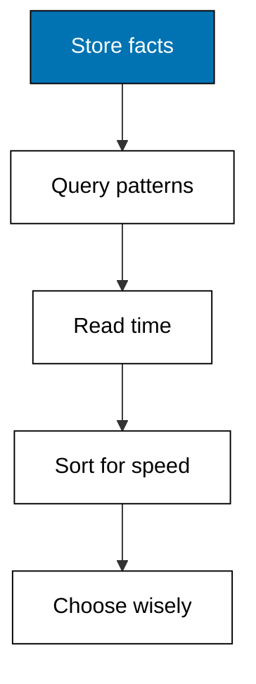

Prerequisites for this course: [just-enough-python](/en/learn/courses/just-enough-python/learning/overview) for every runnable program in this course, and [sql-essentials](/en/learn/courses/sql-essentials/learning/overview) for the join intuition that Datalog patterns extend. Comfort with sets, maps, and sorting in Python is assumed throughout.

## Why this exists -- the big idea

**The problem before the solution**: the catalog teaches tables, documents, and graphs, but nothing teaches facts that never change with time as a first-class axis. **Keep this if you forget everything else**: nothing is ever deleted; a retraction is itself a new fact.

## Tensions and trade-offs -- when NOT to reach for this

- **History versus churn**: total recall costs storage per change, so hot counters and sensor streams belong in specialized stores with rollups as facts. This course names that limit plainly in Theme I instead of hiding it.
- **Expressiveness versus scale**: recursive, rule-shaped questions fit Datalog beautifully, while bulk aggregation over billions of rows still belongs to the warehouse. Reach for each where its shape fits.
- **When NOT**: running the licensed Datomic server is out of scope: every example in this course uses the in-process reference engine on the standard library, and says so explicitly wherever the real product could be confused with the model.

## Lineage -- where this judgement sits

Databases began by answering what is true now, and every update destroyed the answer to what was true then. The immutable-fact model keeps both answers by refusing to overwrite: each correction is a new datom, each transaction a new stamp, and the log becomes the truth rather than a shadow of it. Datalog grew beside it as the query language for facts: patterns with shared variables, rules with names, and recursion with termination arguments. The combination turns time travel from a backup strategy into a query filter.

## How this course is organized

Holds 48 worked examples in nine themes. [Theme A](/en/learn/courses/datomic-and-datalog-essentials/learning/theme-a-datoms-and-entities) (Examples 1-5); [Theme B](/en/learn/courses/datomic-and-datalog-essentials/learning/theme-b-schema-and-attributes) (Examples 6-10); [Theme C](/en/learn/courses/datomic-and-datalog-essentials/learning/theme-c-transactions-and-retraction) (Examples 11-15); [Theme D](/en/learn/courses/datomic-and-datalog-essentials/learning/theme-d-basic-datalog-queries) (Examples 16-21); [Theme E](/en/learn/courses/datomic-and-datalog-essentials/learning/theme-e-unification-and-rules) (Examples 22-27); [Theme F](/en/learn/courses/datomic-and-datalog-essentials/learning/theme-f-as-of-and-history-queries) (Examples 28-33); [Theme G](/en/learn/courses/datomic-and-datalog-essentials/learning/theme-g-indexes) (Examples 34-38); [Theme H](/en/learn/courses/datomic-and-datalog-essentials/learning/theme-h-cardinality-and-references) (Examples 39-43); [Theme I](/en/learn/courses/datomic-and-datalog-essentials/learning/theme-i-trade-offs-and-when-to-use-this-model) (Examples 44-48). The [capstone](/en/learn/courses/datomic-and-datalog-essentials/learning/capstone/overview) builds the reference engine end to end, and [drilling](/en/learn/courses/datomic-and-datalog-essentials/drilling/overview) turns the concepts into recall, katas, and checklists.

### Theme A: Datoms and Entities (Examples 1-5)

- [Worked Example 1: First Datom](/en/learn/courses/datomic-and-datalog-essentials/learning/theme-a-datoms-and-entities#worked-example-1-first-datom)
- [Worked Example 2: One Entity, Many Datoms](/en/learn/courses/datomic-and-datalog-essentials/learning/theme-a-datoms-and-entities#worked-example-2-one-entity-many-datoms)
- [Worked Example 3: Identity Is Not Its Attributes](/en/learn/courses/datomic-and-datalog-essentials/learning/theme-a-datoms-and-entities#worked-example-3-identity-is-not-its-attributes)
- [Worked Example 4: Reading a Datom Apart](/en/learn/courses/datomic-and-datalog-essentials/learning/theme-a-datoms-and-entities#worked-example-4-reading-a-datom-apart)
- [Worked Example 5: Facts Are Never Overwritten](/en/learn/courses/datomic-and-datalog-essentials/learning/theme-a-datoms-and-entities#worked-example-5-facts-are-never-overwritten)

### Theme B: Schema and Attributes (Examples 6-10)

- [Worked Example 6: Declaring the Schema](/en/learn/courses/datomic-and-datalog-essentials/learning/theme-b-schema-and-attributes#worked-example-6-declaring-the-schema)
- [Worked Example 7: Types Are Checked at Write Time](/en/learn/courses/datomic-and-datalog-essentials/learning/theme-b-schema-and-attributes#worked-example-7-types-are-checked-at-write-time)
- [Worked Example 8: Cardinality One Keeps One Current Value](/en/learn/courses/datomic-and-datalog-essentials/learning/theme-b-schema-and-attributes#worked-example-8-cardinality-one-keeps-one-current-value)
- [Worked Example 9: Cardinality Many Accumulates a Set](/en/learn/courses/datomic-and-datalog-essentials/learning/theme-b-schema-and-attributes#worked-example-9-cardinality-many-accumulates-a-set)
- [Worked Example 10: New Attributes Arrive Without Migration](/en/learn/courses/datomic-and-datalog-essentials/learning/theme-b-schema-and-attributes#worked-example-10-new-attributes-arrive-without-migration)

### Theme C: Transactions and Retraction (Examples 11-15)

- [Worked Example 11: Transactions Land as One Batch](/en/learn/courses/datomic-and-datalog-essentials/learning/theme-c-transactions-and-retraction#worked-example-11-transactions-land-as-one-batch)
- [Worked Example 12: Retraction Marks, Never Erases](/en/learn/courses/datomic-and-datalog-essentials/learning/theme-c-transactions-and-retraction#worked-example-12-retraction-marks-never-erases)
- [Worked Example 13: Reasserting Builds a Timeline](/en/learn/courses/datomic-and-datalog-essentials/learning/theme-c-transactions-and-retraction#worked-example-13-reasserting-builds-a-timeline)
- [Worked Example 14: Every Transaction Signs Its Work](/en/learn/courses/datomic-and-datalog-essentials/learning/theme-c-transactions-and-retraction#worked-example-14-every-transaction-signs-its-work)
- [Worked Example 15: Conditional Writes Prevent Lost Updates](/en/learn/courses/datomic-and-datalog-essentials/learning/theme-c-transactions-and-retraction#worked-example-15-conditional-writes-prevent-lost-updates)

### Theme D: Basic Datalog Queries (Examples 16-21)

- [Worked Example 16: Your First Datalog Query](/en/learn/courses/datomic-and-datalog-essentials/learning/theme-d-basic-datalog-queries#worked-example-16-your-first-datalog-query)
- [Worked Example 17: Joins Are Shared Variables](/en/learn/courses/datomic-and-datalog-essentials/learning/theme-d-basic-datalog-queries#worked-example-17-joins-are-shared-variables)
- [Worked Example 18: Predicates Filter Bindings](/en/learn/courses/datomic-and-datalog-essentials/learning/theme-d-basic-datalog-queries#worked-example-18-predicates-filter-bindings)
- [Worked Example 19: Project Only What You Need](/en/learn/courses/datomic-and-datalog-essentials/learning/theme-d-basic-datalog-queries#worked-example-19-project-only-what-you-need)
- [Worked Example 20: Either Clause Can Match](/en/learn/courses/datomic-and-datalog-essentials/learning/theme-d-basic-datalog-queries#worked-example-20-either-clause-can-match)
- [Worked Example 21: Proving Something Is Missing](/en/learn/courses/datomic-and-datalog-essentials/learning/theme-d-basic-datalog-queries#worked-example-21-proving-something-is-missing)

### Theme E: Unification and Rules (Examples 22-27)

- [Worked Example 22: One Variable, One Value](/en/learn/courses/datomic-and-datalog-essentials/learning/theme-e-unification-and-rules#worked-example-22-one-variable-one-value)
- [Worked Example 23: Constants Narrow the Search](/en/learn/courses/datomic-and-datalog-essentials/learning/theme-e-unification-and-rules#worked-example-23-constants-narrow-the-search)
- [Worked Example 24: Name a Pattern Once, Reuse It Twice](/en/learn/courses/datomic-and-datalog-essentials/learning/theme-e-unification-and-rules#worked-example-24-name-a-pattern-once-reuse-it-twice)
- [Worked Example 25: Rules Build on Rules](/en/learn/courses/datomic-and-datalog-essentials/learning/theme-e-unification-and-rules#worked-example-25-rules-build-on-rules)
- [Worked Example 26: Recursion Walks the Assembly Tree](/en/learn/courses/datomic-and-datalog-essentials/learning/theme-e-unification-and-rules#worked-example-26-recursion-walks-the-assembly-tree)
- [Worked Example 27: One Rule Beats Three Copies](/en/learn/courses/datomic-and-datalog-essentials/learning/theme-e-unification-and-rules#worked-example-27-one-rule-beats-three-copies)

### Theme F: As-of and History Queries (Examples 28-33)

- [Worked Example 28: Asking the Database Last March](/en/learn/courses/datomic-and-datalog-essentials/learning/theme-f-as-of-and-history-queries#worked-example-28-asking-the-database-last-march)
- [Worked Example 29: The Full Life of One Price](/en/learn/courses/datomic-and-datalog-essentials/learning/theme-f-as-of-and-history-queries#worked-example-29-the-full-life-of-one-price)
- [Worked Example 30: Who Changed the Price](/en/learn/courses/datomic-and-datalog-essentials/learning/theme-f-as-of-and-history-queries#worked-example-30-who-changed-the-price)
- [Worked Example 31: What Is New Since Tuesday](/en/learn/courses/datomic-and-datalog-essentials/learning/theme-f-as-of-and-history-queries#worked-example-31-what-is-new-since-tuesday)
- [Worked Example 32: Joining as of Last Quarter](/en/learn/courses/datomic-and-datalog-essentials/learning/theme-f-as-of-and-history-queries#worked-example-32-joining-as-of-last-quarter)
- [Worked Example 33: Deleted Now, Visible Then](/en/learn/courses/datomic-and-datalog-essentials/learning/theme-f-as-of-and-history-queries#worked-example-33-deleted-now-visible-then)

### Theme G: Indexes (Examples 34-38)

- [Worked Example 34: Sorting by Entity First](/en/learn/courses/datomic-and-datalog-essentials/learning/theme-g-indexes#worked-example-34-sorting-by-entity-first)
- [Worked Example 35: Sorting by Attribute First](/en/learn/courses/datomic-and-datalog-essentials/learning/theme-g-indexes#worked-example-35-sorting-by-attribute-first)
- [Worked Example 36: Seeking Beats Scanning](/en/learn/courses/datomic-and-datalog-essentials/learning/theme-g-indexes#worked-example-36-seeking-beats-scanning)
- [Worked Example 37: Every Index Is Paid at Write Time](/en/learn/courses/datomic-and-datalog-essentials/learning/theme-g-indexes#worked-example-37-every-index-is-paid-at-write-time)
- [Worked Example 38: Range Scans Ride Value Order](/en/learn/courses/datomic-and-datalog-essentials/learning/theme-g-indexes#worked-example-38-range-scans-ride-value-order)

### Theme H: Cardinality and References (Examples 39-43)

- [Worked Example 39: Tagging Without a Side Table](/en/learn/courses/datomic-and-datalog-essentials/learning/theme-h-cardinality-and-references#worked-example-39-tagging-without-a-side-table)
- [Worked Example 40: Attributes That Point at Entities](/en/learn/courses/datomic-and-datalog-essentials/learning/theme-h-cardinality-and-references#worked-example-40-attributes-that-point-at-entities)
- [Worked Example 41: Walking Two Hops to the City](/en/learn/courses/datomic-and-datalog-essentials/learning/theme-h-cardinality-and-references#worked-example-41-walking-two-hops-to-the-city)
- [Worked Example 42: Owned Parts Versus Shared Customers](/en/learn/courses/datomic-and-datalog-essentials/learning/theme-h-cardinality-and-references#worked-example-42-owned-parts-versus-shared-customers)
- [Worked Example 43: Changing Cardinality Without Breaking Readers](/en/learn/courses/datomic-and-datalog-essentials/learning/theme-h-cardinality-and-references#worked-example-43-changing-cardinality-without-breaking-readers)

### Theme I: Trade-offs and When to Use This Model (Examples 44-48)

- [Worked Example 44: History Has a Storage Price](/en/learn/courses/datomic-and-datalog-essentials/learning/theme-i-trade-offs-and-when-to-use-this-model#worked-example-44-history-has-a-storage-price)
- [Worked Example 45: Readers Never Block Writers](/en/learn/courses/datomic-and-datalog-essentials/learning/theme-i-trade-offs-and-when-to-use-this-model#worked-example-45-readers-never-block-writers)
- [Worked Example 46: Counters Are the Worst Case](/en/learn/courses/datomic-and-datalog-essentials/learning/theme-i-trade-offs-and-when-to-use-this-model#worked-example-46-counters-are-the-worst-case)
- [Worked Example 47: Transitive Closure in Three Clauses](/en/learn/courses/datomic-and-datalog-essentials/learning/theme-i-trade-offs-and-when-to-use-this-model#worked-example-47-transitive-closure-in-three-clauses)
- [Worked Example 48: Should This Workload Be Facts](/en/learn/courses/datomic-and-datalog-essentials/learning/theme-i-trade-offs-and-when-to-use-this-model#worked-example-48-should-this-workload-be-facts)

## References

- Datomic Team, Datomic documentation: database values, transactions, queries, and Datalog (concepts of datoms, as-of and since filters, and rules as reused in this course; this course teaches a reference model and states explicitly that it does not require or run the licensed Datomic server). Accessed 2026-10-21.
- Abiteboul, Hull, and Vianney: Foundations of Databases (Datalog semantics: unification, recursion, and negation over facts, which this course follows). Accessed 2026-10-21.
- Prerequisite vocabulary this course assumes: [just-enough-python](/en/learn/courses/just-enough-python/learning/overview) for every runnable example and [sql-essentials](/en/learn/courses/sql-essentials/learning/overview) for the query-concept bridge - accessed 2026-10-21; Python mechanics and join intuition come from those courses, not from the legacy pages below.
- Legacy material this course migrates and re-verifies: software-engineering data databases datomic legacy pages - accessed 2026-10-21; every fact mined from those pages was re-checked against the sources above on the same date rather than copied as already correct.

## Examples by Theme
