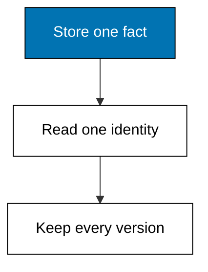
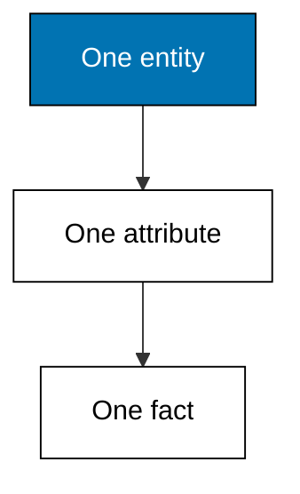
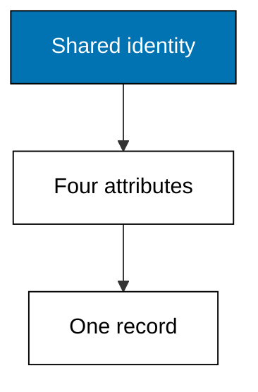
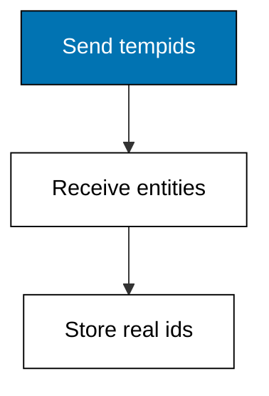
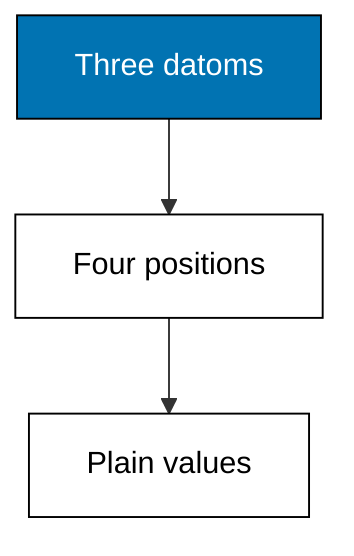
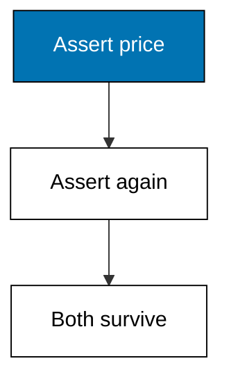

A fact is a four-part tuple, an entity is the identity those facts describe, and nothing is ever overwritten: five small programs build that picture one datom at a time.



### Worked Example 1: First Datom

_Exercises co-01, co-02._

A row in an ordinary table has no single identity beyond its primary key, and an update destroys what was there before. Datomic starts from the opposite end: the smallest thing the database stores is one immutable fact about one entity, and this example builds exactly one of those facts so you can hold it in your hand.

The fact says entity 1 carries the name Road wheel 700c, stamped by transaction 1001. Kencana Parts Co. is fictional, and every number in this course belongs to it. Four positions, no more: the entity the fact is about, the attribute it fills, the value it carries, and the transaction that installed it.



**`learning/code/ex-01-first-datom/main.py`**

```python
# Worked Example 1: First Datom
# => Kencana Parts Co. is fictional; every number here is fixed.
# => One immutable fact: entity 1 is named Road wheel 700c.
# => A datom is four parts: entity, attribute, value, transaction.
datom = (1, "part/name", "Road wheel 700c", 1001)  # => the whole fact in one tuple
# => Unpack the tuple into its four named positions.
entity, attribute, value, tx = datom  # => names for the four parts
# => The four prints below are the check the lesson quotes.
print("entity:", entity)  # => Output names the identity: 1
# => The check the lesson quotes.
print("attribute:", attribute)  # => Output names the slot: part/name
# => The check the lesson quotes.
print("value:", value)  # => Output carries the payload
# => The check the lesson quotes.
print("tx:", tx)  # => Output stamps the transaction: 1001
```

**Output** (`learning/code/ex-01-first-datom/expected/main.stdout.txt`):

```text
entity: 1
attribute: part/name
value: Road wheel 700c
tx: 1001
```

**Key takeaway**: A datom is one immutable fact: entity, attribute, value, and transaction, always together.

**Why It Matters**: Every later query in this course matches these four positions, so reading one datom slowly now pays off in every theme that follows. Tables hide identity inside rows and history inside backups; datoms put both in the open where queries can reach them. When a colleague says the database remembers everything, this tuple is what they mean, and you can now point at each part and name it.

---

### Worked Example 2: One Entity, Many Datoms

_Exercises co-01, co-02._

One fact is a curiosity; four facts about the same thing start to look like a record. This example describes a single wheel with four datoms that share one entity and one transaction, which is the closest this model ever gets to a row, and the difference from a row is the whole point.

The four datoms fill four different attributes: name, sku, price, and stock. Nothing ties them together except the shared entity id, and that loose binding is deliberate: tomorrow a fifth attribute can join the set without touching the four that already exist.



**`learning/code/ex-02-entity-many-datoms/main.py`**

```python
# Worked Example 2: One Entity, Many Datoms
# => Kencana Parts Co. is fictional; every number here is fixed.
# => Entity 1 describes one wheel with four datoms in one transaction.
# => Same entity, same transaction, four different attributes.
db = [  # => the fact set starts with one entity's description
    # => Entity 1 part/name.
    (1, "part/name", "Road wheel 700c", 2001),  # => what the part is called
    # => Entity 1 part/sku.
    (1, "part/sku", "RW-700-32", 2001),  # => the stock-keeping code
    # => Entity 1 part/price.
    (1, "part/price", 180, 2001),  # => whole currency units, never floats
    # => Entity 1 part/in-stock.
    (1, "part/in-stock", 40, 2001),  # => units on the shelf
    # => Close the collection.
]  # => four datoms, one entity, one transaction
# => Count datoms for entity 1 by filtering on the identity position.
count = sum(1 for e, _a, _v, _t in db if e == 1)  # => every datom here belongs to 1
# => Collect the attribute names in sorted order for a stable print.
attrs = sorted(a for e, a, _v, _t in db if e == 1)  # => sorted for determinism
# => Two lines: how many facts, and which slots they fill.
print("datoms:", count)  # => Output counts the facts: 4
# => The check the lesson quotes.
print("attributes:", attrs)  # => Output lists the four slots
```

**Output** (`learning/code/ex-02-entity-many-datoms/expected/main.stdout.txt`):

```text
datoms: 4
attributes: ['part/in-stock', 'part/name', 'part/price', 'part/sku']
```

**Key takeaway**: An entity is whatever its datoms say about it; the entity id is the only glue.

**Why It Matters**: Schema evolution stops being scary once records are just sets of facts sharing an id. Adding a column to a table rewrites every row, but adding an attribute here means writing new datoms and leaving old ones alone. That is the habit this course keeps rewarding: describe more, migrate nothing, and let the entity grow one fact at a time.

---

### Worked Example 3: Identity Is Not Its Attributes

_Exercises co-02._

A client creating new records does not know their database ids yet, so it speaks in temporary ids and lets the database answer with real ones. This example sends two new parts with tempids minus one and minus two, receives entities 1 and 2, and stores facts that reference only the real identities.

The mapping itself is data worth printing: minus one became 1, minus two became 2, in arrival order. After this point the tempids never appear again, because every later datom, query, and index speaks in entity ids.



**`learning/code/ex-03-identity-vs-attributes/main.py`**

```python
# Worked Example 3: Identity Is Not Its Attributes
# => Kencana Parts Co. is fictional; every number here is fixed.
# => Two new parts arrive with client-side tempids -1 and -2.
# => The store answers with entity ids, in arrival order.
tempids = [-1, -2]  # => negative means not yet stored
# => Map each tempid to its assigned entity id.
assigned = {t: i + 1 for i, t in enumerate(tempids)}  # => -1 becomes 1, -2 becomes 2
# => Stored facts reference the assigned identity, never the tempid.
db = [  # => stored facts use real entity ids
    # => Compute the next value.
    (assigned[-1], "part/name", "Road wheel 700c", 3001),  # => entity 1
    # => Compute the next value.
    (assigned[-2], "part/name", "Track cog 16t", 3001),  # => entity 2
    # => Close the collection.
]  # => two datoms, two identities, one transaction
# => Print the mapping first, then prove the datoms use it.
print("mapping:", assigned)  # => Output shows tempid to entity
# => The check the lesson quotes.
print("entities:", sorted(e for e, _a, _v, _t in db))  # => Output shows 1 and 2
```

**Output** (`learning/code/ex-03-identity-vs-attributes/expected/main.stdout.txt`):

```text
mapping: {-1: 1, -2: 2}
entities: [1, 2]
```

**Key takeaway**: Tempids are conversation; entity ids are storage. Facts keep only the latter.

**Why It Matters**: Distributed writers can invent tempids without coordinating, which is why this model scales writes without a central id counter. The database settles identity once, at transact time, and every later reader shares it. Whenever you design an import pipeline, copy this split: let senders speak tentatively and let one authority assign truth. Names outlive every attribute edit because the mapping is stored once and read forever.

---

### Worked Example 4: Reading a Datom Apart

_Exercises co-01._

Every tool in this course, from queries to indexes, reaches into the same four positions, so reading a datom apart is a skill worth isolating. This example lines up three datoms about different entities and attributes, then prints each one field by field.

Notice how ordinary the values look: strings, integers, and codes a warehouse clerk would recognize. The machinery lives in the positions, not in exotic types, which keeps the reference engine small enough to hold in your head.



**`learning/code/ex-04-datom-anatomy/main.py`**

```python
# Worked Example 4: Reading a Datom Apart
# => Kencana Parts Co. is fictional; every number here is fixed.
# => Three datoms walk through the same four positions.
# => Different entities, attributes, and transactions on each line.
db = [  # => a tiny fact set with some variety
    # => Entity 1 part/name.
    (1, "part/name", "Road wheel 700c", 1001),  # => a name for entity 1
    # => Entity 1 part/price.
    (1, "part/price", 180, 1002),  # => a later price for entity 1
    # => Entity 2 part/in-stock.
    (2, "part/in-stock", 12, 1001),  # => stock for entity 2
    # => Close the collection.
]  # => three facts, two entities, two transactions
# => Unpack each datom and print its four positions on one line.
for e, a, v, t in db:  # => the loop binds the four positions
    # => The check the lesson quotes.
    print(f"e={e} a={a} v={v} tx={t}")  # => Output shows all four parts
```

**Output** (`learning/code/ex-04-datom-anatomy/expected/main.stdout.txt`):

```text
e=1 a=part/name v=Road wheel 700c tx=1001
e=1 a=part/price v=180 tx=1002
e=2 a=part/in-stock v=12 tx=1001
```

**Key takeaway**: Positions carry the meaning: entity, attribute, value, transaction, in that order.

**Why It Matters**: Debugging a Datalog query almost always means staring at datoms until the pattern mismatch shows itself, and this printing habit is that debugging move. Indexes sort these same positions, as-of queries filter on the fourth, and retractions negate the third. Learn the four slots cold now and the rest of the course reads like variations on one shape. Carry that four-slot reflex into every error message, and most query bugs will confess on sight.

---

### Worked Example 5: Facts Are Never Overwritten

_Exercises co-01, co-13._

Here is the sentence this whole course is built on: nothing is ever deleted, and a correction is a new fact. This example asserts the wheel's price twice, in two transactions, and then shows both datoms still sitting in the store side by side.

A row-mutating database would keep one price cell and lose the old number the moment the new one lands. The fact log keeps both, which means the question what did we charge in March stays answerable forever, without a separate audit table bolted on afterwards.



**`learning/code/ex-05-facts-never-change/main.py`**

```python
# Worked Example 5: Facts Are Never Overwritten
# => Kencana Parts Co. is fictional; every number here is fixed.
# => The wheel costs 180 in March, then 175 in April.
# => Both datoms survive: the log only ever grows.
db = [  # => the whole price history is two datoms
    # => Entity 1 part/price.
    (1, "part/price", 180, 4001),  # => the March price
    # => Entity 1 part/price.
    (1, "part/price", 175, 4002),  # => the April correction
    # => Close the collection.
]  # => nothing was updated; a fact was added
# => Filter the price datoms for entity 1, oldest transaction first.
history = sorted(
    (t, v) for e, a, v, t in db if e == 1 and a == "part/price"
)  # => time order
# => Print how many price facts exist, then each one.
print("price-facts:", len(history))  # => Output counts both facts: 2
# => Walk each candidate in turn.
for t, v in history:  # => oldest first, because the log is ordered
    # => The check the lesson quotes.
    print(f"tx={t} price={v}")  # => Output shows March then April
```

**Output** (`learning/code/ex-05-facts-never-change/expected/main.stdout.txt`):

```text
price-facts: 2
tx=4001 price=180
tx=4002 price=175
```

**Key takeaway**: Corrections append; the log never rewrites. History is the default, not a feature.

**Why It Matters**: Regulators, auditors, and curious future teammates all ask the same question this example answers for free. An append-only log turns every correction into evidence instead of erasing it, which trades a little storage for total recall. The rest of the course is about making that trade pay: queries, indexes, and time travel all assume the past is still there. The rest of the course assumes the past is still there, so every later query can rely on it.

---
