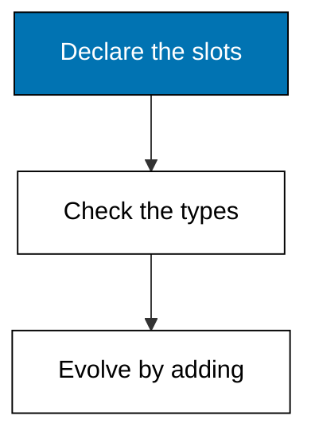
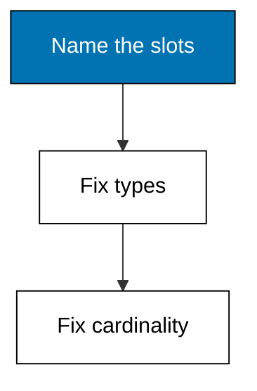
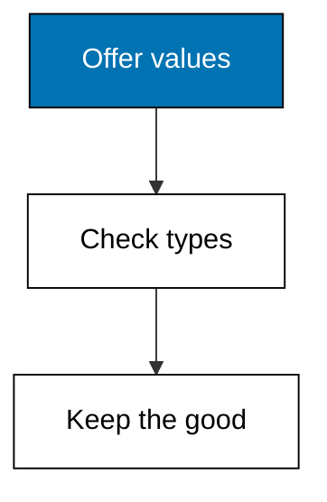
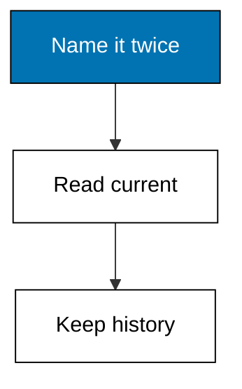
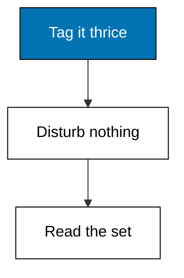
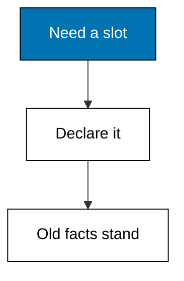

Attributes are declared slots with a value type and a cardinality, so the schema tells every writer what a datom may say and tells every reader how many values to expect.



### Worked Example 6: Declaring the Schema

_Exercises co-03._

Facts without declared slots drift into spelling chaos, so attributes are installed before any datom uses them. This example declares three attributes for the parts catalog, each with a value type and a cardinality, and prints the resulting schema map.

The schema is itself small data: names map to kinds. Name is one string, tags are many strings, and price is one integer. Every later example consults this map before it writes or reads, which is how the store stays honest without a migration framework.



**`learning/code/ex-06-declare-attribute-schema/main.py`**

```python
# Worked Example 6: Declaring the Schema
# => Kencana Parts Co. is fictional; every number here is fixed.
# => Three attributes: a name, a price, and a set of tags.
# => Each slot declares its value type and its cardinality.
schema = {  # => the schema is ordinary small data
    # => The part/name entry.
    "part/name": {"type": "string", "cardinality": "one"},  # => one name per part
    # => The part/price entry.
    "part/price": {"type": "long", "cardinality": "one"},  # => one price per part
    # => The part/tags entry.
    "part/tags": {"type": "string", "cardinality": "many"},  # => any number of tags
    # => Close the collection.
}  # => three slots, each with two rules
# => Print the attribute count, then each slot with its two rules.
print("attributes:", len(schema))  # => Output counts the slots: 3
# => Walk each candidate in turn.
for name in sorted(schema):  # => sorted for a deterministic print
    # => Compute the next value.
    spec = schema[name]  # => the two rules for this slot
    # => The check the lesson quotes.
    print(
        f"{name} type={spec['type']} cardinality={spec['cardinality']}"
    )  # => Output shows both rules
```

**Output** (`learning/code/ex-06-declare-attribute-schema/expected/main.stdout.txt`):

```text
attributes: 3
part/name type=string cardinality=one
part/price type=long cardinality=one
part/tags type=string cardinality=many
```

**Key takeaway**: Schema declares slots with types and cardinality before any datom is written.

**Why It Matters**: Declaring the shape up front moves whole classes of bugs from runtime to write time, where the writer still remembers what they meant. A reader meeting part/tags later knows without asking that several values may arrive. Small schemas like this one are cheap to keep and expensive to miss, because every query in Themes D and E leans on exactly these two promises.

---

### Worked Example 7: Types Are Checked at Write Time

_Exercises co-03._

A type promise is only as good as its enforcement, so the store validates every value against its attribute's declared type before accepting the datom. This example offers four candidate values, two well-typed and two not, and prints which ones the checker admits.

The wheel's price must be an integer and its name a string. A float price and an integer name are refused with a reason, while the good values pass through untouched. Nothing reaches the log until it survives this gate.



**`learning/code/ex-07-value-types-checked/main.py`**

```python
# Worked Example 7: Types Are Checked at Write Time
# => Kencana Parts Co. is fictional; every number here is fixed.
# => Two good values and two bad ones meet the type checker.
# => Only well-typed values reach the log.
schema = {"part/name": "string", "part/price": "long"}  # => the two slots in play
# => True means stored; False means refused, with the reason kept.
candidates = [  # => four offers, two of each kind
    # => Compute the next value.
    ("part/name", "Road wheel 700c"),  # => a string for a string slot
    # => Compute the next value.
    ("part/price", 180),  # => an integer for an integer slot
    # => Compute the next value.
    ("part/price", 18.5),  # => a float for an integer slot: refused
    # => Compute the next value.
    ("part/name", 700),  # => an integer for a string slot: refused
    # => Close the collection.
]  # => the offers arrive before any datom exists


# => Admit a value only when its Python type matches the slot.
def admits(attr, value):  # => the write-time gate
    # => Strings satisfy string slots; integers satisfy long slots.
    want = schema[attr]  # => the declared type for this slot
    # => Booleans are integers in Python, so they are refused explicitly.
    # => A string value passes a string slot.
    string_ok = want == "string" and isinstance(value, str)  # => name rule
    # => A non-boolean integer passes a long slot.
    long_ok = want == "long" and isinstance(value, int)  # => price rule, booleans out
    # => Either rule passing admits the value, but never a boolean.
    ok = (string_ok or long_ok) and not isinstance(value, bool)  # => the type rule
    # => Hand the answer back.
    return ok  # => True reaches the log, False does not


# => Print one verdict line per candidate value.
for attr, value in candidates:  # => each offer meets the gate
    # => Compute the next value.
    verdict = admits(attr, value)  # => the gate's answer
    # => The check the lesson quotes.
    print(f"{attr}={value!r} admitted={verdict}")  # => Output shows two Trues
```

**Output** (`learning/code/ex-07-value-types-checked/expected/main.stdout.txt`):

```text
part/name='Road wheel 700c' admitted=True
part/price=180 admitted=True
part/price=18.5 admitted=False
part/name=700 admitted=False
```

**Key takeaway**: The schema gate runs before the log: bad types never become facts.

**Why It Matters**: Catching a mistyped value at the door beats finding it in a quarterly report, because the writer is still around to fix it. Floats near money are the classic warehouse bug, and this gate refuses them on sight. Reference engines in production keep the same habit: validate once at transact time so a thousand later queries can trust every value they touch.

---

### Worked Example 8: Cardinality One Keeps One Current Value

_Exercises co-11, co-13._

Some slots hold exactly one current value: a part has one name at a time. This example renames the wheel twice and then asks two different questions: what is the name now, and what has it ever been. The first answer is one value; the second is the full history.

Cardinality one does not mean the past disappears. It means the store can point at the latest datom when a reader asks for the present, while every earlier datom stays exactly where it was written.



**`learning/code/ex-08-cardinality-one-replaces/main.py`**

```python
# Worked Example 8: Cardinality One Keeps One Current Value
# => Kencana Parts Co. is fictional; every number here is fixed.
# => The wheel is renamed twice; the present is one value.
# => The past stays readable beside it.
db = [  # => three name facts, oldest first by transaction
    # => Entity 1 part/name.
    (1, "part/name", "Road wheel", 5001),  # => the original name
    # => Entity 1 part/name.
    (1, "part/name", "Road wheel 700c", 5002),  # => the clarified name
    # => Entity 1 part/name.
    (1, "part/name", "Road wheel 700c 32h", 5003),  # => the final name
    # => Close the collection.
]  # => three datoms, one current value
# => The current value is the one with the highest transaction.
current = max(db, key=lambda d: d[3])[2]  # => newest transaction wins
# => The history is every value in transaction order.
names = [v for _e, _a, v, t in sorted(db, key=lambda d: d[3])]  # => oldest first
# => One line for the present, one for the ever-was.
print("current:", current)  # => Output shows the final name
# => The check the lesson quotes.
print("history:", names)  # => Output shows all three names
```

**Output** (`learning/code/ex-08-cardinality-one-replaces/expected/main.stdout.txt`):

```text
current: Road wheel 700c 32h
history: ['Road wheel', 'Road wheel 700c', 'Road wheel 700c 32h']
```

**Key takeaway**: Cardinality one means one current value, never one stored fact.

**Why It Matters**: Renames, repricings, and restockings all share this shape: the present is a pointer into a permanent past. User interfaces show the pointer while support desks search the history, and both read the same log. Whenever a stakeholder asks for the current record plus its changelog, this one example is the whole design. The changelog is not a separate feature here; it is the log itself read through a different filter.

---

### Worked Example 9: Cardinality Many Accumulates a Set

_Exercises co-11._

Other slots hold a set: a part can carry any number of tags, and adding one never disturbs the others. This example tags the wheel three times across two transactions and prints the accumulated set in sorted order.

Contrast this with cardinality one: there is no current tag, only the growing collection. Queries over many-valued attributes ask membership questions, which Theme D answers with a single clause.



**`learning/code/ex-09-cardinality-many-accumulates/main.py`**

```python
# Worked Example 9: Cardinality Many Accumulates a Set
# => Kencana Parts Co. is fictional; every number here is fixed.
# => Three tags land in two transactions; all three stay.
# => Many means a set, never a single current value.
db = [  # => three tag facts for the same entity
    # => Entity 1 part/tags.
    (1, "part/tags", "wheel", 6001),  # => the family tag
    # => Entity 1 part/tags.
    (1, "part/tags", "700c", 6001),  # => the size tag
    # => Entity 1 part/tags.
    (1, "part/tags", "commuter", 6002),  # => the use tag, added later
    # => Close the collection.
]  # => three datoms, three live values
# => Collect every tag value for entity 1, sorted for determinism.
tags = sorted(
    v for e, a, v, _t in db if e == 1 and a == "part/tags"
)  # => the whole set
# => One line: how many tags, and which ones.
print("tags:", len(tags), tags)  # => Output shows 3 tags
```

**Output** (`learning/code/ex-09-cardinality-many-accumulates/expected/main.stdout.txt`):

```text
tags: 3 ['700c', 'commuter', 'wheel']
```

**Key takeaway**: Cardinality many is a set: each assert adds, none replaces.

**Why It Matters**: Labels, flags, and categories multiply over a product's life, and a set-valued slot absorbs them without redesign. A single-valued column would need a side table the moment the second tag arrives; here the second tag is just another datom. Reach for cardinality many whenever the honest answer to how many is however many turn up.

---

### Worked Example 10: New Attributes Arrive Without Migration

_Exercises co-03, co-15._

Six months in, the warehouse wants to record each part's country of origin, which no existing datom mentions. This example adds the attribute to the schema, writes origin datoms for two parts, and shows the old datoms working exactly as before.

No table was altered, no row was rewritten, and no downtime was scheduled. The new slot simply starts collecting facts from its install transaction onward, while readers that never heard of it keep working.



**`learning/code/ex-10-schema-evolution-adds/main.py`**

```python
# Worked Example 10: New Attributes Arrive Without Migration
# => Kencana Parts Co. is fictional; every number here is fixed.
# => Origin tracking starts mid-year; old facts are untouched.
# => Evolution is addition, never alteration.
schema = {"part/name": "one", "part/price": "one"}  # => the original two slots
# => The warehouse asks for origin tracking in transaction 7001.
schema["part/origin"] = "one"  # => a third slot joins the map
# => Old datoms keep working; new datoms use the new slot.
db = [  # => facts from before and after the schema change
    # => Entity 1 part/name.
    (1, "part/name", "Road wheel 700c", 6001),  # => written before origin existed
    # => Entity 1 part/origin.
    (1, "part/origin", "ID", 7001),  # => the first origin fact
    # => Entity 2 part/origin.
    (2, "part/origin", "TW", 7001),  # => a second part gains an origin
    # => Close the collection.
]  # => mixed eras, one happy store
# => Print the schema size and the facts that predate the new slot.
old = [d for d in db if d[3] < 7001]  # => facts from before the change
# => The check the lesson quotes.
print("attributes:", len(schema))  # => Output counts 3 slots
# => The check the lesson quotes.
print("predating-facts:", len(old))  # => Output shows 1 untouched fact
# => The check the lesson quotes.
print(
    "origins:", sorted(v for _e, a, v, _t in db if a == "part/origin")
)  # => Output shows both origins
```

**Output** (`learning/code/ex-10-schema-evolution-adds/expected/main.stdout.txt`):

```text
attributes: 3
predating-facts: 1
origins: ['ID', 'TW']
```

**Key takeaway**: Schema evolution adds slots; existing datoms never move.

**Why It Matters**: Production schemas change under live traffic, and the cheapest change is the one that touches no existing data. Teams that fear migrations freeze their models and work around them; teams with additive schemas extend freely. When product asks for one more field next quarter, this example is the migration plan: declare it, write it, done.

---
