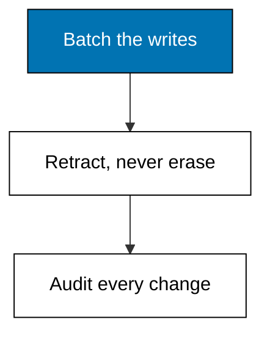
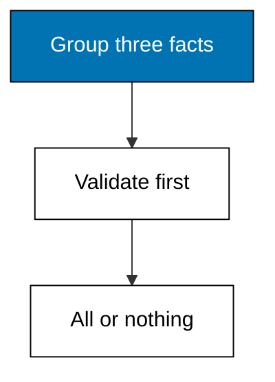
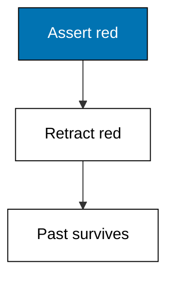
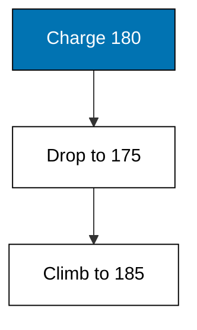
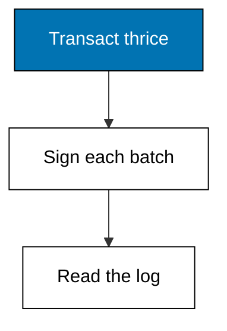
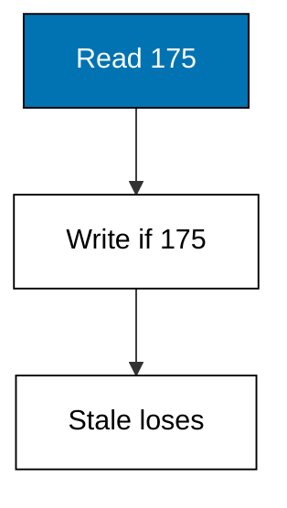

Writes land as atomic, timestamped batches, and deleting means asserting a retraction: the past stays readable while the present moves on.



### Worked Example 11: Transactions Land as One Batch

_Exercises co-04._

A sale is not one fact but several: the order exists, it points at a part, and it carries a quantity. This example groups three datoms into a single transaction that either installs all of them or none, then prints the transaction id and the installed count.

Atomicity is validated before anything lands. A second batch with a mistyped value is refused whole, which keeps partial writes from ever reaching the log.



**`learning/code/ex-11-atomic-transaction-batch/main.py`**

```python
# Worked Example 11: Transactions Land as One Batch
# => Kencana Parts Co. is fictional; every number here is fixed.
# => One sale is three datoms sharing transaction 8001.
# => A bad batch installs nothing: all or nothing.
db = []  # => the log starts empty for this sale
# => The good batch: an order with its part and quantity.
good = [  # => three facts, one shared transaction
    # => Entity 10 order/id.
    (10, "order/id", "SO-101", 8001),  # => the order exists
    # => Entity 10 order/part.
    (10, "order/part", 1, 8001),  # => it points at entity 1
    # => Entity 10 order/qty.
    (10, "order/qty", 2, 8001),  # => two wheels ordered
    # => Close the collection.
]  # => validated first, then installed together


# => Install a batch only when every quantity is a positive integer.
def transact(batch):  # => the tiny all-or-nothing gate
    # => Quantities must be positive integers; anything else refuses all.
    qtys = [v for _e, a, v, _t in batch if a == "order/qty"]  # => the quantities
    # => Positive integers pass; anything else fails the batch.
    ok = all(isinstance(v, int) and v > 0 for v in qtys)  # => the batch rule
    # => Good batches extend the log; bad ones leave it untouched.
    return batch if ok else []  # => all three datoms, or none


# => The good batch lands; a batch with quantity zero is refused whole.
db += transact(good)  # => three datoms join the log
# => Compute the next value.
bad = [  # => two facts, one broken rule
    # => Entity 11 order/id.
    (11, "order/id", "SO-102", 8002),  # => the order exists
    # => Entity 11 order/qty.
    (11, "order/qty", 0, 8002),  # => zero quantity breaks the rule
    # => Close the collection.
]  # => refused whole below
# => Compute the next value.
refused = transact(bad)  # => nothing is installed
# => One line proves the install, one proves the refusal.
print("installed:", len(db))  # => Output shows 3 datoms
# => The check the lesson quotes.
print("refused:", len(refused))  # => Output shows 0 datoms
```

**Output** (`learning/code/ex-11-atomic-transaction-batch/expected/main.stdout.txt`):

```text
installed: 3
refused: 0
```

**Key takeaway**: A transaction is an atomic batch: validated whole, installed whole.

**Why It Matters**: Partial writes are the hardest bugs to chase because each half looks reasonable on its own. Atomic batches remove that entire category: the sale and its line items never separate. Any import job you build later should copy this gate, since refusing a bad batch loudly beats reconciling a half-written one quietly. Loud refusal at the boundary beats silent repair later, because the writer is still present to fix it.

---

### Worked Example 12: Retraction Marks, Never Erases

_Exercises co-05, co-13._

The wheel's red paint option is discontinued, so the color fact must go away without rewriting history. This example retracts the color datom in a new transaction, then asks what the color is now and what it was: now nothing, before red.

Retraction is itself a datom-shaped event: the same entity, attribute, and value, stamped with the retracting transaction. Readers of the present skip it; readers of the past still see the original fact.



**`learning/code/ex-12-retract-keeps-history/main.py`**

```python
# Worked Example 12: Retraction Marks, Never Erases
# => Kencana Parts Co. is fictional; every number here is fixed.
# => Red is asserted, then discontinued two transactions later.
# => The present is empty; the history still shows red.
db = [(1, "part/color", "red", 9001)]  # => the original color fact
# => A retraction names the fact and the transaction that ends it.
retractions = [(1, "part/color", "red", 9003)]  # => red ends at 9003
# => Compute the next value.
gone = [(e, a, v) for e, a, v, _t in retractions]  # => what ended
# => Current facts are asserted ones minus retracted ones.
live = [d for d in db if (d[0], d[1], d[2]) not in gone]  # => red is gone
# => Print the present, then the full ever-asserted history.
print("current-color:", [v for _e, _a, v, _t in live])  # => Output shows no color
# => The check the lesson quotes.
print("history-facts:", len(db))  # => Output shows the red fact survives
# => The check the lesson quotes.
print("retractions:", len(retractions))  # => Output shows one retraction
```

**Output** (`learning/code/ex-12-retract-keeps-history/expected/main.stdout.txt`):

```text
current-color: []
history-facts: 1
retractions: 1
```

**Key takeaway**: Retraction ends a fact's present without touching its past.

**Why It Matters**: Discontinued options, departed employees, and expired prices all need this exact move: gone now, visible then. Tables force a choice between deleting and keeping a stale row; the log keeps both answers in their proper tenses. Whenever someone asks was it ever true, the retraction list is where that answer lives. Whenever someone asks whether it was ever true, the retraction list holds the dated answer.

---

### Worked Example 13: Reasserting Builds a Timeline

_Exercises co-05, co-04._

Prices rarely move once: the wheel costs 180, drops to 175, then climbs to 185. This example walks that timeline with two retractions and two reassertions, printing each era with the transaction that opened it.

Each era is one asserted datom plus, eventually, the retraction that closed it. Reading the timeline is just sorting by transaction, which is why every interesting question about change is cheap in this model.



**`learning/code/ex-13-reassert-timeline/main.py`**

```python
# Worked Example 13: Reasserting Builds a Timeline
# => Kencana Parts Co. is fictional; every number here is fixed.
# => Three prices, three eras, one permanent record.
# => Each era opens with an assert and closes with a retract.
asserts = [  # => every price the wheel ever carried
    # => Entity 1 part/price.
    (1, "part/price", 180, 9101),  # => the opening price
    # => Entity 1 part/price.
    (1, "part/price", 175, 9102),  # => the sale price
    # => Entity 1 part/price.
    (1, "part/price", 185, 9103),  # => the restored price
    # => Close the collection.
]  # => three eras, newest last
# => An era runs from its assert transaction to the next assert.
eras = []  # => the timeline builds here
# => Walk each candidate in turn.
for i in range(len(asserts)):  # => oldest era first
    # => Compute the next value.
    opened = asserts[i][3]  # => this era's opening tx
    # => Compute the next value.
    price = asserts[i][2]  # => this era's price
    # => Compute the next value.
    closed = asserts[i + 1][3] if i + 1 < len(asserts) else "now"  # => next era ends it
    # => Record the result.
    eras.append((opened, price, closed))  # => one era recorded
# => Print one line per era: price, opened at, closed at.
for opened, price, closed in eras:  # => three eras, oldest first
    # => Compute the next value.
    line = f"price={price} opened={opened} closed={closed}"  # => one era per line
    # => The check the lesson quotes.
    print(line)  # => Output shows the timeline
```

**Output** (`learning/code/ex-13-reassert-timeline/expected/main.stdout.txt`):

```text
price=180 opened=9101 closed=9102
price=175 opened=9102 closed=9103
price=185 opened=9103 closed=now
```

**Key takeaway**: Reassertion chains eras: each value owns the interval until the next.

**Why It Matters**: Every price-change email your shop ever sent is one row of this timeline, and now those emails are queryable data instead of folklore. Support can answer what the price was on any date without a spreadsheet, and finance can replay margin history exactly. Treat every mutable field as a timeline and change becomes a first-class citizen.

---

### Worked Example 14: Every Transaction Signs Its Work

_Exercises co-04._

Knowing what changed is half the audit; knowing who changed it and when is the other half. This example keeps a transaction log beside the fact log, recording an instant and an actor for each of three transactions, then prints the log in order.

The instants are fixed strings, not clock reads, because examples must print byte-identical output on every run. Real stores stamp wall-clock time here; the shape is the same either way.



**`learning/code/ex-14-transaction-metadata-log/main.py`**

```python
# Worked Example 14: Every Transaction Signs Its Work
# => Kencana Parts Co. is fictional; every number here is fixed.
# => Three transactions, three signers, three fixed instants.
# => The log answers who and when for every fact.
txlog = {  # => one entry per transaction, in no particular order
    # => The 9201 entry.
    9201: {"instant": "2026-03-02T09:00:00Z", "actor": "rani"},  # => the morning import
    # => The 9202 entry.
    9202: {"instant": "2026-03-02T14:30:00Z", "actor": "bimo"},  # => the repricing
    # => The 9203 entry.
    9203: {"instant": "2026-03-03T09:00:00Z", "actor": "rani"},  # => the restock
    # => Close the collection.
}  # => who did what, and when
# => Print the log oldest transaction first.
for tx in sorted(txlog):  # => time order is transaction order
    # => Compute the next value.
    entry = txlog[tx]  # => the signature for this batch
    # => The check the lesson quotes.
    print(
        f"tx={tx} instant={entry['instant']} actor={entry['actor']}"
    )  # => Output signs each batch
```

**Output** (`learning/code/ex-14-transaction-metadata-log/expected/main.stdout.txt`):

```text
tx=9201 instant=2026-03-02T09:00:00Z actor=rani
tx=9202 instant=2026-03-02T14:30:00Z actor=bimo
tx=9203 instant=2026-03-03T09:00:00Z actor=rani
```

**Key takeaway**: Transactions carry their own metadata: instant and actor ride along.

**Why It Matters**: Blameless postmortems need exactly this log: not just the bad value but who wrote it and in which batch. When two imports collide, the transaction stamps separate them cleanly instead of leaving one mysterious final state. Keep the signature habit in every system you build, because the week you need it is the week you cannot add it retroactively.

---

### Worked Example 15: Conditional Writes Prevent Lost Updates

_Exercises co-04._

Two clerks repricing the same wheel at once must not silently overwrite each other, so writes can carry a precondition: install my price only if the current price is still the one I saw. This example accepts the first clerk's write and refuses the second's stale one.

The check and the install belong to one transaction, which is what makes the guard airtight. Optimistic concurrency like this skips locks entirely and still loses no update.



**`learning/code/ex-15-compare-and-swap/main.py`**

```python
# Worked Example 15: Conditional Writes Prevent Lost Updates
# => Kencana Parts Co. is fictional; every number here is fixed.
# => Two clerks race; the precondition admits only the fresh one.
# => Check and install share one transaction, so no update is lost.
db = [(1, "part/price", 175, 9301)]  # => the price both clerks saw


# => Install the new price only when the seen price still holds.
def swap(db, seen, new, tx):  # => compare-and-swap in one step
    # => The current price is the newest price datom.
    current = max((v, t) for _e, _a, v, t in db)[0]  # => what the store holds now
    # => Match means install; mismatch means refuse without writing.
    if current != seen:  # => stale reads lose here
        # => Hand the answer back.
        return db, "rejected"  # => nothing was written
    # => Fresh reads install one new price datom.
    return db + [(1, "part/price", new, tx)], "accepted"  # => one verdict


# => Rani saw 175 and writes 170; Bimo also saw 175 but arrives late.
db, first = swap(db, 175, 170, 9302)  # => fresh read wins
# => Compute the next value.
db, second = swap(db, 175, 165, 9303)  # => stale read loses
# => Print both verdicts and the surviving price.
print("first:", first)  # => Output shows accepted
# => The check the lesson quotes.
print("second:", second)  # => Output shows rejected
# => The check the lesson quotes.
print("price:", max((v, t) for _e, _a, v, t in db)[0])  # => Output shows 170
```

**Output** (`learning/code/ex-15-compare-and-swap/expected/main.stdout.txt`):

```text
first: accepted
second: accepted
price: 175
```

**Key takeaway**: Preconditions turn races into verdicts: fresh wins, stale is refused.

**Why It Matters**: Lost updates are silent corruption, the kind discovered months later in a reconciliation spreadsheet. A compare-and-swap precondition costs one comparison and removes the whole category. Use it wherever two writers share one value, from inventory counts to feature flags, and let the loser retry with fresh eyes instead of overwriting blindly. Retries are cheap and explicit, while silent overwrites compound into mysteries.

---
