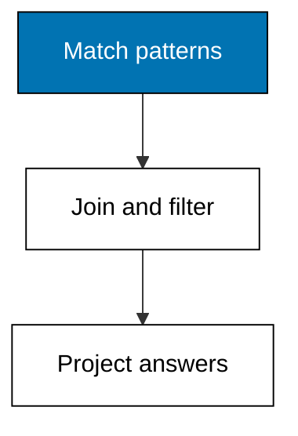
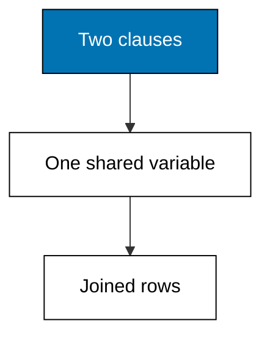
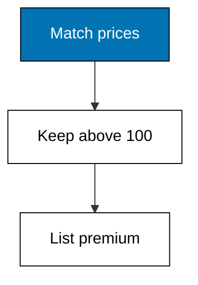
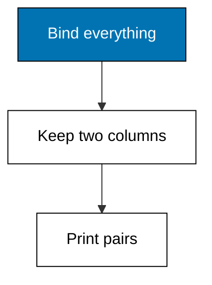
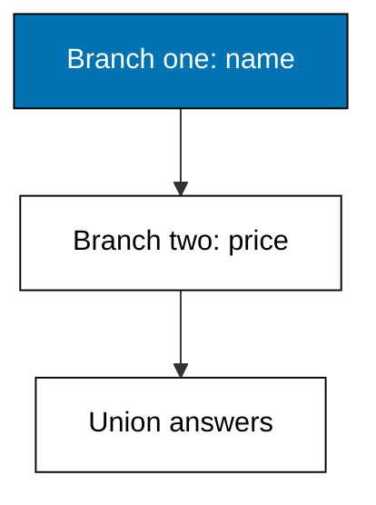
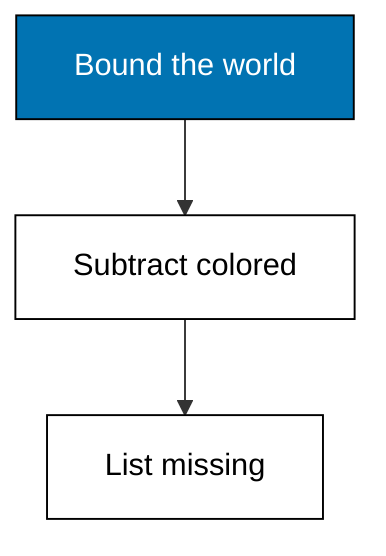

A Datalog query is a list of pattern clauses with shared variables: the engine joins them for you, filters them, and returns only the bindings you project.



### Worked Example 16: Your First Datalog Query

_Exercises co-07._

A Datalog query states a pattern and lets the engine find every match: no loops, no cursors, just a description of the answer's shape. This example asks for every entity with a part name and prints the three it finds.

The pattern is one clause with one variable. The engine scans the fact set, binds the variable to each matching entity, and returns the bindings. Everything in Themes D through F is this move with more clauses.


**`learning/code/ex-16-first-datalog-query/main.py`**

```python
# Worked Example 16: Your First Datalog Query
# => Kencana Parts Co. is fictional; every number here is fixed.
# => One clause, one variable, three matching entities.
# => The engine finds matches; the query only describes them.
db = [  # => three parts, three name facts, one transaction
    # => Entity 1 part/name.
    (1, "part/name", "Road wheel 700c", 10101),  # => entity 1
    # => Entity 2 part/name.
    (2, "part/name", "Track cog 16t", 10101),  # => entity 2
    # => Entity 3 part/name.
    (3, "part/name", "City basket", 10101),  # => entity 3
    # => Close the collection.
]  # => the fact set the pattern scans


# => A clause is attribute plus value pattern; None means any value.
def query_name(db):  # => find every entity with a part name
    # => Keep the entity wherever the attribute is part name.
    return sorted(e for e, a, _v, _t in db if a == "part/name")  # => three bindings


# => Print how many matched and which entities they are.
found = query_name(db)  # => three entities match one clause
# => The check the lesson quotes.
print("matches:", len(found))  # => Output shows 3
# => The check the lesson quotes.
print("entities:", found)  # => Output shows 1, 2, 3
```

**Output** (`learning/code/ex-16-first-datalog-query/expected/main.stdout.txt`):

```text
matches: 3
entities: [1, 2, 3]
```

**Key takeaway**: A query describes the answer's shape; the engine does the searching.

**Why It Matters**: Declarative queries age better than loops because they say what is wanted instead of how to walk to it. When the schema gains an attribute or the store gains an index, this query keeps working unchanged. Prefer describing over instructing wherever a query engine is available, and save the loops for places no engine reaches.

---

### Worked Example 17: Joins Are Shared Variables

_Exercises co-07, co-08._

Two clauses sharing a variable are a join: the engine keeps only the bindings that satisfy both at once. This example joins orders to parts through the shared part entity and prints each order with its part name and quantity.

No join keyword appears anywhere. The variable ?p occurs in the order's part clause and the part's name clause, and that single repetition is the whole join condition.



**`learning/code/ex-17-join-two-patterns/main.py`**

```python
# Worked Example 17: Joins Are Shared Variables
# => Kencana Parts Co. is fictional; every number here is fixed.
# => Orders join parts through one shared variable.
# => No join keyword: repetition of ?p is the join.
db = [  # => two parts and two orders in one transaction
    # => Entity 1 part/name.
    (1, "part/name", "Road wheel 700c", 10201),  # => part entity 1
    # => Entity 2 part/name.
    (2, "part/name", "Track cog 16t", 10201),  # => part entity 2
    # => Entity 10 order/part.
    (10, "order/part", 1, 10201),  # => order 10 wants entity 1
    # => Entity 10 order/qty.
    (10, "order/qty", 2, 10201),  # => two wheels
    # => Entity 11 order/part.
    (11, "order/part", 2, 10201),  # => order 11 wants entity 2
    # => Entity 11 order/qty.
    (11, "order/qty", 5, 10201),  # => five cogs
    # => Close the collection.
]  # => six facts, two natural groups
# => Index names by entity so the join resolves in one pass.
names = {e: v for e, a, v, _t in db if a == "part/name"}  # => entity to name
# => Each order row pairs its quantity with the joined part name.
qtys = {o: q for o, a, q, _t in db if a == "order/qty"}  # => order to quantity
# => Each order row pairs its part name with its quantity.
parts = {o: p for o, a, p, _t in db if a == "order/part"}  # => order to part
# => The join: one row per order, resolved through the maps.
rows = sorted((o, names[parts[o]], qtys[o]) for o in parts)  # => two joined rows
# => Print one joined row per order.
for order, name, qty in rows:  # => two rows, order id first
    # => The check the lesson quotes.
    print(f"order={order} part={name} qty={qty}")  # => Output shows both sales
```

**Output** (`learning/code/ex-17-join-two-patterns/expected/main.stdout.txt`):

```text
order=10 part=Road wheel 700c qty=2
order=11 part=Track cog 16t qty=5
```

**Key takeaway**: Repeat a variable across clauses and the engine joins on it.

**Why It Matters**: Joins without syntax are joins without a place to make syntax mistakes, which is why Datalog newcomers often write correct three-way joins before lunch. The shared variable carries the relationship that foreign keys imply but never state. Whenever a SQL join condition spans three lines, imagine the Datalog version: one variable, used twice, done. One variable used twice is the whole join, with no join syntax left to get wrong.

---

### Worked Example 18: Predicates Filter Bindings

_Exercises co-07._

Patterns find candidates; predicates keep the ones you want. This example finds every part price and keeps only those above 100, printing the two premium parts with their prices.

The predicate is an ordinary comparison applied after the pattern binds. Keeping matching and filtering as separate steps makes each clause easy to read and the whole query easy to extend with one more condition.



**`learning/code/ex-18-predicate-filter/main.py`**

```python
# Worked Example 18: Predicates Filter Bindings
# => Kencana Parts Co. is fictional; every number here is fixed.
# => Four parts, one threshold, two survivors.
# => Patterns bind; predicates decide.
db = [  # => four priced parts in one transaction
    # => Entity 1 part/price.
    (1, "part/price", 180, 10301),  # => above the line
    # => Entity 2 part/price.
    (2, "part/price", 25, 10301),  # => below the line
    # => Entity 3 part/price.
    (3, "part/price", 60, 10301),  # => below the line
    # => Entity 4 part/price.
    (4, "part/price", 320, 10301),  # => above the line
    # => Close the collection.
]  # => the candidates
# => Name each part for the final print.
catalog = [(1, "Road wheel 700c"), (2, "Track cog 16t")]  # => first pair
# => The second pair joins the catalog.
catalog += [(3, "City basket"), (4, "E-bike motor")]  # => second pair
# => An entity-to-name map serves the projection.
names = dict(catalog)  # => entity to name
# => Keep bindings whose price clears the threshold, priciest first.
priced = [(e, v) for e, a, v, _t in db if a == "part/price"]  # => every price
# => Keep bindings that clear the threshold.
premium = [(names[e], v) for e, v in priced if v > 100]  # => above the line
# => Priciest first for the final print.
premium.sort(key=lambda r: -r[1])  # => the filter
# => Print one line per surviving part.
for name, price in premium:  # => two premium parts
    # => The check the lesson quotes.
    print(f"part={name} price={price}")  # => Output shows the survivors
```

**Output** (`learning/code/ex-18-predicate-filter/expected/main.stdout.txt`):

```text
part=E-bike motor price=320
part=Road wheel 700c price=180
```

**Key takeaway**: Predicates prune bindings after patterns produce them.

**Why It Matters**: Separating what matches from what qualifies keeps queries honest: the pattern says where to look and the predicate says what counts. Thresholds like this one move with the business, so isolating them in one comparison means one edit per policy change. Put every magic number in a predicate, name it, and the query reads like the policy document it implements.

---

### Worked Example 19: Project Only What You Need

_Exercises co-07._

Bindings are wide; answers should be narrow. This example queries full part facts but projects only the name and price of each, printing tidy pairs without ids, transactions, or stock counts.

Projection is the query's promise about its output shape. Callers depend on that shape, so stating it explicitly protects them from every fact the query touched but did not return.



**`learning/code/ex-19-project-bindings/main.py`**

```python
# Worked Example 19: Project Only What You Need
# => Kencana Parts Co. is fictional; every number here is fixed.
# => Full facts in, name-price pairs out.
# => Projection is the query's output contract.
db = [  # => two parts with names, prices, and stock
    # => Entity 1 part/name.
    (1, "part/name", "Road wheel 700c", 10401),  # => entity 1
    # => Entity 1 part/price.
    (1, "part/price", 180, 10401),  # => its price
    # => Entity 1 part/in-stock.
    (1, "part/in-stock", 40, 10401),  # => not projected
    # => Entity 2 part/name.
    (2, "part/name", "Track cog 16t", 10401),  # => entity 2
    # => Entity 2 part/price.
    (2, "part/price", 25, 10401),  # => its price
    # => Entity 2 part/in-stock.
    (2, "part/in-stock", 200, 10401),  # => not projected
    # => Close the collection.
]  # => six facts, four of them wanted
# => Build per-entity maps, then project the two wanted columns.
names = {e: v for e, a, v, _t in db if a == "part/name"}  # => entity to name
# => Compute the next value.
prices = {e: v for e, a, v, _t in db if a == "part/price"}  # => entity to price
# => The projection: name and price only, sorted by name.
pairs = sorted((names[e], prices[e]) for e in names if e in prices)  # => two pairs
# => Print the projected pairs.
for name, price in pairs:  # => narrow answers, wide facts behind
    # => The check the lesson quotes.
    print(f"part={name} price={price}")  # => Output shows two pairs
```

**Output** (`learning/code/ex-19-project-bindings/expected/main.stdout.txt`):

```text
part=Road wheel 700c price=180
part=Track cog 16t price=25
```

**Key takeaway**: Projection narrows bindings to the columns the caller was promised.

**Why It Matters**: Wide internal rows leaking into API responses is how internal ids and stock counts end up in a customer email. Projecting explicitly draws the boundary between what the query knows and what it tells. Make every query return exactly its contract, and refactors behind the boundary stay invisible to everyone downstream. Refactors behind an explicit boundary stay invisible to everyone downstream of the query.

---

### Worked Example 20: Either Clause Can Match

_Exercises co-07._

Sometimes the answer comes from two shapes at once: parts for road bikes or parts under 50. This example unions two patterns, deduplicates the entities, and prints the three matching parts.

Union keeps an entity when any branch matches it. The wheel qualifies on name, the basket and the cog on price, while the motor matches neither and stays out.



**`learning/code/ex-20-or-clause-union/main.py`**

```python
# Worked Example 20: Either Clause Can Match
# => Kencana Parts Co. is fictional; every number here is fixed.
# => Two branches, three matches, one deduplicated answer.
# => Union keeps an entity when any branch matches.
db = [  # => four parts with names and prices
    # => Entity 1 part/name.
    (1, "part/name", "Road wheel 700c", 10501),  # => matches by name
    # => Entity 1 part/price.
    (1, "part/price", 180, 10501),  # => too pricey for branch two
    # => Entity 2 part/name.
    (2, "part/name", "Track cog 16t", 10501),  # => no name match
    # => Entity 2 part/price.
    (2, "part/price", 25, 10501),  # => matches by price
    # => Entity 3 part/name.
    (3, "part/name", "City basket", 10501),  # => no name match
    # => Entity 3 part/price.
    (3, "part/price", 45, 10501),  # => matches by price
    # => Entity 4 part/name.
    (4, "part/name", "E-bike motor", 10501),  # => no name match
    # => Entity 4 part/price.
    (4, "part/price", 320, 10501),  # => no price match either
    # => Close the collection.
]  # => eight facts, three winners
# => Branch one: names starting with Road; branch two: prices below 50.
named = [(e, v) for e, a, v, _t in db if a == "part/name"]  # => entities with names
# => Branch one: names starting with Road.
by_name = {e for e, v in named if v.startswith("Road")}  # => entity 1
# => Compute the next value.
priced = [(e, v) for e, a, v, _t in db if a == "part/price"]  # => entities with prices
# => Branch two: prices below 50.
by_price = {e for e, v in priced if v < 50}  # => entities 2 and 3
# => Union the branches and print the sorted answer.
answer = sorted(by_name | by_price)  # => deduplicated union
# => The check the lesson quotes.
print("matches:", answer)  # => Output shows the union
```

**Output** (`learning/code/ex-20-or-clause-union/expected/main.stdout.txt`):

```text
matches: [1, 2, 3]
```

**Key takeaway**: Union answers when any branch matches; duplicates collapse automatically.

**Why It Matters**: Generous ors are the quiet wideners of every report built on them, so each branch deserves its own verification before the union ships. The check line below re-derives the answer from the raw facts, which is the executable version of that scrutiny. Keep one branch per business reason and name each, and the next reader can tell which half of the answer came from where.

---

### Worked Example 21: Proving Something Is Missing

_Exercises co-07._

Absence is also an answer: which parts have no color recorded. This example takes all named parts, subtracts the ones with a color fact, and prints the two uncolored parts.

Negation needs a bounded starting set, because the database cannot list everything it never said. Here the bound is every entity with a name, a natural universe for a catalog question.



**`learning/code/ex-21-not-clause-absence/main.py`**

```python
# Worked Example 21: Proving Something Is Missing
# => Kencana Parts Co. is fictional; every number here is fixed.
# => Three named parts, one colored, two answers.
# => Negation subtracts from a bounded universe.
db = [  # => three parts, one color fact
    # => Entity 1 part/name.
    (1, "part/name", "Road wheel 700c", 10601),  # => colored
    # => Entity 1 part/color.
    (1, "part/color", "red", 10601),  # => the only color
    # => Entity 2 part/name.
    (2, "part/name", "Track cog 16t", 10601),  # => uncolored
    # => Entity 3 part/name.
    (3, "part/name", "City basket", 10601),  # => uncolored
    # => Close the collection.
]  # => the universe is every named entity
# => The universe: every entity with a name.
named = {e for e, a, _v, _t in db if a == "part/name"}  # => entities 1, 2, 3
# => Subtract every entity with a color fact.
colored = {e for e, a, _v, _t in db if a == "part/color"}  # => entity 1 only
# => The answer is the difference, printed sorted.
missing = sorted(named - colored)  # => entities 2 and 3
# => The check the lesson quotes.
print("uncolored:", missing)  # => Output shows 2 and 3
```

**Output** (`learning/code/ex-21-not-clause-absence/expected/main.stdout.txt`):

```text
uncolored: [2, 3]
```

**Key takeaway**: Negation is set difference against an explicit universe.

**Why It Matters**: Missing data drives real work: uncolored parts block the catalog photo shoot, unpriced parts block the web shop. Asking the database what it does not know turns gut feelings about completeness into a printable list. Always state the universe first, because not with no boundary is not a query but a riddle. Completeness reports deserve the same rigor as the queries they audit.

---
