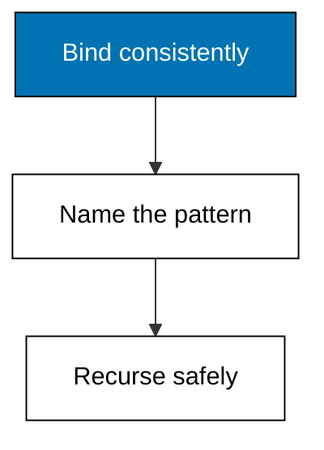
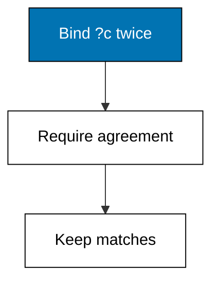
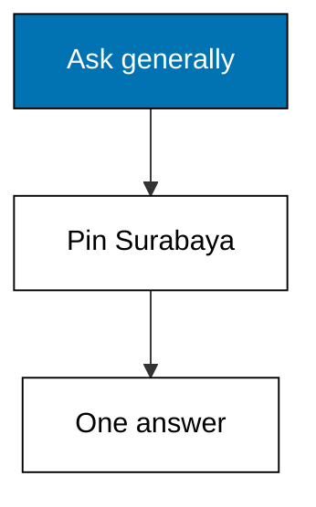
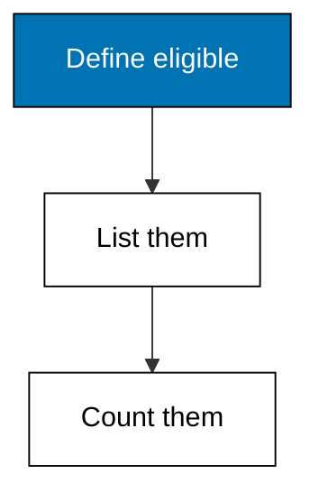
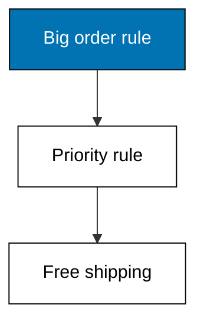
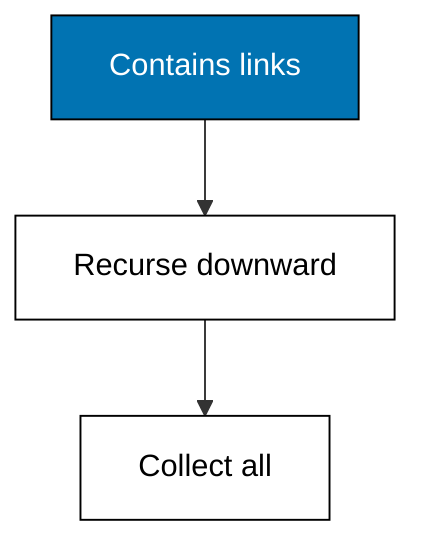
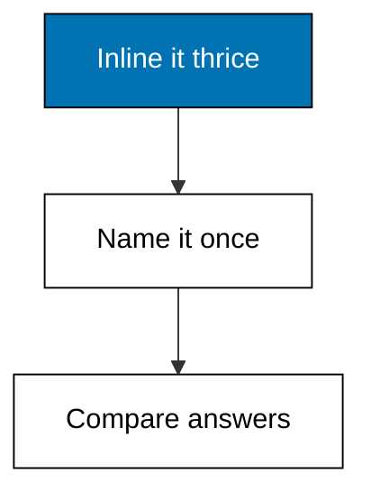

One variable appearing twice means one value in both places, and a named rule turns a repeated clause pattern into a reusable building block, even a recursive one.



### Worked Example 22: One Variable, One Value

_Exercises co-08._

Unification is the quiet engine inside every join: when the same variable appears twice, both positions must hold the same value. This example queries orders with their customers' cities, where the order's customer and the customer's city must agree on one customer entity.

Two orders from Bandung and one from Surabaya produce two bindings for the Bandung query. The variable ?c is bound once per candidate and then required to satisfy both clauses, which is all unification ever does.



**`learning/code/ex-22-unify-variables/main.py`**

```python
# Worked Example 22: One Variable, One Value
# => Kencana Parts Co. is fictional; every number here is fixed.
# => ?c must satisfy both clauses at once.
# => Two Bandung orders survive; Surabaya does not.
db = [  # => orders pointing at customers, customers with cities
    # => Entity 10 order/customer.
    (10, "order/customer", 20, 20101),  # => order 10 belongs to 20
    # => Entity 20 customer/city.
    (20, "customer/city", "Bandung", 20101),  # => customer 20 lives in Bandung
    # => Entity 11 order/customer.
    (11, "order/customer", 21, 20101),  # => order 11 belongs to 21
    # => Entity 21 customer/city.
    (21, "customer/city", "Surabaya", 20101),  # => customer 21 lives in Surabaya
    # => Entity 12 order/customer.
    (12, "order/customer", 20, 20101),  # => order 12 belongs to 20
    # => Close the collection.
]  # => five facts, one shared customer
# => Map each customer to its city for the join.
cities = {e: v for e, a, v, _t in db if a == "customer/city"}  # => customer to city
# => Keep orders whose customer unifies with a Bandung customer.
bandung = sorted(
    o for o, a, c, _t in db if a == "order/customer" and cities.get(c) == "Bandung"
)  # => ?c agrees twice
# => Print the matching orders.
print("bandung-orders:", bandung)  # => Output shows 10 and 12
```

**Output** (`learning/code/ex-22-unify-variables/expected/main.stdout.txt`):

```text
bandung-orders: [10, 12]
```

**Key takeaway**: A repeated variable is a constraint: every occurrence binds the same value.

**Why It Matters**: Bugs in Datalog are usually a variable renamed in one clause but not the other, which silently turns a join into a cross product. Reading queries as unification constraints makes that mistake visible: each repeated name is a promise the data must keep. Name shared variables after the thing they are, and the query checks itself as you read it.

---

### Worked Example 23: Constants Narrow the Search

_Exercises co-08._

Variables range widely; constants pin a clause to one value. This example searches the same order facts but fixes the city to Surabaya, returning only order 11.

Ground terms turn a general pattern into a specific question. The engine can often answer constants faster too, by seeking an index instead of scanning, a preview of Theme G.



**`learning/code/ex-23-constant-matching/main.py`**

```python
# Worked Example 23: Constants Narrow the Search
# => Kencana Parts Co. is fictional; every number here is fixed.
# => Fixing the city to Surabaya leaves one order.
# => Constants turn patterns into specific questions.
db = [  # => the same three orders and two cities
    # => Entity 10 order/customer.
    (10, "order/customer", 20, 20201),  # => Bandung order
    # => Entity 20 customer/city.
    (20, "customer/city", "Bandung", 20201),  # => its city
    # => Entity 11 order/customer.
    (11, "order/customer", 21, 20201),  # => Surabaya order
    # => Entity 21 customer/city.
    (21, "customer/city", "Surabaya", 20201),  # => its city
    # => Entity 12 order/customer.
    (12, "order/customer", 20, 20201),  # => Bandung order
    # => Close the collection.
]  # => five facts, one constant question
# => Map each customer to its city for the join.
cities = {e: v for e, a, v, _t in db if a == "customer/city"}  # => customer to city
# => Keep orders whose customer city equals the constant.
surabaya = sorted(
    o for o, a, c, _t in db if a == "order/customer" and cities.get(c) == "Surabaya"
)  # => pinned value
# => Print the single matching order.
print("surabaya-orders:", surabaya)  # => Output shows 11
```

**Output** (`learning/code/ex-23-constant-matching/expected/main.stdout.txt`):

```text
surabaya-orders: [11]
```

**Key takeaway**: A constant in a clause demands exactly that value, nothing else.

**Why It Matters**: Dashboards are constants wrapped in widgets: the region selector pins ?city to one value and the whole query specializes around it. Writing queries with constants in the open makes those specializations reviewable instead of buried in code. Pin the values that define the question and leave variables for the values that form the answer. Reviewable constants keep dashboard logic honest when regions get redrawn.

---

### Worked Example 24: Name a Pattern Once, Reuse It Twice

_Exercises co-09._

The shop discounts orders above 500, and that rule appears in both the quote screen and the month-end report. This example defines discount_eligible once and uses it in two queries: one listing eligible orders, one counting them.

Both queries agree, because both call the same rule. The rule is an ordinary function over bindings here, which mirrors exactly how named rules behave in a real engine.



**`learning/code/ex-24-named-rule-discount/main.py`**

```python
# Worked Example 24: Name a Pattern Once, Reuse It Twice
# => Kencana Parts Co. is fictional; every number here is fixed.
# => One rule, two queries, one consistent answer.
# => Totals above 500 earn the discount.
orders = {10: 640, 11: 120, 12: 515}  # => order totals in whole units


# => The named rule: an order is eligible when its total tops 500.
def discount_eligible(order):  # => one definition, two callers
    # => Totals are fixed; the threshold is the business policy.
    return orders[order] > 500  # => True earns the discount


# => Query one lists eligible orders; query two counts them.
listed = sorted(o for o in orders if discount_eligible(o))  # => the quoting screen
# => Compute the next value.
counted = sum(1 for o in orders if discount_eligible(o))  # => the month-end report
# => Print the list and the count side by side.
print("eligible:", listed)  # => Output shows 10 and 12
# => The check the lesson quotes.
print("eligible-count:", counted)  # => Output shows 2
```

**Output** (`learning/code/ex-24-named-rule-discount/expected/main.stdout.txt`):

```text
eligible: [10, 12]
eligible-count: 2
```

**Key takeaway**: Rules name reusable clause patterns so every caller shares one definition.

**Why It Matters**: Copy-pasted business logic is how the quote screen and the report start disagreeing, usually discovered by an angry customer. A named rule makes the policy exist exactly once, so a threshold change is one edit with zero drift. Whenever two queries share three clauses, that shared shape is begging to become a rule. The third copy is the signal; the rule is the response.

---

### Worked Example 25: Rules Build on Rules

_Exercises co-09._

Rules compose: a priority customer is one with a big order, and free shipping goes to priority customers. This example chains two rules and prints which orders ship free.

Chaining keeps each rule small enough to test alone while the composition answers the real question. The chain reads like the policy document: big orders make priority customers, priority earns free shipping.



**`learning/code/ex-25-rule-chaining/main.py`**

```python
# Worked Example 25: Rules Build on Rules
# => Kencana Parts Co. is fictional; every number here is fixed.
# => Two small rules answer one real question.
# => Chaining keeps each layer testable alone.
orders = {10: (20, 640), 11: (21, 120), 12: (20, 515)}  # => order to customer and total


# => A priority customer placed an order above 500.
def priority_customer(customer):  # => the first layer
    # => Any big order promotes its customer.
    return any(
        c == customer and total > 500 for c, total in orders.values()
    )  # => one big order suffices


# => Free shipping goes to orders of priority customers.
def free_shipping(order):  # => the second layer, built on the first
    # => Look up the order's customer, then ask the first rule.
    customer, _total = orders[order]  # => who placed it
    # => Hand the answer back.
    return priority_customer(customer)  # => chained verdict


# => Print the free-shipping orders.
free = sorted(o for o in orders if free_shipping(o))  # => orders 10 and 12
# => The check the lesson quotes.
print("free-shipping:", free)  # => Output shows 10 and 12
```

**Output** (`learning/code/ex-25-rule-chaining/expected/main.stdout.txt`):

```text
free-shipping: [10, 12]
```

**Key takeaway**: Rules chain: small tested layers compose into policy answers.

**Why It Matters**: Layered rules mirror how organizations actually decide, with each desk adding its own stamp to the previous desk's work. Testing each layer alone keeps failures local: when free shipping misfires, you check one small rule, not a monolith. Compose liberally and name each layer after the decision it makes. Small layers document the policy better than any wiki page could.

---

### Worked Example 26: Recursion Walks the Assembly Tree

_Exercises co-09._

A wheel contains spokes, and finding every component means following contains links until none remain. This example defines a recursive rule that collects the full parts explosion for one touring bike and prints the four reachable components.

Recursion terminates because the contains graph has no cycles: every step moves strictly downward. The rule asks its own question about each child, which is the whole trick of transitive closure in three lines.



**`learning/code/ex-26-recursive-rule-explosion/main.py`**

```python
# Worked Example 26: Recursion Walks the Assembly Tree
# => Kencana Parts Co. is fictional; every number here is fixed.
# => One bike, four reachable components, no cycles.
# => The rule asks itself about every child.
contains = {30: [31, 32], 31: [33], 32: [], 33: [34], 34: []}  # => parent to children


# => Every component reachable from a parent, children first.
def reachable(parent, seen=None):  # => the recursive rule
    # => Accumulate into a set so shared children count once.
    seen = set() if seen is None else seen  # => fresh set per top call
    # => Visit each child, then recurse into it.
    for child in contains.get(parent, []):  # => direct children first
        # => Compute the next value.
        seen.add(child)  # => record the child
        # => Compute the next value.
        reachable(child, seen)  # => the rule calls itself
    # => Hand the answer back.
    return seen  # => the full explosion


# => Print the sorted explosion for the touring bike.
parts = sorted(reachable(30))  # => entities 31 through 34
# => The check the lesson quotes.
print("components:", parts)  # => Output shows all four
```

**Output** (`learning/code/ex-26-recursive-rule-explosion/expected/main.stdout.txt`):

```text
components: [31, 32, 33, 34]
```

**Key takeaway**: Recursive rules follow links to their fixpoint; cycles would loop forever.

**Why It Matters**: Bills of materials, org charts, and folder trees are all the same shape, and one recursive rule answers all three. The termination argument matters more than the code: acyclic input guarantees an answer. Whenever you recurse, state what shrinks on each call, because that sentence is the proof your query finishes. State what shrinks on every recursive call, because that sentence proves the query finishes.

---

### Worked Example 27: One Rule Beats Three Copies

_Exercises co-09._

The discount check from Example 24 now appears in three places: the quote screen, the report, and a new loyalty mailer. This example runs the rule-based version and an inlined-copy version side by side and prints both answers to show they match.

They match today. The lesson is that only the rule version keeps matching after the threshold changes, because the copies must be found and edited one by one.



**`learning/code/ex-27-rule-vs-repetition/main.py`**

```python
# Worked Example 27: One Rule Beats Three Copies
# => Kencana Parts Co. is fictional; every number here is fixed.
# => Same answer today; only the rule survives tomorrow.
# => Three copies drift; one definition holds.
orders = {10: 640, 11: 120, 12: 515}  # => order totals in whole units


# => The rule version: threshold lives in exactly one place.
def eligible(order):  # => the single definition
    # => Above 500 earns the discount.
    return orders[order] > 500  # => one threshold, one home


# => Three inlined copies, as three screens would carry them.
quote = sorted(o for o, t in orders.items() if t > 500)  # => copy one
# => Compute the next value.
report = sorted(o for o, t in orders.items() if t > 500)  # => copy two
# => Compute the next value.
mailer = sorted(o for o, t in orders.items() if t > 500)  # => copy three
# => The rule version, computed once and shared.
ruled = sorted(o for o in orders if eligible(o))  # => the named version
# => Print all four answers: identical today, by construction.
print("quote:", quote)  # => Output shows 10 and 12
# => The check the lesson quotes.
print("report:", report)  # => Output shows 10 and 12
# => The check the lesson quotes.
print("mailer:", mailer)  # => Output shows 10 and 12
# => The check the lesson quotes.
print("ruled:", ruled)  # => Output matches all three copies
```

**Output** (`learning/code/ex-27-rule-vs-repetition/expected/main.stdout.txt`):

```text
quote: [10, 12]
report: [10, 12]
mailer: [10, 12]
ruled: [10, 12]
```

**Key takeaway**: Copies agree until the policy changes; rules agree afterwards too.

**Why It Matters**: Every duplicated threshold is a future incident wearing a calendar, because policies always change and copies are always miscounted. The side-by-side print above is the last day all four agree without discipline. Centralize the third time you copy a condition, and never let a fourth copy exist. Centralize a condition the third time it is copied, and never allow a fourth copy.

---
