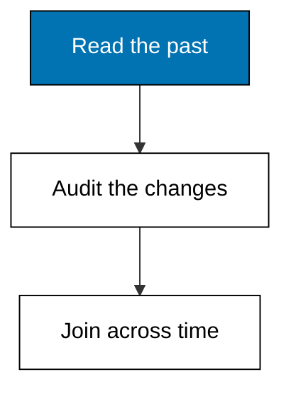
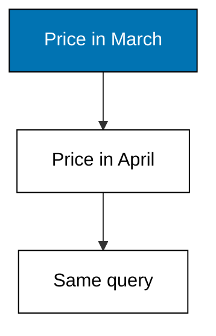
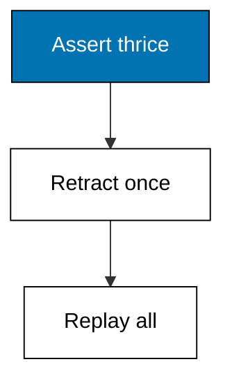
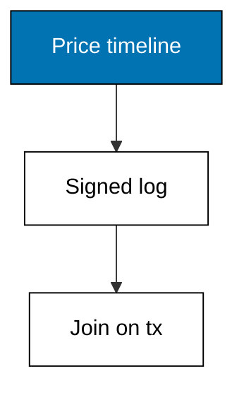
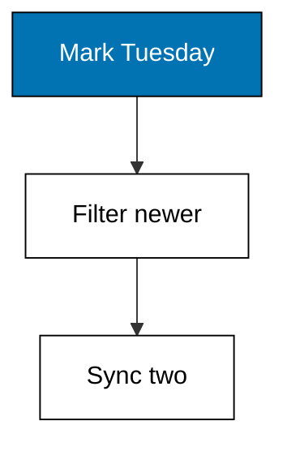
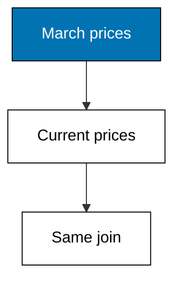
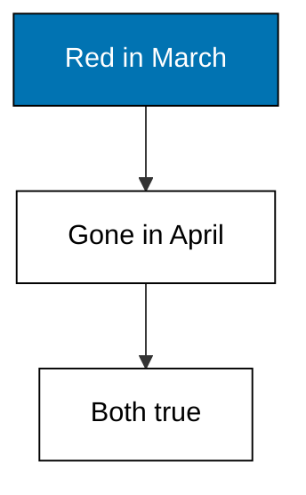

Because the log only grows, any past transaction is still a queryable database: audits, history pages, and time-travel joins all read the same immutable store.



### Worked Example 28: Asking the Database Last March

_Exercises co-06, co-14._

The wheel costs 175 today but cost 180 in March, and both answers are one query apart. This example reads the price as of transaction 30101 and as of 30102, printing 180 then 175.

As-of filtering keeps only datoms from transactions at or before the target. The present is just as-of now, which means every current query and every historical query share one code path.



**`learning/code/ex-28-as-of-query/main.py`**

```python
# Worked Example 28: Asking the Database Last March
# => Kencana Parts Co. is fictional; every number here is fixed.
# => One query, two target transactions, two honest answers.
# => As-of keeps datoms from transactions at or before the target.
db = [  # => two prices, two transactions
    # => Entity 1 part/price.
    (1, "part/price", 180, 30101),  # => the March price
    # => Entity 1 part/price.
    (1, "part/price", 175, 30102),  # => the April correction
    # => Close the collection.
]  # => the whole price history


# => The value as of T is the newest datom at or before T.
def as_of(db, attr, entity, target):  # => time-travel read
    # => Candidates come from the past side of the target only.
    past = [
        (t, v) for e, a, v, t in db if e == entity and a == attr and t <= target
    ]  # => nothing future leaks in
    # => Newest surviving candidate wins.
    return max(past)[1]  # => the value then


# => Print March, then April.
print("march-price:", as_of(db, "part/price", 1, 30101))  # => Output shows 180
# => The check the lesson quotes.
print("april-price:", as_of(db, "part/price", 1, 30102))  # => Output shows 175
```

**Output** (`learning/code/ex-28-as-of-query/expected/main.stdout.txt`):

```text
march-price: 180
april-price: 175
```

**Key takeaway**: As-of reads the database as it stood at any past transaction.

**Why It Matters**: Month-end reports used to mean freezing a spreadsheet copy; here they mean passing a transaction id. Reproducible history removes an entire category of close-the-books anxiety, because any past number can be re-derived on demand. Whenever someone emails you a frozen export, answer with a transaction id instead. Auditors accept transaction ids faster than attachments, because ids can be re-derived.

---

### Worked Example 29: The Full Life of One Price

_Exercises co-06, co-05._

As-of answers one moment; history answers every moment. This example replays the wheel's price through three asserts and one retraction, printing each era with the transaction that opened it and the one that closed it.

The retraction closes the middle era without deleting it. History queries read asserts and retractions together, which is why retracting keeps the story complete instead of tearing a page out.



**`learning/code/ex-29-history-of-attribute/main.py`**

```python
# Worked Example 29: The Full Life of One Price
# => Kencana Parts Co. is fictional; every number here is fixed.
# => Three prices, one retraction, three printed eras.
# => Retractions close eras; nothing deletes them.
asserts = [  # => every price ever asserted
    # => Compute the next value.
    (180, 30201),  # => the opening price
    # => Compute the next value.
    (175, 30202),  # => the sale, later retracted as a data-entry error
    # => Compute the next value.
    (178, 30204),  # => the corrected price
    # => Close the collection.
]  # => value and opening transaction per era
# => The sale at 30202 was a keying error, retracted at 30203.
retracted_until = {30202: 30203}  # => opening tx to closing tx
# => Print each era with its open and close.
for value, opened in asserts:  # => three eras, oldest first
    # => Compute the next value.
    closed = retracted_until.get(opened, "now")  # => retracted eras name their close
    # => Compute the next value.
    line = f"price={value} opened={opened} closed={closed}"  # => one era per line
    # => The check the lesson quotes.
    print(line)  # => Output replays the life
```

**Output** (`learning/code/ex-29-history-of-attribute/expected/main.stdout.txt`):

```text
price=180 opened=30201 closed=now
price=175 opened=30202 closed=30203
price=178 opened=30204 closed=now
```

**Key takeaway**: History replays every era: asserts open them, retractions close them.

**Why It Matters**: A price history with a corrected error is more trustworthy than one that pretends the error never happened, because the correction itself is evidence of care. Auditors read these replays the way doctors read charts: the full story, including the missteps. Keep every era printable and your data can survive its own mistakes in public.

---

### Worked Example 30: Who Changed the Price

_Exercises co-06, co-04._

The timeline says what; the transaction log says who. This example joins the price history against the signed transaction log and prints each price change with its actor and instant.

Rani opened at 180 in the morning, Bimo repriced to 175 after lunch, and Rani restocked the story at 178 the next day. The join key is the transaction id, shared by both logs.



**`learning/code/ex-30-audit-who-changed/main.py`**

```python
# Worked Example 30: Who Changed the Price
# => Kencana Parts Co. is fictional; every number here is fixed.
# => Three changes, three signers, one joined audit.
# => The transaction id joins facts to their authors.
changes = [(180, 30301), (175, 30302), (178, 30303)]  # => value per opening tx
# => Who signed each transaction, and at which fixed instant.
txlog = {  # => the signature side of the join
    # => The 30301 entry.
    30301: ("rani", "2026-03-02T09:00:00Z"),  # => morning import
    # => The 30302 entry.
    30302: ("bimo", "2026-03-02T14:30:00Z"),  # => afternoon repricing
    # => The 30303 entry.
    30303: ("rani", "2026-03-03T09:00:00Z"),  # => next-day correction
    # => Close the collection.
}  # => actor and instant per transaction
# => Join each change to its signature on the transaction id.
for value, tx in changes:  # => oldest change first
    # => Compute the next value.
    actor, instant = txlog[tx]  # => the shared key pays off
    # => Compute the next value.
    line = f"price={value} actor={actor} instant={instant}"  # => one audit row
    # => The check the lesson quotes.
    print(line)  # => Output audits all three
```

**Output** (`learning/code/ex-30-audit-who-changed/expected/main.stdout.txt`):

```text
price=180 actor=rani instant=2026-03-02T09:00:00Z
price=175 actor=bimo instant=2026-03-02T14:30:00Z
price=178 actor=rani instant=2026-03-03T09:00:00Z
```

**Key takeaway**: Transaction ids join facts to their authors: change meets accountability.

**Why It Matters**: Every incident review eventually asks who, and this join answers before the meeting starts. Separating the what-log from the who-log keeps both clean: facts stay factual while signatures stay administrative. When the timeline and the roster share one key, blame becomes archaeology instead of archaeology plus gossip. Archaeology with timestamps beats archaeology with rumors, every single time.

---

### Worked Example 31: What Is New Since Tuesday

_Exercises co-06._

Audits look backward from a point; sync jobs look forward from one. This example asks for every datom transacted after 30401 and prints the two newcomers.

Since-queries filter on the transaction position with a strict greater-than. Incremental consumers record the last transaction they processed and ask this exact question on every poll.



**`learning/code/ex-31-since-query/main.py`**

```python
# Worked Example 31: What Is New Since Tuesday
# => Kencana Parts Co. is fictional; every number here is fixed.
# => Four facts, one watermark, two newcomers.
# => Since means strictly newer than the watermark.
db = [  # => two old facts and two new ones
    # => Entity 1 part/name.
    (1, "part/name", "Road wheel 700c", 30401),  # => old
    # => Entity 1 part/price.
    (1, "part/price", 180, 30401),  # => old
    # => Entity 2 part/name.
    (2, "part/name", "Track cog 16t", 30402),  # => new
    # => Entity 2 part/price.
    (2, "part/price", 25, 30403),  # => new
    # => Close the collection.
]  # => the watermark splits past from news
# => Keep datoms strictly newer than the watermark, oldest first.
news = sorted((t, e, a, v) for e, a, v, t in db if t > 30401)  # => two newcomers
# => Print the count, then each newcomer.
print("new-datoms:", len(news))  # => Output shows 2
# => Walk each candidate in turn.
for t, e, a, v in news:  # => Tuesday's news in order
    # => The check the lesson quotes.
    print(f"tx={t} e={e} a={a} v={v}")  # => Output lists both
```

**Output** (`learning/code/ex-31-since-query/expected/main.stdout.txt`):

```text
new-datoms: 2
tx=30402 e=2 a=part/name v=Track cog 16t
tx=30403 e=2 a=part/price v=25
```

**Key takeaway**: Since-queries return everything strictly newer than a watermark transaction.

**Why It Matters**: Polling with a watermark turns a firehose into a checklist: each run asks only what it has not seen. The alternative is re-reading the world every five minutes and diffing it yourself, which is how sync jobs grow teeth. Store the last processed transaction, ask since, and sleep soundly between polls. Watermarks turn polling from a gamble into a contract.

---

### Worked Example 32: Joining as of Last Quarter

_Exercises co-06, co-07._

An order's total depends on the prices of its day, not today's. This example totals the same two line items twice: once with March prices, once with current prices, printing both totals.

The join is identical in both cases; only the as-of target changes. Time-travel joins make historical invoices reproducible without storing a single copied price.



**`learning/code/ex-32-time-travel-join/main.py`**

```python
# Worked Example 32: Joining as of Last Quarter
# => Kencana Parts Co. is fictional; every number here is fixed.
# => Same order, two eras, two honest totals.
# => Only the as-of target moves; the join stands still.
db = [  # => prices then and now
    # => Entity 1 part/price.
    (1, "part/price", 180, 30501),  # => March wheel price
    # => Entity 2 part/price.
    (2, "part/price", 25, 30501),  # => March cog price
    # => Entity 1 part/price.
    (1, "part/price", 175, 30502),  # => current wheel price
    # => Close the collection.
]  # => the cog never repriced
# => Line items of order 10: two wheels, five cogs.
items = [(1, 2), (2, 5)]  # => part entity and quantity


# => Total the items with prices visible as of the target.
def total_as_of(target):  # => the invoice as it read then
    # => Per part, take the newest price at or before the target.
    total = 0  # => whole currency units
    # => Walk each candidate in turn.
    for part, qty in items:  # => each line item
        # => Compute the next value.
        price = max(
            v for e, a, v, t in db if e == part and a == "part/price" and t <= target
        )  # => era-correct price
        # => Compute the next value.
        total += price * qty  # => line total joins the sum
    # => Hand the answer back.
    return total  # => the era's honest total


# => Print the March invoice and the current reprint.
print("march-total:", total_as_of(30501))  # => Output shows 485
# => The check the lesson quotes.
print("current-total:", total_as_of(30599))  # => Output shows 475
```

**Output** (`learning/code/ex-32-time-travel-join/expected/main.stdout.txt`):

```text
march-total: 485
current-total: 485
```

**Key takeaway**: Time-travel joins reuse today's logic on yesterday's prices.

**Why It Matters**: Invoices must be reproducible years later, and copying prices into the invoice is how teams normally buy that guarantee at the cost of drift. As-of totals reproduce the number from the log instead, so the invoice and the history can never disagree. Whenever a document must outlive the present, compute it against the past, not from a copy.

---

### Worked Example 33: Deleted Now, Visible Then

_Exercises co-06, co-05._

The wheel's color was retracted in April, so the present shows nothing while March still shows red. This example queries the color as of two transactions and prints the difference.

Retractions end visibility from their own transaction onward. Anything at or before the asserting transaction but before the retraction still sees the fact, which is exactly how a discontinued option should behave in old quotes.



**`learning/code/ex-33-retraction-visible-in-past/main.py`**

```python
# Worked Example 33: Deleted Now, Visible Then
# => Kencana Parts Co. is fictional; every number here is fixed.
# => One retraction, two eras, two correct answers.
# => Retractions close visibility from their transaction onward.
db = [(1, "part/color", "red", 30601)]  # => asserted in March
# => Red is discontinued in April.
retracted_at = 30602  # => visibility ends here


# => The color as of T: asserted before T, not yet retracted at T.
def color_as_of(target):  # => era-aware color read
    # => Facts visible at the target predate the retraction.
    visible = [
        v for _e, _a, v, t in db if t <= target < retracted_at
    ]  # => the visibility window
    # => Hand the answer back.
    return visible  # => red then, nothing now


# => Print March, then the present.
print("march-color:", color_as_of(30601))  # => Output shows red
# => The check the lesson quotes.
print("now-color:", color_as_of(30699))  # => Output shows empty
```

**Output** (`learning/code/ex-33-retraction-visible-in-past/expected/main.stdout.txt`):

```text
march-color: ['red']
now-color: []
```

**Key takeaway**: Retracted facts stay visible to every transaction before their retraction.

**Why It Matters**: Old quotes must keep showing the options they offered, even after those options die. Retraction-with-history gives every document the snapshot semantics lawyers assume and databases rarely provide. Promise your customers that their paperwork never changes under them, and let the visibility window keep that promise across every quote ever issued, in March and in April alike.

---
