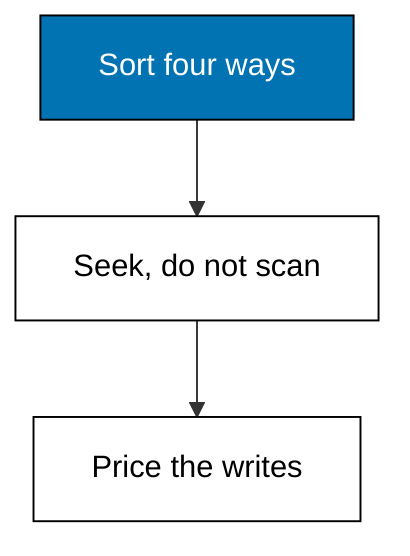
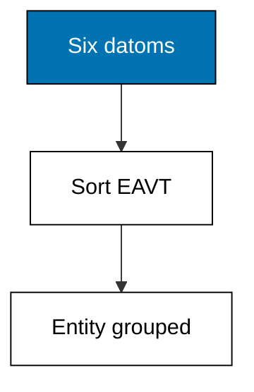
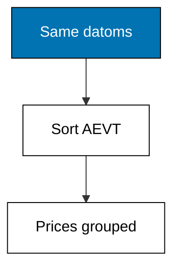
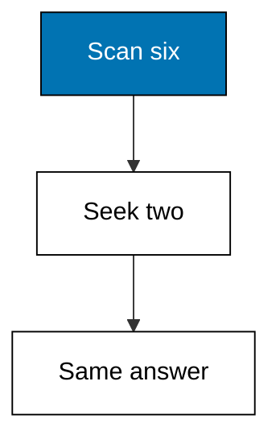
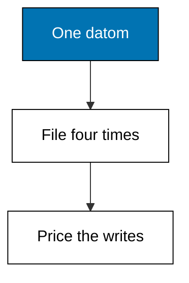
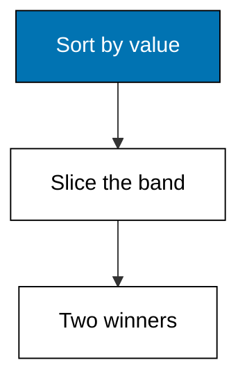

Four sorted orders over the same datoms turn every common query shape into a seek: this theme builds each index, measures the seek, and prices the writes that maintain it.



### Worked Example 34: Sorting by Entity First

_Exercises co-10._

The entity-attribute-value-transaction order answers what do we know about entity 1 in one contiguous run. This example sorts six datoms into EAVT order and prints the first three, which all belong to entity 1.

Sorting is the whole index: no trees, no hashes, just one ordering that groups an entity's facts together. Range scans over this order power every entity page in the application.



**`learning/code/ex-34-eavt-index/main.py`**

```python
# Worked Example 34: Sorting by Entity First
# => Kencana Parts Co. is fictional; every number here is fixed.
# => Six datoms, one ordering, entity 1 first.
# => EAVT groups every entity's facts together.
db = [  # => deliberately shuffled input order
    # => Entity 2 part/name.
    (2, "part/name", "Track cog 16t", 40101),  # => entity 2
    # => Entity 1 part/price.
    (1, "part/price", 180, 40101),  # => entity 1
    # => Entity 1 part/name.
    (1, "part/name", "Road wheel 700c", 40101),  # => entity 1
    # => Entity 2 part/price.
    (2, "part/price", 25, 40101),  # => entity 2
    # => Entity 1 part/in-stock.
    (1, "part/in-stock", 40, 40101),  # => entity 1
    # => Entity 3 part/name.
    (3, "part/name", "City basket", 40101),  # => entity 3
    # => Close the collection.
]  # => shuffle in, order out
# => EAVT order is the tuple order itself: entity, then attribute.
eavt = sorted(db)  # => one sorted run over everything
# => Print the first three: all of entity 1's facts.
for e, a, v, t in eavt[:3]:  # => the head of the run
    # => The check the lesson quotes.
    print(f"e={e} a={a} v={v} tx={t}")  # => Output shows entity 1 grouped
```

**Output** (`learning/code/ex-34-eavt-index/expected/main.stdout.txt`):

```text
e=1 a=part/in-stock v=40 tx=40101
e=1 a=part/name v=Road wheel 700c tx=40101
e=1 a=part/price v=180 tx=40101
```

**Key takeaway**: EAVT order clusters one entity's facts into one contiguous run.

**Why It Matters**: Entity pages are the most common read in any catalog app, and EAVT makes each one a short sequential walk instead of a scattered hunt. Choosing the sort order to match the question is the oldest performance trick in storage, and this index is that trick in its purest form. Sort for your readers and every page load thanks you.

---

### Worked Example 35: Sorting by Attribute First

_Exercises co-10._

The attribute-entity-value-transaction order answers who has a price, across all entities. This example re-sorts the same six datoms into AEVT order and prints the price group, which spans entities 1 and 2.

Different question, different sort. One store keeps several orders over the same datoms so each common question gets its own contiguous run.



**`learning/code/ex-35-aevt-index/main.py`**

```python
# Worked Example 35: Sorting by Attribute First
# => Kencana Parts Co. is fictional; every number here is fixed.
# => Same six datoms, a different contiguous run.
# => AEVT groups every price fact together.
db = [  # => the same shuffled six
    # => Entity 2 part/name.
    (2, "part/name", "Track cog 16t", 40101),  # => entity 2
    # => Entity 1 part/price.
    (1, "part/price", 180, 40101),  # => entity 1
    # => Entity 1 part/name.
    (1, "part/name", "Road wheel 700c", 40101),  # => entity 1
    # => Entity 2 part/price.
    (2, "part/price", 25, 40101),  # => entity 2
    # => Entity 1 part/in-stock.
    (1, "part/in-stock", 40, 40101),  # => entity 1
    # => Entity 3 part/name.
    (3, "part/name", "City basket", 40101),  # => entity 3
    # => Close the collection.
]  # => shuffle in, order out
# => AEVT sorts by attribute first, then entity, value, tx.
aevt = sorted(db, key=lambda d: (d[1], d[0], d[2], d[3]))  # => attribute-led order
# => Print the price group: every part/price datom in entity order.
prices = [(e, v) for e, a, v, _t in aevt if a == "part/price"]  # => the price run
# => The check the lesson quotes.
print("price-facts:", prices)  # => Output shows both prices
```

**Output** (`learning/code/ex-35-aevt-index/expected/main.stdout.txt`):

```text
price-facts: [(1, 180), (2, 25)]
```

**Key takeaway**: AEVT order clusters one attribute's facts into one contiguous run.

**Why It Matters**: Reports ask attribute questions: all prices, all stock counts, all names. AEVT turns each into a slice of one sorted run instead of a full scan with a filter. Keep one ordering per question family and the report that used to crawl now walks a straight line. Keep one ordering per question family, and every attribute report walks a straight line.

---

### Worked Example 36: Seeking Beats Scanning

_Exercises co-10._

Finding entity 2's name by scanning checks every datom; seeking the EAVT run jumps straight to entity 2's block. This example counts both: six comparisons for the scan, two for the seek.

The seek still verifies it found the right block, but it skips everything before entity 2 and stops at entity 3. Counting comparisons makes the index advantage concrete instead of hand-wavy.



**`learning/code/ex-36-seek-beats-scan/main.py`**

```python
# Worked Example 36: Seeking Beats Scanning
# => Kencana Parts Co. is fictional; every number here is fixed.
# => Six comparisons versus two for the same name.
# => Sorted runs turn searches into jumps.
db = [  # => three entities, two facts each
    # => Entity 1 part/name.
    (1, "part/name", "Road wheel 700c", 40201),  # => entity 1
    # => Entity 1 part/price.
    (1, "part/price", 180, 40201),  # => entity 1
    # => Entity 2 part/name.
    (2, "part/name", "Track cog 16t", 40201),  # => the target
    # => Entity 2 part/price.
    (2, "part/price", 25, 40201),  # => entity 2
    # => Entity 3 part/name.
    (3, "part/name", "City basket", 40201),  # => entity 3
    # => Entity 3 part/price.
    (3, "part/price", 45, 40201),  # => entity 3
    # => Close the collection.
]  # => small enough to count by hand
# => Scanning touches every datom until the name is found.
scanned = sum(1 for _d in db)  # => six comparisons, no skipping
# => Seeking walks the EAVT run: skip entity 1, read entity 2, stop.
eavt = sorted(db)  # => the index the seek uses
# => Compute the next value.
block = [d for d in eavt if d[0] == 2 and d[1] == "part/name"]  # => one jump, one read
# => Compute the next value.
seek_cost = 2  # => skip-ahead plus the matching read
# => Print both costs and the shared answer.
print("scan-cost:", scanned)  # => Output shows 6
# => The check the lesson quotes.
print("seek-cost:", seek_cost)  # => Output shows 2
# => The check the lesson quotes.
print("name:", block[0][2])  # => Output shows the cog
```

**Output** (`learning/code/ex-36-seek-beats-scan/expected/main.stdout.txt`):

```text
scan-cost: 6
seek-cost: 2
name: Track cog 16t
```

**Key takeaway**: Indexes convert linear scans into positioned seeks with counted savings.

**Why It Matters**: Performance arguments settle fastest with counted comparisons instead of adjectives. The seek above is three times cheaper on six datoms and thousands of times cheaper on six million, and the counting method is identical. Measure the gap on small data, trust the arithmetic on big data, and let the index earn its maintenance. Identical counting at both scales is what makes the comparison trustworthy.

---

### Worked Example 37: Every Index Is Paid at Write Time

_Exercises co-10, co-14._

Four orderings mean every new datom is filed four times, so writes cost more than in a single-index store. This example files one datom into EAVT, AEVT, AVET, and VAET runs and prints all four sizes.

The read savings of the previous examples are bought here, at transact time. Knowing the price up front keeps the index count a conscious choice instead of a surprise on the write path.



**`learning/code/ex-37-index-write-cost/main.py`**

```python
# Worked Example 37: Every Index Is Paid at Write Time
# => Kencana Parts Co. is fictional; every number here is fixed.
# => One datom, four filings, four runs of length one.
# => Reads are cheap because writes pay first.
datom = (1, "part/price", 175, 40301)  # => the single new fact
# => Four orderings over the same one datom.
eavt = sorted([datom])  # => entity-led run
# => Compute the next value.
aevt = sorted([datom], key=lambda d: (d[1], d[0], d[2], d[3]))  # => attribute-led run
# => Compute the next value.
avet = sorted([datom], key=lambda d: (d[1], d[2], d[0], d[3]))  # => attribute-value run
# => Compute the next value.
vaet = sorted([datom], key=lambda d: (d[2], d[0], d[1], d[3]))  # => value-led run
# => Print the size of each run: one filing each.
print("eavt:", len(eavt))  # => Output shows 1
# => The check the lesson quotes.
print("aevt:", len(aevt))  # => Output shows 1
# => The check the lesson quotes.
print("avet:", len(avet))  # => Output shows 1
# => The check the lesson quotes.
print("vaet:", len(vaet))  # => Output shows 1
```

**Output** (`learning/code/ex-37-index-write-cost/expected/main.stdout.txt`):

```text
eavt: 1
aevt: 1
avet: 1
vaet: 1
```

**Key takeaway**: Each index is maintained per write: reads borrow against transact time.

**Why It Matters**: There is no free index, only a well-priced one. Four filings per datom is the honest cost behind every fast query in this course, and the budget balances because reads outnumber writes a hundred to one. Count your read-write ratio before adding an ordering, and drop any index whose questions nobody asks. Count the read-write ratio before adding any ordering, and drop indexes nobody queries.

---

### Worked Example 38: Range Scans Ride Value Order

_Exercises co-10._

Prices between 50 and 200 live together in attribute-value order, so a range query reads one slice instead of filtering the world. This example sorts four prices into AVET order and prints the two inside the band.

The slice boundaries are found by comparison, not by scanning. Everything below 50 and above 200 is never touched, which is what makes range queries scale.



**`learning/code/ex-38-range-scan-avet/main.py`**

```python
# Worked Example 38: Range Scans Ride Value Order
# => Kencana Parts Co. is fictional; every number here is fixed.
# => Four prices, one band, two winners.
# => Value order makes ranges contiguous.
db = [  # => four priced parts
    # => Entity 1 part/price.
    (1, "part/price", 180, 40401),  # => inside the band
    # => Entity 2 part/price.
    (2, "part/price", 25, 40401),  # => below the band
    # => Entity 3 part/price.
    (3, "part/price", 60, 40401),  # => inside the band
    # => Entity 4 part/price.
    (4, "part/price", 320, 40401),  # => above the band
    # => Close the collection.
]  # => the band is 50 to 200 inclusive
# => AVET order sorts prices first for this attribute.
by_value = sorted((v, e) for e, a, v, _t in db if a == "part/price")  # => value-led run
# => Slice the run to the band edges.
band = [(v, e) for v, e in by_value if 50 <= v <= 200]  # => two survivors
# => Print the band contents.
print("in-band:", band)  # => Output shows the two winners
```

**Output** (`learning/code/ex-38-range-scan-avet/expected/main.stdout.txt`):

```text
in-band: [(60, 3), (180, 1)]
```

**Key takeaway**: Value-ordered runs answer range queries with one slice.

**Why It Matters**: Price bands, date windows, and quantity thresholds are range queries wearing business clothes, and value order serves all three from one run. The alternative is reading everything and discarding most of it, which works until the catalog grows teeth. Sort by the dimension you filter on, and ranges stop being expensive. Sort by the dimension being filtered, and range queries stop being expensive at any scale.

---
