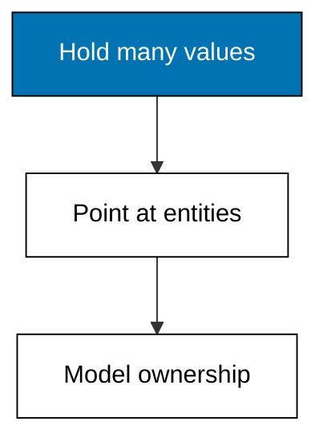
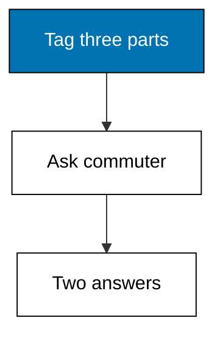
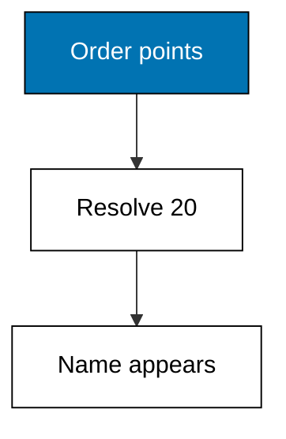
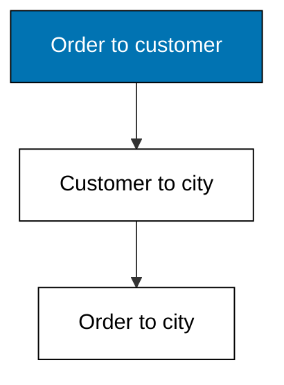
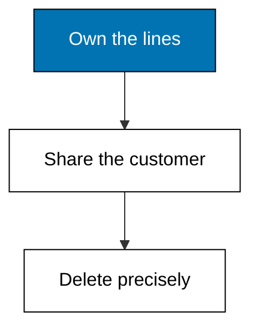
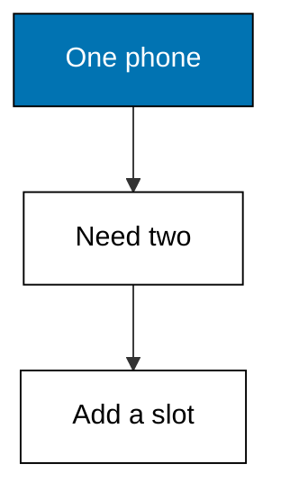

Many-valued attributes hold sets, reference attributes hold other entities, and the two compose into traversals: this theme models tags, orders, and ownership with both.



### Worked Example 39: Tagging Without a Side Table

_Exercises co-11, co-12._

Three parts carry overlapping tags, and the catalog must answer which ones count as commuter parts. This example stores five tag facts across three entities and queries the commuter set, printing the two tagged parts.

No junction table was created and no schema changed. Membership in a set-valued attribute is one clause, which is the entire query.



**`learning/code/ex-39-many-valued-tags/main.py`**

```python
# Worked Example 39: Tagging Without a Side Table
# => Kencana Parts Co. is fictional; every number here is fixed.
# => Three parts tagged, one tag queried, two answers.
# => Set membership is a single clause.
db = [  # => tags for three parts
    # => Entity 1 part/tags.
    (1, "part/tags", "commuter", 50101),  # => wheel is a commuter part
    # => Entity 1 part/tags.
    (1, "part/tags", "touring", 50101),  # => wheel tours too
    # => Entity 2 part/tags.
    (2, "part/tags", "track", 50101),  # => cog is track-only
    # => Entity 3 part/tags.
    (3, "part/tags", "commuter", 50101),  # => basket commutes too
    # => Entity 3 part/tags.
    (3, "part/tags", "city", 50101),  # => basket is a city part
    # => Close the collection.
]  # => five tag facts, one question
# => Every entity carrying the commuter tag, sorted.
commuters = sorted(
    e for e, a, v, _t in db if a == "part/tags" and v == "commuter"
)  # => entities 1 and 3
# => Print the commuter set.
print("commuters:", commuters)  # => Output shows 1 and 3
```

**Output** (`learning/code/ex-39-many-valued-tags/expected/main.stdout.txt`):

```text
commuters: [1, 3]
```

**Key takeaway**: Set-valued attributes answer membership questions with one clause.

**Why It Matters**: Faceted navigation on a shop site is this query repeated per facet, and a set-valued slot serves every facet from one attribute. The relational alternative joins a side table per facet and slows down with each new one. When filters multiply, store sets and let one clause per facet carry the load. One attribute per facet beats one table per facet at every catalog size.

---

### Worked Example 40: Attributes That Point at Entities

_Exercises co-12._

An order does not contain a customer name; it references a customer entity. This example stores an order with a reference to customer 20, resolves the reference, and prints the order with the customer name.

The value position holds an entity id instead of a literal. That single convention turns flat facts into a graph, and every traversal in this theme starts from it.



**`learning/code/ex-40-reference-attribute/main.py`**

```python
# Worked Example 40: Attributes That Point at Entities
# => Kencana Parts Co. is fictional; every number here is fixed.
# => Order 10 points at customer 20, who is named Sari.
# => Reference values are entity ids, not literals.
db = [  # => an order, a reference, and a customer name
    # => Entity 10 order/id.
    (10, "order/id", "SO-101", 50201),  # => the order exists
    # => Entity 10 order/customer.
    (10, "order/customer", 20, 50201),  # => it points at entity 20
    # => Entity 20 customer/name.
    (20, "customer/name", "Sari", 50201),  # => entity 20 is Sari
    # => Close the collection.
]  # => three facts, one pointer
# => Follow the reference from the order to the customer name.
refs = {o: c for o, a, c, _t in db if a == "order/customer"}  # => order to customer
# => Compute the next value.
names = {e: v for e, a, v, _t in db if a == "customer/name"}  # => customer to name
# => Print the order with its resolved customer.
print(
    "order-customer:", [(o, names[c]) for o, c in sorted(refs.items())]
)  # => Output names Sari
```

**Output** (`learning/code/ex-40-reference-attribute/expected/main.stdout.txt`):

```text
order-customer: [(10, 'Sari')]
```

**Key takeaway**: Reference attributes store entity ids, turning facts into a traversable graph.

**Why It Matters**: Foreign keys imply relationships; references state them in the same position as every other value. Queries, indexes, and history treat them uniformly because a pointer is just another datom value. Model relationships as data from the start and every join, audit, and migration inherits the same machinery. Uniform treatment lets one index strategy serve facts and links alike.

---

### Worked Example 41: Walking Two Hops to the City

_Exercises co-12, co-07._

The order points at the customer, the customer lives in a city: two hops answer which city each order ships to. This example chains both references and prints each order with its city.

Each hop is one clause sharing a variable with the next. Longer paths simply add clauses, which is why graph-shaped questions stay small in Datalog while they sprawl in SQL.



**`learning/code/ex-41-traverse-reference/main.py`**

```python
# Worked Example 41: Walking Two Hops to the City
# => Kencana Parts Co. is fictional; every number here is fixed.
# => Two hops collapse into one order-city pair per order.
# => Each hop shares a variable with the next.
db = [  # => two orders, two customers, two cities
    # => Entity 10 order/customer.
    (10, "order/customer", 20, 50301),  # => order 10 to customer 20
    # => Entity 11 order/customer.
    (11, "order/customer", 21, 50301),  # => order 11 to customer 21
    # => Entity 20 customer/city.
    (20, "customer/city", "Bandung", 50301),  # => customer 20's city
    # => Entity 21 customer/city.
    (21, "customer/city", "Surabaya", 50301),  # => customer 21's city
    # => Close the collection.
]  # => four facts, two paths
# => Resolve customers to cities, then orders to customers.
cities = {e: v for e, a, v, _t in db if a == "customer/city"}  # => customer to city
# => Compute the next value.
refs = {o: c for o, a, c, _t in db if a == "order/customer"}  # => order to customer
# => Print each order with its two-hop city.
for order in sorted(refs):  # => both orders
    # => The check the lesson quotes.
    print(f"order={order} city={cities[refs[order]]}")  # => Output walks both paths
```

**Output** (`learning/code/ex-41-traverse-reference/expected/main.stdout.txt`):

```text
order=10 city=Bandung
order=11 city=Surabaya
```

**Key takeaway**: Multi-hop traversals chain one shared variable per hop.

**Why It Matters**: Recommendations, permissions, and delivery zones are all multi-hop walks wearing different clothes. Expressing each hop as one clause keeps path queries proportional to the path instead of the schema. When a question spans three tables, count the hops first: that number is the size of your Datalog, whatever the SQL would have been. Path length, not table count, predicts how a query will read.

---

### Worked Example 42: Owned Parts Versus Shared Customers

_Exercises co-12._

Deleting an order should delete its line items but must never delete its customer, who belongs to the whole shop. This example marks line items as components and customers as shared references, then prints what a delete cascades to.

Ownership is a schema decision, not a query decision. Components die with their parent; references survive it, which keeps one shopper's history intact when their order is cancelled.



**`learning/code/ex-42-component-vs-reference/main.py`**

```python
# Worked Example 42: Owned Parts Versus Shared Customers
# => Kencana Parts Co. is fictional; every number here is fixed.
# => Cancelling order 10 removes two lines and zero customers.
# => Components cascade; references survive.
schema = {"order/line": "component"}  # => owned lines
# => The customer slot joins the ownership map.
schema["order/customer"] = "reference"  # => shared customers
# => Order 10 owns two lines and references customer 20.
db = ["line-10-a", "line-10-b"]  # => the owned components
# => Deleting the order cascades through components only.
cascaded = list(db) if schema["order/line"] == "component" else []  # => both lines go
# => Compute the next value.
kept = schema["order/customer"] == "reference"  # => references survive
# => Cancelled orders keep their customers.
survived = [20] if kept else []  # => the customer stays
# => Print the cascade result.
print("deleted-lines:", len(cascaded))  # => Output shows 2
# => The check the lesson quotes.
print("surviving-customers:", survived)  # => Output shows 20
```

**Output** (`learning/code/ex-42-component-vs-reference/expected/main.stdout.txt`):

```text
deleted-lines: 2
surviving-customers: [20]
```

**Key takeaway**: Components die with their parent; referenced entities outlive any single user.

**Why It Matters**: Cascade bugs delete too much or too little, and both variants surface as angry support tickets. Declaring ownership in the schema moves the decision from every delete statement to one declaration reviewed once. Mark each attribute owned or shared when you create it, and deletes become boring on purpose. Boring deletes are a schema achievement, not a query achievement.

---

### Worked Example 43: Changing Cardinality Without Breaking Readers

_Exercises co-11, co-15._

The shop starts tracking second phone numbers, so customer phone goes from one to many. This example introduces a new many-valued slot for the extra numbers, keeps the old slot working, and prints both readings.

Old readers keep querying the original attribute and see no change. New readers use the new slot, and a migration can fold the old values in whenever convenient, or never.



**`learning/code/ex-43-cardinality-change-cost/main.py`**

```python
# Worked Example 43: Changing Cardinality Without Breaking Readers
# => Kencana Parts Co. is fictional; every number here is fixed.
# => Old readers see one phone; new readers see both.
# => A new slot absorbs the change; the old one stands.
db = [  # => one phone under the old slot, two under the new
    # => Entity 20 customer/phone.
    (20, "customer/phone", "022-111", 50401),  # => the original number
    # => Entity 20 customer/phones.
    (20, "customer/phones", "022-111", 50402),  # => folded into the new set
    # => Entity 20 customer/phones.
    (20, "customer/phones", "022-222", 50402),  # => the second number
    # => Close the collection.
]  # => eras overlap by design
# => Old readers query the original slot; new readers query the set.
old_reading = [v for e, a, v, _t in db if a == "customer/phone"]  # => one number
# => Compute the next value.
phones = [v for _e, a, v, _t in db if a == "customer/phones"]  # => the set
# => New readers see both numbers, sorted.
new_reading = sorted(phones)  # => both numbers
# => Print both readings.
print("old-readers:", old_reading)  # => Output shows one phone
# => The check the lesson quotes.
print("new-readers:", new_reading)  # => Output shows both phones
```

**Output** (`learning/code/ex-43-cardinality-change-cost/expected/main.stdout.txt`):

```text
old-readers: ['022-111']
new-readers: ['022-111', '022-222']
```

**Key takeaway**: Cardinality changes add slots; old readers keep working during the transition.

**Why It Matters**: Cardinality changes are the migrations teams postpone forever because the flag day terrifies them. Additive change removes the flag day: ship the new slot, dual-write, migrate at leisure, and retire the old slot when its last reader leaves. Boring transitions beat heroic ones, and this pattern makes every transition boring. Additive change removes the flag day, so ship the slot, dual-write, and migrate at leisure.

---
