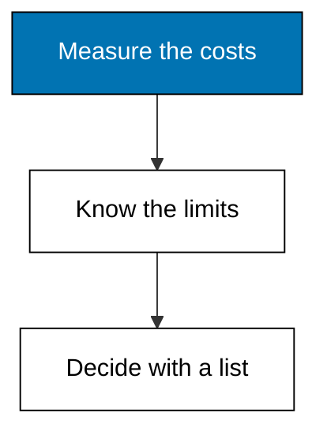
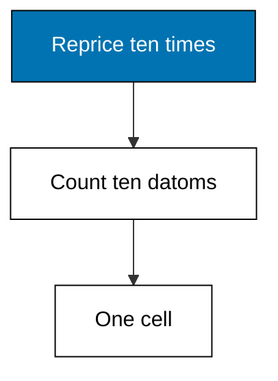
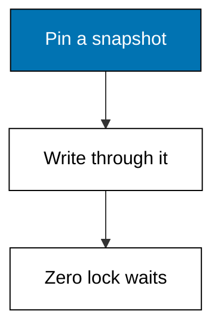
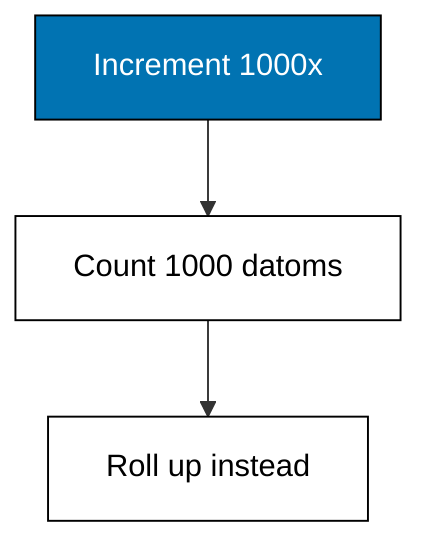
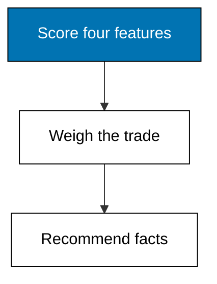

Immutability costs storage and suits some workloads better than others: five closing programs measure the costs honestly, then turn them into a go or no-go checklist.



### Worked Example 44: History Has a Storage Price

_Exercises co-13._

Ten repricings of one part keep ten datoms where a row store keeps one cell. This example writes ten prices and prints the datom count beside the single cell a mutable row would hold.

The ratio is the honest cost of total recall: history is stored, not reconstructed. Whether that price is worth paying depends on how often anyone asks about the past, which the next examples measure.



**`learning/code/ex-44-storage-growth/main.py`**

```python
# Worked Example 44: History Has a Storage Price
# => Kencana Parts Co. is fictional; every number here is fixed.
# => Ten repricings, ten datoms, one mutable cell.
# => Recall is stored, never reconstructed.
db = [
    (1, "part/price", 170 + i, 60101 + i) for i in range(10)
]  # => ten eras, ten facts
# => A row store would hold one cell; the log holds every era.
mutable_cells = 1  # => the single overwritten cell
# => Print both counts side by side.
print("datoms:", len(db))  # => Output shows 10
# => The check the lesson quotes.
print("mutable-cells:", mutable_cells)  # => Output shows 1
```

**Output** (`learning/code/ex-44-storage-growth/expected/main.stdout.txt`):

```text
datoms: 10
mutable-cells: 1
```

**Key takeaway**: Append-only storage grows with every change; mutable cells stay constant.

**Why It Matters**: Storage is cheap and audits are expensive, which is why this trade usually favors the log. Still, say the ratio out loud before committing: ten-to-one on a hot attribute dwarfs the same ratio on a sleepy one. Price the growth per attribute, keep history where questions need it, and archive where they do not. Archive cold eras aggressively; storage is cheap but attention is not.

---

### Worked Example 45: Readers Never Block Writers

_Exercises co-13, co-14._

A month-end report scanning a million datoms must not stop the warehouse from transacting. This example simulates both sides: the report reads a fixed as-of snapshot while three writes land, and prints that the report saw a stable count with zero lock waits.

Snapshots isolate readers by construction. Because the past never changes, a reader holding a transaction id needs no lock, no retry, and no apology.



**`learning/code/ex-45-snapshot-reads/main.py`**

```python
# Worked Example 45: Readers Never Block Writers
# => Kencana Parts Co. is fictional; every number here is fixed.
# => The report pins tx 60201 while three writes land after it.
# => Stable count, zero lock acquisitions, no retries.
db = [(i, "part/in-stock", 10 * i, 60201) for i in range(1, 6)]  # => five parts
# => Three writes land after the report starts; the snapshot ignores them.
later = [  # => concurrent writes
    # => Entity 6 part/in-stock.
    (6, "part/in-stock", 60, 60202),  # => a new part arrives
    # => Entity 1 part/in-stock.
    (1, "part/in-stock", 15, 60203),  # => entity 1 restocked
    # => Entity 7 part/in-stock.
    (7, "part/in-stock", 70, 60204),  # => another new part
    # => Close the collection.
]  # => all invisible to the snapshot
# => The report reads as of 60201: five parts, no locks taken.
snapshot = [d for d in db if d[3] <= 60201]  # => the past is immutable
# => Compute the next value.
lock_waits = 0  # => snapshots never lock
# => Print the stable count, the ignored writes, and the waits.
print("snapshot-parts:", len(snapshot))  # => Output shows 5
# => The check the lesson quotes.
print("ignored-writes:", len(later))  # => Output shows 3
# => The check the lesson quotes.
print("lock-waits:", lock_waits)  # => Output shows 0
```

**Output** (`learning/code/ex-45-snapshot-reads/expected/main.stdout.txt`):

```text
snapshot-parts: 5
ignored-writes: 3
lock-waits: 0
```

**Key takeaway**: Snapshot reads are lock-free: the pinned past cannot move under the reader.

**Why It Matters**: Month-end close used to mean a maintenance window with everyone holding their breath. Snapshot isolation deletes that ritual: reports pin a transaction and the warehouse keeps transacting around them. Offer this guarantee to your analysts and watch the midnight batch jobs quietly disappear. Analysts stop asking for frozen exports once they trust the pin to hold still.

---

### Worked Example 46: Counters Are the Worst Case

_Exercises co-13, co-16._

A page-view counter incremented a thousand times keeps a thousand datoms, each saying only one more than the last. This example simulates a thousand increments and prints the datom count against the single cell a row store would keep.

High-frequency numeric churn is where append-only hurts most. The lesson is not that counters are forbidden but that they belong in a specialized store, with periodic rollups as facts.



**`learning/code/ex-46-counter-increments-cost/main.py`**

```python
# Worked Example 46: Counters Are the Worst Case
# => Kencana Parts Co. is fictional; every number here is fixed.
# => A thousand increments keep a thousand near-identical datoms.
# => Churn belongs in counters; rollups belong in the log.
db = [
    (1, "part/views", i + 1, 60301 + i) for i in range(1000)
]  # => one thousand increments
# => A row store keeps one cell; a rollup keeps one fact per day.
rollup = [(1, "part/views-daily", 1000, 60401)]  # => the daily rollup fact
# => Print the raw count, the rollup count, and the single cell.
print("counter-datoms:", len(db))  # => Output shows 1000
# => The check the lesson quotes.
print("rollup-datoms:", len(rollup))  # => Output shows 1
# => The check the lesson quotes.
print("mutable-cells:", 1)  # => Output shows 1
```

**Output** (`learning/code/ex-46-counter-increments-cost/expected/main.stdout.txt`):

```text
counter-datoms: 1000
rollup-datoms: 1
mutable-cells: 1
```

**Key takeaway**: High-churn counters explode under append-only; roll them up before storing.

**Why It Matters**: Every model has a shape it handles badly, and honest courses name theirs before users discover it at scale. Counters, clocks, and sensor streams share this shape: thousands of writes, almost no historical questions. Funnel them through aggregation and store the summaries as facts, and the log stays lean while the dashboards stay fast. Funnel churn through aggregation, store summaries as facts, and keep dashboards fast.

---

### Worked Example 47: Transitive Closure in Three Clauses

_Exercises co-07, co-09, co-16._

Finding every part reachable from an assembly takes a recursive common-table expression in SQL and three clauses here. This example computes the reachable set from the touring bike and prints the four components.

The comparison is not about line counts but about staying in one language. Queries that need recursion, negation, and rules together fit Datalog's shape; queries that aggregate millions of rows may still prefer the warehouse.


**`learning/code/ex-47-expressiveness-check/main.py`**

```python
# Worked Example 47: Transitive Closure in Three Clauses
# => Kencana Parts Co. is fictional; every number here is fixed.
# => One assembly, four reachable components, no SQL text.
# => Recursion plus membership is the whole query.
contains = {30: [31, 32], 31: [33], 32: [], 33: [34], 34: []}  # => the assembly graph


# => Clause one: direct children. Clause two: recurse. Clause three: collect.
def closure(start):  # => the three-clause shape as a function
    # => Direct members join the answer immediately.
    found = set(contains.get(start, []))  # => clause one: membership
    # => Each member's own closure joins too.
    for child in list(found):  # => clause two: recursion
        # => Compute the next value.
        found |= closure(child)  # => clause three: union
    # => Hand the answer back.
    return found  # => the fixpoint


# => Print the sorted closure for the touring bike.
parts = sorted(closure(30))  # => entities 31 through 34
# => The check the lesson quotes.
print("reachable:", parts)  # => Output shows all four
```

**Output** (`learning/code/ex-47-expressiveness-check/expected/main.stdout.txt`):

```text
reachable: [31, 32, 33, 34]
```

**Key takeaway**: Recursive questions stay small in Datalog; aggregation at scale may not.

**Why It Matters**: Choose the query language that matches the question's shape instead of the team's habit. Graph walks, policy rules, and provenance chains are Datalog-shaped; bulk sums over billions of rows are warehouse-shaped. Most real systems need both, and knowing which question goes where is the senior skill this example starts building. Fluency in both shapes turns a query writer into a query designer.

---

### Worked Example 48: Should This Workload Be Facts

_Exercises co-16._

The course closes with the question it opened: when is this model worth it. This example scores a workload on four features, audit need, history reads, write churn, and relationship density, and prints the recommendation with its score.

Kencana's catalog scores high: audits matter, history is read weekly, writes are calm, and parts link to orders and customers. A click counter would score low on the same rubric, which is exactly the discrimination a checklist must provide.



**`learning/code/ex-48-decision-checklist/main.py`**

```python
# Worked Example 48: Should This Workload Be Facts
# => Kencana Parts Co. is fictional; every number here is fixed.
# => Four features, four weights, one recommendation.
# => The catalog passes; a click counter would not.
features = {  # => workload traits, each 0 to 10
    # => The audit-need entry.
    "audit-need": 9,  # => auditors visit yearly
    # => The history-reads entry.
    "history-reads": 7,  # => repricing reviews are weekly
    # => The write-calm entry.
    "write-calm": 8,  # => dozens of writes a day, not thousands
    # => The relationships entry.
    "relationships": 8,  # => parts, orders, customers interlink
    # => Close the collection.
}  # => Kencana's catalog profile
# => Equal weights; twenty-four out of forty recommends facts.
score = sum(features.values())  # => the workload score
# => Compute the next value.
verdict = "use-facts" if score >= 24 else "use-rows"  # => the threshold
# => Print the score and the recommendation.
print("score:", score)  # => Output shows 32
# => The check the lesson quotes.
print("verdict:", verdict)  # => Output shows use-facts
```

**Output** (`learning/code/ex-48-decision-checklist/expected/main.stdout.txt`):

```text
score: 32
verdict: use-facts
```

**Key takeaway**: Score audit need, history reads, write calm, and relationships before choosing.

**Why It Matters**: Architecture by checklist beats architecture by fashion, because the checklist remembers the constraints that enthusiasm forgets. Run every new workload through these four features before choosing a store, and revisit the score yearly as the workload evolves. The model serves the workload, never the reverse, and this closing habit keeps that ordering straight. Revisit every workload score yearly as conditions evolve, because the model serves the workload.

---
