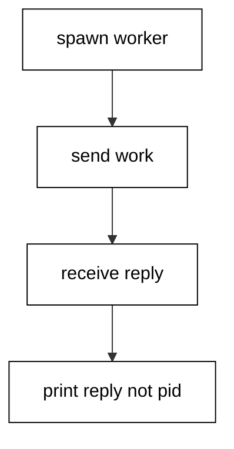
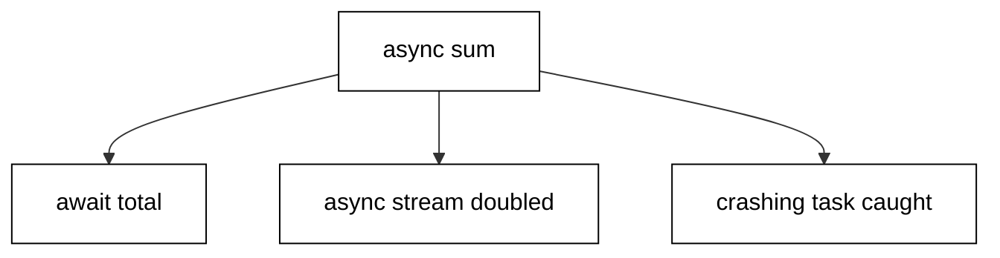
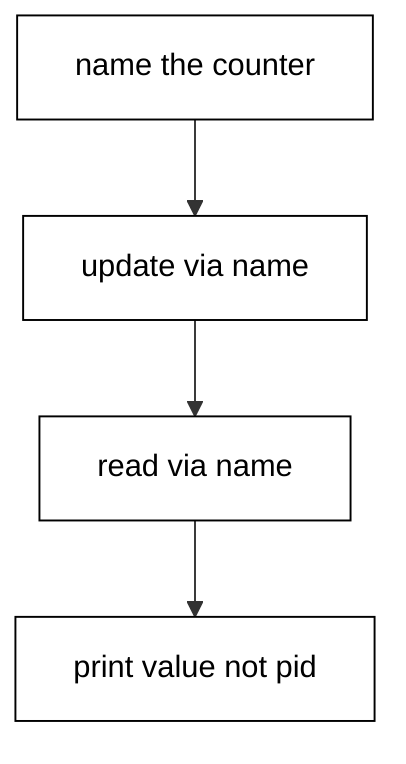
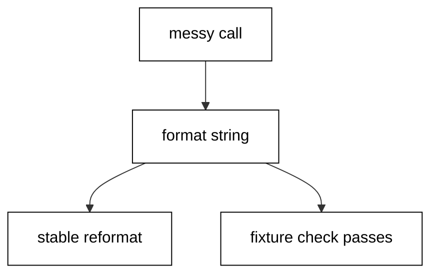
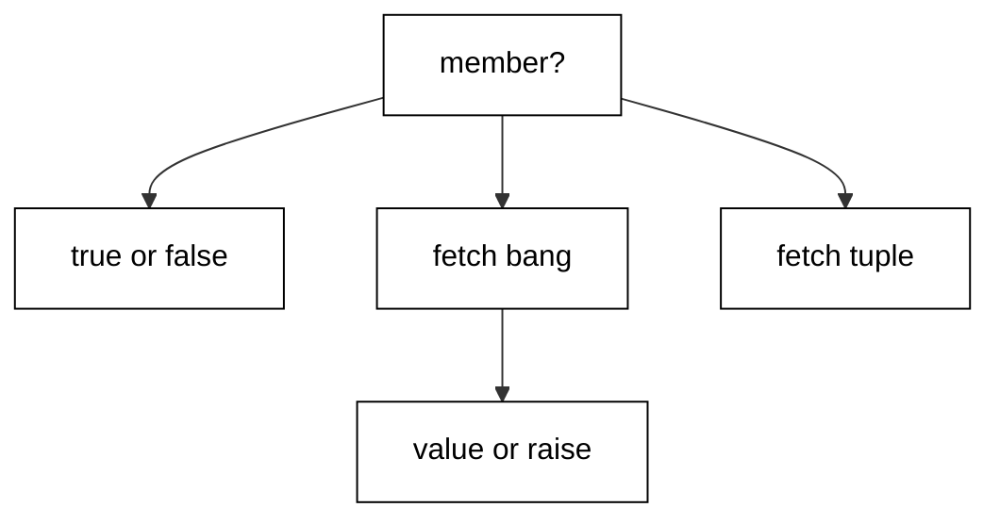
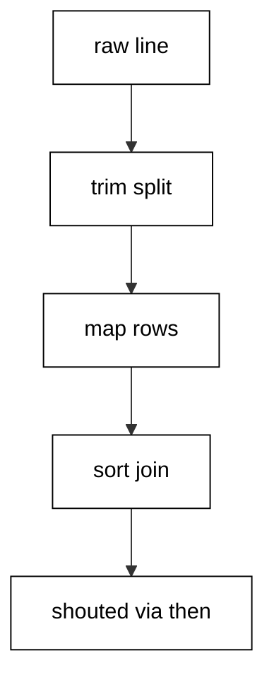
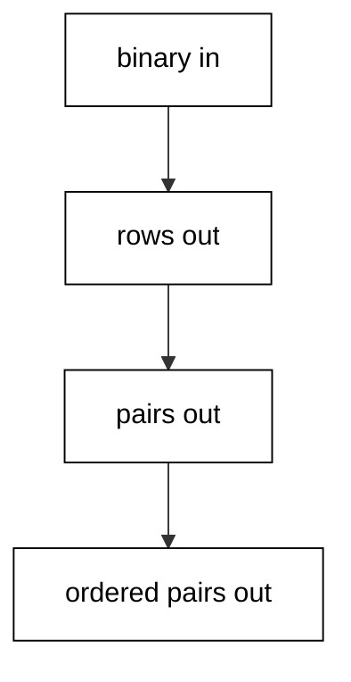
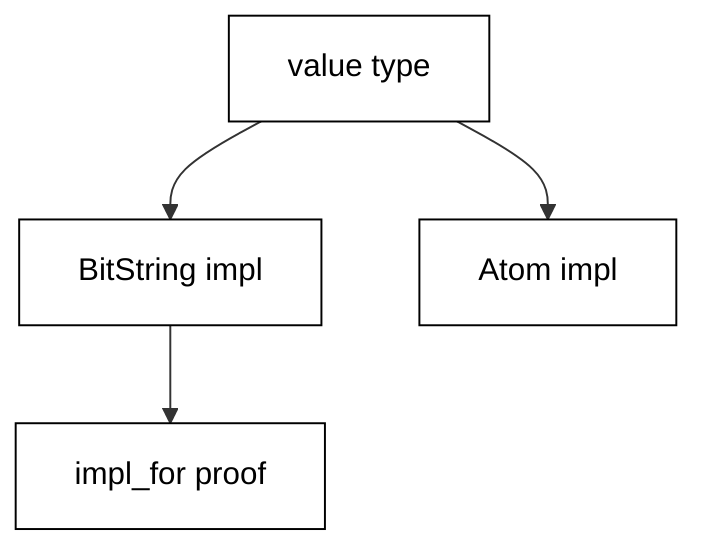
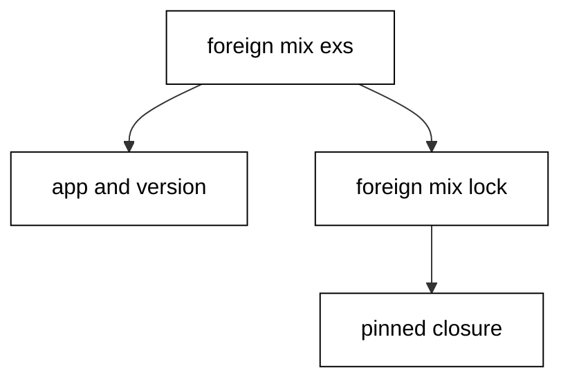

Examples 54–78 survey the concurrency primitives at one example each, standardize tooling and style, and teach a systematic way to read idiomatic code written by someone else. Three clusters carry the level: concurrency primitives survey (Examples 54–61), tooling, linting, and style with the platform boundary (Examples 62–70), and reading idiomatic code (Examples 71–78). Every script runs as `elixir main.exs` on the pinned Elixir 1.20.4 toolchain with no network; outputs are recorded golden files.

### Example 54: spawn and Message Passing

Processes are spawned, messages are sent, and replies arrive by pattern — the whole concurrency model in one round trip (Concepts: co-09.)



`spawn` runs the function in a new process while `send` queues the message in its mailbox. `receive` blocks with a bound and matches the reply pattern. The transcript prints the computed reply, never the pid, because pids vary between runs.

**`learning/code/ex-54-spawn-message-passing/main.exs`**:

```elixir
# => Example 54: spawn starts a process; send and receive move the message.
me = self()
# => spawn runs the function in a new process; the new pid is private.
worker = spawn(fn -> receive do {:work, from, n} -> send(from, {:done, n * 2}) end end)
# => send is async: the message waits in the mailbox until receive matches.
send(worker, {:work, me, 21})
# => receive blocks with a bound; the reply pattern names the expected shape.
reply = receive do {:done, n} -> n after 1000 -> :timeout end
# => Print the computed reply, never the pid: pids vary between runs.
IO.puts("reply=#{reply}")
```

**Output** (`learning/code/ex-54-spawn-message-passing/expected/main.stdout.txt`):

```text
reply=42
```

**Key takeaway**: Spawn the process, send the message, match the reply — and print values, not pids.

**Why it matters**: Every OTP behaviour is this loop with supervision around it. Reading the raw loop first makes every abstraction legible later.

### Example 55: receive With Timeouts and Selection

`receive` matches selectively by pattern rather than arrival order, leftovers stay queued, and `after` bounds every wait (Concepts: co-09.)

The fast clause matches first even though it arrived second. The slow messages remain for later receives, sorted here for a stable report. A bounded wait on an empty mailbox proves the `after` branch deterministically.

**`learning/code/ex-55-receive-timeouts-selection/main.exs`**:

```elixir
# => Example 55: receive matches selectively; after bounds the wait.
me = self() # => the mailbox all three sends land in.
# => Queue three messages; receive picks by pattern, not arrival order.
send(me, {:slow, 1}) # => first arrival: a slow message.
send(me, {:fast, 2}) # => second arrival: the fast message.
send(me, {:slow, 3}) # => third arrival: another slow message.
# => The fast clause matches first even though it arrived second.
picked = receive do {:fast, n} -> n after 1000 -> :timeout end # => pattern beats arrival order.
# => The slow messages remain; collect both, then sort for stability.
rest = # => the leftover slow values, sorted.
  [ # => receive twice; each call takes the next slow message.
    receive do {:slow, n} -> n after 1000 -> :missing end, # => first leftover.
    receive do {:slow, n} -> n after 1000 -> :missing end # => second leftover.
  ] # => the two-element list closes.
  |> Enum.sort() # => sort for a stable report.
# => A bounded wait on an empty mailbox proves the after branch exactly.
empty = receive do {:never, _} -> "arrived" after 50 -> "empty" end # => the empty-mailbox proof.
# => Print the selection, the leftovers, and the empty proof.
IO.puts("picked=#{picked} rest=#{inspect(rest)} empty=#{empty}") # => selection plus leftovers transcript.
```

**Output** (`learning/code/ex-55-receive-timeouts-selection/expected/main.stdout.txt`):

```text
picked=2 rest=[1, 3] empty=empty
```

**Key takeaway**: Patterns select, queues persist, and every wait carries its own bound.

**Why it matters**: Unbounded receives hang when a message is lost. Selective matching plus `after` keeps each mailbox interaction total and reviewable.

### Example 56: Agents for Synchronous Shared State

Agents hold synchronous shared state behind a function API: updates run inside, callers never touch state (Concepts: co-09.)

`update` runs the function inside the agent while `get_and_update` returns the old value and installs the new one atomically. `get` reads without changing. Stopping the agent at the end keeps the script owning its whole lifecycle.

**`learning/code/ex-56-agents-synchronous-shared-state/main.exs`**:

```elixir
# => Example 56: agents hold synchronous shared state behind a function API.
{:ok, counter} = Agent.start_link(fn -> 0 end) # => the counter agent starting at zero.
# => update runs the function inside the agent; callers never touch state.
Agent.update(counter, fn n -> n + 1 end) # => add one inside the agent.
Agent.update(counter, fn n -> n + 10 end) # => add ten inside the agent.
# => get_and_update returns the old value while installing the new one.
old = Agent.get_and_update(counter, fn n -> {n, n * 2} end) # => pop 11, install 22.
# => get reads the final value without changing it.
final = Agent.get(counter, fn n -> n end) # => read the doubled count.
# => Stop the agent; the script owns its whole lifecycle.
Agent.stop(counter) # => stop what the script started.
# => Print the popped old value and the final doubled count.
IO.puts("old=#{old} final=#{final}") # => popped value plus final count.
```

**Output** (`learning/code/ex-56-agents-synchronous-shared-state/expected/main.stdout.txt`):

```text
old=11 final=22
```

**Key takeaway**: Agents serialize state access; functions describe the change.

**Why it matters**: Shared mutable state with manual locking is the classic race source. Agents move the serialization into the runtime and leave callers with pure functions.

### Example 57: Tasks That await With Timeouts

Tasks run work concurrently and `await` collects with a bound; crashed tasks surface at the await as catchable exits (Concepts: co-09.)



`async_stream` bounds concurrency and keeps input order in the output. Trapping turns the linked crash into a catchable exit at the await call instead of killing the waiter — the standard supervision-aware posture. The script silences the task crash report through the logger primary level, because the report carries a timestamp and process IDs that would make the transcript nondeterministic; the transcript carries only the report.

**`learning/code/ex-57-tasks-await-with-timeouts/main.exs`**:

```elixir
# => Example 57: tasks await results with bounds; crashes surface at await.
# => async starts the work immediately; await collects it with a bound.
:logger.set_primary_config(:level, :none) # => crash reports carry clocks; silence them for a stable transcript.
job = Task.async(fn -> Enum.sum(1..100) end) # => sum one to one hundred concurrently.
# => await returns the value or raises if the timeout passes first.
total = Task.await(job, 5000) # => collect within five seconds.
# => async_stream bounds concurrency and keeps input order in the output.
doubled = # => the ordered doubled list the stream produces.
  1..5 # => double one through five with two at a time.
  |> Task.async_stream(fn x -> x * 2 end, max_concurrency: 2, timeout: 5000) # => bounded concurrent doubling.
  |> Enum.map(fn {:ok, n} -> n end) # => unwrap each ok tuple in order.
# => A crashing task reports through the awaiting match, not the console.
_ = Process.flag(:trap_exit, true) # => trap: link exits arrive as messages.
crasher = Task.async(fn -> raise "planned" end) # => the deliberately crashing task.
# => Await re-raises the crash as an exit, so catch owns the branch.
crashed = # => the crash report the catch produces.
  try do # => await the crashing task inside the trap.
    Task.await(crasher, 1000) # => the await that re-raises as an exit.
    "lived" # => dead unless the task ever succeeds.
  catch # => exits from linked crashes land here.
    :exit, _ -> "crashed" # => the crash report string.
  end # => the try closes; crashed holds the report.
# => Print the sum, the ordered stream, and the crash report.
IO.puts("total=#{total} doubled=#{inspect(doubled)} crashed=#{crashed}") # => value, stream, and crash lines.
```

**Output** (`learning/code/ex-57-tasks-await-with-timeouts/expected/main.stdout.txt`):

```text
total=5050 doubled=[2, 4, 6, 8, 10] crashed=crashed
```

**Key takeaway**: Bound every wait, trap when crashes must convert, and report values.

**Why it matters**: Unbounded awaits hang and untrapped links kill. The await-with-timeout plus trap-and-catch pairing is the concurrent equivalent of the error-tuple discipline from the beginner level.

### Example 58: GenServers That Serialize Calls

GenServers serialize calls through `handle_call` and absorb casts without replying (Concepts: co-09.)

`init` runs once in the server process before any message arrives. `handle_call` answers synchronously so the reply and the new state return together. `handle_cast` updates without replying, and the next call observes the reset value — the ordering guarantee that makes the transcript stable.

**`learning/code/ex-58-genservers-serialize-calls/main.exs`**:

```elixir
# => Example 58: GenServers serialize calls; casts stay fire-and-forget.
defmodule Counter do # => the serializing counter server.
  # => use wires the behaviour; init sets the starting state.
  use GenServer # => wire the OTP behaviour into this module.
  def start_link(n), do: GenServer.start_link(__MODULE__, n) # => start unregistered with n.
  # => init runs once in the server process before any message arrives.
  @impl GenServer # => tie init to its callback.
  def init(n), do: {:ok, n} # => the state starts as the argument.
  # => handle_call answers synchronously; reply and state return together.
  @impl GenServer # => tie the bump clause to its callback.
  def handle_call(:bump, _from, n), do: {:reply, n + 1, n + 1} # => reply and install n+1.
  # => handle_cast updates without replying; callers never block on it.
  @impl GenServer # => tie the reset clause to its callback.
  def handle_cast(:reset, _n), do: {:noreply, 0} # => install zero, reply nothing.
end # => the server module closes.
# => start_link ties the server to the script; it exits when the script ends.
{:ok, server} = Counter.start_link(10) # => the server starting at ten.
# => call blocks for the reply; two bumps serialize in send order.
first = GenServer.call(server, :bump) # => first bump replies eleven.
second = GenServer.call(server, :bump) # => second bump replies twelve.
# => cast resets without a reply; the next call observes the reset value.
GenServer.cast(server, :reset) # => fire the reset, block on nothing.
after_reset = GenServer.call(server, :bump) # => the post-reset call replies one.
# => Print the serialized replies and the post-reset proof.
IO.puts("first=#{first} second=#{second} after_reset=#{after_reset}") # => the serialization proof.
```

**Output** (`learning/code/ex-58-genservers-serialize-calls/expected/main.stdout.txt`):

```text
first=11 second=12 after_reset=1
```

**Key takeaway**: Calls serialize and reply; casts fire and forget; state threads through both.

**Why it matters**: Every OTP server is this shape with more callbacks. Reading calls as serialized questions and casts as silent updates demystifies the whole behaviour family.

### Example 59: Supervisors That Restart Children

Supervisors restart crashed children with their start arguments, so the service survives the crash (Concepts: co-09.)

`one_for_one` restarts exactly the crashed child. Killing the child proves the failure path for real rather than simulating it. Polling the registered name until the restarted child answers keeps the wait bounded without sleeps, and both reads show the initial value.

**`learning/code/ex-59-supervisors-restart-children/main.exs`**:

```elixir
# => Example 59: supervisors restart children; the service survives crashes.
defmodule Flaky do # => the crashable supervised child.
  # => A GenServer child whose start argument the supervisor replays on crash.
  use GenServer # => wire the OTP behaviour into this module.
  def start_link(n), do: GenServer.start_link(__MODULE__, n, name: __MODULE__) # => start registered under Flaky.
  @impl GenServer # => tie init to its callback.
  def init(n), do: {:ok, n} # => the state starts as the argument.
  @impl GenServer # => tie the get clause to its callback.
  def handle_call(:get, _from, n), do: {:reply, n, n} # => reply the state unchanged.
end # => the child module closes.
# => one_for_one restarts exactly the crashed child with its start argument.
{:ok, sup} = Supervisor.start_link([{Flaky, 7}], strategy: :one_for_one) # => supervise Flaky starting at 7.
# => The first read proves the child started with its argument.
before = GenServer.call(Flaky, :get) # => read seven before the crash.
# => Kill the child; the supervisor restarts it with the same argument.
Process.exit(Process.whereis(Flaky), :kill) # => kill the child for real.
# => Poll the name until the restarted child answers; the value is fixed.
after_crash = # => the post-restart read the poll produces.
  Stream.repeatedly(fn -> # => retry until the restarted child answers.
    try do # => call the registered name; miss while it restarts.
      GenServer.call(Flaky, :get) # => the read that succeeds after restart.
    rescue # => convert the restart window into a retry marker.
      _ -> :waiting # => not back yet; find keeps polling.
    end # => the try closes; each poll returns seven or waiting.
  end) # => the infinite poll stream closes.
  |> Enum.find(fn x -> x != :waiting end) # => take the first real answer.
# => Print both reads: the restart restored the initial state exactly.
IO.puts("before=#{before} after=#{after_crash}") # => seven before, seven after.
# => Stop the supervisor; the script owns its whole lifecycle.
Supervisor.stop(sup) # => stop what the script started.
```

**Output** (`learning/code/ex-59-supervisors-restart-children/expected/main.stdout.txt`):

```text
before=7 after=7
```

**Key takeaway**: Supervisors own the failure policy; children stay crashable.

**Why it matters**: Defensive children duplicate the restart logic everywhere. Letting children crash and supervisors restart states the policy once, at the level that sees the whole tree.

### Example 60: Registry Names Instead of Pids

Registries name processes so callers route through names that survive restarts (Concepts: co-09.)



The agent registers under a name at start while its pid stays private. `lookup` resolves the name to exactly one entry for the assertion. Via tuples route updates and reads through the name, which is what survives restarts in real trees.

**`learning/code/ex-60-registry-names-instead-pids/main.exs`**:

```elixir
# => Example 60: registries name processes; callers never hold pids.
{:ok, _} = Registry.start_link(keys: :unique, name: Ex60Reg)
# => The agent registers under a name at start; the pid stays private.
{:ok, _} = Agent.start_link(fn -> 0 end, name: {:via, Registry, {Ex60Reg, "counter"}})
# => lookup resolves the name to exactly one entry for the assertion.
[{_pid, _}] = Registry.lookup(Ex60Reg, "counter")
# => via tuples route updates through the name, surviving restarts in trees.
Agent.update({:via, Registry, {Ex60Reg, "counter"}}, fn n -> n + 41 end)
# => The final read travels the same named route; pids never print.
value = Agent.get({:via, Registry, {Ex60Reg, "counter"}}, fn n -> n end)
# => Print the named-route value with a fixed label.
IO.puts("counter=#{value}")
```

**Output** (`learning/code/ex-60-registry-names-instead-pids/expected/main.stdout.txt`):

```text
counter=41
```

**Key takeaway**: Name the role, not the process; look the route up, never the pid.

**Why it matters**: Pids die with their processes. Names survive restarts, which is why production code routes through registries and tests assert on values.

### Example 61: Choosing the Concurrency Primitive

A total decision function maps lifetime, sharing, and failure needs to exactly one primitive (Concepts: co-09.)

One-shot parallel work with no sharing is a task that awaits and vanishes. Plain shared state with no restart story is an agent. State that must survive crashes needs a supervised GenServer, and named access needs a registry. Four needs, four answers, no judgment calls.

**`learning/code/ex-61-choosing-concurrency-primitive/main.exs`**:

```elixir
# => Example 61: choose the primitive by lifetime, sharing, and failure needs.
defmodule Guide do # => the total-decision guide module.
  # => The decision reads as data: each need maps to exactly one primitive.
  def pick(%{share: :none}), do: :task # => no sharing: one-shot tasks.
  def pick(%{share: :state, restart: false}), do: :agent # => state, no restart: agents.
  def pick(%{share: :state, restart: true}), do: :genserver # => state plus restart: servers.
  def pick(%{share: :named}), do: :registry # => named access: registries.
end # => the guide module closes; pick is now total.
# => One-shot parallel work needs no sharing: tasks await and vanish.
IO.puts("parallel=#{Guide.pick(%{share: :none})}") # => parallel work takes tasks.
# => Plain shared state with no restart story is an agent, nothing more.
IO.puts("shared=#{Guide.pick(%{share: :state, restart: false})}") # => plain state takes an agent.
# => State that must survive crashes needs a supervised GenServer instead.
IO.puts("durable=#{Guide.pick(%{share: :state, restart: true})} named=#{Guide.pick(%{share: :named})}") # => durable and named answers.
```

**Output** (`learning/code/ex-61-choosing-concurrency-primitive/expected/main.stdout.txt`):

```text
parallel=task
shared=agent
durable=genserver named=registry
```

**Key takeaway**: Needs decide the primitive; write the needs down first.

**Why it matters**: Reaching for GenServer by default builds supervision trees where a task would do. Deciding from needs keeps each process exactly as complex as its failure story.

### Example 62: mix format That Ends Style Debates

`mix format` is the rule: format once, check in CI, debate never (Concepts: co-12, co-14.)



`format_string!` parses and reprints with canonical spacing. Already-formatted code round-trips byte-identically, which is the idempotence proof. The committed fixture proves `--check-formatted` passes without rewriting.

**`learning/code/ex-62-mix-format-ends-style-debates/main.exs`**:

```elixir
# => Example 62: mix format ends style debates; the formatter is the rule.
messy = "add( 1,2 )"
# => format_string! parses and reprints with the canonical spacing.
clean = Code.format_string!(messy) |> IO.iodata_to_binary()
# => Already-formatted code round-trips byte-identically through the tool.
stable = Code.format_string!(clean) |> IO.iodata_to_binary()
# => A committed fixture proves check-formatted passes without rewriting.
{_out, status} = System.cmd("mix", ["format", "--check-formatted", Path.join(__DIR__, "formatted.ex")])
# => Print the before and after plus the idempotence and check proofs.
IO.puts("before=#{messy} after=#{clean} stable=#{clean == stable} check=#{status}")
```

**Output** (`learning/code/ex-62-mix-format-ends-style-debates/expected/main.stdout.txt`):

```text
before=add( 1,2 ) after=add(1, 2) stable=true check=0
```

**Key takeaway**: The formatter owns style; humans own naming and structure.

**Why it matters**: Style debates in review waste the scarcest attention in the process. Formatting by tool moves every such debate into a config file read once.

### Example 63: Compiler Warnings Read as Data

Compiler diagnostics are data: severity, message, and line-column position per warning (Concepts: co-12.)

`with_diagnostics` captures output that normally goes to the terminal. Filtering to warnings keeps errors — which raise instead — out of the frame. The first diagnostic pinpoints the unused variable and its exact spot, which is what an editor integration jumps to.

**`learning/code/ex-63-compiler-warnings-read-data/main.exs`**:

```elixir
# => Example 63: unused variables warn; the diagnostic names line and column.
source = "x = 1\ny = 2\ny\n"
# => with_diagnostics captures compiler output as data, not terminal text.
{_modules, diagnostics} = Code.with_diagnostics(fn -> Code.compile_string(source) end)
# => Filter to warnings; errors would raise out of compile_string instead.
warnings = Enum.filter(diagnostics, fn d -> d.severity == :warning end)
# => The first diagnostic pinpoints the unused variable and its position.
first = hd(warnings)
# => Positions are line-column tuples, exact enough to jump to in an editor.
{line, col} = first.position
# => The message names the variable; the position names the exact spot.
IO.puts("warnings=#{length(warnings)} line=#{line} col=#{col} unused=#{String.contains?(first.message, "\"x\"")}")
```

**Output** (`learning/code/ex-63-compiler-warnings-read-data/expected/main.stdout.txt`):

```text
warnings=1 line=1 col=1 unused=true
```

**Key takeaway**: Warnings are structured values before they are terminal text.

**Why it matters**: Eyeballing compiler output scales to one file. Diagnostics as data feed editors, CI gates, and this course's own transcript — the same warning, three consumers.

### Example 64: Calling Erlang Without Fear

Erlang modules are one colon away: math, lists, crypto, and maps with the same semantics as their Elixir twins (Concepts: co-13.)

`:math` ships the transcendental functions the BEAM already links. `:lists.sort` is the battle-tested implementation under `Enum`. `:crypto` hashes with NIF speed, and `:maps.size` matches the Elixir twin exactly. The digest prefix keeps the transcript short while still proving the hash ran.

**`learning/code/ex-64-calling-erlang-without-fear/main.exs`**:

```elixir
# => Example 64: Erlang modules are one colon away; no dependency needed.
# => :math ships the transcendental functions the BEAM already links.
hyp = :math.sqrt(3 * 3 + 4 * 4)
# => :lists sorts with the battle-tested implementation under Enum.
sorted = :lists.sort([3, 1, 2])
# => :crypto hashes with NIF speed; the digest is fixed for fixed input.
digest = :crypto.hash(:sha256, "ada") |> Base.encode16(case: :lower)
# => :maps answers size with the same semantics as the Elixir twin.
size = :maps.size(%{a: 1, b: 2})
# => Print the hypotenuse, the sort, the digest prefix, and the size.
IO.puts("hyp=#{hyp} sorted=#{inspect(sorted)} sha=#{String.slice(digest, 0, 8)} size=#{size}")
```

**Output** (`learning/code/ex-64-calling-erlang-without-fear/expected/main.stdout.txt`):

```text
hyp=5.0 sorted=[1, 2, 3] sha=fdee430d size=2
```

**Key takeaway**: The BEAM standard library is Elixir's standard library with a colon.

**Why it matters**: Reimplementing `:crypto` or `:lists` in Elixir wastes review and runtime. Knowing the boundary doubles the toolbox with zero dependencies.

### Example 65: Names That Follow the Community Style

`snake_case`, `?` predicates, and `!` bangs form one naming contract: ask, demand, or handle (Concepts: co-14.)



Predicate functions end in `?` and return exactly true or false. Bang functions raise on failure while the plain twin returns the tuple the bang refuses to return. The three names read as one contract in every module that follows it.

**`learning/code/ex-65-names-follow-community-style/main.exs`**:

```elixir
# => Example 65: snake_case, ? predicates, ! bangs: names carry contracts.
defmodule Naming do # => the one-contract naming module.
  # => Predicate functions end in ? and return exactly true or false.
  def member?(roles, role), do: role in roles # => ask membership, get a boolean.
  # => Bang functions raise on failure; the plain twin returns a tuple.
  def fetch!(map, key) do # => the demanding fetch implementation.
    case Map.fetch(map, key) do # => match the fetch result shape.
      {:ok, v} -> v # => return the value on the happy path.
      :error -> raise KeyError, key: key, term: map # => raise with key context.
    end # => the case closes; value or raise, never a tuple.
  end # => the bang function closes.
  # => fetch returns the tuple the bang refuses to return.
  def fetch(map, key), do: Map.fetch(map, key) # => the plain handling twin.
end # => the module closes; ask, demand, and handle coexist.
# => The three names read as one contract: ask, demand, or handle.
IO.puts("member=#{Naming.member?([:admin], :admin)} fetch=#{inspect(Naming.fetch(%{a: 1}, :a))}") # => ask and handle answers.
# => The bang returns the value when the key exists, by definition.
IO.puts("bang=#{Naming.fetch!(%{a: 1}, :a)}") # => demand answered with 1.
```

**Output** (`learning/code/ex-65-names-follow-community-style/expected/main.stdout.txt`):

```text
member=true fetch={:ok, 1}
bang=1
```

**Key takeaway**: The suffix is the contract: `?` asks, `!` demands, plain handles.

**Why it matters**: Callers choose the error posture from the name alone. A codebase that honors the suffixes reads its failure policy off every call site.

### Example 66: @doc for Contracts, Comments for Why

`@doc` states the contract for each public entry; comments explain why, never what (Concepts: co-14.)

Doc attributes indent with the code they document, so the script trims before filtering. The count proves the fixture documents every public entry it defines, and the printed lines are the auditable evidence.

**`learning/code/ex-66-doc-contracts-comments-why/main.exs`**:

```elixir
# => Example 66: @doc states contracts; comments explain why, never what.
source = Path.join(__DIR__, "documented.ex") |> File.read!() # => read the fixture module text.
# => Trim first: doc attributes indent with the code they document.
doc_lines = # => the trimmed attribute lines the count asserts.
  source # => split the fixture into lines for filtering.
  |> String.split("\n") # => one element per source line.
  |> Enum.map(&String.trim/1) # => trim so indented attributes match.
  |> Enum.filter(fn l -> String.starts_with?(l, "@doc ") or l == "@doc" or String.starts_with?(l, "@moduledoc") end) # => keep doc attributes only.
# => The count proves the fixture documents every public entry it defines.
IO.puts("docs=#{length(doc_lines)}") # => three attributes documented.
# => Print the attribute lines trimmed, in file order, as the evidence.
IO.puts(Enum.join(doc_lines |> Enum.map(&String.trim/1), "\n")) # => the auditable attribute evidence.
```

**Output** (`learning/code/ex-66-doc-contracts-comments-why/expected/main.stdout.txt`):

```text
docs=3
@moduledoc "A sample module with documented public entries."
@doc "Doubles the input; raises nothing."
@doc "Halves the input; integer division truncates."
```

**Key takeaway**: Document the contract in `@doc`, the reasoning in comments, and count both.

**Why it matters**: Undocumented public functions export guesses. A doc count the script itself verifies turns "document everything" from aspiration into a check.

### Example 67: Predicate Style With Enum Predicates

`all?` and `any?` ask set questions, `in` answers membership, and `count` with a predicate measures without building (Concepts: co-14.)

`all?` proves the invariant for every element with no loop in sight. `any?` stops at the first witness so the rest never runs. `count` with a predicate measures the subset without allocating the filtered list.

**`learning/code/ex-67-predicate-style-enum-predicates/main.exs`**:

```elixir
# => Example 67: all? and any? ask set questions; count measures the subset.
roles = [:admin, :editor]
# => all? proves the invariant for every element with no loop in sight.
every_atom = Enum.all?(roles, &is_atom/1)
# => any? stops at the first witness; the rest never runs.
has_admin = Enum.any?(roles, fn r -> r == :admin end)
# => in answers one-membership; the quantified forms answer the rest.
IO.puts("every_atom=#{every_atom} has_admin=#{has_admin} member=#{:admin in roles}")
# => count with a predicate measures without building the filtered list.
IO.puts("long=#{Enum.count(["ada", "grace", "al"], fn n -> String.length(n) > 3 end)}")
```

**Output** (`learning/code/ex-67-predicate-style-enum-predicates/expected/main.stdout.txt`):

```text
every_atom=true has_admin=true member=true
long=1
```

**Key takeaway**: Quantifiers for questions, `count` for measures, `in` for membership.

**Why it matters**: Filters that discard their results to test emptiness waste work and mislead. The predicate vocabulary asks exactly the question and nothing more.

### Example 68: Pipes That Read Top to Bottom

Six-stage pipes read as the procedure while `then/2` inserts named steps without breaking the shape (Concepts: co-14.)



Each stage names one transform and the data flows down the left edge. `then/2` inserts a named step into a pipeline without breaking its shape, for the one stage that needs a closure rather than a capture.

**`learning/code/ex-68-pipes-read-top-to-bottom/main.exs`**:

```elixir
# => Example 68: pipes read top to bottom; nesting reads inside out.
raw = "  Ada,36;Grace,85  " # => the raw fixed report input.
# => Each stage names one transform; the data flows down the left edge.
report = # => the sorted multi-line report the transcript asserts.
  raw # => trim, split, map, map, sort, join: six stages.
  |> String.trim() # => stage one: drop surrounding whitespace.
  |> String.split(";") # => stage two: split rows on semicolons.
  |> Enum.map(fn row -> String.split(row, ",") end) # => stage three: rows to pairs.
  |> Enum.map(fn [name, age] -> "#{String.trim(name)} is #{age}" end) # => stage four: pairs to sentences.
  |> Enum.sort() # => stage five: sort sentences alphabetically.
  |> Enum.join("\n") # => stage six: join with newlines.
# => then/2 inserts a named step into a pipeline without breaking its shape.
shouted = "ada" |> String.upcase() |> then(fn s -> "hello #{s}" end) # => upcase, then greet.
# => Print the sorted multi-line report and the tapped pipeline result.
IO.puts(report) # => the two-line sorted report.
IO.puts("shouted=#{shouted}") # => the tapped pipeline result.
```

**Output** (`learning/code/ex-68-pipes-read-top-to-bottom/expected/main.stdout.txt`):

```text
Ada is 36
Grace is 85
shouted=hello ADA
```

**Key takeaway**: Pipes are the default shape past two stages; `then` covers the rest.

**Why it matters**: Nested calls read inside out, forcing readers to find the innermost call first. Pipes read in execution order, which is the order bugs follow.

### Example 69: Alias Order Checked by Hand

Alias blocks sort ASCII-betically, and this script checks its own block — self-hosting lint without a dependency (Concepts: co-12, co-14.)

Alias lines start at column zero here so the check stays simple. Comparing the block against its own sorted form proves order including ties. The file under test is the script itself, so the proof runs on every execution.

**`learning/code/ex-69-alias-order-checked-by-hand/main.exs`**:

```elixir
# => Keep aliases sorted: the script checks its own alias block below.
alias Enum, as: E # => the Enum shorthand this script uses.
alias String, as: S # => the String shorthand this script uses.
# => Example 69: alias blocks sort ASCII-betically; this script checks itself.
source = __ENV__.file |> File.read!() # => read this very script as text.
# => Alias lines start at column zero here, so the check stays simple.
found = source |> String.split("\n") |> E.filter(fn l -> S.starts_with?(l, "alias ") end) # => the alias lines in file order.
# => sorted? compares the block against its own sorted form, order included.
sorted? = found == E.sort(found) # => true when file order is sorted order.
# => The file under test is this very script, so the proof is self-hosting.
IO.puts("aliases=#{length(found)} sorted=#{sorted?}") # => count plus verdict.
# => Print the alias lines in file order as the auditable evidence.
IO.puts(E.join(found, "\n")) # => the alias evidence lines.
```

**Output** (`learning/code/ex-69-alias-order-checked-by-hand/expected/main.stdout.txt`):

```text
aliases=2 sorted=true
alias Enum, as: E # => the Enum shorthand this script uses.
alias String, as: S # => the String shorthand this script uses.
```

**Key takeaway**: Small rules deserve small checkers, even hand-rolled ones.

**Why it matters**: Unsorted aliases create merge conflicts and hide duplicates. A two-line check the script runs on itself keeps the rule green without a plugin.

### Example 70: Ports and Terms at the Boundary

Ports talk to the outside world while terms cross as bytes; both directions stay deterministic (Concepts: co-13.)

Opening a port to `cat` loops bytes back through the OS. The reply arrives as a port message with the echoed bytes attached — pinned on the port so no other message can match. `term_to_binary` encodes any term for the wire and `binary_to_term` decodes it, the boundary encoding every integration needs.

**`learning/code/ex-70-ports-terms-at-boundary/main.exs`**:

```elixir
# => Example 70: ports talk to the outside world; terms cross as bytes.
# => Open a port to cat: bytes written in come back out, looped by the OS.
port = Port.open({:spawn, "cat"}, [:binary])
# => Send bytes with the port as destination; self() tags the sender.
send(port, {self(), {:command, "hello port"}})
# => The reply arrives as a port message with the echoed bytes attached.
echo = receive do {^port, {:data, bytes}} -> bytes after 1000 -> :timeout end
# => term_to_binary encodes any term for the wire; binary_to_term decodes.
roundtrip = %{a: 1} |> :erlang.term_to_binary() |> :erlang.binary_to_term()
# => Print the echoed bytes and the round-trip proof with fixed labels.
IO.puts("echo=#{echo} roundtrip=#{inspect(roundtrip)}")
# => Close the port; the script owns its whole lifecycle.
Port.close(port)
```

**Output** (`learning/code/ex-70-ports-terms-at-boundary/expected/main.stdout.txt`):

```text
echo=hello port roundtrip=%{a: 1}
```

**Key takeaway**: Ports for bytes, terms for values, and pins for matching.

**Why it matters**: Boundary code fails in serialization and correlation. Encoding terms plus pinning the port keeps both directions exact.

### Example 71: Reading a Pipe Chain End to End

Read a pipe chain stage by stage, naming each input and output type aloud (Concepts: co-16.)



Stage one produces row strings from the binary. Stage two maps rows to name-age pairs, changing the element type. Stage three sorts pairs by name, fixing the order for every reader. The method: name each stage's types before judging its code.

**`learning/code/ex-71-reading-pipe-chain-end-to-end/main.exs`**:

```elixir
# => Example 71: read a pipe chain stage by stage, naming each type change.
sample = "grace,85;ada,36"
# => Stage one produces a list of row strings from the raw binary.
stage1 = String.split(sample, ";")
# => Stage two maps rows to name-age pairs, changing the element type.
stage2 = Enum.map(stage1, fn row -> String.split(row, ",") end)
# => Stage three sorts pairs by name, fixing the order for every reader.
stage3 = Enum.sort_by(stage2, fn [name | _] -> name end)
# => The reading method: name each stage's input and output type aloud.
IO.puts("s1=#{inspect(stage1)}")
# => Stages two and three close the story: pairs in, ordered pairs out.
IO.puts("s2=#{inspect(stage2)} s3=#{inspect(stage3)}")
```

**Output** (`learning/code/ex-71-reading-pipe-chain-end-to-end/expected/main.stdout.txt`):

```text
s1=["grace,85", "ada,36"]
s2=[["grace", "85"], ["ada", "36"]] s3=[["ada", "36"], ["grace", "85"]]
```

**Key takeaway**: Types first, code second — the reading order that never misleads.

**Why it matters**: Readers who start with implementation details drown. Naming types per stage builds the skeleton the details then hang on.

### Example 72: Reading a with Chain's Failure Paths

Read a `with` chain by listing every `else` branch before the happy path (Concepts: co-16.)

Two failure shapes exist: fetch misses and partial parses. Good input doubles through while partial parses and misses take separate branches. Missing keys and unparseable strings converge on absence-by-any-cause — the reading insight that both `:error` sources share one clause.

**`learning/code/ex-72-reading-with-chain-failure-paths/main.exs`**:

```elixir
# => Example 72: read a with chain by listing every else branch first.
defmodule Loader do # => the two-failure-shape loader module.
  # => Two failure shapes exist: fetch misses and partial parses.
  def load(name, store) do # => the load function both reports share.
    with {:ok, raw} <- Map.fetch(store, name), # => step one fetches the raw string.
         {n, ""} <- Integer.parse(raw) do # => step two parses it fully.
      {:ok, n * 2} # => the doubled happy value.
    else # => short-circuits land here, matched by value.
      # => Both parse failures and fetch misses surface here as data.
      :error -> {:error, :missing} # => fetch misses and bad parses share this.
      {_n, _rest} -> {:error, :not_a_number} # => partial parses take this branch.
    end # => the with closes; one tuple comes out either way.
  end # => the load function closes.
end # => the module closes; Loader.load is now callable.
# => Good input doubles; partial parses and misses take separate branches.
store = %{"good" => "21", "partial" => "21x", "bad" => "x"} # => the three-case fixture store.
# => The bad string parses to :error, so it shares the missing branch.
IO.puts("good=#{inspect(Loader.load("good", store))} partial=#{inspect(Loader.load("partial", store))}") # => good and partial reports.
# => Missing keys and unparseable strings converge: absence by any cause.
IO.puts("missing=#{inspect(Loader.load("nope", store))} bad=#{inspect(Loader.load("bad", store))}") # => missing and bad reports.
```

**Output** (`learning/code/ex-72-reading-with-chain-failure-paths/expected/main.stdout.txt`):

```text
good={:ok, 42} partial={:error, :not_a_number}
missing={:error, :missing} bad={:error, :missing}
```

**Key takeaway**: Else branches are the specification; the `do` block is the exception.

**Why it matters**: Readers who start with the happy path miss the failure contract. Listing exits first shows what the function guarantees under every input.

### Example 73: Reading a GenServer by Its Callbacks

Read a GenServer callback by callback: init state type first, then each callback's state change (Concepts: co-16.)

`init` declares the state is a list. `handle_call` pops the head with an empty-list boundary clause. `handle_cast` pushes without replying. The reading order — state type, then each transition — turns the module into a state machine on paper.

**`learning/code/ex-73-reading-genserver-by-callbacks/main.exs`**:

```elixir
# => Example 73: read a GenServer callback by callback, state type first.
defmodule Stack do # => the push-pop stack server.
  # => use wires the behaviour; init declares the state is a list.
  use GenServer # => wire the OTP behaviour into this module.
  def start_link(items), do: GenServer.start_link(__MODULE__, items) # => start unregistered with items.
  @impl GenServer # => tie init to its callback.
  def init(items), do: {:ok, items} # => the state starts as the items list.
  # => handle_call pops the head; the empty clause is the boundary case.
  @impl GenServer # => tie the pop clause to its callback.
  def handle_call(:pop, _from, [h | t]), do: {:reply, {:ok, h}, t} # => reply the head, keep the tail.
  def handle_call(:pop, _from, []), do: {:reply, {:error, :empty}, []} # => the empty-boundary clause.
  # => handle_cast pushes without replying; state grows silently.
  @impl GenServer # => tie the push clause to its callback.
  def handle_cast({:push, x}, items), do: {:noreply, [x | items]} # => prepend, reply nothing.
end # => the server module closes.
# => The reading order: init state type, then each callback's state change.
{:ok, stack} = Stack.start_link([1, 2]) # => the stack starting as [1, 2].
# => The cast lands first; calls observe the state the cast built.
GenServer.cast(stack, {:push, 0}) # => push zero; the reply comes later.
# => Calls observe send order here because each call waits for its reply.
first = GenServer.call(stack, :pop) # => first pop takes the pushed zero.
second = GenServer.call(stack, :pop) # => second pop takes the one.
# => Print the two pops: cast-then-calls compose into one story.
IO.puts("first=#{inspect(first)} second=#{inspect(second)}") # => the cast-then-calls proof.
```

**Output** (`learning/code/ex-73-reading-genserver-by-callbacks/expected/main.stdout.txt`):

```text
first={:ok, 0} second={:ok, 1}
```

**Key takeaway**: State type first, transitions second, message order last.

**Why it matters**: GenServers read as magic until the state machine is explicit. Callbacks as transitions turn any server into a diagram you can draw before you run it.

### Example 74: Reading a Protocol Dispatch

Read dispatch by naming the value's type first, then asking `impl_for` which module answers (Concepts: co-16.)



The BitString impl greets plain text while the Atom impl greets with a visible marker. `impl_for` returns the implementing module, so the dispatch the runtime performs becomes a value the lesson prints.

**`learning/code/ex-74-reading-protocol-dispatch/main.exs`**:

```elixir
# => Example 74: read dispatch by asking which impl the value selects.
# => The protocol is redeclared small so this drill stands alone.
defprotocol Greeter do # => the greeting contract protocol.
  # => @doc on the protocol function states the contract implementers meet.
  @doc "Greets any greetable value with its own convention." # => the implementer contract.
  def greet(value) # => one function, every type greets.
end # => the protocol closes; dispatch is now open.
# => The BitString impl greets plain text with the plain convention.
defimpl Greeter, for: BitString do # => the text implementation module.
  def greet(name), do: "hello #{name}" # => greet text plainly.
end # => the BitString impl closes.
# => The Atom impl greets with a marker so dispatch stays visible.
defimpl Greeter, for: Atom do # => the atom implementation module.
  def greet(name), do: "hello #{name}, the atom" # => greet atoms with a marker.
end # => the Atom impl closes.
# => Reading step one: name the value's type before guessing the outcome.
IO.puts("string=#{Greeter.greet("ada")} atom=#{Greeter.greet(:ada)}") # => type-first greetings.
# => Reading step two: impls are modules; the protocol finds them, not you.
IO.puts("impl_string=#{inspect(Greeter.impl_for("ada"))} impl_atom=#{inspect(Greeter.impl_for(:ada))}") # => the dispatch proof.
```

**Output** (`learning/code/ex-74-reading-protocol-dispatch/expected/main.stdout.txt`):

```text
string=hello ada atom=hello ada, the atom
impl_string=Greeter.BitString impl_atom=Greeter.Atom
```

**Key takeaway**: Type first, `impl_for` second, guesswork never.

**Why it matters**: Protocol calls hide the implementation by design. The type-plus-`impl_for` habit recovers it in two steps, which is how you read any polymorphic call.

### Example 75: Reading a Macro Call Site

Read a macro by its expansion, never by guessing: quote the AST, peel the operator, render the precedence (Concepts: co-16.)

`quote` captures the AST with the operator first in the tuple. `Macro.to_string` renders the expansion the way precedence actually groups it. `unquote` splices values in while the AST stays plain data.

**`learning/code/ex-75-reading-macro-call-site/main.exs`**:

```elixir
# => Example 75: read a macro by its expansion, never by guessing.
# => quote captures the AST; the operator sits first in the tuple.
quoted = quote do: 1 + 2 * 3
# => elem peels the structure: operator, metadata, then arguments.
IO.puts("op=#{elem(quoted, 0)} args=#{length(elem(quoted, 2))}")
# => to_string renders the expansion the way precedence actually groups it.
expanded = Macro.to_string(quote do: (1 + 2) * 3)
# => unquote fragments splice values in; the AST stays plain data.
n = 41
spliced = Macro.to_string(quote do: unquote(n) + 1)
# => Print the operator count, the expansion, and the splice.
IO.puts("expanded=#{expanded} spliced=#{spliced}")
```

**Output** (`learning/code/ex-75-reading-macro-call-site/expected/main.stdout.txt`):

```text
op=+ args=2
expanded=(1 + 2) * 3 spliced=41 + 1
```

**Key takeaway**: Macros are AST functions; read their inputs and outputs as data.

**Why it matters**: Macro call sites lie about evaluation order. Reading the expansion shows what actually runs, which is the only honest way to review macro-heavy code.

### Example 76: Reading Matches as Cases

Read matches as exhaustive cases over the value's shape: each clause is one case, order runs top to bottom (Concepts: co-16.)

Five inputs exercise four clauses while the wildcard catches the integer. Sorting the kinds keeps the report independent of input order. The wildcard is the documented remainder, not a silent hole — it names what falls through.

**`learning/code/ex-76-reading-matches-as-cases/main.exs`**:

```elixir
# => Example 76: read matches as exhaustive cases over the value's shape.
defmodule Classifier do # => the five-input case-table module.
  # => Each clause is one case; order runs top to bottom, first match wins.
  def kind({:ok, _}), do: "success" # => the ok case.
  def kind({:error, :missing}), do: "known failure" # => the known-failure case.
  def kind({:error, _}), do: "other failure" # => the other-failure case.
  def kind(nil), do: "absence" # => the absence case.
  def kind(_), do: "unclassified" # => the documented-remainder case.
end # => the module closes; the table is now callable.
# => Five inputs exercise four clauses plus the wildcard.
inputs = [{:ok, 1}, {:error, :missing}, {:error, :boom}, nil, 42] # => the fixed five-case input.
# => Sorting the kinds keeps the report independent of input order.
kinds = Enum.map(inputs, &Classifier.kind/1) |> Enum.sort() # => classify, then sort.
# => Print the sorted classifications with a fixed label.
IO.puts("kinds=#{inspect(kinds)}") # => the sorted decision table.
```

**Output** (`learning/code/ex-76-reading-matches-as-cases/expected/main.stdout.txt`):

```text
kinds=["absence", "known failure", "other failure", "success", "unclassified"]
```

**Key takeaway**: Clauses are cases; read them as a decision table.

**Why it matters**: Clause order is logic. Reading matches as a table — case, guard, outcome — exposes shadowed clauses and missing cases before they ship.

### Example 77: Reading Someone Else's Mix Project

Read a foreign project manifest-first and pins second: app and version from `mix.exs`, closure from `mix.lock` (Concepts: co-16, co-06.)



Regexes pull the app and version from the manifest text without evaluating it. The lock next door lists the pinned closure the manifest floats above. Sorted names keep the report stable across file orderings.

**`learning/code/ex-77-reading-someone-elses-mix-project/main.exs`**:

```elixir
# => Example 77: read a foreign project manifest-first, pins second.
manifest = Path.join(__DIR__, "foreign/mix.exs") |> File.read!() # => read the manifest as text.
# => The app line names the project; the version line names its release.
app = Regex.run(~r/app: :(\w+)/, manifest) |> List.last() # => pull the app atom name.
vsn = Regex.run(~r/version: "([^"]+)"/, manifest) |> List.last() # => pull the version string.
# => The lock next door lists the pinned closure the manifest floats above.
{entries, _} = Path.join(__DIR__, "foreign/mix.lock") |> Code.eval_file() # => the pinned entries map.
# => Sorted names keep the report stable across file orderings.
names = entries |> Map.keys() |> Enum.sort() # => sorted dependency names.
# => Print the app, the version, and the pinned closure with fixed labels.
IO.puts("app=#{app} version=#{vsn} deps=#{length(names)} #{Enum.join(names, " ")}") # => identity plus closure.
```

**Output** (`learning/code/ex-77-reading-someone-elses-mix-project/expected/main.stdout.txt`):

```text
app=foreign version=0.2.0 deps=1 jason
```

**Key takeaway**: Manifest for intent, lock for reality — read both, trust the lock.

**Why it matters**: Onboarding to a foreign project starts with "what is this and what does it pin". Two reads answer both before opening any source file.

### Example 78: The Systematic Reading Checklist

Five steps read any sample: kind, surface, dependencies, flow, and the open question (Concepts: co-16.)

Name the unit kind first — module or script. Count the public surface through indentation. Note the dependencies through capitalized aliases and module calls. State the data flow as input-type in, output-type out. The checklist fits in one screen and applies to every unfamiliar file.

**`learning/code/ex-78-systematic-reading-checklist/main.exs`**:

```elixir
# => Example 78: the five-step reading method, applied to one sample.
# => The sample is a heredoc so the checklist dissects text, not live code.
sample = """
defmodule Cart do
  def total(items), do: Enum.sum(items)
end
"""
# => Step one names the unit kind: a module with one public function.
kind = if String.contains?(sample, "defmodule"), do: "module", else: "script" # => defmodule present means module.
# => Step two counts the public surface: def lines at two-space indent.
pubs = sample |> String.split("\n") |> Enum.filter(fn l -> String.starts_with?(l, "  def ") end) |> length() # => exactly one surface line.
# => Step three notes the dependencies: capitalized aliases and module calls.
uses_enum = String.contains?(sample, "Enum.") # => Enum dot-call means an Enum dependency.
# => Steps four and five state the data flow and the open question, if any.
IO.puts("kind=#{kind} public=#{pubs} uses_enum=#{uses_enum} flow=list in, number out") # => the one-line reading report.
```

**Output** (`learning/code/ex-78-systematic-reading-checklist/expected/main.stdout.txt`):

```text
kind=module public=1 uses_enum=true flow=list in, number out
```

**Key takeaway**: Kind, surface, dependencies, flow, question — in that order, every time.

**Why it matters**: Unfamiliar code overwhelms because readers start everywhere. One fixed order turns "read this file" from dread into procedure.
