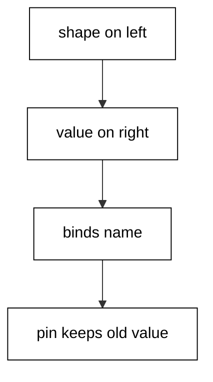
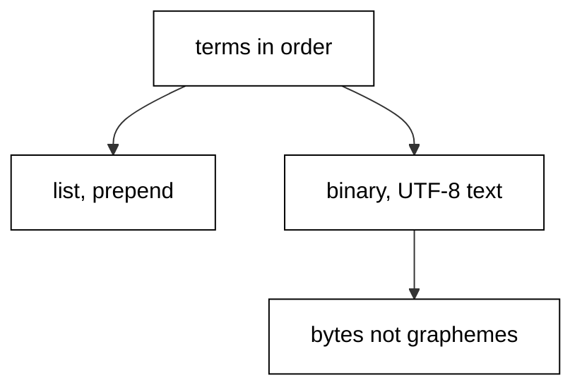
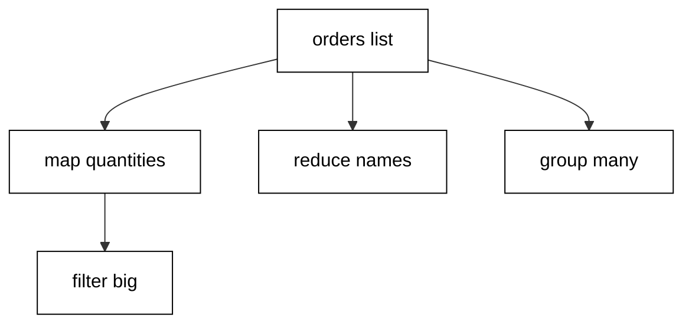
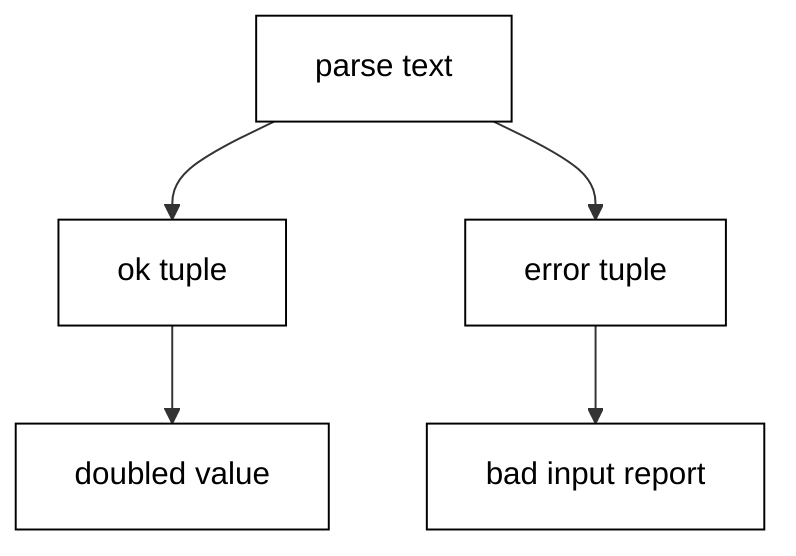
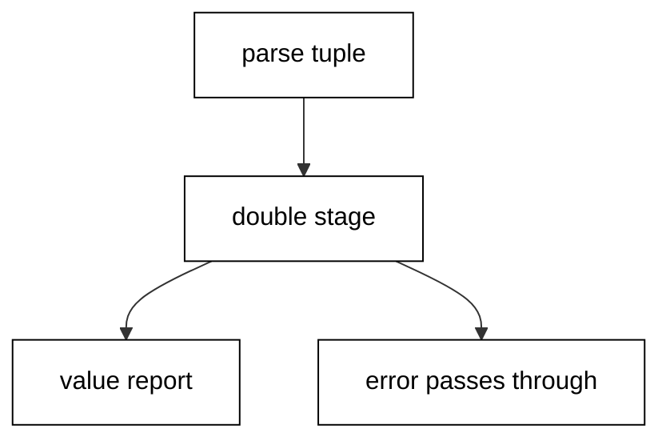
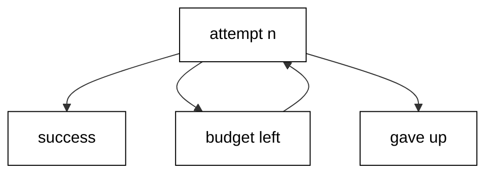
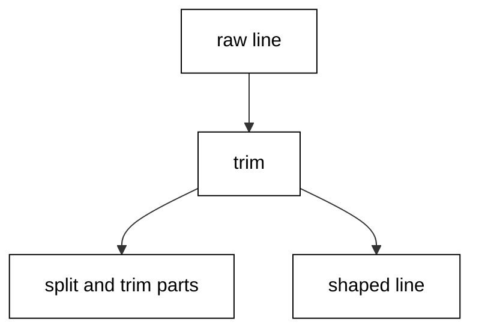
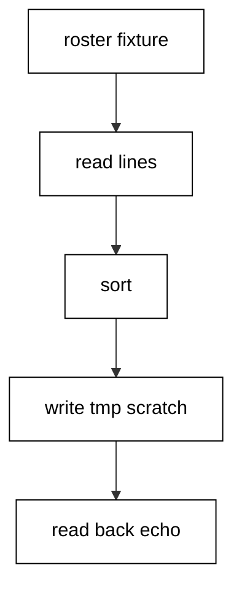
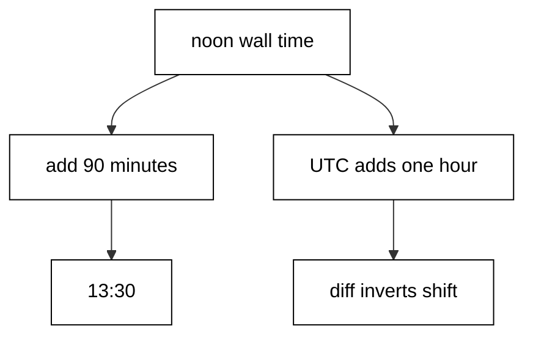

Examples 1–25 build the fluency every later page assumes: idiomatic control flow and the core collections, the error-handling style that keeps failures informative, and the standard-library text, file, and time tools a working developer reaches for daily. Three clusters carry the level: control flow and collections (Examples 1–8), error-handling idiom (Examples 9–17), and text, files, and time (Examples 18–25). Every script runs as `elixir main.exs` on the pinned Elixir 1.20.4 toolchain with no network; outputs are recorded golden files.

### Example 1: Match Binds Shape, Not Assignment

Elixir has no assignment statement, only the match operator, which succeeds when the right side fits the shape on the left (Concepts: co-01, co-11.)



A tuple pattern pulls the value out in one move, rebinding points the name at a new value without touching the old one, and the pin operator turns a match into a comparison against the current binding. Mismatched shapes raise `MatchError` instead of producing a null, which is why Elixir code tests shapes rather than nulls.

**`learning/code/ex-01-match-binds-shape-not-assignment/main.exs`**:

```elixir
# => Example 1: the match operator binds by shape, never by assignment.
{:ok, user} = {:ok, "ada"}
# => Rebinding points the name at a new value; nothing mutates.
user = String.upcase(user)
# => A plain name always matches, so this binds rather than compares.
name = "ada"
# => Pin keeps the old value in the pattern instead of rebinding it.
^name = "ada"
# => Print the two bindings with fixed labels.
IO.puts("user=#{user} name=#{name}")
```

**Output** (`learning/code/ex-01-match-binds-shape-not-assignment/expected/main.stdout.txt`):

```text
user=ADA name=ada
```

**Key takeaway**: `=` compares shapes and binds names; `^` compares values.

**Why it matters**: Readers from assignment languages misread matches as stores. Seeing rebinding as re-pointing, and pinning as the comparison form, removes the most common first-week confusion in Elixir code.

### Example 2: case, cond, if, and unless in Their Places

Four branching forms exist because four different questions exist: shape, ordered guards, one boolean, and its negation (Concepts: co-01.)

Pattern clauses in `case` match top to bottom with a wildcard fallback that documents itself. `cond` evaluates boolean guards in order with an explicit `true` else, so no branch silently falls through. `if` and `unless` serve single booleans only; anything with more than two outcomes belongs in `case` or `cond`.

**`learning/code/ex-02-case-cond-if-unless-places/main.exs`**:

```elixir
# => Example 2: case matches shapes, cond guards ranges, if guards one bit.
role = :admin # => the fixed input every branch below decides on.
# => case picks the first matching shape; the wildcard catches the rest.
label = # => the label binding the case expression returns into.
  case role do # => match the role atom against each known shape.
    # => Atoms match literally, so each clause names one known role.
    :admin -> "all areas" # => first literal shape: full access areas.
    # => A second literal clause keeps the known roles explicit.
    :editor -> "edit only" # => second literal shape: editing rights.
    # => The wildcard clause is the documented fallback, not a silent hole.
    _ -> "read only" # => fallback shape: reading rights for the rest.
  end # => the case closes; label holds the chosen string.
# => cond evaluates guards top to bottom and takes the first true one.
band = # => the band binding the cond expression returns into.
  cond do # => evaluate boolean guards in order, first true wins.
    # => Guard order matters: the tightest condition comes first.
    role == :admin -> "full" # => admin guard: the full band.
    # => Looser conditions follow, each naming its own outcome.
    role == :editor -> "partial" # => editor guard: the partial band.
    # => true is the explicit else that keeps cond total.
    true -> "none" # => final guard: always true, the total else.
  end # => the cond closes; band holds the chosen string.
# => if is for one boolean with an optional else, nothing more.
note = if role == :admin, do: "root", else: "user" # => one boolean, two outcomes.
# => unless mirrors if for the negative read of the same boolean.
open = unless role == :guest, do: "open", else: "closed" # => negative read, same shape.
# => Print the four decisions with fixed labels.
IO.puts("label=#{label} band=#{band} note=#{note} open=#{open}") # => the fixed four-way report.
```

**Output** (`learning/code/ex-02-case-cond-if-unless-places/expected/main.stdout.txt`):

```text
label=all areas band=full note=root open=open
```

**Key takeaway**: Shape goes to `case`, ordered booleans go to `cond`, one boolean goes to `if` or `unless`.

**Why it matters**: Mixing the forms hides the question the code asks. Matching the form to the question lets the next reader see the decision before reading the branches.

### Example 3: with Chains the Happy Path

Nested `case` expressions push the happy path to the far right; `with` keeps it on the left edge and collects every failure in one `else` (Concepts: co-01.)

Each `<-` step must match or the chain jumps to `else`, where clauses match the short-circuit value. Later steps see earlier bindings, so the chain reads top to bottom like the procedure it encodes. Two inputs run through the same code: one flows through, one diverts.

**`learning/code/ex-03-with-chains-happy-path/main.exs`**:

```elixir
# => Example 3: with chains the happy path and short-circuits on mismatch.
fetch = fn id -> if id > 0, do: {:ok, "user-#{id}"}, else: {:error, :missing} end # => ids above zero resolve; the rest miss.
# => Each left arrow must match; the first mismatch jumps to else.
good = # => the good binding the first with returns into.
  with {:ok, name} <- fetch.(7), # => step one binds the fetched name.
       # => Later steps see earlier bindings, so the chain reads top to bottom.
       {:ok, upper} <- {:ok, String.upcase(name)} do # => step two uppercases it.
    # => The do block runs only when every step matched.
    "hello #{upper}" # => the happy-path greeting.
  else # => short-circuits land here, matched by value.
    # => else clauses match the short-circuit value, never a bare fallback.
    {:error, :missing} -> "no such user" # => the missing-user message.
    # => Unexpected shapes stay visible instead of collapsing silently.
    other -> "unexpected: #{inspect(other)}" # => the visible-unexpected branch.
  end # => the with closes; good holds one of the three strings.
# => A failing input takes the else branch with the same code shape.
bad = # => the bad binding the second with returns into.
  with {:ok, name} <- fetch.(0), # => step one fails here on zero.
       {:ok, upper} <- {:ok, String.upcase(name)} do # => step two never runs.
    "hello #{upper}" # => unreachable for the failing input.
  else # => the same else shape handles the same failure kind.
    {:error, :missing} -> "no such user" # => the identical missing message.
    other -> "unexpected: #{inspect(other)}" # => the identical fallback.
  end # => the with closes; bad holds the missing message.
# => Print both outcomes with fixed labels.
IO.puts("ok=#{good} failed=#{bad}") # => the side-by-side outcome report.
```

**Output** (`learning/code/ex-03-with-chains-happy-path/expected/main.stdout.txt`):

```text
ok=hello USER-7 failed=no such user
```

**Key takeaway**: `with` is the flat spelling of nested happy-path matches.

**Why it matters**: Error-handling code dominates real modules. Chains that read left-to-right keep the success story visible while failures collect in one guarded place.

### Example 4: Lists Hold Terms, Binaries Hold Text

Lists, charlists, and binaries are three types with three jobs: terms in order, codepoints for legacy interop, and UTF-8 text for everything people read (Concepts: co-03.)



Prepending to a list is cheap while appending rebuilds, so idiomatic code prepends and reverses. `byte_size` counts UTF-8 bytes and `String.length` counts graphemes; the two agree on ASCII and diverge the moment an accent appears, which is exactly why both functions exist.

**`learning/code/ex-04-lists-binaries-text/main.exs`**:

```elixir
# => Example 4: lists hold terms, binaries hold text; charlists are neither.
nums = [1, 2, 3]
# => Prepending is cheap; appending rebuilds, so idioms prepend then reverse.
nums = [0 | nums]
# => Single-quoted sigil builds a list of codepoints, not a string.
points = ~c"abc"
# => Strings are UTF-8 binaries; byte_size counts bytes, not characters.
text = "héllo"
# => Enum works over lists; String.graphemes bridges binaries into lists.
doubled = Enum.map(nums, fn n -> n * 2 end)
# => Print list membership, text rendering, sizes, and the mapped list.
IO.puts("list?=#{is_list(points)} text=#{List.to_string(points)}")
# => Byte size and grapheme length differ exactly on the accented letter.
IO.puts("bytes=#{byte_size(text)} graphemes=#{String.length(text)} doubled=#{inspect(doubled)}")
```

**Output** (`learning/code/ex-04-lists-binaries-text/expected/main.stdout.txt`):

```text
list?=true text=abc
bytes=6 graphemes=5 doubled=[0, 2, 4, 6]
```

**Key takeaway**: Lists for terms, binaries for text, and two different sizes for two different questions.

**Why it matters**: Confusing bytes with characters corrupts text at boundaries. Knowing which type and which size each job needs prevents an entire class of encoding bugs.

### Example 5: Maps, Keywords, and Structs in Their Places

Maps hold data, keyword lists hold options, and structs fix the key set at compile time (Concepts: co-03, co-11.)

`Map.put` returns a new map while the old binding keeps the old value — the immutability behind every update in this course. Duplicate keys are legal in keyword lists, which is why options use them. Structs turn key typos into compile errors, which is why domain shapes use them.

**`learning/code/ex-05-maps-keywords-structs-places/main.exs`**:

```elixir
# => Example 5: maps hold data, keywords hold options, structs fix the keys.
user = %{name: "ada", roles: [:admin]} # => the open-data map the updates start from.
# => Put returns a new map; the original binding keeps the old value.
renamed = Map.put(user, :name, "grace") # => a new map; user still says ada.
# => Keyword lists allow duplicate keys; get_values collects every one.
opts = [level: :debug, level: :info] # => options tolerate the duplicated key.
# => Structs declare their fields up front, so typos fail at compile time.
defmodule Account do # => the fixed-shape domain unit.
  # => defstruct lists allowed keys with their defaults in one place.
  defstruct [:owner, balance: 0] # => owner enforced, balance defaults to zero.
end # => the module closes; Account is now a struct type.
# => Percent-brace with the module name builds with defaults filled in.
ada = struct!(Account, owner: "ada", balance: 100) # => strict build, unknown keys raise.
# => Update syntax keeps the struct tag while replacing named fields.
richer = %{ada | balance: 150} # => same owner, new balance, struct intact.
# => Print old versus new names, the duplicated option, and struct fields.
IO.puts("old=#{user.name} new=#{renamed.name} levels=#{inspect(Keyword.get_values(opts, :level))}") # => old kept, new set, both levels.
# => The struct update changed balance and kept the owner untouched.
IO.puts("owner=#{richer.owner} balance=#{richer.balance}") # => the targeted update proof.
```

**Output** (`learning/code/ex-05-maps-keywords-structs-places/expected/main.stdout.txt`):

```text
old=ada new=grace levels=[:debug, :info]
owner=ada balance=150
```

**Key takeaway**: Maps for open data, keywords for options, structs for fixed shapes.

**Why it matters**: Picking the container by its contract — open, optional, or fixed — tells readers how the data may evolve without reading every producer.

### Example 6: Enum Pipelines Over Every Collection

One `Enum` vocabulary serves lists, maps, ranges, and streams: map the transform, filter the keepers, reduce the accumulation, group the partitions (Concepts: co-03.)



Pipes keep each stage single-purpose so the pipeline reads as the procedure. `group_by` partitions in one pass, and extracting the sorted group afterwards keeps the report deterministic.

**`learning/code/ex-06-enum-pipelines-every-collection/main.exs`**:

```elixir
# => Example 6: one Enum vocabulary maps, filters, and folds every collection.
orders = [%{item: "book", qty: 2}, %{item: "pen", qty: 5}, %{item: "ink", qty: 1}] # => the fixed order list every stage reads.
# => Pipes read top to bottom; each stage names one transform.
total = orders |> Enum.map(fn o -> o.qty end) |> Enum.sum() # => project quantities, then sum them.
# => Filter then map keeps the pipeline stages single-purpose.
big = orders |> Enum.filter(fn o -> o.qty > 1 end) |> Enum.map(fn o -> o.item end) # => keep big orders, name their items.
# => Reduce folds with an explicit accumulator instead of loop state.
names = orders |> Enum.reduce([], fn o, acc -> [o.item | acc] end) |> Enum.reverse() # => prepend-fold, then restore order.
# => group_by partitions by a key function in a single pass.
many = # => the big-group names sorted for a stable report.
  orders # => partition the same fixed orders by the bigness predicate.
  |> Enum.group_by(fn o -> o.qty > 1 end) # => one pass, two buckets.
  |> Map.get(true) # => keep the big bucket for the report.
  |> Enum.map(fn o -> o.item end) # => name the big items.
  |> Enum.sort() # => sort for determinism.
# => Print the sum, the filtered names, the folded names, and the group.
IO.puts("total=#{total} big=#{inspect(big)} names=#{inspect(names)} many=#{inspect(many)}") # => the four vocabulary answers.
```

**Output** (`learning/code/ex-06-enum-pipelines-every-collection/expected/main.stdout.txt`):

```text
total=8 big=["book", "pen"] names=["book", "pen", "ink"] many=["book", "pen"]
```

**Key takeaway**: `Enum` answers map, filter, fold, and partition questions with no loops.

**Why it matters**: Loops with accumulators hide the question in the machinery. Naming the question with the function lets reviewers check the answer instead of simulating the loop.

### Example 7: for Comprehensions That Filter and Collect

Comprehensions combine generation, filtering, and collection in one readable expression (Concepts: co-03, co-01.)

Multiple generators nest with each filter beside the generator it guards. `into` collects into any `Collectable`, not just lists. A pattern on the left of `<-` silently skips non-matching elements, which turns mixed channels into clean streams.

**`learning/code/ex-07-for-comprehensions-filter-collect/main.exs`**:

```elixir
# => Example 7: for comprehensions filter, transform, and collect in one read.
pairs = for x <- [1, 2, 3, 4], rem(x, 2) == 0, do: x * 10
# => Multiple generators nest; each filter sits beside its own generator.
grid = for r <- 1..2, c <- 1..2, r != c, do: {r, c}
# => into collects into any Collectable, not just lists.
as_map = for n <- ["a", "b"], into: %{}, do: {n, String.upcase(n)}
# => A pattern on the left silently skips elements that do not match.
oks = for {:ok, v} <- [ok: 1, error: :x, ok: 2], do: v
# => Print the four collections with fixed labels.
IO.puts("pairs=#{inspect(pairs)} grid=#{inspect(grid)}")
# => Map keys print in term order; unmatched entries never appear.
IO.puts("as_map=#{inspect(as_map)} oks=#{inspect(oks)}")
```

**Output** (`learning/code/ex-07-for-comprehensions-filter-collect/expected/main.stdout.txt`):

```text
pairs=[20, 40] grid=[{1, 2}, {2, 1}]
as_map=%{"a" => "A", "b" => "B"} oks=[1, 2]
```

**Key takeaway**: One `for` replaces nested loops plus filter plus collector.

**Why it matters**: Comprehensions state the shape of the result where loops state the steps to build it. Readers check shapes faster than they simulate steps.

### Example 8: Choosing the Collection Function

Each collection question has one idiomatic function: membership, first match, full count, boolean quantifiers (Concepts: co-03.)

`MapSet` answers membership without scanning. `find` stops at the first witness instead of walking the whole list. `frequencies` counts in one pass, and `any?`/`all?` answer boolean questions without building intermediate lists.

**`learning/code/ex-08-choosing-collection-function/main.exs`**:

```elixir
# => Example 8: choose the Enum function by the shape of the question.
rows = ["ada", "grace", "alan", "ada"]
# => Membership is a MapSet question, not a linear scan.
present = rows |> MapSet.new() |> MapSet.member?("grace")
# => find stops at the first match; filter would walk the whole list.
first_long = Enum.find(rows, fn r -> String.length(r) > 3 end)
# => frequencies counts in one pass instead of grouping then counting.
counts = Enum.frequencies(rows)
# => any? and all? answer boolean questions without building lists.
has_alan = Enum.any?(rows, fn r -> r == "alan" end)
# => Capture references keep one-line predicates readable.
all_text = Enum.all?(rows, &is_binary/1)
# => Print the membership, search, predicate, and count answers.
IO.puts("present=#{present} first=#{first_long} alan=#{has_alan} all_text=#{all_text}")
# => The duplicate name counted twice; singletons count once.
IO.puts("ada_count=#{Map.get(counts, "ada")} alan_count=#{Map.get(counts, "alan")}")
```

**Output** (`learning/code/ex-08-choosing-collection-function/expected/main.stdout.txt`):

```text
present=true first=grace alan=true all_text=true
ada_count=2 alan_count=1
```

**Key takeaway**: Name the question first; the function follows.

**Why it matters**: The wrong function still returns the right answer while teaching the next reader the wrong habit. Choosing by question keeps the codebase's vocabulary tight.

### Example 9: ok and error Tuples Through with

Expected failures travel as `{:error, reason}` tuples through the same `with` chains the happy path uses (Concepts: co-02.)



Parsing returns a tuple instead of raising, guards inside `with` read as assertions on the flowing value, and each short-circuit value gets its own `else` message clause. The same shape handles the failing input with no new code.

**`learning/code/ex-09-ok-error-tuples-through-with/main.exs`**:

```elixir
# => Example 9: ok and error tuples flow through with to one decision point.
parse = fn text -> # => the parse function both with blocks share.
  # => Integer.parse returns a tuple, so wrap it into the ok/error shape.
  case Integer.parse(text) do # => match the raw parse result.
    # => Full consumption means the whole string was a number.
    {n, ""} -> {:ok, n} # => wrap the clean integer as ok.
    # => Anything else is an expected failure, not an exception.
    _ -> {:error, :not_a_number} # => wrap everything else as error.
  end # => the case closes; the tuple shape is now uniform.
end # => the parse function closes.
# => The happy path doubles the parsed value inside the do block.
doubled = # => the doubled binding the first with returns into.
  with {:ok, n} <- parse.("21"), # => step one parses the good input.
       # => Guards inside with read as assertions on the flowing value.
       true <- n > 0 do # => step two asserts positivity.
    n * 2 # => the doubled happy value.
  else # => short-circuits land here, matched by value.
    # => Each short-circuit value gets its own message clause.
    {:error, :not_a_number} -> "bad input" # => the parse-failure message.
    false -> "must be positive" # => the non-positive message.
  end # => the with closes; doubled holds one of three strings.
# => The same shape handles the failing input without new code.
failed = # => the failed binding the second with returns into.
  with {:ok, n} <- parse.("abc"), # => step one fails on letters.
       true <- n > 0 do # => step two never runs.
    n * 2 # => unreachable for the bad input.
  else # => the same else shape handles the same failure kinds.
    {:error, :not_a_number} -> "bad input" # => the identical message.
    false -> "must be positive" # => the identical fallback.
  end # => the with closes; failed holds the bad-input message.
# => Print both outcomes with fixed labels.
IO.puts("doubled=#{doubled} failed=#{failed}") # => the side-by-side outcome report.
```

**Output** (`learning/code/ex-09-ok-error-tuples-through-with/expected/main.stdout.txt`):

```text
doubled=42 failed=bad input
```

**Key takeaway**: Expected failures are return values shaped as `{:error, reason}`.

**Why it matters**: Exceptions for expected outcomes force every caller into rescue blocks. Tuples keep the common path flat and the failure reasons inspectable.

### Example 10: Raising and Rescuing Custom Exceptions

`raise` is for broken contracts, never for expected input, and `rescue` at the edge converts exceptions back into reports with context (Concepts: co-02.)

`defexception` declares a struct with message plus context fields, so the rescued report carries the balance and amount instead of a formatted string. The happy path returns a plain value with no tuple wrapping, because the caller's contract forbids the bad input entirely.

**`learning/code/ex-10-raising-rescuing-custom-exceptions/main.exs`**:

```elixir
# => Example 10: raise for programmer errors, rescue with context at the edge.
defmodule Budget do # => the structured-exception module.
  # => defexception declares a struct with message plus context fields.
  defexception [:message, :balance, :amount] # => message plus two context fields.
end # => the module closes; Budget is now an exception type.
# => withdraw raises only when the caller broke the contract, never for input.
withdraw = fn balance, amount -> # => the withdraw function under test.
  # => Guard the precondition first; the raise names the broken rule.
  if amount > balance do # => the overdraft precondition check.
    raise Budget, message: "overdraft refused", balance: balance, amount: amount # => structured raise with context.
  else # => the contract holds; return the plain remainder.
    balance - amount # => the happy-path value, no tuple wrapping.
  end # => the if closes; one branch raises, one returns.
end # => the withdraw function closes.
# => The happy path returns a plain value with no tuple wrapping.
left = withdraw.(100, 30) # => 100 minus 30 through the happy branch.
# => rescue at the edge turns the exception back into a printable report.
report = # => the report binding the try returns into.
  try do # => run the failing withdrawal inside the boundary.
    withdraw.(10, 30) # => 10 cannot cover 30; the raise fires here.
  rescue # => convert the caught exception into report data.
    # => Pattern-match the exception struct to recover its context fields.
    e in Budget -> "refused balance=#{e.balance} amount=#{e.amount}" # => the context-carrying report.
  end # => the try closes; report holds the refusal string.
# => Print the happy value and the rescued report with fixed labels.
IO.puts("left=#{left} report=#{report}") # => the value-plus-report transcript.
```

**Output** (`learning/code/ex-10-raising-rescuing-custom-exceptions/expected/main.stdout.txt`):

```text
left=70 report=refused balance=10 amount=30
```

**Key takeaway**: Raise with structured context; rescue at the boundary that owns the report.

**Why it matters**: Stringly exceptions force every handler to parse prose. Structured exceptions let handlers match on fields, which is the difference between reporting and guessing.

### Example 11: try, catch, and after for Exits and Throws

Exits signal linked-process death, throws perform nonlocal returns, and `after` owns cleanup on every path (Concepts: co-02.)

Trapping converts exit signals into messages a `receive` can match; without trapping, `catch` sees them instead. `throw` carries a bare value for early return, distinct from both `raise` and `exit`. The `after` block runs on success, raise, throw, and exit alike, which is why cleanup lives there and nowhere else.

**`learning/code/ex-11-try-catch-after-exits-throws/main.exs`**:

```elixir
# => Example 11: try, catch, and after separate exits, throws, and cleanup.
# => A linked child that exits abnormally signals its parent, not a value.
child = spawn(fn -> exit(:boom) end) # => the doomed child; its exit is the lesson.
# => Trapping turns the exit signal into a message the parent can catch.
_ = Process.flag(:trap_exit, true) # => trap: exits arrive as messages now.
# => Catch matches exit signals; rescue would never see them.
caught = # => the caught binding the try returns into.
  try do # => link and receive inside the trapping boundary.
    # => Linking joins fates: the child exit arrives as a signal here.
    _link = Process.link(child) # => join fates with the doomed child.
    receive do # => wait for the EXIT message the trap delivers.
      # => The EXIT message carries the reason we assert on.
      {:EXIT, _from, reason} -> "caught exit: #{reason}" # => the exit report string.
    after # => bound the wait so a lost signal cannot hang the script.
      # => after bounds the wait so a lost signal cannot hang the script.
      1000 -> "no signal arrived" # => the fallback no test ever observes.
    end # => the receive closes with its bound.
  catch # => catch owns the non-trapping exit shape, kept for contrast.
    # => :exit catches signals only when the process is not trapping.
    :exit, reason -> "direct exit: #{reason}" # => the direct-exit report.
  after # => after always runs: cleanup here cannot be skipped by any path.
    # => after always runs: cleanup here cannot be skipped by any path.
    :ok # => the unconditional cleanup marker.
  end # => the try closes; caught holds the exit report.
# => A thrown value is a nonlocal return, distinct from raise and exit.
thrown = # => the thrown binding the second try returns into.
  try do # => throw past the rest of the block.
    throw(:early) # => the nonlocal return; the next line never runs.
    "unreached" # => dead by construction: the throw skips it.
  catch # => catch with a bare value matches throws without a class.
    # => catch with a bare value matches throws without a class.
    :early -> "thrown value returned early" # => the throw report string.
  end # => the try closes; thrown holds the early-return report.
# => Print the exit report and the throw report with fixed labels.
IO.puts("exit=#{caught} thrown=#{thrown}") # => the two-mechanism transcript.
```

**Output** (`learning/code/ex-11-try-catch-after-exits-throws/expected/main.stdout.txt`):

```text
exit=caught exit: boom thrown=thrown value returned early
```

**Key takeaway**: `rescue` handles raises, `catch` handles exits and throws, `after` always runs.

**Why it matters**: Using `rescue` for an exit silently misses it. Knowing which construct owns each failure kind is what makes supervision trees legible.

### Example 12: Pipelines That Short-Circuit on error

Threading the `{:ok, _} | {:error, _}` shape through pipe stages short-circuits without nesting (Concepts: co-02.)



Each step matches the tuple shape and passes errors through untouched: no branch, no nesting. The final function renders either shape into a report, so callers match instead of branching.

**`learning/code/ex-12-pipelines-short-circuit-error/main.exs`**:

```elixir
# => Example 12: pipelines short-circuit on error tuples without nesting.
parse = fn text -> # => the parse function every stage below shares.
  case Integer.parse(text) do # => match the raw parse result.
    {n, ""} -> {:ok, n} # => wrap the clean integer as ok.
    _ -> {:error, :not_a_number} # => wrap everything else as error.
  end # => the case closes; the tuple shape is now uniform.
end # => the parse function closes.
# => Each step returns the tuple shape so the next step can match on it.
double_if_ok = fn # => the doubling stage threading the tuple shape.
  {:ok, n} -> {:ok, n * 2} # => double the happy value, keep the wrapper.
  {:error, _} = err -> err # => pass errors through untouched.
end # => the stage function closes.
# => Then threads the happy value while the tuple wrapper stays explicit.
good = parse.("21") |> double_if_ok.() # => good input doubles to 42.
# => The error tuple passes through untouched: no branch, no nesting.
bad = parse.("nope") |> double_if_ok.() # => bad input passes through as error.
# => with is the same idea with do-syntax; here the pipe shows the shape.
report = fn # => the report function rendering either shape.
  {:ok, n} -> "value=#{n}" # => values render as value= lines.
  {:error, reason} -> "error=#{reason}" # => errors render as error= lines.
end # => the report function closes.
# => Print both reports with fixed labels.
IO.puts("good=#{report.(good)} bad=#{report.(bad)}") # => the side-by-side report.
```

**Output** (`learning/code/ex-12-pipelines-short-circuit-error/expected/main.stdout.txt`):

```text
good=value=42 bad=error=not_a_number
```

**Key takeaway**: Keep the tuple wrapper explicit and errors flow through for free.

**Why it matters**: Unwrapping early forces every later stage to handle two shapes. Threading the wrapper keeps one shape through the whole pipeline.

### Example 13: Let It Crash or Handle It Here

Workers stay strict and crash on broken contracts; the boundary converts crashes into tuples for callers that branch (Concepts: co-02, co-09.)

The worker does no defending: bad input raises and supervisors decide. `safe_divide` wraps the strict call in `try` and converts only the documented error, letting anything else keep raising. Inside code stays total-looking while the edge owns the try boundary.

**`learning/code/ex-13-let-it-crash-or-handle/main.exs`**:

```elixir
# => Example 13: let it crash inside, convert to values at the boundary.
defmodule Worker do # => the deliberately strict worker module.
  # => The worker does no defending: bad input raises, supervisors decide.
  def divide(_a, 0), do: raise(ArithmeticError, message: "zero divisor") # => zero divisor raises, never returns.
  def divide(a, b), do: a / b # => the total-looking happy clause.
end # => the module closes; Worker stays crashable by design.
# => The boundary converts crashes into tuples the caller can match on.
safe_divide = fn a, b -> # => the converting boundary both reports share.
  try do # => run the strict worker inside the boundary.
    {:ok, Worker.divide(a, b)} # => wrap the strict result as ok.
  rescue # => convert only the documented error into data.
    # => Only the documented error converts; anything else still raises.
    _ in ArithmeticError -> {:error, :zero_divisor} # => the documented conversion.
  end # => the try closes; the boundary holds a tuple either way.
end # => the boundary function closes.
# => Inside code stays total-looking; the edge owns the try boundary.
IO.puts("inside=#{Worker.divide(7, 2)}") # => the strict inside value.
# => The boundary reports errors as data while the worker stays strict.
IO.puts("safe=#{inspect(safe_divide.(7, 2))} unsafe=#{inspect(safe_divide.(7, 0))}") # => tuple reports for both inputs.
```

**Output** (`learning/code/ex-13-let-it-crash-or-handle/expected/main.stdout.txt`):

```text
inside=3.5
safe={:ok, 3.5} unsafe={:error, :zero_divisor}
```

**Key takeaway**: Strict inside, converting at the edge, supervised above.

**Why it matters**: Defensive checks in every function duplicate the failure policy everywhere. One strict core plus one converting edge states the policy exactly once.

### Example 14: Error Values for Expected Failures

`Map.fetch` returns `:ok` or `:error` tuples so absence stays data, never an exception (Concepts: co-02.)

Missing keys are expected, so the `:error` arm carries the name for context. Matching on the tuple keeps both outcomes at the same indent level instead of nesting the success path inside a nil check.

**`learning/code/ex-14-error-values-expected-failures/main.exs`**:

```elixir
# => Example 14: error values for expected failures keep control flow flat.
lookup = fn users, name -> # => the lookup function both reports share.
  # => Map.fetch returns :ok or :error tuples instead of raising on absence.
  case Map.fetch(users, name) do # => match the fetch result shape.
    # => The found value wraps in :ok so callers match instead of branching.
    {:ok, age} -> {:ok, age} # => pass the found age through as ok.
    # => Missing keys are expected, so :error carries the name for context.
    :error -> {:error, {:unknown_user, name}} # => the context-carrying error.
  end # => the case closes; the tuple shape is now uniform.
end # => the lookup function closes.
# => A fixed map stands in for any store; absence is data, not disaster.
users = %{"ada" => 36, "grace" => 85} # => the fixed store fixture.
# => Matching on the tuple keeps both outcomes at the same indent level.
report = fn result -> # => the report function rendering either shape.
  case result do # => match the lookup result shape.
    {:ok, age} -> "age=#{age}" # => found renders the age line.
    {:error, {:unknown_user, name}} -> "unknown=#{name}" # => missing renders the name line.
  end # => the case closes; one string comes out either way.
end # => the report function closes.
# => Print the found and missing reports with fixed labels.
IO.puts("found=#{report.(lookup.(users, "ada"))} missing=#{report.(lookup.(users, "alan"))}") # => the side-by-side report.
```

**Output** (`learning/code/ex-14-error-values-expected-failures/expected/main.stdout.txt`):

```text
found=age=36 missing=unknown=alan
```

**Key takeaway**: Expected absence is a value shaped `{:error, context}`.

**Why it matters**: Nil-punning pushes the missing case into every downstream function. Tuples with context keep the failure where it happened, named and matchable.

### Example 15: Retry Loops With Their Own Budget

Recursion with a visible countdown makes the attempt budget part of the function signature (Concepts: co-02.)



Success returns the value with attempts spent, for the report. Zero budget left converts the last failure into a final answer instead of looping forever. The single-attempt run proves the budget binds rather than hoping.

**`learning/code/ex-15-retry-loops-own-budget/main.exs`**:

```elixir
# => Example 15: retry loops carry their own budget instead of looping forever.
attempt = fn n -> # => the attempt function simulating flaky work.
  # => The first two attempts fail; the third succeeds, deterministically.
  if n < 3, do: {:error, :flaky}, else: {:ok, "connected"} # => fail twice, then connect.
end # => the attempt function closes.
# => Recursion with a countdown makes the budget visible in the signature.
retry = fn self, n, left -> # => self, try number, and remaining budget.
  case attempt.(n) do # => match the attempt result shape.
    # => Success returns the value with attempts spent, for the report.
    {:ok, value} -> {:ok, value, n} # => value plus the tries it took.
    # => Zero budget left converts the last failure into a final answer.
    {:error, _} when left == 1 -> {:error, :gave_up} # => the budget binds here.
    # => Otherwise recurse with one less attempt and a higher try number.
    {:error, _} -> self.(self, n + 1, left - 1) # => spend one, try again.
  end # => the case closes; every path returns a final answer.
end # => the retry function closes.
# => Three attempts succeed on the last one; one attempt gives up at once.
IO.puts("plenty=#{inspect(retry.(retry, 1, 3))}") # => success on the third try.
# => The single-attempt run proves the budget binds instead of hoping.
IO.puts("single=#{inspect(retry.(retry, 1, 1))}") # => gave_up with one try.
```

**Output** (`learning/code/ex-15-retry-loops-own-budget/expected/main.stdout.txt`):

```text
plenty={:ok, "connected", 3}
single={:error, :gave_up}
```

**Key takeaway**: Budgets are arguments, not comments.

**Why it matters**: Retry without a bound is an outage with extra steps. A countdown in the signature makes the bound reviewable and the exhaustion path testable.

### Example 16: Resource Cleanup That try and after Guarantee

`after` runs on success, raise, throw, and exit alike, so owned cleanup cannot be skipped by any path (Concepts: co-02.)

The scratch write goes to a fixed `/tmp` path, never into the read-only course tree. The read returns the content while owning the delete duty, and the existence check afterwards proves the cleanup ran.

**`learning/code/ex-16-resource-cleanup-try-after/main.exs`**:

```elixir
# => Example 16: try and after guarantee cleanup on every exit path.
path = Path.join(System.tmp_dir!(), "elixir-in-depth-ex16.txt") # => the fixed scratch path under /tmp.
# => Write the scratch file first; the read below must always clean it up.
File.write!(path, "scratch") # => seed the scratch with fixed bytes.
# => read_and_cleanup returns the content while owning the delete duty.
read_and_cleanup = fn p -> # => the owning read both reports share.
  try do # => read inside the boundary that owns the delete.
    # => The happy path reads and returns the file content.
    File.read!(p) # => the content the caller asked for.
  after # => after runs on success, raise, throw, and exit alike.
    # => after runs on success, raise, throw, and exit alike.
    File.rm(p) # => the owned delete no path can skip.
  end # => the try closes; content returns before cleanup erases.
end # => the owning function closes.
# => The content returns before the cleanup erases the evidence.
content = read_and_cleanup.(path) # => read, then the after deletes.
# => The file is gone exactly because after cannot be skipped.
exists = File.exists?(path) # => false proves the cleanup ran.
# => Print the content and the proof of cleanup with fixed labels.
IO.puts("content=#{content} exists=#{exists}") # => content plus cleanup proof.
```

**Output** (`learning/code/ex-16-resource-cleanup-try-after/expected/main.stdout.txt`):

```text
content=scratch exists=false
```

**Key takeaway**: Cleanup in `after` is unconditional by construction.

**Why it matters**: Cleanup after the happy path leaks on every other path. `after` states the ownership once and the runtime enforces it on all four exit kinds.

### Example 17: Choosing the Error-Handling Shape

Tuples cross boundaries, bangs enforce contracts, and exits stay linked — the total rule in one place (Concepts: co-02.)

Library code returns tuples for callers that branch on input quality. Scripts with no recovery path call the bang and let it raise loudly. The `parse_ok`/`parse!` twins show both spellings of the same rule side by side.

**`learning/code/ex-17-choosing-error-handling-shape/main.exs`**:

```elixir
# => Example 17: choose the error shape by who consumes the failure.
defmodule Shapes do # => the two-spelling rule module.
  # => parse_ok returns tuples for callers that branch on input quality.
  def parse_ok(text) do # => the tuple spelling for branching callers.
    case Integer.parse(text) do # => match the raw parse result.
      {n, ""} -> {:ok, n} # => wrap the clean integer as ok.
      _ -> {:error, :not_a_number} # => wrap everything else as error.
    end # => the case closes; callers match on the tuple.
  end # => the tuple function closes.
  # => parse! raises for callers whose contract forbids bad input entirely.
  def parse!(text) do # => the bang spelling for contract callers.
    case Integer.parse(text) do # => match the raw parse result.
      {n, ""} -> n # => return the bare integer on success.
      _ -> raise ArgumentError, message: "not a number: #{text}" # => raise loudly on failure.
    end # => the case closes; success returns, failure raises.
  end # => the bang function closes.
end # => the module closes; both spellings live side by side.
# => Library code returns tuples; application edges convert with case.
from_tuple = # => the application-edge conversion of the tuple spelling.
  case Shapes.parse_ok("41") do # => match the tuple the library returned.
    {:ok, n} -> n + 1 # => branch the success into 42.
    {:error, _} -> 0 # => branch the failure into the default.
  end # => the case closes; from_tuple holds the converted value.
# => Scripts with no recovery path call the bang and let it raise loudly.
from_bang = Shapes.parse!("41") # => the contract call returning 41.
# => The rule: tuples cross boundaries, bangs enforce contracts, exits stay linked.
IO.puts("from_tuple=#{from_tuple} from_bang=#{from_bang}") # => the two-spelling agreement.
```

**Output** (`learning/code/ex-17-choosing-error-handling-shape/expected/main.stdout.txt`):

```text
from_tuple=42 from_bang=41
```

**Key takeaway**: The consumer decides the shape: branchers get tuples, contracts get bangs.

**Why it matters**: One shape everywhere forces every caller through the same recovery dance. Matching the shape to the consumer keeps library code reusable and application edges loud.

### Example 18: String Functions From the Standard Library

The `String` module answers text questions — trim, split, shape, predicate, prefix — with no dependency (Concepts: co-04.)



`trim` runs before any other transform, `split` with per-part trimming drops the empties a naive split keeps, and `graphemes` bridges binaries into character lists for prefix work.

**`learning/code/ex-18-string-functions-stdlib/main.exs`**:

```elixir
# => Example 18: the String module answers text questions without dependencies.
line = "  Ada Lovelace, 1815  "
# => trim removes surrounding whitespace before any other transform.
clean = String.trim(line)
# => split with trim: true drops the empties a naive split would keep.
parts = clean |> String.split(",", trim: true) |> Enum.map(&String.trim/1)
# => downcase, replace, and pad shape text for comparison and display.
shaped = clean |> String.downcase() |> String.replace(" ", "_") |> String.pad_leading(24, ".")
# => starts_with? and contains? ask boolean questions without regex.
starts = String.starts_with?(clean, "Ada")
# => graphemes splits on user-perceived characters, not bytes.
first_three = clean |> String.graphemes() |> Enum.take(3) |> Enum.join()
# => Print the parts, the shaped line, the booleans, and the prefix.
IO.puts("parts=#{inspect(parts)} starts=#{starts} first=#{first_three}")
# => Padding is visible as dots; the shaped line is fully determined.
IO.puts("shaped=#{shaped}")
```

**Output** (`learning/code/ex-18-string-functions-stdlib/expected/main.stdout.txt`):

```text
parts=["Ada Lovelace", "1815"] starts=true first=Ada
shaped=......ada_lovelace,_1815
```

**Key takeaway**: Reach for `String` first; regex is the second tool, not the first.

**Why it matters**: Regexes for trims and splits hide simple questions behind pattern syntax. Plain functions state the question and stay greppable.

### Example 19: Regular Expressions That Stay Small

Small regexes extract; parsers handle the rest — named captures, one scan, one rewrite, one tokenize (Concepts: co-04.)

Named captures document each field at the pattern site, `scan` finds every occurrence, `replace` rewrites with numbered backreferences, and `split` on a tiny pattern tokenizes without a grammar.

**`learning/code/ex-19-regular-expressions-stay-small/main.exs`**:

```elixir
# => Example 19: small regexes extract; parsers handle the rest.
line = "order-2026-01-15 qty=12"
# => Named captures document each field at the pattern site.
fields = Regex.named_captures(~r/order-(?<date>\d{4}-\d{2}-\d{2}) qty=(?<qty>\d+)/, line)
# => scan finds every occurrence; here exactly one date-shaped token exists.
dates = Regex.scan(~r/\d{4}-\d{2}-\d{2}/, line) |> List.flatten()
# => replace rewrites with backreferences numbered in match order.
masked = Regex.replace(~r/qty=\d+/, line, "qty=N")
# => split on a small pattern tokenizes without a grammar.
tokens = Regex.split(~r/[\s=]+/, masked, trim: true)
# => Print the captures, the scanned dates, the masked line, and tokens.
IO.puts("date=#{fields["date"]} qty=#{fields["qty"]} dates=#{inspect(dates)}")
# => The masked line and tokens are fully determined by the fixed input.
IO.puts("masked=#{masked} tokens=#{inspect(tokens)}")
```

**Output** (`learning/code/ex-19-regular-expressions-stay-small/expected/main.stdout.txt`):

```text
date=2026-01-15 qty=12 dates=["2026-01-15"]
masked=order-2026-01-15 qty=N tokens=["order-2026-01-15", "qty", "N"]
```

**Key takeaway**: One small pattern per job; composition over a single monster pattern.

**Why it matters**: A regex that parses, validates, and rewrites at once is write-only. Small patterns compose and each stays testable in isolation.

### Example 20: IO Lists and Shaped Output

IO lists build output without intermediate concatenation: nesting is free, flattening happens once at the boundary (Concepts: co-04, co-15.)

Each row renders as an IO list and `iodata_to_binary` flattens once, never per row. `:io_lib.format` shapes columns with fixed widths like a tiny table. The byte count proves the single flattening while the report body stays fully determined.

**`learning/code/ex-20-io-lists-shaped-output/main.exs`**:

```elixir
# => Example 20: IO lists build output without intermediate concatenation.
rows = [{"ada", 36}, {"grace", 85}]
# => Each row renders as an IO list: nesting is free, flattening is one call.
lines = Enum.map(rows, fn {name, age} -> ["name=", name, " age=", Integer.to_string(age), "\n"] end)
# => chardata_to_string flattens once at the boundary, never per row.
report = IO.iodata_to_binary(["report\n" | lines])
# => :io_lib.format shapes columns with fixed widths, like a tiny table.
table = :io_lib.format("~-6s ~3w", ["ada", 36]) |> IO.iodata_to_binary()
# => byte_size proves the single flattening: count once, print everywhere.
IO.puts("bytes=#{byte_size(report)} table=[#{table}]")
# => The report body is deterministic because the rows are fixed.
IO.write(report)
```

**Output** (`learning/code/ex-20-io-lists-shaped-output/expected/main.stdout.txt`):

```text
bytes=41 table=[ada     36]
report
name=ada age=36
name=grace age=85
```

**Key takeaway**: Nest freely, flatten once, and let `:io_lib.format` own columns.

**Why it matters**: String concatenation in a loop is quadratic work hiding as simplicity. IO lists are the linear idiom and the one the standard library itself uses.

### Example 21: Reading and Writing Files Beside the Code

Fixtures ship beside the script, scratch lives under `/tmp`, and the working directory is the unit folder (Concepts: co-04.)



Relative reads resolve to committed files because the harness runs each unit from its own folder. Scratch writes go to a fixed `/tmp` path with fixed content, and the script removes its scratch so reruns start from the same state. Sorting keeps the echo independent of fixture order.

**`learning/code/ex-21-reading-writing-files-beside-code/main.exs`**:

```elixir
# => Example 21: fixtures ship beside the script; scratch lives under /tmp.
fixture = Path.join(__DIR__, "roster.txt")
# => The working directory is the unit folder, so relative reads resolve.
rows = File.read!(fixture) |> String.split("\n", trim: true)
# => Scratch writes go to a fixed /tmp path, never into the course tree.
scratch = Path.join(System.tmp_dir!(), "elixir-in-depth-ex21.txt")
# => Write the derived content, then read it back to prove the round trip.
File.write!(scratch, Enum.join(Enum.sort(rows), "\n") <> "\n")
# => Sorted output keeps the transcript independent of fixture order.
echo = File.read!(scratch)
# => Clean up the scratch file so reruns start from the same state.
File.rm!(scratch)
# => Print the count and the sorted echo with fixed labels.
IO.puts("count=#{length(rows)}")
# => The echo ends with a newline from the join; write prints it verbatim.
IO.write("sorted:\n" <> echo)
```

**Output** (`learning/code/ex-21-reading-writing-files-beside-code/expected/main.stdout.txt`):

```text
count=2
sorted:
ada,36
grace,85
```

**Key takeaway**: Committed fixtures in, `/tmp` scratch during, sorted transcript out.

**Why it matters**: Tests that read the live filesystem or print paths are flaky by construction. The fixture-scratch-transcript split is what keeps every harness run byte-identical.

### Example 22: Tabular Text That Round-Trips Exactly

Tabular text parses against its header, renders canonically sorted, and preserves every field through the trip (Concepts: co-04.)

The header names the columns so the parser stays order-independent. Each row must match the header width or the zip raises loudly instead of misaligning silently. Sorting by name makes the render canonical regardless of fixture order.

**`learning/code/ex-22-tabular-text-round-trips/main.exs`**:

```elixir
# => Example 22: tabular text round-trips through parse, shape, and render.
fixture = Path.join(__DIR__, "roster.csv") # => the committed CSV fixture.
# => The header names the columns so the parser stays order-independent.
[header | lines] = File.read!(fixture) |> String.split("\n", trim: true) # => header plus data lines.
# => Split each line on commas; every row must match the header width.
parsed = # => the parsed row maps the report renders.
  Enum.map(lines, fn line -> # => parse each data line against the header.
    values = String.split(line, ",") # => split the row into cells.
    # => zip ties each header to its value; mismatched widths raise loudly.
    true = length(values) == length(String.split(header, ",")) # => the width contract check.
    Enum.zip(String.split(header, ","), values) |> Map.new() # => header-keyed row map.
  end) # => the map closes; parsed holds every row map.
# => Sort by name so the render order never depends on fixture order.
rendered = # => the canonical rendering the transcript asserts.
  parsed # => sort the row maps by their name field.
  |> Enum.sort_by(fn row -> row["name"] end) # => alphabetical by name.
  |> Enum.map(fn row -> "#{row["name"]},#{row["age"]}" end) # => back to CSV lines.
# => Print the row count and the canonical rendering with fixed labels.
IO.puts("rows=#{length(parsed)}") # => the parsed row count.
# => The round trip preserves every field; sorting makes it canonical.
IO.puts(Enum.join([header | rendered], "\n")) # => header plus sorted rows.
```

**Output** (`learning/code/ex-22-tabular-text-round-trips/expected/main.stdout.txt`):

```text
rows=2
name,age
ada,36
grace,85
```

**Key takeaway**: Parse against the header, render sorted, assert the field count.

**Why it matters**: CSV code that assumes column positions breaks the first time a producer reorders. Header-driven parsing plus sorted rendering survives both.

### Example 23: Dates Without a Clock

Dates are constructed values, never clock reads: sigils build them, arithmetic moves them, comparison orders them (Concepts: co-05.)

`Date.add` shifts by whole days, `diff` counts between fixed dates, `compare` answers with atoms for matching, and `Date.range` enumerates calendar days with no time component anywhere.

**`learning/code/ex-23-dates-without-clock/main.exs`**:

```elixir
# => Example 23: dates are constructed values, never clock reads.
release = ~D[2026-01-15]
# => Sigils build dates at compile time; no function reads the machine clock.
plus_month = Date.add(release, 30)
# => diff counts whole days between two fixed dates, order-sensitive.
span = Date.diff(plus_month, release)
# => compare answers with atoms, so callers match instead of comparing.
order = Date.compare(release, plus_month)
# => Ranges enumerate calendar days without any time component.
days = Enum.count(Date.range(release, Date.add(release, 6)))
# => Print the constructed date, the span, the order, and the week count.
IO.puts("release=#{release} plus30=#{plus_month} span=#{span} order=#{order} week=#{days}")
```

**Output** (`learning/code/ex-23-dates-without-clock/expected/main.stdout.txt`):

```text
release=2026-01-15 plus30=2026-02-14 span=30 order=lt week=7
```

**Key takeaway**: Construct dates, never read them, in anything the harness asserts on.

**Why it matters**: Clock reads make outputs unrepeatable. Fixed dates keep the transcript golden while teaching the same arithmetic the production code uses.

### Example 24: Times, Shifts, and Durations in UTC

Wall time shifts within the day clock while UTC instants shift with exact second arithmetic and no zone table (Concepts: co-05.)



`Time.add` wraps past midnight on the day clock. `DateTime.add` on a UTC instant is exact, and `diff` in matching units inverts the shift — the round trip that proves the arithmetic.

**`learning/code/ex-24-times-shifts-durations-utc/main.exs`**:

```elixir
# => Example 24: times and datetimes stay in UTC where arithmetic is exact.
noon = ~T[12:00:00] # => the fixed wall-clock noon.
# => Time.add shifts within the day clock; overflow wraps past midnight.
later = Time.add(noon, 5400) # => ninety minutes later on the day clock.
# => NaiveDateTime pairs a date with a wall time and no zone at all.
stamp = ~N[2026-01-15 12:00:00] # => the fixed naive stamp.
# => DateTime.add on a UTC instant is exact second arithmetic, no zone table.
instant = ~U[2026-01-15 12:00:00Z] # => the fixed UTC instant.
shifted = DateTime.add(instant, 3600, :second) # => exactly one hour later.
# => diff in matching units inverts add exactly for fixed values.
back = DateTime.diff(shifted, instant, :second) # => the inverse proving 3600.
# => Duration-free comparison keeps ordering a plain data question.
IO.puts("later=#{later} stamp=#{NaiveDateTime.to_string(stamp)}") # => wall time and naive stamp.
# => The shift added exactly one hour; the diff proves the inverse.
IO.puts("shifted=#{DateTime.to_iso8601(shifted)} back=#{back}") # => shifted instant and proof.
```

**Output** (`learning/code/ex-24-times-shifts-durations-utc/expected/main.stdout.txt`):

```text
later=13:30:00 stamp=2026-01-15 12:00:00
shifted=2026-01-15T13:00:00Z back=3600
```

**Key takeaway**: Wall time for display, UTC instants for arithmetic.

**Why it matters**: Zone-aware arithmetic needs tables that change under you. UTC math is exact, and display converts once at the edge.

### Example 25: Formatting Dates for People and Machines

`strftime` renders the human layout, ISO 8601 stays the machine layout, and strict parsing inverts it (Concepts: co-05.)

`Calendar.strftime` turns one fixed date into any human layout deterministically. `to_iso8601` is fixed-width, sortable, and unambiguous, while `from_iso8601!` parses strictly and raises on the same bad input the bang contract forbids.

**`learning/code/ex-25-formatting-dates-people-machines/main.exs`**:

```elixir
# => Example 25: format dates for people, parse them for machines.
release = ~D[2026-01-15]
# => strftime renders one fixed date into each human layout deterministically.
us = Calendar.strftime(release, "%B %d, %Y")
# => ISO 8601 is the machine layout: fixed width, sortable, unambiguous.
iso = Date.to_iso8601(release)
# => from_iso8601 parses strictly; the bang raises on the same bad input.
parsed = Date.from_iso8601!("2026-01-15")
# => Weekday numbers anchor calendars: Monday is 1, Sunday is 7.
dow = Date.day_of_week(release)
# => Print the human form, the machine form, the round trip, and the weekday.
IO.puts("human=#{us} machine=#{iso} roundtrip=#{parsed == release} weekday=#{dow}")
```

**Output** (`learning/code/ex-25-formatting-dates-people-machines/expected/main.stdout.txt`):

```text
human=January 15, 2026 machine=2026-01-15 roundtrip=true weekday=4
```

**Key takeaway**: One date, two renderings, each for its own reader.

**Why it matters**: Human formats vary by locale and break machines; machine formats confuse people. Rendering each at its own boundary serves both without compromise.
