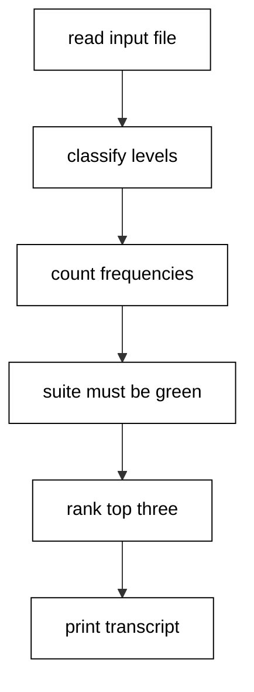
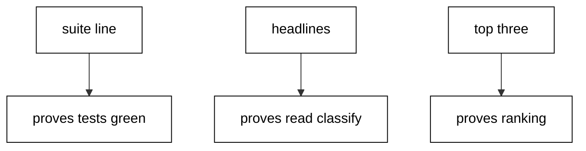

The capstone combines the course into one log-summarizer CLI: it reads a fixed input file, classifies each line by level prefix with plain pattern matching, counts with `Enum.frequencies`, verifies itself with an embedded three-test ExUnit suite that must stay green before any report prints, handles a missing input with a loud stderr message and a nonzero exit, and prints a fixed six-line transcript the harness asserts byte for byte.

## Why this exists -- the big idea

**The problem before the solution**: course examples prove idioms in isolation, but production tools fail at the seams: reading disagrees with counting, counting disagrees with ranking, and verification is a comment instead of a check. The capstone wires every layer together so the seams are load-bearing: reading feeds classification, classification feeds counting, counting feeds ranking, and the suite guards the whole chain before the transcript prints.

**Keep this if you forget everything else**: read input, classify it, verify with tests, then report. In that order, every time.

## What you will build

A single `main.exs` plus a fixed eight-line input fixture. It classifies lines by level prefix, counts with `Enum.frequencies`, and ranks by count with alphabetical ties through one shared comparator. Three tests pin the parsing, counting, and ranking contracts. A missing input file exits nonzero with a stderr message naming the system reason, which is the loud boundary failure the course teaches instead of a silent empty report. The side report lands under `/tmp` with one `level: count` line per level in rank order, while standard output carries the six-line transcript: the suite summary, the headline totals, the pin declaration, and the top three levels with counts.

## The capstone script

**`learning/capstone/code/main.exs`**:

```elixir
# => Capstone: a log summarizer with an embedded suite and golden transcript.
ExUnit.start(auto_run: false, seed: 0, formatters: []) # => manual run, fixed seed, silent formatter.
# => The parser turns one line into a level tag; unknown lines are data too.
defmodule LogCap do # => the parse-count-rank module.
  def level("INFO " <> _), do: "info" # => INFO prefix maps to info.
  def level("WARN " <> _), do: "warn" # => WARN prefix maps to warn.
  def level("ERROR " <> _), do: "error" # => ERROR prefix maps to error.
  def level(_), do: "other" # => anything else maps to other.
  def summarize(lines), do: lines |> Enum.map(&level/1) |> Enum.frequencies() # => lines in, counts out.
  def top(counts, n), do: counts |> Enum.sort_by(fn {l, c} -> {-c, l} end) |> Enum.take(n) # => count desc, name asc.
end # => the module closes.
# => The suite pins parsing, counting, and ranking before any report prints.
defmodule LogCapTest do # => the three-test suite module.
  use ExUnit.Case, async: false # => synchronous cases; order is fixed.
  test "levels classify by prefix" do # => the parsing fact.
    assert LogCap.level("INFO up") == "info" # => INFO classifies as info.
    assert LogCap.level("nope") == "other" # => unknown classifies as other.
  end # => the parsing test closes.
  test "counts group by level" do # => the counting fact.
    assert LogCap.summarize(["INFO a", "ERROR b", "INFO c"]) == %{"info" => 2, "error" => 1} # => two info, one error.
  end # => the counting test closes.
  test "top breaks ties alphabetically" do # => the ranking fact.
    assert LogCap.top(%{"b" => 1, "a" => 1}, 2) == [{"a", 1}, {"b", 1}] # => tie broken by name.
  end # => the ranking test closes.
end # => the suite module closes.
# => The gate reads the summary as data; red suites stop the report cold.
stats = ExUnit.run() # => run returns the summary map, prints nothing.
true = stats.failures == 0 # => the gate: zero failures or no report.
# => Loud boundary: a missing input file reports to stderr and exits nonzero.
case File.read(Path.join(__DIR__, "input.txt")) do # => read the eight-line fixture.
  {:ok, body} -> # => the present-file branch.
    lines = String.split(body, "\n", trim: true) # => split into non-empty lines.
    counts = LogCap.summarize(lines) # => count by level.
    top3 = LogCap.top(counts, 3) # => rank the top three.
    # => The sample lock declares the closure pins; this project needs none.
    {pins, _} = Path.join(__DIR__, "sample.mix.lock") |> Code.eval_file() # => read the pin declaration.
    # => The side report lands under /tmp; stdout stays the asserted transcript.
    report = top3 |> Enum.map(fn {level, c} -> "#{level}: #{c}" end) |> Enum.join("\n") # => one level-count line each.
    File.write!(Path.join(System.tmp_dir!(), "elixir-in-depth-capstone-report.txt"), report <> "\n") # => the /tmp side report.
    IO.puts("suite: #{stats.total} tests, #{stats.failures} failures") # => the suite summary line.
    IO.puts("lines=#{length(lines)} levels=#{map_size(counts)}") # => the headline totals line.
    IO.puts("pins=#{map_size(pins)} stdlib-only") # => the pin declaration line.
    IO.puts(report) # => the ranked top three.
  {:error, reason} -> # => the missing-file branch.
    IO.puts(:stderr, "missing input: #{:file.format_error(reason)}") # => the loud stderr message.
    System.halt(1) # => nonzero exit; silence is not an option.
end # => the case closes; one path ran.
```

## How the pieces compose

Line classification (Examples 1-2, 76) feeds counting; `Enum.frequencies` over the classified lines builds the map (Examples 6, 47); `sort_by` with the count-then-name comparator ranks deterministically (Example 51's ordering lesson); the ExUnit summary-as-data gate from Examples 43-44 blocks the report when red; the error-tuple thinking from Examples 9-17 shapes the missing-file branch; the sample lock read from Examples 30 and 77 declares the pinning posture. No new idioms appear here: composition is the test. Read the script top to bottom and name the example each section comes from; if a section has no ancestor, it does not belong.



## Reading the transcript

The six output lines each prove one stage. The `suite:` line proves the embedded suite executed with three assertions and zero failures. The `lines=` and `levels=` headline proves reading and classification produced eight lines across three levels. The `pins=` line proves the sample lock read ran and the project ships stdlib-only. The three `level: count` lines prove ranking with deterministic tie order: `info` at four, then `error` and `warn` at two each, alphabetical among the tie. Any missing line names its broken stage exactly. Rerun the unit and diff: identical bytes, because fixed input, fixed ranking, and a summary without timings leave no room for variance.



## Extending it

Add a `--top N` argument with the value-option pattern and thread the count through `top/2` (Example 7's comprehension shape is the wrong tool; Example 48's `take` is the right one). Add a fourth level by extending the classifier clauses in order and pinning the new branch with a fourth test (Example 76's case table is the review checklist). Emit JSON instead of text lines with `:json.encode` from OTP 27 for machine consumers (Example 20's iodata lesson covers the flattening). Each extension is one function plus one transcript line. Keep the transcript golden: new lines append at the end, never in the middle, so history stays diffable.

## Reproducing it

Run the unit twice and diff the transcripts: identical bytes, because the input fixture is committed, the ranking comparator breaks ties alphabetically, and the suite summary prints counts rather than timings. Delete the input file and rerun to watch the failure path: the run exits nonzero with a stderr message naming the system reason, which is the loud boundary failure the course teaches instead of a silent empty report. Restore the fixture and confirm green returns. The side report under `/tmp` regenerates on every run with one `level: count` line per level in rank order; it is a side effect for humans, while standard output stays the asserted transcript for the harness.

## What graduating means

You can take a pile of lines and turn it into a verified report: parse with patterns, count with the standard vocabulary, rank deterministically, gate on the suite summary, and fail loudly on missing input. More importantly, you can point at each line of the capstone and name the example that taught it. If a line has no ancestor in Examples 1-78, it does not belong — and neither does any line you add without a test that fails first.
