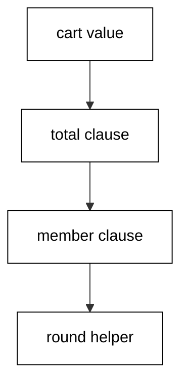
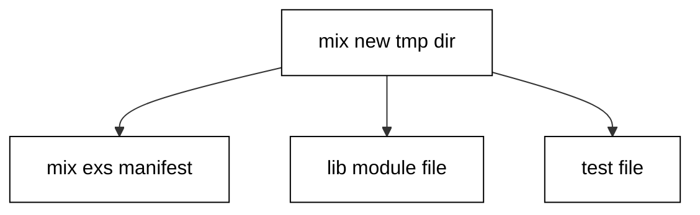
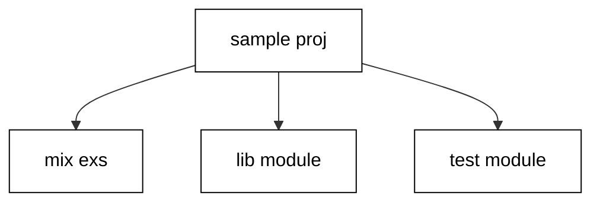
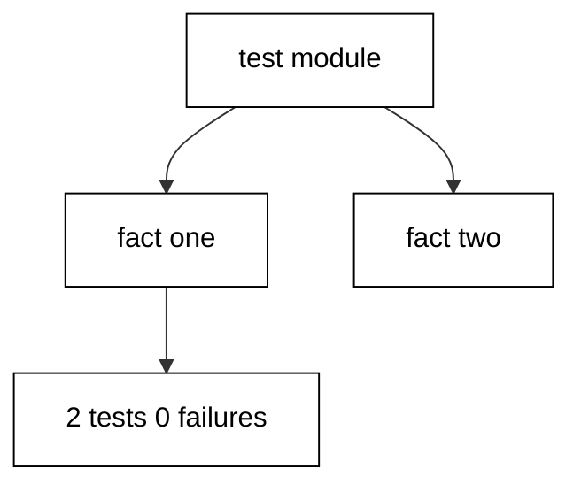
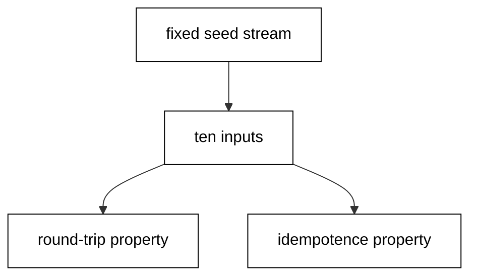
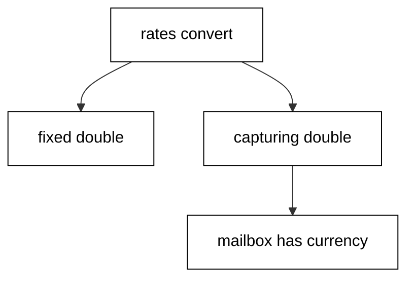
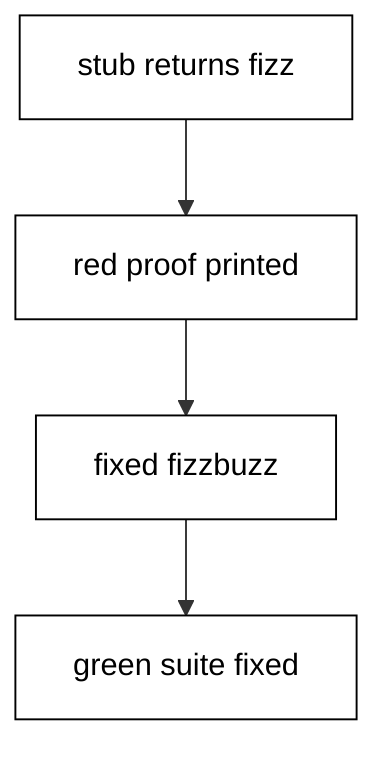
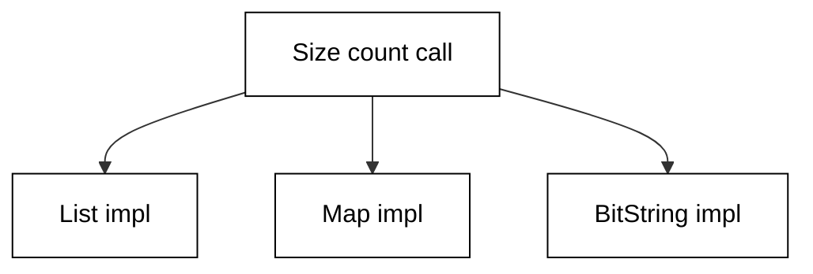
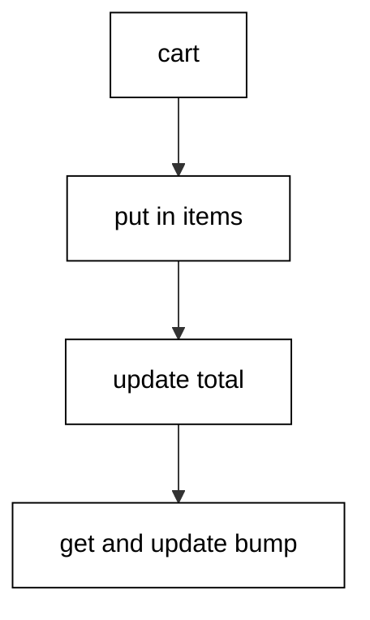
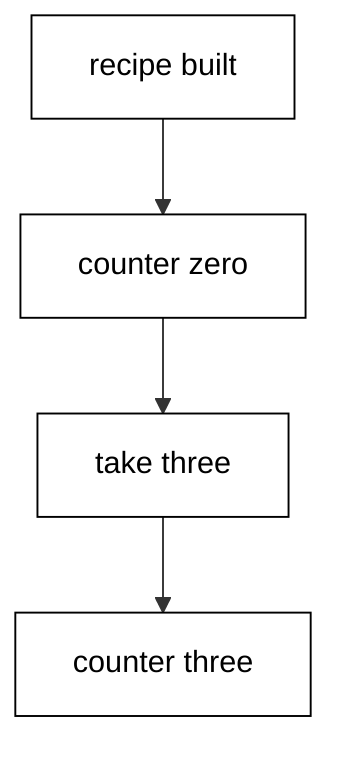

Examples 26–53 organize code the way every shared project does: modules and Mix projects with hash-locked dependencies, the standard ExUnit testing workflow, and the generalization tools — protocols, behaviours, streams, and value semantics — that turn one-off scripts into reusable libraries. Three clusters carry the level: modules, packages, and dependencies (Examples 26–34), testing convention (Examples 35–44), and generics with value semantics (Examples 45–53). Every script runs as `elixir main.exs` on the pinned Elixir 1.20.4 toolchain with no network; outputs are recorded golden files.

### Example 26: Module Anatomy That Names the Unit

A module names the unit; clauses split behavior by shape with guards refining and `@doc` stating the contract (Concepts: co-06.)



Function clauses match in order while guards refine without nesting. `@moduledoc` states the contract in one sentence for readers, `@doc` documents the public entry, and `defp` hides the helper so only the public surface is tested.

**`learning/code/ex-26-module-anatomy-names-unit/main.exs`**:

```elixir
# => Example 26: a module names the unit; clauses split behavior by shape.
defmodule Checkout do # => the cart-totalling unit module.
  # => @moduledoc states the contract in one sentence for readers.
  @moduledoc "Totals a cart with one discount rule per clause." # => the contract sentence.
  # => Function clauses match in order; guards refine without nesting.
  def total(items) when is_list(items), do: Enum.sum(items) # => the list-shaped clause.
  def total(%{items: items}), do: total(items) # => the map-shaped clause delegates.
  # => @doc documents the public entry; private helpers stay undocumented.
  @doc "Applies the member discount to totals over one hundred." # => the discount contract.
  def member(total) when total > 100, do: total * 0.9 # => the discount clause for big totals.
  def member(total), do: total # => the pass-through clause for the rest.
  # => defp hides the helper; only the public surface is tested.
  defp round2(x) when is_float(x), do: Float.round(x, 2) # => round floats to cents.
  defp round2(x), do: x # => leave integers untouched.
  def checkout(cart), do: cart |> total() |> member() |> round2() # => the composed rule pipeline.
end # => the module closes; Checkout is now callable.
# => Public functions run through the module alias; privates stay hidden.
IO.puts("list=#{Checkout.total([10, 20])} map=#{Checkout.total(%{items: [10, 20]})}") # => both shapes total 30.
# => The pipeline reads as the business rule: total, discount, round.
IO.puts("member=#{Checkout.checkout([60, 60])} plain=#{Checkout.checkout([10, 20])}") # => discounted and plain totals.
```

**Output** (`learning/code/ex-26-module-anatomy-names-unit/expected/main.stdout.txt`):

```text
list=30 map=30
member=108.0 plain=30
```

**Key takeaway**: Clauses for shapes, guards for refinements, docs for contracts, `defp` for hiding.

**Why it matters**: A module without this anatomy leaks its internals into every caller. Clauses plus docs plus privacy keep the unit a unit.

### Example 27: alias, import, and require Side by Side

Three directives, three jobs: `alias` shortens names, `import` injects functions, `require` enables macros (Concepts: co-06.)

The alias reads as a namespace shorthand in every later call. `import` with `only:` keeps the injection tight and auditable. `Integer.is_odd` is a guard-safe macro call, which is why `require` must precede it.

**`learning/code/ex-27-alias-import-require-side-by-side/main.exs`**:

```elixir
# => Example 27: alias shortens, import injects, require enables macros.
alias String, as: S
# => import brings named functions into scope; only: keeps it tight.
import Enum, only: [map: 2, sum: 1]
# => require is for macros; Integer hosts the guard-safe parity checks.
require Integer
# => The alias reads as a namespace shorthand in every later call.
upper = S.upcase("ada")
# => Imported functions call without their module prefix.
total = [1, 2, 3] |> map(fn x -> x * 10 end) |> sum()
# => is_odd is a guard-safe macro call; require makes that legal.
odd = Integer.is_odd(7)
# => Print the three results with fixed labels.
IO.puts("upper=#{upper} total=#{total} odd=#{odd}")
```

**Output** (`learning/code/ex-27-alias-import-require-side-by-side/expected/main.stdout.txt`):

```text
upper=ADA total=60 odd=true
```

**Key takeaway**: Alias for length, import for vocabulary, require for macros.

**Why it matters**: A bare `import Enum` pollutes every call site with ambiguity. The three directives used precisely keep each name's origin obvious.

### Example 28: Structs That Name the Shape

Structs fix the key set at compile time, so domain shapes fail fast on typos instead of drifting at runtime (Concepts: co-06.)

`@enforce_keys` turns missing fields into construction-time errors. `struct!` raises on unknown keys, and update syntax keeps the struct tag while replacing named fields. `Map.from_struct` drops the tag when plain data must cross a boundary.

**`learning/code/ex-28-structs-name-shape/main.exs`**:

```elixir
# => Example 28: structs fix the shape; changes stay explicit updates.
defmodule LineItem do # => the line-item domain shape.
  # => enforce_keys turns missing fields into a construction-time error.
  @enforce_keys [:sku] # => sku has no default; builders must supply it.
  defstruct [:sku, qty: 1, price: 0.0] # => three allowed keys with defaults.
end # => the module closes; LineItem is now a struct type.
# => struct! raises on unknown keys, so typos fail fast at construction.
item = struct!(LineItem, sku: "book", qty: 2, price: 9.5) # => strict build with all fields.
# => Update syntax keeps the struct tag while replacing named fields.
bulk = %{item | qty: 10} # => same book, ten copies, tag intact.
# => Dot access reads fields and raises on missing keys by design.
IO.puts("sku=#{bulk.sku} qty=#{bulk.qty} line=#{bulk.qty * bulk.price}") # => the line-item read and total.
# => from_struct drops the tag; fields print explicitly, never as a map.
plain = Map.from_struct(bulk) # => the tagless plain map.
IO.puts("plain_sku=#{plain.sku} plain_qty=#{plain.qty} plain_price=#{plain.price}") # => the boundary-safe fields.
```

**Output** (`learning/code/ex-28-structs-name-shape/expected/main.stdout.txt`):

```text
sku=book qty=10 line=95.0
plain_sku=book plain_qty=10 plain_price=9.5
```

**Key takeaway**: Structs make illegal states unrepresentable at construction.

**Why it matters**: Bare maps accept any key, so every consumer defends against typos. Structs move that check to construction, once, loudly.

### Example 29: A Mix Project Scaffold Read as Data

`mix new` scaffolds the layout every tool expects — manifest, lib entry, test entry — offline with no fetch (Concepts: co-06.)



The scaffold lands in `/tmp` so the read-only course tree stays untouched, and only the scaffold this script created is removed. The manifest names the app atom the generator derived from the path, which the script asserts rather than assumes.

**`learning/code/ex-29-mix-project-scaffold-read-data/main.exs`**:

```elixir
# => Example 29: mix new scaffolds the layout every tool expects.
project = Path.join(System.tmp_dir!(), "elixir_in_depth_ex29") # => the fixed tmp project path.
# => Remove any stale scaffold so the run starts from a fixed state.
File.rm_rf!(project) # => clean slate: delete any leftover scaffold.
# => mix new writes the scaffold offline; no dependency fetch happens yet.
{_out, 0} = System.cmd("mix", ["new", project]) # => scaffold; assert exit zero.
# => The scaffold promises a manifest, a lib entry, and a test entry.
mix? = File.exists?(Path.join(project, "mix.exs")) # => the manifest must exist.
# => The module file name replaces dashes with underscores by convention.
lib? = File.exists?(Path.join([project, "lib", "elixir_in_depth_ex29.ex"])) # => the lib entry must exist.
test? = File.exists?(Path.join([project, "test", "elixir_in_depth_ex29_test.exs"])) # => the test entry must exist.
# => The manifest names the app atom the generator derived from the path.
has_app = project |> Path.join("mix.exs") |> File.read!() |> String.contains?("app: :elixir_in_depth_ex29") # => app atom check.
# => Remove only the scaffold this script created.
File.rm_rf!(project) # => leave no trace: delete the scaffold we made.
# => Print the scaffold checklist with fixed labels.
IO.puts("mix=#{mix?} lib=#{lib?} test=#{test?} app=#{has_app}") # => the four-way scaffold proof.
```

**Output** (`learning/code/ex-29-mix-project-scaffold-read-data/expected/main.stdout.txt`):

```text
mix=true lib=true test=true app=true
```

**Key takeaway**: `mix new` is the layout contract; every tool reads what it writes.

**Why it matters**: Hand-built project trees drift from what the tools assume. Scaffolding from the tool keeps manifest, code, and tests where every command looks for them.

### Example 30: Reading a Hash-Locked mix.lock

`mix.lock` pins every transitive dependency by version in fixed tuple positions; reading it as data proves the closure is pinned, not floating (Concepts: co-07.)

`Code.eval_file` reads the lock as data without executing it. Each hex entry names its version in a fixed position, and sorting the pins keeps the report stable. The sample hashes are illustrative placeholders; the registry checksums live in real lock files.

**`learning/code/ex-30-reading-hash-locked-mix-lock/main.exs`**:

```elixir
# => Example 30: mix.lock pins every transitive dependency by version.
lock = Path.join(__DIR__, "sample.mix.lock") # => the committed sample lock.
# => eval_file reads the lock as data; the script never executes it as code.
{entries, _} = Code.eval_file(lock) # => entries plus ignored bindings.
# => Each hex entry names its version in a fixed tuple position.
pins = # => the sorted pin strings the transcript asserts.
  entries # => map each lock entry to a name=version string.
  |> Enum.map(fn {name, {:hex, _, vsn, _, _, _, _, _}} -> "#{name}=#{vsn}" end) # => position four holds the version.
  |> Enum.sort() # => sort for a stable report.
# => The count proves the closure is pinned, not partly floating.
IO.puts("pins=#{length(pins)} #{Enum.join(pins, " ")}") # => count plus sorted pins.
```

**Output** (`learning/code/ex-30-reading-hash-locked-mix-lock/expected/main.stdout.txt`):

```text
pins=2 mime=2.0.6 plug=1.16.1
```

**Key takeaway**: The lock is data to read, and its pins are the deploy contract.

**Why it matters**: Floating requirements resolve differently on every machine. Reading the lock proves what actually ships, which is the only thing a deploy can rely on.

### Example 31: Exact Pins Instead of Latest

Version requirements float by design; the lock pins exactly, and `~>` with three segments admits patches while refusing minors (Concepts: co-07.)

`Version.match?` tests admission without installing anything, `parse!` turns a pinned string into a comparable struct, and `compare` answers with atoms so callers match instead of comparing.

**`learning/code/ex-31-exact-pins-instead-latest/main.exs`**:

```elixir
# => Example 31: version requirements float; the lock pins exactly.
req = Version.parse_requirement!("~> 1.4.0")
# => Three-segment tilde admits patch releases inside the same minor line.
admits_patch = Version.match?("1.4.10", req)
# => The same requirement refuses the next minor line entirely.
refuses_minor = Version.match?("1.5.0", req)
# => parse! turns the pinned string into a comparable struct.
pinned = Version.parse!("1.4.10")
# => compare answers with atoms, so callers match instead of branching.
order = Version.compare(pinned, "1.4.0")
# => Print the admission answers and the comparison with fixed labels.
IO.puts("patch=#{admits_patch} minor=#{refuses_minor} order=#{order} major=#{pinned.major}")
```

**Output** (`learning/code/ex-31-exact-pins-instead-latest/expected/main.stdout.txt`):

```text
patch=true minor=false order=gt major=1
```

**Key takeaway**: Requirements express intent; pins record the decision.

**Why it matters**: `~>` without a lock means tomorrow's fetch may resolve differently. The requirement belongs in `mix.exs` and the pin belongs in `mix.lock`, each read for its own purpose.

### Example 32: Project Layout Every Tool Expects

Four paths — manifest, code, tests, plus the directories that hold them — make the scaffold tools assume (Concepts: co-06.)



Wildcarding the committed fixture scaffold and sorting keeps the listing independent of disk order. The count plus the sorted paths prove the shape every `mix` task navigates.

**`learning/code/ex-32-project-layout-every-tool-expects/main.exs`**:

```elixir
# => Example 32: every Elixir tool expects the same scaffold paths.
root = Path.join(__DIR__, "sample_proj") # => the committed fixture scaffold.
# => Wildcard the scaffold and sort, so order never depends on the disk.
paths = # => the sorted relative paths the transcript asserts.
  root # => glob everything under the fixture root.
  |> Path.join("**/*") # => the recursive glob pattern.
  |> Path.wildcard() # => expand to absolute matches.
  |> Enum.map(&Path.relative_to(&1, root)) # => relativize each match.
  |> Enum.sort() # => sort for a stable report.
# => Three files plus two directories prove the layout tools assume.
IO.puts("entries=#{length(paths)}") # => the five-entry proof.
# => The sorted layout is fully determined by the committed fixture.
IO.puts(Enum.join(paths, "\n")) # => one path per line, sorted.
```

**Output** (`learning/code/ex-32-project-layout-every-tool-expects/expected/main.stdout.txt`):

```text
entries=5
lib
lib/sample_proj.ex
mix.exs
test
test/sample_proj_test.exs
```

**Key takeaway**: The scaffold is a contract: manifest at the root, code under `lib`, tests under `test`.

**Why it matters**: Tools find files by convention, not configuration. Matching the scaffold keeps `mix test`, `mix format`, and editors working with zero setup.

### Example 33: Compile-Time Config Versus Runtime Config

Module attributes freeze at compile time; `Application` reads happen per call, so releases can change behavior without recompiling (Concepts: co-06.)

`compile_env` inlines the default into the beam — changing it needs a recompile. `fetch_env!` reads at call time, which is why the greeting moves while the compiled default stays. The two prints side by side prove the split.

**`learning/code/ex-33-compile-time-versus-runtime-config/main.exs`**:

```elixir
# => Example 33: module attributes freeze at compile time; runtime reads calls.
defmodule Greeting do # => the two-timing greeting module.
  # => compile_env inlines the default into the beam; recompile to change it.
  @prefix Application.compile_env(:ex33, :prefix, "hello") # => the frozen default.
  # => The attribute accessor exposes the frozen value for comparison.
  def prefix, do: @prefix # => read the compiled-in value.
  # => fetch_env! reads at call time, so releases can change it per boot.
  def greet(name), do: "#{Application.fetch_env!(:ex33, :prefix)} #{name}" # => read the live value.
end # => the module closes; compiled and runtime reads coexist.
# => put_env sets the runtime value the greeting reads on every call.
Application.put_env(:ex33, :prefix, "howdy") # => move the runtime value.
# => The compiled default stayed hello while the runtime value moved.
IO.puts("compiled=#{Greeting.prefix()} runtime=#{Greeting.greet("ada")}") # => frozen versus live, side by side.
```

**Output** (`learning/code/ex-33-compile-time-versus-runtime-config/expected/main.stdout.txt`):

```text
compiled=hello runtime=howdy ada
```

**Key takeaway**: Freeze the stable, read the variable, and never confuse the two.

**Why it matters**: Compile-time config baked into a release cannot change per environment. Knowing which read happens when decides whether a setting is deployable or deployment-breaking.

### Example 34: Choosing Dependencies by Strict Preference

A total ranking — stdlib over hex over git — removes judgment calls from dependency choice (Concepts: co-07.)

The rank function is total: every candidate maps to exactly one level. Sorting by rank and taking the head leaves no ties, so the choice is mechanical. A stdlib candidate beats a pinned hex package for the text job, and a pinned release beats a floating git ref.

**`learning/code/ex-34-choosing-dependencies-strict-preference/main.exs`**:

```elixir
# => Example 34: prefer stdlib, then pinned hex, never a floating git ref.
defmodule Policy do # => the total-ranking policy module.
  # => The ranking is total: stdlib beats hex, hex beats git, always.
  def rank(:stdlib), do: 0 # => stdlib needs no install: rank zero.
  def rank({:hex, _vsn}), do: 1 # => pinned hex needs a lock: rank one.
  def rank({:git, _url}), do: 2 # => floating git needs trust: rank two.
  # => choose sorts candidates by rank and takes the head, no ties possible.
  def choose(cands), do: cands |> Enum.sort_by(&rank/1) |> hd() # => sort, take the head.
end # => the module closes; the ranking is now callable.
# => A stdlib candidate beats a pinned hex package for the same text job.
IO.puts("text=#{inspect(Policy.choose([{:hex, "1.4.10"}, :stdlib]))}") # => stdlib wins the text job.
# => Between hex and git, the pinned registry release wins deterministically.
IO.puts("json=#{inspect(Policy.choose([{:git, "https://example.com/j.git"}, {:hex, "1.4.10"}]))}") # => hex wins the json job.
```

**Output** (`learning/code/ex-34-choosing-dependencies-strict-preference/expected/main.stdout.txt`):

```text
text=:stdlib
json={:hex, "1.4.10"}
```

**Key takeaway**: Decide the preference once as a ranking; every choice follows it.

**Why it matters**: Ad-hoc dependency debates repeat at every addition. A written ranking ends them: stdlib first, pinned releases next, floating refs never.

### Example 35: ExUnit and assert: the Standard Test Shape

ExUnit tests are modules, assertions read as sentences, and the suite summary prints counts instead of timings (Concepts: co-08.)



Starting ExUnit with `auto_run: false` and `seed: 0` plus empty formatters keeps the transcript deterministic: no timing lines, no at-exit rerun noise. `run` returns the summary as data and the script prints its own fixed line.

**`learning/code/ex-35-exunit-assert-standard-test-shape/main.exs`**:

```elixir
# => Example 35: ExUnit tests are modules; assertions read as sentences.
ExUnit.start(auto_run: false, seed: 0, formatters: []) # => no autorun, fixed seed, silent formatters.
# => Each test module groups facts about one unit under test.
defmodule CheckoutFacts do # => the facts module for the discount rules.
  # => async false keeps the teaching suite sequential and readable.
  use ExUnit.Case, async: false # => sequential cases, fixed order.
  # => test names state the fact; assert checks it without ceremony.
  test "member discount divides exactly over one hundred" do # => the discount fact.
    assert div(120 * 9, 10) == 108 # => integer math, no float noise.
  end # => the first test closes.
  # => refute states the negative fact the suite also pins.
  test "small carts stay under the discount line" do # => the no-discount fact.
    refute Enum.sum([10, 20]) > 100 # => 30 stays under the line.
  end # => the second test closes.
end # => the facts module closes; two tests registered.
# => run returns the summary as data; the script prints its own fixed line.
stats = ExUnit.run() # => run silently, collect the summary map.
# => Suite lines name counts, never timings, so the transcript is stable.
IO.puts("suite: #{stats.total} tests, #{stats.failures} failures") # => the fixed summary line.
```

**Output** (`learning/code/ex-35-exunit-assert-standard-test-shape/expected/main.stdout.txt`):

```text
suite: 2 tests, 0 failures
```

**Key takeaway**: `test` names the fact, `assert` checks it, the summary counts it.

**Why it matters**: The standard shape is what every Elixir developer reads first. Writing it exactly — integer math to dodge float noise, fixed summaries to dodge timing noise — keeps suites green and transcripts golden.

### Example 36: setup Blocks That Wrap Each Test

`setup` runs before each test and merges its keys into the test context, so shared fixtures build once and read explicitly (Concepts: co-08.)

Each test pattern-matches only the context keys it needs, keeping the dependency visible in the head. A second test reuses the same context without rebuilding it, which is how fixtures scale past one fact.

**`learning/code/ex-36-setup-blocks-wrap-each-test/main.exs`**:

```elixir
# => Example 36: setup blocks wrap each test in a shared, explicit context.
ExUnit.start(auto_run: false, seed: 0, formatters: []) # => no autorun, fixed seed, silent formatters.
# => Each test module groups facts about one unit under test.
defmodule RosterFacts do # => the facts module for the users map.
  # => async false keeps the teaching suite sequential and readable.
  use ExUnit.Case, async: false # => sequential cases, fixed order.
  # => setup runs before each test and merges its keys into the context.
  setup do # => build the shared fixture once per test.
    {:ok, users: %{"ada" => 36, "grace" => 85}} # => the two-user fixture.
  end # => the setup block closes; context carries users.
  # => Each test pattern-matches the context keys it needs, nothing more.
  test "finds ada", %{users: users} do # => the lookup fact with context.
    assert Map.fetch!(users, "ada") == 36 # => ada is 36 in the fixture.
  end # => the first test closes.
  # => A second test reuses the same context without rebuilding it.
  test "counts two users", %{users: users} do # => the count fact with context.
    assert map_size(users) == 2 # => exactly two users, no more.
  end # => the second test closes.
end # => the facts module closes; two tests registered.
# => run returns the summary as data; the script prints its own fixed line.
stats = ExUnit.run() # => run silently, collect the summary map.
# => Suite lines name counts, never timings, so the transcript is stable.
IO.puts("suite: #{stats.total} tests, #{stats.failures} failures") # => the fixed summary line.
```

**Output** (`learning/code/ex-36-setup-blocks-wrap-each-test/expected/main.stdout.txt`):

```text
suite: 2 tests, 0 failures
```

**Key takeaway**: Build shared state in `setup`, consume it through the context pattern.

**Why it matters**: Fixtures built inside each test duplicate and drift. One `setup` with explicit context keys keeps every test's needs visible in its head.

### Example 37: Testing Private Helpers Through the Public Surface

Private helpers stay private; suites pin them through the public entry that composes them (Concepts: co-08.)

The discount math hides behind `defp` while `checkout` stays the one tested entry. Large carts discount through it and small carts pass through unchanged, which pins both private branches without calling either directly.

**`learning/code/ex-37-testing-private-helpers-public-surface/main.exs`**:

```elixir
# => Example 37: private helpers stay private; suites pin the public surface.
defmodule Discount do # => the checkout unit with hidden helpers.
  # => checkout is the one public entry the suite is allowed to call.
  def checkout(cart), do: cart |> total() |> member() # => the composed public entry.
  # => defp hides the total; tests reach it only through checkout.
  defp total(items), do: Enum.sum(items) # => the hidden summation helper.
  # => Integer division keeps the discount exact, no floats involved.
  defp member(t) when t > 100, do: t * 9 |> div(10) # => the hidden discount helper.
  defp member(t), do: t # => the hidden pass-through clause.
end # => the module closes; privates stay uncalled directly.
ExUnit.start(auto_run: false, seed: 0, formatters: []) # => no autorun, fixed seed, silent formatters.
# => Each test module groups facts about one unit under test.
defmodule DiscountFacts do # => the facts module for the checkout entry.
  # => async false keeps the teaching suite sequential and readable.
  use ExUnit.Case, async: false # => sequential cases, fixed order.
  # => Large carts discount through the public entry, privates uncalled.
  test "large carts discount through the public entry" do # => the discount fact.
    assert Discount.checkout([60, 60]) == 108 # => 120 discounts to 108.
  end # => the first test closes.
  # => Small carts pass through unchanged, same entry, same guarantee.
  test "small carts pass through unchanged" do # => the unchanged fact.
    assert Discount.checkout([10, 20]) == 30 # => 30 passes through intact.
  end # => the second test closes.
end # => the facts module closes; two tests registered.
# => run returns the summary as data; the script prints its own fixed line.
stats = ExUnit.run() # => run silently, collect the summary map.
# => Suite lines name counts, never timings, so the transcript is stable.
IO.puts("suite: #{stats.total} tests, #{stats.failures} failures") # => the fixed summary line.
```

**Output** (`learning/code/ex-37-testing-private-helpers-public-surface/expected/main.stdout.txt`):

```text
suite: 2 tests, 0 failures
```

**Key takeaway**: Test the contract, not the helpers; refactoring stays free.

**Why it matters**: Suites that call privates freeze the implementation. Pinning behavior through the public surface lets internals change while the guarantee holds.

### Example 38: Seeded Tables That Stand In for Properties

A fixed `:rand` stream replays the same inputs on every run, so seeded tables give property-style coverage with stdlib alone (Concepts: co-08.)



Seeding with a fixed triple before taking inputs makes the table reproducible across machines and versions. One property per test keeps failures attributable, and the printed checked count proves the table ran.

**`learning/code/ex-38-seeded-tables-stand-in-properties/main.exs`**:

```elixir
# => Example 38: seeded tables stand in for property libraries, deterministically.
ExUnit.start(auto_run: false, seed: 0, formatters: []) # => no autorun, fixed seed, silent formatters.
# => exsss with a fixed seed replays the same stream on every run.
:rand.seed(:exsss, {7, 42, 99}) # => pin the generator stream first.
# => Take ten integers in range from the seeded stream, once, up front.
inputs = Enum.map(1..10, fn _ -> :rand.uniform(1000) end) # => the shared fixed table.
# => Each test module groups facts about one unit under test.
defmodule SeededFacts do # => the facts module for the two properties.
  # => async false keeps the teaching suite sequential and readable.
  use ExUnit.Case, async: false # => sequential cases, fixed order.
  # => One property per test; the table above is the shared fixed input.
  test "double then halve round-trips every sampled input" do # => the round-trip property.
    for n <- unquote(inputs) do # => iterate the injected fixed table.
      assert div(n * 2, 2) == n # => every sample round-trips exactly.
    end # => the comprehension closes; all ten held.
  end # => the first test closes.
  # => Sorting twice equals sorting once, over the very same sample.
  test "sorting is idempotent over every sampled list" do # => the idempotence property.
    sample = unquote(inputs) # => bind the same table locally.
    assert Enum.sort(Enum.sort(sample)) == Enum.sort(sample) # => sort is idempotent here.
  end # => the second test closes.
end # => the facts module closes; two tests registered.
# => run returns the summary as data; the script prints its own fixed line.
stats = ExUnit.run() # => run silently, collect the summary map.
# => The checked count proves the table ran; timings never appear.
IO.puts("suite: #{stats.total} tests, #{stats.failures} failures checked=#{length(inputs)}") # => summary plus table proof.
```

**Output** (`learning/code/ex-38-seeded-tables-stand-in-properties/expected/main.stdout.txt`):

```text
suite: 2 tests, 0 failures checked=10
```

**Key takeaway**: Seed once, sample once, assert properties over the table.

**Why it matters**: Unseeded randomness makes suites flaky across runs. A fixed stream gives property-style breadth with transcript-grade repeatability.

### Example 39: Assertion Messages That Name the Mismatch

Custom messages name the expected value on failure, and match-asserts bind context while checking shape (Concepts: co-08.)

The receipt message prints what the total should have been, so the failure reads as a diff against the expectation. The match-assert pins the tuple shape and binds the name in one move, then the plain assert checks it.

**`learning/code/ex-39-assertion-messages-name-mismatch/main.exs`**:

```elixir
# => Example 39: assertion messages name the mismatch for the next reader.
ExUnit.start(auto_run: false, seed: 0, formatters: []) # => no autorun, fixed seed, silent formatters.
# => Each test module groups facts about one unit under test.
defmodule ReportFacts do # => the facts module for receipt and error shapes.
  # => async false keeps the teaching suite sequential and readable.
  use ExUnit.Case, async: false # => sequential cases, fixed order.
  test "sum matches the receipt" do # => the receipt-total fact.
    total = Enum.sum([19, 23]) # => add the two receipt lines.
    # => The message names the expected receipt line on failure.
    assert total == 42, "receipt total should be 42, got #{total}" # => message names the expectation.
  end # => the first test closes.
  test "error tuple carries the missing name" do # => the error-shape fact.
    result = {:error, {:unknown_user, "alan"}} # => the fixed error value.
    # => assert with match pins the shape and binds the context in one move.
    assert {:error, {:unknown_user, name}} = result # => match pins shape, binds name.
    assert name == "alan" # => the bound name is the missing one.
  end # => the second test closes.
end # => the facts module closes; two tests registered.
# => run returns the summary as data; the script prints its own fixed line.
stats = ExUnit.run() # => run silently, collect the summary map.
# => Suite lines name counts, never timings, so the transcript is stable.
IO.puts("suite: #{stats.total} tests, #{stats.failures} failures") # => the fixed summary line.
```

**Output** (`learning/code/ex-39-assertion-messages-name-mismatch/expected/main.stdout.txt`):

```text
suite: 2 tests, 0 failures
```

**Key takeaway**: Messages answer "compared to what" before anyone asks.

**Why it matters**: A bare `assert total == 42` on red shows two numbers with no story. The message states the expectation's origin, which is what the fixer needs first.

### Example 40: Tags and Names That Organize the Suite

Tags select tests for filtered runs while names organize them for readers; the two systems compose (Concepts: co-08.)

The `external` tag marks the fact that needs the outside world, so `exclude` skips it in fast suites. A valued tag parameterizes shared setup through the test context. The untagged fact runs in every selection without annotation.

**`learning/code/ex-40-tags-names-organize-suite/main.exs`**:

```elixir
# => Example 40: tags select tests; names organize the rest.
ExUnit.start(auto_run: false, seed: 0, formatters: []) # => no autorun, fixed seed, silent formatters.
# => Each test module groups facts about one unit under test.
defmodule TaggedFacts do # => the facts module for tags and names.
  # => async false keeps the teaching suite sequential and readable.
  use ExUnit.Case, async: false # => sequential cases, fixed order.
  # => external marks the fact that needs the outside world; exclude skips it.
  @tag :external # => the outside-world tag.
  test "quotes the exchange rate table" do # => the external fact.
    assert %{"usd" => 1.0}["usd"] == 1.0 # => the canned rate holds.
  end # => the external test closes.
  # => A valued tag parameterizes shared setup through the test context.
  @tag rate: 2 # => the doubling-rate tag value.
  test "doubles at the tagged rate", %{rate: rate} do # => the tagged-rate fact.
    assert 21 * rate == 42 # => 21 doubles to 42 at rate two.
  end # => the tagged test closes.
  # => The untagged fact runs in every selection without any annotation.
  test "plain fact runs in every selection" do # => the always-run fact.
    assert Enum.sum([20, 22]) == 42 # => 20 plus 22 is 42.
  end # => the plain test closes.
end # => the facts module closes; three tests registered.
# => run returns the summary as data; the script prints its own fixed line.
stats = ExUnit.run() # => run silently, collect the summary map.
# => Three tests ran unfiltered here; selections happen at the mix test line.
IO.puts("suite: #{stats.total} tests, #{stats.failures} failures") # => the fixed summary line.
```

**Output** (`learning/code/ex-40-tags-names-organize-suite/expected/main.stdout.txt`):

```text
suite: 3 tests, 0 failures
```

**Key takeaway**: Tag by run-profile, name by fact, and let selections compose.

**Why it matters**: External-dependent tests in the default run make CI flaky. Tags keep one suite with many selections instead of many suites with one each.

### Example 41: Stubbing Boundaries With Explicit Doubles

Boundaries arrive as function arguments, and test doubles are plain closures — no library, no globals (Concepts: co-08.)



The fixed double returns the canned rate for the conversion fact. The capturing double sends its argument to the test process, and `assert_received` matches the mailbox without any sleep or wait.

**`learning/code/ex-41-stubbing-boundaries-explicit-doubles/main.exs`**:

```elixir
# => Example 41: explicit doubles stand in for boundaries without libraries.
defmodule Rates do # => the boundary-as-argument converter.
  # => The boundary arrives as a function argument, never a global.
  def convert(amount, fetch), do: amount * fetch.("usd") # => fetch, then multiply.
end # => the module closes; convert stays injectable.
ExUnit.start(auto_run: false, seed: 0, formatters: []) # => no autorun, fixed seed, silent formatters.
# => Each test module groups facts about one unit under test.
defmodule RatesFacts do # => the facts module for fixed and capturing doubles.
  # => async false keeps the teaching suite sequential and readable.
  use ExUnit.Case, async: false # => sequential cases, fixed order.
  test "converts with a fixed double" do # => the fixed-double fact.
    assert Rates.convert(10, fn _ -> 2 end) == 20 # => 10 at rate two is 20.
  end # => the first test closes.
  test "records the requested currency" do # => the capturing-double fact.
    # => The double captures its argument through a test-process message.
    me = self() # => the test process the double reports to.
    Rates.convert(1, fn cur -> send(me, {:asked, cur}); 1 end) # => convert, capturing the currency.
    # => assert_received matches the mailbox without any sleep or wait.
    assert_received {:asked, "usd"} # => the mailbox proves usd was asked.
  end # => the second test closes.
end # => the facts module closes; two tests registered.
# => run returns the summary as data; the script prints its own fixed line.
stats = ExUnit.run() # => run silently, collect the summary map.
# => Suite lines name counts, never timings, so the transcript is stable.
IO.puts("suite: #{stats.total} tests, #{stats.failures} failures") # => the fixed summary line.
```

**Output** (`learning/code/ex-41-stubbing-boundaries-explicit-doubles/expected/main.stdout.txt`):

```text
suite: 2 tests, 0 failures
```

**Key takeaway**: Pass the boundary in, double it with a closure, assert with the mailbox.

**Why it matters**: Global stubs leak between tests and order them secretly. Explicit doubles keep each test's world in its own arguments.

### Example 42: Testing Streams at Their Bounds

Streams prove their bounds: empties map to empty, infinite ones stop at take, ranges anchor at an index (Concepts: co-08.)

Empty input through `map` stays empty. `take` stops the infinite `iterate` exactly at the bound, which is the laziness guarantee made testable. The range stream anchors its first mapped element.

**`learning/code/ex-42-testing-streams-at-bounds/main.exs`**:

```elixir
# => Example 42: streams prove their bounds; empties and infinities included.
ExUnit.start(auto_run: false, seed: 0, formatters: []) # => no autorun, fixed seed, silent formatters.
# => Each test module groups facts about one unit under test.
defmodule StreamFacts do # => the facts module for stream bounds.
  # => async false keeps the teaching suite sequential and readable.
  use ExUnit.Case, async: false # => sequential cases, fixed order.
  test "empty stream maps to empty" do # => the empty-bound fact.
    assert Stream.map([], fn x -> x end) |> Enum.to_list() == [] # => empty in, empty out.
  end # => the first test closes.
  test "take stops the infinite stream exactly at the bound" do # => the take-bound fact.
    assert Stream.iterate(1, &(&1 + 1)) |> Enum.take(3) == [1, 2, 3] # => three pulled, rest never run.
  end # => the second test closes.
  test "first element anchors the mapped range stream" do # => the anchor fact.
    assert 1..3 |> Stream.map(fn x -> x * 2 end) |> Enum.at(0) == 2 # => first mapped element is 2.
  end # => the third test closes.
end # => the facts module closes; three tests registered.
# => run returns the summary as data; the script prints its own fixed line.
stats = ExUnit.run() # => run silently, collect the summary map.
# => Suite lines name counts, never timings, so the transcript is stable.
IO.puts("suite: #{stats.total} tests, #{stats.failures} failures") # => the fixed summary line.
```

**Output** (`learning/code/ex-42-testing-streams-at-bounds/expected/main.stdout.txt`):

```text
suite: 3 tests, 0 failures
```

**Key takeaway**: Boundaries are the facts: empty, take-count, and first element.

**Why it matters**: Streams fail at their edges — off-by-one takes, empty inputs, unbounded pulls. Pinning the bounds pins the stream.

### Example 43: Reading the Suite Summary as Data

The summary map — total, failures, excluded, skipped — is data the script gates downstream work on (Concepts: co-08.)

`ExUnit.run` returns the counts instead of printing them, so the script asserts on numbers rather than eyeballing output. Gating downstream work on the counts turns the suite into a build step instead of a report.

**`learning/code/ex-43-reading-suite-summary-data/main.exs`**:

```elixir
# => Example 43: the suite summary is data the script can gate on.
ExUnit.start(auto_run: false, seed: 0, formatters: []) # => no autorun, fixed seed, silent formatters.
# => Each test module groups facts about one unit under test.
defmodule TinyFacts do # => the two-fact facts module.
  # => async false keeps the teaching suite sequential and readable.
  use ExUnit.Case, async: false # => sequential cases, fixed order.
  test "one fact", do: assert(1 + 1 == 2) # => arithmetic holds.
  test "another fact", do: assert(:ok == :ok) # => atoms match themselves.
end # => the facts module closes; two tests registered.
# => run returns total, failures, excluded, and skipped counts as a map.
stats = ExUnit.run() # => run silently, collect the summary map.
# => Gate downstream work on the counts instead of eyeballing output.
IO.puts("total=#{stats.total} failures=#{stats.failures} excluded=#{stats.excluded} skipped=#{stats.skipped}") # => the four-count gate line.
```

**Output** (`learning/code/ex-43-reading-suite-summary-data/expected/main.stdout.txt`):

```text
total=2 failures=0 excluded=0 skipped=0
```

**Key takeaway**: Counts are values; gate on them like any other value.

**Why it matters**: Suites whose results only humans read get skipped under pressure. Data summaries let scripts enforce green before the report prints — the capstone's exact trick.

### Example 44: Failing-Test-First in One File

Red first proves the test can fail; green then proves the fix, both in one file (Concepts: co-08.)



The red phase rescues the `AssertionError` against the stub and prints the proof it failed — a test that cannot fail proves nothing. The green phase pins all four divisor branches against the fixed module, and the summary as data closes the loop.

**`learning/code/ex-44-failing-test-first-one-file/main.exs`**:

```elixir
# => Example 44: red first proves the test can fail; green proves the fix.
ExUnit.start(auto_run: false, seed: 0, formatters: []) # => no autorun, fixed seed, silent formatters.
import ExUnit.Assertions # => assert outside tests needs the import.
# => The stub returns fizz for everything, so fifteen fails the requirement.
defmodule FizzBroken do # => the always-fizz stub module.
  def fizzbuzz(_), do: "fizz" # => every input gets fizz, including fifteen.
end # => the stub module closes.
# => Red: rescue the assertion error and print the proof it failed.
red = # => the red-proof binding the try returns into.
  try do # => assert the requirement against the stub.
    assert FizzBroken.fizzbuzz(15) == "fizzbuzz" # => fifteen is not fizzbuzz here.
    "unexpected green" # => dead unless the stub ever passes.
  rescue # => convert the assertion failure into the red proof.
    _ in ExUnit.AssertionError -> "red: stub says fizz" # => the failure is the proof.
  end # => the try closes; red holds the proof string.
# => The fix handles every divisor branch plus the plain-number fallback.
defmodule FizzFixed do # => the four-branch fix module.
  def fizzbuzz(n) do # => dispatch on divisibility, specific first.
    cond do # => first true branch wins, fifteen matches first.
      rem(n, 15) == 0 -> "fizzbuzz" # => the fifteen branch.
      rem(n, 3) == 0 -> "fizz" # => the three branch.
      rem(n, 5) == 0 -> "buzz" # => the five branch.
      true -> Integer.to_string(n) # => the plain-number fallback.
    end # => the cond closes; one string comes out.
  end # => the function closes.
end # => the fix module closes.
# => Green: the suite pins all four branches against the fixed module.
defmodule FizzFacts do # => the green facts module.
  use ExUnit.Case, async: false # => sequential cases, fixed order.
  test "divisors split four ways" do # => the four-branch fact.
    assert FizzFixed.fizzbuzz(15) == "fizzbuzz" # => fifteen takes the first branch.
    assert FizzFixed.fizzbuzz(3) == "fizz" # => three takes the second branch.
    assert FizzFixed.fizzbuzz(5) == "buzz" # => five takes the third branch.
    assert FizzFixed.fizzbuzz(7) == "7" # => seven takes the fallback.
  end # => the test closes; four asserts ran.
end # => the facts module closes; one test registered.
# => The summary as data closes the loop: one test, zero failures.
green = ExUnit.run() # => run silently, collect the summary map.
# => Print the red proof and the green summary with fixed labels.
IO.puts(red) # => the red phase proof.
IO.puts("green: #{green.total} tests, #{green.failures} failures") # => the green phase summary.
```

**Output** (`learning/code/ex-44-failing-test-first-one-file/expected/main.stdout.txt`):

```text
red: stub says fizz
green: 1 tests, 0 failures
```

**Key takeaway**: A test that never failed never proved it checks anything.

**Why it matters**: Green-only suites drift into tautology. The red-green pair is the cheapest proof that the test and the code actually disagree when they should.

### Example 45: Protocols That Dispatch on Type

Protocols dispatch on type so callers never branch; new types add implementations, never edits (Concepts: co-10.)



`defprotocol` declares the contract once. Each `defimpl` binds one type to its implementation, and dispatch picks by the value's type at the call site. Adding a type means adding a file, never reopening the caller.

**`learning/code/ex-45-protocols-dispatch-on-type/main.exs`**:

```elixir
# => Example 45: protocols dispatch on type; callers never branch.
defprotocol Size do # => the counting contract protocol.
  # => @doc on the protocol function documents the contract implementers meet.
  @doc "Counts the meaningful elements of any sized value." # => the implementer contract.
  def count(value) # => one function, every type answers.
end # => the protocol closes; dispatch is now open.
# => defimpl binds the List type to its recursive counting implementation.
defimpl Size, for: List do # => the List implementation module.
  def count(list), do: length(list) # => lists count elements.
end # => the List impl closes.
# => A second impl covers maps; dispatch picks it by the value's type.
defimpl Size, for: Map do # => the Map implementation module.
  def count(map), do: map_size(map) # => maps count keys.
end # => the Map impl closes.
# => BitString gets its own impl: bytes, not graphemes, like byte_size.
defimpl Size, for: BitString do # => the BitString implementation module.
  def count(bin), do: byte_size(bin) # => binaries count bytes.
end # => the BitString impl closes.
# => One call site serves every type; new types add impls, never branches.
IO.puts("list=#{Size.count([1, 2, 3])} map=#{Size.count(%{a: 1})} bin=#{Size.count("héllo")}") # => three types, one call shape.
```

**Output** (`learning/code/ex-45-protocols-dispatch-on-type/expected/main.stdout.txt`):

```text
list=3 map=1 bin=6
```

**Key takeaway**: Dispatch replaces conditionals on type.

**Why it matters**: `cond` on type centralizes every type's logic in one function that every new type reopens. Protocols distribute the logic to the types and close the caller.

### Example 46: Behaviours With Callbacks

Behaviours declare callbacks; modules opt in with `@behaviour` and tie each function with `@impl` (Concepts: co-10.)

`@callback` fixes the arity and return shape implementers promise. `@behaviour` announces the contract so the compiler warns on gaps, and `@impl` ties each function to its callback so renames break loudly. The caller programs to the behaviour, not to the module name.

**`learning/code/ex-46-behaviours-with-callbacks/main.exs`**:

```elixir
# => Example 46: behaviours declare callbacks; modules opt in explicitly.
defmodule Store do # => the store contract module.
  # => @callback fixes the arity and the return shape implementers promise.
  @callback fetch(map(), term()) :: {:ok, term()} | {:error, :missing} # => the fetch contract.
  @callback keys(map()) :: [term()] # => the keys contract.
end # => the contract module closes; two callbacks declared.
# => @behaviour announces the contract; the compiler warns on gaps.
defmodule MemoryStore do # => the in-memory implementer.
  @behaviour Store # => opt into the contract; gaps warn at compile time.
  # => fetch matches the callback shape exactly, atom for atom.
  @impl Store # => tie this function to its callback.
  def fetch(state, key) do # => the fetch implementation.
    case Map.fetch(state, key) do # => match the fetch result shape.
      {:ok, _} = hit -> hit # => pass hits through untouched.
      :error -> {:error, :missing} # => convert misses to the contract error.
    end # => the case closes; the contract shape holds either way.
  end # => the fetch function closes.
  # => @impl ties each function to its callback so renames break loudly.
  @impl Store # => tie this function to its callback.
  def keys(state), do: Map.keys(state) |> Enum.sort() # => sorted keys for determinism.
end # => the implementer closes; both callbacks met.
# => The caller programs to the behaviour, not to the MemoryStore name.
state = %{"b" => 2, "a" => 1} # => the fixed backing store.
# => Callbacks compose into reports without knowing the backing store.
IO.puts("fetch=#{inspect(MemoryStore.fetch(state, "a"))} miss=#{inspect(MemoryStore.fetch(state, "z"))}") # => hit and miss reports.
# => Sorted keys keep the report deterministic across map orderings.
IO.puts("keys=#{inspect(MemoryStore.keys(state))}") # => the sorted key report.
```

**Output** (`learning/code/ex-46-behaviours-with-callbacks/expected/main.stdout.txt`):

```text
fetch={:ok, 1} miss={:error, :missing}
keys=["a", "b"]
```

**Key takeaway**: Behaviours are compile-checked interfaces with compiler-backed warnings.

**Why it matters**: Documentation-only contracts rot. Behaviour callbacks with `@impl` turn the contract into checks the compiler runs on every build.

### Example 47: One Enum Vocabulary Over Every Collection

`Enum` serves lists, maps, ranges, and streams with the same functions; `into` collects back into any shape (Concepts: co-10, co-03.)

Enumerating a map yields key-value tuples, ranges enumerate without allocating, and infinite cycles work because `take` bounds the pull. The round trip through strings and back preserves every entry, printed as sorted pairs so map ordering never matters.

**`learning/code/ex-47-one-enum-vocabulary-every-collection/main.exs`**:

```elixir
# => Example 47: one Enum vocabulary serves lists, maps, ranges, and streams.
mixed = %{"b" => 2, "a" => 1, "c" => 3}
# => Enum over a map yields key-value tuples, sorted here for stability.
pairs = mixed |> Enum.sort() |> Enum.map(fn {k, v} -> "#{k}=#{v}" end)
# => Ranges enumerate without allocating; the same map/1 consumes them.
squares = 1..4 |> Enum.map(fn x -> x * x end)
# => Streams are enumerable too: take first, then the vocabulary matches.
head = Stream.cycle(["x", "y"]) |> Enum.take(3)
# => into collects back into a map, closing the round trip through Enum.
back = pairs |> Enum.map(fn s -> String.split(s, "=") |> List.to_tuple() end) |> Map.new()
# => Print each vocabulary result with fixed labels.
IO.puts("pairs=#{inspect(pairs)} squares=#{inspect(squares)} head=#{inspect(head)}")
# => Sorted pairs print deterministically; map key order is not asserted on.
IO.puts("back=#{inspect(back |> Map.to_list() |> Enum.sort())}")
```

**Output** (`learning/code/ex-47-one-enum-vocabulary-every-collection/expected/main.stdout.txt`):

```text
pairs=["a=1", "b=2", "c=3"] squares=[1, 4, 9, 16] head=["x", "y", "x"]
back=[{"a", "1"}, {"b", "2"}, {"c", "3"}]
```

**Key takeaway**: Learn `Enum` once, read every collection forever.

**Why it matters**: Per-type vocabularies multiply what a reader must hold. One vocabulary over all enumerables means the tenth collection reads like the first.

### Example 48: Streams That Fuse the Pipeline

Streams build composable recipes that fuse stages; nothing runs until `Enum` demands values (Concepts: co-10, co-15.)

The recipe touches no input until `take` pulls exactly three elements, so the infinite-safe recipe stays lazy. The fused pipeline touches six inputs for three outputs instead of a hundred, and `chunk_every` bounds windows for batch work.

**`learning/code/ex-48-streams-fuse-pipeline/main.exs`**:

```elixir
# => Example 48: streams fuse stages; Enum would allocate between each.
# => Stream builds a composable recipe; nothing runs until Enum demands it.
recipe = 1..100 |> Stream.map(fn x -> x * 2 end) |> Stream.filter(fn x -> rem(x, 3) == 0 end) # => the lazy fused recipe.
# => take pulls exactly three elements, so the infinite-safe recipe stays lazy.
first = Enum.take(recipe, 3) # => pull three; the rest never runs.
# => The fused pipeline touches six inputs for three outputs, not one hundred.
counted = # => the same fusion written as one pipeline.
  1..100 # => the fixed input range.
  |> Stream.map(fn x -> x * 2 end) # => stage one doubles lazily.
  |> Stream.filter(fn x -> rem(x, 3) == 0 end) # => stage two filters lazily.
  |> Enum.take(3) # => demand three; fusion does the rest.
# => Range streams enumerate on demand; chunk_every bounds the windows.
windows = 1..6 |> Stream.chunk_every(2) |> Enum.map(&Enum.sum/1) # => windowed sums on demand.
# => Print the fused results and the window sums with fixed labels.
IO.puts("first=#{inspect(first)} fused=#{inspect(counted)} windows=#{inspect(windows)}") # => fusion and window proofs.
```

**Output** (`learning/code/ex-48-streams-fuse-pipeline/expected/main.stdout.txt`):

```text
first=[6, 12, 18] fused=[6, 12, 18] windows=[3, 7, 11]
```

**Key takeaway**: `Stream` defers, `Enum` demands, and fusion skips the work in between.

**Why it matters**: Eager pipelines over large or infinite inputs allocate intermediate lists or never terminate. Fused streams do exactly the demanded work and no more.

### Example 49: Updates That Return New Values

`put_in`, `update_in`, and `get_and_update` thread updates through nested data while every old binding keeps the old value (Concepts: co-11.)



`put_in` nests the update without intermediate variables. `update_in` transforms with a function while the original persists. `get_and_update` returns both the old value and the new structure for pop-and-replace flows.

**`learning/code/ex-49-updates-return-new-values/main.exs`**:

```elixir
# => Example 49: updates return new values; old bindings keep the old data.
cart = %{items: ["book"], total: 20} # => the original cart both updates start from.
# => put_in nests the update; the original map binding never changes.
added = put_in(cart, [:items], cart.items ++ ["pen"]) # => pen added; cart untouched.
# => update_in transforms with a function while the old value persists.
priced = update_in(added, [:total], fn t -> t + 5 end) # => total plus five; added untouched.
# => get_and_update returns both the old value and the new structure.
{old_total, bumped} = Map.get_and_update(priced, :total, fn t -> {t, t + 1} end) # => pop 25, install 26.
# => Nested access paths compose; Access.key guards missing levels safely.
deep = %{a: %{b: 1}} # => the fixed nested fixture.
deepened = update_in(deep, [:a, :b], fn x -> x * 10 end) # => deep value times ten.
# => Print the lineage: original, added, priced, bumped, and the deep edit.
IO.puts("orig_items=#{length(cart.items)} added=#{inspect(added.items)} priced=#{priced.total}") # => the update lineage.
# => The popped old total and the untouched-then-deepened values close the tale.
IO.puts("old=#{old_total} bumped=#{bumped.total} deep=#{deepened.a.b}") # => popped, bumped, and deepened values.
```

**Output** (`learning/code/ex-49-updates-return-new-values/expected/main.stdout.txt`):

```text
orig_items=1 added=["book", "pen"] priced=25
old=25 bumped=26 deep=10
```

**Key takeaway**: Every update is a new value; lineage reads as a chain of bindings.

**Why it matters**: Mutation hides history. New-value updates keep every stage inspectable, which turns debugging into reading bindings instead of replaying time.

### Example 50: Shared Tails Under Immutability

Persistence shares structure: prepending shares the whole tail, and map updates rebuild only the edited path (Concepts: co-11.)

The extended list's head differs while the tail is the identical structure — no copy, no lock. `put_in` on the config rebuilds the edited branch and reuses the untouched one, and equality on the shared branch proves the sharing is value-safe.

**`learning/code/ex-50-shared-tails-under-immutability/main.exs`**:

```elixir
# => Example 50: persistence shares structure; only the spine is copied.
base = Enum.to_list(1..100)
# => Prepending shares the whole tail; the base list is never copied.
extended = [0 | base]
# => The head differs while the tail is the identical structure, provably.
IO.puts("head_base=#{hd(base)} head_ext=#{hd(extended)} len=#{length(extended)}")
# => Maps share unchanged subtrees; only the edited path is rebuilt.
config = %{db: %{host: "db", pool: 5}, web: %{port: 4000}}
# => put_in rebuilds the db branch and reuses the web branch untouched.
bigger = put_in(config, [:db, :pool], 10)
# => Equality on the untouched branch proves the sharing is value-safe.
IO.puts("pool=#{bigger.db.pool} web_same=#{bigger.web == config.web}")
# => The original config still holds the old pool: nothing mutated anywhere.
IO.puts("orig_pool=#{config.db.pool}")
```

**Output** (`learning/code/ex-50-shared-tails-under-immutability/expected/main.stdout.txt`):

```text
head_base=1 head_ext=0 len=101
pool=10 web_same=true
orig_pool=5
```

**Key takeaway**: Immutability is cheap because structure is shared, not copied.

**Why it matters**: "Immutable" sounds expensive until sharing is visible. Seeing old and new coexist explains why Elixir programs update freely without defensive copies.

### Example 51: Sorted Terms That Traverse in Order

Term ordering sorts tuples element by element, `sort_by` ranks by a key function, and ordered trees traverse in key order (Concepts: co-03, co-10.)

Sorting rows orders by name first, then age — the tuple shape decides. `sort_by` with the age field alone ranks differently with the same function family. The `:gb_trees` round trip traverses in key order regardless of insertion order.

**`learning/code/ex-51-sorted-terms-traverse-order/main.exs`**:

```elixir
# => Example 51: sorted terms traverse in order without any comparator.
rows = [{"grace", 85}, {"ada", 36}, {"alan", 40}]
# => sort orders tuples element by element: name first, then age.
by_name = Enum.sort(rows)
# => sort_by with a key function ranks by the extracted field alone.
by_age = Enum.sort_by(rows, fn {_name, age} -> age end)
# => :ordered_set... gb_trees keep sort order across inserts and reads.
tree = :gb_trees.from_orddict(Enum.sort([{"b", 2}, {"a", 1}]))
# => to_list reads the tree back in key order, deterministically.
IO.puts("by_name=#{inspect(by_name)} by_age=#{inspect(by_age)}")
# => The tree round-trips in key order regardless of insertion order.
IO.puts("tree=#{inspect(:gb_trees.to_list(tree))}")
```

**Output** (`learning/code/ex-51-sorted-terms-traverse-order/expected/main.stdout.txt`):

```text
by_name=[{"ada", 36}, {"alan", 40}, {"grace", 85}] by_age=[{"ada", 36}, {"alan", 40}, {"grace", 85}]
tree=[{"a", 1}, {"b", 2}]
```

**Key takeaway**: Shape the data so the default order is the wanted order.

**Why it matters**: Custom comparators are bug farms. Tuples shaped for term order plus `sort_by` for the rest cover nearly every ranking without one.

### Example 52: Laziness That Computes Only on Demand

A `:counters`-measured recipe proves laziness: three demanded elements run three applications, not ten (Concepts: co-10.)



Before enumeration the counter proves nothing ran yet. `take(3)` runs exactly three applications and stops, and the counter proves it — laziness measured, not hoped.

**`learning/code/ex-52-laziness-computes-on-demand/main.exs`**:

```elixir
# => Example 52: laziness computes on demand; placement decides the cost.
calls = :counters.new(1, [])
# => The stream recipe records no calls until something enumerates it.
recipe = Stream.map(1..10, fn x -> :counters.add(calls, 1, 1); x * 2 end)
# => Before enumeration the counter proves nothing ran yet.
IO.puts("before=#{:counters.get(calls, 1)}")
# => take(3) runs exactly three applications, then stops the stream.
first = Enum.take(recipe, 3)
# => The counter proves three runs, not ten: laziness is measured, not hoped.
IO.puts("first=#{inspect(first)} after=#{:counters.get(calls, 1)}")
```

**Output** (`learning/code/ex-52-laziness-computes-on-demand/expected/main.stdout.txt`):

```text
before=0
first=[2, 4, 6] after=3
```

**Key takeaway**: Laziness is a measurement: count the runs, not the stages.

**Why it matters**: "Lazy" code that runs everything eagerly is the worst of both worlds. Counting proves where the work happens and where it stops.

### Example 53: Strict Versus Loose Equality

`==` compares value across types while `===` demands the same type; the branch order decides which answer a function gives (Concepts: co-11.)

Loose equality coerces integers and floats by numeric value. Atoms and strings never equal each other however similar they read. The check function takes the strict branch for integers and the loose one for floats because clause order runs top to bottom.

**`learning/code/ex-53-strict-versus-loose-equality/main.exs`**:

```elixir
# => Example 53: == compares value across types; === demands the same type.
# => Loose equality coerces integers and floats by numeric value.
IO.puts("loose=#{1 == 1.0} strict=#{1 === 1.0}") # => value-equal, type-different.
# => Atoms and strings never equal each other, however similar they read.
IO.puts("atom_string=#{"ada" == :ada} same_atom=#{"ada" === "ada"}") # => cross-type false, same-type true.
# => match? with a pinned type separates the two equalities in practice.
check = fn value -> # => the branch-order checker both cases share.
  cond do # => strict first, loose second, fallback last.
    value === 1 -> "integer one" # => the strict branch: integer one only.
    value == 1 -> "numeric one" # => the loose branch: numeric ones.
    true -> "other" # => the fallback for everything else.
  end # => the cond closes; order decides the answer.
end # => the checker function closes.
# => The integer takes the strict branch; the float takes the loose one.
IO.puts("int=#{check.(1)} float=#{check.(1.0)} other=#{check.(2)}") # => strict, loose, fallback.
```

**Output** (`learning/code/ex-53-strict-versus-loose-equality/expected/main.stdout.txt`):

```text
loose=true strict=false
atom_string=false same_atom=true
int=integer one float=numeric one other=other
```

**Key takeaway**: Default to `===`; reach for `==` only across numeric types on purpose.

**Why it matters**: Loose equality across unrelated types hides bugs that strict equality surfaces. Choosing per clause keeps each comparison honest about what it accepts.
