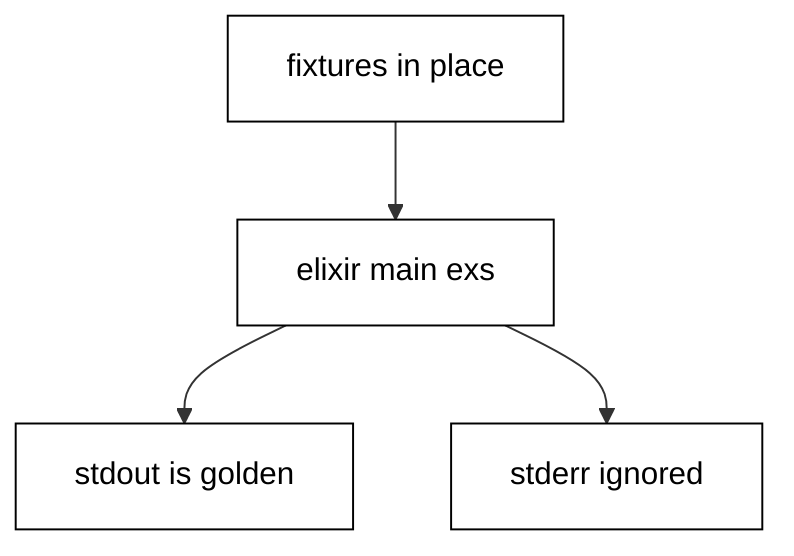

Prerequisites for this course: [just-enough-elixir](/en/learn/courses/just-enough-elixir/learning/overview) for basic syntax, pattern matching, and recursion, and [actor-model-concurrency](/en/learn/courses/actor-model-concurrency/learning/overview) for the OTP concurrency angle this course deliberately does not repeat. Comfort editing and running Elixir scripts from a terminal is assumed throughout, and every example builds only on the primer plus earlier examples in this course.

## Why this exists -- the big idea

**The problem before the solution**: developers who learn Elixir as a second language write it with their first language accent — loops with counters where comprehensions belong, null checks where pattern matches belong, stringly errors where tagged tuples belong, hand-rolled helpers where the standard library already answers. The programs run, but they resist the ecosystem: standard tools, reviewers, and future maintainers all expect the idiomatic forms. This course replaces each accent with the native habit, one small runnable program at a time, until the idiomatic form is the first one you reach for.

**Keep this if you forget everything else**: Write Elixir the way its own standard library does — matches over branches, values over mutation, data-shaped errors over stringly ones, and the standard tool running the checks.

## Tensions and trade-offs -- when NOT to reach for this

- **Idiom versus expedience**: a pipe through two calls adds ceremony without clarity, and a GenServer for one counter is machinery without a failure story. Apply each idiom where its weight earns out: pipes past two stages, processes where failure domains split, protocols where a third type is coming.
- **Standard library versus the ecosystem**: the course reaches for the standard library first, which keeps every example runnable with zero installs. Real projects still adopt dependencies for genuinely hard problems — JSON at scale, web frameworks, database drivers — where the standard library ends and the ecosystem begins.
- **When NOT**: one-off exploration in IEx needs no project layout, no tests, and no lock file. The engineering in this course earns its place when the program runs twice — on a schedule, on someone else's machine, or a year from now with you unavailable.

## Lineage -- where this language sits

Elixir is the fault-tolerant functional language of this series: the `just-enough-elixir` primer teaches reading and writing, `actor-model-concurrency` teaches the OTP supervision angle in depth, and this course builds the general-purpose fluency between and beneath them — control flow, collections, error handling, the standard library, testing, tooling, and the discipline of reading idiomatic code. Later Elixir courses (Phoenix and LiveView backends, Ecto migrations) assume exactly the idioms taught here and add their own domain systems on top.

## How this course is organized

[Beginner](/en/learn/courses/elixir-in-depth/learning/beginner) (Examples 1-25) installs idiomatic control flow and collections, the error-handling idiom, and standard-library text, files, and time. [Intermediate](/en/learn/courses/elixir-in-depth/learning/intermediate) (Examples 26-53) organizes modules and Mix projects, declares and pins dependencies, tests with the standard ExUnit workflow, and generalizes with protocols, behaviours, streams, and value semantics. [Advanced](/en/learn/courses/elixir-in-depth/learning/advanced) (Examples 54-78) surveys concurrency primitives, configures tooling and style, and trains systematic reading of idiomatic code. The [capstone](/en/learn/courses/elixir-in-depth/learning/capstone/overview) ships a log-summarizer CLI with an embedded suite and a golden transcript, and [drilling](/en/learn/courses/elixir-in-depth/drilling/overview) turns the sixteen concepts into recall, katas, and checklists.

## About the runtime

Every example runs as `elixir main.exs` in the pinned Elixir 1.20.4 container with no network and a read-only course tree: only /tmp is writable, so scratch files live there with fixed names and fixed bytes. Fixtures ship beside each script and the working directory is the unit folder, so relative reads resolve to committed files. Concurrency demos rendezvous on monitored processes with sorted transcripts and never print process identifiers; seeded generators pin their streams; dates are constructed fixed values, never clock reads. Standard output is the asserted golden transcript; standard error is ignored, which matters for the task-crash and compiler-warning examples that log there by design.

## Worked example plan

One row per `ex-NN`: title, level, runtime, task, check, and concept refs. Every concept is exercised by at least two examples; every example names at least one concept; each cluster starts with its anchor (marked below). All anchors run Elixir with the standard library only and no lockfile.

| ex-NN | Title                                              | Level        | Runtime                | Task                                                         | Check                                          | Concepts     |
| ----- | -------------------------------------------------- | ------------ | ---------------------- | ------------------------------------------------------------ | ---------------------------------------------- | ------------ |
| ex-01 | Match Binds Shape, Not Assignment                  | beginner     | Elixir stdlib (anchor) | bind and rebind through the match operator, including pin    | output shows uppercased rebind and pinned name | co-01, co-11 |
| ex-02 | case, cond, if, and unless in Their Places         | beginner     | Elixir stdlib          | pick the branching form by the shape of the question         | four decisions print with fixed labels         | co-01        |
| ex-03 | with Chains the Happy Path                         | beginner     | Elixir stdlib          | chain two ok-steps with an else for each short-circuit       | ok and failing inputs print their branches     | co-01        |
| ex-04 | Lists Hold Terms, Binaries Hold Text               | beginner     | Elixir stdlib          | prepend, charlists, byte versus grapheme size                | sizes and mapped list print                    | co-03        |
| ex-05 | Maps, Keywords, and Structs in Their Places        | beginner     | Elixir stdlib          | update maps, collect duplicate options, fix keys in a struct | old versus new and struct fields print         | co-03, co-11 |
| ex-06 | Enum Pipelines Over Every Collection               | beginner     | Elixir stdlib          | map, filter, reduce, and group orders in one pass each       | sum, names, and groups print                   | co-03        |
| ex-07 | for Comprehensions That Filter and Collect         | beginner     | Elixir stdlib          | generators, filters, into, and pattern skipping              | four collections print                         | co-03, co-01 |
| ex-08 | Choosing the Collection Function                   | beginner     | Elixir stdlib          | answer one question per Enum function                        | membership, search, and counts print           | co-03        |
| ex-09 | ok and error Tuples Through with                   | beginner     | Elixir stdlib (anchor) | parse and double inside with, errors to else                 | doubled and bad-input reports print            | co-02        |
| ex-10 | Raising and Rescuing Custom Exceptions             | beginner     | Elixir stdlib          | raise a defexception, rescue its context at the edge         | happy value and refusal report print           | co-02        |
| ex-11 | try, catch, and after for Exits and Throws         | beginner     | Elixir stdlib          | trap an exit signal, catch a throw, always run after         | exit and throw reports print                   | co-02        |
| ex-12 | Pipelines That Short-Circuit on error              | beginner     | Elixir stdlib          | thread the tuple shape through pipe stages                   | good and bad reports print                     | co-02        |
| ex-13 | Let It Crash or Handle It Here                     | beginner     | Elixir stdlib          | strict worker inside, converting boundary outside            | inside value and both boundary reports print   | co-02, co-09 |
| ex-14 | Error Values for Expected Failures                 | beginner     | Elixir stdlib          | fetch with Map.fetch tuples, match both outcomes             | found and missing reports print                | co-02        |
| ex-15 | Retry Loops With Their Own Budget                  | beginner     | Elixir stdlib          | recurse with a countdown, convert exhaustion to data         | success-with-count and gave-up print           | co-02        |
| ex-16 | Resource Cleanup That try and after Guarantee      | beginner     | Elixir stdlib          | read a scratch file with after-owned deletion                | content and proof-of-cleanup print             | co-02        |
| ex-17 | Choosing the Error-Handling Shape                  | beginner     | Elixir stdlib          | tuples across boundaries, bangs for contracts, exits linked  | tuple and bang results agree on 42 and 41      | co-02        |
| ex-18 | String Functions From the Standard Library         | beginner     | Elixir stdlib (anchor) | trim, split, shape, predicate, and grapheme prefix           | parts, shaped line, and prefix print           | co-04        |
| ex-19 | Regular Expressions That Stay Small                | beginner     | Elixir stdlib          | named captures, scan, replace, and split                     | captures, masked line, and tokens print        | co-04        |
| ex-20 | IO Lists and Shaped Output                         | beginner     | Elixir stdlib          | build output as iodata, flatten once at the boundary         | byte count, table, and report body print       | co-04, co-15 |
| ex-21 | Reading and Writing Files Beside the Code          | beginner     | Elixir stdlib          | read a committed fixture, round-trip through /tmp scratch    | count and sorted echo print                    | co-04        |
| ex-22 | Tabular Text That Round-Trips Exactly              | beginner     | Elixir stdlib          | parse CSV against its header, render canonically sorted      | row count and canonical render print           | co-04        |
| ex-23 | Dates Without a Clock                              | beginner     | Elixir stdlib          | add, diff, compare, and range over constructed dates         | span, order, and week count print              | co-05        |
| ex-24 | Times, Shifts, and Durations in UTC                | beginner     | Elixir stdlib          | shift wall time and UTC instants with exact arithmetic       | shifted instant and inverse diff print         | co-05        |
| ex-25 | Formatting Dates for People and Machines           | beginner     | Elixir stdlib          | strftime for humans, ISO 8601 for machines                   | both forms, round trip, and weekday print      | co-05        |
| ex-26 | Module Anatomy That Names the Unit                 | intermediate | Elixir stdlib (anchor) | clauses, guards, docs, and one private helper                | list, map, member, and plain totals print      | co-06        |
| ex-27 | alias, import, and require Side by Side            | intermediate | Elixir stdlib          | shorten, inject, and enable with the three directives        | upper, total, and odd print                    | co-06        |
| ex-28 | Structs That Name the Shape                        | intermediate | Elixir stdlib          | enforce keys, build strictly, update with syntax             | sku, quantities, and plain fields print        | co-06        |
| ex-29 | A Mix Project Scaffold Read as Data                | intermediate | Elixir stdlib          | scaffold to /tmp, assert manifest, lib, and test             | four scaffold booleans print true              | co-06        |
| ex-30 | Reading a Hash-Locked mix.lock                     | intermediate | Elixir stdlib          | eval the sample lock as data, sort the pins                  | pin count and sorted pins print                | co-07        |
| ex-31 | Exact Pins Instead of Latest                       | intermediate | Elixir stdlib          | admit patches, refuse minors, compare versions               | admission answers and order print              | co-07        |
| ex-32 | Project Layout Every Tool Expects                  | intermediate | Elixir stdlib          | wildcard the fixture scaffold and sort                       | entry count and sorted layout print            | co-06        |
| ex-33 | Compile-Time Config Versus Runtime Config          | intermediate | Elixir stdlib          | freeze a default, read the live value per call               | compiled hello and runtime howdy print         | co-06        |
| ex-34 | Choosing Dependencies by Strict Preference         | intermediate | Elixir stdlib          | rank stdlib over hex over git, take the head                 | stdlib and hex choices print                   | co-07        |
| ex-35 | ExUnit and assert: the Standard Test Shape         | intermediate | Elixir stdlib (anchor) | two tests, fixed summary, suppressed formatters              | suite line with 2 tests and 0 failures         | co-08        |
| ex-36 | setup Blocks That Wrap Each Test                   | intermediate | Elixir stdlib          | share a users map through setup context                      | suite line with 2 tests and 0 failures         | co-08        |
| ex-37 | Testing Private Helpers Through the Public Surface | intermediate | Elixir stdlib          | pin privates via checkout only                               | suite line with 2 tests and 0 failures         | co-08        |
| ex-38 | Seeded Tables That Stand In for Properties         | intermediate | Elixir stdlib          | replay a fixed :rand stream through two properties           | suite line plus checked count print            | co-08        |
| ex-39 | Assertion Messages That Name the Mismatch          | intermediate | Elixir stdlib          | custom message and match-assert with binding                 | suite line with 2 tests and 0 failures         | co-08        |
| ex-40 | Tags and Names That Organize the Suite             | intermediate | Elixir stdlib          | external tag, valued tag, and one plain fact                 | suite line with 3 tests and 0 failures         | co-08        |
| ex-41 | Stubbing Boundaries With Explicit Doubles          | intermediate | Elixir stdlib          | function double plus assert_received on the mailbox          | suite line with 2 tests and 0 failures         | co-08        |
| ex-42 | Testing Streams at Their Bounds                    | intermediate | Elixir stdlib          | empty, infinite, and anchored stream bounds                  | suite line with 3 tests and 0 failures         | co-08        |
| ex-43 | Reading the Suite Summary as Data                  | intermediate | Elixir stdlib          | gate on total, failures, excluded, and skipped               | four summary counts print                      | co-08        |
| ex-44 | Failing-Test-First in One File                     | intermediate | Elixir stdlib          | rescued red assertion, then a green four-branch suite        | red proof and green summary print              | co-08        |
| ex-45 | Protocols That Dispatch on Type                    | intermediate | Elixir stdlib (anchor) | three impls behind one call site                             | list, map, and binary counts print             | co-10        |
| ex-46 | Behaviours With Callbacks                          | intermediate | Elixir stdlib          | two callbacks, @impl ties, sorted keys                       | fetch, miss, and keys print                    | co-10        |
| ex-47 | One Enum Vocabulary Over Every Collection          | intermediate | Elixir stdlib          | maps, ranges, cycles, and back into a map                    | pairs, squares, head, and back print           | co-10, co-03 |
| ex-48 | Streams That Fuse the Pipeline                     | intermediate | Elixir stdlib          | lazy recipe pulled exactly three deep                        | fused results and window sums print            | co-10, co-15 |
| ex-49 | Updates That Return New Values                     | intermediate | Elixir stdlib          | put_in, update_in, get_and_update lineage                    | original, added, priced, and bumped print      | co-11        |
| ex-50 | Shared Tails Under Immutability                    | intermediate | Elixir stdlib          | prepend sharing and branch rebuilding with proof             | heads, sharing proof, and pools print          | co-11        |
| ex-51 | Sorted Terms That Traverse in Order                | intermediate | Elixir stdlib          | tuple sort, key sort, and a gb_tree round trip               | both sorts and the tree list print             | co-03, co-10 |
| ex-52 | Laziness That Computes Only on Demand              | intermediate | Elixir stdlib          | counter proves three runs, not ten                           | before, first, and after counts print          | co-10        |
| ex-53 | Strict Versus Loose Equality                       | intermediate | Elixir stdlib          | == across types, === demanding the same type                 | loose, strict, and branch choices print        | co-11        |
| ex-54 | spawn and Message Passing                          | advanced     | Elixir stdlib (anchor) | spawn a worker, send work, receive the reply                 | doubled reply prints, never a pid              | co-09        |
| ex-55 | receive With Timeouts and Selection                | advanced     | Elixir stdlib          | selective match, leftover sort, empty-mailbox bound          | selection, leftovers, and empty proof print    | co-09        |
| ex-56 | Agents for Synchronous Shared State                | advanced     | Elixir stdlib          | update, get_and_update, and get behind one API               | popped old value and final count print         | co-09        |
| ex-57 | Tasks That await With Timeouts                     | advanced     | Elixir stdlib          | await a sum, stream with bounds, catch the crash             | sum, ordered stream, and crash report print    | co-09        |
| ex-58 | GenServers That Serialize Calls                    | advanced     | Elixir stdlib          | two bumps, one cast reset, one observing call                | serialized replies and reset proof print       | co-09        |
| ex-59 | Supervisors That Restart Children                  | advanced     | Elixir stdlib          | kill the child, poll the name, read the restored state       | both reads show the initial value              | co-09        |
| ex-60 | Registry Names Instead of Pids                     | advanced     | Elixir stdlib          | via-tuple updates and reads through one name                 | named-route counter prints                     | co-09        |
| ex-61 | Choosing the Concurrency Primitive                 | advanced     | Elixir stdlib          | total decision function over share and restart needs         | parallel, shared, durable, named print         | co-09        |
| ex-62 | mix format That Ends Style Debates                 | advanced     | Elixir stdlib (anchor) | format a messy call, prove idempotence and check pass        | before, after, stable, and check print         | co-12, co-14 |
| ex-63 | Compiler Warnings Read as Data                     | advanced     | Elixir stdlib          | capture with_diagnostics, pinpoint line and column           | warning count and position print               | co-12        |
| ex-64 | Calling Erlang Without Fear                        | advanced     | Elixir stdlib          | math, lists, crypto, and maps from one colon away            | hypotenuse, sort, digest, and size print       | co-13        |
| ex-65 | Names That Follow the Community Style              | advanced     | Elixir stdlib          | predicates, bangs, and plain twins as one contract           | member, fetch, and bang print                  | co-14        |
| ex-66 | @doc for Contracts, Comments for Why               | advanced     | Elixir stdlib          | count doc attributes in a fixture module                     | count and three attribute lines print          | co-14        |
| ex-67 | Predicate Style With Enum Predicates               | advanced     | Elixir stdlib          | all?, any?, in, and count-with-predicate                     | quantifier answers and long count print        | co-14        |
| ex-68 | Pipes That Read Top to Bottom                      | advanced     | Elixir stdlib          | six-stage report pipe plus a then insertion                  | sorted report and shouted line print           | co-14        |
| ex-69 | Alias Order Checked by Hand                        | advanced     | Elixir stdlib          | self-hosting sortedness check over the alias block           | count, verdict, and alias lines print          | co-12, co-14 |
| ex-70 | Ports and Terms at the Boundary                    | advanced     | Elixir stdlib          | echo through cat, encode terms for the wire                  | echoed bytes and round trip print              | co-13        |
| ex-71 | Reading a Pipe Chain End to End                    | advanced     | Elixir stdlib (anchor) | name each stage's input and output type aloud                | stage snapshots s1, s2, and s3 print           | co-16        |
| ex-72 | Reading a with Chain's Failure Paths               | advanced     | Elixir stdlib          | list else branches before the happy path                     | good, partial, missing, and bad print          | co-16        |
| ex-73 | Reading a GenServer by Its Callbacks               | advanced     | Elixir stdlib          | init state type, then each callback's state change           | two pops compose the cast story                | co-16        |
| ex-74 | Reading a Protocol Dispatch                        | advanced     | Elixir stdlib          | name the value's type, then ask impl_for                     | greetings and both impl modules print          | co-16        |
| ex-75 | Reading a Macro Call Site                          | advanced     | Elixir stdlib          | read the expansion, never guess it                           | operator, expansion, and splice print          | co-16        |
| ex-76 | Reading Matches as Cases                           | advanced     | Elixir stdlib          | five inputs across four clauses plus the wildcard            | sorted kinds print                             | co-16        |
| ex-77 | Reading Someone Else's Mix Project                 | advanced     | Elixir stdlib          | manifest-first, pins second, in a foreign tree               | app, version, and closure print                | co-16, co-06 |
| ex-78 | The Systematic Reading Checklist                   | advanced     | Elixir stdlib          | kind, surface, dependencies, flow, and open question         | five-step verdict prints                       | co-16        |

## Examples by Level

### Beginner (Examples 1–25)

- [Example 1: Match Binds Shape, Not Assignment](/en/learn/courses/elixir-in-depth/learning/beginner#example-1-match-binds-shape-not-assignment)
- [Example 2: case, cond, if, and unless in Their Places](/en/learn/courses/elixir-in-depth/learning/beginner#example-2-case-cond-if-unless-in-their-places)
- [Example 3: with Chains the Happy Path](/en/learn/courses/elixir-in-depth/learning/beginner#example-3-with-chains-the-happy-path)
- [Example 4: Lists Hold Terms, Binaries Hold Text](/en/learn/courses/elixir-in-depth/learning/beginner#example-4-lists-hold-terms-binaries-hold-text)
- [Example 5: Maps, Keywords, and Structs in Their Places](/en/learn/courses/elixir-in-depth/learning/beginner#example-5-maps-keywords-and-structs-in-their-places)
- [Example 6: Enum Pipelines Over Every Collection](/en/learn/courses/elixir-in-depth/learning/beginner#example-6-enum-pipelines-over-every-collection)
- [Example 7: for Comprehensions That Filter and Collect](/en/learn/courses/elixir-in-depth/learning/beginner#example-7-for-comprehensions-that-filter-and-collect)
- [Example 8: Choosing the Collection Function](/en/learn/courses/elixir-in-depth/learning/beginner#example-8-choosing-the-collection-function)
- [Example 9: ok and error Tuples Through with](/en/learn/courses/elixir-in-depth/learning/beginner#example-9-ok-and-error-tuples-through-with)
- [Example 10: Raising and Rescuing Custom Exceptions](/en/learn/courses/elixir-in-depth/learning/beginner#example-10-raising-and-rescuing-custom-exceptions)
- [Example 11: try, catch, and after for Exits and Throws](/en/learn/courses/elixir-in-depth/learning/beginner#example-11-try-catch-and-after-for-exits-and-throws)
- [Example 12: Pipelines That Short-Circuit on error](/en/learn/courses/elixir-in-depth/learning/beginner#example-12-pipelines-that-short-circuit-on-error)
- [Example 13: Let It Crash or Handle It Here](/en/learn/courses/elixir-in-depth/learning/beginner#example-13-let-it-crash-or-handle-it-here)
- [Example 14: Error Values for Expected Failures](/en/learn/courses/elixir-in-depth/learning/beginner#example-14-error-values-for-expected-failures)
- [Example 15: Retry Loops With Their Own Budget](/en/learn/courses/elixir-in-depth/learning/beginner#example-15-retry-loops-with-their-own-budget)
- [Example 16: Resource Cleanup That try and after Guarantee](/en/learn/courses/elixir-in-depth/learning/beginner#example-16-resource-cleanup-that-try-and-after-guarantee)
- [Example 17: Choosing the Error-Handling Shape](/en/learn/courses/elixir-in-depth/learning/beginner#example-17-choosing-the-error-handling-shape)
- [Example 18: String Functions From the Standard Library](/en/learn/courses/elixir-in-depth/learning/beginner#example-18-string-functions-from-the-standard-library)
- [Example 19: Regular Expressions That Stay Small](/en/learn/courses/elixir-in-depth/learning/beginner#example-19-regular-expressions-that-stay-small)
- [Example 20: IO Lists and Shaped Output](/en/learn/courses/elixir-in-depth/learning/beginner#example-20-io-lists-and-shaped-output)
- [Example 21: Reading and Writing Files Beside the Code](/en/learn/courses/elixir-in-depth/learning/beginner#example-21-reading-and-writing-files-beside-the-code)
- [Example 22: Tabular Text That Round-Trips Exactly](/en/learn/courses/elixir-in-depth/learning/beginner#example-22-tabular-text-that-round-trips-exactly)
- [Example 23: Dates Without a Clock](/en/learn/courses/elixir-in-depth/learning/beginner#example-23-dates-without-a-clock)
- [Example 24: Times, Shifts, and Durations in UTC](/en/learn/courses/elixir-in-depth/learning/beginner#example-24-times-shifts-and-durations-in-utc)
- [Example 25: Formatting Dates for People and Machines](/en/learn/courses/elixir-in-depth/learning/beginner#example-25-formatting-dates-for-people-and-machines)

### Intermediate (Examples 26–53)

- [Example 26: Module Anatomy That Names the Unit](/en/learn/courses/elixir-in-depth/learning/intermediate#example-26-module-anatomy-that-names-the-unit)
- [Example 27: alias, import, and require Side by Side](/en/learn/courses/elixir-in-depth/learning/intermediate#example-27-alias-import-and-require-side-by-side)
- [Example 28: Structs That Name the Shape](/en/learn/courses/elixir-in-depth/learning/intermediate#example-28-structs-that-name-the-shape)
- [Example 29: A Mix Project Scaffold Read as Data](/en/learn/courses/elixir-in-depth/learning/intermediate#example-29-a-mix-project-scaffold-read-as-data)
- [Example 30: Reading a Hash-Locked mix.lock](/en/learn/courses/elixir-in-depth/learning/intermediate#example-30-reading-a-hash-locked-mix-lock)
- [Example 31: Exact Pins Instead of Latest](/en/learn/courses/elixir-in-depth/learning/intermediate#example-31-exact-pins-instead-of-latest)
- [Example 32: Project Layout Every Tool Expects](/en/learn/courses/elixir-in-depth/learning/intermediate#example-32-project-layout-every-tool-expects)
- [Example 33: Compile-Time Config Versus Runtime Config](/en/learn/courses/elixir-in-depth/learning/intermediate#example-33-compile-time-versus-runtime-config)
- [Example 34: Choosing Dependencies by Strict Preference](/en/learn/courses/elixir-in-depth/learning/intermediate#example-34-choosing-dependencies-by-strict-preference)
- [Example 35: ExUnit and assert: the Standard Test Shape](/en/learn/courses/elixir-in-depth/learning/intermediate#example-35-exunit-and-assert-the-standard-test-shape)
- [Example 36: setup Blocks That Wrap Each Test](/en/learn/courses/elixir-in-depth/learning/intermediate#example-36-setup-blocks-that-wrap-each-test)
- [Example 37: Testing Private Helpers Through the Public Surface](/en/learn/courses/elixir-in-depth/learning/intermediate#example-37-testing-private-helpers-through-the-public-surface)
- [Example 38: Seeded Tables That Stand In for Properties](/en/learn/courses/elixir-in-depth/learning/intermediate#example-38-seeded-tables-that-stand-in-for-properties)
- [Example 39: Assertion Messages That Name the Mismatch](/en/learn/courses/elixir-in-depth/learning/intermediate#example-39-assertion-messages-that-name-the-mismatch)
- [Example 40: Tags and Names That Organize the Suite](/en/learn/courses/elixir-in-depth/learning/intermediate#example-40-tags-and-names-that-organize-the-suite)
- [Example 41: Stubbing Boundaries With Explicit Doubles](/en/learn/courses/elixir-in-depth/learning/intermediate#example-41-stubbing-boundaries-with-explicit-doubles)
- [Example 42: Testing Streams at Their Bounds](/en/learn/courses/elixir-in-depth/learning/intermediate#example-42-testing-streams-at-their-bounds)
- [Example 43: Reading the Suite Summary as Data](/en/learn/courses/elixir-in-depth/learning/intermediate#example-43-reading-the-suite-summary-as-data)
- [Example 44: Failing-Test-First in One File](/en/learn/courses/elixir-in-depth/learning/intermediate#example-44-failing-test-first-in-one-file)
- [Example 45: Protocols That Dispatch on Type](/en/learn/courses/elixir-in-depth/learning/intermediate#example-45-protocols-that-dispatch-on-type)
- [Example 46: Behaviours With Callbacks](/en/learn/courses/elixir-in-depth/learning/intermediate#example-46-behaviours-with-callbacks)
- [Example 47: One Enum Vocabulary Over Every Collection](/en/learn/courses/elixir-in-depth/learning/intermediate#example-47-one-enum-vocabulary-over-every-collection)
- [Example 48: Streams That Fuse the Pipeline](/en/learn/courses/elixir-in-depth/learning/intermediate#example-48-streams-that-fuse-the-pipeline)
- [Example 49: Updates That Return New Values](/en/learn/courses/elixir-in-depth/learning/intermediate#example-49-updates-that-return-new-values)
- [Example 50: Shared Tails Under Immutability](/en/learn/courses/elixir-in-depth/learning/intermediate#example-50-shared-tails-under-immutability)
- [Example 51: Sorted Terms That Traverse in Order](/en/learn/courses/elixir-in-depth/learning/intermediate#example-51-sorted-terms-that-traverse-in-order)
- [Example 52: Laziness That Computes Only on Demand](/en/learn/courses/elixir-in-depth/learning/intermediate#example-52-laziness-that-computes-only-on-demand)
- [Example 53: Strict Versus Loose Equality](/en/learn/courses/elixir-in-depth/learning/intermediate#example-53-strict-versus-loose-equality)

### Advanced (Examples 54–78)

- [Example 54: spawn and Message Passing](/en/learn/courses/elixir-in-depth/learning/advanced#example-54-spawn-and-message-passing)
- [Example 55: receive With Timeouts and Selection](/en/learn/courses/elixir-in-depth/learning/advanced#example-55-receive-with-timeouts-and-selection)
- [Example 56: Agents for Synchronous Shared State](/en/learn/courses/elixir-in-depth/learning/advanced#example-56-agents-for-synchronous-shared-state)
- [Example 57: Tasks That await With Timeouts](/en/learn/courses/elixir-in-depth/learning/advanced#example-57-tasks-that-await-with-timeouts)
- [Example 58: GenServers That Serialize Calls](/en/learn/courses/elixir-in-depth/learning/advanced#example-58-genservers-that-serialize-calls)
- [Example 59: Supervisors That Restart Children](/en/learn/courses/elixir-in-depth/learning/advanced#example-59-supervisors-that-restart-children)
- [Example 60: Registry Names Instead of Pids](/en/learn/courses/elixir-in-depth/learning/advanced#example-60-registry-names-instead-of-pids)
- [Example 61: Choosing the Concurrency Primitive](/en/learn/courses/elixir-in-depth/learning/advanced#example-61-choosing-the-concurrency-primitive)
- [Example 62: mix format That Ends Style Debates](/en/learn/courses/elixir-in-depth/learning/advanced#example-62-mix-format-that-ends-style-debates)
- [Example 63: Compiler Warnings Read as Data](/en/learn/courses/elixir-in-depth/learning/advanced#example-63-compiler-warnings-read-as-data)
- [Example 64: Calling Erlang Without Fear](/en/learn/courses/elixir-in-depth/learning/advanced#example-64-calling-erlang-without-fear)
- [Example 65: Names That Follow the Community Style](/en/learn/courses/elixir-in-depth/learning/advanced#example-65-names-that-follow-the-community-style)
- [Example 66: @doc for Contracts, Comments for Why](/en/learn/courses/elixir-in-depth/learning/advanced#example-66-doc-for-contracts-comments-for-why)
- [Example 67: Predicate Style With Enum Predicates](/en/learn/courses/elixir-in-depth/learning/advanced#example-67-predicate-style-with-enum-predicates)
- [Example 68: Pipes That Read Top to Bottom](/en/learn/courses/elixir-in-depth/learning/advanced#example-68-pipes-that-read-top-to-bottom)
- [Example 69: Alias Order Checked by Hand](/en/learn/courses/elixir-in-depth/learning/advanced#example-69-alias-order-checked-by-hand)
- [Example 70: Ports and Terms at the Boundary](/en/learn/courses/elixir-in-depth/learning/advanced#example-70-ports-and-terms-at-the-boundary)
- [Example 71: Reading a Pipe Chain End to End](/en/learn/courses/elixir-in-depth/learning/advanced#example-71-reading-a-pipe-chain-end-to-end)
- [Example 72: Reading a with Chain's Failure Paths](/en/learn/courses/elixir-in-depth/learning/advanced#example-72-reading-a-with-chains-failure-paths)
- [Example 73: Reading a GenServer by Its Callbacks](/en/learn/courses/elixir-in-depth/learning/advanced#example-73-reading-a-genserver-by-its-callbacks)
- [Example 74: Reading a Protocol Dispatch](/en/learn/courses/elixir-in-depth/learning/advanced#example-74-reading-a-protocol-dispatch)
- [Example 75: Reading a Macro Call Site](/en/learn/courses/elixir-in-depth/learning/advanced#example-75-reading-a-macro-call-site)
- [Example 76: Reading Matches as Cases](/en/learn/courses/elixir-in-depth/learning/advanced#example-76-reading-matches-as-cases)
- [Example 77: Reading Someone Else's Mix Project](/en/learn/courses/elixir-in-depth/learning/advanced#example-77-reading-someone-elses-mix-project)
- [Example 78: The Systematic Reading Checklist](/en/learn/courses/elixir-in-depth/learning/advanced#example-78-the-systematic-reading-checklist)
