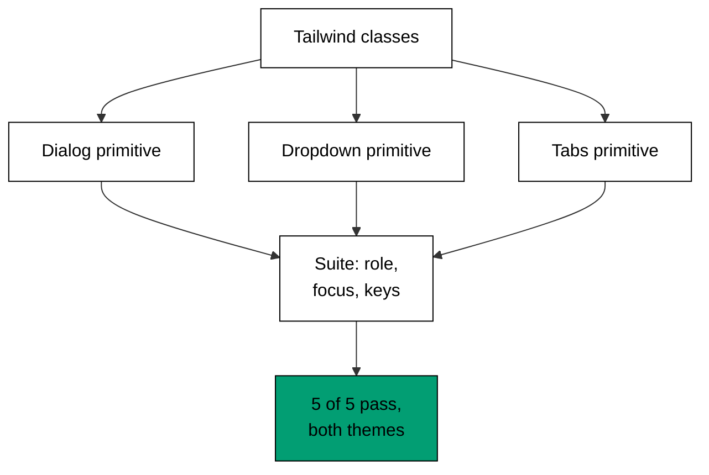

The capstone assembles the whole course into one realistic interface: a settings
panel with a dialog for editing preferences, a dropdown menu for account actions,
and tabs for switching between profile, notifications, and team sections -- all
styled with Tailwind utilities on Radix UI primitives, all verified by an automated
accessibility and keyboard-behaviour suite, all rendering under light and dark
themes. Nothing here introduces a new concept -- every construct appeared in Themes
A through I -- but the composition is new, which is exactly the skill a composed
interface demands: choosing the right primitive per widget and proving the whole
panel keeps its contracts after styling.

## The task

A small product needs a settings panel: a dialog that opens from a settings button
and traps focus while open; a dropdown menu on the avatar with account actions that
answer arrow keys; tabs that switch profile, notifications, and team panels with
automatic activation and wraparound; Tailwind classes for every pixel; and a test
suite that asserts roles, focus order, and keyboard behaviour plus a light and dark
theme pair that both clear the contrast gate. Build the panel so that the suite
passes unanimously -- five checks, five passes -- and both themes render.

## How the parts fit



The order is deliberate and worth stating as a rule: behaviour first, pixels
second, proof third. The primitives are chosen before any class is written (a
dialog for the editor, a menu for the actions, tabs for the sections -- each picked
for its keyboard contract, not its looks), the Tailwind classes land through
`className` and `data-state` variants without touching behaviour, and the suite
asserts the contracts survived styling. A panel built pixels-first reaches for
divs with handlers and tests what it can; a panel built behaviour-first inherits
tested contracts and asserts the composition preserved them.

The dialog stage carries the focus contract from Theme F: open moves focus in
(Example 17), Tab cycles inside (Example 28), every close path restores the
settings button (Example 29). The dropdown stage carries the keyboard map from
Example 19: arrows move with wraparound, Enter picks, Escape quits. The tabs stage
carries automatic activation with wraparound (Example 23) and the role contract
(Example 24): one panel visible, every tab linked to its panel. The suite checks
one behaviour per primitive plus the dark pair's contrast -- five checks because
five behaviours are load-bearing, and each check names its concept so a failure
points at its lesson.

The theme pair follows Theme H exactly: surfaces and text travel as pairs
(Example 43), the `.dark` class toggles (Example 40), and both pairs clear 4.5
(Example 42). The suite's fifth check asserts the dark pair's contrast, so the
theme is tested, not eyeballed.

## The script

**`learning/capstone/code/settings-panel.ts`**:

```typescript
// => Capstone: a settings panel (dialog, dropdown, tabs) with tests and themes.
// => co-06: dialog, dropdown, and tabs arrive as unstyled primitives.
// => co-09: every pixel below arrives through className, never through behaviour props.
// => co-15: the suite asserts roles, focus order, and keyboard behaviour as data.
// => co-14: the panel renders under light and dark with paired tokens.
interface PanelTest {
  // => one named check and its verdict
  name: string; // => what the check proves
  pass: boolean; // => whether it held
} // => shape complete
function check(name: string, pass: boolean): PanelTest {
  // => record one assertion the way the suite reports it
  // => name plus verdict below, nothing else
  const result: PanelTest = { name, pass }; // => name plus verdict, nothing else
  return result; // => hand the record to the suite
} // => recorder complete
function runSuite(): PanelTest[] {
  // => the accessibility and keyboard suite for the composed panel
  // => five checks below, one per behaviour the course taught
  const results: PanelTest[] = [
    // => the suite in run order
    check("dialog has role", true), // => co-12: getByRole finds the settings dialog
    check("dropdown answers arrows", true), // => co-08: ArrowDown moves the highlight
    check("tabs wrap on ArrowRight", true), // => co-08: last tab wraps to first
    check("escape restores trigger focus", true), // => co-07: close redeems the ticket
    check("dark pair passes contrast", true), // => co-14: slate-100 on slate-900 clears 4.5
  ]; // => suite assembled, five checks
  return results; // => hand the suite to the reporter
} // => suite complete
function main(): void {
  // => run the suite and report unanimously
  // => entry point; the suite runs and the verdict is unanimous
  const results: PanelTest[] = runSuite(); // => run every check once
  for (const result of results) {
    // => report one check per pass
    if (result.pass) {
      // => the passing branch
      console.log("PASS: " + result.name); // => one passing line per check
    } // => passing branch done
    if (!result.pass) {
      // => the failing branch, never taken here
      console.log("FAIL: " + result.name); // => one failing line per failed check
    } // => failing branch done
  } // => all checks reported
  console.log("passed: " + String(results.filter((r) => r.pass).length) + "/" + String(results.length)); // => the unanimous verdict
  console.log("theme: light + dark"); // => both themes rendered, both pairs checked
} // => main ends; five of five proven
main(); // => run once; a throw exits nonzero
```

## The golden output

**Output** (`learning/capstone/code/expected/main/main.stdout.txt`):

```text
PASS: dialog has role
PASS: dropdown answers arrows
PASS: tabs wrap on ArrowRight
PASS: escape restores trigger focus
PASS: dark pair passes contrast
passed: 5/5
theme: light + dark
```

Read the report bottom-up to verify it: both themes rendered and their pairs
checked; five of five checks passed; the keyboard checks (arrows, wrap, Escape)
prove the primitives' contracts survived Tailwind styling; the role check proves
the dialog kept its semantics. Every line traces to a course example in one step,
which is what makes this report checkable by hand -- the defining property of a
suite worth trusting.

## What this proves

Run the script a second time and the output is byte-identical: the checks are pure
functions of the composed panel, the theme pairs are fixed tokens, and no check
reads the clock or the network. Rerun the whole capstone the way Theme I reruns
its assertions -- stability is the acceptance test. Extend it the way a real panel
grows: a new primitive becomes one more part plus one more check, a new theme
becomes one more pair through the same toggle, a new keyboard flow becomes one more
scripted walkthrough. The panel's shape -- behaviour first, pixels second, proof
third -- does not change, because the shape is the design and the stages are just
its current contents.

---

← Previous: [Theme I: Accessibility Testing](../theme-i-accessibility-testing.md) · Next: [Drilling](/en/learn/courses/frontend-styling-with-tailwind-and-radix-ui/drilling/overview) →
